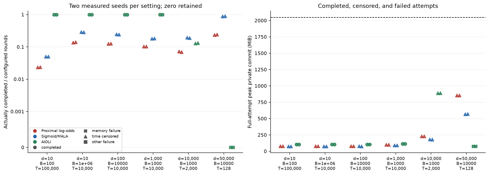
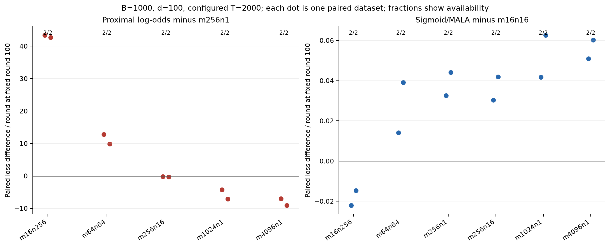
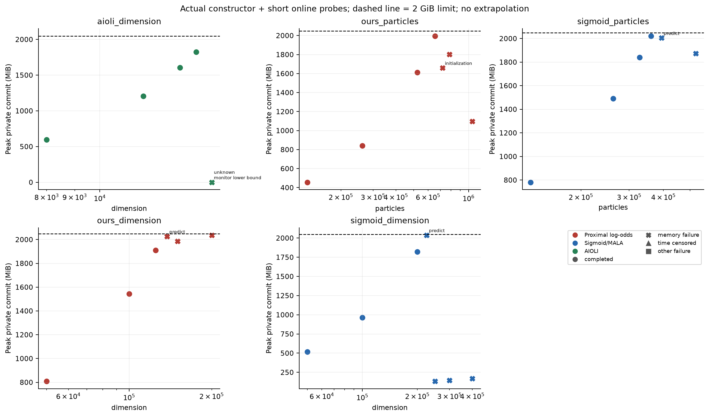
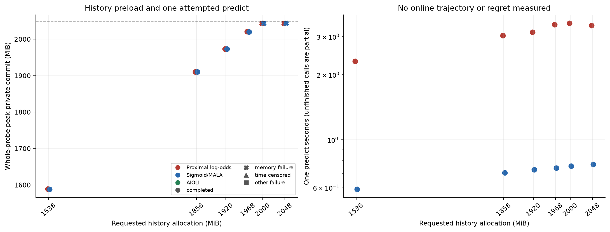
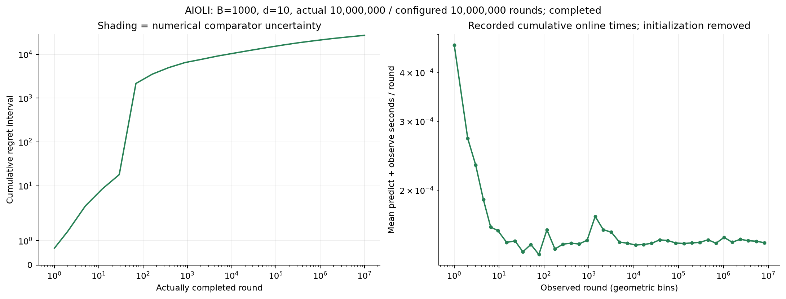
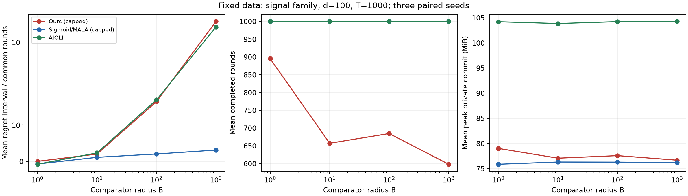
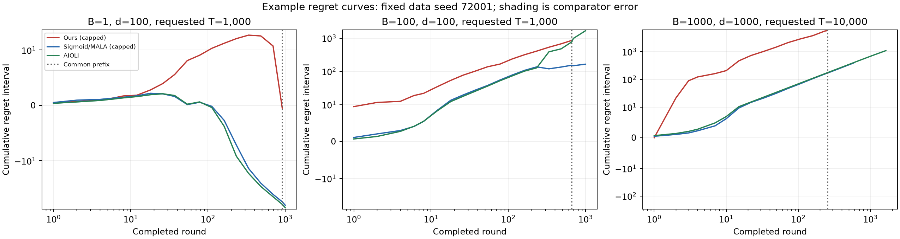
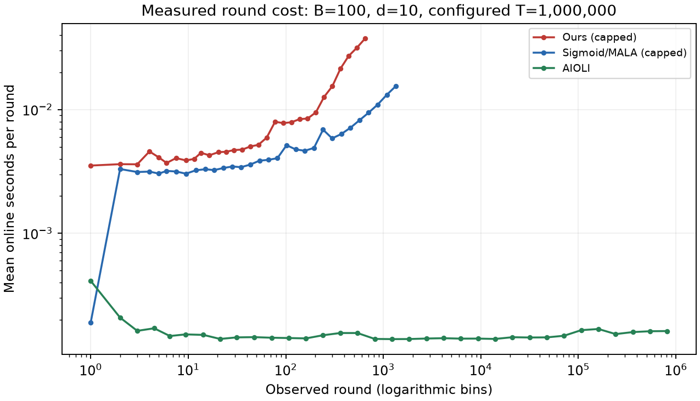
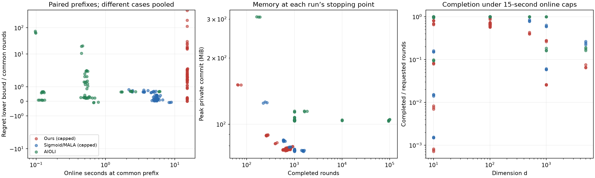
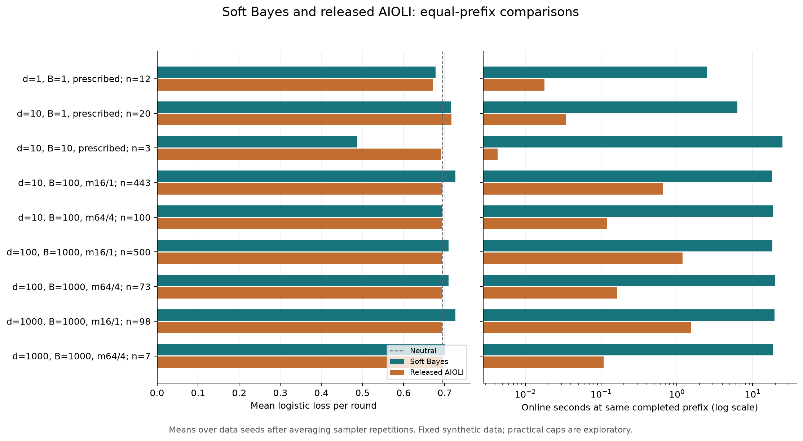

# Online Logistic Regression — Consolidated Research

Consolidated on **2026-10-04** from **562 project Markdown files**. This is the single active research volume for this workspace. It collects algorithm specifications, lemmas, theorems, proofs, lower bounds, literature attribution, audits, and experiment records. The research primarily dates from September 2026; consolidation does not redetermine publication priority or create a new mathematical audit.

## How to use this volume

**Part I** is a chaptered synthesis: methods are grouped by mathematical structure, with the strongest useful statements under each set of assumptions. Different comparator classes, priors, data protocols, and cost models remain distinct. **Part II** contains the complete text of every project Markdown source, grouped into the same chapters and addressed by stable source identifiers. All saved proofs and side results therefore remain available in this one file, even when a weaker historical headline is omitted from the synthesis. Historical duplicates and inferior bounds are retained as source history, not competing current recommendations.

Each source has a contribution/status record. A recorded **PASS** means the original audit passed at the time; this compilation does not claim that every proof has been independently re-audited. A source marked conditional, incomplete, conjectural, or refuted keeps that status. Instructions and requests quoted in historical records are evidence of past work, not current instructions to execute.

The original files are archived byte for byte under `_research_archive/2026-10-04/originals/`, with their directory structure and SHA-256 hashes preserved. Source headings and relative links are adapted in this volume for navigation; mathematical text, proofs, tables, caveats, and citations are retained. Four corrupted LaTeX command characters were restored, with each transcription repair explicitly recorded beside its source. Formula-check JSON, code, data, PDFs, and other companion artifacts remain at their existing locations. Third-party dependency documentation and generated cache documentation are outside the research corpus and remain untouched.

### Chapter map

| Chapter | Subject |
|---|---|
| [1](#chapter-1) | Foundations, reference algorithms, protocols, and literature |
| [2](#chapter-2) | Deterministic dictionaries, matrix densities, and integration |
| [3](#chapter-3) | Variational families, particles, simplex methods, and Gaussian mixtures |
| [4](#chapter-4) | Log-odds integration, clouds, and exact acceptance screens |
| [5](#chapter-5) | Probability aggregation, tempering, averaging, and Markov forecasts |
| [6](#chapter-6) | Centroid/radial compression and exact residual correction |
| [7](#chapter-7) | Posterior geometry, initialization, and general sampling |
| [8](#chapter-8) | Conditional samplers, affine caches, Hessian reuse, and online summaries |
| [9](#chapter-9) | AIOLI, regional methods, and feature/comparator localization |
| [10](#chapter-10) | Volumetric potentials and deterministic lookahead |
| [11](#chapter-11) | Linear-work smoothed gradient and half-lookahead learners |
| [12](#chapter-12) | Lower bounds, counterexamples, and limits of shortcuts |
| [13](#chapter-13) | Brainstorms, partial results, and open routes |
| [14](#chapter-14) | Implementations, measured evidence, and historical context |
| [Reusable lemmas](#reusable-lemmas) | Shared proof modules and the 2026-10-04 refinement ledger |
| [Source register](#source-register) | Every original filename, status, hash, and location in this volume |

### Main results and the limits of the comparison

Let \(G_T=\sum_tx_tx_t^\top\), \(b=BR\). This table selects useful leading results; it is not a total ordering across incomparable assumptions.

| Family | Strong retained guarantee | Computational qualification |
|---|---|---|
| Exact Gaussian probability aggregation | \(d/2+\tfrac12\log\det(I+B^2G_T/(4d))\), simultaneous pathwise point-comparator bound for prior \(N(0,B^2I/d)\) | Integration is part of the algorithm, not a unit-cost primitive. |
| Original-posterior finite/Markov forecasts | Same leading aggregation term, explicit averaging/warm-up charges; strongest versions retain negative corrections | Complete statistical guarantee; sampler modules retain their geometry and source conditions. |
| Explicit combined smoothed half-lookahead | \(O(b^2+(1+b)(d+2+b\delta)(1+b\delta)^2\delta^{-2}\log(1+T))\), no inverse label-floor factor | \(O(d)\) work/state; fresh feature perturbations, active-clipping label floor, structured diagonal. |
| Clipped projected gradient | Explicit \(H_T/(2k\nu)+k[4b^2d\log(1+2T)+6b^2]\) | \(O(d)\) work/state; may beat the combined certificate in some regimes. |
| Fixed-data log-odds families | \(2+C_T\) for prescribed paired/persistent or correlated-sweep variants; \(7/4+C_T\) for direct exact rejection | Different sampling/dimension costs; practical caps do not inherit prescribed theorems. |
| Deterministic paired-evidence lattice | \(1/2+T\log((64T+1)/(64T-1))+(d/2)\log(1+B^2\sum_t\|x_t\|^2/(4d))\), pathwise; additive term below \(.532\) | Finite real arithmetic with exponential dimension prefactor; unchanged lattice algorithm. |
| Current-neutral volumetric predictor | Repeat/orthogonal and changing-balanced-pair theorems | General arbitrary-label nonorthogonal residual remains open. |
| Two-lookahead MAP plus determinant | Aggregation leading term plus finite horizon-independent expected absolute defect | Target transient about \(5.03\cdot10^{32}\); not modest-constant completion. |

Here \(C_T=\tfrac12\sum_j\log(1+B^2\sum_tx_{tj}^2/4)\) belongs to the specified box-conditioned-prior log-odds family. The saved comparison \(d=1000,T=100000,B=1000,R=1,\epsilon=\delta=.001\) gives the untruncated Gaussian exact-aggregation reference about **5563.335552**, and the ordinary-posterior chain forecast bound below **6549.565196** under its full algorithmic certificates. The refined combined linear-work raw bound is about **1.33 million**; the historical certificate was about **2.57 million**. These are analytic upper bounds, not observed regret or runtime. The collection does not establish a full general modest-cost posterior implementation.

### Interpretation rules shared by the chapters

1. An expected empirical-hindsight theorem keeps \(\min_uL_T(u)\) **inside** expectation. A fixed-comparator expectation is not a substitute.
2. Fresh computation satisfies the stated independence from the committed current label. Reused particles and fixed-data chains need their own argument.
3. An original posterior, a compressed proposal corrected back to it, and an uncorrected surrogate posterior are different objects.
4. Draw/proposal counts do not erase preprocessing, factorizations, scans, cache rebuilds, scalar updates, or fallback work.
5. Fixed-history and special-geometry certificates do not automatically hold across all histories or online rounds.
6. Real-arithmetic theorems, floating-point formula checks, empirical measurements, and publication priority are separate claims.

## Part I — Algorithms, results, and proof structure


<a id="chapter-1"></a>

## Chapter 1 — Common foundations, comparators, and interpretation

### 1.1 The problem and its distinct protocols

After observing \(x_t\in\mathbb R^d\), the learner predicts binary probabilities and then observes \(y_t\in\{-1,+1\}\). Write
\[
 \ell_y(z)=\log(1+e^{-yz}),\quad \sigma(z)=(1+e^{-z})^{-1},\quad
 L_T(u)=\sum_t\ell_{y_t}(x_t^\top u),\quad G_T=\sum_tx_tx_t^\top.
\]
Ordinary empirical regret is \(\widehat L_T-\min_{\|u\|\le B}L_T(u)\). For random adaptive data, its requested expectation keeps the minimum **inside** expectation. The learner incurs the logarithm of its probability mixture, not the expected loss of a randomly selected parameter. This permits improper prediction and is crucial to the aggregation arguments. [S298](#source-s298), [S059](#source-s059).

The source collection contains different data protocols: arbitrary bounded data with pathwise guarantees; fixed data independent of learner randomness; adaptive data with the current label committed independently of fresh computation; bounded fresh-ball perturbations; centered Gaussian features; bounded adaptive Gaussian means; and unrestricted Gaussian means. A theorem under one protocol does not automatically transfer to another.

There is also a different, weaker comparator:
\[
 \min_{\|u\|\le B}\mathbb E_{\Theta\sim N(u,\sigma_\theta I)}L_T(\Theta).
\]
Here \(\sigma_\theta\) is the covariance variance. This is expected logistic loss under one Gaussian distribution of **parameters**, not log loss of averaged probabilities, and not Gaussian **feature noise**. Jensen shows that its optimum is at least the optimum point loss. Every theorem below identifies which comparator is used.

### 1.2 Distributional FTRL and Gaussian probability aggregation

**Lemma 1.1 (Gibbs identity and evidence telescope).** For a fixed prior \(\pi\), let
\[
 Z_n=\int e^{-L_n(\theta)}\pi(d\theta),\qquad
 q_{n+1}^*(d\theta)=Z_n^{-1}e^{-L_n(\theta)}\pi(d\theta).
\]
Then
\[
 \mathbb E_qL_n+\mathrm{KL}(q\Vert\pi)
 =-\log Z_n+\mathrm{KL}(q\Vert q_{n+1}^*).
\]
Thus unrestricted distributional FTRL equals the posterior. Its probability prediction \(p_t^*(y)=\mathbb E_{q_t^*}\sigma(yx_t^\top\Theta)\) has cumulative loss \(-\log Z_T\).

**Proof.** Substitute \(\log(dq_{n+1}^*/d\pi)=-L_n-\log Z_n\) in KL. The prediction equals \(Z_t/Z_{t-1}\) for the realized label, so its logarithm telescopes. Absolute continuity is essential: atoms have infinite KL to a continuous uniform or Gaussian prior. A discrete dictionary changes the prior or regularizer. This is the user's variational interpretation of Foster et al.'s probability aggregation, rather than a claim that the paper used these exact coordinates. [S298](#source-s298), [S436](#source-s436).

**Theorem 1.2 (Gaussian aggregation determinant bound).** For prior \(N(0,s^2I)\), every realized sequence and every \(u\) satisfy
\[
 L_T^{\rm Bayes}-L_T(u)\le
 \frac{\|u\|^2}{2s^2}+\frac12\log\det(I+s^2G_T/4).
\]
No noise or label-floor premise is needed. Choosing \(s=B\) gives
\[
 \frac12+\frac d2\log\left(1+\frac{TB^2R^2}{4d}\right).
\]
Choosing \(s=B/\sqrt d\) instead gives \(d/2+\tfrac12\log\det(I+B^2G_T/(4d))\). These are different priors; their additive and determinant terms must not be mixed.

**Proof.** Logistic smoothness supplies the global quadratic upper bound with matrix \(G_T/4\). Apply [Lemma F.1](#lemma-f1) with prior precision \(s^{-2}I\), and drop its nonpositive square-completion term. The bound is simultaneous in \(u\), so the realized empirical minimizer can be selected afterward. The determinant trace inequality proves the scalar version. Keeping the square-completion term gives the stronger certificate in Chapter 5, with no additional algorithmic work. [S441](#source-s441), [S447](#source-s447), [S449](#source-s449), [S138](#source-s138).

This is a statistical integration theorem, not a cheap implementation. Restricted variational families need separate online arguments. An excellent terminal reverse-KL fit does not bound the accumulated predictive error automatically.

**Lemma 1.3 (restricted variational evidence defect).** For a fixed family \(\mathcal Q\), define
\[
 A_t=\inf_{q\in\mathcal Q}\{\mathrm{KL}(q\Vert\pi)+\mathbb E_qL_{t-1}\},\quad
 A_t^y=\inf_{q\in\mathcal Q}\{\mathrm{KL}(q\Vert\pi)+\mathbb E_q(L_{t-1}+\ell_{t,y})\}.
\]
The predictor \(p_t^V(y)\propto e^{-A_t^y}\) obeys
\[
 L_T^V=A_{T+1}-A_1+\sum_tD_t,\qquad
 D_t=\log\sum_{y=\pm1}e^{-(A_t^y-A_t)}.
\]
The defect has a plus sign and can be positive. It is the smallest possible common penalty over the two label increments.

**Proof.** Apply the branch-potential ledger in [Lemma F.3](#lemma-f3), with \(A_{t+1}=A_t^{y_t}\). Its normalization argument also proves minimality of \(D_t\). Saved Gaussian examples establish positive defects. Numerical branch errors add their range but do not remove \(D_t\). A changing feasible family must retain the additional branch-consistency term identified by that lemma. [S227](#source-s227).

### 1.3 Finite sampling and the reciprocal-moment improvement

**Lemma 1.4 (add-one average).** For independent \(U_j\in[0,1]\) of common mean \(p>0\), let \(\widehat p=(1+\sum_{j=1}^mU_j)/(m+2)\). Then
\[
 \mathbb E\log(p/\widehat p)\le\log((m+2)/(m+1))\le1/(m+1).
\]
**Proof.** The reciprocal \(1/(1+\sum U_j)\) is convex separately in each coordinate. Replacing the coordinates by Bernoulli variables with the same means increases its expectation. Therefore
\[
 \mathbb E(1+\textstyle\sum U_j)^{-1}
 \le\frac{1-(1-p)^{m+1}}{(m+1)p}\le\frac1{(m+1)p}.
\]
Jensen for the logarithm proves the result. No reciprocal lower bound on \(p\) appears. The independence must hold under the relevant conditioning; marginal correctness alone is insufficient under adaptive observations. [S456](#source-s456), [S273](#source-s273).

The early complete finite Gaussian implementation maintained \(M-1\) independent coefficient trajectories, a prescribed MALA bridge, and one guard. Version A averages sigmoids directly; Version B samples PG auxiliaries and averages conditional-Gaussian predictions. The latter has the saved fixed-data expected theorem
\[
 \mathbb E\operatorname{Reg}_T\le\tfrac35+
 \tfrac d2\log(1+B^2\sum_t\|x_t\|^2/(4d))+T/M,
\]
with \(O((T+M)d+d^2)\) words and dense work
\[
 \widetilde O\!\left(Md^{3/2}(1+BR)\{T^2+(BR)^2T^3\}
 +Md^2T^2+Md^3T+M^2T^2\right).
\]
This includes TV propagation, PG draws, factorizations and scalar integration. Lanes are independent at a fixed round, not across time. With \(M=T+1\), fixed-parameter arithmetic is quartic in the horizon. Later posterior methods improve particular scopes and budgets without changing this theorem's fixed-oblivious-data assumption. [S273](#source-s273), [S059](#source-s059), [S158](#source-s158).

**Lemma 1.5 (ideal Version B comparison).** With exact posterior draws and exact conditional integration, Version B is the conditional expectation of Version A given all PG auxiliaries. It therefore has no larger variance or expected log loss.

**Proof.** The joint PG posterior gives \(\Theta\mid\omega\sim N(P(\omega)^{-1}h,P(\omega)^{-1})\). Conditional expectation commutes with the finite predictive sum. Apply total variance and conditional Jensen. Nonzero features give strict improvement for nondegenerate conditionals. Approximate coefficient laws need not have this Gaussian conditional; the ideal comparison does not order the finite algorithms. Version A is cheaper, but comparing upper certificates does not prove realized or expected-loss dominance. [S557](#source-s557).

### 1.4 Literature and accounting conventions

Existing ingredients rederived here include log-loss aggregation, the Gibbs formula, the Polson–Scott–Windle PG identity, Jaakkola–Jordan envelopes, quantum-entropy matrix prediction, logistic self-concordance, Laplace expansions, proximal transport and canonical AIOLI. Their reproduction is mathematical content but does not establish originality. Source-specific adaptations and combinations are separately described; unsuccessful novelty searches do not establish priority.

The paper audits [S406](#source-s406)–[S408](#source-s408), [S439](#source-s439)–[S442](#source-s442) found the bounded-norm sigmoid-paper construction defensible for fixed data and constant lane count, while identifying the preparation obligation for varying populations. They distinguish high-probability theorems from practical dependent-chain heuristics. A full-history first-order oracle costs \(O(td)\) dense arithmetic, so query and arithmetic exponents must be compared separately. Unspecified MALA constants do not become numerical operation certificates. The fourth-versus-sixth horizon-power comparison concerns certified upper bounds under different confidence guarantees, not measured speed or a lower bound on either algorithm.

The 22-family index [S058](#source-s058) is dated, intentionally conventional and includes incomplete designs. It predates later gradient and posterior modules and is not an exhaustive count for this volume. The tradeoff catalogs [S409](#source-s409)–[S413](#source-s413), [S457](#source-s457) compare complete algorithms, conditional modules and architectures under explicit assumptions. There is no single unconditional Pareto frontier across different priors, comparators and protocols. Exact-real finite work, finite-bit work, measured seconds and target numerical regret are different quantities.

<a id="chapter-2"></a>

## Chapter 2 — Deterministic integration, dictionaries, and matrix densities

### 2.1 Fixed expert grids

**Algorithm 2.1.** Use the \((K+1)^d\) Cartesian grid in \([-B,B]^d\), spacing \(2B/K\), uniform initial weights, probability averaging and likelihood reweighting. Its prior is discrete. Grid experts can lie outside the radius-\(B\) ball, as allowed by improper prediction. [S229](#source-s229).

**Theorem 2.2.** With \(S_2=\sum_t\|x_t\|^2\),
\[
 \operatorname{Reg}_T\le d\log(K+1)+B^2S_2/(8K^2).
\]
For \(K=\max(1,\lceil BR\sqrt{T/(4d)}\rceil)\), this is at most \(d\log(K+1)+d/2\).

**Proof.** Independent adjacent-coordinate rounding gives a comparison law of mean \(u\), covariance at most \(B^2K^{-2}I\), and KL to the uniform grid prior at most \(d\log(K+1)\). Apply [Lemma F.2](#lemma-f2); retaining rounding entropy sharpens its KL term. Mixed-radix score enumeration gives total \(O(T((K+1)^d+d))\) work and \(O((K+1)^d+d)\) words without history. At fixed parameters the leading regret term is \((d/2)\log T\), but the grid size is exponential in dimension. Fixed Gaussian experts add \(\tau^2S_2/8\) and require separately certified integration. [S229](#source-s229), [S412](#source-s412).

**Theorem 2.3 (scalar geometric grid).** For \(d=1\), \(R>0\), and \(T\ge1\), put \(m=\lceil\sqrt T\rceil\), \(h=(Rm)^{-1}\), \(a=1+1/m\), and use \(0,\pm ha^k\) through the first \(K\) with \(ha^K\ge B\). Then
\[
 \operatorname{Reg}_T\le\log N+\frac{T}{16\lceil\sqrt T\rceil^2}\le\log N+\tfrac1{16},\qquad
 N=2K+3\le5+6\sqrt T\log_+(2BR\sqrt T).
\]
**Proof.** The endpoint form of [Lemma F.2](#lemma-f2) and its sharper bound \(f''(v)\le1/(2v^2)\) give excess at most \(1/(16m^2)\) on every same-sign geometric interval of length \(|v_0|/m\). Intervals adjacent to zero cost at most \(1/(32m^2)\). Sum and aggregate; \(\log(1+1/m)\ge1/(m+1)\) bounds the count. The grid and its work are unchanged; this sharpens the historical \(1/8\) remainder. [S232](#source-s232).

Known coordinate-axis features factorize into scalar filters. Thus exponentially many formal joint experts need not require exponential computation. The deterministic impossibility investigations prove only restricted fixed-dictionary obstructions. They do not rule out all uniformly polynomial deterministic learners in growing dimension. Hardness of exact integration is not a reduction against every low-regret algorithm; conditional finite-advice derandomization is not a uniform algorithm. [S231](#source-s231)–[S234](#source-s234).

### 2.2 Matrix densities and tensor candidates

If \(\int\phi(z)\phi(z)^*\,d\nu=I_N\), then every Hermitian \(A\succeq0\), \(\operatorname{tr}A=1\), defines \(q_A(dz)=\phi(z)^*A\phi(z)\nu(dz)\). The family is convex and positive. Quantum entropy supplies a matrix-exponential update and logarithmic comparison penalty. The expected-loss matrix and matrix-log surrogate updates have separate proofs. [S360](#source-s360), [S362](#source-s362).

**Theorem 2.4 (spectral localization).** The finite Fourier/Jackson construction with \(N=(2r-1)^d\) satisfies
\[
 \operatorname{Reg}_T\le\log N+
 \frac{3B^2\sum_t\|x_t\|^2}{2r^2+1}.
\]
**Proof structure.** Orthonormality normalizes the positive density. Quantum-entropy comparison controls its update. A positive localized kernel supplies the comparator's mean and second-moment certificate; logistic smoothness bounds its excess loss. The full spectral derivation is [S363](#source-s363). It has \(N^2-1\) Hermitian matrix degrees of freedom and does not beat a comparably fine grid in worst-case work. A convenient convex regularizer alone is insufficient: the saved general criterion requires the appropriate domination of output-density KL.

Squared tensor-train densities provide positivity and polynomial arithmetic in the *chosen* rank and basis size. No saved theorem bounds the necessary ranks and construction work for arbitrary histories. Small likelihood-factor rank does not imply small rank after products, logarithms or matrix exponentials. They are representation candidates, not additional completed general regret algorithms. [S361](#source-s361).

### 2.3 Adaptive coordinates for the exact posterior

For \(V_n(\theta)=\|\theta\|^2/(2B^2)+L_n(\theta)\), find a finite center with \(\sqrt{g^\top H^{-1}g}\le1/[16e(1+BR)]\). Cholesky \(H=JJ^\top\) gives the exact transformation \(\theta=c+J^{-\top}z\); the linear residual remains. This changes coordinates, not the posterior target. Posterior-specific analytic and tail bounds become uniform in history length. [S007](#source-s007), [S010](#source-s010), [S540](#source-s540).

The first positive tensor Fejér construction had additive \(7/4\) regret. The paired positive ball lattice was recorded with \(3/4\); retaining its already-certified relative error now sharpens that additive term to at most \(1/2+\log(65/63)<.532\), with unchanged nodes and computation. The earlier envelope proofs remain components. [S008](#source-s008), [S009](#source-s009), [S168](#source-s168).

**Lemma 2.5 (relative evidence error).** Let
\[
 I_t^y=\int e^{-V_{t-1}(\theta)-\ell_y(x_t^\top\theta)}d\theta.
\]
Then \(p_t^*(y)=I_t^y/(I_t^++I_t^-)\). If \(\widehat z_t^y=\log I_t^y+e_t^y\), softmax prediction adds at most \(\max_y e_t^y-\min_y e_t^y\) realized log loss.

**Proof.** The two sigmoid likelihoods sum to one; apply [Lemma F.3](#lemma-f3). In particular, relative evidence error at most \(\varepsilon<1\) costs only \(\log((1+\varepsilon)/(1-\varepsilon))\). Center potential and Hessian-Jacobian factors depend on the branch and cannot be discarded. This is approximation of true evidence; a variational potential also retains its normalization defect. [S405](#source-s405).

**Algorithm 2.6 (paired lattice).** Write \(C=BR,D=1+C\), \(\eta=1/(16T)\), \(a=D^{-1}\), \(\tau=[2\sqrt e\sqrt{1+C^2}]^{-1}\), \(k=15a/(16e)\), \(A_0=a^2/(2e)\), and choose
\[
 h=\frac{2\pi\tau}{d\log15+\log(32/\eta)},\quad
 L=\frac2k\{d\log2+\log(16/\eta)+A_0/2\}.
\]
For each prospective label compute its center \(c_y\) and Hessian \(H_y=J_yJ_y^\top\), integrate
\[
 Q_y=h^d\sum_{\|hn\|\le L}\exp[-V_{t,y}(c_y+J_y^{-\top}hn)+V_{t,y}(c_y)],
\]
and predict the softmax of \(-V_{t,y}(c_y)-\tfrac12\log\det H_y+\log Q_y\). Retain the realized-label center. No guard is needed.

**Theorem 2.7.** This deterministic algorithm has pathwise
\[
 \operatorname{Reg}_T\le\frac12+T\log\frac{64T+1}{64T-1}
 +\frac d2\log(1+B^2S_2/(4d)),
\]
with
\[
 N\le\left[\frac{50D^2\{d+\log(512T)\}^2}{\sqrt d}\right]^d
\]
points per branch, \(O(D^4(d^2T^2+d^3T)+N(T^2+dT))\) total work and \(O(Td+d^2)\) streamed words.

**Proof structure.** The standardized bound \(|f(x+iv)|\le2f(x)^{1/3}\), convex-integral comparison and Fourier decay control infinite-lattice error relative to the unknown normalizer; a radial exponential envelope controls truncation. The saved certificate is actually \(|Q_y/Z_y-1|\le\eta/4=1/(64T)\), where \(Z_y\) is the standardized branch integral. Lemma F.3 therefore adds at most \(T\log((64T+1)/(64T-1))\) to Theorem 1.2 with \(s=B\). This charge is at most \(\log(65/63)\): expand \(2T\operatorname{artanh}(1/(64T))\) as a positive power series, whose terms decrease with \(T\ge1\). Explicit self-concordance scaling and a local-residual damped-Newton schedule take at most \(43D^4\) steps per branch. Reverse-search traversal visits only retained lattice points; each edge changes one coordinate and updates all scores and the prior quadratic in \(O(t+d)\). Every historical preprocessing pass and factorization is charged. [S006](#source-s006), [S010](#source-s010), [S168](#source-s168), [S405](#source-s405).

Natural fixed-parameter work is \(O_{d,C}(T^2\log^{2d}(eT))\), or \(F_\epsilon(d,C)T^{2+\epsilon}\) for fixed \(\epsilon>0\). The prefactor remains exponential in \(d\log d\); this is not polynomial dimension dependence or a finite-bit theorem. Exact feature-span reduction replaces \(d\) by the rank of past and current features, with no approximation. [S011](#source-s011).

Frozen-chart reuse updates true likelihoods at fixed coefficient points and has computable geometric certificates. Moving nodes requires historical rescoring. The saved counterexample forces order-\(\sqrt T\) center refreshes while Hessian determinant growth is bounded, so determinant growth alone is not a refresh theorem. [S005](#source-s005).

### 2.4 Related adaptive-axis coverage

[S003](#source-s003), [S004](#source-s004) are posterior-geometry modules, placed here as assigned sources rather than described as deterministic cubature. With coordinate residuals \(x_i=b_ie_{j_i}+r_i\), \(r_{i,j_i}=0\), and \(\sum r_ir_i^\top\preceq\nu I\), the original posterior satisfies
\[
 F''\succeq c\,\operatorname{diag}F'',\quad
 c=1-\sqrt{\rho/(1+\rho)},\quad \rho=\nu/(4\lambda).
\]
The coordinate heatbath gap is at least \(c/d\). Conditional matrix-exponential bounds give quantitative coverage under fresh-ball perturbations with predictable changing axes, signs and magnitudes. Observed assignments need not be predictable for the deterministic certificate. At the recorded target, gate \(0.00030\) has failure below \(3.54\cdot10^{-54}\), but its probability must be multiplied by the entire fallback ledger. Initialization, scalar conditionals, history access and \(c/d\) mixing remain charged. This is a restricted-family result, not a modest full-model runtime theorem.

<a id="chapter-3"></a>

## Chapter 3 — Restricted distributions, particles, and Gaussian mixtures

### 3.1 PG identities and convex subproblems

**Lemma 3.1 (Pólya–Gamma identity).** For \(\omega\sim\mathrm{PG}(1,0)\),
\[
 \sigma(y\psi)=\tfrac12e^{y\psi/2}\mathbb E e^{-\omega\psi^2/2}.
\]
For a history, \(h=\tfrac12\sum y_ix_i\) is exact and latent precision is \(\sum\omega_ix_ix_i^\top\). With a Gaussian prior, the coefficient conditional is Gaussian; with a bounded uniform prior, it is Gaussian-shaped but restricted to that set. The latter is not an untruncated Gaussian. The continuous mixture is exact before finite approximation. [S436](#source-s436).

The mean-field construction optimizes an auxiliary bound with an explicit auxiliary-KL gap. Collapsed Jaakkola–Jordan optimization differs from exact Gaussian VI. Exact Gaussian VI is strongly convex in mean and positive-diagonal Cholesky factor under the Gaussian prior, with one-dimensional expected-loss integrals. Parameter convexity does not make the family convex under density mixtures or remove the variational evidence defect. The saved sanity calculation distinguishes original-objective and surrogate values; a decreasing surrogate does not prove regret. [S226](#source-s226), [S228](#source-s228).

**Lemma 3.2 (fixed continuous-dictionary optimization).** For fixed \(r_j=dq_j/d\pi\), \(r_\alpha=\sum_j\alpha_jr_j\), the true mixture objective has
\[
 g_j=\mathbb E_{q_j}[L+1+\log r_\alpha],\quad
 H_{ij}=\int r_ir_j/r_\alpha\,d\pi.
\]
It is convex in the weights and its Bregman remainder is
\(\mathrm{KL}(q_\beta\Vert q_\alpha)\le\mathrm{KL}(\beta\Vert\alpha)\).
Entropy mirror steps consequently have global objective-gap bound \(\log M/K\) after \(K\) exact-gradient iterations from uniform weights.

**Proof.** Differentiate \(r\log r\); [Lemma F.2](#lemma-f2) contracts KL from the latent component label to the mixture. With \(S\) cached integration nodes, gradient and dense Newton work are \(O(SM)\) and \(O(SM^2+M^3)\). Density construction and certified integrals remain additional work. Jointly moving matrices is generally nonconvex and changes the dictionary. The original finite-PG analysis has approximation-dependent reverse-KL certificates, including \(\varepsilon_{t,M}\le\log(1+C_t/M)\), but no uniformly modest \(C_t\), small useful dictionary, or efficient global optimizer. [S167](#source-s167), [S456](#source-s456), [S463](#source-s463).

### 3.2 Atomic support, ensemble transport, and transport relaxation

**Lemma 3.3 (literal atomic KL).** A sequential step
\(\min_q\{\mathbb E_q\ell_t+\mathrm{KL}(q\Vert q_t)\}\)
with \(q_t=\sum_i a_i\delta_{\theta_i}\) can only reweight: \(b_i\propto a_i\sigma(y_tx_t^\top\theta_i)\).

**Proof.** Finite KL requires absolute continuity with respect to the old support. Lagrange differentiation of categorical relative entropy gives the weights. Deterministic ensemble transport after reweighting is an additional compression operation. Barycentric transport preserves mean and contracts the convex hull; its one-step compression identities do not prove a cumulative logarithmic theorem. Scalar monotone transport is cheap; ordering one projection in higher dimensions gives a feasible coupling rather than the full Euclidean optimum. [S417](#source-s417).

The transport-relaxed discrepancy explicitly permits movement. It gives independent particle solves
\[
 z_{t,i}=\arg\min_{z\in\Theta}
 \{\ell_t(z)+\|z-\theta_{t,i}\|^2/(2h_t)\},\quad
 c_{t,i}=\ell_t(z_{t,i})+\|z_{t,i}-\theta_{t,i}\|^2/(2h_t),
\]
followed by moving to \(z_{t,i}\) and reweighting by \(e^{-c_{t,i}}\). Predictions use the pre-update cloud. Optimizing over all transport couplings derives this rule; it is not an assumed matching and not the original KL step. The movement cost in the weights is essential. [S544](#source-s544), [S485](#source-s485).

**Theorem 3.4 (direct particle regret).** For constant \(h>0\),
\[
 \operatorname{Reg}_T(u)\le
 -\log\sum_iw_{1,i}e^{-\|\theta_{1,i}-u\|^2/(2h)}+\tfrac h2S_2.
\]
Equal weights and covering radius \(\rho\) give \(\log M+\rho^2/(2h)+(h/2)S_2\).

**Proof structure.** The proximal variational inequality telescopes squared distances along every lineage. The difference between pre-update loss and optimized loss-plus-movement is at most \(h\|x_t\|^2/2\). Exponentiating and retaining all initial lineage contributions gives soft coverage. No posterior-tracking assumption is used. [S242](#source-s242), [S415](#source-s415).

A radius-\(\varepsilon\) coupling of the true prior and weighted initial cloud instead gives \(L_T^{\rm particles}-L_T^{\rm Bayes}\le\varepsilon^2/(2h)+(h/2)S_2\). Coverage alone does not supply prior masses. Equal-weight projected cube centers pay \(\beta_d=\log(2^d/v_d)\). With
\[
 k=\max(1,\lceil BR\sqrt{T/d}\rceil),\quad M=k^d,\quad
 h=B\sqrt d/(kR\sqrt T),
\]
finite scalar solves yield regret at most \(d\log k+d+\eta\) and Bayes excess at most \(\beta_d+d+\eta\). The bisection equation is
\[
 s-\sigma(-y_tx_t^\top\Pi_\Theta(\theta_{t,i}+hsy_tx_t))=0,\quad s\in[0,1].
\]
The explicit logarithmic iteration budget gives work \(O(Md+MT(d+K))\), state \(O(Md)\), without history. Sufficient population is order \(T^{d/2}\) at fixed parameters; this is not a necessary-population theorem for every moving-particle method. [S414](#source-s414)–[S416](#source-s416).

**Theorem 3.5 (failures and a scalar exception).** Fixed positive steps have linear actual mixture regret on scalar alternating labels, regardless of initial cloud size. Horizon-constant \(h=c/\sqrt T\) gives a square-root lower bound there. On the bounded ball in \(d\ge2\), \(h_t\le C/t\) with first step bounded away from zero can have linear regret after a late orthogonal direction. Conversely a scalar single particle with
\[
 h_t=(R^2+m\sum_{s<t}x_s^2)^{-1},\quad m=\sigma(BR)\sigma(-BR)
\]
has regret at most \(B^2R^2/2+[(1+m)/(2m)]\log(1+mT)\).

For the fixed-step failure, every particle converges to the wrong-sign two-cycle \(-a,+a\), with \(a=\min(B,a_*)\), \(2a_*=h\sigma(-a_*)\). Its positive limiting per-round excess is \(\log(1+e^a)-\log2\). The scalar positive coefficient is exponential in \(BR\) and does not extend rank-one curvature to general Euclidean curvature. These failures do not cover every adaptive schedule or anisotropic movement. [S242](#source-s242), [S416](#source-s416).

### 3.3 Simplex families: full FTRL succeeds where sequential projection can fail

The eight-case investigation varies single simplex versus mixture, uniform-ball versus untruncated Gaussian reference, and full FTRL versus sequential KL-OMD. A simplex \(\theta=m+AU\), lower-triangular \(A\) with positive diagonal, has exact volume entropy and Dirichlet moments. This restricts orientations. Expected logistic loss is convex in affine parameters; Gaussian reference adds a strongly convex quadratic moment term. Finite divided-difference/polylogarithm expectation formulas do not eliminate historical optimization or numerical stability work. [S499](#source-s499), [S500](#source-s500).

Arbitrarily overlapping moving mixtures require actual overlap-region entropy and are generally nonconvex. Assigning each component to a fixed disjoint convex cell instead gives
\[
 \mathrm{KL}(\sum_iw_iq_i\Vert\pi)
 =\sum_iw_i\mathrm{KL}(q_i\Vert\pi)+\sum_iw_i\log w_i.
\]
Component fits separate into convex problems; weights are proportional to \(e^{-J_i^*}\), the optimized cumulative costs. Shared-affine mixtures provide convex blocks, not unrestricted joint convexity. [S501](#source-s501).

**Theorem 3.6 (moving-fit stability).** If all supports remain in a fixed ball of radius \(K\), under reference \(N(0,\tau^2I)\), put \(a=\sigma(KR)\sigma(-KR)>0\). Each component's prediction defect satisfies
\[
 \delta_{i,t}\le\tfrac12x_t^\top
 (\tau^{-2}I+a\sum_{r\le t}x_rx_r^\top)^{-1}x_t.
\]
Its sum is at most \((2a)^{-1}\log\det(I+a\tau^2G_T)\).

**Proof structure.** Gaussian regularization and bounded-score logistic curvature give a quadratic lower model. A moment-matrix projection inequality controls the dual gradient without a factor equal to the number of simplex parameters. Combining stability with the exact softmax of optimized component costs controls actual mixture prediction. The independent audit supplies histories where the zero-defect Bayes telescope fails, confirming why this correction is needed rather than refuting the positive theorem. [S243](#source-s243), [S245](#source-s245).

The fully finite realization uses one translated/resized simplex per slab of \([-C,C]^d\), \(C=2B\), \(H=\operatorname{diag}(C/M,C,\ldots,C)\), and centered standard-simplex \(U\). Each fit minimizes
\[
 \mathbb E L_n(m+sHU)+(\|m\|^2+s^2v)/(2\tau^2)-d\log s+K_\pi
\]
subject to vertex containment and \(0<s\le1\), where
\[
 v=\frac{dC^2(d-1+M^{-2})}{(d+1)^2(d+2)},\quad
 K_\pi=\log(Md!)+\tfrac d2\log(2\pi\tau^2/C^2).
\]
Let \(\kappa=C^2/[(d+1)(d+2)]+C^2/(4M^2)\), \(V=v+C^2/(4M^2)\), \(\mathcal A_T=\kappa S_2/8+V/(2\tau^2)\), and \(a=\sigma(CR\sqrt d)\sigma(-CR\sqrt d)\). Then
\[
 \operatorname{Reg}_T\le K_\pi+\frac{B^2}{2\tau^2}
 +\tfrac d2\log(4+2\mathcal A_T/d)+\tfrac d2
 +\frac1{2a}\log\det(I+a\tau^2G_T)+1.
\]
The exact algorithm omits the final one and may subtract the initial optimized mixture KL. A comparator mixture crossing at most two neighboring slabs preserves mean \(u\), canceling first-order error at boundaries. A scale floor, positive cubature, finite projected-gradient fitting and separate prediction integration supply the final one. Work is conservatively \(O(T^{5d+4}\log(eT))\) at fixed parameters; streamed state is \(O(Td+Md)\). The Gaussian prior is untruncated; only candidate supports are bounded. The coefficient \(1/a\) may be exponential. [S244](#source-s244), [S246](#source-s246).

The uniform-ball-reference version has a separate exact-update logarithmic theorem using a **proof-only** ridge. It does not change the algorithm to Gaussian regularization, and it does not inherit the Gaussian finite-computation certificate. [S247](#source-s247).

**Theorem 3.7 (sequential simplex freezing).** Literal sequential KL projection onto one uniform simplex forces support containment. In dimension one it can freeze forever and incur linear regret on a constant-label sequence, under either initial prior and learning rate one.

The scalar optimization shows that a volume penalty can prevent movement for repeated small signals. Full cumulative-loss FTRL accumulates those signals and allows re-expansion inside a fixed cell, so the freezing argument does not apply there. A retained prior component or transport discrepancy changes the algorithm. The unrestricted mixture-OMD objective and its support nesting are derived, but the single-simplex counterexample does not prove failure of every mixture. The convex one-descendant-per-component restriction also lacks the desired general comparator theorem. [S502](#source-s502), [S503](#source-s503).

### 3.4 Fixed Gaussian centers and covariance mirror updates

**Algorithm 3.8.** Fix centers \(\mu_k\), weights and positive covariances. Predict the actual average \(\sum_kw_k\mathbb E_{N(\mu_k,\Sigma_k)}\sigma(yx^\top\Theta)\). For \(m=x^\top\mu_k\), \(v=x^\top\Sigma_kx\), \(c(m)=\tanh(m/2)/(4m)\), \(c(0)=1/8\), update
\[
 (\Sigma_k^+)^{-1}=\Sigma_k^{-1}+2c(m)xx^\top,\quad
 w_k^+\propto w_k\sigma(ym)(1+2c(m)v)^{-1/2}.
\]
This is exact mirror descent on a current quadratic surrogate in lifted variables \(V_k=w_k\Sigma_k\), with labeled-Gaussian KL. The covariance update is label-independent. [S315](#source-s315), [S319](#source-s319), [S320](#source-s320).

The logistic quadratic envelope, a Gaussian integral and variational Jensen bound the actual predictive loss; determinant factors telescope and categorical weights supply KL comparison. Mean-preserving grid interpolation gives the leading \((d/2)\log T\) certificate with \(K=(n+1)^d\), \(n=\max(1,\lceil BR\sqrt{T/(4d)}\rceil)\), and initial covariance \(B^2I/n^2\). Dictionary size is exponential. The actual averaged-sigmoid log loss is not convex in covariance: its scalar-variance second derivative at mean \(\log3\) and variance zero is \(-9/256\). Hence surrogate OMD must not be relabeled true predictive-loss OMD. [S316](#source-s316), [S321](#source-s321).

Diagonal and scalar covariance reduce per-component matrix work to \(O(d)\). For \(\Sigma_k=\tau_kI\),
\[
 (\tau_k^+)^{-1}=\tau_k^{-1}+2c(m)\|x\|^2/d,\quad
 w_k^+\propto w_k\sigma(ym)(1+2c(m)\tau_k\|x\|^2/d)^{-d/2}.
\]
These restrictions are exact surrogate minimizers. [S318](#source-s318), [S323](#source-s323).

**Theorem 3.9 (polynomial dictionary).** A deterministic signed-atom construction has \(L\le4d^3\) atoms. For fixed numerical exponent \(p\ge1\), put \(h=\max(1,\lfloor p\log\max(2,T)/\log L\rfloor)\), and use all ordered \(h\)-tuple averages as fixed means. Then \(K\le\max(4d^3,\max(2,T)^p)\), and scalar OMD initialized at \(I/(R^2T)\) has
\[
 \operatorname{Reg}_T(u)\le h\log2+
 \frac{3B^2S_2-u^\top G_Tu}{8h}+\tfrac18.
\]
At fixed parameters this is \(O(T/\log T)\).

**Proof.** A comparator atom law has mean \(u\), second moment \(3B^2I\), and KL at most \(\log2\). Apply the averaging and smoothness parts of [Lemma F.2](#lemma-f2), then the separate surrogate certificate: covariance is \((3B^2I-uu^\top)/h\) and comparison KL is at most \(h\log2\). Shared scalar covariance is also valid with constant curvature \(1/8\); its common determinant term cancels from weights but remains in the proof. Relative Gaussian quadrature makes finite prediction work polynomial independently of center-score magnitude and adds less than one loss under its saved schedule. [S322](#source-s322)–[S325](#source-s325).

**Theorem 3.10 (past-weight obstruction).** For \(d\ge3\), \(BR=32\sqrt d\), and \(K\le e^{d/8}/8\), some deterministic oblivious sequence and fixed radius-\(B\) comparator give expected regret at least \(T/16\). Centers may be random and arbitrarily large, and covariances may be arbitrary and feature-dependent. Mixture weights must be selected from the past **before** seeing the current feature.

**Proof mechanism.** Symmetry around a fixed mean prevents covariance from turning a wrong-sign center into probability above one half for the correct label. A spherical argument finds a target direction poorly represented by a small dictionary. Independent spherical features labeled by that direction leave constant learner loss while a bounded logistic comparator has small loss. Averaging extracts a deterministic oblivious sequence. This forbids the uniform logarithmic target with polynomially many such centers, while remaining consistent with fixed-dimension \(T/\log T\). Feature-dependent gates escape the past-weight quantifier. [S318](#source-s318), [S322](#source-s322).

Feature gates can also encode an already proved posterior learner with independently maintained full covariances. The saved finite transfer bound is \(25/8+\tfrac12\sum_j\log(1+(B^2/4)\sum_tx_{tj}^2)\), on fixed oblivious data. All gate history and sampler costs remain. Direct current-surrogate covariance/gate learning with that coefficient is unresolved. [S401](#source-s401)–[S404](#source-s404).

<a id="chapter-4"></a>

## Chapter 4 — Posterior log-odds, thermodynamic integration, and exact conditional updates

This chapter collects the box-prior log-odds line of research. Its strongest simple guarantees concern a known horizon and fixed, oblivious data, with expectation over the learner's computation. They are not the adaptive empirical-hindsight theorem in Chapter 5. The prescribed algorithms use exact real arithmetic and continuous random draws; the experiments with small, fixed populations or move counts are separate algorithms whose performance is recorded in Chapter 14. The complete development and audits remain available in [S213](#source-s213), [S267](#source-s267), [S343](#source-s343), and [S160](#source-s160).

### 4.1. The common posterior and the thermodynamic identity

Use labels in \(\{-1,1\}\), \(h(z)=\log(2\cosh(z/2))\), and logistic loss \(\ell_y(z)=h(z)-yz/2\). Let \(\lambda=B^{-2}\) and let the prior be \(N(0,B^2I)\), restricted to \(K=[-2B,2B]^d\). This is a different prior scaling and support from the ordinary Gaussian prior used in the principal aggregation theorem. For round \(t\), define

\[
 a_{t-1}=\frac12\sum_{r<t}y_rx_r,\qquad
 \Phi_t(\theta)=\sum_{r\le t}h(x_r^\top\theta),
\]
\[
 q_{t,s}(d\theta)\propto 1_K(\theta)
 \exp\{-\lambda\|\theta\|^2/2-\Phi_t(\theta)
 +(a_{t-1}+sx_t)^\top\theta\}\,d\theta,
 \quad -\tfrac12\le s\le\tfrac12.
\]

**Lemma 4.1 (thermodynamic log-odds).** If \(Z_t(s)\) is the normalizing integral of this density and \(f_t(s)=E_{q_{t,s}}x_t^\top\theta\), then the exact Bayesian log-odds and its derivative are

\[
 D_t=\log Z_t(1/2)-\log Z_t(-1/2)
     =\int_{-1/2}^{1/2}f_t(s)\,ds,
 \qquad f_t'(s)=\operatorname{Var}_{q_{t,s}}(x_t^\top\theta).
\]

**Proof.** Differentiate the finite, positive integral under the integral sign. The first derivative of \(\log Z_t\) is its sufficient-statistic mean, and the second is its variance. The two endpoints supply the two possible current-label evidence integrals. Integrating the first derivative gives the identity. This converts an evidence-ratio problem into estimation of an average score, but does not make approximate score samples exact. [S113](#source-s113), [S213](#source-s213).

Write \(\kappa=(BR)^2\), \(L=2BR\sqrt d\),

\[
 a=(e^L+2+e^{-L})^{-1},\quad
 A_t=\lambda I+a\sum_{r\le t}x_rx_r^\top,\quad
 b_t=x_t^\top A_t^{-1}x_t,
\]
\[
 \Gamma=\frac d{8a}\log\left(1+\frac{a\kappa T}{d}\right).
\]

Strong log-concavity on the convex box, including its boundary, gives \(f_t'(s)\le b_t\), and determinant telescoping gives \(\sum_tb_t\le8\Gamma\). These matrices are proof quantities: the stated implementations do not require maintaining a dense \(A_t\). When all features vanish, neutral prediction handles the problem directly. The exponential dependence hidden in \(a\) is retained; these formulas do not prove a polynomial-in-\(BR\) coefficient. [S216](#source-s216), [S217](#source-s217), [S267](#source-s267).

### 4.2. The best comparator calculation for the box prior

Define \(a_j=1+B^2\sum_tx_{tj}^2/4\), \(v_j=u_j/B\), and

\[
 Z_a(b)=\int_{-2}^{2}e^{-az^2/2+bz}\,dz.
\]

For \(|w|<2\), let \(b_a(w)\) be the unique tilt making the density proportional to \(e^{-az^2/2+bz}\) have mean \(w\). Set \(F_a(w)=b_a(w)w-\log Z_a(b_a(w))\), and \(I(w)=F_1(w)-F_1(0)\).

**Lemma 4.2 (truncated-Gaussian comparator, strongest retained form).** Exact Bayesian aggregation with this box prior satisfies, pathwise and simultaneously over \(\|u\|\le B\),

\[
 L_T^{\rm Bayes}-L_T(u)
 \le\sum_{j=1}^d\left\{
 \log\frac{Z_1(0)}{Z_{a_j}(0)}+I(v_j)\right\}.
\]

Moreover, for \(|w|\le1\),

\[
 I(w)\le c_*w^2,\qquad c_*=I(1)
 =b_*-\log\frac{Z_1(b_*)}{Z_1(0)},
\]

where \(b_*\) is the unique mean-one tilt. Numerically \(c_*\approx0.6977826301\). This decimal is not needed for the exact theorem. A fully explicit certificate is

\[
 c_*\le\frac14+\log\frac{2Z_1(0)}3<\frac34.
\]

**Proof structure.** Use a product of tilted, truncated Gaussian comparison distributions with means \(u_j\), and the logistic quadratic upper bound. The relevant one-coordinate variational term is controlled through

\[
 \frac{\partial}{\partial a}
 \left(F_a(w)-F_a(0)-\frac{aw^2}2\right)
 =\frac12\{V_a(w)-V_a(0)\}\le0.
\]

Here \(V_a(w)\) is the tilted variance. The variance decreases as the mean moves from the center: reflect the density about its mean, observe the single positive-to-negative sign change of the density difference, and combine its vanishing first moment with its negative third moment. Integration in \(a\), followed by the scalar mean-tilt comparison, proves the displayed bound. The source also proves the extremal constant and the triangular comparison certificate. [S507](#source-s507), [S506](#source-s506).

The frequently quoted simpler term

\[
 C_T=\frac12\sum_j\log\left(1+\frac{B^2}4\sum_tx_{tj}^2\right)
\]

gives \(L_T^{\rm Bayes}-L_T(u)\le3/4+C_T\). The exact expression above is sharper: it retains both \(I(v_j)\) and the negative truncation correction in \(\log[Z_1(0)/Z_{a_j}(0)]\). A larger box, such as \([-3B,3B]^d\), can improve the elementary comparison charge, but changes the prior, score range, and curvature constants. It is an optional different algorithm, not a free improvement of the existing theorem. [S507](#source-s507).

### 4.3. Four ways to estimate the integral

The development contains four meaningful outer algorithms. Their constants and computational tradeoffs should not be collapsed into one unspecified “posterior sampler.”

| Outer construction | Main retained guarantee | Distinctive cost or restriction |
|---|---|---|
| Independent stratified tilts with fresh starts | Recorded simple \(9/4+C_T\); retain Lemma 4.2 for sharper comparison | Independent streams; no persistent particle cloud |
| One correlated midpoint sweep | \(2+C_T\) | One sufficiently mixed start, then controlled tracking across tilts |
| Paired persistent midpoint lanes with output guard | \(2+C_T\) | Prescribed warm moves include skipped-history tracking; practical small caps are separate |
| Direct rejection realization | \(7/4+C_T\) in its stated construction | Dimension-dependent \(T^{2+d/2}\) term makes it a different computational frontier |

The earlier independent, unstratified cloud and its larger population remain valid source proofs, but their population bound is superseded by stratification. [S508](#source-s508), [S515](#source-s515), [S267](#source-s267), [S300](#source-s300), [S343](#source-s343), [S160](#source-s160), [S348](#source-s348). The short result statements and corresponding algorithm descriptions are retained as source-level views of these constructions: [S512](#source-s512), [S266](#source-s266), [S301](#source-s301), [S302](#source-s302), [S345](#source-s345). Their cost, sampler, and statistical checks are [S509](#source-s509), [S513](#source-s513), and [S514](#source-s514); the moving-tilt derivation is [S350](#source-s350).

**Lemma 4.3 (stratified score variance).** Draw one independent uniform tilt from each of \(m\) equal subintervals, and an independent exact score from its target. The variance of the average score is at most

\[
 \frac{b_t}{m}+\frac{b_t^2}{12m^3}.
\]

The first term is conditional posterior variance; the second uses the Lipschitz bound \(|f_t'|\le b_t\) and the variance of a uniform interval of width \(1/m\). Logistic loss has second derivative at most \(1/4\), so averaging the loss remainder over rounds reduces to \(\Gamma/m+D/m^3\), with \(D=\kappa\Gamma/12\). The choice

\[
 m=\max\{1,\lceil\Gamma+\min(D,D^{1/3})\rceil\}
\]

pays at most one unit of this error. The original unstratified bound was \((b_t+b_t^2/12)/m\). Fresh starts remove stored population state; their per-trajectory TV budgets exploit the \(1/m\) influence of an individual score, rather than charging the whole population again. [S515](#source-s515), [S510](#source-s510).

**Theorem 4.4 (correlated midpoint sweep).** Use \(m=\max\{1,\lceil\max(L,3\Gamma)\rceil\}\) midpoint targets, accurately initialize the first target, and perform the prescribed proximal transitions while sweeping across successive targets. The source bounds the per-round midpoint bias, tracking bias, and variance loss by

\[
 \frac{b_t}{8m},\qquad \frac{b_t}{14m},\qquad
 \frac{5b_t}{28m},
\]

whose sum is \(3b_t/(8m)\). Summing pays at most one unit; the whole-path mixing charge is at most \(1/4\); Lemma 4.2 supplies the comparator term, yielding the simple \(2+C_T\) theorem. Independence of successive scores is not assumed. The mixing and tracking proof is therefore essential, rather than an iid variance calculation applied to a correlated path. [S343](#source-s343), [S344](#source-s344), [S346](#source-s346), [S349](#source-s349).

The persistent construction instead uses an even number \(M=2\max\{1,\lceil2\Gamma\rceil\}\) of fixed midpoint lanes, with opposite prior points \(\theta,-\theta\) at opposite tilts. Distinct pairs have independent random streams; dependence within a pair is allowed and accounted for. The prescribed movement tracks all observations since a lane's last use. Output clipping at score magnitude \(\log[4t(t+1)]\) adds less than \(1/4\) total loss. The saved accounting totals two units including the comparator simplification. The computation-first version restores its stated step rule, \(\eta^{-1}=\lambda+2dE\), and uses lane-specific cached anchors and curvature bins. Earlier persistent and later computation-first manuscripts therefore should not be treated as bit-identical implementations. [S418](#source-s418), [S159](#source-s159), [S160](#source-s160), [S161](#source-s161).

### 4.4. The finite exact proximal conditional sampler

The proximal transition consists of a Gaussian auxiliary draw \(Y=\theta+\sqrt\eta G\), followed by a draw with density proportional to \(\exp[-V(z)-\|z-Y\|^2/(2\eta)]1_K(z)\). Its entropy contraction is \((1+\lambda\eta)^{-2N}\) after \(N\) transitions. The sources prove the required convex-domain inequalities, including the boundary terms; they also identify the proximal-sampling framework in the literature. These are recorded derivations of known and specialized results, not a priority claim. [S216](#source-s216), [S511](#source-s511), [S343](#source-s343).

**Lemma 4.5 (one-loop tangent rejection).** Write the conditional potential as

\[
 F(z)=\mu\|z\|^2/2-r^\top z+\Phi(z),
\]

where \(\Phi\) is convex. At any anchor \(v\), set \(g=\nabla\Phi(v)\) and \(c=(r-g)/\mu\). Propose the product Gaussian \(N(c,\mu^{-1}I)\), conditioned on the box, and accept with probability

\[
 e^{-R(z)},\qquad
 R(z)=\Phi(z)-\Phi(v)-g^\top(z-v)\ge0.
\]

After a rejection, replace \(v\) by \(\operatorname{proj}_K c\), keeping the same conditional \(r\). Every accepted output has the exact conditional law, even if the initial cached anchor is poor.

**Proof.** The tangent is a global lower bound for \(\Phi\). Multiplying its Gaussian envelope by \(e^{-R}\) leaves \(e^{-F}\), up to an anchor-dependent constant. Apply the adaptive accepted-sublaw part of [Lemma F.4](#lemma-f4); the repair/count certificate below guarantees eventual success. The proposal mean is \(c\), not its projection; only the next anchor is projected. [S343](#source-s343), [S395](#source-s395), [S127](#source-s127).

For the integrated version, let \(E=\sum_i\|x_i\|^2/4\), \(E_1=\sum_i\|x_i\|_1^2/4\), \(P=\max(E_1,2E)\), and \(\mu=2\lambda+P\). The anchor map contracts by at most \(E/\mu\le1/2\). Its first repaired distance is at most \(tR/\mu\), independent of the stale anchor and the potentially unbounded Gaussian auxiliary. After

\[
 k=\left\lceil\log_2\max\left(1,\frac{9tR}{4\sqrt\mu}\right)\right\rceil
\]

repairs, the expected proposal count is bounded by \(k+2+e^{c_0}\), where \(c_0=(19+\sqrt{37})/36\). The scalar truncated-normal routine is explicit and has fewer than three expected trials in the stated exact-real model. Normal-cone control at box boundaries is a substantive part of the proof: if the residual gradient is \(-n+e\), then the coordinate estimate is \(\sqrt{\mu E(Z_j-v_j)^2}\le1+|e_j|/\sqrt\mu\). A whole-space trace estimate cannot simply be transplanted to a restricted box. [S343](#source-s343), [S347](#source-s347), [S394](#source-s394).

An explicit logistic conditional with acceptance at most \(e^{-d/225}\), even at an exact constrained minimizer, blocks the attempted uniform box analogue of a dimension-free trace acceptance theorem. This is a conditional-return obstruction. It is not a lower bound on how often that conditional occurs under the learner's Gaussian auxiliary, nor a lower bound for all algorithms. [S072](#source-s072), [S073](#source-s073).

### 4.5. Exact row tests and cached curvature shortcuts

The residual decomposes as \(R=\sum_iR_i\), with nonnegative row residuals. A usable envelope is

\[
 R_i\le c_i=\frac{\|x_i\|_1}{8}
 \sum_j|x_{ij}|(z_j-v_j)^2.
\]

Generate Poisson marks with total rate \(C=\sum_ic_i\); a mark chooses row \(i\) with probability \(c_i/C\) and kills the proposal with probability \(R_i/c_i\). [Lemma F.4](#lemma-f4) gives survival \(e^{-R}\) and, when rows are queried only until rejection, exact conditional expected row count \(C\varphi(R)\), where \(\varphi(R)=(1-e^{-R})/R\) and \(\varphi(0)=1\). If a finite work cap stops the clock at \(u<C\), the remaining exact full-scan coin is \(\exp[-(1-u/C)R]\). Certified row counts do not cover uncertified anchors, alias or tree setup, or full scans. [S369](#source-s369), [S370](#source-s370).

The eight-bin curvature shortcut groups cached scores by lower endpoints \(0,1,2,4,8,16,32,64\). Let

\[
 W_{\ell j}=\sum_{i\text{ in bin }\ell}\|x_i\|_1|x_{ij}|,
 \quad \beta_\ell=h''((b_\ell-R\|\Delta\|)_+),
\]
\[
 C(\Delta)=\tfrac12\sum_{\ell,j}\beta_\ell W_{\ell j}\Delta_j^2.
\]

This bounds the actual tangent residual. With the same exponential acceptance threshold \(A\), immediately accept when \(A\ge C\); otherwise compute the full residual and compare with that same threshold. This preserves the exact transition, rather than adding an independent acceptance coin. Its extra \(8Md\) storage and maintenance are charged. The source gives an operation ledger subtracting bin, gradient, flush, and anchor-update work from avoided row work; avoided dot products alone are not a total speedup theorem. [S222](#source-s222), [S219](#source-s219), [S065](#source-s065).

For fixed model parameters, the retained bounds distinguish roughly cubic-horizon fresh/persistent constructions with logarithmic factors, the integrated sweep's \(T^3\log^2T\) bound, and a sufficient polynomial-all-parameters \(T^4\) bound. Coordinate excitation can improve the sweep to a quadratic-horizon bound under its quantitative growth assumption; sparsity alone does not imply that growth. The compact history ledger in the integrated proof is \(Td+T+24d+256\) exact-real cells, with another \(Td\) if a separate raw-feature copy is retained. The paired implementation's persistent array count includes \((T+11M)d\), before temporary workspace. [S343](#source-s343), [S394](#source-s394), [S160](#source-s160).

Finally, an actual one-dimensional logistic family with \(B\ge4096\) and \(T=\lfloor2e^B\rfloor\) satisfies

\[
 \sum_t\int_{-1/2}^{1/2}\operatorname{Var}_{q_{t,s}}(\Theta)\,ds
 \ge Be^B/160.
\]

It refutes a proposed universally small *unweighted* score-variance budget. It does not refute logarithmic regret: loss curvature may compensate for large score variance. Nor is it a runtime lower bound. [S372](#source-s372), [S371](#source-s371). The algorithm index and final audits route all earlier variants to these distinctions. [S368](#source-s368), [S265](#source-s265), [S303](#source-s303).

<a id="chapter-5"></a>

## Chapter 5 — Probability aggregation, one-chain forecasts, and exact original-posterior regret

The strongest statistical conclusion in this family now uses the ordinary, untruncated Gaussian posterior and one trajectory average. It allows adaptive histories provided the current label mechanism is committed independently of the learner's fresh computation. It controls regret against the realized empirical minimizer, with the minimum inside expectation. It does not, by itself, supply a modest-cost posterior sampler on every allowed history. [S138](#source-s138), [S139](#source-s139), [S140](#source-s140), [S141](#source-s141), [S142](#source-s142).

### 5.1. The common statistical theorem

Set \(\lambda=d/B^2\), \(S_{t-1}=\sum_{r<t}y_rx_r\), and

\[
 \pi_{t-1}(d\theta)\propto
 \exp\left[-\frac\lambda2\|\theta\|^2
 +\frac12S_{t-1}^\top\theta
 -\sum_{r<t}\log\cosh(x_r^\top\theta/2)\right]d\theta.
\]

All observed labels remain in the exact statistic \(S\). Approximations to the even loss may be used as proposals, but must be corrected if the theorem is to remain about this posterior. Let \(K_t\) be a reversible kernel with this target and certified right spectral gap at least \(g_t>0\). Fix \(q_t>0\) before simulating the path. Run the rate-one Poissonized chain for duration \(q_t/g_t\), and define

\[
 \widehat p_t=\frac{1+g_t\int_0^{q_t/g_t}
 \sigma(x_t^\top X_s)\,ds}{q_t+2}.
\]

The other label's probability is its complement. The implementation may approximate the path, provided its whole-path TV distance from the stationary ideal path is at most \(\beta_t\). Only a current state and a running integral are required. If \(x_t=0\), or \(S_{t-1}=0\) makes the posterior symmetric, output \(1/2\) exactly. A terminal equality \(S_T=0\) does not retrospectively make all forecasts neutral.

**Theorem 5.1 (original posterior, empirical hindsight).** With \(G_T=\sum_tx_tx_t^\top\),

\[
 E\left[L_T(\widehat p)-\min_{\|u\|\le B}L_T(u)\right]
 \le\frac{\lambda B^2}{2}
 +\frac12E\log\det\left(I+\frac{G_T}{4\lambda}\right)
 +E\sum_{t\in\mathcal S}
 \left[\log(1+2/q_t)+\beta_t\log(q_t+1)\right],
\]

where \(\mathcal S\) contains the sampled rounds. A stronger form retains the nonpositive terms

\[
 -E\sum_{t\in\mathcal S} E_1(q_t\mu_t(y_t))
 -\frac12E\big[b_{u_*}^\top H_T^{-1}b_{u_*}\big],
\]

where \(\mu_t(y)=E_{\pi_{t-1}}\sigma(yx_t^\top\theta)\),
\(E_1(x)=\int_1^\infty e^{-xv}\,dv/v\),
\(H_T=\lambda I+G_T/4\), and \(b_u=\nabla L_T(u)+\lambda u\). The comparison may also retain \(\lambda\|u_*\|^2/2\) instead of replacing it by \(\lambda B^2/2\). No first-order optimality of a constrained comparator is needed. [S138](#source-s138), [S139](#source-s139).

The feature perturbation and conditional label-floor assumptions used by other parts of the project are unnecessary for this statistical theorem. They may still be needed for particular computational certificates. The fresh path must not influence an adversary's current label choice, and a stopping time selected from that same path is not covered merely by substituting its realized duration.

### 5.2. Proof of the occupation forecast

**Lemma 5.2 (spectral Laplace comparison).** Let \(f\in[0,1]\), \(\mu=E_\pi f\), and \(Y=g\int_0^{q/g}f(X_s)ds\) for a stationary reversible chain of right gap \(g\). Then

\[
 E e^{-sY}\le\exp\left[-\frac{q\mu s}{1+s}\right],\qquad s\ge0.
\]

**Proof.** With \(L=I-K\), the gap gives \(L\succeq g(I-\Pi)\). For a killing rate \(a\), set \(c=ga\mu/(g+a)\). A weighted Cauchy–Schwarz inequality and the chord bound for the reciprocal function on \([0,1]\) yield

\[
 g E_\pi\frac1{g+af-c}\le1,
 \qquad L+af\succeq cI.
\]

The scalar denominator check reduces to a nonnegative square. Feynman–Kac and the spectral lower bound now control the semigroup over duration \(q/g\); take \(a=gs\). This uses a spectral floor, not an invalid assertion that the operator exponential is monotone in arbitrary noncommuting operators. [S381](#source-s381), [S139](#source-s139).

**Lemma 5.3 (direct logarithm, with its positive remainder).** Under Lemma 5.2,

\[
 E\log(1+Y)\ge\log(q\mu)+E_1(q\mu).
\]

**Proof.** Put \(x=q\mu\), and let \(Z\) be a compound-Poisson sum of mean-\(x\) many independent mean-one exponential variables. Its Laplace transform is the right side of Lemma 5.2. Introduce an independent mean-one exponential \(E_0\). Concavity gives \(E\log(Y+E_0)\le E\log(1+Y)\). Frullani's integral formula and the Laplace comparison imply \(E\log(Y+E_0)\ge E\log(Z+E_0)\). The substitution \(v=s/(1+s)\) evaluates the latter difference from \(\log x\) as \(E_1(x)\). Use a common positive lower cutoff before subtracting integrals; the leftover term is at most \(\log(1+r)\) and vanishes with the cutoff. The auxiliary Poisson and exponential variables occur only in the proof. [S139](#source-s139).

Applying the lemma to either label gives expected loss at most

\[
 -\log\mu_t(y)+\log(1+2/q_t)-E_1(q_t\mu_t(y)).
\]

Forecast probabilities lie between \(1/(q_t+2)\) and \((q_t+1)/(q_t+2)\), so the loss oscillation is exactly \(\log(q_t+1)\). Whole-path TV therefore adds at most \(\beta_t\log(q_t+1)\), with no extra factor of two under the source convention. This directly controls the logarithm and is stronger than proving a reciprocal-moment inequality first. The older pseudocount \(2/g\) was sharp for that stronger intermediate reciprocal requirement; it remains correct but is not the best forecast analysis. The direct-log route halves the previous normalized occupation from \(404\) to \(202\) for the same nominal iid-100 charge. [S375](#source-s375), [S376](#source-s376), [S381](#source-s381), [S135](#source-s135).

### 5.3. Evidence telescoping and Gaussian reflection

Exact predictive evidence obeys \(\mu_t(y_t)=Z_t/Z_{t-1}\) along every realized data path. Thus its cumulative logarithmic loss is the negative log of the final evidence. Logistic smoothness supplies, for every comparator \(u\),

\[
 L_T(u+z)\le L_T(u)+\nabla L_T(u)^\top z
 +\frac18z^\top G_Tz.
\]

Apply [Lemma F.1](#lemma-f1) with prior precision \(\lambda I\), retaining its square-completion credit. It gives

\[
 -\log Z_T-L_T(u)
 \le\frac\lambda2\|u\|^2
 +\frac12\log\det(I+G_T/(4\lambda))
 -\frac12b_u^\top H_T^{-1}b_u.
\]

This inequality holds simultaneously for every \(u\) on each realized path. Select the empirical minimizer only after obtaining it, and then take expectation. This order is what preserves the empirical minimum inside expectation under adaptive histories. It avoids exchanging an expectation and a minimum or appealing to a fixed-comparator guarantee. Combining it with Lemma 5.3 proves Theorem 5.1. [S138](#source-s138), [S142](#source-s142).

The earlier compact-prior reflection proof is independently useful when a bounded sampler is required. With prior \(N(0,B^2I/d)\) restricted to a ball of radius \(A\), complete the same square and integrate on the symmetric event \(\{\|u+Z\|\le A,\ \|u-Z\|\le A\}\). Reflection replaces a linear exponential by \(\cosh\ge1\). For \(A=1.5B\) and \(d\ge288\), Cantelli's inequality and the Gaussian variance bound give event probability at least \((d-96)/(d+96)\). Hence the extra support charge is at most

\[
 \log\frac{d+96}{d-96},
\]

equal to approximately \(0.1925931071\) at \(d=1000\). The general estimate for \(A^2/B^2=2+\rho\) is \(1-12/(d\rho^2+6)\). No comparison-distribution covariance domination, KL identity, or comparator first-order condition is needed for this reflection argument. Its support charge disappears for the untruncated theorem, but bounded support can simplify an implementation. [S276](#source-s276), [S332](#source-s332), [S333](#source-s333).

### 5.4. Draw budgets and numerical reference values

For iid exact posterior draws, apply Lemma 1.4 conditionally on the current history and feature: the add-one probability \((1+\sum_{i=1}^mW_i)/(m+2)\), \(0\le W_i\le1\), has excess expected log loss at most \(\log[(m+2)/(m+1)]\). This reuses the reciprocal-moment argument and avoids an inverse label-floor factor; conditional independence remains required. [S276](#source-s276).

For the chain, set \(m=\lceil T/d\rceil\), \(q=2(m+1)\), and

\[
 \beta=\min\left(1,\frac1{(T+1)\log(q+1)}\right).
\]

The total TV charge is less than one. At \(d=B=1000\), \(T=100000\), \(R=1\), the exact aggregation trace reference is \(5563.335552\). The ordinary-posterior chain theorem gives less than \(6549.565196\); here \(q=202\) and \(\beta\approx1.882084\times10^{-6}\). The compact iid construction with \(m=100\) gives \(6548.757789\), and with \(m=10000\) gives \(5573.526645\). The compact chain adds the support charge, giving less than \(6549.757789\). These are different certified regret budgets, not measured runtime or measured regret. [S276](#source-s276), [S504](#source-s504), [S505](#source-s505), [S138](#source-s138).

An optional mixture with a neutral expert supplies a separate terminal-balanced guarantee with its explicit mixture penalty. It should not be confused with the exact neutral shortcut on a symmetric prefix, nor silently included in the displayed numerical bounds.

### 5.5. Warming, approximation, and row-cost composition

For a positive reversible kernel with \(0<g<1\) and initializer satisfying \(1+\chi^2\le e^M\), use the fixed warm count

\[
 k_0=\left\lceil
 \frac{[\log(\sqrt{e^M-1}/\beta)]_+}{-\log(1-g)}
 \right\rceil.
\]

The zero-divergence case needs no warming. Then run the Poisson occupation phase, with expected total number of events \(D=k_0+q/g\). Allocate each implemented transition TV at most \(\min(1/4,\beta/(2D))\). Warm-start error contributes at most \(\beta/2\); [Lemma F.5](#lemma-f5) charges both warm and occupation transition errors by \(D\eta\le\beta/2\). The clocks and horizon are exogenous to the state evolution and transition errors. This is a whole-path statement, not a collection of unrelated stationary-marginal bounds. [S138](#source-s138), [S505](#source-s505).

For the separate, favorable scatter-gated two-heatbath implementation, the recorded constants are \(1065\) warm events plus \(505\) occupation events, hence \(1570\) expected total events, with both conditional samplers charged at TV \(5\times10^{-10}\). Its geometry and initializer premises belong to the sampler chapters. They do not become automatic from Theorem 5.1.

The clean conditional-integration manuscript unifies rejection implementations. Remove any additive constant from the conditional potential and define \(F_0=G+\sum_ir_i\) and \(Z=\int_Ie^{-F_0(t)}dt\). Assume \(l_i\le r_i\) and \(C_i\ge r_i-l_i\). Write \(A=\sum l_i\), \(C=\sum C_i\), and choose a finite envelope \(E(t)\ge1_I(t)e^{-G(t)-A(t)}\), of integral \(Z_E\). Draw from \(E/Z_E\), reject outside \(I\), apply the gate \(e^{-G-A}/E\), and then the positive Poisson row test. The one-attempt accepted subdensity is \(1_Ie^{-F_0}/Z_E\), so the normalized output density is exactly \(1_Ie^{-F_0}/Z\). The expected raw proposals are \(Z_E/Z\), while expected row work is bounded by

\[
 \frac{\int_Ie^{-G-A}C\,dt}{Z}.
\]

The envelope cancels in the latter expression, not in the raw-proposal count. Finite caps must therefore be calibrated to raw proposals. Source audits retain tail probabilities, cap atoms, offsets, setup, and fallback scans. [S137](#source-s137), [S138](#source-s138), [S141](#source-s141).

There is also a useful nonstationary row-work theorem. If \(\pi\propto e^{-V-E}\), \(Q\propto e^{-V}\), and \(\operatorname{osc}(E)\le\Omega\), a certified \(Q\)-reversible base gap \(\gamma_Q\) transfers through the exact residual transition to

\[
 g=\kappa_\chi e^{-\Omega}\gamma_Q,\qquad
 \kappa_\chi=1-\sqrt{1-e^{-1/(4\chi)}}.
\]

At \(\chi=1\), \(\kappa_\chi\approx0.52968179\). A symmetric full-scan fallback gives conditional expected row cost at most \(\min(n,\chi\Lambda^2+\Lambda)\); this is not a pathwise cap on an uncapped Poisson count. If stationary mean row cost is \(\bar c\), the initialized path of duration \(D\) has expected row cost at most

\[
 D\bar c+\frac{\Phi(A,B_0)}g,\quad
 A=(e^\Omega-1)\bar c,\quad B_0=\sinh(\Omega/2)\sqrt{n\bar c},
\]
\[
 \Phi(A,B_0)=
 \begin{cases}B_0,&B_0\le A,\\ A[1+\log(B_0/A)],&B_0>A.\end{cases}
\]

The proof combines preservation of the pointwise density bound with \(L^2\) contraction and integrates \(\min(A,B_0e^{-gt})\). It correctly charges the transient during warming. Uniform base-sampler, residual, gap, initializer, and preparation certificates are still necessary for an overall modest-runtime theorem. [S136](#source-s136).

### 5.6. Other non-dominated aggregation interfaces

The monotone-centroid source is primarily a compression result and is also routed to the compression chapters. Its surrogate uses \(nh(c^\top\theta)+\theta^\top W\theta/8\), keeping the signed statistic exact. Convexity of \(j(z)=z^2/8-h(z)\) makes its Jensen compression defect nonnegative and monotone under appends and merges, yielding the exact-aggregation bound plus \(E\Delta_T(u_*)\). A matrix scatter budget caps that charge but can require many nonlinear centroid directions. An uncapped one-group family has useful finite-horizon scalar-sampling bounds; its eventual linear-regret obstruction remains valid and is not contradicted by those finite tables. Exact residual correction removes the permanent compression charge while retaining computational obligations. [S252](#source-s252).

The Soft-Bayes construction uses \(N(0,B^2I)\), fixed data, a known horizon, and \(m=T\) fresh samples. Its exact unrestricted tangent sampler permits a trace step rule that cannot be transferred unchanged to the box. The retained theorem is

\[
 E R_T<\frac32+\frac12\log\det(I+B^2G_T/4),
\]

with stated storage \(Td+16d+128\). A deterministic global work wrapper changes the bound to \(2+\tfrac12\log\det(I+B^2G_T/4)\), charging neutral continuation after its computed budget. An external timeout or a refusal to run an enormous prescribed transition count does not implement that wrapper. This line has a different prior scale and computational ledger and is not a uniform improvement over the principal ordinary-prior theorem. [S530](#source-s530), [S531](#source-s531), [S532](#source-s532), [S537](#source-s537).

Tempered aggregation trades a larger regret coefficient for a constant number of posterior draws. With prior \(N(0,B^2I/d)\), inverse temperature \(1/\beta\), actual label floor \(\epsilon\), and internal clipping at \(\xi\epsilon\), the proved family combines a fractional-moment averaging inequality with a clipping/KL cancellation. For \(\tau\in[1/2,1)\), its coefficient is \(\beta=1/\tau+\xi\), and

\[
 ER_T\le\frac{\beta d}{2}
 \left[1+\log\left(1+\frac{T(BR)^2}{4\beta d^2}\right)\right].
\]

At \(\epsilon=.001\), the non-dominated finite-draw examples include 15 draws with \(\beta=3\), 19 with \(2.5\), 25 with \(2.25\), 36 with \(2.1\), and 43 with \(2\). Their target bounds are approximately \(15042.209,12763.051,11605.265,10904.017,10433.564\). Older 66-draw and 72-draw versions remain proof history rather than the principal bounds. [S261](#source-s261), [S263](#source-s263), [S251](#source-s251), [S341](#source-s341).

The finite averaging lemma is proved by convexity in the law of \(W^\tau\), reduction to two-point laws, and a scalar harmonic/derivative analysis. The 43-draw certificate uses \(\tau=5/9\), internal floor \(\epsilon/5\), and verified rational inequalities; it is a proved result, not a numerical optimization claim. Sign folding uses the exact conditional sign-pair average

\[
 \tfrac12+\big[C_{\xi\epsilon}(\sigma(x^\top\theta))-\tfrac12\big]
 \tanh(S^\top\theta/(2\beta)).
\]

The original target remains the specified log-concave posterior. Sampling a folded density instead can lose log-concavity and is not licensed by this identity. [S248](#source-s248), [S249](#source-s249), [S253](#source-s253), [S272](#source-s272).

A stopped-chain exponential-weight construction replaces independent draws by a geometric number of transitions and exponential occupation weights. Its resolvent proof gives the same factor-two statistical frontier with a normalized expected transition parameter about \(230.239994834\) at the recorded ratio \(4999\). Random stopping, initialization, and its actual gap remain part of that distinct algorithm. [S377](#source-s377), [S378](#source-s378), [S379](#source-s379), [S380](#source-s380), [S271](#source-s271).

The general Hessian-Metropolis realization supplies finite quadratic-horizon complexity up to logarithmic factors, but its conservative target inverse-gap bound is of order \(3\times10^{22}\), leading to approximately \(6.9072\times10^{24}\) dense transitions in the displayed occupation calculation. This establishes a finite asymptotic realization, not the requested modest total runtime. Full-history Hessian formation, determinant work, and initialization are explicitly charged. [S269](#source-s269), [S268](#source-s268), [S270](#source-s270).

Variance-scale interfaces retain another possibility: for a half-tempered posterior probability \(P\), mean \(\mu\), and variance \(v\), the statistical reserve is at least \(v/4\). A deterministic mean approximation within \(v/5\) is sufficient; a score approximation with absolute bias at most \(v/8\) and mean-square error at most \(v\) is also sufficient. The more general combined condition is score bias plus one eighth of its MSE at most \(v/4\). These avoid inverse-floor constants, but \(\mu\) and \(v\) are not granted computational oracles. [S556](#source-s556), [S555](#source-s555).

Finally, a final-only clipping conjecture seeks the same finite-draw benefit without internal clipping. Extensive low-support searches did not disprove it, but the proposed fixed-moment convexity proof fails for an explicit three-point perturbation. Neither numerical survival nor failure of that proof establishes the conjecture. [S260](#source-s260).

### 5.7. What can be certified without a global state-space gap

The algorithm and successive root audits preserve the attribution, conditional-law, scalar-integration, Gibbs, clipping, and residual checks behind these branches. Older conservative transition counts and finite-draw counts in these audits remain valid where their hypotheses hold, while the stronger later statements above govern the current best routing. [S250](#source-s250), [S255](#source-s255), [S262](#source-s262), [S264](#source-s264).

An exact invariant subspace containing constants and preserved by both the generator and multiplication by the forecast observable can replace the global gap in the Laplace proof. Strongly lumpable projected chains provide one concrete case. Alternatively, freezing a nuisance block incurs an explicit relative-mean error; under conditional Hessian and cross-derivative bounds, the log-mean sensitivity is at most \(\|x_z\|+C\|x_u\|/\lambda_f\). These are precise structural alternatives, not permission to replace the gap with integrated autocorrelation time. A four-state example disproves that substitution. Continuous feature perturbations generally destroy exact separation. [S297](#source-s297).

For event-driven samplers, a fresh velocity, an exactly simulated segment, and discarded velocity yield a reversible position kernel only with the stated reversal identity. Quantitative \(L^2\) contraction then gives gap at least \(1-Ce^{-\nu t}\). Physical simulation costs remain: raw factorized event rates can scale linearly with history size, and exact elliptical-slice likelihood evaluations can scan the entire history. Nonreversible hypocoercive convergence and a cheap individual event are not, by themselves, a certified cheap reversible posterior transition. [S275](#source-s275).

<a id="chapter-6"></a>

## Chapter 6 — Centroid compression, exact residual correction, and local Gaussian repair

This chapter distinguishes three uses of an approximation: a predictor obtained by permanently replacing the loss, a proposal corrected back to the original posterior, and a transition kernel with the original posterior as its invariant law. Their statistical and computational guarantees differ. The statements below consolidate the saved results and their recorded audits; they are not a new mathematical audit or a claim of priority.

### 6.1 Exact linear statistics and monotone upper surrogates

Use signed labels \(y_i\in\{-1,1\}\), \(h(z)=\log\cosh(z/2)\), and
\[
 \ell_y(z)=\log 2-\frac{yz}{2}+h(z),\qquad
 S_n=\sum_{i\le n}y_ix_i,\qquad G_n=\sum_{i\le n}x_ix_i^\top .
\]
With Gaussian prior precision \(\lambda=d/B^2\), the ordinary posterior potential, up to its known constant \(n\log2\), is
\[
 F_n(\theta)=\frac{\lambda}{2}\|\theta\|^2-\frac12S_n^\top\theta+
 \sum_{i\le n}h(x_i^\top\theta).
\]
Keeping \(S_n\) exact is a recurring invariant. The labels then enter through one vector, while the nonlinear even losses remain the part that must be represented, evaluated, or corrected.

For groups with counts \(n_g\), centroids \(c_g\), and total within-group scatter
\[
 W=\sum_g\sum_{i\in g}(x_i-c_g)(x_i-c_g)^\top,
\]
define
\[
 H_{\rm lo}(\theta)=\sum_gn_gh(c_g^\top\theta),\qquad
 H_{\rm up}(\theta)=H_{\rm lo}(\theta)+\frac18\theta^\top W\theta .
\]
The saved monotone-compression development establishes the following useful separation. [S385](#source-s385), [S386](#source-s386), [S389](#source-s389)

**Lemma 6.1 (centroid sandwich and monotonicity).** For every \(\theta\),
\[
 H_{\rm lo}(\theta)\le\sum_i h(x_i^\top\theta)\le H_{\rm up}(\theta),\qquad
 0\le\Delta(\theta):=H_{\rm up}(\theta)-\sum_i h(x_i^\top\theta)
 \le\frac18\theta^\top W\theta.
\]
Under the saved append-and-merge protocol, \(\Delta_n(\theta)\) is nondecreasing in \(n\), pointwise in \(\theta\). This protocol permits appending a point to an existing group, starting a singleton, and merging whole groups; it does not grant the same theorem to arbitrary splitting or reassignment.

**Proof.** The first inequality is Jensen's inequality. Since \(0\le h''\le1/4\), Taylor expansion at a centroid gives an upper quadratic remainder; the first-order terms sum to zero. For monotonicity, set \(j(z)=z^2/8-h(z)\). Its convexity follows from \(j''=1/4-h''\ge0\), and
\[
 \Delta(\theta)=\sum_i j(x_i^\top\theta)-\sum_gn_gj(c_g^\top\theta).
\]
Each allowed grouping operation increases this Jensen gap. The same identities show
\(\nabla^2H_{\rm up}\preceq G_n/4\), because the centroid Gram matrix plus within-group scatter is exactly \(G_n\). ∎

For the surrogate posterior, the increment in surrogate loss dominates the original one-step loss. Consequently the exponentials of the two label increments sum to at most one, so normalized prediction is valid and the evidence increments telescope. The saved comparator argument then yields the Gaussian complexity term together with the terminal compression error:
\[
 \frac d2+\frac12\mathbb E\log\det\!\left(I+\frac{B^2G_T}{4d}\right)
 +\mathbb E\Delta_T(u_T)
 +T\log\frac{m+2}{m+1},
\]
under the stated add-one sampling construction. The realized empirical minimizer \(u_T\) is selected only after the pathwise comparator inequality; the minimum remains inside the outer expectation. [S386](#source-s386), [S387](#source-s387), [S388](#source-s388)

The one-centroid surrogate has an exact scalar-plus-Gaussian query representation and a saved implementation ledger \(O(Td^2+T\log(eT)+Tm)\) with \(O(d^2)\) state. Its named fixed-mean example gives the bound \(5590.730815\) at \(m=10000\). This is a restricted surrogate result, not a general exact-posterior runtime theorem. Permanent centroid or radial compression can incur actual linear regret in the separately recorded lower-bound family; exact correction below removes the compression term.

**Lemma 6.2 (finite scatter-cap tests).** Suppose \(W\prec8DI/B^2\) and write \(K=8DI/B^2-W\). Adding \(\alpha vv^\top\) preserves this strict gate precisely when
\[
 \alpha v^\top K^{-1}v<1.
\]
The rank-one inverse update gives the next certificate. For an append, \(\alpha=n/(n+1)\) and \(v=x-c\); for merging two groups, \(\alpha=n_1n_2/(n_1+n_2)\) and \(v=c_1-c_2\).

**Proof.** Conjugate \(K-\alpha vv^\top\) by \(K^{-1/2}\). Its only possibly nonunit eigenvalue is \(1-\alpha v^\top K^{-1}v\). The usual rank-one inverse identity then supplies the update. Since \(\|u\|\le B\), the gate implies \(\Delta(u)\le D\). ∎

This is an exact admissibility test, not a bound on the number of groups. The separate group-count obstruction shows why a very small uniform cap can destroy a proposed few-centroid algorithm. [S385](#source-s385), [S254](#source-s254)

The radial alternative uses
\[
 H_{\rm rad}(\theta)=n\,h\!\left(\sqrt{\theta^\top G_n\theta/n}\right).
\]
The saved proof obtains the required monotone error through
\(J(s)=s/8-h(\sqrt s)\), with \(0\le J'\le1/8\), \(0\le J''\le1/96\), and the corresponding comparisons with the centroid upper surrogate. A one-dimensional Pólya–Gamma mixture is exact, but drawing its tilted mixing variable remains a computational obligation; a proposed generic log-concavity shortcut is explicitly rejected. [S444](#source-s444), [S445](#source-s445)

### 6.2 Positive residuals recover the original posterior

For each row in a group, put \(d_i=x_i-c_g\) and
\[
 r_i(\theta)=h(x_i^\top\theta)-h(c_g^\top\theta)
             -h'(c_g^\top\theta)d_i^\top\theta.
\]
Convexity and smoothness give
\[
 0\le r_i(\theta)\le(d_i^\top\theta)^2/8,\qquad
 R(\theta):=\sum_i r_i(\theta)
 =\sum_i h(x_i^\top\theta)-H_{\rm lo}(\theta).
\]
The cancellation is exact because each group's residual rows sum to zero. [S132](#source-s132), [S131](#source-s131)

**Theorem 6.3 (compact positive-Poisson correction).** Suppose \(\|\theta\|\le A\), the original posterior uses inverse temperature \(\eta\), and \(W\preceq8KI/A^2\). Given independent exact draws from the compact lower-centroid proposal, a positive Poisson survival test returns independent exact draws from the original compact posterior. Its expected numbers per accepted draw are at most
\[
 e^{\eta K}\quad\hbox{proposals},\qquad
 \eta dK\,e^{\eta K}\quad\hbox{row queries}.
\]

**Proof.** At a proposal \(\theta\), use rate
\[
 \Lambda_\theta=\eta\|\theta\|^2\operatorname{tr}W/8.
\]
Choose each Poisson mark from a static alias law proportional to \(\|d_i\|^2\), and reject at a selected row with probability
\[
 \frac{8r_i(\theta)}{\|\theta\|^2\|d_i\|^2}.
\]
Zero denominators represent zero residuals and are skipped. Lemma F.4 makes survival exactly \(e^{-\eta R(\theta)}\). Since \(R\le\theta^\top W\theta/8\le K\), acceptance is at least \(e^{-\eta K}\). Also \(\operatorname{tr}W\le8dK/A^2\), so \(\Lambda_\theta\le\eta dK\). Its renewal bound proves both counts; the sharper early-stop formula remains available when separately integrable. ∎

The upper-centroid proposal is also usable, with the additional scalar coin
\(\exp(\eta\theta^\top W\theta/8-\eta K)\). In either case, after correction the target is the original posterior and the regret proof has no compression penalty. At \(K=1,\eta=1\), the familiar bounds are \(e\) proposals and \(ed\) rows. The saved conditional \(O(T^2d^2)\) theorem with \(m=O(T)\) additionally requires an independently implemented exact compact-proposal sampler costing \(O(d^2)\), bounded proposal workspace, and charged grouping and preparation. Those requirements are not discharged by the correction oracle. [S258](#source-s258), [S257](#source-s257), [S259](#source-s259)

Two query implementations are preserved. Residual-norm aliases give the preceding row count and \(O(d)\) dot products. A blocked Gram tree can use a sharper directional rate, but its index draws involve matrix work and logarithmic tree depth. Both have \(O(nd+d^2)\) storage; neither makes proposal generation or changing-history preparation free.

The compact prior radius was improved independently of the correction. The symmetric-event proof permits
\[
 \frac{A^2}{B^2}=2+2\sqrt{\frac{3\log4}{d}}+\frac{2\log4}{d},
\]
with the saved \(\log2\) support-comparison charge; at \(d=1000\), \(A/B=1.460051847\), and \(A=1.5B\) suffices for \(d\ge288\). The later Gaussian-reflection argument gives the sharper support charge \(\log((d+96)/(d-96))\) at \(A=1.5B\); its main statistical proof belongs to the aggregation chapter. Conditional covariance terms cancel in the comparison proof, so no unproved covariance domination is needed. [S157](#source-s157)

Changing the prior precision to \(ad/B^2\) is an optional tradeoff, not an improvement with all other quantities fixed: the leading comparator term becomes \(ad/2\), while the determinant and correction geometry improve. The saved choice \(a=2,A=\sqrt{8/5}\,B\) gives the named residual constant \(1.270280185\) and correction multiplier \(12.686779\), with its different statistical bound explicitly retained. [S155](#source-s155), [S156](#source-s156)

### 6.3 Current-curvature centroids and signed residuals

For one centroid, write \(z=c^\top\theta\), \(r_i=d_i^\top\theta\), \(s=\theta^\top W\theta\), and
\[
 H_2(\theta)=nh(z)+\frac12h''(z)s.
\]
This keeps the current centroid curvature rather than replacing it by its worst-case value.

**Lemma 6.4 (current-curvature expansion).** With \(w=h''(z)\) and \(t=\tanh(z/2)\),
\[
 \nabla^2H_2
 =w\left[(I-tc\theta^\top)W(I-t\theta c^\top)
 +\{n-(1/2-w)s\}cc^\top\right].
\]
In particular \(A^2\|W\|\le2n\) suffices for convexity on the ball of radius \(A\). Its remainder satisfies
\[
 \left|\sum_i h(z+r_i)-H_2(\theta)\right|
 \le\min\left\{
 \frac{\sum_i|r_i|^3}{36\sqrt3},
 \frac{|h'''(z)|\,|\sum_i r_i^3|}{6}+\frac{\sum_i r_i^4}{192}
 \right\}.
\]

**Proof.** Differentiate \(h''=w\), \(h'''=-wt\), and \(h''''=w(1-6w)\), then complete the matrix square. Taylor's theorem uses
\(\sup|h'''|=1/(6\sqrt3)\) and \(\sup|h''''|\le1/8\). The centroid makes the linear terms vanish. ∎

The first remainder bound also controls the sum of absolute row residuals. The signed cubic sum in the second bound generally does not. This distinction is necessary for a selected-row signed factory. The saved fixed-mean event at \(d=1000,n=100000,\delta=.001,A=1500\) has probability greater than \(0.9986039\), constant \(K=2.11832858501277\), and direct correction multiplier \(e^{2K}=69.1762205589\). Older larger quartic constants are superseded on this same event. Convexity on a compact ball does not establish global convexity. [S129](#source-s129), [S130](#source-s130)

Permanently replacing the original even loss by \(H_2\) is still statistically unsafe in general. In the saved compact-prior construction with \(A>B\), put \(a=\mathbb E[X_1\tanh(u_0X_1/2)]=\mathbb E[YX_1]\); this \(a\) is a population statistic, unrelated to the optional prior-precision multiplier above. The surrogate minimizer in its centered scalar direction is \(v=2a/\mathbb EX_1^2<u_0\), using \(x\tanh(u_0x/2)<u_0x^2/2\). Posterior concentration then yields a positive limiting forecast KL, hence linear expected empirical-hindsight regret. This is a lower bound for the named uncorrected predictor, not for all algorithms.

**Theorem 6.5 (signed Poisson correction with the repaired factory).** Assume \(|e_i(\theta)|\le C_i\), put \(L=\sum_iC_i\), and separately certify \(\sum_i|e_i(\theta)|\le K\). For \(s\in(0,K]\), two Poisson tests accept with probability
\[
 \exp[-K-s-\textstyle\sum_i e_i(\theta)].
\]
Thus they correct a proposal with signed residual \(\sum_i e_i\) exactly.

**Proof.** Decompose the residual into positive and negative totals \(P-N\). The positive test survives with probability \(e^{-P}\). Put \(K'=K+s\), so \(N/K'\le1-s/K'\). A Bernoulli input obtained from the static row law has mean \(N/L\); the saved self-contained linear factory converts it to a coin of mean \(N/K'\). Applying it to a Poisson process of rate \(K'\) gives survival \(e^{-K'+N}\). The product is the asserted probability. The factory proof controls its stopped martingale, overshoot, and geometric stages and bounds expected input use by \(22c/\epsilon\). ∎

The earlier imported constant \(9.5\) is not independently reproved in these notes: the inspected preprint proof has a reversed inequality. This does not establish that the imported theorem is false. The self-contained numerical illustration is \(67.49\) million row queries per accepted draw, superseding the \(29.60\) million illustration that used \(9.5\). An absolute directional cubic budget implies \(L\le d^{3/2}K\) by spherical averaging; a bound on a signed aggregate alone is insufficient. Proposal generation, certificate computation, and all-round cost remain separate. [S497](#source-s497), [S498](#source-s498)

### 6.4 Exact selected-row transitions and directional trees

Let a reversible base proposal target a tractable potential \(V\), while the original potential is \(V+\sum_i e_i\). At a proposed pair \(x,y\), write \(\Delta_i=e_i(y)-e_i(x)\), choose symmetric \(B_i(x,y)\ge|\Delta_i|\), and set \(\Lambda=\sum_iB_i\).

**Theorem 6.6 (Tuna residual exactness and relative gap).** For \(\chi>0\), let
\[
 b_i=(\chi\Lambda+1/2)B_i,\quad
 \mu_i^\pm=b_i\pm\Delta_i/2,\quad
 \rho=e^{V(x)-V(y)}\frac{q(x\mid y)}{q(y\mid x)}.
\]
Draw independent Poisson counts of means \(\mu_i^+\) and accept with
\[
 \min\left(1,\rho\prod_i(\mu_i^-/\mu_i^+)^{N_i}\right).
\]
The transition is reversible for the original posterior. Relative to the corresponding full-data Metropolis transition, its right spectral gap is at least
\[
 \kappa_\chi=1-\sqrt{1-e^{-1/(4\chi)}}.
\]
At \(\chi=1\), \(\kappa_\chi=0.52968179\).

**Proof outline preserved from the source.** The reverse-to-forward auxiliary Poisson-density ratio contains \(e^{\sum_i\Delta_i}\), which cancels the full residual likelihood ratio. This gives detailed balance on the joint state/count space. Moreover
\(\sum_i(\sqrt{\mu_i^+}-\sqrt{\mu_i^-})^2\le1/(4\chi)\). The Poisson affinity identity and the total-variation/affinity inequality bound the overlap of the forward and reverse auxiliary laws below by \(\kappa_\chi\), yielding the Dirichlet-form comparison. ∎

Candidate generation uses a Poisson count of mean \(\chi\Lambda^2+\Lambda\), the row law \(B_i/\Lambda\), and thinning. Symmetric selection of a full scan when cheaper preserves both exactness and the comparison, charging \(\min(n,\chi\Lambda^2+\Lambda)\) expected queries. If the implemented base kernel has right gap \(\gamma_Q\) and the residual oscillation is at most \(\Omega\), the resulting original-posterior gap is at least \(\kappa_\chi e^{-\Omega}\gamma_Q\). Poissonization does not introduce an additional arbitrary factor \(1/2\). A base invariant distribution by itself supplies neither an implemented base kernel nor its gap. [S545](#source-s545), [S546](#source-s546)

The current-curvature residual admits an endpoint envelope retaining the centroid-score movement. With \(M=\max(\|\theta\|,\|\theta'\|)\), \(v=\theta'-\theta\), define
\[
 m=\min\left\{\frac{M}{36\sqrt3},
 \frac{\|v\|}{24\sqrt3}+\frac{M|c^\top v|}{96}\right\}.
\]
Then an admissible row bound is
\[
 B_i=\eta\|d_i\|\,m\{(d_i^\top\theta)^2+(d_i^\top\theta')^2\}.
\]
The proof integrates the residual's score and displacement derivatives along the segment and uses endpoint projected squares. A blocked weighted-Gram tree stores the resulting quadratic forms in \(O(nd+d^2)\) memory and supports selected indices in \(O(d^2[1+\log(1+n/(4d))])\) work. Building it throughout a history can cost \(O(T^2d^2)\). The named target arrays use \(996196000\) bytes; this is a storage calculation, not a measured implementation. [S539](#source-s539), [S538](#source-s538)

### 6.5 Moment-certified Gaussian correction and its limits

Several later samplers replace a pointwise residual bound by finite moments. The basic clipped-rejection device should be recorded once.

**Lemma 6.7 (finite-moment rejection).** Let \(w\ge0\) under proposal \(Q\), \(Z=\mathbb E_Qw\ge z_->0\), and \(\mathbb E_Qw^p\le U_p\), \(p>1\). Since
\[
 (w-K)_+\le\frac{(p-1)^{p-1}}{p^p}\frac{w^p}{K^{p-1}},
\]
choosing \(K\) to make the right-hand expectation at most \(z_-\epsilon\) gives a clipped accepted law proportional to \(\min(w,K)\,dQ\) within TV \(\epsilon\) of \(w\,dQ/Z\). Its expected attempts are at most \(K/[z_-(1-\epsilon)]\); a finite attempt cap adds its explicit failure probability.

**Proof.** Maximize \((x-1)/x^p\) over \(x\ge1\). The discarded unnormalized mass bounds the TV distance after normalization. The acceptance probability is \(\mathbb E\min(w,K)/K\ge z_-(1-\epsilon)/K\). ∎

A normalized-moment-only certificate requires the saved pilot normalization procedure and its failure budget; it cannot silently be used as an unnormalized normalizer oracle. [S384](#source-s384), [S383](#source-s383), [S390](#source-s390)

**Lemma 6.8 (Gaussian normalized moments).** For a smooth residual \(g\) under standard Gaussian measure, suppose \(\|\nabla^2g\|\le L\), \(R_0=\mathbb E\|\nabla g\|^2\), and \(pL<1\). The saved interpolation argument gives
\[
 \log\mathbb E\left(\frac{e^g}{\mathbb Ee^g}\right)^p
 \le\frac{p(p-1)R_0}{2(1-pL)(1-L)}.
\]
Also \(\mathbb Ee^g\ge e^{\mathbb Eg}\), and a corresponding unnormalized upper moment retains the linear term \(p\mathbb Eg\).

**Proof outline.** Put \(H(s)=\log\mathbb Ee^{sg}\). The tilted Gaussian potential is \((1-sL)\)-strongly convex. Its Poincaré inequality bounds \(H''(s)\) by the tilted gradient energy divided by \(1-sL\). Differentiating that energy and using the Hessian bound yields the differential control used in the source. Integrate \(H''\) in the combination \(H(p)-pH(1)\), preserving the cancellation of the unknown additive residual constant. On a convex ball, the analogous proof uses the Neumann Poincaré inequality and centered local moments, with a valid uniform local Hessian gate. ∎

An observed-leverage local construction uses a certified quadratic ball rather than assuming a small global scatter. If \(|\phi(z)-\|z\|^2/2|\le K\) on radius \(r>2\sqrt K\), convexity gives a radial exponential tail envelope with slope \(r-2\sqrt K\). Mixing this tail with the Gaussian core produces a globally valid exact rejection sampler; the tail law has a finite radial gamma-mixture representation. Named \(K=.5\) examples yield fewer than \(2.719\) proposals and cap \(59\) for the stated restricted TV budget. At \(d=1000,r=40\), the local certificate demands very small leverage and retains full loss scans. It is not a generic practical fallback. [S390](#source-s390), [S391](#source-s391), [S392](#source-s392)

The general-geometry repair improves evidence and tail estimates. For a local quadratic proposal and residual \(g\), the saved fourth-order centering term is
\[
 c=-\frac18\sum_i h''''(z_i)\ell_i^2,\qquad
 |\mathbb Eg-c|\le\frac1{192}\sum_i\ell_i^3.
\]
Jensen's inequality then bounds the original normalizer directly, avoiding an unnecessary exponential penalty involving the boundary-to-center residual. This improves the argument but does not remove the local Hessian requirement. [S334](#source-s334), [S335](#source-s335), [S336](#source-s336), [S337](#source-s337)

**Proposition 6.9 (importance-moment obstruction).** The recorded \(d=1000,n=100000\) axis-row history, with \(100\) rows per axis, \(51/49\) labels on the first axis and balanced labels elsewhere, has nonzero \(S\), maximum leverage below \(1/24\), weighted leverage sums below \(40.01\) and \(1.601\), and tiny skew. Nevertheless the normalized twentieth importance moment on a radius-\(40\) ball exceeds \(e^{1100}\).

**Proof recorded in the source.** Integrate over the positive-volume box with \(|Z_1|\le1\), \(30\le Z_2\le31\), and \(|Z_j|\le.75\) for the remaining coordinates. This box lies inside the ball. The second-coordinate residual exceeds \(218.7\), the first-coordinate residual is greater than \(-.014\), the Gaussian log probability exceeds \(-1275.278708\), and the true normalizer is retained through an explicit product upper bound. The resulting independently checked log-moment lower bound is \(1177.836603\). ∎

Small positive-volume perturbation neighborhoods preserve the example under the allowed fixed perturbation law. This refutes the claimed uniform moment shortcut; it is not a typical-noise statement or a lower bound on all expected-runtime algorithms. The separate angular-core/separable-slab repair gives a useful lower-order moment certificate on its specified family, but its twentieth moment is still enormous. [S334](#source-s334), [S061](#source-s061), [S060](#source-s060)

<a id="chapter-7"></a>

## Chapter 7 — General posterior geometry, scalar primitives, and alternative samplers

The sources in this chapter provide finite fallback algorithms, useful subfamily samplers, literature-derived proposal ideas, and precise obstructions. Their common limitation is important: finite exact-real-arithmetic simulation, finite bit complexity, a modest all-history operation count, and a measured learning implementation are different conclusions. The saved general practical posterior objective is not achieved by combining certificates from incompatible branches. [S175](#source-s175), [S203](#source-s203), [S208](#source-s208)

### 7.1 A reusable finite scalar sampler

**Lemma 7.1 (three-piece scalar rejection envelope, refined).** Let \(g:\mathbb R\to\mathbb R\) be twice differentiable with \(0<D\le g''\le L\). A finite derivative bisection can find \(m\) with \(|g'(m)|\le\sqrt D/4\); then \(g(m)-\min g\le1/32\). Find finite endpoints \(a<m<b\) with
\[
 1\le g(a)-g(m)\le2,\qquad 1\le g(b)-g(m)\le2 .
\]
A constant envelope on \([a,b]\) and exponential tails with rates \([g(a)-g(m)]/(m-a)\) and \([g(b)-g(m)]/(b-m)\) give an exact rejection sampler with fewer than \(2.543\) expected proposals.

**Proof.** Strong convexity gives the stated mode error. Apply [Lemma F.8](#lemma-f8) with \(\Delta=1/32\) and endpoint rises in \([1,2]\). Its bound is \(2.54297655\ldots\). These steeper tails use already-evaluated endpoint values; their mixture masses and exponential scales must be updated too. Endpoint-search work is unchanged, with only constant scalar setup added. Strong convexity and smoothness make all preprocessing finite. ∎

If both endpoint rises are instead bracketed in \([11/10,6/5]\), the same lemma gives fewer than \(2.203\) proposals. The extra bisections are part of preparation; an explicit finite count is given with the shared lemma. Neither refinement is a claim about total posterior-sampler runtime. The historical unit-rise tails and their \(3.24\) certificate remain preserved in S476.

The absolute derivative tolerance and mode-bracketing cost remain in the algorithm. A condition-number-only statement that assumes the mode is already known omits an essential task. [S476](#source-s476), [S062](#source-s062)

A scalar slice alternative draws a vertical exponential level and brackets its slice using
\[
 x+\frac{-g'(x)\pm\sqrt{g'(x)^2+2DE}}{D}.
\]
Uniform shrinkage that retains the true slice produces the exact uniform slice conditional. The saved analysis bounds its expected evaluation count logarithmically in the curvature ratio and supplies the stated scalar-kernel gap. Each potential or derivative evaluation may still require a full history pass. [S181](#source-s181), [S479](#source-s479)

### 7.2 Finite general initialization and conservative geometry

**Lemma 7.2 (safe Gaussian initializer).** If \(F\) is \(\mu\)-strongly convex and \(L\)-smooth, and \(m\) has certified objective gap at most one, then
\[
 Q=N(m-\nabla F(m)/L,I/L)
\]
has a finite chi-square domination bound of the form
\[
 \log(1+\chi^2(Q\Vert\pi))\le1+\frac d2\log(L/\mu)
\]
under the source's orientation and normalization conventions.

**Proof mechanism.** The global upper quadratic around \(m\) gives a pointwise Gaussian lower envelope for the unnormalized target, and strong convexity gives the complementary normalizer bound. Completing the square and inserting the finite optimization certificate gives the displayed logarithmic bound. The objective certificate is produced algorithmically; an exact mode is not assumed. ∎

The ellipsoid implementation charges its full gradient queries. The later finite-sum refinement applies a variance-reduced optimizer to the averaged objective, with component smoothness \(\lambda/n+\eta R^2/4\), strong convexity \(\lambda/n\), step \(1/(12L_c)\), and an epoch length proportional to the resulting condition number. The saved target epoch \(600000048\) shows why this is a finite certificate rather than a practical initialization result. Losing the factor \(n\) when passing from a sum to an average is an explicitly audited error. [S182](#source-s182), [S185](#source-s185), [S186](#source-s186), [S184](#source-s184)

The Hessian-metric fallback constructs a half-lazy Metropolis walk with proposal covariance proportional to
\[
 [10000\,d\,c\,F''(\theta)]^{-1},\qquad
 c=\max(1,R^2/\lambda).
\]
Its saved conservative gap is at least \(1/(3\cdot10^{13}dc^2)\), with dense per-step work \(O(nd^2+d^3)\). The proof combines frame derivative estimates, Gaussian moments, local proposal overlap, and a relative-isoperimetry comparison. At the named target the bound is \(1/(3\cdot10^{22})\), so its role is a fully specified fallback. [S190](#source-s190), [S191](#source-s191), [S192](#source-s192)

The relative-isoperimetry audit is substantive, not merely a constants revision. A proposed square-root dependence on the metric scaling is false: the saved one-dimensional example uses \(\phi(x)=x\arctan x-\frac12\log(1+x^2)\), whose scaled law has middle mass of order \(\alpha\) at fixed metric distance. The repaired argument uses the weaker valid scaling. [S458](#source-s458)

Anchoring a metric in an auxiliary exact joint law can freeze matrix work between refreshes. The saved construction uses \(\pi(\theta)q(a-\theta)\) with an explicit compact auxiliary density; conditioning on the anchor makes the inner metric fixed without changing the marginal target. Its inner ledger improves to \(O(nd+d^2)\), but a slowly moving anchor can preserve a slow weak direction. It therefore does not transfer the fast inner cost into a fast overall gap. [S176](#source-s176)

Posterior rounding gives finite dimension-dependent covariance and moment bounds after a certified transformation. It does not justify a uniform-in-history global log-Sobolev constant: remote tails obstruct that shortcut. [S200](#source-s200)

### 7.3 Product geometry, active spans, and Gaussian fibers

**Theorem 7.3 (residual-coordinate approximate tensorization).** Suppose rows have the form \(x_i=b_ie_{k_i}+r_i\), with the assigned coordinate of \(r_i\) zero and \(\sum_i r_ir_i^\top\preceq\nu I\). Set \(\rho=\nu/(4\lambda)\) and
\[
 c_\rho=1-\sqrt{\rho/(1+\rho)}.
\]
The original posterior Hessian dominates \(c_\rho\) times its block-diagonal coordinate Hessian. The saved Bochner argument then gives random-scan coordinate heatbath gap at least \(c_\rho/d\).

**Proof outline.** Split a quadratic form into prior energy \(z\), principal-coordinate likelihood energy \(p\), and residual energy \(q\le\rho z\). The full form is at least \(z+p+q-2\sqrt{pq}\); the diagonal form includes the corresponding residual diagonal energy, also bounded by \(\rho z\). A weighted Young inequality, with its parameter chosen to solve the stated quadratic cancellation, yields the Hessian comparison. Solve the strongly convex Poisson equation and use conditional integration by parts to turn this pointwise comparison into the variance tensorization inequality and hence the heatbath gap. ∎

A nonorthogonal feature transformation must transform the Gaussian prior too. For \(\theta=V^{-\top}u\), its precision is \(\lambda(V^\top V)^{-1}\), not \(\lambda I\). The saved nonorthogonal extension retains a diagonal-dominance parameter of this precision and changes the Young-inequality root accordingly. [S438](#source-s438), [S437](#source-s437)

Exact product histories are especially cheap. For fixed axis-aligned feature lengths, counts and signed sums give independent scalar posteriors
\[
 \exp\!\left[-\frac{\lambda z^2}{2a_j^2}+\frac{s_jz}{2}-n_jh(z)\right].
\]
A query supported on one coordinate uses only that factor; untouched scalar preparations are reusable. The saved exact product ledger is \(O(d)\) state and \(O(T\log T+Tm)\) work beyond reading inputs and any basis construction. Its named \(m=\lceil T/d\rceil\) example has regret \(6548.565196\) without a posterior approximation or warm-up charge. Dense queries need the relevant factors jointly, and dense continuous perturbations do not preserve an exact coordinate-count sufficient statistic. [S438](#source-s438)

**Lemma 7.4 (active-span integration).** Let \(U\) span the historical rows. Under an isotropic Gaussian prior, the posterior factorizes into the likelihood-modified law on \(U\) and an independent unchanged Gaussian on \(U^\perp\). For query \(x\), its orthogonal contribution is scalar Gaussian with variance \(\|P_{U^\perp}x\|^2/\lambda\).

**Proof.** The likelihood is constant in \(U^\perp\), and the Gaussian prior factors across orthogonal subspaces. Integrating the orthogonal score gives the stated one-dimensional nuisance law. ∎

The reduced prior precision stays \(d/B^2\), not \(k/B^2\) when \(\dim U=k\). Gaussian nuisance integration can be done by the saved finite positive quadrature with analytic tail and interpolation error bounds, charging error at the forecast level. With fresh full-dimensional continuous perturbations, however, the active span is almost surely full after \(d\) independent rows. [S002](#source-s002), [S327](#source-s327), [S328](#source-s328)

For the compact one-centroid lower proposal, the nonlinear directions lie in the span of \(c\) and \(S\), of dimension at most two. Adding the perpendicular radius reduces exact compact sampling to at most three nontrivial variables. A finite level-set envelope and radial reconstruction produce an exact sampler; at the older large-radius parameters the saved preprocessing has \(463302\) tests and the improved proposal bound is below \(12114\). The radial integration improves an earlier crude box factor. These are finite reduced-dimensional costs, not the \(O(d^2)\) modest-proposal certificate needed by every earlier conditional runtime theorem. Naively rejecting an untruncated Gaussian against the compact support can have acceptance below \(e^{-970}/5\) on the saved repeated weak-feature history. [S153](#source-s153), [S151](#source-s151), [S152](#source-s152), [S154](#source-s154)

The untruncated current-curvature \(H_2\) proposal has Gaussian perpendicular fibers conditional on \(t=e^\top\theta\), where \(e=c/\|c\|\) for \(c\ne0\); the raw centroid score is \(z=\|c\|t\). Its scalar marginal in \(t\) becomes evaluable in \(O(d)\) after charged \(O(d^3)\) matrix preprocessing. At inverse temperature \(\eta=1\), the original condition \(Wc=0\) was removed in the robust refinement:
\[
 \|W\|\le\lambda/2
 \quad\Longrightarrow\quad
 \frac{d^2 V_{\rm marginal}(t)}{dt^2}\ge\lambda-\|W\|/4.
\]
The proof uses the actual feasible label-statistic bound \(\|b_\perp\|^2\le n\|W\|/4\); treating the linear term as arbitrary loses this result. The fixed-mean all-prefix event at the target gives \(\|W\|\le.00016\) with probability at least \(0.999778015950542\), hence marginal curvature at least \(.00096\). This supports the finite scalar rejection sampler in that branch. Compact truncation adds a noncentral anisotropic Gaussian-ball probability, so the untruncated formula does not solve the compact marginal. [S393](#source-s393), [S468](#source-s468), [S469](#source-s469)

### 7.4 Alternative proposal families and their exact scope

The following parallel branches are retained because their mechanisms or restrictions are distinct; weaker numerical versions within a branch are superseded by the cited refinement.

| Family | Preserved result | Limitation that remains |
|---|---|---|
| Brascamp–Lieb factorization | Logistic-beta factors, nonzero-linear-term certificates, and explicit prior allocation provide exact envelope constructions. | Ungrouped products can have exponentially poor normalization. Transport inversion, scalar calls, and grouping must be charged. [S177](#source-s177), [S178](#source-s178), [S179](#source-s179) |
| Finite scalar transport | Certified integration, CDF inversion, and derivative evaluation replace formal inverse-CDF oracles. | The finite construction has its stated numerical conditioning costs. The earlier pending note is superseded by the finite specification. [S204](#source-s204), [S205](#source-s205) |
| Product/Jensen envelopes | Exact rejection with observed geometry certificates; named axis-group families have bounds below \(33\) vector proposals, or below \(6.1\) under the stronger stated event. | Their feature and label events are part of the theorem, not consequences of arbitrary conditional label-floor noise. [S180](#source-s180), [S201](#source-s201) |
| Gaussian quadratic correction | A Gaussian with precision \(\lambda I+\eta G/4\) and mean \(\Sigma\eta S/2\) is corrected by \(\exp\{\eta\sum_i[(x_i^\top\theta)^2/8-h(x_i^\top\theta)]\}\). Finite capped correction and rank-one preparation are supplied when the moment gate holds. | The original posterior can have much heavier tails than this Gaussian; actual importance second moments can be infinite. [S187](#source-s187), [S331](#source-s331) |
| Pólya–Gamma augmentation | Correct shape-\(\eta\) augmentation gives Gaussian conditional precision \(\lambda I+\sum_i\omega_ix_ix_i^\top\) and mean \(A^{-1}\eta S/2\). The shape-one sampler has an exact alternating-series rejection specification. | Exact augmentation is not a rapid-mixing theorem. Truncating a gamma series is not the specified exact PG sampler. [S211](#source-s211), [S435](#source-s435) |
| Hessian/Laplace and Wick proposals | Finite optimization and quadrature, observed-geometry bounds, mean shifts, and Hermite decompositions provide explicit positive Gaussian proposals and refined local comparisons. | Positivity and local approximation do not establish a modest global correction cost. Localization constants can be huge or exponential. [S193](#source-s193), [S202](#source-s202), [S212](#source-s212), [S351](#source-s351), [S353](#source-s353), [S358](#source-s358) |

The Katsevich reading and pursuit files preserve attribution to the supplied literature, including Laplace and skew corrections. Their finite branch/geometry/shift results retain the empirical-comparator interpretation when stated, but do not establish AIOLI-scale computation. Reading notes and exploratory comparisons are not independent new theorems. [S352](#source-s352), [S354](#source-s354), [S355](#source-s355), [S356](#source-s356), [S357](#source-s357), [S359](#source-s359)

The Fisher–Bingham angular analysis applies the supplied pure-Bingham theorem of Power to an exact angular conditional. After finite Cholesky and bisection tuning, it gives fewer than \(1.691\sqrt d\) Gaussian proposals for the pure Bingham step. A Fisher tilt adds \(e^{\|f\|}\); the standard quadratic Fisher-to-Bingham bridge itself has an \(e^{d/8}\) bad example. The outer score/radius normalizer still has to be sampled or corrected. An exact cheap angular conditional is therefore not an exact cheap posterior sampler. [S066](#source-s066)

Two additional gaps recur. First, tracking identities for Hellinger distance, tempering reserves, and sequential variance are valid algebra, but adaptive predictions change the conditioning. Fixed-data marginal correctness or an unbiased evidence estimator does not by itself give the online regret theorem. Second, dissipation terms whose sign is positive cannot be discarded to claim a favorable drift. [S194](#source-s194), [S206](#source-s206)

The end-to-end sampler note uses a different prior scaling and a fixed-data scope; it must not be inserted unmodified into the \(N(0,B^2I/d)\) adaptive empirical-hindsight theorem. [S274](#source-s274) The harmonic, tempered, and clipping notes mostly belong to the statistical aggregation lineage. Their useful finite-sample inequalities remain available in their complete source records, but older \(66\)-draw or factor-three statistical constants do not displace the later direct-log occupation result. [S189](#source-s189), [S199](#source-s199), [S209](#source-s209), [S210](#source-s210)

The factor-two cost audit recalculates actual update and history-evaluation counts for its stated inverse temperature. These are single-history counts, not a complete all-round ledger. The one-group exact-sampler files likewise prove their specified grouped proposal and preserve its assumptions; later compact and scalar refinements provide the stronger versions where their gates apply. [S183](#source-s183), [S196](#source-s196), [S197](#source-s197)

### 7.5 Obstructions that prevent invalid composition

**Proposition 7.5 (Gaussian independence-tail obstruction).** For an untruncated quadratic proposal \(Q_2\), nonzero perpendicular scatter can make \(\pi/Q_2\) unbounded. Its corrected independence Metropolis chain then has zero global right gap. Selected-row transitions dominated by this Metropolis acceptance do not repair that gap.

**Proof.** Along a direction in which the proposal retains extra quadratic likelihood curvature, its tails are Gaussian with strictly larger precision, while the original logistic likelihood contributes only linear tail growth. Thus \(w=\pi/Q_2\) is unbounded. At a state \(x\), independence-Metropolis acceptance is at most \(1/w(x)\). For \(A_M=\{w\ge M\}\), conductance and the indicator-function variational bound give a gap upper bound tending to zero as \(M\to\infty\). The saved continuous-perturbation result ensures the offending scatter almost surely after two rows when \(d\ge2\). ∎

This does not invalidate exact sampling from \(Q_2\), compact corrections, local moment constructions, or forecast-specific arguments. It invalidates assigning this global corrected independence chain a positive gap. The root audit records the distinction. [S470](#source-s470)

The annealed-score audit addresses a different hidden oracle. For a Gaussian-convolved target,
\[
 \nabla\log p_Y(y)=\frac{a\,\mathbb E[\theta\mid Y=y]-y}{b^2}.
\]
Evaluating that score already requires a posterior conditional expectation. A rapid sampler stated with access to it cannot be counted as a fast finite-sum posterior algorithm unless that oracle is implemented and charged. [S062](#source-s062)

These obstructions are algorithm-specific. They neither refute the user's general statistical objective nor establish an all-algorithm computational lower bound.

<a id="chapter-8"></a>

## Chapter 8 — Two-block posterior sampling, affine caches, and exact online summaries

The strongest assembled posterior route uses the original Gaussian-prior posterior, exact signed statistic, centroid coordinates, a finite initializer, two conditional heatbaths, and direct-log occupation averaging. It gives a complete statistical theorem. Its cheapest conditional methods and cache-coverage bounds still require stated observed-history and source certificates; the full general modest-runtime objective remains open. The scalar \(W\)-only refinements and the later saturation branch improve those conditional costs without changing this scope. [S483](#source-s483), [S484](#source-s484), [S551](#source-s551), [S552](#source-s552), [S554](#source-s554)

### 8.1 The original posterior and two-block gap

At a fixed history, let \(c=n^{-1}\sum_i x_i\), \(e=c/\|c\|\) when \(c\ne0\), and choose a fixed unit direction when \(c=0\). Write
\[
 \theta=te+v,\quad v\perp e,\quad
 x_i=\gamma_i e+a_i,\quad
 \tfrac12S=b_0e+b_\perp,\quad \kappa=\|c\|.
\]
Then \(\sum_i a_i=0\), \(\sum_i\gamma_i=n\kappa\), and
\[
 F(t,v)=\frac\lambda2(t^2+\|v\|^2)-b_0t-b_\perp^\top v+
 \sum_i h(\gamma_it+a_i^\top v).
\]
Let \(W=\sum_i(x_i-c)(x_i-c)^\top\) and \(D=P_{e^\perp}WP_{e^\perp}=\sum_i a_ia_i^\top\). The distinction between the full \(W\) and transverse \(D\) is essential: the initializer below needs the full-scatter gate.

**Theorem 8.1 (two-block approximate tensorization).** If \(D\preceq\nu I\), put
\[
 \rho=\frac{\nu}{4\lambda},\qquad
 c_*=1-\sqrt{\frac{\rho}{1+\rho}}.
\]
The ideal kernel that chooses the scalar conditional or the transverse conditional with equal probability has right spectral gap at least \(c_*/2\), is positive, and leaves the original posterior invariant.

**Proof.** At any state, write the Hessian in blocks \(A,C,B\), where
\[
 A=\lambda+\sum_iw_i\gamma_i^2,\quad
 B=\lambda I+\sum_iw_ia_ia_i^\top,\quad
 C=\sum_iw_i\gamma_ia_i^\top,\qquad 0\le w_i\le1/4.
\]
The residual Gram gate gives
\[
 CB^{-1}C^\top\le\frac{\rho}{1+\rho}(A-\lambda)
 \le\frac{\rho}{1+\rho}A.
\]
Hence the full Hessian dominates \(c_*\operatorname{diag}(A,B)\). The saved Bochner proof solves the strongly convex Poisson equation, integrates by parts conditionally, and obtains
\[
 \operatorname{Var}_\pi f\le
 c_*^{-1}\{\mathbb E\operatorname{Var}(f\mid t)+
             \mathbb E\operatorname{Var}(f\mid v)\}.
\]
The conditional heatbaths are orthogonal projections in \(L^2(\pi)\), so their equal mixture is positive and its Dirichlet form is half the sum of these conditional variances. Strong convexity, bounded Hessian, and Gaussian tails justify the domain limits in the source. The one-dimensional case has an empty transverse block and is handled directly. ∎

At \(\nu=\lambda/6\), \(c_*=.8\), giving gap \(g=.4\). The older scalar-slice/transverse schedule has a smaller event gap and remains a correct predecessor, but the equal-heatbath construction improves the event count. It does not establish a measured speedup when the new scalar conditional is costly. [S547](#source-s547), [S548](#source-s548), [S549](#source-s549), [S550](#source-s550)

### 8.2 Initialization, fixed warm-up, and whole-path error

Define the scalar Jensen potential
\[
 G_0(t)=\frac\lambda2t^2-b_0t+nh(\kappa t).
\]
The Jensen initializer samples \(t\) from \(e^{-G_0}\) and independently samples \(v\sim N(b_\perp/\lambda,I/\lambda)\). Its potential differs from \(F\) by a nonnegative residual \(\Delta\le\theta^\top W\theta/8\).

**Lemma 8.2 (finite initializer certificate).** For this law \(Q_0\),
\[
 1+\chi^2(Q_0\Vert\pi)
 =\mathbb E_{Q_0}e^\Delta\,\mathbb E_{Q_0}e^{-\Delta}
 \le\mathbb E_{Q_0}e^{\theta^\top W\theta/8}.
\]
Finite scalar integral envelopes and Gaussian integration evaluate a certified upper bound without an exact-normalizer oracle.

**Proof.** The posterior is \(e^{-\Delta}Q_0/\mathbb E_{Q_0}e^{-\Delta}\). Substitute this Radon–Nikodym derivative into the definition of chi-square divergence. Use \(\Delta\ge0\) and its upper quadratic bound. ∎

The named full-scatter target gives a certified logarithmic warmness bound \(M\le1060.863833\). The full \(W\preceq\lambda I/6\) gate must not be replaced by only \(D\preceq\lambda I/6\); a small transverse scatter can coexist with a large scalar Jensen error. [S134](#source-s134), [S483](#source-s483)

Let \(q\) be the occupation parameter and choose
\[
 \tau=\min\left\{1,\frac1{(T+1)\log(q+1)}\right\}.
\]
For a positive ideal kernel with gap \(g\), a fixed event count
\[
 k_0=\left\lceil
 \frac{[\log(\sqrt{e^M-1}/\tau)]_+}{-\log(1-g)}
 \right\rceil
\]
is sufficient for the saved warm-up TV budget; if \(M=0\), take \(k_0=0\). Only after these events does the algorithm begin the independent Poisson occupation interval. The expected total number of events is
\[
 D_{\rm events}=k_0+q/g.
\]
The same symbol must not be confused with the transverse scatter matrix.

**Lemma 8.3 (two-block whole-path coupling).** If both implemented conditional calls have uniform TV error at most
\[
 \eta\le\min\{1/4,\tau/(2D_{\rm events})\},
\]
maximal coupling of each call makes the expected probability of any discrepancy over the scheduled path at most \(\tau/2\). Together with ideal warm-up, the total path error is at most \(\tau\).

**Proof.** Conditional on agreement up to each call, the next mismatch probability is at most \(\eta\). Sum these conditional probabilities and take expectation over the independent event schedule. The expected number of calls is \(D_{\rm events}\); no stationarity assumption is used. Add the ideal warm-up error. ∎

If the scalar block is exact, only the expected \(D_{\rm events}/2\) transverse calls incur approximation, so its tolerance may be doubled. This is distinct from silently giving the approximate scalar block zero error.

At \(d=1000,T=100000,B=1000,R=1,q=202\), the current schedule is \(k_0=1065\), expected occupation events \(505\), and total events \(1570\), or \(785\) calls per block. A common conditional tolerance \(5\cdot10^{-10}\) fits \(\tau=1.882084\cdot10^{-6}\). The original empirical-hindsight regret bound is below \(6549.565196\), versus the same-prior exact-aggregation reference \(5563.335552\). The aggregation chapter contains the full direct-log evidence proof and its retained negative terms. The schedule and coupling here supply its finite sampler interface. Earlier \(2510.5\)-event slice schedules are superseded where both finite heatbaths are available. [S551](#source-s551), [S552](#source-s552), [S483](#source-s483), [S484](#source-s484)

### 8.3 Current-Hessian and reused-Hessian conditional correction

At a scalar state \(t\), choose a finitely certified approximate conditional mode \(m\), compute the actual transverse Hessian \(H=F_{vv}(t,m)\), and propose \(m+H^{-1/2}Y\), \(Y\sim N(0,I)\). Let
\[
 s_i=a_i^\top H^{-1}a_i,\quad V_2=\sum_i s_i^2,\quad
 \alpha=\|H^{-1/2}F_v(t,m)\|.
\]
Subtract the quadratic Taylor terms in each row. Gaussian linear and cubic expectations vanish, giving the saved residual certificates
\[
 |\mathbb Eg|\le V_2/64,\quad
 \mathbb E\|\nabla g\|^2\le
 \left(\alpha+\sqrt{\nu V_2/(144\lambda)}\right)^2,\quad
 \|\nabla^2g\|\le\nu/(4\lambda).
\]
Insert these into Lemmas 6.7–6.8 to obtain a finite clipped Gaussian correction, including original-tail, clipping, and cap errors. No exact mode is assumed. The named proposal counts in the earlier notes change with the allocated TV tolerance; they are not fixed constants that can be reused after reducing that tolerance. Computing the actual Hessian still costs \(O(nd^2+d^3)\). [S384](#source-s384), [S383](#source-s383)

When a previous precision \(B\) is reused, define
\[
 M=I-B^{-1/2}HB^{-1/2}.
\]
The random quadratic mismatch is part of the residual. Subtracting its mean \(\operatorname{tr}M/2\) gives the corresponding gradient-energy bound with \(\|M\|_F\) added inside the square. Omitting the random part of this quadratic is invalid. The saved reuse test needs current gradient and mismatch information, with its \(O(nd)\) passes after charged matrix setup. [S464](#source-s464), [S465](#source-s465)

Selected-row correction is implemented on a joint space, not by pretending a noisy residual estimate is an exact exponential. On a certified Gaussian event, bound each row residual by \(b_i\) and use Poisson factors of the form \(1-e_i/\rho_i\), where \(\rho_i=(A_P B_{\rm env}+p)b_i\). Conditional expectation of the product is the required \(e^{-\sum_i e_i}\), while its \(p\)-th moment has an explicit inflation factor. The actual algorithm clamps factors outside the good event. Its proof allocates four distinct errors: original-target mass outside the event, weight clipping, finite-cap failure, and the probability that any proposed Gaussian leaves the event. The last charge uses the actual number of proposals, not just one proposal. [S541](#source-s541), [S542](#source-s542), [S543](#source-s543)

The first actual-Hessian selected-row certificate gives the named bound of roughly \(20872\) rows per output on its sharper gate, in addition to preparation. The reused-Hessian version supplies complete computable row envelopes for the quadratic mismatch and symmetric full-scan safeguards. Its costs cannot be read off from the actual-Hessian theorem without those extra terms. [S466](#source-s466), [S467](#source-s467)

### 8.4 Affine caches with no current full pass on a hit

Fix one historical dataset. At an anchor \((s,m_s)\), cache
\[
 z_i=\gamma_i s+a_i^\top m_s,\quad
 B=F_{vv}(s,m_s),\quad g_s=F_v(s,m_s),\quad C=F_{vt}(s,m_s).
\]
Put \(b_s=B^{-1}C\), \(\Delta=t-s\), and propose
\[
 v=m_s-b_s\Delta+u,\qquad u=B^{-1/2}Y.
\]
Define
\[
 A_i=\gamma_i-a_i^\top b_s,\quad s_i=a_i^\top B^{-1}a_i,\quad
 d_i=\Delta A_i,\quad r_i=a_i^\top u,
\]
and the anchor remainder
\[
 R_i(w)=h(z_i+w)-h(z_i)-h'(z_i)w-\tfrac12h''(z_i)w^2.
\]

**Lemma 8.4 (constant-free affine correction).** Up to a constant depending on \(t\) but not on the sampled \(v\), the log correction is
\[
 g_\Delta(u)=-g_s^\top u-
 \sum_i\{R_i(d_i+r_i)-R_i(d_i)\}.
\]
Thus a hit needs neither the current gradient nor the full current residual sum. After the explicit mean shift
\[
 \widetilde g_\Delta=g_\Delta+
 \frac\Delta2\sum_i h'''(z_i)A_i s_i,
\]
one has
\[
 |\mathbb E\widetilde g_\Delta|\le
 U=\frac{\Delta^2}{32}\sum_iA_i^2s_i+\frac1{64}\sum_i s_i^2.
\]
Set
\[
 M_4=\Delta^4\sum_iA_i^4+
 6\Delta^2\sum_iA_i^2s_i+3\sum_i s_i^2.
\]
With the cached quantities \(\alpha=\|B^{-1/2}g_s\|\) and \(\beta=\nu/\lambda\), the saved moment bounds are
\[
 R_0\le\left(\alpha+\sqrt{\beta M_4/432}\right)^2,\qquad L=\beta/4.
\]

**Proof.** Expand the original conditional at the anchor. The cached cross-Hessian cancels the scalar-induced linear term because \(Bb_s=C\); the residual anchor gradient remains and must be retained. Subtracting \(R_i(d_i)\) changes only a conditional normalization constant. Gaussian integration kills the linear and cubic odd terms except the explicit \(\Delta A_i s_i\) contribution. Fourth-order Taylor bounds yield \(U\); the derivative-remainder bound and the Gaussian fourth moment yield \(R_0\). In particular
\[
 U=(M_4-\Delta^4\sum_iA_i^4)/192,
\]
which is smaller than a bound that unnecessarily retains pure scalar constants. ∎

Three cached weighted Gram matrices and three static row aliases implement this residual. With \(c_i=\|a_i\|/\sqrt\lambda\), a rowwise bound follows from
\[
 |R_i(d_i+r_i)-R_i(d_i)|
 \le\frac{d_i^2|r_i|+|d_i|r_i^2+|r_i|^3/3}{12\sqrt3}.
\]
On \(|r_i|\le z_Gc_i\), Young's inequality makes the bound a quadratic form plus a constant. The required Gram weights are \(A_i^2/c_i\), \(|A_i|\), and \(c_i\), and the alias masses are \(A_i^2c_i\), \(|A_i|c_i^2\), and \(c_i^3\). Zero rows are skipped. The finite joint-space correction proof then applies. [S169](#source-s169), [S170](#source-s170)

Under the named gate
\[
 D\preceq\lambda I/6,\quad\alpha\le.001,\quad
 M_4\le2,\quad \sum_i c_i^2\le100,\quad \sum_i c_i^4\le.4,
\]
the saved constants at TV \(10^{-9}\) are fewer than \(5.521\) Gaussian proposals, cap \(123\), and fewer than \(62240\) candidate-row dots. At the common two-block tolerance \(5\cdot10^{-10}\), the corresponding conservative bounds are fewer than \(5.726\) proposals, cap \(131\), and fewer than \(66410\) candidate rows. A hit costs matrix work \(O(d^2)\) plus queried-row work. Creating the cache costs \(O(nd^2+d^3)\), finite optimization, and the explicit row preparation. One retained cache plus rows has \(O(nd+d^2)\) memory. [S171](#source-s171), [S172](#source-s172)

The stronger acceptance tests \(U\le1/96\) and \(\beta M_4\le1/3\) preserve the same moment constants while permitting some \(M_4>2\). They do not preserve the old row-count bound automatically, because the row envelopes still grow with scalar movement. The older raw ten-alias/four-alias variants remain distinct correct constructions; the improved \(U\) cannot be substituted into an unchanged residual definition. [S012](#source-s012), [S013](#source-s013), [S015](#source-s015)

### 8.5 Exact transverse saturation tails and fixed-history coverage

For \(t=\tau q\), \(\tau\in\{-1,1\}\), suppose all \(\gamma_i\ne0\). Set
\[
 \sigma_i=\tau\,\operatorname{sign}\gamma_i,\quad
 c_i=\sigma_i a_i,\quad
 \mu_\tau=(b_\perp-\tfrac12\sum_i c_i)/\lambda.
\]
The identity
\[
 h(z)=\sigma z/2+\operatorname{softplus}(-\sigma z)-\log2
\]
shows that the exact conditional is
\[
 N(\mu_\tau,I/\lambda)(dv)\,
 \frac{\exp[-\sum_i\operatorname{softplus}(-|\gamma_i|q-c_i^\top v)]}{Z_q}.
\]
The mean includes all limiting linear slopes; dropping them changes the target.

**Theorem 8.5 (exact saturation-tail conditional).** Put
\[
 w_i=e^{-c_i^\top\mu_\tau},\quad W_\tau=\sum_iw_i,\quad
 a_*=\max_i\|a_i\|,\quad g_*=\min_i|\gamma_i|.
\]
A static alias law \(w_i/W_\tau\), Gaussian proposal \(v=\mu_\tau+u\), and positive Poisson envelope implement the exact conditional. Define
\[
 C=W_\tau\exp[-g_*q+a_*\sqrt{k/\lambda}+a_*^2/(2\lambda)],
\]
\[
 A=e^{-g_*q}\sum_iw_i e^{\|a_i\|^2/(2\lambda)}\le C,
 \qquad k=d-1.
\]
Expected Gaussian proposals and queried rows are at most \(e^A\) and \(Ce^A\).

**Proof.** Bound \(\operatorname{softplus}(-z)\le e^{-z}\). At \(u\), use total Poisson rate \(W_\tau e^{-g_*q+a_*\|u\|}\); rowwise thinning gives survival equal to the exact residual exponential. Gaussian concentration bounds the expected envelope by \(C\). The exact Gaussian exponential moment bounds expected total residual by \(A\); Jensen gives acceptance at least \(e^{-A}\). ∎

If \(C\le.5\), the counts are below \(1.649\) and \(.825\). Preparation is \(O(nd)\) for two half-line alias tables at a fixed history, with no current Hessian. Finite caps have explicit TV charges. The named \(n=166\), all-positive fixed-mean prefix gives threshold below \(7.838\), sharper counts \(1.071/.535\), and prefix-label probability above \(.846\). This is a concrete fixed-history coverage example. [S277](#source-s277), [S278](#source-s278)

Cover the compact interval between the two saturation thresholds with retained affine caches. If a computable uniform radius \(h\) guarantees the affine gate for every anchor displacement at most \(h\), and every created cache is retained, packing gives
\[
 J\le1+\left\lceil\frac{Q_++Q_-}{h}\right\rceil.
\]
A conservative \(h\) follows by bounding the fourth-moment polynomial with
\[
 nA_*^4h^4+6A_*^2Z_2h^2+3\overline V_2\le2,
\]
or by using the stronger separate \(U\) and \(\beta M_4\) tests. The saved example has pathwise \(J\le55\) and expected \(J<23.004848\); the conservative full-horizon count \(3334\) remains large. All-entry memory is \(O(nd+J(n+d^2))\), and this count does not hold for a one-entry eviction policy. Nor does it prove unchanged cache reuse after a new observation. [S014](#source-s014)

The separate mode-curve cache proves a finite capacity \(125\) and expected rebuild count below \(126.001\) under a Frobenius test. Its current-gradient passes and its acceptance criterion differ from the affine fourth-moment cache, so its count cannot be transferred to the latter. [S220](#source-s220), [S221](#source-s221)

For perturbations, the correct projected scatter comparison is
\[
 D=\delta^2P\sum_i(U_i-\overline U)(U_i-\overline U)^\top P
 \preceq\delta^2P\Big(\sum_iU_iU_i^\top\Big)P.
\]
This yields norm and trace contraction after projection. The stronger unprojected matrix inequality sometimes used informally is not valid.

### 8.6 The ordinary-scatter scalar heatbath

Earlier scalar selected-row work freezes additional weighted scatter matrices and aliases. Its complete conditional construction is correct on its stated gates, with the named \(1491\)-row near-neutral and \(2847\)-row saturated examples, but it needs once-per-history \(O(nd^2)\) preparation and exact fallback outside the covered states. The later construction below uses ordinary \(W\), a static residual-norm row law, and a source-distribution cost theorem. These improvements apply under their own hypotheses; they do not turn a statewise selected-row bound into all-state coverage. [S478](#source-s478), [S477](#source-s477)

Write \(z_i=x_i-c\), \(d_i=e^\top z_i\), \(r_i(t)=z_i^\top(te+v)\), and
\[
 J_i(t)=h(\kappa t+r_i(t))-h(\kappa t)-h'(\kappa t)r_i(t)\ge0.
\]
The original conditional is \(G_0+\sum_iJ_i\). Choose a finite approximate mode \(m\) of \(G_0\), restrict initially to \(I=[m-r,m+r]\), and subtract \(J_i(m)\) before bounding:
\[
 E(t)=\sum_i[J_i(t)-J_i(m)].
\]
These constants cancel from the conditional law and need not be summed.

**Lemma 8.6 (ordinary-scatter derivative envelope).** For any \(u>0\), put
\[
 C=\frac{\kappa}{12\sqrt3}+\frac u8,\qquad A=\frac1{8u}.
\]
Then
\[
 |J_i'(t)|\le C\,r_i(t)^2+A\,d_i^2.
\]
For \(\Delta=t-m\), \(\theta_m=me+v\), \(s_m=\theta_m^\top W\theta_m\),
\(q_m=e^\top W\theta_m\), and \(\omega=e^\top We\),
\[
 |E(t)|\le B(t)=|\Delta|
 \left[C(s_m+q_m\Delta+\omega\Delta^2/3)+A\omega\right].
\]
An interval bound is
\[
 K(v)=r\left[C(s_m+r|q_m|+\omega r^2/3)+A\omega\right].
\]

**Proof.** Differentiate the Bregman residual. The second-order remainder of \(h'\) contributes \(\kappa r_i^2/(12\sqrt3)\), while the other term is bounded by \(|r_id_i|/4\); Young's inequality gives the displayed \(C,A\). Integrate the nonnegative quadratic bound from \(m\) to \(t\), sum, and use the scatter identities. The maximum over the two endpoints gives \(K\). ∎

The static alias distribution is proportional to \(\|z_i\|^2\). A corresponding global row-envelope mass is
\[
 B_0(v)=r(CJ_v+A)\operatorname{tr}W,\qquad
 J_v=\|v\|^2+m^2+|m|r+r^2/3.
\]

**Theorem 8.7 (signed scalar correction).** Draw from the exact \(G_0\)-law restricted to \(I\). A free coin of probability \(e^{B(t)-K}\), followed by a positive Poisson survival test, accepts with probability
\[
 e^{-K-E(t)}.
\]
The accepted law is the original restricted scalar conditional. The crude expected proposal and candidate-row counts are \(e^{2K}\) and \(2B_0e^{2K}\).

**Proof.** Bound each signed difference \(e_i=J_i(t)-J_i(m)\) by \(b_i(t)\), with \(\sum_i b_i=B(t)\) and static dominating masses summing to \(B_0\). A Poisson process of rate \(2B_0\), row aliases, and rejection marks proportional to \(b_i+e_i\) survives with probability \(e^{-B(t)-E(t)}\). The free coin cancels \(B(t)\). Since \(|E|\le K\), acceptance is at least \(e^{-2K}\). ∎

The optional full-scan choice charges \(\min(n,2B_0)\) expected row work for a candidate correction. This is an expected Poisson-query count, not a pathwise cap on the number of queried rows. Finite original-target tail tests and an explicit attempt cap give the required TV guarantee. If the interval or envelope tests fail, the algorithm runs the fully specified all-state scalar fallback, including its \(O(nd)\) offset pass, \(O(n)\) function evaluations, finite mode/endpoints search, and scalar rejection. [S475](#source-s475), [S473](#source-s473)

The improved evidence argument replaces \(e^{2K}\) by \(e^{K+U}\).

**Lemma 8.8 (Jensen evidence for a centered scalar residual).** If a computable \(U\) satisfies \(\mathbb E_{G_0\mid I}E(T)\le U\), then
\[
 p_{\rm accept}\ge e^{-K-U}.
\]
The corresponding expected scalar proposals and candidate rows are at most \(e^{K+U}\) and \(2B_0e^{K+U}\).

**Proof.** Apply Jensen directly:
\(p_{\rm accept}=e^{-K}\mathbb E e^{-E}\ge e^{-K-\mathbb EE}\).
The source obtains \(U\) through integration by parts for the truncated scalar law, rather than the worst-case absolute residual. If \(D=T-m\),
\[
 \mathbb E[D G_0'(T)]
 =1-r\{q_I(m-r)+q_I(m+r)\}\le1,
\]
and the boundary-density difference controls \(|\mathbb E G_0'(T)|\). Local curvature, derivative tolerance, and a third-derivative bound then give explicit first and second centered moments. Combine these with the \(W\)-only first and second derivative bounds on \(\sum_iJ_i\). ∎

The normalizing endpoint terms in this integration by parts are bounded by finite envelope integrals. An unknown truncated normalizer is not treated as a callable primitive. [S475](#source-s475), [S474](#source-s474)

### 8.7 Nonstationary scalar costs require source certificates

A conditional sampler's stationary average cost does not automatically control the states encountered during initialization and warm-up. The saved theorem resolves this using the most recent transverse refresh.

**Theorem 8.9 (source-based cost control).** Suppose every transverse source branch, including the initializer and every allowed cache/fresh-Gaussian branch, has:

1. Gaussian proposal covariance bounded by \(I/\lambda\);
2. proposal mean norm bounded by \(M\);
3. an **uncapped** expected proposal-count bound \(\overline A\);
4. the additional gradient/fourth-moment gates used to prove those bounds.

Then the law of each accepted source output is dominated for nonnegative cost tests by \(\overline A\) times its certified Gaussian proposal law. Conditional on the last refresh in the state-independent event schedule, this domination controls every following scalar call before the next refresh, including warm-up. Finite-cap fallback outputs add their own explicit terms.

**Proof.** Sum the probability or nonnegative cost contribution of each accepted proposal over all attempts. Independence of each fresh Gaussian from previous failures gives at most the expected attempt count times the proposal expectation. Between transverse refreshes, the scalar block leaves \(v\) unchanged. Condition on the identity of the last refresh and its preceding history, then average over the schedule. No assertion that the chain is stationary is used. A capped branch also has an atom or fallback law on cap failure; its cost is a separate summand and cannot be discarded. ∎

A zero-vector cap output is convenient because its costs are explicitly bounded. Merely proving a rare cap probability is insufficient when its chosen output can have an unbounded envelope. The evidence audit found and corrected this missing cap-output term in an earlier version. [S473](#source-s473), [S474](#source-s474)

The source proof uses Gaussian quadratic moments. If \(\Sigma\preceq I/\lambda\), \(\|\mu\|\le M\), and \(2s\nu/\lambda<1\), a useful bound is
\[
 \mathbb E e^{s v^\top Dv}
 \le
 \exp\left\{\frac{s(\nu M^2+\operatorname{tr}D/\lambda)}
 {1-2s\nu/\lambda}\right\}.
\]
Differentiation or the same completed-square calculation bounds
\(\mathbb E[\|v\|^2e^{sv^\top Dv}]\). The label statistic can also sharpen \(M\): the saved conditional-mode bound uses
\[
 \|m_v(t)\|\le
 \frac{\|b_\perp\|+\sqrt{\nu\omega}/(4\gamma_{\min})}{\lambda},
\]
under the stated positive longitudinal-feature assumptions.

For the specified near-neutral history,
\[
 n=100000,\quad k=999,\quad\lambda=.001,\quad
 \kappa\ge.998,\quad\gamma_{\min}\ge.996,\quad
 \|W\|\le.00016,\quad\operatorname{tr}W\le.1,
\]
with \(|m|\le.1\), the stated derivative tolerance, radius \(.07\), envelope gate \(K_{\max}=10\), source factor \(6\), and all source/fourth-moment gates, the saved expected counts are:

| Observed \(\|b_\perp\|\) upper bound | Scalar proposals | Candidate rows |
|---:|---:|---:|
| \(0\) | \(8.438\) | \(5721\) |
| \(.5\) | \(9.665\) | \(8193\) |
| \(1\) | \(14.508\) | \(19663\) |
| \(1.5\) | \(28.543\) | \(62820\) |
| \(2\) | \(73.594\) | \(249075\) |

These include the source factor and cap atoms; no artificial restriction on the realized random \(\|v\|\) is imposed. The original-target tail is below \(5.343\cdot10^{-18}\), and the envelope-gate failure probability is below \(e^{-1870}\), with its fully charged fallback. The named fallback uses \(48\) mode halvings and \(28\) at each endpoint plus the full offset pass. This is a specified-history nonstationary theorem, not a uniform cost theorem for every history satisfying only a scatter norm bound. [S475](#source-s475), [S474](#source-s474)

### 8.8 The complementary scalar saturation regime

The later full-mode analysis adds a distinct scalar-tail branch. It is not the transverse-tail sampler in Section 8.5.

Let \(d_*=\max_i|e^\top(x_i-c)|\), \(a_*=\max_i\|P_{e^\perp}(x_i-c)\|\), and \(g=\kappa-d_*>0\). For \(t\ge0\),
\[
 J_i(t)\le\frac12e^{a_*\|v\|-gt}r_i(t)^2.
\]
For a lower truncation \(\ell\ge2/g\), the factors \(t^je^{-gt}\), \(j\le2\), decrease, yielding
\[
 K(v)=\frac12e^{a_*\|v\|-g\ell}
 \{v^\top Dv+2\ell|e^\top Wv|+\omega\ell^2\},
\]
\[
 B_0^*(v)=\frac12e^{a_*\|v\|-g\ell}
 (\|v\|^2+\ell^2)\operatorname{tr}W.
\]
A \(G_0\) half-line proposal and positive Poisson survival \(e^{-\sum_iJ_i}\) give the exact original restricted conditional, with expected costs \(e^K\) and \(B_0^*e^K\). There is no signed-residual factor two here.

Convex original-target tail control bounds the omitted mass left of \(\ell\); the source's chord inequality gives
\[
 \frac{\exp\{K_{\max}-[G_0(\ell)-G_0(m)]\}}
 {-G_0'(\ell)\,J_0}
\]
under its stated lower-core-mass certificate \(J_0\). Gaussian source concentration supplies a norm threshold
\[
 V_* = M+\sqrt{k/\lambda}+\sqrt{2x/\lambda},
\]
whose failure probability is at most \(\overline A e^{-x}\), with cap atoms handled separately. The algorithm checks the norm gate and uses the charged exact scalar fallback outside it.

At the same named geometry, for \(|m|\ge7\), the derivative tolerance implies at most \(93\) minority labels on the relevant sign side. This bounds \(\|b_\perp\|\), hence the source mean. With \(\ell=6.1\), \(g=.996\), \(x=40\), and source factor \(6\), the recorded \(V_*\) is below \(1405.367\). The original omitted-tail bound is below \(2.113\cdot10^{-18}\); the specified cap error fits common TV \(5\cdot10^{-10}\).

| Transverse row-norm certificate | Envelope bound | Expected scalar proposals | Expected rows |
|---|---:|---:|---:|
| \(a_*\le.002\) | \(6.089\) | \(44.321\) | \(86397\) |
| \(a_*\le.001004\) | \(1.502\) | \(9.804\) | \(4692\) |

The counts include the source factor and cap atoms. The sharper row-norm gate is either explicitly checked once per history or established on the stated fixed-mean feature event. Full scatter alone does not supply all the longitudinal assumptions. The theorem covers the whole \(|m|\ge7\) range by analytic monotonicity, not a numerical grid. Combined with Section 8.7, it leaves the intermediate range \(.1<|m|<7\) to the finite fallback; general modest cost is still unproved. [S472](#source-s472), [S471](#source-s471)

### 8.9 One elementary-envelope correction theorem

The latest conditional distillation unifies the preceding scalar mechanisms and removes an exact scalar-proposal oracle from the implementation.

**Theorem 8.10 (finite envelope plus positive Poisson survival).** On a domain \(\mathcal D\), write
\[
 F(t)=G(t)+\sum_i r_i(t).
\]
Suppose computable bounds satisfy
\[
 0\le r_i(t)-l_i(t)\le C_i(t),\quad
 L(t)=\sum_i l_i(t),\quad\Gamma(t)=\sum_i C_i(t),
\]
with an implemented row law \(C_i/\Gamma\). Let an elementary density \(E\) have known finite positive mass \(M\) and dominate \(e^{-G-L}\) on \(\mathcal D\).

One attempt samples \(t\) from \(E/M\), rejects outside \(\mathcal D\), passes a gate \(e^{-G(t)-L(t)}/E(t)\), and then applies a Poisson process of rate \(\Gamma(t)\), rejecting each selected row with probability \((r_i-l_i)/C_i\). Its accepted density is proportional to \(e^{-F}\mathbf1_{\mathcal D}\).

If \(0<Z_-\le Z_{\mathcal D}:=\int_{\mathcal D}e^{-F}\), then
\[
 \mathbb E[\text{elementary attempts}]\le M/Z_-,
\]
\[
 \mathbb E[\text{queried rows per output}]
 =\frac{\int_{\mathcal D}e^{-G(t)-L(t)}\Gamma(t)\varphi(R(t))\,dt}{Z_{\mathcal D}}
 \le\frac{\int_{\mathcal D}e^{-G(t)-L(t)}\Gamma(t)\varphi(R(t))\,dt}{Z_-},
\]
where \(R=\sum_i(r_i-l_i)\), \(\varphi(r)=(1-e^{-r})/r\), and \(\varphi(0)=1\). The equality is for the uncapped sampler that stops querying at the first rejecting mark. Dropping \(\varphi\le1\) recovers the historical bound. A finite attempt cap and an original-target tail bound complete the TV guarantee.

**Proof.** The Poisson and renewal parts of [Lemma F.4](#lemma-f4) give accepted subdensity \(e^{-F(t)}/M\), and gated row cost \(\Gamma(t)\varphi(R(t))\). Divide the one-attempt cost integral by success probability \(Z_{\mathcal D}/M\). The elementary envelope cancels. The cap failure is at most \((1-Z_-/M)^{N_{\max}}\), and [Lemma F.5](#lemma-f5) transfers caps and omitted target mass to the stated TV budget. ∎

The sharper formula is an analysis identity: evaluating the full \(R(t)\) during every attempt is unnecessary and would generally require a history scan. A numerical improvement requires a computable upper bound on its integral. Generating/evaluating all marks before checking rejection retains the older candidate-row count.

For signed centered residuals, take \(l_i=-b_i\); for positive saturation residuals take \(l_i=0\). An elementary scalar-envelope factor multiplies the number of elementary attempts but cancels from the gated row-work integral. Thus it must not be multiplied into every row bound. Conversely, a cap expressed in exact scalar draws cannot be reused unchanged as a cap on raw elementary attempts. All required integrals are bounded explicitly in the saved construction rather than assumed available from a normalizer oracle. [S554](#source-s554)

The same theorem handles off-primary coordinate rows. If
\[
 r_i(t)=h(o_i+x_{ij}t)-h(o_i+x_{ij}m),\qquad a_i=|x_{ij}|/2,
\]
then \(|r_i(t)|\le a_i|t-m|\). Two elementary envelopes for \(G(t)\pm(\sum_i a_i)(t-m)\) give a finite full-line proposal, with positive Poisson correction. Primary-row offset preparation, primary potential evaluations, off-primary \(O(d)\) row dots, prior cross terms, and tree operations remain in the ledger.

### 8.10 Exact online summaries and the remaining total-cost boundary

The ordinary-scatter scalar sampler needs the current row law
\[
 \mathbb P(i)=\frac{\|x_i-c_n\|^2}{\operatorname{tr}W_n}.
\]
This law changes when the centroid moves. Rebuilding a global alias table after every row is unnecessary.

**Theorem 8.11 (exact moving-centroid row sampling).** Store, in a blocked tree for each coordinate, node count, coordinate sum, and squared-coordinate sum. Choose coordinate \(j\) with probability \(W_{jj}/\operatorname{tr}W\); then choose a row with probability \((x_{ij}-c_j)^2/W_{jj}\). This is the desired residual-norm law, exactly. Zero masses are skipped.

**Proof.** A node's current centered-square mass is
\[
 \sum_{i\in N}x_{ij}^2-2c_j\sum_{i\in N}x_{ij}+|N|c_j^2,
\]
so its mass can be evaluated without rewriting old nodes. Recursive mass-proportional selection samples the coordinate law exactly. Summing the joint probability over \(j\) gives
\(\sum_j(x_{ij}-c_j)^2/\operatorname{tr}W\). ∎

With blocks of order \(d\), Welford scatter updates, and the saved row-query implementation, total summary work is
\[
 O\!\left(Td^2+Td\log(1+\lceil T/d\rceil)\right),
\]
and memory is \(O(Td+d^2)\). At \(d=1000,T=100000\), the extra tree has \(398199\) cells, or \(3185592\) bytes; stored rows use \(800\) MB and \(W\) uses \(8\) MB, with other posterior workspace additional. This is an exact preparation ledger, not a measured full-algorithm speedup. [S400](#source-s400), [S399](#source-s399), [S398](#source-s398)

The older weighted-envelope branch retains a frozen reference \(a\). With \(u_i=x_i-a\), \(h=c-a\), and its stored weighted moments, recentering the weighted Gram is exact through
\[
 Q-hq^\top-qh^\top+s\,hh^\top+\eta W.
\]
If the reference is reset only after centroid movement \(\rho\), the saved ANOVA argument gives
\[
 \sum_{\text{rebuilds }j}n_j\le T+\operatorname{tr}W_T/\rho^2,
\]
and a separate path-length bound gives an alternative \(2RT/\rho\). At the named trace \(.1\), \(\rho=.0005\), and \(T=100000\), the first count is \(500000\). This is a bound on rebuilt history sizes for that summary, not on arbitrary Hessian-cache reconstruction. [S400](#source-s400)

The inherited-row projection coupling similarly charges a source event once per transverse refresh, including initialization, rather than once for every scalar reuse. Its validity requires the appropriate source-law and cap-output terms. It does not erase the actual computation between refreshes. [S342](#source-s342)

All of these modules retain exact \(S\), correct to the original posterior, and distinguish current conditional work from historical setup. A complete ledger must still include row storage, ordinary scatter updates, finite scalar preparation, source gradients and Hessians, failed-gate full fallbacks, cache creation, source-law certificates, and the expected number of scheduled events over all histories. One-entry memory \(O(Td+d^2)\), the recorded fixed-history conditional improvements, and the regret bound below \(6549.565196\) are preserved. A general modest \(T^2\)-scale practical posterior algorithm is not claimed.

<a id="chapter-9"></a>

## Chapter 9 — AIOLI, localization, and algorithm-specific obstructions

### 9.1 Canonical AIOLI and finite scalar prediction

The defining equations are those of Jézéquel, Gaillard and Rudi, not the discrepant released numerical baseline audited in the project. Put \(D=1+BR\), \(A_0=\lambda I,c_0=0\); predict with the minimizer of
\[
 \theta^\top A_{t-1}\theta-2c_{t-1}^\top\theta+
 \ell_+(x_t^\top\theta)+\ell_-(x_t^\top\theta).
\]
For score \(z_t\), \(p_t=(1+e^{y_tz_t})^{-1}\), \(\alpha_t=p_t(1-p_t)/(2D)\), update
\[
 A_t=A_{t-1}+\alpha_tx_tx_t^\top,\quad
 c_t=c_{t-1}+(\alpha_tz_t+y_tp_t/2)x_t.
\]
The score uniquely solves \(z+(q/2)\tanh(z/2)-x_t^\top A_{t-1}^{-1}c_{t-1}=0\), \(q=x_t^\top A_{t-1}^{-1}x_t\), permitting finite bisection and rank-one inverse updates. [S439](#source-s439).

**Theorem 9.1.** Exact AIOLI has
\[
 \operatorname{Reg}_T(u)\le\lambda\|u\|^2+
 dD\log(1+TR^2/(8dD\lambda)).
\]
The certified finite solve adds at most one. Default \(\lambda=B^{-2}\) gives finite bound \(2+d(1+BR)\log(1+TB^2R^2/[8d(1+BR)])\), with \(O(d^2)\) state and \(O(T(d^2+K))\) work for a logarithmic root budget.

**Proof ingredients.** A logistic lower-surrogate inequality is valid on the comparator range despite unbounded learner scores. The current two-label term gives opposite-label-gradient cancellation. Quadratic-minimum stability is bounded by \(D\alpha_tx_t^\top A_t^{-1}x_t\); the determinant lemma telescopes. Finite residuals are controlled on the actual approximate trajectory. These arguments were rederived in the gate and regional work. A chosen horizon permits optimizing \(\lambda\) in the displayed certificate; the default is not always numerically best. [S307](#source-s307), [S310](#source-s310), [S409](#source-s409), [S439](#source-s439).

### 9.2 Actual hard families for the standard global denominator

**Theorem 9.2 (balanced pairs).** Start at any \(A_*\succ0,c_*\), and present \((u_j,s_j),(u_j,-s_j)\). Put \(G=\sum_ju_ju_j^\top\), \(Q\ge\max_ju_j^\top A_*^{-1}u_j\). Then
\[
 L_{\rm paired}-2m\log2\ge
 \frac{3D}{8+(2+1/D)Q}
 \log\det(I+A_*^{-1/2}GA_*^{-1/2}/(4D)).
\]
No restriction on pair angles, incoming score or sign order is needed. A finer form is
\[
 \tfrac34\sum_j\frac{\bar q_j}{8+(2+1/D)\bar q_j},\quad
 \bar q_j=u_j^\top(A_*+\sum_{i<j}u_iu_i^\top/(4D))^{-1}u_j.
\]

**Proof.** Eliminate other coordinates to obtain \(F_a(z)=\beta\), \(F_a(z)=az+\tfrac12\tanh(z/2)\), \(a=(u^\top A^{-1}u)^{-1}\). After the first label \(s\), \(\delta=s(z'-z)\ge p/[2(a+\alpha+1/4)]>0\). The pair excess is
\[
 \delta/2+\log\cosh(z/2)+\log\cosh(z'/2).
\]
Using \(p+\log\cosh(z/2)\ge3/8\) gives \((3/4)q/[8+(2+1/D)q]\). The pair adds at most \(uu^\top/(4D)\), so actual leverage dominates \(\bar q_j\). The determinant lemma and \(v\ge\log(1+v)\) conclude. [S028](#source-s028), [S029](#source-s029), [S035](#source-s035).

Zero is exactly optimal on pure pairs, both for points and for the fixed-Gaussian expected-loss comparator by evenness and convexity. Gaussian surplus above neutral is at most \((\sigma_\theta/4)\operatorname{tr}G\). Hence, for \(\lambda=B^{-2}\), \(\|u_j\|\le a/B\),
\[
 \mathcal R_{2m,\sigma_\theta}\ge
 \frac{3D}{8+(2+1/D)a^2}\log\det(I+B^2G/(4D))
 -\frac{\sigma_\theta}{4}\operatorname{tr}G.
\]
A balanced norm-\(R\) anchor genuinely attains the feature bound, followed by small-feature pairs. Suitable spectra match the radius/dimension scale; the initial two-dimensional example gives \(\Omega(BR\log(BR))\) at quadratic horizon for fixed covariance. This is an actual algorithm lower bound, not only a proof barrier. [S021](#source-s021), [S023](#source-s023), [S028](#source-s028).

Independent extensions cover changing magnitudes, interleaved orthogonal streams, long scalar histories, label defects, conditional opposing-label floors and perturbation continuity. General movement is bounded below by \(p_t/[2(v_t^{-1}+\alpha_t+1/4)]\), with an explicit feature-drift deduction. Fixed finite-parameter continuity gives positive-volume neighborhoods, not a uniform typical-noise lower bound. These results concern the declared canonical tuning, not every AIOLI variant or learner. [S030](#source-s030)–[S032](#source-s032), [S041](#source-s041).

### 9.3 Inexpensive repairs and their limits

**Theorem 9.3 (feature-local curvature).** Replace only each new denominator by \(D_t=1+B\|x_t\|\); historical denominators remain. If \(r_t=\alpha_tx_t^\top A_{t-1}^{-1}x_t\), then
\[
 \operatorname{Reg}_T(u)\le\lambda\|u\|^2+\sum_tD_t\,r_t/(1+r_t).
\]
Because \(D_t\le1+BR\) and \(s^2/(1+Bs)\) increases, the old worst-case theorem remains. On the original orthogonal weak-feature example its Gaussian-comparator bound becomes \(\log2+1+2\log(1+n/16)\). This repairs that construction with one matrix but does not dominate canonical actual loss or universally remove the coefficient. A same-direction strong-to-weak transient remains. [S020](#source-s020), [S033](#source-s033), [S036](#source-s036)–[S038](#source-s038).

**Lemma 9.4 (neutral likelihood guard).** An equal-prior mixture of any active learner and probability \(1/2\), maintaining separate internal updates, satisfies
\[
 L_T^{\rm mix}\le\min(L_T^{\rm active},T\log2)+\log2.
\]
Complete balanced-pair point regret is therefore at most \(\log2\). With \(S_T=\sum_ty_tx_t\), neutral regret is at most \((B/2)\|S_T\|\).

**Proof.** The sequence mixture likelihood is the sum of its weighted expert likelihoods. For the imbalance statement use
\[
 L_T(u)=T\log2-\tfrac12S_T^\top u+\sum_t\log\cosh(x_t^\top u/2)
 \ge T\log2-\tfrac B2\|S_T\|.
\]
The sources also give weighted-curvature pseudoinverse and deletion certificates for nearly balanced data. [S034](#source-s034), [S038](#source-s038).

Exact label statistics alone do not fix the curvature model. The nonlinear ridge alternative uses exact \(S_T\) and full neutral curvature and proves
\[
 \operatorname{Reg}_T(u)\le\lambda\|u\|^2+\tfrac12\log\det(I+G_T/(8\lambda))
 +\sum_t\psi(x_t^\top u),\quad
 \psi(z)=z^2/8-\log\cosh(z/2),\quad0\le\psi(z)\le z^4/192.
\]
The approximation penalty can be linear. Its point-comparator signal failure is not automatically a fixed-Gaussian failure for every covariance. [S040](#source-s040).

Delayed pairing keeps one update pending, reuses its parameter for a matching next feature and commits the combined update afterward. The later general stability theorem supersedes the earlier note's “arbitrary-data guarantee open” status. Tolerant rounding explicitly charges mismatches; decreasing tolerance has logarithmic accumulated error, whereas constant tolerance leaves a potentially linear upper penalty. These are valid modified learners, but no universal aggregation coefficient follows. [S027](#source-s027), [S420](#source-s420), [S421](#source-s421).

Raw Huber and smooth linear-tail minorants are valid convex inequalities yet fail as direct online replacements: a varying-feature two-round sequence forces \(\Omega(B^2)\) regret under standard regularization. The correction \(\max\{q,0,-yz\}\) restores proper loss tails but leaves crossing and stability obligations. The frozen-Huber ledger contains a curvature-deficit correction not shown uniformly small. Global minorant validity is insufficient for a good learner. [S018](#source-s018), [S019](#source-s019), [S050](#source-s050)–[S052](#source-s052), [S057](#source-s057).

### 9.4 Fixed Gaussian parameter comparators

**Theorem 9.5 (Gaussian comparator aggregation).** Choose prior variance \(s^2=\sigma_\theta+B^2/d\). Exact Bayes has
\[
 \mathcal R_{T,\sigma_\theta}\le
 \tfrac d2\log(1+B^2/(d\sigma_\theta)).
\]
**Proof.** Compare evidence directly to \(N(u,\sigma_\theta I)\); its expected loss is already the benchmark, leaving Gaussian KL. Optimize prior variance at the worst radius-\(B\) mean. The bound is pathwise and independent of horizon and feature radius. It is not a stronger theorem for unchanged AIOLI. [S021](#source-s021), [S026](#source-s026).

A finite lattice construction uses convex order and coordinate rounding to dominate its comparator loss by the Gaussian benchmark, then pays finite aggregation entropy. It needs neither horizon nor feature bound but has exponential dimension cost. A distinct finite posterior sampler gives polynomial parameter work with constant add-one overhead by using a population proportional to \(T\). [S296](#source-s296), [S295](#source-s295).

**Theorem 9.6 (finite constrained regional AIOLI).** For positive \(B,R,\sigma_\theta\), define
\[
 c_\sigma=\frac{\sigma_\theta}{\pi(1+R\sqrt{2\sigma_\theta/\pi})},\qquad
 r=\min(B,1/(2R),\sqrt{dc_\sigma/e}).
\]
The fixed-cube expert mixture has
\[
 \mathcal R_{T,\sigma_\theta}\le
 d\log[\sqrt{2\pi e}(1+B/(2r))]+d/2+1.
\]
Every cube has a constrained AIOLI stream; the count can be exponential in dimension.

**Proof structure.** A convex region bounds comparator-to-anchor score displacement and permits stronger local curvature. Variational inequalities preserve complementary-label stability at constrained boundaries. Gaussian smoothing gives a positive curvature credit; optimized regularization lets that trace credit cancel determinant growth. The cube cover enforces localization and aggregation costs \(\log N\). Actual finite projected-gradient residuals sum below one. This closes the earlier single-stream localization gap for the declared regional mixture at explicit spatial cost. [S024](#source-s024), [S045](#source-s045), [S338](#source-s338), [S450](#source-s450)–[S453](#source-s453), [S455](#source-s455).

For point comparators retune to \(r=1/(2R)\), \(D=2\), \(\lambda=8R^2\). Then
\[
 \operatorname{Reg}_T\le\log N+2+2d\log(1+T/(64d)),\quad
 N\le[\sqrt{2\pi e}(1+BR)]^d.
\]
The cover is independent of \(T\). The volume lower bound applies to such uniformly small regions, not all learners. [S454](#source-s454), [S448](#source-s448).

### 9.5 Noise, empirical coercivity, and one learning region

**Lemma 9.7 (conditional small-ball localization).** Suppose \(\|X_t\|\le R\), every fixed unit vector has conditional probability at least \(p\) of \(|v^\top X_t|\ge r\), and both labels have conditional probability at least \(\epsilon\). Put \(q=\epsilon p\), \(N\le(1+4R/r)^d\), \(C=4\log2/(rq)\). Restricting the empirical comparator from \(B\) to \(\min(B,C)\) costs in expectation at most
\[
 (8\log2/q)(\log N+1).
\]
**Proof.** On an \(r/(2R)\)-sphere net, conditional exponential moments bound by \(e^{-qT/8}\) the chance of fewer than \(qT/2\) signed margins at most \(-r\). Union bound and the feature norm transfer these counts to all directions with margin at least \(r/2\). Thus \(L_T(sv)\ge srqT/4\) simultaneously, excluding parameters beyond \(C\) from beating neutral. The failure-event restriction gap is at most \(T\log2\). Bound its expected charge. The simultaneous event permits choosing the realized empirical minimizer afterward. [S046](#source-s046), [S047](#source-s047), [S055](#source-s055), [S056](#source-s056).

Fresh-ball features \(X_t=(1-\delta)a_t+\delta U_t\), \(U_t\) uniform in \(B_R\), permit \(r=\delta R/\sqrt{2(d+2)}\), \(p=1/12\). Therefore
\[
 C=\frac{48\sqrt{2(d+2)}\log2}{\epsilon\delta R},\quad
 C_{\rm loc}=\frac{96\log2}{\epsilon}
 \left[d\log\left(1+\frac{4\sqrt{2(d+2)}}\delta\right)+1\right].
\]
Retuning AIOLI to \(L=\min(B,C)\) gives a \(B\)-independent coefficient but retains \(1+LR\). Mere continuity only eliminates exact equalities, not bad neighborhoods or expected regret. Restricting to a small-score comparator without the restriction theorem can lose linearly. [S048](#source-s048), [S053](#source-s053), [S054](#source-s054), [S446](#source-s446)–[S449](#source-s449).

**Theorem 9.8 (bounded adaptive Gaussian means).** Let \(X_t=m_t+\sqrt{\sigma_x}G_t\), predictable \(\|m_t\|\le R\), and committed label kernels in \([\epsilon,1-\epsilon]\). Set
\[
 M=R/\sqrt{\sigma_x},\ b=\min(B\sqrt{\sigma_x},32\log2/\epsilon),\
 V=1+(M+\sqrt{2d+2})^2,
\]
\[
 h=\frac{(2\pi)^{-1/2}e^{-(M+1)^2/2}}
 {12(8d+V)(1+2b\sqrt V)(1+b)^3},\quad
 C_{\rm loc}=\frac{32\log2}{\epsilon}[\log3+d\log(129+64M)].
\]
Finite one-region constrained AIOLI has expected empirical-hindsight regret at most
\[
 db^2+1+C_{\rm loc}+\frac{1+M^2}{8}
 \left[1+\frac{\log(1+hT)}h\right].
\]
The restriction charge is omitted when unnecessary.

**Proof structure.** Whitening gives standard Gaussian innovations. The two-label prediction term compares actual curvature with curvature at a predictable old-quadratic minimizer. A shifted-Gaussian slab supplies matrix growth and expected inverse curvature of order \(1/t\). Separate empirical coercivity localizes hindsight. Finite projected errors sum below one. Sphere nets are proof devices, not regions. Known floor needs one ball; an unknown floor can use \(1+\lceil\log_2\max(1,B\sqrt{\sigma_x})\rceil\) nested balls. State is \(O(d^2)\) per region; expected work is polynomial in the displayed computational parameters, but the regret coefficient can be exponential in \(M^2\). [S067](#source-s067)–[S071](#source-s071), [S305](#source-s305).

Centered Gaussian features have a sharper distinct constant
\[
 h=(2\pi e)^{-1/2}/[12(10d+3)(1+2b\sqrt{2d+3})(1+b)^3]
\]
and one-region bound \(db^2+1+1/8+(8h)^{-1}\log(1+hT)\), before localization. The learning part needs no label floor; the \(B\)-independent localization does. [S313](#source-s313), [S314](#source-s314), [S329](#source-s329), [S330](#source-s330).

Unrestricted changing Gaussian means admit a different minimax result: between \((119/1152)T\) and \(T\log2\) for \(d\ge2\), positive radius and variance, including the declared label floor. Its geometrically growing means violate the later bounded-mean premise and cannot refute Theorem 9.8. [S304](#source-s304), [S314](#source-s314).

### 9.6 Stronger perturbation repairs and remaining lower bounds

Under fixed continuous scalar perturbations and noisy labels, local AIOLI alone retains a radius-dependent coefficient. A later nonzero-signal construction proves for the **actual** local-plus-neutral mixture
\[
 \liminf_{T\to\infty}
 \frac{\mathbb E\operatorname{Reg}_T^{\rm mix}}{\log T}\ge(1+LR)/512
\]
under the source's \(0<\delta\le1/4\), feasible \(LR\ge2\), and specified floor conditions. This uses actual perturbed data, not a continuity transfer from a measure-zero example. Insufficient precision growth causes label-dependent displacement around a useful nonzero comparator. [S423](#source-s423), [S429](#source-s429), [S430](#source-s430).

A likelihood mixture of dyadic AIOLI radii preserves the selected stream plus \(\log2\), neutral plus \(\log4\), and a comparator-norm oracle. On that scalar signal family it proves
\[
 \mathcal R_T\le1+\log80+9\log(1+8T/9)+576\log2/e.
\]
This is independent of \(L,B,R,\delta\), uses logarithmically many matrices, and genuinely repairs that family. General multidimensional oracles retain restriction gaps; no universal aggregation coefficient follows. [S431](#source-s431), [S432](#source-s432).

The exact-even-loss skew-corrected Laplace construction gives
\[
 \mathcal R_T\le C_{\rm loc}+C_{\rm app}(d,\epsilon,\delta)
 +\tfrac12+\tfrac d2\log(1+T(LR)^2/(4d)).
\]
It retains every feature and exact \(S_n=\sum y_ix_i\), computes a finite approximate mode, actual Hessian and contracted third derivatives, then corrects posterior asymmetry. Its finite deterministic approximation is uniform in prior precision using enlarged mode bound \(M=K+2\). Odd Gaussian moment cancellation after skew correction supplies the needed summable error; the adaptive proof uses established empirical coercivity/curvature events. The finite solver closes the oracle gap with \(O(dT^3\log(eT)+d^2T^2+d^3T)\) fixed-parameter work and \(O(Td+d^2)\) words. The additive constant can be enormous. This is a complete history-retaining theorem, not a one-matrix practical update. [S422](#source-s422), [S424](#source-s424)–[S428](#source-s428).

### 9.7 Feature-dependent Gaussian gates and empirical confidence findings

Any base score satisfying \(|z_t|\le W\|x_t\|\) can be represented with fixed means \(\pm W\sqrt d\,e_j\). Select a largest feature coordinate, orient its opposite means to scores \(\pm m_t\), and set
\[
 w_+(x_t)=\tfrac12[1+\tanh(z_t/2)/\tanh(m_t/2)],\qquad w_-=1-w_+.
\]
This exactly gives \(\sigma(z_t)\) before smoothing; zero features use neutral. Shared covariance \(\tau_tI\), initialized at \(1/(TR^2)\) and contracted by \(\tau_{t+1}^{-1}=\tau_t^{-1}+\|x_t\|^2/(4d)\), adds at most \(1/8\) because
\[
 \mathbb E\sigma(y(a+\sqrt\nu Z))\ge e^{-\nu/8}\sigma(ya).
\]
Canonical AIOLI as the gate, finite root solving and relative integration give
\[
 \operatorname{Reg}_T\le25/8+d(1+BR)
 \log(1+TB^2R^2/[8d(1+BR)]).
\]
Work is \(O(Td^2+TK_{\rm bis}+T\log^{3/2}(eT)+\log^3(eT))\), state \(O(d^2+\log(eT))\). The directional learning and radius multiplier come from the gate; Gaussian representation adds no statistical improvement. Full-covariance transfers similarly retain the source gate's learning work. [S307](#source-s307), [S308](#source-s308), [S310](#source-s310)–[S312](#source-s312), [S403](#source-s403).

The empirical confidence results are preserved as empirical findings. In one committed 100,000-round trace, the released baseline stayed near neutral while the practical short-chain learner became overconfident. A past-only likelihood mixture of confidence scales reduced replay mean loss from about \(1.496840\) to \(0.529716\), compared with the released baseline's \(0.691896\). Its exact loss protection follows finite aggregation; the replay is exploratory on an already inspected dataset, not held-out validation or a fresh online runtime measurement. The released class came from the sigmoid authors' repository and differed from canonical AIOLI. High acceptance of narrow conditional proposals did not establish full-posterior tracking. [S022](#source-s022), [S042](#source-s042)–[S044](#source-s044), [S306](#source-s306).

### 9.8 Coverage and historical conflicts

All assigned foundations sources have entries in the review ledger. Full source texts preserve auxiliary lemmas, detailed solver schedules, proof cases, formulas, numerical checks and literature links beyond this narrative. Repeated derivations are consolidated, while distinct priors, positive special cases and negative algorithm results remain separate.

The important historical status changes are explicit: paired lattice evidence supersedes tensor Fejér's weaker bound; the later delayed-pair general theorem supersedes an earlier open statement; bounded-cell full simplex FTRL succeeds with a stability correction whereas sequential simplex projection can freeze; feature gating escapes the past-only Gaussian-weight lower bound; constrained regional AIOLI resolves fixed-Gaussian localization at exponential spatial cost; and bounded Gaussian means exclude the unrestricted-mean lower bound. Later posterior or gradient successes do not retroactively certify old modest-mixture, short-chain or raw-surrogate proposals. Archival phrases such as “current recommendation” retain their original dates rather than overriding this consolidated account.

<a id="chapter-10"></a>

## Chapter 10 — Volumetric potentials and deterministic lookahead

### 10.1 Two distinct algorithms

The volumetric notes study two related predictors that must be kept separate. For signed labels, define
\[
F_n(\theta)=\frac\lambda2\|\theta\|^2+\sum_{i\le n}\ell_{y_i}(x_i^\top\theta),\quad H_n(\theta)=\nabla^2F_n(\theta),\quad h(z)=\log(2\cosh(z/2)).
\]
The **current-neutral predictor** minimizes
\[
P_{t-1}(\theta)+h(x_t^\top\theta),\qquad P_n=F_n+\tfrac12\log\det H_n,
\]
and predicts the sigmoid of the resulting score. The **two-lookahead predictor** instead finds the ordinary MAP for each hypothetical current label, evaluates
\[
\Phi_n=F_n(m_n)+\tfrac12\log\det(H_n(m_n)/(\lambda I)),\quad m_n=\arg\min F_n,
\]
and assigns probabilities proportional to \(\exp(-\Phi_t^{(y)})\). The first has exact global information identities and restricted-family regret theorems. The second has the cumulative normalization-defect theorem below. A theorem for one does not discharge the other's residual. See [S374](#source-s374), [S195](#source-s195), and [S559](#source-s559).

### Lemma 10.1 — The determinant correction preserves strong convexity

Write \(h_i(\theta)=h(x_i^\top\theta)\), \(w_i=h_i''\) in score coordinates, and let \(X_A\) have columns \(x_i\), \(i\in A\). The determinant expansion defines a probability law on historical subsets of size at most \(d\):
\[
\nu_\theta(A)=\frac{\lambda^{d-|A|}\det(X_A^\top X_A)\exp[-2\sum_{i\in A}h_i(\theta)]}{\det H_n(\theta)}.
\]
Terms of zero determinant are omitted. Its inclusion probabilities are \(\tau_i=w_i x_i^\top H_n^{-1}x_i\), so \(0\le\tau_i\le1\). For any finite \(u,v\),
\[
D_{P_n}(v,u)=\frac\lambda2\|v-u\|^2+\sum_i(1-\tau_i(u))D_{h_i}(v,u)+\frac12\mathrm{KL}(\nu_u\|\nu_v).
\]
Thus \(P_n\) is \(\lambda\)-strongly convex.

**Proof.** Subtract the logarithms of the two subset probabilities and average under \(\nu_u\). With \(V=\tfrac12\log\det H_n\), this gives
\(D_V(v,u)=\tfrac12\mathrm{KL}(\nu_u\|\nu_v)-\sum_i\tau_i(u)D_{h_i}(v,u)\).
The label terms are affine and disappear from \(D_F\). Adding \(D_F\) proves the identity; every remaining term is nonnegative. The subset distribution is a proof device, not an exponentially enumerated state in the algorithm. [S374](#source-s374)

**Insertion identity.** Appending a feature with leverage \(r=w x^\top H_n^{-1}x\) makes its inclusion probability \(r/(1+r)\). Conditioned on its absence the old subset law is recovered, and
\[
\tfrac12\mathrm{KL}(\nu_{\mathrm{old},a}\|\nu_{\mathrm{new},b})
=\tfrac12\mathrm{KL}(\nu_{\mathrm{old},a}\|\nu_{\mathrm{old},b})+V_{n+1}(b)-V_n(b).
\]
The increment is evaluated at \(b\). The resulting exact difference of two conjugate optimization values is retained in [S374](#source-s374); no general cancellation of that difference is asserted.

### Theorem 10.2 — Arbitrary labels on repeated and orthogonal features

For a repeated nonzero feature \(v\), transform signed repetitions \(x_t=s_t v\) into labels \(s_ty_t\), and put \(\kappa=\lambda/\|v\|^2\). With \(n\) past observations and \(k\) positive transformed labels, the current-neutral score is the unique zero of
\[
\kappa z+n\sigma(z)-k+\frac\kappa{\kappa+n\sigma'(z)}(\sigma(z)-\tfrac12)=0.
\]
Set \(\alpha=\min(2\kappa,1/2)\) and
\[
C_{\kappa,T}=\sum_{n=1}^{T-1}\log\left(1+\frac{1+4\kappa-2\alpha+2\kappa\log(1+n/\kappa)}{n+2\alpha}\right).
\]
Then
\[
L_T^{\mathrm{vol}}-\inf_{p\in[0,1]}L_T(p)
\le\tfrac12\log T+\log\frac4{\pi\alpha}+C_{\kappa,T}.
\]
For orthogonal streams the bounds add over their observed counts. A global summable bisection error schedule adds less than one to the entire product bound, not one per stream.

**Proof.** The stationarity equation rewrites the forecast as \((k+a_n)/(n+2a_n)\), where
\(2\kappa\le a_n\le\tfrac12+2\kappa+\kappa\log(1+n/\kappa)\).
Comparison with the Beta\((\alpha,\alpha)\) forecast costs exactly the displayed \(C_{\kappa,T}\). Its prior density dominates \((\pi\alpha/2)\) times the Jeffreys Beta\((1/2,1/2)\) density. Finally the KT sequence probability has worst regret at the all-equal-label endpoints, where \(\binom{2T}{T}/4^T\ge1/(2\sqrt T)\). Combining these three inequalities proves the result. The score lies in \([-\log(1+n/\kappa),\log(1+n/\kappa)]\); bisection to score error \(1/[t(t+1)]\) is finite, and logistic loss is 1-Lipschitz. Orthogonal separation of both loss and determinant proves the product version. Full derivations, including all \(\kappa>0\), are in [S480](#source-s480).

At \(\kappa=.001,T=100000\), the sharp displayed sum gives \(24.0054876327\), or less than \(25.0054876327\) with finite solves. This is a restricted-family bound, with order \(\log T+\log(1/\kappa)+\kappa\log^2(T/\kappa)\) from the simpler estimate. It is not a general nonorthogonal logarithmic theorem or a claim of the exact Bayes coefficient.

### Theorem 10.3 — Changing, nonorthogonal balanced pairs

Present consecutive pairs \((u_j,s_j),(u_j,-s_j)\), with arbitrary vectors and choices adaptive to completed pairs. The current-neutral predictor satisfies
\[
\operatorname{Reg}_T\le\frac1{8c}\log\det(I+cG_T/\lambda),\qquad c=\frac5{24}\tanh(3/5),\quad G_T=\sum_t x_tx_t^\top.
\]
This retains the sharper constant \(1/(8c)<1.118\); the simpler version is \((9/8)\log\det(I+G_T/(9\lambda))\).

**Proof.** The signed statistic vanishes at each pair boundary, so the first forecast is neutral. At the second, duplicated old features have determinant leverage at most \(1/2\). Taking the current stationarity equation against its minimizer shows every old score has magnitude less than \(6/5\). Therefore the remaining historical curvature dominates \(cG_{\mathrm{old}}\). If \(q=u_j^\top(\lambda I+cG_{\mathrm{old}})^{-1}u_j\), the second score obeys \(z\le q/(1+e^z)\); hence pair regret is at most \(\log(1+q/4)\le(8c)^{-1}\log(1+2cq)\). The matrix determinant lemma telescopes the last expression across pairs. Zero is the realized best comparator. [S558](#source-s558)

Optional clipping toward one half can only improve the second loss in this construction. A neutral expert already handles terminal balance more strongly; the theorem identifies a property of the unmixed volumetric rule itself.

### Theorem 10.4 — A summable two-lookahead normalization defect

Define \(C_{n+1}=\sum_y\exp(\Phi_n-\Phi_{n+1}^{(y)})\). The branch-potential telescope in [Lemma F.3](#lemma-f3), with the realized branch retained, gives the exact normalization charge and the regret ledger
\[
\operatorname{Reg}_T(u)\le\frac\lambda2\|u\|^2+\frac12\log\det\left(I+\frac{G_T}{4\lambda}\right)+\sum_t\log C_t.
\]
The assertion \(C_t\le1\) is false. The strongest cumulative result in this branch is instead the absolute local estimate
\[
a_n=\lambda_{\min}(H_n(m_n))\ge2R\|x\|
\quad\Longrightarrow\quad |\log C_{n+1}|\le\frac{6dR^2\|x\|^2}{a_n^2}.
\]
Globally, without that gate,
\[
|\log C_{n+1}|\le B_n:=\log2+\frac d2\log\left(1+\frac{(n+1)R^2}{4d\lambda}\right).
\]
Thus a path with \(H_n\succeq\gamma nR^2I\) for \(n\ge N\ge\max(2,2/\gamma)\) has tail sum at most \(6d/[\gamma^2(N-1)]\).

**Proof of the cancellation.** Interpolate \(F_\beta=F_n+\beta\ell_y\). Logistic log-curvature is \(R\)-Lipschitz, so the gate keeps each hypothetical MAP within \(\log2/R\) of the old MAP and \(H_\beta\succeq a_nI/2\). Differentiate stationarity to obtain \(m_\beta'=-H_\beta^{-1}\ell_y'x\). Taylor expansion of the minimum value to second order and the determinant to first order gives
\[
\Phi_{n+1}^{(y)}-\Phi_n
=\ell_y(z)-\tfrac12(\ell_y')^2q+\tfrac12wq-\tfrac12\ell_y'b+\mathcal E_y,
\]
where \(q=x^\top H_n^{-1}x\), \(w=\sigma'(z)\), \(b=\operatorname{tr}(H_n^{-1}F_n'''[H_n^{-1}x])\), and
\( |\mathcal E_y|\le(7/6+73d/16)R^2\|x\|^2/a_n^2\).
Under algebraic Bernoulli weights \(e^{-\ell_y(z)}\), \(E\ell_y'=0\) and \(E(\ell_y')^2=w\). The leading exponent therefore has mean zero. Its two-point range is at most \((q+|b|)/2\), and \(b^2\le dR^2q/a_n\). Jensen and the bounded-range exponential inequality, together with the remainder, give the stated constant 6. These algebraic weights impose no assumption on the true labels. [S559](#source-s559)

Under the authorized adaptive uniform-ball noise and label floor, the saved mode-curvature theorem supplies a finite \(T\)-independent \(C_{\mathrm{def}}\) with \(E\sum_t|\log C_t|\le C_{\mathrm{def}}\). Its exact cutoff and geometric-series formula are preserved in [S559](#source-s559). Taking \(\lambda=d/B^2\), then selecting the empirical comparator pathwise, yields
\[
E\operatorname{Reg}_T\le d/2+\tfrac12E\log\det(I+B^2G_T/(4d))+C_{\mathrm{def}}.
\]
The historical target evaluates \(C_{\mathrm{def}}\) to about \(5.03\times10^{32}\). The elementary finite optimizer adds less than one but has cubic horizon work up to logs. This resolves the cumulative existence question for this rule, not the modest-constant computation objective.

**Directional refinement.** At the old MAP let \(\Lambda\) be maximum historical/current leverage, \(d_{\mathrm{eff}}=\sum_iw_il_i\), \(S_2=\sum_iw_il_i^2\), and \(\bar d=\min(d,4d_{\mathrm{eff}}+q/2)\). If \(2\sqrt{\Lambda q}\le1\), one may take the minimum of the global bound and
\[
6d\Lambda q,\qquad
\left(\frac{203}{48}+\frac32\sqrt{\bar d}\right)\Lambda q+\frac{(q+|b|)^2}{32},
\quad b^2\le S_2q.
\]
The final term is essential; no pure square-root-effective-dimension conclusion follows. [S560](#source-s560)

### 10.2 Other retained ideas and their exact status

Finite logistic pseudo-observations give existence, convexity, and a terminal charge for another volumetric regularizer; the general residual is still required ([S562](#source-s562)). The finite-regularizer repeat analysis ([S563](#source-s563)) is refined by Theorem 10.2. Centered-score work gives exact finite-center and quadratic Stein cancellations and an unbiased randomized logit series **conditional on** the specified residual-moment certificate; the certificate and full cost are not solved by the identities ([S128](#source-s128)). Cached score shifts have exact Gaussian cubic cancellations and a stronger row-constant-free correction ([S126](#source-s126)); those formulas support the conditional samplers in Chapter 8, rather than a standalone deterministic regret theorem. [S256](#source-s256) and [S373](#source-s373) preserve the development and audit of these routes.

<a id="chapter-11"></a>

## Chapter 11 — Linear-work smoothed learners, clipping, and adaptive half-lookahead

### 11.1 Model and the two retained logarithmic guarantees

Assume \(R>0\), \(0<\delta\le1\), and \(0<\epsilon\le1/2\); degenerate radius cases are handled below. Let \(b=BR\), \(h_t=X_t/R\), and \(v=Ru\), so \(\|v\|\le b\) preserves the original comparator scores. Fresh features are
\[
X_t=(1-\delta)a_t+\delta U_t,\quad \|a_t\|\le R,\quad U_t\mid\mathcal F_{t-1}\sim\mathrm{Unif}(B_R),
\]
with predictable adaptive centers. Conditional label probabilities lie in \([\epsilon,1-\epsilon]\). Labels are encoded \(Y\in\{0,1\}\) in this chapter. Neither a fixed center nor logistic realizability is assumed. The benchmark is always
\[
\mathcal R_T=E\left[\sum_t\ell(Y_t,\widehat p_t)-\min_{\|u\|\le B}\sum_t\ell(Y_t,\sigma(u^\top X_t))\right].
\]
The minimum remains inside expectation; the comparator is not clipped.

The clipped projected-gradient rule and the combined half-lookahead rule both have \(O(d)\) work and state per round. The combined rule removes inverse powers of \(\epsilon\) from its regret certificate, but a feature-geometry factor can make the older rule's certificate smaller. These are complementary bounds. Exact-real arithmetic is the computational model; floating-point checks are not a rounding-error theorem. Degenerate \(B=0\) or \(R=0\) uses neutral prediction with zero regret.

### Lemma 11.1 — Logistic curvature and a common clipping martingale

For \(f(z)=\log(1+e^z)\), \(|f'''|\le f''\), so
\[
D_f(r,s)\ge f''(s)(|r-s|-1+e^{-|r-s|})\ge\frac{f''(s)(r-s)^2}{2(1+|r-s|)}.
\]
The last inequality follows by differentiating \(t^2-2+2(1+t)e^{-t}\), which is zero at zero and has nonnegative derivative. This is established logistic remainder machinery; the literature attribution is retained below.

Set \(a=\epsilon/2\), \(q=a(1-a)\), \(M=\log((1-a)/a)\), and \(k=q/[4(1+2b)]\). If \(z=w^\top h\), \(s=\mathrm{clip}(z,\pm M)\), \(p=\sigma(s)\), \(\pi=E[Y\mid\mathcal F_t^-]\), and \(\|w\|,\|u\|\le b\), then simultaneously in \(u\),
\[
\ell_Y(s)-\ell_Y(u^\top h)
\le(p-Y)h^\top(w-u)-k[h^\top(w-u)]^2+Z,
\quad Z=(Y-\pi)(z-s),\quad E[Z\mid\mathcal F_t^-]=0.
\]
**Proof.** The exact Bregman identity leaves \(-D_f(u^\top h,s)-(p-\pi)(z-s)\) and \(Z\). The first term supplies curvature about the clipped score; the label floor makes the second an inward drift at least \((\epsilon/2)|z-s|\). Combine their two squares to control \((z-u^\top h)^2\). The key point is that \(Z\) does not depend on the comparator. [S527](#source-s527)

### Algorithm 11.A and Theorem 11.2 — Clipped projected gradient

Put \(\nu=\delta^2/(d+2)\). Start \(w_1=0\), predict \(\sigma(\mathrm{clip}(w_t^\top h_t,\pm M))\), and update
\[
w_{t+1}=\Pi_{B_b}\left(w_t-\frac{(\widehat p_t-Y_t)h_t}{k\nu t}\right).
\]
Keep the residual gradient in clipped tails; differentiating the reported clipped log loss and setting the gradient to zero changes the algorithm. With \(H_T=\sum_{t\le T}1/t\),
\[
\boxed{\mathcal R_T\le\frac{H_T}{2k\nu}+k[4b^2d\log(1+2T)+6b^2].}
\]
The order is \(O((d+2)(1+b)(\epsilon\delta^2)^{-1}\log(1+T))\), with the full expression authoritative.

**Proof.** The projection telescope in [Lemma F.7](#lemma-f7), applied to Lemma 11.1, leaves the harmonic term, the common \(\sum_tZ_t\), and
\(k\sum_tM_t(u)\), where \(M_t(u)=\nu\|w_t-u\|^2/2-[h_t^\top(w_t-u)]^2\).
For each deterministic \(u\), fresh excitation and the secant bound for \(e^{-x}\) on \([0,4b^2]\) show
\(E\exp(\sum_tM_t(u)/(4b^2))\le1\).
The \(6b\)-Lipschitz bound per round and [Lemma F.6](#lemma-f6), evaluated at covering radius \(b/T\), give the displayed certificate. Optimizing that proof-only radius gives the sharper replacement
\[
\mathcal R_T\le\frac{H_T}{2k\nu}
+k\,\mathcal N(d,b,4b^2,6bT).
\]
The common label martingale has mean zero after taking the comparator supremum, so the empirical minimum stays inside expectation. The algorithm constructs no net. [S527](#source-s527), with the independent derivation in [S519](#source-s519) and normalized specification in [S524](#source-s524).

The source audits [S525](#source-s525) and [S526](#source-s526) recorded passes for the historical displayed certificate; the optimized-net refinement is derived here. Earlier fixed-comparator-only discussion in [S518](#source-s518) is superseded by the uniform argument above.

### Lemma 11.3 — Weighted fresh-feature excitation without a label-floor factor

For a uniform radius-\(\delta\) ball shifted by any fixed center, tilt its density by \(W>0\) whose logarithm is \(L\)-Lipschitz. With \(z_*=L\delta\),
\[
E_W[hh^\top]\succeq\tau_L I,\qquad
\tau_L=\frac{8\delta^2}{(d+2+z_*)[\sqrt{z_*^2+8}+z_*]^2}.
\]
**Proof.** First suppose the weight is smooth. Write \(h=m+u\), \(a_0=\delta^2-\|u\|^2\), and \(A_0=E_Wa_0>0\). Boundary terms vanish because \(a_0=0\) there. Integration by parts gives
\((d+2)A_0=2\delta^2-E_W[a_0u^\top\nabla\log W]\), hence \(A_0\ge2\delta^2/(d+2+z_*)\).
For unit \(v\), put \(U=v^\top u\), \(l=v^\top\nabla\log W\), and \(S=-2U+a_0l\). A second identity is
\(2E_WU^2=A_0+E_W[Ua_0l]\). Since \(E_W[a_0^2l^2]\le z_*^2A_0\), Cauchy–Schwarz shows that \(x=\sqrt{E_WU^2/A_0}\) satisfies \(2x^2\ge1-z_*x\), or
\(x\ge(\sqrt{z_*^2+8}-z_*)/4\). Preserve the cross term rather than applying a triangle inequality:
\[
E_WS^2=4A_0-4E_WU^2+E_W[a_0^2l^2]
\le A_0\left[\frac{\sqrt{z_*^2+8}+z_*}{2}\right]^2.
\]
Finally \(A_0=-E_W[(v^\top h)S]\); Cauchy–Schwarz and the lower bound on \(A_0\) prove the result. Mollification of the Lipschitz log weight extends the inequalities by convergence on the compact ball. At \(L=0\) the bound is exactly \(\delta^2/(d+2)\); for \(L>0\) it is strictly stronger than the historical constant. This is a 2026-10-04 refinement of the integration-by-parts argument in [S145](#source-s145), [S148](#source-s148).

For predictable \(\|w\|\le D\), \(c(h)=\sigma'(\mathrm{clip}(w^\top h,\pm M))\) has \(D\)-Lipschitz logarithm. Therefore \(E[c hh^\top\mid\mathrm{past}]\succeq\tau_D E[c\mid\mathrm{past}]I\). Replacing \(c\) by its worst-case minimum would lose the desired improvement.

### Algorithm 11.B — Explicit half-lookahead, one-coordinate boost, exact cylinder projection

Use
\[
D=\sqrt2b,\quad a=\epsilon/4,\quad M=\log((1-a)/a),\quad
\tau=\tau_D,\quad\kappa=\frac1{6(1+b)},\quad\gamma=\kappa/2,\quad\omega=\kappa\tau/4.
\]
Keep \(w=0,A=1,\beta=0\), and one index \(j\), representing \(P=AI+\beta e_je_j^\top\). At each round:

1. Compute \(s=\mathrm{clip}(w^\top h,\pm M)\), \(p_0=\sigma(s)\), \(c=p_0(1-p_0)\), \(m=p_0-1/2\).
2. Choose \(j_{\rm new}\) maximizing \(|h_j|\), with fixed ties. Put \(r_0=\tau/2\), \(\zeta=r_0(r_0+\|h\|^2)/(r_0+\|h_{-j_{\rm new}}\|^2)\). Increase \(A\) by \(\gamma c r_0\). Increase \(\beta\) by \(\gamma c\zeta\) on a repeated index; otherwise discard the old boost and set \(\beta=\gamma c\zeta\). This is the current metric \(P_t\).
3. Compute \(q=h^\top P_t^{-1}h\) and predict \(\widehat p=\sigma(s-qm)\).
4. After the label, project \(w-P_t^{-1}(\widehat p-Y)h\) onto \(K_j=\{v:|v_j|\le b,\ \|v_{-j}\|\le b\}\). In this metric the exact projection clips coordinate \(j\) and radially rescales the others.

Each cylinder contains the original comparator ball; every retained \(w\) has norm at most \(D\). No root solve, dense matrix, or history is required. The actual gradient is exactly
\[
\mathrm{clip}\big(\sigma(w^\top h-qm)-Y,\ \sigma(-M-qm)-Y,\ \sigma(M-qm)-Y\big)h.
\]
These shifted endpoints matter. Independent gradient-norm clipping, fixed endpoints after the correction, or arbitrary diagonal accumulation are different algorithms.

The refined \(\tau_D\) changes \(r_0,\zeta,\omega\) and the metric updates: this is a retuning within the same learner family. The historical smaller \(\tau_D\) remains valid, and the tighter covering argument below also improves its certificate without changing its iterates. [Lemma F.7](#lemma-f7) isolates why changing cylinders and discarding an old boost preserve the projection proof.

### Theorem 11.4 — Best combined certificate

Let \(L_1=e^{1/2}/2\), \(L_2=L_1+3\kappa/4\), \(D_+=D+b\), \(C=D_+^2/4\), and \(J=T(3-\tau)D_+/2\). With the explicit proof-only function \(\mathcal N\) of [Lemma F.6](#lemma-f6),
\[
\boxed{\mathcal R_T\le\frac{b^2}2+\frac{L_1}{\omega}\log(1+\omega T/4)+\frac{L_2T/4}{1+\omega T/4}+\frac\kappa4\mathcal N(d,b,2C,J).}
\]
There is no inverse power of \(\epsilon\). For bounded \(b\delta\), its logarithmic coefficient is \(O((d+2)(1+b)/\delta^2)\).

**Proof.** The one-step correction stays between \(s\) and zero; its variance lies between \(c\) and \(e^{1/2}c\). The published comparator-radius logistic lower quadratic, together with inward clipping drift, yields a negative \(\kappa c[h^\top(w-u)]^2\). Half-lookahead gives the exact identity
\[
\tfrac12(p_1-Y)^2-(p_0-\tfrac12)(p_1-Y)
=\tfrac12p_1(1-p_1)+(p_1-Y)(p_1-p_0).
\]
After the metric projection inequality the positive remainder is at most \(L_1cq+L_2cq^2\). The rank-one inverse identity shows
\(r_0I+\zeta e_je_j^\top\preceq\tau I+hh^\top\); discarding a boost only reduces the metric increment. Telescoping leaves
\[
\tfrac{b^2}2+L_1\sum cq+L_2\sum cq^2+\tfrac\kappa4\sum W_t(u)+\sum Z_t,
\quad W_t(u)=c_t[\tau\|w_t-u\|^2-3(h_t^\top(w_t-u))^2].
\]
For the tighter net estimate, write \(\mathsf A_t=c_t\tau\|w_t-u\|^2\), \(\mathsf B_t=c_t[h_t^\top(w_t-u)]^2\). Both lie in \([0,C]\), because \(\|w_t-u\|\le D_+\), \(c_t\le1/4\), and \(\tau\le1/3\). Weighted excitation gives \(E[\mathsf A_t\mid\mathrm{past}]\le E[\mathsf B_t\mid\mathrm{past}]\). The separate chords for \(e^{\mathsf A_t/(2C)}\) and \(e^{-3\mathsf B_t/(2C)}\), dropping their nonpositive product term, give a conditional expectation at most one, since \(e^{1/2}-1<1-e^{-3/2}\). Iteration yields
\(E\exp(\sum_tW_t(u)/(2C))\le1\) for each fixed comparator. Also
\(\|\nabla_uW_t(u)\|\le2c_t\|\tau I-3h_th_t^\top\|D_+\le(3-\tau)D_+/2\).
Lemma F.6 now gives \(E\sup_u\sum_tW_t(u)\le\mathcal N(d,b,2C,J)\).
The baseline is \(A_t=1+\omega\sum_{i\le t}c_i\), so
\(\sum cq\le\omega^{-1}\log(1+\omega T/4)\) and \(\sum cq^2\le(T/4)/(1+\omega T/4)\).
The common comparator-independent label martingale again vanishes only after expectation. These substitutions prove the theorem. The local prediction and metric inequalities are retained from [S148](#source-s148); its historical composition and geometry checks are [S147](#source-s147), [S146](#source-s146), and [S150](#source-s150). The smaller comparison radius \(D+b\) and optimized net above are the 2026-10-04 refinement, not claims made by those earlier audits. Taking net radius \(b/T\) and using \(D_+\le2D\) recovers a bound no larger than the old terms \((\kappa D^2d/2)\log(1+2T)+\kappa Db\).

The sharper form retains \(L_1E\sum cq+L_2E\sum cq^2\); realized diagnostics alone are not pathwise regret certificates. If clipping is inactive, the label martingale is identically zero, and the label-floor assumption can be removed while retaining feature noise. Equal-prior log-loss mixing of Algorithms 11.A and 11.B gives the minimum of their two deterministic expected bounds plus \(\log2\), still in \(O(d)\) work and state. At the saved target the refined raw bound is about \(1{,}332{,}072.01\), versus the historical \(2{,}573{,}770.58\). Almost all of this finite-target improvement comes from the sharper net argument; retuning excitation affects the displayed value by less than \(.0001\). Both exceed \(T\log2\), so this is an improved upper certificate, not evidence of practical regret superiority. The predecessor result is [S149](#source-s149).

### 11.2 Additional proved algorithms that are not dominated under identical assumptions

**Dense clipped matrix learner, without feature noise.** With the constants of Lemma 11.1, use \(A_t=\lambda I+2k\sum_{s\le t}h_sh_s^\top\), gradient \((\widehat p-Y)h\), and the exact \(A_t\)-metric projection to \(B_b\). The metric increase cancels the comparator curvature pathwise, proving
\[
\mathcal R_T\le\lambda b^2/2+(4k)^{-1}E\log\det\left(I+\frac{2k}{\lambda}\sum_t h_th_t^\top\right).
\]
This allows arbitrary bounded adaptive features and uses only the label floor. Exact projection, or a charged feasible approximation, remains part of the computational obligation. Predictable varying curvature uses \(\tfrac14\sum_tk_t^{-1}\log(\det A_t/\det A_{t-1})\), not the final coefficient pulled outside the sum. [S143](#source-s143)

**Unconditional fixed-metric half-lookahead.** For arbitrary adversarial data, choose diagonal \(D_0\succ0\), solve \(z+(q/4)\tanh(z/2)=w^\top x\), \(q=x^\top D_0^{-1}x\), and update \(w\leftarrow w+y\sigma(-yz)D_0^{-1}x/2\). A square expansion gives
\[
\operatorname{Reg}_T(u)\le u^\top D_0u+\tfrac14\sum_t\sigma(-y_tz_t)\sigma(y_tz_t)q_t.
\]
At \(D_0=R\sqrt T\,I/(4B)\) the bound is \(BR\sqrt T/2\), plus at most one for prescribed bisection. The actual algorithm has an \(\Omega(BR\sqrt T)\) adversarial example, so it cannot be upgraded to logarithmic regret by a better proof alone. It is an established type of proximal first-order method, not a new regret rate. [S235](#source-s235), [S239](#source-s239)

**Recentered diagonal AIOLI.** Its exact determinant certificate retains a signed correlation defect
\[
\sum_t\alpha_t\left[\sum_jx_{tj}^2(u_j-\theta_{tj})^2-(x_t^\top(u-\theta_t))^2\right].
\]
That term vanishes on one-sparse streams, where diagonal and full AIOLI agree. It cannot be dropped generally: on \(40m\) opposite-label rounds along \((1,1)/\sqrt2\), followed by \(m\) positive rounds along \((1,-1)/\sqrt2\), the named diagonal rule has regret greater than \(0.0039223T\), \(T=41m\), at \(B=R=\lambda=1\). The defect certificate, optional safety wrapper, finite solver, and actual lower bound all remain distinct results. [S236](#source-s236), [S238](#source-s238), [S237](#source-s237), [S240](#source-s240), [S241](#source-s241)

### 11.3 Attribution and unresolved scope

The matching-loss/GLMtron interpretation of clipped projected gradient is established prior methodology. Bach's exponential logistic Taylor remainder and AIOLI Lemma 5 supply existing curvature tools. The saved novelty reviews identify Simchowitz–Singh–Hazan's conditional-curvature machinery as already handling simultaneous empirical comparators: the proof-only strengthening \(k'=3k/2\) makes its step size exactly match the local rule, although the generic bound has an extra dimension factor. The potentially distinct contribution is the specialized polynomial-radius clipping/label-floor bridge and sharper accounting; priority is unconfirmed. [S520](#source-s520), [S521](#source-s521), [S522](#source-s522), [S523](#source-s523)

The constructive/sketch investigations [S365](#source-s365), [S367](#source-s367) and the local modules [S144](#source-s144), [S145](#source-s145) are retained as research components, with completed combinations routed above. The fully adversarial \(O(d\,\mathrm{poly}(BR))\)-word and per-round-work logarithmic-regret target remains unresolved by these notes. So does the separate modest-cost exact-posterior objective.

<a id="chapter-12"></a>

## Chapter 12 — Lower bounds, counterexamples, and limits of proposed shortcuts

### 12.1 Read each lower bound with its algorithm and quantifiers

This chapter collects both genuine regret lower bounds and narrower obstructions to a representation, sampler, or proof step. An obstruction to a spectral-gap argument does not lower-bound forecasting. A bad positive-probability neighborhood does not establish a large expected runtime. An asymptotic result need not be positive at the saved finite target. These scope distinctions are part of the results, not optional qualifications.

### Theorem 12.1 — Infinite atomic KL and fixed-state information limits

**Atomic substitution.** If \(\pi\) is nonatomic, every nonzero finite atomic probability measure \(q\) has \(\mathrm{KL}(q\|\pi)=+\infty\): its finite support has \(q\)-mass one and \(\pi\)-mass zero. Replacing the reference by a discrete measure repairs finiteness but changes the objective. Sequential finite-KL updates relative to an atomic reference can only reweight its existing support. Particle transport requires a changed discrepancy or a separate approximation step. [S299](#source-s299), [S225](#source-s225)

**Finite-bit theorem.** In dimension one with \(x_t=R\), a learner retaining at most \(b_\mathrm{bits}\) data-dependent bits has, for some well-specified Bernoulli source and comparator \(|u|\le B\),
\[
E\operatorname{Reg}_T(u)\ge\frac{\tanh^2(BR/2)}6\,T\,2^{-2b_\mathrm{bits}}.
\]
**Proof.** Draw the true probability uniformly on \([\sigma(-BR),\sigma(BR)]\), an interval of length \(L=\tanh(BR/2)\). Fix independent random coins and time. At most \(M=2^{b_\mathrm{bits}}\) forecasts are possible. The uniform average of squared error to the closest of \(M\) centers is at least \(L^2/(12M^2)\): each Voronoi interval of length \(l\) contributes at least \(l^3/12\) to the unnormalized integral, convexity sums these contributions, and division by \(L\) gives the average. Bernoulli KL is at least twice squared error. Sum over time and select a source achieving the average. [S366](#source-s366)

This is not a quadratic-in-dimension word-memory theorem. Growing \(O(\log T)\)-precision words and unrestricted real registers are outside its fixed-bit premise. The same note gives a valid online-to-batch KL-risk reduction and explains why the inspected streaming final-fit results do not by themselves settle the all-algorithm target.

### Theorem 12.2 — Fixed dictionaries and growing frozen particle banks

**Fixed likelihood dictionaries.** If \(BR\ge\sqrt d\log3\), \(T=nd\) with \(n\) divisible by four, and a fixed dictionary has \(N<e^{d/32}\) experts, ordinary likelihood aggregation over it suffers \(\operatorname{Reg}_T>T/16\) on some coordinate-axis sequence. Experts may be arbitrary fixed probability functions. This packing statement does not exclude efficient factored mixtures: the same research supplies polynomial-space recomputation and a polynomial-time coordinate-axis construction representing an exponentially large joint dictionary implicitly. [S230](#source-s230)

**Growing Gaussian banks.** Draw \(N\) parameters once from the radius-\(A\) conditioned \(N(0,B^2I/d)\), \(A\ge\sqrt2B\), then change only likelihood weights. Optional zero/neutral experts are allowed. On centered features \(X_t=\delta U_t\) and logistic labels at \(u_0=Be_1\), assume \(B\delta R\le\log((1-\epsilon)/\epsilon)\). Put \(K=A\delta R\), \(w_K=\sigma(K)(1-\sigma(K))\). For \(T\ge4(d+2)^2\),
\[
E\operatorname{Reg}_T\ge\frac{w_KT(B\delta R)^2}{8e(d+2)}(4N)^{-2/d}-\frac{(A+B)\delta R}{2}\sqrt T.
\]
Consequently \(N(T)\le CT^p\) and \(d>4p\) imply \(\Omega(T^{1-2p/d})\).

**Proof.** Mixture loss is at least the minimum bank loss. Strong logistic curvature on the compact support lower-bounds each expert's excess by \((w_K/2)\lambda_{\min}(G_T)r_N^2-(A+B)\|\nabla L_T(u_0)\|\), where \(r_N\) is nearest-bank distance. Independence separates the bank and features. Elementary second moments give \(E\lambda_{\min}(G_T)\ge T\delta^2R^2/[2(d+2)]\) at the stated threshold and \(E\|\nabla L_T(u_0)\|\le\delta R\sqrt T/2\). A Gaussian density/volume union bound gives \(Er_N^2\ge B^2(4N)^{-2/d}/(2e)\). Combine. With add-one smoothing \(m=\lceil T/d\rceil\), loss can decrease by less than \(d(e^K-1)\), which does not change the exponent. [S339](#source-s339), audit [S340](#source-s340)

For \(d=1000\) and a linear bank the exponent is .998, but the sufficient threshold already exceeds \(T=100000\). No positive numerical lower bound there is claimed. Moved or rejuvenated particles are outside the class.

### Theorem 12.3 — Uncapped centroid/radial compression has actual linear regret

Use fixed-mean features \(X_t=(1-\delta)Re_1+\delta U_t\), \(0<\delta<1/2\), and labels with probability \(\sigma(u_0X_{t1})\), where \(0<u_0<B\) satisfies the label floor. The population minimizers of the uncapped centroid and radial surrogate losses are \(v_ce_1\) and \(v_re_1\), both with \(0<v_c,v_r<u_0\). Their fixed-temperature, fixed-Gaussian-prior posteriors concentrate at those biased minimizers. For their add-one forecasts, with any positive draw count, and also with ideal integration,
\[
\liminf_{T\to\infty}\frac1T E\left[L_T^{\rm learner}-\min_{\|u\|\le B}L_T(u)\right]>0.
\]
**Proof.** Symmetry reduces each population optimization to the first coordinate. Strict Jensen inequalities in the saved convex/concave scalar functions place the surrogate stationary points strictly between zero and \(u_0\). Strong laws and coercive tail bounds give posterior concentration. Their predictive means converge uniformly over the bounded feature support to \(\sigma(vX_1)\), separated from the true \(\sigma(u_0X_1)\) on a positive compact interval. Add-one smoothing moves these probabilities further toward one half. Apply the KL form of [Lemma F.10](#lemma-f10), followed by the source's nonnegative-limit/Cesàro argument; the empirical comparator can choose the true \(u_0e_1\). [S553](#source-s553)

This holds at fixed nonzero noise in every fixed dimension. Its positive constant can be tiny. It does not refute finite compression budgets, exact residual correction, or automatically transfer to a separately final-clipped rule.

### Theorem 12.4 — Unrestricted moving Gaussian means defeat every learner

For \(d\ge2\), fixed covariance \(\sigma I\), arbitrary history-dependent **unbounded** means, and fair labels, every learner has expected empirical-hindsight regret at least \(119T/1152>T/10\).

**Proof.** Keep a nested interval of width shrinking by a factor four. Before each label choose a mean whose linear score separates its two future child intervals with a constant signed margin. The fair label selects the child. The final interval center defines a radius-\(B\) comparator with mean signed margins in \([2/3,4/3]\) on every round; its norm is also chosen to keep feature-noise variance at most \(1/16\). It depends only on labels, hence is independent of Gaussian innovations after conditioning on all labels. The global quadratic upper bound for logistic loss puts its expected loss at most \(T(\log2-1/3+2/9+1/128)=T(\log2-119/1152)\). Every learner facing fair fresh labels pays at least \(T\log2\). [S326](#source-s326)

The means grow exponentially. The theorem does not apply to the bounded predictable centers of Chapter 11 or to centered/fixed-mean Gaussian results in Chapter 9.

### 12.2 Named update failures and representation barriers

| Result | What is proved | Boundary of the conclusion |
|---|---|---|
| Canonical AIOLI, \(\lambda=B^{-2}\), fixed Gaussian comparator | In dimension two, regret is at least \(\frac{1+B}{2}\log\frac{10(1+B)+n}{10(1+B)+1}-\frac\sigma8(1+n/B^2)\); choosing \(n\asymp B^2\) gives \(\Omega(B\log B)\). [S025](#source-s025) | This tuning and defining recurrence; not every AIOLI retuning or discrepant released implementation. |
| Raw frozen Huber/smooth AIOLI surrogates | Two rounds \((1,+1),(1/8,-1)\) force scores at least \(B^2/64\) or \(B^2/128\), hence quadratic-radius loss. [S049](#source-s049) | Valid convex lower minorants alone do not imply safe online replacement; repaired regional methods have separate theorems. |
| Polynomial fixed-center Gaussian mixtures | At \(BR=32\sqrt d,d\ge3\), the saved fixed-center theorem gives linear regret; \(K\le e^{d/8}/8\) implies at least \(T/16\). [S317](#source-s317) | Covers scalar, diagonal, and arbitrary full covariance, even feature-dependent covariance; weights must be chosen before the current feature. Arbitrary feature-dependent gates are excluded. |
| Fixed matrix measurement family | If disjoint sets each have a density-matrix state assigning mass \(1-\eta\), then matrix dimension \(N\ge(1-\eta)J\). Uniform localization therefore requires a large basis. [S382](#source-s382) | Fixed simultaneous localization, not adaptive posterior whitening or all matrix algorithms. |
| Recentered diagonal AIOLI and half-lookahead | Actual linear and square-root adversarial examples, respectively. [S240](#source-s240), [S235](#source-s235) | Named recursions; not all linear-work algorithms or the noisy-feature theorem. |
| Fixed-ridge Frequent Directions Online Newton | On the prescribed periodic one-sparse stream, \(\operatorname{Reg}_T(0)\ge Tr^2/[4(\alpha+\sigma r^2)]\) for every positive multiple of \(2m\). [S367](#source-s367) | Fixed positive ridge/curvature, the named 2016 FD-SON update and its score projection; not every sketch, adaptive-ridge rule, or diagonal method. |

The matrix-family proof is short: \(\operatorname{tr}(Q_iP(E_i))\le\operatorname{tr}P(E_i)\); sum disjoint effects and use \(P(\Theta)=I_N\). The same note retains the exact adaptive-subspace resize-gap ledger and an example where one dimension increment costs linear past loss. Dimension growth alone cannot bound that charge.

For the FD-SON example, the first half-period supplies orthogonal gradients all of magnitude \(r\); after the \(m\)th insertion Frequent Directions subtracts their common squared singular value and returns the sketch to zero. The negative-label half-period uses scalar feature magnitudes chosen to generate exactly the opposite gradients, restoring the parameter and sketch states. The positive half is neutral and the negative half has a strictly wrong-sign score, yielding the linear loss gap each cycle. The features stay within the stated radius and scores within the projection interval, so the example follows the actual named update rather than merely its upper-bound defect.

Three further proof-template lemmas are retained in [S365](#source-s365): a random positive semidefinite increment satisfying \(EH\preceq cxx^\top\) must itself be supported on the line of \(x\) almost surely; a smooth normalized binary prediction map has rank-one probability-weighted loss Hessian and cannot make both label losses strongly convex in \(d\ge2\); and a rank-\(k\) Gram approximation has error at least \(TR^2/(k+1)\) on \(k+1\) balanced coordinate directions. The last is a certificate obstruction, unlike the FD-SON actual-regret theorem.

### 12.3 Exactness and numerical-accuracy obstructions

**Exposed posterior particles.** A one-sample forecast \((1+\sigma(x\Theta))/3\) at \(x\ne0\) reveals the sample exactly. Conditionally returning that same point with positive probability cannot sample a continuous posterior. An invariant Markov kernel does not instantly restore the required conditional law. Untouched **private**, consume-once reservoirs do have an exact thinning theorem under the additional filtration restriction: retain a particle with probability \(w(\theta)/M\), then condition on the survivor count to obtain iid updated posterior values. Recursive likelihood rejection is exact but requires \(\prod_iM_i/Z_n\) expected prior draws. Fixed-data evidence unbiasedness is not enough under adaptive exposed randomness. [S397](#source-s397), [S396](#source-s396)

**Constant posterior distance.** The explicit even density tilt in [S174](#source-s174) preserves sign symmetry and has uniformly small KL/TV/Hellinger/relative-density errors, yet induces a standard-deviation-scale forecast bias on an allowed noisy scalar process. Fresh independent draws do not remove the bias; the accumulated effect can be square-root in the horizon. The pass audit is [S173](#source-s173). This refutes a distance-only numerical certificate, not every approximate sampler.

**Weak-query Laplace error.** For query \(x=hv\), a fixed directional mean error causes forecast error of order \(h\), while posterior probability variance is order \(h^2\). Their ratio diverges as \(h\to0\). The saved actual logistic posterior proves a nonzero error for the stated skew-corrected Laplace approximation, including an embedding in dimension 1000. The same note proves the useful conditional variance floor \(\operatorname{Var}(\sigma(x^\top\theta))\ge w_{\rm low}(x)^2x^\top L^{-1}x\), when its computable moment bound makes \(w_{\rm low}>0\). It is not itself an error upper certificate. [S565](#source-s565)

### Theorem 12.5 — Three distinct spectral-gap obstructions

**Standard Pólya–Gamma augmentation.** For a scalar all-positive repeated-feature history, the parameter test function gives
\(\operatorname{gap}(P_n)\le2E\theta/(\eta n\operatorname{Var}\theta)\).
Posterior mode and variance asymptotics imply \(\operatorname{gap}(P_n)\le(2\lambda/\eta+o(1))(\log n)^2/n\). This is a historywise statement; the all-positive event can be rare. [S198](#source-s198)

The stronger **typical mixed-scale construction** uses fixed \(\delta=\epsilon\), independent labels of probability \(1-\epsilon\), and a fixed limiting frequency of strong versus weak features. Its population optimum is \(u_*=1/\epsilon\). With \(k_n=\frac12\sum Y_iX_i\),
\[
\operatorname{gap}(P_n)\le\frac{E\theta}{k_n\operatorname{Var}\theta},\qquad
\limsup_n\operatorname{gap}(P_n)<2\epsilon\quad\text{almost surely}.
\]
The proof uses the exact conditional Gaussian mean/variance identity, strong laws on both feature subsequences, and dominated convergence of normalized posterior moments. It does not replace an inverse precision by the inverse of its mean. This is scalar and asymptotic; no dimension-1000 or finite-target gap follows. [S434](#source-s434)

**Current-curvature independence MH/Tuna has zero global gap.** If \(v\perp c\) and \(v^\top Wv>0\), the exact posterior/current-curvature proposal ratio along \(tv\) grows at least like \(\exp(t^2v^\top Wv/8-O(|t|))\). Continuity makes the ratio essentially unbounded, so [Lemma F.9](#lemma-f9) gives zero independence-MH gap. Tuna acceptance cannot exceed full MH acceptance, so the same lemma covers it. Under continuous feature perturbations in \(d\ge2\), the requisite scatter occurs almost surely after two rows. Exact base sampling remains valid; a positive global corrected independence gap does not. [S215](#source-s215)

**Globally scaled Hessian walk.** For the tempered potential \(F(\theta)=\lambda\|\theta\|^2/2+\eta\sum_i\ell_i(\theta)\), with inverse temperature \(\eta\), consider the half-lazy proposal \(N(\theta,r^2(CH(\theta))^{-1}/d)\), \(C=\max(1,R^2/\lambda)\). A unit direction gives
\[
\operatorname{gap}(K)\le\frac{r^2}{4dC}\left(1+\frac\eta{4\lambda}\sum_i(v^\top x_i)^2\right).
\]
Integration by parts lower-bounds the posterior variance; dropping acceptance upper-bounds the Dirichlet form. Fixed-mean perturbations give a weak perpendicular direction with row energy at most \(n\delta^2R^2/(d-1)\). At \(\eta=1/2,\lambda=.001,d=1000,n=100000,R=1,\delta=.001,r=.01\), this bounds the true gap above by \(2.5313\times10^{-11}\). Source S481's older factor-two occupation calibration, with \(k_0=230.2399948\), then needs more than \(9.09\times10^{12}\) transitions even with an optimal gap estimate. This is a bound for that calibration; it does not lower-bound all forecasting computations or supply a numerical bound for the current ordinary-posterior \(q=202\) method. [S481](#source-s481)

### Theorem 12.6 — What small scatter cannot buy

**Few compact centroid groups are incompatible with the tiny uniform cap.** On an event with pairwise feature separation \(\rho\), every partition into \(g\) arithmetic-centroid groups satisfies \(\operatorname{tr}W\ge\rho^2(n-g)/2\). If \(W\preceq8I/A^2\), then
\[
g\ge n-16d/(A^2\rho^2).
\]
For fixed-mean uniform-ball perturbations, a radius/direction union bound supplies \(\rho^2=2(\alpha-\beta)\delta^2R^2\) with failure probability at most
\[
n\alpha^{d/2}+\frac{n(n-1)}4(1-\beta^2)^{(d-1)/2},\qquad0<\beta<\alpha<1.
\]
At \(d=1000,n=100000,B=1000,R=1,\delta=.001,A=1.5B\), one saved choice forces at least 94,075 groups with probability greater than \(1-9\times10^{-12}\). The event controls all partitions simultaneously, including data-dependent ones. [S516](#source-s516)

**Untruncated correction.** A small scatter cap alone can leave Jensen-base rejection exponentially poor, and the quadratic upper proposal has deficient tails: the true/proposal ratio is unbounded on any positive scatter direction. Compact support changes this issue but introduces its own proposal-normalization cost. The strict finite examples persist on positive-volume perturbation neighborhoods; they are not unconditional expected-runtime lower bounds. [S482](#source-s482)

The additional normalized twentieth-moment counterexample, with log moment exceeding 1100 despite small local leverage/skew checks, is retained with the geometry/correction sources in Chapter 6. It refutes the stated uniform importance-moment shortcut, not every use of local certificates.

### 12.4 Volumetric proof routes that fail, and the remaining open questions

Changing feature scales defeat constant additive comparison to exact Bayes for the named current-neutral volumetric rule and defeat an unweighted-Gram-leverage one-step residual bound ([S564](#source-s564)). The stronger construction [S561](#source-s561) has \(\lambda=e^{-L}\), \(N=\lceil1/\lambda\rceil\) positive unit rows, then query \(x=1/L\). Its Gram leverage tends to zero, yet uniformly over the specified determinant coefficient and nonnegative neutral weight, the residual has liminf at least \(\log(1+e^{-3})\). These deterministic parameter families do not contradict Theorem 10.4 under fixed noise parameters, and that theorem applies to a different two-lookahead predictor.

The broad computational impossibility questions remain unproved: neither a universal dense-matrix memory requirement nor impossibility of efficient deterministic improper prediction follows from this collection. Negative theorems constrain precise attempted routes. Their complete constructions, audits, positive side results, and scope clauses are preserved in the chapter source records.

<a id="chapter-13"></a>

## Chapter 13 — Explored routes, useful lemmas, and precise obstructions

The brainstorming archive contains one hundred proposed seeds, forty completed numbered investigations, and several landscape and audit notes. It does not contain one hundred completed proofs. Many branches supplied a lemma later used in the principal algorithms; others isolated the exact point where a plausible shortcut fails. This chapter records those outcomes without reviving any historical campaign or converting a conjecture into a theorem. The source index, status, and root audit preserve the original routing. [S074](#source-s074), [S079](#source-s079), [S121](#source-s121), [S122](#source-s122), [S123](#source-s123), [S125](#source-s125).

### 13.1. Deterministic evidence approximations and normalization defects

| Investigation | Retained result and limitation |
|---|---|
| Two branch modes and profile minimax | The branch potential has fractional-label second derivative \(-x^\top H^{-1}x\), or dual profile curvature \(1/(x^\top H^{-1}x)\). Regret is a comparator charge plus the actual cumulative normalization defect; summability of that defect is not supplied. [S081](#source-s081), [S084](#source-s084) |
| Laplace evidence ratios | Determinants evaluated at different branch modes do not cancel. Skewness and higher terms must be controlled, rather than absorbed by notation. [S082](#source-s082) |
| Fisher/log-determinant reward | A one-dimensional KT-type calculation with weak features gives \(\tfrac12\log T\) regret while total feature energy is bounded. This defeats the proposed energy-only bound, not logarithmic regret itself. [S083](#source-s083) |
| Jaakkola–Jordan envelopes | The quadratic envelope gives an exact Gaussian proposal and an explicit evidence-slack ledger. Freezing the envelope at zero yields an actual limiting score near two and linear regret when the comparator radius permits a better score. The adaptive-envelope numerical warning is not itself a proved lower bound. [S085](#source-s085) |
| Polynomial capital compression | Uniform relative likelihood approximation on the stated interval requires degree at least \([T\log\cosh(RB/2)-2E]/\log(4e)\). This is an obstruction for that approximation requirement, not all polynomial algorithms. [S086](#source-s086) |
| Certified evidence intervals | If an exact binary probability lies in \([a,b]\), the minimax log-loss forecast is \(b/(1+b-a)\), with overhead \(\log(1+b-a)\). Computing sufficiently narrow certified intervals remains the hard part. [S087](#source-s087) |
| Bernoulli dual correction | The exact Gaussian correction identity retains a nonnegative sum of Bernoulli KL terms. On balanced scalar histories its mass scales as \(2/(\tau\sqrt n)\), and relative variance grows as \(\tau\sqrt n/(2\sqrt2)\); products amplify this burden. [S088](#source-s088) |
| Uniform future playout | Exact Bellman potentials are valid, but one uniformly sampled future is not an efficient replacement. An all-positive example has positive asymptotic regret rate \(2b-1-\log(2b)\), with \(b=\sigma(B)\). [S089](#source-s089) |

**Lemma 13.1 (interval forecast).** The minimax choice in an evidence interval equates the worst relative losses at its two endpoints: require \(b/q=(1-a)/(1-q)\). Solving gives \(q=b/(1+b-a)\), and both ratios equal \(1+b-a\). The same logic applies to shared unnormalized lower masses and a certified omitted mass. It supplies a correct interface for approximate integration; it does not supply an efficient integral bound. [S087](#source-s087).

A separate, reusable root-audit lemma concerns leverage powers. For \(A_t=\lambda I+\sum_{r\le t}x_rx_r^\top\), \(r_t=x_t^\top A_{t-1}^{-1}x_t\), and \(K=R^2/\lambda\),

\[
 \sum_tr_t^{3/2}\le
 R\sqrt{1+K}(1+\sqrt{1+K})\operatorname{tr}(A_0^{-1/2}).
\]

Differentiate \(\operatorname{tr}(A+sxx^\top)^{-1/2}\), use spectral Jensen to bound \(x^\top C^{-3/2}x\) below by \((x^\top C^{-1}x)^{3/2}/\|x\|\), and integrate the rank-one inverse identity. This proves the amortization statement. It does not prove that a particular evidence defect is bounded by \(r_t^{3/2}\); that separate implication must be established before applying it. [S122](#source-s122).

### 13.2. Variational families and compressed state

Several failures occur because a family approximates a distribution well in one sense but does not preserve the evidence identities required for sequential log loss.

| Investigation | Retained result and limitation |
|---|---|
| Uniform interval mixture | Actual mixture loss is nonconvex in its center/scale coordinates: at the cited point the mixed derivative is nonzero and the scale second derivative vanishes. A positive one-step normalization defect is shown; no general linear-regret theorem follows from that alone. [S090](#source-s090) |
| Simplex variational update | After a balanced pair, response curvature can exceed covariance. A weak next feature then creates a quadratic defect \(\epsilon^2(Q-C)/8+O(\epsilon^4)\), defeating a claimed cubic-only remainder. [S091](#source-s091) |
| Moving KL bridges | The valid update is of square-root form, \((\sqrt D+\lambda BR/\sqrt2)^2\). Pinsker-type conversion gives loss error proportional to \(\sqrt{\rm KL}\), not KL. The completed crude runtime is correspondingly expensive. [S092](#source-s092) |
| Bures/variational flow | The optimizer tracking inequality controls flow-time contraction plus target motion. It neither removes the variational evidence defect nor equates flow time with numerical work. [S093](#source-s093) |
| Quadratic control variates | Gaussian JKO gradients are noiseless for an exactly quadratic target; a third-derivative variance estimate is proved. Hessian estimation, full-matrix costs, and nonquadratic residuals remain. [S094](#source-s094) |
| Gaussian merge/split | Unbiased one-step predictions and variance charges are valid. Sequential Bayesian reweighting does not preserve the same unbiasedness automatically. [S095](#source-s095) |
| Residual sites | A cubic Taylor residual has the recorded variance bound \(5v^3/(768n)\). A signed unbiased residual estimate does not make a normalized ratio unbiased, and the comparator-weighted projection debt has no proved sign. [S096](#source-s096) |
| Moment-matched Gaussian | A genuine one-dimensional logistic posterior has nonzero third cumulant after a positive observation. Matching its mean and covariance misses a weak-feature prediction term proportional to \(x^3\kappa_3/48\). This is a local discrepancy, not a horizon lower bound. [S097](#source-s097) |
| Sigmoid test compression | All centered symmetric distributions give one half on every unshifted sigmoid test, yet give different posterior-updated predictions. Products of tests are needed and enlarge the retained class. [S098](#source-s098) |
| Radial Gaussian chart | An always centrally symmetric family cannot represent a one-positive-observation posterior. Better variational energy does not by itself pay the evidence defect. [S099](#source-s099) |
| Guarded convex mixture family | A positive prior guard and a certified global Frank–Wolfe gap can make the exact defect nonpositive. The global nonconvex component oracle remains unsolved; removing the guard can make it unbounded. [S100](#source-s100) |
| Frozen quadratic residual | The exact bound \(0\le z^2/8-\log\cosh(z/2)\le z^4/192\) is useful. Permanently omitting many individually tiny features can still move the aggregate by order \(\sqrt T\). Special exact multiplicity/rank cases do not solve general compression. [S101](#source-s101) |
| Even-loss coreset | A uniform potential oscillation \(\delta\) gives prediction loss error at most \(2\delta\), but the recorded sampling bound and a two-feature variance example become very expensive at \(\delta\asymp1/T\). [S102](#source-s102) |
| Merge tree | Error is charged by each merge's remaining lifetime, \(2\sum_v(T-j_v)\epsilon_v\), not only tree depth. Suitable tiny budgets sum to a constant, but a small coreset meeting them was not proved. [S103](#source-s103) |

Invertible shear transports retain full support and exactly computable entropy, and avoid one particular frozen-simplex obstruction. Their projection/evidence debt remains. Ridge transports have an exact positive Jacobian and certain convex parameterizations, but restricted product-family packing obstructions do not automatically transfer to all transported families. [S104](#source-s104), [S105](#source-s105).

Projected-simplex B-splines supply positive scalar quadrature with duplicate-knot formulas, avoiding unstable knot-separation denominators. Moving quadrature nodes require an inexact-gradient analysis; the completed bound is conditional and approximately quartic in the horizon. Uniform ellipsoid/Cholesky families likewise provide exact scalar projection formulas and convex fitting pieces while retaining the earlier curvature and normalization obstacles. [S106](#source-s106), [S107](#source-s107). The initial geometry, prediction, and simplex landscape reports retain broader motivations and unresolved branches. [S075](#source-s075), [S076](#source-s076), [S077](#source-s077).

### 13.3. Forecast sampling and finite-time samplers

| Investigation | Retained result and limitation |
|---|---|
| History-priced dyadic experts | The admission-cost ledger is valid, but a two-phase data example makes the chosen dictionary omit the useful comparator and incur positive linear regret. [S108](#source-s108) |
| Variance-adaptive iid batches | Conditional forecast variance can reduce sample budgets when separately certified; pilots and lower-mean certificates are themselves charged. [S109](#source-s109) |
| Antithetic extrapolated log scores | Bias cancellation of an unnormalized score does not cancel the normalized forecast loss. A leading \(v/[4mp(1-p)]\) term remains. [S110](#source-s110) |
| Fisher-deficit regularizer | A full quadratic completion gives an exact Gaussian update. A repeated-positive family has loss of order \(T/\log T\) with slowly growing comparator radius, blocking the proposed polynomial-radius logarithmic bound. This is not a fixed-radius linear-regret statement. [S111](#source-s111) |
| Trace-certified unrestricted proximal step | The finite conditional sampler, normalizing certificate, and warm contraction yield a proved unrestricted module, later used by Soft-Bayes. Its original fresh-cloud horizon bound remains expensive. [S112](#source-s112) |
| Thermodynamic log odds | The exact identity and score variance analysis became Chapter 4; this is a successful route, with its fixed-data and curvature qualifications. [S113](#source-s113) |
| HMC specialization | Third-derivative control improves a dimension exponent in the cited sampler framework, while the complete horizon bound and warm-start obligations remain. [S114](#source-s114) |
| Diffusion path/FORS | Keeping the history-dependent Hessian-Lipschitz factor changes the derived exponent to \(T^{11/3}\); omitting it would overstate the improvement. [S115](#source-s115) |
| Independent box audit | Boundary, normal-cone, and joint-law mixing checks support the finite box construction. [S116](#source-s116) |
| Compact-ball score cloud | A finite exact sampler and regret construction exist, but the exponential-radius prefix and \(T^{d+2}\) realization are superseded computationally by later box routes. [S117](#source-s117) |
| Proximal BPS | A directional-divergence warm bound is not itself an expected-runtime theorem. Verified caps transfer the needed work statement; the recorded fixed-data persistent construction has roughly \(T^{7/2}\) cost. [S118](#source-s118) |
| Finite-sum variance reduction | Component normalization introduces the history-size factor; the naive variance is proportional to \(n^2R^2\). The completed standalone exponent is \(T^{11/3}\), with a different combined route requiring its own audit. [S119](#source-s119) |
| Fresh Picard plus BPS | Proxy divergence and actual TV are distinguished, and cap-transfer obligations are retained. The derived \(T^{25/6}\) bound is not a generic speed improvement. [S120](#source-s120) |

The literature map and short-box review document which ingredients were imported, specialized, or independently rederived. They should be consulted for attribution, rather than treating every proved lemma as a new result. [S080](#source-s080), [S078](#source-s078), [S124](#source-s124).

### 13.4. Later obstruction audits and open boundaries

Three audits assigned to this chapter primarily belong with the lower-bound and sampler-obstruction material elsewhere in the book. They are retained here as routing notes rather than omitted:

* The current-curvature untruncated Gaussian independence proposal has zero global right spectral gap almost surely after two rows in dimension at least two when perpendicular scatter is present. The proof establishes an essentially unbounded target/proposal ratio on positive-volume sets, not merely along one ray. It blocks that global independence-gap claim, while leaving exact base sampling and local or forecast-specific routes open. [S214](#source-s214).
* Standard two-block Pólya–Gamma sampling has asymptotic gap limsup below \(2\epsilon\) on the stated admissible noisy mixed-scale family with typical conditional-floor labels. This is a sampler-specific asymptotic obstruction, not a finite-target numerical lower bound or an all-algorithm regret lower bound. [S433](#source-s433).
* The small-scatter centroid gate at the named target requires at least 94075 groups with failure probability below approximately \(8.692\times10^{-12}\), even around one fixed mean. It defeats a “few small-cap centroids” shortcut; it does not prove general computational hardness. [S517](#source-s517).

The radial deterministic assessment explains that integrating a scalar radius generally leaves a \((d-1)\)-dimensional angular problem. Exact reduction to the observed feature span should occur first, but it does not turn a generic angular integral into a cheap scalar oracle. [S443](#source-s443).

The open boundaries left by these sources are concrete: controlling normalization defects cumulatively; producing certified forecast accuracy without expensive mean/variance oracles; amortizing correction preparation and history scans; proving adequate typical-state coverage for local samplers; and attaining modest constants for full adaptive histories. A conjecture or conditional implementation route belongs in this list, not among completed best-bound theorems. The obsolete large-regret comparison plan [S364](#source-s364) is experimental history and is routed to Chapter 14.

<a id="chapter-14"></a>

## Chapter 14 — Implementation evidence, completed experiments, and historical plans

This chapter distinguishes mathematical guarantees from measurements. It also preserves plans and launch records as history; none is an instruction to restart a campaign. The raw reports, implementation audits, source-pinning notes, and resource-censoring records remain in the source appendix. A capped practical sampler does not inherit a theorem whose prescribed population or transition count it does not execute.

### 14.1. Rules for reading the evidence

Loss differences on the same observations and the same completed prefix equal regret differences against any common comparator. Comparisons across different completed prefixes do not. If a feasible numerical comparator has loss \(L_f\) and a certified optimization gap \(g\), then the true comparator loss lies in \([L_f-g,L_f]\), and regret lies in

\[
 [L_{\rm learner}-L_f,\ L_{\rm learner}-L_f+g].
\]

This is an optimization interval, not a statistical confidence interval. Time-selected prefixes, stopped attempts, memory failures, and methods not started must retain their labels. Overlapping timing counters cannot be added to manufacture total time. A short storage probe is not a learning trajectory. Source hashes, algorithm definitions, and actual protocol differences matter as much as method names. [S280](#source-s280), [S224](#source-s224), [S017](#source-s017), [S461](#source-s461).

### 14.2. Original proximal, MALA, and AIOLI comparisons

The first campaign recorded 323 measured attempts and six smoke runs across sixty tests, with a 49.53-minute wall budget, one worker, controlled BLAS threading, and a 2 GiB limit. The principal screen contained 189 runs across 21 regimes, three datasets, and three methods. The practical proximal cap was 256 particles and one move; MALA used 16 particles and 16 moves. At common time-selected prefixes, proximal had lower loss in zero of 63 comparisons with MALA and seven of 63 with AIOLI; MALA had lower loss in 46 of 63 with AIOLI. [S279](#source-s279), [S280](#source-s280), [S285](#source-s285).

The fixed-500-round confirmation used ten new dataset clusters and three sampler seeds. Its reported per-round differences were proximal minus MALA \(1.14555\), interval \([.93699,1.35411]\), and proximal minus AIOLI \(.20863\), interval \([.03743,.37982]\). These are the source's clustered empirical intervals, without a general multiple-comparison correction or a prescribed-theorem claim. They are evidence about the tested caps and regimes. [S280](#source-s280).

The deeper campaign contained 65 online attempts: fifteen completed, 48 timed out, and two encountered allocation failures. It also retained 31 dimension/population probes and twelve history-storage probes. A genuine ten-million-round AIOLI trajectory at \(d=10,B=1000\) completed in approximately 1478.444 seconds, with peak memory 114.02 MiB and numerical regret approximately 27145.145. This was not an extrapolation from a small prefix. MALA had lower loss than proximal on all twelve deep datasets at their common prefixes, which ranged from 30 to 2390 rounds. The memory boundary classification was repaired to distinguish dimension 15000 completion from dimension 16000 native allocation failure, retaining raw evidence. [S223](#source-s223), [S224](#source-s224), [S283](#source-s283).

### 14.3. Shared tangent and persistent-lane ablations

The shared-tangent campaign added 138 attempts, of which five completed and 133 timed out. The record distinguishes calibration, smoke, prescribed-count, screen, scale, confirmation, budget, and long attempts. Across 75 historical paired comparisons with the original proximal implementation, the new capped implementation had neither lower loss nor faster time; its median time ratio was 22.74. Corresponding ratios were 36.79 against MALA and 219.17 against AIOLI, with 75 and 73 available comparisons. These baselines were historical rather than interleaved, and calibration prefixes were short. The findings cannot be promoted into a universal ordering of the mathematical algorithms. [S495](#source-s495), [S496](#source-s496), [S292](#source-s292).

The shared ablation's original 75-cell plan finished 47 cells, left 25 unstarted, and timed out on three. A later balanced amendment completed all 36 of its target endpoints; that does not mean all original 75 cells completed. Its factorial design separated fresh versus persistent lanes and fresh sweeps versus lane reuse under sixteen midpoints and 64 moves. Equal move labels did not always mean equal total work. The statistical repair explains why fixed small caps at large \(B\) preserve an \(O(B)\) initial-noise effect; antithetic initialization cancels a leading component without proving full posterior accuracy. [S487](#source-s487), [S488](#source-s488), [S489](#source-s489), [S490](#source-s490), [S491](#source-s491), [S289](#source-s289), [S290](#source-s290), [S493](#source-s493), [S494](#source-s494).

The final computation-first comparison completed eighteen 500-round runs on two fixed datasets with three sampler seeds. The selected practical setting used sixteen lanes and one move, and restored the original step scale. At \(d=10,B=100\), original versus selected online times were 8.270 and 1.040 seconds; original raw, original guarded, and selected losses per round were approximately 1.893728, 1.846050, and .799005. At \(d=100,B=1000\), the times were 12.532 and 1.323 seconds, and corresponding losses 17.358517, 4.910524, and .600331. The recorded speed ratios were approximately 7.95 and 9.47. These exploratory datasets were not a fresh held-out confirmation, and the result is not a broad superiority claim. The complete ledger had 98 terminal attempts, 95 completed and three timed out, with 25 planned cells still unstarted. [S161](#source-s161), [S165](#source-s165), [S166](#source-s166), [S287](#source-s287).

The eight-bin exact curvature shortcut preserved same-seed predictions in six controls while saving roughly 4.47 million row evaluations at \(d=10\) and 4.13 million at \(d=100\), approximately 53% and 51%. Its extra storage for 64 lanes was 40960 and 409600 bytes. Wall time improved only modestly in the cited controls, from 1.692 to 1.592 seconds and from 3.509 to 3.417 seconds; shorter runs could lose time. A separate fixed-proposal Poisson microbenchmark had ratios from .152 to 42.970, median 3.854, and was slower in fifteen of 24 captures. These are exactness and local-cost measurements, not a representative posterior-state runtime theorem. [S064](#source-s064), [S218](#source-s218), [S286](#source-s286), [S492](#source-s492).

### 14.4. The completed 100000-round computation-first run

The overnight run used \(d=B=1000\), \(R=1\), \(T=100000\), the recorded ordinary-signal generator of radius three, and the saved data and sampler seeds. It completed in approximately 13373.839856 online seconds (3.715 hours), or 13388.671538 wall seconds. Peak memory was 893706240 bytes (852.305 MiB); owned persistent arrays were 802208000 bytes. Total loss was 149683.996878825, mean 1.496839969. The numerical regret interval was approximately \([102606.779881,102606.788740]\), using comparator loss 47077.216997806 and gap .008859114. [S288](#source-s288).

The trajectory deteriorated late: mean loss was about .674640 at 1000 rounds, .540054 at 10000, .819131 at 50000, and 1.496840 at the full horizon. The last half averaged approximately 2.174549 and the last 10000 approximately 2.809970. Acceptance near .995315 therefore did not certify adequate mixing. The report records curvature underflow clamps and zero output-guard activations. Its prescribed theoretical transition calculation, approximately \(2.118735\times10^{15}\), is an upper-budget specification, not an empirical lower bound on necessary work. History-gradient and residual timers expose expensive scans but overlap with other totals as documented. [S288](#source-s288), [S162](#source-s162), [S163](#source-s163), [S164](#source-s164).

On the same full dataset, the pinned released AIOLI-labeled implementation had total loss 69189.56855125, mean .6918956855, online time 1287.7828559 seconds, peak memory about 194.17578 MiB, and owned arrays of 8016000 bytes. Neutral prediction would incur 69314.71805599, so its improvement over neutral was only about 125.1495 cumulative loss units. It was approximately 10.385 times faster and used about 100.0758 times fewer owned-array bytes than the computation-first run. The local defining-surrogate implementation instead had loss 719230.2714, mean 7.1923. This striking discrepancy requires the source-definition audit, not a claim that one solver alone caused it. [S017](#source-s017), [S063](#source-s063).

The pinned released code is from the sigmoid-paper source repository, without establishing that it is the original AIOLI authors' exact defining implementation. With \(\lambda=B^{-2}\), its Cholesky initialization corresponds to precision \(B^2\), while the local defining version uses \(B^{-2}\): a factor of \(10^{12}\) at \(B=1000\). The linear-statistic update also differs by the recorded factor, and clipping and optimizer limits matter. Saved figure protocols used other datasets, shorter horizons, permutations, and much smaller tuned radii. The synthetic full-horizon comparison is therefore a precisely pinned source comparison, not a reproduction of those figures. [S459](#source-s459), [S460](#source-s460), [S461](#source-s461), [S462](#source-s462).

The experiments README additionally records an output-only confidence replay on the saved trajectory, reducing mean loss to approximately .529716 with a small scalar mixture state. Its likelihood-mixture guarantees charge the specified expert weights. This is a replay result with no new posterior draws, not a measured end-to-end rerun of a new sampler. [S284](#source-s284).

### 14.5. Soft-Bayes implementation and censored large runs

The Soft-Bayes comparison recorded 51 attempts: 25 completed, three externally wall-limited, and 23 internally timed out. Among nine nonresource comparisons with at least two rounds, it had lower loss twice and was faster zero times. For the practical 16-draw/one-move setting at \(d=100,B=1000,T=500\), mean loss was approximately .709777 versus released AIOLI .693140, and online time 18.147 versus 1.190 seconds. Small prescribed examples did complete: the source records \(d=1,B=1,T=12\) and \(d=10,B=1,T=20\), with mixed loss outcomes and substantially greater time. A completed neutral first round of a prescribed resource probe is not a learning comparison. [S528](#source-s528), [S529](#source-s529), [S533](#source-s533), [S294](#source-s294).

The implementation audit's thirty checks support fidelity of the tested exact-real formulas and implementation branches; they do not establish finite-bit theorem guarantees. The global deterministic work wrapper from the mathematical manuscript was not implemented in those runs. Preflight refusal and an external wall deadline therefore must not be reported as its theorem-preserving neutral continuation. The large preflight calculated 2383064200000 prescribed transitions at round two. [S534](#source-s534), [S535](#source-s535).

The saved launch record for the \(d=1000,B=1000,T=100000\) full run says that, at its September 11 launch snapshot, Soft-Bayes had completed neutral round one and was computing round two, with the comparison queued. A launch document alone does not establish later completion or present process status. The three-hour-per-method historical plan remains a plan. [S291](#source-s291), [S536](#source-s536).

Other retained plans—including the Gaussian feature gate proposal and the cancelled local large-regret campaign—document intended designs, constraints, and replacement decisions. They authorize no current execution. [S309](#source-s309), [S364](#source-s364). The persistent-lane implementation audit and shared mathematical input are routed by content: [S419](#source-s419) is implementation evidence, while [S293](#source-s293), despite living under `experiments`, is a mathematical input manuscript overlapping Chapter 4.

### 14.6. Coverage and remaining gaps

These four chapters consolidate 195 assigned project Markdown sources. Three inventory entries were excluded as tooling/vendor documentation, not research. Every assigned project source has a source-level review record and its complete text is retained by the book's source appendix. Audits are reported with their original scope; consolidation does not claim a new line-by-line independent mathematical audit of every historical proof.

The principal statistical achievements, finite sampler modules, empirical failures, corrected claims, and superseded constants remain distinguishable. The unresolved broad computational objective is still a modest-cost implementation of the full original-posterior forecast on every authorized adaptive perturbed history. Favorable scatter gates, local certificates, finite but enormous general samplers, and capped empirical runs do not independently discharge that objective.

<a id="reusable-lemmas"></a>

## Reusable lemmas and refinement ledger — 2026-10-04

This revision factors repeated arguments out of the chapter syntheses. The statements below are proved here and identify their source predecessors; they do not assign publication priority or recertify every historical proof. The review covered all fourteen synthesis chapters and selected supporting source records. Complete source bodies and their original hashes remain historical records. Dated successor notes outside those bodies identify changed constants and proof routes.

| Module | Reused in | What is shared |
|---|---|---|
| [F.1](#lemma-f1) | Chapters 1, 5, 6 | Gaussian square completion, gradient credit, compact reflection |
| [F.2](#lemma-f2) | Chapters 2, 3 | Mean-preserving localization, latent KL, scalar interpolation |
| [F.3](#lemma-f3) | Chapters 1, 2, 10, 13 | Normalized branch predictions and evidence-error oscillation |
| [F.4](#lemma-f4) | Chapters 4–8 | Adaptive rejection exactness, renewal costs, early-stop Poisson rows |
| [F.5](#lemma-f5) | Chapters 1, 5, 8 | Whole-path TV composition and bounded-loss transfer |
| [F.6](#lemma-f6) | Chapter 11 | Uniform comparator control from fixed-comparator exponential bounds |
| [F.7](#lemma-f7) | Chapter 11 | Metric projection with changing sets and discarded boosts |
| [F.8](#lemma-f8) | Chapters 7, 8 | Scalar convex rejection envelopes with actual endpoint rises |
| [F.9](#lemma-f9) | Chapters 7, 12, 13 | Unbounded importance ratios and independence-kernel obstructions |
| [F.10](#lemma-f10) | Chapters 6, 12 | Predictive bias converted to actual expected hindsight regret |

<a id="lemma-f1"></a>

### Lemma F.1 — A quadratic upper envelope pays for Gaussian evidence

Let \(\pi_0=N(m_0,\Lambda^{-1})\), \(\Lambda\succ0\), and \(0<Z=\int e^{-L(\theta)}\pi_0(d\theta)<\infty\). Suppose, at a comparison point \(u\), a global bound holds:
\[
L(u+v)\le L(u)+g_u^\top v+\tfrac12v^\top Av,
\qquad H=\Lambda+A\succ0,
\]
where \(A\) is symmetric. Put \(b_u=g_u+\Lambda(u-m_0)\). Then
\[
-\log Z-L(u)\le
\tfrac12(u-m_0)^\top\Lambda(u-m_0)
+\tfrac12\log\frac{\det H}{\det\Lambda}
-\tfrac12b_u^\top H^{-1}b_u.
\]
If the envelope holds for every \(u\), so does this comparison on each realized data path. The comparator need not be stationary or chosen in advance.

**Proof.** Combine the envelope with the Gaussian prior exponent, then integrate
\(\exp[-b_u^\top v-v^\top Hv/2]\). Completing the square gives integral \((2\pi)^{d/2}(\det H)^{-1/2}\exp(b_u^\top H^{-1}b_u/2)\). Taking negative logarithms proves the claim. Equivalently, the optimizing Gaussian comparison law for this quadratic envelope is \(N(u-H^{-1}b_u,H^{-1})\); forcing its mean to be \(u\) discards the favorable final term.

For a prior conditioned on a measurable set \(K\) with \(\pi_0(K)>0\), let \(V\sim N(0,H^{-1})\) and let \(E=-E\) be a symmetric event of positive probability such that \(u\pm V\in K\) on \(E\). The same calculation restricted to \(E\) gives
\[
-\log Z_K-L(u)\le
\tfrac12(u-m_0)^\top\Lambda(u-m_0)
+\tfrac12\log\frac{\det H}{\det\Lambda}
+\log\pi_0(K)-\log\Pr(V\in E).
\]
Indeed reflection makes \(E[e^{-b_u^\top V}1_E]=E[\cosh(b_u^\top V)1_E]\ge\Pr(E)\). This compact version does not also claim the untruncated gradient credit. Sources: [S138](#source-s138), [S441](#source-s441), [S276](#source-s276), [S332](#source-s332). Their logistic specialization is \(A=G_T/4\); this proof-only calculation adds no matrix operations to a learner.

<a id="lemma-f2"></a>

### Lemma F.2 — Unbiased localization and latent comparison laws

Let \(L_T(\theta)=\sum_t\ell_{y_t}(x_t^\top\theta)\) and \(G_T=\sum_tx_tx_t^\top\). If a comparison law \(Q\) has mean \(u\) and finite covariance \(\Sigma\), then
\[
E_QL_T(\Theta)-L_T(u)\le\tfrac18\operatorname{tr}(G_T\Sigma).
\]
Consequently exact probability aggregation under prior \(\pi\) satisfies
\[
L_T^{\rm Bayes}-L_T(u)
\le\mathrm{KL}(Q\Vert\pi)+\tfrac18\operatorname{tr}(G_T\Sigma)
\]
whenever the KL is finite. If \(Q=\nu K\) and \(\pi=\rho K\) are obtained from latent laws through the same Markov kernel, then \(\mathrm{KL}(Q\Vert\pi)\le\mathrm{KL}(\nu\Vert\rho)\). In particular, averaging \(h\) iid latent vectors of mean \(u\) and covariance \(C\) gives covariance \(C/h\), with comparison KL at most \(h\mathrm{KL}(\nu\Vert\rho)\) against the corresponding average of \(\rho\)-draws.

**Proof.** Logistic Taylor expansion has quadratic remainder at most \((x_t^\top(\Theta-u))^2/8\); its linear term vanishes in expectation. Apply Lemma 1.1. For the latent assertion, the joint input/output KL equals the input KL; the chain rule subtracts a nonnegative conditional KL when the input is marginalized. Product KL adds across the \(h\) draws. Coincident output atoms may therefore be merged without increasing the comparison charge. Sources: [S229](#source-s229), [S244](#source-s244), [S246](#source-s246), [S167](#source-s167), [S322](#source-s322), [S324](#source-s324). An arbitrary online variational update still needs its own comparison certificate.

**Endpoint specialization and sharper scalar constant.** If \(V\in\{a,b\}\), \(EV=u\in[a,b]\), and \(f''\le M\) there for \(M\ge0\), then
\[
Ef(V)-f(u)\le\tfrac M2(u-a)(b-u)\le M(b-a)^2/8.
\]
This is the same Taylor argument, with \(\operatorname{Var}(V)=(u-a)(b-u)\). For \(f(v)=\ell_y(xv)\), \(|x|\le R\), one has both \(f''\le R^2/4\) and \(f''(v)\le1/(2v^2)\) for \(v\ne0\). To prove the latter, use
\[
2+2\cosh z\ge4+z^2+z^4/12\ge2z^2,
\quad 4-z^2+z^4/12=((z^2-6)^2+12)/12>0.
\]
Thus \(z^2\sigma'(z)\le1/2\). This sharpens the elementary relative-curvature estimate used in [S232](#source-s232), and yields Theorem 2.3's \(1/16\) remainder with the same grid. Known coordinate-axis factorizations inherit that same total interpolation remainder, since only one coordinate contributes each round.

<a id="lemma-f3"></a>

### Lemma F.3 — Normalization uses relative branch errors, not absolute scale

For a finite label set, let \(I_y>0\), \(p_y=I_y/\sum_vI_v\), and \(\widehat I_y=I_y e^{e_y}\). Put \(r=\max_y e_y-\min_y e_y\). The normalized forecast \(\widehat p\) satisfies
\[
\log\frac{p_y}{\widehat p_y}
=\log\sum_vp_v e^{e_v-e_y}
\le\log[p_y+(1-p_y)e^r]\le r.
\]
In particular, \(|\widehat I_y/I_y-1|\le\varepsilon<1\) for every label costs at most \(\log((1+\varepsilon)/(1-\varepsilon))\). This universal bound is sharp from that certificate alone: take two labels, relative errors \(-\varepsilon,+\varepsilon\), and let the true probability of the first label tend to zero. A common multiplicative error cancels exactly.

**Branch-potential ledger.** For real potentials \(A_t,A_t^y\), define
\[
D_t=\log\sum_y e^{-(A_t^y-A_t)},\quad
p_t(y)=\frac{e^{-(A_t^y-A_t)}}{e^{D_t}},\quad
c_t=A_t^{y_t}-A_{t+1}.
\]
Then, identically,
\[
\sum_t-\log p_t(y_t)=A_{T+1}-A_1+\sum_t(D_t+c_t).
\]
The term \(c_t\) vanishes only when the next stored potential equals the chosen branch potential. Also \(D_t\) is the smallest common penalty \(D\) allowing \(-\log p(y)\le A_t^y-A_t+D\) for every label.

**Proof.** Expand the normalized probability for the first identity and bound each exponent by \(r\). Expand \(-\log p_t(y_t)\) and telescope for the ledger. A common penalty requires \(p(y)\ge e^{-(A_t^y-A_t)-D}\); summation forces \(D\ge D_t\), attained by the normalized forecast. This factors [S227](#source-s227), [S405](#source-s405), [S168](#source-s168), and [S559](#source-s559). Accurate normalization does not remove a genuine variational or lookahead defect.

<a id="lemma-f4"></a>

### Lemma F.4 — Accepted sublaws, adaptive rejection, and queried-row costs

Fix a target probability law \(\Pi\). Suppose that, conditional on any history of rejected attempts, the next attempt's accepted sublaw is \(p_j\Pi\), where its success probability \(p_j\) may depend on that history. If eventual success holds almost surely, the first accepted output has law \(\Pi\). If additionally \(p_j\ge p_->0\) and conditional mean nonnegative cost is at most \(c_+\) on every reached attempt, then
\[
EN\le1/p_-,\qquad E\sum_{j=1}^NC_j\le c_+/p_-.
\]
For iid attempts with success probability \(p\) and mean cost \(c\), these become equalities. Cost and acceptance within an attempt need not be independent.

**Proof.** Sum \(E[1_{\{N\ge j\}}p_j\Pi(B)]\) over \(j\); the scalar coefficients sum to one. The uniform success floor bounds \(\Pr(N\ge j)\) by \((1-p_-)^{j-1}\). Tonelli and conditioning before attempt \(j\) give
\(E\sum_{j\le N}C_j=\sum_jE[1_{\{N\ge j\}}E(C_j\mid\text{past})]\), proving the cost bounds and iid equalities. Adaptive cached anchors require this conditional argument, not an iid assumption. Sources: [S343](#source-s343), [S369](#source-s369), [S554](#source-s554).

**Poisson specialization.** At a fixed proposed point, let \(0\le s_i\le c_i\), \(R=\sum_i s_i\), and \(\Gamma=\sum_i c_i<\infty\). A rate-\(\Gamma\) Poisson process on \([0,1]\), marking row \(i\) with probability \(c_i/\Gamma\) and killing with probability \(s_i/c_i\), survives with probability \(e^{-R}\). Zero rates are skipped. If queries stop at the first kill, including the rejecting row, their exact mean is
\[
\Gamma\varphi(R),\qquad
\varphi(R)=\begin{cases}(1-e^{-R})/R,&R>0,\\1,&R=0.\end{cases}
\]
Thinning makes the kill rate \(R\); integrating the rate of queries before the first kill gives \(\int_0^1\Gamma e^{-Rt}dt\). At elapsed clock fraction \(u\), conditional on survival so far, the remaining full-residual coin must be \(e^{-(1-u)R}\). These statements concern exact fresh marks and include no free row-selector setup.

For \(F=G+\sum_i r_i\), use the preceding Poisson test with \(s_i=r_i-l_i\ge0\), finite majorants \(c_i\ge s_i\), \(\Gamma=\sum_i c_i<\infty\), and an implemented row law \(c_i/\Gamma\). Let an elementary envelope \(E\ge1_{\mathcal D}e^{-G-\sum_i l_i}\) have finite positive mass \(M\), and suppose \(Z_{\mathcal D}=\int_{\mathcal D}e^{-F}>0\). Proposal times envelope gate times Poisson survival is exactly \(1_{\mathcal D}e^{-F}/M\). Independent repetition therefore costs \(M/Z_{\mathcal D}\) proposals and
\[
\frac{\int_{\mathcal D}e^{-G-\sum_i l_i}\Gamma\varphi(\sum_i(r_i-l_i))}{Z_{\mathcal D}}
\]
queried rows in expectation. This refines the saved \(\varphi\le1\) estimate in [S554](#source-s554). It does not require evaluating the full residual during a proposal.

**Source-law corollary.** If each reached proposal is a fresh draw from fixed \(Q\), then for every \(f\ge0\),
\(Ef(X_N)\le(EN)E_Qf\): bound \(f(X_N)\) by \(\sum_{j\le N}f(X_j)\) and condition before each draw. A cap's fallback contributes its own failure-weighted cost or moment. This is the nonstationary domination step used in [S475](#source-s475); it grants neither stationary initialization nor an all-history runtime certificate.

<a id="lemma-f5"></a>

### Lemma F.5 — Whole-path error transfers through a bounded loss

Use \(\|P-Q\|_{\rm TV}=\sup_A|P(A)-Q(A)|\). If the two initial laws have TV at most \(\beta_0\), and each implemented transition has conditional TV at most \(\eta\) from its ideal counterpart for every common preceding history, then the path laws up to an exogenous random count \(N\) satisfy
\[
\|P_{\rm path}-Q_{\rm path}\|_{\rm TV}
\le\min\{1,\beta_0+\eta EN\}.
\]
Here the count and any common event clock are drawn independently of the state evolution and transition errors, and the transition bound holds conditional on that schedule. For a path statistic \(f\) of oscillation at most \(c\), its expectation changes by at most \(c\|P_{\rm path}-Q_{\rm path}\|_{\rm TV}\).

**Proof.** Couple initial states maximally, then couple each next transition maximally while their histories agree. Conditional on the schedule, a union bound charges at most \(\beta_0+N\eta\) for any mismatch. Average over the schedule. A function taking values in an interval of length \(c\) changes expectation by at most \(c\) times the coupling failure probability. A cap with failure probability \(\rho\) adds at most \(\rho\) by the same coupling. Replacing a target by its restriction to a set of omitted mass \(\alpha\) adds exactly \(\alpha\) in TV, and errors compose by the triangle inequality.

For an add-one occupation forecast, each label loss has oscillation \(\log(q+1)\); hence a whole-path error \(\beta\) costs \(\beta\log(q+1)\). Apply this conditionally on the observed history and feature, separately for each label, before averaging over a label mechanism committed independently of fresh computation. Marginal draw accuracy alone does not establish path accuracy, and a state-selected stopping time is outside the exogenous-count statement. Sources: [S138](#source-s138), [S505](#source-s505), [S551](#source-s551).

<a id="lemma-f6"></a>

### Lemma F.6 — A uniform exponential net preserves empirical hindsight

Let \(\mathcal U=B_b\subset\mathbb R^d\), \(b>0\), and \(a>0\). Suppose for every deterministic \(u\in\mathcal U\),
\[
E\exp\left(\frac1a\sum_{t=1}^TF_t(u)\right)\le1.
\]
Assume each realized \(F_t\) is Lipschitz on \(\mathcal U\), with the sum of its Lipschitz constants at most a deterministic \(J\). Then
\[
E\sup_{u\in\mathcal U}\sum_tF_t(u)
\le\mathcal N(d,b,a,J)
:=\min\left\{Jb,\inf_{r>0}\left[ad\log(1+2b/r)+Jr\right]\right\}.
\]
For \(J>0\) the infimum is attained at
\[
r_* =\sqrt{b^2+2bad/J}-b
=\frac{2bad/J}{\sqrt{b^2+2bad/J}+b}.
\]
For \(J=0\), take \(\mathcal N=0\). The second expression for \(r_*\) avoids cancellation in numerical evaluation.

**Proof.** A maximal \(r\)-separated subset of the ball is an \(r\)-net of cardinality at most \((1+2b/r)^d\), by disjoint-ball volume comparison. Exponentiating a maximum and bounding by the sum of exponentials gives expected maximum at most \(a\log|\text{net}|\). Lipschitz extension adds \(Jr\). The one-point net \(\{0\}\) separately gives \(Jb\), because Jensen implies \(E\sum_tF_t(0)\le0\). Differentiating the displayed scalar function gives \(r_*(r_*+2b)=2bad/J\).

If a simultaneous pathwise ledger has the form
\(\operatorname{Reg}_T(u)\le H+\alpha\sum_tF_t(u)+Z\), \(\alpha\ge0\), with integrable comparator-independent \(Z\) satisfying \(EZ=0\), then expected empirical-hindsight regret is at most \(EH+\alpha\mathcal N\). Take the supremum first and expectation second. Applying a deterministic-comparator exponential bound directly to the realized minimizer would be invalid. Sources: [S148](#source-s148), [S519](#source-s519), [S524](#source-s524), [S527](#source-s527). Optimizing the proof net changes no learner state or operations.

<a id="lemma-f7"></a>

### Lemma F.7 — Projection telescopes with changing sets and nonmonotone metrics

Let \(P_0,\ldots,P_T\succ0\), let \(K_t\) be nonempty closed convex sets, and let
\[
w_{t+1}=\operatorname{proj}^{P_t}_{K_t}(w_t-P_t^{-1}g_t).
\]
For every \(u\in\bigcap_tK_t\), if \(P_t-P_{t-1}\preceq H_t\), then
\[
\sum_tg_t^\top(w_t-u)
\le\tfrac12\|w_1-u\|_{P_0}^2
+\tfrac12\sum_t(w_t-u)^\top H_t(w_t-u)
+\tfrac12\sum_tg_t^\top P_t^{-1}g_t.
\]
There is no requirement that \(w_t\in K_t\) or that the metric increments be positive semidefinite.

**Proof.** Projection Pythagoras gives the round bound
\(g_t^\top(w_t-u)\le[\|w_t-u\|_{P_t}^2-\|w_{t+1}-u\|_{P_t}^2+g_t^\top P_t^{-1}g_t]/2\).
Summation leaves the initial \(P_0\) term, each increment quadratic, and a nonpositive terminal term. Bound the increments above and drop that last term.

For \(r>0\), the largest admissible coordinate boost in
\(rI+\zeta e_je_j^\top\preceq2rI+hh^\top\) is
\[
\zeta=\frac1{[(rI+hh^\top)^{-1}]_{jj}}
=\frac{r(r+\|h\|^2)}{r+\|h_{-j}\|^2}.
\]
Conjugate by \((rI+hh^\top)^{-1/2}\) and use the rank-one inverse identity. With \(P=AI+\beta e_je_j^\top\), \(A>0,\beta\ge0\), projection onto \(\{|v_j|\le b,\|v_{-j}\|\le b\}\) separates into clipping coordinate \(j\) and radial projection of the remaining coordinates. This factors the cylinder and discarded-boost argument of [S148](#source-s148), [S146](#source-s146), and the projection step of [S527](#source-s527).

<a id="lemma-f8"></a>

### Lemma F.8 — Use actual endpoint rises in a scalar rejection envelope

Let finite \(g:\mathbb R\to\mathbb R\) be convex, and suppose \(g(m)-\inf g\le\Delta\). Choose \(a<m<b\) with positive rises \(r_-=g(a)-g(m)\), \(r_+=g(b)-g(m)\), and distances \(d_-=m-a\), \(d_+=b-m\). The three-piece envelope
\[
E(t)=\begin{cases}
e^{-g(a)}\exp[r_-(t-a)/d_-],&t<a,\\
e^{\Delta-g(m)},&a\le t\le b,\\
e^{-g(b)}\exp[-r_+(t-b)/d_+],&t>b
\end{cases}
\]
dominates \(e^{-g(t)}\), is integrable and elementary to sample. Exact rejection from it has expected trials at most
\[
\max_{s\in\{r_-,r_+\}}C_\Delta(s),\qquad
C_\Delta(s)=\frac{s e^\Delta+e^{-s}}{1-e^{-s}}.
\]

**Proof.** Convex secants bound the outer tail slopes, and the mode-gap bound controls the plateau. The envelope mass is
\(e^{-g(m)}\sum_\pm d_\pm[e^\Delta+e^{-r_\pm}/r_\pm]\).
Integrating the two interior chords lower-bounds target mass by
\(e^{-g(m)}\sum_\pm d_\pm(1-e^{-r_\pm})/r_\pm\).
The ratio is a weighted average of \(C_\Delta(r_\pm)\). The derivative of \(C_\Delta(s)\) has the sign of \(e^\Delta(e^s-1-s)-1\), which is strictly increasing for \(s>0\). Thus its maximum on any closed positive interval is at an endpoint.

At \(\Delta=1/32\), rises in \([1,2]\) give \(2.5429765499\ldots<2.543\). Rises in \([11/10,6/5]\) give \(2.2027383390\ldots<2.203\). For \(0<D\le g''\le L\), a center with \(|g'(m)|\le\sqrt D/4\) supplies the required mode gap. In normalized coordinates \(u=\sqrt D(t-m)\), the potential rise at \(u=\pm2\) is at least \(3/2\), and its derivative on \([-2,2]\) has magnitude at most \(1/4+2L/D\). Bisect the level \(23/20\) on each side; at most \(\lceil\log_2(10+80L/D)\rceil\) midpoint evaluations per side suffice to obtain a rise in \([11/10,6/5]\). Each evaluation and mode search is charged. The narrower endpoint search adds at most four such evaluations per side to the saved conservative bracket budget. This refines [S476](#source-s476), [S062](#source-s062); the tail rates, masses, and sampling scales change together.

<a id="lemma-f9"></a>

### Lemma F.9 — An unbounded target/proposal ratio obstructs an independence gap

Let \(\Pi\ll Q\), let \(r=d\Pi/dQ\) be finite and positive \(\Pi\)-almost surely, and assume \(r\) is essentially unbounded under \(\Pi\). Independence Metropolis–Hastings with proposal \(Q\) has right spectral gap zero. Any \(\Pi\)-reversible kernel whose off-diagonal transition measure is dominated by that independence kernel has zero right gap as well. No finite rejection envelope \(\Pi\le M Q\) exists.

**Proof.** The acceptance probability from \(x\) is at most
\(\int Q(dz)\min(1,r(z)/r(x))\le1/r(x)\).
For \(A_M=\{r\ge M\}\), essential unboundedness gives positive \(\Pi(A_M)\), while finiteness gives \(\Pi(A_M)\to0\). Its indicator has Rayleigh quotient at most
\[
\frac{\int_{A_M}\Pi(dx)P(x,A_M^c)}{\Pi(A_M)[1-\Pi(A_M)]}
\le\frac1{M[1-\Pi(A_M)]}\longrightarrow0.
\]
Off-diagonal domination only decreases the numerator. A finite rejection envelope would bound \(r\), contradicting the assumption. A ratio diverging on one ray needs a separate positive-measure argument, such as continuity of positive densities, before this lemma applies. Sources: [S215](#source-s215), [S482](#source-s482). This is a kernel/envelope obstruction, not an all-algorithm lower bound or a claim about typical predictive runtime.

<a id="lemma-f10"></a>

### Lemma F.10 — Conditional predictive bias lower-bounds actual regret

Let \(\mathcal H_t^0\) contain the past and current feature, and set \(p_t=\Pr(Y_t=1\mid\mathcal H_t^0)\). Suppose a forecast \(q_t\in(0,1)\) satisfies \(Y_t\perp q_t\mid\mathcal H_t^0\). Write \(\bar q_t=E[q_t\mid\mathcal H_t^0]\). For binary log loss,
\[
E[\ell(Y_t,q_t)-\ell(Y_t,p_t)]
=E\,\mathrm{KL}(\mathrm{Bern}(p_t)\Vert\mathrm{Bern}(q_t))
\ge E\,\mathrm{KL}(\mathrm{Bern}(p_t)\Vert\mathrm{Bern}(\bar q_t))
\ge2E(p_t-\bar q_t)^2.
\]
If a single feasible comparator \(u_0\) gives \(p_t=\sigma(x_t^\top u_0)\) on all rounds, expected empirical-hindsight regret is at least the sum of these lower bounds.

**Proof.** Conditional independence permits averaging each label loss with weights \(p_t,1-p_t\); subtracting the true cross-entropy gives KL. Jensen in the forecast gives the second inequality. For fixed \(q\), Bernoulli KL as a function of \(p\) has value and derivative zero at \(p=q\), and second derivative \(1/[p(1-p)]\ge4\); integration gives the last inequality, with endpoints by continuity. Finally \(\min_uL_T(u)\le L_T(u_0)\) pathwise.

Thus any strictly positive lower limit of \(T^{-1}\sum_tE(p_t-\bar q_t)^2\) proves linear actual expected regret for the specified predictor. For the sharper asymptotic constant, retain the KL term itself and apply nonnegativity, Fatou, and Cesàro only after establishing the source's convergence premises. Posterior bias, a finite set of possible forecasts, and persistent surrogate misspecification are distinct ways to supply the required separation; this lemma does not prove any of them automatically. Sources: [S366](#source-s366), [S553](#source-s553), [S129](#source-s129).

### Refinements, predecessors, and verification scope

| Result | Preserved predecessor | Current refinement and scope |
|---|---|---|
| Scalar geometric grid | S232: additive \(1/8\) | \(T/(16\lceil\sqrt T\rceil^2)\le1/16\); same learner and expert count. |
| Paired evidence lattice | S168/S405: additive \(3/4\) | \(1/2+T\log((64T+1)/(64T-1))\le0.531252543505\); uses the existing \(\eta/4\) error certificate, with unchanged computation. |
| Scalar rejection envelope | S476: fewer than \(3.24\) proposals | Fewer than \(2.543\) using actual-rise tails and existing endpoints; fewer than \(2.203\) with the explicitly charged narrower bracket. These are changed proposal envelopes, with the same exact target. |
| Weighted feature excitation | S145/S148: triangle-inequality bound | Lemma 11.3 retains its exact cross term and improves \(\tau_L\) for \(L>0\); using it in Algorithm 11.B retunes the updates. |
| Combined hindsight certificate | S148/S149: approximately \(2{,}573{,}770.58\) at the saved target | Optimized uniform net and \(D+b\) comparison radius give approximately \(1{,}332{,}072.01\), for either the historical or retuned learner to the shown precision. Still above \(T\log2\). |
| Selected-row correction | S369/S554: bound by full Poisson count | Exact early-stop mean \(\Gamma\varphi(R)\); useful only with a certified integral bound for numerical budgeting. |

The refinements were checked by explicit derivation; the excitation and scalar-envelope arguments received separate mathematical reviews in this revision. Formula evaluations support the printed decimals and do not serve as proofs or measurements. Integrity checks confirmed all 562 embedded source bodies unchanged, all ten lemma anchors present, all targets linked from the lemma library present, and no duplicate explicit anchors. Eleven dated source-level successor notes record the changed interpretation outside the historical bodies. The shared lemmas shorten repeated arguments while keeping label commitment, conditional laws, empirical-hindsight scope, tail/cap budgets, exact \(S\), and setup/fallback costs explicit. No new learning benchmarks or historical campaigns were run. The general modest-cost original-posterior objective and the fully adversarial linear-work logarithmic target remain unresolved.

<a id="source-register"></a>

## Part II — Complete source register and proof library

This register accounts for every project Markdown file in the inventory snapshot. Source equation and lemma numbers retain their original local scope; include the source identifier when citing them. Filenames remain searchable. No source text is omitted because its bound is weaker. Later corrections and chapter synthesis take precedence over historical statements of what was open or recommended.

| Source | Chapter | Original path | Recorded disposition | SHA-256 |
|---|---:|---|---|---|
| [S002](#source-s002) | 7 | `ACTIVE_SPAN_POSTERIOR_REDUCTION.md` | reviewed_result_or_research_module | `26d8b937f06ad7c4dd665d01b62b48226e82967dbbf56872a02279ab13962ef7` |
| [S003](#source-s003) | 2 | `ADAPTIVE_AXIS_PERTURBATION_COVERAGE.md` | proved component | `f27d5f79e6a0152ef4dfc3b914090d217a86f3b82ac739ec6a07860f25494d4c` |
| [S004](#source-s004) | 2 | `ADAPTIVE_AXIS_PERTURBATION_COVERAGE_AUDIT.md` | audit pass | `cf4e2c9c981af02ddec37fafa17adfac8393697a2423786bb2a3a4c8bd7b563a` |
| [S005](#source-s005) | 2 | `ADAPTIVE_CHART_REUSE.md` | proved component and obstruction | `2ea8ed2199ae8a884580ae50e1783072851d0d22ed029802b97834e9ef718d2a` |
| [S006](#source-s006) | 2 | `ADAPTIVE_LATTICE_QUADRATURE.md` | proved component | `1161cebb9d3114df82408388ab092b3c567427db7830c41381d4c4cb29f41c87` |
| [S007](#source-s007) | 2 | `ADAPTIVE_MATRIX_DIRECTION.md` | proved component | `d62f2583eade81f5be8d6af2569b569a13f6c1f6d51bd43858e946703e75f7b1` |
| [S008](#source-s008) | 2 | `ADAPTIVE_PREFactor_AUDIT.md` | audit and superseded bound | `91d9d4c833bf4383640b059c1c02499090b5e65e8487a087e69a44d268b6baee` |
| [S009](#source-s009) | 2 | `ADAPTIVE_QUADRATURE_RESULT.md` | superseded positive theorem | `da3e3b79cce3b458c5171c413bbe18bb22ddf112a1abe31bd3e5cb2246f3e1ad` |
| [S010](#source-s010) | 2 | `ADAPTIVE_SPEEDUP_COMPUTATION.md` | proved component | `4fbe60137e36c52a1d4f3bfe1c00ffcb4b45d51b6fff9381444f7bd3bd658941` |
| [S011](#source-s011) | 2 | `ADAPTIVE_SPEEDUP_QUADRATURE.md` | proved component | `7f7d7db50d6b626381773120da176a9d7c87458b829859de91939e369dfd13df` |
| [S012](#source-s012) | 8 | `AFFINE_CACHE_CONDITIONAL_PROPOSAL.md` | reviewed_historical_or_superseded_variant | `8683d6b64e50e552ade965bed799d1b5c3814395e7ae5d37405ff7d76860fb97` |
| [S013](#source-s013) | 8 | `AFFINE_CACHE_CONDITIONAL_PROPOSAL_INDEPENDENT_AUDIT.md` | reviewed_supporting_audit | `67c4c8a91216e3df6e9b517226557963e6a22b1a21fb85caf6693f1631c7a22d` |
| [S014](#source-s014) | 8 | `AFFINE_CACHE_COVERAGE_RESEARCH.md` | reviewed_result_or_research_module | `eb3a1353163cb6e1b63f5932d12289480f07d85e84ee45d4a8ffd6d9b5b2256c` |
| [S015](#source-s015) | 8 | `AFFINE_CACHE_SIMPLE_VARIANT_AUDIT.md` | reviewed_supporting_audit | `eadc9893579987c74d4513f1eed9e1f87f23842c7d969ff4d9acd24da0782edd` |
| [S016](#source-s016) | 14 | `AGENTS.md` | historical project context | `dcea400b0704317d850a95bfef28bf2577007c3e6929a497b4bf4185cd19a459` |
| [S017](#source-s017) | 14 | `AIOLI_COMPARISON_EVIDENCE_AUDIT.md` | recorded_audit_with_scope | `3ad042b0efa29eaf1e7064688934835778a6d7e38207ccd1c86c15c96a56d8b0` |
| [S018](#source-s018) | 9 | `AIOLI_CURVATURE_ALTERNATIVES_AUDIT.md` | valid inequalities; rejected learner | `2f2906836f10020d8afead2639fb5d1a2a735fbc578665973e3d879636f7aa87` |
| [S019](#source-s019) | 9 | `AIOLI_CURVATURE_IMPROVEMENT_DIRECTIONS.md` | historical research with successor | `3adcd635adc01cb741cd245afde78d8dbc1a9c5d7d1120bd408d905122413a6b` |
| [S020](#source-s020) | 9 | `AIOLI_FEATURE_LOCAL_CURVATURE_AUDIT.md` | proved theorem | `ba85c5d65a3a00b1a2f518de315fc4fde9510b1c8fafe2aa8cb03624f6e49ce6` |
| [S021](#source-s021) | 9 | `AIOLI_FIXED_GAUSSIAN_REGRET.md` | proved lower and upper bounds | `534d221471f4b7305f3cd17a836cbb0f8dce63f877f5614dd0a0a0cd2d5cadd4` |
| [S022](#source-s022) | 9 | `AIOLI_GAIN_MECHANISMS_AUDIT.md` | empirical/source audit | `69a2102af17e4be8b5f4cd3312892cdaf763684de355355c595cd029bb3ff50b` |
| [S023](#source-s023) | 9 | `AIOLI_GAUSSIAN_GEOMETRY_AUDIT.md` | audit and proved geometry | `0118ef820a84182110caf8066014a005bc1d5d90b7780aca9bc5b87aeab17d1f` |
| [S024](#source-s024) | 9 | `AIOLI_GAUSSIAN_LOCALIZATION_THEOREM.md` | conditional theorem | `67fa6f493b90d87684a71e520bfd95d61fd12d09b73efc9fad6b0d199bd3fb99` |
| [S025](#source-s025) | 12 | `AIOLI_GAUSSIAN_LOWER_BOUND_AUDIT.md` | proved lower bound / audit | `8c95e2ec55008da7b9c87f12ffd02178091bf80c9783f7e649418443e6c17b92` |
| [S026](#source-s026) | 9 | `AIOLI_GAUSSIAN_SURROGATE_AUDIT.md` | audit/proof obstruction | `65a9a89b56f7675256e6ddd60d9427535ead52c30869f1b3d9d894fdf098df05` |
| [S027](#source-s027) | 9 | `AIOLI_HARD_FAMILY_CANCELLATION_REPAIR.md` | proved special case and historical open status | `04e161657ac44338089c619659b03d2038994b499b6ce2c28e124e1db7fee634` |
| [S028](#source-s028) | 9 | `AIOLI_HARD_FAMILY_COMPLETE.md` | proved lower bound | `ea54eefab4a3ef1216e08405a3ef88a8973a03c64459fb7d98a49243c3375752` |
| [S029](#source-s029) | 9 | `AIOLI_HARD_FAMILY_FINAL_AUDIT.md` | audit pass | `221f914093c84a7f5e9db5e333b01449eace9f1e72e48daba173a9387743a801` |
| [S030](#source-s030) | 9 | `AIOLI_HARD_FAMILY_GEOMETRY_AUDIT.md` | audit pass | `0942f8e4ed65865c43a6f52a3140f47683c676cafe0d4aaf8af5ef6e4441c1d4` |
| [S031](#source-s031) | 9 | `AIOLI_HARD_FAMILY_GEOMETRY_RESEARCH.md` | proved lower bound | `11bbee4f868bcdcbf69f1702ab06fed53bc609f29a678faab7e7e2bf8aec25c3` |
| [S032](#source-s032) | 9 | `AIOLI_HARD_FAMILY_LABEL_RESEARCH.md` | proved lower bound extensions | `986d3a563c93e0ca0fb4b51bec40bd5e962aa3b3b50a37adb371a2209f45131c` |
| [S033](#source-s033) | 9 | `AIOLI_HARD_FAMILY_LOCAL_REPAIR.md` | proved repair and residual lower bound | `09ebb44f259e349764df59d0ac3acb976d92f2a3801bb90b462b594a2988ebc9` |
| [S034](#source-s034) | 9 | `AIOLI_HARD_FAMILY_MIXTURE_REPAIR.md` | proved theorem | `5261b8677c95fce99cb45c0c53e52291cb896e795bc0dc7c68e28806d9a26ac1` |
| [S035](#source-s035) | 9 | `AIOLI_HARD_FAMILY_PAIRED_RESEARCH.md` | proved lower bound component | `8ae376f1ae9c5c0668de24aacfc67af493e8521d2949af11e993d13e9d9ae7a2` |
| [S036](#source-s036) | 9 | `AIOLI_HARD_FAMILY_REPAIR_AUDIT.md` | audit pass | `caf69bb0d04de00fcb990425fda889805726091f4037774f15ed2ef10f7d52d7` |
| [S037](#source-s037) | 9 | `AIOLI_HARD_FAMILY_REPAIR_INDEPENDENT_AUDIT.md` | audit pass | `03339631be6b8d1011e0e872ce9bc66eb8ee22e813e07981f1ee7117714c5ba7` |
| [S038](#source-s038) | 9 | `AIOLI_HARD_FAMILY_REPAIR_RESULT.md` | proved synthesis | `ff217f4323fa9cd3c83e814d4e06d5ca2e3859fbe32a69f2152857bb5d4e0575` |
| [S039](#source-s039) | 9 | `AIOLI_HARD_FAMILY_RESULT.md` | result summary | `8362fd334545fd8c230ea0ef0e01c918bdcb424334ce818451f3d045aaee17e6` |
| [S040](#source-s040) | 9 | `AIOLI_HARD_FAMILY_RIDGE_REPAIR.md` | proved alternative and penalty | `8d7a11a2326d7a74bf9f3a575c9afb91a8f7281eece33cdb75d22a850b242f8c` |
| [S041](#source-s041) | 9 | `AIOLI_HARD_FAMILY_ROBUSTNESS_RESEARCH.md` | proved robustness component | `01871286503b1d97b5290891a4427dc6b4253f3080b31433ba4df38507b02612` |
| [S042](#source-s042) | 9 | `AIOLI_INSPIRED_IMPROVEMENT_AUDIT.md` | proved confidence wrapper and empirical audit | `75e676233f0fc763e2b0c9fee0b3cd7fee74b8a71e18e66a878493383230fe22` |
| [S043](#source-s043) | 9 | `AIOLI_INSPIRED_REPLAY_PLAN.md` | historical experiment plan | `9fce9706db264b3d98fcf6a78b7061e22926a3709280a9df95306c7c4d9fda8f` |
| [S044](#source-s044) | 9 | `AIOLI_LESSONS_RESULT.md` | empirical result with proved wrapper | `2f646e99ac50b1007a572692099885a8d7009e7e0c64397c01259f0ecfc5e288` |
| [S045](#source-s045) | 9 | `AIOLI_LOCAL_GAUSSIAN_ORACLE_AUDIT.md` | audit pass; conditional theorem | `65be340432ab3a8220abe73af7177f1c8664c0dc0f21f96b69a317272b0fe447` |
| [S046](#source-s046) | 9 | `AIOLI_MINIMAL_SETTING_COMPLETE.md` | proved model theorem | `82ee8de597d2442ca66a39506cd0558f14e67ca479f2dedb59a014a340320807` |
| [S047](#source-s047) | 9 | `AIOLI_MINIMAL_SETTING_FINAL_AUDIT.md` | audit pass | `2f9260274deb9da6078f19eb5d26a2c970f27ba158179548c2513a2acd512709` |
| [S048](#source-s048) | 9 | `AIOLI_MINIMAL_SETTING_RESULT.md` | result summary | `9be23cda86fc951d210c768ba784a3c59caf1fef7f619686d8489557d2f02f35` |
| [S049](#source-s049) | 12 | `AIOLI_REGIONAL_COUNTEREXAMPLE.md` | proved counterexample | `49082c854d686b95ce13b7ad4ab4d9844eb18be0a0cb062d5132aa0362c3ce8f` |
| [S050](#source-s050) | 9 | `AIOLI_REGIONAL_CURVATURE_AUDIT.md` | proved inequalities; historical candidates | `22386cbdffcd2f8451562af930c2d9788d89cd74886e85afb581b04cc10238fe` |
| [S051](#source-s051) | 9 | `AIOLI_REGIONAL_FOLLOWUP_RESULT.md` | proved negative and conditional positive | `af7dcf324d7c85cb06b14f9fa88af4681d04e17dfc1bdfabe06c04827863d1f6` |
| [S052](#source-s052) | 9 | `AIOLI_REGIONAL_STABILITY_RESEARCH.md` | proved conditional ledger | `5643b834c6a9330f370ba92704252d0ba8fb05a531706e4aee97b975ef0de028` |
| [S053](#source-s053) | 9 | `AIOLI_SETTING_COMPARATOR_RESEARCH.md` | comparison analysis | `c0259841b8b07c6860a4d98a0425ce51d69c67cad6772166e73d16cdc73c264a` |
| [S054](#source-s054) | 9 | `AIOLI_SETTING_DATA_RESEARCH.md` | model analysis | `e9cbb6e8a7c49b553e63512042dc7a129d600ec2bad2474b6d0bc4c6955ff48c` |
| [S055](#source-s055) | 9 | `AIOLI_SETTING_EXCITATION_RESEARCH.md` | proved localization component | `b1da4a4e7d30c3d4b8954f0d1a518afa50d23226cfe100b4969aca502306307b` |
| [S056](#source-s056) | 9 | `AIOLI_SETTING_MINIMAL_MODEL_AUDIT.md` | audit pass and strengthened component | `836d98b783789d3c302cf15ff00714afea3ffe7a8fbfc470024ae9d213f7d2ea` |
| [S057](#source-s057) | 9 | `AIOLI_TAIL_CORRECTED_SURROGATE.md` | proved inequalities; incomplete learner | `09a505a75a13694bb5ca37c1c5f273ca39373fb4294d4515c655a778c5a35c3c` |
| [S058](#source-s058) | 1 | `ALGORITHM_PROOF_INDEX.md` | historical catalog | `91ef7b9e88e9dbc4e2f731ad5a38cce6034e18c615507fd8a65b05410845b6fa` |
| [S059](#source-s059) | 1 | `ALGORITHM_SPECIFICATION.md` | algorithm specification | `4b49407963e6576c506265084f7e07e6a51eb40fb7e9b7892b9c83f4d2fb020e` |
| [S060](#source-s060) | 7 | `ANGULAR_CORE_POSTERIOR_INDEPENDENT_AUDIT.md` | reviewed_supporting_audit | `584fd21ce6c6c5963fe7b01611394ed9bd39a64b1bfc2a952bddd7e39f716d72` |
| [S061](#source-s061) | 7 | `ANGULAR_CORE_POSTERIOR_RESEARCH.md` | reviewed_result_or_research_module | `20762bfe23ef8ad5ef8936ae9741e7df25e54ad2f599e6475c37c9e5fa8c862f` |
| [S062](#source-s062) | 7 | `ANNEALED_SCORE_ORACLE_SCOPE_AUDIT.md` | reviewed_supporting_audit | `27cdb3bfc61851428c0d56df535a18c935f7f1fc74e15bb5eefb073ae00a3703` |
| [S063](#source-s063) | 14 | `AUTHOR_BASELINE_RUN_PLAN.md` | historical_plan_or_launch | `7a66168043cda5d307475248e15a27bbece617325034c8ba6f37ea9bdb428b24` |
| [S064](#source-s064) | 14 | `BATCHED_PERFORMANCE_PLAN.md` | historical_plan_or_launch | `cf9c79b1e037c6296bba70f9864e5af6892105b47f3b0885dd4580cceecd24d0` |
| [S065](#source-s065) | 4 | `BATCHED_PERSISTENT_LOG_ODDS_NOTE.md` | mathematical_result_or_derivation_preserved | `4d54233b4b1e7aa1d847b9a88d51213329aad5f796a013cecbbae7c0d0aa7b17` |
| [S066](#source-s066) | 7 | `BINGHAM_CURRENT_CURVATURE_PROPOSAL_ANALYSIS.md` | reviewed_result_or_research_module | `aa80e15ec51ce94564189405e7eac219c427c4edd5f7ba45427129fd29e3c7c5` |
| [S067](#source-s067) | 9 | `BOUNDED_GAUSSIAN_FINAL_AUDIT.md` | audit pass | `1b687c4716b93b6fba161375af01209d33ee60bf4903e58d4b46d7e2f4cff54f` |
| [S068](#source-s068) | 9 | `BOUNDED_GAUSSIAN_HINDSIGHT_LOCALIZATION.md` | proved component | `b4a0331921509f91c267ce6af702ce8932bd8823f05621436be6516904b958ea` |
| [S069](#source-s069) | 9 | `BOUNDED_MEAN_REGIONAL_AIOLI_COMPLETE.md` | proved complete theorem | `ddddf11df23dd94a6f6359f2ec02deea9f77e836f626f18425a007c43481a6ac` |
| [S070](#source-s070) | 9 | `BOUNDED_MEAN_REGIONAL_AIOLI_RESULT.md` | result summary | `907ef334598eed0ca0b574ff4f44d0136bd1cffceeed797efe7d4e6a7fa39887` |
| [S071](#source-s071) | 9 | `BOUNDED_MEAN_REGIONAL_AIOLI_SECOND_AUDIT.md` | audit pass | `901a0410fe7277da33478b0d359fa3b1eb7eaf3d8f8c031d6baf486d241ded64` |
| [S072](#source-s072) | 4 | `BOX_TRACE_RESEARCH.md` | limited_scope_obstruction | `8af0f48ffb78336e2bd7eff513c10eee1fc94a677d1fa6c96325cfc39ddda511` |
| [S073](#source-s073) | 4 | `BOX_TRACE_RESEARCH_AUDIT.md` | recorded_audit_with_scope | `9fa4bd20a4e062bad27762800e5668e72839a478d5ea0b52fb5e65e01207dec1` |
| [S074](#source-s074) | 13 | `BRAINSTORM_40_RESULT.md` | research_navigation_or_landscape | `fed7dc560ac156316e347cade9f504046aab67abce85e619371cfbc615599da0` |
| [S075](#source-s075) | 13 | `BRAINSTORM_INITIAL_GEOMETRY.md` | research_navigation_or_landscape | `1e62ef914e28b23e55a87dda5f56704199eabe650a7d94cfea724f378c53aad8` |
| [S076](#source-s076) | 13 | `BRAINSTORM_INITIAL_PREDICTION.md` | research_navigation_or_landscape | `946b708604667bf36c224996b7de26538b0d9ab89b1ac37c52a82da4bcbbcaa4` |
| [S077](#source-s077) | 13 | `BRAINSTORM_INITIAL_SIMPLEX.md` | research_navigation_or_landscape | `6977c3a171f6479cd6d618a6433762b822fbf9e1a057de2eb47be9b0c675fe53` |
| [S078](#source-s078) | 13 | `brainstorming_100/BOX_PROXIMAL_DRAFT.md` | mathematical_result_or_derivation_preserved | `52a0ba2dbf23205912bb6053780a8bda53c6659a128983dfdcbd39a17c9b6617` |
| [S079](#source-s079) | 13 | `brainstorming_100/BRIEF.md` | historical_plan_or_launch | `159101f45c0922988d0fc593b652d7ba415948781487f9eabd0c9e51c54dfc2b` |
| [S080](#source-s080) | 13 | `brainstorming_100/CHEWI_MAP.md` | research_navigation_or_landscape | `baac34cfa003cfcf21ce3cde767e679278fe25ba3a628fa2eb2d9c69df68f637` |
| [S081](#source-s081) | 13 | `brainstorming_100/idea_001.md` | reviewed_research_route_with_explicit_outcome | `b68a71c3ffacc8a689a149bacc3e68242ad1762f9625fecffc48ec483ebac702` |
| [S082](#source-s082) | 13 | `brainstorming_100/idea_002.md` | reviewed_research_route_with_explicit_outcome | `f093dd9ae657e220cf9e08efbb4e6af96214f34355d9766b5441be1fa7348f68` |
| [S083](#source-s083) | 13 | `brainstorming_100/idea_003.md` | reviewed_research_route_with_explicit_outcome | `3c47266422215c0d6d79af4bc1e74813c7b579d4bc109671a10ab17e5cdd3856` |
| [S084](#source-s084) | 13 | `brainstorming_100/idea_004.md` | reviewed_research_route_with_explicit_outcome | `4ed58e3b3447d3569236e3777eef48042b148e52028c090106924fe16493575f` |
| [S085](#source-s085) | 13 | `brainstorming_100/idea_005.md` | reviewed_research_route_with_explicit_outcome | `8222b48415278713cd1505bec0f2feb6181f25d15b94bf0c321b6f0cdc5ab553` |
| [S086](#source-s086) | 13 | `brainstorming_100/idea_006.md` | reviewed_research_route_with_explicit_outcome | `e7601cb154747b4e2eea0bbdad2fb6406ff5ac6f16883f74eb003ccb39c7c6b8` |
| [S087](#source-s087) | 13 | `brainstorming_100/idea_007.md` | reviewed_research_route_with_explicit_outcome | `b5393c57f348ce7e2ca6e02d27ca3f28fa81a27e159f02b1f8a530f661242918` |
| [S088](#source-s088) | 13 | `brainstorming_100/idea_008.md` | reviewed_research_route_with_explicit_outcome | `15c2748c9f06773c6a55520f0c29befefd9468bfbe8f463eae069cb631152e01` |
| [S089](#source-s089) | 13 | `brainstorming_100/idea_009.md` | reviewed_research_route_with_explicit_outcome | `d8f6f2d61a3d25a69b77c8460b673c3912696ac7f44a79dd2b80ae4999174e87` |
| [S090](#source-s090) | 13 | `brainstorming_100/idea_010.md` | reviewed_research_route_with_explicit_outcome | `cba55644b14caf525435f939edbb2d4d8503320b5b541933b3e9222d918e4451` |
| [S091](#source-s091) | 13 | `brainstorming_100/idea_011.md` | reviewed_research_route_with_explicit_outcome | `d515af97bb2d0cbefbc818ee0080fb23efe170e4e6e65b93ca326cf467b909b2` |
| [S092](#source-s092) | 13 | `brainstorming_100/idea_012.md` | reviewed_research_route_with_explicit_outcome | `015a1baf09f93f0400e05abb5829aec58e1c8df1043c25ca8a10769305ce22b6` |
| [S093](#source-s093) | 13 | `brainstorming_100/idea_013.md` | reviewed_research_route_with_explicit_outcome | `1d5fc272c1fc7752a1520d99d061b319d9aed7913717957dfe42d291475b519c` |
| [S094](#source-s094) | 13 | `brainstorming_100/idea_014.md` | reviewed_research_route_with_explicit_outcome | `0e6634aefe7c7b445d785ce670b739958cfd6774d057ef7e810d168f1c2df6e9` |
| [S095](#source-s095) | 13 | `brainstorming_100/idea_015.md` | reviewed_research_route_with_explicit_outcome | `b0d0eeeed58e76835946079a343ef44457e1827498fd0f669afd62d8534c8c7d` |
| [S096](#source-s096) | 13 | `brainstorming_100/idea_016.md` | reviewed_research_route_with_explicit_outcome | `273610b0f96224ec3082054e0e669bd904694ca0c38c97be759a4d117ecdbc3f` |
| [S097](#source-s097) | 13 | `brainstorming_100/idea_017.md` | reviewed_research_route_with_explicit_outcome | `4a0740763faf8181f92419b830a956427ab92a9e9f02a8a2c88e7a0089fc2ef2` |
| [S098](#source-s098) | 13 | `brainstorming_100/idea_018.md` | reviewed_research_route_with_explicit_outcome | `09b2d3193b755d7849fa23f07642353724d760c34a4ee0ce7fa2cbb25571569b` |
| [S099](#source-s099) | 13 | `brainstorming_100/idea_019.md` | reviewed_research_route_with_explicit_outcome | `b75107be86b3f848d27a15737fdbb37f67a793d5ac1f0bee8ca2d51a8bbd34b1` |
| [S100](#source-s100) | 13 | `brainstorming_100/idea_020.md` | reviewed_research_route_with_explicit_outcome | `a64d3a8f26cafdf8b0b1dee7c39e370a79635703401274c552ae316eba9a6763` |
| [S101](#source-s101) | 13 | `brainstorming_100/idea_021.md` | reviewed_research_route_with_explicit_outcome | `a32a09ab2dee28397ce4ff21e1bc350ef0a9d0c36a0b1046073313c075041ead` |
| [S102](#source-s102) | 13 | `brainstorming_100/idea_022.md` | reviewed_research_route_with_explicit_outcome | `9019633dcdbaa076d74a71e46dcde4f9d8b1103aa87ceb6c012479f3bb8c1696` |
| [S103](#source-s103) | 13 | `brainstorming_100/idea_023.md` | reviewed_research_route_with_explicit_outcome | `5651e60bca40f9601e57af5db1c845558cc50e6542d0bc955bfdcbd6a42376f9` |
| [S104](#source-s104) | 13 | `brainstorming_100/idea_031.md` | reviewed_research_route_with_explicit_outcome | `ea5717b94299c599ec4afb3f45b3908f6478058360bddb1bbb91777ec9007f44` |
| [S105](#source-s105) | 13 | `brainstorming_100/idea_033.md` | reviewed_research_route_with_explicit_outcome | `aa92483d425b1bd5c542c1416d12f7295cacf2565b80b6b731c296d4f0e5a029` |
| [S106](#source-s106) | 13 | `brainstorming_100/idea_041.md` | reviewed_research_route_with_explicit_outcome | `4f9c0491084a9574fd0f83559016851390fdea044f31cdfadac0ccc1e3e71721` |
| [S107](#source-s107) | 13 | `brainstorming_100/idea_045.md` | reviewed_research_route_with_explicit_outcome | `618bc3dc5f8f18a8c3e2b5203d49d06cf2e516e2e60f1c85c6b3b23c40c4a8f6` |
| [S108](#source-s108) | 13 | `brainstorming_100/idea_051.md` | reviewed_research_route_with_explicit_outcome | `1336195a98dad6d62d3e493bbf67ba60e1840ae062eb4cfc7f975e20a6e8b209` |
| [S109](#source-s109) | 13 | `brainstorming_100/idea_059.md` | reviewed_research_route_with_explicit_outcome | `a2ca3fb1c0cd5caf04743307f74ccdd35f432d465d93158862b4d2515511ac48` |
| [S110](#source-s110) | 13 | `brainstorming_100/idea_060.md` | reviewed_research_route_with_explicit_outcome | `66159f42fab3112371143c6b0ce6fed9f667a8d3799ff07bcd6cdef27966539c` |
| [S111](#source-s111) | 13 | `brainstorming_100/idea_061.md` | reviewed_research_route_with_explicit_outcome | `ef9a79bd1b81d521f8c5a74866d1d733102b4b765db9d68421cac143ec7f48fb` |
| [S112](#source-s112) | 13 | `brainstorming_100/idea_068.md` | reviewed_research_route_with_explicit_outcome | `3f519848b19cd5653d49ac855537b84cae8d9e5183d78f87728cca6d0c1a07de` |
| [S113](#source-s113) | 13 | `brainstorming_100/idea_071.md` | reviewed_research_route_with_explicit_outcome | `cda34a5e7f7511de111fe032c9b408f7a6973bb7be24c885b6e3c710cd620646` |
| [S114](#source-s114) | 13 | `brainstorming_100/idea_081.md` | reviewed_research_route_with_explicit_outcome | `1d074026d3d1ad04692ffe285cf58fc8eb87a47b91985b901642e5807a246e63` |
| [S115](#source-s115) | 13 | `brainstorming_100/idea_090.md` | reviewed_research_route_with_explicit_outcome | `e1322aec41321d05d16b598be22f010ace4b3e9a1fd27477883bee7033b54538` |
| [S116](#source-s116) | 13 | `brainstorming_100/idea_091.md` | reviewed_research_route_with_explicit_outcome | `cae56d792ad65371cad91e97b201c65bc2548b536bca52c88614a247b867528f` |
| [S117](#source-s117) | 13 | `brainstorming_100/idea_092.md` | reviewed_research_route_with_explicit_outcome | `3753b51860b98f412f6a486863f5a652141f2a85031e9c500317a1adda2359c7` |
| [S118](#source-s118) | 13 | `brainstorming_100/idea_096.md` | reviewed_research_route_with_explicit_outcome | `cb9b66361606b91f0f608804e53dcc18264de2baf64fcb1a99324e61160d0f39` |
| [S119](#source-s119) | 13 | `brainstorming_100/idea_099.md` | reviewed_research_route_with_explicit_outcome | `e3f1cd8d187b98c8585c05d46a203fdff80c01be7ef25dc27961a57d04e855c0` |
| [S120](#source-s120) | 13 | `brainstorming_100/idea_100.md` | reviewed_research_route_with_explicit_outcome | `cb4a9aa6bb87a5870b6a35720aa6cb2b503ece3d8b288bf10c3987cde748bba2` |
| [S121](#source-s121) | 13 | `brainstorming_100/INDEX.md` | research_navigation_or_landscape | `2d424c3c5d15abb86bf19946f4f0aa8947e80bf1a8b6779965b51ac61c22f2c5` |
| [S122](#source-s122) | 13 | `brainstorming_100/ROOT_AUDIT.md` | recorded_audit_with_scope | `fee0ac29f1493eceda7934edf0522f5d9ec59fae0c6c317a3b6c1e0f6e72890a` |
| [S123](#source-s123) | 13 | `brainstorming_100/SEEDS.md` | historical_plan_or_launch | `b1655e30daec43ecbcab6ae14f9e3284d931fd4bd43632fee961b9767c83f6b7` |
| [S124](#source-s124) | 13 | `brainstorming_100/SHORTBOX_STATISTICAL_REVIEW.md` | recorded_audit_with_scope | `5c5ecef699729d10866d3d7bad1d0667b3550958e422785f17725420e6b49671` |
| [S125](#source-s125) | 13 | `brainstorming_100/STATUS.md` | research_navigation_or_landscape | `c6fef3e4780def395bd663f310537247e0f6107f10f287fffe7a2b8e1004d2c5` |
| [S126](#source-s126) | 10 | `CACHED_SCORE_SHIFT_CANCELLATIONS.md` | proved component | `693b9a8ed453847588263ee244efd37df95f9d2e7b80dce08870b32a3ac7ada7` |
| [S127](#source-s127) | 4 | `CACHED_TANGENT_RESEARCH.md` | mathematical_result_or_derivation_preserved | `9ce597b76adc69a9229fcd2b967bd45bca9c5c54a81f6eaa8c2bb91904e231e7` |
| [S128](#source-s128) | 10 | `CENTERED_SCORE_ESTIMATION.md` | proved identities / conditional estimator | `76f429fc9c02f839a36d357aac8a772465e1235f909ac91bbd3137f41de59667` |
| [S129](#source-s129) | 6 | `CENTROID_CURRENT_CURVATURE_EXPANSION.md` | reviewed_result_or_research_module | `bab57281fe5e0f69a55aaa1fadb763a2ab1569b8bd296e1d356a96d1e8c98fcb` |
| [S130](#source-s130) | 6 | `CENTROID_CURRENT_CURVATURE_EXPANSION_AUDIT.md` | reviewed_supporting_audit | `a02be04468c3a6836f9a70e1eba729edfef8e82ccd4424e7575e461539bb093b` |
| [S131](#source-s131) | 6 | `CENTROID_EXACT_QUERY_INDEPENDENT_AUDIT.md` | reviewed_supporting_audit | `229b32d06ae081040544cc81ec1e5d3ef2eb0262df4e20fd262ee12673fdcf87` |
| [S132](#source-s132) | 6 | `CENTROID_EXACT_RESIDUAL_QUERY_ORACLE.md` | reviewed_result_or_research_module | `37ff9e2a1eb4b405d74905a7600e33e234edd9bd821792744e8fcae41c1e21a6` |
| [S133](#source-s133) | 6 | `CENTROID_FACTORIZED_POISSON_UPDATES.md` | reviewed_historical_or_superseded_variant | `35d0af3fcc6473f0204be38adde248e0c596ea4a770f0419f6ecd587d5c238b4` |
| [S134](#source-s134) | 8 | `CENTROID_TWO_BLOCK_INITIALIZATION.md` | reviewed_result_or_research_module | `04c11903b8376bcd7cf3761d20101e46895cedb84b815997ab7fa4ede6d27fad` |
| [S135](#source-s135) | 5 | `CHAIN_AGGREGATION_ROOT_AUDIT.md` | recorded_audit_with_scope | `30acc7a5d77c5e2bab1e520c38d8dff9e23c64b838a3778fc4e8c1afb4363db5` |
| [S136](#source-s136) | 5 | `CHAIN_RESIDUAL_COMPOSITION_AUDIT.md` | recorded_audit_with_scope | `3ceb4ed3d1c39b853a2d3ea549f116bb459b37cbf57955604abd43ab35cc76a0` |
| [S137](#source-s137) | 5 | `CLEAN_CONDITIONAL_INTEGRATION_AUDIT.md` | recorded_audit_with_scope | `c7490a86754b96ac16a7a4abb3e89eb576a05e935013a0feb25c2fcf86dab425` |
| [S138](#source-s138) | 5 | `CLEAN_POSTERIOR_ALGORITHM_COMPLETE.md` | mathematical_result_or_derivation_preserved | `e99fb660c840861ca722714c17a60dbe3f77e76e59801419be2ff563d828719f` |
| [S139](#source-s139) | 5 | `CLEAN_POSTERIOR_FORECAST_THEOREM_AUDIT.md` | recorded_audit_with_scope | `24587cfb7fc1a5b610201fb4a02106ebcd36f9ec041f063aa78a258ee01a107b` |
| [S140](#source-s140) | 5 | `CLEAN_REGRET_COST_AUDIT.md` | recorded_audit_with_scope | `f3cd705c067a63aa75666e41f4578eaa82c9f8cd7429f48f4d093547afd16671` |
| [S141](#source-s141) | 5 | `CLEAN_SAMPLER_AUDIT.md` | recorded_audit_with_scope | `efe165268e7676c3150196692668874134ed583a370dd64d7e15c2377e41005d` |
| [S142](#source-s142) | 5 | `CLEAN_STATISTICAL_AUDIT.md` | recorded_audit_with_scope | `d1c949b30a004de91c52c44c481f041526072020bbdc7ff38f7808c43ac10d44` |
| [S143](#source-s143) | 11 | `CLIPPED_MATRIX_CURVATURE_AUDIT.md` | proved conditional implementation theorem / audit | `ae61213e0c283d0bf82ec0c683d6aa56c802bbdfc95b2229cd2dd1ba07168264` |
| [S144](#source-s144) | 11 | `COMBINED_CLIPPING_CURVATURE_RESEARCH.md` | proved components; composition superseded | `d5a6507119e162ff6cf9e91224b9fcb4e3a11196e1bd902ad22c53a0e7bcb400` |
| [S145](#source-s145) | 11 | `COMBINED_DIAGONAL_ADAPTATION_RESEARCH.md` | proved components | `ab67d29b1f114ea8d2e71635b9e1c327a2d6063c1c4f77fede69b83796b9fb6e` |
| [S146](#source-s146) | 11 | `COMBINED_HALF_LOOKAHEAD_GEOMETRY_AUDIT.md` | historical audit PASS | `6606e7303c24afabd56374fec62b92849febf1fb5d3eeadc4291a0aaa18d8868` |
| [S147](#source-s147) | 11 | `COMBINED_HALF_LOOKAHEAD_INDEPENDENT_AUDIT.md` | historical audit PASS | `e3cce227f61306afc46b53302e1720c605c54b709f0b28e70a5951b2ae3c6654` |
| [S148](#source-s148) | 11 | `COMBINED_HALF_LOOKAHEAD_RESEARCH.md` | proved algorithm and theorem | `ef743b90381cf604b808691d4e4cd542ba6e36c16a89870472f2bbe24ced4476` |
| [S149](#source-s149) | 11 | `COMBINED_HALF_LOOKAHEAD_RESULT.md` | current synthesis | `472bd80d06cd67bb03e9c004e6d34b576545f91b214a7117a5e31cd4aace599e` |
| [S150](#source-s150) | 11 | `COMBINED_HALF_LOOKAHEAD_ROOT_AUDIT.md` | historical audit PASS / formula checks | `aaa16df5fb23860b1139040460440905d067a0e1deaf4c8f879e44c8d712456b` |
| [S151](#source-s151) | 6 | `COMPACT_LOW_DIMENSIONAL_ENVELOPE.md` | reviewed_result_or_research_module | `3dc725dd3418c35e415ea748c58b373327594da25f81c023e6e2e310940dbdf8` |
| [S152](#source-s152) | 6 | `COMPACT_LOW_DIMENSIONAL_ENVELOPE_AUDIT.md` | reviewed_supporting_audit | `7c01697345bbcbf357000bdedd93f4fa1e846537e25be04b0046872e0e006d50` |
| [S153](#source-s153) | 6 | `COMPACT_ONE_CENTROID_REDUCTION.md` | reviewed_result_or_research_module | `47a13c0391fe31b53fe0e8ed5e24abe21331dcc0e324259a5dcf88082bc18928` |
| [S154](#source-s154) | 6 | `COMPACT_PRIOR_EXACT_CORRECTION_AUDIT.md` | reviewed_supporting_audit | `e71315a6d6a2c29c22bd09d83f7b92a5d4dcf39cd7975eb0171b3dba2551fd6e` |
| [S155](#source-s155) | 6 | `COMPACT_PRIOR_PRECISION_TRADEOFF.md` | reviewed_result_or_research_module | `af3dbf1d7f9e9a871218dd17131aaa5b717da60c5f78e5d82364cfefbcd0a062` |
| [S156](#source-s156) | 6 | `COMPACT_PRIOR_PRECISION_TRADEOFF_AUDIT.md` | reviewed_supporting_audit | `25e239aee2fccf265866843b71022b49e3f694b411fc07930ff285329c2e1403` |
| [S157](#source-s157) | 6 | `COMPACT_PRIOR_SYMMETRIC_RADIUS_REFINEMENT.md` | reviewed_result_or_research_module | `d67ac0d94cc9b2b32086711991b884f2bf457fa0e7f5f81fc39fdc5ec830bc4e` |
| [S158](#source-s158) | 1 | `COMPUTATION_COMPARISON.md` | computation comparison | `76865502b97a80e6bdc2991365652bc3c2a392f0b6d95c963c66f9df1dac5be9` |
| [S159](#source-s159) | 4 | `COMPUTATION_FIRST_LOG_ODDS_ALGORITHM_GUIDE.md` | mathematical_result_or_derivation_preserved | `8f4c2865a337a014e172d71b76f355683d04a930b0120d92b4913b4cc90536b1` |
| [S160](#source-s160) | 4 | `COMPUTATION_FIRST_LOG_ODDS_COMPLETE.md` | mathematical_result_or_derivation_preserved | `f9bf0f602b55c47e24b1869d401d613453110c5021404d056520b883147909de` |
| [S161](#source-s161) | 4 | `COMPUTATION_FIRST_LOG_ODDS_RESULT.md` | mathematical_result_or_derivation_preserved | `04572c3d17c4faf8ade837c82a60245bb4fb08f1ae9dbfe46eb1bd1abd148ed2` |
| [S162](#source-s162) | 14 | `COMPUTATION_FIRST_LONG_PLAN.md` | historical_plan_or_launch | `4a3372fe4f43c25f74a2b662b459478c6336c5f1e225b0ecf7662c14dc6c8388` |
| [S163](#source-s163) | 14 | `COMPUTATION_FIRST_OVERNIGHT_PLAN.md` | historical_plan_or_launch | `66c5cb26506056a7ee6e6977e121ba5f54466ad25a043a41c8713a4de06f7689` |
| [S164](#source-s164) | 14 | `COMPUTATION_FIRST_RUN_PLAN.md` | historical_plan_or_launch | `044952ad347678a5bfa8fa2128f8c22043bf6fb705a5f8ef6fd77f3c39298974` |
| [S165](#source-s165) | 14 | `COMPUTATION_FOLLOWUP_PLAN.md` | historical_plan_or_launch | `bd20eda62ac2cda301c26cc15aab6e6b251b1bb61646fd418091d81851b12f95` |
| [S166](#source-s166) | 14 | `COMPUTATION_FOLLOWUP_RESULT.md` | empirical_or_implementation_record | `e006ff350ac46480ee0f35a34a0fdeb38cb2712883b58cf719b8b5c86a0e9971` |
| [S167](#source-s167) | 1 | `COMPUTATIONAL_ANALYSIS.md` | proved optimization component | `37ea8c845e55a76c443c3fd39990a245b079ab6fddd52f412e49d3c5f2435e1b` |
| [S168](#source-s168) | 2 | `COMPUTATIONAL_INNOVATION_RESULT.md` | proved complete theorem | `03f1bcc29dc16ba39abda02073ca00c1b47b59c520f0a0329574848426c53f67` |
| [S169](#source-s169) | 8 | `CONSTANT_FREE_AFFINE_CONDITIONAL.md` | reviewed_result_or_research_module | `222cb17bdb14a1d8e47b9c04c02227b9a99ae6fc7eddd23806f032a9e0e9b7d5` |
| [S170](#source-s170) | 8 | `CONSTANT_FREE_AFFINE_CONDITIONAL_INDEPENDENT_AUDIT.md` | reviewed_supporting_audit | `b8994bdda9a48e2855cd1a5962052ea65fefaceaa77fee9f91cda6b01632fb02` |
| [S171](#source-s171) | 8 | `CONSTANT_FREE_PROOF_DISTILLATION.md` | reviewed_result_or_research_module | `13e178bc4b9a28bff33047effa2822572ad092dca6b2c8a213a3411605092186` |
| [S172](#source-s172) | 8 | `CONSTANT_FREE_PROOF_DISTILLATION_AUDIT.md` | reviewed_supporting_audit | `e0bc2e85ea6e7799d104e55ab9ad872b3c5b25fc8cb751fa5b409dac2d27afe0` |
| [S173](#source-s173) | 12 | `CONSTANT_POSTERIOR_ACCURACY_AUDIT.md` | historical audit PASS | `0c7f8d7711686ec2e3f1688fa0e9491f6dcf935340c9eadc6e182ee516ab0d64` |
| [S174](#source-s174) | 12 | `CONSTANT_POSTERIOR_ACCURACY_OBSTRUCTION.md` | proved certificate obstruction | `4466cf3e62690a2ed34b611d6a1e8d4327ff21f10e80999185dcac5930f7d3d6` |
| [S175](#source-s175) | 7 | `CONTROLLED_ALTERNATIVES.md` | reviewed_result_or_research_module | `9a6d08e647f9b6e68d33e18ca06946390f22785764be6811b8fbc3d8cdd11397` |
| [S176](#source-s176) | 7 | `CONTROLLED_ANCHORED_METRIC_BLOCKS.md` | reviewed_result_or_research_module | `4f096eee3189cade5f290225d6c19cde76616d11f0cea3244ff2f9a898912244` |
| [S177](#source-s177) | 7 | `CONTROLLED_BL_FACTOR_GROUPING.md` | reviewed_result_or_research_module | `2ed4bb8ea878245cee4785d6225cad7cb2d61fa970cdd0dda54c768f1c982e5b` |
| [S178](#source-s178) | 7 | `CONTROLLED_BL_NONZERO_CERTIFICATE.md` | reviewed_result_or_research_module | `9c41b3bcdfa88ab934344f67d355617f90acb2db35714437e39c0542eac6c32d` |
| [S179](#source-s179) | 7 | `CONTROLLED_BL_TRANSPORT_REJECTION.md` | reviewed_result_or_research_module | `73b70b8b2c1d1c1b1bd3ab2cd08cdd609092478a1b1cb4585d699b3667055594` |
| [S180](#source-s180) | 7 | `CONTROLLED_CENTROID_PRODUCT_SAMPLER.md` | reviewed_result_or_research_module | `7f1e140c375491a58d85f3e835cf8614d325985e32d3e7c3f8bd97d3d41aa79c` |
| [S181](#source-s181) | 7 | `CONTROLLED_COORDINATE_SLICE_UPDATES.md` | reviewed_result_or_research_module | `6ab7942000d90b9e6cbb983edc7a462dab3828b5f3557440b1a682ba99af8e92` |
| [S182](#source-s182) | 7 | `CONTROLLED_ELLIPSOID_POSTERIOR_INITIALIZER.md` | reviewed_historical_or_superseded_variant | `0bc86538f376626e1bc79d26558ffd47bb835af3ce5782beb9b8504f23018a98` |
| [S183](#source-s183) | 7 | `CONTROLLED_FACTOR_TWO_COST.md` | reviewed_result_or_research_module | `0e078fc55068ad0aa17506cc420dec693b62a6f7a568ef23b20c71e0cf068f03` |
| [S184](#source-s184) | 7 | `CONTROLLED_FINITE_SUM_SAMPLING_AUDIT.md` | reviewed_supporting_audit | `3a906cc69b07722a031d253aab86d858c346233e7c75ad1447e39e8443460ecd` |
| [S185](#source-s185) | 7 | `CONTROLLED_FRESH_INITIALIZER_REFINEMENT.md` | reviewed_result_or_research_module | `a0106c234304af44ea1232656cbfb13f0acc645d4d785bc98deff24ee4dcbe03` |
| [S186](#source-s186) | 7 | `CONTROLLED_FRESH_INITIALIZER_SECOND_AUDIT.md` | reviewed_supporting_audit | `90b6a4b717abea7b4e54b9c272519fbefb67c4aa35395e1284771346d119e4dc` |
| [S187](#source-s187) | 7 | `CONTROLLED_GAUSSIAN_POISSON_CORRECTION.md` | reviewed_result_or_research_module | `09578e17df4346bd3565261ca1d2023413ffe1ee11400c09043177a6698a8ff7` |
| [S188](#source-s188) | 7 | `CONTROLLED_GIBBS_BOCHNER_SAMPLER.md` | reviewed_result_or_research_module | `3988942c0ca9f7422c85d30a1ae9517275d2e1ba1fdccd054c48dc779f82aa15` |
| [S189](#source-s189) | 7 | `CONTROLLED_HARMONIC_SAMPLING.md` | reviewed_historical_or_superseded_variant | `b8765447c6c6a8512cb99e4ef8f0b21a37f9bad52026418fbe2ba687534aac32` |
| [S190](#source-s190) | 7 | `CONTROLLED_HESSIAN_METRIC_AUDIT.md` | reviewed_supporting_audit | `1d5ed7c20a6be6a0c06e2e05cd1dc3ac768199d3d9e424fb5418ef5469c06621` |
| [S191](#source-s191) | 7 | `CONTROLLED_HESSIAN_METRIC_SAMPLING.md` | reviewed_result_or_research_module | `9e2acc6cf7e67756958b098cb73c4e5065afcb7aa6fd2925c51a31ac64ca6f22` |
| [S192](#source-s192) | 7 | `CONTROLLED_HESSIAN_METRIC_SECOND_AUDIT.md` | reviewed_supporting_audit | `6e9e151ad7a98f28ddf5709c558a29e75ef64241b69a55e4d64955ebf33e9904` |
| [S193](#source-s193) | 7 | `CONTROLLED_LAPLACE_GEOMETRY.md` | reviewed_result_or_research_module | `0c3040b2ffbfea19ba722d71c8738af2ea0c333ef9ba1c41b36f850596abded9` |
| [S194](#source-s194) | 7 | `CONTROLLED_MCMC_TRACKING.md` | reviewed_result_or_research_module | `117dfe0d340880755ed40e1ce7352e09dc1da8f95c6e15f60dc6adeda777d019` |
| [S195](#source-s195) | 10 | `CONTROLLED_NORMALIZATION_DEFECT.md` | proved ledger / superseded open question | `80a3251c14f0c9b1179c8b87996d01b17bd93488f7df3676860d35df3ddebe44` |
| [S196](#source-s196) | 7 | `CONTROLLED_ONE_GROUP_EXACT_SAMPLER.md` | reviewed_historical_or_superseded_variant | `f2b5bcfbaf2d6407c56c54adad6fe74aba6a9d7e97b9c8c23e62f4b258229119` |
| [S197](#source-s197) | 7 | `CONTROLLED_ONE_GROUP_EXACT_SAMPLER_AUDIT.md` | reviewed_supporting_audit | `cb578a42ff29551f80af17aac2f606e93927dd4f9709673b5b1a4d779405a984` |
| [S198](#source-s198) | 12 | `CONTROLLED_POLYA_GAMMA_GAP_OBSTRUCTION.md` | proved kernel obstruction | `cc60f04c4c750eaa291ca51010eba2695c336ed7db05ee3436096d12a6762b07` |
| [S199](#source-s199) | 7 | `CONTROLLED_POSTERIOR_ESTIMATION.md` | reviewed_historical_or_superseded_variant | `a175e0f4846803da4f1bff739057ed2bf04c4654e5876de5e0d729c4c85892e8` |
| [S200](#source-s200) | 7 | `CONTROLLED_POSTERIOR_ROUNDING.md` | reviewed_result_or_research_module | `1240347cfaec7dac360079c0ed12e921d9f419f9404e1b4f8b85a58f3888c95a` |
| [S201](#source-s201) | 7 | `CONTROLLED_PRODUCT_ENVELOPE_SAMPLER.md` | reviewed_result_or_research_module | `9f8f3102882387636b913961cb553d7e44cb32621132ffa53f03d62496a2d66b` |
| [S202](#source-s202) | 7 | `CONTROLLED_QUADRATIC_SOLVER.md` | reviewed_result_or_research_module | `25fbc7b77b53541fb4c03e53fead91e1110dd32dabd8cb8737e0a82382bc7967` |
| [S203](#source-s203) | 7 | `CONTROLLED_RESEARCH_CHECKPOINT_2026_09_12.md` | reviewed_historical_or_superseded_variant | `17371214b33b824152dc10d521f024398d1317e73198487ce1a9e19334b4d69c` |
| [S204](#source-s204) | 7 | `CONTROLLED_SCALAR_TRANSPORT_FINITE.md` | reviewed_result_or_research_module | `fd7ea141c9ffced30f533ceb56b5b6df1bba8216c431b85c6199273fe06fa504` |
| [S205](#source-s205) | 7 | `CONTROLLED_SCALAR_TRANSPORT_PENDING.md` | reviewed_historical_or_superseded_variant | `f2e3b796ce8dfe4b25734f38bd525b44f825c889642a660d7c54131d6bf324f8` |
| [S206](#source-s206) | 7 | `CONTROLLED_SEQUENTIAL_PROBABILITY_VARIANCE.md` | reviewed_result_or_research_module | `ec29692c3026950972ea697e588328dd9a93dc74280abd94301e97d50c0520ef` |
| [S207](#source-s207) | 7 | `CONTROLLED_SMH_CERTIFICATE.md` | reviewed_historical_or_superseded_variant | `cfcc23a99c587d7718b296dc5d70dd2feed0a94cce9f643578851c828162cafc` |
| [S208](#source-s208) | 7 | `CONTROLLED_TARGET_STATUS.md` | reviewed_result_or_research_module | `18edaab8deca2eddf12ce2b0d8e7a1b67a14052708c03af16567cf35e52569e9` |
| [S209](#source-s209) | 7 | `CONTROLLED_TEMPERED_CLIPPING.md` | reviewed_historical_or_superseded_variant | `8d4f21c0789dd7b65f79b6e7614f68c5eccfeb93a11290286bca374c6b60e6f5` |
| [S210](#source-s210) | 7 | `CONTROLLED_TEMPERED_RESULT.md` | reviewed_historical_or_superseded_variant | `9ad277447483adc4081e057a62e03c092f412ee29999f16e6a5170ab3c2c9b88` |
| [S211](#source-s211) | 7 | `CONTROLLED_TEMPERED_SAMPLER_AUDIT.md` | reviewed_supporting_audit | `74264fa51845611d2d48c3ef66f26f8dfeda9d3c99f887746d7ce22242262405` |
| [S212](#source-s212) | 7 | `CONTROLLED_WICK_GAUSSIAN_PROPOSAL.md` | reviewed_result_or_research_module | `5ba8adbc30c1aad8a3eb9cfd43b8846be5316a642743b38c708fa886e3485dcd` |
| [S213](#source-s213) | 4 | `CURRENT_ALGORITHM_SINGLE_FLOW.md` | mathematical_result_or_derivation_preserved | `99bbdd6d760a75429b6cf0e67520ffac1e0fc1d01debe07dd7a872edc02d2687` |
| [S214](#source-s214) | 13 | `CURRENT_CURVATURE_INDEPENDENCE_GAP_AUDIT.md` | recorded_audit_with_scope | `7a9a80db7d2f7b09deb151d2187b44a4f8a990eec6d2752e80a6e2c7113c7922` |
| [S215](#source-s215) | 12 | `CURRENT_CURVATURE_INDEPENDENCE_GAP_OBSTRUCTION.md` | proved kernel obstruction | `40b2e82e735cea123a553e7713c33a6145e7ef46e74e0cfd0bf1a599430b9055` |
| [S216](#source-s216) | 4 | `CURRENT_FLOW_MIXING_AUDIT.md` | recorded_audit_with_scope | `c4bf3ae7ad7ebda2266af6d800a0486f05799d06e1bd809f2dabbd283c6261c1` |
| [S217](#source-s217) | 4 | `CURRENT_FLOW_STATISTICAL_AUDIT.md` | recorded_audit_with_scope | `e0cde17cc4c4c261ad8a8091919b92ee9c127aa1661e21939f461cc5bafce000` |
| [S218](#source-s218) | 14 | `CURVATURE_PERFORMANCE_PLAN.md` | historical_plan_or_launch | `5ecd40601dbd7808abc56bdfcfe39efbaf496c48af45106260731a8ebc9fdb1e` |
| [S219](#source-s219) | 4 | `CURVATURE_PERSISTENT_LOG_ODDS_NOTE.md` | mathematical_result_or_derivation_preserved | `f1d8d4bb579c55046fff6005626150ac30f0f4c7447f920d5a8e561b09c972c8` |
| [S220](#source-s220) | 8 | `CURVATURE_REUSE_MODE_CURVE.md` | reviewed_result_or_research_module | `91c4832768c1aa0433dbad89b3ec39bde98474a3dc738394fa58798c90d50409` |
| [S221](#source-s221) | 8 | `CURVATURE_REUSE_MODE_CURVE_INDEPENDENT_AUDIT.md` | reviewed_supporting_audit | `6703ebb1f3b4c6e7ca1490846025a4908fe8de684a1fc1205938e0c90e3dd002` |
| [S222](#source-s222) | 4 | `CURVATURE_SUMMARY_SQUEEZE.md` | mathematical_result_or_derivation_preserved | `5e43ecd31789e5a2303e9a43c210c4f3bb2eaa8efddc0e1d49618c11913a4094` |
| [S223](#source-s223) | 14 | `DEEP_EXPERIMENT_PLAN.md` | historical_plan_or_launch | `188d1a2ec388754a4398c17cc37ff49432a176468d2ba118211c8b7f7ea6e0bd` |
| [S224](#source-s224) | 14 | `DEEP_EXPERIMENT_RESULT.md` | empirical_or_implementation_record | `4585e41b9acbd01ef700046a631daf457665e62c52810091e413539081bf827a` |
| [S225](#source-s225) | 12 | `DELTA_SUBSTITUTION_AUDIT.md` | proved derivations / representation obstruction | `93ff6152adc20ea832f7a0aea7ba449a537109fec2e8556f1c010dedccb914d7` |
| [S226](#source-s226) | 2 | `DETERMINISTIC_DIRECTION.md` | incomplete research direction | `2a392c1d00cf27da0cf33c7fed8ccacb1c990d34e5fcd23eb2f0dad81580637f` |
| [S227](#source-s227) | 2 | `DETERMINISTIC_EVIDENCE_REGRET.md` | proved identity and obstruction | `307ba16b613f132f76206a7df3c962fa919496926fea928017bce51ecef52cb5` |
| [S228](#source-s228) | 2 | `DETERMINISTIC_GAUSSIAN_COMPUTATION.md` | proved computation component | `1cddd45c693cc3ddffe83e4920270a67e0758bc4b9d81c3f84d30e4c507d6ca7` |
| [S229](#source-s229) | 2 | `DETERMINISTIC_GRID_THEOREM.md` | proved complete theorem | `9c0e6f0cff47b9bebcdd08fbb7d11e8227268c0b7657429fef478f480f3bd6ce` |
| [S230](#source-s230) | 12 | `DETERMINISTIC_PATHWISE_BARRIER.md` | proved restricted lower bound / broad question open | `6bf5a6ccc5e570e82625313c7127aa29625e688d26fe70b889d2922c7b15f6e3` |
| [S231](#source-s231) | 2 | `DETERMINISTIC_PATHWISE_COMPLEXITY_RESEARCH.md` | research with conditional results | `a9b6441be658cb8204c06ee5a325b83ddd58519fb94fdac365ed9b26e0ddd742` |
| [S232](#source-s232) | 2 | `DETERMINISTIC_PATHWISE_CONSTRUCTIVE_AUDIT.md` | proved constructions and audit | `e802f1c49756c417356c2985a9024556e5fe0a36aafb097587c9d77e9fca22bd` |
| [S233](#source-s233) | 2 | `DETERMINISTIC_PATHWISE_LITERATURE.md` | literature audit | `08c66049faaae3ea5d4d950cb12f1d1b626ff015c8d46a1c4f9ca654838c86ee` |
| [S234](#source-s234) | 2 | `DETERMINISTIC_PATHWISE_RESULT.md` | status result | `ab0bafdd576ec9fecf5f35444a20dab47f82f5c1602312c107352b3f17d9a028` |
| [S235](#source-s235) | 11 | `DIAGONAL_AIOLI_ALTERNATIVE_RESEARCH.md` | proved algorithm / matching order lower bound | `2d2a82c65c9fc53bd1fce6facf02dfa04c61541b5472aac2fe2c0c417347e586` |
| [S236](#source-s236) | 11 | `DIAGONAL_AIOLI_CANDIDATE_RESEARCH.md` | proved defect certificate | `2a6b15d4bc658ad345b922f13e550a14a51b33dbc9711486b85c6db16065793e` |
| [S237](#source-s237) | 11 | `DIAGONAL_AIOLI_GEOMETRY_AUDIT.md` | historical audit PASS | `74d1879630fcae602989b8deae13bb767d231ad35acda5f0d3e50fc5b83bb631` |
| [S238](#source-s238) | 11 | `DIAGONAL_AIOLI_GEOMETRY_RESEARCH.md` | proved counterexample / special-case theorem | `801ff9ac5ff8eb1d98df9f0675267e85e584d83a96fe9840f2a62f02d7433dfe` |
| [S239](#source-s239) | 11 | `DIAGONAL_AIOLI_HALF_LOOKAHEAD_AUDIT.md` | historical audit PASS | `10e068103756819595fcf29eabf16cf4a3b54a3d9cf9f9c0a4da6f35e8f4a300` |
| [S240](#source-s240) | 11 | `DIAGONAL_AIOLI_RESULT.md` | current synthesis | `350cb6005b5e3f9d171e2aaeaf0cc9456faf136b2e3ce259f47f2a83169aaae2` |
| [S241](#source-s241) | 11 | `DIAGONAL_AIOLI_RESULT_AUDIT.md` | historical audit PASS | `fc5484fa2f54f5faaf86c71e6e1935e745de8ec6926b8fecf7a97833faca4651` |
| [S242](#source-s242) | 3 | `DIRECT_PARTICLE_REGRET.md` | proved upper/lower bounds | `91ef06ba33fde0bb8d6d450e5836809086e52a704e2a3346b9617570951fa7c2` |
| [S243](#source-s243) | 3 | `DISJOINT_SIMPLEX_AUDIT.md` | audit pass and telescope counterexample | `e577862ec19c402113732ecd2a64e9e8ed12c8c8cf742155b68f334f5387ab43` |
| [S244](#source-s244) | 3 | `DISJOINT_SIMPLEX_COMPUTATION.md` | proved finite computation | `7bd6b1843d13a49b89fbc3d072b1d2ed4f010432f2343c3db0fd96e2370d0be4` |
| [S245](#source-s245) | 3 | `DISJOINT_SIMPLEX_REGRET.md` | proved theorem | `86308208b853bb95f007f18c8c884a94520cf6172bce7e6ccfba54374767fe4a` |
| [S246](#source-s246) | 3 | `DISJOINT_SIMPLEX_RESULT.md` | proved complete theorem | `a0212e0145b7fc7cd27cd801b35f7f183431dec04fdf088972ac148f835c5947` |
| [S247](#source-s247) | 3 | `DISJOINT_SIMPLEX_UNIFORM_REGRET.md` | proved exact-update theorem | `3c95b57f90495e75b9391df947193fcdb3f25da30928c6a80c134100815fe6ea` |
| [S248](#source-s248) | 5 | `ELEGANT_AGGREGATION_CORE.md` | mathematical_result_or_derivation_preserved | `d3f62326e63861a88e5a05ddaddf97a8a2b759dee06c9a63f4cf5d411a4f2ae4` |
| [S249](#source-s249) | 5 | `ELEGANT_AGGREGATION_CORE_AUDIT.md` | recorded_audit_with_scope | `3f840a0642c9be86510f10b833da08ee1d5668fa3e7afd26ca975cf859c9fa25` |
| [S250](#source-s250) | 5 | `ELEGANT_ALGORITHM_AUDIT.md` | recorded_audit_with_scope | `9439a05f5e375c04c0d6e5fe496322b8da881b8b284aab40c20b562e6d343f78` |
| [S251](#source-s251) | 5 | `ELEGANT_AVERAGING_TEMPERATURE_FRONTIER.md` | mathematical_result_or_derivation_preserved | `0374edc60881692a9f512fe92baafc680f0b1908ec331afbcd297c30ef69d093` |
| [S252](#source-s252) | 5 | `ELEGANT_CENTROID_RESULT.md` | mathematical_result_or_derivation_preserved | `183c9f8f23cf616680f451ea616b3f2be594d4367e6fd4206e2159ca34d4acb9` |
| [S253](#source-s253) | 5 | `ELEGANT_CLIPPING_GEOMETRY.md` | mathematical_result_or_derivation_preserved | `20fe03717fb392e951ad00e03dbff19c2cae328c689d805824cd24b9af615da0` |
| [S254](#source-s254) | 6 | `ELEGANT_CORRECTION_MODULES_ROOT_AUDIT.md` | reviewed_supporting_audit | `6f862849be1cdec5c47ed795d92a0a9f9e6669826ff5506c0c23907cc9e9ecbf` |
| [S255](#source-s255) | 5 | `ELEGANT_CURRENT_ROOT_AUDIT.md` | recorded_audit_with_scope | `1ff23c17ed8e09f83df39e294fbf0ddca731b2070f9f7411a5ae232fd58f8786` |
| [S256](#source-s256) | 10 | `ELEGANT_DISTILLATION_FOLLOWUP.md` | proved components / historical synthesis | `24b419b08b27440aa74cea09de095d4f1b5f82128f0ab0d34ba7a2d36a4ee634` |
| [S257](#source-s257) | 6 | `ELEGANT_EXACT_CORRECTION_INDEPENDENT_AUDIT.md` | reviewed_supporting_audit | `a4dc5aa78764e7a57cffd6186c5e4ec7eea3ec09c8a0764ebb3a121e1af2bb6a` |
| [S258](#source-s258) | 6 | `ELEGANT_EXACT_CORRECTION_RESULT.md` | reviewed_result_or_research_module | `c41d48d36d55ff07fdffc115f1242e3021cbd74293864d2904127b981fa94c76` |
| [S259](#source-s259) | 6 | `ELEGANT_EXACT_CORRECTION_ROOT_AUDIT.md` | reviewed_supporting_audit | `45cd46a9f67b00be6027e7dadf8cbb63843841fa2b7bd6c148c2a89099cc7246` |
| [S260](#source-s260) | 5 | `ELEGANT_FINAL_CLIP_CONJECTURE.md` | open_conjecture | `e6a0087e9c131828b425db9203d1795b50a14882dd539c3d0ed7336071e596bc` |
| [S261](#source-s261) | 5 | `ELEGANT_FINITE_AVERAGING.md` | mathematical_result_or_derivation_preserved | `15e2f45f0105bad8c115f5a0786bc2ca90b117bb65b773c2916c685dfd67714d` |
| [S262](#source-s262) | 5 | `ELEGANT_FOLLOWUP_ROOT_AUDIT.md` | recorded_audit_with_scope | `83de9505631d4386a2abc913e2bf00dad92a465cc2631aa079d97c9caca255cb` |
| [S263](#source-s263) | 5 | `ELEGANT_GENTLE_CLIPPING.md` | mathematical_result_or_derivation_preserved | `0cbf68b59286fb7bd894f29c495b7a0cb38f50a7f33f8bafd86f736ec340bf84` |
| [S264](#source-s264) | 5 | `ELEGANT_GIBBS_AND_RESIDUAL_ROOT_AUDIT.md` | recorded_audit_with_scope | `1df897dc61320c316ade079fd8bca53df2dcdf4487c568b56baa8fb1557222fa` |
| [S265](#source-s265) | 4 | `ELEGANT_LOG_ODDS_FINAL_AUDIT.md` | recorded_audit_with_scope | `33372f20097608ac55e960392e7645020398d53eee61cb021b503840770d320b` |
| [S266](#source-s266) | 4 | `ELEGANT_LOG_ODDS_RESULT.md` | mathematical_result_or_derivation_preserved | `a45e984aeacc2176a8976ab0b496ade5cc2a170fd3af10b1db05064945f7a184` |
| [S267](#source-s267) | 4 | `ELEGANT_LOG_ODDS_SINGLE_FLOW.md` | mathematical_result_or_derivation_preserved | `3879bd36f27ac480bb30f62572ee929103c11489b671c2ff600d05565839a8a5` |
| [S268](#source-s268) | 5 | `ELEGANT_QUADRATIC_REALIZATION_AUDIT.md` | recorded_audit_with_scope | `b5a2e7d14bd8abb3fdf712244041c195a955236da660b7cf8a7a5bd5cef6eaba` |
| [S269](#source-s269) | 5 | `ELEGANT_QUADRATIC_TIME_REALIZATION.md` | mathematical_result_or_derivation_preserved | `76905f919b089483b90e48792212a38c62e57afd4f8d4fa852aa5d1b87d0a389` |
| [S270](#source-s270) | 5 | `ELEGANT_SINGLE_CHAIN_AUDIT.md` | recorded_audit_with_scope | `af809e29786d58e4ccaf24c84913b103ab0219b658a14769472f5f09a0d28bc7` |
| [S271](#source-s271) | 5 | `ELEGANT_SINGLE_CHAIN_COMPLETE.md` | mathematical_result_or_derivation_preserved | `702f3ef3920e54bbfbfc270a3498ab9838384217a59a095c14ddc804cb632158` |
| [S272](#source-s272) | 5 | `ELEGANT_TEMPERED_COMPLETE.md` | mathematical_result_or_derivation_preserved | `35e91b327ea3010a8f7b96264a6fb5adcd22f84debb3760ab302204096161db1` |
| [S273](#source-s273) | 1 | `END_TO_END_RESULT.md` | proved complete historical theorem | `92ce77f7bca8e78ac5c99a3e37a7ea220a711caf0a7cd42faa50f576d1f941b2` |
| [S274](#source-s274) | 7 | `END_TO_END_SAMPLER.md` | reviewed_result_or_research_module | `629a885a9be89f7fe5e10b9059fe96bf27728e63ce4ca2fc96f3aee3e16a81f8` |
| [S275](#source-s275) | 5 | `EVENT_DRIVEN_AGGREGATION_FEASIBILITY.md` | mathematical_result_or_derivation_preserved | `c7147f3a51400f78cc83e2b26a808d93aaf5e085f79b63c235c9dc22b0abff4d` |
| [S276](#source-s276) | 5 | `EXACT_AGGREGATION_PROOF_DISTILLATION.md` | mathematical_result_or_derivation_preserved | `c05d71dbb47f2b213e6622a8754a4ef60aab96a7d55afd7332945e0c88b56eaa` |
| [S277](#source-s277) | 8 | `EXACT_SATURATION_TAIL_CONDITIONAL.md` | reviewed_result_or_research_module | `cab1f5a1d59b2c5f15fffda052903782668c4c1bd7b44c28c781bb5806b9181e` |
| [S278](#source-s278) | 8 | `EXACT_SATURATION_TAIL_CONDITIONAL_AUDIT.md` | reviewed_supporting_audit | `11e5b4e398362c02eefdba0325ddb6f9ca9ce88aab414500752c0b6ea3be170d` |
| [S279](#source-s279) | 14 | `EXPERIMENT_PLAN.md` | historical_plan_or_launch | `08b3132196fa8b6faca240eba300f3035321a98becc20d0646c867259ffa7098` |
| [S280](#source-s280) | 14 | `EXPERIMENT_RESULT.md` | empirical_or_implementation_record | `dba8a56bcdd716e68f8bfcec757c53391cce98a78cbcbee1a437351b19b0b7aa` |
| [S283](#source-s283) | 14 | `experiments/DEEP_COMPARISON_NOTES.md` | empirical_or_implementation_record | `ac183bfcd865d7eec3a4d42ce776910451d608bec122011b7481f6304cc669da` |
| [S284](#source-s284) | 14 | `experiments/README.md` | empirical_or_implementation_record | `c26920b5a91cf1d8bdb54aa86d44955fa2509a485f5f76ca33180bb6e309cd19` |
| [S285](#source-s285) | 14 | `experiments/RESULTS.md` | empirical_or_implementation_record | `eded6ea7afc93a1e3bc3be33ef197ebf8886aad2ce1f484463acee10917a4e88` |
| [S286](#source-s286) | 14 | `experiments/results/batched_computation_analysis/analysis.md` | empirical_or_implementation_record | `c111219f0143a53c8d5c05feb44f29a81733464cc13605cf8e3affc01e57027f` |
| [S287](#source-s287) | 14 | `experiments/results/computation_first_direct/REPORT.md` | empirical_or_implementation_record | `024bfbd8c5fbe5cdf438cf11389d1d7727aca9fb72bf53d0046766dca9d7f1e9` |
| [S288](#source-s288) | 14 | `experiments/results/computation_first_overnight_d1000_B1000_T100000/REPORT.md` | empirical_or_implementation_record | `547ee6b5cd7aa073ab837ba449b7a6f2dac5de396eb303ccbc9a480469dfb31d` |
| [S289](#source-s289) | 14 | `experiments/results/shared_ablation/analysis.md` | empirical_or_implementation_record | `89ae5caeee786593f71d3b89e21fdb6103fee3dc7ea816be7fb9654d4774e856` |
| [S290](#source-s290) | 14 | `experiments/results/shared_antithetic_ablation/analysis.md` | empirical_or_implementation_record | `59111e0dbe8c9ad107dd90babca0aa0654ae35b128617870f2fa51329324d02b` |
| [S291](#source-s291) | 14 | `experiments/results/soft_bayes_full_d1000_B1000_T100000/LAUNCH.md` | historical_plan_or_launch | `6f99642e89af982475f156da697349cd26133f26d0e3ad4e01ec45d6f151a858` |
| [S292](#source-s292) | 14 | `experiments/SHARED_TANGENT_IMPLEMENTATION_AUDIT.md` | recorded_audit_with_scope | `8ac260c8634779cd69b6024f9ff327a7a1a068eda1d9272e88f62ebddc042a9b` |
| [S293](#source-s293) | 4 | `experiments/SHARED_TANGENT_INPUT.md` | mathematical_result_or_derivation_preserved | `31a7036351d27bf00c335432102bca00d808408be8e8330e3ae13d228c8b860a` |
| [S294](#source-s294) | 14 | `experiments/SOFT_BAYES_README.md` | empirical_or_implementation_record | `90f5b1017b6d87416605ffbf26881c70becea8974b12f7d426bc5f36c1101fca` |
| [S295](#source-s295) | 9 | `FIXED_GAUSSIAN_ALGORITHM_RESEARCH.md` | proved complete theorem | `6a2d99b1b25aea2bd6a8634a3d3ab4cdfe201db4eb69a9c71b1925bb189011ff` |
| [S296](#source-s296) | 9 | `FIXED_GAUSSIAN_QUANTIZATION_THEOREM.md` | proved complete theorem | `91eb8d4e66f256847fbecaa3c772934cc4e89d082e1a343c03202a01374847c6` |
| [S297](#source-s297) | 5 | `FORECAST_SPECIFIC_MARKOV_CERTIFICATE.md` | mathematical_result_or_derivation_preserved | `f95988ba2cf20eaae44970f96ff805278cc07a63d1a92aeb20c75d419db83615` |
| [S298](#source-s298) | 1 | `FORMULATION.md` | definition and identity | `990a62ca9b6cac03902a9e024cbc406863c8ae5570d30e53b177fdf05d260d9b` |
| [S299](#source-s299) | 12 | `FTRL_DELTA_UNIFORM.md` | proved objective obstruction | `d194e848c1fc675075d82c3f3bd2624943b3957b521c8e7d4a4cca0267efdbac` |
| [S300](#source-s300) | 4 | `FUSED_LOG_ODDS_COMPLETE.md` | mathematical_result_or_derivation_preserved | `d7028b83c110e9832344228e1b5c89e98b8fc83ef76ab647d38f8682a7c2993f` |
| [S301](#source-s301) | 4 | `FUSED_LOG_ODDS_RESULT.md` | mathematical_result_or_derivation_preserved | `6c2a6e21a9ce85dc18458e057cd2702338bdd173a3ec0ac86b8c50689558bc83` |
| [S302](#source-s302) | 4 | `FUSED_SWEEP_ALGORITHM.md` | mathematical_result_or_derivation_preserved | `5dc92a9d8634018b746d3a078451168d89e7ec439973a9e50f7611502268d6a2` |
| [S303](#source-s303) | 4 | `FUSED_SWEEP_FINAL_AUDIT.md` | recorded_audit_with_scope | `5b6211e4846e8465b273f39c34d8524ddf3511e266ac9c62effc784dfdd74bbe` |
| [S304](#source-s304) | 9 | `GAUSSIAN_ADVERSARIAL_MEAN_RESULT.md` | proved lower bound; changed setting | `c8a0b35f93d16dc029dec2d966628c396e344c8f43260f16c129169d368ffdbe` |
| [S305](#source-s305) | 9 | `GAUSSIAN_BOUNDED_MEAN_CURVATURE_AUDIT.md` | proved component/audit | `4624fec24cf6dc805dd8f55238b124a020c6da943f35677aa442a4c33e15c543` |
| [S306](#source-s306) | 9 | `GAUSSIAN_FEATURE_GATE_BASELINE_AUDIT.md` | empirical provenance audit | `c2bf64fca6c724b6fa5600c009b63f02b9d8f1a15fd2dc3084fe563db61e1d26` |
| [S307](#source-s307) | 9 | `GAUSSIAN_FEATURE_GATE_COMPLETE.md` | proved complete theorem | `ebd559518d0a60e2e4d6ccbd943e0322ff96d4f99ad824b65b6264126a07bc7a` |
| [S308](#source-s308) | 9 | `GAUSSIAN_FEATURE_GATE_CONSTRUCTION_AUDIT.md` | proved construction/audit | `9676fdcd258992e0e874b1403a8467993f1b98c0164e608d0788c93427af7057` |
| [S309](#source-s309) | 14 | `GAUSSIAN_FEATURE_GATE_EXPERIMENT_PLAN.md` | historical_plan_or_launch | `391ef32805400da0b34f48142eda588967b3fe5b3f2daf9884c7b6a48bf4aed7` |
| [S310](#source-s310) | 9 | `GAUSSIAN_FEATURE_GATE_REGRET_AUDIT.md` | audit pass | `540f8cb4803e545b76119d9a1341ee32508c40193c3fe07e0a6093e8f3b0625c` |
| [S311](#source-s311) | 9 | `GAUSSIAN_FEATURE_GATE_REPRESENTATION_AUDIT.md` | proved component/audit | `f9148306329c6076c5e3f567d2b43f3ab4aa9786c6151bc56f67335d8d0c9570` |
| [S312](#source-s312) | 9 | `GAUSSIAN_FEATURE_GATE_RESULT.md` | result summary | `b26867f604b23caa797f7ba35461febbfa11f2e20802eb91450dd99e8a304a87` |
| [S313](#source-s313) | 9 | `GAUSSIAN_FEATURE_HINDSIGHT_LOCALIZATION.md` | proved component | `78f521551988dadb5e865b174f0fff43760fc6ee33b8db6bf1a96ed0fffb515d` |
| [S314](#source-s314) | 9 | `GAUSSIAN_FEATURE_REGIONAL_AIOLI_COMPLETE.md` | proved positive and negative theorems | `1ec76a2ef567e7201a258f414def794e4acb9f5b0f9120a67d9af03d6f453faf` |
| [S315](#source-s315) | 3 | `GAUSSIAN_MIXTURE_CONSTRUCTION_AUDIT.md` | audit pass | `aeca5ecd92af1e822748ff87a762e3b4a6b017bb95548f820b985d0dd6bdaea0` |
| [S316](#source-s316) | 3 | `GAUSSIAN_MIXTURE_COVARIANCE_AUDIT.md` | proved obstruction/audit | `ef46da0ee3da3c93d99ac4ed7107999bb3db7816b640a9ea5430c0ca941bb0d0` |
| [S317](#source-s317) | 12 | `GAUSSIAN_MIXTURE_DIAGONAL_OBSTRUCTION_AUDIT.md` | proved restricted architecture obstruction / audit | `e35852c408b9fc3758183c0487fe85e9e9c9628cda8cfe5df12bb8803e3cdf35` |
| [S318](#source-s318) | 3 | `GAUSSIAN_MIXTURE_DIAGONAL_OMD_AUDIT.md` | proved restrictions and lower bound | `6a365ddb05a0f98fc5c8d51b5512e7b880132936d77ff9740dae9b54f1d5881c` |
| [S319](#source-s319) | 3 | `GAUSSIAN_MIXTURE_OMD_ALTERNATIVE_AUDIT.md` | audit pass | `4ed817810413c14b946b377feba9fe20cddfdcf13637273ee33d2d5d693476d8` |
| [S320](#source-s320) | 3 | `GAUSSIAN_MIXTURE_OMD_COMPLETE.md` | proved complete theorem | `392715abf8a691b7b3e6315ecd2a08170c713672279e6e81eb96278c4d1b48f2` |
| [S321](#source-s321) | 3 | `GAUSSIAN_MIXTURE_OMD_RESULT.md` | result summary | `ef017cd8559feb8f124c3c09a363b11c1eaae6de3686e1afe902db66d1b99fa7` |
| [S322](#source-s322) | 3 | `GAUSSIAN_MIXTURE_POLYNOMIAL_COMPLETE.md` | proved upper and lower bounds | `6a8d1aa04a1abd9b319172dbc18ccc6d9971765f44b66cbcae00fc0b6f16b1a7` |
| [S323](#source-s323) | 3 | `GAUSSIAN_MIXTURE_POLYNOMIAL_CONSTRUCTION_AUDIT.md` | audit pass/construction | `97030eb4cbd4518d9b883ebee0ba360e1f633a1f81216f3591173b05924952ff` |
| [S324](#source-s324) | 3 | `GAUSSIAN_MIXTURE_POLYNOMIAL_RESULT.md` | result summary | `c5d2562f088c2e76e879c7158a944c6464dd1af226440ba1f3c5457d8f552c24` |
| [S325](#source-s325) | 3 | `GAUSSIAN_MIXTURE_RELATIVE_QUADRATURE_AUDIT.md` | audit pass/component | `311e5a849578149810ded3e62cfa477beaf86d0c5aacce56febfa30d387c8ed6` |
| [S326](#source-s326) | 12 | `GAUSSIAN_MOVING_MEAN_LOWER_BOUND.md` | proved all-learner lower bound in different model | `ad6589222c3ffaf8618426f20e9e9f5d29126eb3e4785f43e1b3809ba596bad7` |
| [S327](#source-s327) | 7 | `GAUSSIAN_NUISANCE_FORECAST_INTEGRATION.md` | reviewed_result_or_research_module | `423f49f1732488de57c529a54cca930e2de7d03d166625ab56bd37c4cdec8ec6` |
| [S328](#source-s328) | 7 | `GAUSSIAN_NUISANCE_FORECAST_INTEGRATION_AUDIT.md` | reviewed_supporting_audit | `60e5717d6ff7f69582241eadd49eae0a9b60921557308295cf0367b8a127f02c` |
| [S329](#source-s329) | 9 | `GAUSSIAN_ONE_REGION_AIOLI_AUDIT.md` | proved complete component | `fad55c97aad26e7db72d82c8ce4d5ceee17b0fa553ded3666f78201c57d9c129` |
| [S330](#source-s330) | 9 | `GAUSSIAN_ONE_REGION_INDEPENDENT_AUDIT.md` | audit pass | `4142413f473436711c4d799be52de34ec7f96d7756086252cf4c2279a1c86248` |
| [S331](#source-s331) | 7 | `GAUSSIAN_POISSON_CORRECTION_INDEPENDENT_AUDIT.md` | reviewed_supporting_audit | `ecca4bd27a3a0240bf42d6492ea901529c242b60b74a6376a165bbf40ec9ef66` |
| [S332](#source-s332) | 5 | `GAUSSIAN_REFLECTION_REGRET_INDEPENDENT_AUDIT.md` | recorded_audit_with_scope | `d6cb08e74cc174b0597487025d53e3e16c550fb96a9f6b09a8195cd82d4f8d81` |
| [S333](#source-s333) | 5 | `GAUSSIAN_REFLECTION_REGRET_ROOT_AUDIT.md` | recorded_audit_with_scope | `3f478d5e44a15d7f95d17e2efbee76604906daeedeb2cb3f213e4c6c8330c1dd` |
| [S334](#source-s334) | 6 | `GENERAL_GEOMETRY_MOMENT_REPAIR.md` | reviewed_result_or_research_module | `4584dafe1715301d15530c7cd8d7558ee60178a5cb5941ce57afa8cfdd11250c` |
| [S335](#source-s335) | 6 | `GENERAL_GEOMETRY_MOMENT_REPAIR_AUDIT.md` | reviewed_supporting_audit | `fa17fd5ace38caffe75a52ac9b718bd0cebf9d4461f4d006ea1558384fa13de0` |
| [S336](#source-s336) | 6 | `GENERAL_GEOMETRY_REPAIR_RESULT.md` | reviewed_result_or_research_module | `7900bb8c1d9f2c5e3ce26cca3ff18d5abcd9801cd2ad2711727ac45e02210ef5` |
| [S337](#source-s337) | 6 | `GENERAL_GEOMETRY_REPAIR_ROOT_AUDIT.md` | reviewed_supporting_audit | `a9efad022ec76691089a09d4661ebfbfac0f9db8d6e4416a5ff880a6947c9fd6` |
| [S338](#source-s338) | 9 | `GLOBAL_AIOLI_LOCALIZATION_RESEARCH.md` | proved component | `63b4903eda29340f93531a04ba330b1f884dfa97fcf68fae3165f34e020e3df9` |
| [S339](#source-s339) | 12 | `GROWING_PARTICLE_BANK_REGRET_OBSTRUCTION.md` | proved regret lower bound | `a24add1ab73a8a8ba033f696dddd9ea9508e019db5de1ff3b32ee8eba02f437c` |
| [S340](#source-s340) | 12 | `GROWING_PARTICLE_BANK_REGRET_OBSTRUCTION_AUDIT.md` | historical audit PASS | `eff770a5f290289ef01ec2c3d8f4cfe95028cc31c2bfd8c3bd8959be4eb88fa4` |
| [S341](#source-s341) | 5 | `INDEPENDENT_AVERAGING_43_CERTIFICATE.md` | mathematical_result_or_derivation_preserved | `917d388827088c42a9ea3e353aa7b68750ce6f7990dc3070d800f5ec796f5d4b` |
| [S342](#source-s342) | 6 | `INHERITED_ROW_PROJECTION_COUPLING.md` | reviewed_result_or_research_module | `c7c68e5fc229b21f2fc6fbe36ec83cb7e5253e972784b91b2a320ab831a61178` |
| [S343](#source-s343) | 4 | `INTEGRATED_LOG_ODDS_COMPLETE.md` | mathematical_result_or_derivation_preserved | `ca183007c578da6185d6cdac9b5b863cfc580b38d82e2efdbdde9bce1bd47b39` |
| [S344](#source-s344) | 4 | `INTEGRATED_LOG_ODDS_FINAL_AUDIT.md` | recorded_audit_with_scope | `a1ad9a7b6269c8677f17e6dd4c0fcf2122931ba6029a756b109346919156e490` |
| [S345](#source-s345) | 4 | `INTEGRATED_LOG_ODDS_RESULT.md` | mathematical_result_or_derivation_preserved | `7a00a642db943a9dc92b77e2c888a4bce36a14a019d78d22263bdcc0628dfa26` |
| [S346](#source-s346) | 4 | `INTEGRATED_LOG_ODDS_STATISTICAL_AUDIT.md` | recorded_audit_with_scope | `603c7519330372a4012987f1b9a32c1f304ce6401da4a62033e49cdc8426f4b3` |
| [S347](#source-s347) | 4 | `INTEGRATION_CONDITIONAL_INVESTIGATION.md` | mathematical_result_or_derivation_preserved | `69b1828f25ded95b7a746b5c3cdf420997a72e2197540f12911a44e7c707e424` |
| [S348](#source-s348) | 4 | `INTEGRATION_DIRECT_INVESTIGATION.md` | mathematical_result_or_derivation_preserved | `ce2bf43362cc7dadec12c6eea04aad94b5189743c220828ca2e56474d602a1dd` |
| [S349](#source-s349) | 4 | `INTEGRATION_SWEEP_INDEPENDENT_AUDIT.md` | recorded_audit_with_scope | `6ae70e412dc6cfeb5f662ebdbe6130f57fa32f80522280e61b2414d3ca7bd565` |
| [S350](#source-s350) | 4 | `INTEGRATION_TILT_INVESTIGATION.md` | mathematical_result_or_derivation_preserved | `dd8d64d8e08aba66022545633806db726a68e587ad0410b37e5e4da5e9088371` |
| [S351](#source-s351) | 7 | `KATSEVICH_BRANCH_PURSUIT.md` | reviewed_result_or_research_module | `8a5aa3b711ec76bf90517c1abaac64013b3274bed296f5735d34c459805de3c0` |
| [S352](#source-s352) | 7 | `KATSEVICH_EXPANSION_READING.md` | reviewed_historical_or_superseded_variant | `e365da721318dece48fc4d67020fe899bf0a372329f7fa357ec3b35504781cd3` |
| [S353](#source-s353) | 7 | `KATSEVICH_GEOMETRY_PURSUIT.md` | reviewed_result_or_research_module | `20e59176dad3c7c1f3a131dd49b650dde46260faf5a4b9c98492d2fc9e3c3a2b` |
| [S354](#source-s354) | 7 | `KATSEVICH_LAPLACE_IDEAS.md` | reviewed_historical_or_superseded_variant | `efc9a0c62c9310d39a1c0e212b40210b0202af82094c243c3ae3abfa27ccd8ac` |
| [S355](#source-s355) | 7 | `KATSEVICH_ONLINE_IDEAS.md` | reviewed_historical_or_superseded_variant | `549bf6514b640dd52b6dcb0bc79e183eafa3d5d96bd324192954969cccf68f84` |
| [S356](#source-s356) | 7 | `KATSEVICH_PURSUIT_AUDIT.md` | reviewed_supporting_audit | `0fdfbaab754dfad8d63738bf340bd06c1f3f26690edbed1acd2c8c5e2f5346a8` |
| [S357](#source-s357) | 7 | `KATSEVICH_PURSUIT_RESULT.md` | reviewed_result_or_research_module | `b2314f3fd9647633feb8345fda7805300cc52b118b120ce0e83f614b6aabb794` |
| [S358](#source-s358) | 7 | `KATSEVICH_SHIFT_PURSUIT.md` | reviewed_result_or_research_module | `b5a6366ff3faa9377721cbced81c5c8eab51ae93aa41eb3daec100c4d4d7f590` |
| [S359](#source-s359) | 7 | `KATSEVICH_SKEW_READING.md` | reviewed_historical_or_superseded_variant | `fce553893dd9e4eba2bed37808f71683d72fd069b5fa89cd92ebef00c8da9010` |
| [S360](#source-s360) | 2 | `LARGE_DETERMINISTIC_FAMILIES.md` | proved family construction | `727693f3216324b5c803f3d06af05cd1256df45dd2bd74406b368198e906e1d8` |
| [S361](#source-s361) | 2 | `LARGE_FAMILY_INTEGRATION.md` | incomplete representation research | `64c9477bb2accc9e3768c0e033e81587ea069824def228dfc0a1e10584c9a4a3` |
| [S362](#source-s362) | 2 | `LARGE_FAMILY_REGRET.md` | proved finite-family theorems | `98f1507e190a32783816173d12fd2e7a1fc668d2de41b4a2678c0da1e373dafe` |
| [S363](#source-s363) | 2 | `LARGE_FAMILY_SPECTRAL.md` | proved theorem | `b0d59d225c02cfbd57437bfaa65903683c0475d473ee6772c7b8508595d54060` |
| [S364](#source-s364) | 14 | `LARGE_REGRET_COMPARISON_PLAN.md` | historical_plan_or_launch | `d0bb42b749c561a4edb212226ccc5c554492eef88bc98b5c063a3ce3c48008b5` |
| [S365](#source-s365) | 11 | `LINEAR_LOG_REGRET_CONSTRUCTIVE_RESEARCH.md` | research / proved partial routes | `6529eddc19878a7fed6a20adf3623656f334bf7565b180790d7ad16e133760e4` |
| [S366](#source-s366) | 12 | `LINEAR_LOG_REGRET_LOWER_BOUND_RESEARCH.md` | proved finite-bit lower bound / literature scope | `a8a3d67f844641bae56537ecaf6190674cea9c28a239691ce7aa1bb6433a6f8c` |
| [S367](#source-s367) | 11 | `LINEAR_LOG_REGRET_SKETCH_RESEARCH.md` | proved named-update lower bound / literature scope | `9fae299f92f5169e82b809925a36c9940670bfc1ea8a954f5f4debabc3657d8f` |
| [S368](#source-s368) | 4 | `LOG_ODDS_ALGORITHM_INDEX.md` | research_navigation_or_landscape | `8e88682342ce3a5c3ae834012fda71c40b64098486ad24b565290a08f2421f37` |
| [S369](#source-s369) | 4 | `LOG_ODDS_POISSON_ACCEPTANCE_AUDIT.md` | recorded_audit_with_scope | `80ecff60b03300b2ddfc996000decdd4576b326b1cee263c2a9b5c5fb27b12c7` |
| [S370](#source-s370) | 4 | `LOG_ODDS_SEVEN_IDEAS_AUDIT.md` | recorded_audit_with_scope | `2432b985c6e21bcda52cec4a3d7230329d42fe5c94be548c05f16a16f77c7159` |
| [S371](#source-s371) | 4 | `LOG_ODDS_VARIANCE_BUDGET_AUDIT.md` | recorded_audit_with_scope | `975b9f876759428c50703e067bb1bd3db1ce0ee51f4a674dd63549500a34dd98` |
| [S372](#source-s372) | 4 | `LOG_ODDS_VARIANCE_BUDGET_RESEARCH.md` | limited_scope_obstruction | `979bc2dde4aa0e5043eab30e79ee15dc43c1e266b11997a03109d50aa670f189` |
| [S373](#source-s373) | 10 | `LOGISTIC_VOLUMETRIC_AUDIT.md` | historical mathematical audit | `5ebc5f77df68662da63fe42a87c8c0b8c21d0e261c100f8b219fe8e9e8d5a2bd` |
| [S374](#source-s374) | 10 | `LOGISTIC_VOLUMETRIC_ENTROPY.md` | proved exact identities | `8fe4c2e1218bcfdb015fe90b25727d083e5d1992695601b5a3fd8745467158ec` |
| [S375](#source-s375) | 5 | `MARKOV_ADD_ONE_AGGREGATION.md` | mathematical_result_or_derivation_preserved | `0284e74e55c29cdf88f197df15dc1fd9a01f280cdb500c3604748e601a05490a` |
| [S376](#source-s376) | 5 | `MARKOV_ADD_ONE_INDEPENDENT_AUDIT.md` | recorded_audit_with_scope | `18fe5df071dbbffc8783ee69786fcde8cfc830ba27221b5df97962e7f2f58f77` |
| [S377](#source-s377) | 5 | `MARKOV_EXPONENTIAL_AVERAGING.md` | mathematical_result_or_derivation_preserved | `d2c49690cacc61ba4201186b7089e8e16c493783324869efbf9bcdfb3168aae9` |
| [S378](#source-s378) | 5 | `MARKOV_EXPONENTIAL_AVERAGING_AUDIT.md` | recorded_audit_with_scope | `f6c78802a3efea71ec758235114fa89d0219e57b2287abdc74b5c3a6c4f4a545` |
| [S379](#source-s379) | 5 | `MARKOV_POWER_AVERAGING.md` | mathematical_result_or_derivation_preserved | `4e976d2d7af5ba72e82a9b129424f40a567cd26a0cb97306c2ae47b775025ab1` |
| [S380](#source-s380) | 5 | `MARKOV_POWER_AVERAGING_AUDIT.md` | recorded_audit_with_scope | `9772f6cf17766937251dc8f03e5cd6fb666c83e250d1383cf42128e0d05bbe72` |
| [S381](#source-s381) | 5 | `MARKOV_PSEUDOCOUNT_SHARPNESS.md` | mathematical_result_or_derivation_preserved | `06a157bb5e4369c3d3cb5bf6d93d6dde4b250c744bb0ca1e64b5e8989c85cc28` |
| [S382](#source-s382) | 12 | `MATRIX_DIMENSION_BARRIER.md` | proved representation barrier / accounting | `a4a2829b19ac3f1d14e9ddc55e102c0477c992eb1ce2a5fac6ad40ccc6810140` |
| [S383](#source-s383) | 8 | `MOMENT_CONTROLLED_CONDITIONAL_AUDIT.md` | reviewed_supporting_audit | `72c2d0f323855fa5fec9f40edd205f11d8c2cf195a2f37b25cb5b58a58291b74` |
| [S384](#source-s384) | 8 | `MOMENT_CONTROLLED_POSTERIOR_CORRECTION.md` | reviewed_result_or_research_module | `c5f409db512939e383624d0d94aae32dabdbaff5f5519e6aaace3227d9b407a8` |
| [S385](#source-s385) | 6 | `MONOTONE_CENTROID_CAP_AUDIT.md` | reviewed_supporting_audit | `de43c2edeeb8bf503ea49fcb77d379bb19ab2ed76abc98a3d3971977ea798d88` |
| [S386](#source-s386) | 6 | `MONOTONE_CENTROID_SURROGATE.md` | reviewed_result_or_research_module | `6a8bfe84893ff7833b6c247657cb54bb6282adcd9554ec7e7b301f20889b8d7f` |
| [S387](#source-s387) | 6 | `MONOTONE_COMPRESSION_AND_43_AUDIT.md` | reviewed_supporting_audit | `ec51ce75689b38acfb6dcf296a704eb2dbca1991dace05298adf19d2f0786dd4` |
| [S388](#source-s388) | 6 | `MONOTONE_COMPRESSION_INDEPENDENT_AUDIT.md` | reviewed_supporting_audit | `0bbcda458dbfd0cacda700d85b47a3193e763eb37131d800e95c1d3619c80934` |
| [S389](#source-s389) | 6 | `MONOTONE_COMPRESSION_PRINCIPLE.md` | reviewed_result_or_research_module | `e3e84fdfe1865584967ab6570497ae956c41cf3099cfce5101af3cf3a4db2c42` |
| [S390](#source-s390) | 6 | `OBSERVED_LEVERAGE_LOCAL_CORRECTION.md` | reviewed_result_or_research_module | `98fda0c255ce70b7928f21e266c8296889fa2fb8514bde22af4db5af20294eb8` |
| [S391](#source-s391) | 6 | `OBSERVED_LEVERAGE_LOCAL_CORRECTION_AUDIT.md` | reviewed_supporting_audit | `e726df12641748b4dfd4be502a55813780b60108f454103c1ce9c85779f4755d` |
| [S392](#source-s392) | 6 | `OBSERVED_LEVERAGE_LOCAL_CORRECTION_INDEPENDENT_AUDIT.md` | reviewed_supporting_audit | `01395ac697c9144facc915a246b8a7d6e38e311c40e49d67b023eb56be2e02b4` |
| [S393](#source-s393) | 7 | `ONE_CENTROID_BASE_KERNEL_DISTILLATION.md` | reviewed_historical_or_superseded_variant | `95c3ac0cbc973e2a370d9c620d37e0f9b4b705694738e2a8584e3e2f38a57a16` |
| [S394](#source-s394) | 4 | `ONE_LOOP_COST_AUDIT.md` | recorded_audit_with_scope | `8333e4a8c1eb57ac5c704ddcbc76cf68df274af594417fa4944efd1799bd7bef` |
| [S395](#source-s395) | 4 | `ONE_LOOP_TANGENT_AUDIT.md` | recorded_audit_with_scope | `cd41caa415a9c98883c820094dd69c7f3b1a115e36d72801cc9cd693211b3f90` |
| [S396](#source-s396) | 12 | `ONLINE_PARTICLE_REUSE_REGRET_AUDIT.md` | historical audit / conditional exactness | `b45746ba8f63e214ea5bbaff81dcb61fdb7ccffabda86e204938abc2e451d4a4` |
| [S397](#source-s397) | 12 | `ONLINE_POSTERIOR_REUSE_EXACTNESS.md` | proved exactness theorem and obstructions | `86e9680c0ace4ea972f4f1155f2139276e811b521d59ee9c1b9741107b9898d6` |
| [S398](#source-s398) | 8 | `ONLINE_SCALAR_REUSE_ROOT_AUDIT.md` | reviewed_supporting_audit | `7625e1b8cce71912df323ef8aa4d30c5a89037ca83673215b1e0b1aa32632460` |
| [S399](#source-s399) | 8 | `ONLINE_SCALAR_SUMMARY_REUSE_AUDIT.md` | reviewed_supporting_audit | `c130630f081a630466dd8f4ac56d6eaa6c71362e098710f8730b44d73a8d39e4` |
| [S400](#source-s400) | 8 | `ONLINE_SCALAR_SUMMARY_REUSE_RESEARCH.md` | reviewed_result_or_research_module | `12002431481a6ee1df0599f87ec03bdc2d96e7cb14107bfbe873d2c7722e6cbe` |
| [S401](#source-s401) | 3 | `OPTIMAL_GAUSSIAN_COVARIANCE_AUDIT.md` | proved architecture transfer | `786efbb53e03f8aa08c8402f8d45df34b2e551b3f90c116aa9ab4a984e4cf9dc` |
| [S402](#source-s402) | 3 | `OPTIMAL_GAUSSIAN_DIRECT_RESEARCH.md` | incomplete direct learner research | `99b505531f09f45d899f593848f5c2f3f7af50b5aa3cea404641ce504dc015ad` |
| [S403](#source-s403) | 9 | `OPTIMAL_GAUSSIAN_GATE_TRANSFER_AUDIT.md` | proved transfer/audit | `06e11bf8c7234dc385e570e8cf707cd4f54a5a3c0003551f6b36c5feb53f1487` |
| [S404](#source-s404) | 3 | `OPTIMAL_GAUSSIAN_MIXTURE_STATUS.md` | status result | `330d16605e8a0f35f9a4a8b4a684a2f119525fffd05742f2d9916f669246a498` |
| [S405](#source-s405) | 2 | `PAIRED_EVIDENCE_REGRET.md` | proved component | `4c8ae3c3b56766bd0b23594d4ff34b0aeaa1e8d01eeadb6ad6587060ee8708cc` |
| [S406](#source-s406) | 1 | `PAPER_COMPARISON.md` | literature audit | `5dd11ee370060f50335926278a8f0ce112a3ccaee3b79508aa7a2cc658e92401` |
| [S407](#source-s407) | 1 | `PAPER_COMPUTATION_AUDIT.md` | literature computation audit | `c189807b4ebeceb4c5d9884268c937ce5ec5a9a91fafc478f829e00792b92216` |
| [S408](#source-s408) | 1 | `PAPER_REGRET_AUDIT.md` | literature regret audit | `ad0359637edb02d6342460c584e8a065b1e13123149883768e9e5574e7c23367` |
| [S409](#source-s409) | 9 | `PARETO_AIOLI_CATALOG.md` | catalog | `1dd15407d23f5673fa8767d423d0f0156e731e32586dfa0f310427ecdfaf67d8` |
| [S410](#source-s410) | 1 | `PARETO_COMPRESSION_CATALOG.md` | catalog | `39b6056828810259f3ce4952fd9965ba38dbf602bc5b3c352c5d69f889a919eb` |
| [S411](#source-s411) | 1 | `PARETO_FRONTIER_AUDIT.md` | audit pass | `23ccc05e34a686876d1388646eeaad12bdda847d232c0cde42516f60aaf35327` |
| [S412](#source-s412) | 1 | `PARETO_OTHER_ARCHITECTURES.md` | catalog | `c8eb22f35c86d01e2690c75b06a3327864d7e3f845bc0450845fd1e17c180722` |
| [S413](#source-s413) | 1 | `PARETO_POSTERIOR_CATALOG.md` | catalog | `3952017348a1e1fb250c158c47d90f2446cf90c048a425351b9747a05d1d687a` |
| [S414](#source-s414) | 3 | `PARTICLE_BAYES_APPROXIMATION.md` | proved comparison and obstruction | `fd45414c91f19435a77e9f8e6496f0bc36b707856accd6ee9d40c9f60c76bfc2` |
| [S415](#source-s415) | 3 | `PARTICLE_FINITE_COMPUTATION.md` | proved finite computation | `923140443483a686cd2951cc94f800c3aa9e9f5086cb26d823e5674be93c4241` |
| [S416](#source-s416) | 3 | `PARTICLE_REGRET_RESULT.md` | proved synthesis | `94deb0d36ac5a16b0cb95ea14793ca324067ee92f1c4229514d1988ea43ccc8c` |
| [S417](#source-s417) | 3 | `PARTICLE_TRANSPORT_UPDATE.md` | proved derivation/component | `29ede01d94cc5fc70b9c0576e80de58d7d18767ac60daecffba410c90a8a0a3d` |
| [S418](#source-s418) | 4 | `PERSISTENT_LOG_ODDS_COMPLETE.md` | mathematical_result_or_derivation_preserved | `b6169a8532cddd5f82d6072d35f679633c49b310c6a0f263f9d5e9e85dc7584d` |
| [S419](#source-s419) | 14 | `PERSISTENT_LOG_ODDS_IMPLEMENTATION_AUDIT.md` | recorded_audit_with_scope | `0bc7b1756ccb2b7a6d13e0651022f57d0d76f9b2e2019f5f47137d61adf62c77` |
| [S420](#source-s420) | 9 | `PERTURBED_AIOLI_DELAY_AUDIT.md` | audit pass | `49afae5267e03e07305d68729a956584de75a6604f23d2506fdcb4686e9acb30` |
| [S421](#source-s421) | 9 | `PERTURBED_AIOLI_DELAY_RESEARCH.md` | proved theorem | `a922b617f38b94c3904357fe43122a00da7d3cdac82b43c4f7cf8de71dd4e506` |
| [S422](#source-s422) | 9 | `PERTURBED_AIOLI_EVEN_RESEARCH.md` | proved components and synthesis | `43d3a855c8378f915756464159b94104140c0cedcc21dfca3bda8e0fbaf550e1` |
| [S423](#source-s423) | 9 | `PERTURBED_AIOLI_FEATURE_LOCAL_RESEARCH.md` | proved lower bound | `e7f9ee7fa9a10e8010de5ca615934d5d02ddd4d57dc5f9fcaf24acca6cb589a7` |
| [S424](#source-s424) | 9 | `PERTURBED_AIOLI_IMPROVEMENT_RESULT.md` | proved synthesis | `b1e307c28930a3fa43bf5f04d6130d1061447cbf8cbc757e8973ee0f3b8a2167` |
| [S425](#source-s425) | 9 | `PERTURBED_AIOLI_LAPLACE_AUDIT.md` | audit pass | `7d188c87975cf88ff761a95d89786b59c5cb5b8d0f308401a18a0df0f2580995` |
| [S426](#source-s426) | 9 | `PERTURBED_AIOLI_LAPLACE_EVEN_AUDIT.md` | audit pass after repaired rate assumption | `0c8530422de1c27fd96cd4931b68cc60e683e18bed60590a136621facd7a7f4f` |
| [S427](#source-s427) | 9 | `PERTURBED_AIOLI_LAPLACE_FINITE.md` | proved computation component | `edf7c433abba82625f0675d6e4fd5b67cf64045cbfce0a76cd79ab547968bff6` |
| [S428](#source-s428) | 9 | `PERTURBED_AIOLI_LAPLACE_RESEARCH.md` | proved theorem | `211c89de5f0e58df21d1a239b96f4fd4eab7a2fbde01ac2c3e0bbdc62cf15cc8` |
| [S429](#source-s429) | 9 | `PERTURBED_AIOLI_MIXTURE_AUDIT.md` | audit pass | `2e50fdfbd25cb42f64476f5250d4f3ed7f21838d91299fb5e757033c7dd03ac6` |
| [S430](#source-s430) | 9 | `PERTURBED_AIOLI_MIXTURE_RESEARCH.md` | proved lower bound and oracle | `fcfa950d2a8bcc33f49b0fd2b5094988cf2d042095eaaca2605a6f925653c5fb` |
| [S431](#source-s431) | 9 | `PERTURBED_AIOLI_MULTISCALE_AUDIT.md` | audit pass | `8061fd3198500bed765ef1c0dfd50609323ff8e403eb56ef94920c073e146329` |
| [S432](#source-s432) | 9 | `PERTURBED_AIOLI_MULTISCALE_REPAIR.md` | proved family repair | `dbbbfe9dca25f860fc9f464ff37835bbf57654ede076b60c443c68cbcdb654d0` |
| [S433](#source-s433) | 13 | `PG_NOISY_MIXED_SCALE_AUDIT.md` | recorded_audit_with_scope | `a67a4bc121ade19dd29f2419bff0ba45601eee4814db114359166f380b20511f` |
| [S434](#source-s434) | 12 | `PG_NOISY_MIXED_SCALE_OBSTRUCTION.md` | proved typical kernel obstruction | `8fa41ce52bd0da95e3f73104e49028c21529bcf582d97d9ed768a6343933ee19` |
| [S435](#source-s435) | 7 | `PG_SAMPLER_SPECIFICATION.md` | reviewed_result_or_research_module | `bbd22a04c97c16d0cf2cb3c4634fa80725fa6da1023394661b200ecee3011f6c` |
| [S436](#source-s436) | 3 | `POLYA_GAMMA_REDUCTION.md` | proved exact identity and approximations | `2bbd5f18110856466b54ac14dae4bcb4221f065d390cf86677abbd60245cf697` |
| [S437](#source-s437) | 7 | `PRODUCT_CONDITIONAL_GEOMETRY_AUDIT.md` | reviewed_supporting_audit | `13dec54267b18f9c59fac22bd996bf05d1cc63490c7685a7b2601d8df80abfc0` |
| [S438](#source-s438) | 7 | `PRODUCT_CONDITIONAL_GEOMETRY_RESEARCH.md` | reviewed_result_or_research_module | `8b8d349998746817e768ae8b6b5d696aa52eb3c3d9933895a47609fc762a846c` |
| [S439](#source-s439) | 1 | `PUBLISHED_AIOLI_COMPARISON.md` | published theorem and finite derivation | `2ceda183ce12d6028e7e515f2703a60310a232571d059e190ab330ef86d3d3b4` |
| [S440](#source-s440) | 1 | `PUBLISHED_ALGORITHM_COMPARISON.md` | literature/computation comparison | `4af83b94b2de339f51e13deb661714078fddce31a853bc8e8e77b495c10ede59` |
| [S441](#source-s441) | 1 | `PUBLISHED_BAYES_COMPARISON.md` | proved benchmark/comparison | `a77b66f4f5af69a1ec9bc15995dfc08bdf8b8f1c8f52c9b1a04565d13a45b1ee` |
| [S442](#source-s442) | 1 | `PUBLISHED_SIGMOID_COMPARISON.md` | literature audit/comparison | `a2ffb0d664bede60d934b13c04c2183fcbfb57ff853fb4c07449a56c87883989` |
| [S443](#source-s443) | 13 | `RADIAL_DETERMINISTIC_ASSESSMENT.md` | mathematical_result_or_derivation_preserved | `4fdd588e8ca7529813ea3a2577feb9387323e38a4954371e50266bf87c8ed244` |
| [S444](#source-s444) | 6 | `RADIAL_EVEN_SURROGATE_AND_SCALAR_MIXTURE.md` | reviewed_result_or_research_module | `2ecbd3bfa9cde172de1a98dde16e7009da644b492d086331c76fbebec6412d24` |
| [S445](#source-s445) | 6 | `RADIAL_SURROGATE_AND_PG_AUDIT.md` | reviewed_supporting_audit | `4bceb795dc2601be27749b1b145bbf2705744dbad5bb5557e1443d47f19bc18d` |
| [S446](#source-s446) | 9 | `RADIUS_FREE_DLOG_AGGREGATION.md` | proved theorem | `ba6858430626430642ef757c33d9ade6fd11bd21928d11c0a0856721ac0b2967` |
| [S447](#source-s447) | 9 | `RADIUS_FREE_DLOG_BAYES_AUDIT.md` | audit/proved theorem | `fb64c1e0839f0cfa02aafbd70bc1b20c311a15bc3b9f40971538acf98b3a696e` |
| [S448](#source-s448) | 9 | `RADIUS_FREE_DLOG_REGIONAL.md` | proved theorem/comparison | `2151525ff4e965af22f91d53c6808eb6b1fba91fc0632ff73b86c4621c52e8a9` |
| [S449](#source-s449) | 9 | `RADIUS_FREE_DLOG_RESULT.md` | proved synthesis | `8f00c75ac1ae70b17a11165ef1271ee81e6184b1720a2b097e9d844d870f9c2e` |
| [S450](#source-s450) | 9 | `REGIONAL_AIOLI_COMPLETE.md` | proved complete theorem | `4fc19981e1b6bfd5d0bc26e171527d916f25d00dd2d8134db8432c730574de85` |
| [S451](#source-s451) | 9 | `REGIONAL_AIOLI_COST_AUDIT.md` | audit pass/computation component | `2dc99ee93a62834aca6f5a9320db6f71519260b97faba5403884cbb78e868482` |
| [S452](#source-s452) | 9 | `REGIONAL_AIOLI_FINAL_MATH_AUDIT.md` | audit pass | `161f74118430ab7724f2fa81d42e809bd9b0aa33e6c1131d38619b4a226323f4` |
| [S453](#source-s453) | 9 | `REGIONAL_AIOLI_INDEPENDENT_AUDIT.md` | audit pass | `ceda557ea39a28adf5b42bf3f20e73c6f189a805abae20fdc32edcd364b3553d` |
| [S454](#source-s454) | 9 | `REGIONAL_AIOLI_POINT_COMPARATOR.md` | proved theorem | `9a89bb19ae11b6eccbd15e5f2be45b81b93a3e68a62b306706b3fce67a4458fb` |
| [S455](#source-s455) | 9 | `REGIONAL_AIOLI_RESULT.md` | result summary | `277a866154d5da04f4c093f515a9c4bde640e76a5dac1e1a5d9665cfcbf29b5f` |
| [S456](#source-s456) | 1 | `REGRET_ANALYSIS.md` | proved approximation-dependent and sampled results | `3900023b2196e4a92a19e02200cd2c3021d6cf380647e1552d1a88d8c72b9d12` |
| [S457](#source-s457) | 1 | `REGRET_MEMORY_COMPUTATION_FRONTIER.md` | catalog | `619ecd5d9d36565345c16aa0adb36bf78310c137bc66332fae8481681fb702f3` |
| [S458](#source-s458) | 7 | `RELATIVE_ISOPERIMETRY_SCALING_AUDIT.md` | reviewed_supporting_audit | `e750f01188dbfa63c272ba04987c254a7b0e7fa587c94d328bb98f0bbaee17df` |
| [S459](#source-s459) | 14 | `research/author_code_comparison_2026-09-11/PROTOCOL_AUDIT.md` | recorded_audit_with_scope | `94a5e85fe718bfc5f18ce742ad8ff3d847e309cbd57ce692df6c5244271fefa9` |
| [S460](#source-s460) | 14 | `research/author_code_comparison_2026-09-11/README.md` | empirical_or_implementation_record | `453a4c06abfa1f7c003f3e8445af7e3704da3beb1b488c427c15f561e319d7a3` |
| [S461](#source-s461) | 14 | `research/author_code_comparison_2026-09-11/saved_figure_metadata/SAVED_RUNS_AUDIT.md` | recorded_audit_with_scope | `ad4d626f8370d144be4c47c517618514a14583c544c7b7230f235704558ed912` |
| [S462](#source-s462) | 14 | `research/author_code_comparison_2026-09-11/SIGMOID_AUDIT.md` | recorded_audit_with_scope | `d9cdf691e12005b01a6766fb25e6c953bde3f3a50fdfbcfa86b6bf6428ed0900` |
| [S463](#source-s463) | 1 | `RESEARCH_FINDINGS.md` | proved synthesis | `ceccfe943e5086d39d7556d43312c84b392fba9e2d377c326372616c51def539` |
| [S464](#source-s464) | 8 | `REUSABLE_CONDITIONAL_GAUSSIAN_CERTIFICATE.md` | reviewed_result_or_research_module | `0ad15258ec233dad58360f33fed4090568241cfb7b07f8ef04f92e4db06454c9` |
| [S465](#source-s465) | 8 | `REUSABLE_CONDITIONAL_GAUSSIAN_INDEPENDENT_AUDIT.md` | reviewed_supporting_audit | `126878c005e68d912f465c60e7debaee41bc6f1c5b438781a2724c19193eaad2` |
| [S466](#source-s466) | 8 | `REUSED_HESSIAN_SUBSAMPLED_CORRECTION.md` | reviewed_result_or_research_module | `3fecf75fc0723bc2471dbc09587398f3caa2f3fec73262bb1c834c3992d36104` |
| [S467](#source-s467) | 8 | `REUSED_HESSIAN_SUBSAMPLED_CORRECTION_INDEPENDENT_AUDIT.md` | reviewed_supporting_audit | `1ae726298bccef9446f4d03864b9f9c50b808aac747c9daa80669057b4d39497` |
| [S468](#source-s468) | 7 | `ROBUST_CENTROID_MARGINAL_CURVATURE.md` | reviewed_result_or_research_module | `e362d648bbb93fbb42c62c2d7703da65718429090266dd517b61eb480738337b` |
| [S469](#source-s469) | 7 | `ROBUST_CENTROID_MARGINAL_CURVATURE_INDEPENDENT_AUDIT.md` | reviewed_supporting_audit | `69a6e721fbe738a710084c862456f01ac0dae0f4e47a926ef56028f38caf7c5b` |
| [S470](#source-s470) | 7 | `SAMPLER_REFINEMENT_ROOT_AUDIT.md` | reviewed_supporting_audit | `6802637b24e65fe55acadec0e7548a47e1eeb98511ea2372577f8f5ea41d56e7` |
| [S471](#source-s471) | 8 | `SCALAR_FULL_MODE_COST_AUDIT.md` | reviewed_supporting_audit | `c616de6e88fef4ff530af7cfa60313551f51f4071f02b738c0528cb3bdcd98f1` |
| [S472](#source-s472) | 8 | `SCALAR_FULL_MODE_COST_RESEARCH.md` | reviewed_result_or_research_module | `3e391de8ed60af9a0f519915000343d26bf139ae82b91c1b4a5d6e5b9d849145` |
| [S473](#source-s473) | 8 | `SCALAR_GLOBAL_COST_AUDIT.md` | reviewed_supporting_audit | `b235bc279fc21d87df578c234e27fb74ea1182b66fa6f14b11e60cab70099df2` |
| [S474](#source-s474) | 8 | `SCALAR_GLOBAL_COST_EVIDENCE_AUDIT.md` | reviewed_supporting_audit | `5157adc7209d94b15019a66d0773d3ebbdff611b5b875f67420685add41bdeeb` |
| [S475](#source-s475) | 8 | `SCALAR_GLOBAL_COST_RESEARCH.md` | reviewed_result_or_research_module | `f21fe40218031bb8b92c67713a87e6b11cc6fbdabd1cd7030fe13f658eef7e43` |
| [S476](#source-s476) | 7 | `SCALAR_REJECTION_ENVELOPE_AUDIT.md` | reviewed_supporting_audit | `07815a52bb2b5fa65b8808cf8f17f83f6a6f6ba10009720c4cce832223d1bd05` |
| [S477](#source-s477) | 8 | `SCALAR_SELECTED_ROW_CONDITIONAL_AUDIT.md` | reviewed_supporting_audit | `a45fa1ff8806dd4d94ce0c4b9b65b3fd6685591ea30e999137c0ae2ff8f448b1` |
| [S478](#source-s478) | 8 | `SCALAR_SELECTED_ROW_CONDITIONAL_RESEARCH.md` | reviewed_historical_or_superseded_variant | `80a084298d8b47f27467c2cd9512d6468f30ab7a9607566d679ccad29ddff633` |
| [S479](#source-s479) | 7 | `SCALAR_SLICE_UPDATE_AUDIT.md` | reviewed_supporting_audit | `7b7cd7e13eba615061249221667d517e73a9a60ddae4789c2b7cafee75d53724` |
| [S480](#source-s480) | 10 | `SCALAR_VOLUMETRIC_REGRET.md` | proved restricted algorithm theorem | `49a5e4f1e23dcad0c94cddb3b853f0ed2005bbf2afccc3e83d35c4b4a73c3f1d` |
| [S481](#source-s481) | 12 | `SCALED_HESSIAN_GAP_OBSTRUCTION.md` | proved kernel/cost obstruction | `55b2fea74e62f8d20e1e217e32bf8ed717d02f5313334e0793475035d7012b6c` |
| [S482](#source-s482) | 12 | `SCATTER_CAP_EXACT_CORRECTION_OBSTRUCTION.md` | proved historywise correction obstruction | `a8e6d7cfc1de67640c08e43bfe62ae2bd4130db000e069b1249349ee0d3e4d88` |
| [S483](#source-s483) | 8 | `SCATTER_ONLY_POSTERIOR_DISTILLATION.md` | reviewed_result_or_research_module | `9fa44711691d13d9fde94d269043ff4d03d3271c6090e9c18ae2cb9fb0855caa` |
| [S484](#source-s484) | 8 | `SCATTER_ONLY_POSTERIOR_DISTILLATION_AUDIT.md` | reviewed_supporting_audit | `460ee8e275ca5b607ca94c2ab1a0d43b859649e37e8eb60ea155f7e91300a69a` |
| [S485](#source-s485) | 3 | `SEQUENTIAL_PARTICLE_RESULT.md` | proved changed-step derivation | `8ce744158e975a78ff666b682128cf7e5788499063b05951d030983a6565c405` |
| [S486](#source-s486) | 3 | `SEQUENTIAL_UPDATE_CANDIDATES.md` | historical candidate list | `e3d92d13e6d8e01db172b5c525322363ba8da5f1a1211f1b453d3dcc76d45bc5` |
| [S487](#source-s487) | 14 | `SHARED_ABLATION_AMENDMENT.md` | historical_plan_or_launch | `564e86430bc513c0cb15ed802e564d8021cc5547b4284591f6a9d76a75faccb7` |
| [S488](#source-s488) | 14 | `SHARED_ABLATION_DESIGN_AUDIT.md` | recorded_audit_with_scope | `bcdecf700d1e7ddbd3e4ddf6bf8fe55bc11130fbaf6b67ade4e059098ff23747` |
| [S489](#source-s489) | 14 | `SHARED_ABLATION_INDEPENDENT_AUDIT.md` | recorded_audit_with_scope | `a76231557252f4a35f309dccf28af4d711f7de63748d3709794844ad72fc5501` |
| [S490](#source-s490) | 14 | `SHARED_ABLATION_PLAN.md` | historical_plan_or_launch | `4d98ced6407c40f61048478e2198c04635a6406bce92c3944f540b2e990510c3` |
| [S491](#source-s491) | 14 | `SHARED_ANTITHETIC_ABLATION_PLAN.md` | historical_plan_or_launch | `71edeaeb4f3eef761513ee5496228ee9c47ed90361b21f4bac491e9ece7ae565` |
| [S492](#source-s492) | 4 | `SHARED_RUNTIME_REPAIR_RESEARCH.md` | mathematical_result_or_derivation_preserved | `a39d482ea6902dba004b900b7309d7d3aee6f770ed00b8d65c3f485871174396` |
| [S493](#source-s493) | 4 | `SHARED_STATISTICAL_REPAIR_AUDIT.md` | recorded_audit_with_scope | `f832450b3b80e89d7567d3b9465302811dfd8ae7be6d88eea2c2f1cd524b96b6` |
| [S494](#source-s494) | 4 | `SHARED_STATISTICAL_REPAIR_RESEARCH.md` | mathematical_result_or_derivation_preserved | `c0a7889049593eb20ec4337b5c0137e54f063cfe4f68932adc961686f20d32f5` |
| [S495](#source-s495) | 14 | `SHARED_TANGENT_EXPERIMENT_PLAN.md` | historical_plan_or_launch | `1a0f559eb94e5ecf937c1f47571b5a4ab5135f60caf830e539575b81dcf1a456` |
| [S496](#source-s496) | 14 | `SHARED_TANGENT_EXPERIMENT_RESULT.md` | empirical_or_implementation_record | `35f5c8d7575ffd82c3b0bd6087c88e89f4cc212e086c2cf2ea2c042c9b61ed3c` |
| [S497](#source-s497) | 6 | `SIGNED_RESIDUAL_BERNOULLI_CORRECTION.md` | reviewed_result_or_research_module | `27c7e38788e44db9e1a8bdcdd54959cfad34aa1cdfb5c19ab5d0c100e2e6fd85` |
| [S498](#source-s498) | 6 | `SIGNED_RESIDUAL_BERNOULLI_CORRECTION_AUDIT.md` | reviewed_supporting_audit | `c73cc8767067ecbeb36f3ed8863ad27b509526fc65d53ff803290297cf7d0d2b` |
| [S499](#source-s499) | 3 | `SIMPLEX_EIGHT_CASES_RESULT.md` | comparative derivation | `85e0acae07f24080f97efac3d63fefa6d7fd4b5a8a125b4cbd7a855b28696167` |
| [S500](#source-s500) | 3 | `SIMPLEX_FTRL_CASES.md` | proved optimization component | `3e46c129c91befe36e3e52d2fcbc6c13e89c26eff0213387854d602d6b7e9949` |
| [S501](#source-s501) | 3 | `SIMPLEX_MIXTURE_FTRL_CASES.md` | proved formulations/component | `28252341cb12ae08bb09efd6d99dff9003029b98b8573078a3c285ba2a2b7a7c` |
| [S502](#source-s502) | 3 | `SIMPLEX_MIXTURE_OMD_CASES.md` | proved formulation; incomplete guarantee | `1778d72c3df323ad6a776ffb7ba6b2535e0a25d09effaf064e6dca3bd14f2fdb` |
| [S503](#source-s503) | 3 | `SIMPLEX_OMD_CASES.md` | proved lower bound | `16648774c32659988eece2e1221a7ff4170354e69d5d9ce21022e2d132fa68b8` |
| [S504](#source-s504) | 5 | `SINGLE_FLOW_CHAIN_AGGREGATION.md` | mathematical_result_or_derivation_preserved | `b1f991d252cc634f12d92d8374f75c11d94a2fcc7808246dcd7cfc4bd73e7ef7` |
| [S505](#source-s505) | 5 | `SINGLE_FLOW_CHAIN_AGGREGATION_AUDIT.md` | recorded_audit_with_scope | `4b2dc161e7ad909f10b6ff407b9363f4dee8970226dac61337bfde40b3fa4e30` |
| [S506](#source-s506) | 4 | `SMALL_CLOUD_COMPARATOR_INDEPENDENT_AUDIT.md` | recorded_audit_with_scope | `a7c753365490616013f4d839f220956a2eddb1e2a2238d35556fad11dd90a688` |
| [S507](#source-s507) | 4 | `SMALL_CLOUD_COMPARATOR_REFINEMENT.md` | mathematical_result_or_derivation_preserved | `8ef24ebb949415933e2d834e4ebcaf8e5d763e5e141c9bff0c3c7ce4dfda33c7` |
| [S508](#source-s508) | 4 | `SMALL_CLOUD_COMPLETE.md` | mathematical_result_or_derivation_preserved | `2d99c03bee2bc6890297e7735be4e82186885cb603225076ccde15fd779574ee` |
| [S509](#source-s509) | 4 | `SMALL_CLOUD_COST_AUDIT.md` | recorded_audit_with_scope | `588dda80ecea1fa033b64ae74c8bc90fe17c8ab8cd061ffd475c51f283a13c93` |
| [S510](#source-s510) | 4 | `SMALL_CLOUD_FRESH_RESTART_REFINEMENT.md` | mathematical_result_or_derivation_preserved | `0fc5a4e63debb2988a11221e7cc427b01003408b375223231767944a022415fa` |
| [S511](#source-s511) | 4 | `SMALL_CLOUD_MIXING_AUDIT.md` | recorded_audit_with_scope | `f7842b612c7d09c800f1f40960065284792b271c67bbcaca0ea103da9889d139` |
| [S512](#source-s512) | 4 | `SMALL_CLOUD_PROXIMAL_RESULT.md` | mathematical_result_or_derivation_preserved | `cc69017b761f56914c63528fe902d57c3a52a6855f7470d993843da3e9ad35d9` |
| [S513](#source-s513) | 4 | `SMALL_CLOUD_SAMPLER_REFINEMENT.md` | mathematical_result_or_derivation_preserved | `99619eacc2e2e70328b7baf4a6e927ad7dc7e1fcdd8a788fd7d63371cdd0282a` |
| [S514](#source-s514) | 4 | `SMALL_CLOUD_STATISTICAL_AUDIT.md` | recorded_audit_with_scope | `6fcd827313737040c9e531c8e510b8c0b74410218ab999259f00aff14b83f21d` |
| [S515](#source-s515) | 4 | `SMALL_CLOUD_VARIANCE_REFINEMENT.md` | mathematical_result_or_derivation_preserved | `5c7b4b9efac2ae78a3214388d94b98e419ace035344717aa4ae2f5742670b591` |
| [S516](#source-s516) | 12 | `SMALL_SCATTER_CAP_GROUP_COUNT_OBSTRUCTION.md` | proved finite high-probability geometry obstruction | `abbad03f442f78e3008c01d874fad64fd0c739254223823a12baa4a0c5ee7361` |
| [S517](#source-s517) | 13 | `SMALL_SCATTER_CAP_GROUP_COUNT_ROOT_AUDIT.md` | recorded_audit_with_scope | `58c3e1798501e00c4dbcd45dbeb96287f366b8589a296107f67ce52366c7aa64` |
| [S518](#source-s518) | 11 | `SMOOTHED_CLIPPED_OGD_RESEARCH.md` | proved component; fixed-comparator scope superseded | `62d216296c85853a52c76d44e75ad7db0f6ebf086df307ae183d3a388b343c6a` |
| [S519](#source-s519) | 11 | `SMOOTHED_LINEAR_LOG_HINDSIGHT_RESEARCH.md` | historical audit PASS / sharper proof | `70edab8d423d250667128974a31ef283d001264f2a51fbefea5b25c5da2e6204` |
| [S520](#source-s520) | 11 | `SMOOTHED_LINEAR_LOG_NOVELTY_AUDIT.md` | literature attribution audit | `1908a1e25a8f547031fcbbbd920925b255e5d393724c0f2db3657cee17d467cf` |
| [S521](#source-s521) | 11 | `SMOOTHED_LINEAR_LOG_NOVELTY_CLIPPING.md` | literature attribution review | `7b9aad30becbc509e7bf0d1449f788f2679c3312c49bf9ea11555ac2327ef9f4` |
| [S522](#source-s522) | 11 | `SMOOTHED_LINEAR_LOG_NOVELTY_LOGISTIC.md` | literature attribution review | `8714aacc3741fe7d184c8cc8e1505f51306097d2baf6341bcba7b4692ecf063b` |
| [S523](#source-s523) | 11 | `SMOOTHED_LINEAR_LOG_NOVELTY_OGD.md` | literature attribution review / exact reduction | `cbc009c0e5975f3a753b934de4d257eec2999183e9ca89b7d6517a40d6396440` |
| [S524](#source-s524) | 11 | `SMOOTHED_LINEAR_LOG_RESULT.md` | proved algorithm and theorem | `5b70b0d1b3ef584a9a5d795f396bccd5974def308e1858905b836c056a1d9e01` |
| [S525](#source-s525) | 11 | `SMOOTHED_LINEAR_LOG_RESULT_AUDIT.md` | historical audit PASS | `16d72d018990f2647a308300d2d68ecb94d6a92c33242ab6f0ddbc99490b8149` |
| [S526](#source-s526) | 11 | `SMOOTHED_LINEAR_LOG_ROOT_AUDIT.md` | historical audit PASS / formula checks | `541b22611d04efe94681370b1c47834a70c22e6078b1aba00b05af6ff7dd6374` |
| [S527](#source-s527) | 11 | `SMOOTHED_LINEAR_LOG_SIMPLE_PROOF.md` | proved complete proof | `80ed7e2181e206291ef9328d63c4ed6095ce8d7acd29a5e378be9efe06020078` |
| [S528](#source-s528) | 14 | `SOFT_BAYES_AIOLI_SOURCE_AUDIT.md` | recorded_audit_with_scope | `87b1ac7a6a5cac4633077d5a898b0ea142052f0cfada8830567d82461158ff96` |
| [S529](#source-s529) | 14 | `SOFT_BAYES_COMPARISON_RESULT.md` | empirical_or_implementation_record | `37e870a60426b73f6064284868402c4c34f9538def0c1a36830196862a0f64a8` |
| [S530](#source-s530) | 5 | `SOFT_BAYES_COMPLETE.md` | mathematical_result_or_derivation_preserved | `a95bd46c1c544fcb6797a255754e30d2ee6471d3d24e44ea51e3d4df8b245b2b` |
| [S531](#source-s531) | 5 | `SOFT_BAYES_COST_FINAL_AUDIT.md` | recorded_audit_with_scope | `d7c645a915fb68f2e41aeb7ec457c0b73c858d7750c7c7a6926d0716aeae6894` |
| [S532](#source-s532) | 5 | `SOFT_BAYES_DEVELOPMENT.md` | mathematical_result_or_derivation_preserved | `72f54fb2e81e703ec3807f8c366005fafac3ad9a3fd27f43fa24ffd27e5d3053` |
| [S533](#source-s533) | 14 | `SOFT_BAYES_EXPERIMENT_PLAN.md` | historical_plan_or_launch | `217df820ea1af3b2bb8845bc2910c1d628a671df899ffc203967849f67d0e975` |
| [S534](#source-s534) | 14 | `SOFT_BAYES_IMPLEMENTATION_AUDIT.md` | recorded_audit_with_scope | `ab6b3f13a098bea1d7606c991b8815bef5976345bc17efa56360c085184ddcb4` |
| [S535](#source-s535) | 14 | `SOFT_BAYES_LARGE_PREFLIGHT_AUDIT.md` | recorded_audit_with_scope | `e1fa96efefe689a53a0f57b37ca99d262ef7a535d4a7275f999a8759a1e53981` |
| [S536](#source-s536) | 14 | `SOFT_BAYES_LARGE_RUN_PLAN.md` | historical_plan_or_launch | `77e189a27bcccddba1480ab3427d677962609ba04fbb62bd3e892823bf2c0896` |
| [S537](#source-s537) | 5 | `SOFT_BAYES_RESULT.md` | mathematical_result_or_derivation_preserved | `394c2c9f9e26ad8cca89a7af64a24c81b45f3774f05be5f8f3e314d0d7c5df93` |
| [S538](#source-s538) | 6 | `STATE_WEIGHTED_CUBIC_QUERY_AUDIT.md` | reviewed_supporting_audit | `c0219b700cf9d13c6661921de8993a66d3d7e0a32c2b138cc34717e475316fbc` |
| [S539](#source-s539) | 6 | `STATE_WEIGHTED_CUBIC_QUERY_ORACLE.md` | reviewed_result_or_research_module | `e39ba67a3f7c2eb18343015edc155676c884047b6c1fc6da7af9b23b8c3d2ff7` |
| [S540](#source-s540) | 2 | `STRUCTURED_DETERMINISTIC_DIRECTION.md` | proved component; superseded construction | `d86f9fca665b60c1bb12bc39cc2cff20eec8ab77ed5871789b907bde514ab3a9` |
| [S541](#source-s541) | 8 | `SUBSAMPLED_CONDITIONAL_CORRECTION.md` | reviewed_result_or_research_module | `f717bb9dd0e8f2e17b51581d5c84b161d274240f242663289a410da4b5f3911e` |
| [S542](#source-s542) | 8 | `SUBSAMPLED_CONDITIONAL_CORRECTION_AUDIT.md` | reviewed_supporting_audit | `8b98791f1afd6957e52ed147a588756d031447fcad55573bff588dcb395a8d6f` |
| [S543](#source-s543) | 8 | `SUBSAMPLED_CONDITIONAL_CORRECTION_INDEPENDENT_AUDIT.md` | reviewed_supporting_audit | `5836ccdbd992b6d0d3eb1780ce568cedd74c60373b5dc27979ffc42c8f71c6c9` |
| [S544](#source-s544) | 3 | `TRANSPORT_RELAXED_KL_UPDATE.md` | proved derivation | `86a66e00fa3436b6f3e890c1d426ce0acdd376fbe9b09e596133473d11a2bc67` |
| [S545](#source-s545) | 6 | `TUNA_RESIDUAL_GAP_TRANSFER.md` | reviewed_result_or_research_module | `829a252c0774cdf93ea6522559e29cf90f005a9518039b57f3c06dc5fecc353f` |
| [S546](#source-s546) | 6 | `TUNA_RESIDUAL_INDEPENDENT_AUDIT.md` | reviewed_supporting_audit | `9bf806fd427badaa9e504abf03df7ab2196a1e4ce2f671555b65058e4c2e5809` |
| [S547](#source-s547) | 8 | `TWO_BLOCK_GIBBS_GAP_INDEPENDENT_AUDIT.md` | reviewed_supporting_audit | `f8a6d85425a61630b54d14006d48744132abe416c9ec5e80066b798114cf7abf` |
| [S548](#source-s548) | 8 | `TWO_BLOCK_POSTERIOR_DISTILLATION.md` | reviewed_historical_or_superseded_variant | `b691a3d0b26ce5deaaa0fbbc0ad53530fe37a023765019962b4016a92b723612` |
| [S549](#source-s549) | 8 | `TWO_BLOCK_POSTERIOR_DISTILLATION_AUDIT.md` | reviewed_supporting_audit | `b683733f8f783230fc2d2cfff81c16c9c863884d3b0fbe4f57bcf47499662080` |
| [S550](#source-s550) | 8 | `TWO_HEATBATH_DISTILLATION_ROOT_AUDIT.md` | reviewed_supporting_audit | `c70d1021072e2406c88cebebb68a1aed686177e966ebb1abd12cab8dec02965f` |
| [S551](#source-s551) | 8 | `TWO_HEATBATH_PROOF_DISTILLATION.md` | reviewed_result_or_research_module | `3456103d9ad698ec7407140c23cdcc82e9ace42f94a9da9760a55542f8b9c612` |
| [S552](#source-s552) | 8 | `TWO_HEATBATH_PROOF_DISTILLATION_AUDIT.md` | reviewed_supporting_audit | `5339ec94bec879b889350fe2beacd288611855bd976260a606fbbdb5d633f092` |
| [S553](#source-s553) | 12 | `UNCAPPED_COMPRESSION_ACTUAL_REGRET_LOWER_BOUND.md` | proved actual regret lower bound | `3c05020e1d3fe25a4d8da1d81956369d11799d6a326cffd595402310c09786ba` |
| [S554](#source-s554) | 8 | `UNIFIED_CONDITIONAL_CORRECTION_DISTILLATION.md` | reviewed_result_or_research_module | `c3c94036dd6034f171d85afdb105047773c79b1b7fb19681ee94643304b5840f` |
| [S555](#source-s555) | 5 | `VARIANCE_SCALE_FORECAST_AUDIT.md` | recorded_audit_with_scope | `fb80f8f3503921ac2dbebbb0c0e3ed831379d14a274340bab33bf9bfcf12b045` |
| [S556](#source-s556) | 5 | `VARIANCE_SCALE_FORECAST_CERTIFICATES.md` | mathematical_result_or_derivation_preserved | `7fb258d516003f1c83afc968aab3a57dc1438a46955f0f0a43339543af8fc808` |
| [S557](#source-s557) | 1 | `VERSION_A_VS_B.md` | proved comparison | `cea994a954eb9c6a65cd12b6283ce4f5487879987a7cf0c2dc7132b8de95180b` |
| [S558](#source-s558) | 10 | `VOLUMETRIC_CHANGING_PAIR_THEOREM.md` | proved restricted pathwise theorem | `f14e1c41bd25b81883481c0f17be71b7539439f03a3b33fd52ff3dd1dd142145` |
| [S559](#source-s559) | 10 | `VOLUMETRIC_DEFECT_CUMULATIVE_FOLLOWUP.md` | proved cumulative theorem | `95c4016c4e075a19c938830c7b9f4b0db0ce4ff7210c5c16e456d8aadf69fed9` |
| [S560](#source-s560) | 10 | `VOLUMETRIC_DIRECTIONAL_DEFECT.md` | proved directional refinement | `6b4ac0764c91f7868cee9e9c0cfb36d9cf6bdc1a24dbf199d7fed2268cb84394` |
| [S561](#source-s561) | 12 | `VOLUMETRIC_GENERAL_RESIDUAL_OBSTRUCTION.md` | proved proof-route obstruction | `0754bfbd53209c599e6e8d86a40c08f2f0abf4b9f8de6be5a977d5e9cbe1ba8a` |
| [S562](#source-s562) | 10 | `VOLUMETRIC_LOGISTIC_PRIOR.md` | proved component | `6e5f93741b42ef9012323900d45bda67ff5c7920f5e493a86a6b936fceb0feb2` |
| [S563](#source-s563) | 10 | `VOLUMETRIC_REPEAT_STABILITY.md` | proved restricted analysis; refined | `fe66bd0ddb543f5a0f15cefbcce0a28443c703afe8826b8fa8aad8d01c5f4f1b` |
| [S564](#source-s564) | 12 | `VOLUMETRIC_SCALE_OBSTRUCTION.md` | proved proof-route obstruction | `aa6e594af00651e94b55492207de3e34584a6155767ab291728c0e5854656a2e` |
| [S565](#source-s565) | 12 | `WEAK_QUERY_VARIANCE_SCALE_OBSTRUCTION.md` | proved certificate obstruction and positive lemma | `3f412935bc5a1a40699b519ac0cdbea2512fc42aff2b8bde8feffacb75ec3c6f` |

<a id="library-chapter-1"></a>

### Chapter 1 source library — Foundations, reference algorithms, and literature attribution


<a id="source-s058"></a>

#### S058 — ALGORITHM_PROOF_INDEX.md

**Recorded disposition:** historical catalog.

**Contribution:** Dated 22 developed-family index distinguishes completed, incomplete and negative methods.

**Scope / later reading:** Not exhaustive after later discoveries; proof variants are not extra algorithms.

**Related final sources:** [S457](#source-s457).

Original SHA-256: `91ef7b9e88e9dbc4e2f731ad5a38cce6034e18c615507fd8a65b05410845b6fa`. Complete saved source follows; its instructions and dated status statements are historical.

<!-- SOURCE-BEGIN S058 sha256=91ef7b9e88e9dbc4e2f731ad5a38cce6034e18c615507fd8a65b05410845b6fa -->
<a id="source-s058--algorithm-and-proof-index"></a>
##### Algorithm and proof index

Saved 2026-09-10 after the fused-sweep refinement.

<a id="source-s058--count-and-convention"></a>
###### Count and convention

There are **22 developed algorithm families in the main project catalog**: **4 current log-odds families**, **10 earlier PG/Gaussian/deterministic families**, **2 particle families**, and **6 simplex families**. This total includes incomplete and negatively resolved designs; it is not a count of positive near-optimal-regret theorems.

One row represents a structural method. Prior choices, elementary exact-sampler replacements, numerical accuracy schedules, and closely related variants are grouped within that row. A proof rewrite, audit, or sharper comparator proof does not create another algorithm. Conversely, different prediction rules such as Versions A and B, and different deterministic integration constructions, get separate rows. The family count is a transparent catalog convention, rather than a claim that all implementations have been proved inequivalent.

For bounds in the table, put
\[
C_T=\frac12\sum_{i=1}^d\log\left(1+\frac{B^2}{4}\sum_t x_{t,i}^2\right),\qquad
G_T=\frac d2\log\left(1+\frac{B^2}{4d}\sum_t\|x_t\|^2\right),\qquad C_T\le G_T.
\]
The proof column distinguishes alternative arguments, different-prior or different-update theorems, and component proofs of one result. Where a file is simply a complete rewrite, it is labeled as such.

<a id="source-s058--the-catalog"></a>
###### The catalog

| # | Algorithm family | Established status | Proofs and write-ups |
|---|---|---|---|
| 1 | Original warm-start log-odds cloud | Proved expected logarithmic regret; original algorithm preserved. | [Original complete theorem](#source-s508); [same-algorithm single-flow rewrite](#source-s213); [different, sharper comparator argument](#source-s507), applied to the unchanged algorithm in [refinement result](#source-s266). The best recorded simple bound is 9/4+C_T. |
| 2 | Independent stratified log-odds trajectories with fresh prior starts | Proved expected regret ≤9/4+C_T. | [Complete integrated proof](#source-s267). Component proofs: [stratified variance](#source-s515), [fresh starts and TV](#source-s510), [conditional sampler](#source-s513). [Adaptive rejection implementation](#source-s347) preserves the same transition kernel; it is an implementation refinement. |
| 3 | One correlated log-odds sweep — current recommendation | Proved expected regret ≤2+C_T for the deterministic midpoint version. | [Complete algorithm and all specialized proofs](#source-s300). [Moving-target proof](#source-s350) also records the earlier randomized-stratum sweep variant. The full manuscript integrates these arguments; its audit is not a second regret proof. |
| 4 | Direct exact rejection for stratified log odds | Proved expected regret ≤7/4+C_T; worse sufficient dependence on dimension. | [Direct rejection write-up](#source-s348): Gaussian-envelope proof, exponential-envelope proof, and adaptive-envelope exactness proof. Gaussian, fixed exponential, and adaptive exponential implementations share the exact posterior-sample predictor. The common statistical argument is in [the stratified proof](#source-s267). |
| 5 | Finite PG-mixture variational FTRL | Approximation-dependent regret certificate; efficient small-mixture guarantee unresolved. | [Algorithm and objective](#source-s436); [reverse-KL transfer and component-count approximation arguments](#source-s456); [optimization/computation](#source-s167). These bounds do not establish logarithmic regret for a fixed modest mixture size. |
| 6 | PG mean-field / collapsed Jaakkola–Jordan surrogate | Explicit surrogate updates and convexity results; desired regret unresolved. | [Original mean-field derivation](#source-s436); [Gaussian collapsed variant and computation](#source-s228); [regret identity with unresolved normalization defect](#source-s227). The bounded-prior and Gaussian versions are grouped as surrogate variants. |
| 7 | Sampled PG-component prediction, including Version B | Expected-regret theorem for the finite Gaussian implementation; stronger conditional statements only under their sampling assumptions. | [Earlier reciprocal-moment and conditional-probability proofs](#source-s456); [finite Gaussian algorithm and regret](#source-s273); [sampler proof](#source-s274). Uniform-prior and Gaussian-prior variants have different assumptions. [Specification](#source-s059) is intentionally proof-free. |
| 8 | Direct sampled-sigmoid prediction, Version A | Proved expected fixed-data regret; omits PG conditioning. | [Version A reduction and proof transfer](#source-s158), using [the common finite-sampling analysis](#source-s273); [specification](#source-s059). [A versus B](#source-s557) proves a comparison theorem, rather than another full regret theorem. |
| 9 | Fixed continuous-density dictionary FTRL with actual mixture KL | Comparator/dictionary approximation certificate; exact and certified inexact updates. | [Fixed-dictionary potential proof](#source-s463); [general regularizer and inexact-update argument](#source-s362). Retaining mixture-density KL distinguishes this from ordinary weight-entropy exponential weights. |
| 10 | Single-Gaussian variational prediction | Convex fitting proved; uniform logarithmic regret unresolved. | [Algorithm variants](#source-s226): history-only sigmoid averaging and two-label variational evidence. [Computation proof](#source-s228); [two-label regret identity and positive-defect example](#source-s227). The two prediction variants must not share an unproved regret conclusion. |
| 11 | Ordinary exponential weights over fixed sites/components | Proved finite-dictionary and covering regret; dimension can make the dictionary expensive. | [Earlier first-order covering argument](#source-s463); [complete improved second-order grid proof](#source-s229); [alternative derivation and refinements](#source-s362). Cartesian, radial/angular, and fixed-component weight-entropy versions are grouped here. |
| 12 | Positive-matrix density FTRL with matrix entropy | Proved regret-size certificates for the stated matrix variants. | [Algorithm](#source-s360); [expected-loss matrix and matrix-log surrogate proofs](#source-s362); [finite Fourier construction and localization proof](#source-s363). The two matrix updates are variants with separate arguments. |
| 13 | Adaptive tensor-Fejér integration of Gaussian Bayes | Proved pathwise regret ≤7/4+G_T with explicit finite ideal-real computation. | [Complete result](#source-s009); [integration proof](#source-s540); [centering, matrix scaling, and cost](#source-s007). These are components of one proof package. |
| 14 | Adaptive lattice integration of paired evidences | Proved pathwise regret ≤3/4+G_T with explicit finite ideal-real computation. | [Complete result](#source-s168); [paired-evidence regret proof](#source-s405); [lattice integration proof](#source-s006); [finite computation proof](#source-s010). |
| 15 | Bayesian reweighting followed by deterministic ensemble transport (ETPF) | Defined update and one-compression error analysis; cumulative logarithmic regret unresolved. | [Transport algorithm and compression identities](#source-s417); [delta-substitution analysis](#source-s225). General transport and one-dimensional monotone transport are implementation variants. |
| 16 | Transport-relaxed proximal moving particles | Proved regret for stated schedules; logarithmic result needs a large covering cloud, or the special scalar setting. | [Result and variants](#source-s416). Two genuinely different regret routes: [direct lineage/free-energy proof](#source-s242) and [coupling comparison with Bayes](#source-s414). [Finite bisection proof](#source-s415). Failure results for other step schedules are retained. |
| 17 | Single-simplex full FTRL | Convex formulation; general Gaussian-family regret unresolved; bounded specializations covered by row 19. | [Uniform/Gaussian formulations and convexity proofs](#source-s500). [Bounded Gaussian specialization](#source-s245) and [bounded uniform specialization](#source-s247) supply narrower positive theorems. |
| 18 | Overlapping simplex-mixture full FTRL | Exact objective derived; generally nonconvex, with no completed general regret theorem. | [Overlap entropy, optimization, and shared-transform variant](#source-s501). The shared-transform discussion is an exploratory variant, not another completed method. |
| 19 | Disjoint fixed-cell simplex-mixture full FTRL | Proved pathwise logarithmic regret, with a nonoptimal coefficient; Gaussian finite implementation proved. | [Complete result](#source-s246). [Gaussian stability and localization proofs](#source-s245), including two comparator constructions; [uniform-prior proof using a proof-only ridge](#source-s247); [finite computation/error proof](#source-s244). Different-prior theorems are distinguished from alternate comparator arguments. |
| 20 | Single-simplex sequential KL-OMD | Defined convex update; linear-regret counterexamples. | [Update, freezing proof, and separate uniform/Gaussian counterexamples](#source-s503). These are negative results for the stated algorithm. |
| 21 | Overlapping simplex-mixture sequential KL-OMD | Exact overlay-KL and support-nesting formulation; positive regret unresolved. | [Mixture OMD derivation](#source-s502), sections 2–4. The single-simplex counterexample alone does not prove failure of unrestricted mixtures. |
| 22 | Disjoint one-descendant-per-component simplex KL-OMD | Convex restricted update; general point-comparator regret unresolved. | [Restricted-update and volume-penalty proof](#source-s502), sections 5–6. Its fixed-component dictionary guarantee is a special case of row 11, not an additional family. |

<a id="source-s058--references-and-exclusions"></a>
###### References and exclusions

- **Exact continuous Bayes / distributional FTRL** is the common reference algorithm, recorded in [FORMULATION.md](#source-s298), with [the original uniform-prior proof](#source-s456), [Gaussian comparison](#source-s441), and [box-prior comparator refinement](#source-s507). Counting this reference as one additional family gives **23**, rather than 22 developed approximation/update families. Its different priors have different guarantees.
- **The 40 brainstorm investigations** are indexed separately in [brainstorming_100/INDEX.md](#source-s121). They include repeated predictors, audits, proof attempts, conditional sampler replacements, and failed directions; 40 is not an additional algorithm count. A few specialized sampler alternatives are developed there, so 22 should not be read as an exhaustive count of every conceivable or partially specified variant in every note.
- **Literal atomic FTRL against a continuous prior** is excluded: [FTRL_DELTA_UNIFORM.md](#source-s299) proves its objective is infinite. Its fixed-site repair is already in row 11.
- **Exact PG augmentation** is an identity used by several methods, rather than a separate prediction algorithm.
- Published AIOLI and the published sigmoid sampler are comparison algorithms, cataloged in [PUBLISHED_ALGORITHM_COMPARISON.md](#source-s440). They are excluded from the count of developed project methods. Practical experimental caps and implementations are grouped under their theoretical parent algorithm and do not inherit every theoretical guarantee.

The strongest current integrated proof is row 3. Bounds involving reused or finite chains retain their stated fixed-data/expectation assumptions; exact-real computational guarantees do not certify finite-bit or measured performance. Negative results and unresolved terms in this index must not be silently promoted to completed regret theorems.

<!-- SOURCE-END S058 -->

---

<a id="source-s059"></a>

#### S059 — ALGORITHM_SPECIFICATION.md

**Recorded disposition:** algorithm specification.

**Contribution:** Two finite Gaussian-prior sampled predictors and all conventions.

**Scope / later reading:** Proof-free specification; neither minimizes original finite-family FTRL objective.

**Related final sources:** [S273](#source-s273).

Original SHA-256: `4b49407963e6576c506265084f7e07e6a51eb40fb7e9b7892b9c83f4d2fb020e`. Complete saved source follows; its instructions and dated status statements are historical.

<!-- SOURCE-BEGIN S059 sha256=4b49407963e6576c506265084f7e07e6a51eb40fb7e9b7892b9c83f4d2fb020e -->
<a id="source-s059--from-distributional-variational-bayes-to-the-proved-finite-algorithms"></a>
##### From distributional variational Bayes to the proved finite algorithms

This is an algorithm specification and statement of guarantees, without proofs. The established result is a finite sampling approximation to the predictions of Gaussian-prior distributional FTRL. The Gaussian prior replaces the original bounded uniform prior. There are two output versions: direct sampled sigmoids, and a continuous Pólya–Gamma Gaussian mixture. Neither version minimizes the objective over a restricted finite family.

<a id="source-s059--1-setup-and-notation"></a>
###### 1. Setup and notation

- $d\ge1$: input dimension; $I_d$: the $d$-dimensional identity matrix.
- $T\ge1$: known number of prediction rounds.
- $B,R>0$: known bounds on comparator norm and input norm.
- $x_t\in\mathbb R^d$, $\|x_t\|_2\le R$: input at round $t$.
- $y_t\in\{-1,+1\}$: label, revealed after prediction.
- The entire data sequence is fixed before the learner's random draws. It can be adversarial; no data-generating logistic model is assumed.
- $\sigma(z)=1/(1+e^{-z})$: the sigmoid; all logarithms are natural.
- A coefficient vector $\theta$ predicts $p_\theta(y\mid x)=\sigma(yx^\top\theta)$.
- Its loss is $\ell_t(\theta)=-\log p_\theta(y_t\mid x_t)=\log(1+e^{-y_tx_t^\top\theta})$.
- $L_{t-1}(\theta)=\sum_{s=1}^{t-1}\ell_s(\theta)$: cumulative past loss, with $L_0=0$.
- $\Theta_B=\{\theta:\|\theta\|_2\le B\}$: comparator class.
- $\widehat p_t(+1)$ and $\widehat p_t(-1)=1-\widehat p_t(+1)$: learner's actual probabilities.

The regret is

$$
\operatorname{Reg}_T
=\sum_{t=1}^T-\log\widehat p_t(y_t)
-\min_{\theta\in\Theta_B}L_T(\theta).
$$

If a scalar logistic score is required, output
$\widehat z_t=\log(\widehat p_t(+1)/\widehat p_t(-1))$.

<a id="source-s059--2-the-original-variational-form-and-the-change-of-prior"></a>
###### 2. The original variational form and the change of prior

For a prior probability measure $\pi$, use learning rate one and define

$$
F_t^\pi(q)=\mathbb E_{\theta\sim q}L_{t-1}(\theta)
+\operatorname{KL}(q\|\pi).
$$

Here $q$ ranges over probability measures and
$\operatorname{KL}(q\|\pi)=\int\log(dq/d\pi)\,dq$ when $q$ is absolutely continuous with respect to $\pi$; otherwise it is $+\infty$.

The original starting point uses $\pi_U$, uniform on $\Theta_B$. For densities on that ball, its KL term is negative differential entropy plus a constant. This is the user's distributional FTRL interpretation of [Foster et al. (2018), Algorithm 1](https://proceedings.mlr.press/v75/foster18a/foster18a.pdf).

For the established algorithm, replace that prior by

$$
\boxed{\pi_G=N(0,B^2I_d),\qquad q\in\mathcal P(\mathbb R^d).}
$$

The comparator class stays $\Theta_B$, but the learner's posterior now has support on all of $\mathbb R^d$. For densities with finite terms, the new objective is

$$
F_t^{\pi_G}(q)
=\mathbb E_q\!\left[L_{t-1}(\theta)+\frac{\|\theta\|^2}{2B^2}\right]
-H(q)+\text{constant},
\qquad H(q)=-\int q(\theta)\log q(\theta)\,d\theta.
$$

This is an explicit change of regularizer.

Define the normalizing constant and exact optimizer by

$$
Z_t=\int e^{-L_{t-1}(\theta)}\,\pi_G(d\theta),\qquad
\boxed{q_t^*(d\theta)=Z_t^{-1}e^{-L_{t-1}(\theta)}\pi_G(d\theta).}
$$

Their variational relation is

$$
F_t^{\pi_G}(q)=\operatorname{KL}(q\|q_t^*)-\log Z_t.
$$

Thus the optimizer is the Gaussian-prior Gibbs/Bayesian posterior, updated by

$$
q_{t+1}^*(d\theta)\propto
\sigma(y_tx_t^\top\theta)\,q_t^*(d\theta).
$$

Its exact prediction is

$$
p_t^*(y\mid x_t)=\int\sigma(yx_t^\top\theta)\,q_t^*(d\theta).
$$

The learner incurs $-\log p_t^*(y_t\mid x_t)$, whereas the objective uses $\mathbb E_q\ell_t(\theta)$. These are different quantities. No posterior normalizing constant is evaluated by the algorithms below.

<a id="source-s059--3-finite-approximation-budget"></a>
###### 3. Finite approximation budget

Fix an integer $M\ge2$ and put $m=M-1$. Both versions maintain $m$ coefficient sampling trajectories and reserve weight $2/(M+1)$ for a symmetric prior component, whose prediction is $1/2$.

The common sampling error budget is

$$
\varepsilon=\frac1{20(M+1)T^2}.
$$

For the PG version also set

$$
J=10(M+1)T,\qquad
\zeta=\frac1{2J}=\frac1{20(M+1)T}.
$$

$M$ counts mixture components including the prior component; $J$ counts numerical integration nodes. Neither is a truncation length of a PG infinite series.

<a id="source-s059--4-common-sampler-maintain-approximate-posterior-coefficient-vectors"></a>
###### 4. Common sampler: maintain approximate posterior coefficient vectors

<a id="source-s059--initialization"></a>
###### Initialization

Independently draw $\vartheta_{1,j}\sim N(0,B^2I_d)$ for $j=1,\ldots,m$. Start with empty observation history and, for version B, $h_1=0$. Use independent random draws for different trajectories throughout.

At $t=1$ these vectors already have law $q_1^*=\pi_G$. At each $t\ge2$, update them as follows, using only observations $1,\ldots,t-1$.

<a id="source-s059--41-add-the-latest-likelihood-in-finitely-many-stages"></a>
###### 4.1 Add the latest likelihood in finitely many stages

Set

$$
K=\max\{1,\lceil BR\rceil\}.
$$

For $r=0,\ldots,K$, define an intermediate target with unnormalized density $e^{-V_{t,r}(\theta)}$, where

$$
V_{t,r}(\theta)
=\frac{\|\theta\|^2}{2B^2}
+\sum_{s=1}^{t-2}\ell_s(\theta)
+\frac rK\,\ell_{t-1}(\theta).
$$

The $r=0$ target is $q_{t-1}^*$ and the $r=K$ target is $q_t^*$. The gradient used by the sampler is explicitly

$$
\nabla V_{t,r}(\theta)
=B^{-2}\theta
-\sum_{s=1}^{t-2}y_sx_s\,\sigma(-y_sx_s^\top\theta)
-\frac rK\,y_{t-1}x_{t-1}\sigma(-y_{t-1}x_{t-1}^\top\theta).
$$

<a id="source-s059--42-set-step-size-and-iteration-count"></a>
###### 4.2 Set step size and iteration count

Define

$$
L_t^{\rm sm}=B^{-2}+\frac{(t-1)R^2}{4},\qquad
\kappa_t=B^2L_t^{\rm sm},\qquad
\varepsilon_{\rm rung}=\varepsilon/K.
$$

$L_t^{\rm sm}$ is an upper bound on gradient smoothness; $\kappa_t$ is the corresponding condition-number bound. Let $W_0=e-1$ and

$$
\Lambda_t=\max\{e,d,\kappa_t,2W_0/\varepsilon_{\rm rung}^2,c_2\},
$$
$$
a_t=\frac{c_0}{L_t^{\rm sm}\sqrt d\,(\log\Lambda_t)^2},
\qquad
N_t=\left\lceil c_1\kappa_t\sqrt d\,(\log\Lambda_t)^3\right\rceil.
$$

$c_0,c_1,c_2$ are fixed positive universal constants from the warm-start MALA theorem; they do not depend on data, $d,T,B,R,M$, or unknown posterior quantities. This specification, like the runtime theorem, leaves their numerical values in theorem-constant form.

The schedule uses [Wu, Schmidler and Chen (2022), Theorem 1](https://jmlr.org/papers/volume23/21-1184/21-1184.pdf), with the initialization extension in [Altschuler and Chewi, Theorem D.3 and footnote 13](https://arxiv.org/pdf/2302.10249). The sequential likelihood stages are also analyzed in [Di Gennaro et al. (2026), Lemma 14 and Proposition 15](https://arxiv.org/pdf/2604.02920).

<a id="source-s059--43-the-actual-transition"></a>
###### 4.3 The actual transition

MALA means Metropolis-adjusted Langevin algorithm. For every trajectory $j$:

1. Start at $\theta=\vartheta_{t-1,j}$.
2. For $r=1,\ldots,K$, run $N_t$ transitions targeting $V=V_{t,r}$.
3. Set $\vartheta_{t,j}$ to the resulting coefficient vector.

One half-lazy transition targeting $V$ is:

- With probability $1/2$, leave $\theta$ unchanged.
- Otherwise draw $G\sim N(0,I_d)$ and propose

$$
z=\theta-a_t\nabla V(\theta)+\sqrt{2a_t}\,G.
$$

- Compute

$$
A=\min\!\left\{1,\exp\!\left[
V(\theta)-V(z)
-\frac{\|\theta-z+a_t\nabla V(z)\|^2}{4a_t}
+\frac{\|z-\theta+a_t\nabla V(\theta)\|^2}{4a_t}
\right]\right\}.
$$

- Draw $U$ uniformly on $[0,1]$. Set $\theta=z$ if $U\le A$; otherwise retain $\theta$.

All posterior normalizing constants cancel in $A$.

At every fixed round, the vectors $\vartheta_{t,1},\ldots,\vartheta_{t,m}$ are independent and identically distributed with a common marginal law $\nu_t^{\rm alg}$ satisfying

$$
\operatorname{TV}(\nu_t^{\rm alg},q_t^*)\le(t-1)\varepsilon.
$$

$\operatorname{TV}(P,Q)=\sup_A|P(A)-Q(A)|$ is total variation distance over measurable sets. This bound concerns the law of a coefficient state, not the realized empirical or Gaussian-mixture distribution. A trajectory can be dependent across rounds.

<a id="source-s059--5-version-a-direct-sampled-prediction"></a>
###### 5. Version A: direct sampled prediction

After receiving $x_t$ and preparing the coefficient vectors:

1. Compute $b_{t,j}=\sigma(x_t^\top\vartheta_{t,j})$ for each $j$.
2. Predict

$$
\boxed{
\widehat p_t^A(+1)=\frac{1+\sum_{j=1}^{M-1}b_{t,j}}{M+1},
\qquad
\widehat p_t^A(-1)=1-\widehat p_t^A(+1).
}
$$

3. Observe $y_t$, append $(x_t,y_t)$ to history, and retain the coefficient vectors for the next sampler update.

This is a finite approximation of $p_t^*$ using $m$ sampled coefficient vectors and smoothing. It can be viewed as predicting with

$$
\widehat q_t^A=
\frac1{M+1}\sum_{j=1}^{M-1}\delta_{\vartheta_{t,j}}
+\frac2{M+1}\pi_G,
$$

where $\delta_v$ denotes unit probability mass at $v$. It has finitely many adjustable vectors, but its atoms make $\operatorname{KL}(\widehat q_t^A\|\pi_G)=+\infty$. Consequently it is a valid predictive approximation, not an admissible finite-objective optimizer.

<a id="source-s059--6-version-b-continuous-pg-gaussian-mixture-prediction"></a>
###### 6. Version B: continuous PG Gaussian-mixture prediction

<a id="source-s059--61-exact-augmentation-behind-the-construction"></a>
###### 6.1 Exact augmentation behind the construction

For $c\in\mathbb R$, define $\operatorname{PG}(1,c)$ by the distributional identity

$$
\omega\ \overset{\rm law}{=}\
\frac1{2\pi^2}\sum_{k=1}^\infty
\frac{E_k}{(k-\frac12)^2+c^2/(4\pi^2)},
\qquad E_k\ \text{independent }\operatorname{Exp}(1).
$$

$\operatorname{Exp}(1)$ is the exponential distribution with density $e^{-u}$ on $u>0$; $\pi$ in this formula is the circle constant. The logistic identity is

$$
\sigma(y\psi)=\frac12 e^{y\psi/2}
\mathbb E_{\omega\sim\operatorname{PG}(1,0)}
\left[e^{-\omega\psi^2/2}\right],\qquad y\in\{-1,+1\}.
$$

Substitute this identity into the Gibbs posterior and introduce one auxiliary variable $\omega_s$ per past observation. Define

$$
h_t=\frac12\sum_{s<t}y_sx_s,\qquad
P_t(\omega)=B^{-2}I_d+\sum_{s<t}\omega_sx_sx_s^\top.
$$

The resulting joint posterior has conditionals

$$
\omega_s\mid\theta\sim\operatorname{PG}(1,|x_s^\top\theta|)
\quad\text{independently over }s,
$$
$$
\theta\mid\omega\sim
N\!\left(P_t(\omega)^{-1}h_t,\ P_t(\omega)^{-1}\right).
$$

These identities are from [Polson, Scott and Windle (2013), Theorem 1 and Section 3](https://arxiv.org/pdf/1205.0310).

Let $\rho_t$ be the marginal law of the auxiliary vector in this joint posterior. Then the exact variational optimizer has the continuous mixture representation

$$
q_t^*
=\int N\!\left(P_t(\omega)^{-1}h_t,P_t(\omega)^{-1}\right)
\,\rho_t(d\omega).
$$

The mixing law $\rho_t$ is a posterior law, not the product of independent base $\operatorname{PG}(1,0)$ laws. To sample it exactly one could draw $\theta\sim q_t^*$ and then draw the displayed conditional auxiliaries. Our algorithm substitutes the already available approximate coefficient draws.

<a id="source-s059--62-construct-the-finite-components"></a>
###### 6.2 Construct the finite components

For each $j=1,\ldots,m$, using the current $\vartheta_{t,j}$:

1. For every $s<t$, independently sample

$$
\omega_{s,j}\sim\operatorname{PG}(1,|x_s^\top\vartheta_{t,j}|).
$$

Use the exact alternating-series rejection sampler in [Polson et al., Section 4 and Supplement S1](https://arxiv.org/pdf/1205.0310), also specified in [PG_SAMPLER_SPECIFICATION.md](#source-s435). Do not approximate the distribution by truncating the defining infinite series.

2. Form

$$
P_{t,j}=B^{-2}I_d+\sum_{s<t}\omega_{s,j}x_sx_s^\top,
\qquad
\mu_{t,j}=P_{t,j}^{-1}h_t,\qquad S_{t,j}=P_{t,j}^{-1}.
$$

$P_{t,j}$ is a positive definite precision matrix, $S_{t,j}$ its covariance matrix, and $\mu_{t,j}$ the mean. The Gaussian component is $G_{t,j}=N(\mu_{t,j},S_{t,j})$.

3. The underlying finite distribution is

$$
\boxed{
\widehat q_t^B=
\frac1{M+1}\sum_{j=1}^{M-1}G_{t,j}
+\frac2{M+1}\pi_G.
}
$$

For fixed history, the component means are determined by the precisions and the known vector $h_t$. Thus this family needs at most $(M-1)d(d+1)/2$ variable precision entries. Its weights are fixed. Every realized mixture has finite KL to $\pi_G$, but we do not optimize those precision entries or weights using $F_t^{\pi_G}$.

<a id="source-s059--63-compute-each-gaussian-prediction-in-one-dimension"></a>
###### 6.3 Compute each Gaussian prediction in one dimension

For the current input, compute

$$
a_{t,j}=x_t^\top\mu_{t,j},\qquad
v_{t,j}=x_t^\top S_{t,j}x_t.
$$

The component's exact positive-label probability is

$$
b_{t,j}^B=\mathbb E_{Z\sim N(0,1)}
\sigma(a_{t,j}+\sqrt{v_{t,j}}\,Z).
$$

Let $\Phi$ be the standard normal cumulative distribution function and $\Phi^{-1}$ its quantile function. Compute

$$
\widehat b_{t,j}^B=
\frac1J\sum_{k=1}^J
\sigma\!\left(a_{t,j}+\sqrt{v_{t,j}}\,
\Phi^{-1}\!\left(\frac{k-\frac12}{J}\right)\right).
$$

This is deterministic quadrature with $|\widehat b_{t,j}^B-b_{t,j}^B|\le\zeta$ uniformly in the mean and variance. If $v_{t,j}=0$, directly use $\sigma(a_{t,j})$. Compute means and variances by matrix factorization and linear solves; no explicit matrix inverse is needed.

Finally predict

$$
\boxed{
\widehat p_t^B(+1)=\frac{1+\sum_{j=1}^{M-1}\widehat b_{t,j}^B}{M+1},
\qquad
\widehat p_t^B(-1)=1-\widehat p_t^B(+1).
}
$$

Observe $y_t$ and update history and $h_{t+1}=h_t+y_tx_t/2$. Keep the original MALA coefficient vectors for the next round. The PG auxiliaries, conditional Gaussian means, and additional Gaussian draws never replace those persistent vectors.

<a id="source-s059--7-established-guarantees"></a>
###### 7. Established guarantees

Write

$$
D_T=\frac d2\log\!\left(1+\frac{B^2\sum_{t=1}^T\|x_t\|^2}{4d}\right),
\qquad
\mathcal C=
\widetilde O\!\left(Md^{3/2}(1+BR)
\{T^2+(BR)^2T^3\}\right).
$$

$D_T$ is the displayed statistical term; $\mathcal C$ is the common total sampler arithmetic bound.

| Quantity | Direct version A | PG version B |
|---|---|---|
| Expected regret | $\frac12+D_T+\frac TM+\frac{T-1}{40T}$ | $\frac35+D_T+\frac TM$ |
| Total arithmetic | $\mathcal C+O(MTd)$ | $\mathcal C+O(Md^2T^2+Md^3T+M^2T^2)$, in expectation |
| Working memory | $O((T+M)d)$ | $O((T+M)d+d^2)$ when streaming components |

The exact Gaussian-prior predictor has deterministic regret at most $1/2+D_T$. The finite-algorithm bounds include the actual sampler errors and, for version B, quadrature errors.

For $M=T+1$, either version satisfies

$$
\mathbb E\operatorname{Reg}_T
\le2+\frac d2\log\!\left(1+\frac{B^2TR^2}{4d}\right).
$$

For fixed positive $d,B,R$, the minimax expected regret is $(d/2)\log T+O_{d,B,R}(1)$, and these algorithms attain that leading term. Their fixed-parameter total arithmetic is $\widetilde O(T^4)$; the PG version's arithmetic is expected because its exact rejection sampler has random runtime. At every round, the expected arithmetic is at most $\widetilde O(T^3)$. Working memory with $M=T+1$ is $O(Td)$ for A and $O(Td+d^2)$ for streamed B. Retaining every Gaussian in B uses $O(Td+Md^2)$ words instead.

All regret expectations concern learner randomness on a fixed data sequence. No high-probability or adaptive-adversary regret theorem is asserted. A fixed $M$ incurs the displayed $T/M$ approximation term. The leading-term optimality statement fixes $d,B,R$ and concerns regret, not optimal computation.

The computation model uses unit-cost real arithmetic, elementary functions, elementary random draws, and normal CDF/quantile evaluations. $\widetilde O$ suppresses logarithmic factors in $d,T,M,1+BR$. It counts the $O(td)$ cost of a full-history gradient. Floating-point roundoff and bit complexity are outside these bounds.

<a id="source-s059--8-exact-scope-of-the-result"></a>
###### 8. Exact scope of the result

The established chain is:

$$
\text{distributional FTRL with a Gaussian prior}
\longrightarrow q_t^*
\longrightarrow\text{finite-step posterior sampling}
\longrightarrow\text{finite predictive approximation}.
$$

PG additionally turns sampled coefficient states into a continuous Gaussian-mixture representation. It is not needed for the expected-regret/runtime improvement. Efficiently minimizing $F_t^{\pi_G}$ over the finite PG family described in Section 6.2, or retaining the original bounded uniform prior with the same result, has not been established here.
<!-- SOURCE-END S059 -->

---

<a id="source-s158"></a>

#### S158 — COMPUTATION_COMPARISON.md

**Recorded disposition:** computation comparison.

**Contribution:** Dense arithmetic versus first-order counts and Version A eliminating PG overhead.

**Scope / later reading:** Different confidence scopes; no measured speed dominance.

**Related final sources:** [S440](#source-s440).

Original SHA-256: `76865502b97a80e6bdc2991365652bc3c2a392f0b6d95c963c66f9df1dac5be9`. Complete saved source follows; its instructions and dated status statements are historical.

<!-- SOURCE-BEGIN S158 sha256=76865502b97a80e6bdc2991365652bc3c2a392f0b6d95c963c66f9df1dac5be9 -->
<a id="source-s158--computation-comparison-and-the-role-of-polyagamma"></a>
##### Computation comparison and the role of Polya–Gamma

The construction in END_TO_END_RESULT.md has total expected dense arithmetic tilde O(T^4) for M=T+1 and fixed d,B,R. Its Gaussian-prior MALA portion alone uses tilde O(T^3) first-order queries. A full-history dense query at round t costs O(td); query counts and arithmetic must not be conflated.

<a id="source-s158--original-foster-et-al-2018-implementation"></a>
###### Original Foster et al. (2018) implementation

The main paper promises polynomial time and does not optimize the degree. A direct substitution into its Appendix B, Example 3 and proof of Proposition 4, gives the following conservative bound for the literal projected-Langevin implementation. For binary labels, choose smoothing mu = Theta(1/T) to lose only O(1) total regret. Their prediction tolerance is epsilon = mu/(KLT) = Theta(T^-2), and they take tilde O(epsilon^-2) = tilde O(T^4) independent samples each round. Example 3 costs O(B^6 max{d,BRT}^12 epsilon^-12) oracle queries per sample.

Multiplying samples, rounds, and per-sample queries gives

    tilde O(B^6 max{d,BRT}^12 T^29) total oracle queries.

For fixed positive d,B,R this is tilde O(T^41) queries, or tilde O(T^42) arithmetic with dense O(td) history evaluations. These are conservative direct-substitution upper bounds, not lower bounds or a claim that every implementation of the original EW method requires this cost. The appendix uses a high-probability prediction-approximation guarantee.

Source: https://proceedings.mlr.press/v75/foster18a/foster18a.pdf (Appendix B, printed pages 40–42).

Published summaries quote different degrees. Di Gennaro et al. (2026) report T^37, and AIOLI (2020) reports B^6 T^12(BT+d)^12. Neither equals the fully multiplied cost of the literal Appendix B construction above; T^37 is what the same calculation gives if the T^4 independent-sample multiplicity is left out. Do not mix these headline counts with a fully accounted arithmetic bound or treat this discrepancy as a lower-bound claim.

<a id="source-s158--modern-sampling-baseline"></a>
###### Modern sampling baseline

Di Gennaro, Chakraborty and Zhivotovskiy (2026), Corollary 3 and Appendix B.2, give tilde O(sqrt(d) R^3 B^3 T^5) first-order queries, including T^3 output samples per round. Direct full-history gradient evaluation makes the corresponding fixed-parameter arithmetic bound tilde O(T^6). Their stated regret guarantee is high probability. Our guarantee is expected regret for an oblivious sequence. Thus T^6 versus T^4 compares proved upper bounds under different confidence guarantees; it is not a measured speedup.

Source: https://arxiv.org/pdf/2604.02920

<a id="source-s158--the-improvement-does-not-require-pg"></a>
###### The improvement does not require PG

Replace each PG conditional-Gaussian prediction u_{t,j} by sigma(x_t^T vartheta_{t,j}), using the existing MALA coefficient state, and retain the same smoothing:

    p_hat_t(+) = (1 + sum_{j=1}^{M-1} sigma(x_t^T vartheta_{t,j})) / (M+1).

For fixed data the summands remain independent, identically distributed, and bounded in [0,1]. Their common mean differs from exact Gaussian-prior EW by at most (t-1) epsilon. The reciprocal-moment proof in END_TO_END_RESULT.md therefore applies without its quadrature error. With the same epsilon = 1/[20(M+1)T^2], its total additional TV bias is (T-1)/(40T).

Consequently this direct sampled predictor has expected regret at most

    1/2 + (d/2) log(1 + B^2 sum_t ||x_t||^2/(4d)) + T/M + (T-1)/(40T).

Its total arithmetic is

    tilde O(M d^(3/2) (1+BR) [T^2 + (BR)^2 T^3]) + O(MTd),

and memory is O((T+M)d). It removes the PG matrix, Cholesky, and quadrature overhead O(Md^2T^2 + Md^3T + M^2T^2). The fixed-parameter dominant T^4 exponent with M=T+1 remains the same.

PG's demonstrated role in our construction is representing the approximation as continuous Gaussian components with finite KL to the continuous prior. It has not been shown to improve the computation needed for the regret guarantee. Direct predictive samples are legitimate but their empirical point-mass measure has infinite KL to the continuous prior; do not describe it as minimizing the continuous variational objective.
<!-- SOURCE-END S158 -->

---

<a id="source-s167"></a>

#### S167 — COMPUTATIONAL_ANALYSIS.md

**Recorded disposition:** proved optimization component.

**Contribution:** Fixed continuous PG-mixture weights are convex, exact derivatives and mirror gap log(M)/K.

**Scope / later reading:** Choosing matrices and certified integration remain costs.

Original SHA-256: `37ea8c845e55a76c443c3fd39990a245b079ab6fddd52f412e49d3c5f2435e1b`. Complete saved source follows; its instructions and dated status statements are historical.

<!-- SOURCE-BEGIN S167 sha256=37ea8c845e55a76c443c3fd39990a245b079ab6fddd52f412e49d3c5f2435e1b -->
<a id="source-s167--computing-the-finite-pólyagamma-approximation"></a>
##### Computing the finite Pólya–Gamma approximation

This note continues the user's variational/FTRL interpretation in [FORMULATION.md](#source-s298), not the presentation of Foster et al. (2018). The bounded uniform prior and original logistic objective are retained unless a change is explicitly stated. The results about mixture optimization below are direct derivations for this project; the literature comparisons at the end are separately attributed.

<a id="source-s167--1-main-conclusion"></a>
###### 1. Main conclusion

There is a tractable **convex subproblem once the component matrices have been chosen**. Both Newton's method and an entropy based first order method apply. The latter has a global objective-gap bound of `log(M)/K` after `K` exact-gradient iterations. Thus the weight optimization is not an intrinsically difficult nonconvex problem.

The full task still has three distinct costs:

1. Finding a useful dictionary of component matrices. Optimizing their entries jointly with the weights is generally nonconvex.
2. Computing normalizers, expected historical losses, mixture entropy, and predictions under bounded quadratic densities.
3. Solving the convex weight problem to a tolerance compatible with the regret argument.

No dimension-polynomial, small-`M`, end-to-end regret-preserving speedup follows from the PG identity alone. Nevertheless, PG components can have cheaper sampling transitions than the original posterior, and a small dictionary gives a practical optimization problem with meaningful certificates.

<a id="source-s167--2-exact-finite-dictionary-problem"></a>
###### 2. Exact finite-dictionary problem

Fix a round, write `n=t-1`, and hold the matrices `A_1,...,A_M` fixed. Define

\[
q_j(d\theta)=r_j(\theta)\pi(d\theta),\qquad
r_j(\theta)=\frac{\exp(h^\top\theta-\theta^\top A_j\theta/2)}{Z_j},
\quad Z_j=Z_\pi(A_j,h),
\]

\[
r_\alpha=\sum_j\alpha_jr_j,\qquad
c_j=\mathbb E_{q_j}L_n,\qquad
f(\alpha)=\sum_j\alpha_jc_j+\int r_\alpha\log r_\alpha\,d\pi,
\quad\alpha\in\Delta_M.
\]

All component densities are strictly positive on the support of the bounded prior. With finite matrices they are bounded above and below there, so the following differentiations are justified. The gradient and Hessian are

\[
g_j(\alpha)=c_j+\mathbb E_{q_j}[1+\log r_\alpha],
\qquad
H_{ij}(\alpha)=\int\frac{r_i r_j}{r_\alpha}\,d\pi.
\]

For every vector `v`,

\[
v^\top H v
=\int\frac{(\sum_jv_jr_j)^2}{r_\alpha}\,d\pi\ge0.
\]

Thus the problem is convex. It need not be strictly convex in the weights: duplicated or linearly dependent densities cause nonidentifiability. Interior positive definiteness on the simplex tangent space holds exactly when the corresponding density combination cannot vanish almost everywhere.

<a id="source-s167--newton-method-and-a-usable-stopping-certificate"></a>
###### Newton method and a usable stopping certificate

A constrained Newton direction solves

\[
\begin{pmatrix}H&\mathbf1\\\mathbf1^\top&0\end{pmatrix}
\begin{pmatrix}\Delta\alpha\\\lambda\end{pmatrix}
=-\begin{pmatrix}g\\0\end{pmatrix}.
\]

Use a positivity preserving line search, and an active set or an interior barrier if the optimum is on the boundary. Redundant components should be merged or the linear system regularized. Local rapid convergence is available when the active Hessian is well conditioned; there is no uniform Newton iteration bound independent of dictionary conditioning.

The Frank–Wolfe directional gap

\[
\boxed{G(\alpha)=\langle\alpha,g(\alpha)\rangle-\min_jg_j(\alpha)}
\]

satisfies `0 ≤ f(α)-min f ≤ G(α)`. This is a global certificate for the **chosen dictionary**, even if Newton or another method produced the iterate. If `||g-hat g||_∞≤ζ`, the certified upper bound is

\[
f(\alpha)-\min f\le\widehat G(\alpha)+2\zeta.
\]

The same gap bounds every adverse feasible directional derivative. It is therefore particularly useful when the regret proof requires approximate first order optimality rather than merely a numerical change in objective value.

<a id="source-s167--a-simpler-method-with-a-global-rate"></a>
###### A simpler method with a global rate

For any two simplex points `α,β`, the objective Bregman divergence is exactly

\[
f(\beta)-f(\alpha)-\langle g(\alpha),\beta-\alpha\rangle
=\mathrm{KL}(q_\beta\|q_\alpha)
\le\mathrm{KL}(\beta\|\alpha).
\]

The inequality follows by considering the joint law of component label and coefficient: marginalizing the label cannot increase KL. Equivalently, on the simplex interior,

\[
H(\alpha)\preceq\operatorname{diag}(1/\alpha_j).
\]

Consequently the update

\[
\boxed{\alpha_j^{k+1}
=\frac{\alpha_j^k\exp[-g_j(\alpha^k)]}
{\sum_i\alpha_i^k\exp[-g_i(\alpha^k)]}}
\]

is a globally valid entropy based majorization step with step size one. The common `+1` in the gradient can be omitted. Implement the normalization with log-sum-exp.

For an exact minimizing weight vector `α*`, the optimality condition for this update and the preceding Bregman inequality give

\[
f(\alpha^{k+1})-f(\alpha^*)
\le\mathrm{KL}(\alpha^*\|\alpha^k)
-\mathrm{KL}(\alpha^*\|\alpha^{k+1}).
\]

The objective decreases at each step. Summing and starting from uniform weights gives

\[
\boxed{f(\alpha^K)-\min_{\Delta_M}f\le\frac{\log M}{K}.}
\]

This is an exact-oracle iteration bound, not a bound on integration cost. It remains valid if some optimal weights are zero. It bounds the objective gap; it does not assert that the stronger directional certificate `G` is at most the same number after the same iteration count. Warm starts usually help, but the guaranteed numerator is then `KL(α*||α^0)`, which need not be uniformly small.

<a id="source-s167--3-what-a-quadrature-implementation-actually-costs"></a>
###### 3. What a quadrature implementation actually costs

Let `S` quadrature nodes `θ_i` with positive prior weights `w_i` approximate integration against `π`. Form

\[
U_{ij}=\exp(h^\top\theta_i-\theta_i^\top A_j\theta_i/2),\quad
\widehat Z_j=\sum_iw_iU_{ij},\quad R_{ij}=U_{ij}/\widehat Z_j.
\]

After computing `L_i=L_n(θ_i)`, the quadrature problem is

\[
\widehat f(\alpha)=\sum_iw_i(R\alpha)_i
\{L_i+\log(R\alpha)_i\}.
\]

It is itself convex and admits the same entropy based optimization guarantee. Its Hessian is

\[
\widehat H=R^\top\operatorname{diag}\{w_i/(R\alpha)_i\}R.
\]

For dense matrices and general features, the arithmetic costs are:

| Operation | Cost |
|---|---:|
| Build `M` PG matrices from `n` latent vectors | `O(M n d²)` |
| Evaluate all component quadratics at `S` nodes | `O(S M d²)` |
| Evaluate all historical losses at new nodes | `O(S n d)` |
| One gradient / entropy based iteration after caching | `O(S M)` |
| One Newton iteration after caching | `O(S M² + M³)` |
| Mixture prediction after component/node caching | `O(S d + S M)`; less if the mixture node weights are already cached |
| Cached component/node density storage | `O(S M)` |

The matrix construction line assumes the dictionary is literally made from `M` PG vectors. A supplied dictionary or structured matrices may cost less. Historical losses can be updated in `O(Sd)` per round at an unchanged node set. Dense `A_j` can be replaced by low-rank or diagonal matrices to reduce arithmetic, but those choices restrict the dictionary and may worsen approximation error.

**A necessary baseline:** on these same fixed coefficient nodes, the original exponential-weights posterior has a direct update

\[
b_{i,t+1}\propto b_{i,t}\sigma(y_t x_t^\top\theta_i),
\]

costing `O(Sd)` per round, with no mixture optimization. Therefore using the same quadrature grid for every PG integral does not, by itself, give a computational improvement over direct quadrature. In low dimension it is an excellent reference computation. A PG speedup must reduce the required integration work, enable cheaper component sampling or prediction, or exploit reusable structure.

Tensor quadrature requires exponentially many nodes in dimension in general. For arbitrary bounded `Θ`, even the geometry may be difficult; statements about efficient log-concave integration require a convex set with a usable membership/projection oracle and quantitative geometric assumptions.

<a id="source-s167--separating-numerical-error-from-optimization-error"></a>
###### Separating numerical error from optimization error

Suppose the numerical objective is uniformly accurate on the simplex:

\[
\sup_{\alpha\in\Delta_M}|\widehat f(\alpha)-f(\alpha)|\le a.
\]

If `hat α` minimizes the numerical objective to additive error `b`, then

\[
f(\widehat\alpha)-\min f\le b+2a.
\]

Let `D_t=conv{q_1,...,q_M}` and `e_t(D_t)=inf_{q∈D_t} KL(q||q_t*)`. The original objective identity gives

\[
\boxed{\mathrm{KL}(q_{\widehat\alpha}\|q_t^*)
\le e_t(D_t)+b+2a.}
\]

This cleanly separates dictionary error, optimization error, and integration error. Agreement between two quadrature grids is a useful diagnostic, but is not automatically a proof of the uniform bound `a`.

<a id="source-s167--4-sampling-what-helps-and-what-remains-costly"></a>
###### 4. Sampling: what helps and what remains costly

<a id="source-s167--sampling-inside-a-chosen-component"></a>
###### Sampling inside a chosen component

For convex `Θ`, each `q_j` is log-concave and has quadratic potential with gradient `A_j θ-h`. A potential or gradient evaluation costs `O(d²)` after building `A_j`; evaluating a full logistic-posterior gradient directly costs `O(nd)`. When `n` is much larger than `d` and many component draws are reused, this is a concrete possible gain.

For `A_j≻0`, component sampling means sampling a multivariate normal **conditioned on Θ**. The untruncated Gaussian formulas cannot replace it. Rejection from the untruncated Gaussian can have very small acceptance probability. With singular `A_j`, the bounded density is still well defined, but sampling must use that density rather than an inverse of `A_j`.

A Markov chain for `q_j` needs the unnormalized potential, not `Z_j`. However, the full mixture entropy and gradient require relative normalized component densities, so component sampling alone does not eliminate the normalizer problem. Exact PG conditional updates are established by [Polson, Scott and Windle (2013)](https://arxiv.org/pdf/1205.0310); this does not imply that a complete posterior Markov chain mixes in a uniformly small number of sweeps.

<a id="source-s167--a-rigorous-conditional-gradient-oracle-calculation"></a>
###### A rigorous conditional gradient-oracle calculation

Assume exact independent component samples are available and normalizers are initially exact. For each component use independent draws `θ_{j,1},...,θ_{j,N}` from `q_j` and estimate

\[
g_j(\alpha)=1+\mathbb E_{q_j}[L_n+\log r_\alpha]
\]

by its sample mean. If `Θ⊆{||θ||≤B}`, set

\[
D=\max_j\{2B\|h\|+\tfrac12B^2\|A_j\|_{\rm op}\},\qquad
C=\sum_{s=1}^n B\|x_s\|+2D.
\]

Every `log r_j` lies in `[-D,D]`, hence so does `log r_α`. The historical loss oscillation is at most `Σ_s B||x_s||`, so the random variable in the gradient has range at most `C`. Hoeffding's inequality and a union bound imply

\[
N\ge\frac{C^2}{2\zeta^2}\log\frac{2M}{\delta}
\quad\Longrightarrow\quad
\|\widehat g-g\|_\infty\le\zeta
\]

with probability at least `1-δ`. This is a conservative sufficient bound, not a claim that this many samples are typically necessary. Its growth with history and matrix size shows why a cheap stochastic gradient oracle cannot simply be assumed.

If log-normalizer errors satisfy `|log hat Z_j-log Z_j|≤ξ`, then the induced error in `log r_α(θ)` is uniformly at most `ξ`, adding at most `ξ` to the gradient error when sampling from the true components. An additional TV sampling error `τ` changes an expectation of range `C` by at most `Cτ`. Thus a certified gradient error budget can be assembled from sampling concentration, normalizer error, and distributional sampling error.

Fresh conditionally independent samples at each optimization step permit a union bound over adaptive iterates. Reusing a sample set requires a uniform empirical-process bound or an independent validation set. Correlated Markov chain draws cannot simply be inserted into the independent-sample count.

Sampling from the uniform mixture proposal `g=M^{-1}Σ_j q_j` bounds each normalized importance ratio `dq_j/dg≤M`, which can stabilize shared-sample estimates. Evaluating these ratios still needs normalized densities; a proposal does not remove that requirement.

<a id="source-s167--sampling-matrices-from-the-pg-mixing-law"></a>
###### Sampling matrices from the PG mixing law

The required law for equally weighted exact-mixture nodes is

\[
\rho_t(dA)\propto Z_\pi(A,h)\nu_t(dA),
\]

not the independent PG base law `ν_t`. Two possible constructions are:

* Draw base PG vectors and use importance weights proportional to `Z_j`. This is simple but can suffer severe weight concentration; no useful uniform effective-sample guarantee is established here.
* Run an augmented Gibbs sampler alternating `ω_s|θ∼PG(1,|x_sᵀθ|)` and `θ|ω∼q_A`, then retain matrices. At stationarity this produces the right mixing law, but one full sweep forms `A` in `O(nd²)` and must sample the bounded component. Mixing and dependence must be quantified before using iid approximation bounds.

Sampling matrices from the exact posterior mixing law can be circular as a computational proposal: it may require solving much of the original posterior sampling problem before constructing the finite approximation. A warm-started short chain is a reasonable experiment, not a proven uniformly fast algorithm.

<a id="source-s167--prediction-sampling-and-the-role-of-probability-floors"></a>
###### Prediction sampling and the role of probability floors

If prediction is estimated by `S` independent draws from a fitted `q`, the sigmoid is bounded in `[0,1]`, so absolute prediction error is at most `sqrt(log(2/δ)/(2S))` with probability `1-δ`. Translating absolute error to log-loss costs the reciprocal of a probability floor. On the bounded support, both true-label probabilities are at least `σ(-B||x_t||)`, whose reciprocal can be exponential in `B||x_t||`.

A smoothed predictor `p^γ=(1-γ)p+γ/2` has floor `γ/2`; its loss increase relative to `p` is at most `-log(1-γ)`. This makes numerical stability explicit but changes the prediction rule and introduces a smoothing term into regret. Stronger multiplicative concentration can improve sample bounds. Merely replacing an integral by an average of sigmoids does not establish a favorable adversarial regret guarantee at fixed sample size.

<a id="source-s167--5-training-the-component-matrices"></a>
###### 5. Training the component matrices

For fixed `h`, let `V(θ)=L_n(θ)+log r_α(θ)`. Differentiating through the normalized component gives

\[
\boxed{\nabla_{A_j}f
=-\frac{\alpha_j}{2}\operatorname{Cov}_{q_j}
\big(\theta\theta^\top,V(\theta)\big).}
\]

The objective as a function of matrices generally has an indefinite Hessian. PSD projected gradients, Cholesky parametrizations, and alternating weight/matrix optimization are possible, but certify at most local stationarity unless an additional global argument is supplied. Even the best weight gap certificate applies only to the currently fixed dictionary.

An explicit practical procedure is:

1. Generate candidate matrices from a mean-field fit, PG draws, or deterministic perturbations of the fit.
2. Hold them fixed and optimize the **original** mixture objective using the preceding convex solver.
3. Propose matrix changes or new components, accept improvements, and resolve the weights.
4. Report the weight gap and numerical-error estimates separately from the unresolved dictionary error.

Mean-field gives useful initialization. Its updates minimize the augmented surrogate from [POLYA_GAMMA_REDUCTION.md](#source-s436), and their decrease is not a certificate for the original objective. The Gaussian-prior mean-field/Jaakkola–Jordan equivalence is established by [Durante and Rigon (2019)](https://arxiv.org/pdf/1711.06999); retaining this project's bounded prior leaves bounded moments to compute.

<a id="source-s167--6-online-structure-and-a-fixed-dictionary-alternative"></a>
###### 6. Online structure and a fixed-dictionary alternative

For one new observation, the exact component expansion has

\[
h_{t+1}=h_t+\tfrac12y_tx_t,\qquad
A' = A+\omega x_tx_t^\top.
\]

The matrix update is rank one and costs `O(d²)`. This motivates particle branching followed by compression to `M` components. However, child weights contain normalizer ratios, and compression creates new error each round. Rank-one updates do not by themselves turn full PG reoptimization into a fixed-memory algorithm. In particular, reoptimizing all mean-field local variables still revisits the history.

A different option, permitted only as an explicit change of approximation family, is a dictionary of **fixed bounded densities** `q_1,...,q_M`, independent of time. The same convex weight solver applies, while the entropy part is unchanged over time and only `c_j` acquires the increment `E_{q_j}ℓ_t`. This supports a fixed-convex-family regret analysis and reuse of numerical integration structure.

The original PG family with its shared history-dependent `h_t` is not such a fixed dictionary. One can instead use bounded kernels centered throughout `Θ` or uniform densities on a partition. Fixed zero-centered quadratic densities with `h=0` do not in general cover arbitrary comparator locations. Any regret result for a fixed family must state this change.

For a disjoint partition `C_j` and `q_j=π(·|C_j)`, the entropy is exactly

\[
\mathrm{KL}(q_\alpha\|\pi)
=\sum_j\alpha_j\log\frac{\alpha_j}{\pi(C_j)}.
\]

There is then a closed-form weight optimizer

\[
\alpha_{j,t}\propto\pi(C_j)\exp[-\mathbb E_{q_j}L_{t-1}],
\]

with no Newton solve. Expected component losses and predictions still need computation or controlled approximation. Small cells can be approximated by their centers using logistic Lipschitzness; the resulting finite expert algorithm costs `O(Md)` per round and has a standard comparator-cover approximation term. This offers a clean computational/regret tradeoff, but covering a `d`-dimensional ball finely generally requires exponentially many cells in `d`. It is useful in low effective dimension, not a universal high-dimensional solution.

<a id="source-s167--7-relevant-proven-alternatives-and-honest-runtime-comparisons"></a>
###### 7. Relevant proven alternatives and honest runtime comparisons

The original [Foster et al. (2018) paper](https://proceedings.mlr.press/v75/foster18a/foster18a.pdf) provides the improper exponential-weights motivation. The project objective is its user-supplied variational interpretation. The practical comparison should use direct quadrature or a current sampler as well as the paper's conservative worst-case implementation bound.

**AIOLI.** For `||x_t||≤R` and comparator radius `B`, choosing `λ=B^{-2}` gives regret

\[
1+d(1+BR)\log\!\left(1+\frac{TB^2R^2}{8d(1+BR)}\right).
\]

Its stored matrices admit rank-one updates and each optimization reduces to at most two dimensions. The explicit iteration factor is `4+R²/λ`; keeping `B,R` visible gives total cost of order `T d²+T(1+B²R²)log(T)` with additional logarithmic parameter factors. The often quoted `O(d²+log T)` per round treats `B,R` as fixed. This is a rigorous fast baseline at the price of a linear `1+BR` regret factor, rather than the target logarithmic dependence on comparator size. See [Jézéquel, Gaillard and Rudi (2020), Theorems 1 and 4](https://proceedings.mlr.press/v125/jezequel20a/jezequel20a.pdf).

**Gaussian-prior EW, an explicit problem change.** A recent analysis uses `N(0,B²I)` and MALA, not bounded-prior PG variational optimization. It preserves order `d log(BT)` regret with smoothing and `ceil(32T³ log(T/δ))` independent output samples per round. The bound is roughly `sqrt(d) R³B³T⁵` **first order oracle queries**, up to logarithms and lower-order terms. A dense full-history query costs `O(td)` arithmetic; the corresponding naive dominant arithmetic bound is therefore roughly `d^{3/2}R³B³T⁶`. The practical single-chain implementation is explicitly a separate heuristic. These are meaningful theoretical improvements, but do not prove a small fixed mixture is sufficient. See [Di Gennaro, Chakraborty and Zhivotovskiy (2026), Theorem 2, Corollary 3 and Appendix B.2](https://arxiv.org/pdf/2604.02920), with [AISTATS proceedings entry](https://proceedings.mlr.press/v300/di-gennaro26a.html).

<a id="source-s167--8-what-is-proved-here-and-what-needs-further-work"></a>
###### 8. What is proved here and what needs further work

**Proved in this note:** convexity for fixed components; exact gradient/Hessian; entropy relative smoothness and the `log(M)/K` optimization bound; a global directional stopping certificate; explicit numerical-error decomposition; and conditional sampling-oracle estimates.

**Not proved here:** a small-`M` dictionary construction that is uniformly fast and sufficiently accurate for the original regret target; efficient global matrix optimization; small bounded-component normalization cost in unrestricted dimension; or a dimension-polynomial end-to-end PG algorithm retaining the logarithmic dependence on `B` and `T`.

For experiments, the most informative comparison is a small PG dictionary with certified weight optimization against direct posterior quadrature in one or two dimensions, a posterior sampling baseline in higher dimension, and AIOLI. Measure wall-clock time, prediction loss, original-objective gap where a reference is available, weight certificate, and numerical error. A speed claim should compare achieved predictive accuracy, not only the number of fitted parameters.

<a id="source-s167--small-numerical-sanity-check"></a>
###### Small numerical sanity check

Using trapezoidal integration on 2,001 nodes of `[-2,2]`, the history from the preceding PG note, and seven fixed matrices `A=(0,0.05,0.15,0.4,1,2,5)`, the entropy based solver had no objective increases in 3,000 iterations. Objectives after 1, 100, 1,000 and 3,000 iterations were approximately `1.57376696`, `1.56292177`, `1.56198003` and `1.56194961`. The exact Bregman identity agreed numerically to about `2×10^{-15}`; one checked pair had density KL `0.13409122` versus weight KL `0.61041290`. This illustrates the convex calculation; it is neither a runtime benchmark nor a regret theorem.
<!-- SOURCE-END S167 -->

---

<a id="source-s273"></a>

#### S273 — END_TO_END_RESULT.md

**Recorded disposition:** proved complete historical theorem.

**Contribution:** Finite Gaussian-prior PG sampled mixture, expected T/M penalty and fully charged MALA/PG work.

**Scope / later reading:** Fixed oblivious data; sampler constants imported; not finite-bit.

Original SHA-256: `92ce77f7bca8e78ac5c99a3e37a7ea220a711caf0a7cd42faa50f576d1f941b2`. Complete saved source follows; its instructions and dated status statements are historical.

<!-- SOURCE-BEGIN S273 sha256=92ce77f7bca8e78ac5c99a3e37a7ea220a711caf0a7cd42faa50f576d1f941b2 -->
<a id="source-s273--end-to-end-finite-gaussian-mixture-algorithm-and-guarantee"></a>
##### End-to-end finite Gaussian-mixture algorithm and guarantee

This result answers the user's request for a complete algorithm with regret, computation, and memory accounted for. It explicitly replaces the earlier bounded uniform prior by a Gaussian prior. The comparator class remains the radius-B ball. The approximation is a sampled Pólya–Gamma Gaussian mixture with a Gaussian guard component; it does not claim to globally minimize the earlier nonconvex finite-mixture variational objective.

<a id="source-s273--theorem-setup-and-guarantees"></a>
###### Theorem: setup and guarantees

Assume a known horizon $T\ge1$, an integer dimension $d\ge1$, and $B,R>0$. The sequence $(x_t,y_t)_{t=1}^T$ is fixed before the learner's randomness, with $\|x_t\|\le R$ and $y_t\in\{-1,+1\}$. The learner sees $x_t$, predicts, and then sees $y_t$. Thus the data may be an arbitrary oblivious adversarial sequence; no statistical logistic model is assumed.

Use the prior $\pi_0=N(0,B^2I_d)$ over $\mathbb R^d$ and compare to every $\theta$ with $\|\theta\|\le B$. Let $M\ge2$ be the total number of Gaussian components, including one guard. Computation is measured in unit-cost real arithmetic with elementary functions, standard normal CDF and quantile evaluations, and elementary random-variate primitives. Storage counts real words. This is not a bit-complexity result.

The algorithm specified below satisfies

$$
\boxed{
\mathbb E\operatorname{Reg}_T
\le \frac35+
\frac d2\log\!\left(1+\frac{B^2\sum_{t=1}^T\|x_t\|^2}{4d}\right)
+\frac TM.
}
$$

Expectation is over all learner sampling. No high-probability regret claim is made for the reused sampling trajectories.

Its total expected dense arithmetic is

$$
\boxed{
\widetilde O\!\left(
M d^{3/2}(1+BR)\{T^2+(BR)^2T^3\}
+M d^2T^2+M d^3T+M^2T^2
\right).
}
$$

Its working memory, when components are processed and discarded sequentially, is

$$
\boxed{O((T+M)d+d^2)\ \text{real words}.}
$$

The tilde suppresses logarithms in $d,T,M,1+BR$. It does not suppress powers of those parameters or treat a full-history gradient query as one arithmetic operation.

Choose $M=T+1$. Then

$$
\boxed{
\mathbb E\operatorname{Reg}_T
\le 2+\frac d2\log\!\left(1+\frac{B^2TR^2}{4d}\right),
}
$$

with total expected arithmetic

$$
\widetilde O\!\left(
d^{3/2}(1+BR)\{T^3+(BR)^2T^4\}
+d^2T^3+d^3T^2+T^4
\right)
$$

and $O(Td+d^2)$ working memory. For fixed $d,B,R$, this is $\widetilde O(T^4)$ total expected arithmetic, at most $\widetilde O(T^3)$ expected arithmetic per round, and $O(T)$ memory. The minimax expected regret in the same fixed-parameter regime is $(d/2)\log T+O_{d,B,R}(1)$, so the leading logarithmic horizon term is optimal.

If the entire current mixture must be retained rather than streamed for the current prediction, storing its parameters requires $O(Md^2+Td)$ words.

<a id="source-s273--complete-algorithm"></a>
###### Complete algorithm

Write

$$
q_t^*(d\theta)\propto
\exp\!\left[-\frac{\|\theta\|^2}{2B^2}
-\sum_{s<t}\log(1+e^{-y_sx_s^\top\theta})\right]d\theta,
\qquad h_t=\frac12\sum_{s<t}y_sx_s.
$$

Set $m=M-1$, the number of sampled components, and allocate

$$
\varepsilon=\frac1{20(M+1)T^2},\qquad
\zeta=\frac1{20(M+1)T},\qquad
J=10(M+1)T.
$$

Initialize $m$ independent coefficient states from $N(0,B^2I_d)$. Maintain their independence by using independent randomness for all operations associated with different states. Store the observed history and update $h_t$ incrementally.

At round $t$:

1. If $t>1$, advance each coefficient state through the lazy-MALA bridge below, adding the likelihood of observation $t-1$. For $t=1$, the initialized states already have the target law.
2. For each advanced state $\vartheta_{t,j}$, independently generate

$$
\omega_{s,j}\mid\vartheta_{t,j}\sim
\mathrm{PG}(1,|x_s^\top\vartheta_{t,j}|),\qquad s<t,
$$

and form, by streaming the scalar draws,

$$
P_{t,j}=B^{-2}I_d+\sum_{s<t}\omega_{s,j}x_sx_s^\top,
\qquad \mu_{t,j}=P_{t,j}^{-1}h_t.
$$

The component is $G_{t,j}=N(\mu_{t,j},P_{t,j}^{-1})$. Cholesky factorization and triangular solves compute the scalar mean $a_{t,j}=x_t^\top\mu_{t,j}$ and variance $v_{t,j}=x_t^\top P_{t,j}^{-1}x_t$ without forming a full inverse.

3. Compute its positive-label probability by deterministic Gaussian-quantile midpoint quadrature:

$$
u_{t,j}=\frac1J\sum_{k=1}^J
\sigma\!\left(a_{t,j}+\sqrt{v_{t,j}}\,
\Phi^{-1}\!\left(\frac{k-1/2}{J}\right)\right).
$$

When $v_{t,j}=0$, use $\sigma(a_{t,j})$ directly. The quadrature is positive, stays in $[0,1]$, and has absolute error at most $\zeta$. Generate the quantiles sequentially; storing all quadrature nodes is unnecessary.

4. Output

$$
\widehat p_t(+1)=\frac{1+\sum_{j=1}^{m}u_{t,j}}{M+1},\qquad
\widehat p_t(-1)=1-\widehat p_t(+1).
$$

Equivalently, before numerical quadrature this predicts from the finite continuous mixture

$$
\widetilde q_t=
\frac1{M+1}\sum_{j=1}^{M-1}G_{t,j}
+\frac2{M+1}N(0,B^2I_d).
$$

The guard Gaussian has exactly $1/2$ predictive probability by symmetry. It is the additional component with linear term zero; the other components share $h_t$. This explicitly enlarges the previous shared-linear-term family. All components have finite KL to the Gaussian prior.

5. Observe $y_t$ and append the observation to the history. Keep the coefficient MALA states for the next round, but discard each temporary PG matrix and factorization once its contribution to the current prediction is accumulated. The coefficient states, not the PG conditional means or new Gaussian draws, are the persistent MALA states.

<a id="source-s273--explicit-lazy-mala-bridge"></a>
###### Explicit lazy-MALA bridge

There is no posterior-sampling oracle assumption. This is an actual finite-step sampler with a prescribed accuracy budget.

Let $K=\max\{1,\lceil BR\rceil\}$, and for $t>1$ use the ladder

$$
\nu_{t,v}(d\theta)\propto
q_{t-1}^*(d\theta)
\sigma(y_{t-1}x_{t-1}^\top\theta)^v,
\quad v\in\{0,1/K,\ldots,1\}.
$$

Each rung potential has strong convexity $B^{-2}$ and smoothness at most

$$
L_t=B^{-2}+(t-1)R^2/4,\qquad
\kappa_t=B^2L_t=1+(t-1)(BR)^2/4.
$$

Adjacent exact rung distributions have order-two Renyi divergence at most $(BR/K)^2\le1$, so their chi-square divergence is at most $W=e-1$. Set

$$
\epsilon_r=\varepsilon/K,\qquad
\Lambda_t=\max\{e,\kappa_t,d,2W/\epsilon_r^2,c_2\}.
$$

At every rung, use $1/2$-lazy MALA with step size and step count

$$
a_t=\frac{c_0}{L_t\sqrt d\,\log^2\Lambda_t},\qquad
N_t=\left\lceil c_1\kappa_t\sqrt d\,\log^3\Lambda_t\right\rceil.
$$

Here $c_0,c_1,c_2$ are the universal constants in the cited warm-start MALA theorem and its chi-square extension. A non-lazy proposal for target potential $V$ is $z=\theta-a_t\nabla V(\theta)+\sqrt{2a_t}\xi$, $\xi\sim N(0,I_d)$, followed by the usual Metropolis correction using the target potential and forward/reverse Gaussian proposal densities. With probability $1/2$, stay in place instead.

The schedule follows [Wu, Schmidler and Chen (2022), Theorem 1](https://jmlr.org/papers/volume23/21-1184/21-1184.pdf), with the chi-square initialization extension in [Altschuler and Chewi, Theorem D.3 and footnote 13](https://arxiv.org/pdf/2302.10249). The adjacent-rung bound and TV propagation are also given in [Di Gennaro, Chakraborty and Zhivotovskiy (2026), Lemma 14 and Proposition 15](https://arxiv.org/pdf/2604.02920).

Each exact preceding rung, after $N_t$ transitions, is within TV $\epsilon_r$ of the next rung. For an approximate preceding law, contraction of total variation under a Markov kernel adds only the inherited error. Consequently, at prediction round $t$, each stored coefficient state has a common marginal law $\nu_t^{\rm alg}$ with

$$
\mathrm{TV}(\nu_t^{\rm alg},q_t^*)\le(t-1)\varepsilon\le t\varepsilon.
$$

The states are independent across trajectories for a fixed data sequence. They need not be independent across time. Only marginal per-round independence is used below for the expected-regret proof.

<a id="source-s273--proof-of-the-regret-theorem"></a>
###### Proof of the regret theorem

<a id="source-s273--exact-gaussian-prior-baseline"></a>
###### Exact Gaussian-prior baseline

Exponential-weights log loss telescopes, so its regret is bounded by any variational comparator distribution. For $Q=N(\theta^*,s^2I_d)$, with $\|\theta^*\|\le B$, the logistic Hessian bound $\nabla^2\ell_t\preceq x_tx_t^\top/4$ gives

$$
\mathbb E_Q L_T-L_T(\theta^*)\le\frac{s^2}{8}\sum_t\|x_t\|^2.
$$

Writing $C=\sum_t\|x_t\|^2$, the Gaussian KL formula and the choice

$$
s^2=\frac{B^2}{1+B^2C/(4d)}
$$

therefore yield exactly

$$
\operatorname{Reg}_T(q^*)\le
\frac12+\frac d2\log\!\left(1+\frac{B^2C}{4d}\right).
$$

<a id="source-s273--pg-components-preserve-the-approximate-sampling-accuracy"></a>
###### PG components preserve the approximate sampling accuracy

Under the exact coefficient posterior, the PG auxiliary draw followed by its Gaussian coefficient conditional preserves the posterior marginal. Hence the expectation, over the exact posterior PG mixing law, of each conditional Gaussian prediction equals $p_t^*(y)$.

Drawing the PG auxiliaries is a Markov kernel, so it contracts the coefficient-law TV error. A component's label probability is in $[0,1]$. Its mean under the implemented component law therefore differs from $p_t^*(y)$ by at most $t\varepsilon$, before quadrature. After quadrature the difference is at most

$$
\tau_t=t\varepsilon+\zeta.
$$

The standard exact PG conditional identity and sampler are in [Polson, Scott and Windle (2013)](https://arxiv.org/pdf/1205.0310). The independence of the coefficient trajectories and all PG draws gives independent component probabilities at each fixed round.

<a id="source-s273--deterministic-quadrature-error"></a>
###### Deterministic quadrature error

For a Gaussian score with mean $a$ and standard deviation $s\ge0$,

$$
\mathbb E\sigma(a+sZ)
=\int_0^1\sigma(a+s\Phi^{-1}(u))\,du.
$$

The integrand is monotone and lies in $[0,1]$. For a monotone bounded function, the equal-width midpoint rule has error at most total variation divided by $2J$, hence at most $1/(2J)=\zeta$. One direct proof bounds the positive and negative errors on each half-bin separately; each is at most $1/(2J)$ times the sum of the corresponding function increments, and those increments sum to at most one.

<a id="source-s273--finite-sample-log-loss-calculation"></a>
###### Finite-sample log-loss calculation

Let $X_1,\ldots,X_m$ be the actual independent quadrature probabilities for the true label, with common mean $\mu$, and let $p=p_t^*(y_t)$. Then $|p-\mu|\le\tau_t$. Put

$$
g_m(\mu)=\mathbb E\frac1{1+\operatorname{Bin}(m,\mu)}.
$$

Replacing independent $[0,1]$-valued variables by Bernoulli variables of equal mean increases the expectation of $1/(1+\sum X_j)$, by coordinatewise convexity. Also $g_m\le1$ and $\mu g_m(\mu)\le1/(m+1)$. With $m=M-1$ this gives

$$
\mathbb E\frac{p}{\widehat p_t(y_t)}
\le(M+1)(\mu+\tau_t)g_m(\mu)
\le\frac{M+1}{M}+(M+1)\tau_t.
$$

Jensen and $\log(1+u)\le u$ imply

$$
\mathbb E\log\frac{p_t^*(y_t)}{\widehat p_t(y_t)}
\le\frac1M+(M+1)(t\varepsilon+\zeta).
$$

Summing and substituting the prescribed budgets,

$$
\sum_t(M+1)(t\varepsilon+\zeta)
=\frac{T+1}{40T}+\frac1{20}\le\frac1{10}.
$$

Adding the exact baseline proves the stated $3/5+T/M$ bound. No unbounded likelihood-ratio constant appears. The sequence is fixed, so the expected one-round inequalities may be summed despite dependence of a trajectory across rounds.

<a id="source-s273--computation-and-memory-proof"></a>
###### Computation and memory proof

There are $m\le M$ trajectories, $K=O(1+BR)$ rungs per update, and $\widetilde O(\sqrt d\,\kappa_t)$ MALA steps per rung. One potential/gradient evaluation uses the entire observed prefix and costs $O(td)$ dense arithmetic. Summing over rounds gives

$$
\widetilde O\!\left(Md^{3/2}(1+BR)\{T^2+(BR)^2T^3\}\right).
$$

Each component uses $t-1$ scalar PG draws and $t-1$ dense rank-one matrix additions, followed by one Cholesky factorization. The total cost is $O(Md^2T^2+Md^3T)$ in expectation. Exact scalar $\mathrm{PG}(1,c)$ sampling has uniformly bounded expected work in $c$ in the real-arithmetic model: the fixed-switch alternating-series sampler in Polson et al., Sections 4.1–4.3 and Supplement S1, has uniformly bounded rejection attempts and expected series terms. Details and sources are recorded in [END_TO_END_SAMPLER.md](#source-s274).

The $J=10(M+1)T$ midpoint nodes for each of at most $MT$ component evaluations cost $O(M^2T^2)$ scalar operations. Their score means and variances cost only $O(d^2)$ after factorization. Adding these terms gives the full arithmetic bound.

Store the observed data, $M-1$ persistent coefficient vectors, and one component precision/factor workspace. PG variables, midpoint nodes, component matrices, and component predictions are streamed and discarded. This requires $O((T+M)d+d^2)$ words. Retaining every Gaussian component instead adds $O(Md^2)$ storage.

<a id="source-s273--optimality-in-the-horizon"></a>
###### Optimality in the horizon

Fix $d,B,R>0$, let $n=\lfloor T/d\rfloor\ge1$, and set

$$
a=\sigma(-BR/\sqrt d),\qquad b=\sigma(BR/\sqrt d).
$$

Use $n$ observations with feature $Re_i$ for each coordinate. Choose independent $P_i\sim\operatorname{Uniform}[a,b]$ and generate each coordinate's labels as Bernoulli($P_i$). The corresponding parameter $\theta_i=\operatorname{logit}(P_i)/R$ satisfies $\|\theta\|\le B$. Give extra rounds $x_t=0$ and independent fair-coin labels; these add no mutual information and preserve the conditional-entropy identity below.

Any randomized forecaster has average regret to the best comparator at least the mutual information $I(P;Y)$: its expected log loss is at least $H(Y)$, while the true-parameter comparator has expected loss $H(Y\mid P)$, and the hindsight comparator is at least as good.

For each coordinate the sample-mean estimator has MSE at most $1/(4n)$, so the posterior mean has no larger Bayes MSE. Conditional maximum entropy and Jensen therefore give

$$
h(P_i\mid Y_i)\le\frac12\log\!\left(\frac{\pi e}{2n}\right),\qquad
I(P_i;Y_i)\ge\frac12\log n+\log(b-a)-\frac12\log(\pi e/2).
$$

Independence across coordinates yields the minimax lower bound

$$
\mathfrak R_T\ge\frac d2\log\lfloor T/d\rfloor
+d\log(b-a)-\frac d2\log(\pi e/2).
$$

Averaging supplies an oblivious deterministic worst-case sequence for each learner. Together with the upper bound for $M=T+1$, this proves

$$
\boxed{\mathfrak R_T=\frac d2\log T+O_{d,B,R}(1)}
$$

for fixed positive $d,B,R$. This establishes optimality of the leading horizon term, not a claim of simultaneous sharp minimax dependence on arbitrarily growing $d,B,R$.

<a id="source-s273--scope-and-comparison"></a>
###### Scope and comparison

This is a completed expected-regret theorem for a specified finite PG Gaussian-mixture algorithm, with an executable sampler schedule, deterministic prediction quadrature, and no unquantified posterior or integration oracle. The prior change, oblivious-data assumption, and real-arithmetic computation model are part of the theorem.

For fixed $d,B,R$ and $M=T+1$, its MALA component uses $\widetilde O(T^3)$ first-order queries and the full algorithm uses $\widetilde O(T^4)$ expected dense arithmetic. The conservative same-regret sampler construction in Di Gennaro et al. (2026), Corollary 3, uses $\widetilde O(T^5)$ first-order queries; full-history dense gradients give the corresponding $\widetilde O(T^6)$ arithmetic bound. The present expected guarantee differs from that construction's high-probability guarantee. This comparison is between proved asymptotic bounds, not measured runtime or the practical short-chain heuristics discussed in that paper.
<!-- SOURCE-END S273 -->

---

<a id="source-s298"></a>

#### S298 — FORMULATION.md

**Recorded disposition:** definition and identity.

**Contribution:** Original bounded-uniform distributional FTRL interpretation and probability-mixture prediction.

**Scope / later reading:** Interpretation of Foster et al., not claimed paper formulation.

Original SHA-256: `990a62ca9b6cac03902a9e024cbc406863c8ae5570d30e53b177fdf05d260d9b`. Complete saved source follows; its instructions and dated status statements are historical.

<!-- SOURCE-BEGIN S298 sha256=990a62ca9b6cac03902a9e024cbc406863c8ae5570d30e53b177fdf05d260d9b -->
<a id="source-s298--online-logistic-regression-distributional-ftrl-view"></a>
##### Online logistic regression: distributional FTRL view

This is the user's equivalent variational interpretation of the algorithm in Foster et al. (2018), [*Logistic Regression: The Importance of Being Improper*, Algorithm 1](https://proceedings.mlr.press/v75/foster18a/foster18a.pdf), not the paper's stated formulation.

For binary labels $y_s\in\{-1,+1\}$, let $\ell_s(\theta)=\log(1+e^{-y_s\theta^\top x_s})$ and let $\pi$ be the uniform prior on a bounded parameter set $\Theta$. At round $t$, optimize over all probability distributions on $\Theta$:

$$
q_t=\arg\min_{q\in\mathcal P(\Theta)}\left\{\mathbb E_{\theta\sim q}\left[\sum_{s<t}\ell_s(\theta)\right]+\mathrm{KL}(q\|\pi)\right\},
\qquad q_t(d\theta)\propto e^{-\sum_{s<t}\ell_s(\theta)}\pi(d\theta).
$$

This is follow-the-regularized-leader over distributions: expected cumulative past loss is linear in $q$, and the regularizer is negative entropy, since $\mathrm{KL}(q\|\pi)=-H(q)+\mathrm{constant}$. Predict $p_t(+1\mid x_t)=\mathbb E_{q_t}[\sigma(\theta^\top x_t)]$, with $\sigma(z)=(1+e^{-z})^{-1}$; this mixture is generally improper. The learner incurs the mixture's log loss, not the expected expert loss appearing in the optimization. This is the unsmoothed binary case with learning rate one.
<!-- SOURCE-END S298 -->

---

<a id="source-s406"></a>

#### S406 — PAPER_COMPARISON.md

**Recorded disposition:** literature audit.

**Contribution:** Published sigmoid paper bounded-norm statistical and computational source comparison.

**Scope / later reading:** Not certification of every paper claim or experiments.

**Related final sources:** [S440](#source-s440).

Original SHA-256: `5dd11ee370060f50335926278a8f0ce112a3ccaee3b79508aa7a2cc658e92401`. Complete saved source follows; its instructions and dated status statements are historical.

<!-- SOURCE-BEGIN S406 sha256=5dd11ee370060f50335926278a8f0ce112a3ccaee3b79508aa7a2cc658e92401 -->
<a id="source-s406--audit-and-comparison-efficient-logistic-regression-with-mixture-of-sigmoids"></a>
##### Audit and comparison: Efficient Logistic Regression with Mixture of Sigmoids

<a id="source-s406--scope-and-source-versions"></a>
###### Scope and source versions

Audited the bounded-comparator Gaussian-prior regret argument, the sampler/error propagation, the independent-sample prediction construction, the runtime accounting, and the relationship to our Versions A and B. This is a mathematical audit of the claims relevant to the comparison, not a formal verification of every claim or a reproduction of experiments.

Primary sources:

- [Published PMLR entry](https://proceedings.mlr.press/v300/di-gennaro26a.html).
- [Published paper, 34 PDF pages](https://raw.githubusercontent.com/mlresearch/v300/main/assets/di-gennaro26a/di-gennaro26a.pdf), downloaded as paper-audit-published.pdf.
- [arXiv v1, 31 PDF pages](https://arxiv.org/pdf/2604.02920), also available as [HTML](https://arxiv.org/html/2604.02920v1).

The layouts and appendix subsection numbering differ. The relevant sampling, regret, and computation passages are substantively the same. The published paper explicitly describes the theoretical cost as first-order oracle complexity and separately discusses arithmetic for its practical implementation.

<a id="source-s406--1-version-a-does-not-strictly-dominate-version-b"></a>
###### 1. Version A does not strictly dominate Version B

A avoids PG auxiliary draws, matrix factorizations, and Gaussian prediction quadrature. It has lower implementation overhead and smaller stated constants in our coarse regret bounds.

This does not order actual statistical performance. Under exact posterior sampling and exact Gaussian integration, the PG prediction is the conditional expectation of the direct prediction given the auxiliary variables. Therefore it has no greater variance or expected log loss. For any nonzero input, the expected-log-loss inequality is strict.

There is a counterexample to dominance even for our specified finite algorithms. At round one, B predicts exactly 1/2: every Gaussian component is the prior and the quadrature nodes are symmetric. A randomizes around 1/2. For nonzero input and either fixed label,

$$
\mathbb E[-\log\widehat p_1^B(y)]=\log2
<
\mathbb E[-\log\widehat p_1^A(y)].
$$

The exact conditional-expectation argument does not give a general ordering after approximate MALA sampling and quadrature. See [VERSION_A_VS_B.md](#source-s557) for the derivation and finite-error comparison.

<a id="source-s406--2-what-checks-out-in-the-paper"></a>
###### 2. What checks out in the paper

For a fixed data sequence, the Gaussian-prior exact-predictor bound is

$$
\operatorname{Reg}_T(q^*)\le
\frac12+\frac d2\log\left(1+\frac{B^2R^2T}{4d}\right).
$$

This exact expression appears in its proof of Theorem 1. Our corresponding data-dependent expression replaces $R^2T$ by $\sum_t\|x_t\|^2$; the underlying argument is the same.

The smoothing bound, the TV-error contribution, the multiplicative-Chernoff argument, the adjacent-posterior Renyi bound, and TV contraction through the MALA stages check out for fixed histories. The paper uses a union bound over rounds. Temporal dependence within a reused trajectory does not invalidate that high-probability argument when the data are fixed and distinct trajectories are independent.

Corollary 3 uses a constant population of

$$
S=\left\lceil32T^3\log(T/\delta)\right\rceil
$$

independent trajectories, where $0<\delta<1$ is the allowed failure probability. It includes the factor $S$ in its computation count. No missing independent-sample multiplicity was found for this paper's main corollary.

The argument supports the stated fixed-data high-probability regret guarantee when the cited MALA theorem is instantiated with its required logarithmic step-size corrections and laziness, as detailed below. Our expected-regret variant has a different confidence guarantee.

A local sign typo was found in Lemma 11's proof (published PDF page 16, arXiv PDF page 15). The excess smoothed loss is $+\log[p/((1-\alpha)p+\alpha/2)]$, whereas the displayed proof line has a leading minus sign. Using the correct sign gives the stated smoothing bound; this does not invalidate the lemma or main corollary.

<a id="source-s406--3-its-headline-bound-is-not-a-dense-arithmetic-bound"></a>
###### 3. Its headline bound is not a dense arithmetic bound

The paper's per-trajectory update bound counts first-order oracle calls. Such a call supplies the potential/gradient for the entire observed history. Its theoretical analysis explicitly adopts that metric; Appendix D.1 separately explains that a dense potential/gradient evaluation costs Theta((t-1)d) arithmetic. Therefore translating its headline bound to arithmetic is a cost-model conversion, not discovery of an undisclosed arithmetic assertion.

Let $b=BR$ and use $K=max\{1,\lceil b\rceil\}$ stages, up to universal constants. Retaining lower-order terms, one independent trajectory costs

$$
Q_t=\widetilde O\left(\sqrt d\,(1+b)(1+b^2t)\right)
$$

oracle calls at round $t$. Multiplying by the Corollary 3 population and summing:

$$
Q_{\rm paper}
=\widetilde O\left(\sqrt d\,(1+b)\{T^4+b^2T^5\}\right),
$$

and full-history dense evaluation gives

$$
A_{\rm paper}
=\widetilde O\left(d^{3/2}(1+b)\{T^5+b^2T^6\}\right).
$$

The predictor's additional scalar sigmoid evaluations, vector operations, and Gaussian initialization do not exceed these displayed orders. The logarithms also depend on the confidence parameter. Ordinary bit complexity and finite-precision error are not included.

For fixed positive $d,B,R$, these specialize to tilde O(T^5) oracle calls and tilde O(T^6) arithmetic. The paper explicitly treats $d,R$ as constants in its headline notation; restoring them is not a correction to its convention.

Retaining all $S$ independent previous-round coefficient states and the data uses

$$
O(dT+dS)=\widetilde O(dT^3)
$$

working memory. This memory count is derived from the stated construction; it is not presented as an explicit theorem from the paper.

<a id="source-s406--4-comparison-with-our-version-a"></a>
###### 4. Comparison with our Version A

Version A uses the same Gaussian-prior Gibbs posterior, likelihood stages, MALA sampling architecture, and smoothed mixture-of-sigmoids prediction. The difference relevant to our guarantee is the smoothed expected-log-loss analysis, which permits $M-1=T$ trajectories for constant additional expected regret instead of the paper's $S=Theta(T^3 log(T/delta))$ sufficient population for its high-probability construction.

For $M=T+1$:

| Quantity | Paper, Corollary 3 | Our Version A |
|---|---|---|
| Data scope checked | Fixed/oblivious sequence | Fixed/oblivious sequence |
| Regret confidence | With probability at least $1-\delta$ | In expectation |
| Independent trajectories | $Theta(T^3 log(T/delta))$ | $T$ |
| Oracle calls, fixed positive $d,B,R$ | $\widetilde O(T^5)$ | $\widetilde O(T^3)$ |
| Dense arithmetic, same regime | $\widetilde O(T^6)$ | $\widetilde O(T^4)$ |
| Working memory | $\widetilde O(dT^3)$ | $O(dT)$ |

The ratio of the displayed operation-count upper bounds is roughly $T^2$, up to logarithms, under different confidence guarantees. This is not a measured speedup, a necessary lower bound for the published method, or an improved high-probability theorem.

<a id="source-s406--5-qualifications-in-the-general-theorem"></a>
###### 5. Qualifications in the general theorem

The following do not invalidate the fixed-population Corollary 3 after the usual stage-count convention, but they limit how broadly the general theorem can be read:

1. **Changing sample populations.** Theorem 2 allows varying $s_t$ while requiring every trajectory to have its own independent previous-round state. Increasing $s_t$ requires extra history preparation, or maintaining a larger population from the start. That work is not automatically bounded by the displayed sum of active per-round populations. Corollary 3 has constant $s_t$, so its count is unaffected.
2. **Adaptive data.** If inputs or labels depend on previous randomized predictions, conditioning on that history can couple the sampling trajectories. The paper's iid-marginal and warm-start argument does not establish the same guarantee for this setting. This is a scope gap, not a demonstrated counterexample to the regret rate.
3. **Small $BR$ and rounding.** The stage formula $K=Theta(BR)$ needs a minimum of one stage and a rounded grid with actual spacing $1/K$. Uniform parameter bounds should retain $1+BR$ and the lower-order terms shown above. The headline positive-parameter large-horizon rate is unaffected.
4. **MALA shorthand.** The paper's abbreviated step-size display omits the logarithmic corrections and laziness used in the verified mixing theorem. A complete instantiation uses the half-lazy, log-corrected schedule in our specification and the detailed computation audit. This supplies the claimed polynomial soft-O rate; the shorthand alone is not a complete numerical sampler recipe. This observation does not establish that the uncorrected step size must fail.

<a id="source-s406--6-the-experimental-method-is-a-separate-heuristic"></a>
###### 6. The experimental method is a separate heuristic

The paper explicitly distinguishes its practical short, single-chain implementation from the independent-trajectory theorem. It uses a small fixed transition/sample budget and has O(dT^2) dense arithmetic when that budget stays fixed. The main regret theorem does not certify that heuristic.

Accordingly our tilde O(T^4) guaranteed expected-regret construction has not been shown to be faster in practice than the paper's experimental implementation. PG does not supply our theorem's computational improvement.

Detailed independent checks are recorded in [PAPER_COMPUTATION_AUDIT.md](#source-s407) and [PAPER_REGRET_AUDIT.md](#source-s408).
<!-- SOURCE-END S406 -->

---

<a id="source-s407"></a>

#### S407 — PAPER_COMPUTATION_AUDIT.md

**Recorded disposition:** literature computation audit.

**Contribution:** First-order versus dense arithmetic, sampler parameter specification and varying population preparation.

**Scope / later reading:** Constant-population corollary avoids schedule gap.

**Related final sources:** [S442](#source-s442).

Original SHA-256: `c189807b4ebeceb4c5d9884268c937ce5ec5a9a91fafc478f829e00792b92216`. Complete saved source follows; its instructions and dated status statements are historical.

<!-- SOURCE-BEGIN S407 sha256=c189807b4ebeceb4c5d9884268c937ce5ec5a9a91fafc478f829e00792b92216 -->
<a id="source-s407--computation-audit-of-the-2026-mixture-of-sigmoids-paper"></a>
##### Computation audit of the 2026 mixture-of-sigmoids paper

This audits the sampling construction and its accounting, and compares it with Version A in `ALGORITHM_SPECIFICATION.md`. It does not certify every theorem in the paper. The statistical proof is a separate audit.

The main conclusion is that the paper's displayed fifth power of the horizon counts **first-order oracle queries**. It does not count the arithmetic needed to evaluate each full-history oracle. This convention is explicit in the paper, including its discussion of experimental runtimes. For the stated independent-chain construction, a direct dense implementation has a sixth-power arithmetic upper bound at fixed positive dimension, comparator radius, and input bound. Version A has fourth-power arithmetic under its weaker, expected-regret guarantee on fixed data.

<a id="source-s407--sources-and-versions-checked"></a>
###### Sources and versions checked

- [Published AISTATS/PMLR record](https://proceedings.mlr.press/v300/di-gennaro26a.html), whose linked PDF was downloaded as `paper-audit-published.pdf` and extracted as `paper-audit-published.txt`.
- [arXiv version 1](https://arxiv.org/pdf/2604.02920v1), downloaded as `paper-audit-arxiv.pdf` and extracted as `paper-audit-arxiv.txt`.
- [Wu, Schmidler and Chen, Theorem 1](https://jmlr.org/papers/volume23/21-1184/21-1184.pdf), and [Altschuler and Chewi, Theorem D.3 and footnote 13](https://arxiv.org/pdf/2302.10249), for the actual MALA theorem behind the accounting.

The published PDF has 34 pages, the arXiv PDF 31. The computational passages checked agree substantively: Theorem 2, Corollary 3, the tempered sampler in Appendix B.2, Proposition 15, and the experimental discussion in Appendix D.1. The published proof of Theorem 2 is Appendix B.3, whereas the arXiv layout places it in B.2.3. Using one-based published PDF page numbers: Lemma 14 is on page 19, Proposition 15 on page 20, the independent-chain continuation and Theorem 2 restatement on page 21, and the explicit first-order-query accounting and Corollary 3 on page 22. The paper explicitly suppresses fixed dimension and input bound in footnote 3.

<a id="source-s407--1-a-uniform-accounting-formula"></a>
###### 1. A uniform accounting formula

Use horizon $T$, dimension $d$, comparator bound $B>0$, and input bound $R>0$. Put

$$
u=BR,\qquad
K=\max\{1,\lceil u/c_\Delta\rceil\},\qquad
L_t=B^{-2}+(t-1)R^2/4,\qquad
\kappa_t=1+(t-1)u^2/4,
$$

where $c_\Delta\in(0,1)$ is a fixed universal constant. Set rung coordinates to $v_r=r/K$. This harmless rounding convention makes the ladder end at one and handles small $u$.

Let $s$ be the constant number of independent trajectories, and let $Q_t$ denote the number of MALA transitions, equivalently up to universal constants first-order oracle calls, required **per trajectory** at round $t\ge2$. The verified warm-start theorem gives

$$
Q_t=\widetilde O(\sqrt d\,K\kappa_t),
$$

where the logarithms include the reciprocal fresh error budget. There are $K$ rungs for every output trajectory. The total sampler query count is therefore

$$
\mathcal Q
=s\sum_{t=2}^T Q_t
=\widetilde O\!\left(
s\sqrt d(1+u)\{T+u^2T^2\}\right).
\tag{1}
$$

This multiplication already includes both rungs and independent output samples. No additional polynomial mixing factor needs to be inserted for each rung or for the initial Gaussian prior.

<a id="source-s407--the-cost-of-one-oracle-call"></a>
###### The cost of one oracle call

At rung $v$, the potential and gradient are

$$
V_{t,v}(\theta)=\frac{\|\theta\|^2}{2B^2}
+\sum_{i=1}^{t-2}\log(1+e^{-y_i x_i^\top\theta})
+v\log(1+e^{-y_{t-1}x_{t-1}^\top\theta}),
$$

$$
\nabla V_{t,v}(\theta)=B^{-2}\theta
-\sum_{i=1}^{t-2}y_ix_i\sigma(-y_ix_i^\top\theta)
-v y_{t-1}x_{t-1}\sigma(-y_{t-1}x_{t-1}^\top\theta).
$$

A dense direct evaluation costs $O(td)$ arithmetic operations. Potential and gradient can share the same pass. MALA needs a constant number of these evaluations at current and proposed points; caching the current values changes constants. The proposal, Gaussian draw, Metropolis ratio, vector norms, and accept/reject comparison cost another $O(d)$. No Hessian computation, matrix factorization, posterior normalizer, or optimization of the posterior mode is needed.

Consequently the full sampler arithmetic is

$$
\mathcal A_{\rm sampler}
=\widetilde O\!\left(
s d^{3/2}(1+u)\{T^2+u^2T^3\}\right).
\tag{2}
$$

For clarity, the sums behind the two powers are $\sum\kappa_t=O(T+u^2T^2)$ and $\sum t\kappa_t=O(T^2+u^2T^3)$. Multiplying only the query count by a dimension factor misses the extra history-length factor.

Other required work is:

| Operation | Total arithmetic | Storage |
|---|---:|---:|
| Draw independent Gaussian prior states | $O(sd)$ | $O(sd)$ |
| Store observations as they arrive | $O(Td)$ | $O(Td)$ |
| Compute sampled sigmoid predictions | $O(sTd)$ | $O(1)$ extra for a running sum |
| Smooth the two probabilities and output a score if requested | $O(T)$ beyond aggregation | $O(1)$ |
| Maintain current sampler states and optional cached gradients | Included above | $O(sd)$ |

Thus (2), with the additive $O(sTd+Td)$ costs, is a complete dense real-arithmetic upper bound. It is an implementation upper bound, not a lower bound for every possible implementation. Sparse inputs or additional approximation machinery could change the evaluation cost; none is used in this accounting.

<a id="source-s407--2-corollary-3-with-every-factor-restored"></a>
###### 2. Corollary 3, with every factor restored

Substitute its constant population

$$
s=\left\lceil32T^3\log(T/\delta)\right\rceil,
\qquad \varepsilon_t=(20T^3)^{-1}.
$$

Then (1) gives

$$
\boxed{\mathcal Q
=\widetilde O\!\left(
\sqrt d(1+BR)\{T^4+(BR)^2T^5\}\right).}
\tag{3}
$$

Equation (2) gives the corresponding arithmetic upper bound

$$
\boxed{\mathcal A
=\widetilde O\!\left(
d^{3/2}(1+BR)\{T^5+(BR)^2T^6\}\right)
+O(sTd+Td).}
\tag{4}
$$

The logarithms suppressed here depend on $T,d,1+BR,1/\delta$. At fixed positive $d,B,R$, these are respectively $\widetilde O(T^5)$ queries and $\widetilde O(T^6)$ arithmetic operations. For $BR\ge1$, their leading large-horizon parameter factors are respectively $\sqrt d(BR)^3$ and $d^{3/2}(BR)^3$.

Keeping all persistent trajectories requires

$$
\boxed{O((s+T)d)
=O\!\left(dT^3\log(T/\delta)+Td\right)}
\tag{5}
$$

real words. Only the current state of each chain and the common observation history are needed. Keeping the entire history of each chain is unnecessary. Conversely, merely processing chains one at a time does not eliminate their persistent-state storage: discarded chains must be regenerated before reuse. Parallel chains can reduce elapsed time with enough processors, but not the total work or aggregate state storage in (3)–(5).

The paper explicitly identifies its theoretical count as first-order queries in the proof of Theorem 2 and Appendix D.1. Appendix D.1 also charges a full prefix pass for its experimental sampler. Accordingly, (4) fills out the theoretical arithmetic accounting; it is not evidence that the paper silently forgot what an oracle call costs.

<a id="source-s407--3-is-the-underlying-sampler-actually-supported"></a>
###### 3. Is the underlying sampler actually supported?

The Gaussian prior initializes all $s$ chains exactly in $O(sd)$ work. Successive likelihood powers have smooth strongly convex potentials with the $L_t,\kappa_t$ above. The adjacent-rung bound implies

$$
D_2(\rho_{t,v_{r-1}}\|\rho_{t,v_r})\le c_\Delta^2,
\qquad
\chi^2(\rho_{t,v_{r-1}}\|\rho_{t,v_r})\le W,
\quad W=e^{c_\Delta^2}-1.
$$

Bounded order-two Rényi divergence is enough: the required finite-$\chi^2$ warm-start extension is available in Altschuler–Chewi Theorem D.3. One must not instead assume a bounded density ratio, which this ladder does not establish.

For example, an explicit theorem-constant completion uses rung tolerance $e_t=\varepsilon_t/K$ and

$$
\Lambda_t=\max\{e,d,\kappa_t,2W/e_t^2,c_2\},\qquad
h_t=\frac{c_0}{L_t\sqrt d\log^2\Lambda_t},\qquad
N_t=\left\lceil c_1\kappa_t\sqrt d\log^3\Lambda_t\right\rceil,
$$

with **half-lazy MALA** and the universal constants from the cited theorem. The $2W/e_t^2$ substitution follows the initialization extension's footnote 13. This completion preserves all polynomial factors in (1)–(4). It requires neither an unknown normalization constant nor an initial exact posterior draw beyond the Gaussian base case.

The error recursion compares an approximate initial law with a hypothetical exact rung law and uses Markov-kernel contraction. It does not need the actual approximate initial law itself to satisfy a warmness bound. For a fixed data sequence, the recursion applies to each chain's marginal law, and independent initial states and random numbers keep different chains independent at every fixed round. Dependence along each chain across rounds remains. A union bound over roundwise concentration events does not, by itself, require independence across time. An adaptive-data guarantee requires a separate conditional-law argument; the computational construction alone does not supply it.

The paper's shorthand step-size display omits these logarithmic corrections and does not specify laziness. A literal constant multiple of $1/(L_t\sqrt d)$ is not the displayed step size of the cited modern theorem. This is a repairable specification gap; it does not by itself refute the stated soft-O polynomial oracle bound. Numerical values for universal theorem constants and a floating-point error analysis are also not supplied.

<a id="source-s407--4-two-generality-issues-distinct-from-the-constant-population-corollary"></a>
###### 4. Two generality issues distinct from the constant-population corollary

**Population growth.** Theorem 2 allows varying $s_t$, while the prescribed output trajectory starts from its own previous-round sample. If $s_t$ increases, those additional independent states have to be created. Sharing or cloning a previous sample does not produce the required independence. Replaying missing histories costs work; maintaining all potentially needed trajectories also costs work. Neither cost follows automatically from $\sum_t s_tQ_t$.

A sufficient schedule correction for known deterministic populations is to maintain

$$
S_t=\max_{r\ge t}s_r
$$

trajectories at stage $t$, dropping trajectories only when no longer needed. The guaranteed query accounting becomes $\sum_t S_tQ_t$, with analogous arithmetic and storage corrections. Restricting to constant or nonincreasing $s_t$ also resolves the issue. Corollary 3 is constant-population, so its accounting survives this correction unchanged. This is a gap in the stated general schedule accounting, not a proof that its conclusion is impossible by other constructions.

**Rounding and small $BR$.** A grid with exact uniform increment $c_\Delta/(BR)$ need not hit one after a ceiling number of steps; for very small $BR$ that increment even exceeds one. Using $K$ and $v_r=r/K$ as above resolves both problems. The identities $K=\Theta(BR)$ and $\kappa_t=O((BR)^2(t-1))$ are not uniform as $BR\downarrow0$ or at $t=1$. Equations (3)–(4) retain the needed constant terms. Hiding fixed $d,R$ is explicitly declared and is not itself an error.

<a id="source-s407--5-comparison-with-version-a"></a>
###### 5. Comparison with Version A

Version A uses the same Gaussian-prior posterior and the same independent persistent-trajectory sampling construction, with a completed MALA schedule. It changes the prediction smoothing and its analysis. With $M=T+1$ total mixture components, it has $T$ coefficient trajectories and an explicit expected-regret bound on every fixed bounded data sequence. It does not establish the paper's high-probability guarantee, and it does not optimize the original bounded-uniform finite variational objective.

| Metric, fixed positive $d,B,R$ | Paper's Corollary 3 construction | Version A with $M=T+1$ |
|---|---:|---:|
| Independent persistent trajectories | $\widetilde\Theta(T^3)$ | $T$ |
| Sampler queries | $\widetilde O(T^5)$ | $\widetilde O(T^3)$ |
| Full-history dense arithmetic | $\widetilde O(T^6)$ | $\widetilde O(T^4)$ |
| State and history memory | $\widetilde O(T^3d)$ | $O(Td)$ |
| Statistical guarantee being compared | High probability, with the proof's data-sequence scope | Expectation on fixed data |

The two-power reduction comes from the smaller sample population under a different regret analysis. It is not a new MALA mixing bound or a gain provided by PG augmentation. No PG auxiliaries, Gaussian-component factorizations, or Gaussian-logistic quadrature are needed in either direct sampled-sigmoid algorithm.

Finally, these bounds use a real-arithmetic oracle/random-variate model. Potential evaluations involve exponentials, logarithms, and sigmoids; proposals require Gaussian and uniform draws. They are not bit-complexity or finite-precision guarantees. That limitation applies to both columns. The paper's much cheaper dependent single-chain experiments are expressly heuristic and cannot be substituted into either proved independent-population bound.

<a id="source-s407--audit-classification"></a>
###### Audit classification

- **Confirmed interpretation:** the paper's fifth-power theoretical cost is a query count, not a complete arithmetic count. It says so explicitly.
- **Derived complete accounting:** equations (3)–(5), including initialization, prediction, full gradients and potentials, rungs, independent trajectories, and persistent memory.
- **Repairable uniformity/specification issues:** ladder rounding, small-$BR$ constant terms, and the precise MALA step size and laziness needed when instantiating the cited theorem.
- **General-theorem accounting gap:** varying populations need an additional preparation rule and its cost. The constant-population corollary avoids this issue.
- **Not established by this computation audit:** correctness of all regret, separability, limiting-geometry, or online-to-batch claims; adaptive-data validity; floating-point robustness; optimality of the computational exponents.
<!-- SOURCE-END S407 -->

---

<a id="source-s408"></a>

#### S408 — PAPER_REGRET_AUDIT.md

**Recorded disposition:** literature regret audit.

**Contribution:** Fixed-data constant-lane theorem survives temporal reuse; corrected sign and scope.

**Scope / later reading:** Adaptive-data and varying-population cost not established.

**Related final sources:** [S442](#source-s442).

Original SHA-256: `ad0359637edb02d6342460c584e8a065b1e13123149883768e9e5574e7c23367`. Complete saved source follows; its instructions and dated status statements are historical.

<!-- SOURCE-BEGIN S408 sha256=ad0359637edb02d6342460c584e8a065b1e13123149883768e9e5574e7c23367 -->
<a id="source-s408--audit-of-the-papers-bounded-norm-regret-argument"></a>
##### Audit of the paper's bounded-norm regret argument

This audit concerns Theorems 1–2, Lemmas 11–14, Proposition 15, and Corollary 3 of *Efficient Logistic Regression with Mixture of Sigmoids*. It does not certify every result or experiment in the paper. Mathematical conclusions below are this audit's independent checks.

**Finding:** I found no fatal error in the bounded-norm regret construction when the entire data sequence is independent of the learner's sampling randomness and the number of maintained trajectories is constant. The stated regret calculations survive temporal reuse of trajectories. The proof does not establish the same guarantee for data chosen adaptively from the learner's past predictions. The fully general varying-sample-count implementation also leaves trajectory preparation unaccounted for. A displayed sign error is a repairable typo, not a false smoothing lemma.

<a id="source-s408--versions-and-exact-locations"></a>
###### Versions and exact locations

The [PMLR proceedings entry](https://proceedings.mlr.press/v300/di-gennaro26a.html) links to the [official PDF](https://raw.githubusercontent.com/mlresearch/v300/main/assets/di-gennaro26a/di-gennaro26a.pdf). Both that PDF and the [arXiv PDF](https://arxiv.org/pdf/2604.02920) were downloaded and their relevant proofs inspected. The official file has 34 PDF pages and the preprint has 31. Their layouts differ; the relevant theorem statements, sampling construction, and proof steps agree substantively.

Page numbers below count PDF pages from one, rather than proceedings pagination.

| Item | Official PDF | arXiv PDF |
|---|---:|---:|
| Theorem 1 statement | 4 | 4 |
| Theorem 2 and Corollary 3 statements | 5 | 5–6 |
| Exact Gaussian-prior baseline, Appendix B.1 | 14–15 | 13–14 |
| Lemma 11 and its proof | 15–16 | 15 |
| Lemma 12 and its proof | 16–17 | 15–16 |
| Lemma 13 and its proof | 17–18 | 16–17 |
| Lemma 14 | 19 | 18 |
| Proposition 15 and TV propagation | 20–21 | 19–20 |
| Theorem 2 proof and oracle metric | 21–22 | 20–21 |
| Corollary 3 proof | 22 | 21 |

The downloaded copies are `paper-audit-published.pdf` and `paper-audit-arxiv.pdf`; their extracted text is stored under matching `.txt` filenames. The sign typo below was also checked visually in the official PDF.

<a id="source-s408--1-the-exact-gaussian-prior-bound-is-correct"></a>
###### 1. The exact Gaussian-prior bound is correct

The independently verified, fully quantified bound is

\[
\operatorname{Reg}_T(q^*)
\le \frac12+\frac d2\log\left(1+\frac{B^2\sum_{t=1}^T\|x_t\|^2}{4d}\right)
\le\frac12+\frac d2\log\left(1+\frac{B^2R^2T}{4d}\right).
\]

Use the coefficient comparison distribution \(N(\theta^*,s^2I)\), the pointwise logistic Hessian bound \(\nabla^2\ell_t\preceq x_tx_t^\top/4\), and Gaussian KL to \(N(0,B^2I)\). Optimizing \(s^2\) gives

\[
s^2=\frac{B^2}{1+B^2\sum_t\|x_t\|^2/(4d)}.
\]

All these steps are valid for an arbitrary realized sequence. There is no stochastic logistic-model assumption and no posterior-sampling issue in this exact-predictor bound.

The abbreviated expression \(O(d\log(BT))\) should be interpreted as a large-parameter rate, not as an all-parameter numerical inequality: \(BT\) can be less than one. The explicit logarithm with the added one resolves this ordinary asymptotic-notation issue. It is not a contradiction to Theorem 1's substantive conclusion.

<a id="source-s408--2-smoothing-and-tv-shifts-correct-conclusions-one-sign-typo"></a>
###### 2. Smoothing and TV shifts: correct conclusions, one sign typo

Write \(p^\alpha=(1-\alpha)p+\alpha/2\). For \(0\le\alpha\le1/2\),

\[
\log\frac{p}{p^\alpha}\le-\log(1-\alpha)\le2\alpha.
\]

This establishes Lemma 11's conclusion. Its proof, in the official PDF page 16 and preprint page 15, instead displays

\[
-\log\frac{p}{(1-\alpha)p+\alpha/2}
\]

at the first inequality after splitting the loss difference. The minus sign is wrong. For example, the displayed expression diverges as \(p\downarrow0\), whereas the following asserted bound \(-\log(1-\alpha)\) stays finite. Replacing the displayed minus by a plus repairs the proof immediately. **Classification: actual algebraic typo; the lemma and final theorem remain valid.**

Lemma 12's TV calculation is valid with the convention \(\mathrm{TV}(P,Q)=\sup_E|P(E)-Q(E)|\). A \([0,1]\)-valued likelihood expectation changes by at most TV; both smoothed probabilities have floor \(\alpha/2\). Consequently the adverse log-loss shift is at most \(2E/\alpha\). Here \(\alpha>0\) is required for the finite bound. Theorem 2's useful regime has positive smoothing, positive sample counts, and failure probabilities in \((0,1)\).

<a id="source-s408--3-the-high-probability-sampling-proof-is-sound-for-fixed-data"></a>
###### 3. The high-probability sampling proof is sound for fixed data

For a fixed round and fixed data sequence, the independent persistent trajectories have iid **marginal** outputs at that round. The scalar smoothed component probabilities are iid in \([\alpha_t/2,1-\alpha_t/2]\). Multiplicative Chernoff therefore controls that round's downward prediction error.

The proof then takes a union bound over rounds. A union bound does not require the events at different rounds to be independent. Thus **reusing each trajectory across rounds is not an error in the paper's high-probability proof for fixed data**. A conditional martingale argument would have different hypotheses, but this paper uses a union bound.

The proof of Lemma 13 chooses

\[
\gamma_t=4\sqrt{\frac{\log(1/\delta_t)}{\alpha_ts_t}}
\]

and uses \(\gamma_t\le1\). The standalone lemma statement does not state this condition explicitly. Theorem 2 does state the equivalent sufficient condition \(\alpha_ts_t\ge16\log(1/\delta_t)\), so its application is justified. **Classification: a missing hypothesis in the displayed standalone proof's range; not a defect in Theorem 2.**

In fact the lemma's conclusion can be justified beyond that proof range by using the lower floor more carefully. For iid \(Z_i\in[\alpha/2,1]\), mean \(\mu\), and any \(\gamma>0\), the event \(\overline Z<e^{-\gamma}\mu\) is empty unless \(\mu>(\alpha/2)e^\gamma\). In the nonempty case Chernoff gives

\[
\begin{aligned}
P(\overline Z<e^{-\gamma}\mu)
&\le\exp\{-s\mu(1-e^{-\gamma})^2/2\}\\
&\le\exp\{-s\alpha(e^\gamma-2+e^{-\gamma})/4\}\\
&\le\exp\{-s\alpha\gamma^2/4\}.
\end{aligned}
\]

Therefore the paper's constant four is conservative and the missing standalone range is readily repaired. This additional argument is supplied here, not claimed as the paper's written proof.

<a id="source-s408--4-adaptive-feedback-is-a-real-scope-gap"></a>
###### 4. Adaptive feedback is a real scope gap

The exact predictor's pathwise guarantee and the finite sampling implementation have different requirements. When inputs or labels depend on previous sampled predictions, conditioning on the observed data can correlate the maintained trajectories. Independent new transition randomness does not make correlated starting states independent.

A concrete calculation illustrates the issue. At the first round, take two independent scalar states \(\Theta_1,\Theta_2\sim N(0,B^2)\), a positive scalar feature \(x_1=R\), and the symmetric smoothed average predictor. Choose \(y_1=+1\) exactly when this predictor is at least \(1/2\). By the sigmoid identity \(\sigma(z)+\sigma(-z)=1\), this is the event \(\Theta_1+\Theta_2\ge0\). Conditional on the observed label \(+1\),

\[
\operatorname{Cov}(\Theta_1,\Theta_2\mid y_1=+1)=-B^2/\pi\ne0.
\]

The conditional initial law for the next round is therefore not a product of independent preceding-posterior laws. The iid inference at official PDF pages 4–5 and 21, together with the fixed-law recursion in Proposition 15, cannot simply be applied conditional on this history. Even feedback that affects the next round rather than the current label can create the same conditioning issue.

This is a counterexample to the needed **independence premise**, not a constructed counterexample to the claimed cumulative regret bound. The distinction matters: the paper's adaptive-data extension is unproved by this argument; the audit has not shown that its numerical regret bound is necessarily false under every adaptive protocol.

For fixed inputs with a label chosen only after the current prediction, a simultaneous concentration bound over the two possible current labels could repair that isolated selection issue at a factor-two failure allocation. It does not repair the separate dependence induced by adaptive past histories.

The safe statement is for fixed oblivious sequences, or more generally a full externally generated sequence independent of learner sampling randomness. The paper's informal online/adversarial framing should not be read as a proved conditional-sampling theorem against all adaptive adversaries.

<a id="source-s408--5-the-warm-start-divergence-and-error-propagation-check-out"></a>
###### 5. The warm-start divergence and error propagation check out

For an exact preceding posterior and a likelihood increment, set \(Y(\theta)=\log\sigma(yx^\top\theta)\) and \(\rho_v\propto e^{vY}\rho_0\). Independently checking the change of measure gives

\[
D_2(\rho_v\|\rho_{v+\Delta})
=\log\mathbb E_{\rho_v}e^{\Delta Y}
+\log\mathbb E_{\rho_v}e^{-\Delta Y}.
\]

Here \(Y\) is \(R\)-Lipschitz, and every nonnegative-temperature rung remains \(B^{-2}\)-strongly log-concave. Its centered log-mgf is bounded by \(\lambda^2R^2B^2/2\); the linear mean terms cancel. This gives exactly

\[
D_2(\rho_v\|\rho_{v+\Delta})\le\Delta^2R^2B^2.
\]

No omitted posterior normalizer invalidates this identity: the normalizers cancel analytically and are not computed by the MALA implementation. Nor is it necessary for a negative-temperature rung to remain log-concave; the proof uses the mgf of the fixed nonnegative rung.

For fixed rung kernels \(Q_j\), if \(\mathrm{TV}(\rho_{j-1}Q_j,\rho_j)\le\epsilon_j\), then

\[
\mathrm{TV}(\widetilde\rho_{j-1}Q_j,\rho_j)
\le\mathrm{TV}(\widetilde\rho_{j-1},\rho_{j-1})+\epsilon_j.
\]

This is an immediate consequence of Markov-kernel contraction and the triangle inequality. It proves Proposition 15's accumulated marginal-error bound without requiring the *approximate* starting density itself to have a pointwise warmness bound. It does not supply a conditional guarantee for a data-selected starting state.

The passage from bounded order-two divergence to warm-start MALA requires a compatible warm-start theorem. It is not equivalent to saying the likelihood ratio is pointwise bounded. One standard justification is to truncate the initial density ratio at a level of order \(1/\epsilon\), losing at most \(O(\epsilon)\) TV and obtaining a pointwise warm start; logarithmic dependence on that warmness only changes logarithmic factors. The separate sampler audit checks the referenced MALA theorem and step-count details.

The stated step-size shorthand also needs a theorem-compliant completion: use the appropriate half-lazy transition and the accuracy-, condition-number-, and dimension-dependent logarithmic factors in the step size and number of steps. Those changes preserve the stated tilde-order query count. They justify a completed theoretical implementation; they do not certify an arbitrary practical non-lazy chain with a fixed heuristic step size. **Classification: repairable sampler specification shorthand, not a disproof of the polynomial-order construction.**

The ladder should use a capped step and at least one rung, for example \(K=\max\{1,\lceil BR/c\rceil\}\), \(\Delta=1/K\). The simultaneous exact declarations \(\Delta=c/(BR)\), \(K=\lceil1/\Delta\rceil\), and a uniform grid ending exactly at one need this rounding convention. The small-\(BR\) expression \(K=\Theta(BR)\) is also a large-parameter simplification. **Classification: implementation/range detail, not a failure of the divergence argument.**

<a id="source-s408--6-varying-trajectory-counts-need-extra-implementation-work"></a>
###### 6. Varying trajectory counts need extra implementation work

Theorem 2 permits general round-dependent \(s_t\), while its construction asks each current trajectory to start from its own independent previous-round state. If \(s_t\) increases, the newly required trajectories need independent previous-history preparation. Duplicating an old state does not provide independent draws. Maintaining all future-needed trajectories from the beginning incurs their earlier update costs; restarting new ones and advancing through earlier bridges also costs additional work.

Thus the displayed \(\sum_ts_tQ_t\) cost is not justified for every arbitrary increasing schedule by the written construction alone. Constant \(s_t\), or a schedule with an explicitly accounted independent-state preparation mechanism, resolves the issue. Corollary 3 uses a constant horizon-dependent number of trajectories, and our Version A also uses a fixed count, so this gap does not affect those two algorithms.

<a id="source-s408--7-corollary-3s-approximation-constants-are-consistent"></a>
###### 7. Corollary 3's approximation constants are consistent

For its fixed-horizon choices, the three summed penalties in Theorem 2 are bounded by

\[
\text{smoothing}\le1,\qquad
\text{TV shift}\le\frac15,\qquad
\text{sampling}\le1.
\]

The sample-size condition is satisfied. Replacing the coarse exact-predictor big-O by the explicit Gaussian bound therefore gives, for the stated fixed-sequence interpretation, a high-probability regret at most that baseline plus \(11/5\). Using the exact first-round initialization can slightly improve the TV constant but is unnecessary.

The expression counted in Appendix B.2.3, official PDF page 22, is a number of **first-order oracle queries**. This is not the same as dense arithmetic. A full-history potential/gradient query costs \(O(td)\) arithmetic at round \(t\). The paper explicitly treats \(d,R\) as constants in its main asymptotic shorthand; their omission there is not itself an error. The independent computation audit supplies the complete arithmetic and storage comparison.

<a id="source-s408--8-consequence-for-version-a"></a>
###### 8. Consequence for Version A

Version A uses the same Gaussian-prior target and a fixed number of independent persistent trajectories, but changes the final averaging rule and its error analysis. Its expected bound is

\[
\mathbb E\operatorname{Reg}_T^A
\le\frac12+\frac d2\log\left(1+\frac{B^2\sum_t\|x_t\|^2}{4d}\right)
+\frac TM+\frac{T-1}{40T},
\]

under the fixed-data and real-arithmetic assumptions in `ALGORITHM_SPECIFICATION.md`. For \(M=T+1\), this requires \(T\) persistent trajectories rather than a number of order \(T^3\) per round. The advantage comes from a different expected log-loss calculation, not from disproving the paper's sampling theorem or optimizing the finite variational objective.

The paper's fixed-data high-probability statement is stronger in its probability mode than this Version A theorem. Version A's reciprocal-moment martingale argument cannot be attached to reused trajectories without the missing conditional sampling guarantees. Its marginal per-round independence is enough for summing expected losses. Accordingly, the comparison must identify expectation versus high probability and oracle queries versus arithmetic separately.

**Overall assessment:** the bounded-norm statistical construction is defensible with the explicit fixed-sequence interpretation, corrected sign, ordinary parameter domains, and constant trajectory count used by Corollary 3. This audit does not certify adaptive-adversary performance, arbitrary sample-count scheduling at the stated cost, bit complexity, or an empirical runtime speedup.
<!-- SOURCE-END S408 -->

---

<a id="source-s410"></a>

#### S410 — PARETO_COMPRESSION_CATALOG.md

**Recorded disposition:** catalog.

**Contribution:** Compression/geometric posterior families and their conditional costs.

**Scope / later reading:** Full setup and actual geometry gates required.

**Related final sources:** [S457](#source-s457).

Original SHA-256: `39b6056828810259f3ce4952fd9965ba38dbf602bc5b3c352c5d69f889a919eb`. Complete saved source follows; its instructions and dated status statements are historical.

<!-- SOURCE-BEGIN S410 sha256=39b6056828810259f3ce4952fd9965ba38dbf602bc5b3c352c5d69f889a919eb -->
<a id="source-s410--pareto-catalog-audit-compression-and-geometric-families"></a>
##### Pareto catalog audit: compression and geometric families

2026-09-12. This is a read-only mathematical catalog of existing results, prepared for the requested regret/memory/total-computation table. It does not introduce a new algorithm or benchmark. Runtime is expected exact-real arithmetic unless stated otherwise. A posterior target with a good regret inequality is not, by itself, an inexpensive implementation.

Write

\[
 A_T=\frac d2+\frac12E\log\det(I+B^2G_T/(4d)),\quad
 A_T^{(2)}=d+E\log\det(I+B^2G_T/(8d)),\quad
 G_T=\sum_{t\le T}x_tx_t'.
\]

The generic trace bounds are respectively
\(\frac d2[1+\log(1+T(BR)^2/(4d^2))]\) and
\(d[1+\log(1+T(BR)^2/(8d^2))]\).
All regret statements below use the original empirical hindsight minimum inside expectation. At the requested values \(d=1000,T=100000,B=1000,R=1,\epsilon=\delta=.001\), the generic \(A_T\) reference is 5563.335552.

<a id="source-s410--complete-inexpensive-algorithms-on-their-stated-families"></a>
###### Complete inexpensive algorithms on their stated families

| Algorithm / adjustable budget | Best proved regret statement | Memory | Whole-horizon arithmetic | Scope and source |
|---|---|---|---|---|
| One-centroid ordinary posterior, \(m\) independent query-score draws and add-one averaging | \(A_T+E\Delta_T(u_T)+T\log((m+2)/(m+1))\), where \(0\le\Delta_T(u)\le u'W_Tu/8\) | \(O(d^2)\), one inverse precision plus vectors; no historical rows | \(O(d^2T+T\log(eT)+mT)\); setup logs also depend on stated \(B,R,d\); fewer than 3.24 scalar rejection proposals per posterior draw, one Gaussian query score | Algorithm and displayed regret-with-charge work on arbitrary bounded rows with committed current labels. Small charge is proved for actual perturbations about any unknown **fixed** mean, and specified antipodal extensions. [Full finite algorithm](#source-s196), [result](#source-s252), [audit](#source-s197). |
| One-centroid tempered/sign-averaged/clipped posterior, 43 draws at \(\epsilon=.001\) | \(A_T^{(2)}+E\Delta_T(u_T)\) | \(O(d^2)\), as above | \(O(d^2T+T\log(eT)+43T)\); fewer than 139.32 scalar rejection proposals per active round and at most 86 scalar normal draws | Same compression scope; conditional label floor is required for this finite-averaging guarantee. [Algorithm §6](#source-s196), [43-draw certificate](#source-s341), [compression proof](#source-s386). |
| Exact product posterior on signed fixed-length coordinate rows, \(m=\lceil T/d\rceil\) independent scalar draws | \(A_T+T\log((m+2)/(m+1))\); no compression, warming or TV charge | \(O(d)\) scalar state in supplied coordinates; a stored general basis adds \(O(d^2)\) | \(O(T\log(eT)+T\lceil T/d\rceil)\) scalar work, **plus feature reading / coordinate transforms** | Exact rows \(x_t=\pm a_j e_j\), fixed positive length \(a_j\) per coordinate, all committed adaptive labels. Does not cover continuously perturbed coordinate rows. [Algorithm/proof §3](#source-s438), [audit](#source-s437). |

The one-centroid ordinary row is a budget frontier, not just two separate algorithms: increasing \(m\) improves the sampling charge at linear sampling cost. The historical manuscript's \(m=10000\) and \(m=100000\) are illustrative points on that same curve.

For the fixed-mean perturbation family, the audited bound is

\[
 E\Delta_T(u_T)\le\frac{B^2\delta^2R^2}{8}
 \inf_{z>0}\frac{\log d+T(e^z-1)/(d+2)}z.
\]

At the requested parameters, evaluating \(z=1/3\) gives 17.396262462. Therefore:

| Complete algorithm / budget | Generic target regret bound | Same-family refined target regret bound | Analytic sampling budget |
|---|---:|---:|---:|
| One-centroid ordinary, \(m=10000\) | <5590.732 | <548.236 | at most \(10^9\) scalar posterior draws |
| One-centroid ordinary, \(m=100000\) | <5581.732 | <539.236 | at most \(10^{10}\) scalar posterior draws |
| One-centroid 43-draw | <10450.961 | <1050.967 | at most \(4.3\times10^6\) scalar posterior draws |
| Exact product, \(m=100\) | <6548.565196 | same generic bound quoted | at most \(10^7\) scalar posterior draws |

The refined exact-aggregation reference for the **same fixed-mean geometry** is 520.839035640; comparing those refined centroid numbers with generic 5563.335552 would be misleading. The 43-draw refined number is its saved valid operator-scatter bound. For the exact-product diagnostic with at most 100 unit rows per coordinate, there are fewer than 38,773,780 mode/endpoint bisection steps plus scalar rejection proposals, and additional \(O(T)\) setup work. These are operation counts, not seconds or measurements.

Uncapped centroid and radial add-one/ideal-integration rules have proved actual asymptotically linear regret on admissible fixed positive perturbation examples. Their finite-horizon numerical advantages remain valid, but they must not be labeled universal all-horizon logarithmic-regret algorithms. The displayed compression charge can also grow linearly for the 43-draw theorem; the actual-regret lower bound does **not** automatically transfer to that separately clipped final rule. See [actual-regret lower bound](#source-s553).

<a id="source-s410--statistical--conditional-rows-that-must-not-be-labeled-a-completed-cheap-pareto-point"></a>
###### Statistical / conditional rows that must not be labeled a completed cheap Pareto point

| Construction | Proved guarantee | What memory/computation is established | Missing obligation / source |
|---|---|---|---|
| Capped multiple-centroid compression | \(A_T+D+T\log((m+2)/(m+1))\) on all bounded adaptive rows, with \(W\prec8D I/B^2\) | Group count \(J\) needs \(O(d^2+Jd)\) sufficient-statistic state; append/merge cap test costs \(O(d^2)\) per attempted merge | General multi-direction posterior query sampler is not proved modest. Do not infer the one-group scalar sampler applies. [Result](#source-s252), [cap audit](#source-s385). |
| Radial monotone compression | \(A_T+E\Delta_T^{rad}(u_T)+T\log((m+2)/(m+1))\); \(0\le\Delta^{rad}\le\Delta^{centroid}\) pointwise | Target represented by count, \(G,S\), hence \(O(d^2)\) sufficient-statistic state; one scalar tilted Polya--Gamma representation | Efficient finite sampling of tilted scalar law remains unproved, matrix evaluation costs remain charged. Radial does **not** establish three-axis domination of centroid. [Proof](#source-s444), [audit](#source-s445). |
| Compact-prior centroid proposal plus exact residual correction | \(A_T+\log((d+96)/(d-96))+T\log((m+2)/(m+1))\), \(A=1.5B,d\ge288\) | Correction state \(O(Td+d^2)\), plus proposal workspace; at most \(e\) proposals and \(ed\) queried rows per accepted posterior draw under cap. Full work includes \(O(dT^2+d^2T)+me\sum_{n<T}(E P_n+d^2)\), **plus group selection** | \(P_n\), true independent compact-proposal generation, is not uniformly modest for general groups. Many groups can be required. [Correction result](#source-s258), [best statistical refinement](#source-s276), [query oracle](#source-s132). |
| Near-axis exact coordinate heatbath plus occupation averaging | \(A_T+T\log(1+2/q)+1\), gap \(g\ge c/d\), \(c=1-\sqrt{\nu/(4\lambda+\nu)}\), when off-axis Gram \(E_n\preceq\nu I\) | \(O(Td+d^2)\) memory. Initialization per history \(O((nd+d^2)d^2\log(2+n))\) with fixed-parameter factors in source. Events per forecast \(k_n+q/g\), \(k_n=O((d/c)[M_n+\log(1/\tau)])\), \(M_n\le1+(d/2)\log(1+nR^2/(4\lambda))\). Full scalar scan/offset implementation makes total cost cubic in \(T\) when \(q\asymp T/d\). | Selected-row conditionals have observed certificates, not a uniform inexpensive all-round cost theorem. [Geometry proof](#source-s438), [actual adaptive-axis coverage](#source-s003), [summary](#source-s336). |

At the target, compact exact correction with \(m=100\) has bound <6548.757789. The coordinate occupation version with \(q=202\) has bound <6549.565196. These similar regret numbers do not erase their different sampling costs or different certified geometry.

For the allowed adaptive-axis mean family, the observed residual gate \(\nu=.00030\) has all-prefix feature failure probability <3.540e-54, yielding a negligible expected general-fallback transition count. The coordinate branch's own setup/conditional work still prevents a modest quadratic whole-horizon theorem. It is not valid to transfer the exact-product cost to perturbed axes.

<a id="source-s410--conditional-improvements-not-extra-whole-algorithms"></a>
###### Conditional improvements, not extra whole algorithms

- [SCALAR_GLOBAL_COST_RESEARCH.md](#source-s475) uses only ordinary scatter for the scalar correction. Its near-neutral nonstationary cost bounds apply under explicit current-history and transverse-source certificates.
- [SCALAR_FULL_MODE_COST_RESEARCH.md](#source-s472) handles the entire saturated scalar range \(|m|\ge7\). At its target history/source gates, row norms .002 / .001004 give <86397 / <4692 expected selected rows. Middle modes \(.1<|m|<7\), changing-history preparation and other branch costs remain.
- [UNIFIED_CONDITIONAL_CORRECTION_DISTILLATION.md](#source-s554) combines three correction proofs into one elementary-envelope/Poisson rule. Its row counts are preserved; raw elementary proposal counts include the base-envelope factor. It creates no new global cost theorem.
- [GENERAL_GEOMETRY_REPAIR_RESULT.md](#source-s336) also contains an angular-core repair at one exact product diagnostic (<16.057 expected Gaussian proposals, TV <9.498e-10); it is not a new whole-horizon algorithm on perturbed rows.

<a id="source-s410--superseded-or-dominated-entries-within-this-branch"></a>
###### Superseded or dominated entries within this branch

1. The old 72-draw one-centroid factor-two rule is superseded by the proved 43-draw rule. Same scope/guarantee, fewer samples.
2. The coefficient-one one-centroid score sampler replaces unnecessary full-parameter generation. Optional Gaussian-score quadrature remains an alternative variance-reduction implementation with extra integration costs, not a stronger regret frontier point.
3. Earlier coefficient-one proofs with a determinant containing an extra scatter matrix are superseded by the original-Gram Hessian bound; the algorithm need not change.
4. Earlier nested scalar proposal/correction descriptions are distilled by the unified conditional-envelope rule. They are implementation modules within the same posterior algorithm rather than separate Pareto rows.
5. A pointwise smaller surrogate error or a smaller proposal count alone is insufficient to establish Pareto domination. Memory, all preparation work, distributional scope, and all-round regret must match.

These results form separate fronts by assumptions. In particular, the exact-product row, fixed-mean compression rows, and arbitrary-adaptive posterior rows cannot be placed on a single unqualified Pareto frontier.

<a id="source-s410--follow-up-finite-target-versus-parameter-uniform-frontier"></a>
###### Follow-up: finite-target versus parameter-uniform frontier

The ordinary rule may use any positive integer \(m\), including 43 or 100. Recomputing the already proved logarithmic sampling charge (rather than its looser \(T/(m+1)\) bound) gives:

| Ordinary centroid samples \(m\) | Sampling charge at \(T=100000\) | Generic target regret certificate | Best saved fixed-mean geometry certificate |
|---|---:|---:|---:|
| 43 | 2247.285585206 | <7828.017400 | <2785.520884 |
| 100 | 985.229644302 | <6565.961459 | <1523.464943 |
| 10000 | 9.998500234 | <5590.730315 | <548.233799 |

The tempered 43-draw bounds recompute to 10450.960182553 under the generic trace estimate, and 1050.966934849 under its saved sharper fixed-mean estimate. Thus:

- In a table that **deliberately projects onto generic trace certificates only**, ordinary \(m=43\) has a better regret certificate at the requested \(d,T,B\), the same 43-sample budget and \(O(d^2)\) storage, and comparable proved computation. This is a bound-level apparent domination in that projection.
- In a table using the **best established fixed-mean bounds**, it is not dominated: 1050.967 is substantially below ordinary-43's 2785.521, and below ordinary-100's 1523.465. Ordinary \(m=194\) first improves the rounded tempered fixed-mean certificate among nearby integer budgets (1049.745365, versus 1052.375249 at \(m=193\)), with substantially more sampling work.
- There is also no **parameter-uniform domination**: a fixed ordinary sample count pays an explicit \(T\log((m+2)/(m+1))\), whereas the tempered rule has no such sampling term. This comparison does not erase either rule's common compression charge or turn its uncapped setting into an all-horizon logarithmic theorem.

For exact operation accounting, the ordinary rule requires one conditional Gaussian score per draw; the saved folded tempered rule requires at most two. The scalar rejection constant is <3.24 for both. The conservative scalar mode/endpoint bisection bounds at the target are 48 and 28+28 for ordinary \(\eta=1\), versus 46 and 27+27 for tempered \(\eta=1/2\), from the same explicit formula. Thus claiming strict domination in **every exact primitive count** would be stronger than established; the usual common \(O(d^2T+T\log(eT)+43T)\) cost class and scalar draw counts are comparable. The statistical distinction already prevents domination in the best-bound table.
<!-- SOURCE-END S410 -->

---

<a id="source-s411"></a>

#### S411 — PARETO_FRONTIER_AUDIT.md

**Recorded disposition:** audit pass.

**Contribution:** Main frontier formulas, scopes and numerical certificates verified.

**Scope / later reading:** Later historical additions outside stated audit scope.

**Related final sources:** [S457](#source-s457).

Original SHA-256: `23ccc05e34a686876d1388646eeaad12bdda847d232c0cde42516f60aaf35327`. Complete saved source follows; its instructions and dated status statements are historical.

<!-- SOURCE-BEGIN S411 sha256=23ccc05e34a686876d1388646eeaad12bdda847d232c0cde42516f60aaf35327 -->
<a id="source-s411--independent-audit-of-the-consolidated-frontier-catalog"></a>
##### Independent audit of the consolidated frontier catalog

2026-09-12. Audited the current REGRET_MEMORY_COMPUTATION_FRONTIER.md, focusing on formulas, source scope, resource accounting, Pareto interpretation, and numerical certificates. This is a catalog audit, not a second proof of the original theorems. No benchmark, algorithm change, or historical-source edit occurred. Root is still adding older posterior rows; any rows added after this audit need their source check separately.

<a id="source-s411--status"></a>
###### Status

**FINAL PASS for the audited scope.** Mathematical formulas and all main numerical certificates pass. The three required wording fixes below were verified in the revised catalog. No change to any regret theorem or numerical bound was necessary. Later historical posterior architectures remain outside this audit's scope.

1. **Resolved:** the stronger-structure introduction now says “The one-centroid algorithms themselves run on general data” and explicitly states that exact-product sampling requires its coordinate features. Its computation/representation is no longer described as general-data.
2. **Resolved:** the finite regional AIOLI row now says “M enumerated candidate cubes, not retained”. M is an enumeration count; persistent memory is based on retained N experts. The source uses two streamed passes and does not allocate M retained cells/cubes.
3. **Resolved:** the Gaussian-feature footer now says “explicit expected operation bounds and per-realization finite schedules”. Unbounded Gaussian features prevent a deterministic data-independent cap for that prescribed solver; the total cost theorem is in expectation, although every realized run uses finitely many prescribed steps.

Recommended wording refinements (not formula corrections):

- The introduction currently says the table identifies “nondominated certified tradeoffs”, but it intentionally includes historical and numerically dominated baselines. Prefer “candidate frontier tradeoffs and a separately identified historical catalog; Pareto comparisons below concern certified bounds, not proved optimal algorithms”. The existing numerical caveat already makes the intended distinction clear.
- Label the fixed-mean sample-count column “Maximum prescribed posterior draws” or “Sampling budget through T” if zero-statistic neutral shortcuts are enabled. Displayed counts are conservative budgets, not measured calls, and need not be attained on every history.

<a id="source-s411--canonical-aioli-optimized-regularization-verified"></a>
###### Canonical AIOLI: optimized regularization verified

The finite theorem in PUBLISHED_AIOLI_COMPARISON.md A13 permits every positive lambda fixed before play:

\[
I_T(lambda)=lambda B^2+d(1+b)\log\left(1+\frac{TR^2}{8d(1+b)lambda}\right)+1.
\]

For D=d(1+b), C=Tb^2/(8D), s=lambda B^2, the objective is f(s)=s+D log(1+C/s)+1. Its derivative is 1-DC/[s(s+C)] and second derivative DC(2s+C)/[s^2(s+C)^2]>0. Consequently

\[
s_*=[\sqrt{C^2+4DC}-C]/2=2DC/[\sqrt{C^2+4DC}+C]
\]

is the unique global minimizer. Selecting it using known T before play is valid. This optimization does not modify the measured implementation or claim it was run.

At d=1000,T=100000,B=1000,R=1:

| Quantity | Independently recomputed value |
|---|---:|
| D | 1001000 |
| C | 12487.512487512487 |
| s_* | 105733.85085708978 |
| lambda_* | 0.10573385085708978 |
| I_T(lambda_*) | 217480.21649201345 |
| K_lambda | 23 |
| Source operation upper bound | 6400217600064 |
| Source cell upper bound | 1003064 |

The displayed upward-rounded certificate <217480.22 is valid. The generic memory/cost formulas and default regret formula match A8/A13-A16 in the source. Optimizing the saved bound is preferable to presenting the historical B^-2 tuning as the best certificate.

<a id="source-s411--other-numerical-values-independently-checked"></a>
###### Other numerical values independently checked

Used the explicit table formulas with standard double-precision scalar arithmetic, with several displayed-decimal digits of rounding margin; these are formula checks, not learning experiments.

| Quantity | Recomputed value | Catalog rounding |
|---|---:|---|
| Historical default AIOLI finite bound | 9441999.064250829 | <9441999.07: PASS |
| Historical default bisections | 56 | 56: PASS |
| Half-lookahead finite bound | 158114.88300841898 | <158114.89: PASS |
| Neutral T log2 | 69314.71805599453 | 69314.72: PASS |
| Clipped-gradient bound, harmonic sum evaluated | 9.701157446991171e16 | approximately 9.70116e16: PASS |
| Combined half-lookahead bound | 2573770.580726964 | <2573770.59: PASS |
| A_1 generic trace certificate | 5563.33555152518 | 5563.34: PASS |
| A_1+T log(1+2/202)+1 | 6549.5651958263425 | <6549.57: PASS |
| A_(1/2)+1 | 10434.563920090563 | <10434.57: PASS |
| Tempered source gap reciprocal | 3e22 | 3e22: PASS |
| Tempered occupation transition budget 230.24/gamma | 6.9072e24 | 6.9072e24: PASS |

The neutral comparison is correctly framed as domination of some displayed generic certificates at the specified finite horizon, not actual-loss superiority. The catalog also correctly explains that a neutral mixture preserves a base algorithm's actual loss plus a prior charge without manufacturing an aggregation-level regret certificate from a loose base bound.

<a id="source-s411--formula-and-source-scope-checks"></a>
###### Formula and source-scope checks

- The clipped-gradient equation and dimension/noise order match SMOOTHED_LINEAR_LOG_RESULT.md, Eqs 7-9. Memory O(d) and work O(Td) include projection and have no root solve. It continues updating in clipped tails; its theorem is the original empirical comparator, not a clipped comparator.
- The combined learner's D,tau,kappa,omega,L1,L2 and Eq (3) match COMBINED_HALF_LOOKAHEAD_RESULT.md. Its O(d) state is one vector and a structured scalar/index metric, not an arbitrary diagonal-adaptive theorem. Removal of inverse epsilon from the displayed regret coefficient and the inactive-clipping no-floor corollary are accurately qualified.
- Both canonical and half-lookahead bisection counts match their source prescriptions, with half-lookahead q_max=4b/sqrt T at lambda=R sqrt T/(4B).
- Finite regional point regret, N count, exponential dimension dependence, retained O(Nd^2) memory and total O(dM+Nd^2T^2log(eT)) at fixed parameters agree with REGIONAL_AIOLI_POINT_COMPARATOR.md and REGIONAL_AIOLI_COST_AUDIT.md. The candidate-count wording fix above is needed, not a different cost.
- Corrected Laplace regret and complete finite cubic-horizon arithmetic agree with PERTURBED_AIOLI_IMPROVEMENT_RESULT.md and PERTURBED_AIOLI_LAPLACE_FINITE.md. C_app remains present and is properly flagged as potentially exponentially poor in inverse-noise parameters.
- The repair table correctly supersedes the original delayed-pair 'general theorem open' status by PERTURBED_AIOLI_DELAY_RESEARCH.md. It keeps exact scalar solves explicit rather than silently transplanting finite tolerances. Exact matching is correctly said to be inactive almost surely under continuous noise; tolerant matching charges true-comparator distortion.
- Retuned AIOLI preserves original radius-B empirical regret with C_loc and no benefit when B<=C_*. Multiscale bounds are correctly described as comparator-norm/restriction-gap oracles rather than a universal constant-coefficient theorem.
- Fixed Gaussian-parameter Bayes and regional bounds are kept separate from the feature-noise empirical comparator. Gaussian-parameter expected loss is not log loss of averaged probabilities. The respective constant-in-T bounds are correct.
- The bounded-Gaussian-mean and centered-Gaussian-feature row formulas and expected total work orders match their complete sources. Known-floor one-region memory is O(d^2), whereas unknown floor needs additional nested balls and mixture penalties; the catalog makes this distinction. The exponentially small shifted-Gaussian h is not omitted.
- One-centroid ordinary sampling cost O(d^2T+Tlog(eT)+mT), the less-than-3.24 scalar rejection proposal constant, and same-family 520.83903563955 reference with 17.39626246188 compression charge match CONTROLLED_ONE_GROUP_EXACT_SAMPLER.md. The table correctly keeps the compression charge and does not advertise constant-m ordinary forecasts as logarithmic all-horizon regret.
- The tempered realization's Q=230.24, gamma reciprocal, full-Hessian transition cost and initializer scaling agree with ELEGANT_QUADRATIC_TIME_REALIZATION.md. The source's polynomial but enormous general computation is not labelled modest. This audit did not rederive the full Markov proof.
- The ordinary posterior's successful-cache conditional costs are correctly not treated as a full all-history work bound; the table explicitly charges general fallback work and warns that choosing q proportional to T adds a horizon factor. Historical posterior rows added after this read are outside this audit snapshot.

<a id="source-s411--pareto-conclusion"></a>
###### Pareto conclusion

With the required wording fixes now verified, the catalog supports a careful resource/regret comparison and receives final PASS for this audited scope. It does not establish global Pareto optimality over all algorithms, finite-bit complexity, measured wall-clock speed, or transfer a restricted model's guarantee into the selected adaptive model. The main meaningful distinction is between a certified logarithmic asymptotic rate with small resources, a sharp finite numerical regret certificate with huge proved computation, and favorable stronger-structure cases. These distinctions are accurately represented.
<!-- SOURCE-END S411 -->

---

<a id="source-s412"></a>

#### S412 — PARETO_OTHER_ARCHITECTURES.md

**Recorded disposition:** catalog.

**Contribution:** Deterministic dictionary and matrix-density positive tradeoffs.

**Scope / later reading:** Exact-real computation and exponential capacity explicit.

**Related final sources:** [S457](#source-s457).

Original SHA-256: `c8eb22f35c86d01e2690c75b06a3327864d7e3f845bc0450845fd1e17c180722`. Complete saved source follows; its instructions and dated status statements are historical.

<!-- SOURCE-BEGIN S412 sha256=c8eb22f35c86d01e2690c75b06a3327864d7e3f845bc0450845fd1e17c180722 -->
<a id="source-s412--pareto-catalog-audit-deterministic-dictionaries-and-matrix-densities"></a>
##### Pareto catalog audit: deterministic dictionaries and matrix densities

2026-09-12. This catalogs existing positive constructions and their explicit cost limitations. All regrets in the main table are pathwise for original logistic loss against the empirical best radius-B point comparator, so they also imply the corresponding expected perturbed-regret bounds. No new sampler, benchmark, or finite-bit theorem is introduced here.

Write \(S_2=\sum_t\|x_t\|^2\le TR^2\). Bounds count total work through T; matrix-function and quadrature qualifications are explicit.

| Algorithm | Best proved regret/capacity tradeoff | Memory | Total computation | Scope / source |
|---|---|---|---|---|
| Cartesian finite-expert likelihood aggregation | \(d\log(K+1)+B^2S_2/(8K^2)\), \(M=(K+1)^d\). Subtract the entropy of unbiased comparator rounding for the sharper comparator-specific form. \(K=\max(1,\lceil BR\sqrt{T/(4d)}\rceil)\) gives \(d\log(K+1)+d/2\). | \(O(M+d)\), no history | \(O(T(M+d))\), including all expert predictions and updates through Cartesian score enumeration | Arbitrary adaptive bounded features and labels, deterministic; no feature perturbation or commitment to unseen random computation needed. [Complete theorem](#source-s229), [refinements](#source-s362). |
| Enlarged-ball lattice version of the same expert architecture | \(\log M_h+h^2S_2/32\), where retained nodes satisfy \(\|v\|\le B+\sqrt d h\) and \(M_h\le v_d(B/h+3\sqrt d/2)^d\). \(h=4\sqrt{d/(TR^2)}\) gives approximation charge \(\le d/2\). | \(O(M_h+d)\) with recursively enumerated nodes and weights | Generic \(O(TdM_h)\), plus finite enumeration | Same arbitrary pathwise scope; can improve dictionary-size constants at some added enumeration cost. [LARGE_FAMILY_REGRET.md §3](#source-s362). |
| History-recomputed Cartesian grid (space/time tradeoff) | \(\log N+1/(32T)\le d\log(3+2BRT)+1/(32T)\), \(N=(2\lceil BRT\rceil+1)^d\) | \(O(Td+d)\) exact-real cells; polynomial bit-space version also proved | Direct \(O(NdT^2)\); exponential time in growing d | General arbitrary bounded paths, deterministic. Finite-bit implementation adds <1 regret, with input/accuracy bit costs specified separately. [Barrier §4](#source-s230), [result](#source-s234). |
| Factorized geometric-coordinate grid | \(d\log N_1+1/8\), \(m=\lceil\sqrt T\rceil\), \(h=(Rm)^{-1}\), \(K=\min\{k\ge0:h(1+1/m)^k\ge B\}\), \(N_1=2K+3\le5+6\sqrt T\log_+(2BR\sqrt T)\) | \(O(dN_1)\); stored general coordinate basis adds \(O(d^2)\) | \(O(TN_1)\) **beyond feature reading/identifying or transforming the active coordinate** | Exact \(x_t=c_t e_{j_t}\) in a fixed known orthonormal basis, arbitrary changing \(|c_t|\le R\), signs, directions and labels. Deterministic pathwise; finite-bit polynomial algorithm adds <1 regret. Does not cover dense perturbations. [Constructive theorem/audit §§2–4](#source-s232), [result](#source-s234). |
| PSD density FTRL, finite Fourier/Jackson realization | \(\log N+3B^2S_2/(2r^2+1)\), \(N=(2r-1)^d\), \(r\ge2\), latent nodes \(S=(2r+1)^d\) | \(O(N^2+S)\), no history | Standard numerical linear-algebra order \(\widetilde O(T[N^3+Sd\log(2r+1)])\), **plus numerical-accuracy factors** | Arbitrary bounded pathwise scope. Matrix moments are finite sums, so no integration oracle; exact theorem uses exact real matrix exponentials. Full finite-bit matrix complexity is not provided. [Finite construction/cost/error ledger](#source-s363). |
| PSD kernel-density FTRL with N fixed Gaussian square-root centers | If centers support unbiased rounding with coordinate variance \(\le\Delta^2/4\): \(\log N+(h^2/8+\Delta^2/32)S_2\), for exact moments | \(O(N^2+Nd+J)\) | \(O(T[N^2J+Nd+N^3])\) for J-node scalar quadrature/matrix pass, **plus valid accuracy and kernel-conditioning factors** | General conditional-on-coverage bound. All N² likelihood/loss entries need scalar Gaussian integration; whitening can amplify errors by \(1/\lambda_{min}(K)\). Not a completed modest numerical bound. [Kernel construction §5](#source-s363). |

The general matrix-entropy theorem is

\[
 L_T^{alg}\le D(Q\Vert I/N)+E_{q_Q}L_T\le\log N+E_{q_Q}L_T.
\]

It compares against expected scalar loss of a represented density, not an arbitrary quantum state's own log-trace prediction loss. General moment integrals cannot be omitted from the cost. The matrix update based on expected loss and the alternative update using matrix-log likelihood have the same displayed comparator bound, but no established ordering of their actual regret. The matrix-log version additionally requires a matrix logarithm. Sources: [LARGE_FAMILY_REGRET.md §§5 onward](#source-s362), [LARGE_FAMILY_SPECTRAL.md §§1–2](#source-s363).

<a id="source-s412--requested-scale-illustrations"></a>
###### Requested-scale illustrations

At \(d=1000,T=100000,B=1000,R=1\):

- Cartesian prescribed grid: \(K=5000\), \(M=5001^{1000}\approx10^{3699.056855}\), regret bound 9017.393172. Its favorable logarithmic regret costs infeasible explicit dictionary storage/time here.
- History-recomputed grid: \(N=200000001^{1000}\approx10^{8301.029998}\), regret bound 19113.827930. Memory is polynomial because the history is retained and experts are enumerated, but time remains enormous.
- Factorized geometric-coordinate grid: the actual defined grid has \(m=317,K=4022,N_1=8047\); adjacent endpoint magnitudes are approximately 997.922507 and 1001.070528, confirming the covering integer. Regret bound 8993.179631 (plus <1 for the specified finite-bit implementation), \(dN_1=8,047,000\) scalar weight cells and \(TN_1=804,700,000\) expert-round evaluations. These are formula counts, not measured bytes or elapsed time. Coordinate generation and numerical precision remain as specified in the source.

The factorized grid handles variable magnitudes and has a pathwise deterministic guarantee. The newer exact-product posterior's cheap scalar-count sampler needs fixed length per coordinate and supplies an expected sampling-regret theorem. They are different scope/guarantee classes, so the latter's better target numbers do not uniformly dominate the former.

<a id="source-s412--frontier-versus-catalog-status"></a>
###### Frontier versus catalog status

The finite Fourier/Jackson PSD construction is **dominated in its certified general regret/memory/time bounds by a scalar Cartesian grid**. At the same \(N=(2r-1)^d\), choose scalar-grid \(K=2r-2\). Its regret certificate is

\[
 \log N+\frac{B^2S_2}{8(2r-2)^2},
\]

whose approximation coefficient is strictly below \(3/(2r^2+1)\) for every \(r\ge2\). The scalar grid uses \(O(N+d)\) memory and \(O(T(N+d))\) work, versus matrix/quadrature storage and dense exponentiation. This orders the established worst-case bounds, not realized losses. Retain the PSD architecture in the user's full catalog, but do not label it an efficient nondominated frontier point on the current evidence.

The kernel-density family's richer representations likewise have no proved computational/regret advantage over a scalar mixture of its Gaussian components at the displayed localization bound. Possible better localization from other PSD comparators remains a research direction, not a current result.

Fixed continuous Gaussian component mixtures are another representation of the dictionary tradeoff: \(\log M+S_2(B^2/K^2+\tau^2)/8\) for the grid centers and exact scalar integrals. They add Gaussian averaging cost and smoothing charge to the atomic grid. They are not a stronger established frontier point. Their scalar quadrature error must be budgeted; see [DETERMINISTIC_GRID_THEOREM.md](#source-s229).

Changing Shannon entropy to scaled Tsallis or other stronger regularizers in [LARGE_FAMILY_REGRET.md](#source-s362) gives valid alternative comparator penalties, but none improves the displayed generic scalar-expert \(\log M\) penalty. A merely convex quadratic/chi-square replacement lacks that general log-loss guarantee. These regularizer investigations therefore belong in the historical catalog, not as separate improved frontier algorithms.
<!-- SOURCE-END S412 -->

---

<a id="source-s413"></a>

#### S413 — PARETO_POSTERIOR_CATALOG.md

**Recorded disposition:** catalog.

**Contribution:** Posterior/log-odds families grouped by target and algorithm, with full cost caveats.

**Scope / later reading:** Adaptive and fixed-data scopes kept separate.

**Related final sources:** [S457](#source-s457).

Original SHA-256: `3952017348a1e1fb250c158c47d90f2446cf90c048a425351b9747a05d1d687a`. Complete saved source follows; its instructions and dated status statements are historical.

<!-- SOURCE-BEGIN S413 sha256=3952017348a1e1fb250c158c47d90f2446cf90c048a425351b9747a05d1d687a -->
<a id="source-s413--posterior-and-log-odds-results-for-the-pareto-catalog"></a>
##### Posterior and log-odds results for the Pareto catalog

2026-09-12. Source audit only: no algorithm changes or experiments. A renamed proof, conditional-sampling module, or sharper analysis of an unchanged prediction rule is grouped with its parent algorithm. These are proved upper-bound tradeoffs, not a claim of a universal ordering of actual performance.

<a id="source-s413--common-notation-and-scope"></a>
###### Common notation and scope

Let `b=BR`, `G=sum x_t x_t'`, and define

\[
A_\beta=\frac{\beta d}{2}+\frac\beta2 E\log\det(I+B^2G/(4\beta d)),
\quad
\bar A_\beta=\frac{\beta d}{2}\left[1+\log(1+Tb^2/(4\beta d^2))\right],
\]
\[
D_B=\tfrac12\log\det(I+B^2G/4),\qquad
C_B=\tfrac12\sum_j\log(1+(B^2/4)\sum_t x_{tj}^2).
\]

The modern ordinary and tempered posterior theorems preserve **adaptive empirical-hindsight regret**, with the minimum inside expectation and current labels committed independently of fresh prediction computation. The tempered theorem additionally needs the stated conditional label floor. None needs feature perturbation for its statistical argument. The older Soft-Bayes/log-odds finite algorithms have only **fixed-oblivious-data** regret theorems; do not transfer their scope to adaptive feedback.

Work means total expected exact-real scalar arithmetic, including history access and linear algebra, unless expressly called deterministic. Memory counts real/integer cells. Tilde-O suppresses logarithms, not exponential or gigantic numerical factors.

<a id="source-s413--main-posterior-choices"></a>
###### Main posterior choices

| Algorithm / best current version | Best complete simple regret | Memory | Total computation and what is proved | Primary write-up |
|---|---|---|---|---|
| Exact continuous probability aggregation, prior `N(0,B²I/d)` | `A_1 <= bar A_1`, pathwise before expectation | No finite-dimensional exact posterior representation supplied; raw-history representation `O(Td)` plus integration state | Exact integration is the benchmark, not a free-operation implementation | [CLEAN_POSTERIOR_ALGORITHM_COMPLETE.md](#source-s138), terminal comparison |
| **Ordinary-posterior occupation averaging**; one fresh chain, add-one, current unified conditional correction | `A_1 + E sum_sampled [log(1+2/q_t)+beta_t log(q_t+1)]`; constant `q` prescription gives `<bar A_1+T log(1+2/q)+1` | `O(Td+d²)` with one transverse cache; no retained cloud | Complete finite general Hessian-MH fallback exists. Its total work is the `W(q)` formula below. With `q=Theta(T/d)` for `O(d)` sampling overhead, the conservative general cost is **cubic in T**, up to logarithms; special observed geometry and selected-row branches improve costs but no modest general T² theorem is proved | [CLEAN_POSTERIOR_ALGORITHM_COMPLETE.md](#source-s138); [SCATTER_ONLY_POSTERIOR_DISTILLATION.md](#source-s483); [TWO_HEATBATH_PROOF_DISTILLATION.md](#source-s551) |
| **Tempered posterior, one stopped chain**, factor `beta=2`, internal floor `epsilon/5`, averaging power `5/9` | `<A_2+1 <=bar A_2+1` | `O(Td+d²)` | Complete all-history finite implementation, **quadratic in T up to logarithms**, formula `W_temp` below. Its constant includes `3*10^13`; target inverse gap is `3*10^22`. Statistically worse coefficient than ordinary posterior, lower general horizon exponent | [ELEGANT_SINGLE_CHAIN_COMPLETE.md](#source-s271); [ELEGANT_QUADRATIC_TIME_REALIZATION.md](#source-s269) |
| Tempered independent-draw variants, now grouped with the same family | `A_beta` with exact draws; summable finite-accuracy realization adds `<1` | Streaming samples `O(Td+d²)` for the general Hessian realization | `m` fresh initializations and warm-ups per forecast. Finite iid draw counts are **not** total runtime bounds; general Hessian fallback gives quadratic T up to logarithms at fixed `m`, with its large gap constant. Table below records the useful statistical/sample tradeoff | [ELEGANT_AGGREGATION_CORE.md](#source-s248); [ELEGANT_GENTLE_CLIPPING.md](#source-s263) |
| **Soft-Bayes**, all-space prior `N(0,B²I)`, `m=T` independent fresh proximal chains and add-one probability average | Exact: `||u||²/(2B²)+D_B+T log((T+2)/(T+1))+A/(1+(T+1)A)`; simple `<3/2+D_B` | `Td+16d+128` | Explicit expected count `C_soft` below; leading all-parameter term `tilde O(d b² T⁴)` plus `tilde O(dT³)`. No matrix memory; fixed oblivious scope only | [SOFT_BAYES_COMPLETE.md](#source-s530), (1)–(5) |
| Globally budgeted Soft-Bayes | `<2+D_B` | `Td+16d+144` | **Deterministic** count `<=3 ceil(2T C_soft)+4T+128`; leading horizon degree five. This global primitive counter is different from practical per-chain caps | [SOFT_BAYES_COMPLETE.md](#source-s530), Section 10 |

The newest ordinary proof additionally retains favorable credits `-E_1(q mu)` per sampled-label risk and `-(1/2)b_u'H^-1b_u` in the evidence comparison. They sharpen data-dependent statements, but no uniform numerical improvement follows from dropping the unknown credits. The two-heatbath, W-only scalar, affine cache, saturation tail, unified Poisson correction, and proof-reflection papers are implementations/refinements of this **same ordinary-posterior predictor**, not six additional regret algorithms.

<a id="source-s413--full-general-posterior-arithmetic-with-its-hidden-looking-factors-exposed"></a>
###### Full general posterior arithmetic, with its hidden-looking factors exposed

Both general realizations set `lambda=d/B²`, `C=max(1,b²/d)`, and `g_*^-1=3*10^13 d C²`. Let

\[
L_n=\lambda+nR^2/(4\beta),\quad
M_n=1+(d/2)\log(L_n/\lambda),\quad
I_n=d^2\log(2+\sqrt{nL_n/\lambda}).
\]

The finite ellipsoid initialization costs `O((nd+d²)I_n)`. A dense local-Hessian MH transition costs `O(nd²+d³)`, **including the proposed Hessian, factorization, original loss, and reverse-density evaluation**.

For ordinary posterior with chosen q, the already specified fallback has warm count `k_n=O(g_*^-1[M_n+log(T log(q+1))])`; direct accounting of that prescription gives

\[
W(q)=O\!\left(\sum_{n=1}^{T-1}
[(nd+d^2)I_n+(1+k_n+q/g_*)(nd^2+d^3)]\right).
\]

Consequently, suppressing logarithms only,

\[
W(q)=\widetilde O\!\left(d^3T^2+d^4T+
3\cdot10^{13}C^2[(d^4+qd^3)T^2+(d^5+qd^4)T]\right).
\]

This displayed simplification is direct cost accounting of the saved finite fallback, not a new mixing theorem. At `q=Theta(T/d)`, it contains `C²d²T³`. The canonical clean manuscript explicitly warns that q grows with T and a full scan/event produces cubic total work.

For the tempered `beta=2` chain, replace q by the fixed averaging constant `k(epsilon)=230.239994834...` at `epsilon=.001`, and use its exact warm count J from [ELEGANT_QUADRATIC_TIME_REALIZATION.md](#source-s269), (3). The complete sum is

\[
W_{\rm temp}=O\!\left(\sum_n[(nd+d^2)I_n+(J_{n+1}+1+k(\epsilon)/g_*)(nd^2+d^3)]\right).
\]

Thus the preceding expression with `q=k(epsilon)` is quadratic in T up to logarithms. Dependence on epsilon has not been silently suppressed: it enters k and the warm accuracy logarithm. The cost is polynomial with very poor constants, not practical at the user scale.

<a id="source-s413--tempered-finite-draw-frontier-at-epsilon001"></a>
###### Tempered finite-draw frontier at epsilon=.001

| Exact independent draws/nontrivial round | beta | Internal floor | `bar A_beta` at d1000,T100000,B1000,R1 |
|---:|---:|---:|---:|
|15|3|epsilon|15042.209|
|19|5/2|epsilon/2|12763.051|
|25|9/4|epsilon/4|11605.265|
|36|21/10|epsilon/10|10904.017|
|72|2|epsilon/2, power 2/3|10433.564|

The separate beta2 stopped-chain version uses power5/9/internalfloor epsilon/5 and replaces iid draws by one warm-up plus `230.24/g` expected transitions. Old 30-draw beta8/3 and 49-draw beta5/2 points are surpassed by the better clipping tradeoffs and need not be listed as new algorithms. A draw table is not a wall-clock or arithmetic frontier.

<a id="source-s413--soft-bayes-explicit-count"></a>
###### Soft-Bayes explicit count

Let `kappa=b²`, `A=kappa*T*(T-1)/2`, `H=log(1+(T+1)A)`, and `J=ceil(log(max(1,(T-1)/2))/(2log2))`. Then

\[
C_{\rm soft}=1000dT^2+320Td(J+2)
\left[(1+3H/2)T(T-1)/2+H\kappa T(T-1)(2T-1)/12\right].
\]

At the requested values: `H=47.661139772215`, `J=8`, `C_soft=2.5418893258494e33` primitive operations as a proved sufficient bound. Its trace regret certificate is `<8518.693212`. The ordinary certificate is `<6549.565196` for q202, with exact reference5563.335552. The tempered complete certificate is `<10434.563921`. These numbers are upper bounds, not losses or lower bounds on necessary work.

<a id="source-s413--historical-log-odds-appendix-fixed-oblivious-data-only"></a>
###### Historical log-odds appendix (fixed oblivious data only)

All four broad families use the same box-conditioned prior `N(0,B²I)|[-2B,2B]^d`, so C_B above is coordinatewise, **not** a full logdet. Their old independent-parameter polynomial upper estimates can have T⁴ while sharper **fixed d,B,R** bounds have T³ and potentially exponential curvature constants. Do not equate these two kinds of complexity statements.

| Distinct algorithm family | Best proved simple regret | Storage | Total expected exact-real work | Best consolidated source |
|---|---|---|---|---|
| Original persistent uniform-tilt clouds | `9/4+C_B` | History plus population: `O(Td+md)` | Recorded `O_{d,b}(T³ log³(eT))`; polynomial-all-parameter T⁴ sufficient certificate. Sharper comparator proof applies to unchanged original algorithm | [SMALL_CLOUD_COMPLETE.md](#source-s508); [ELEGANT_LOG_ODDS_RESULT.md](#source-s266) |
| Persistent **paired fixed-midpoint** clouds with exact curvature summary screens | `2+C_B` | `(T+11M)d+24d+256` plus bounded batch scratch; `M<=2+b²T/2` | Explicit formula in source §4 / clean audit; `O_{d,b}(T³ log³(eT))`, uniform all-parameter T⁴. Saved scans have a data-dependent ledger, no universally small miss bound | [COMPUTATION_FIRST_LOG_ODDS_COMPLETE.md](#source-s160) |
| Fresh independent stratified trajectories | `9/4+C_B` | `T(d+1)+16d+128` | `1000md(T+1)+100md(J+10)[(1+H)T(T+1)/2+H(d+1)b²T(T+1)(2T+1)/48]`; `m<=1+b²T/4`. Fixed-parameter `O(T³log³T)`, all-parameter polynomial T⁴ | [ELEGANT_LOG_ODDS_SINGLE_FLOW.md](#source-s267); [ELEGANT_LOG_ODDS_RESULT.md](#source-s266) |
| **One correlated deterministic-midpoint sweep**, shared tangent and exact selected-row correction | `2+C_B` | `Td+T+24d+256`; simpler full-scan ancestor needs `Td+16d+128` | Source (66): `1000md(T+1)+3000d(J+6)[(m+A)T(T+1)/2+A max(d,2)b²T(T+1)(2T+1)/48]`; `A=H+2(m-1)log32`, `m<=1+max(2b sqrt d,3b²T/8)`. `O_{d,b}(T³log²T)`; cyclic-coordinate feature theorem `O_{d,b}(T²log²T)` has potentially exponential-b constant | [INTEGRATED_LOG_ODDS_COMPLETE.md](#source-s343); simpler sharper full-scan certificate in [CLEAN_REGRET_COST_AUDIT.md](#source-s140), earlier section |
| **Direct exact tilted-posterior rejection**, independent stratified tilts; Gaussian or exponential envelopes | `7/4+C_B` | `T(d+1)+12d+128` | Explicit `500mdT(T+1)(kbar+Pbar+5)`, `kbar=ceil[(1+b²T/4)log max(1,2b sqrt d*b²T²)]`, Gaussian `Pbar=e(1+b²T/4)^(d/2)`. Hence `O_{d,b}(T³log²T+T^(2+d/2)logT)`, not polynomial in dimension | [INTEGRATION_DIRECT_INVESTIGATION.md](#source-s348) |

The one-loop tangent / fused / integrated manuscripts are improvements of the same correlated-sweep family, not additional outer algorithms. Practical16/1 caps, confidence replay, and float64 runs do not inherit prescribed comparator-regret bounds. The old index is [LOG_ODDS_ALGORITHM_INDEX.md](#source-s368); the broader historical catalog, including incomplete/negative designs, is [ALGORITHM_PROOF_INDEX.md](#source-s058).

<a id="source-s413--gaussian-mixture-omd-appendix-different-deterministic-dictionary-architectures"></a>
###### Gaussian-mixture OMD appendix (different deterministic dictionary architectures)

| Family | Best regret and scope | State | Complete work qualification | Write-up |
|---|---|---|---|---|
| Fixed fine-grid Gaussian means, individual full covariance OMD | Pathwise `d log(n+1)+B² trG/(8n²)+(1/2)logdet(I+B²G/(4n²)) <= (d/2)log(1+Tb²/(4d))+(d/2)(1+log10)`, `n=max(1,ceil(b sqrt(T/(4d))))`, `K=(n+1)^d` | `O(Kd²)`, no history | Parameter arithmetic `O(TKd²)` **plus K one-dimensional integrals/round**. Saved finite quadrature adds `<1` regret but can depend exponentially on `b sqrt d`; not polynomial all parameters. Do not quote the parameter update alone as full runtime | [GAUSSIAN_MIXTURE_OMD_RESULT.md](#source-s321); [GAUSSIAN_MIXTURE_OMD_COMPLETE.md](#source-s320), §8 |
| Polynomial fixed-mean dictionary, scalar/shared scalar covariance OMD | Pathwise `h log2+(3B² trG-u'Gu)/(8h)+1/8`; alternatively `h log2+min(3b²T/(8h),sqrt3 bT/(2sqrt h))+1/8`. Finite quadrature adds `<1`. For fixed parameters this is `O(T/logT)`, not log regret | `O(Kd)`, no history; `K<=max(4d³,max(2,T)^p)` | `O(TKd)` parameter work plus **`O(KT³log(eT))` total relative quadrature**, with polynomial initialization. Here `L<=4d³`, `h=max(1,floor(p log max(2,T)/log L))`, fixed numerical p>=1 | [GAUSSIAN_MIXTURE_POLYNOMIAL_RESULT.md](#source-s324); [GAUSSIAN_MIXTURE_POLYNOMIAL_COMPLETE.md](#source-s322) |

These fixed-mean dictionaries have an independently proved linear-regret obstruction for polynomial-size clouds in a joint high-dimensional regime. That is an architecture-specific limitation, not an all-algorithm lower bound. Small diagonal covariance by itself does not preserve the exponential-dictionary logarithmic theorem.

<a id="source-s413--earlier-positive-integration-particle-and-simplex-architectures"></a>
###### Earlier positive integration, particle, and simplex architectures

For this table write `Q_B=(d/2)log(1+B² trG/(4d))`, which is the saved trace certificate; do not silently replace it by a stronger determinant theorem. These distinct earlier architectures belong in an exhaustive historical catalog even when their present certificates are superseded or unattractive. The first four deterministic rows have pathwise guarantees for adaptive data. The sampled Versions A/B are fixed-oblivious only.

| Historical architecture | Best saved regret | Memory | Full saved arithmetic | Write-up and relation to later results |
|---|---|---|---|---|
| Positive **tensor Fejer quadrature** of the exact Gaussian-prior posterior, adaptive centering/scaling | `<=7/4+Q_B` | `O(Td+d²+m_F)`, tensor nodes streamed | `O(m_F²+d(T²+b²T³)Lambda+d²T²+d³T+m_F^d(dT²+d²T))`; `m_F=O_{d,b}(log²(eT))`. Natural fixed-parameter `O(T³logT+T²log^(2d)T)`; alternatively `F(d,b)T³logT` with nonpolynomial-d prefactor | [ADAPTIVE_QUADRATURE_RESULT.md](#source-s009). Explicitly superseded by the paired lattice construction below |
| Positive **ball-lattice integration of two prospective evidences**, warm certified Newton centers and incremental scores | `<=3/4+Q_B` | `O(Td+d²)`, lattice streamed | `O((1+b)^4(d²T²+d³T)+N(T²+dT))`, `N <= [50(1+b)²{d+log(512T)}²/sqrt(d)]^d`. Natural fixed-parameter `O(T²log^(2d)T)`; for any fixed `zeta>0`, finite `F_zeta(d,b)T^(2+zeta)`. **Not polynomial in d**; zeta cannot be set to zero in that absorption | [COMPUTATIONAL_INNOVATION_RESULT.md](#source-s168); [ADAPTIVE_LATTICE_QUADRATURE.md](#source-s006); [ADAPTIVE_SPEEDUP_COMPUTATION.md](#source-s010) |
| **Transport-relaxed moving particles**, projected proximal locations and movement-cost exponential weights, horizon-tuned grid of projected cube centers | Any `k>=1`, `M=k^d`: `<=log M+b sqrt(dT)/M^(1/d)+eta_num`. With `k=max(1,ceil(b sqrt(T/d)))`: `<=d log k+d+eta_num`, leading `(d/2)logT` at fixed parameters | `O(Md)`, **no history** | Initialization `O(Md)`; total `O(Md+TM(d+K_bisect))`, `K_bisect=max(1,ceil log2[2bT(1+hR²/4)/eta_num])`, `h=B sqrt d/(kR sqrt T)`. At log-regret tuning `O_{d,b,eta}(T^(1+d/2)logT)`. Large sufficient cloud, not a universal lower bound on moved clouds | [PARTICLE_REGRET_RESULT.md](#source-s416); [PARTICLE_FINITE_COMPUTATION.md](#source-s415). Constant-step / common decreasing-step failures do not invalidate this specifically tuned theorem |
| **Disjoint-slab simplex mixture full FTRL**, moving means/scales and exact continuous mixture KL | Finite algorithm: `K_pi+B²/(2tau²)+(d/2)log(4+2A_T/d)+d/2+(1/(2a))logdet(I+a tau²G)+1`, with constants below. Fixed-parameter logT coefficient `<=d/2+d/(2a)`; `a^-1=2+2cosh(2b sqrt d)` | `O(Td+Md)` streamed; vectorized exploratory code can use more | Complete finite positive cubature plus projected fitting: `O_{d,M,B,R,tau}(T^(5d+4)logT)`. Exact integrals or convex fits are **not** counted as one operation. Huge exponent and exponential score coefficient | [DISJOINT_SIMPLEX_RESULT.md](#source-s246); [DISJOINT_SIMPLEX_COMPUTATION.md](#source-s244) |
| **Version A: direct sampled-sigmoid MALA posterior states**, guarded average | `<=1/2+Q_B+T/M+(T-1)/(40T)` | `O((T+M)d)` | `tilde O(M d^(3/2)(1+b)(T²+b²T³))+O(MTd)`. Taking `M=T+1` gives quartic horizon work and additive regret `<1.525` | [COMPUTATION_COMPARISON.md](#source-s158); sampler from [END_TO_END_RESULT.md](#source-s273). Later Soft-Bayes improves the saved regret/arithmetic certificate and avoids this MALA bridge |
| **Version B: sampled Polya–Gamma conditional Gaussian components**, guarded average with positive scalar quadrature | `<=3/5+Q_B+T/M` | Streamed `O((T+M)d+d²)`; retaining whole Gaussian mixture would cost `O(Md²+Td)` | `tilde O(M d^(3/2)(1+b)(T²+b²T³)+Md²T²+Md³T+M²T²)`. `M=T+1` gives quartic horizon work and additive regret `<1.6` (saved looser headline `<2`) | [END_TO_END_RESULT.md](#source-s273); [END_TO_END_SAMPLER.md](#source-s274). Version A removes the PG matrices and prediction quadrature while improving the displayed regret bound |

The disjoint-simplex constants are fully specified: set `C=2B`, `v=d C²(d-1+M^-2)/[(d+1)²(d+2)]`, `K_pi=log(M d!)+(d/2)log(2pi tau²/C²)`, `kappa_s=C²/[(d+1)(d+2)]+C²/(4M²)`, `V=v+C²/(4M²)`, `A_T=kappa_s trG/8+V/(2tau²)`, and `a=sigmoid(CR sqrt d)sigmoid(-CR sqrt d)`. Its exact algorithm omits the final `+1`, but quoting its finite complexity requires including that numerical loss budget. A separate uniform-prior exact-update theorem is [DISJOINT_SIMPLEX_UNIFORM_REGRET.md](#source-s247); it does not inherit the Gaussian construction's complete finite cost prescription.

The moving-particle family additionally has an exact-update scalar special case: `d=M=1`, neutral initial particle, `mu=sigmoid(b)sigmoid(-b)`, `h_t=(R²+mu sum_{s<t}x_s²)^-1` gives `Reg<=b²/2+(1+mu)/(2mu)log(1+mu T)`. It uses one particle and one scalar proximal solve per round, but its coefficient is exponential in b. This is a special positive theorem, not a general-dimensional modest-cloud result; the displayed finite grid cost applies to the horizon-constant h construction.

The broader index also lists variational Gaussian/PG fits, fixed-density dictionaries, matrix-entropy models, and overlapping simplex updates. Where their bounds contain an uncontrolled approximation/normalization term, they are not completed comparable Pareto points. They should remain in the user's excluded/incomplete appendix rather than be assigned a fictitious logarithmic guarantee.

<a id="source-s413--pareto-interpretation"></a>
###### Pareto interpretation

The clear currently competing modern points are: ordinary posterior for the best coefficient-one statistical certificate; beta2 tempered posterior for a general quadratic-horizon finite realization with awful constants; and matrix-free Soft-Bayes for a completely explicit simpler O(Td) state theorem but fixed-oblivious scope and quartic horizon work. Exact aggregation is a reference with an integration obligation, not a completed runtime point. Specialized favorable-geometry samplers are conditional improvements of these points. No claim of strict domination should compare unlike adaptive/fixed-data scopes or erase the d² workspace and displayed parameter factors.
<!-- SOURCE-END S413 -->

---

<a id="source-s439"></a>

#### S439 — PUBLISHED_AIOLI_COMPARISON.md

**Recorded disposition:** published theorem and finite derivation.

**Contribution:** Canonical AIOLI guarantee with explicit finite scalar solver and resources.

**Scope / later reading:** Different from released measured baseline; GAF discussion not complete numerical certification.

Original SHA-256: `2ceda183ce12d6028e7e515f2703a60310a232571d059e190ab330ef86d3d3b4`. Complete saved source follows; its instructions and dated status statements are historical.

<!-- SOURCE-BEGIN S439 sha256=2ceda183ce12d6028e7e515f2703a60310a232571d059e190ab330ef86d3d3b4 -->
<a id="source-s439--aioli-published-guarantees-and-an-explicit-finite-implementation"></a>
##### AIOLI: published guarantees and an explicit finite implementation

The relevant binary baseline is Jézéquel, Gaillard and Rudi, **Efficient improper learning for online logistic regression**, COLT 2020, [published paper](https://proceedings.mlr.press/v125/jezequel20a/jezequel20a.pdf), [bibliographic entry](https://proceedings.mlr.press/v125/jezequel20a.html). Its computational advantage comes with a different regret coefficient. The scalar implementation below is our derivation of the same quadratic-surrogate AIOLI objective, with certified finite optimization; it is not the implementation printed in that paper.

Write \(T\) for the horizon, \(d\ge1\), \(B>0\), \(\|x_t\|\le R\), \(y_t\in\{-1,1\}\), and \(\sigma(z)=(1+e^{-z})^{-1}\). Put \(b=BR\) and \(\kappa=B^2R^2=b^2\). Regret compares logistic prediction loss with every \(\|u\|\le B\). AIOLI's deterministic guarantee is pathwise, so features and labels may be chosen adaptively. All operation counts below use exact real arithmetic, not finite-bit computation.

<a id="source-s439--1-published-statements-with-their-constants"></a>
###### 1. Published statements, with their constants

Theorem 1, equation (4), gives, for regularizer **\(\lambda\|\theta\|^2\)**,
\[
\operatorname{Reg}_T(u)\le
\lambda\|u\|^2+
d(1+BR)\log\left(1+\frac{TR^2}{8d(1+BR)\lambda}\right).
\tag{A1}
\]
In particular, \(\lambda=B^{-2}\) gives
\[
1+d(1+b)\log\left(1+\frac{T\kappa}{8d(1+b)}\right).
\tag{A2}
\]
The published finite-optimization Theorem 4 adds \(1\) to (A1). Its prescribed number of inner gradient iterations, renaming the paper's outer \(n\) and inner \(T\), is
\[
I_{\rm pub}=
\left\lceil
\left(4+\frac{R^2}{\lambda}\right)
\log\left\{\frac{3T^2R^2}{\lambda}
\left(\frac{TR^2}{8\lambda}+B\right)\right\}
\right\rceil.
\tag{A3}
\]
The underlying Lemma 3 uses initialization \(\omega^0=0\), step size
\[
\gamma=\frac{\lambda}{4\lambda+R^2},
\qquad
I\ge
\left(4+\frac{R^2}{\lambda}\right)
\log\frac{Rt}{\varepsilon_\omega\sqrt\lambda},
\tag{A4}
\]
for Euclidean error \(\varepsilon_\omega\) in a problem of dimension at most two. Nonnegative rounding is necessary when these logarithms are negative.

The paper's arithmetic analysis is \(O(Td^2+TI_{\rm pub})\), using triangular solves, rank-one Cholesky updates and this small optimization. Its universal arithmetic multiplicative constant is unspecified. The headline \(O(Td^2+T\log T)\) treats \(B,R\) as fixed; (A3) explicitly retains their dependence. These statements are in [Theorems 1 and 4, Lemma 3, and Appendix D](https://proceedings.mlr.press/v125/jezequel20a/jezequel20a.pdf).

**Audit qualifications.** The printed algorithms do not consistently implement their defining equations: the update for \(b_t\) omits the factor \(1/2\) present in equation (5), some Cholesky indices use a not-yet-updated factor, and Algorithm 2 initializes \(L_0=\lambda^{-1/2}I\) although \(A_0=\lambda I=L_0L_0^\top\) requires \(\sqrt\lambda I\). Rank zero also needs a branch.

More materially, Appendix B equation (23) uses \(2\lambda B\) where the gradient Lipschitz constant of \(\lambda\|\theta\|^2\) is \(2\lambda\). It also simplifies a \(t+1\) sum too aggressively in reaching (24). Consequently, we do **not** certify the literal all-\(B,R,\lambda,T\) finite-accuracy proof behind (A3) without repair. This does not affect the exact-update argument (A1), and does not show that its leading regret rate is false. The construction below repairs finite accuracy directly, before that problematic simplification.

<a id="source-s439--2-our-scalar-implementation-of-the-aioli-objective"></a>
###### 2. Our scalar implementation of the AIOLI objective

For any \(\lambda>0\), maintain \(M=A^{-1}\) and \(c\), initially
\[
A=\lambda I,\qquad M=\lambda^{-1}I,\qquad c=0.
\]
At a previous prediction score \(z_s\), define
\[
p_s=\sigma(-y_sz_s),\quad
g_s=-y_sp_sx_s,\quad
\eta_s=\frac{e^{y_sz_s}}{1+BR}.
\]
The accumulated quadratic-surrogate loss, including its regularizer, equals a constant plus
\[
\theta^\top A\theta-2c^\top\theta,\qquad
A=\lambda I+\frac12\sum_{s<t}\eta_sg_sg_s^\top,\quad
c=\frac12\sum_{s<t}(\eta_sg_s^\top\theta_s-1)g_s.
\tag{A5}
\]
The current AIOLI objective is therefore
\[
F_t(\theta)=\theta^\top A\theta-2c^\top\theta+
\log(1+e^{-x_t^\top\theta})+\log(1+e^{x_t^\top\theta}).
\tag{A6}
\]
Compute \(h=Mx_t,\ q=x_t^\top h,\ v=c^\top h\).
If \(q=0\), predict \(1/2\) and leave \(M,c\) unchanged. Otherwise the exact minimizer's score is the unique zero of
\[
\phi(z)=z+\frac q2(2\sigma(z)-1)-v.
\tag{A7}
\]
Indeed, stationarity gives \(\theta=Mc-\tfrac12h(2\sigma(z)-1)\).
Since \(1\le\phi'(z)\le1+q/4\), the zero lies in
\([v-q/2,v+q/2]\).

Perform at most
\[
K_\lambda=
\left\lceil\log_2\max\left\{1,
\frac{3TR^2}{2\lambda}\left(1+\frac{R^2}{4\lambda}\right)
\right\}\right\rceil
\tag{A8}
\]
bisections of this interval, evaluating \(2\sigma(z)-1\) using elementary exponentiation. Return an exact zero immediately if encountered; otherwise use the final interval midpoint \(\widetilde z_t\). Predict \(\sigma(\widetilde z_t)\).
After observing \(y_t\), set
\[
p=\sigma(-y_t\widetilde z_t),\qquad
\alpha=\frac{p(1-p)}{2(1+BR)},\qquad
\beta=\alpha\widetilde z_t+\frac{y_tp}{2},
\]
\[
c\leftarrow c+\beta x_t,\qquad
M\leftarrow M-\frac{\alpha}{1+\alpha q}hh^\top.
\tag{A9}
\]
These are exactly the statistics (A5), by Sherman–Morrison. No loss history, eigendecomposition, optimizer oracle or numerical integration is required. Only the scalar score is needed; the coefficient vector used in the analysis need not be formed.

For \(\lambda=B^{-2}\), (A8) becomes the fully explicit formula
\[
\boxed{K=
\left\lceil\log_2\max\{1,\tfrac32T\kappa(1+\kappa/4)\}\right\rceil.}
\tag{A10}
\]
This logarithmic dependence on \(\kappa\) belongs to our bisection implementation, not to the published gradient iteration count (A3).

<a id="source-s439--3-finite-error-proof"></a>
###### 3. Finite-error proof

Define the proof-only coefficient
\[
\widetilde\theta_t=Mc+\frac{\widetilde z_t-v}{q}h
\]
when \(q>0\). It has the actual prediction score, \(x_t^\top\widetilde\theta_t=\widetilde z_t\), and
\[
\delta_t:=\nabla F_t(\widetilde\theta_t)
=\frac{2\phi(\widetilde z_t)}q x_t.
\]
Bisection and \(q\le R^2/\lambda\) give
\[
\|\delta_t\|
\le R(1+q/4)2^{-K_\lambda}
\le R\left(1+\frac{R^2}{4\lambda}\right)2^{-K_\lambda}.
\tag{A11}
\]
At zero features the residual is zero by choosing \(\widetilde\theta_t=Mc\).

Here is the relevant error propagation, derived from the surrogate identity used in the paper's Appendix B. Let \(A_-=A_{t-1}\), \(A_+=A_t\), \(g=g_t\), and let \(g'\) be the gradient for the opposite label at the **same** prediction. The optimization contribution is
\[
\Omega_t=\frac14\left[
2(g+g')^\top A_-^{-1}\delta_t
-2g'^\top A_+^{-1}\delta_t
+\delta_t^\top(A_+^{-1}-A_-^{-1})\delta_t\right].
\]
The last term is nonpositive, \(A_\pm\succeq\lambda I\), and
\(\|g\|,\|g'\|\le R\). Hence
\[
\Omega_t\le\frac{3R}{2\lambda}\|\delta_t\|,
\qquad \sum_{t=1}^T\Omega_t\le1
\tag{A12}
\]
by (A8). This is a residual certificate; it does not use the questionable \(2\lambda B\) constant.

For completeness, the other contribution satisfies
\[
Z_t\le-\tfrac12g_t^\top A_t^{-1}g_t'
=(1+BR)\frac{\eta_t}{2}g_t^\top A_t^{-1}g_t,
\]
because \(g_t'=-(1+BR)\eta_tg_t\).
The rank-one determinant identity sums this to
\((1+BR)\log\det(A_T/(\lambda I))\).
Moreover,
\[
\frac{\eta_t}{2}g_tg_t^\top
=\frac{p_t(1-p_t)}{2(1+BR)}x_tx_t^\top
\preceq\frac{x_tx_t^\top}{8(1+BR)}.
\]
Combining the surrogate lower bound on bounded comparators, the quadratic telescoping identity, and (A12), yields
\[
\operatorname{Reg}_T(u)\le
\lambda\|u\|^2+
d(1+BR)\log\left(1+
\frac{\sum_t\|x_t\|^2}{8d(1+BR)\lambda}\right)+1.
\tag{A13}
\]
The statistics in this argument are generated by the actual approximate scores. We do not assume that they remain close to an exact-update trajectory.
Thus our finite implementation has the rigorously certified bound
\[
\boxed{\operatorname{Reg}_T(u)\le
2+d(1+b)\log\left(1+\frac{T\kappa}{8d(1+b)}\right).}
\tag{A14}
\]
This proof also covers \(d=1\) and \(T=1\). If \(R=0\), prediction \(1/2\) has exactly zero regret.

<a id="source-s439--4-our-explicit-arithmetic-and-storage-bounds"></a>
###### 4. Our explicit arithmetic and storage bounds

Count one scalar arithmetic operation, comparison, exponential, logarithm or integer rounding as one operation. Include loop increments and comparisons; exclude assignments, array access and function-call syntax. Store \(M\) densely and evaluate its rank-one update directly. The following generous bounds can be achieved by scalar loops:

| Work at a nonzero-feature round | Operations |
|---|---:|
| Compute \(h=Mx_t\) | \(4d^2+4d\) |
| Compute \(q=x_t^\top h,\ v=c^\top h\) | \(8d\) |
| Bisection and final midpoint | \(16K_\lambda+4\) |
| Update \(M\) | \(6d^2+4d\) |
| Update \(c\) | \(5d\) |
| Remaining scalar calculations and branches | \(64\) |

For example, a bisection uses two midpoint operations, four for a sigmoid, five to form \(\phi\), up to two sign/equality comparisons, and loop bookkeeping. The table sums to at most
\(10d^2+21d+16K_\lambda+68\), which is at most
\(64(d^2+K_\lambda+1)\) for every \(d\ge1\).
Initialization and parameter calculation use at most \(64(d^2+1)\).
Consequently, with (A10),
\[
\boxed{\mathcal C_{\rm AIOLI}
\le64\{d^2+1+T(d^2+K+1)\}.}
\tag{A15}
\]
This is a deterministic upper bound, not an expectation or a big-O statement.
Storage consists of the \(d\times d\) matrix, the three vectors \(c,x_t,h\), and scalar registers:
\[
\boxed{\mathcal M_{\rm AIOLI}\le d^2+3d+64\text{ real/integer cells}.}
\tag{A16}
\]
The constants 64 in (A15)–(A16) are our conservative counts for this specified implementation; they are not quoted from the paper. Exact inverse updates need a finite-precision analysis before these can become bit or floating-point guarantees. For \(R=0\), emitting \(T\) predictions needs at most \(4T+16\) such operations and 16 scalar cells.

For the requested comparison regimes:

| \(d\) | \(T\) | \(BR\) | \(K\) | Regret bound (A14) | Operations (A15) | Cells (A16) |
|---:|---:|---:|---:|---:|---:|---:|
| 10 | 10000 | 0.1 | 8 | 10.350157 | 69,766,464 | 194 |
| 10 | 10000 | 1 | 15 | 85.020799 | 74,246,464 | 194 |
| 10 | 10000 | 10 | 26 | 776.011509 | 81,286,464 | 194 |
| 100 | 10000 | 1 | 15 | 398.200294 | 6,410,880,064 | 10,364 |

Regret entries are rounded upward. These are upper bounds, not measured runtimes.

<a id="source-s439--5-relationship-to-our-result-and-to-gaf"></a>
###### 5. Relationship to our result and to GAF

AIOLI's leading coefficient is \(d(1+BR)\), whereas SMALL_CLOUD_COMPLETE.md establishes \(d/2\). For fixed \(d,B,R\) and sufficiently long horizons, the certified AIOLI computation and storage bounds are much smaller; its guarantee is also pathwise and adversarial. Our construction has expected regret for fixed data. Its computation also admits a polynomial bound in all \(d,b,T\): applying \(\log(1+z)\le z\) cancels the reciprocal-curvature factor in the sample count,
\[
m\le m_{\rm lin}:=1+\frac{(1+b^2/12)b^2}{8}T.
\]
Explicitly, put
\[
H_{\rm lin}:=\log\frac{
(1+2b^2)(1+2b\sqrt d)^2m_{\rm lin}^2T^2(T+1)^2}{2},
\qquad
J=\left\lceil\log_3\max\{1,3\sqrt2\,Tb\}\right\rceil.
\]
Monotone substitution into its computational theorem gives
\[
\mathcal C_{\rm cloud}\le
1000m_{\rm lin}d(T+1)+100m_{\rm lin}d(J+10)
\left[
\frac{(1+H_{\rm lin})T(T+1)}2+
\frac{H_{\rm lin}db^2T(T+1)(2T+1)}{24}
\right].
\]
This is polynomial in all parameters apart from the displayed logarithms, with horizon degree at most four before those logarithms. The exponential factor \(e^{2b\sqrt d}\) occurs in the alternative bound that exploits a logarithmic particle count to obtain horizon degree three at fixed parameters; it is not unavoidable in an overall complexity upper bound. Neither comparison orders actual losses or establishes a measured speed advantage. AIOLI optimizes quadratic surrogates; it is not an exact Gaussian- or uniform-prior Bayesian implementation.

A separate quadratic-surrogate method is the **Gaussian Aggregating Forecaster (GAF)** in Jézéquel, Gaillard and Rudi, [Mixability made efficient: Fast online multiclass logistic regression, NeurIPS 2021](https://proceedings.neurips.cc/paper/2021/file/c74214a3877c4d8297ac96217d5189b7-Paper.pdf). It targets multiclass problems and uses Gaussian predictive integration. With \(D=kd\) parameters for \(k\) classes, its Theorem 1 and displayed logistic parameters give the exact-optimization/integration bound
\[
32D B^2R^2+
D\left[\frac12+2\sqrt3\left(1+BR+\tfrac12\log k\right)\right]
\log\left(1+\frac{T}{64D(1+BR+\tfrac12\log k)}\right).
\tag{A17}
\]
This substitutes \(\lambda=32DR^2\), \(\alpha=1\),
\(\beta=(1+BR+\tfrac12\log k)^{-1}\), \(\gamma=R^2\).
Its published finite Monte Carlo version uses a population of order
\(T^3\log(T/\delta)\) and a cost written as
\(O(Tk^3d^2+k^2T^4\log(T/\delta))\).
That statement retains unspecified universal constants and does not supply a numerical all-operation bound. We have not independently certified its full finite optimizer here. GAF is therefore an alternative reference, not a stronger audited binary computational baseline than the finite AIOLI construction above.
<!-- SOURCE-END S439 -->

---

<a id="source-s440"></a>

#### S440 — PUBLISHED_ALGORITHM_COMPARISON.md

**Recorded disposition:** literature/computation comparison.

**Contribution:** Published AIOLI, sigmoid sampler and Bayes with all-parameter regret/work conventions.

**Scope / later reading:** No universal runtime dominance or measured theorem speedup.

Original SHA-256: `4af83b94b2de339f51e13deb661714078fddce31a853bc8e8e77b495c10ede59`. Complete saved source follows; its instructions and dated status statements are historical.

<!-- SOURCE-BEGIN S440 sha256=4af83b94b2de339f51e13deb661714078fddce31a853bc8e8e77b495c10ede59 -->
<a id="source-s440--published-logistic-regression-algorithms-regret-and-full-computational-dependence"></a>
##### Published logistic-regression algorithms: regret and full computational dependence

Assume \(T,d\ge1\), \(\|x_t\|_2\le R\), \(\|u\|_2\le B\), and binary logistic loss. Put
\[
b=BR,\qquad
G_T=\frac d2\log\left(1+\frac{b^2T}{4d}\right),\qquad
c_{\rm box}=\frac16+\frac12\log\frac\pi2.
\]
All logarithms are natural. The case \(b=0\) has zero regret under the constant prediction \(1/2\).

“Quadratic approximation” below means AIOLI, Jézéquel–Gaillard–Rudi (2020). “Sigmoid expansion” means the mixture-of-sigmoids method of Di Gennaro–Chakraborty–Zhivotovskiy (2026). “Exact Bayes” means Gaussian-prior exponential weights. The latter differs from Foster et al.'s original bounded-uniform prior and from our box-conditioned Gaussian prior.

<a id="source-s440--1-regret"></a>
###### 1. Regret

| Predictor | Explicit regret upper bound | Guarantee |
|---|---|---|
| Exact Gaussian Bayes | \(\frac12+G_T\) | Pathwise; arbitrary data |
| Exact AIOLI | \(1+d(1+b)\log(1+b^2T/[8d(1+b)])\) | Pathwise; arbitrary data |
| AIOLI with the certified finite solve below | \(2+d(1+b)\log(1+b^2T/[8d(1+b)])\) | Pathwise; arbitrary data |
| Published sigmoid mixture | \(\frac52+\frac{T+1}{10T}+G_T\) | Probability at least \(1-\delta\), fixed data |
| Our log-odds sampler | \(2+c_{\rm box}d+G_T\) | Expectation, fixed data |
| Sigmoid mixture with our expected-loss analysis | \(\frac12+G_T+T\log((T+2)/(T+1))+\frac{T-1}{40(T+2)}\le G_T+\frac{61}{40}\) | Expectation, fixed data; an adaptation of the published method |

Sources: [AIOLI, Theorems 1 and 4](https://proceedings.mlr.press/v125/jezequel20a/jezequel20a.pdf); [sigmoid mixture, Theorem 2 and Corollary 3](https://arxiv.org/html/2604.02920v1); [our complete proof](#source-s508). The expected-loss adaptation is proved in the existing [computation comparison](#source-s158), with the slightly sharper finite constants displayed here proved in [the sigmoid audit, equation (P14)](#source-s442). It is not the paper's high-probability theorem.

The exact Gaussian result also admits the stronger data-dependent bound
\[
\frac{\|u\|^2}{2B^2}
+\frac12\log\det\left(I+\frac{B^2}{4}\sum_{t=1}^T x_tx_t^\top\right)
\le \frac12+\frac d2\log\left(1+\frac{B^2\sum_t\|x_t\|^2}{4d}\right).
\]
Indeed, use \(q=N(u,\Sigma)\) in the Gibbs variational inequality. Logistic smoothness contributes
\(\operatorname{tr}(\Sigma\sum_t x_tx_t^\top)/8\). Choosing
\(\Sigma=(B^{-2}I+\frac14\sum_t x_tx_t^\top)^{-1}\) cancels the trace terms in Gaussian KL and gives the display.

For fixed positive \(b,d\), the leading coefficients of \(\log T\) are \(d/2\) for Gaussian Bayes, both sigmoid-mixture constructions, and our sampler; AIOLI's coefficient is \(d(1+b)\). The ratio of these coefficients is \(2(1+b)\). This comparison concerns bounds, not an ordering of realized losses or proof that AIOLI attains its upper bound.

Our regret certificate exceeds the Gaussian Bayes certificate by exactly
\[
\frac32+c_{\rm box}d
=\frac32+\left(\frac16+\frac12\log\frac\pi2\right)d.
\]
It also generally exceeds the published sigmoid-mixture certificate in its additive dimension term. Smaller leading logarithmic coefficients do not ensure smaller bounds at every finite \(T,b,d\).

For the published sigmoid bound, its choices are
\[
S=\left\lceil32T^3\log(T/\delta)\right\rceil,\quad
\alpha=\frac1{2T},\quad
\epsilon_{\rm fresh}=\frac1{20T^3}.
\]
Its proof bounds the approximation penalty more precisely by
\[
1+\frac{T+1}{10T}
+4T\sqrt{\frac{2T\log(T/\delta)}{S}}
\le 2+\frac{T+1}{10T}.
\]
Adding the explicit Gaussian Bayes bound gives the table. The probability statement audited here requires a sequence independent of sampler randomness. Exact Bayes and deterministic AIOLI do not need that restriction.

<a id="source-s440--2-computation-model"></a>
###### 2. Computation model

Count scalar arithmetic, comparisons, \(\exp,\log,\sqrt{\cdot}\), integer rounding, and independent uniform/standard-normal draws as unit-cost operations. Loop increments and comparisons are included. Assignments and array access are excluded. Storage is counted in scalar cells. This is exact real arithmetic, not finite-bit complexity.

An exact Bayes prediction involves a \(d\)-dimensional evidence integral. Its regret theorem alone gives no finite operation count. A sampling or integration algorithm must be specified before assigning it a runtime.

The finite algorithms are compared below by total dense arithmetic, including the cost of evaluating historical losses. Parallel execution does not reduce these total operation counts.

<a id="source-s440--3-our-sampler-explicit-cost-and-two-different-regimes"></a>
###### 3. Our sampler: explicit cost and two different regimes

Define
\[
L=2b\sqrt d,\qquad a=(e^L+2+e^{-L})^{-1},
\]
\[
m=\max\left\{1,\left\lceil
\frac{(1+b^2/12)d}{8a}\log\left(1+\frac{ab^2T}{d}\right)
\right\rceil\right\},
\]
\[
H=\log\frac{1+2b^2}{2}
+2\log\bigl((1+L)mT(T+1)\bigr),\qquad
J=\left\lceil\log_3\max\{1,3\sqrt2\,Tb\}\right\rceil.
\]
Our complete theorem gives the following numerical expected-operation bound:
\[
\boxed{
C_{\rm ours}=
1000md(T+1)+100md(J+10)
\left[
\frac{(1+H)T(T+1)}2
+\frac{Hdb^2T(T+1)(2T+1)}{24}
\right].}
\]
Storage is at most
\[
\boxed{T(d+1)+m(d+1)+16d+128.}
\]
No universal mixing constant is unspecified in these bounds. If standard normals are generated from uniforms using the complete write-up's routine, multiply the operation bound by 64; storage is unchanged.

The logarithmic population bound has a curvature factor \(1/a=e^{2b\sqrt d}+2+e^{-2b\sqrt d}\). However, it would be incorrect to infer that the overall algorithm necessarily has exponential parameter complexity. The elementary inequality \(\log(1+z)\le z\) also gives
\[
\boxed{m\le \bar m:=1+\frac{(1+b^2/12)b^2}{8}\,T.}
\]
Set
\[
\bar H=\log\frac{1+2b^2}{2}
+2\log\bigl((1+2b\sqrt d)\bar mT(T+1)\bigr).
\]
Replacing \(m,H\) by \(\bar m,\bar H\) in \(C_{\rm ours}\) is a valid upper bound. This is an explicit polynomial bound in \(d,b,T\), multiplied only by the displayed logarithms. It has a fourth-power horizon factor. Thus the exponential factor belongs to the improved logarithmic-population regime, not to the best uniform upper bound furnished by this theorem.

The transition between population regimes is governed by
\[
T_*=\frac{d}{ab^2}
=\frac{d}{b^2}\left(e^{2b\sqrt d}+2+e^{-2b\sqrt d}\right).
\]
For \(z=T/T_*\le1\), writing \(F\) for the expression inside the ceiling defining \(m\),
\[
\frac{(1+b^2/12)b^2T}{8}(1-z/2)
\le F\le \frac{(1+b^2/12)b^2T}{8}.
\]
Consequently the population is approximately linear in \(T\) when \(T\) is far below \(T_*\). For fixed \(d,b\) and sufficiently large \(T\), it becomes logarithmic. The corresponding fixed-parameter work has a third-power horizon factor and three logarithmic factors; its parameter prefactor can be large.

<a id="source-s440--4-aioli-numerical-dense-operation-and-storage-bounds"></a>
###### 4. AIOLI: numerical dense-operation and storage bounds

For an entirely numerical comparison, use our certified scalar-bisection implementation of AIOLI's quadratic-surrogate objective, with \(\lambda=B^{-2}\). This is an implementation derived here, not the paper's printed two-dimensional gradient-descent routine.

Put
\[
K_A=\left\lceil\log_2\max\{1,\tfrac32Tb^2(1+b^2/4)\}\right\rceil.
\]
The deterministic operation and storage bounds are
\[
\boxed{C_A=64\{d^2+1+T(d^2+K_A+1)\},\qquad
M_A=d^2+3d+64.}
\]
The method maintains an inverse matrix and a vector of sufficient statistics. Each round requires one dense matrix-vector product, one rank-one inverse update, and \(K_A\) scalar bisections. It does not revisit the loss history.

The finite solve adds at most one to the exact AIOLI regret bound. Its proof controls the gradient residual directly, avoiding inaccuracies in the original finite-optimization proof. The complete algorithm, error propagation, original published iteration count, and scalar-operation accounting are in [the AIOLI comparison](#source-s439). A separate audit checked this finite implementation. No improvement in the published regret theorem or literature novelty is asserted.

For comparison, the paper's prescribed inner gradient count is
\[
I_{\rm pub}=\left\lceil(4+R^2/\lambda)
\log\left[\frac{3T^2R^2}{\lambda}
\left(\frac{TR^2}{8\lambda}+B\right)\right]\right\rceil,
\]
with nonnegative rounding needed at small parameters. Its familiar “quadratic work per round” description suppresses this scalar iteration count and its \(B,R\) dependence. The finite bound above uses the certified bisection routine instead.

<a id="source-s440--5-sigmoid-mixtures-oracle-calls-converted-to-arithmetic"></a>
###### 5. Sigmoid mixtures: oracle calls converted to arithmetic

The following is a theorem-compliant completion of the published MALA sampler. Its universal mixing constants \(c_0,c_1,c_2\) are not numerical in the cited sources. They are independent of \(T,d,B,R,\delta\). Retaining these named constants is necessary; assigning them arbitrary numerical values would not give a certified runtime.

Define
\[
K_M=\max\{1,\lceil2b\rceil\},\qquad
\kappa_t=1+(t-1)b^2/4,\qquad
L_t=B^{-2}+(t-1)R^2/4.
\]
Initialize independent exact Gaussian prior states at round one. At each round \(t\ge2\), use \(K_M\) equally spaced likelihood-tempering steps, and
\[
g_t=\log\max\{e,d,\kappa_t,800K_M^2T^6,c_2\},
\]
\[
h_t=\frac{c_0}{L_t\sqrt d\,g_t^2},\qquad
n_t=\left\lceil c_1\kappa_t\sqrt d\,g_t^3\right\rceil
\]
one-half-lazy MALA transitions at each step. These follow from the [MALA mixing theorem](https://jmlr.org/papers/volume23/21-1184/21-1184.pdf) and its [finite-chi-squared initialization extension](https://arxiv.org/pdf/2302.10249). The numerical ladder choice ensures adjacent chi-squared divergence below one; the factor \(800K_M^2T^6\) is twice the reciprocal squared per-step TV budget.

With the published population \(S=\lceil32T^3\log(T/\delta)\rceil\), a direct dense implementation has the bound
\[
\boxed{
C_{\rm sig}\le1000Sd(T+1)
+200SK_Md\sum_{t=2}^T t\,n_t.}
\]
This includes the \(S\) independent trajectories, the \(K_M\) tempering steps, and all historical loss evaluations. One joint potential/gradient pass uses at most \(32td\) scalar operations; a complete MALA transition, including initialization of its target evaluation, is covered by \(200td\).

For a closed expression put
\[
U_T=\frac{T(T+1)}2-1,\qquad
V_T=\frac{T(T+1)(T-1)}{12},\qquad
g=\log\max\{e,d,1+(T-1)b^2/4,800K_M^2T^6,c_2\}.
\]
Then
\[
\boxed{
C_{\rm sig}\le1000Sd(T+1)
+200SK_Md\left[U_T+c_1\sqrt d\,g^3(U_T+b^2V_T)\right].}
\]
Storage is at most
\[
\boxed{T(d+1)+Sd+8d+128.}
\]
Every problem parameter and logarithmic factor is displayed. Only the source's universal numerical constants remain unavailable. Detailed verification appears in [the sigmoid comparison](#source-s442).

The interpretation of the published computational claim is:

- Its theoretical headline counts first-order oracle queries. A query evaluates the whole accumulated potential or gradient; dense evaluation costs proportional to \(td\). The paper states this convention explicitly.
- At fixed positive \(d,b\), the resulting dense-work bound has a sixth-power horizon factor, compared with the fifth-power query factor. Its population factor is already included; adding it twice would be wrong.
- A complete sampler must restore the log-corrected step size, laziness, rounded tempering grid, and minimum of one tempering step. Its general varying-population statement also needs preparation costs for newly introduced independent trajectories. The constant-population corollary avoids that issue.
- Its inexpensive experimental single-chain procedure is distinct from its guaranteed independent-population construction.

For a fairer **expected-regret** comparison, apply our earlier expected-loss analysis to the same sigmoid/MALA architecture. Use \(S_E=T\) trajectories, predictor
\[
\widehat p_t(y)=\frac{1+\sum_{j=1}^T\sigma(yx_t^\top\Theta_{t,j})}{T+2},
\]
and fresh TV tolerance \(1/[20(T+2)T^2]\). In the closed computational formula replace \(S\) by \(T\) and \(g\) by
\[
g_E=\log\max\{e,d,1+(T-1)b^2/4,
800K_M^2(T+2)^2T^4,c_2\}.
\]
This has the expectation guarantee in the first table and a fourth-power horizon factor. Thus comparing our method only with the published sixth-power confidence construction would overstate the computational gain attributable to the new log-odds method.

Alternatively, to convert the unmodified published confidence result to expectation, choose \(\delta=1/[T\log(4T)]\). Smoothing bounds its total loss by \(T\log(4T)\), so the failure event adds at most one expected regret. That conversion retains its much larger population.

<a id="source-s440--6-finite-parameter-examples"></a>
###### 6. Finite-parameter examples

The next table substitutes \(T=10{,}000\) and the worst-case feature sum \(R^2T\). Regret entries are rounded upward to two decimals. “AIOLI” uses the finite certified implementation. The published sigmoid column is its high-probability construction; the expected sigmoid column is the separately derived \(T\)-trajectory adaptation. Our sampler and the expected sigmoid variant have the same fixed-data expectation scope. These are regret certificates, not measured losses.

| \(d\) | \(BR\) | Exact Gaussian Bayes | Finite AIOLI | Published sigmoid | Expected sigmoid | Our sampler |
|---:|---:|---:|---:|---:|---:|---:|
| 10 | 0.1 | 6.77 | 10.36 | 8.87 | 7.79 | 12.19 |
| 10 | 1 | 28.13 | 85.03 | 30.23 | 29.16 | 33.56 |
| 10 | 10 | 51.14 | 776.02 | 53.24 | 52.16 | 56.56 |
| 100 | 1 | 163.41 | 398.21 | 165.51 | 164.43 | 204.16 |

Thus our regret bound is considerably smaller than AIOLI's when \(BR\) is large, but not uniformly smaller: the first row goes the other way. Gaussian Bayes and sigmoid mixtures retain the smaller additive dimension penalty.

The corresponding operation upper bounds, now including the expected sigmoid variant, are:

| \(d\) | \(BR\) | Our population \(m\) | AIOLI operations | Expected sigmoid operations | Our expected operations |
|---:|---:|---:|---:|---:|---:|
| 10 | 0.1 | 7 | \(69{,}766{,}464\) | \(1.002\times10^{15}+1.329\times10^{22}\Gamma_{0.1}\) | \(4.337\times10^{16}\) |
| 10 | 1 | 777 | \(74{,}246{,}464\) | \(2.002\times10^{15}+2.680\times10^{24}\Gamma_1\) | \(7.065\times10^{20}\) |
| 10 | 10 | 1,166,667 | \(81{,}286{,}464\) | \(2.001\times10^{16}+3.306\times10^{27}\Gamma_{10}\) | \(1.663\times10^{26}\) |
| 100 | 1 | 1,355 | \(6{,}410{,}880{,}064\) | \(2.002\times10^{16}+8.473\times10^{25}\Gamma_1\) | \(1.305\times10^{23}\) |

The expected sigmoid method uses exactly \(T=10{,}000\) trajectories in every row. Our entries use the prescribed \(m\), not its looser linear upper bound. For these rows define
\[
K_b=\max\{1,\lceil2b\rceil\},\qquad
X_b=800K_b^2(10{,}002)^2(10{,}000)^4,\qquad
\Gamma_b=c_1\left[\max\left\{1,\frac{\log c_2}{\log X_b}\right\}\right]^3.
\]
The constants \(c_1,c_2\) are the universal, nonnumerical MALA theorem constants already specified in Section 5. No value is assigned to them. Since \(X_b\) exceeds the dimension and condition-number terms in these four cases, the row's MALA logarithm is exactly \(\log\max\{X_b,c_2\}\).

To reconstruct the expected sigmoid column before upward rounding, put \(T=10{,}000\) in
\[
A_b=1000Td(T+1)+200TK_bd\,U_T,\qquad
B_b=200TK_bd\sqrt d\,(\log X_b)^3(U_T+b^2V_T).
\]
Its cost is bounded by \(A_b+B_b\Gamma_b\), which is the Section 5 bound with \(S=T\). Thus no \(T,d,B,R\) dependence has been hidden in \(\Gamma_b\); it explicitly retains the unresolved universal source constants and their cutoff in the displayed logarithm.

Population and AIOLI operation counts are exact substitutions. Scientific-notation coefficients are rounded upward. These conservative operation ceilings are not runtime predictions or lower bounds; the sigmoid column is deliberately not a fully numerical bound.

Both expected methods have leading regret coefficient \(d/2\), but the expected sigmoid certificate has a smaller additive term: at most \(61/40\), versus \(2+c_{\rm box}d\). Our method can use fewer particles, but does not always do so, as the \(BR=10\) row shows. Its eventual third-power horizon bound improves on the expected sigmoid fourth-power bound at fixed parameters; the unknown MALA constants prevent an unconditional numerical runtime comparison from this table.

At \(\delta=0.05\), the published sigmoid construction prescribes
\[
S=\left\lceil32(10{,}000)^3\log(200{,}000)\right\rceil
=390{,}594{,}324{,}656{,}966
\]
trajectories. The expected-regret adaptation uses \(10{,}000\). Absolute MALA operation ceilings cannot be evaluated numerically without the unreported universal mixing constants; the population sizes do not have that limitation.

For \(d=10,BR=1\), our storage ceiling is 118,835 cells, versus AIOLI's 194 cells. The published sigmoid construction stores at least its \(Sd\) coefficient entries; the smaller expected-regret adaptation has a storage bound of 210,208 cells.

<a id="source-s440--7-the-original-foster-implementation-and-optimal-bayes"></a>
###### 7. The original Foster implementation and “optimal Bayes”

Foster et al. (2018) use a bounded-uniform prior, not the untruncated Gaussian benchmark above. Their binary theorem specializes to
\[
5d\log(e+bT/d)+2\mu T.
\]
There is a genuine support distinction: in dimension one with repeated \(x_t=R,y_t=1\) and comparator \(u=B\), that bounded-uniform exact Bayes predictor has
\[
\operatorname{Reg}_T(B)-\log T
\longrightarrow \log(2BR\,\sigma(-BR)).
\]
Thus “exact Bayes” is not independent of the choice of prior, and the bounded-prior algorithm cannot simply be assigned the Gaussian \(d/2\) coefficient.

An explicit instantiation uses smoothing \(\mu=1/(2T)\), sampler TV tolerance \(\tau=1/(8T^2)\), and
\[
M_F=\left\lceil32T^4\log(4T/\delta)\right\rceil
\]
independent samples at each round. Its regret is then at most
\(5d\log(e+bT/d)+2\) with probability at least \(1-\delta\).

Normalize the parameter ball to unit radius, and put
\[
A_F=\max\{d,bT,b^2T/4\},\qquad
N_F=\left\lceil C_F A_F^{12}(8T^2)^{12}
\bigl[\log(8eA_FT^2)\bigr]^8\right\rceil.
\]
Here \(C_F>0\) is a universal constant not numerically supplied by the [projected-Langevin theorem](https://arxiv.org/pdf/1507.02564). The normalized scheme needs at most \(TM_FN_F\) sampler queries. Conservative direct scalar-loop accounting gives
\[
C_F^{\rm dense}\le1000dT(M_F+1)+200dM_FT^2N_F.
\]
Independent samples may be processed and discarded one at a time, requiring at most \(T(d+1)+8d+128\) cells. These bounds expose all problem parameters but retain the source's unreported universal constant.

Fully multiplying these factors gives a conservative fixed-parameter horizon degree 41 in queries and 42 in dense arithmetic. The often repeated degree 37 does not equal that complete Appendix B accounting; it is consistent with omitting its independent-sample multiplicity. None of these sufficient bounds is a lower bound for Bayesian prediction.

The [Bayes/Foster audit](#source-s441) supplies numerical prediction tolerances and population constants, a normalized formula retaining \(B,R,d,T,\delta\) and the eighth power of the sampler logarithm, and the remaining unreported universal sampler constant. It also distinguishes the source versions of the projected-Langevin theorem.

<a id="source-s440--8-what-the-comparison-establishes"></a>
###### 8. What the comparison establishes

AIOLI offers the smallest fully quantified computational and storage bounds in the displayed examples, with pathwise regret and a larger logarithmic-regret coefficient. This is not a uniform ordering: its \(d^2\) matrix storage need not be smaller than history-and-particle storage when \(d\) greatly exceeds \(T\). Exact Gaussian Bayes supplies the sharp statistical benchmark but is not a finite computation recipe. The published sigmoid construction approximates that benchmark with a stronger probability guarantee and a very large sufficient sample population.

Our method has the Gaussian benchmark's leading \(d/2\) coefficient in expectation, explicit numerical sampling costs, and potentially fewer trajectories. It also pays an extra dimension-dependent regret constant and a substantial sampling cost. Its uniform polynomial bound and its faster fixed-parameter asymptotic bound describe different regimes. Neither establishes a universal computational advantage over the expected-regret sigmoid adaptation or a practical speedup over AIOLI.
<!-- SOURCE-END S440 -->

---

<a id="source-s441"></a>

#### S441 — PUBLISHED_BAYES_COMPARISON.md

**Recorded disposition:** proved benchmark/comparison.

**Contribution:** Gaussian determinant proof, bounded-prior comparison and finite small-cloud interpretation.

**Scope / later reading:** Priors, expectation/confidence and cost models distinct.

Original SHA-256: `a77b66f4f5af69a1ec9bc15995dfc08bdf8b8f1c8f52c9b1a04565d13a45b1ee`. Complete saved source follows; its instructions and dated status statements are historical.

<!-- SOURCE-BEGIN S441 sha256=a77b66f4f5af69a1ec9bc15995dfc08bdf8b8f1c8f52c9b1a04565d13a45b1ee -->
<a id="source-s441--exact-bayes-fosters-bounded-prior-and-the-finite-small-cloud-algorithm"></a>
##### Exact Bayes, Foster's bounded prior, and the finite small-cloud algorithm

This comparison uses binary logistic loss, Euclidean feature bounds \(\|x_t\|\le R\), comparators \(\|u\|\le B\), dimension \(d\), and horizon \(T\). Write \(G_T=\sum_t x_tx_t^\top\), \(S_T=\operatorname{tr}G_T\le R^2T\), and \(b=BR\). All logarithms are natural. The case \(BR=0\) has zero regret by prediction \(1/2\). Computational statements below concern exact real arithmetic, not bit complexity.

<a id="source-s441--1-exact-untruncated-gaussian-ew-the-sharp-statistical-benchmark"></a>
###### 1. Exact untruncated Gaussian EW: the sharp statistical benchmark

Use prior \(\gamma_B=N(0,B^2I_d)\), posterior
\[
q_t(d\theta)=\frac{e^{-\sum_{r<t}\ell_r(\theta)}\gamma_B(d\theta)}
{\int e^{-\sum_{r<t}\ell_r(w)}\gamma_B(dw)},
\qquad p_t(y)=\int\sigma(yx_t^\top\theta)q_t(d\theta).
\]
These are exact Bayesian model-averaged probabilities. Their cumulative log loss telescopes to the negative log evidence. Jensen therefore gives, for every probability density \(Q\),
\[
\operatorname{Reg}^{\rm GB}_T(u)
\le \mathbb E_Q\sum_t[\ell_t(\Theta)-\ell_t(u)]
+\mathrm{KL}(Q\Vert\gamma_B).
\tag{G1}
\]
For \(Q=N(u,\Sigma)\), the bound \(\nabla^2\ell_t\preceq x_tx_t^\top/4\) implies
\[
\mathbb E_Q\sum_t[\ell_t(\Theta)-\ell_t(u)]
\le\tfrac18\operatorname{tr}(G_T\Sigma).
\]
The Gaussian KL is
\[
\tfrac12\{B^{-2}\|u\|^2+B^{-2}\operatorname{tr}\Sigma-d
+\log\det(B^2I)-\log\det\Sigma\}.
\]
Choose the proof-only covariance \(\Sigma=(B^{-2}I+G_T/4)^{-1}\). The trace terms cancel the \(-d\) term, giving the **pathwise**, fully explicit bound
\[
\boxed{\operatorname{Reg}^{\rm GB}_T(u)
\le\frac{\|u\|^2}{2B^2}+\frac12\log\det(I+B^2G_T/4)
\le\frac12+\frac d2\log\left(1+\frac{B^2S_T}{4d}\right)
\le\frac12+\frac d2\log\left(1+\frac{b^2T}{4d}\right).}
\tag{G2}
\]
No covariance matrix needs to be computed by the exact predictor merely because it appears in this proof. The argument is valid along every realized data sequence, including adaptively selected data, since its starting inequality is a pathwise evidence identity.

This is the Gaussian variational comparison of [Kakade and Ng, *Online Bounds for Bayesian Algorithms*, Theorem 2.2](https://ai.stanford.edu/~ang/papers/nips04-onlinebayesian.pdf), with logistic curvature sharpened to \(1/4\) and the actual design matrix retained. Their theorem uses general scalar curvature \(c\), prior variance \(\nu^2\), unit feature norm, and dimension denoted \(n\): the penalty is \(\|u\|^2/(2\nu^2)+(n/2)\log(1+Tc\nu^2/n)\). Their displayed logistic curvature bound is the looser \(c=1\). Their exact minimax statement in Theorem 2.3 concerns Gaussian linear regression; it must not be relabeled a finite-sample logistic minimax theorem.

“Optimal” here can mean the leading \((d/2)\log T\) coefficient for fixed positive \(d,B,R\). A matching asymptotic lower-bound construction uses separate coordinate blocks of Bernoulli experiments; see [Shamir 2020, Theorem 3 and its proof](https://proceedings.mlr.press/v125/shamir20a/shamir20a.pdf). Restricting each parameter to a fixed interval inside \([-B/\sqrt d,B/\sqrt d]\) and using features \(Re_i\) preserves that coefficient. This does **not** assert exact finite-sample minimax optimality jointly in all four parameters. Even the prior scale can be tuned: variance \(vI\) instead gives \(B^2/(2v)+(d/2)\log(1+vS_T/(4d))\). Bound (G2) uses the specific scale \(v=B^2\).

**Computation is unresolved by (G2) alone.** An exact posterior integral is not one arithmetic operation, and the identity defining \(p_t\) supplies no finite integration budget. One full-history potential/gradient evaluation costs \(O(td)\); the number of such evaluations depends on a specified numerical or sampling implementation. It is invalid to assign exact Gaussian EW zero cost, \(O(d)\) per round, or a finite polynomial merely from its sequential density formula.

<a id="source-s441--2-fosters-exact-bounded-uniform-reference-is-different"></a>
###### 2. Foster's exact bounded-uniform reference is different

[Foster et al. 2018, Algorithm 1 and Theorem 3](https://proceedings.mlr.press/v75/foster18a/foster18a.pdf) initialize uniformly on the bounded decision set. In the binary embedding, \(K=2\), the second row is fixed at zero, and the intrinsic dimension is \(d\), not \(2d\). For the Euclidean ball \(\Theta=\{\|\theta\|\le B\}\), their theorem specializes to
\[
\boxed{\operatorname{Reg}^{\rm FU}_T(u)
\le5d\log(e+BRT/d)+2\mu T,\qquad0\le\mu\le1/2.}
\tag{F1}
\]
The predictor is \((1-\mu)\mathbb E_{q_t}\sigma(yx_t^\top\Theta)+\mu/2\). Setting \(\mu=0\) gives exact bounded-uniform Bayes; \(\mu>0\) smooths the prediction, not the posterior.

The support distinction has a concrete statistical consequence, independent of the theorem's conservative constant. In dimension one, take every \(x_t=R\), \(y_t=+1\), and comparator \(u=B\). For the uniform prior on \([-B,B]\), exact Bayes has
\[
\operatorname{Reg}^{\rm FU}_T(B)
=-\log\left[\frac1{2B}\int_{-B}^B
\left(\frac{\sigma(R\theta)}{\sigma(RB)}\right)^T d\theta\right].
\]
Put \(h(\theta)=\log\sigma(R\theta)\). Since \(h'(B)=R\sigma(-BR)>0\), substituting \(v=T(B-\theta)\) and using dominated convergence gives
\[
\int_{-B}^B e^{T(h(\theta)-h(B))}d\theta
\sim\frac1{T R\sigma(-BR)}.
\]
Indeed, \(h(B)-h(B-v/T)\ge h'(B)v/T\), supplying an integrable exponential dominator. Consequently
\[
\boxed{\operatorname{Reg}^{\rm FU}_T(B)
=\log T+\log(2BR\sigma(-BR))+o(1).}
\tag{F2}
\]
Thus this bounded prior need not achieve the Gaussian benchmark's leading \(1/2\) in dimension one. Enlarging or changing the prior is material. Our box \([-2B,2B]^d\) places every comparator a positive coordinate distance from its boundary.

<a id="source-s441--3-explicit-prediction-accuracy-parameters-for-appendix-b"></a>
###### 3. Explicit prediction-accuracy parameters for Appendix B

Foster's Appendix B, proof of Proposition 4, uses prediction tolerance \(\epsilon=\mu/(K L_yT)\), sampler TV tolerance \(\epsilon/2\), and \(\widetilde\Omega(\epsilon^{-2})\) independent samples per round. Here \(L_y\) denotes their outcome-weight bound, avoiding confusion with our score bound; binary labels have \(L_y=1\).

The following numerical choices are independently obtained from Hoeffding's inequality:
\[
\boxed{\mu=\frac1{2T},\quad\epsilon=\frac1{4T^2},
\quad\tau=\frac\epsilon2=\frac1{8T^2},
\quad M=\left\lceil32T^4\log\frac{4T}{\delta}\right\rceil,
\quad0<\delta<1.}
\tag{F3}
\]
Restart the sampler independently for every sample. Since a probability coordinate belongs to \([0,1]\), Hoeffding and a union bound over both labels and all rounds give empirical error at most \(\epsilon/2\) with failure probability at most
\(4T\exp(-M\epsilon^2/2)\le\delta\). TV contributes another \(\epsilon/2\). Each smoothed coordinate is at least \(\mu/2\), so the resulting log-loss excess over exact smoothed EW is at most \(2\epsilon/\mu=1/T\) per round. Combining with (F1),
\[
\boxed{\operatorname{Reg}^{\rm Foster\ sampler}_T(u)
\le5d\log(e+BRT/d)+2\quad\text{with probability at least }1-\delta.}
\tag{F4}
\]
This is an explicit conservative instantiation of the appendix's sufficient sampling scheme, not a lower bound on how many samples EW needs. The simultaneous-coordinate event also permits the subsequently chosen label. Fresh conditional restarts avoid the reused-chain independence issue in our separate expected-regret construction.

<a id="source-s441--4-literal-sampler-count-versus-a-valid-full-parameter-instantiation"></a>
###### 4. Literal sampler count versus a valid full-parameter instantiation

Foster's Example 3 displays, for one sample at TV error \(\tau\),
\[
O\!\left(B^6\max\{dK,BRL_yT\}^{12}\tau^{-12}\right).
\tag{F5}
\]
This is a sampler query expression with an unreported universal constant. The underlying theorem has logarithmic factors. Inserting (F3), multiplying by \(MT\), and treating \(K=2,L_y=1\) gives the **literal algebraic substitution**
\[
Q_{\rm literal}=\widetilde O\!\left(
B^6\max\{d,BRT\}^{12}T^{29}\right),
\tag{F6}
\]
where the confidence logarithm is included. Fixed positive \(d,B,R\) gives \(\widetilde O(T^{41})\) queries; full-history dense evaluation adds a factor \(T\), giving \(\widetilde O(T^{42})\) arithmetic. These are sufficient upper bounds for this construction, never complexity lower bounds for EW.

Two qualifications prevent using (F5) as a uniform numerical theorem over arbitrary \(B,R\). Binary logistic loss has
\[
\|\nabla\ell_t\|\le R,\qquad
\|\nabla^2\ell_t\|\le R^2/4.
\tag{F7}
\]
Thus the example's common \(O(RL_y)\) Lipschitz/smoothness shorthand does not restore arbitrary \(R\) correctly. Also the theorem underlying its \(\tau^{-12}\) bound assumes a unit inradius. These issues are removed by changing variables \(\theta=Bz\) and working on the unit Euclidean ball. This change preserves the exact bounded-uniform posterior, and gives
\[
\|\nabla_z f_t\|\le b(t-1),\qquad
\|\nabla_z^2f_t\|\le b^2(t-1)/4.
\]
Define
\[
A_T=\max\{d,bT,b^2T/4\},\qquad
\mathcal L_T=\log(8eA_TT^2).
\tag{F8}
\]
The unit-inradius theorem and Section 3.5 of [Bubeck, Eldan, and Lehec, full-paper revision dated August 8, 2016](https://arxiv.org/pdf/1507.02564) give a conservative schedule of the form
\[
h=c_{\rm PL}\frac{\tau^{12}}{A_T^{12}[\log(eA_T/\tau)]^7},
\qquad
K_{\rm PL}\le C_{\rm PL}A_T^{12}\tau^{-12}
[\log(eA_T/\tau)]^8,
\tag{F9}
\]
with the total simulated duration chosen sufficiently large and integer endpoints rounded. The universal constants \(c_{\rm PL}>0,C_{\rm PL}>0\) are **not numerically reported**. The displayed enlarged logarithm safely retains the effective dimension and accuracy dependence; this is not a claim that the source supplies these numerical constants. The chain is
\[
z_{k+1}=\operatorname{proj}_{\{\|z\|\le1\}}
\{z_k-(h/2)\nabla f_t(z_k)+\sqrt h\,G_k\},\qquad z_0=0.
\]
Consequently there is a universal, unreported \(C\) such that the normalized implementation uses at most
\[
\boxed{Q_{\rm norm}\le C\,T
\left\lceil32T^4\log\frac{4T}{\delta}\right\rceil
A_T^{12}(8T^2)^{12}\mathcal L_T^8}
\tag{F10}
\]
first-order queries. Dense arithmetic is \(O(dTQ_{\rm norm}+dTM)\), with a separate universal implementation constant. Sampling outputs can be averaged and discarded, so sequential independent restarts permit \(O(Td)\) memory. Bounds (F8)–(F10) expose \(B,R,d,T,\delta\) and the logarithmic powers; they still do not give a fully numerical transition budget. For fixed positive parameters, their horizon degrees remain 41 in queries and 42 in dense arithmetic.

The original [NeurIPS 2015 extended abstract, Theorem 1](https://proceedings.neurips.cc/paper/2015/file/c0f168ce8900fa56e57789e2a2f2c9d0-Paper.pdf) has a different, weaker formula involving \(\epsilon^{-16}\) and \(\epsilon^{-22}\). The \(\epsilon^{-12}\) formula above is from the updated full paper; citing the date alone does not identify the theorem version.

<a id="source-s441--5-reconciling-the-historical-horizon-exponents"></a>
###### 5. Reconciling the historical horizon exponents

[AIOLI 2020, Table 1](https://proceedings.mlr.press/v125/jezequel20a/jezequel20a.pdf) labels \(O(B^6T^{12}(BT+d)^{12})\) as total complexity. It has fixed-parameter degree 24. [GAF 2021, Table 1](https://arxiv.org/pdf/2110.03960) instead labels \(O(B^6T^{25}(BT+dK)^{12})\) as total complexity, degree 37. [Di Gennaro et al. 2026](https://arxiv.org/html/2604.02920v1) repeat \(O(B^{18}T^{37})\) with dimension and feature radius suppressed.

The following arithmetic explains why the numbers cannot be interchanged. It identifies counts yielding each exponent, without asserting which calculation the later authors intended. Fix positive \(B,R,d\), ignore logarithms, and use the literal per-sample factor \(T^{12}\tau^{-12}\).

| TV accuracy and multiplicity being counted | Resulting degree |
|---|---:|
| One sample, \(\tau\asymp T^{-1}\) | 24 |
| One such sample in each of \(T\) rounds | 25 |
| One sample, required \(\tau\asymp T^{-2}\) | 36 |
| One such sample in each of \(T\) rounds | 37 |
| Required \(M\asymp T^4\) samples in every round | 41 queries |
| Previous row with \(O(td)\) full-history gradients | 42 dense arithmetic |

In particular, degree 37 is consistent with the required accuracy but a single output sample per round. It does not include the independent-sample multiplicity of the literal Proposition 4 proof. The papers' differing headline entries are not interchangeable rigorous accounting for that same implementation. None excludes a more efficient sampler or a better prediction-error analysis.

<a id="source-s441--6-comparison-with-small_cloud_completemd"></a>
###### 6. Comparison with SMALL_CLOUD_COMPLETE.md

Let \(a=(e^{2b\sqrt d}+2+e^{-2b\sqrt d})^{-1}\). The finite small-cloud method uses the **box-conditioned** Gaussian prior \(N(0,B^2I)\mid[-2B,2B]^d\), and proves
\[
\mathbb E\operatorname{Reg}^{\rm SC}_T(u)
\le2+d\left(\frac16+\frac12\log\frac\pi2\right)
+\frac d2\log\left(1+\frac{B^2S_T}{4d}\right).
\tag{S1}
\]
Its population and remaining cost parameters are
\[
m=\max\left\{1,\left\lceil\frac{(1+b^2/12)d}{8a}
\log(1+ab^2T/d)\right\rceil\right\},
\]
\[
\varepsilon=[(1+2b\sqrt d)mT(T+1)]^{-1},\quad
H=\log[(1+2b^2)/(2\varepsilon^2)],\quad
J=\left\lceil\log_3\max\{1,3\sqrt2\,Tb\}\right\rceil.
\]
Its proved numerical expected-operation ceiling is
\[
\boxed{1000md(T+1)+100md(J+10)
\left\{\frac{(1+H)T(T+1)}2
+\frac{Hdb^2T(T+1)(2T+1)}{24}\right\},}
\tag{S2}
\]
and its storage ceiling is \(T(d+1)+m(d+1)+16d+128\) scalar cells. Only-uniform randomness multiplies (S2) by at most 64. These statements, including the operation model, are in [SMALL_CLOUD_COMPLETE.md](#source-s508).

Compared with the **upper bound** (G2), (S1) has the same data-dependent logarithmic term and a larger additive constant by
\(3/2+d(1/6+\tfrac12\log(\pi/2))\). This comparison of certificates does not prove small-cloud loss is within that constant of the actual Gaussian Bayes loss on every sequence. The target priors differ.

The exact population has two useful upper bounds. The logarithmic-in-horizon bound involves \(a^{-1}\), but the inequality \(\log(1+z)\le z\) cancels that factor entirely:
\[
\boxed{m\le\overline m:=1+c_bT,\qquad
c_b=\frac{(1+b^2/12)b^2}{8}.}
\tag{S3}
\]
Consequently define the explicit upper bound
\[
\overline H=\log\frac{1+2b^2}{2}
+2\log\bigl[(1+2b\sqrt d)(1+c_bT)T(T+1)\bigr].
\tag{S4}
\]
Replacing \(m,H\) by \(\overline m,\overline H\) in (S2) is valid by monotonicity and yields a **polynomial-in-all-parameters** expected operation bound, with every logarithm and numerical coefficient still explicit. For example, a coarser uniform order is
\[
O\!\left(d(1+b^2+b^4)(1+db^2)T^4
\log^2(e+d+b+T)\right).
\tag{S5}
\]
There is no remaining exponential dependence elsewhere in the refresh count, inner projected-gradient count, or rejection acceptance. Calculating the elementary exponential in the formula for \(a\) is one operation in the specified real-arithmetic model; this statement does not extend to finite-bit arithmetic.

Thus two simultaneous guarantees hold: \(O_{d,B,R}(T^3\log^3(eT))\) using the smaller logarithmic population at fixed parameters, and the polynomial parameter bound (S2) with (S3)–(S4), of horizon degree four with explicit logarithms. Describing the exponential factor in the first bound as precluding *any* polynomial parameter bound would be incorrect.

Small-cloud regret is in expectation for fixed oblivious data. Exact Gaussian EW's regret is pathwise but has no standalone finite computation guarantee; Foster's sufficient implementation has the high-probability guarantee (F4) and unreported universal sampler constants. These are different guarantees, priors, and cost models, so the horizon-exponent comparison alone establishes neither universal dominance nor a measured speedup.
<!-- SOURCE-END S441 -->

---

<a id="source-s442"></a>

#### S442 — PUBLISHED_SIGMOID_COMPARISON.md

**Recorded disposition:** literature audit/comparison.

**Contribution:** Published sigmoid exact primitive counts and expected-regret adaptation compared fairly.

**Scope / later reading:** MALA universal constants unavailable numerically; heuristic not theorem implementation.

Original SHA-256: `a2ffb0d664bede60d934b13c04c2183fcbfb57ff853fb4c07449a56c87883989`. Complete saved source follows; its instructions and dated status statements are historical.

<!-- SOURCE-BEGIN S442 sha256=a2ffb0d664bede60d934b13c04c2183fcbfb57ff853fb4c07449a56c87883989 -->
<a id="source-s442--published-mixture-of-sigmoids-algorithm-versus-the-small-cloud-algorithm"></a>
##### Published mixture-of-sigmoids algorithm versus the small-cloud algorithm

This comparison uses fixed, oblivious data, integer `T,d≥1`, `B>0`, `R>0`, and `0<δ<1`. The zero-feature case is trivial. It compares the guaranteed independent-trajectory construction of Di Gennaro, Chakraborty and Zhivotovskiy with `SMALL_CLOUD_COMPLETE.md`; it does not compare their much cheaper experimental heuristic with our theorem. All arithmetic below is exact real arithmetic. The primitive model charges scalar arithmetic, comparisons, `exp`, `log`, `sqrt`, rounding, independent uniforms and standard normals, and loop increments/comparisons; assignments and array access are excluded.

The published construction has an explicit first-order-query convention. Converting its queries to dense arithmetic is necessary for comparison, but is not an undisclosed error in its convention. Its regret constants can be recovered numerically. Its MALA mixing constants cannot be recovered as numerical values from the cited theorem statement: the source leaves universal `c₀,c₁,c₂` unspecified. The formulas below expose them instead of replacing them by invented numbers.

Sources checked: the local published PDF/text, corresponding to the [PMLR 300 record](https://proceedings.mlr.press/v300/di-gennaro26a.html); the [primary arXiv version](https://arxiv.org/html/2604.02920v1); [Wu, Schmidler and Chen, Theorem 1](https://jmlr.org/papers/volume23/21-1184/21-1184.pdf#page=10); and [Altschuler and Chewi, Theorem D.3 and footnote 13](https://arxiv.org/pdf/2302.10249#page=42). The relevant published and arXiv statements agree. Published PDF pages 19–22 contain the bridging and independent-chain accounting; Appendix D.1, pages 33–34, explicitly distinguishes queries from arithmetic.

<a id="source-s442--1-numerical-regret-bound-for-the-published-construction"></a>
###### 1. Numerical regret bound for the published construction

Write `b=BR` and

\[
A_T=\frac12+\frac d2\log\left(1+\frac{b^2T}{4d}\right).
\]

This is the exact-Gaussian-prior EW bound displayed at the end of the paper's proof of Theorem 1. Its prior is the **untruncated** `N(0,B²I)`. Its smoothed predictor is

\[
\widehat p_t(y)=(1-\alpha_t)\frac1{s_t}
\sum_{j=1}^{s_t}\sigma(yx_t^\top\theta_{t,j})+\frac{\alpha_t}{2}.
\]

Replacing the leading asymptotic term in Theorem 2 by its proved value gives, with probability at least `1−δ`,

\[
\operatorname{Reg}_T\le A_T+
2\sum_{t=1}^T\alpha_t+
2\sum_{t=1}^T\frac{\sum_{i=1}^t\epsilon_i}{\alpha_t}
+4\sum_{t=1}^T\sqrt{\frac{\log(1/\delta_t)}{s_t\alpha_t}},
\tag{P1}
\]

provided `Σδ_t≤δ` and `s_t α_t≥16 log(1/δ_t)`. Corollary 3 specifies exactly

\[
\alpha_t=\frac1{2T},\quad
\epsilon_t=\frac1{20T^3},\quad
\delta_t=\frac\delta T,\quad
s_t=S:=\left\lceil32T^3\log(T/\delta)\right\rceil.
\tag{P2}
\]

Consequently its fully numerical high-probability bound is

\[
\boxed{\operatorname{Reg}_T\le
A_T+1+\frac{T+1}{10T}
+4T\sqrt{\frac{2T\log(T/\delta)}{S}}
\le\frac52+\frac{T+1}{10T}
+\frac d2\log\left(1+\frac{b^2T}{4d}\right).}
\tag{P3}
\]

The TV term here is the exact sum of the paper's conservative `tε_t` error allowance, and the final sampling term is at most one. Since the first posterior is exactly the Gaussian prior, `(t−1)ε_t` is also sufficient for the actual implementation, but (P3) deliberately retains the published allowance. These are substitutions into [Theorems 1–2 and Corollary 3](https://arxiv.org/html/2604.02920v1#S3), not a new high-probability theorem.

<a id="source-s442--2-bridge-counts-and-a-completed-mala-schedule"></a>
###### 2. Bridge counts and a completed MALA schedule

The following makes the ladder rounding numerical and uniform in small `BR`:

\[
K=\max\{1,\lceil2b\rceil\},\qquad v_j=j/K,
\quad 0\le j\le K.
\tag{P4}
\]

At round `t≥2`, a trajectory crosses `K` targets

\[
V_{t,v}(z)=\frac{\|z\|^2}{2B^2}
+\sum_{i=1}^{t-2}\ell(z;x_i,y_i)+v\ell(z;x_{t-1},y_{t-1}).
\]

The strong-convexity constant, smoothness upper bound, and condition-number upper bound are

\[
\lambda=B^{-2},\qquad
L_t=B^{-2}+(t-1)R^2/4,\qquad
\kappa_t=1+(t-1)b^2/4.
\tag{P5}
\]

Lemma 14 gives adjacent-rung `D₂≤b²/K²≤1/4`; hence their chi-squared divergence is at most `e^{1/4}−1<1`. This is a finite-Rényi warm start; a bounded likelihood ratio is not being assumed. Choosing the numerical ladder constant `1/2` in (P4) is our explicit completion of the paper's unspecified small constant, justified by this inequality. [Published bridge argument](https://arxiv.org/html/2604.02920v1#Sx2.SS2.SSS2).

Allocate the fresh TV budget equally, `ζ=ε_t/K=1/(20KT³)`, and define

\[
\mathcal L_t=\max\{e,d,\kappa_t,800K^2T^6,c_2\},
\qquad g_t=\log\mathcal L_t,
\]
\[
h_t=\frac{c_0}{L_t\sqrt d\,g_t^2},\qquad
n_t=\left\lceil c_1\kappa_t\sqrt d\,g_t^3\right\rceil.
\tag{P6}
\]

Use **one-half-lazy MALA** for `n_t` iterations at every rung. The source theorem's logarithm is `log max{κ,d,M/ζ,c₂}`. The finite-chi-squared extension permits `M=2χ²/ζ`; using `χ²≤1` gives `M/ζ≤2/ζ²=800K²T⁶`. Thus (P6) is a sufficient theorem-constant completion. The constants `c₀,c₁,c₂>0` are the universal constants in the cited mixing result, allowing its finite-chi-squared extension; they are not numerical inputs supplied by Di Gennaro et al. or values established in this audit. [WSC Theorem 1](https://jmlr.org/papers/volume23/21-1184/21-1184.pdf#page=10), [AC Theorem D.3, footnote 13](https://arxiv.org/pdf/2302.10249#page=43).

At round one all `S` particles are independent Gaussian prior draws and require no MALA. At every later round the prescribed total is `S K n_t` lazy iterations, arranged into `S` independent persistent trajectories. TV contraction, comparing each inherited approximate state with a hypothetical exact-rung start, gives error at most `(t−1)/(20T³)` per trajectory. It does not require the inherited approximate law itself to have a chi-squared bound. No sample-population factor is missing from Corollary 3.

The paper's displayed shorthand `h` proportional to `1/(L√d)` suppresses the squared logarithm in (P6), and its algorithm description does not specify this laziness. Completing that recipe is justified by the cited theorem; asserting that its shorthand is already a numerical sampler specification is not justified. A completely numerical mixing iteration count would require a new explicit-constant proof or extraction of suitable numerical constants through that proof. There is no honest numerical replacement for `c₁` supplied by the source statement.

<a id="source-s442--3-dense-operation-counts-with-all-horizon-sums-evaluated"></a>
###### 3. Dense operation counts, with all horizon sums evaluated

These numerical arithmetic coefficients are **derived here** for a direct implementation, not attributed to the paper. A joint call returns potential and gradient. Encode labels as `p_i=(1+y_i)/2` and evaluate weighted terms as

\[
w_i\{\log(1+e^{x_i^\top z})-p_i x_i^\top z\},\qquad
w_i\{\sigma(x_i^\top z)-p_i\}x_i,
\]

where `w_i=1` except for the newest observation, whose weight is `v`. No Hessian is formed.

One joint value/gradient evaluation costs at most `32td` scalar operations. To check the bound, including loop controls, each dot product costs `4d+1`; gradient accumulation also costs `4d+1`; scalar loss/weight work plus the historical loop costs at most fifteen per observation. Ridge initialization costs at most `6d+6`. Thus a direct bound is

\[
(8d+15)(t-1)+6d+6\le32td.
\tag{P7}
\]

This is also a valid separate gradient or value budget. Each uncached full MALA iteration can use two joint evaluations. Its proposal
`z=x−h∇V(x)+sqrt(2h)G` costs at most `7d+1`. The two squared norms in its log Metropolis ratio cost at most `12d+1`; scalar acceptance, laziness, and iteration-loop work fit within fourteen more operations. Therefore `128td` is sufficient per iteration. Charging up to 32 further operations per rung for scalar setup and bookkeeping, and using `n_t≥1`, gives the simpler sufficient allowance `200td n_t` per rung. Gaussian initialization, predictions, input-label encoding, and round-parameter evaluation fit within `1000Sd(T+1)` additional operations.

A valid joint-oracle query count and dense arithmetic upper bound are consequently

\[
\boxed{\mathcal Q_{\rm P}\le2SK\sum_{t=2}^T n_t,}
\qquad
\boxed{\mathcal A_{\rm P}\le1000Sd(T+1)
+200SKd\sum_{t=2}^T t n_t.}
\tag{P8}
\]

Caching current values can reduce these coefficients. Counting all lazy iterations as fully evaluated only enlarges the upper bound. The per-iteration work does not depend on Metropolis acceptance; MALA is not an inner rejection loop that repeats until a move occurs.

For fully evaluated sums define

\[
g=\log\max\{e,d,1+(T-1)b^2/4,800K^2T^6,c_2\},
\quad P_T=\frac{T(T+1)}2-1.
\]

Since `n_t≤1+c₁κ_t√d g³`,

\[
\boxed{\mathcal Q_{\rm P}\le2SK\left[
T-1+c_1\sqrt d\,g^3\left(T-1+\frac{b^2T(T-1)}8\right)
\right],}
\tag{P9}
\]

\[
\boxed{\begin{aligned}
\mathcal A_{\rm P}\le{}&1000Sd(T+1)\\
&+200SKd\left[P_T+c_1\sqrt d\,g^3
\left(P_T+\frac{b^2T(T+1)(T-1)}{12}\right)\right].
\end{aligned}}
\tag{P10}
\]

Here `S=ceil(32T³ log(T/δ))` and `K=max(1,ceil(2BR))` are explicit. If ceiling-free parameter upper bounds are wanted, substitute `S≤1+32T³ log(T/δ)`, `K≤1+2BR`, and replace `K` inside `g` by `1+2BR`. These formulas expose every power and logarithm of `B,R,d,T,δ`; only the acknowledged source mixing constants remain nonnumerical. At fixed positive `B,R,d`, (P9) and (P10) respectively contain fifth and sixth powers of `T`, with the displayed confidence logarithm and cubic mixing logarithm. No hidden factor of `T` is being assigned to Gaussian initialization or prediction.

A sufficient scalar-cell allocation is

\[
\boxed{T(d+1)+Sd+8d+128.}
\tag{P11}
\]

It stores history, all persistent particles, streamed proposal/gradient scratch, and scalar counters. The whole history of every trajectory is unnecessary. The normal generator from `SMALL_CLOUD_COMPLETE.md` replaces each standard-normal primitive at an expected factor at most 64, so `64` times (P10) is also a uniform-only expected-operation bound, with unchanged storage.

The source itself explicitly calls its theoretical cost a first-order-query bound, and separately charges one history pass per dense gradient. Equations (P7)–(P11) make that conversion numerical outside the unresolved mixing constants. [Theorem 2 proof and Appendix D.1](https://arxiv.org/html/2604.02920v1#Sx4.SS1).

<a id="source-s442--4-a-fair-expected-regret-comparison"></a>
###### 4. A fair expected-regret comparison

<a id="source-s442--converting-the-papers-unchanged-confidence-construction"></a>
###### Converting the paper's unchanged confidence construction

Its smoothing ensures `p̂_t(y)≥1/(4T)` on every outcome. Comparator logistic loss is nonnegative, so even on the failure event

\[
\operatorname{Reg}_T\le T\log(4T).
\]

Consequently (P3) implies

\[
\mathbb E\operatorname{Reg}_T\le
\frac52+\frac{T+1}{10T}
+\frac d2\log\left(1+\frac{b^2T}{4d}\right)
+\delta T\log(4T).
\tag{P12}
\]

Setting `δ=1/[T log(4T)]` adds at most one and changes the population to

\[
S=\left\lceil32T^3\log\{T^2\log(4T)\}\right\rceil.
\]

Thus the *unchanged* confidence construction has expected regret at most
`7/2+(T+1)/(10T)+(d/2)log(1+b²T/(4d))`, with (P10) at this confidence level. Taking a fixed failure probability and simply dropping the failure event would not give a constant-overhead expected-regret comparison.

<a id="source-s442--a-separately-stated-expected-regret-mala-adaptation"></a>
###### A separately stated expected-regret MALA adaptation

The sixth-power arithmetic baseline is not intrinsic to expected regret. Keep the untruncated Gaussian target and ladder, maintain only `S_E=T` independent trajectories, use fresh budget

\[
\epsilon_E=\frac1{20(T+2)T^2},
\quad
\widehat p_t(y)=\frac{1+\sum_{j=1}^T\sigma(yx_t^\top\theta_{t,j})}{T+2}.
\tag{P13}
\]

This is an expected-regret adaptation, **not Corollary 3**. Its short justification is as follows. For independent `[0,1]` variables with common mean `q`, convexity of `z↦r^z` for `0<r<1` gives

\[
\mathbb E\frac1{1+\sum_{j=1}^T Z_j}
=\int_0^1\prod_j\mathbb E r^{Z_j}\,dr
\le\int_0^1(1-q+qr)^Tdr\le\frac1{(T+1)q}.
\]

Jensen for the logarithm bounds ideal-sample excess log loss by `log((T+2)/(T+1))`. Replacing one coordinate in the prediction changes its log loss by at most the absolute change of that sigmoid value. Coupling each approximate posterior draw to an exact one therefore adds at most `T(t−1)ε_E` at round `t`. This proves

\[
\boxed{\begin{aligned}
\mathbb E\operatorname{Reg}_T
&\le A_T+T\log\frac{T+2}{T+1}+\frac{T-1}{40(T+2)}\\
&\le\frac{61}{40}+\frac d2\log\left(1+\frac{b^2T}{4d}\right).
\end{aligned}}
\tag{P14}
\]

Its explicit operation bound is (P10) with `S=T` and

\[
g_E=\log\max\{e,d,1+(T-1)b^2/4,
800K^2(T+2)^2T^4,c_2\}
\]

in place of `g`. This contains a fourth power of `T`, rather than the confidence construction's sixth, with cubic mixing logarithm. It has the same source-constant limitation as (P6). This derivation also explains why the shorter population should not be represented as a newly improved MALA mixing theorem.

<a id="source-s442--5-comparison-with-the-completed-small-cloud-theorem"></a>
###### 5. Comparison with the completed small-cloud theorem

Our algorithm changes the prior to the Gaussian conditioned on `[-2B,2B]^d` and estimates a thermodynamic log-odds integral. Write

\[
L=2BR\sqrt d,\quad a=(e^L+2+e^{-L})^{-1},\quad
m=\max\left\{1,\left\lceil
\frac{(1+b^2/12)d}{8a}\log(1+ab^2T/d)
\right\rceil\right\},
\]
\[
\epsilon=\{(1+L)mT(T+1)\}^{-1},\quad
H=\log\frac{1+2b^2}{2\epsilon^2},\quad
J=\left\lceil\log_3\max\{1,3\sqrt2\,TBR\}\right\rceil.
\]

Its proved expected regret is

\[
\boxed{2+d\left(\frac16+\frac12\log\frac\pi2\right)
+\frac d2\log\left(1+\frac{B^2\sum_t\|x_t\|^2}{4d}\right),}
\tag{P15}
\]

and its completely numerical expected arithmetic upper bound is

\[
\boxed{\begin{aligned}
1000md(T+1)+100md(J+10)\left[
\frac{(1+H)T(T+1)}2+
\frac{Hdb^2T(T+1)(2T+1)}{24}\right].
\end{aligned}}
\tag{P16}
\]

Storage is `T(d+1)+m(d+1)+16d+128`; multiplying (P16) by 64 removes the standard-normal primitive. Unlike (P10), (P16) has no unnamed universal sampling constant. Its source is the self-contained local theorem, not a claim about the published paper.

At fixed positive `B,R,d`, the explicit bounds have a third horizon power for our small-cloud method, versus a fourth for the separately adapted expected-regret MALA method and a sixth for the published confidence construction. The coefficient in the logarithmic-cloud expression includes `a^{-1}=e^{2BR√d}+2+e^{-2BR√d}`. This does **not** make the actual algorithm's uniform parameter dependence necessarily exponential. The factor cancels in a different valid upper bound: `log(1+x)≤x` gives

\[
m\le M:=1+\frac{(1+b^2/12)b^2}{8}T.
\tag{P17}
\]

The only operational appearance of `a` is in the particle-count calculation; all remaining dependence on `m` outside multiplicative work/storage is logarithmic through `H`. Define

\[
H_M=\log\left\{
\frac{(1+2b^2)(1+2b\sqrt d)^2M^2T^2(T+1)^2}{2}
\right\}.
\]

Since `m≤M` and `H≤H_M`, a second valid, fully numerical operation upper bound is

\[
\boxed{1000Md(T+1)+100Md(J+10)\left[
\frac{(1+H_M)T(T+1)}2+
\frac{H_Mdb^2T(T+1)(2T+1)}{24}\right].}
\tag{P18}
\]

This is polynomial in `d,b,T` apart from the displayed logarithms and has a fourth horizon power. Storage is correspondingly at most `T(d+1)+M(d+1)+16d+128`. Thus our method has both a third-power logarithmic-cloud bound with an exponential coefficient and a uniform fourth-power bound with polynomial parameter factors. Exponential values inside an exact unit-cost `exp` operation do not themselves add arithmetic operations; bit complexity remains outside this model.

The smaller fixed-parameter horizon exponent does not establish uniform superiority over the expected-regret MALA adaptation: the polynomial bound (P18) has different dimension and radius factors, and MALA still has unresolved numerical mixing constants. Neither a numerical crossover nor a measured speedup is established. The extra dimension-dependent comparator constant in (P15) must be retained. Both exact-EW proofs can retain the observed feature norm sum; replacing `R²T` by that sum in the Gaussian comparator argument is a common refinement, not a distinct advantage of our sampling method.

<a id="source-s442--6-corrections-and-limitations-that-actually-follow-from-the-audit"></a>
###### 6. Corrections and limitations that actually follow from the audit

- The bridge must be rounded and have at least one rung. Dropping the constant in `κ_t=1+(t−1)B²R²/4` or treating `K` as proportional to `BR` uniformly down to zero loses valid parameter cases. Equations (P4)–(P10) repair those uniformity issues.
- The log-corrected, half-lazy MALA recipe and its nonnumerical universal constants must be stated. This is a specification completion, not proof that the paper's abbreviated step-size display fails.
- For Theorem 2 with varying populations `s_t`, newly added independent chains require earlier preparation. A sufficient schedule is to maintain `max_{r≥t}s_r` chains at each round. Corollary 3 uses a constant population and avoids that accounting gap.
- The fixed-data independence proof does not establish the same guarantee against feedback depending on previous randomized predictions. This qualification applies to both methods compared here.
- Appendix D.1 explicitly separates its practical dependent single-chain algorithm from its theorem. Its much cheaper empirical runtime cannot be substituted into (P3)'s guarantee.

The paper's first-order convention, its inclusion of all `S` independent chains, and its declared treatment of fixed `d,R` are not errors. The meaningful arithmetic correction is to compare fully multiplied dense work under the same primitive model and confidence objective, while exposing the source constants that are genuinely unavailable numerically.
<!-- SOURCE-END S442 -->

---

<a id="source-s456"></a>

#### S456 — REGRET_ANALYSIS.md

**Recorded disposition:** proved approximation-dependent and sampled results.

**Contribution:** Reverse-KL family transfer versus add-one sampled T/M bound, with nonanticipation caveats.

**Scope / later reading:** No uniformly cheap small variational PG dictionary.

Original SHA-256: `3900023b2196e4a92a19e02200cd2c3021d6cf380647e1552d1a88d8c72b9d12`. Complete saved source follows; its instructions and dated status statements are historical.

<!-- SOURCE-BEGIN S456 sha256=3900023b2196e4a92a19e02200cd2c3021d6cf380647e1552d1a88d8c72b9d12 -->
<a id="source-s456--regret-versus-the-number-of-pólyagamma-components"></a>
##### Regret versus the number of Pólya–Gamma components

This note continues the user's equivalent distributional-FTRL interpretation in `FORMULATION.md`, not a claim that Foster et al. present their algorithm this way. The prior remains uniform on the Euclidean ball \(\Theta=\{\theta:\|\theta\|_2\le B\}\), with \(B>0\), and \(\|x_t\|_2\le R\). The PG representation is exact. All finite-mixture regret statements below are derived here; their hypotheses matter.

There are two different answers. Globally fitting the original FTRL objective over the finite PG family has a rigorous approximation-error guarantee, but a generic conversion loses a square root and can depend exponentially on \(BR\). A different algorithm, sampling PG conditional components and reserving one component for smoothing, has an explicit expected \(T/M\) regret penalty and a high-probability version, provided current outcomes do not depend on the fresh sampling randomness. Neither statement by itself proves an efficient implementation.

<a id="source-s456--1-exact-predictor-and-its-baseline-regret"></a>
###### 1. Exact predictor and its baseline regret

Let

\[
L_{t-1}(\theta)=\sum_{s<t}\log(1+e^{-y_sx_s^\top\theta}),\qquad
q_t^*(d\theta)=\frac{e^{-L_{t-1}(\theta)}}{Z_{t-1}}\pi(d\theta),
\]

and \(p_t^*(y)=\mathbb E_{q_t^*}\sigma(yx_t^\top\theta)\). The exact identity

\[
\sum_{t=1}^T-\log p_t^*(y_t)=-\log Z_T
\]

holds on every realized sequence, including adaptively chosen sequences. Define

\[
\mathcal B_T:=\inf_{0<r\le1}\{rBRT+d\log(1/r)\}.
\]

Then the exact predictor has regret at most \(\mathcal B_T\). In particular,

\[
\mathcal B_T=
\begin{cases}
BRT,&BRT\le d,\\
d[1+\log(BRT/d)],&BRT>d,
\end{cases}
\qquad
\mathcal B_T\le d\log(1+BRT/d)+d.
\]

Proof: for any comparator \(\theta^*\in\Theta\), use the distribution of \((1-r)\theta^*+rU\), where \(U\sim\pi\). Its KL to \(\pi\) is \(d\log(1/r)\). Convexity gives its expected cumulative loss at most \(L_T(\theta^*)+rBRT\): for each observation the logistic loss range on the ball is at most \(BR\). Apply the Gibbs variational identity and optimize \(r\). This is a self-contained bound for the current binary setup. The broader improper exponential-weights guarantee appears in [Foster et al. (2018), Algorithm 1 and Theorem 3](https://proceedings.mlr.press/v75/foster18a/foster18a.pdf).

Write \(a=\sigma(-BR)\), \(b=1-a\). Every original mixture prediction assigns each label a probability in \([a,b]\).

<a id="source-s456--2-what-optimizing-the-original-finite-mixture-ftrl-objective-guarantees"></a>
###### 2. What optimizing the original finite-mixture FTRL objective guarantees

At round \(t\), write

\[
h_t=\tfrac12\sum_{s<t}y_sx_s,\qquad
q_{t,A}(d\theta)=\frac{\exp(h_t^\top\theta-\theta^\top A\theta/2)}{Z_\pi(A,h_t)}\pi(d\theta),
\]

\[
\mathcal Q_{t,M}=\left\{\sum_{j=1}^M\alpha_jq_{t,A_j}:\alpha\in\Delta_M,\ A_j\succeq0\right\}.
\]

Define the family error and optimization error separately:

\[
\varepsilon_{t,M}:=\inf_{q\in\mathcal Q_{t,M}}\mathrm{KL}(q\|q_t^*),\qquad
F_t(\widehat q_t)\le\inf_{q\in\mathcal Q_{t,M}}F_t(q)+\eta_t.
\]

Since \(F_t(q)-F_t(q_t^*)=\mathrm{KL}(q\|q_t^*)\),

\[
\mathrm{KL}(\widehat q_t\|q_t^*)\le\varepsilon_{t,M}+\eta_t.
\]

**Theorem 1, deterministic variational-error transfer.** For any such \(\widehat q_t\), the original unsmoothed mixture prediction satisfies, for every sequence and every choice of the current label,

\[
\boxed{
\operatorname{Reg}_T(\widehat q)
\le\mathcal B_T+
\sum_{t=1}^T\min\left\{BR,\sqrt{\frac{2(\varepsilon_{t,M}+\eta_t)}a}\right\}.
}
\]

Proof: pass each coefficient distribution through the Bernoulli likelihood kernel at \(x_t\). Data processing gives
\(d_{\rm Ber}(u\|p)\le\mathrm{KL}(\widehat q_t\|q_t^*)\), where \(u=\widehat p_t(y_t)\), \(p=p_t^*(y_t)\). If \(D=\log(p/u)>0\), then

\[
\begin{aligned}
d_{\rm Ber}(u\|p)
&=-uD+(1-u)\log\frac{1-u}{1-p}\\
&\ge-uD+p-u
=u(e^D-1-D)
\ge\frac a2D^2.
\end{aligned}
\]

The first inequality uses \(-\log(1-z)\ge z\). If \(D\le0\), the required upper bound is automatic. Also \(D\le\log(b/a)=BR\). Sum and use the exact baseline. A sharper implicit bound replaces the square root by \(g^{-1}((\varepsilon_{t,M}+\eta_t)/a)\), where \(g(v)=e^v-1-v\) on \([0,\infty)\).

This improves the plain Pinsker-and-Lipschitz coefficient from order \(e^{BR}\) to order \(e^{BR/2}\). The square-root dependence cannot generally be removed using only reverse KL: perturbing a nondegenerate Bernoulli probability by \(u-p\) makes KL quadratic while a specified label's log-loss change is linear. A rare-label example with \(p=2a,u=a\) also shows why a prediction-floor dependence arises in generic KL transfer. These are limitations of the transfer argument, not lower bounds for the particular PG family.

<a id="source-s456--a-genuine-but-potentially-expensive-dependence-on-m"></a>
###### A genuine, but potentially expensive, dependence on M

The exact PG conditional-mixture representation is

\[
q_t^*=\int q_{t,A}\,\rho_t(dA),\qquad
\rho_t(dA)\propto Z_\pi(A,h_t)\nu_t(dA).
\]

Here \(\nu_t\) is the law of \(\sum_{s<t}\omega_sx_sx_s^\top\) for independent base \(\mathrm{PG}(1,0)\) variables. The normalizer reweighting is essential. This follows from [Polson, Scott and Windle (2013), Theorem 1](https://arxiv.org/pdf/1205.0310).

Using densities relative to any common dominating measure, set

\[
C_t:=\mathbb E_{A\sim\rho_t}\chi^2(q_{t,A}\|q_t^*)
=\int\frac{\operatorname{Var}_{A\sim\rho_t}(q_{t,A}(\theta))}{q_t^*(\theta)}\,d\theta.
\]

For independent \(A_1,\dots,A_M\sim\rho_t\), let \(q_{t,M}^{\rm MC}=M^{-1}\sum_jq_{t,A_j}\). Independence gives

\[
\mathbb E\chi^2(q_{t,M}^{\rm MC}\|q_t^*)=\frac{C_t}{M}.
\]

Using \(\mathrm{KL}\le\log(1+\chi^2)\), Jensen, and the fact that an infimum does not exceed the average over candidate mixtures,

\[
\boxed{\varepsilon_{t,M}\le\log(1+C_t/M)\le C_t/M.}
\]

Consequently Theorem 1 implies the explicit bound

\[
\operatorname{Reg}_T(\widehat q)
\le\mathcal B_T+
\sum_t\min\left\{BR,
\sqrt{\frac{2[\log(1+C_t/M)+\eta_t]}a}\right\}.
\]

At a fixed finite history \(C_t\) is finite in the current bounded-ball PG model. One justification is that \(q_t^*\) has a positive minimum density on the compact ball; the maximum of a normalized quadratic component is bounded by a history-dependent constant times \((1+\|A\|)^{d/2}\); and the PG law, including its bounded normalizer reweighting, has finite polynomial moments. This establishes finiteness, not a favorable uniform constant. No bound making \(C_t\) uniformly small in \(t,d,B,R\) has been proved here.

If a separate theorem established \(C_t\le C\) and optimization were exact, this generic route would give an additional \(T\sqrt{2C/(aM)}\). It would require \(M\) of order \((C/a)T^2/\log^2 T\) to make that bound logarithmic. This is a sufficient scaling from a conservative bound, not a necessary complexity lower bound. Without controlling \(C_t\) and \(\eta_t\), merely specifying M does not provide a useful guarantee for a fitted mixture.

<a id="source-s456--3-a-faster-regret-rate-for-posterior-mixture-sampling"></a>
###### 3. A faster regret rate for posterior-mixture sampling

The next statements concern a different algorithm from the variational optimizer. At round \(t\), draw fresh independent \(A_{t,1},\ldots,A_{t,m_t}\sim\rho_t\), and compute

\[
X_{t,j}(y)=\mathbb E_{q_{t,A_{t,j}}}\sigma(yx_t^\top\theta),\qquad
\overline p_t(y)=\frac1{m_t}\sum_jX_{t,j}(y).
\]

These conditional expectations are assumed exact for now. The \(X_{t,j}(y)\) are independent conditional on the past, have mean \(p_t^*(y)\), and lie in \([a,b]\). This is Rao–Blackwellization of ordinary coefficient-posterior Monte Carlo; it can reduce variance, but does not by itself establish cheaper computation.

**Adversary hypothesis for this section.** Current \(x_t\) is chosen before the fresh samples. Given the past and \(x_t\), the current label, or its conditional distribution, is independent of the fresh samples. It may depend on all earlier predictions and labels. Thus fixed sequences, oblivious adversaries, and adversaries adapting to earlier rounds are covered. An adversary observing the realized current randomized prediction before choosing \(y_t\) is not covered.

<a id="source-s456--unsmooth-averaging-a-1m-rate-with-an-exponential-constant"></a>
###### Unsmooth averaging: a 1/m rate with an exponential constant

Let

\[
K_{BR}:=(\sqrt{b/a}-1)^2=(e^{BR/2}-1)^2.
\]

Then

\[
\mathbb E\operatorname{Reg}_T(\overline p)
\le\mathcal B_T+\sum_t\log(1+K_{BR}/m_t).
\]

With probability at least \(1-\delta\),

\[
\operatorname{Reg}_T(\overline p)
\le\mathcal B_T+\sum_t\log(1+K_{BR}/m_t)+\log(1/\delta).
\]

For the proof, put \(U=m^{-1}\sum_jX_j\) and \(p=\mathbb EU\). The exact algebraic identity

\[
\mathbb E[p/U]-1
=\mathbb E\frac{(U-p)^2}{pU}
\le\frac{\operatorname{Var}(X)}{mpa}
\le\frac{(b-p)(p-a)}{mpa}
\le\frac{K_{BR}}m
\]

uses bounded-variable variance \(\operatorname{Var}(X)\le(b-p)(p-a)\). The last expression is maximized at \(p=\sqrt{ab}\). With \(D_t=\log[p_t^*(y_t)/\overline p_t(y_t)]\), this bounds the conditional expectation of \(e^{D_t}\). Products of the corresponding conditional bounds give a nonnegative supermartingale. Jensen yields the expectation statement; Markov's inequality on that product yields the high-probability statement. The result does not require bounding the absolute prediction error at every round.

<a id="source-s456--laplace-smoothing-removes-the-exponential-constant"></a>
###### Laplace smoothing removes the exponential constant

Define

\[
\widehat p_t^{\rm L}(y)=\frac{1+\sum_{j=1}^{m_t}X_{t,j}(y)}{m_t+2}
=\frac{m_t}{m_t+2}\overline p_t(y)+\frac{2}{m_t+2}\frac12.
\]

The probabilities sum to one because \(X_j(+1)+X_j(-1)=1\). No change to the posterior prior is made; this is an explicit change to the output rule.

**Theorem 2, smoothed sampling.** Under the sampling and adversary hypotheses above,

\[
\boxed{
\mathbb E\operatorname{Reg}_T(\widehat p^{\rm L})
\le\mathcal B_T+\sum_t\log\frac{m_t+2}{m_t+1}
\le\mathcal B_T+\sum_t\frac1{m_t+1}.
}
\]

With probability at least \(1-\delta\), the first bound holds with an additional \(\log(1/\delta)\). These constants are independent of \(B,R,d\).

Proof: for independent \(X_1,\ldots,X_m\in[0,1]\) with common mean \(p\), the function \((x_1,\ldots,x_m)\mapsto(1+\sum_jx_j)^{-1}\) is convex in each coordinate. Replacing each coordinate by an independent Bernoulli variable with mean \(p\) can only increase its expectation. Thus for \(S\sim\mathrm{Binomial}(m,p)\),

\[
\begin{aligned}
\mathbb E\frac{p}{\widehat p^{\rm L}(y)}
&=p(m+2)\mathbb E\frac1{1+\sum_jX_j}\\
&\le p(m+2)\mathbb E\frac1{1+S}\\
&=\frac{m+2}{m+1}[1-(1-p)^{m+1}]\\
&\le\frac{m+2}{m+1}.
\end{aligned}
\]

The binomial identity follows, for example, by integrating \((1-p+pu)^m\) from \(u=0\) to 1. Apply the same exponential-supermartingale argument as above. This proof is an explicit finite-sample derivation; it does not assume posterior contraction, well-specified stochastic logistic labels, or asymptotic normality.

<a id="source-s456--4-the-1m-theorem-can-stay-inside-the-original-family"></a>
###### 4. The 1/M theorem can stay inside the original family

Smoothing by exactly \(1/2\) can be realized by a point mass at zero, but that atom has infinite KL to the continuous prior. Instead use one continuous quadratic component concentrated near zero.

For any \(0<\epsilon_t<1\), choose a finite \(\lambda_t\) satisfying

\[
\lambda_t\ge\max\left\{
\frac{2\|h_t\|}{B},\frac{8d}{B^2},
\frac{2R\|h_t\|}{\epsilon_t},
\frac{4R^2d}{\epsilon_t^2}
\right\}.
\]

Then the density \(q_{t,\lambda_t I}\) remains supported on the original ball and satisfies, uniformly over \(\|x\|\le R\) and both labels,

\[
\frac{1-\epsilon_t}2
\le g_t(y\mid x):=\mathbb E_{q_{t,\lambda_t I}}\sigma(yx^\top\theta)
\le\frac{1+\epsilon_t}2.
\]

Proof: \(q_{t,\lambda I}\) is \(G\sim N(h_t/\lambda,I/\lambda)\) conditioned on \(\|G\|\le B\). The first two constraints make this event have probability at least \(1/2\): its mean has norm at most \(B/2\), and Markov's inequality gives \(P(\|G-h_t/\lambda\|>B/2)\le4d/(\lambda B^2)\le1/2\). Consequently

\[
\mathbb E_{q_{t,\lambda I}}\|\theta\|
\le2(\|h_t\|/\lambda+\sqrt{d/\lambda}).
\]

The sigmoid is \(1/4\)-Lipschitz, so its expectation differs from \(1/2\) by at most \((R/2)(\|h_t\|/\lambda+\sqrt{d/\lambda})\le\epsilon_t/2\).

**Theorem 3, total M continuous components and the original prediction rule.** At round \(t\), take \(m_t=M_t-1\) iid samples from \(\rho_t\), with \(M_t\ge2\), and form

\[
\boxed{
\widetilde q_t
=\frac1{M_t+1}\sum_{j=1}^{M_t-1}q_{t,A_{t,j}}
+\frac2{M_t+1}q_{t,\lambda_tI}.
}
\]

This is a member of \(\mathcal Q_{t,M_t}\), with exactly the original prior and the original prediction \(\widetilde p_t(y)=\mathbb E_{\widetilde q_t}\sigma(yx_t^\top\theta)\). Under the same adversary hypothesis,

\[
\boxed{
\mathbb E\operatorname{Reg}_T(\widetilde q)
\le\mathcal B_T+
\sum_t\log(1+1/M_t)+
\sum_t-\log(1-\epsilon_t).
}
\]

With probability at least \(1-\delta\), add \(\log(1/\delta)\) to the right-hand side. Indeed, \(\widetilde p_t(y)\ge(1-\epsilon_t)\widehat p_t^{\rm L}(y)\), so Theorem 2 applies directly.

Taking \(\epsilon_t=(t+1)^{-2}\) makes the last sum at most \(\log2\), since

\[
\prod_{t=1}^T[1-(t+1)^{-2}]=\frac{T+2}{2(T+1)}\ge\frac12.
\]

For a fixed total number of components M, this gives

\[
\mathbb E\operatorname{Reg}_T(\widetilde q)
\le\mathcal B_T+T/M+\log2,
\]

and a high-probability bound with the additional \(\log(1/\delta)\). The auxiliary \(\lambda I\) component uses the all-positive-semidefinite version of the family; it need not lie in the narrower cone generated by past \(x_sx_s^\top\).

This is an algorithmic oracle theorem about a chosen randomized finite mixture. It does **not** say that globally minimizing reverse KL over \(\mathcal Q_{t,M}\) inherits the same regret. A lower past-data KL need not give a lower loss on a specified next label.

<a id="source-s456--5-what-m-must-grow-like"></a>
###### 5. What M must grow like

For Theorem 3, ignoring the bounded smoothing term:

| Component schedule | Additional expected regret certified here |
|---|---:|
| Fixed M | At most \(T/M\) |
| Fixed \(M\asymp\sqrt T\) | \(O(\sqrt T)\) |
| Fixed \(M\asymp T/\log T\) | \(O(\log T)\) |
| \(M_t\asymp t^\gamma\), \(0<\gamma<1\) | \(O(T^{1-\gamma})\) |
| \(M_t\asymp t\), with \(M_t\ge2\) | \(O(\log T)\) |
| \(M_t\asymp t^{1+\gamma}\), \(\gamma>0\) | \(O(1)\) |

A small fixed M does not give a logarithmic worst-case regret guarantee through this theorem. Nor does the displayed upper bound prove that its actual regret must be linear. Choosing \(M_t\asymp t\) uses \(\Theta(T^2)\) fresh oracle components over T rounds. Thus the result explains the approximation tradeoff; a computational improvement still requires an economical way to obtain or reuse components with justified error control.

<a id="source-s456--6-adversaries-that-see-the-current-randomized-prediction"></a>
###### 6. Adversaries that see the current randomized prediction

Theorems 2 and 3 use conditional cancellation and fail to justify the same rate when \(y_t\) is selected after observing the current sampling error. A generic one-round example illustrates the issue: let an unbiased component probability be \(X_j=1/2+vZ_j\), where \(Z_j\) are independent random signs and \(0<v<1/2\). The exact prediction is \(1/2\). If the adversary selects the label receiving the smaller empirical probability, the extra loss of the unsmoothed average is

\[
-\log\left(1-\frac{2v}{m}\left|\sum_j Z_j\right|\right),
\]

whose expectation is \(\Omega(v/\sqrt m)\). Laplace smoothing has the same order in this example. This is a counterexample to a generic \(1/m\) sampling-error transfer under that protocol, not a proved lower bound for optimized PG mixtures or cumulative logistic regret in fixed dimension.

A valid, simpler fallback for the original unsmoothed empirical mixture is simultaneous concentration for both labels. With probability at least \(1-\delta\), even if current labels see the predictions,

\[
\operatorname{Reg}_T(\overline p)
\le\mathcal B_T+
\sum_t\min\left\{BR,
\log\left[1+\frac{b-a}{a}\sqrt{\frac{\log(2T/\delta)}{2m_t}}\right]\right\}.
\]

For each fixed current \(x_t\), Hoeffding's inequality bounds \(|\overline p_t(+1)-p_t^*(+1)|\); the error for the other label is its negative. Both empirical probabilities are at least a, giving the displayed logarithmic ratio bound. Theorem 1's deterministic KL-transfer guarantee also covers prediction-adaptive labels.

<a id="source-s456--7-sampling-numerical-errors-and-computational-scope"></a>
###### 7. Sampling, numerical errors, and computational scope

The oracle in Theorems 2 and 3 samples from the **posterior** mixing law \(\rho_t\), not from independent base PG variables. The augmented Gibbs conditionals are

\[
\omega_s\mid\theta\sim\mathrm{PG}(1,|x_s^\top\theta|),\qquad
\theta\mid\omega\sim q_{t,A(\omega)}.
\]

Drawing one Gibbs sweep does not produce an independent exact posterior mixing draw. The Gaussian coefficient conditional is truncated to the original ball. Sampling this conditional and integrating its sigmoid prediction are part of the cost. The general PG conditional identity and an exact scalar PG sampler are established by [Polson, Scott and Windle (2013)](https://arxiv.org/pdf/1205.0310); those facts alone are not a mixing-time bound for this bounded-prior online algorithm.

An explicit way to account for approximate draws is to assume that, conditionally at round t, their **joint** law is within total variation \(\beta_t\) of \(\rho_t^{\otimes m_t}\), using \(\mathrm{TV}=\sup_E|P(E)-Q(E)|\). For Laplace smoothing:

* The expectation bound gains at most \(\sum_t\beta_t\log(m_t+1)\), since, for a fixed label and history, the sampled log loss has oscillation at most \(\log(m_t+1)\).
* Coupling gives the ideal high-probability bound with failure probability at most \(\delta+\sum_t\beta_t\). The same coupling applies to the additional continuous smoothing component.
* If draws are independent and each is within TV \(\zeta_t\) of \(\rho_t\), then \(\beta_t\le m_t\zeta_t\). Small marginal TV alone does not justify this bound for correlated draws.

A stationary chain that repeats one sample m times has exact marginal distributions and no \(1/m\) variance gain. Substituting an empirical effective sample size for m is therefore not a proof. A rigorous conditional variance bound can recover the unsmoothed inverse-moment argument, with \(\operatorname{Var}(\overline p_t)\) in place of \(\operatorname{Var}(X)/m_t\); the exponential-free Laplace proof specifically used independence or a joint-law approximation to independence.

There is a sharper alternative to the joint-TV estimate when the approximate draws themselves are independent. Suppose their component probabilities are iid in \([0,1]\), with mean \(\mu_t(y)\), and \(|\mu_t(y)-p_t^*(y)|\le\tau_t\). Then the same convex-order proof gives

\[
\mathbb E\frac{p_t^*(y)}{\widehat p_t^{\rm L}(y)}
\le\frac{m_t+2}{m_t+1}+(m_t+2)\tau_t.
\]

Indeed, writing \(g_m(\mu)=\mathbb E[1/(1+\mathrm{Binomial}(m,\mu))]\), one has \(\mu g_m(\mu)\le1/(m+1)\) and \(g_m(\mu)\le1\); multiply by \((m+2)p\le(m+2)(\mu+\tau)\). Thus the expected penalty is at most

\[
\sum_t\log\left[\frac{m_t+2}{m_t+1}+(m_t+2)\tau_t\right]
\le\sum_t\left[\frac1{m_t+1}+(m_t+2)\tau_t\right].
\]

If the hypotheses hold conditionally on the full relevant past at every round, the high-probability statement again adds \(\log(1/\delta)\). A TV error \(\tau_t\) in the component law suffices to bound the mean of its \([0,1]\)-valued prediction. Controlled numerical bias in each component's probability can be included in \(\tau_t\), provided the numerical predictions remain in \([0,1]\) and the two label probabilities sum to one.

**Marginal and conditional guarantees differ.** On a fixed data sequence, independently initialized persistent chains can yield independent approximate component draws across chains at each round, while their states remain dependent across rounds. Bounds on those unconditional marginal laws suffice for summing the expected one-round loss bounds. They do not, without further argument, give the conditional distributional control required by the exponential-supermartingale high-probability result. If the data adapt to previous chain outputs, even the fixed-data marginal argument must be revisited. A warm-start result must therefore specify its filtration and data assumptions rather than treating each maintained chain as a fresh exact oracle.

If a numerical implementation changes each final Laplace-smoothed label probability by at most \(\kappa_t\), maintains probabilities summing to one, and \((m_t+2)\kappa_t<1\), its loss is at most the ideal loss plus

\[
-\log[1-(m_t+2)\kappa_t].
\]

For the continuous-component version the analogous sufficient relative-error bound uses its floor \((1-\epsilon_t)/(M_t+1)\). These terms must be added; exact component integration has not been assumed to be free.

<a id="source-s456--8-what-is-not-established"></a>
###### 8. What is not established

There is no result here asserting that a fixed-M original-objective optimizer or a PG mean-field optimizer has linear regret. No valid counterexample of that strength has been proved. Conversely, finite parameter count, an empirical fit, or a decreasing mean-field objective does not prove sublinear regret. The mean-field surrogate differs from the original FTRL objective by an auxiliary KL gap, as recorded in `POLYA_GAMMA_REDUCTION.md`; its optimizer must be analyzed separately.

Likewise, a fixed convex family can sometimes admit a stronger FTRL telescoping argument. The jointly optimized M-component PG family is not generally convex, and its common linear term \(h_t\) changes with history. A theorem for a fixed convex dictionary cannot silently be applied to this family.

Recent approximate-posterior results may offer additional routes under stochastic assumptions. In particular, [Ohn (2026), *Fast rates in Bayesian online learning with approximate posteriors*](https://arxiv.org/abs/2608.25706) studies approximation through posterior contraction and Wasserstein error. Its stochastic-target conditions are not a universal adversarial-logistic guarantee and are not used in the theorems above.

The strongest explicit M rate proved here is therefore \(\mathcal B_T+T/M+O(1)\) for the specified posterior-component sampling algorithm, with a clearly stated nonanticipating-adversary assumption and sampling oracle. For the actual variationally optimized original PG family, the established bound is Theorem 1 together with \(\varepsilon_{t,M}\le\log(1+C_t/M)\); obtaining uniformly favorable \(C_t\), optimization guarantees, and fast computation remains a separate problem.
<!-- SOURCE-END S456 -->

---

<a id="source-s457"></a>

#### S457 — REGRET_MEMORY_COMPUTATION_FRONTIER.md

**Recorded disposition:** catalog.

**Contribution:** Verified model-specific regret/memory/total-work tradeoff catalog including newest gradient and posterior algorithms.

**Scope / later reading:** Not an unconditional optimal Pareto frontier.

Original SHA-256: `619ecd5d9d36565345c16aa0adb36bf78310c137bc66332fae8481681fb702f3`. Complete saved source follows; its instructions and dated status statements are historical.

<!-- SOURCE-BEGIN S457 sha256=619ecd5d9d36565345c16aa0adb36bf78310c137bc66332fae8481681fb702f3 -->
<a id="source-s457--regret-memory-and-computation-the-verified-tradeoff-catalog"></a>
##### Regret, memory, and computation: the verified tradeoff catalog

2026-09-12. This catalog consolidates the completed algorithm families in the research chain, using the strongest available write-ups. Proof simplifications, scalar samplers, cache repairs, and failed candidates are indexed separately so that they are not mistaken for additional complete algorithms. No learning benchmark or new implementation was run for this comparison.

There is no single unconditional Pareto frontier. A valid comparison fixes the data assumptions and the regret comparator first. Even then, the records often supply upper bounds rather than tight complexity and regret, so this catalog **compares certified tradeoffs and identifies frontier candidates**, not algorithms proved optimal among all possible algorithms. Historical and incomplete rows are included for completeness, not labeled nondominated. Big-O equality does not prove equality of actual runtimes.

The main table retains the selected regret
\[
 \mathcal R_T=E\left[\widehat L_T-
       \min_{\|u\|\le B}\sum_{t=1}^T\ell_{y_t}(u^\top X_t)\right],
\]
with the empirical minimum inside expectation. The feature model is \(X_t=(1-\delta)a_t+\delta U_t\), fresh uniform-ball U, adaptive bounded means, and committed conditional label probabilities in \([\epsilon,1-\epsilon]\). A pathwise bounded-data theorem also applies here. Restricted fixed-mean, exact-coordinate, fixed-oblivious-data and Gaussian-parameter results are separated below.

All computation means **total work over T rounds**, including the stated preparation and sampling costs. Memory counts real/integer words. Counts involving samplers are expected exact-real arithmetic; finite-bit accuracy and measured seconds are not inferred. Let \(b=BR\), \(G_T=\sum_tX_tX_t^\top\), and define
\[
 A_\eta(T)=\frac{d}{2\eta}+\frac1{2\eta}
 E\log\det\left(I+\frac{\eta B^2G_T}{4d}\right)
 \le\frac{d}{2\eta}\left[1+\log\left(1+\frac{\eta Tb^2}{4d^2}\right)\right].
 \tag{1}
\]
Thus A_1 is the same-prior exact aggregation reference; A_(1/2) has twice its leading logarithmic coefficient. Keeping the actual determinant can substantially sharpen the trace bounds shown numerically.

**Complete algorithms on the selected adaptive model.** Each linked name points to its best relevant description; the formulas following the table make the abbreviations explicit.

| Algorithm family | Best relevant proved regret | Memory | Total computation | Place in the tradeoff |
|---|---|---|---|---|
| [Neutral predictor](#source-s038) | \(T\log2\); exactly zero point regret if \(\sum y_tX_t=0\) | O(1) | O(T), ignoring features | Minimum-resource endpoint; linear general regret. |
| [Ordinary projected OGD](#source-s524), optional baseline | \(b\sqrt T\) for known-horizon tuning | O(d) | O(Td) | Square-root-regret baseline; no noise assumptions required. |
| [Finite half-lookahead](#source-s240) | \(b\sqrt T/2+1\) | O(d) | \(O(T[d+K_{HL}])\), logarithmic scalar bisections | Better displayed first-order constant at the cost of a scalar solve. Pathwise. |
| [Clipped projected gradient](#source-s524) | \(B_{clip}(T)\), equation (2); \(O((d+2)(1+b)(\epsilon\delta^2)^{-1}\log(1+T))\) | O(d), one vector | O(Td), no inner solve | Logarithmic regret with linear resources; large inverse-noise coefficient. |
| [Combined half-lookahead, structured diagonal, paired clipping](#source-s149) | \(B_{comb}(T)\), equation (3); \(O(b^2+(1+b)(d+2+b\delta)(1+b\delta)^2\delta^{-2}\log(1+T))\) | O(d), one vector and scalar/index metric | O(Td), no inner solve | Removes inverse epsilon from the regret coefficient. Can be worse than clipped OGD when b delta is large. |
| [Likelihood mixture of the preceding two](#source-s149) | \(\min(B_{clip},B_{comb})+\log2\) | O(d), two vectors | O(Td) | Retains both parameter regimes at an additive log2 charge. An optional neutral/OGD guard also has constant-expert overhead. |
| [Canonical AIOLI, certified finite bisection](#source-s439) | \(I_T(\lambda)\), equation (4); default \(2+d(1+b)\log(1+Tb^2/[8d(1+b)])\) | \(\le d^2+3d+64\) | \(\le64\{d^2+1+T(d^2+K_\lambda+1)\}\) | Small matrix state, nearly linear horizon work, radius multiplier in regret. Pathwise and noise-free. |
| [Tempered posterior, one stopped chain](#source-s271), [complete finite computation](#source-s269) | \(A_{1/2}(T)+1\) | \(O(Td+d^2)\) | Equation (5), \(\widetilde O(T^2)\) in horizon with polynomial parameter factors | Sharp regret with general quadratic-horizon realization, but enormous proved computational constants. Label floor required. |
| [Ordinary posterior, one occupation average](#source-s138), [finite fallback](#source-s483) | \(A_1(T)+T\log(1+2/q)+1\); q adjustable | \(O(Td+d^2)\) with one cache | Equation (5) with occupation budget q; **cubic** general horizon bound when \(q\asymp T/d\) | Best general finite posterior regret coefficient in this catalog; modest all-history quadratic computation remains open. No inverse-noise regret term. |
| [Finite regional AIOLI, point comparator](#source-s454) | \(\log N+2+2d\log(1+T/(64d))\), \(N\le[\sqrt{2\pi e}(1+b)]^d\) | O(Nd²) | \(O(dM+Nd^2T^2\log(eT))\), M enumerated candidate cubes, not retained | Deterministic d-log tradeoff using exponentially many regions. Not polynomial in dimension. |
| [Corrected full-loss Laplace](#source-s424), [finite solver](#source-s427) | \(C_{loc}+C_{app}+\tfrac12+\tfrac d2\log(1+T(LR)^2/(4d))\) | \(O(Td+d^2)\) | \(O(dT^3\log(eT)+d^2T^2+d^3T)\), fixed-parameter factors retained in source | Complete historical result; huge additive inverse-noise constants prevent a clean practical frontier claim. |

The gradient methods use the allowed feature perturbation and label-floor assumptions; they are not stronger fully adversarial theorems than AIOLI. The combined method also has an inactive-clipping corollary needing only the feature perturbation and allowing arbitrary labels. No publication-priority claim is made here.

For clipped OGD, let \(a=\epsilon/2\), \(p=a(1-a)\), \(k=p/[4(1+2b)]\), \(\nu=\delta^2/(d+2)\), and \(H_T=\sum_{t\le T}1/t\). Its exact bound is
\[
 B_{clip}(T)=\frac{H_T}{2k\nu}
       +k[4b^2d\log(1+2T)+6b^2]. \tag{2}
\]
For the combined learner put \(D=\sqrt2b\), \(z=D\delta\),
\[
 \tau=\frac{2\delta^2}{(d+2+z)[\sqrt{2(1+z)}+z]^2},\quad
 \kappa=\frac1{6(1+b)},\quad \omega=\kappa\tau/4,
 \quad L_1=e^{1/2}/2,\quad L_2=L_1+3\kappa/4.
\]
Then
\[
 B_{comb}(T)=\frac{b^2}{2}
 +\frac{L_1}{\omega}\log(1+\omega T/4)
 +\frac{L_2T/4}{1+\omega T/4}
 +\frac{\kappa D^2d}{2}\log(1+2T)+\kappa Db. \tag{3}
\]
Its sharper data-dependent version is in the linked result; realized diagnostics alone are not a pathwise regret certificate.

The best complete canonical AIOLI statement permits any regularization chosen before play:
\[
 I_T(\lambda)=\lambda B^2+d(1+b)
       \log\left(1+\frac{TR^2}{8d(1+b)\lambda}\right)+1,
 \quad
 K_\lambda=\left\lceil\log_2\max\left(1,
       \frac{3TR^2}{2\lambda}\left(1+\frac{R^2}{4\lambda}\right)\right)\right\rceil.
 \tag{4}
\]
For known T this certificate can be minimized before play. Set \(D_A=d(1+b)\), \(C_A=Tb^2/(8D_A)\) and \(s=\lambda B^2\). The minimizer is \(s_*=2D_AC_A/(\sqrt{C_A^2+4D_AC_A}+C_A)\). This is just optimization of the saved theorem, not a benchmark or alteration of measured sources. Half-lookahead has \(K_{HL}=\lceil\log_2\max(1,Tq_{max}(1+q_{max}/8)/4)\rceil\), \(q_{max}=4b/\sqrt T\).

To expose the posterior computation, define \(\lambda=d/B^2\), \(C=\max(1,b^2/d)\), and
\[
 \Gamma^{-1}=3\cdot10^{13}dC^2.
\]
Both complete general realizations use a finite initializer costing \(O((nd+d^2)d^2\log(2+\sqrt{nL_n/\lambda}))\), and full-Hessian transitions costing \(O(nd^2+d^3)\). Thus their charged form is
\[
 O\left(\sum_{n<T}\left\{
 (nd+d^2)d^2\log(2+\sqrt{nL_n/\lambda})+
 [J_{n+1}+1+Q/\Gamma](nd^2+d^3)\right\}\right). \tag{5}
\]
Here the explicit warm-up J grows only logarithmically with n at fixed parameters, but includes a \(\Gamma^{-1}\) multiplier and dimension. For the tempered result, \(L_n=\lambda+nR^2/8\) and \(Q=230.24\) at epsilon=.001, independent of T. For the ordinary result, use its own \(L_n=\lambda+nR^2/4\), warm-up, and \(Q=q\); q of order T/d introduces an extra horizon factor. Tildes hide logarithms, not \(\Gamma^{-1}\), and the general source does not prove that most steps can omit their history scans. A sampler gap alone is not a complete work bound.

For the Laplace and radius-retuned AIOLI results, \(L=\min(B,C_*)\), \(C_*=48\sqrt{2(d+2)}\log2/(\epsilon\delta R)\). The restriction charge is zero when B<=C_*; otherwise its displayed bound is \(C_{loc}=96\log2\,[d\log(1+4\sqrt{2(d+2)}/\delta)+1]/\epsilon\). The separate C_app is prescribed in the linked Laplace source and can be exponentially bad in inverse-noise parameters. It cannot be dropped from that algorithm's bound.

**Your numerical regime.** Take d=1000, T=100000, B=1000, R=1 and epsilon=delta=.001. These are cumulative regret certificates, not measured regret or losses.

| Algorithm / prescribed choice | Displayed regret certificate | Resource interpretation |
|---|---:|---|
| Ideal exact aggregation, prior variance B²/d | 5563.34 | Reference only: exact posterior integration is not a free algorithmic operation. |
| Ordinary posterior, q=202 | <6549.57 | O(Td+d²) state; general full-cost bound is cubic in horizon at this budget. |
| Tempered stopped chain | <10434.57 | O(Td+d²) state; quadratic horizon up to logs, but \(\Gamma^{-1}=3\cdot10^{22}\); occupation alone costs about \(6.9072\cdot10^{24}\) dense transitions per active prediction. |
| Neutral | 69314.72 | O(1) state and O(T) work. |
| Half-lookahead | <158114.89 | O(d) state, O(T[d+K_HL]) work. |
| Canonical AIOLI, optimal lambda for its saved bound | <217480.22 | lambda=.10573385085709, K=23; <=1,003,064 cells and <=6,400,217,600,064 conservatively counted operations. |
| Canonical AIOLI, historical default lambda=B^-2 | <9441999.07 | Same matrix order; K=56. Included to distinguish the historical hard-instance tuning from the optimized certificate. |
| Combined clipped half-lookahead | <2573770.59 | O(d) state and O(Td) work. |
| Clipped OGD | approximately \(9.70116\cdot10^{16}\) from its log theorem | O(d) state and O(Td) work; the finite-horizon theorem is numerically loose. |

At these fixed numbers, neutral dominates several displayed generic certificates in all three axes. That is a statement about these upper bounds, not proof that neutral has better actual learning performance. A likelihood mixture with neutral gives \(\min\{\text{base loss},T\log2\}+\log2\) pathwise. It protects any complete base algorithm's loss, but does not turn a loose base certificate into an aggregation-level finite bound. No single algorithm here has simultaneously proved aggregation-level numerical regret and modest computation over the entire adaptive model.

**Additional complete frontiers under stronger structure.** Let \(\Delta_T(u)\) be the one-centroid compression error. It satisfies \(0\le\Delta_T(u)\le u^\top W_Tu/8\). Define \(D_T=E\Delta_T(u_T)\), where u_T is the actual hindsight comparator. The one-centroid algorithms themselves run on general data, but their useful small-regret comparison below needs the stated structure. The exact-product algorithm requires its specified coordinate features.

| Algorithm | Regret | Memory | Total computation | Additional scope / write-up |
|---|---|---|---|---|
| One-centroid ordinary probability averaging, any draw budget m | \(A_1(T)+D_T+T\log((m+2)/(m+1))\) | O(d²), no history | \(O(d^2T+T\log(eT)+mT)\), with source parameter logs in setup | Unknown fixed feature mean under actual uniform-ball noise; specified recoverable antipodal extensions also qualify. [Result](#source-s252), [finite algorithm](#source-s196). |
| One-centroid tempered 43-draw rule, epsilon=.001 | \(A_{1/2}(T)+D_T\) | O(d²), no history | \(O(d^2T+T\log(eT)+43T)\) | Same compression scope; label floor required. [Algorithm and 43-draw option](#source-s196), [43-draw proof](#source-s341). |
| Exact signed-coordinate product posterior, budget m | \(A_1(T)+T\log((m+2)/(m+1))\) | O(d) in supplied coordinates; storing a general basis adds O(d²) | \(O(T\log(eT)+mT)\) scalar work plus input/transform work | Exact \(x_t=\pm a_j e_j\), fixed length a_j per coordinate. Continuously perturbed axes do not meet this assumption. [Complete result](#source-s438). |
| Diagonal AIOLI on one-sparse features | Canonical AIOLI bound, with coordinate-specific determinant available | O(d) | O(T[d+K]) | Correlation defect is exactly zero on one-sparse streams. [Result](#source-s240). |

On the fixed-mean family,
\[
 D_T\le\frac{b^2\delta^2}{8}
 \inf_{z>0}\frac{\log d+T(e^z-1)/(d+2)}z.
\]
At your values, evaluating z=1/3 gives D_T<=17.396263. The best saved same-family aggregation reference is **520.839036**, sharper than the general 5563.34 trace reference. Use that same geometry on both sides:

| Fixed-mean algorithm / sampling choice | Sharper same-family regret bound | Maximum prescribed posterior draws through T=100000 | Memory |
|---|---:|---:|---|
| One-centroid tempered, 43 | <1050.967 | 4.3 million | O(d²) |
| One-centroid ordinary, m=43 | <2785.521 | 4.3 million | O(d²) |
| One-centroid ordinary, m=100 | <1523.465 | 10 million | O(d²) |
| One-centroid ordinary, m=194 | <1049.746 | 19.4 million | O(d²) |
| One-centroid ordinary, m=10000 | <548.236 | 1 billion | O(d²) |
| One-centroid ordinary, m=100000 | <539.236 | 10 billion | O(d²) |

Every draw has fewer than 3.24 expected scalar rejection proposals; matrix updates and scalar setup are additional. This is a continuous budget tradeoff in m, not six unrelated algorithms. The 43-draw tempered method remains useful when the strongest family-specific bounds are compared. Ordinary fixed m has a linear sampling term; the tempered rule has none. The uncapped compression charge can itself grow linearly with T, so these fixed-noise compression bounds must not be advertised as uniform all-horizon logarithmic regret. Actual linear-regret examples for the uncapped ordinary/radial rules are saved separately.

For exact coordinate product data, m=100 gives <6548.565196 under the generic determinant trace bound with only O(d) scalar state. The favorable cost cannot be transferred to the continuously perturbed feature model.

**AIOLI repairs: valuable oracle guarantees, generally the same universal rate.** Exact scalar solves in these particular manuscripts are kept explicit; they are not silently given the canonical finite implementation's tolerance theorem.

| Variant | Strongest extra guarantee | Memory / total state work | Source and status |
|---|---|---|---|
| Feature-local curvature | \(\lambda\|u\|^2+\sum D_t r_t/(1+r_t)\); weak rows \(\|x\|\le a/B\), rank k: \(1+k(1+a)\log(1+Na^2/[8k(1+a)])\) | O(d²); O(Td²) plus T scalar solves | [Repair result](#source-s038). Retains canonical worst-case rate; no universal removal of b. |
| Local plus learned neutral | Local loss+log2, neutral loss+log2; regret <=log2 for balanced data, <=(q+1)log2 if q deletions restore balance | O(d²)+O(1); local cost+O(T) | [Repair result](#source-s038). A stronger family/actual-loss guarantee, not a new general d-log rate. |
| Exact shared-anchor delay | Canonical general regret, zero regret from fresh state on complete balanced pairs | O(d²), one pending row; O(Td²)+scalar solves | [Completed later proof](#source-s421). Earlier 'general theorem open' status is superseded. Exact matching is inactive almost surely under continuous perturbations. |
| Tolerant delay | Retuned AIOLI bound plus distortion; schedule \(\tau_t=\delta R t^{-1/d}\) adds <=\(2L\delta R(1+d)\) | Same state/work order as delay | [Delay proof](#source-s421). Applies to true perturbations with distortion charged. |
| Radius-retuned AIOLI | Canonical radius-L bound plus C_loc for original radius-B hindsight | O(d²); finite canonical work at L | [Minimal setting result](#source-s048). No benefit at your B when B<=C_*. |
| Multiscale local AIOLI plus neutral | Comparator-norm oracle: smaller true \(\|u\|\) gets its smaller-radius bound plus a logarithmic prior charge | \(O(d^2[1+\log(1+LR)])\); multiply base state work/solves by the number of scales | [Multiscale proof](#source-s432). Not an unrestricted radius-free regret theorem. |
| Guarded corrected Laplace | Within log2 of local actual loss and within log4 of corrected/neutral actual loss | O(Td+d²); corrected cost plus local cost | [Combined result](#source-s424). Does not improve the corrected predictor's computational burden. |

**Other regret definitions or data protocols.** These are genuine results, but cannot dominate a main-table algorithm without changing the comparison.

| Algorithm | Regret bound | Memory | Total computation | Different scope / source |
|---|---|---|---|---|
| Exact Bayes for fixed Gaussian-parameter expected-loss comparator | \(\frac d2\log(1+B^2/(d\sigma))\), independent of T,R | Raw rows can represent target in O(Td); integration workspace unresolved | Exact integration not supplied | Comparator is \(\min_{\|\mu\|\le B}E_{\theta\sim N(\mu,\sigma I)}L_T(\theta)\). [Proof](#source-s021). |
| Gaussian-aware finite regional AIOLI | \(\log N+d/2+1\), independent of T | O(Nd²) | Finite \(O(dM+Nd^2T^2\log(eT))\), N exponential | Same Gaussian-parameter expected-loss comparator. Radius/cover constants and exact counts: [complete proof](#source-s450), [cost audit](#source-s451). |
| One-ball AIOLI for bounded adaptive Gaussian feature means | \(db_G^2+1+C_{loc,G}+\frac{1+M_G^2}{8}[1+\log(1+hT)/h]\) | O(d²) with known epsilon; multiple balls if unknown | \(O(d(d+M_G^2)T^2\log(1+b_G^2T^3(d+M_G^2)))\) | Actual \(X\sim N(m_t,\sigma I)\), \(\|m_t\|\le R\), \(M_G=R/\sqrt\sigma\); h has exponentially small mean-to-noise factor. [Complete result](#source-s069). |
| Centered Gaussian-feature specialization | \(db_G^2+9/8+C_{loc,0}+\log(1+h_0T)/(8h_0)\); optimized coefficient \(O(d^{3/2}\epsilon^{-4})\) | O(d²) with known epsilon | \(O(d^2T^2\log(1+b_G^2dT^3))\) | Conditional mean identically zero; \(b_G=\min(B\sqrt\sigma,32\log2/\epsilon)\). [Proof](#source-s314). |

The exact h, h_0 and localization constants, unknown-floor region counts, explicit expected operation bounds and per-realization finite schedules are transcribed in [PARETO_AIOLI_CATALOG.md](#source-s409). Gaussian-feature observations are unbounded; these rows are not the bounded uniform-ball model.

**Earlier complete posterior and log-odds algorithms, with their original scope.** These are retained because the user requested the whole chain, even when a later method improves their rate, constants or simplicity. For these rows define
\[
 D_B=\tfrac12\log\det(I+B^2G_T/4),\qquad
 C_B=\tfrac12\sum_j\log\left(1+(B^2/4)\sum_t x_{tj}^2\right).
\]
All the following Soft-Bayes and log-odds theorems require **fixed oblivious data**. They are not proved for the adaptive feedback of the main model. \(O_{d,b}\) fixes d,b and may conceal poor, including exponential, parameter constants; a separately uniform polynomial estimate is identified where available.

| Distinct family | Best proved simple regret | Memory | Total computation / source |
|---|---|---|---|
| [Soft-Bayes](#source-s530), m=T independent fresh proximal chains, probability add-one | \(<3/2+D_B\) | \(Td+16d+128\) | Explicit finite expected bound \(C_{soft}\) below; \(\widetilde O(db^2T^4+dT^3)\), not quadratic. |
| [Globally budgeted Soft-Bayes](#source-s530), Section 10 | \(<2+D_B\) | \(Td+16d+144\) | Deterministic \(3\lceil2TC_{soft}\rceil+4T+128\); leading horizon degree five. This proved global counter is not the old practical per-chain caps. |
| [Persistent uniform-tilt clouds](#source-s508), strongest later comparison proof | \(9/4+C_B\) | O(Td+md), with prescribed population m | \(O_{d,b}(T^3\log^3(eT))\); uniform polynomial-parameter sufficient bound has degree four in T. |
| [Paired fixed-midpoint persistent clouds](#source-s160) | \(2+C_B\) | \((T+11M)d+24d+256\) plus source's bounded batch scratch; \(M\le2+b^2T/2\) | Explicit count in source; \(O_{d,b}(T^3\log^3(eT))\), uniform polynomial degree four. Curvature screens do not prove uniformly few history scans. |
| [Fresh independent stratified trajectories](#source-s267) | \(9/4+C_B\) | \(T(d+1)+16d+128\) | \(O_{d,b}(T^3\log^3(eT))\), with an explicit polynomial degree-four sufficient certificate. |
| [One correlated deterministic-midpoint sweep](#source-s343); fused/shared-tangent versions grouped here | \(2+C_B\) | \(Td+T+24d+256\); simple full-scan version \(Td+16d+128\) | \(O_{d,b}(T^3\log^2(eT))\), explicit all-parameter polynomial count in source. A cyclic-coordinate \(O_{d,b}(T^2\log^2(eT))\) result is specialized and can conceal exponential-b constants. |
| [Direct exact tilted-posterior rejection](#source-s348) | \(7/4+C_B\) | \(T(d+1)+12d+128\) | \(O_{d,b}(T^3\log^2(eT)+T^{2+d/2}\log(eT))\); not polynomial jointly in dimension and horizon. |

For Soft-Bayes, put \(H=\log(1+b^2T(T-1)(T+1)/2)\), \(J=\lceil\log\max(1,(T-1)/2)/(2\log2)\rceil\). Its fully explicit bound is
\[
 C_{soft}=1000dT^2+320Td(J+2)
 \left[(1+3H/2)T(T-1)/2+Hb^2T(T-1)(2T-1)/12\right].
\]
At your parameters this is approximately \(2.54189\cdot10^{33}\) sufficient primitive operations, with regret <8518.693212 and about 800 MB of historical row values before small linear workspace. These are proved upper bounds, not necessary computation or measured runtime. Its lack of d² matrix storage remains a distinct architecture, but its scope and time are substantially worse than the modern adaptive posterior results.

The longer historical operation formulas, population definitions and predecessor names are reproduced in [PARETO_POSTERIOR_CATALOG.md](#source-s413), with direct links to each complete proof. Practical capped samplers, confidence replays and floating-point experiments do not inherit the prescribed regret theorem and are not assigned a proved Pareto row here.

**Finite-draw temperature tradeoff inside the modern posterior family.** At epsilon=.001 the saved iid guarantees are as follows. They need exact independent posterior draws, or a separately charged finite-accuracy implementation. They are sample-budget points, not complete per-round runtime counts.

| Draws per active prediction | Posterior inverse temperature eta | Internal probability floor | Target generic regret with exact draws | Write-up |
|---:|---:|---:|---:|---|
| 15 | 1/3 | epsilon | <15042.209 | [Distilled tempered proof](#source-s272) |
| 19 | 2/5 | epsilon/2 | <12763.051 | [Gentle clipping](#source-s263) |
| 25 | 4/9 | epsilon/4 | <11605.265 | [Aggregation core](#source-s248) |
| 36 | 10/21 | epsilon/10 | <10904.017 | [Gentle clipping](#source-s263) |
| 72 | 1/2 | epsilon/2 with power 2/3 | <10433.564 | [Power/temperature proof](#source-s251) |

These are A_eta bounds. A summable approximation allocation adds less than one. The beta=2 stopped-chain algorithm replaces repeated iid initialization by one chain, which is why its full-cost result is the main tempered row. The earlier 30- and 49-draw points at worse temperatures, and older 66-draw one-third-temperature rule, are superseded by these analyses. The **43-draw compressed** algorithm above is a separate theorem; it must not silently replace the general 72-draw posterior rule.

**Gaussian-mixture dictionary algorithms, still comparing with point predictors.** A Gaussian expert inside an algorithm does not itself change the regret benchmark to the Gaussian-parameter comparator used earlier.

| Dictionary architecture | Best regret | Memory | Total computation / qualification | Write-up |
|---|---|---|---|---|
| Fine-grid means, individual full covariance OMD | \(d\log(n+1)+B^2\operatorname{tr}G_T/(8n^2)+\tfrac12\log\det(I+B^2G_T/(4n^2))\); with \(n=\max(1,\lceil b\sqrt{T/(4d)}\rceil)\), at most \(\tfrac d2\log(1+Tb^2/(4d))+\tfrac d2(1+\log10)\) | O(Kd²), \(K=(n+1)^d\), no history | O(TKd²) updates **plus K numerical integrals per round**; finite quadrature adds <1 regret and can have exponential parameter dependence | [Full-grid result](#source-s321), [finite quadrature](#source-s320) |
| Polynomial fixed-mean dictionary, scalar covariance OMD | \(h\log2+\min(3b^2T/(8h),\sqrt3bT/(2\sqrt h))+1/8\); finite quadrature adds <1 | O(Kd), no history | O(TKd) updates plus \(O(KT^3\log(eT))\) quadrature and polynomial setup | [Polynomial result](#source-s324), [complete work](#source-s322) |

In the last row choose a fixed numerical p>=1, \(L\le4d^3\), \(h=\max(1,\lfloor p\log\max(2,T)/\log L\rfloor)\), and \(K\le\max(4d^3,\max(2,T)^p)\). Its fixed-parameter regret is of order T/log T, not logarithmic. The apparent small O(TKd) update cost excludes the prediction integrals and is not a full runtime guarantee. The full-grid row is pathwise but exponentially large in dimension; the polynomial row does not retain its logarithmic guarantee.

**Other deterministic dictionary architectures.** These give pathwise point regret on their stated features. They complete the comparison with methods whose computation is exponential in dimension, or whose guarantee concerns a smaller feature class.

| Algorithm | Best proved regret | Memory | Total work / scope | Write-up |
|---|---|---|---|---|
| Cartesian grid likelihood aggregation | \(d\log(K+1)+B^2\sum\|x_t\|^2/(8K^2)\), \(M=(K+1)^d\) | O(M+d), no history | O(T[M+d]) by Cartesian score enumeration; all bounded adaptive data | [Second-order grid theorem](#source-s229) |
| Enlarged-ball lattice experts | \(\log M_h+h^2\sum\|x_t\|^2/32\), \(M_h\le v_d(B/h+3\sqrt d/2)^d\) | O(M_h+d) | O(TdM_h) plus enumeration; all bounded paths | [Lattice refinement](#source-s362) |
| History-recomputed grid | \(d\log(3+2bT)+1/(32T)\); finite-bit version adds <1 | O(Td+d) exact-real state | O(NdT²), \(N=(2\lceil bT\rceil+1)^d\); exponential time with polynomial space | [Deterministic result](#source-s234) |
| Factorized geometric-coordinate grid | \(d\log N_1+1/8\), \(N_1\le5+6\sqrt T\log_+(2b\sqrt T)\); finite-bit version adds <1 | O(dN_1), plus stored basis if needed | O(TN_1) plus input/transform work; exact coordinate features with **variable** magnitudes | [Constructive theorem](#source-s232) |
| PSD Fourier/Jackson density FTRL | \(\log N+3B^2\sum\|x_t\|^2/(2r^2+1)\), \(N=(2r-1)^d\), \(S=(2r+1)^d\) | O(N²+S) | \(\widetilde O(T[N^3+Sd\log(2r+1)])\) plus matrix-function accuracy factors; exact theorem uses exact real matrix exponentials | [Finite spectral construction](#source-s363) |
| PSD Gaussian-kernel density FTRL | \(\log N+(h^2/8+\Delta^2/32)\sum\|x_t\|^2\) under the stated mean-rounding coverage | O(N²+Nd+J) | O(T[N²J+Nd+N³]) parameter/quadrature passes, with conditioning and valid accuracy costs still required | [Kernel construction](#source-s363), Section 5 |

The PSD Fourier/Jackson construction is dominated **in its displayed general certificates** by the Cartesian grid at the same N: choose K=2r-2, obtaining strictly smaller approximation charge and lower memory/work. The Gaussian-kernel result has unclosed accuracy/conditioning costs and is not a completed modest frontier point.

At your parameters, the Cartesian choice K=5000 has regret <9017.394 but \(5001^{1000}\) experts. The history-recomputed grid has regret <19113.828 and polynomial memory, but \(200000001^{1000}\) enumerated experts. The factorized geometric-coordinate grid instead has the actual N_1=8047, regret <8993.180, 8,047,000 scalar weight cells and 804,700,000 expert-round evaluations. It handles variable coordinate magnitudes with a deterministic pathwise theorem, whereas the inexpensive exact-product posterior needs fixed magnitudes and gives an expected sampling guarantee. Neither can inherit the other's scope without proof. Full constants and the dominance check are in [PARETO_OTHER_ARCHITECTURES.md](#source-s412).

**What is not an additional completed Pareto point.**

Six further historical positive constructions are tabulated with their complete formulas and source pointers in the [posterior catalog's historical appendix](#source-s413): tensor Fejér quadrature, paired-evidence ball-lattice integration, transport-relaxed moving particles, disjoint-simplex FTRL, direct sampled-sigmoid Version A, and sampled Polya–Gamma Gaussian-component Version B. Their dimensional or horizon costs prevent them from supplying the missing general modest-runtime result. In particular, the lattice integration costs (O_{d,b}(T^2\log^{2d}T)) with exponential dimension dependence; its (T^{2+\zeta}) reformulation requires strictly positive \(\zeta\). The moving-particle logarithmic tuning uses roughly (T^{d/2}) particles. Versions A and B have quartic horizon work at their prescribed sample budget and retain their fixed-oblivious-data scope.

| Construction | Best established statement | Why it is not a separate general frontier result |
|---|---|---|
| Ideal exact ordinary Bayes | A_1, or the general prior-variance oracle | Excellent reference; exact integration cost unspecified. |
| Capped multi-centroid compression | \(A_1+D+T\log((m+2)/(m+1))\), on all adaptive bounded histories | O(d²+Jd) sufficient-statistic state and O(d²) cap tests are proved; a uniformly modest multi-direction sampler is not. [Cap result](#source-s252). |
| Radial monotone compression | Same aggregation oracle with pointwise smaller compression error than centroid | A one-dimensional tilted Polya–Gamma representation is not a proved cheap sampler. [Analysis](#source-s444). |
| Compact prior plus exact residual correction | \(A_1+\log((d+96)/(d-96))+T\log((m+2)/(m+1))\), d>=288 | O(Td+d²) correction memory; favorable correction cost still needs independent compact-proposal generation, grouping and workspace. [Strongest statistical proof](#source-s276). |
| Scatter-only, affine-cache, saturated-tail, angular and near-axis samplers | Preserve ordinary-posterior regret and improve specified conditional costs | They are implementations within the same posterior algorithm. No modest complete all-history work theorem follows by multiplying only their successful-call counts. [Latest synthesis](#source-s138), [general geometry](#source-s336), [scalar full mode](#source-s472). |
| Nonlinear ridge with exact labels | \(\lambda\|u\|^2+\tfrac12\log\det(I+G_T/(8\lambda))+\sum\psi(x_t^\top u)\), \(0\le\psi(z)\le z^4/192\) | O(d²) state/O(Td²) work, but approximation penalty and actual regret can be linear. Neutral already wins the exact balanced special case. [Ridge proof](#source-s040). |
| General dense diagonal AIOLI | Diagonal determinant bound plus an unavoidable correlation defect | O(d) state is real, but a two-dimensional sequence has linear regret. [Result](#source-s240). |
| Frozen Huber/even-loss approximations, unchanged fixed particles, uncapped ordinary/radial compression | Counterexamples or unbounded approximation penalties | They are not missing logarithmic successes; see the relevant audits and [compression lower bound](#source-s553). |

Earlier iid sample counts, looser support charges, nested acceptance rules and repeated initialization variants that are replaced by later proofs are consolidated into their final algorithm family above. The detailed source catalogs retain the intermediate names and scope qualifications: [AIOLI](#source-s409), [compression and geometry](#source-s410), and [posterior / older fixed-data methods](#source-s413).

The useful current choices are therefore different: the combined/clipped gradient mixture for strict linear resources and an asymptotic logarithmic theorem; canonical/local AIOLI for bounded matrix state with strong adversarial guarantees; the tempered chain for a complete quadratic-horizon posterior realization with poor constants; the ordinary posterior for the sharpest general finite regret certificate; and one-centroid score sampling when the stronger fixed-mean model is justified. This catalog does not convert an unresolved computational contract into a proved result.

Verification: [independent main-table audit](#source-s411), the four linked source catalogs, and [numerical formula checks](PARETO_NUMERICAL_CHECK.json). Historical appendices were checked against their source write-ups; they are outside the main-table audit's stated scope.
<!-- SOURCE-END S457 -->

---

<a id="source-s463"></a>

#### S463 — RESEARCH_FINDINGS.md

**Recorded disposition:** proved synthesis.

**Contribution:** Fixed-dictionary optimization, original-family error and separate sampled-mixture rates.

**Scope / later reading:** Original modest trainable-mixture problem not solved.

Original SHA-256: `ceccfe943e5086d39d7556d43312c84b392fba9e2d377c326372616c51def539`. Complete saved source follows; its instructions and dated status statements are historical.

<!-- SOURCE-BEGIN S463 sha256=ceccfe943e5086d39d7556d43312c84b392fba9e2d377c326372616c51def539 -->
<a id="source-s463--computational-and-regret-tradeoffs-for-the-finite-pg-approximation"></a>
##### Computational and regret tradeoffs for the finite PG approximation

This is the integrated result of the requested Astra/Ultra computation and regret analyses. See [COMPUTATIONAL_ANALYSIS.md](#source-s167) and [REGRET_ANALYSIS.md](#source-s456) for detailed proofs. The original formulation and prior are in [FORMULATION.md](#source-s298) and the PG construction is in [POLYA_GAMMA_REDUCTION.md](#source-s436).

The main conclusion is qualified: there is a provably tractable weight optimization subproblem, and there are useful regret bounds as a function of the number of components. We have not established an algorithm that simultaneously uses a small fixed number of trainable PG components, runs cheaply in high dimension, and retains the original worst-case logarithmic regret dependence on both comparator size and time.

Throughout, $\Theta=\{\theta:\|\theta\|\le B\}$, $\|x_t\|\le R$, $y_t\in\{-1,+1\}$, and the prior is uniform on $\Theta$, unless explicitly changed. Let $T$ be the horizon, $q_t^*$ the exact exponential-weights distribution, and $\mathcal B_T$ an upper bound on its regret. For example, a direct local-prior-mass argument gives

$$
\mathcal B_T\le d+d\log\!\left(1+\frac{2BRT}{d}\right).
$$

To see this, compare to the uniform distribution on a ball of radius $\alpha B$ centered at $(1-\alpha)\theta^*$, which lies inside $\Theta$. Its KL is $d\log(1/\alpha)$ and its expected cumulative loss exceeds the comparator's by at most $2\alpha BRT$. Take $\alpha=d/(d+2BRT)$. This bound is sufficient here; sharper constants are not needed.

<a id="source-s463--1-what-newton-and-first-order-methods-can-solve"></a>
###### 1. What Newton and first-order methods can solve

At a fixed round, hold $M$ component densities $q_j=r_j\pi$ fixed and optimize their weights:

$$
f_t(\alpha)=\sum_j\alpha_j\mathbb E_{q_j}L_{t-1}
+\int r_\alpha\log r_\alpha\,d\pi,
\quad r_\alpha=\sum_j\alpha_jr_j,\quad\alpha\in\Delta_M.
$$

This is convex. Its exact derivatives are

$$
g_j=\mathbb E_{q_j}[L_{t-1}+1+\log r_\alpha],\qquad
H_{ij}=\int\frac{r_i r_j}{r_\alpha}\,d\pi.
$$

The Hessian is positive semidefinite. For $S$ integration nodes with cached component densities, one gradient iteration costs $O(SM)$, while a dense constrained Newton step costs $O(SM^2+M^3)$. Building the component densities and evaluating the integrals are additional costs.

There is also a global exact-gradient iteration guarantee. The Bregman identity and data processing give

$$
f_t(\beta)-f_t(\alpha)-\langle g(\alpha),\beta-\alpha\rangle
=\mathrm{KL}(q_\beta\|q_\alpha)\le\mathrm{KL}(\beta\|\alpha).
$$

Thus the multiplicative update

$$
\alpha_j^{k+1}\propto\alpha_j^k\exp[-g_j(\alpha^k)]
$$

has $f_t(\alpha^K)-\min f_t\le\log(M)/K$ from a uniform start. Newton is optional; sampling is an integration choice, not a prerequisite for the optimizer.

The directional certificate

$$
G_t(\alpha)=\langle\alpha,g\rangle-\min_jg_j
$$

bounds both the objective gap and adverse feasible first-order directions. Gradient errors of at most $\zeta$ in each coordinate enlarge the certificate by at most $2\zeta$.

Jointly fitting the matrices $A_j$ is generally nonconvex. With a bounded uniform prior, normalizers and moments are truncated-Gaussian integrals. A Newton step for the weights does not solve those integrals or certify the global choice of matrices. Moreover, on a common fixed coefficient grid the original posterior already updates in $O(Sd)$ per round. Adding a PG mixture on the same grid can add overhead. A computational gain must come from better integration, cheaper component sampling, compression, or additional structure.

<a id="source-s463--2-a-guarantee-for-the-original-variational-optimizer"></a>
###### 2. A guarantee for the original variational optimizer

Let $\mathcal Q_{t,M}$ be the original shared-$h_t$ PG mixture family, and define its approximation error

$$
e_t(M)=\inf_{q\in\mathcal Q_{t,M}}\mathrm{KL}(q\|q_t^*).
$$

Suppose an implementation obtains $\widehat q_t$ with total additional objective error $\eta_t$, including numerical and optimization errors. Then

$$
\mathrm{KL}(\widehat q_t\|q_t^*)\le e_t(M)+\eta_t.
$$

For a fixed chosen dictionary $\mathcal D_t$, a uniformly accurate objective oracle with error $a_t$ and a numerical optimizer with gap $b_t$ give the directly certified bound $\mathrm{KL}(\widehat q_t\|q_t^*)\le e_t(\mathcal D_t)+b_t+2a_t$. To express this relative to the full trainable family, set $\eta_t=[e_t(\mathcal D_t)-e_t(M)]+b_t+2a_t$. The weight certificate does not control that dictionary excess.

Let $a=\sigma(-BR)$. Data processing through the binary likelihood and an elementary Bernoulli-KL inequality give the pathwise regret bound

$$
\boxed{
\operatorname{Reg}_T(\widehat q)
\le\mathcal B_T+
\sum_{t=1}^T\min\!\left\{BR,
\sqrt{\frac{2[e_t(M)+\eta_t]}{a}}\right\}.
}
$$

Proof of the one-round step: let $p=\mathbb E_{q_t^*}\sigma(y_tx_t^\top\theta)$ and $u=\mathbb E_{\widehat q_t}\sigma(y_tx_t^\top\theta)$. If $D=\log(p/u)>0$, then

$$
\mathrm{KL}(\widehat q_t\|q_t^*)\ge\operatorname{kl}(u\|p)
\ge p-u-u\log(p/u)
=u(e^D-1-D)\ge aD^2/2.
$$

Both probabilities lie in $[a,1-a]$, so $D\le BR$ as well.

This is a genuine theorem for the variational optimizer, but its generic constant grows like $e^{BR/2}$. It does not establish the desired mild comparator-size dependence.

An explicit, conditional $M$-dependence is available from the exact continuous PG mixture. Let $A\sim\rho_t$ be its posterior mixing law and

$$
C_t=\mathbb E_{A\sim\rho_t}\chi^2(q_A\|q_t^*).
$$

When $C_t<\infty$, averaging $M$ iid component densities gives expected chi-square divergence $C_t/M$. The inequalities $\mathrm{KL}\le\log(1+\chi^2)$ and Jensen therefore give $e_t(M)\le\log(1+C_t/M)\le C_t/M$. This yields

$$
\operatorname{Reg}_T(\widehat q)
\le\mathcal B_T+
\sum_t\min\!\left\{BR,
\sqrt{\frac{2[\log(1+C_t/M)+\eta_t]}{a}}\right\}.
$$

The constants $C_t$ measure overlap of the components with the posterior; we do not have a small uniform bound on them. This is an approximation/existence bound, not an efficient construction or a guarantee that a local matrix optimizer reaches it. The bounded-support quantization construction in the PG note gives another rigorous but potentially exponential-size approximation.

<a id="source-s463--3-a-sharper-bound-for-a-different-sampled-mixture-algorithm"></a>
###### 3. A sharper bound for a different, sampled mixture algorithm

Assume that, after the current context and label are fixed independently of the fresh sampling randomness, we can draw $M_t$ independent components from the correct posterior mixing law $\rho_t$. Define

$$
X_{t,j}(y)=\mathbb E_{q_{A_{t,j}}}\sigma(yx_t^\top\theta),\qquad
\widehat p_t(y)=\frac{1+\sum_{j=1}^{M_t}X_{t,j}(y)}{M_t+2}.
$$

The two probabilities sum to one. This is an equally weighted component average with a small fair-coin contribution. Smoothing is an explicit modification of prediction, not the global reverse-KL optimizer from Section 2.

Then

$$
\boxed{
\mathbb E\operatorname{Reg}_T
\le\mathcal B_T+
\sum_t\log\!\left(1+\frac1{M_t+1}\right)
\le\mathcal B_T+\sum_t\frac1{M_t+1}.
}
$$

If the independence and target-law assumptions hold conditionally on all past information, a supermartingale argument also gives, with probability at least $1-\delta$,

$$
\boxed{
\operatorname{Reg}_T
\le\mathcal B_T+\sum_t\frac1{M_t+1}+\log(1/\delta).
}
$$

Here is the short proof. Write $p=\mathbb E X_j$ for the exact true-label predictive probability. Convexity of $z\mapsto1/(1+z)$ allows each independent $X_j\in[0,1]$ to be replaced, for an upper bound, by a Bernoulli variable of the same mean. Hence

$$
\mathbb E\frac{p}{\widehat p_t(y_t)}
\le p(M_t+2)\mathbb E\frac1{1+\operatorname{Bin}(M_t,p)}
=\frac{M_t+2}{M_t+1}\{1-(1-p)^{M_t+1}\}
\le\frac{M_t+2}{M_t+1}.
$$

Jensen gives the expected log-loss bound; multiplying the conditional reciprocal-moment inequalities gives the high-probability bound.

There is no exponential $BR$ factor here. A continuous near-zero PG-shaped guard component can replace the fair coin, at the price of one extra component and a controlled error; the detailed regret note gives the construction. Point masses in coefficient space should not be inserted into the original KL objective.

For constant $M$, the additional bound is $T/(M+1)$. For $M_t=t$, it is at most $\log(T+1)$ and the total number of component draws is $\Theta(T^2)$. For a known horizon, $M_t=T$ gives constant extra expected regret with $T^2$ draws. The $T/M$ scale is unavoidable for this particular smoothing rule in nearly deterministic predictions; it is not a lower bound for every possible $M$-component algorithm.

This analysis assumes labels cannot react to the current realized sampling noise. It is valid for a fixed sequence and for suitable nonanticipating adaptive protocols with conditional sampler guarantees. It is not automatically valid against an adversary that observes the realized prediction before selecting the label.

<a id="source-s463--approximate-sampling-and-component-integration"></a>
###### Approximate sampling and component integration

The averaging bound admits an explicit mean-bias budget. Suppose the independent values actually used are in $[0,1]$, have common mean $\mu$, and $|p-\mu|\le\tau_t$. The same proof gives

$$
\mathbb E\frac{p}{\widehat p_t(y_t)}
\le\frac{M_t+2}{M_t+1}+(M_t+2)\tau_t.
$$

Thus the excess expected regret is at most

$$
\sum_t\left\{\frac1{M_t+1}+(M_t+2)\tau_t\right\}.
$$

The conditional version adds $\log(1/\delta)$ with high probability. TV error in the component mixing law and uniformly controlled component prediction errors can supply the mean-bias budget. With $M_t\asymp t$, summable extra bias requires correspondingly small $\tau_t$; a short unverified MCMC run does not establish this condition.

Temporal dependence needs care. For a fixed data sequence, per-round iid approximate marginals suffice for the expected bound by summing expectations. The high-probability supermartingale bound requires the conditional guarantees. Persistent warm-start chains do not automatically have them, even when their per-round marginal distributions are accurate.

<a id="source-s463--4-a-deterministic-alternative-with-a-fixed-convex-family"></a>
###### 4. A deterministic alternative with a fixed convex family

There is a different way to avoid accumulating posterior-KL errors. Choose fixed coefficient densities $q_1,\ldots,q_M$ before the online process and let $\mathcal C=\operatorname{conv}\{q_j\}$. These densities must remain fixed, including their linear terms. Let

$$
F_t(q)=\mathrm{KL}(q\|\pi)+\mathbb E_qL_{t-1}.
$$

If $q_t$ minimizes $F_t$ over $\mathcal C$, first-order optimality implies

$$
F_t(q)-F_t(q_t)\ge\mathrm{KL}(q\|q_t),\qquad q\in\mathcal C.
$$

Applying this to the next minimizer and the Gibbs variational identity yields

$$
-\log\mathbb E_{q_t}e^{-\ell_t}
\le\min_{\mathcal C}F_{t+1}-\min_{\mathcal C}F_t.
$$

The terms telescope. More generally, if the directional certificate is at most $\tau_t$, then

$$
\boxed{
\sum_t-\log\mathbb E_{q_t}e^{-\ell_t}
\le\inf_{q\in\mathcal C}\{\mathbb E_qL_T+\mathrm{KL}(q\|\pi)\}
-F_1(q_1)+\sum_t\tau_t.
}
$$

For the inexact result, use $F_t(q)-F_t(q_t)\ge\mathrm{KL}(q\|q_t)-\tau_t$, telescope the actual intermediate iterates, and choose an exact final minimizer only for the analysis. This charges certified optimization errors linearly. It is pathwise and does not need sampling randomness or a stochastic-data assumption.

This theorem does not apply directly to the original PG family with its changing shared $h_t$, or to a changing/nonconvex set of trainable matrices. It is a reason to consider a fixed dictionary when efficient online guarantees matter more than exact PG parametrization.

A simple fully deterministic benchmark is exponential weighting on an $r$-net of the parameter ball. This explicitly changes to a discrete expert prior; alternatively it can be understood as approximating within-cell losses in a continuous partition scheme. For $M>1$, a net with at most $M$ points exists for $r=2B/(M^{1/d}-1)$, and uniform finite-expert weights give

$$
\boxed{
\operatorname{Reg}_T\le\log M+\frac{2BRT}{M^{1/d}-1},\qquad
\text{per-round arithmetic }O(Md).
}
$$

The proof is finite-expert log-loss telescoping plus $R$-Lipschitzness of each coefficient loss. This supplies a genuine sampling-free runtime/regret tradeoff, but it suffers the dimension dependence of a covering grid. Near-logarithmic regret generally needs about $(T/\log T)^d$ points under this bound.

<a id="source-s463--5-literature-benchmarks-and-a-conditional-computational-corollary"></a>
###### 5. Literature benchmarks and a conditional computational corollary

[AIOLI (Jézéquel, Gaillard and Rudi, 2020)](https://proceedings.mlr.press/v125/jezequel20a/jezequel20a.pdf) provides a proven deterministic fast alternative. Keeping comparator-size dependence visible, it has regret of order $d(1+BR)\log T$ and per-round arithmetic roughly $d^2+(1+B^2R^2)\log T$, with further logarithmic parameter factors. It trades the favorable logarithmic comparator-size dependence for fast updates. It is not the PG variational approximation.

[Di Gennaro, Chakraborty and Zhivotovskiy (AISTATS 2026)](https://proceedings.mlr.press/v300/di-gennaro26a.html) instead retain logarithmic comparator-size regret with a Gaussian prior and a sampling algorithm. Their detailed [Theorem 2 and Appendix B.2](https://arxiv.org/pdf/2604.02920) count first-order oracle queries, not raw arithmetic. They use roughly $T^3$ independent samples per round to obtain their high-probability result.

Our averaging lemma yields a conditional improvement for **expected regret on a fixed data sequence**, if combined with their stated marginal MALA oracle guarantees. This is our deduction, not a theorem asserted in that paper, and it explicitly changes the prior to $N(0,B^2I)$:

- Maintain $M=T$ independent warm-start trajectories.
- Use fresh per-round sampler accuracy $\varepsilon_t=1/(20T^3)$, so the inherited marginal TV error is at most $t/(20T^3)$.
- Apply the Laplace-smoothed averaging rule above to the sigmoid values of the coefficient samples.

The total expected sampling and bias penalty is $O(1)$. Combining the published per-output query bound with $T$ trajectories gives, in its $BR\gtrsim1$ regime,

$$
\widetilde O\!\left(\sqrt d\{(BR)T^2+(BR)^3T^3\}\right)
$$

first-order oracle queries. Full-history dense gradient evaluations cost $O(td)$ each, leading to dominant arithmetic $\widetilde O(d^{3/2}(BR)^3T^4)$. This improves the conservative query exponent but is still too expensive to call a practical near-linear-time solution. It is a sampled predictor, not a global PG variational optimizer. The high-probability result in Section 3 cannot be attached to these reused trajectories without an additional conditional-independence/mixing argument.

The recent [Ohn (2026) approximate-posterior analysis](https://arxiv.org/abs/2608.25706) offers a separate route under stochastic contraction and curvature conditions. Its setup explicitly excludes adversarial outcomes, so it does not establish the present worst-case guarantee.

<a id="source-s463--outcome"></a>
###### Outcome

The fixed-component optimization is understood and can be solved with certified finite-dimensional methods. A smoothed sampled mixture has a sharp, comparator-size-independent $T/M$ approximation cost under the stated sampling protocol. Fixed convex dictionaries also admit a useful pathwise telescope and linear charging of optimization error.

The unresolved part of the original proposal is a uniformly cheap method for constructing a small history-dependent PG dictionary whose approximation error remains small enough over the entire online sequence. Mean-field initialization, low-rank matrices, short chains, and pruning may work well empirically, but none has been shown here to close that gap. The proofs above identify the exact quantities that such an improvement would need to control.
<!-- SOURCE-END S463 -->

---

<a id="source-s557"></a>

#### S557 — VERSION_A_VS_B.md

**Recorded disposition:** proved comparison.

**Contribution:** Exact Version B Rao-Blackwellization decreases variance and expected loss relative to A.

**Scope / later reading:** Does not order approximate finite implementations.

Original SHA-256: `cea994a954eb9c6a65cd12b6283ce4f5487879987a7cf0c2dc7132b8de95180b`. Complete saved source follows; its instructions and dated status statements are historical.

<!-- SOURCE-BEGIN S557 sha256=cea994a954eb9c6a65cd12b6283ce4f5487879987a7cf0c2dc7132b8de95180b -->
<a id="source-s557--comparison-of-versions-a-and-b"></a>
##### Comparison of Versions A and B

This audits the two algorithms in [ALGORITHM_SPECIFICATION.md](#source-s059). Version A has lower computational overhead and a slightly smaller stated regret upper bound. Those facts do not establish that its actual predictions or expected regret dominate Version B.

<a id="source-s557--exact-posterior-draws-b-is-a-raoblackwellization"></a>
###### Exact posterior draws: B is a Rao–Blackwellization

Fix a round and its deterministic observation history. Write $m=M-1$, $q=q_t^*$, and $f_y(\theta)=\sigma(yx_t^\top\theta)$ for either label $y\in\{-1,+1\}$. Independently over $j$, draw

$$
\theta_j\sim q,\qquad \omega_j\mid\theta_j\sim p_t(d\omega\mid\theta_j).
$$

The PG joint posterior then gives

$$
\theta_j\mid\omega_j\sim G_j
=N(P_t(\omega_j)^{-1}h_t,P_t(\omega_j)^{-1}).
$$

For this paragraph assume the Gaussian expectations are evaluated exactly. The two smoothed predictions are

$$
P_A(y)=\frac{1+\sum_{j=1}^m f_y(\theta_j)}{M+1},\qquad
P_B(y)=\frac{1+\sum_{j=1}^m\mathbb E_{G_j}f_y(\theta)}{M+1}.
$$

Independence of the pairs implies

$$
\boxed{P_B(y)=\mathbb E[P_A(y)\mid\omega_1,\ldots,\omega_m].}
$$

Consequently they have the same expected probability, and

$$
\operatorname{Var}(P_B(y))\le\operatorname{Var}(P_A(y)),\qquad
\boxed{\mathbb E[-\log P_B(y)]\le\mathbb E[-\log P_A(y)].}
$$

The first inequality is total variance; the second is conditional Jensen for the strictly convex function $-\log$. Both inequalities are strict when $x_t\ne0$: each conditional Gaussian has positive definite covariance, so $f_y(\theta_j)$ has nonzero conditional variance. They are equal when $x_t=0$. Thus, with exact posterior sampling and exact Gaussian integration, B has smaller expected loss at every nonzero input, for either fixed label. Summing gives the same comparison for expected regret on a fixed sequence. This is not a comparison for every realization: a lucky direct draw can have lower loss than its conditional average.

<a id="source-s557--the-actual-finite-algorithms"></a>
###### The actual finite algorithms

With approximate coefficient law $\nu_t^{\rm alg}$, the conditional distribution of $\theta$ given $\omega$ under $\nu_t^{\rm alg}(d\theta)p_t(d\omega\mid\theta)$ need not equal $G_\omega$. The displayed conditional-expectation identity therefore need not hold. Numerical Gaussian integration adds another discrepancy. Hence the general idealized expected-loss ordering has not been established for the full finite implementations.

A quantitative qualification is available. Let $\delta_t=\operatorname{TV}(\nu_t^{\rm alg},q_t^*)$, and let $\zeta$ bound each Gaussian prediction's quadrature error, as in the specification. If $\Delta_t\ge0$ denotes the ideal expected loss of A minus that of B, then

$$
\mathbb E\ell_t^{B,\mathrm{finite}}-
\mathbb E\ell_t^{A,\mathrm{finite}}
\le-\Delta_t+2m\delta_t\log 2+m\zeta.
$$

To see the sampling terms, replace the independent coefficient laws one at a time and use contraction of total variation through the conditional PG sampler. Changing one component probability in $[0,1]$ changes the smoothed log loss by at most $\log 2$. For quadrature, the prediction changes by at most $m\zeta/(M+1)$, while both probabilities are at least $1/(M+1)$; the mean-value theorem gives the final $m\zeta$. These error budgets do not imply an exact ordering when the ideal advantage is small.

There is nevertheless a direct counterexample to a claim that A statistically dominates the actual B algorithm: **at the first round**, initialization is exact, all of B's Gaussian components equal the symmetric prior, and its symmetric quantile quadrature gives exactly $1/2$ in the stated real-arithmetic model. A's prediction has mean $1/2$ and nonzero variance if $x_1\ne0$. Hence, for either fixed first label,

$$
\mathbb E\ell_1^{B}=\log 2<\mathbb E\ell_1^{A}.
$$

<a id="source-s557--what-can-be-claimed"></a>
###### What can be claimed

- A is the simpler and cheaper choice for the established predictive-regret construction. It avoids PG draws, precision factorizations, and Gaussian quadrature.
- A's displayed regret upper bound is slightly smaller. Comparing two upper bounds does not order the actual regrets.
- B produces a continuous finite Gaussian mixture with finite KL to the Gaussian prior. A's empirical component has infinite KL. Neither algorithm optimizes the distributional FTRL objective over its finite family.
- B has a rigorous variance and expected-log-loss advantage in the exact-posterior, exact-integration comparison. A has no universal statistical dominance over B.

The conditional Gaussian identity is from [Polson, Scott and Windle (2013), Theorem 1 and Section 3](https://arxiv.org/pdf/1205.0310). The comparison and error estimates above are direct derivations for the present algorithms.
<!-- SOURCE-END S557 -->

---

<a id="library-chapter-2"></a>

### Chapter 2 source library — Deterministic dictionaries, matrix densities, and numerical integration


<a id="source-s003"></a>

#### S003 — ADAPTIVE_AXIS_PERTURBATION_COVERAGE.md

**Recorded disposition:** proved component.

**Contribution:** Adaptive-axis residual Gram coverage and coordinate heatbath gap; bounded perturbations permit changing predictable axes.

**Scope / later reading:** Restricted axis family; all fallback and scalar-update costs remain charged.

Original SHA-256: `f27d5f79e6a0152ef4dfc3b914090d217a86f3b82ac739ec6a07860f25494d4c`. Complete saved source follows; its instructions and dated status statements are historical.

<!-- SOURCE-BEGIN S003 sha256=f27d5f79e6a0152ef4dfc3b914090d217a86f3b82ac739ec6a07860f25494d4c -->
<a id="source-s003--quantitative-coverage-for-changing-feature-directions"></a>
##### Quantitative coverage for changing feature directions

2026-09-12. The coordinate-conditional construction in PRODUCT_CONDITIONAL_GEOMETRY_RESEARCH.md has a state-uniform coupling certificate based on the residuals from assigned coordinate directions. This note proves that the actual bounded perturbations satisfy that certificate with explicit probabilities even when an adversary changes the direction, sign, magnitude, and label kernel over time. It also states the cost multiplier required before calling a rare fallback negligible.

The theorem describes an admissible family inside the existing model. It does not replace arbitrary adaptive means by this family, and it does not establish modest full-model computation. Its advantage over a one-centroid gate is that full feature scatter may be large in every direction.

<a id="source-s003--1-the-observed-geometry-and-its-deterministic-gap"></a>
###### 1. The observed geometry and its deterministic gap

Fix an orthonormal basis before play. All coordinates below refer to that basis. Assign row x_i to a coordinate j_i and write
\[
 x_i=b_i e_{j_i}+r_i,\qquad b_i=x_{i,j_i},\quad r_{i,j_i}=0,
 \qquad D_n=\sum_{i\le n}r_ir_i^\top.
 \tag{1}
\]
The assignment need not be predictable for this deterministic statement. The actual D_n is formed from the observed rows and chosen assignments.

For the original posterior potential
\[
 F_n(\theta)=\lambda\|\theta\|^2/2-\tfrac12S_n^\top\theta
                 +\sum_i\log\cosh(x_i^\top\theta/2),
\]
let H be its Hessian at any point, and suppose \(D_n\preceq\nu I\). Set
\[
 \rho=\nu/(4\lambda),\qquad
 c=1-\sqrt{\rho/(1+\rho)}.
\]
Then the label-uniform and state-uniform comparison is
\[
 \boxed{H\succeq c\,\operatorname{diag}H.}
 \tag{2}
\]
Here diagH means the diagonal in the fixed chosen basis; it is not a frozen mode Hessian.

For a direct proof, write w_i=h''(x_i'\theta) in [0,1/4] and, for any vector v, set
\[
 z=\lambda\|v\|^2,\quad p=\sum_iw_i b_i^2v_{j_i}^2,
 \quad q=\sum_iw_i(r_i^\top v)^2,
 \quad d_0=\sum_iw_i\sum_jr_{ij}^2v_j^2.
\]
Both q and d0 are at most rho z. The zero assigned coordinate of each r_i gives exactly \(v^\top\operatorname{diag}(H)v=z+p+d_0\). Cauchy--Schwarz gives \(v^\top Hv\ge z+p+q-2\sqrt{pq}\). For \(\alpha=\sqrt{\rho/(1+\rho)}>0\), Young's inequality gives
\[
 v^\top[H-(1-\alpha)\operatorname{diag}H]v
 \ge\alpha z-(1/\alpha-1)q-(1-\alpha)d_0
 \ge[\alpha-\rho/\alpha+\alpha\rho]z=0.
\]
If rho=0, all residuals vanish and H is diagonal, so (2) holds with c=1.

The already proved block-Bochner variance argument now gives random-coordinate exact heatbath gap at least c/d. The comparison is global, so no angular Gaussian importance-moment premise, conditional mode restriction, or posterior-stationarity assumption is used. Finite scalar conditionals and their cost remain separate obligations.

<a id="source-s003--2-adaptive-changes-of-axes-under-the-actual-perturbations"></a>
###### 2. Adaptive changes of axes under the actual perturbations

The original setting is
\[
 X_t=(1-\delta)a_t+\delta U_t,\qquad
 U_t\mid\mathcal F_{t-1}\sim\operatorname{Unif}(B(0,R)).
 \tag{3}
\]
The filtration includes all previous computation and observations, and a_t is committed before the fresh U_t. For the exact-axis family, take
\[
 a_t=\beta_t e_{j_t},\qquad |\beta_t|\le R,
\]
where both beta_t and j_t can depend arbitrarily on the past. The labels retain any committed conditional kernel allowed by the original model. For the true assignment j_t,
\[
 r_t=\delta P_{j_t}U_t,\qquad P_j=I-e_je_j^\top,
\]
so, with \(b=\delta^2R^2\),
\[
 0\preceq r_tr_t^\top\preceq bI,\qquad
 E[r_tr_t^\top\mid\mathcal F_{t-1}]\preceq\frac b{d+2}I.
 \tag{4}
\]
Adaptive choices of axes and label kernels do not change (4).

For any a>1, define \(\nu=aTb/(d+2)\). Then
\[
 \boxed{
 \Pr\{\exists n\le T:\|D_n\|>\nu\}
 \le d\exp\!\left[-\frac T{d+2}(a\log a-a+1)\right].}
 \tag{5}
\]
No union bound over all n is necessary: D_n is increasing in the positive-semidefinite order.

Here is a short proof that explicitly handles adaptation. For theta>0, the scalar chord of the exponential and functional calculus give
\[
 E[e^{\theta r_tr_t^\top}\mid\mathcal F_{t-1}]
 \preceq\left[1+\frac{e^{\theta b}-1}{d+2}\right]I
 \preceq\exp\!\left(\frac{e^{\theta b}-1}{d+2}\right)I.
\]
Golden--Thompson, conditional expectation, and induction yield
\[
 E\operatorname{tr}e^{\theta D_T}
 \le d\exp\!\left[\frac T{d+2}(e^{\theta b}-1)\right].
\]
The conditional upper matrix here is a scalar multiple of I; no false commutation or factorization of matrix exponentials is required. Markov's inequality and theta=log(a)/b prove (5). The imported trace inequality is (2.6) in [Tropp, User-friendly tail bounds for sums of random matrices](https://tropp.caltech.edu/papers/Tro11-User-Friendly-preprint.pdf). The adapted calculation above is given explicitly instead of importing an independent-data theorem into an adaptive setting.

For delta=0 the residuals vanish identically; no division by b is used. The same is true for R=0.

<a id="source-s003--3-assignments-can-be-observed-without-seeing-the-adversarial-mean"></a>
###### 3. Assignments can be observed without seeing the adversarial mean

The algorithm never needs to observe a_t. It can assign each actual row to its largest absolute coordinate. If the exact-axis mean obeys
\[
 (1-\delta)|\beta_t|>2\delta R,
 \tag{6}
\]
then its true coordinate has absolute observed value greater than delta R, while every other coordinate is at most delta R. Thus this observable assignment equals j_t deterministically, and (5) applies to the actual tested D_n. Signs and magnitudes can still change arbitrarily subject to (6).

If a true assignment is separately supplied or already known predictably, (6) is unnecessary. For small means with no such information, the largest-coordinate assignment remains a valid deterministic choice in (2), but this particular probability theorem cannot simply be transferred to its resulting residual matrix. A smaller rowwise residual norm does not imply a smaller residual Gram in positive-semidefinite order.

<a id="source-s003--4-a-quantitative-extension-beyond-exact-axes"></a>
###### 4. A quantitative extension beyond exact axes

Let j_t be a predictable dominant direction of a general committed mean and put
\[
 A_t=(1-\delta)P_{j_t}a_t,\qquad N_t=\delta P_{j_t}U_t.
\]
Suppose its predictable residual means obey the pathwise operator-energy budget
\[
 \left\|\sum_{t\le T}A_tA_t^\top\right\|\le K_A.
 \tag{7}
\]
The noise matrix has exactly the same bound (5), with a chosen threshold nu_N. The triangle inequality for the rectangular matrices of columns A_t and N_t gives, on that event,
\[
 \boxed{\left\|\sum_{t\le n}(A_t+N_t)(A_t+N_t)^\top\right\|
 \le(\sqrt{K_A}+\sqrt{\nu_N})^2\quad\text{for every }n\le T.}
 \tag{8}
\]
This permits continuously changing, nonorthogonal mean vectors; it is an operator-energy condition, not a requirement that all means equal one point. If
\[
 (1-\delta)\left(|a_{t,j_t}|-\max_{k\ne j_t}|a_{t,k}|\right)>2\delta R,
 \tag{9}
\]
the same observable largest-coordinate assignment recovers j_t. Without (9) or known assignments, use only the deterministic observed certificate (2).

<a id="source-s003--5-numerical-scale-and-the-fallback-ledger"></a>
###### 5. Numerical scale and the fallback ledger

At d=1000,T=100000,delta=.001,R=1,lambda=.001, thresholds nu=.00016,.00025,.00030 trade a slightly smaller coordinate gap for a much smaller chance of leaving the branch. The exact arithmetic table is retained in ADAPTIVE_AXIS_COVERAGE_FORMULA_CHECK.json. In particular nu=.00030 gives c> .735 and an all-prefix failure probability below \(10^{-53}\). This is a high-probability geometry result for the stated adaptive family, not a typical stationary-chain claim.

Let B_n be the event that the observed prefix fails the tested certificate, and let C_fb(n) be a deterministic uniform upper bound on the fallback's **conditional expected** cost for every possible history of that size. Then, even when future adversarial choices depend on previous computation,
\[
 E\sum_{n<T}1_{B_n}\operatorname{Work}_{\rm fb,n}
 \le\sum_{n<T}C_{\rm fb}(n)\Pr(B_n)
 \le p_T\sum_{n<T}C_{\rm fb}(n),
 \tag{10}
\]
where p_T is (5). The first conditioning is on the current prefix, not on a future terminal event correlated with computation. An unmultiplied small failure probability alone is insufficient.

For example, count only the prescribed general fallback's posterior transition events. Its ordinary-posterior gap is \(\gamma_*=(3\cdot10^{13}d\max\{1,R^2/\lambda\}^2)^{-1}\), and its finite initializer has \(M_n\le1+(d/2)\log(1+nR^2/(4\lambda))\). For the q=202 outer rule let \(\tau=1/[(T+1)\log(q+1)]\). A uniform sufficient event bound is
\[
 C_{\rm events}\le
 1+\gamma_*^{-1}\left[\frac{M_T}{2}+\log(1/\tau)+q\right].
 \tag{11}
\]
This follows by exponential L2 contraction, and includes warm-up and expected occupation. At the target it is below \(1.35\cdot10^{26}\) per nontrivial forecast. The nu=.00030 failure probability therefore makes the expected number of such fallback transition events over this family less than \(10^{-22}\). Each transition still has its actual O(nd²+d³) arithmetic; the finite ellipsoid setup is an additional cost in (10), not included in the transition-event count. This observation removes the enormous *general-fallback event count* as the dominant cost for this family. It does not certify a small total coordinate-update cost.

The coordinate branch itself must still pay its c/d gap, initialization, each scalar conditional's finite setup and evaluations, and history maintenance. Those costs are analyzed in PRODUCT_CONDITIONAL_GEOMETRY_RESEARCH.md. The statistical coefficient-one aggregation bound stays unchanged because the branch targets the same original posterior and meets the same path-accuracy contract. The broader full adaptive-mean objective remains active.
<!-- SOURCE-END S003 -->

---

<a id="source-s004"></a>

#### S004 — ADAPTIVE_AXIS_PERTURBATION_COVERAGE_AUDIT.md

**Recorded disposition:** audit pass.

**Contribution:** Independent verification of adaptive-axis geometry, adaptive matrix concentration and fallback multiplier.

**Scope / later reading:** Audits S003, not general inexpensive posterior computation.

**Related final sources:** [S003](#source-s003).

Original SHA-256: `cf4e2c9c981af02ddec37fafa17adfac8393697a2423786bb2a3a4c8bd7b563a`. Complete saved source follows; its instructions and dated status statements are historical.

<!-- SOURCE-BEGIN S004 sha256=cf4e2c9c981af02ddec37fafa17adfac8393697a2423786bb2a3a4c8bd7b563a -->
<a id="source-s004--independent-audit-of-adaptive-axis-perturbation-coverage"></a>
##### Independent audit of adaptive-axis perturbation coverage

2026-09-12. **PASS.** This audits [ADAPTIVE_AXIS_PERTURBATION_COVERAGE.md](#source-s003) and its numerical companion against the actual bounded uniform-ball perturbation model. No benchmark was run.

<a id="source-s004--1-the-deterministic-geometry-is-correct"></a>
###### 1. The deterministic geometry is correct

For each assigned row, its residual has zero assigned coordinate. This is essential: it makes the actual diagonal Hessian energy exactly \(z+p+d_0\). The two residual energies q and d0 are both bounded by \(\rho z\). The displayed Young calculation cancels exactly when \(\alpha^2=\rho/(1+\rho)\), proving
\[
F''\succeq(1-\alpha)\operatorname{diag}F''
\]
globally, including all parameter states and label histories. The rho=0 product branch is correctly separated. Applying the established scalar-block Bochner identity yields the coordinate heatbath gap c/d; it does not supply cheap scalar sampling by itself.

The residual Gram is the one formed from actual observed assignments. Its deterministic certificate never requires those assignments to be predictable.

<a id="source-s004--2-the-probability-proof-genuinely-permits-adaptive-axes"></a>
###### 2. The probability proof genuinely permits adaptive axes

For the true predictable axis j, \(r=\delta P_jU\) satisfies
\[
0\preceq rr^\top\preceq bI,\qquad
E[rr^\top\mid\mathcal F_{\rm past}]\preceq bI/(d+2),
\quad b=\delta^2R^2.
\]
The conditional statement holds even when previous labels and computation determine the next axis, sign, and magnitude.

The exponential chord bound is a functional-calculus statement about one matrix. The next step uses Golden--Thompson only for two matrices:
\[
E[\operatorname{tr}e^{\theta D_{t-1}+\theta r_tr_t^\top}
  \mid\mathcal F_{\rm past}]
\le
\operatorname{tr}\!\left(e^{\theta D_{t-1}}
 E[e^{\theta r_tr_t^\top}\mid\mathcal F_{\rm past}]\right).
\]
The conditional matrix bound on the right is a scalar multiple of I. It therefore gives a scalar recursive multiplier without commutation, independence, or a false multi-matrix Golden--Thompson extension. I checked the imported two-matrix inequality directly in [Tropp's primary manuscript](https://tropp.caltech.edu/papers/Tro11-User-Friendly-preprint.pdf), equation (2.6).

Trace-exponential Markov and \(\theta=\log(a)/b\) give precisely
\[
d\exp[-T(a\log a-a+1)/(d+2)].
\]
Monotonicity of D in the positive-semidefinite order makes the terminal failure event identical to the all-prefix event at the same fixed threshold. No factor T from a union bound is needed. Zero perturbation/radius cases are correctly separated.

<a id="source-s004--3-observation-and-general-mean-qualifications-are-necessary-and-valid"></a>
###### 3. Observation and general-mean qualifications are necessary and valid

The margin \((1-\delta)|\beta_t|>2\delta R\) puts the true coordinate strictly above \(\delta R\) in observed absolute magnitude while all other coordinates remain at most \(\delta R\). Hence the observable largest-coordinate rule recovers the predictable assignment without observing the adversary's mean.

For weak means without the margin or separately known assignment, a smaller residual norm does not imply an ordered residual Gram. The source correctly declines to transfer its probability theorem to arbitrary post-observation assignments.

For general means, form rectangular matrices with columns A_t and N_t. Their operator norms are the square roots of the corresponding Gram norms, so the triangle inequality proves the stated
\((\sqrt{K_A}+\sqrt{\nu_N})^2\) bound. Prefix domination of both Gram matrices makes it simultaneous over time. The analogous dominant-coordinate margin again makes assignments observable. This is an explicit extension within the original model; it does not replace arbitrary adaptive means by an unstated fixed-mean assumption.

<a id="source-s004--4-the-fallback-expectation-is-conditioned-in-the-right-order"></a>
###### 4. The fallback expectation is conditioned in the right order

For the current-prefix failure event B_n, condition on that actual prefix first:
\[
E[1_{B_n}\operatorname{Work}_{\rm fb,n}]
\le C_{\rm fb}(n)\Pr(B_n).
\]
This is valid with a uniform bound on the fallback's conditional expected work. Conditioning directly on a future terminal feature event would not justify the same argument when future adversarial actions depend on current computation. The source explicitly uses the valid order.

The fallback transition-event count includes both warm-up and occupation and uses the actual fallback's own gap and initializer. Its bound follows from
\((1-\gamma)^k\le e^{-\gamma k}\), with the ceiling contributing at most one. Matrix operations, initialization, and transition cost are separately retained. A tiny feature-event probability is not silently called a full arithmetic bound.

<a id="source-s004--5-all-displayed-numerical-values-reproduce"></a>
###### 5. All displayed numerical values reproduce

Independent calculation at \(d=1000,T=100000,\delta=.001,R=1,\lambda=.001\) gives
\[
\mu=9.98003992015968\cdot10^{-5},\quad
M_T=8518.193211416235,\quad
C_{\rm events}=1.34228392097659\cdot10^{26}.
\]
The observable exact-axis magnitude threshold is
\(2\delta R/(1-\delta)=.002002002002002002\).

| Residual gate | Failure bound | c | Expected general-fallback events over horizon |
|---|---:|---:|---:|
| .00016 | .0002219840494583 | .8038838648618 | \(2.9796562030\cdot10^{27}\) |
| .00025 | \(3.3800666187\cdot10^{-32}\) | .7574643749637 | .4537009074167 |
| .00030 | \(3.5390690057\cdot10^{-54}\) | .7358647281023 | \(4.7504354216\cdot10^{-23}\) |

This confirms the purpose of the larger .00030 gate: it makes this particular enormous fallback event count negligible after multiplying by the entire horizon. It does not eliminate the normal coordinate branch's initialization, scalar updates, or row-query costs. In particular, q proportional to T/d and a history scan at each coordinate event still give a cubic horizon contribution. The source preserves that limitation.

No correction is required.

<!-- SOURCE-END S004 -->

---

<a id="source-s005"></a>

#### S005 — ADAPTIVE_CHART_REUSE.md

**Recorded disposition:** proved component and obstruction.

**Contribution:** Frozen quadrature chart reuse certificate, exact lattice traversal and counterexample to determinant-only refresh counting.

**Scope / later reading:** No uniformly sublinear refresh theorem.

Original SHA-256: `2ea8ed2199ae8a884580ae50e1783072851d0d22ed029802b97834e9ef718d2a`. Complete saved source follows; its instructions and dated status statements are historical.

<!-- SOURCE-BEGIN S005 sha256=2ea8ed2199ae8a884580ae50e1783072851d0d22ed029802b97834e9ef718d2a -->
<a id="source-s005--certified-reuse-of-a-quadrature-chart-between-rounds"></a>
##### Certified reuse of a quadrature chart between rounds

This note adds an optional implementation to [ADAPTIVE_SPEEDUP_COMPUTATION.md](#source-s010). It preserves the exact Gaussian-prior posterior target. It gives a computable certificate for retaining quadrature points across rounds, an explicit cost in terms of the observed refresh schedule, and a counterexample to bounding that schedule by Hessian determinant growth alone. A final section gives an exact fast traversal for lattice-ball quadrature.

There is no uniform sublinear refresh-count theorem here. The method can save historical likelihood rescans on a sequence for which its certificate remains valid, while falling back to a certified refresh when needed.

<a id="source-s005--1-freeze-the-coefficient-points-and-update-their-actual-likelihoods"></a>
###### 1. Freeze the coefficient points and update their actual likelihoods

At a refresh after $n_0$ observations, obtain a center $c$ with

$$
\|H_{n_0}(c)^{-1/2}g_{n_0}(c)\|\le\delta/2,
\qquad\delta=\frac1{16e(1+C)},\quad C=BR.
$$

Set $H_{n_0}(c)=JJ^\top$ and $S=J^{-\top}$. The notation $H^{-1/2}$ in the certificate denotes its invariant quadratic-form norm; no spectral square root is required. Choose positive standardized quadrature nodes $z_j$ and weights $w_j$, and set coefficient points $\theta_j=c+Sz_j$.

Retain the scalar weights

$$
W_{n_0,j}=w_j\exp\{-V_{n_0}(\theta_j)+V_{n_0}(c)\}.
$$

For every new labeled observation, update

$$
\boxed{W_{n,j}\leftarrow W_{n-1,j}\,
\sigma(y_nx_n^\top\theta_j).}
\tag{1}
$$

The factor omitted from (1), $1/\sigma(y_nx_n^\top c)$, is common to every node and cancels from ratios. Thus the weights remain exactly proportional to the current full-history integrand evaluated at these fixed coefficient points. This is a likelihood recurrence, not an approximation that forgets old observations.

<a id="source-s005--2-incremental-geometry-certificates"></a>
###### 2. Incremental geometry certificates

For a new feature, compute

$$a_n=S^\top x_n,\qquad u_n=x_n^\top c.$$

Maintain the normalized gradient

$$
b_n=S^\top g_n(c)
=b_{n-1}-y_na_n\sigma(-y_nu_n),
$$

and a scalar curvature budget

$$
q_n=\sum_{i=n_0+1}^n
\sigma(u_i)\sigma(-u_i)\|a_i\|^2.
$$

Retain the chart while

$$\boxed{\|b_n\|\le\delta,\qquad q_n\le1.}\tag{2}$$

Indeed its current normalized Hessian is

$$
C_n=S^\top H_n(c)S
=I+\sum_{i=n_0+1}^nw(u_i)a_ia_i^\top,
$$

so the scalar trace budget certifies $I\preceq C_n\preceq2I$. Updating (2) costs $O(d^2)$ for the transformed feature and $O(d)$ thereafter. An exact largest-eigenvalue test can accept more charts but is unnecessary for validity.

If (2) fails, rebuild before making the next prediction. Run the warm-start Newton method on the current posterior, retain its actual linear term, and recompute all historical likelihoods at the new coefficient points. Reset the curvature budget to zero. The stricter refresh residual $\delta/2$ provides slack in the gradient certificate.

The previous chart's center is a valid warm start: while (2) holds,

$$
g_n(c)^\top H_n(c)^{-1}g_n(c)
=b_n^\top C_n^{-1}b_n\le\delta^2.
$$

Consequently the objective-gap invariant and the constant-in-history Newton bound from the companion note apply at the next refresh. Reducing the output residual to $\delta/2$ still needs at most three full Newton steps after the decrement reaches $1/4$: the scaled target is at least $1/(96e)>2^{-9}$.

<a id="source-s005--3-the-integration-certificate-survives-a-bounded-hessian-change"></a>
###### 3. The integration certificate survives a bounded Hessian change

The original analytic argument assumed a normalized center Hessian equal to $I$. Under (2), it lies between $I$ and $2I$. Put $a=(1+C)^{-1}$ and decompose

$$V_n(c+Sz)-V_n(c)=W_n(z)+b_n^\top z.$$

The same logistic curvature calculation yields

$$
W_n(z)\ge\frac{a\|z\|}{e}-\frac{a^2}{2e},
\qquad
\nabla^2W_n(z)\preceq2eI+2eC^2W_n(z)I.
$$

For example, a sufficient complex tube and denominator bound are

$$
\boxed{\tau_{\mathrm{fr}}=
\frac1{2\sqrt e\sqrt{2+C^2}},\qquad
Z_{\mathrm{fr}}=e^{-3}v_da^d.}
\tag{3}
$$

For $\|\operatorname{Im}z\|\le\tau_{\mathrm{fr}}$, the denominator integrand has modulus at most $2e^{-a\|\operatorname{Re}z\|/10}$ and either sigmoid-weighted numerator has modulus at most $3e^{-a\|\operatorname{Re}z\|/10}$. On the radius-$a$ real ball, the normalized potential is at most $ea^2+\delta a<3$, proving the denominator bound.

A positive quadrature rule designed using (3) and the chosen current error tolerance is therefore valid for every accepted history in the chart. This applies to the explicit Fejér construction or to the positive lattice-ball construction with their corresponding formulas. Nodes must be designed for these slightly weaker constants at chart creation; it would be incorrect merely to reuse the old node count without checking its error bound.

<a id="source-s005--4-computation-and-the-memory-tradeoff"></a>
###### 4. Computation and the memory tradeoff

Let $M$ be the number of retained nodes, and let the refresh times be $n_1,\ldots,n_J$. Define the observable quantity

$$Q=\sum_{j=1}^Jn_j.$$

Between refreshes, the only new likelihood is evaluated at every fixed coefficient point. With a one-coordinate-change node traversal, the current scores can be generated in $O(M+d^2)$ work; a second pass after the label updates the stored weights without storing all current scores. Refreshes require historical scores and incur the work already described in the companion note.

A sufficient total cost is therefore

$$
\boxed{
O\!\left(
\mathrm{rule\ setup}+T(M+d^2)
 +J_C(d^2Q+d^3J)+M(Q+dJ)
\right),
}
\tag{4}
$$

where $J_C=O((1+C)^4)$ is the Newton iteration bound. Rebuilding transformed historical features is included in $d^2Q$. Initial empty-history setup contributes an additional $O(Md+d^3)$ term if it is not folded into the first refresh.

The straightforward reuse implementation must retain all $M$ scalar weights. Its storage is

$$\boxed{O(Td+d^2+M+\mathrm{rule\ storage}).}$$

This is a substantial memory increase over completely streaming every round's quadrature. Storing the weights is precisely what permits the likelihood recurrence to avoid old-data rescans.

Equation (4) is a guaranteed work bound for the actual refresh schedule. In the worst case currently established here, $J\le T$ and $Q\le T(T-1)/2$, so it does not prove an improved worst-case exponent. A practical implementation can report $J$ and $Q$ directly rather than assuming favorable reuse.

<a id="source-s005--5-why-a-log-determinant-argument-alone-cannot-bound-refreshes"></a>
###### 5. Why a log-determinant argument alone cannot bound refreshes

Consider dimension one, $B=1$, and a horizon $N$. Set

$$x_i=N^{-1/2},\qquad y_i=+1\qquad(i=1,\ldots,N).$$

These inputs obey the fixed upper bound $R=1$. The mode $\theta_n^*$ solves

$$
\theta_n^*=\frac n{\sqrt N}\sigma(-\theta_n^*/\sqrt N).
$$

Writing $z_N=\theta_N^*/\sqrt N$ gives $z_N=\sigma(-z_N)$, whose solution lies between $1/3$ and $1/2$. Hence the mode moves monotonically from zero by at least $\sqrt N/3$.

However, at every point and time,

$$1\le H_n(\theta)=1+(n/N)w(\theta/\sqrt N)\le5/4.$$

Thus Hessian log-determinant growth is at most $\log(5/4)$. Every frozen chart has a scale $S\in[\sqrt{4/5},1]$. Its small-gradient certificate implies

$$
|g_n(c)|\le\sqrt{5/4}\,\delta,
\qquad
|c-\theta_n^*|\le\sqrt{5/4}\,\delta,
$$

using unit strong convexity. One accepted chart therefore covers only a constant amount of mode displacement. The mode's per-round increment is at most $N^{-1/2}$, so covering its total displacement needs $\Omega(\sqrt N)$ charts for a fixed positive threshold $\delta$.

This example also has a bounded unweighted feature Gram matrix, $\sum_i x_i^2=1$. It rules out a universal $O(d\log T)$ refresh bound based only on cumulative Hessian or feature leverage growth. It does not rule out a weaker joint bound involving mode motion, nor does it establish a matching worst-case upper bound on chart refreshes.

<a id="source-s005--6-fast-exact-traversal-of-a-lattice-ball"></a>
###### 6. Fast exact traversal of a lattice ball

The score recurrence does not require a tensor box. Let

$$\mathcal K=\{k\in\mathbb Z^d:\|k\|_2\le K\},\qquad z=hk,$$

and let $M=|\mathcal K|$. This set has a simple rooted tree. For every nonzero $k$, let $j$ be its highest-index nonzero coordinate and define

$$\operatorname{parent}(k)=k-\operatorname{sign}(k_j)e_j.$$

The parent stays in the ball and strictly decreases $\|k\|_1$. Thus every node connects to the origin. The children of a node are exactly:

- extending its current highest-index nonzero coordinate one unit away from zero;
- introducing $+1$ or $-1$ in a higher-index zero coordinate;
- at the origin, the points $\pm e_j$.

Only children satisfying the ball test are retained. There are at most $2d+1$ candidates per node. Depth-first traversal visits every node once and crosses each tree edge twice, for $2(M-1)$ one-coordinate moves. Emit a quadrature contribution only at a node's first visit.

A stack is unnecessary. After returning from a child, the parent and the child's position in its parent's fixed candidate order can be reconstructed from the changed coordinate and its sign. This is the usual reverse-search traversal of an explicitly parented tree. Retain the current integer vector, its squared norm, and the next candidate index; this takes $O(d)$ state and no visited set. Candidate checking and reconstructing the highest nonzero index cost at most $O(dM)$ altogether.

At each edge, update all historical scores and the maintained prior quadratic as in the companion note. Each edge changes only one coordinate by $\pm h$, so these updates cost $O(t+d)$. Losses are evaluated only on first visits. Therefore a ball with $M$ nodes has the certified total evaluation cost

$$\boxed{O(M(t+d))}$$

at one round, after $O(td^2+d^3)$ transformed-feature setup. No bounding cube is scanned. Across rounds this gives $O(M(T^2+dT))$ for a fixed node count. The enumeration storage is $O(d)$, preserving the streamed memory bound when chart reuse is not selected.

The arithmetic recurrence is exact. A finite-precision implementation should budget accumulated score-update errors or periodically refresh scores from their direct formulas. That numerical consideration is unchanged from the tensor traversal and does not constitute a bit-complexity theorem.
<!-- SOURCE-END S005 -->

---

<a id="source-s006"></a>

#### S006 — ADAPTIVE_LATTICE_QUADRATURE.md

**Recorded disposition:** proved component.

**Contribution:** Positive ball lattice relative quadrature using analytic tube, Fourier decay and convex normalizer comparison.

**Scope / later reading:** Exponential dimension prefactor remains.

**Related final sources:** [S168](#source-s168).

Original SHA-256: `1161cebb9d3114df82408388ab092b3c567427db7830c41381d4c4cb29f41c87`. Complete saved source follows; its instructions and dated status statements are historical.

<!-- SOURCE-BEGIN S006 sha256=1161cebb9d3114df82408388ab092b3c567427db7830c41381d4c4cb29f41c87 -->
<a id="source-s006--positive-ball-truncated-lattice-quadrature-with-relative-error"></a>
##### Positive ball-truncated lattice quadrature with relative error

This is a joint refinement of the root agent's relative-integral argument and the adaptive exact-posterior construction in [ADAPTIVE_QUADRATURE_RESULT.md](#source-s009). It replaces the full tensor cube by lattice points inside a ball, and bounds numerical errors relative to the unknown normalizer without requiring its numerical value. The derivation below is specific to the already-established logistic posterior envelope; no claim of literature novelty is made.

<a id="source-s006--setup-and-relative-complex-integral-bounds"></a>
###### Setup and relative complex-integral bounds

At a fixed round write $f(z)=e^{-U(z)}$, $U(z)=W(z)+b^\top z$, with $U(0)=W(0)=0$ and the definitions from the main note. Let

$$
a=(1+C)^{-1},\quad \tau=[2\sqrt e\sqrt{1+C^2}]^{-1},\quad
\|b\|\le a/(16e),\quad
W(z)\ge a\|z\|/e-a^2/(2e).
$$

The established complex bound for $\|v\|\le\tau$ is

$$
|f(x+iv)|\le e^{1/4}e^{-W(x)/2-b^\top x}.
$$

Set $c_0=a^2/(32e)$. The radial lower bound implies
$|b^\top x|\le W(x)/16+c_0$, and therefore

$$
W(x)/2+b^\top x-U(x)/3
\ge W(x)/8-2c_0/3.
$$

It follows that $|f(x+iv)|\le2f(x)^{1/3}$. Fractional powers below use the analytic branch that is positive on the real domain; the logistic potential is analytic in the simply connected tube and its denominators have no zeros there.

For a convex coercive $U$ with minimum $m\le0$, define $Z_p=\int e^{-pU(x)}dx$. Translation to a minimizer and convexity give, for $0<q<1$,

$$
Z_{pq}\le q^{-d}e^{p(1-q)m}Z_p\le q^{-d}Z_p.
$$

For example, if $V=U-m$ is centered at a minimizer, then $V(qx)\le qV(x)$; change variables in $\int e^{-pqV(x)}dx$ to obtain the inequality. Its sign uses $m\le U(0)=0$.

For $p\in\{1,1/2\}$, consequently,

$$
\int|f(x+iv)^p|dx\le2\,3^d Z_p.
$$

For either numerator $g_y(z)=f(z)\sigma(yx_t^\top(c+Sz))$, the current sigmoid has modulus at most $\sqrt2$ in this tube. Thus, writing $Z=Z_1$,

$$
\int|g_y(x+iv)|dx\le3\,3^d Z.
$$

<a id="source-s006--fourier-decay-and-infinite-lattice-error"></a>
###### Fourier decay and infinite lattice error

Use $\widehat g(\xi)=\int g(x)e^{-i\xi^\top x}dx$. Shift the integration contour in direction $-\xi$ by distance $\tau$. The global exponential envelope in the main note makes the face terms vanish, yielding

$$
|\widehat f(\xi)|,\ |\widehat g_y(\xi)|
\le3\,3^d Z e^{-\tau\|\xi\|},
\qquad
|\widehat {f^{1/2}}(\xi)|\le2\,3^d Z_{1/2}e^{-\tau\|\xi\|}.
$$

The same tube bounds and Cauchy estimates imply exponential decay of every real derivative, so these functions satisfy the usual Poisson-summation hypotheses. In particular all sums below converge absolutely. Analytic trapezoidal integration and its Poisson/contour derivations are standard; see [Trefethen and Weideman, Sections 5–6](https://people.maths.ox.ac.uk/trefethen/publication/PDF/2014_149.pdf).

Let $Q_h(g)=h^d\sum_{n\in\mathbb Z^d}g(hn)$ and $A=2\pi\tau/h$. Poisson summation gives

$$
|Q_h(g)-\textstyle\int g|
\le M_g\sum_{n\ne0}e^{-A\|n\|}.
$$

For shells $j\le\|n\|<j+1$, $j\ge1$, the number of points is at most $(2j+3)^d\le5^{dj}$. Hence the alias sum is at most $r/(1-r)$ for $r=e^{d\log5-A}<1$.

Fix $0<\eta\le1$ and choose

$$
A=d\log15+\log(32/\eta),\qquad h=2\pi\tau/A.
$$

Then $r=\eta/(32\,3^d)\le1/96$. The error for $f$ and either $g_y$ is at most $\eta Z/8$, because
$3\,3^dr/(1-r)<\eta/8$. The same choice gives

$$
Q_h(f^{1/2})\le(1+\eta/8)Z_{1/2}\le(1+\eta/8)2^dZ.
$$

<a id="source-s006--truncate-to-a-ball"></a>
###### Truncate to a ball

Set

$$
k=15a/(16e),\qquad A_0=a^2/(2e).
$$

Then $U(z)\ge k\|z\|-A_0$. Outside the ball of radius $L$,

$$
f(z)\le e^{A_0/2-kL/2}f(z)^{1/2}.
$$

Choose

$$
L=\frac2k\left[d\log2+\log(16/\eta)+A_0/2\right].
$$

The discarded positive lattice mass is at most

$$
e^{A_0/2-kL/2}Q_h(f^{1/2})
\le\frac\eta{16}(1+\eta/8)Z
\le\frac{9\eta}{128}Z<\frac\eta8Z.
$$

The real numerator is bounded by $f$, so it has the same truncation bound. Define the finite positive rule

$$
Q_{h,L}(g)=h^d\sum_{\|hn\|\le L}g(hn).
$$

For both numerator and denominator its full integration error is at most $\eta Z/4$. The ratio is a valid probability and satisfies

$$
\left|\frac{Q_{h,L}(g_+)}{Q_{h,L}(f)}-\frac{\int g_+}{Z}\right|
\le\frac{\eta/2}{1-\eta/4}\le\frac{2\eta}3<\eta.
$$

Thus the main note's choice $\eta=1/[8T(T+1)]$ and smoothing $\alpha=1/(T+1)$ retain its regret guarantee. The unknown $Z$ appears only in the proof, not in a numerical stopping condition.

<a id="source-s006--node-count-and-dimension-dependence"></a>
###### Node count and dimension dependence

Let $q=L/h$. Unit cubes centered at the retained integer vectors are disjoint and lie in the ball of radius $q+\sqrt d/2$. Consequently

$$
N\le v_d(q+\sqrt d/2)^d.
$$

The retained points can be enumerated recursively using the remaining squared radius, without visiting the surrounding cube. There are at most $dN$ viable prefixes, so enumeration costs $O(dN)$ elementary operations. The posterior integrals can be streamed.

Writing $H=d+\log(32/\eta)$, the displayed constants give
$q\le9(1+C)^2H^2$. Using $v_d\le(2\pi e/d)^{d/2}$ gives the convenient bound

$$
\boxed{N\le\left[\frac{50(1+C)^2(d+\log(32/\eta))^2}{\sqrt d}\right]^d.}
$$

This removes the old normalizer-volume logarithms and saves the ball-volume factor relative to a cube traversal. For fixed $d,C$ the natural dependence remains $O_{d,C}(\log^{2d}(eT))$ nodes.

For the dimension-independent horizon exponent, do not first bound $d+\log T$ by $d\log T$: that needlessly worsens the prefactor. With $\eta=1/[8T(T+1)]$, let $c=\log512$ and $s=\log T$. The relevant expression is

$$
\sup_{s\ge0}(d+c+2s)^{2d}e^{-s}.
$$

Its maximum occurs at $s=\max\{0,(3d-c)/2\}$. It is at most $(K_0d)^{2d}$ for a universal numerical $K_0$. Therefore

$$
N\le [K(1+C)^2d^{3/2}]^d\,T
$$

for an explicit universal $K$, and the history-evaluation component of the complete algorithm is at most this prefactor times a polynomial of horizon degree three. Polynomial factors in $d$ from vector/matrix arithmetic remain. This improves the dimension dependence of the certified construction, but it remains exponential in $d\log d$; it is not a polynomial-dimension algorithm.
<!-- SOURCE-END S006 -->

---

<a id="source-s007"></a>

#### S007 — ADAPTIVE_MATRIX_DIRECTION.md

**Recorded disposition:** proved component.

**Contribution:** Finite centering, Cholesky whitening, historical preprocessing and memory accounting for adaptive exact-posterior quadrature.

**Scope / later reading:** Gaussian prior; ideal-real computation.

**Related final sources:** [S168](#source-s168).

Original SHA-256: `d62f2583eade81f5be8d6af2569b569a13f6c1f6d51bd43858e946703e75f7b1`. Complete saved source follows; its instructions and dated status statements are historical.

<!-- SOURCE-BEGIN S007 sha256=d62f2583eade81f5be8d6af2569b569a13f6c1f6d51bd43858e946703e75f7b1 -->
<a id="source-s007--adaptive-coordinates-and-a-dimension-independent-exponent-of-the-horizon"></a>
##### Adaptive coordinates and a dimension-independent exponent of the horizon

This note supplies the certified preprocessing and full arithmetic accounting for the adaptive deterministic posterior quadrature construction. The quadrature constants and its analytic justification are in [STRUCTURED_DETERMINISTIC_DIRECTION.md](#source-s540). The construction explicitly uses the Gaussian prior $N(0,B^2I)$, where $B>0$, and assumes $\|x_t\|\le R$. It does not retain the original bounded uniform prior. It integrates the true Gaussian-prior exponential-weights posterior; it does not fit a single Gaussian variational approximation.

The useful change from a fixed spectral density family is to move and rescale the integration coordinates with the history. This permits a number of quadrature points of order $\log^{2d}(eT)$ for fixed $d,BR$, instead of a power of $T$ whose exponent grows with $d$. The dimension dependence remains severe. The resulting guarantee is fixed-parameter tractability of the form $F(d,BR)T^3\log(eT)$ in the real-arithmetic model, not polynomial dependence on dimension and not a claim of practical superiority.

<a id="source-s007--1-posterior-gradient-and-global-constants"></a>
###### 1. Posterior, gradient, and global constants

At round $t$, write $n=t-1$, $K=BR$, and

$$
V_n(\theta)=\frac{\|\theta\|^2}{2B^2}
 +\sum_{s=1}^n\log(1+e^{-y_sx_s^\top\theta}),
\qquad p_n(d\theta)\propto e^{-V_n(\theta)}d\theta.
$$

The gradient and Hessian are

$$
g_n(\theta)=\frac{\theta}{B^2}
 -\sum_{s=1}^ny_sx_s\sigma(-y_sx_s^\top\theta),
$$

$$
H_n(\theta)=B^{-2}I+
 \sum_{s=1}^n\sigma(x_s^\top\theta)\sigma(-x_s^\top\theta)x_sx_s^\top.
$$

Consequently $V_n$ is globally $\mu=B^{-2}$ strongly convex and $L_n=B^{-2}+nR^2/4$ smooth. Define

$$
\kappa_n=\frac{L_n}{\mu}=1+\frac{nK^2}{4}.
$$

There is a unique minimizer $\theta_n^*$. The facts $V_n\ge0$ and $V_n(0)=n\log2$ give

$$
V_n(0)-V_n(\theta_n^*)\le n\log2,
\qquad
\|\theta_n^*\|\le B\sqrt{2n\log2}.
$$

These bounds require no assumption on label balance, separability, stochastic generation, or conditioning of the feature matrix.

<a id="source-s007--2-a-finite-certified-centering-algorithm"></a>
###### 2. A finite, certified centering algorithm

An exact mode is unnecessary. We require a center $a_n$ satisfying

$$
\boxed{B\|g_n(a_n)\|\le\frac{1}{16e(1+K)}.}
\tag{1}
$$

The extra factor $e$ makes this more conservative than the residual $1/[16(1+K)]$ used in the quadrature note. In particular it satisfies that note's assumption.

For $n=0$, set $a_0=0$. For $n\ge1$, start $\theta^{(0)}=0$ and apply ordinary gradient descent,

$$
\theta^{(j+1)}=\theta^{(j)}-\frac{1}{L_n}g_n(\theta^{(j)}).
\tag{2}
$$

One may stop as soon as (1) is verified. A predetermined sufficient number of steps is

$$
\boxed{
k_n=\left\lceil\kappa_n
 \log\!\left(512e^2\kappa_n n\log2\,(1+K)^2\right)\right\rceil.
}
\tag{3}
$$

All quantities in this formula are known before the optimization starts. Indeed smooth strongly convex gradient descent gives

$$
V_n(\theta^{(j)})-V_n(\theta_n^*)
 \le e^{-j/\kappa_n}n\log2,
$$

and smoothness gives

$$
B^2\|g_n(\theta^{(j)})\|^2
 \le2\kappa_n n\log2\,e^{-j/\kappa_n}.
$$

Substitution of (3) proves (1). Since every iterate decreases $V_n$, the same radius bound $\|\theta^{(j)}\|\le B\sqrt{2n\log2}$ holds throughout. When $R=0$, the center is already zero and the residual test stops immediately. Formula (3) remains a harmless sufficient bound.

This is an explicit globally convergent method, not an instruction to invoke an unspecified Newton solver. Newton or a warm start can be used as an implementation improvement, provided the residual is still checked; the bound here does not rely on either improvement.

<a id="source-s007--3-whitening-requires-only-cholesky-factorization"></a>
###### 3. Whitening requires only Cholesky factorization

Compute the Hessian at the certified center and its Cholesky factor:

$$
H=H_n(a_n)=JJ^\top,
\qquad J\text{ lower triangular with positive diagonal}.
$$

Use the change of variables

$$
\theta=a_n+J^{-\top}z.
\tag{4}
$$

It satisfies $J^{-1}HJ^{-\top}=I$. At each quadrature point, (4) is a triangular solve; neither a matrix inverse nor an exact spectral square-root oracle is needed. Since $H\succeq B^{-2}I$,

$$
\|J^{-\top}\|_{\mathrm{op}}\le B,
\qquad
\|J^{-1}x_s\|\le K.
$$

Set

$$
b=J^{-1}g_n(a_n),
\quad
U(z)=V_n(a_n+J^{-\top}z)-V_n(a_n),
\quad
W(z)=U(z)-b^\top z.
$$

Then $W$ is the Bregman divergence from the center in whitened coordinates:

$$
W\ge0,\qquad W(0)=0,\qquad\nabla W(0)=0,
\qquad\nabla^2W(0)=I,
\qquad\|b\|\le\frac{1}{16e(1+K)}.
$$

The approximate center creates only this small linear term. The actual integrand is $e^{-U(z)}$, including $b^\top z$; discarding it would change the posterior.

The posterior predictive probability is exactly

$$
p_n(y\mid x)=
\frac{\int_{\mathbb R^d}e^{-U(z)}
 \sigma(yx^\top(a_n+J^{-\top}z))\,dz}
 {\int_{\mathbb R^d}e^{-U(z)}\,dz}.
\tag{5}
$$

The Jacobian $\det J^{-1}$ and the factor $e^{-V_n(a_n)}$ cancel. Centering has no statistical approximation error: (5) integrates the original posterior in different coordinates.

<a id="source-s007--4-why-a-constant-residual-suffices"></a>
###### 4. Why a constant residual suffices

For completeness, the real-variable bounds needed by the quadrature argument are stated here. Logistic curvature $w(s)=\sigma(s)\sigma(-s)$ satisfies $|(\log w)'|\le1$. This implies

$$
e^{-K\|z\|}I\preceq\nabla^2W(z)\preceq e^{K\|z\|}I.
\tag{6}
$$

Such Hessian comparison is the modified self-concordance mechanism in [Bach (2010), Proposition 1](https://arxiv.org/abs/0910.4627); (6) follows directly after whitening because every transformed feature has norm at most $K$.

Let $a=(1+K)^{-1}$ and $r=\|z\|$. Inside the radius-$a$ ball, (6) bounds the Hessian between $e^{-1}I$ and $eI$. Integrating along rays and then using convexity outside that ball yields

$$
W(z)\ge\frac{1}{2e}\min\{r^2,ar\}.
\tag{7}
$$

In particular, for $r\ge a$, (1) implies

$$
U(z)\ge\frac{7}{16e}ar.
$$

On the radius-$a$ ball,

$$
U(z)\le\|b\|r+\frac e2 r^2<2.
$$

Thus the normalizer in (5) has the history-independent lower bound

$$
\boxed{Z_0=e^{-2}v_d(1+K)^{-d},\qquad
v_d=\pi^{d/2}/\Gamma(1+d/2).}
\tag{8}
$$

The accompanying quadrature note establishes a history-independent complex tube and exponential tails. A useful intermediate inequality is

$$
\nabla^2W(z)\preceq eI+4K^2W(z)I
 \preceq eI+2eK^2W(z)I.
$$

For the scalar logistic Bregman divergence $D_f(s+h,s)$ this follows from
$w(s+h)\le e w(s)+4D_f(s+h,s)$. If $|h|\le1$, the first term suffices. Otherwise the final unit-length segment in the Bregman integral gives
$D_f(s+h,s)\ge(1-2/e)w(s+h)>w(s+h)/4$.

The key point for computation is that the center residual is independent of $T$; the quadrature accuracy becomes finer with $T$, but optimization of the center does not need comparable accuracy.

<a id="source-s007--5-full-history-arithmetic-including-preprocessing"></a>
###### 5. Full-history arithmetic, including preprocessing

Let $m$ be the number of nodes in the one-dimensional positive Fejér rule chosen in the accompanying note. Its nodes and weights are explicit finite cosine sums. All $d$ coordinates use this same rule, giving

$$
N_q=m^d,
\qquad
m=O_{d,K}(\log^2(eT)),
\qquad
N_q=O_{d,K}(\log^{2d}(eT)).
$$

Here the notation $O_{d,K}$ hides constants depending only on $d,K$; it never hides additional powers of $T$. The explicit choices of the truncation radius, analytic tube, lower normalizer, and tolerance determine these constants.

One gradient evaluation at round $t$ costs $O(td)$ dense arithmetic operations. One Hessian construction costs $O(td^2)$, and its Cholesky factorization costs $O(d^3)$. Define

$$
\Lambda_T=
\log\!\left[512e^2\left(1+\frac{TK^2}{4}\right)
 T\log2\,(1+K)^2\right].
$$

Summing (3) over the rounds gives the following sufficient total preprocessing cost:

$$
\boxed{
O\!\left(
 d(T^2+K^2T^3)\Lambda_T+d^2T^2+d^3T
\right).
}
\tag{9}
$$

This counts every historical logistic gradient and Hessian contribution. It does not count a full-history gradient as a unit-cost oracle.

At each quadrature point, use (4), evaluate the true historical potential, and evaluate the current sigmoid. This costs $O(d^2+td)$. The potential can be computed as

$$
\frac{\|\theta\|^2-\|a_n\|^2}{2B^2}
 +\sum_{s\le n}\left[
  \log(1+e^{-y_sx_s^\top\theta})
  -\log(1+e^{-y_sx_s^\top a_n})\right],
$$

with the center terms cached once per round. Stable softplus and logarithmic summation should be used in a numerical implementation. One can cache transformed features to trade additional $O(td^2)$ work for simpler node evaluation, but this is not needed for the bound.

The total node evaluation cost is

$$
\boxed{O\!\left(N_q[dT^2+d^2T]\right).}
\tag{10}
$$

Combining (9), (10), and the one-time $O(m^2)$ setup of the explicit one-dimensional Fejér rule gives

$$
O\!\left(
 d(T^2+K^2T^3)\Lambda_T+d^2T^2+d^3T
 +N_q[dT^2+d^2T]+m^2
\right).
\tag{11}
$$

The natural fixed-$d,K$ form is

$$
\boxed{O_{d,K}\!\left(T^3\log(eT)+T^2\log^{2d}(eT)\right),}
\tag{12}
$$

The one-time $m^2=O_{d,K}(\log^4(eT))$ setup is absorbed into the first term. Numerical precision conventions are stated separately below. To make the horizon exponent independent of dimension, use the explicit elementary inequality

$$
\log^{2d}(eT)\le e\left(\frac{2d}{e}\right)^{2d}T,
\qquad T\ge1.
$$

It follows that (12) is at most

$$
\boxed{F(d,K)T^3\log(eT)}
\tag{13}
$$

for a finite function $F$ independent of $T$. This manipulation moves an enormous dimension-dependent factor into $F$; it does not remove the curse of dimensionality. In particular $\log^{2d}T$ should not simply be called a harmless logarithm in a claim uniform over $d$.

<a id="source-s007--6-streaming-memory-and-numerical-primitives"></a>
###### 6. Streaming memory and numerical primitives

Store the data history, the current center, one Hessian/Cholesky factor, and the one-dimensional quadrature nodes and weights. Stream all $m^d$ tensor points with a $d$-coordinate index and running numerator/denominator sums. No tensor of weights or posterior densities needs to be materialized. Storage is

$$
\boxed{O(Td+d^2+m)}
\tag{14}
$$

real numbers, plus logarithmic summation state. One one-dimensional rule is shared across every coordinate, so storing $d$ copies is unnecessary. The direct Fejér construction evaluates each weight separately and does not store an $m$-by-$m$ matrix.

The arithmetic statements count elementary real operations, square roots, exponentials, logarithms, and cosines in the usual numerical-analysis convention. They are not a bound on bit operations or a theorem that machine double precision suffices for every input. The explicit Fejér rule used for the theorem requires no polynomial-root or eigenvalue oracle.

An optional Gauss rule reduces the one-dimensional node requirement by roughly a factor of two, but its numerical setup deserves separate accounting. For the $m$-point Legendre rule on $[-1,1]$, the nodes are the eigenvalues of the explicit tridiagonal Jacobi matrix with diagonal zero and off-diagonal entries

$$
\beta_j=\frac{j}{\sqrt{4j^2-1}},\quad j=1,\ldots,m-1.
$$

The weights are twice the squared first components of the normalized eigenvectors; equivalently, at a root $u_j$ of the Legendre polynomial $P_m$,

$$
w_j=\frac{2}{(1-u_j^2)[P_m'(u_j)]^2}.
$$

This is the classical construction of [Golub and Welsch (1969)](https://www.ams.org/journals/mcom/1969-23-106/S0025-5718-69-99647-1/S0025-5718-69-99647-1.pdf). A conventional tridiagonal implementation uses quadratic arithmetic work at a prescribed numerical precision. Certified Sturm bisection and polynomial recurrence provide another finite route. Exact real Gauss nodes would be idealized in a Gauss-based theorem; the present Fejér construction avoids that issue. If a Gauss implementation stores all eigenvectors it adds $O(m^2)$ temporary storage and that cost should be recorded.

A concrete error allocation is available. Suppose the cube has half-width $L$, its integrand is bounded by $3$ in a complex tube of radius $\tau$, all node coordinate perturbations are at most $\delta$, and positive one-dimensional weights retain sum $2L$ with $\ell_1$ perturbation at most $\varepsilon_w$. Cauchy's estimate and tensor telescoping give the additional integration error

$$
\frac{6d(2L)^d}{\tau}\delta
 +3d(2L)^{d-1}\varepsilon_w.
\tag{15}
$$

Thus a chosen fraction of the integration tolerance can explicitly be reserved for nodes and weights. Potential evaluation, gradient residual verification, and factorization also require sufficient numerical precision. This note does not supply a complete certified floating-point or bit-complexity implementation. No improvement in machine-level runtime over sampling is asserted.

<a id="source-s007--7-what-this-resolves-and-what-the-matrix-alternatives-still-require"></a>
###### 7. What this resolves, and what the matrix alternatives still require

The resolved computational fact is that an approximate center with a constant, verifiable gradient residual suffices, and that obtaining it from scratch costs only a dimension-independent power of the horizon. The quadrature integrates the genuine posterior around that center, so one does not need a cumulative variational-family approximation bound. Smoothing the eventual prediction prevents very small probabilities from converting absolute integration error into a large log-loss error; the full prediction and regret calculation belongs to the accompanying theorem.

Changing a fixed matrix reference state from $I/N$ to a nonuniform $A_0$ replaces the comparator complexity by $D(Q\|A_0)$, but it does not alone produce a finite operator representation or an efficient exponential update. Similarly a trace-class infinite-dimensional prior formally defines a comparator complexity but leaves infinite operators to be approximated. A Nyström approximation to a kernel Gram matrix is not automatically a relative approximation to every logistic measurement operator or to the matrix exponential of accumulated losses. Existing [adaptive online kernel embeddings](https://proceedings.neurips.cc/paper/2017/hash/366f0bc7bd1d4bf414073cabbadfdfcd-Abstract.html) establish computational and regret results in their own kernel prediction setting; those statements do not by themselves close these posterior-density requirements.

A useful matrix route would therefore need a proved data-dependent operator error and a complete accounting for the historical losses of newly introduced features. No such new result is claimed here. The adaptive-coordinate construction gives a concrete alternative: it recomputes all historical likelihoods, counts that work, and makes no unproved low-rank or operator-compression assumption.

The analytic quadrature mechanism is classical; see, for example, [Trefethen and Weideman (2014)](https://people.maths.ox.ac.uk/trefethen/publication/PDF/2014_149.pdf) for the relation between complex analyticity and geometric quadrature convergence. The posterior-specific uniform bounds and their assembly with regret are derivations in these project notes, not an attributed theorem from that reference or a claim of established novelty.
<!-- SOURCE-END S007 -->

---

<a id="source-s008"></a>

#### S008 — ADAPTIVE_PREFactor_AUDIT.md

**Recorded disposition:** audit and superseded bound.

**Contribution:** Explicit tensor Fejer prefactor, Newton improvement and finite sufficient-node audit.

**Scope / later reading:** Later ball lattice improves the old tensor counts.

**Related final sources:** [S168](#source-s168).

Original SHA-256: `91d9d4c833bf4383640b059c1c02499090b5e65e8487a087e69a44d268b6baee`. Complete saved source follows; its instructions and dated status statements are historical.

<!-- SOURCE-BEGIN S008 sha256=91d9d4c833bf4383640b059c1c02499090b5e65e8487a087e69a44d268b6baee -->
<a id="source-s008--explicit-dimension-and-norm-dependence-of-adaptive-quadrature"></a>
##### Explicit dimension and norm dependence of adaptive quadrature

This note audits the formulas in [STRUCTURED_DETERMINISTIC_DIRECTION.md](#source-s540) and [ADAPTIVE_QUADRATURE_RESULT.md](#source-s009). The baseline quadrature is the explicit positive tensor Fejer rule already specified there. All bounds are in the same real-arithmetic and unit-cost elementary-function model. A complete floating-point implementation and end-to-end bit-complexity analysis have not been established.

The subsequent [paired evidence and ball-lattice construction](#source-s405) improves the certified prefactor to \([O(1)(1+BR)^2d^{3/2}(1+1/\epsilon)^2]^d\), eliminates smoothing, and retains \(T^{2+\epsilon}\) arithmetic. The Fejer calculations and numerical examples below remain an audit of the earlier, more conservative rule; they should not be presented as the latest lattice node counts.

<a id="source-s008--1-a-sharper-all-parameter-node-bound"></a>
###### 1. A sharper all-parameter node bound

Put

\[
D=1+BR\ge1,\qquad b=\log(eT),\qquad
k=d\log(edD),\qquad A=b+k.
\]

For the stated choices of \(\eta,L,\rho,m\), a universal numerical bound is

\[
\boxed{m\le20\,000\,D^2
\left[\log(eT)+d\log(edD)\right]^2.}
\tag{1}
\]

The numerical constant is deliberately conservative. In particular, an additional multiplicative factor \(d\) outside the square is unnecessary. There is already substantial dimension dependence inside the square.

Here is a check of the universal constants. Write

\[
s=\log(1/\eta),\quad
H=\log\left[16e^2d!(20D^2)^d/\eta\right],
\quad L=20DH.
\]

For \(T,d\ge1\), \(s\le3b\), \(A\ge2\), and \(H\le6A\). Set \(u=\rho-1=\tau/(2L)\). Then

\[
u^{-1}=80\sqrt e\,D\sqrt{1+(BR)^2}\,H
\le132D^2H,
\]

and

\[
\frac1{\log\rho}\le1+u^{-1}
\le133D^2H\le798D^2A.
\]

The numerator of the formula for \(m\) is

\[
J=s+\log(96e^2d)+d\log(40D^2H)
-\log v_d+\log(1+u^{-1}).
\]

The inscribed cube gives \(v_d\ge(2/\sqrt d)^d\). Also \(d\log A\le2A\): writing \(r=A/d\), one has \(r\ge1+\log d\), and \(\log A=\log d+\log r\le2r\). These facts bound \(J\le25A\). Thus \(J/\log\rho\le19\,950D^2A^2\); the ceiling and minimum value two are absorbed by the constant in (1).

The resulting transparent tensor count is

\[
\boxed{M=m^d\le
\left\{20\,000D^2
\left[\log(eT)+d\log(edD)\right]^2\right\}^{d}.}
\tag{2}
\]

This is more informative for a particular problem than an unspecified \(F(d,BR)\). It remains a worst-case sufficient node count, not a lower bound on the number needed in numerical practice.

<a id="source-s008--2-absorbing-horizon-logarithms-without-inflating-the-prefactor-unnecessarily"></a>
###### 2. Absorbing horizon logarithms without inflating the prefactor unnecessarily

For \(p>0\), \(\epsilon>0\), \(h\ge0\), and \(T\ge1\),

\[
\boxed{[\log T+h]^p\le
\left[h+\frac{p}{e\epsilon}\right]^pT^\epsilon.}
\tag{3}
\]

Indeed, with \(z=\log T\),

\[
(h+z)e^{-\epsilon z/p}
\le h+\sup_{z\ge0}ze^{-\epsilon z/p}
=h+\frac{p}{e\epsilon}.
\]

Apply (3) directly to \(A=\log T+k+1\), rather than first bounding it by \((k+1)\log(eT)\). This gives

\[
\boxed{M\le Q_\epsilon(d,D)T^\epsilon,\qquad
Q_\epsilon(d,D)=
\left\{20\,000D^2
\left[k+1+\frac{2d}{e\epsilon}\right]^2\right\}^{d}.}
\tag{4}
\]

The less careful two-step bound introduces an unnecessary extra factor of roughly \(d^{2d}\). Similarly, the one-time direct Fejer setup has

\[
m^2\le S_\epsilon(d,D)T^\epsilon,
\]
\[
S_\epsilon(d,D)=20\,000^2D^4
\left[k+1+\frac4{e\epsilon}\right]^4.
\tag{5}
\]

Consequently the node evaluation and direct rule setup costs are bounded by a universal constant times

\[
\boxed{\{(d+d^2)Q_\epsilon+S_\epsilon\}\,T^{2+\epsilon}.}
\tag{6}
\]

This includes the actual full-history cost \(M(dT^2+d^2T)\), rather than counting one posterior evaluation as a unit operation.

For \(0<\epsilon\le1\), the explicit prefactors satisfy

\[
\log(Q_\epsilon+S_\epsilon)
=O\!\left(d\log\frac{edD}{\epsilon}\right),
\tag{7}
\]

with a universal implied constant. A more descriptive leading expression for the node prefactor is

\[
\left[O(1)D^2d^2
\left\{\log(edD)+\frac1\epsilon\right\}^2\right]^d.
\tag{8}
\]

Thus, for a fixed exponent allowance \(\epsilon\), the factor is at most \(\exp(O(d\log(ed(1+BR))))\). It is not forced by this proof to be \(\exp(O(d^2))\). Its norm dependence is polynomial for each fixed dimension, with degree growing with dimension; its dimension dependence is substantially worse than a polynomial. Reducing \(\epsilon\) also costs roughly \(\epsilon^{-2d}\) in the node prefactor.

One cannot set \(\epsilon=0\) in this argument. The unabsorbed logarithmic factor grows without bound, so the present estimate does not establish a finite \(F(d,BR)T^2\) bound.

<a id="source-s008--3-independently-verified-newton-improvement"></a>
###### 3. Independently verified Newton improvement

The original centering certificate \(B\|\nabla V(c)\|\le\delta\) was stronger than the integration proof required. The sufficient certificate is the local Newton decrement

\[
\nu_V(c)=\sqrt{\nabla V(c)^\top[\nabla^2V(c)]^{-1}\nabla V(c)}
\le\delta,\qquad
\delta=\frac1{16eD}.
\tag{9}
\]

This is exactly the norm of the residual linear term after Hessian whitening. The integration theorem is therefore unchanged when (9) replaces the stronger Euclidean-gradient test.

For completeness, the warm-start argument supplied by the computation agent was independently checked here. Let \(C=BR\), \(s=\max\{1,C^2/4\}\), and \(F=sV\). Logistic curvature and the Gaussian prior imply

\[
|D^3V[h,h,h]|\le C\{D^2V[h,h]\}^{3/2},
\]

so \(F\) is standard self-concordant. Its decrement is \(\lambda_F=\sqrt s\,\nu_V\). At a center satisfying (9), \(\lambda_F\le\sqrt s\delta\le1/(16e)\). The standard self-concordant gap inequality \(F(c)-F^*\le-\lambda_F-\log(1-\lambda_F)\le\lambda_F^2\) gives

\[
V(c)-V^*\le\delta^2.
\]

After adding one logistic loss, strong convexity and its \(R\)-Lipschitz property give the new objective gap at the old center at most

\[
\delta^2+\sqrt2C\delta+C^2/2
=(\delta+C/\sqrt2)^2.
\tag{10}
\]

To check the middle term, the distance from the old center to the old minimizer is at most \(\sqrt2B\delta\); maximize \(Rr-r^2/(2B^2)\) over the displacement of the new minimizer.

A damped Newton step for \(F\) uses step length \(1/(1+\lambda_F)\). While \(\lambda_F>1/4\), its objective decrease is at least

\[
\omega(1/4)=1/4-\log(5/4)>0.
\]

The number of such steps is at most

\[
\left\lceil
\frac{s(\delta+C/\sqrt2)^2}{\omega(1/4)}
\right\rceil+1.
\]

After entering \(\lambda_F\le1/4\), three full Newton steps suffice: the recurrence \(\lambda_+\le2\lambda^2\) gives \(\lambda_3\le2^{-9}\), whereas \(\sqrt s\delta\ge1/(48e)>2^{-9}\). Every round therefore needs \(O(D^4)\) Newton steps, with a universal constant. For example, the preceding conservative counts are bounded by \(43D^4\). Full gradients, Hessians and linear solves give preprocessing

\[
\boxed{O\bigl(D^4(d^2T^2+d^3T)\bigr),}
\tag{11}
\]

with no \(\log\log T\) factor. The actual matrix computations, rather than a unit-cost Newton oracle, are counted here. The standard self-concordant inequalities and their algorithmic implementation are documented by the companion computational analysis; this section records the independent algebraic audit, not a new general Newton theorem.

Combining (6) and (11), one explicit admissible prefactor, up to a universal arithmetic-operation constant, is

\[
\boxed{F_\epsilon(d,C)=
43(1+C)^4(d^2+d^3)
+(d+d^2)Q_\epsilon(d,1+C)+S_\epsilon(d,1+C).}
\tag{12}
\]

The total cost is then \(O(F_\epsilon(d,C)T^{2+\epsilon})\), and

\[
F_\epsilon(d,C)\le
\exp\!\left[O\!\left(d\log\frac{ed(1+C)}\epsilon\right)\right]
\quad(0<\epsilon\le1).
\tag{13}
\]

The natural, unabsorbed statement is more useful computationally:

\[
O\!\left(
D^4(d^2T^2+d^3T)+m^2+m^d(dT^2+d^2T)
\right),
\]

with \(m\) given either by the exact formula or the upper bound (1).

<a id="source-s008--4-how-severe-are-the-literal-certified-constants"></a>
###### 4. How severe are the literal certified constants?

The following numbers use the **original explicit formulas**, not the looser universal bound (1), with \(BR=1\) and \(T=1000\):

| Dimension \(d\) | One-dimensional nodes \(m\) | \(\log_{10}(m^d)\) |
|---|---:|---:|
| 1 | 366,417 | 5.56398 |
| 2 | 542,825 | 11.46932 |
| 5 | 1,358,093 | 30.66465 |
| 10 | 3,820,001 | 65.82063 |

Even dimension two has approximately \(2.95\times10^{11}\) tensor nodes in this conservative certificate. Every node still entails a history-dependent calculation. These figures demonstrate that the current proof is an arithmetic existence result, not a practical numerical prescription or a measured speedup. The sufficient constants are not established lower bounds: practical adaptive quadrature may use far fewer nodes, but it needs an error certificate to inherit the theorem.

<a id="source-s008--5-genuine-speedups-that-preserve-a-clear-certificate"></a>
###### 5. Genuine speedups that preserve a clear certificate

1. **Use local-decrement warm-started Newton.** This is the proved improvement in Section 3. It removes the previous cubic-in-horizon centering term.

2. **Use the full admissible Bernstein ellipse.** The current \(\rho=1+\tau/(2L)\) is conservative. The ellipse with imaginary semiaxis exactly \(\tau\) has

   \[
   \rho_{\rm full}=\frac\tau L+\sqrt{1+(\tau/L)^2},
   \qquad \log\rho_{\rm full}=\operatorname{arsinh}(\tau/L).
   \]

   The same analytic tube and coefficient bound apply. Replacing \(\rho\) in the formula for \(m\) is therefore valid and approximately doubles its exponential convergence rate when \(\tau/L\) is small. This nearly halves the one-dimensional node count. The sigmoid factors are analytic in a larger open neighborhood of this closed ellipse, so using the closed tube boundary introduces no pole issue.

3. **Use a certified Gauss-Legendre rule.** Its exactness through degree \(2m-1\) replaces \(\rho^{-m}\) by \(\rho^{-2m}\), approximately halving the one-dimensional count again. It needs certified numerical nodes and weights rather than the explicit Fejer cosine sums. The two improvements together can save a factor approaching \(4^d\) in tensor nodes; they do not eliminate the dimension dependence.

4. **Construct Fejer weights by FFT when setup matters.** The existing primary reference, [Waldvogel's fast quadrature construction](https://people.math.ethz.ch/~joergw/Papers/fejer.pdf), provides this established route. It improves one-time rule setup, while the repeated full tensor traversal remains the main high-dimensional cost.

5. **Replace small absolute predictive tolerance by branchwise relative evidence tolerance.** Integrate both prospective posteriors, one for each possible current label, each centered and whitened separately. If the resulting log-evidence estimates each have absolute error at most \(\epsilon_t\), softmax normalization incurs at most \(2\epsilon_t\) extra log loss. Thus \(\epsilon_t=O(1/T)\) suffices without smoothing, compared with the baseline \(O(T^{-2})\) absolute probability requirement. Both prospective targets are Gaussian-prior logistic posteriors, so the same analytic and denominator bounds apply to their standardized integrands. This costs two integrations but can materially reduce their degree. Detailed error budgeting is a separate construction; one must include the center potential and Jacobian in each log evidence.

The last option compares certified approximations to the **true** two branch evidences. It must not be confused with the earlier Gaussian variational evidence predictor, whose uncontrolled normalization defect was proved positive in some histories. A relative approximation to exact evidence has an explicit error term; an unbounded variational gap does not.
<!-- SOURCE-END S008 -->

---

<a id="source-s009"></a>

#### S009 — ADAPTIVE_QUADRATURE_RESULT.md

**Recorded disposition:** superseded positive theorem.

**Contribution:** Complete tensor Fejer exact-posterior quadrature with pathwise 7/4 additive regret certificate.

**Scope / later reading:** Valid historical construction; paired lattice has a stronger certificate and smaller prefactor.

**Related final sources:** [S168](#source-s168).

Original SHA-256: `da3e3b79cce3b458c5171c413bbe18bb22ddf112a1abe31bd3e5cb2246f3e1ad`. Complete saved source follows; its instructions and dated status statements are historical.

<!-- SOURCE-BEGIN S009 sha256=da3e3b79cce3b458c5171c413bbe18bb22ddf112a1abe31bd3e5cb2246f3e1ad -->
<a id="source-s009--adaptive-deterministic-quadrature-a-horizon-exponent-independent-of-dimension"></a>
##### Adaptive deterministic quadrature: a horizon exponent independent of dimension

**Subsequent refinement:** [COMPUTATIONAL_INNOVATION_RESULT.md](#source-s168) replaces this baseline tensor construction by positive lattice integration in a ball and paired prospective evidences. It also proves faster local-residual Newton updates and incremental lattice scoring. Its pathwise regret is at most 3/4 plus the same logarithmic comparator term, with natural fixed-parameter arithmetic O(T² log^{2d}(eT)) and a smaller explicit dimension prefactor. The baseline below remains valid. Both results use ideal real arithmetic, retain severe dimension dependence, and do not establish practical speed or completed bit complexity.

<a id="source-s009--result-and-scope"></a>
###### Result and scope

Following the request to prioritize an elegant deterministic method leads to a simpler construction than a large fixed matrix basis: center and scale the **exact Gaussian-prior posterior**, then use positive high-order quadrature. The coordinates adapt; the Bayesian target does not become Gaussian.

Under only bounded features, a known horizon, and the already-adopted Gaussian prior, this gives a deterministic predictor with

$$
\operatorname{Reg}_T\le\frac74+\frac d2\log\left(1+\frac{B^2\sum_{t=1}^T\|x_t\|^2}{4d}\right),
$$

and real-arithmetic cost bounded by

$$
F(d,BR)\,T^3\log(eT),
$$

for a finite, explicit-from-the-formulas function $F$. Its dependence on dimension can be very large and is not polynomial. This meets the request for a dimension-independent exponent of $T$; it does not establish polynomial dependence on all parameters or a practical speedup. The bounds below use the conventional unit-cost arithmetic and scalar elementary-function model, not a complete bit-complexity theorem.

The detailed analytic/quadrature derivation is in [STRUCTURED_DETERMINISTIC_DIRECTION.md](#source-s540). Centering and arithmetic are audited in [ADAPTIVE_MATRIX_DIRECTION.md](#source-s007); the matrix-basis obstruction and independent checks are in [MATRIX_DIMENSION_BARRIER.md](#source-s382).

<a id="source-s009--assumptions-and-original-variational-target"></a>
###### Assumptions and original variational target

Let $d,T\ge1$, $B>0$, and $R\ge0$. Inputs obey $\|x_t\|_2\le R$, labels are $y_t\in\{-1,+1\}$, and regret compares with $\|u\|_2\le B$. The learner knows $T,B,R,d$. The guarantee holds for every realized sequence, including adaptive choices. If $R=0$, predicting $1/2$ is exact and has zero regret.

Set

$$
\ell_y(s)=\log(1+e^{-ys}),\qquad \sigma(s)=(1+e^{-s})^{-1},
$$

$$
V_t(\theta)=\frac{\|\theta\|^2}{2B^2}+\sum_{s<t}\ell_{y_s}(x_s^\top\theta).
$$

The target remains the full variational optimizer

$$
q_t^*\in\arg\min_q\{\mathbb E_qL_{t-1}+\mathrm{KL}(q\|N(0,B^2I))\},
\qquad q_t^*(d\theta)\propto e^{-V_t(\theta)}\,d\theta.
$$

The algorithm approximates its predictive integral. Its finite quadrature distribution is atomic; it is not claimed to minimize the continuous-prior KL objective over atomic distributions.

<a id="source-s009--one-time-quadrature-construction"></a>
###### One-time quadrature construction

Write

$$
C=BR,\quad a=(1+C)^{-1},\quad
\tau=\frac1{2\sqrt e\sqrt{1+C^2}},\quad
v_d=\frac{\pi^{d/2}}{\Gamma(1+d/2)},\quad Z_0=e^{-2}v_da^d,
$$

$$
\eta=\frac1{8T(T+1)},\qquad
L=\frac{20}{a}\log\left(\frac{16e^2d!(20/a^2)^d}{\eta}\right),\qquad
\rho=1+\frac{\tau}{2L}.
$$

Choose the integer

$$
m=\max\left\{2,\left\lceil
\frac{\log\left(\frac{96d(2L)^d}{\eta Z_0(1-\rho^{-1})}\right)}{\log\rho}
\right\rceil\right\}.
$$

Use the Fejér first quadrature rule, which has explicit nodes and positive weights. For $j=1,\ldots,m$, define

$$
\beta_j=\frac{(2j-1)\pi}{2m},\quad \xi_j=L\cos\beta_j,
$$

$$
\omega_j=\frac{2L}{m}\left[
1-2\sum_{k=1}^{\lfloor(m-1)/2\rfloor}\frac{\cos(2k\beta_j)}{4k^2-1}
\right]>0.
$$

Their sum is $2L$. This explicit formula needs $O(m^2)$ arithmetic and $O(m)$ storage; no polynomial-root or eigenvalue oracle is required. Faster FFT construction is optional. Its $d$-fold tensor product gives $M=m^d$ standardized nodes $z_j\in[-L,L]^d$ and positive weights $w_j$. Generate the tensor nodes as needed instead of storing them all. These are established Fejér formulas; see [Waldvogel](https://people.math.ethz.ch/~joergw/Papers/fejer.pdf).

<a id="source-s009--algorithm-at-round-t"></a>
###### Algorithm at round t

Let $n=t-1$. For empty history, use $c_t=0$; the exact prediction is $1/2$ by symmetry.

For $n\ge1$, set

$$
\kappa_n=1+\frac{nC^2}{4},\qquad L_n=\kappa_n/B^2,
$$

and start gradient descent at $\theta^{(0)}=0$:

$$\theta^{(k+1)}=\theta^{(k)}-L_n^{-1}\nabla V_t(\theta^{(k)}).$$

Stop when the explicit certificate

$$B\|\nabla V_t(c_t)\|\le\frac1{16e(1+C)}$$

holds. A sufficient iteration count is

$$
k_n=\left\lceil\kappa_n\log\left(512e^2\kappa_n n\log2\,(1+C)^2\right)\right\rceil.
$$

No exact mode is required. Compute the full Hessian $H_t=\nabla^2V_t(c_t)$ and its Cholesky factor $J_t$ satisfying $H_t=J_tJ_t^\top$. Set $S_t=J_t^{-\top}$, implemented by triangular solves.

For every tensor node, define

$$
\theta_{t,j}=c_t+S_tz_j,\qquad
f_{t,j}=\exp\{-V_t(\theta_{t,j})+V_t(c_t)\}.
$$

Observe $x_t$ and compute

$$
\widetilde p_t(+1)=
\frac{\sum_{j=1}^M w_j f_{t,j}\sigma(x_t^\top\theta_{t,j})}
{\sum_{j=1}^M w_j f_{t,j}},\qquad
\widetilde p_t(-1)=1-\widetilde p_t(+1).
$$

Finally, with $\alpha=1/(T+1)$, output

$$\widehat p_t(+1)=(1-\alpha)\widetilde p_t(+1)+\alpha/2,$$

and the complementary negative-label probability. Observe $y_t$ and append $(x_t,y_t)$ to the history. Use stable log likelihoods and scaled positive sums in a numerical implementation.

Equivalently the finite prediction is a mixture of $M$ sigmoid experts with adaptive coefficients $\theta_{t,j}$ and weights proportional to $w_jf_{t,j}$, plus a symmetric guard. The entire past likelihood at each new node is recomputed and counted in the runtime. It is not an unaccounted adaptive insertion of experts.

<a id="source-s009--established-guarantees"></a>
###### Established guarantees

For the standardized exact posterior integrand $f_t(z)=\exp[-V_t(c_t+S_tz)+V_t(c_t)]$, the analysis proves uniformly over every history:

- The denominator integral is at least $Z_0$.
- The integrand and the sigmoid-weighted integrand are analytic in a tube of radius $\tau$ and have a uniform exponential envelope.
- The stated positive quadrature has absolute predictive error $|\widetilde p_t(y)-p_t^*(y)|\le\eta$ for either label.

Thus

$$
\sum_t-\log\widehat p_t(y_t)
\le\sum_t-\log p_t^*(y_t)+T\log(1+1/T)+\frac14
\le\sum_t-\log p_t^*(y_t)+\frac54.
$$

The Gaussian-prior Bayesian comparator bound gives the regret stated at the beginning. This is pathwise, not in expectation. No assumption of separability, independent data, posterior Gaussianity, low rank, or a bounded posterior mode is made.

Centering is not a statistical approximation: the residual linear term is retained in $V_t(c_t+S_tz)-V_t(c_t)$. The approximation consists only of certified truncation and numerical integration, followed by the stated smoothing.

The theorem uses ideal arithmetic for the displayed rule. For a certified floating-point realization, reserve numerical error by using $\eta/2$ in the quadrature construction and allocating the remaining probability budget to evaluation; positivity, Cauchy derivative estimates, and the explicit denominator lower bound provide the necessary error controls. No full implementation or end-to-end bit-complexity theorem is claimed.

<a id="source-s009--full-arithmetic-and-storage-bounds"></a>
###### Full arithmetic and storage bounds

Let

$$\Lambda_T=\log\left(512e^2(1+TC^2/4)T\log2\,(1+C)^2\right).$$

A direct implementation including center optimization, full-history gradients, Hessians, Cholesky factors, and every quadrature node costs

$$
O\!\left(
m^2+d(T^2+C^2T^3)\Lambda_T+d^2T^2+d^3T
+m^d(dT^2+d^2T)
\right).
$$

The corresponding storage, streaming tensor nodes and sharing the same one-dimensional rule across coordinates, is

$$O(Td+d^2+m).$$

For fixed $d,C$, the explicit formulas give $m\le A(d,C)\log^2(eT)$ for a finite function $A$. The natural horizon dependence is

$$O_{d,C}\big(T^3\log(eT)+T^2\log^{2d}(eT)\big).$$

Using

$$\log^{2d}(eT)\le e(2d/e)^{2d}T,$$

this is bounded by $F(d,C)T^3\log(eT)$. The exponent three is independent of $d$; the large dimension-dependent cost has not vanished and must remain explicit in the interpretation. These are conservative upper bounds, not measured speedups over the sampled Version A.

<a id="source-s009--why-this-is-the-selected-direction"></a>
###### Why this is the selected direction

A fixed finite matrix family that uniformly localizes around every coefficient to Euclidean mean-square radius $\epsilon$ must have feature dimension at least

$$\frac12\left(\frac{B}{2\sqrt2\epsilon}\right)^d.$$

Consequently, changing only the fixed basis does not remove the $T^{d/2}$ size requirement in the previous uniform-localization proof. This is a representation bound, not a universal deterministic regret lower bound.

Adaptive quadrature avoids that static requirement: its nodes follow the current posterior's center and curvature, while the analysis compares its predictions directly with exact Bayesian aggregation. It preserves the original variational target and avoids an additional matrix-entropy state. Further tensor or sparse-grid acceleration is optional and would need separate error bounds.

The standard background includes [Bach's self-concordant analysis of logistic regression](https://arxiv.org/pdf/0910.4627), analytic polynomial quadrature, and Fejér's positive rule. The uniform adversarial posterior bounds, explicit error budget, and combined runtime above are the derivation carried out in this workspace; no priority claim is made.

<a id="source-s009--verification-record"></a>
###### Verification record

The analytic envelope, tail, residual-center, and regret calculations were independently checked during this investigation. As numerical sanity checks, the explicit Fejér weights were positive and integrated all monomials through degree $m-1$ to at most $2.3\times10^{-16}$ absolute error for $m=2,3,4,5,8,16,32$. One-dimensional repeated-positive logistic histories with $B=1,5,50$ and history lengths $1,100,10000$ satisfied the stated complex envelopes at several positive and negative standardized locations. These checks illustrate the formulas; the result rests on the written inequalities, not the numerical examples.
<!-- SOURCE-END S009 -->

---

<a id="source-s010"></a>

#### S010 — ADAPTIVE_SPEEDUP_COMPUTATION.md

**Recorded disposition:** proved component.

**Contribution:** Local-decrement warm Newton schedule, self-concordance scaling, incremental scoring and span reduction.

**Scope / later reading:** Historical rescoring when coordinates move remains charged.

**Related final sources:** [S168](#source-s168).

Original SHA-256: `4fbe60137e36c52a1d4f3bfe1c00ffcb4b45d51b6fff9381444f7bd3bd658941`. Complete saved source follows; its instructions and dated status statements are historical.

<!-- SOURCE-BEGIN S010 sha256=4fbe60137e36c52a1d4f3bfe1c00ffcb4b45d51b6fff9381444f7bd3bd658941 -->
<a id="source-s010--certified-computational-speedups-for-adaptive-posterior-quadrature"></a>
##### Certified computational speedups for adaptive posterior quadrature

This note continues [ADAPTIVE_QUADRATURE_RESULT.md](#source-s009). It keeps the Gaussian prior $N(0,B^2I)$, the exact Bayesian posterior target, bounded inputs $\|x_t\|\le R$, and the same deterministic quadrature error budget. It changes the implementation, not the variational family or the regret comparator. All operation counts use the same real-arithmetic and scalar elementary-function convention as that result.

The strongest simple improvement is to warm-start a damped Newton method and check the residual in the local Hessian norm. This reduces preprocessing to a quadratic total dependence on the horizon, with a polynomial factor in $1+BR$. A second exact improvement updates all historical scores incrementally while traversing the tensor nodes. An exact reduction to the span of the observed features can replace the ambient dimension by its actual rank.

<a id="source-s010--1-the-center-certificate-can-be-weaker"></a>
###### 1. The center certificate can be weaker

Write $C=BR$, $D=1+C$, and

$$
\delta=\frac{1}{16eD},\qquad
s=\max\{1,C^2/4\}.
$$

At a round with $n$ past observations, let

$$
V_n(\theta)=\frac{\|\theta\|^2}{2B^2}
 +\sum_{i\le n}\ell_{y_i}(x_i^\top\theta),
\quad g_n=\nabla V_n,\quad H_n=\nabla^2V_n.
$$

The original construction used the sufficient certificate $B\|g_n(c)\|\le\delta$. Its analytic proof actually uses only

$$
\boxed{\lambda_V(c):=
\sqrt{g_n(c)^\top H_n(c)^{-1}g_n(c)}\le\delta.}
\tag{1}
$$

Indeed, if $H_n(c)=JJ^\top$ and $\theta=c+J^{-\top}z$, the linear term in the normalized potential is $b^\top z$, where $b=J^{-1}g_n(c)$. Therefore $\|b\|=\lambda_V(c)$. The prior still gives $\|J^{-\top}\|\le B$, and the Hessian at the center still whitens to the identity. Every tube, tail, normalizer, and quadrature calculation applies under (1) with the same constants. The actual linear term remains in the integrand.

This relaxation is consequential: it avoids requiring an increasingly small Newton decrement solely to control a Euclidean gradient in highly curved directions.

<a id="source-s010--2-standard-self-concordance-after-an-explicit-scaling"></a>
###### 2. Standard self-concordance after an explicit scaling

For any direction $h$, logistic curvature satisfies $|\ell'''|\le\ell''$. Hence

$$
|D^3V_n(\theta)[h,h,h]|
\le R\|h\|D^2V_n(\theta)[h,h].
$$

Since $H_n\succeq B^{-2}I$, it follows that

$$
|D^3V_n(\theta)[h,h,h]|
\le C\{D^2V_n(\theta)[h,h]\}^{3/2}.
$$

Consequently the auxiliary objective

$$F_n=sV_n$$

is standard self-concordant, meaning $|D^3F_n[h,h,h]|\le2\{D^2F_n[h,h]\}^{3/2}$. This scaling is used only for the optimization analysis. It does not change the posterior or the quadrature likelihood.

The Newton direction is unchanged by scaling. The Newton decrement of $F_n$ is

$$
\lambda_F(c)=\sqrt{s}\lambda_V(c).
$$

We use three classical self-concordant facts: a step of length $1/(1+\lambda_F)$ along the Newton direction decreases $F_n$ by at least $\omega(\lambda_F)=\lambda_F-\log(1+\lambda_F)$; a full step with $\lambda_F\le1/4$ gives $\lambda_F^+\le2\lambda_F^2$; and $F_n(c)-\min F_n\le\lambda_F(c)^2$ when $\lambda_F(c)\le0.68$. These follow from equations (9.50), (9.54), and (9.55) in [Boyd and Vandenberghe, *Convex Optimization*, §9.6](https://www.stanford.edu/~boyd/cvxbook/bv_cvxbook.pdf).

<a id="source-s010--3-a-warm-start-has-bounded-objective-error-after-one-new-observation"></a>
###### 3. A warm start has bounded objective error after one new observation

Suppose $c$ satisfies (1) for the previous objective $V_{n-1}$. Since $\sqrt{s}\delta\le1/(16e)<0.68$, the preceding self-concordant bound gives

$$
V_{n-1}(c)-\min V_{n-1}\le\delta^2.
\tag{2}
$$

Let $u$ be its minimizer. Strong convexity gives $\|c-u\|\le\sqrt2 B\delta$. The newly added loss is $R$-Lipschitz. For any $v$,

$$
\begin{aligned}
V_n(c)-V_n(v)
&\le\delta^2-\frac{\|v-u\|^2}{2B^2}
 +R\|c-u\|+R\|v-u\|\\
&\le\delta^2+\sqrt2 C\delta+C^2/2.
\end{aligned}
$$

Taking $v$ to be the new minimizer proves

$$
\boxed{V_n(c)-\min V_n
\le(\delta+C/\sqrt2)^2.}
\tag{3}
$$

The bound is independent of $n$. It does not assert that successive modes have vanishing displacement. Adding one bounded-feature logistic loss suffices because the Gaussian prior supplies uniform strong convexity.

For the first round, $V_0$ is quadratic and $c=0$ satisfies (1) exactly. Thus (2)–(3) propagate inductively through every history.

<a id="source-s010--4-explicit-newton-algorithm-and-an-iteration-bound-independent-of-history"></a>
###### 4. Explicit Newton algorithm and an iteration bound independent of history

Initialize the next center at the previously certified center. At the current iterate $c$:

1. Evaluate $g=g_n(c)$ and $H=H_n(c)$, factor $H=JJ^\top$, and solve $Hv=g$.
2. Compute $\lambda=\sqrt{s\,g^\top v}$.
3. If $\lambda\le\sqrt{s}\delta$, stop. The Cholesky factor is also the one needed by the quadrature routine.
4. If $\lambda>1/4$, set $c\leftarrow c-v/(1+\lambda)$.
5. Otherwise set $c\leftarrow c-v$ and repeat.

No line search, function-value oracle, unknown minimizer, or unspecified optimization tolerance appears in this algorithm. Every Newton linear solve has a positive definite Hessian.

Let

$$
\omega_0=\frac14-\log\frac54>0,
\qquad
G_C=s(\delta+C/\sqrt2)^2.
$$

By (3), at most $\lceil G_C/\omega_0\rceil$ damped steps are needed before the decrement is at most $1/4$. Once that happens, full steps remain in the quadratic-convergence region. After $j$ full steps,

$$
\lambda_j\le2^{-(2^j+1)}.
$$

The target decrement has a uniform lower bound:

$$
\frac{1}{48e}\le\sqrt{s}\delta\le\frac{1}{16e}.
$$

The lower bound is attained at $C=2$. Three full steps suffice, since $2^{-9}<1/(48e)$. Including the final certificate/Hessian evaluation, a sufficient bound on the number of gradient/Hessian factorizations per round is therefore

$$
\boxed{J_C=\left\lceil\frac{s(\delta+C/\sqrt2)^2}{1/4-\log(5/4)}\right\rceil+4.}
\tag{4}
$$

In particular $J_C=O((1+C)^4)$ with a universal implied constant. The polynomial is conservative; it is a guarantee, not a prediction of the number of practical Newton steps.

Each step costs $O(nd^2+d^3)$ dense operations, including every historical gradient and Hessian contribution and the Cholesky solve. Thus total preprocessing is

$$
\boxed{O\!\left(J_C[d^2T^2+d^3T]\right).}
\tag{5}
$$

This replaces the previous $T^3\log T$ preprocessing term by a quadratic term. At the initial warm-start point, the cached previous gradient and Hessian can additionally be updated by the new loss in $O(d^2)$, with a rank-one Cholesky update. After moving the center, historical curvature weights generally all change, so subsequent Hessians must be recomputed in this worst-case accounting.

<a id="source-s010--if-the-stronger-original-euclidean-certificate-is-retained"></a>
###### If the stronger original Euclidean certificate is retained

One may instead stop at $\lambda_F\le\sqrt{s}\delta/\sqrt{\kappa_n}$, where $\kappa_n=1+nC^2/4$. This ensures $B\|g_n(c)\|\le\delta$, but adds $O(\log\log(e\kappa_n))$ local Newton steps. There is no reason to incur this extra work for the quadrature proof once the sufficient local certificate (1) is recognized.

<a id="source-s010--5-a-first-order-alternative-accelerated-gradient-descent"></a>
###### 5. A first-order alternative: accelerated gradient descent

If forming repeated dense Hessians is undesirable, acceleration is a certified intermediate option. With the original Euclidean residual $B\|g_{n-1}(c)\|\le\delta$, one new observation gives $B\|g_n(c)\|\le C+\delta$. Therefore the new minimizer obeys

$$\|c-\theta_n^*\|\le B(C+\delta).$$

Use $L_n=(1+nC^2/4)/B^2$, $\kappa_n=1+nC^2/4$, and momentum $\beta_n=(\sqrt{\kappa_n}-1)/(\sqrt{\kappa_n}+1)$. Starting with $u_0=v_0=c$, iterate

$$
v_{j+1}=u_j-L_n^{-1}g_n(u_j),\qquad
u_{j+1}=v_{j+1}+\beta_n(v_{j+1}-v_j).
$$

The smooth strongly convex accelerated-gradient bound implies

$$
V_n(v_j)-\min V_n
\le\kappa_n(C+\delta)^2e^{-j/\sqrt{\kappa_n}}.
$$

For the standard bound with its constants, see [Bubeck, *Convex Optimization: Algorithms and Complexity*, Theorem 3.18](https://arxiv.org/pdf/1405.4980). Combining with $B^2\|g_n\|^2\le2\kappa_n(V_n-\min V_n)$ shows that

$$
\left\lceil\sqrt{\kappa_n}
\log\frac{2\kappa_n^2(C+\delta)^2}{\delta^2}\right\rceil
$$

iterations suffice. Checking the residual costs one further full gradient when needed. The total gradient work is

$$
O_C\!\left(d[T^2+C T^{5/2}]\log(eT)\right),
$$

plus one Hessian/factorization per round for quadrature. This has cheaper iterations than Newton but a weaker horizon dependence. The comparison depends on dimension and numerical linear algebra; the asymptotic Newton bound does not establish that it is faster for every instance.

<a id="source-s010--6-exact-incremental-score-evaluation-within-a-tensor-grid"></a>
###### 6. Exact incremental score evaluation within a tensor grid

The original node evaluation cost was $O(td+d^2)$ per point. It can be reduced to $O(t+d)$ without approximation.

At a fixed round, with center $c$ and transform $S=J^{-\top}$, precompute

$$
a_i=x_i^\top c,\qquad v_i=S^\top x_i
\quad(i\le t),
\qquad Q=B^{-2}S^\top S,\qquad l=B^{-2}S^\top c.
$$

All scores are affine functions $a_i+v_i^\top z$. The prior increment is $l^\top z+z^\top Qz/2$. Setup costs $O(td^2+d^3)$ and fits within the preprocessing order already counted.

Enumerate the tensor nodes in reflected Gray order so successive multi-indices differ in exactly one coordinate. If coordinate $k$ changes by $\Delta$, update every score by

$$\psi_i\leftarrow\psi_i+\Delta v_{i,k}.$$

Maintain $q=l^\top z+z^\top Qz/2$ and $r=Qz$. Their exact updates are

$$
q\leftarrow q+\Delta(l_k+r_k)+\frac{\Delta^2}{2}Q_{kk},
\qquad r\leftarrow r+\Delta Qe_k.
$$

Update the positive tensor weight by multiplying by the ratio of the new and old one-dimensional weights. Reevaluate the $t-1$ scalar historical losses from the updated scores and evaluate the current sigmoid. This costs $O(t+d)$ per node, including all historical likelihoods. No coefficient vector needs to be materialized at every point.

For $M=m^d$ nodes, the total quadrature cost becomes

$$
\boxed{O\!\left(M[T^2+dT]+d^2T^2+d^3T\right).}
\tag{6}
$$

Memory remains $O(Td+d^2+m)$. Score recurrences are exact in the arithmetic model. Finite precision requires the same error budgeting as before; periodically recomputing scores directly can limit accumulated numerical drift.

<a id="source-s010--7-exact-reduction-to-the-observed-feature-span"></a>
###### 7. Exact reduction to the observed feature span

After observing the current input, define

$$\mathcal S_t=\operatorname{span}\{x_1,\ldots,x_t\},\qquad r_t=\dim\mathcal S_t.$$

Let the columns of $U_t\in\mathbb R^{d\times r_t}$ be an orthonormal basis. Decompose $\theta=U_t\beta+\theta_\perp$. Every historical loss and the current sigmoid depends only on $\beta$. The isotropic prior factors into independent Gaussians on these orthogonal subspaces, so the perpendicular Gaussian integral cancels exactly. The prediction is therefore the same integral in dimension $r_t$, with prior $N(0,B^2I_{r_t})$ and features $U_t^\top x_s$.

The current input must be included. Using only the historical span and silently dropping its new orthogonal component would change the prediction.

An incremental orthonormal basis costs $O(dr_t)$ per incoming feature in exact arithmetic. When a direction is appended, its coordinate is zero for every previous feature, so historical coordinates need not be recomputed. Previous centers acquire a zero coordinate, preserving their objective error and local residual for the previous posterior. The warm-start Newton argument remains valid in this enlarged space.

Thus the quadrature exponent and constants can use $r_t$ in place of $d$. Centering and node costs use $r_t$-dimensional vectors and matrices, with additional total basis work $O(Tdr)$ where $r=\max_t r_t$. Storing reduced features and the basis costs

$$O(Tr+dr+r^2+m)$$

if only the current one-dimensional rule is retained. The orthogonal complement need never be integrated numerically. If the data span fills the ambient space, this gives no worst-case reduction. Likewise, replacing exact rank by a numerical rank needs a separate approximation-error bound.

Repeated identical features can also be aggregated exactly into counts of positive and negative labels, reducing the historical evaluation length to the number of distinct feature vectors. Arbitrary real-valued histories need not have repetitions.

<a id="source-s010--8-combined-arithmetic-and-what-remains-expensive"></a>
###### 8. Combined arithmetic and what remains expensive

Combining Newton, score recurrence, and the explicit Fejér setup gives, without a rank reduction,

$$
\boxed{
O\!\left(
m^2+J_C[d^2T^2+d^3T]+m^d[T^2+dT]
\right),\qquad J_C=O((1+BR)^4).
}
\tag{7}
$$

The quadrature node formula is unchanged. Therefore the natural fixed-$d,BR$ form is

$$\boxed{O_{d,BR}\!\left(T^2\log^{2d}(eT)\right).}$$

For every fixed $\varepsilon>0$, absorbing the logarithmic power gives another finite prefactor and a bound $F(d,BR,\varepsilon)T^{2+\varepsilon}$. This does not give $F(d,BR)T^2$ from the present proof, because $\log^{2d}T$ is unbounded. Choosing a smaller $\varepsilon$ makes the absorbed dimension-dependent prefactor worse. The transparent expression (7) is more informative about actual computation than this absorption.

These improvements do not cure the large tensor point count $m^d$. They remove avoidable optimization work and per-point linear algebra. Cross-round reuse of likelihood values at the same coefficient points is exact only while those points stay fixed. Moving the center or Hessian changes all coefficient points, so multiplying old quadrature weights by the latest likelihood does not reproduce the new quadrature rule. A frozen-block or compressed-tensor method needs its own current integration certificate; no uniform reduction of the remaining $T^2$ historical evaluation factor is claimed here.

All improvements above are deterministic and preserve the pathwise regret guarantee because they preserve the required local center certificate or evaluate precisely the same quadrature sums. They remain a mathematical arithmetic result; no empirical or certified machine-precision speedup is asserted.
<!-- SOURCE-END S010 -->

---

<a id="source-s011"></a>

#### S011 — ADAPTIVE_SPEEDUP_QUADRATURE.md

**Recorded disposition:** proved component.

**Contribution:** Exact observed-feature-span reduction, repeated-row compression, observed scaling and certified adaptation.

**Scope / later reading:** No worst-case polynomial dimension guarantee.

**Related final sources:** [S168](#source-s168).

Original SHA-256: `7f7d7db50d6b626381773120da176a9d7c87458b829859de91939e369dfd13df`. Complete saved source follows; its instructions and dated status statements are historical.

<!-- SOURCE-BEGIN S011 sha256=7f7d7db50d6b626381773120da176a9d7c87458b829859de91939e369dfd13df -->
<a id="source-s011--certified-improvements-to-adaptive-posterior-quadrature"></a>
##### Certified improvements to adaptive posterior quadrature

This note continues [ADAPTIVE_QUADRATURE_RESULT.md](#source-s009). All exact reductions below preserve its Gaussian-prior Gibbs posterior and its predictive probabilities. The numerical refinements preserve the regret guarantee when they retain the same certified numerator and denominator error budgets. They improve particular instances; none establishes polynomial dependence on the ambient dimension for arbitrary bounded logistic data.

<a id="source-s011--1-integrate-only-the-exact-feature-span"></a>
###### 1. Integrate only the exact feature span

At round $t$, after observing the current input, let

$$
E_t=\operatorname{span}\{x_1,\ldots,x_t\},\qquad r_t=\dim E_t,
$$

and let $Q_t$ have orthonormal columns spanning $E_t$. Under the isotropic Gaussian prior, the components in $E_t$ and $E_t^\perp$ are independent. All past likelihood factors and the current sigmoid depend only on $u=Q_t^\top\theta$. Consequently the full prediction equals the prediction obtained from

$$
u\sim N(0,B^2I_{r_t}),\qquad \bar x_s=Q_t^\top x_s,
$$

with exactly the same past losses. The perpendicular Gaussian integrates out analytically. Thus **replace $d$ by $r_t$ everywhere in the quadrature construction**, including the tensor exponent, ball volume, tail radius and matrix operations. No approximation, low-rank assumption or statistical assumption is needed. The worst case still has $r_t=d$.

A basis can be extended as new directions arrive. Previously stored reduced features acquire zero coordinates, so a new input does not require retaining all original feature vectors. Basis maintenance costs $O(dr_t)$ per input; the reduced history and basis need $O(Tr_{\max}+dr_{\max})$ storage. Use exact rank in the theorem: dropping numerically small directions needs a separate error certificate. If $r_t=0$, the exact prediction is $1/2$.

Including $x_t$ is essential to the simple reduction. If one instead uses the past span, the remaining current component contributes an independent scalar Gaussian inside the sigmoid, which still needs integration.

<a id="source-s011--2-use-the-observed-scale-after-whitening"></a>
###### 2. Use the observed scale after whitening

Work in the reduced coordinates, and write $S^\top H_tS=I$. Set

$$
\widetilde x_s=S^\top\bar x_s,\qquad
C_t=\max_{s\le t}\|\widetilde x_s\|\le BR.
$$

The analytic and tail arguments in the main note depend on this maximum, so their constants may use $C_t$ in place of $BR$. The existing center certificate is already strong enough: its bound with $1+BR$ implies the required bound with $1+C_t$. This change can substantially reduce the cube radius and quadrature order when the observed Hessian controls the feature directions. It does not presume that $C_t$ decreases on every sequence.

There is also an anisotropic refinement. Define

$$
D_i=\max_{s\le t}|(\widetilde x_s)_i|,\qquad
\tau_i=\frac1{2\sqrt e\sqrt{1+D_i^2}},\qquad
\rho_i=1+\frac{\tau_i}{2L}.
$$

For a complex displacement in coordinate $i$ alone, the same proof uses the bound
$\partial_{ii}W(z)\le e+2eD_i^2W(z)$ and gives modulus at most $3$ for both integrands. The tensor error proof requires only these one-coordinate extensions. Choose individual orders $m_i$ so that

$$
4(2L)^{r_t}\,3\sum_{i=1}^{r_t}
\frac{\rho_i^{-m_i}}{1-\rho_i^{-1}}
\le \text{the allocated quadrature error}.
$$

The node count becomes $\prod_i m_i$. Real tail bounds still use $C_t$. Orthogonal rotations of the whitened coordinates are also allowed; any proposed rotation can be evaluated through the resulting $D_i$ and certified cost.

<a id="source-s011--3-sharpen-the-tail-certificate-before-adding-nodes"></a>
###### 3. Sharpen the tail certificate before adding nodes

Let $k=r_t$, $a=(1+C_t)^{-1}$, $\beta=\|S^\top\nabla V_t(c_t)\|$, and write the transformed potential as $U(z)=W(z)+b^\top z$. The main proof uses a deliberately loose exponential tail. Its sharper direct version is

$$
\int_{\mathbb R^k\setminus[-L,L]^k}e^{-U(z)}dz
\le 2k v_k(10/a)^k\Gamma(k,aL/10),
$$

where $\Gamma(k,u)=(k-1)!e^{-u}\sum_{j=0}^{k-1}u^j/j!$. Choose $L$ by a monotone one-dimensional search using this expression. The numerator has the same tail bound because its real sigmoid lies in $[0,1]$.

An even sharper certificate follows from relative Hessian comparison. For $r=\|z\|$,

$$
\phi_C(r)\le W(z)\le\psi_C(r),\qquad
\phi_C(r)=\frac{Cr-1+e^{-Cr}}{C^2},\quad
\psi_C(r)=\frac{e^{Cr}-1-Cr}{C^2},
$$

with $C=C_t$ and both limits equal to $r^2/2$ at $C=0$. Therefore

$$
\text{tail}(L)\le k v_k\int_L^\infty
r^{k-1}e^{-\phi_C(r)+\beta r}\,dr,
\qquad
Z'\ge v_kh^k e^{-\psi_C(h)-\beta h}\quad(h>0).
$$

These are one-dimensional certificates. Certified bounds for the tail integral, and any selected $h$ for the normalizer lower bound, can replace the simpler constants. Uncertified numerical estimates cannot replace them in the regret proof.

The Gaussian prior supplies another valid envelope. With $P_0=B^{-2}S^\top S$,

$$
e^{-U(z)}\le
e^{b^\top P_0^{-1}b/2}
\exp\!\left[-\tfrac12(z+P_0^{-1}b)^\top P_0(z+P_0^{-1}b)\right].
$$

The prefactor is benign since $b^\top P_0^{-1}b=B^2\|\nabla V_t(c_t)\|^2$. However, $P_0$ can have eigenvalues of order $1/t$ after whitening, so this Gaussian envelope can have width of order $\sqrt t$ and a large integral. It is not a uniform improvement over the established history-independent tail. One can compute both certificates, using Gaussian marginal tail bounds and a union bound for the cube, and select the tighter one.

<a id="source-s011--4-compress-repeated-observations-exactly"></a>
###### 4. Compress repeated observations exactly

Using

$$
\ell_y(x^\top\theta)=\log\bigl(2\cosh(x^\top\theta/2)\bigr)
-\tfrac12y x^\top\theta,
$$

all labels aggregate into $h_t=\tfrac12\sum_{s<t}y_sx_s$. If the history contains $K$ different feature vectors up to sign, with representatives $v_j$ and counts $n_j$, then

$$
V_t(\theta)=\frac{\|\theta\|^2}{2B^2}
+\sum_{j=1}^K n_j\log\bigl(2\cosh(v_j^\top\theta/2)\bigr)-h_t^\top\theta.
$$

Each potential evaluation costs $O(Kr_t)$ instead of $O(tr_t)$ after projection. Distinct magnitudes along one direction do not combine by this identity. The worst case still has $K=t-1$.

<a id="source-s011--5-replace-the-uniform-tensor-allocation-by-certified-adaptation"></a>
###### 5. Replace the uniform tensor allocation by certified adaptation

A concrete conservative alternative is to partition the standardized cube into disjoint boxes and apply positive local Fejér rules. Bound the analytic quadrature error on every box; sum those bounds and the omitted tail bound. Refine boxes or individual coordinate orders until the total is at most the original absolute integral budget. Shared positive nodes for the numerator and denominator keep their ratio in $[0,1]$. The original full tensor rule remains a finite fallback. This is an implementable route to instance-dependent savings, not a proved uniformly smaller node count.

Hessian-based adaptive sparse quadrature is an established idea. Chen, Villa and Ghattas prove dimension-independent rates under assumptions on the Gaussian prior and integrands; those assumptions are additional to the arbitrary bounded logistic sequence considered here. Their paper supports investigating this approach, rather than transferring its rate without verification. [Primary paper](https://arxiv.org/abs/1706.06692).

Local and dimension-adaptive sparse grids allocate work according to influential coordinates and regions. Their usual hierarchical surplus criteria guide refinement; a difference between two numerical estimates is not by itself our required global integration-error certificate. [Jakeman and Roberts](https://arxiv.org/abs/1110.0010).

Smolyak combinations can have signed weights. Such a rule may still approximate the two integrals with a certified error and a subsequent probability correction, but its coefficients cannot automatically be interpreted as mixture probabilities. Positive local tensor rules avoid that complication. Faster FFT generation of the one-dimensional Fejér weights reduces setup cost but does not remove the product node count. [Waldvogel](https://people.math.ethz.ch/~joergw/Papers/fejer.pdf).

The strongest immediate sequence is: exact feature-span reduction, observed whitened scales and anisotropic orders, sharper scalar tail certificates, then certified adaptive allocation. These retain the exact posterior target and the existing regret proof. A better worst-case dependence on dimension needs an additional integration theorem.
<!-- SOURCE-END S011 -->

---

<a id="source-s168"></a>

#### S168 — COMPUTATIONAL_INNOVATION_RESULT.md

**Recorded disposition:** proved complete theorem.

**Contribution:** Paired positive ball-lattice exact-evidence algorithm with 3/4 additive regret and explicit total arithmetic.

**Scope / later reading:** Dimension prefactor exponential; exact-real model.

**2026-10-04 successor note:** The unchanged paired-lattice algorithm has the sharper additive bound 1/2 + T log((64T+1)/(64T-1)) <= 0.531252543505. Theorem 2.7 applies Lemma F.3 to this source's own relative-error certificate eta/4=1/(64T). The saved 3/4 bound remains valid but weaker; counts and arithmetic costs are unchanged.

Original SHA-256: `03f1bcc29dc16ba39abda02073ca00c1b47b59c520f0a0329574848426c53f67`. Complete saved source follows; its instructions and dated status statements are historical.

<!-- SOURCE-BEGIN S168 sha256=03f1bcc29dc16ba39abda02073ca00c1b47b59c520f0a0329574848426c53f67 -->
<a id="source-s168--faster-deterministic-evidence-integration-for-online-logistic-regression"></a>
##### Faster deterministic evidence integration for online logistic regression

This is the latest selected construction. It replaces the tensor Fejer rule in `ADAPTIVE_QUADRATURE_RESULT.md` by positive lattice quadrature truncated to a ball, uses two prospective label evidences, and uses certified Newton updates with incremental evaluation along lattice edges. It retains the exact Gaussian-prior Bayesian target. The numerical ingredients have precedents; literature novelty of their combination and the uniform logistic analysis is not established.

<a id="source-s168--setup-and-guarantee"></a>
###### Setup and guarantee

Let d,T >= 1, B > 0, ||x_t|| <= R, y_t in {-1,+1}, and compare against ||u|| <= B. The horizon T and bounds are known. Set C=BR, D=1+C and

$$
\ell_y(s)=\log(1+e^{-ys}),\qquad
V_{t-1}(\theta)=\frac{\|\theta\|^2}{2B^2}+\sum_{s<t}\ell_{y_s}(x_s^\top\theta).
$$

This is the potential of the variational optimizer of expected past loss plus KL to N(0,B^2 I). There is no restriction of that optimizer to an atomic KL family.

The algorithm below is deterministic and satisfies, for every realized bounded sequence, including adaptive data,

$$
\boxed{\operatorname{Reg}_T\le\frac34+
\frac d2\log\left(1+\frac{B^2\sum_t\|x_t\|^2}{4d}\right).}
$$

This is a pathwise guarantee, not an expectation. Its computational theorem uses ideal real arithmetic and unit-cost scalar elementary functions. No complete floating-point implementation, bit-complexity theorem, measured speedup, or polynomial dependence on dimension is asserted. If R=0, the exact prediction is 1/2 and no integration is needed.

<a id="source-s168--algorithm"></a>
###### Algorithm

Maintain a certified center of the observed-history potential; initially the center is zero. Upon receiving x_t, do the following for each hypothetical label y in {-1,+1}.

1. Define the prospective potential

   $$V_{t,y}(\theta)=V_{t-1}(\theta)+\ell_y(x_t^\top\theta).$$

2. Starting from the stored history center, find a center c_y satisfying the local residual certificate

   $$\sqrt{g_y^\top H_y^{-1}g_y}\le\delta:=\frac1{16eD},\quad
   g_y=\nabla V_{t,y}(c_y),\quad H_y=\nabla^2V_{t,y}(c_y).$$

   An explicit Newton algorithm supplies this certificate. Set s=max{1,C^2/4}. At an iterate, compute g,H and lambda=sqrt(s g^T H^{-1}g). If the certificate already holds, stop. Otherwise take the direction -H^{-1}g, with step 1/(1+lambda) when lambda>1/4 and step 1 when lambda<=1/4. All Hessians and solves are computed and counted.

3. Factor H_y=J_y J_y^T and set S_y=J_y^{-T}, implemented by triangular solves. Define

   $$U_y(z)=V_{t,y}(c_y+S_yz)-V_{t,y}(c_y),\qquad f_y(z)=e^{-U_y(z)}.$$

   The residual linear term in U_y is retained.

4. Use the following common lattice parameters:

   $$
   \eta=\frac1{16T},\quad a=D^{-1},\quad
   \tau=\frac1{2\sqrt e\sqrt{1+C^2}},\quad
   k=\frac{15a}{16e},\quad A_0=\frac{a^2}{2e},
   $$

   $$
   h=\frac{2\pi\tau}{d\log15+\log(32/\eta)},\qquad
   L=\frac2k\left[d\log2+\log(16/\eta)+A_0/2\right].
   $$

   Compute the positive finite sum and its log evidence:

   $$
   Q_y=h^d\sum_{n\in\mathbb Z^d:\ \|hn\|\le L}f_y(hn),\qquad
   \widehat z_y=-V_{t,y}(c_y)-\frac12\log\det H_y+\log Q_y.
   $$

   The omitted Gaussian-prior normalizing constant is common to both branches. The center potential and Hessian determinant cannot be omitted.

5. Predict

   $$\widehat p_t(y)=\frac{e^{\widehat z_y}}{e^{\widehat z_{+1}}+e^{\widehat z_{-1}}}.$$

   Use a stable softmax in numerical work. After observing y_t, retain c_{y_t} as the certified center for the next round and append the observation. No guard or smoothing is needed.

The quadrature theorem gives |Q_y/Z_y-1|<=eta/4, where Z_y is the exact standardized integral. Even the weaker bound eta gives log-evidence error at most 2eta and extra realized log loss at most 4eta per round. Thus the total approximation cost is at most 1/4, added to the Gaussian-prior exact Bayesian regret bound 1/2 plus the displayed logarithmic term.

<a id="source-s168--computational-bounds"></a>
###### Computational bounds

Write N for the number of lattice points in one branch. With v_d the unit-ball volume,

$$
N\le v_d\left(L/h+\sqrt d/2\right)^d
\le\boxed{\left[\frac{50D^2\{d+\log(512T)\}^2}{\sqrt d}\right]^d.}
$$

There are two integrations per round, a constant factor counted in the bounds below. The exact lattice has no quadrature-weight setup or need to store N nodes.

Let

$$
J_C=\left\lceil\frac{s(\delta+C/\sqrt2)^2}{1/4-\log(5/4)}\right\rceil+4
\le43D^4.
$$

At most J_C Newton updates per branch suffice. The previous certified center has a bounded objective gap; adding one bounded-feature logistic loss preserves a bound independent of t. The certificate uses the local Newton decrement, so a horizon-dependent Euclidean-gradient tolerance is unnecessary.

The ball lattice can be traversed as a tree. A nonzero integer point's parent moves its highest-index nonzero coordinate one unit toward zero. Every parent lies inside the ball. Reverse-search traversal crosses each edge twice and needs O(d) enumeration state. Precompute S_y^T x_s and the prior's quadratic coefficients for each branch; each edge then updates all scores and the quadratic term in O(t+d) arithmetic. Evaluate each node on its first visit. This visits only retained points and does not scan the enclosing cube.

Including historical scores, Hessians, factorizations, node traversal, and both label branches, total arithmetic is

$$
\boxed{O\!\left(D^4(d^2T^2+d^3T)+N(T^2+dT)\right).}
$$

Streaming the lattice gives memory

$$\boxed{O(Td+d^2)}$$

real numbers. Saving all coefficients or quadrature nodes is unnecessary. Coordinate changes still require the charged full-history preprocessing; no stale historical likelihood is reused at a moved node.

For fixed d,C the natural bound is O_{d,C}(T^2 log^{2d}(eT)). For any 0<epsilon<=1 define

$$
G_\epsilon(d,D)=\left[\frac{50D^2}{\sqrt d}
\left(d+\log512+\frac{2d}{e\epsilon}\right)^2\right]^d.
$$

Directly absorbing the horizon logarithm gives N<=G_epsilon T^epsilon, and an admissible prefactor for O(F_epsilon T^{2+epsilon}) is

$$
\boxed{F_\epsilon(d,C)=43D^4(d^2+d^3)+(1+d)G_\epsilon(d,D).}
$$

In particular,

$$
F_1(d,C)\le43D^4(d^2+d^3)+(1+d)[3200D^2d^{3/2}]^d.
$$

Up to universal constants and polynomial arithmetic factors, the dimension part is now [O(1)D^2 d^{3/2}/epsilon^2]^d. The previous tensor bound was [O(1)D^2 d^2 {log(edD)+1/epsilon}^2]^d. Both remain exp(O(d log d)) for fixed C and epsilon. The improved estimate is not a dimension-polynomial theorem, and epsilon cannot be set to zero in this absorption argument.

<a id="source-s168--literal-sufficient-node-counts"></a>
###### Literal sufficient node counts

At BR=1,T=1000, the original Fejer formulas and the new lattice-volume bound give:

| d | Previous tensor nodes per round | New total nodes for both branches per round, upper bound |
|---|---:|---:|
| 1 | 366,417 | 7.20 x 10^3 |
| 2 | 2.95 x 10^11 | 3.09 x 10^7 |
| 5 | 4.62 x 10^30 | 6.95 x 10^18 |
| 10 | 6.62 x 10^65 | 9.61 x 10^38 |

These are conservative sufficient counts, not lower bounds or measured workloads. Even the improved certificate is impractical in moderate dimension. Exact reduction to span{x_1,...,x_t} replaces integration dimension by its rank and can provide much larger savings on suitable data.

<a id="source-s168--what-is-established-and-what-remains-research"></a>
###### What is established and what remains research

The relative complex-integral bound, ball lattice quadrature, local-residual Newton schedule, prospective-evidence regret transfer, and incremental lattice traversal have been derived and independently checked in this workspace. The detailed notes are `ADAPTIVE_LATTICE_QUADRATURE.md`, `ADAPTIVE_SPEEDUP_COMPUTATION.md`, `PAIRED_EVIDENCE_REGRET.md`, and `ADAPTIVE_PREFactor_AUDIT.md`.

The prospective-evidence construction uses certified approximations to exact evidences. It is different from the previous single-Gaussian variational evidence proposal, whose cumulative normalization defect remains unresolved.

Certified chart reuse is possible while geometric and residual conditions hold. An unconditional small number of refreshes is not established: a one-dimensional sequence can force order sqrt(T) center refreshes while the Hessian determinant changes by only a constant. See `ADAPTIVE_CHART_REUSE.md`.

Analytic lattice quadrature itself is established numerical analysis. Relevant primary precedents include [Nguyen and Nuyens, multivariate exponential-convergence quadrature](https://arxiv.org/abs/1608.07397), [Trefethen and Weideman, the exponentially convergent trapezoidal rule](https://people.maths.ox.ac.uk/trefethen/publication/PDF/2014_149.pdf), and [Boyd and Vandenberghe, Section 9.6, for self-concordant Newton analysis](https://www.stanford.edu/~boyd/cvxbook/bv_cvxbook.pdf). A possible research contribution is the complete uniform adversarial logistic specialization and its computational guarantees; a novelty or priority claim needs a broader literature audit.

As numerical sanity checks, the one-dimensional branch lattice agreed with a separate fine composite-Simpson reference to at most 4.3e-15 for empty, one-positive, 100-positive, balanced-100, and 3-positive-of-100 histories, at B=R=1. The lattice parent tree also matched exhaustive ball enumeration without duplicates in dimensions 1 through 4 at radius 2.4, with 5, 21, 57, and 137 points respectively. These checks do not replace the proof and are not a production implementation or runtime benchmark.
<!-- SOURCE-END S168 -->

---

<a id="source-s226"></a>

#### S226 — DETERMINISTIC_DIRECTION.md

**Recorded disposition:** incomplete research direction.

**Contribution:** Exact Gaussian VI and collapsed JJ alternatives with computational convexity.

**Scope / later reading:** Uniform cumulative variational evidence defect remains unresolved.

**Related final sources:** [S227](#source-s227), [S228](#source-s228).

Original SHA-256: `2a392c1d00cf27da0cf33c7fed8ccacb1c990d34e5fcd23eb2f0dad81580637f`. Complete saved source follows; its instructions and dated status statements are historical.

<!-- SOURCE-BEGIN S226 sha256=2a392c1d00cf27da0cf33c7fed8ccacb1c990d34e5fcd23eb2f0dad81580637f -->
<a id="source-s226--a-deterministic-direction-using-the-gaussian-prior-formulation"></a>
##### A deterministic direction using the Gaussian-prior formulation

<a id="source-s226--recommendation-and-status"></a>
###### Recommendation and status

Use the Gaussian-prior mixture-of-sigmoids formulation to build a deterministic Gaussian variational predictor. Start with the exact Gaussian-restricted objective, evaluated by one-dimensional quadrature. A collapsed Pólya–Gamma / Jaakkola–Jordan objective supplies an integration-free alternative, but introduces a further approximation.

The finite optimization and a regret identity are established below. A uniform bound on the identity's cumulative normalization defect is **not** established. This is a concrete research direction, not a replacement for the proved sampled algorithms in [ALGORITHM_SPECIFICATION.md](#source-s059).

The Gaussian variational optimization is existing methodology, not a novelty claim: see [Challis and Barber, Gaussian Kullback–Leibler Approximate Inference, Sections 2–3](https://www.jmlr.org/papers/volume14/challis13a/challis13a.pdf). The question here is whether a deterministic online predictor built from it can retain the desired regret dependence on dimension, comparator radius, and horizon.

<a id="source-s226--setup-and-relation-to-the-original-formulation"></a>
###### Setup and relation to the original formulation

At round $t$, observe $x_t\in\mathbb R^d$, predict probabilities for $y_t\in\{-1,+1\}$, then observe $y_t$. Assume $\|x_t\|\le R$, comparator $\|u\|\le B$, and $B>0$. Write

$$
\sigma(z)=(1+e^{-z})^{-1},\qquad
\ell_y(z)=\log(1+e^{-yz}),\qquad
L_{t-1}(\theta)=\sum_{s<t}\ell_{y_s}(x_s^\top\theta).
$$

Use the paper's Gaussian prior $\pi=N(0,B^2I_d)$. This explicitly retains the prior change already authorized and used in the proved Versions A/B; it does not return to the bounded-uniform prior in [FORMULATION.md](#source-s298).

The unrestricted variational objective is

$$
\mathcal F_t(q)=\mathrm{KL}(q\|\pi)+\mathbb E_q L_{t-1}(\theta).
$$

Its minimum is the negative log Bayesian evidence. Its minimizer is the Gibbs posterior, and averaging $\sigma(yx_t^\top\theta)$ under that posterior is the exact mixture-of-sigmoids predictor. The paper still uses sampling to implement this expectation; the mixture representation itself is not a finite sigmoid expansion. See [Di Gennaro, Chakraborty and Zhivotovskiy, Section 2.1 and Section 3](https://arxiv.org/html/2604.02920v1).

<a id="source-s226--finite-convex-optimization"></a>
###### Finite convex optimization

Restrict $q$ to the full Gaussian family $\mathcal G$, using

$$
q=N(m,LL^\top),\qquad m\in\mathbb R^d,
$$

where $L$ is lower triangular with strictly positive diagonal. There are $d+d(d+1)/2$ parameters. Define $a_s=x_s^\top m$ and $r_s=\|L^\top x_s\|$. The exact restricted objective is

$$
F_t(m,L)=\sum_{s<t}\mathbb E_{Z\sim N(0,1)}\ell_{y_s}(a_s+r_sZ)
+\frac{\|m\|^2+\|L\|_F^2}{2B^2}
-\sum_{i=1}^d\log L_{ii}+d\log B-\frac d2.
$$

This objective is globally $B^{-2}$-strongly convex in $(m,L)$. Use the Cholesky entries themselves; reparameterizing the diagonal by its logarithm does not preserve this particular convexity statement. Every nontrivial integral is one-dimensional. Deterministic quadrature therefore avoids both high-dimensional numerical integration and Monte Carlo.

Positive symmetric quadrature preserves convexity. Differentiate the finite quadrature objective directly: replacing exact expectations in a Stein-identity gradient by arbitrary quadrature need not produce the gradient of that finite objective. A closed-form proximal step handles the prior and $-\log$ diagonal terms; details and certified quadrature error are in [DETERMINISTIC_GAUSSIAN_COMPUTATION.md](#source-s228).

For $n$ observations and $J$ quadrature nodes, one dense objective/gradient pass costs $O(n(d^2+J)+d^2)$ arithmetic operations, counting scalar elementary-function evaluations as unit cost. With $K_t$ optimization passes for each of two label branches at round $t$, the cost is $O(K_t[t(d^2+J)+d^2])$, absorbing the factor two. Full-history storage is $O(td+d^2+J)$. This is a per-pass/per-round accounting, not an assertion that $J$ or $K_t$ can be held fixed while achieving any desired regret accuracy. Finite-precision bit complexity is not included.

<a id="source-s226--a-prediction-rule-aligned-with-the-variational-potential"></a>
###### A prediction rule aligned with the variational potential

Simply average a sigmoid under the optimized Gaussian for a basic deterministic approximation. For regret analysis, the more useful candidate uses two hypothetical labels:

1. Maintain $A_t=\inf_{q\in\mathcal G}\mathcal F_t(q)$. Initially $A_1=0$, attained by the prior.
2. After observing $x_t$, solve both convex problems

   $$
   A_t^y=\inf_{q\in\mathcal G}\{\mathcal F_t(q)+\mathbb E_q\ell_y(x_t^\top\theta)\},\qquad y\in\{-1,+1\}.
   $$

3. Predict using normalized variational evidence:

   $$
   p_t(y)=\frac{e^{-A_t^y}}{e^{-A_t^+}+e^{-A_t^-}}.
   $$

4. After observing $y_t$, reuse that branch's optimizer for the next round; $A_{t+1}=A_t^{y_t}$.

This prediction rule differs from the sigmoid expectation under a single Gaussian fitted only to the history. It is fully deterministic when the optimizations and scalar integration are deterministic. Its structural formulas below first use exact optimum values.

<a id="source-s226--exactly-established-regret-statement"></a>
###### Exactly established regret statement

Define the observable ideal normalization defect

$$
\Delta_t=\log\left(e^{-(A_t^+-A_t)}+e^{-(A_t^--A_t)}\right).
$$

For any realized input/label sequence, the exact algorithm satisfies

$$
\sum_{t=1}^T-\log p_t(y_t)=A_{T+1}+\sum_{t=1}^T\Delta_t,
$$

and consequently

$$
\mathrm{Reg}_T
\le\frac12+\frac d2\log\left(1+\frac{B^2\sum_{t=1}^T\|x_t\|^2}{4d}\right)
+\sum_{t=1}^T\Delta_t.
$$

This is a deterministic, pathwise certificate, not an expectation bound. Replacing each $\Delta_t$ by $\max(\Delta_t,0)$ gives a conservative certificate. Exact optimum values can be replaced by certified intervals from numerical optimization/integration.

If both branch values are approximated to absolute error at most $\eta_t$, predicting from those approximate values adds at most $2\sum_t\eta_t$ to the preceding ideal regret bound. This separates numerical error from the Gaussian-family approximation.

With the unrestricted distribution family, $\Delta_t=0$. For Gaussians it can be strictly positive, even in dimension one with a single past positive example. Thus global convexity and a small final variational gap do not establish the desired online regret bound. Details, including an analytic counterexample and the exact minimax meaning of this defect, are in [DETERMINISTIC_EVIDENCE_REGRET.md](#source-s227).

The unresolved target is a useful bound on $\sum_t\Delta_t$, or a modified tractable family/potential with controlled defect. The established certificate does not imply that such a bound holds uniformly.

<a id="source-s226--combining-with-pg-an-integration-free-convex-surrogate"></a>
###### Combining with PG: an integration-free convex surrogate

Let $\xi_s=\sqrt{a_s^2+r_s^2}$. Eliminating the optimal scalar mean-field PG parameters gives

$$
\overline F_t(m,L)=\mathrm{KL}(N(m,LL^\top)\|\pi)
+\sum_{s<t}\left[\log\left(2\cosh\frac{\xi_s}{2}\right)-\frac{y_sa_s}{2}\right].
$$

This is globally strongly convex in $(m,L)$ and requires no quadrature or sampling. It is an **upper surrogate** of $F_t$, not an exact PG evaluation of $F_t$. A pass costs $O(td^2+d^2)$ dense arithmetic, with $O(td+d^2)$ full-history storage. A two-label version can use this potential. Its terminal comparator bound has the same expression above, because each surrogate loss is at most $\ell_{y_s}(a_s)+r_s^2/8$. Thus its regret has the same form with its own normalization defects. Those defects can also be strictly positive after a single past positive example in dimension one. Their cumulative size remains unresolved; the PG surrogate does not remove this obstacle. There is no automatic transfer of the sampled PG-mixture theorem or the exact Gaussian objective's numerical defect values.

My order of investigation is: exact Gaussian variational objective first, with the normalization defect recorded at every round; then the integration-free PG surrogate if the added approximation is justified by its measured and certified effect. Neither construction here supplies a new uniform optimal-regret theorem.

<a id="source-s226--if-decomposition-means-radius-and-direction"></a>
###### If decomposition means radius and direction

The paper also uses $\theta=BSU$, $S\sim\chi_d$, $U\sim\mathrm{Unif}(\mathbb S^{d-1})$, independently under the prior. They generally become dependent under the posterior. Radial quadrature leaves a difficult angular integral; a direct angular grid grows exponentially with effective dimension.

Exact reduction to the span of observed features is useful before either Gaussian optimization or low-dimensional quadrature. See [RADIAL_DETERMINISTIC_ASSESSMENT.md](#source-s443) for the posterior factorization, fixed-grid algorithm, costs, and limitations. The radius–direction split by itself does not provide a scalable deterministic replacement for posterior integration.
<!-- SOURCE-END S226 -->

---

<a id="source-s227"></a>

#### S227 — DETERMINISTIC_EVIDENCE_REGRET.md

**Recorded disposition:** proved identity and obstruction.

**Contribution:** Exact two-label variational normalization-defect identity and positive-defect examples.

**Scope / later reading:** No uniform useful bound on accumulated defect.

Original SHA-256: `307ba16b613f132f76206a7df3c962fa919496926fea928017bce51ecef52cb5`. Complete saved source follows; its instructions and dated status statements are historical.

<!-- SOURCE-BEGIN S227 sha256=307ba16b613f132f76206a7df3c962fa919496926fea928017bce51ecef52cb5 -->
<a id="source-s227--regret-of-deterministic-two-label-variational-evidence"></a>
##### Regret of deterministic two-label variational evidence

This note analyzes a proposed deterministic predictor. It continues the user's distributional-FTRL interpretation; it does not attribute this construction to the paper. The exact identities below apply to a fixed prior and a fixed variational family. The Gaussian examples explicitly use a Gaussian prior on all of coefficient space. Untruncated Gaussians would have infinite KL to the project's original bounded uniform prior.

<a id="source-s227--1-definition-and-the-exact-cumulative-loss-identity"></a>
###### 1. Definition and the exact cumulative-loss identity

Let \(\pi\) be a prior, let \(\mathcal Q\) be a fixed nonempty family, and write

\[
F_t(q)=\mathrm{KL}(q\|\pi)+\mathbb E_qL_{t-1},\qquad
A_t=\inf_{q\in\mathcal Q}F_t(q).
\]

For the current context \(x_t\), define the two hypothetical branch objectives

\[
A_t^y=\inf_{q\in\mathcal Q}\{F_t(q)+\mathbb E_q\ell(y,x_t;\theta)\},
\qquad y\in\{-1,+1\}.
\]

Assume these infima are finite. The proposed prediction and its normalization term are

\[
p_t^{\rm V}(y)=\frac{e^{-A_t^y}}{e^{-A_t^+}+e^{-A_t^-}},
\qquad
D_t=\log\sum_{y\in\{-1,+1\}}e^{-(A_t^y-A_t)}.
\]

The current label is not used in computing either branch. After observing it, the fixed-family definition gives \(A_{t+1}=A_t^{y_t}\). Consequently,

\[
\boxed{-\log p_t^{\rm V}(y_t)=A_{t+1}-A_t+D_t,}
\]

and on every sequence,

\[
\boxed{
\sum_{t=1}^T-\log p_t^{\rm V}(y_t)
=A_{T+1}-A_1+\sum_{t=1}^TD_t.
}
\]

There is no expectation or stochastic-data assumption in this algebraic identity. The term \(D_t\) has a plus sign. It cannot be omitted because the branch energies are variational approximations rather than exact log evidences.

The family must really be fixed. A history-dependent shared-\(h_t\) PG family requires separate verification that the next-round objective and the chosen hypothetical branch use the same feasible family; that equality is not automatic.

<a id="source-s227--why-this-is-the-best-normalization-for-this-potential"></a>
###### Why this is the best normalization for this potential

Put \(d_y=A_t^y-A_t\). Over all probability vectors \(p\) on the two labels,

\[
\boxed{
\min_p\max_y\{-\log p(y)-d_y\}
=\log(e^{-d_+}+e^{-d_-})=D_t.
}
\]

Indeed, a common upper bound \(c\) requires \(p(y)\ge e^{-d_y-c}\) for both labels, so \(c\ge D_t\). The proposed normalized evidence predictor attains equality. Thus a positive \(D_t\) cannot be removed simply by choosing another prediction while requiring the same branch-potential bound for both labels.

<a id="source-s227--2-exact-relation-to-the-gibbs-posterior-and-approximation-gaps"></a>
###### 2. Exact relation to the Gibbs posterior and approximation gaps

Let

\[
a_t^*=-\log\int e^{-L_{t-1}}d\pi,\qquad
q_t^*\propto e^{-L_{t-1}}\pi,
\]

and let \(p_t^*(y)=\mathbb E_{q_t^*}e^{-\ell(y,x_t;\theta)}\) be the exact binary logistic mixture probability. Define

\[
g_t=A_t-a_t^*=\inf_{q\in\mathcal Q}\mathrm{KL}(q\|q_t^*),
\]

and branch gaps

\[
g_t^y=A_t^y-a_t^{*,y}\ge0,
\qquad a_t^{*,y}-a_t^*=-\log p_t^*(y).
\]

Then

\[
\boxed{
D_t=g_t+\log\sum_y p_t^*(y)e^{-g_t^y},
\qquad
p_t^{\rm V}(y)=
\frac{p_t^*(y)e^{-g_t^y}}{\sum_{y'}p_t^*(y')e^{-g_t^{y'}}}.
}
\]

Thus the deterministic rule tilts the exact predictive probabilities according to the branch-dependent approximation gaps. It need not equal \(\mathbb E_{q_t^{\rm G}}\sigma(yx_t^\top\theta)\), where \(q_t^{\rm G}\) is the single current variational optimizer.

Subtracting exact EW cumulative loss gives another exact identity:

\[
\boxed{
\sum_t\left[-\log p_t^{\rm V}(y_t)+\log p_t^*(y_t)\right]
=g_{T+1}-g_1+\sum_tD_t.
}
\]

The condition \(D_t\le0\) is equivalent to

\[
\sum_y p_t^*(y)e^{-g_t^y}\le e^{-g_t}.
\]

It is not implied merely by \(g_t,g_t^y\ge0\). Always \(D_t\le g_t\). For nonnegative logistic losses one also has \(A_t^y\ge A_t\), hence \(D_t\le\log2\), but this latter bound permits a linear cumulative penalty.

<a id="source-s227--3-mixture-closed-families-do-have-d_t--0"></a>
###### 3. Mixture-closed families do have D_t <= 0

Suppose \(\mathcal Q\) is convex as a set of probability measures, so it contains mixtures of any two of its members. Then

\[
\boxed{D_t\le0.}
\]

One argument uses the entropy identity for a joint coefficient/label distribution. Let \(q_y\) be the two branch minimizers, initially assuming they exist, and choose

\[
w_y=\frac{e^{-A_t^y}}{\sum_{y'}e^{-A_t^{y'}}},\qquad
r=\sum_yw_yq_y\in\mathcal Q.
\]

Let \(J(d\theta,y)=w_yq_y(d\theta)\), and let \(J(y\mid\theta)\) be its label conditional. Because \(e^{-\ell(y,x_t;\theta)}\) is a normalized binary likelihood,

\[
\begin{aligned}
-\log\sum_y e^{-A_t^y}
&=\sum_yw_y\{F_t(q_y)+\mathbb E_{q_y}\ell_y\}+\sum_yw_y\log w_y\\
&=F_t(r)+\mathbb E_{\theta\sim r}
\mathrm{KL}\big(J(\cdot\mid\theta)\|p_\theta(\cdot\mid x_t)\big)\\
&\ge F_t(r)\ge A_t.
\end{aligned}
\]

This proves the result; approximate minimizers and a limit handle nonattainment. Equivalently, one can use the first-order entropy projection inequality for a minimizer over a fixed convex family.

Therefore, for such a family,

\[
\sum_t-\log p_t^{\rm V}(y_t)
\le\inf_{q\in\mathcal Q}\{\mathbb E_qL_T+\mathrm{KL}(q\|\pi)\}-A_1.
\]

A fixed convex dictionary of coefficient densities qualifies. The family of single Gaussians does not: a mixture of two Gaussians is generally not Gaussian. A family of at most M Gaussian components is also not generally convex, since mixing two such distributions can require \(2M\) components.

Convexity of an objective in a numerical parameterization is a different property from convexity of its feasible coefficient distributions. This distinction is decisive below.

<a id="source-s227--4-full-gaussian-variational-optimization-is-convex-in-suitable-coordinates"></a>
###### 4. Full Gaussian variational optimization is convex in suitable coordinates

Take \(\pi=N(0,B^2I_d)\), and let \(\mathcal Q\) contain every nondegenerate Gaussian. Parameterize \(q=N(m,LL^\top)\) using a lower-triangular matrix \(L\) with positive diagonal, and \(Z\sim N(0,I_d)\). Up to constants, the exact Gaussian objective is

\[
\mathcal F_t(m,L)
=\frac{\|m\|^2+\|L\|_F^2}{2B^2}
-\sum_i\log L_{ii}
+\sum_{s<t}\mathbb E_Z\ell_s(m+LZ).
\]

It is strongly convex in \((m,L)\) on its convex domain: the losses are convex functions of an affine transformation, the quadratic term is strongly convex, and \(-\log L_{ii}\) is convex. Each expected logistic term only needs the scalar Gaussian score mean and variance. Thus deterministic, globally correct Gaussian variational optimization is a plausible computational reduction.

It does **not** make the Gaussian family mixture-closed or establish \(D_t\le0\).

<a id="source-s227--5-rigorous-logistic-counterexample-d_t-can-be-positive-for-gaussians"></a>
###### 5. Rigorous logistic counterexample: D_t can be positive for Gaussians

This is an analytic counterexample to the proposed per-round sign condition, not a numerical optimization artifact.

Use \(d=1\), prior \(N(0,B^2)\) with any \(B>0\), and one past example \(x_1=1,y_1=+1\). Write a Gaussian as \(N(\mu,s^2)\), \(s>0\), and let \((\mu,s)\) be its unique exact variational optimum. Its objective is

\[
\mathcal F(\mu,s)
=\frac{\mu^2+s^2}{2B^2}-\frac12-\log(s/B)
+\mathbb E_Z\ell(\mu+sZ),
\quad \ell(u)=\log(1+e^{-u}).
\]

The objective is smooth, strictly convex, and coercive, so the optimum exists and is interior in s. Mean stationarity implies \(\mu>0\), since \(\ell'(u)<0\). Let \(H=\nabla^2\mathcal F(\mu,s)\), a positive definite two-by-two matrix.

Variance stationarity and Gaussian integration by parts give

\[
0=s/B^2-1/s+\mathbb E[Z\ell'(\mu+sZ)]
=s\{B^{-2}+\mathbb E\ell''(\mu+sZ)\}-1/s,
\]

and consequently

\[
H_{\mu\mu}=B^{-2}+\mathbb E\ell''(\mu+sZ)=1/s^2.
\]

The mixed Hessian entry satisfies

\[
H_{\mu s}=\mathbb E[Z\ell''(\mu+sZ)]
=s\mathbb E\ell'''(\mu+sZ)<0.
\]

For the strict inequality, \(\ell'''\) is odd and strictly negative on \((0,\infty)\). A positive-mean Gaussian puts more density at u than at -u for every \(u>0\), so the expectation is strictly negative. Hence

\[
(H^{-1})_{\mu\mu}
=\frac1{H_{\mu\mu}-H_{\mu s}^2/H_{ss}}
>\frac1{H_{\mu\mu}}=s^2.
\]

Now let the next input be a sufficiently small scalar \(x\ne0\). Its hypothetical losses have the expansion

\[
\mathbb E\ell(yx(\mu+sZ))
=\log2-yx\mu/2+x^2(\mu^2+s^2)/8+O(x^4).
\]

The second-order envelope formula for optimizing each branch gives

\[
A^y(x)=A+\log2-yx\mu/2
+\frac{x^2}{8}\{\mu^2+s^2-(H^{-1})_{\mu\mu}\}
+O(x^3).
\]

The sum defining D is even in x because swapping x to -x exchanges the labels. Its smoothness and the preceding expansion imply

\[
\boxed{
D(x)=\frac{x^2}{8}\{(H^{-1})_{\mu\mu}-s^2\}+O(x^4)>0
\quad\text{for sufficiently small nonzero }x.
}
\]

This disproves universal nonpositivity for the full Gaussian family, even with one ordinary logistic observation and exact global optimization.

<a id="source-s227--numerical-illustration-independently-checked"></a>
###### Numerical illustration, independently checked

For \(B=2\), the same past example, and next input \(x=0.2\), deterministic Gaussian quadrature gives

\[
A=0.6955181502180968,\quad
A^+=1.2778387534446063,\quad
A^-=1.5131148655442535,
\]

\[
D=9.1976884342\times10^{-5}>0.
\]

The optimum has approximately \(\mu=1.2069931\), \(s=1.58288336\). Results using 80, 160, and 300 Gaussian quadrature nodes agree to the displayed meaningful precision. The analytic argument establishes the counterexample; these numbers only illustrate it.

A positive one-round term does not itself prove that the cumulative sum is positive on some complete sequence, nor prove linear regret. It disproves the proposed per-round argument. A separate global inequality could in principle control the sum; no such inequality is established in this note.

<a id="source-s227--6-the-collapsed-pgjaakkolajordan-surrogate-has-the-same-obstruction"></a>
###### 6. The collapsed PG/Jaakkola–Jordan surrogate has the same obstruction

Consider instead the integration-free Gaussian surrogate obtained by replacing each expected logistic loss by

\[
\overline\ell_y(a,r)
=\log\left(2\cosh\left(\frac{\sqrt{a^2+r^2}}2\right)\right)-\frac{ya}{2},
\]

where \(a=x^\top m\), \(r^2=x^\top LL^\top x\). This is an upper bound, so it changes the objective. It is not the original expected logistic loss.

The analogous branch-evidence predictor has the same cumulative identity with its surrogate minimum values and a new normalization term \(\overline D_t\). Strong convexity in mean/Cholesky coordinates still does not make that term nonpositive.

For the one-dimensional single-positive-example history above, write \(r=\sqrt{\mu^2+s^2}\) and

\[
w(r)=\frac{\tanh(r/2)}{2r},\qquad C=B^{-2}+w(r).
\]

At the surrogate optimum,

\[
\mu C=1/2,\qquad sC=1/s,
\]

so \(\mu>0\) and \(C=1/s^2\). Since \(w'(r)<0\) for \(r>0\), its Hessian has

\[
H_{\mu\mu}=C+\frac{\mu^2}{r}w'(r)<C=1/s^2.
\]

Positive definiteness then yields \((H^{-1})_{\mu\mu}\ge1/H_{\mu\mu}>s^2\). A weak next feature has the same second-order expansion \(\log2-yx\mu/2+x^2(\mu^2+s^2)/8\). Therefore

\[
\overline D(x)=\frac{x^2}{8}\{(H^{-1})_{\mu\mu}-s^2\}+O(x^4)>0.
\]

Thus eliminating integration via this PG surrogate does not eliminate the normalization issue. The surrogate gap to exact evidence is not purely the Gaussian reverse-KL approximation gap: it also contains the extra loss upper-bound gap.

<a id="source-s227--7-the-valid-gaussian-regret-statement-and-what-remains-to-prove"></a>
###### 7. The valid Gaussian regret statement and what remains to prove

For a Gaussian prior and the full Gaussian family, \(A_1=0\). A localized Gaussian comparator gives

\[
A_{T+1}-\min_{\|\theta\|\le B}L_T(\theta)
\le\frac12+\frac d2\log\left(1+\frac{B^2\sum_t\|x_t\|^2}{4d}\right).
\]

Hence the deterministic branch-evidence algorithm rigorously satisfies

\[
\boxed{
\operatorname{Reg}_T
\le\frac12+\frac d2\log\left(1+\frac{B^2\sum_t\|x_t\|^2}{4d}\right)
+\sum_tD_t.
}
\]

Replacing the final sum by \(\sum_t\max\{D_t,0\}\) gives a weaker nonnegative-error certificate. Both statements are pathwise. They do not supply an a priori near-optimal rate until the accumulated normalization term is controlled.

The same terminal comparator bound is available for the collapsed surrogate: its excess above a point-coefficient logistic loss is at most \(r^2/8\). Its cumulative statement nevertheless includes \(\sum_t\overline D_t\).

This construction is therefore a concrete deterministic candidate with globally convex Gaussian optimization, two label-dependent fits, and an exactly identified regret remainder. It is not yet a proved replacement for the paper's near-optimal sampled algorithm. The missing theorem is a useful uniform bound on the accumulated normalization term, or a modified potential/family that makes it nonpositive or summably small.

<a id="source-s227--numerical-optimization-errors-are-a-separate-term"></a>
###### Numerical optimization errors are a separate term

The preceding identities use exact branch infima. If computed branch energies are \(A_t^y+e_t^y\), then the implemented log loss differs from the exact branch-evidence log loss by at most \(\max_y e_t^y-\min_y e_t^y\). In particular, certified one-sided objective gaps \(0\le e_t^y\le\eta_t\) add at most \(\sum_t\eta_t\); two-sided errors \(|e_t^y|\le\eta_t\) add at most \(2\sum_t\eta_t\). Improving those numerical errors does not remove the intrinsic \(D_t\) term established above.
<!-- SOURCE-END S227 -->

---

<a id="source-s228"></a>

#### S228 — DETERMINISTIC_GAUSSIAN_COMPUTATION.md

**Recorded disposition:** proved computation component.

**Contribution:** Mean/Cholesky Gaussian VI and collapsed JJ convex optimization, finite quadrature.

**Scope / later reading:** Convex fitting is not an online regret theorem.

Original SHA-256: `1cddd45c693cc3ddffe83e4920270a67e0758bc4b9d81c3f84d30e4c507d6ca7`. Complete saved source follows; its instructions and dated status statements are historical.

<!-- SOURCE-BEGIN S228 sha256=1cddd45c693cc3ddffe83e4920270a67e0758bc4b9d81c3f84d30e4c507d6ca7 -->
<a id="source-s228--deterministic-gaussian-optimization-and-two-label-branches"></a>
##### Deterministic Gaussian optimization and two-label branches

There is a useful deterministic alternative: minimize the exact Gaussian-prior variational objective over one Gaussian, using its mean and Cholesky factor as variables. This is a globally strongly convex problem. It needs one-dimensional integration rather than posterior sampling. Eliminating the local parameters from the PG/Jaakkola–Jordan bound gives an even simpler strongly convex surrogate requiring no numerical integration.

These are established computational facts. They do not alone transfer the exact exponential-weights regret theorem to either approximation. Both use the explicit Gaussian-prior change already made in `ALGORITHM_SPECIFICATION.md`; an untruncated Gaussian has infinite KL to the original bounded uniform prior.

<a id="source-s228--1-exact-gaussian-restriction"></a>
###### 1. Exact Gaussian restriction

Let $n$ be the number of observations already included, $x_i\in\mathbb R^d$, $y_i\in\{-1,+1\}$, and $\|x_i\|\le R$. The prior is $\pi_G=N(0,B^2I_d)$, with $B>0$. Define

$$
\ell_y(z)=\log(1+e^{-yz}),\qquad
q_{m,L}=N(m,LL^\top),
$$

where $m\in\mathbb R^d$ and $L$ is lower triangular with strictly positive diagonal. This parameter domain is convex. Every positive definite Gaussian covariance has exactly one such Cholesky factor.

Put $a_i=x_i^\top m$, $b_i=\|L^\top x_i\|$, and let $Z\sim N(0,1)$. The exact restricted objective, including its constants, is

$$
\boxed{
F_n(m,L)=\sum_{i=1}^n\mathbb E\ell_{y_i}(a_i+b_iZ)
+\frac{\|m\|^2+\|L\|_F^2}{2B^2}
-\sum_{j=1}^d\log L_{jj}+d\log B-\frac d2.
}
\tag{1}
$$

Thus $F_n(q)=\mathbb E_q\sum_i\ell_i+\mathrm{KL}(q\|\pi_G)$ has been restricted, rather than replaced by a quadratic likelihood surrogate.

<a id="source-s228--convexity-and-conditioning"></a>
###### Convexity and conditioning

Use a common $U\sim N(0,I_d)$ and write each likelihood term as $\mathbb E\ell_{y_i}(x_i^\top(m+LU))$. Its argument is affine in $(m,L)$, and the scalar loss is convex. The quadratic prior contribution is $\mu$-strongly convex for

$$
\mu=B^{-2}
$$

in the norm $\|(m,L)\|^2=\|m\|^2+\|L\|_F^2$. The negative entropy is the convex function $-\sum_j\log L_{jj}$. Consequently (1) is globally $B^{-2}$-strongly convex and has a unique minimizer. Coercivity and the entropy barrier keep that minimizer finite and its diagonal positive.

The likelihood part $f_n$ has globally Lipschitz gradient with constant

$$
\beta_n=\frac14\left\|\sum_i x_ix_i^\top\right\|_{\rm op}
\le\bar\beta_n:=\frac14\sum_i\|x_i\|^2.
\tag{2}
$$

Indeed, its second variation in $(v,H)$ is at most $\frac14\sum_i\{(x_i^\top v)^2+\|H^\top x_i\|^2\}$. The entropy term is not globally smooth near a vanishing diagonal; handle it by its proximal map below.

This Gaussian convexity is established in [Challis and Barber (2013), Sections 2.1 and 3.2](https://www.jmlr.org/papers/volume14/challis13a/challis13a.pdf). They also discuss deterministic projected one-dimensional integrals and covariance restrictions. The smoothness statement is consistent with the general location-scale analysis in [Domke (2020)](https://proceedings.mlr.press/v119/domke20a/domke20a.pdf). Convexity here concerns the raw Cholesky entries; replacing its diagonal by exponentials of unconstrained variables does not automatically preserve it.

<a id="source-s228--2-derivatives-and-an-explicit-proximal-algorithm"></a>
###### 2. Derivatives and an explicit proximal algorithm

Define the scalar expectations

$$
A_i=\mathbb E\sigma[-y_i(a_i+b_iZ)],\qquad
C_i=\mathbb E\{\sigma(a_i+b_iZ)\sigma(-a_i-b_iZ)\}.
$$

For the likelihood part alone,

$$
\nabla_m f_n=-\sum_i y_iA_i x_i,
\qquad
\nabla_L f_n=\operatorname{low}\!\left(\sum_i C_i x_i(L^\top x_i)^\top\right),
\tag{3}
$$

where $\operatorname{low}$ retains lower-triangular entries, including the diagonal. The scale derivative in (3) uses Gaussian integration by parts. Each $A_i,C_i$ is a one-dimensional integral.

Let

$$
g(m,L)=\frac{\|m\|^2+\|L\|_F^2}{2B^2}-\sum_j\log L_{jj}.
$$

Starting, for example, from $(m,L)=(0,BI_d)$, take

$$
\eta=(B^{-2}+\bar\beta_n)^{-1},\qquad
(v_m,v_L)=(m,L)-\eta\nabla f_n(m,L),\qquad r=1+\eta/B^2.
$$

The next iterate is explicitly

$$
\boxed{
m^+=v_m/r,\qquad
L^+_{ij}=v_{L,ij}/r\quad(i>j),\qquad
L^+_{ii}=\frac{v_{L,ii}+\sqrt{v_{L,ii}^2+4r\eta}}{2r}.
}
\tag{4}
$$

Upper-triangular entries stay zero. All diagonal entries remain positive. This is proximal gradient for $f_n+g$, rather than an informal fixed-point or Newton iteration. With exact gradients, standard strongly convex proximal convergence applies; its condition factor is $O(1+B^2\bar\beta_n)$. In particular, reaching objective accuracy $\epsilon$ requires that factor times logarithmic factors in the initial error and $1/\epsilon$, not a search over local minima. The empty-history problem is solved exactly by the prior.

There is also a direct certificate: for any feasible iterate,

$$
F_n(m,L)-\min F_n\le\frac{\|\nabla F_n(m,L)\|^2}{2\mu}.
\tag{5}
$$

If a computed gradient has certified Euclidean/Frobenius error at most $\gamma$, replace its norm in (5) by $\|\widehat\nabla F_n\|+\gamma$.

The full entropy gradient contributes only $-1/L_{ii}$ on diagonal entries. There is no need to form a matrix inverse for the Cholesky-coordinate gradient. Generic dense Newton would optimize $\Theta(d^2)$ variables, potentially using $O(d^4)$ Hessian storage and $O(d^6)$ linear solves. Formula (4), limited-memory methods, or Hessian-vector methods avoid that overhead.

<a id="source-s228--3-a-finite-deterministic-quadrature-objective-that-stays-convex"></a>
###### 3. A finite deterministic quadrature objective that stays convex

Finite quadrature can itself be made part of a convex optimization problem, with a certified approximation error. This is preferable to assuming numerical integration is exact.

Choose an integer $J\ge2$ and use symmetric quantile-midpoint nodes

$$
z_k=\Phi^{-1}\left(\frac{k-1/2}{J}\right),\qquad w_k=1/J,
\quad k=1,\ldots,J.
$$

Replace each expectation in (1) by $\sum_k w_k\ell_y(a+bz_k)$, keeping the KL term exact. Call the resulting finite objective $F_{n,J}$.

For any symmetric positive-weight rule, $\psi_J(a,b)=\sum_kw_k\ell_y(a+bz_k)$ is convex in $(a,b)$ and even in $b$. Hence it is nondecreasing in $b\ge0$. Composing $b=\|L^\top x\|$ therefore preserves convexity. The prior makes $F_{n,J}$ $B^{-2}$-strongly convex. This property would not follow for arbitrary signed quadrature weights.

For these quantile nodes, $J^{-1}\sum_kz_k^2\le1$: the function $u\mapsto[\Phi^{-1}(u)]^2$ is convex, and midpoint quadrature underestimates its integral. This also ensures the same likelihood smoothness upper bound (2) for the finite objective. Its radial second derivatives and tangential curvature are bounded by one quarter.

There is a concrete finite-iteration bound. Let $S_2=\sum_i\|x_i\|^2$, $\kappa=1+B^2S_2/4$, and $C_0=n\log2+B^2S_2/8$. Starting at $(0,BI_d)$ and applying (4) to the finite objective gives, for $k\ge1$,

$$
F_{n,J}(m_k,L_k)-\min F_{n,J}
\le\kappa C_0(1+1/\kappa)^{-2(k-1)}.
\tag{5a}
$$

To obtain this bound, the likelihood gradient step is nonexpansive, the proximal map of the $B^{-2}$-strongly convex $g$ contracts distances by $(1+1/\kappa)^{-1}$, the initial squared distance to the minimizer is at most $2B^2C_0$, and proximal descent bounds the new objective gap by the previous squared distance divided by $2\eta$. Thus a fully specified sufficient iteration count for gap $\epsilon_{\rm opt}>0$ is

$$
k=1+\left\lceil
\frac{\max\{0,\log(\kappa C_0/\epsilon_{\rm opt})\}}
{2\log(1+1/\kappa)}
\right\rceil
\tag{5b}
$$

when $n\ge1$. For $n=0$, return the prior directly. This is $O(\kappa\log(1+\kappa C_0/\epsilon_{\rm opt}))$ iterations and uses the finite derivatives below, rather than an exact integration oracle.

**Differentiate the finite objective itself.** Its scale-gradient coefficient is

$$
D_{i,J}=\frac{\sum_kw_kz_k\ell'_{y_i}(a_i+b_iz_k)}{b_i},
\quad b_i>0,
\tag{6}
$$

so replace $C_i$ in (3) by $D_{i,J}$ and $A_i$ by its quadrature average. Symmetric pairing makes $D_{i,J}\ge0$. The continuous value at $b_i=0$ is $\ell''_{y_i}(a_i)\sum_kw_kz_k^2$. A zero feature contributes no gradient. One must not replace $C_i$ by the quadrature average of $\ell''$: the exact Gaussian integration-by-parts identity does not hold for an arbitrary finite quadrature rule.

<a id="source-s228--explicit-error-certificate"></a>
###### Explicit error certificate

Let $\phi$ and $\Phi$ denote the standard Gaussian density and CDF. Put $q(u)=\Phi^{-1}(u)$, with $\phi(q(0))=\phi(q(1))=0$. The mean absolute error of replacing $Z=q(U)$, $U$ uniform, by its quantile-bin midpoint is exactly

$$
e_J=\sum_{k=1}^J\left[
2\phi(z_k)-\phi\!\left(q\left(\frac{k-1}{J}\right)\right)
-\phi\!\left(q\left(\frac{k}{J}\right)\right)\right].
\tag{7}
$$

This is computable using $O(J)$ scalar operations and Gaussian quantiles. Because logistic loss is one-Lipschitz,

$$
|F_n(m,L)-F_{n,J}(m,L)|
\le e_J\sum_i\|L^\top x_i\|.
\tag{8}
$$

Moreover $e_J=O(\sqrt{\log(J+1)}/J)$, so doubling $J$ eventually satisfies any prescribed positive error budget. The exact computable expression (7), rather than an asymptotic constant, can be used to select $J$.

Both the exact optimizer and the finite-quadrature optimizer have covariance at most $B^2I_d$. For the exact objective, stationarity in covariance gives

$$
\Sigma_*^{-1}=B^{-2}I_d+\sum_i C_i x_ix_i^\top\succeq B^{-2}I_d.
$$

For the finite objective the same identity uses the nonnegative coefficients $D_{i,J}$. Therefore, with $S_1=\sum_i\|x_i\|$,

$$
|\min F_n-\min F_{n,J}|\le B S_1e_J,
$$
$$
F_n(m_J,L_J)-\min F_n\le2B S_1e_J
\tag{9}
$$

at an exact finite-objective optimizer. If the computed finite-objective optimizer has certified objective gap at most $\epsilon_{\rm opt}\le1/2$, strong convexity instead yields

$$
F_n(\widehat m,\widehat L)-\min F_n
\le\epsilon_{\rm opt}+3B S_1e_J.
\tag{10}
$$

For any desired $\tau\in(0,1]$, choosing $\epsilon_{\rm opt}\le\tau/2$ and $BS_1e_J\le\tau/6$ gives total optimization-plus-quadrature error at most $\tau$. This is a deterministic certified approximation to the exact Gaussian-restricted problem. It says nothing about the remaining gap between that problem and unrestricted distributional FTRL.

<a id="source-s228--4-arithmetic-storage-and-prediction"></a>
###### 4. Arithmetic, storage, and prediction

With $J$ nodes, a full objective/gradient pass computes $L^\top x_i$ and the corresponding outer products, plus scalar quadrature. Thus

$$
\boxed{\text{one iteration: }O(nd^2+nJ+d^2),\qquad
\text{working memory: }O(nd+d^2+J).}
$$

The common nodes can be streamed instead of stored, replacing $+J$ memory by recomputation; the data history remains necessary for full reoptimization. The proximal map costs $O(d^2)$ and no factorization. There is no posterior-sample population.

A direct Gaussian predictive probability is another one-dimensional expectation, $\mathbb E\sigma(x^\top m+\|L^\top x\|Z)$, costing $O(d^2+J)$ with quadrature. For this bounded monotone integrand, quantile midpoint error is at most $1/(2J)$.

These counts use unit-cost real arithmetic, elementary functions, and Gaussian CDF/quantile evaluations. They do not certify floating-point roundoff or bit complexity.

A diagonal Gaussian restriction uses the same convex machinery, with cost $O(nd+nJ+d)$ and storage $O(nd+d+J)$. It is a smaller approximation family. Conversely, optimizing an unrestricted low-rank product plus a diagonal covariance does not automatically retain this Cholesky-coordinate convexity.

For total online cost, multiply the actual iteration count at each round by its full-prefix cost. A fixed number of iterations or a fixed quadrature size cannot be assumed to provide a horizon-uniform accuracy guarantee. The conservative global condition factor grows as $1+(BR)^2n$; warm starts may help, but a uniformly constant iteration count has not been established here.

<a id="source-s228--5-pgjj-after-eliminating-the-auxiliary-parameters"></a>
###### 5. PG/JJ after eliminating the auxiliary parameters

For a Gaussian, define

$$
h_n=\frac12\sum_i y_ix_i,\qquad
\xi_i=\sqrt{(x_i^\top m)^2+\|L^\top x_i\|^2},\qquad
w(\xi)=\frac{\tanh(\xi/2)}{2\xi},\quad w(0)=\frac14.
$$

Eliminating the optimal local parameters from the PG mean-field/Jaakkola–Jordan bound gives

$$
\boxed{
J_n(m,L)=\mathrm{KL}(N(m,LL^\top)\|\pi_G)
-h_n^\top m+\sum_i\log[2\cosh(\xi_i/2)].
}
\tag{11}
$$

The PG mean-field equivalence to the Jaakkola–Jordan bound is established by [Durante and Rigon, Theorem 1](https://arxiv.org/pdf/1711.06999). Equation (11) follows by substituting $\xi_i^2=\mathbb E_q(x_i^\top\theta)^2$ into that bound.

This **collapsed** objective is also globally $B^{-2}$-strongly convex in $(m,L)$. The function $r\mapsto\log[2\cosh(r/2)]$ is convex and nondecreasing for $r\ge0$, and $\xi_i$ is the norm of an affine map. Its nonlinear likelihood part is smooth with the same upper bound $\bar\beta_n$, since both radial and tangential curvatures are at most $1/4$. Thus the same explicit proximal iteration (4) applies with likelihood gradients

$$
\nabla_m f_n^{\rm JJ}=-h_n+\sum_i w(\xi_i)(x_i^\top m)x_i,
$$
$$
\nabla_L f_n^{\rm JJ}=\operatorname{low}\!\left(
\sum_i w(\xi_i)x_i(L^\top x_i)^\top\right).
\tag{12}
$$

These are finite elementary expressions. One iteration costs $O(nd^2+d^2)$, with $O(nd+d^2)$ memory and no integration or sampling. The same initial bound $C_0$ and explicit iteration count (5a)–(5b) apply to this collapsed objective, with no quadrature error term. Global optimization of this collapsed Gaussian-prior surrogate is justified by its convexity; that conclusion is stronger than merely observing that the original alternating updates decrease the surrogate. It does not extend without argument to the old bounded-support objective or to arbitrary joint parameterizations of all local PG parameters.

The simpler computation adds an approximation gap:

$$
0\le J_n(m,L)-F_n(m,L)
=\sum_i\left\{
\log[2\cosh(\xi_i/2)]-
\mathbb E\log[2\cosh((a_i+b_iZ)/2)]
\right\}
\le\frac18\sum_i b_i^2.
\tag{13}
$$

The nonnegative gap is the mean-field/Jensen gap. The upper bound follows from concavity of $u\mapsto\log[2\cosh(\sqrt u/2)]$ and its derivative being at most $1/8$, together with Jensen's lower bound at the mean. This upper bound may grow with the history; it does not establish negligible regret cost. The exact Gaussian optimum yields an evidence bound at least as tight as the optimized JJ surrogate, consistent with [Challis and Barber, Section 5.1.2](https://www.jmlr.org/papers/volume14/challis13a/challis13a.pdf).

At the JJ optimum, $\Sigma=(B^{-2}I+\sum_i w(\xi_i)x_ix_i^\top)^{-1}$ and $m=\Sigma h_n$. The exact Gaussian optimum does not generally obey $m=\Sigma h_n$. Therefore optimizing all Gaussian means and covariances is different from optimizing only the old shared-linear-term PG component family.

<a id="source-s228--6-two-hypothetical-labels-use-the-same-machinery"></a>
###### 6. Two hypothetical labels use the same machinery

At a new input $x$, define two branch objectives by appending $(x,+1)$ or $(x,-1)$ to the history. Both (1) and (11), and the convex finite objective $F_{n,J}$, remain strongly convex. Two independent deterministic solves cost twice a single solve up to reuse and warm-start savings.

In fact, write $c(z)=\log[2\cosh(z/2)]$. The exact objective is

$$
\mathrm{KL}(q\|\pi_G)-h_n^\top m+\sum_i\mathbb E_q c(x_i^\top\theta).
$$

The branches share the added even term $\mathbb E_q c(x^\top\theta)$ and differ only by the linear terms $\mp x^\top m/2$. The same statement holds for (11), replacing that expectation by $c(\sqrt{(x^\top m)^2+\|L^\top x\|^2})$. Their Hessians agree at any common parameter point. They can reuse data and initialization; once their iterates differ, their numerical Hessian values need not coincide.

Thus branch free energies are computationally accessible with certified finite optimization errors, without Monte Carlo. Normalizing exponentials of their optimized values defines a deterministic lookahead prediction. Whether its normalization terms and variational approximation gaps yield the desired near-optimal adversarial regret is a separate question. The Gaussian family is not convex under ordinary density mixtures, so the fixed-convex-dictionary regret argument cannot be invoked solely from the parameter convexity proved here.

The supported conclusion is computational: exact Gaussian VI, a certified finite quadrature approximation, and the collapsed JJ surrogate all admit deterministic global convex optimization, including both label branches. No new uniform near-optimal regret theorem is asserted by this note.
<!-- SOURCE-END S228 -->

---

<a id="source-s229"></a>

#### S229 — DETERMINISTIC_GRID_THEOREM.md

**Recorded disposition:** proved complete theorem.

**Contribution:** Cartesian likelihood aggregation with second-order unbiased comparator rounding and exact enumeration cost.

**Scope / later reading:** Exponential dictionary in dimension; discrete prior.

Original SHA-256: `9c0e6f0cff47b9bebcdd08fbb7d11e8227268c0b7657429fef478f480f3bd6ce`. Complete saved source follows; its instructions and dated status statements are historical.

<!-- SOURCE-BEGIN S229 sha256=9c0e6f0cff47b9bebcdd08fbb7d11e8227268c0b7657429fef478f480f3bd6ce -->
<a id="source-s229--a-deterministic-large-dictionary-with-a-complete-regretsize-tradeoff"></a>
##### A deterministic large dictionary with a complete regret–size tradeoff

This is a classical finite exponential-weights construction with a second-order comparator approximation. It is not a novelty claim. It responds to the request to allow many parameters and supplies a complete deterministic guarantee, unlike the unresolved single-Gaussian normalization-defect bound.

<a id="source-s229--setup-and-changed-variational-problem"></a>
###### Setup and changed variational problem

Let $d\ge1$, $B>0$, $R\ge0$, and $T\ge1$. Inputs satisfy $\|x_t\|_2\le R$, labels belong to $\{-1,+1\}$, and regret compares with every $u$ satisfying $\|u\|_2\le B$. Define $\ell_y(z)=\log(1+e^{-yz})$ and $\sigma(z)=(1+e^{-z})^{-1}$.

Fix an integer $K\ge1$ and the Cartesian coefficient grid

$$
\mathcal V_K=\left\{(-B+2Bj_1/K,\ldots,-B+2Bj_d/K):j_i\in\{0,\ldots,K\}\right\},
\qquad M=(K+1)^d.
$$

The learner maintains $M$ expert weights. It explicitly changes the prior to the uniform discrete distribution on this grid. Grid experts may have norm up to $B\sqrt d$, whereas the comparison class remains the radius-$B$ Euclidean ball. This enlargement is allowed by improper prediction and is needed for the unbiased rounding argument below. Atomic grid distributions have infinite KL to the earlier continuous priors; no minimization of those old objectives is being claimed.

The finite variational objective is

$$
w_t=\arg\min_{w\in\Delta_M}
\left\{\sum_{v\in\mathcal V_K}w_v\sum_{s<t}\ell_{y_s}(x_s^\top v)
+\sum_{v\in\mathcal V_K}w_v\log(Mw_v)\right\}.
$$

It is convex, and its solution has the exact exponential-weights formula. It requires no numerical optimization, posterior integration, or sampling.

<a id="source-s229--algorithm"></a>
###### Algorithm

Initialize $w_{1,v}=1/M$. At each round:

1. Observe $x_t$ and compute $s_{t,v}=\sigma(x_t^\top v)$ for all grid points.
2. Predict $p_t(+1)=\sum_vw_{t,v}s_{t,v}$ and $p_t(-1)=1-p_t(+1)$.
3. Observe $y_t$, put $b_{t,v}=\sigma(y_tx_t^\top v)$, and update

   $$w_{t+1,v}=w_{t,v}b_{t,v}/p_t(y_t).$$

Use log weights and stable scalar log-likelihood evaluation in a numerical implementation. The ideal arithmetic theorem below is deterministic and holds for every realized sequence, including labels selected after seeing the current prediction.

<a id="source-s229--regret-theorem"></a>
###### Regret theorem

Write $S_2=\sum_{t=1}^T\|x_t\|_2^2\le R^2T$. Then

$$
\boxed{\operatorname{Reg}_T\le d\log(K+1)+\frac{B^2S_2}{8K^2}
=\log M+\frac{B^2S_2}{8(M^{1/d}-1)^2}.}
$$

This is an a priori, pathwise bound. There is no expectation, failure probability, unknown posterior approximation constant, or cumulative normalization defect.

For a general parameter budget $M_{\max}\ge2^d$, take $K=\lfloor M_{\max}^{1/d}\rfloor-1$, so the actual grid has at most $M_{\max}$ points. The continuous asymptotic notation $O(\log M+B^2R^2T/M^{2/d})$ suppresses the integer-grid effect and presumes adequate resolution.

<a id="source-s229--proof-for-future-verification"></a>
###### Proof for future verification

Fix a comparator $u$. Independently round coordinate $u_i$ to its two surrounding grid coordinates with probabilities chosen to preserve its mean. This defines a comparison distribution $\rho_u$ supported on at most $2^d$ grid points, satisfying

$$
\mathbb E_{\rho_u}v=u,\qquad
\mathrm{Cov}_{\rho_u}(v)\preceq B^2K^{-2}I_d.
$$

This randomness is used only in the proof; the learner never samples. Since $\nabla^2\ell_y(x^\top u)\preceq xx^\top/4$, the first-order term cancels and

$$
\mathbb E_{\rho_u}L_T(v)\le L_T(u)+B^2S_2/(8K^2).
$$

The finite log-loss aggregation identity and the Gibbs variational formula give

$$
\sum_t-\log p_t(y_t)
\le\mathbb E_{\rho_u}L_T(v)+\mathrm{KL}(\rho_u\|\mathrm{Unif}(\mathcal V_K))
\le\mathbb E_{\rho_u}L_T(v)+\log M.
$$

The stronger comparator-specific bound subtracts $H(\rho_u)$ from $\log M$. No boundary-gradient assumption on the best comparator is used.

<a id="source-s229--choice-matching-the-optimal-leading-term"></a>
###### Choice matching the optimal leading term

With known $T,B,R,d$, choose

$$
K=\max\left\{1,\left\lceil BR\sqrt{\frac{T}{4d}}\right\rceil\right\}.
$$

Then

$$
\operatorname{Reg}_T\le d\log(K+1)+d/2
\le d\log\left(2+\frac{BR\sqrt T}{2\sqrt d}\right)+d/2.
$$

For fixed positive $d,B,R$, this has leading term $(d/2)\log T$, the same leading term as the Gaussian-prior Bayesian bound in the previous work. It is not an assertion that every finite-$T$ constant or every joint scaling regime is minimax optimal.

The required number of weights is

$$
M=\left(1+\max\left\{1,\left\lceil BR\sqrt{T/(4d)}\right\rceil\right\}\right)^d.
$$

The exponential dependence on dimension and the $B^d$ dependence are material limitations.

<a id="source-s229--complete-arithmetic-and-memory-accounting"></a>
###### Complete arithmetic and memory accounting

A generic implementation storing every coefficient vector costs $O(Md)$ per round and $O(Md)$ memory. The Cartesian grid admits a better direct implementation:

- Start the score at the all-$(-B)$ corner in $O(d)$ time.
- Enumerate grid multi-indices in mixed-radix order. Incrementing a coordinate changes the score by $(2B/K)x_i$; a carry resetting it changes the score by $-2Bx_i$.
- Across all $M$ points, the total number of coordinate changes is $O(M+d)$, by a geometric-series count of carries.
- Evaluate one sigmoid/log-likelihood per node and perform a constant number of linear passes over the weights. Store node probabilities if convenient, or enumerate scores again after observing the label.

Therefore, in the unit-cost real-arithmetic/elementary-function model,

$$
\boxed{\text{per round }O(M+d),\qquad
\text{total }O(T(M+d)),\qquad
\text{memory }O(M+d).}
$$

Initialization costs $O(M+d)$. No history storage is needed. These bounds include evaluation of every expert and every weight update, but not arbitrary-precision bit costs. Numeric errors must be budgeted separately if a finite-precision theorem is desired.

For the preceding $K$ choice and fixed positive $d,B,R$, total arithmetic is $O(T^{1+d/2})$ and memory $O(T^{d/2})$. Compared with the earlier Version A's $\widetilde O(T^4)$ expected-arithmetic upper bound, the grid's exponent is smaller for $d<6$, equal at $d=6$, and larger for $d>6$. This comparison concerns upper bounds, not measured speedups or lower bounds. The grid guarantee is pathwise, while Version A's established guarantee is expected regret on fixed data. Grid memory grows faster than Version A's $O(Td)$ once fixed dimension exceeds two.

<a id="source-s229--a-continuous-gaussian-mixture-variant"></a>
###### A continuous Gaussian-mixture variant

If a continuous family is desired, fix Gaussian components $g_v=N(v,\tau^2I_d)$ at the same grid means, with $\tau>0$. Each component is an expert predicting

$$
b_{t,v}(y)=\mathbb E_{Z\sim N(0,1)}\sigma(y[x_t^\top v+\tau\|x_t\|Z]).
$$

Aggregate these component experts with the same finite exponential-weights update using $b_{t,v}(y_t)$. The predictive density family is the convex hull of $M$ fixed Gaussians, with $M-1$ adjustable weights. For exact scalar integrals,

$$
\boxed{\operatorname{Reg}_T\le\log M+\frac{S_2}{8}\left(\frac{B^2}{K^2}+\tau^2\right).}
$$

The guarantee follows by applying Jensen to each component's log loss and the same unbiased comparison mixture. This uses KL of component weights and cumulative component predictive losses; it is not the original continuous-mixture entropy objective. With $J$ scalar quadrature nodes, a direct pass costs $O(MJ+d)$ using the grid score enumeration; scalar integration errors require a separate log-loss budget. The atomic version is the simpler completely finite algorithm.

<a id="source-s229--primary-background"></a>
###### Primary background

- [Vovk (1990), Aggregating strategies](https://pure.royalholloway.ac.uk/en/publications/aggregating-strategies/): finite expert aggregation background.
- [Foster et al. (2018), Logistic Regression: The Importance of Being Improper](https://proceedings.mlr.press/v75/foster18a/foster18a.pdf): improper online logistic aggregation background.
- [Di Gennaro et al., Efficient Logistic Regression with Mixture of Sigmoids](https://arxiv.org/html/2604.02920v1): Gaussian-prior benchmark. The explicit grid interpolation bound and full accounting above are derived here from standard ingredients.
<!-- SOURCE-END S229 -->

---

<a id="source-s231"></a>

#### S231 — DETERMINISTIC_PATHWISE_COMPLEXITY_RESEARCH.md

**Recorded disposition:** research with conditional results.

**Contribution:** Uniform versus nonuniform deterministic complexity, finite-advice median derandomization, streamed grid space.

**Scope / later reading:** No all-algorithm deterministic impossibility theorem.

**Related final sources:** [S234](#source-s234).

Original SHA-256: `a9b6441be658cb8204c06ee5a325b83ddd58519fb94fdac365ed9b26e0ddd742`. Complete saved source follows; its instructions and dated status statements are historical.

<!-- SOURCE-BEGIN S231 sha256=a9b6441be658cb8204c06ee5a325b83ddd58519fb94fdac365ed9b26e0ddd742 -->
<a id="source-s231--deterministic-pathwise-logistic-regret-complexity-barriers-and-derandomization"></a>
##### Deterministic pathwise logistic regret: complexity barriers and derandomization

2026-09-12. Independent research note. This investigates an impossibility claim; it does not prove that claim, modify the setting, or launch numerical work.

<a id="source-s231--1-precise-target-and-present-conclusion"></a>
###### 1. Precise target and present conclusion

Features satisfy `||x_t||_2 <= R`, labels are in `{-1,+1}`, and the learner outputs a probability `p_t in (0,1)` after seeing `x_t`. Its loss is binary log loss. The comparator is one radius-`B` linear logistic predictor selected from the realized data:

\[
\operatorname{Reg}_T=\sum_t-\log p_t(y_t)
-\min_{\|u\|\le B}\sum_t\log(1+e^{-y_tx_t^\top u}).
\]

The proposed negative theorem would rule out a **uniform deterministic** polynomial-time learner with a pathwise bound `O(d log(poly(T,BR,d)))` on all sequences. No such theorem was established here. The distinction between uniform algorithms, polynomial advice, and unrestricted real arithmetic is essential.

Exact Gaussian probability aggregation already gives the deterministic pathwise inequality

\[
\operatorname{Reg}_T\le \tfrac12+\tfrac d2\log\left(1+\frac{T(BR)^2}{4d}\right).
\]

The proof is in [RADIUS_FREE_DLOG_AGGREGATION.md](#source-s446). Its missing ingredient is fast deterministic evaluation, not an information-theoretic regret guarantee.

Three firm conclusions from this investigation are:

1. Hardness of exact Bayesian integration would not prove hardness of all learners attaining this regret rate.
2. Standard finite-bit randomized probability approximation, if implemented with its stated polynomial guarantees, implies **nonuniform deterministic polynomial-time pathwise prediction** by a short probabilistic-method argument below.
3. A sufficiently strong constructive pseudorandom generator would make that predictor uniform. Thus ordinary hardness assumptions can point toward a positive derandomization result rather than the desired negative result.

<a id="source-s231--2-what-the-existing-randomized-implementation-actually-supports"></a>
###### 2. What the existing randomized implementation actually supports

Foster, Kale, Luo, Mohri, and Sridharan give ideal probability aggregation with regret `O(d log(BRT/d+e))` in binary logistic regression. Proposition 4 states polynomial implementation cost in numerical problem parameters. Appendix B explicitly implements the prediction by randomized log-concave sampling; it bounds approximation of the probability vector and obtains only a high-probability finite-computation guarantee. Their computational randomization is distinct from stochastic data assumptions. [Primary paper, Proposition 4 and Appendix B](https://proceedings.mlr.press/v75/foster18a/foster18a.pdf).

This does **not** directly answer the user's deterministic pathwise question. A seed that happens to work for one sequence need not work for another, and a high-probability guarantee is not a guarantee for every random tape.

Nevertheless, their proof isolates a useful primitive: given an arbitrary fixed history and current feature, approximate the ideal Bayesian probability to inverse-polynomial additive accuracy, with constant success probability, in polynomial computation. The posterior is log-concave; polynomial-time randomized integration and sampling for this setting belong to the framework of [Lovasz and Vempala, Fast Algorithms for Logconcave Functions](https://faculty.cc.gatech.edu/~vempala/papers/integration.pdf).

**Finite-bit qualification.** The published result is formulated with numerical/oracle operations. The following theorems explicitly assume a bounded-time finite-bit version of this primitive. This note does not independently supply all rounding, random-Gaussian discretization, or oracle-precision details needed to convert the published arithmetic analysis into a complete Turing-machine implementation. Also, polynomial dependence on the numerical magnitude `BR` is different from polynomial dependence on its binary encoding length `log(BR)`.

<a id="source-s231--3-an-elementary-transfer-from-probability-accuracy-to-pathwise-regret"></a>
###### 3. An elementary transfer from probability accuracy to pathwise regret

Let `p(h)` denote any deterministic ideal probability at history `h`, and suppose its pathwise regret is at most `r_T`. The ideal could be Gaussian or bounded-prior probability aggregation. Fix a horizon `T>=1`, and define

\[
\gamma=\frac1{2T},\qquad a=\frac\gamma2=\frac1{4T},
\qquad q(h)=(1-\gamma)p(h)+\frac\gamma2.
\]

Both label probabilities under `q` are at least `a`. For either label, smoothing increases loss by at most `-log(1-gamma)`. Consequently its total smoothing charge is at most

\[
-T\log(1-1/(2T))\le1.
\]

Suppose `v(h)` approximates `p(h)` to accuracy

\[
|v(h)-p(h)|\le\eta,\qquad \eta=\frac1{8T^2}.
\]

Clip `v` to `[0,1]` and output

\[
\widehat q(h)=(1-\gamma)\operatorname{clip}_{[0,1]}v(h)+\gamma/2.
\]

Then `|qhat-q|<=eta`; both probabilities for either outcome lie in `[a,1-a]`. The mean value theorem for `-log` yields an extra loss at most `eta/a=1/(2T)` per round. Thus, if the approximation guarantee holds at every visited history,

\[
\boxed{\operatorname{Reg}_T(\widehat q)\le r_T+3/2.}
\]

This is a deterministic inequality, with no expectation or perturbation. It requires accuracy on histories, not estimation of regret, the hindsight optimizer, or a Bayesian evidence normalizer.

<a id="source-s231--4-polynomial-advice-suffices-a-complete-conditional-theorem"></a>
###### 4. Polynomial advice suffices: a complete conditional theorem

Fix a finite input regime in which all encoded histories and current features through horizon `T` have length at most `M` bits. Suppose there is a randomized procedure `A(h;r)` such that:

- its running time and number `m` of random bits are bounded by a polynomial in the declared input/numerical parameters;
- its output uses a fixed dyadic grid with polynomial bit length (rounding to this form is harmless if half the accuracy budget is reserved for it);
- for every valid encoded history `h`,
  `Pr_r(|A(h;r)-p(h)|<=eta) >= 3/4`.

All these are per-input guarantees; no simultaneous accuracy is assumed.

**Theorem.** There exists a tuple of `k=O(M)` random tapes, of polynomial total length, such that the median estimate using this fixed tuple is accurate at **every** valid history. With that tuple as advice, there is a deterministic polynomial-time and polynomial-space learner with the pathwise regret bound from Section 3.

**Proof.** Draw `k` independent tapes. For one fixed history, at least half the estimates are accurate except with probability at most `exp(-k/8)`, by Hoeffding's inequality applied to failure indicators of means at most `1/4`. When strictly more than half are accurate, their median is accurate. Take odd

\[
k\ge8((M+2)\log2+1).
\]

There are fewer than `2^(M+1)` bit strings of length at most `M`. A union bound shows that the probability some valid history has an inaccurate median is less than one. Hence at least one tuple works simultaneously for every valid history. Its storage is `km`, and evaluating its median uses `k` calls to `A`, so both are polynomial. Reuse the same tuple at every round. Because its guarantee already covers all valid histories, adversarial adaptivity does not change the conclusion. Section 3 finishes the regret proof. QED.

This is a function-approximation version of the familiar amplification/advice method underlying polynomial-circuit simulation of randomized computation; the proof above is included to avoid relying on decision-problem shorthand. The classical source is [Adleman, Two Theorems on Random Polynomial Time](https://doi.org/10.1109/SFCS.1978.37).

The tuple is **not constructed in polynomial time** by this existence argument. This therefore does not establish a uniform practical learner. However, it shows that a proposed lower bound against arbitrary polynomial-size circuits or polynomial advice would contradict the assumed randomized approximation primitive. A viable broad lower bound must distinguish uniform construction from small state/representation.

No fixed-precision limitation is being hidden: the advice is indexed by the complete declared regime, including the input bit-length cap. A single tuple is not claimed to cover arbitrary real inputs of infinite precision or every horizon at once.

<a id="source-s231--5-a-constructive-pseudorandom-generator-gives-a-uniform-learner"></a>
###### 5. A constructive pseudorandom generator gives a uniform learner

Consider the following sufficient derandomization hypothesis. For any polynomial circuit-size bound `S` and random-tape length `m<=S`, there is a uniformly constructible, polynomial-size multiset `G` of `m`-bit tapes whose uniform distribution fools every Boolean circuit of size at most `S` to error at most `1/8`.

At any fixed encoded history, the event

\[
|A(h;r)-p(h)|\le\eta
\]

is a polynomial-size circuit predicate in `r`: run the bounded-time estimator, then test membership of its finite-bit output in the interval of acceptable outputs. The interval endpoints can be represented by polynomial-bit thresholds in the finite output grid. They can be hardwired for this argument; the predictor need not know them. Choose `S` large enough for the estimator and comparisons.

The event has uniform-random probability at least `3/4`, so it has probability at least `5/8` over `G`. Therefore the deterministic median of the estimates over all tapes in `G` is accurate. The algorithm simply enumerates `G`, runs the estimator, and takes the median. It does not test which estimates succeeded. The guarantee applies at every history, hence Section 3 gives uniform deterministic pathwise regret in polynomial computation.

This hypothesis is of the standard hardness-versus-randomness kind. Impagliazzo and Wigderson show how exponential circuit hardness for a problem in `E=DTIME(2^{O(n)})` produces strong derandomization. Their underlying generator construction, rather than merely the slogan `P=BPP`, is the relevant tool here. [Primary paper](https://www.math.ias.edu/~avi/PUBLICATIONS/MYPAPERS/IW97/proc.pdf).

**Why not assert bare `P=BPP`?** Probability approximation naturally yields threshold decisions with an indeterminate narrow interval. Applying a decision-class equality without checking a promise/function version can silently add an unjustified step. The explicit generator hypothesis above avoids that issue and gives a direct proof. No equivalence between this learning problem and `P=BPP` is claimed.

An impossibility theorem for the uniform learner under a conjecture such as `P!=NP` would therefore need care: `P!=NP` is compatible with strong derandomization and does not itself supply the desired separation.

<a id="source-s231--6-why-three-tempting-hardness-routes-fail-as-stated"></a>
###### 6. Why three tempting hardness routes fail as stated

**Exact evidence hardness.** A learner satisfying regret `r_T` only needs its sequence probability to obey

\[
Q_A(y_{1:T}\mid x_{1:T})\ge
e^{-r_T}\sup_{\|u\|\le B}\prod_t\sigma(y_tx_t^\top u).
\]

This is a one-sided pointwise domination of the best likelihood. It does not identify the Bayesian evidence or demand its relative approximation. Many probability laws can satisfy such a domination. Proving one selected implementation #P-hard would not prove that every admissible law is hard to evaluate. A valid reduction must turn access to **any** low-regret learner into a solution of a specified hard problem with an explicit accuracy/gap analysis.

**Generic convex-body oracle hardness.** Deterministic volume estimation from an arbitrary membership oracle has strong lower bounds; [Dadush and Vempala](https://pmc.ncbi.nlm.nih.gov/articles/PMC3845196/) state the applicable oracle lower bounds and nearly matching algorithms. That model hides an arbitrary convex body behind oracle answers. Here the learner receives the full finite list of logistic feature/label rows, and the parameter ball is known. The oracle lower bound neither embeds automatically into these explicitly described logistic posteriors nor proves that prediction must estimate their volumes.

**Offline ERM or separability hardness.** Radius-constrained logistic empirical risk minimization is convex optimization, and linear separation with a margin is also a convex feasibility task. Therefore a reduction based solely on deciding whether a good linear comparator exists has no evident source of NP-hardness. Hard sparse regression, latent-variable Bayes models, neural networks, or generic non-log-concave integration would change the problem class. In particular, [Foster, Kale, and Karloff's sparse-regression hardness](https://proceedings.mlr.press/v49/foster16.html) concerns limited feature observation and sparse competitors, not the present full-information dense logistic setting.

<a id="source-s231--7-strongest-defensible-research-direction"></a>
###### 7. Strongest defensible research direction

For the unrestricted learner class, the present evidence does not justify stopping the search on the basis of a complexity impossibility theorem. The uniform deterministic question is still distinct from the randomized one, but generic #P and oracle-volume arguments leave major unproved reductions.

More targeted lower bounds could be both meaningful and tractable: restrict to a specified family of one-matrix states, frozen quadratic surrogates, polynomial-size fixed quadrature rules, or a declared oracle interface. Any such restriction must appear in the theorem and cannot be presented as impossibility for every polynomial-time learner. The existing AIOLI lower bounds already exemplify this distinction.

The new complete result in this note is the conditional polynomial-advice theorem and its explicit pathwise accuracy transfer. The uniform derandomization theorem is conditional on the stated circuit-fooling generator and finite-bit estimator. No unconditional computational lower bound, finite-bit implementation, or practical algorithm has been established here.

<a id="source-s231--8-independent-audit-of-the-main-notes-space-and-advice-constructions"></a>
###### 8. Independent audit of the main note's space and advice constructions

Audited Sections 4-5 of [DETERMINISTIC_PATHWISE_BARRIER.md](#source-s230). No substantive mathematical or precision error was found.

The coordinate rounding distribution has support in the displayed grid because `J=ceil(BRT)` covers every coordinate of a radius-`B` comparator. Its second-order charge is `h^2 sum||x_t||^2/32<=1/(32T)`. Streaming over experts recomputes exactly the intended likelihood sums while storing the history and one grid counter; the stated `O(NdT^2)` elementary-operation bound and `O(Td+d)` exact-real state bound are valid.

The zero expert contributes exactly `2^-t` to each current-outcome sum. Thus an absolute sum error at most `epsilon 2^-T/2` implies relative error at most `epsilon/2`, and normalization gives the claimed (slightly loose) multiplicative forecast factors. For `epsilon<=1/(100T)`, the total log-loss overhead is indeed less than one.

For full precision clarity, choose `epsilon=2^-ceil(log_2(100T))`, and choose a dyadic rounding unit no larger than `epsilon 2^-T/(4N)`. The required fractional precision is `O(T+log N+log T)`; accumulator integer parts use `O(log N)` bits. Approximate each factor and each intermediate product to the summand tolerance divided by `2T`, while clipping intermediate products to `[0,1]`. Telescoping product errors then stay within the stated summand tolerance. This division only adds `O(log T)` accuracy bits.

A rational score with enormous magnitude does not force an enormous stored exponential. For desired sigmoid error `2^-k`, if `|z|>=k`, the corresponding endpoint 0 or 1 already has error at most `e^-k<=2^-k`. Otherwise `|z|<k`, and exponential evaluation by ordinary range reduction or a Taylor series can be performed in space polynomial in `k` and the rational input length. Rational dot products and grid coordinates have polynomial encoding length. Normalization can output an exact rational quotient of the two finite accumulators, also with polynomial bit length.

Accordingly the finite algorithm uses space polynomial in **T, d, and total rational-input bit length**. This is not a polynomial-in-`log T` streaming-memory claim. It also remains exponential-time in growing dimension; the memory proof does not imply efficient total computation.

Section 5's median failure bound `exp(-k/8)` and union bound over fewer than `2^(M+1)` encodings are correct for the stated odd `k>8(M+2)log2`. The fixed tuple covers all histories simultaneously and therefore handles adaptivity. Its nonuniform and finite-bit qualifications are correctly retained.
<!-- SOURCE-END S231 -->

---

<a id="source-s232"></a>

#### S232 — DETERMINISTIC_PATHWISE_CONSTRUCTIVE_AUDIT.md

**Recorded disposition:** proved constructions and audit.

**Contribution:** Scalar geometric grid, coordinate factorization and restricted dictionary lower-bound audit.

**Scope / later reading:** Exponential joint dictionary does not imply exponential factorized work.

**Related final sources:** [S234](#source-s234).

**2026-10-04 successor note:** Theorem 2.3 and Lemma F.2 retain the stronger elementary bound z^2 sigma'(z)<=1/2. They sharpen the scalar geometric-grid remainder from 1/8 to T/(16 ceil(sqrt(T))^2)<=1/16 with unchanged grid/work; the known coordinate-axis factorization inherits the same total remainder.

Original SHA-256: `e802f1c49756c417356c2985a9024556e5fe0a36aafb097587c9d77e9fca22bd`. Complete saved source follows; its instructions and dated status statements are historical.

<!-- SOURCE-BEGIN S232 sha256=e802f1c49756c417356c2985a9024556e5fe0a36aafb097587c9d77e9fca22bd -->
<a id="source-s232--constructive-audit-of-a-deterministic-computational-impossibility-conjecture"></a>
##### Constructive audit of a deterministic computational impossibility conjecture

2026-09-12. Independent mathematical audit. No benchmark or numerical source change.

The conjecture concerns actual, sample-path logistic regret against the best point in the radius-B Euclidean ball, with arbitrary bounded features and labels. All positive statements below preserve that regret. Their scope restrictions concern the feature geometry or computation model, not expectation or perturbation.

<a id="source-s232--1-fixed-dimension-is-already-a-positive-special-case"></a>
###### 1. Fixed dimension is already a positive special case

The finite grid proof in `RADIUS_FREE_DLOG_AGGREGATION.md`, Section 3, gives a deterministic learner with

\[
R_T\le \frac d2+d\log\left(3+\frac{BR\sqrt T}{2\sqrt d}\right)
\]

and

\[
N=\left(2\left\lceil\frac{BR\sqrt T}{4\sqrt d}\right\rceil+1\right)^d
\]

static probability experts. It uses O(TdN) arithmetic and O(dN) naive state. This is polynomial in numeric T,B,R for every fixed d. It is not uniformly polynomial in growing d, and polynomial dependence on numeric B is not polynomial dependence on its binary description length. If all features lie in a known r-dimensional subspace, replace d by r after projection.

The exponent of an available algorithm is not a computational lower bound for all algorithms.

<a id="source-s232--2-stronger-scalar-result-only-logarithmic-radius-dependence-in-the-number-of-experts"></a>
###### 2. Stronger scalar result: only logarithmic radius dependence in the number of experts

**Theorem.** Let T>=1 be known, R>0, B>0, and d=1. Put

\[
m=\lceil\sqrt T\rceil,\qquad h=(Rm)^{-1},\qquad a=1+1/m,
\]

and let K be the least nonnegative integer for which h a^K>=B. Define

\[
\mathcal V=\{0\}\cup\{\pm h a^k:0\le k\le K\},
\qquad N=2K+3.
\]

Uniform likelihood aggregation of these fixed logistic probability experts is deterministic and satisfies, for every realized sequence with |x_t|<=R,

\[
\boxed{R_T\le\log N+1/8.}
\]

Moreover, writing log_+(z)=max(0,log z),

\[
N\le5+2(m+1)\log_+(BRm)
\le5+6\sqrt T\log_+(2BR\sqrt T).
\]

Thus there are polynomially many experts in T and the logarithm of the numeric radius product. The online arithmetic cost is O(TN) and the state is O(N). Experts slightly outside the comparator interval are allowed: the learner is an improper probability predictor.

**Proof.** For f(v)=log(1+exp(-yxv)),

\[
f''(v)=x^2\sigma'(xv),\qquad f''(v)\le R^2/4.
\]

For v!=0, also

\[
f''(v)=\frac{(xv)^2\sigma'(xv)}{v^2}\le\frac1{v^2},
\]

because sigma'(z)<=exp(-|z|) and sup_z z^2 exp(-|z|)=4/e^2<1.

Fix any comparator u in [-B,B]. Round u to its two adjacent grid points, with probabilities giving mean u. If u itself is a grid point, use a point mass. If the adjacent interval is [0,h] or [-h,0], the rounding variance is at most h^2/4. The usual second-order Taylor inequality with the linear term canceled in expectation gives

\[
\mathbb E f(V)-f(u)\le R^2h^2/32=1/(32m^2).
\]

Otherwise the interval has endpoints of the same sign, with smaller absolute value v_0 and length v_0/m. Throughout that interval f''<=v_0^{-2}; the rounding variance is at most v_0^2/(4m^2). Hence

\[
\mathbb E f(V)-f(u)\le1/(8m^2).
\]

Summing yields E L_T(V)<=L_T(u)+T/(8m^2)<=L_T(u)+1/8. The rounding distribution is used only in the proof. Finite likelihood aggregation obeys

\[
L_T^{\rm mix}\le\mathbb E_Q L_T(V)+\operatorname{KL}(Q\|\operatorname{Unif}\mathcal V)
\le\mathbb E_Q L_T(V)+\log N.
\]

Taking the hindsight infimum proves the regret statement. Finally K<=1+log_+(BRm)/log(1+1/m), and log(1+1/m)>=1/(m+1), proving the count. QED.

No randomness appears in the algorithm or guarantee. A data-dependent adversary can see every deterministic forecast; the proof remains a pathwise inequality.

<a id="source-s232--3-growing-dimension-with-coordinate-axis-features"></a>
###### 3. Growing dimension with coordinate-axis features

**Theorem.** Suppose the known feature geometry is

\[
x_t=c_t e_{j_t},\qquad |c_t|\le R,
\]

where the axes may be any fixed known orthonormal basis, and j_t, c_t and y_t can be chosen adaptively. Run an independent copy of the scalar geometric-grid mixture on each coordinate, updating only the active coordinate. With the same N as above,

\[
\boxed{R_T\le d\log N+1/8.}
\]

The cost is O(TN) arithmetic beyond identifying/projecting the active coordinate, and O(dN) state. In particular this is uniformly polynomial in d,T and log_+(BR), while the regret is of order d log T+d log(1+log_+(BR)).

**Proof.** The implicit prior on all parameter coordinates is the uniform product measure on V^d. Its posterior factorizes because each observation depends on only one coordinate. The stated d scalar filters therefore implement this joint mixture exactly, although its joint dictionary has N^d members. Independently round each coordinate of any u in the comparator ball as in Section 2. Since each realized loss uses only one coordinate, its approximation charge is at most 1/(8m^2). The total charge is at most 1/8, not d/8. The KL is at most d log N. Apply the finite mixture variational inequality. QED.

Consequently orthogonal-coordinate weak-feature streams, arbitrary opposing labels, and coordinate-axis strong anchors cannot by themselves prove the proposed general computational obstruction. They admit an efficient deterministic improper forecaster. This covers the axis versions of several previously studied AIOLI hard families, although not arbitrary nonorthogonal vector families.

The factorization is essential to this proof. For arbitrary mixed-coordinate features, componentwise relative rounding can destroy cancellation: u=(A,A) has zero score on x=(1,-1)/sqrt(2), whereas independent rounding errors of size A/m can create large scores. No general-feature geometric-grid guarantee is asserted.

<a id="source-s232--4-finite-bit-implementation-of-the-scalar-and-axis-special-cases"></a>
###### 4. Finite-bit implementation of the scalar and axis special cases

For rational B,R and rational revealed features with bounded description length, the preceding construction can also be implemented with deterministic polynomial bit complexity, allowing an extra regret charge less than one. This paragraph supplies the error ledger; it does not report an implementation.

The integer m avoids irrational grid coordinates. Generate the grid by repeated multiplication by (m+1)/m until it covers B. Each grid coordinate has at most O(K log(m+1)+bits(R)) bits. Thus all grid coordinates have polynomial description length. There are polynomially many of them in T and the input bit lengths.

Compute the ideal mixture probability p_t to absolute error at most

\[
\varepsilon=1/(32T^2),
\]

clamp its approximation p_hat_t into [0,1], and output

\[
q_t=(1-\gamma)p_{\rm hat,t}+\gamma/2,\qquad\gamma=1/(2T).
\]

Such absolute approximation is possible by storing log weights and evaluating log(1+exp(z)), sigmoid(z), and shifted exponentials to polynomially many bits. Large negative shifted exponents can be discarded below the requested absolute accuracy; large positive logits in log(1+exp(z)) are handled by z+log(1+exp(-z)). Every loss magnitude has polynomial bit length even when its numeric value is large. The shifted weight denominator is at least one, so division is well conditioned for absolute probability error. These observations give deterministic polynomial work for the finite sum, using ordinary arbitrary-precision elementary-function evaluation.

For either label, the ideal smoothed probability r_t=(1-gamma)p_t+gamma/2 is at least 1/(4T), and |q_t-r_t|<=epsilon. Therefore

\[
-\log q_t(y)\le-\log p_t(y)
-\log(1-1/(2T))-\log(1-1/(8T)).
\]

The accumulated excess is at most log 2+log(8/7)<1: the function T[-log(1-a/T)] decreases for T>=1 and fixed 0<a<1. This proves the finite-bit regret claim. There is no need to represent exponentially tiny expert likelihoods directly.

<a id="source-s232--5-independent-audit-of-a-fixed-dictionary-negative-result"></a>
###### 5. Independent audit of a fixed-dictionary negative result

The root agent proposed the following restricted actual-regret lower bound. Its constants and scope check.

Fix N static probability experts f_i and any likelihood-mixture prior. Write q_ij=f_i(+1|R e_j). If N<exp(d/32), there is a vector p in {1/4,3/4}^d satisfying

\[
\sum_j(p_j-q_{ij})^2>d/32\quad\text{for all }i.
\]

To see this, clip each q_ij into [1/4,3/4], which only reduces its distance to either possible p_j. For uniformly random independent p_j, each squared distance lies in [0,1/4] and has mean at least 1/16. Hoeffding gives probability at most exp(-d/32) of total squared distance at most d/32. The union bound is strictly below one.

Present n observations at each feature R e_j, with n divisible by four and exactly n p_j positive labels. The comparator u_j=logit(p_j)/R has norm sqrt(d) log(3)/R. Each expert's excess loss over this comparator equals n sum_j KL(Bern(p_j)||Bern(q_ij)), hence is greater than T/16 by Pinsker, where T=nd. A fixed likelihood mixture has total loss at least the smallest of its experts' total losses. Thus it also has regret greater than T/16 whenever B>=sqrt(d) log(3)/R.

This is a valid lower bound for a fixed small joint dictionary, including arbitrary fixed nonlinear experts. It does not cover experts that learn from history, adaptive dictionaries, or compact implicit representations of exponentially many experts. Section 3 demonstrates the last limitation concretely: its joint dictionary has N^d experts but factorizes into d small filters. Exponential necessary dictionary cardinality is not, by itself, exponential necessary time or space.

<a id="source-s232--6-conclusion-of-the-audit"></a>
###### 6. Conclusion of the audit

The conjecture requires a precise uniformly growing-d computation model and arbitrary mixed-coordinate inputs. It is false for d=1 and for known coordinate-axis features, even with polynomial bit complexity and logarithmic radius dependence in computation. These constructive cases do not settle the general conjecture. Neither exponential grid size nor failure of AIOLI is a lower bound against every deterministic polynomial algorithm.
<!-- SOURCE-END S232 -->

---

<a id="source-s233"></a>

#### S233 — DETERMINISTIC_PATHWISE_LITERATURE.md

**Recorded disposition:** literature audit.

**Contribution:** Checks candidate deterministic pathwise results and limitations of computational impossibility claims.

**Scope / later reading:** Search conclusion, not exhaustive impossibility or priority theorem.

**Related final sources:** [S234](#source-s234).

Original SHA-256: `08c66049faaae3ea5d4d950cb12f1d1b626ff015c8d46a1c4f9ca654838c86ee`. Complete saved source follows; its instructions and dated status statements are historical.

<!-- SOURCE-BEGIN S233 sha256=08c66049faaae3ea5d4d950cb12f1d1b626ff015c8d46a1c4f9ca654838c86ee -->
<a id="source-s233--deterministic-sample-path-logistic-regret-literature-audit"></a>
##### Deterministic sample-path logistic regret: literature audit

Date: 2026-09-12 UTC. This note concerns arbitrary bounded feature sequences, original point-comparator logistic loss, and no data perturbation. It does not change the selected Gaussian-feature setting or restart any experiment.

<a id="source-s233--finding"></a>
###### Finding

The checked literature does **not** establish the proposed general deterministic polynomial-time impossibility. It also does **not** supply a deterministic polynomial-time algorithm with an unconditional, every-input, every-run `O(d log polynomial(T, BR, d))` guarantee. The distinction matters: ideal exponential weights is deterministic and has a pathwise regret theorem, while its polynomial-time implementations use randomized integration and a nonzero failure probability.

This is a literature search conclusion, not a proof that no such theorem or algorithm exists. The search checked the central COLT 2018 paper, AIOLI, FOLKLORE, the AISTATS 2026 improvement to exponential-weights computation, and several plausible apparent counterexamples below.

<a id="source-s233--what-the-central-papers-actually-prove"></a>
###### What the central papers actually prove

<a id="source-s233--foster-kale-luo-mohri-and-sridharan-colt-2018"></a>
###### Foster, Kale, Luo, Mohri, and Sridharan (COLT 2018)

Their Algorithm 1 predicts the **probability average** under an exponential-weights distribution, then converts it to logits. Theorem 3 gives a deterministic regret inequality; in the binary case it is `5d log(BRT/d + e)` plus the optional probability-smoothing charge. Proposition 4 says the algorithm can be approximated in time polynomial in numerical `d,T,B,R`. Crucially, Appendix B explicitly describes a **randomized** implementation: log-concave sampling, empirical averages, and a high-probability bound on additional loss. Thus the headline computational claim is not a deterministic, zero-failure implementation.

Their definition of a proper learner requires selecting the weight matrix **before seeing the current feature**. A current-feature-dependent parameter can already be improper. Their lower bound in Theorem 5 concerns the statistical necessity of logarithmic radius dependence, not computational hardness.

Source: [paper, Theorem 3, Proposition 4, Section 1.1 and Appendix B](https://proceedings.mlr.press/v75/foster18a/foster18a.pdf).

<a id="source-s233--di-gennaro-chakraborty-and-zhivotovskiy-aistats-2026"></a>
###### Di Gennaro, Chakraborty, and Zhivotovskiy (AISTATS 2026)

Theorem 1 analyzes ideal Gaussian-prior exponential weights. Their finite predictor averages independent approximate posterior samples and adds probability smoothing. Theorem 2 and Corollary 3 explicitly assert probability at least `1-delta`. Corollary 3 claims total cost `tilde O(B^3 T^5)` under its parameter conventions. This improves randomized computation considerably, but supplies no deterministic zero-failure counterexample to the conjecture. Its numerical polynomial dependence on `B` is also different from polynomial dependence on the encoding length `log B`.

Sources: [published paper page](https://proceedings.mlr.press/v300/di-gennaro26a.html), [full text, Section 3 and Appendix B](https://arxiv.org/html/2604.02920v1).

<a id="source-s233--jézéquel-gaillard-and-rudi-colt-2020-aioli"></a>
###### Jézéquel, Gaillard, and Rudi (COLT 2020), AIOLI

AIOLI uses the observed current feature in an optimization problem with two virtual labels and quadratic approximations to historical losses. Its prediction is therefore improper by the above convention. It obtains a deterministic pathwise logarithmic-in-time regret bound with a multiplicative radius dependence, customarily summarized as `O(d BR log T)`. Its finite optimization scheme has polynomial computational and storage requirements. This proves that determinism itself does not prevent logarithmic-in-time regret; it leaves the improved radius dependence unresolved.

Source: [paper, Sections 2.1–2.3](https://proceedings.mlr.press/v125/jezequel20a/jezequel20a.pdf).

<a id="source-s233--hazan-koren-and-levy-colt-2014"></a>
###### Hazan, Koren, and Levy (COLT 2014)

Their online problem is the proper convex-optimization protocol. Corollary 8 gives a multidimensional lower bound `Omega(sqrt(DT))` when `D >= 2` and `T = O(exp(D))`. This is an information-theoretic restriction on the permitted prediction rule, not a polynomial-computation lower bound. It covers random as well as deterministic proper algorithms; it does not cover arbitrary feature-dependent probability prediction. In particular, it cannot be applied directly to AIOLI or exponential weights.

Source: [paper, Section 2.2 and Corollary 8](https://jmlr.csail.mit.edu/proceedings/papers/v35/hazan14a.pdf).

<a id="source-s233--checked-apparent-counterexamples"></a>
###### Checked apparent counterexamples

- **FOLKLORE (Agarwal, Kale, Zimmert, ALT 2022):** the faster multiclass method retains a linear dependence on comparator norm. It does not give the target logarithmic radius dependence. [Official proceedings](https://proceedings.mlr.press/v167/agarwal22a.html).
- **SOS / Extended Kalman Filter (de Vilmarest and Wintenberger, 2019):** SOS has an adversarial logarithmic-in-time theorem, but its coefficient includes exponential score-range dependence. The EKF result is in expectation under a well-specified stochastic model. Neither meets the requested target. [Theorem 1 and Section 3](https://arxiv.org/pdf/1902.09803).
- **GAUSS (Shamir and Szpankowski, ISIT 2024 version):** the approximate Bayesian method is inexpensive and deterministic, but after equation (18) the authors expressly leave proof of the empirical regret-optimal behavior open. A matching empirical curve is not a worst-case theorem. [Full paper](https://www.cs.purdue.edu/homes/spa/papers/isit2024_shamir.pdf).
- **Transductive priors (Qian, Rakhlin, Zhivotovskiy, JMLR 2026):** the logistic results use advance access to the feature set. The paper describes exponential-in-dimension worst-case costs for relevant expert collections and a polynomial implementation in a random-design regime. This changes the information model and does not settle the current fully sequential deterministic question. [Full paper](https://jmlr.org/papers/volume27/25-2745/25-2745.pdf).
- **Phase transition for large weights (Drmota, Jacquet, Wu, Szpankowski, ALT 2026):** the paper studies fixed-design minimax regret with features supplied in advance. Its stated lower bounds are statistical, not a deterministic computational barrier in the fully sequential protocol. [Official proceedings](https://proceedings.mlr.press/v313/drmota26a.html).

<a id="source-s233--logical-consequences-for-the-proposed-negative-direction"></a>
###### Logical consequences for the proposed negative direction

The following points are our deductions, rather than theorems claimed by the cited authors.

1. **A randomness-free lower bound must be computational.** The exact integral predictor is already a deterministic strategy with the requested sample-path regret order. An adversary cannot defeat all deterministic prediction functions information-theoretically.
2. **High probability is not zero failure.** Arbitrarily small `delta` does not justify setting `delta=0` in a sampling algorithm. A seed that works for each one fixed history may depend on that history; this is not one online algorithm that works on all histories.
3. **Polynomial numerical magnitudes and polynomial input length differ.** A runtime polynomial in `BR` can be exponential in the number of bits used to encode `BR`. A computational conjecture needs to specify which notion it uses. Real-valued inputs also require an explicit precision or real-arithmetic model.
4. **Computation of Bayes is only one route.** Even proving that a particular integral cannot be deterministically approximated efficiently would not prove that every low-regret predictor is computationally hard. A valid reduction must force the desired computational answer out of the regret guarantee itself.
5. **Proper is not synonymous with deterministic.** The known proper lower bound should not be relabeled a deterministic lower bound. Probability averaging remains a deterministic output rule when the average is evaluated exactly.
6. **Polynomial space alone is unlikely to be the relevant obstruction.** Exponentially many grid experts can be enumerated one at a time, recomputing weights from the stored history. That trades exponential running time for polynomial working memory. The all-algorithms claim would need a running-time barrier, a history-free memory restriction, or both in a precisely stated model.

No numerical benchmark or implementation was run during this audit.

<a id="source-s233--independent-audit-of-deterministic_pathwise_barriermd"></a>
###### Independent audit of DETERMINISTIC_PATHWISE_BARRIER.md

Audited the main manuscript after its Sections 1–6 were written. No edits to that manuscript were made by this audit.

**Theorem 1 passes.** The clipped squared distances are independent across coordinates, lie in `[0,1/4]`, and have means at least `1/16`. The stated lower-tail event is at least `d/32` below the mean, so Hoeffding gives exactly `exp(-d/32)`. The strict dictionary-size assumption makes the union-bound success probability positive and hence establishes a deterministic choice of the vector of empirical label fractions. Multiples of four make all label counts integral. The constructed parameter is feasible and attains the unrestricted coordinatewise empirical minima. Pinsker's inequality then gives each expert an excess strictly greater than `nd/16`. A likelihood mixture's cumulative loss is at least its best fixed component's cumulative loss, so the conclusion follows for every prior. The polynomial-dictionary corollary's choices `B=2d`, `T=4d^3` satisfy the required assumptions and separate linear regret from `O(d log d)`.

**The scope is accurately restricted.** The theorem concerns a fixed finite dictionary, even when its functions are nonlinear; it does not constrain learning experts, feature-dependent online state, or compact factored representations. The manuscript explicitly preserves this distinction. Section 1 correctly preserves current-feature access, arbitrary probability outputs, original empirical hindsight comparison, and the requested absence of expectations or perturbations. The conclusion that the broad impossibility is unproved is appropriately calibrated; the literature sentence reports the result of the search rather than claiming exhaustive knowledge of all papers.

**Required reference correction:** replace `https://proceedings.mlr.press/v35/hazan14.html` with the verified official page [Hazan, Koren and Levy (2014)](https://proceedings.mlr.press/v35/hazan14a.html), or use [the official PDF](https://proceedings.mlr.press/v35/hazan14a.pdf). The filename requires the trailing `a`.

**Two optional precision clarifications:**

1. State `B,R>0`, `T,d` positive integers when defining the computational conjecture, and include the rational input bit length among runtime parameters in any finite-bit version. This avoids attributing a computational lower bound to the cost of reading unusually long encodings. The existing text already distinguishes arithmetic and bit models; this merely makes the domain explicit.
2. If endpoint experts collectively assign zero likelihood to a realized prefix, ordinary posterior normalization subsequently becomes `0/0`. The mixture has already incurred infinite log loss on that prefix, so any arbitrary continuation preserves the lower bound. Adding this sentence makes the endpoint convention completely formal.

The supplied Section 4 grid/memory argument and Section 5 finite-encoding union-bound construction were also checked for consistency with the scope. No new mathematical error was identified. The median/finite-advice argument remains conditional on the finite-bit sampler hypothesis, as the text correctly says; it is not an unqualified uniform derandomization theorem.
<!-- SOURCE-END S233 -->

---

<a id="source-s234"></a>

#### S234 — DETERMINISTIC_PATHWISE_RESULT.md

**Recorded disposition:** status result.

**Contribution:** General deterministic uniform polynomial-time question remains unresolved; restricted dictionary negative result.

**Scope / later reading:** No reduction against every successful learner.

Original SHA-256: `ab0bafdd576ec9fecf5f35444a20dab47f82f5c1602312c107352b3f17d9a028`. Complete saved source follows; its instructions and dated status statements are historical.

<!-- SOURCE-BEGIN S234 sha256=ab0bafdd576ec9fecf5f35444a20dab47f82f5c1602312c107352b3f17d9a028 -->
<a id="source-s234--deterministic-pathwise-regret-what-can-actually-be-ruled-out"></a>
##### Deterministic pathwise regret: what can actually be ruled out?

2026-09-12. Research result for the user's proposed computational impossibility. Original realized logistic loss versus the empirical best radius-B linear predictor, arbitrary features of norm at most R, and no expectation or data perturbation.

**The proposed impossibility for every deterministic polynomial-time algorithm is not proved.** The investigation does establish a narrower negative result and identifies substantial obstacles to extending it. Three independent agents checked literature, computational reductions, and constructive counterexamples. Full proofs: [DETERMINISTIC_PATHWISE_BARRIER.md](#source-s230).

<a id="source-s234--the-precise-unresolved-question"></a>
###### The precise unresolved question

Can one uniform deterministic probability predictor achieve, on every bounded sequence,

\[
\mathrm{Reg}_T=O\!\left(d\log\bigl(2+T(1+BR)^2\bigr)\right)
\]

with computation polynomial jointly in d,T,BR and input precision? All constants/exponents must be uniform. Polynomial in numerical BR and polynomial in its bit length are separate questions.

The ideal Gaussian Bayesian predictor already has the pathwise bound

\[
\mathrm{Reg}_T\le\frac12+\frac d2\log\left(1+\frac{T(BR)^2}{4d}\right).
\]

It is a deterministic function of the history. Computing it efficiently is the missing issue. The [2018 exponential-weights implementation](https://proceedings.mlr.press/v75/foster18a.html) and [2026 mixture-of-sigmoids implementation](https://arxiv.org/html/2604.02920v1) use randomized sampling. Their guarantees do not directly provide a deterministic zero-failure algorithm. Known proper-learning lower bounds do not apply to arbitrary current-feature-dependent probability predictions.

<a id="source-s234--a-proved-negative-result"></a>
###### A proved negative result

For a likelihood mixture over N fixed probability experts, if

\[
N<e^{d/32},\qquad BR\ge\sqrt d\log3,
\]

then, at every horizon T=nd with n a positive multiple of four, there is a deterministic bounded sequence for which

\[
\boxed{\mathrm{Reg}_T>T/16.}
\]

The experts may be arbitrary fixed probability functions, so the result includes fixed parameter particles, grids, and dictionaries. The proof selects empirical positive-label frequencies 1/4 or 3/4 independently across coordinate features; a packing argument ensures every dictionary expert is far from one frequency vector, and Bernoulli KL turns that distance into linear loss.

Taking R=1, B=2d and T=4d^3 rules out any polynomial-cardinality fixed likelihood dictionary as a universal solution to the target. The theorem is about a SMALL FIXED DICTIONARY, not every polynomial-time implementation. Moving experts, adaptive representations, and implicit exponential mixtures are outside its scope.

<a id="source-s234--why-this-does-not-close-the-general-search"></a>
###### Why this does not close the general search

**Exponential expert count need not mean exponential computation.** For coordinate-axis features x_t=c_t e_j, an independently proved geometric-grid construction factorizes into d scalar mixtures. With

\[
N_1\le5+6\sqrt T\log_+(2BR\sqrt T),
\]

it gives pathwise regret at most d log N_1+1/8, state O(dN_1), and O(TN_1) arithmetic beyond feature reading. It implicitly represents N_1^d experts. A finite-bit implementation adds less than one regret. Thus these same coordinate geometries cannot prove an all-algorithm computational lower bound.

**Polynomial memory already suffices for general features.** An exponential grid mixture can be recomputed from the stored history, one expert at a time. This uses polynomial space and yields

\[
\mathrm{Reg}_T\le d\log(3+2BRT)+\frac1{32T}
\]

in exact arithmetic; a polynomial-space finite-bit version adds less than one. Its time remains exponential in growing d.

**There is a conditional derandomization route.** If a bounded-time finite-bit randomized algorithm approximates the ideal probability at every encoded history, a fixed polynomial-size ensemble of random tapes exists that works simultaneously on every bounded-length history. This supplies a deterministic polynomial-time predictor with polynomial advice. Constructing those tapes uniformly remains unresolved here; a sufficiently strong pseudorandom generator would do it. This is conditional, not a completed deterministic algorithm or an unqualified claim that P=BPP settles the problem.

**Hard integration is insufficient.** A low-regret learner need not compute Bayesian integrals. A valid broad negative result must reduce a hard problem to the prediction guarantee of ANY successful learner, while preserving polynomial horizon, dimension, radius and precision. No such reduction was found.

The justified stopping point is the explicitly small, fixed-dictionary route. The unrestricted deterministic question remains open in this investigation. Generic computational-hardness language would overstate the evidence.

Supporting independent notes: [literature](#source-s233), [complexity and derandomization](#source-s231), [constructive results and lower-bound audit](#source-s232). No numerical implementation, benchmark, change to measured sources, stochastic-setting change, or cancelled-campaign restart occurred.
<!-- SOURCE-END S234 -->

---

<a id="source-s360"></a>

#### S360 — LARGE_DETERMINISTIC_FAMILIES.md

**Recorded disposition:** proved family construction.

**Contribution:** Positive PSD density family with quantum entropy and finite grid comparator alternatives.

**Scope / later reading:** No polynomial dimension representation theorem.

Original SHA-256: `727693f3216324b5c803f3d06af05cd1256df45dd2bd74406b368198e906e1d8`. Complete saved source follows; its instructions and dated status statements are historical.

<!-- SOURCE-BEGIN S360 sha256=727693f3216324b5c803f3d06af05cd1256df45dd2bd74406b368198e906e1d8 -->
<a id="source-s360--larger-deterministic-families-and-a-useful-replacement-for-kl"></a>
##### Larger deterministic families and a useful replacement for KL

The request to allow many parameters leads to two complete finite constructions: a coefficient dictionary with ordinary exponential weights, and a positive matrix density family with matrix entropy. Both admit pathwise regret bounds with an explicit approximation term. Neither proves that many parameters are necessary for every deterministic optimal-regret algorithm. Neither removes the worst-case exponential dependence on dimension.

The matrix-entropy formulation is the more useful conceptual alternative to the preceding single-Gaussian variational approximation. The grid is the cheaper fully specified reference algorithm. Matrix Bayes and its entropy principle are established methodology: [Warmuth, A Bayes Rule for Density Matrices (2005)](https://papers.neurips.cc/paper/2793-a-bayes-rule-for-density-matrices.pdf). The adaptations and quantitative constructions below are checked here, without a novelty claim.

<a id="source-s360--1-a-finite-positive-density-family"></a>
###### 1. A finite positive density family

Let $\mu$ be a reference probability measure on an auxiliary space $\mathcal Z$, and let $\theta:\mathcal Z\to\mathbb R^d$ specify the coefficient vector represented by $z$. Choose $N$ orthonormal functions, collected in a column $\phi(z)\in\mathbb C^N$, so

$$\int\phi(z)\phi(z)^*\,d\mu(z)=I_N.$$

Use the family

$$
q_A(dz)=\phi(z)^*A\phi(z)\,\mu(dz),\qquad
A=A^*\succeq0,\quad\operatorname{tr}A=1.
$$

It is a convex family of normalized nonnegative densities. A Hermitian trace-one matrix has $N^2-1$ real optimization parameters. The map $A\mapsto q_A$ can be redundant; this is not a claim of $N^2-1$ distinct density degrees of freedom. The induced coefficient law is the pushforward through $\theta(z)$.

The original expected cumulative logistic loss remains linear in $A$. With $\ell_y(s)=\log(1+e^{-ys})$, define

$$
C_t=\int\phi\phi^*\ell_{y_t}(x_t^\top\theta(z))\,d\mu(z),
\qquad
P_t^y=\int\phi\phi^*\sigma(yx_t^\top\theta(z))\,d\mu(z).
$$

Then $P_t^++P_t^-=I$, $\operatorname{tr}(AC_t)=\mathbb E_{q_A}\ell_{y_t}$, and $\operatorname{tr}(AP_t^y)$ is its mixture prediction.

<a id="source-s360--2-replace-density-kl-by-matrix-entropy"></a>
###### 2. Replace density KL by matrix entropy

Use

$$\mathcal R(A)=D_{\mathrm{mat}}(A\|I_N/N)=\operatorname{tr}(A\log A)+\log N.$$

This is quantum relative entropy as a matrix function; no quantum computer or physical quantum system is involved. It differs from the KL of the induced ordinary density. When $\|\phi(z)\|^2=N$ pointwise, the initial density $q_{I/N}$ equals $\mu$, and data processing gives $D_{\mathrm{mat}}(A\|I/N)\ge\mathrm{KL}(q_A\|\mu)$. More generally the induced reference is $q_{I/N}$.

Initialize $G_0=0$. At round $t$:

1. Form $A_t=e^{-G_{t-1}}/\operatorname{tr}(e^{-G_{t-1}})$. This is the global minimizer of

   $$\operatorname{tr}(AG_{t-1})+\mathcal R(A).$$

2. Observe $x_t$, form $P_t^+$, and predict $p_t(+1)=\operatorname{tr}(A_tP_t^+)$, $p_t(-1)=1-p_t(+1)$.
3. Observe $y_t$, form $C_t$, and set $G_t=G_{t-1}+C_t$.

There is one matrix state, no posterior samples, and no nonconvex mixture fitting. Matrix exponentials and the likelihood/loss matrices still need computational accounting; the next section supplies a completely finite choice.

For every fixed comparator matrix $U\succeq0$, $\operatorname{tr}U=1$, exact computations satisfy the pathwise guarantee

$$
\boxed{
\sum_{t=1}^T-\log p_t(y_t)
\le\mathbb E_{q_U}L_T(\theta(z))+
D_{\mathrm{mat}}(U\|I_N/N)
\le\mathbb E_{q_U}L_T+\log N.
}
$$

There is no cumulative Gaussian normalization defect. The two facts supporting the guarantee are the operator inequality $-\log P_t^{y_t}\preceq C_t$ and the Golden–Thompson trace inequality. Details and regularizer comparisons are in [LARGE_FAMILY_REGRET.md](#source-s362).

An alternative valid update uses $C_t=-\log P_t^{y_t}$, a matrix-log likelihood surrogate. That variant connects directly to the classical matrix Bayes rule. Changing the loss matrix is optional: the expected-logistic-loss version above already works.

<a id="source-s360--3-a-completely-finite-fourier-realization-and-its-regret"></a>
###### 3. A completely finite Fourier realization and its regret

Fix an integer $r\ge2$. On each coordinate use angles

$$\alpha_j=2\pi j/(2r+1),\quad j=0,\ldots,2r.$$

Let $z$ range over their $d$-fold product, with uniform measure $\mu$. Define

$$
\theta(z)=2B(\cos z_1,\ldots,\cos z_d),\qquad
\phi_k(z)=e^{i k^\top z},\quad k\in\{0,\ldots,2r-2\}^d.
$$

There are

$$S=(2r+1)^d\text{ nodes},\qquad N=(2r-1)^d\text{ basis functions}.$$

They are exactly orthonormal under this finite measure. All integrals defining $C_t,P_t^y$ are finite sums over $S$ nodes. This explicitly changes the prior and enlarges expert support to $[-2B,2B]^d$; the comparator remains $\|u\|_2\le B$.

For every such comparator $u$, the family contains a rank-one matrix $U$ whose induced coefficient distribution has mean $u$ and covariance bounded by

$$\mathrm{Cov}_{q_U}(\theta)\preceq\frac{24B^2}{2r^2+1}I_d.$$

It is built from products of squared Dirichlet amplitudes, yielding positive Jackson-type densities. Therefore

$$
\boxed{
\operatorname{Reg}_T
\le d\log(2r-1)+\frac{3B^2\sum_t\|x_t\|^2}{2r^2+1}.
}
$$

The exact construction and derivation are in [LARGE_FAMILY_SPECTRAL.md](#source-s363). The bound is deterministic and pathwise, and has an explicit approximation term. The concrete choice $r=\max\{2,\lceil BR\sqrt{3T/d}\rceil\}$ makes the approximation term at most $d/2$ and yields leading $(d/2)\log T$ for fixed positive $d,B,R$.

A direct matrix construction costs $O(SN^2)$ per round. Fourier coefficients give a less expensive implementation: two multidimensional FFTs of the node likelihood/loss values determine all matrix entries. Conventional dense matrix arithmetic then gives

$$
\text{per round }O(N^3+Sd\log r),\qquad
\text{storage }O(N^2+S+d),
$$

with matrix-function accuracy factors understood separately. This is conventional dense numerical-linear-algebra accounting, not exact finite-bit exponentiation. Certified per-loss-matrix operator errors $\epsilon_t$ and output probability errors $\delta_t\le\gamma/2$, with $\gamma=\sigma(-2BR\sqrt d)$, add at most $2\sum_t\epsilon_t+(2/\gamma)\sum_t\delta_t$ to the ideal regret bound; the detailed note specifies how the comparison state is defined. There is no history storage or multidimensional integration oracle. At the preceding accuracy scaling, fixed-$d,B,R$ total dense cost has exponent $1+3d/2$ in $T$, and matrix memory exponent $d$. This is worse than the coefficient grid below. It is a proved way to use a large matrix family and replace KL, not a demonstrated speedup over the grid or Version A.

The finite-node representation is overparameterized: it induces at most $S-1$ ordinary density degrees of freedom even though the matrix has $N^2-1$ optimization variables. That redundancy supports the tractable entropy formulation but must not be advertised as additional independent probabilistic expressivity.

<a id="source-s360--4-the-cheaper-large-family-reference-a-cartesian-grid"></a>
###### 4. The cheaper large-family reference: a Cartesian grid

For integer $K\ge1$, put $M=(K+1)^d$ coefficient vectors on the grid with coordinate values $-B+2Bj/K$. Maintain ordinary exponential weights over these fixed sigmoid experts. Then

$$
\boxed{
\operatorname{Reg}_T\le
\log M+\frac{B^2\sum_t\|x_t\|^2}{8(M^{1/d}-1)^2}.
}
$$

The algorithm has $M-1$ adjustable weights. Its prediction and update take $O(M+d)$ arithmetic per round using Cartesian score enumeration, with $O(M+d)$ memory and no past-data storage. A generic stored-vector implementation instead costs $O(Md)$.

Choose $K=\max\{1,\lceil BR\sqrt{T/(4d)}\rceil\}$. Its regret has leading $(d/2)\log T$, while total computation is $O(T^{1+d/2})$ for fixed positive $d,B,R$. This improves the horizon exponent of Version A's $\widetilde O(T^4)$ upper bound when $d<6$, but has exponentially worse dimension dependence. The grid guarantee is pathwise; Version A's established guarantee is in expectation on fixed data.

This approximation rate uses unbiased interpolation between neighboring vertices, not just comparison to the nearest grid point. The interpolation is only a proof device; the algorithm is fully deterministic. The complete specification, proof, budget choice, and a continuous fixed-Gaussian-mixture extension are in [DETERMINISTIC_GRID_THEOREM.md](#source-s229). An enlarged-ball lattice can reduce the full-cube node count; see [LARGE_FAMILY_REGRET.md](#source-s362).

<a id="source-s360--5-other-directions-and-the-research-decision"></a>
###### 5. Other directions and the research decision

Squared tensor-train densities are a genuine larger continuous family, with $O(dnr^2)$ core coefficients for basis size $n$ and tensor rank $r$. They preserve positivity, permit deterministic normalization, and can approximate non-Gaussian dependence. What is missing is a worst-case moderate-rank approximation guarantee with the global error certificate required for near-optimal regret. The Fourier integral of a sigmoid also permits one-dimensional construction of tensorized likelihood matrices, but it does not ensure that matrix logarithms/exponentials retain small tensor rank. These distinctions and primary references are in [LARGE_FAMILY_INTEGRATION.md](#source-s361).

A continuous PSD kernel family is also available: whiten a dictionary of Gaussian square-root functions and use the same matrix entropy. Products of two such functions are scaled Gaussians, so every likelihood and expected-loss matrix entry is a one-dimensional Gaussian integral. This has up to quadratically many distinct kernel-product density directions for generic centers. The Gram-matrix conditioning and coverage of comparator vectors determine its usable error and cost; neither can be suppressed. The spectral note gives the formulas and a coverage-based regret bound.

For ordinary weight simplices, merely replacing Shannon/KL by a quadratic or fixed-order Tsallis regularizer did not improve the required worst-case tradeoff. The regularizer must have sufficient curvature relative to output-distribution KL. Matrix entropy helps by supporting a different positive density representation, rather than by making the classical finite-expert $\log M$ penalty disappear. See the precise criterion and references in [LARGE_FAMILY_REGRET.md](#source-s362).

The strongest concrete answer is the matrix-entropy family: it directly realizes the proposed KL replacement and removes the previous regret obstruction. The grid supplies the simplest complete computational benchmark. A further computational improvement would need a structured basis, certified tensor compression, or a different localization scheme with better dimension dependence. None of those improvements is established here.
<!-- SOURCE-END S360 -->

---

<a id="source-s361"></a>

#### S361 — LARGE_FAMILY_INTEGRATION.md

**Recorded disposition:** incomplete representation research.

**Contribution:** Squared tensor trains, positive operators and deterministic transport integration candidates.

**Scope / later reading:** Required worst-case ranks and certified work unproved.

Original SHA-256: `64c9477bb2accc9e3768c0e033e81587ea069824def228dfc0a1e10584c9a4a3`. Complete saved source follows; its instructions and dated status statements are historical.

<!-- SOURCE-BEGIN S361 sha256=64c9477bb2accc9e3768c0e033e81587ea069824def228dfc0a1e10584c9a4a3 -->
<a id="source-s361--larger-deterministic-families-and-posterior-integration"></a>
##### Larger deterministic families and posterior integration

This note investigates methods beyond one Gaussian and beyond a plain lattice of coefficient vectors. It separates a finite, implementable representation from a theorem that its required size stays polynomial in dimension. The strongest practical tensor candidate found is a squared tensor-train density, optionally preceded by a deterministic transport. Certified grids remain the straightforward general fallback. A separate matrix-entropy construction supplies a finite-family regret guarantee; tensor representations may help implement its operators, but are not needed for that guarantee.

<a id="source-s361--1-positive-squared-tensor-train-densities"></a>
###### 1. Positive squared tensor-train densities

Start with a product reference prior $\pi=\bigotimes_{i=1}^d\pi_i$, such as the Gaussian prior in [ALGORITHM_SPECIFICATION.md](#source-s059). In standardized or otherwise fixed coordinates, let

$$
G(\theta)=G_1(\theta_1)G_2(\theta_2)\cdots G_d(\theta_d),
\qquad G_i(\theta_i)=\sum_{a=1}^n C_{i,a}\varphi_{i,a}(\theta_i),
$$

where $C_{i,a}$ is $r_{i-1}\times r_i$, $r_0=r_d=1$, $r_i\le r$, and the one-dimensional basis is orthonormal in $L^2(\pi_i)$. Define

$$
\boxed{q_G(d\theta)=\frac{G(\theta)^2}{\|G\|_{L^2(\pi)}^2}\,\pi(d\theta).}
$$

This uses $O(dnr^2)$ coefficients, is nonnegative, and represents non-Gaussian dependence. It is a continuous family admissible for the original Gaussian-prior KL objective when the relevant integrals are finite. Finite Hermite-polynomial bases satisfy this integrability requirement. Increasing both the basis resolution and ranks gives a rich approximation hierarchy; fixed ranks need not suffice.

Its normalizer is particularly simple. Set $E_0=1$ and contract

$$
E_i=\sum_{a=1}^n C_{i,a}^\top E_{i-1}C_{i,a},\qquad
\|G\|_2^2=E_d.
$$

The contraction costs $O(dnr^3)$ with dense cores. Pointwise evaluation costs $O(dnr^2)$. These are representation costs for specified $n,r$, not bounds on the ranks or fitting iterations needed for a requested accuracy.

A deterministic sequential approximation is

$$
G_1=1,\qquad
G_{t+1}\approx\operatorname{Compress}_{n,r}
\left[G_t(\theta)\sqrt{\sigma(y_tx_t^\top\theta)}\right].
$$

Use deterministic tensor cross interpolation or deterministic least-squares sweeps, raise the ranks when necessary, and predict by integrating $\sigma(x_t^\top\theta)$ against $q_{G_t}$. Squaring avoids the negative densities that ordinary tensor rank truncation can create. This is posterior approximation, not generally exact minimization of the restricted KL objective.

The primary precedent is [Cui and Dolgov, *Deep composition of tensor-trains using squared inverse Rosenblatt transports*, Sections 3–4](https://arxiv.org/pdf/2007.06968). They construct positive densities through square-root approximation, use deterministic TT-cross operations, derive divergence-error bounds, and compose transports through intermediate densities. Earlier TT density integration and conditional transforms are developed in [Dolgov et al., *Approximation and sampling of multivariate probability distributions in the tensor train decomposition*](https://arxiv.org/pdf/1810.01212). Their later random correction steps are optional components of those papers and are not part of the deterministic proposal here.

<a id="source-s361--prediction-and-compression-are-the-remaining-work"></a>
###### Prediction and compression are the remaining work

For a product grid, a degree-$p$ polynomial approximation to the sigmoid ridge $\sigma(x^\top\theta)$ has tensor-train rank at most $p+1$: across any split of the coordinates it is a polynomial in the sum of a left and a right linear form. It can therefore be contracted with a squared TT density using tensor algebra. On bounded integration domains, a certified uniform sigmoid approximation supplies a prediction-error certificate. Gaussian tails, interpolation error, and compression error must also be controlled. Numerical positive clipping of a polynomial approximation changes its representation and needs separate treatment; it cannot silently be assumed to preserve low rank.

Alternatively, use the deterministic inverse Rosenblatt map generated by the squared TT and integrate the transformed sigmoid using fixed quadrature or quasi-Monte Carlo nodes. This avoids sampling, but the quadrature error still depends on the transformed integrand.

TT ranks can grow rapidly under repeated likelihood multiplication, even though each new loss is a single ridge function. Existing rigorous Gaussian-density rank bounds require conditions on cross-block precision structure or singular-value decay; see [Rohrbach et al., *Rank Bounds for Approximating Gaussian Densities in the Tensor-Train Format*, Section 3](https://arxiv.org/pdf/2001.08187). Strong log-concavity by itself is not the additional tensor-rank theorem we would need. Coordinate ordering, exact feature-span reduction, and Gaussian preconditioning are sensible practical choices, but do not establish uniform rank bounds for arbitrary logistic histories.

<a id="source-s361--2-a-direct-deterministic-accuracy-to-regret-bridge"></a>
###### 2. A direct deterministic accuracy-to-regret bridge

Let $f_t=e^{-L_{t-1}/2}$, so $q_t^*=f_t^2\pi/\|f_t\|_2^2$. If a nonzero approximation satisfies the **global relative** bound

$$
\|G_t-f_t\|_{L^2(\pi)}\le\epsilon_t\|f_t\|_{L^2(\pi)},
\qquad 0\le\epsilon_t<1,
$$

then

$$
\operatorname{TV}(q_{G_t},q_t^*)\le2\epsilon_t.
$$

Indeed, normalizing the two amplitudes changes their $L^2$ distance by at most a factor of two; replacing $G_t$ by $|G_t|$ cannot increase its distance from $f_t$. Cauchy–Schwarz applied to the difference of their squares gives the TV bound.

Suppose deterministic integration of the component sigmoid adds probability error at most $\gamma_t$, with the computed probability clipped into $[0,1]$. Smooth it as $\widehat p_t=(1-\alpha_t)\widetilde p_t+\alpha_t/2$, $0<\alpha_t\le1/2$. Comparing its realized log loss to the exact Gibbs predictor gives

$$
\operatorname{Reg}_T(\widehat p)
\le\operatorname{Reg}_T(p^*)+
\sum_{t=1}^T\left[-\log(1-\alpha_t)
+\frac{4\epsilon_t+2\gamma_t}{\alpha_t}\right].
$$

This is deterministic and applies to any density approximation with the stated certificates. For $T\ge2$, $\alpha_t=1/T$ and $\epsilon_t,\gamma_t=O(T^{-2})$ give constant additional regret. It does **not** show that such certificates are obtainable with small TT ranks or polynomial work. A residual on the cross-interpolation sample points is not a global relative $L^2$ certificate. Repeated local compression errors also need propagation analysis; their smallness does not automatically imply the displayed roundwise global bound.

<a id="source-s361--3-sparse-grids-adaptive-partitions-and-transport"></a>
###### 3. Sparse grids, adaptive partitions, and transport

Sparse-grid or sparse-polynomial approximations are a second family with many adjustable coefficients. Standard mixed-smoothness results replace a full tensor grid by much smaller sparse sets. However, their norms and logarithmic factors still depend on dimension and mixed derivatives; likelihood concentration can make those constants large. [Bungartz and Griebel's sparse-grid analysis](https://users.cms.caltech.edu/~hou/papers/Sparse_grids_survey.pdf) spells out these assumptions. [Schwab and Stuart's sparse deterministic Bayesian approximation results](https://arxiv.org/pdf/1103.4522) obtain favorable rates under coefficient-summability assumptions in a PDE inverse-problem model. Those assumptions are not supplied merely by bounded-norm adversarial logistic features.

Adaptive positive cells or localized basis functions are more suitable than a uniform grid when posterior mass concentrates. Their refinement should be driven by a certificate for omitted mass or predictive integral error, rather than only a local fit residual. A worst-case covering requirement remains possible. Some sparse-grid quadrature formulas have signed weights; such weights are valid numerical formulas when controlled, but cannot be used directly as mixture probabilities or exponential-weights expert weights.

Deterministic transports can make the density less concentrated before applying these approximations. A transport does not inherently change the Bayesian target: include its Jacobian and optimize or approximate the transformed density. The challenge moves into representing and constructing the transport. The layered squared-TT construction cited above is a concrete route, rather than an assumption of access to an exact posterior transport.

<a id="source-s361--4-quasi-monte-carlo-is-deterministic-but-a-different-error-analysis"></a>
###### 4. Quasi-Monte Carlo is deterministic, but a different error analysis

Fix a low-discrepancy node set and a proposal transform. Approximate the posterior numerator and denominator by weighted deterministic sums. With fixed nodes under the original prior, this is a finite-expert EW algorithm; its confidence-free guarantees come from deterministic quadrature or a comparator-covering argument, not iid concentration.

For an adaptive proposal, include the importance ratio. Moving nodes without correcting their weights is not a Bayes update. Strong rates can hold with additional regularity and effective-dimension structure: [Scheichl, Stuart and Teckentrup](https://arxiv.org/abs/1602.04704) analyze posterior ratio estimators for a particular elliptic inverse-problem setting. Small absolute errors in both prior integrals can be inadequate when their denominator is small. Mapping a Gaussian with an inverse CDF also introduces boundary regularity issues that must be checked in the relevant quadrature norm.

An especially relevant adjacent method is [Liu, *Langevin Quasi-Monte Carlo*, Theorem 4.1](https://arxiv.org/pdf/2309.12664). It replaces Gaussian random drivers by a low-discrepancy completely uniformly distributed sequence and studies Bayesian logistic examples. Its displayed bound has an integration term $C_1N^{-1+\delta}$ and a fixed-step bias term $C_2\sqrt h$, under strong convexity/smoothness and a finite Hardy–Krause variation assumption. The integration constant depends on an effective driver dimension and the variation norm, whose verification the paper itself notes is challenging. This is evidence for a useful deterministic computational experiment, not an immediate dimension-polynomial online regret guarantee or a drop-in derandomization of our MALA theorem.

<a id="source-s361--5-pg-aggregation-removes-the-number-of-latent-coordinates-not-the-unknown-law"></a>
###### 5. PG aggregation removes the number of latent coordinates, not the unknown law

All PG auxiliaries affect the conditional Gaussian only through

$$
A_t=\sum_{s<t}\omega_s x_sx_s^\top,\qquad
h_t=\frac12\sum_{s<t}y_sx_s.
$$

The matrix lives in a linear space of dimension

$$
k_t=\dim\operatorname{span}\{x_sx_s^\top:s<t\}
\le\min\{t-1,d(d+1)/2\}.
$$

Under independent base $\omega_s\sim\mathrm{PG}(1,0)$, its law $\nu_t$ has the exact recursion

$$
\nu_{t+1}=\nu_t*\operatorname{Law}(\omega_t x_tx_t^\top).
$$

For the Gaussian prior, set $P=B^{-2}I+A$. The posterior mixing law is

$$
\rho_t(dA)\propto Z_G(A,h_t)\nu_t(dA),\qquad
Z_G(A,h)=\det(I+B^2A)^{-1/2}
\exp\!\left(\tfrac12h^\top P^{-1}h\right).
$$

The exact coefficient posterior is a mixture of $N(P^{-1}h_t,P^{-1})$ under $\rho_t$. Thus one may try deterministic rank-one convolution and matrix-space tensor compression rather than keep $t-1$ auxiliary coordinates. This is a mathematically valid compressed latent state. It still requires representing a measure on up to $d(d+1)/2$ dimensions, with PSD/cone support and potentially singular laws early on. It does not turn the posterior into $O(d^2)$ scalar parameters. Straight matrix-space quadrature can be worse than coefficient-space quadrature.

<a id="source-s361--6-a-useful-tensor-formula-for-the-matrix-entropy-alternative"></a>
###### 6. A useful tensor formula for the matrix-entropy alternative

For a full product feature basis $\varphi(\theta)=\bigotimes_i\varphi_i(\theta_i)$ orthonormal under a product prior, define the likelihood matrix

$$
P_y(x)=\int\varphi(\theta)\varphi(\theta)^\top\sigma(yx^\top\theta)\,\pi(d\theta).
$$

The elementary Fourier identity

$$
\sigma(z)=\frac12+\int_0^\infty\frac{\sin(\omega z)}{\sinh(\pi\omega)}\,d\omega
$$

gives the derived representation

$$
\boxed{P_y(x)=\frac12I+
\int_0^\infty\frac{\operatorname{Im}\left[\bigotimes_{i=1}^dM_i(y\omega x_i)\right]}
{\sinh(\pi\omega)}\,d\omega,}
$$
$$
M_i(a)=\int\varphi_i(u)\varphi_i(u)^\top e^{iau}\,\pi_i(du).
$$

The scalar identity follows by expanding $1/\sinh(\pi\omega)$ into its geometric exponential series and using the partial-fraction expansion obtained by differentiating the infinite product for $\cosh(z/2)$. For finite Gaussian-polynomial bases, the required integrability is satisfied.

Each $M_i$ is a compression of multiplication by a unit-modulus function, so $\|M_i\|\le1$. The operator-norm frequency tail above $\Omega>0$ is therefore at most

$$
\int_\Omega^\infty\frac{d\omega}{\sinh(\pi\omega)}
=\frac2\pi\operatorname{artanh}(e^{-\pi\Omega}).
$$

A $J$-node frequency rule produces a sum of $J$ complex Kronecker products; it has a real operator tensor-train representation with rank at most $2J+1$, including the identity. This helps construct $P_y$ without a full $d$-dimensional integration grid.

There is a simple explicit operator-norm quadrature certificate on bounded coefficient support. Suppose $|x^\top\theta|\le Z$ throughout that support; on $[-B,B]^d$ with $\|x\|\le R$, take $Z=BR\sqrt d$. Define

$$
L_Z=\frac{Z^2}{2\pi}+Z.
$$

The frequency integrand, continuously extended at zero, is $L_Z$-Lipschitz in operator norm. To verify this, write

$$
\frac{\sin(z\omega)}{\sinh(\pi\omega)}
=\left[\int_0^z\cos(v\omega)\,dv\right]
\frac{\omega}{\sinh(\pi\omega)}.
$$

The first factor and its derivative have absolute values at most $|z|$ and $z^2/2$. The second has supremum $1/\pi$ and derivative bounded by $1$. Orthogonal compression of the scalar multiplication operator preserves these uniform bounds. Hence midpoint quadrature on $[0,\Omega]$ satisfies

$$
\|P_y-P_{y,J,\Omega}\|
\le\frac{L_Z\Omega^2}{4J}
+\frac2\pi\operatorname{artanh}(e^{-\pi\Omega}),
$$

when the local matrices $M_i$ are exact. For $0<\varepsilon\le1$, the choices

$$
\Omega=\pi^{-1}\log\frac8{\pi\varepsilon},\qquad
J\ge\frac{L_Z\Omega^2}{2\varepsilon}
$$

give total error at most $\varepsilon$. Take an integer ceiling and at least one node; $Z=0$ is the exact special case $P_y=I/2$. The frequency-node count is therefore polynomial in $BR\sqrt d$ and $1/\varepsilon$, up to logarithms. For $n$ local basis functions, storing these Kronecker factors uses $O(Jdn^2)$ entries. The local one-dimensional matrix integrals also need evaluation; their errors can be budgeted by the finite quadrature weights and the telescoping bound for products of perturbed factors. Finite polynomial bases under uniform or Gaussian measures admit analytic characteristic-moment formulas, with stable series near zero. Materializing the full operator still requires its full matrix size; a compact input representation does not make every subsequent operation cheap.

For matrix logarithms, smooth the likelihood operator first:

$$
P_{y,\alpha}=(1-\alpha)P_y+\frac\alpha2I,
\qquad \frac\alpha2I\preceq P_{y,\alpha}\preceq(1-\alpha/2)I.
$$

This avoids an exponentially small sigmoid-based eigenvalue floor. Approximate the positive-label operator, symmetrize and spectrally clip it to this interval, and define the negative-label operator by subtraction from $I$. Clipping changes an operator already within $\varepsilon$ of the exact one by at most another $\varepsilon$. On this interval the logarithm obeys $\|\log A-\log B\|\le(2/\alpha)\|A-B\|$. Thus the matrix-log perturbation is $O(\varepsilon/\alpha)$ per round. Comparator smoothing costs at most $-\log(1-\alpha)$ per round. For constant total perturbation when $\alpha\asymp T^{-1}$, this crude bound asks for $\varepsilon=O(T^{-2})$. The full matrix-entropy proof and its finite-dimensional localization are treated separately.

The next operations, $-\log P_y$ and the exponential of an accumulated matrix sum, need not retain those ranks. Consequently this formula is a promising implementation ingredient, not yet a polynomial-memory realization of the matrix-entropy learner. If numerical operators are used, positivity, the pair relation $P_++P_-=I$, and their spectral errors require control for the matrix argument to apply.

<a id="source-s361--assessment"></a>
###### Assessment

The most useful larger-family research direction is a positive density or positive operator tensor network with adaptive rank, rather than simply increasing the number of isolated Gaussian components. It offers polynomial arithmetic in its **chosen** representation size and can express substantial non-Gaussian structure. The missing worst-case theorem is that arbitrary online logistic histories admit the required accuracy with polynomial ranks and certifiable construction work. Replacing KL by the separately developed matrix entropy supplies a cleaner finite-family regret argument; it does not automatically settle the tensor-rank or integration questions. These numerical representations should be judged against the certified deterministic grid and the matrix-entropy construction, with those distinctions kept explicit.
<!-- SOURCE-END S361 -->

---

<a id="source-s362"></a>

#### S362 — LARGE_FAMILY_REGRET.md

**Recorded disposition:** proved finite-family theorems.

**Contribution:** Regularizer criterion, true continuous-dictionary KL, matrix entropy and finite update errors.

**Scope / later reading:** Moving nonconvex families do not inherit fixed-convex proofs.

Original SHA-256: `98f1507e190a32783816173d12fd2e7a1fc668d2de41b4a2678c0da1e373dafe`. Complete saved source follows; its instructions and dated status statements are historical.

<!-- SOURCE-BEGIN S362 sha256=98f1507e190a32783816173d12fd2e7a1fc668d2de41b4a2678c0da1e373dafe -->
<a id="source-s362--larger-deterministic-families-and-alternative-regularizers"></a>
##### Larger deterministic families and alternative regularizers

This note answers the enlarged-family question. The original formulation is the user's distributional FTRL interpretation of Foster et al., recorded in [FORMULATION.md](#source-s298). The exact PG family and its different approximations remain as specified in [POLYA_GAMMA_REDUCTION.md](#source-s436). A discrete expert prior, a Gaussian component dictionary, and a matrix entropy are explicit changes to that original bounded-uniform KL problem.

The strongest fully elementary construction is deterministic exponential weights on a sufficiently fine coefficient grid. A genuinely larger convex density family is obtained from a positive semidefinite matrix and a fixed orthonormal feature map. Quantum entropy gives this family a valid logarithmic comparator penalty; unlike a nonconvex Gaussian family, it has no uncontrolled normalization-defect term. Its finite implementation and localization still have to be specified. Replacing entropy by an arbitrary convenient convex penalty does not by itself retain these properties.

<a id="source-s362--1-setup-and-a-sufficient-criterion-for-changing-the-regularizer"></a>
###### 1. Setup and a sufficient criterion for changing the regularizer

Let

\[
\ell_t(\theta)=\log(1+e^{-y_t x_t^\top\theta}),\quad
L_T=\sum_{t=1}^T\ell_t,\quad C_T=\sum_{t=1}^T\|x_t\|^2,
\]

where \(y_t\in\{-1,+1\}\), \(\|x_t\|\le R\), and the comparator satisfies \(\|u\|\le B\). All guarantees below are deterministic and hold pathwise, including against adaptive choices of features and labels. There is no Monte Carlo approximation or expectation over learner randomness.

Consider a **fixed convex parameter set** \(\mathcal V\), an affine map \(v\mapsto q_v\) to coefficient distributions, and a convex differentiable regularizer \(\mathcal R\). Write

\[
v_t=\arg\min_{v\in\mathcal V}
\{\mathcal R(v)+\mathbb E_{q_v}L_{t-1}\},\qquad
f_t=\min_{v\in\mathcal V}
\{\mathcal R(v)+\mathbb E_{q_v}L_{t-1}\}.
\]

A sufficient condition is

\[
\boxed{D_{\mathcal R}(v,w)\ge
\mathrm{KL}(q_v\|q_w)\quad\text{for all feasible }v,w.}
\tag{1}
\]

Assume the minimizers and displayed quantities exist; derivatives can be replaced by valid relative-interior subgradient conditions when necessary. First-order optimality gives

\[
f_{t+1}-f_t\ge
\mathbb E_{q_{v_{t+1}}}\ell_t+
D_{\mathcal R}(v_{t+1},v_t)
\ge-\log\mathbb E_{q_{v_t}}e^{-\ell_t}.
\]

Thus the ordinary mixture prediction \(p_t(y)=\mathbb E_{q_{v_t}}\sigma(yx_t^\top\theta)\) satisfies

\[
\boxed{\sum_t-\log p_t(y_t)\le
\mathcal R(v)-\min_{w\in\mathcal V}\mathcal R(w)
+\mathbb E_{q_v}L_T\quad(v\in\mathcal V).}
\tag{2}
\]

This is a useful design criterion: the representation and its regularizer must control the divergence of the *induced distributions*. Merely making a parameter-space objective convex is insufficient. For the two-label evidence predictor considered in [DETERMINISTIC_EVIDENCE_REGRET.md](#source-s227), the same argument bounds each branch increment below by the current mixture log loss, so its normalization defect is nonpositive.

For a simplex of weights on fixed component distributions, classical data processing gives \(\mathrm{KL}(q_\alpha\|q_\beta)\le\mathrm{KL}(\alpha\|\beta)\). Consequently it suffices that \(\mathcal R-S\) is convex, where \(S(\alpha)=\sum_j\alpha_j\log\alpha_j\). On the simplex tangent space, the twice-differentiable sufficient condition is

\[
\nabla^2\mathcal R(\alpha)\succeq
\operatorname{diag}(1/\alpha_j).
\tag{3}
\]

The relationship between entropy curvature and mixability is established in the primary literature. [Reid et al. (2015)](https://proceedings.mlr.press/v40/Reid15.html) introduce generalized mixability; [Mhammedi and Williamson (2018), Theorems 16–18 in the extended version](https://arxiv.org/pdf/1802.06965) characterize it under their regularity assumptions and show that Shannon entropy attains the smallest general worst-case bound among their generalized aggregating algorithms. This is a statement about that framework, not an impossibility theorem for every structured or adaptive algorithm.

<a id="source-s362--2-which-classical-replacements-help"></a>
###### 2. Which classical replacements help?

The following comparisons use a uniform reference on \(M\) fixed experts. Affine terms in a regularizer do not alter its Bregman divergence.

| Regularizer | Universal sufficient condition (3) | Comparator penalty to a vertex |
|---|---|---|
| \(\mathrm{KL}(\alpha\|\mathrm{Unif}_M)\) | Yes | \(\log M\) |
| \(\mathrm{KL}/\eta\), \(0<\eta\le1\) | Yes | \((\log M)/\eta\) |
| KL plus a convex term | Yes | Depends on the added term; can be larger |
| Scaled negative Tsallis, \(0<q<1\), defined below | Yes | \((M^{1-q}-1)/(q(1-q))\) |
| Finite multiple of quadratic/chi-square entropy on the full simplex | Fails near its boundary | No guarantee from this criterion |
| Negative Tsallis with \(q>1\), any fixed finite scaling | Fails near its boundary | No guarantee from this criterion |

For \(0<q<1\), take

\[
\mathcal R_q(\alpha)=\frac{1-\sum_j\alpha_j^q}{q(1-q)}.
\]

Its diagonal Hessian is \(\alpha_j^{q-2}\ge1/\alpha_j\). Its value at a vertex minus its value at the uniform distribution is the penalty in the table. The \(q\to1\) limit recovers \(\log M\); for fixed \(q<1\) the penalty grows polynomially in \(M\). This is a valid alternative, but it is unfavorable for enlarging a general dictionary.

For Pearson chi-square, \(\mathcal R(\alpha)=c\sum_j(\alpha_j-\pi_j)^2/\pi_j\), the Hessian is the bounded matrix \(\operatorname{diag}(2c/\pi_j)\), while Shannon curvature diverges as any coordinate approaches zero. For \(q>1\), negative Tsallis has Hessian proportional to \(\alpha_j^{q-2}\); its ratio to Shannon curvature is proportional to \(\alpha_j^{q-1}\to0\). Floors on all weights can restore an appropriate scaled inequality on the floored simplex, but remove its vertices and introduce a separate comparator approximation cost. These curvature observations do not prove that every possible use of these regularizers fails on every restricted logistic problem.

Aggressive entropy scaling already shows why generic convexity is inadequate. With two experts predicting \(a\) and \(1-a\), \(a\ne1/2\), a uniform initial weight and regularizer \(\mathrm{KL}/\eta\), the two-label evidence normalizer is

\[
2\left(\frac{a^\eta+(1-a)^\eta}{2}\right)^{1/\eta}>1
\qquad(\eta>1).
\]

Thus it fails the desired one-step admissibility test even in a two-expert problem.

<a id="source-s362--3-verified-deterministic-grid-frontier"></a>
###### 3. Verified deterministic grid frontier

Fix an integer \(K\ge1\). Put a uniform grid with \(K\) intervals of length \(h=2B/K\) in each coordinate of \([-B,B]^d\). It contains \(M=(K+1)^d\) coefficient vectors \(v_j\). Initialize \(w_{1,j}=1/M\) and use

\[
p_t(y)=\sum_jw_{t,j}\sigma(yx_t^\top v_j),\qquad
w_{t+1,j}=\frac{w_{t,j}\sigma(y_tx_t^\top v_j)}{p_t(y_t)}.
\tag{4}
\]

This is exactly FTRL on the finite simplex with loss vector \((\ell_t(v_j))_j\) and regularizer \(\mathrm{KL}(w\|\mathrm{Unif}_M)\). It changes the prior to a discrete one; the point masses are not finite-KL elements of the old continuous uniform-prior objective.

For every \(u\in B_2(B)\), independently round each coordinate to its adjacent grid endpoints with probabilities chosen to preserve its mean. This constructs a comparator distribution \(Q_u\), solely for the proof, with

\[
\mathbb E_{Q_u}v=u,\qquad
\operatorname{Cov}_{Q_u}(v)\preceq\frac{h^2}{4}I
=\frac{B^2}{K^2}I.
\]

The logistic Hessian satisfies \(\nabla^2\ell_t\preceq x_tx_t^\top/4\), so Taylor's inequality and unbiasedness give

\[
\mathbb E_{Q_u}\ell_t(v)-\ell_t(u)
\le\frac18\mathbb E_{Q_u}(x_t^\top(v-u))^2
\le\frac{B^2\|x_t\|^2}{8K^2}.
\]

Combining with finite EW gives the exact bound

\[
\boxed{\operatorname{Reg}_T(u)
\le d\log(K+1)+\frac{B^2C_T}{8K^2}
=\log M+\frac{B^2C_T}{8(M^{1/d}-1)^2}.}
\tag{5}
\]

The KL term can be sharpened by subtracting the entropy of the particular rounding distribution. The learner is fully deterministic: the rounding is a proof device, not an algorithmic sampling step. This second-order argument improves the basic nearest-neighbor \(M^{-1/d}\) approximation term to \(M^{-2/d}\). Parameter-grid upper bounds for logistic regression also appear in [Shamir (2020)](https://proceedings.mlr.press/v125/shamir20a.html); no novelty claim is made here.

The dictionary uses the cube, whose vertices can have norm \(B\sqrt d\). This enlargement is allowed by improper prediction and is explicit. A finite dictionary entirely inside the Euclidean ball cannot represent every point of its boundary as an unbiased nontrivial mixture: those boundary points are extreme points of the ball.

Taking

\[
K=\max\left\{1,\left\lceil\frac{BR}{2}\sqrt{\frac Td}\right\rceil\right\}
\]

gives

\[
\operatorname{Reg}_T\le
d\log\left(2+\frac{BR}{2}\sqrt{\frac Td}\right)+\frac d2.
\tag{6}
\]

For fixed positive \(d,B,R\), this has the optimal leading term \((d/2)\log T\). Its price is an expert count of order \(T^{d/2}\), and hence total time of order \(T^{1+d/2}\), with constants depending on \(d,B,R\). It is exponential in dimension, not a dimension-polynomial algorithm.

Naive dense evaluation costs \(O(TMd)\) arithmetic and \(O(Md)\) storage if all coefficient vectors are stored. A Cartesian odometer avoids storing the vectors: enumerate their digit indices, updating each current dot product when a coordinate changes. The total number of digit changes over a complete traversal is \(O(M)\), because the radix is \(K+1\ge2\). Two traversals per round compute predictions and update weights using \(O(M+d)\) operations and \(O(M+d)\) memory. These are real-arithmetic counts, including scalar sigmoid/log/exponential evaluation as unit operations. Finite-precision costs and log-domain stabilization are additional implementation details, not a proved uniform bit-complexity bound.

<a id="source-s362--two-refinements"></a>
###### Two refinements

**Anisotropic grids.** With \(K_i\) intervals in coordinate \(i\),

\[
\operatorname{Reg}_T\le\sum_i\log(K_i+1)
+\frac{B^2}{8}\sum_i\frac{\sum_t x_{t,i}^2}{K_i^2}.
\tag{7}
\]

A fixed rotation yields the analogous bound in that coordinate system. Optimizing the grid using the eventual feature Gram matrix requires advance knowledge of those features, or a separate valid aggregation scheme over predeclared grids. Choosing a hindsight grid does not define an online learner.

**Lattice restricted to an enlarged ball.** For arbitrary spacing \(h>0\), retain lattice points \(h\mathbb Z^d\) with norm at most \(B+\sqrt d\,h\). They contain all the coordinatewise rounding neighbors of every comparator in \(B_2(B)\). If their number is \(M_h\),

\[
\operatorname{Reg}_T\le\log M_h+\frac{h^2C_T}{32}.
\tag{8}
\]

Writing \(v_d\) for the volume of the unit Euclidean ball, disjoint cubes of side \(h\) centered at these lattice points give

\[
M_h\le v_d\left(\frac Bh+\frac32\sqrt d\right)^d.
\tag{9}
\]

This improves the dimension-dependent counting constants of a full cube. Recursive enumeration of feasible integer coordinates gives a finite algorithm with generic \(O(dM_h)\) work per round and no need to store all vectors. If \(C_T\) is known, choosing \(h=4\sqrt{d/C_T}\) makes the approximation term \(d/2\); replacing \(C_T\) by \(TR^2\) requires only a known horizon and norm bound. The small-\(C_T\) regime can instead use a coarser simpler dictionary.

<a id="source-s362--4-fixed-continuous-components-and-what-their-regularizer-means"></a>
###### 4. Fixed continuous components and what their regularizer means

Fix distributions \(q_1,\ldots,q_M\) and positive initial weights \(w_j\). One complete deterministic alternative is

\[
\alpha_{t,j}\propto w_j\exp\{-\mathbb E_{q_j}L_{t-1}\},\qquad
p_t(y)=\sum_j\alpha_{t,j}\mathbb E_{q_j}\sigma(yx_t^\top\theta).
\tag{10}
\]

This exactly minimizes

\[
\sum_j\alpha_j\mathbb E_{q_j}L_{t-1}
+\mathrm{KL}(\alpha\|w)
\]

over the weight simplex. Jensen and ordinary exponential-weights telescoping give

\[
\sum_t-\log p_t(y_t)
\le\mathrm{KL}(\beta\|w)+\sum_j\beta_j\mathbb E_{q_j}L_T
\quad(\beta\in\Delta_M).
\tag{11}
\]

The component means and covariances are fixed; optimizing them afresh changes the problem and generally forfeits this simple theorem. For \(q_j=N(v_j,s^2I)\) on the grid from Section 3, use the same rounding comparator over the means. The regret is bounded by

\[
\log M+\frac18\left(\frac{B^2}{K^2}+s^2\right)C_T.
\tag{12}
\]

Every current density is a genuine continuous Gaussian mixture. Expected component loss and prediction reduce to one-dimensional Gaussian integrals, but a numerical implementation must budget their errors. This does not improve the elementary grid frontier and adds integration work; its benefit is a continuous and potentially more useful representation.

The weight KL is generally **not** the KL of the mixture density to the old prior. It is the KL of a latent component index. There is one exact original-prior special case: partition \(\Theta\) into fixed measurable disjoint cells \(C_j\) of positive prior mass, take \(q_j=\pi(\cdot\mid C_j)\) and \(w_j=\pi(C_j)\). Then

\[
\mathrm{KL}\!\left(\sum_j\alpha_jq_j\middle\|\pi\right)
=\mathrm{KL}(\alpha\|w).
\]

Thus fixed-cell FTRL retains the original bounded-uniform objective exactly on its restricted family. Cell integrals and localization near the boundary still determine its computational and approximation bounds; a small cell diameter alone usually gives a first-order loss error unless unbiasedness or another second-order condition is proved.

<a id="source-s362--5-a-larger-matrix-family-with-a-valid-entropy-replacement"></a>
###### 5. A larger matrix family with a valid entropy replacement

Let \(\varphi(\theta)\in\mathbb C^N\) be fixed and orthonormal under a reference probability measure \(\pi\):

\[
\int\varphi(\theta)\varphi(\theta)^*\,\pi(d\theta)=I_N.
\]

For a Hermitian matrix \(A\succeq0\), \(\operatorname{tr}A=1\), define

\[
q_A(d\theta)=\varphi(\theta)^*A\varphi(\theta)\,\pi(d\theta).
\tag{13}
\]

This is an affine convex family of coefficient distributions, with at most \(N^2-1\) real matrix parameters. For a real symmetric representation the count is \(N(N+1)/2-1\). The map need not be injective, so these are parameter counts, not a claim that all corresponding degrees of freedom change the density. With continuous basis functions and a continuous prior the densities are continuous. A rank-one matrix gives a squared basis expansion; mixed matrices give sums of such squares.

Replace coefficient-density KL by quantum relative entropy to \(I_N/N\):

\[
\mathcal R(A)=D_{\rm q}(A\|I_N/N)
=\operatorname{tr}(A\log A)+\log N.
\tag{14}
\]

This is an explicit regularizer change, even if \(\pi\) remains the original uniform measure. Also, \(A_1=I_N/N\) induces the density \(N^{-1}\|\varphi(\theta)\|^2\pi(d\theta)\), which need not equal \(\pi\). Constant-modulus Fourier features are an important case in which it does.

For each round define

\[
P_t^y=\int\varphi\varphi^*\sigma(yx_t^\top\theta)\,d\pi,
\qquad
G_t^y=\int\varphi\varphi^*\ell(y,x_t,\theta)\,d\pi.
\tag{15}
\]

Then \(P_t^++P_t^-=I\). On the original ball, \(aI\preceq P_t^y\preceq(1-a)I\), where \(a=\sigma(-BR)>0\). More generally use the maximum score on the chosen support in this definition. Assume these integrals are finite.

<a id="source-s362--version-g-retain-the-expected-logistic-loss-objective"></a>
###### Version G: retain the expected logistic-loss objective

Set \(C_t=G_t^{y_t}\), and update

\[
A_t=\frac{\exp(-\sum_{s<t}C_s)}
{\operatorname{tr}\exp(-\sum_{s<t}C_s)},\qquad
p_t(y)=\operatorname{tr}(A_tP_t^y).
\tag{16}
\]

This is the **global exact minimizer** of

\[
\min_{A\succeq0,\ \operatorname{tr}A=1}
\{\mathbb E_{q_A}L_{t-1}+D_{\rm q}(A\|I_N/N)\}.
\tag{17}
\]

It changes only the regularizer and the chosen fixed density family, retaining the original expected logistic loss.

The family satisfies criterion (1), because the measurement map \(A\mapsto q_A\) contracts quantum relative entropy to classical relative entropy. This is an application of [Lindblad's data-processing theorem](https://link.springer.com/article/10.1007/BF01609396), with a continuous measurement obtained by partition approximation if needed.

There is also a direct matrix proof. Operator Jensen for the operator-convex function \(-\log\) gives

\[
H_t^y:=-\log P_t^y\preceq G_t^y.
\tag{18}
\]

Trace-exponential monotonicity followed by Golden–Thompson implies

\[
\operatorname{tr}\exp(\log A_t-G_t^{y_t})
\le\operatorname{tr}\exp(\log A_t+\log P_t^{y_t})
\le\operatorname{tr}(A_tP_t^{y_t}).
\]

Telescoping the partition functions and applying the Gibbs variational identity gives

\[
\boxed{\sum_t-\log p_t(y_t)
\le D_{\rm q}(Q\|I_N/N)+\mathbb E_{q_Q}L_T
\le\log N+\mathbb E_{q_Q}L_T}
\tag{19}
\]

for every density matrix \(Q\), including rank-one comparators. Operator Jensen is covered by [Hansen and Pedersen (2003)](https://arxiv.org/abs/math/0204049). The matrix-exponentiated-gradient framework is established in [Tsuda, Ratsch and Warmuth (2005)](https://papers.neurips.cc/paper_files/paper/2004/hash/bd70364a8fcba02366697df66f50b4d4-Abstract.html). The present logistic specialization and its comparator approximation are derived here, without a novelty claim.

<a id="source-s362--version-h-matrix-log-loss-as-an-additional-surrogate"></a>
###### Version H: matrix-log loss as an additional surrogate

Alternatively take \(C_t=H_t^{y_t}=-\log P_t^{y_t}\) in (16). Golden–Thompson alone gives

\[
\sum_t-\log p_t(y_t)
\le D_{\rm q}(Q\|I_N/N)+\sum_t\operatorname{tr}(QH_t^{y_t})
\le\log N+\mathbb E_{q_Q}L_T.
\tag{20}
\]

Thus both versions have the same displayed comparator upper bound. Version H minimizes a different linear matrix-loss objective; Version G solves the changed-regularizer expected-loss objective exactly. They need not produce identical predictions, and neither theorem orders their realized regrets.

The matrix construction provides a valid large-family regret mechanism, not automatically a dimension-polynomial approximation theorem. One must exhibit a localized \(q_Q\) with small excess \(\mathbb E_{q_Q}L_T-L_T(u)\), specify how \(N\) grows, and count matrix construction, storage and exponentiation. Generic dense storage is \(O(N^2)\) and dense spectral operations cost \(O(N^3)\) per round, in addition to matrix construction. A tensor representation is useful only with separately controlled ranks and approximation errors.

<a id="source-s362--certified-numerical-likelihood-matrices-for-version-h"></a>
###### Certified numerical likelihood matrices for Version H

Suppose computed matrices satisfy

\[
\widetilde P_t^++\widetilde P_t^-=I,\qquad
\widetilde P_t^y\succ0,\qquad
\|\widetilde P_t^y-P_t^y\|_{\rm op}\le\delta_t<a.
\]

Run Version H with \(-\log\widetilde P_t^{y_t}\), and report \(\widetilde p_t(y)=\operatorname{tr}(A_t\widetilde P_t^y)\). The exact Golden–Thompson telescope applies to the **computed** matrices. Since

\[
\widetilde P_t^y\succeq(1-\delta_t/a)P_t^y,
\]

operator-log monotonicity gives the robust bound

\[
\boxed{\sum_t-\log\widetilde p_t(y_t)
\le\log N+\mathbb E_{q_Q}L_T
+\sum_t\log\frac1{1-\delta_t/a}.}
\tag{21}
\]

For \(\delta_t\le a/2\), the added term is at most \(2\sum_t\delta_t/a\). This direct potential argument does not accumulate separate state-distribution errors across time. Approximate matrix logarithms and exponentials need their own numerical error bounds; (21) assumes those operations implement the stated update.

A relative Loewner certificate \(\widetilde P_t^y\succeq e^{-\eta_t}P_t^y\) replaces the added term by \(\sum_t\eta_t\). Generic absolute-error integration therefore risks an \(a^{-1}\), hence exponential-in-score, precision penalty; relative or positive coherent constructions can be preferable. Positive finite quadrature followed by whitening its Gram matrix yields an exactly normalized discrete measurement, but then the reference measure and comparator localization must be analyzed for that finite quadrature model. It cannot silently be identified with the old continuous prior.

<a id="source-s362--6-hierarchies-and-branching-valid-benefits-and-missing-shortcuts"></a>
###### 6. Hierarchies and branching: valid benefits and missing shortcuts

Run grid learners at fixed levels \(K_\ell=2^\ell\), with an outer EW mixture using prior weights proportional to \((\ell+1)^{-2}\). At any predeclared finite collection of levels, this gives

\[
\operatorname{Reg}_T\le\min_\ell\left\{
d\log(2^\ell+1)+\frac{B^2C_T}{8\,4^\ell}
+\log(1/w_\ell)\right\}.
\tag{22}
\]

The additional cost for choosing the scale is \(O(\log(\ell+1))\), hence \(O(\log\log T)\) at the usual scale. Running all levels to a prescribed maximum costs the total size of their grids, dominated geometrically by the finest one. An infinite hierarchy is a legitimate mathematical mixture but is not automatically a finite-time algorithm.

An adaptive refinement implementation must account for the past likelihood of every newly introduced expert, or use a specified sleeping/specialist construction with its own comparator penalty. Simply splitting a cell and handing its weight to new centers treats their past losses as equal to their parent's past loss, which is generally false. Computing those past losses explicitly is valid but has a cost. Compression, pruning and merging can also be valid when certified missing mass or likelihood-ratio errors are charged in the regret analysis. A small empirical residual alone supplies no such certificate.

The same distinction applies to branching Gaussian/PG mixtures. Retaining every exact branch preserves exact Bayes inference, but PG branching is a continuous integral. A finite quadrature or fitted compression introduces approximation. The new components' changing means, covariances and shared history tilt generally do not form one fixed convex dictionary. Neither a terminal variational fit nor the number of adjustable parameters controls the cumulative prediction error by itself.

Fixed Gaussian components with latent-weight KL, fixed disjoint continuous cells with the original KL, and the fixed matrix family above are three ways to avoid that logical gap. Their computational costs are explicit; none asserts that arbitrary adversarial logistic histories always admit accurate small tensor rank, a small number of Gaussian components, or cheap adaptive refinement.
<!-- SOURCE-END S362 -->

---

<a id="source-s363"></a>

#### S363 — LARGE_FAMILY_SPECTRAL.md

**Recorded disposition:** proved theorem.

**Contribution:** Fourier/Jackson positive matrix densities and explicit localization regret.

**Scope / later reading:** Large matrix/dictionary cost; no computational domination of grid.

Original SHA-256: `b0d59d225c02cfbd57437bfaa65903683c0475d473ee6772c7b8508595d54060`. Complete saved source follows; its instructions and dated status statements are historical.

<!-- SOURCE-BEGIN S363 sha256=b0d59d225c02cfbd57437bfaa65903683c0475d473ee6772c7b8508595d54060 -->
<a id="source-s363--large-deterministic-families-matrix-entropy-spectral-densities-and-kernels"></a>
##### Large deterministic families: matrix entropy, spectral densities, and kernels

There is a constructive way to replace scalar-density KL while retaining a useful logarithmic regret term: represent a density by a positive semidefinite matrix and regularize that matrix by quantum relative entropy. The update is a matrix exponential. A Fourier/Jackson construction below gives an entirely finite deterministic algorithm with

$$
\operatorname{Reg}_T\le\log N+
\frac{3B^2\sum_{t=1}^T\|x_t\|^2}{2r^2+1},
\qquad N=(2r-1)^d.
$$

It does not beat a comparably fine scalar grid in the worst-case computation examined here. Its value is a proved alternative regularizer and a general framework for richer spectral/kernel representations, without the Gaussian-family normalization defect. The matrix has $N^2-1$ real parameters in the complex Hermitian representation; these need not all correspond to distinct predictive densities.

<a id="source-s363--1-general-positive-semidefinite-density-construction"></a>
###### 1. General positive-semidefinite density construction

Let $\nu$ be a fixed probability measure on a latent space $\mathcal Z$, let $\theta(z)\in\mathbb R^d$ be a coefficient map, and let $\phi(z)\in\mathbb C^N$ satisfy

$$
\int\phi(z)\phi(z)^*\,\nu(dz)=I_N.
$$

For a Hermitian matrix $A\succeq0$ with $\operatorname{tr}A=1$, define

$$
q_A(dz)=\phi(z)^*A\phi(z)\,\nu(dz).
$$

This is a normalized nonnegative density. It can be a sum of squared polynomials, trigonometric polynomials, or kernel functions. The map $A\mapsto q_A$ is linear, and its image is convex.

Define, for the current feature vector and either label,

$$
P_t^y=\int\phi\phi^*\sigma(yx_t^\top\theta(z))\,d\nu,
\qquad
C_t^y=\int\phi\phi^*\ell_y(x_t^\top\theta(z))\,d\nu.
$$

Then $P_t^++P_t^-=I_N$ and $0\prec P_t^y\prec I_N$ in the bounded-support construction below. The learner predicts

$$
\widehat p_t(y)=\operatorname{tr}(A_tP_t^y)
=\mathbb E_{q_{A_t}}\sigma(yx_t^\top\theta).
$$

The regularizer is

$$
R(A)=D(A\|I_N/N)=\operatorname{tr}(A\log A)+\log N.
$$

This is matrix relative entropy. It is generally different from $\mathrm{KL}(q_A\|q_{I/N})$; measurement/data processing only gives the latter at most the former. The user's permission to change the regularizer is essential.

<a id="source-s363--2-a-deterministic-ftrl-update-with-a-regret-proof"></a>
###### 2. A deterministic FTRL update with a regret proof

Initialize $G_1=0$, and use

$$
\boxed{
A_t=\frac{\exp(-G_t)}{\operatorname{tr}\exp(-G_t)},
\qquad G_{t+1}=G_t+C_t^{y_t}.
}
\tag{1}
$$

Equivalently, $A_t$ exactly minimizes $\sum_{s<t}\operatorname{tr}(AC_s^{y_s})+R(A)$. Thus the expected logistic loss stays linear in the represented density; only the regularizer changes.

For every comparator density matrix $Q$,

$$
\boxed{
\sum_t-\log\widehat p_t(y_t)
\le\sum_t\mathbb E_{q_Q}\ell_{y_t}(x_t^\top\theta)
+D(Q\|I_N/N).
}
\tag{2}
$$

In particular, $D(Q\|I_N/N)\le\log N$, including rank-one $Q$.

Here is the relevant matrix reasoning, including the inequality directions. The compression map $f\mapsto\int\phi\phi^*f\,d\nu$ is unital and positive. Operator Jensen for $-\log$ gives

$$
-\log P_t^y\preceq C_t^y.
$$

The scalar function $X\mapsto\operatorname{tr}e^X$ is increasing in the Loewner order, even though the matrix exponential itself is not operator monotone. Consequently

$$
\operatorname{tr}e^{\log A_t-C_t^y}
\le\operatorname{tr}e^{\log A_t+\log P_t^y}
\le\operatorname{tr}(A_tP_t^y).
$$

The second inequality is Golden–Thompson. Taking negative logarithms telescopes the matrix partition functions; the matrix Gibbs variational formula gives (2).

An alternative update uses $H_t^y=-\log P_t^y$ instead of $C_t^y$. The same proof applies, and $H_t^y\preceq C_t^y$ bounds its comparator loss by the right side of (2). This alternative changes the update loss as well as the regularizer and requires a matrix logarithm. It is unnecessary for (1).

The matrix Bayesian update and its Golden–Thompson argument are established methodology, not a novelty claim: see [Warmuth, A Bayes Rule for Density Matrices, NIPS 2005](https://papers.nips.cc/paper_files/paper/2005/file/4191ef5f6c1576762869ac49281130c9-Paper.pdf) and [Warmuth–Kuzmin, Bayesian Generalized Probability Calculus](https://arxiv.org/pdf/0901.1273). The operator compression inequality is covered by [Hansen, Pečarić and Perić (2007)](https://www.mscand.dk/article/download/15016/13011/34517). The localization and explicit logistic construction below are derived here.

This is not a $\log N$ regret theorem against the best arbitrary quantum state's own log-trace loss. The comparator in (2) incurs expected scalar expert loss. That distinction avoids an apparent contradiction with dimension-dependent online quantum-state log-loss results.

<a id="source-s363--3-fully-finite-fourierjackson-instantiation"></a>
###### 3. Fully finite Fourier/Jackson instantiation

Fix $r\ge2$ and set

$$
q=2r+1,\qquad S=q^d,\qquad N=(2r-1)^d.
$$

The latent support consists of angles

$$
\alpha_g=2\pi g/q,\qquad g\in\{0,\ldots,q-1\}^d,
$$

with uniform mass $1/S$. Map them to coefficient vectors

$$
\theta_g=2B(\cos\alpha_{g,1},\ldots,\cos\alpha_{g,d}).
$$

The comparator class is still $\|u\|_2\le B$. The learner's support is the larger cube $[-2B,2B]^d$, an explicit support/prior change permitted in this investigation.

Index the features by $k\in\{0,\ldots,2r-2\}^d$ and set

$$
\phi_k(\alpha)=e^{ik^\top\alpha}.
$$

Discrete Fourier orthogonality gives $S^{-1}\sum_g\phi(\alpha_g)\phi(\alpha_g)^*=I_N$. Therefore all quantities in (1)–(2) are finite sums; there is no integration oracle or quadrature error.

<a id="source-s363--explicit-localized-comparator"></a>
###### Explicit localized comparator

Let

$$
D_r(v)=\sum_{j=0}^{r-1}e^{ijv},\qquad
c_j=\begin{cases}j+1,&0\le j<r,\\2r-1-j,&r\le j\le2r-2,\end{cases}
$$

so $D_r(v)^2=\sum_{j=0}^{2r-2}c_je^{ijv}$. Define

$$
Z_r=\sum_jc_j^2=\frac{r(2r^2+1)}3,
\qquad a_r=1-\frac3{2r^2+1}\ge\frac23.
$$

For a target $u\in B_2(B)$, choose angles $\beta_j$ satisfying

$$
\cos\beta_j=\frac{u_j}{2Ba_r}.
$$

These angles exist even at the comparator boundary. Let $v\in\mathbb C^N$ be the tensor product of vectors $(c_ke^{ik\beta_j}/\sqrt{Z_r})_{k=0}^{2r-2}$ and put $Q=vv^*$. The corresponding density on the angle grid is

$$
q_Q(g)=\frac1S\prod_{j=1}^d\frac{|D_r(\alpha_{g,j}-\beta_j)|^4}{Z_r}.
$$

Its coordinates are independent. Its normalization and first two trigonometric moments are exact on the grid: the density has frequency at most $2r-2$, and multiplying by a first or second trigonometric moment gives frequency at most $2r<q$. Thus discrete averaging equals continuous angular integration for every moment used below.

The adjacent-coefficient identity $\sum_kc_kc_{k+1}=Z_r-r$ gives

$$
\mathbb E e^{i\alpha_j}=a_re^{i\beta_j},
\qquad \mathbb E\theta_j=u_j.
$$

Furthermore

$$
\operatorname{Var}(\theta_j)
\le4B^2(1-a_r^2)
\le\frac{24B^2}{2r^2+1}.
$$

Independence therefore yields

$$
\mathbb E[x^\top(\theta-u)]=0,\qquad
\mathbb E[x^\top(\theta-u)]^2
\le\frac{24B^2\|x\|^2}{2r^2+1}.
$$

Since $\ell_y''\le1/4$, the first-order term cancels and the expected loss excess is at most one eighth of this variance. Substitution into (2) proves the displayed regret theorem. It is pathwise and permits adaptive inputs/labels in the usual sequential protocol; the learner itself is deterministic.

The construction uses the fourth power of a Dirichlet kernel, the classical mechanism underlying Jackson localization. Related polynomial-density $O(r^{-2})$ results are developed by [de Klerk, Hess and Laurent (2017)](https://optimization-online.org/wp-content/uploads/2016/03/5363.pdf). Their positivity representation is more general than an ordinary globally nonnegative polynomial SOS; our finite Fourier construction avoids silently identifying those cones.

<a id="source-s363--4-computation-parameter-count-and-its-actual-limitation"></a>
###### 4. Computation, parameter count, and its actual limitation

At a round, evaluate the sigmoid at all $S$ coefficient nodes in $O(Sd)$ arithmetic. The entries of $P_t^+$ depend only on frequency differences, so a multidimensional discrete Fourier transform supplies them in $O(Sd\log q)$ work, followed by $O(N^2)$ matrix assembly. Set $P_t^-=I_N-P_t^+$.

After the label arrives, apply the same Fourier transform to the scalar logistic losses to assemble $C_t^{y_t}$ and update $G_t$. Computing the normalized dense matrix exponential for the next round costs the usual dense spectral-decomposition order. In the standard real-arithmetic numerical-linear-algebra model this is

$$
\widetilde O(N^3+Sd\log q)\text{ per round},\qquad
O(N^2+S)\text{ working storage},
\tag{3}
$$

apart from coordinate generation and numerical-accuracy factors. A direct sum instead of FFT is also finite but costs $O(SN^2)$. The history of observations need not be retained: the cumulative matrix $G_t$ is the sufficient state for this modified regularizer.

No claim of exact finite-bit matrix exponentiation is made. The theorem first describes exact real matrices; certified numerical versions must budget matrix-function and probability errors. The finite sums eliminate the high-dimensional integration problem, not finite-precision analysis.

A useful error budget is available without assuming the numerical outputs are exact. Suppose the accumulated update uses Hermitian matrices $\widetilde C_t$ with $\|\widetilde C_t-C_t\|_{\rm op}\le\epsilon_t$. Define the ideal numerical-state matrix as the exact normalized exponential of their cumulative sum. Suppose the actual output probability differs from its $\operatorname{tr}(A_tP_t^{y_t})$ by at most $\delta_t$, including the matrix-exponential approximation error. Here

$$
\gamma=\sigma(-2BR\sqrt d)>0
$$

is a uniform lower bound on both exact label probabilities. If $\delta_t\le\gamma/2$, the regret bound increases by at most

$$
2\sum_t\epsilon_t+\frac2\gamma\sum_t\delta_t.
\tag{4}
$$

Indeed, $\widetilde C_t\succeq C_t-\epsilon_tI$ costs $\epsilon_t$ in the one-step trace-exponential inequality, and comparator evaluation costs another $\epsilon_t$. The probability perturbation costs at most $2\delta_t/\gamma$. Thus certified matrix errors can be included; a complete bit-complexity implementation is still outside (3).

In feature dimension $N$, the regret is

$$
\log N+O\!\left(B^2\sum_t\|x_t\|^2 N^{-2/d}\right).
$$

If $M=N^2-1$ counts Hermitian matrix parameters, it becomes

$$
\tfrac12\log(M+1)+O\!\left(B^2\sum_t\|x_t\|^2(M+1)^{-1/d}\right).
$$

This parameter count can be redundant: on the finite grid, the represented probability vector has at most $S-1$ free coordinates. Even the continuous Fourier density has only its finitely many frequency-difference coefficients. A large matrix should not be advertised as $N^2$ independent density coordinates in this example.

Choosing $r$ of order $BR\sqrt T$ makes the localization term bounded and gives the expected $\frac d2\log T$ leading logarithmic term at fixed $d,B,R$. But $N$ then scales as $T^{d/2}$, and dense matrix updates are much more expensive than scalar exponential weights on a comparable grid. The latter uses $O(Sd)$ work per round and has a similar logarithmic regret bound. Thus this construction proves viability, not a computational advantage over the scalar grid or an escape from dimensional growth.

<a id="source-s363--5-a-non-gaussian-kernel-density-family-with-one-dimensional-moments"></a>
###### 5. A non-Gaussian kernel-density family with one-dimensional moments

A separate useful representation avoids a tensor grid for evaluating its matrices. Take distinct centers $c_1,\ldots,c_N\in\mathbb R^d$, a bandwidth $h>0$, and normalized Gaussian square-root functions

$$
g_j(\theta)=(2\pi h^2)^{-d/4}
\exp[-\|\theta-c_j\|^2/(4h^2)].
$$

Their Gram matrix is explicit:

$$
K_{ij}=\int g_i g_j\,d\theta
=\exp[-\|c_i-c_j\|^2/(8h^2)].
$$

Whitening $g$ by $K^{-1/2}$ gives orthonormal features with respect to Lebesgue measure. Although Lebesgue measure is not a probability measure, $q_A(\theta)=\phi(\theta)^*A\phi(\theta)$ still integrates to one; the matrix argument only needs the unital normalization. This is a positive kernel density family, not a single Gaussian or a restriction to nonnegative Gaussian-mixture weights. For generic centers its product features may give quadratically many distinct density directions.

The unwhitened moment matrices have entries

$$
P_{ij}^{\rm raw}
=K_{ij}\,\mathbb E_{Z\sim N(0,1)}
\sigma\!\left(y\left[x^\top\frac{c_i+c_j}{2}+h\|x\|Z\right]\right),
$$

The loss matrix instead has entries

$$
C_{ij}^{\rm raw}
=K_{ij}\,\mathbb E_{Z\sim N(0,1)}
\ell_y\!\left(x^\top\frac{c_i+c_j}{2}+h\|x\|Z\right).
$$

Whiten both matrices by $K^{-1/2}$ on either side. Thus all $N^2$ moment entries use scalar Gaussian quadrature. A $J$-node pass costs $O(N^2J+Nd+N^3)$, including dense whitening/matrix updates, with $O(N^2+Nd+J)$ storage. Log-loss smoothing and certified quadrature errors can make this finite, but their tolerances must be counted.

The family contains each Gaussian $N(c_j,h^2I)$ as a rank-one density matrix. It also contains every convex mixture of those Gaussians. If the centers support an unbiased rounding of every comparator $u$ with coordinate variance at most $\Delta^2/4$, (2) yields

$$
\operatorname{Reg}_T
\le\log N+\left(\frac{h^2}{8}+\frac{\Delta^2}{32}\right)
\sum_t\|x_t\|^2
$$

for exact matrix moments. This again reduces the uniform approximation question to the coverage supplied by the centers; arbitrary $N$ centers do not guarantee dimension-free localization.

Whitening is a material issue: an entrywise quadrature error can be amplified by $1/\lambda_{\min}(K)$. Closely spaced broad kernels may make this factor very large. Narrow kernels on well-separated centers can keep $K$ well conditioned but reduce the family toward localized components. There is no justification for treating kernel evaluations alone as the complete runtime or for suppressing this conditioning without an assumption.

<a id="source-s363--6-routes-that-do-not-presently-improve-the-guarantee"></a>
###### 6. Routes that do not presently improve the guarantee

**Quadratic or chi-square regularization.** These can simplify the optimization to Euclidean projection, but the standard expected-loss FTRL calculation has a pure-state comparator penalty of order $N$ instead of $\log N$. With bounded loss matrices, tuning its learning rate gives a generic $O(\sqrt{NT})$-type bound, including the loss-range factor. This does not retain the matrix-exponential log-loss telescope. It is not an impossibility theorem for every quadratic-based method, but replacing KL by a quadratic alone does not establish the desired guarantee.

**Polynomial moments without computable likelihood moments.** A PSD coefficient matrix enforces positivity and makes normalization linear once the Gram matrix is known. It does not make $\int\phi\phi^*\sigma(x^\top\theta)$ or $\int\phi\phi^*\ell(x^\top\theta)$ polynomial moments. One still needs a certified scalar approximation, an appropriate conditional integral reduction, or a finite base measure. This is the hidden-oracle problem that Section 3 resolves explicitly.

**Direct polynomial posterior multiplication.** Replacing every sigmoid by a polynomial and multiplying sequentially increases total degree with the history. A full degree-$k$ basis contains $\binom{d+k}{k}$ monomials. Truncating back to a smaller basis introduces positivity and normalization errors requiring new bounds. A small coefficient error is not automatically a small cumulative log-loss error.

**Low-rank or tensor compression.** Kronecker or low-rank structure of an individual moment matrix is not generally preserved by summing histories and taking matrix exponentials. Truncating the matrix state changes the algorithm in (1). Regret would need an explicit accumulated compression-error budget; the rank cannot simply be assumed constant.

**Deterministic cubature of a log-concave posterior.** Smoothness or log concavity by itself does not supply a small deterministic cubature rule with the relative predictive accuracy needed for adversarial log loss. The concrete spectral and kernel representations above replace that integration problem with finite sums or scalar integrals, while displaying their dimension and conditioning costs.

The defensible next use of this framework is structural: choose a feature family with inexpensive moment matrices and a comparator localization theorem substantially better than a generic spatial cover. The PSD/matrix-entropy regret step is already available. Such an improved family and its end-to-end computational advantage have not been established here.
<!-- SOURCE-END S363 -->

---

<a id="source-s405"></a>

#### S405 — PAIRED_EVIDENCE_REGRET.md

**Recorded disposition:** proved component.

**Contribution:** Prospective exact branch evidence identity, range error and lattice improvement.

**Scope / later reading:** Not variational branch approximation.

**Related final sources:** [S168](#source-s168).

**Unavailable historical companion:** `BALL_LATTICE_QUADRATURE_AUDIT.md` was referenced by this source but was absent from the workspace inventory.

**2026-10-04 successor note:** Lemma F.3 retains exact log-relative error oscillation. With the already-certified eta/4 lattice error it yields the sharper additive constant in Theorem 2.7, at most 0.531252543505. Historical branch prefactors, integration obligations, and source text are unchanged.

Original SHA-256: `4c8ae3c3b56766bd0b23594d4ff34b0aeaa1e8d01eeadb6ad6587060ee8708cc`. Complete saved source follows; its instructions and dated status statements are historical.

<!-- SOURCE-BEGIN S405 sha256=4c8ae3c3b56766bd0b23594d4ff34b0aeaa1e8d01eeadb6ad6587060ee8708cc -->
<a id="source-s405--paired-exact-evidence-quadrature-relative-accuracy-and-no-smoothing"></a>
##### Paired exact-evidence quadrature: relative accuracy and no smoothing

This is a deterministic improvement to the Gaussian-prior adaptive-quadrature construction. It uses certified approximations to the **true prospective evidences**. It is different from the earlier Gaussian variational-evidence method: a variational bound with an uncontrolled gap cannot substitute for the relative integration certificate used here.

<a id="source-s405--1-the-branch-evidence-identity-and-its-error-tolerance"></a>
###### 1. The branch-evidence identity and its error tolerance

Use the Gaussian prior \(N(0,B^2I)\), comparator \(\|u\|\le B\), bounded features \(\|x_t\|\le R\), and known horizon \(T\ge1\). For the current history define the unnormalized potential

\[
V_t(\theta)=\frac{\|\theta\|^2}{2B^2}
+\sum_{s<t}\log(1+e^{-y_sx_s^\top\theta}).
\]

After observing \(x_t\), form both prospective potentials

\[
V_t^y(\theta)=V_t(\theta)+\log(1+e^{-yx_t^\top\theta}),
\qquad I_t^y=\int e^{-V_t^y(\theta)}d\theta,
\quad y\in\{-1,+1\}.
\]

The exact Bayesian prediction is

\[
p_t^*(y)=\frac{I_t^y}{I_t^++I_t^-},
\tag{1}
\]

because the two sigmoid likelihoods sum to one pointwise. The normalizing constant of the Gaussian prior is common to both branches and cancels. No other branch-dependent factor may be omitted.

If estimates satisfy \(\widehat z_t^y=\log I_t^y+e_t^y\), predict

\[
\widehat p_t(y)=\frac{e^{\widehat z_t^y}}
{e^{\widehat z_t^+}+e^{\widehat z_t^-}}.
\]

The exact excess log loss is

\[
-\log\widehat p_t(y)+\log p_t^*(y)
=-e_t^y+\log\sum_{v=\pm1}p_t^*(v)e^{e_t^v}
\le\max_v e_t^v-\min_v e_t^v.
\tag{2}
\]

In particular, \(|e_t^y|\le\epsilon_t\) gives excess at most \(2\epsilon_t\), independently of how small \(p_t^*(y)\) is. Thus \(O(T^{-1})\) log-evidence accuracy gives constant total additional regret. Smoothing is unnecessary.

Equivalently, if \(|\widehat I_t^y/I_t^y-1|\le\eta\le1/2\), then \(|e_t^y|\le-\log(1-\eta)\le2\eta\), and each round costs at most \(4\eta\). The shared scale of the two estimates is immaterial; their relative scale matters.

<a id="source-s405--2-center-each-prospective-posterior-separately"></a>
###### 2. Center each prospective posterior separately

Let \(C=BR\), \(D=1+C\), and \(\delta=1/(16eD)\). For each \(y\), find a center \(c_t^y\) with local Newton decrement at most \(\delta\):

\[
\sqrt{\nabla V_t^y(c_t^y)^\top(H_t^y)^{-1}
\nabla V_t^y(c_t^y)}\le\delta,
\quad H_t^y=\nabla^2V_t^y(c_t^y).
\]

Choose \(S_t^y\) with \((S_t^y)^\top H_t^y S_t^y=I\), and define

\[
U_t^y(z)=V_t^y(c_t^y+S_t^yz)-V_t^y(c_t^y),
\quad Z_t^y=\int e^{-U_t^y(z)}dz.
\]

Then

\[
\boxed{\log I_t^y=-V_t^y(c_t^y)
-\tfrac12\log\det H_t^y+\log Z_t^y.}
\tag{3}
\]

The center need not be the exact mode. The residual linear term remains in \(U_t^y\), so this is an exact change of coordinates, not a Gaussian posterior approximation. The determinant factor is essential because the branches generally have different Hessians.

Warm-start both prospective centers from the cached center for the actual current history. The uniform Newton analysis in [ADAPTIVE_PREFactor_AUDIT.md](#source-s008) applies after adding either possible logistic loss, giving \(O(D^4)\) Newton steps per branch. After observing the label, cache that branch's center and Hessian as the next history state. The other branch need not be retained. This avoids recomputing the current-history center from scratch.

<a id="source-s405--3-a-completely-specified-relative-quadrature-certificate"></a>
###### 3. A completely specified relative quadrature certificate

The positive ball-lattice construction is proved in [ADAPTIVE_LATTICE_QUADRATURE.md](#source-s006) and [BALL_LATTICE_QUADRATURE_AUDIT.md](BALL_LATTICE_QUADRATURE_AUDIT.md). Its inequalities and constants were independently audited here. For clarity, all constants needed for the paired algorithm are repeated below.

Set

\[
\eta=\frac1{16T},\quad a=D^{-1},\quad
\tau=\frac1{2\sqrt e\sqrt{1+C^2}},
\quad A=d\log15+\log(32/\eta),
\quad h=\frac{2\pi\tau}{A},
\]

\[
\kappa=\frac{15a}{16e},\qquad A_0=\frac{a^2}{2e},
\qquad
L=\frac2\kappa\left[d\log2+\log(16/\eta)+A_0/2\right].
\]

Enumerate the finite integer set \(\mathcal K=\{n\in\mathbb Z^d:\|hn\|\le L\}\). For each branch compute the positive sum

\[
\widehat Z_t^y=h^d\sum_{n\in\mathcal K}
\exp\{-U_t^y(hn)\}.
\tag{4}
\]

The theorem gives the stronger certificate

\[
|\widehat Z_t^y-Z_t^y|\le\frac\eta4 Z_t^y.
\tag{5}
\]

For the following simple constants, it is enough to use the looser consequence with \(\eta Z_t^y\). Insert \(\log\widehat Z_t^y\) into (3), then normalize the two log evidences using (1). The Gaussian prior's common normalizer cancels, and \(h^d\) also happens to be common to both branches. The factors \(-V_t^y(c_t^y)\) and \(-\tfrac12\log\det H_t^y\) remain mandatory.

<a id="source-s405--independent-audit-of-the-relative-bound"></a>
###### Independent audit of the relative bound

In each standardized branch, write \(U=W+b^\top z\), with \(\|b\|\le a/(16e)\). The established radial bound implies

\[
|b^\top z|\le W(z)/16+a^2/(32e).
\]

Together with the complex tube estimate, this gives \(|e^{-U(x+iv)}|\le2e^{-U(x)/3}\) for \(\|v\|\le\tau\). If \(Z_p=\int e^{-pU}\) and \(m=\min U\le U(0)=0\), convexity and dilation about a minimizer give

\[
Z_{pq}\le q^{-d}e^{p(1-q)m}Z_p\le q^{-d}Z_p,
\quad 0<q<1.
\]

The sign of the minimum term is important: it improves the inequality. The resulting relative complex-integral bound is \(2\cdot3^dZ_p\) for \(p=1\) and \(p=1/2\). Analytic continuation and contour shifting imply exponential Fourier decay; Cauchy estimates and the exponential real envelope ensure the Poisson-summation hypotheses.

There is no missing \(\sqrt d\) in the specified lattice spacing. The number of integer vectors in the shell \(j\le\|n\|<j+1\) is at most \((2j+3)^d\le5^{dj}\). Hence the alias sum is bounded by a geometric series with ratio

\[
r=e^{d\log5-A}=\eta/(32\cdot3^d).
\]

This gives alias error at most \(\eta Z/8\), using even the larger prefactor needed for a direct predictive numerator. The same calculation for \(e^{-U/2}\) and the bound \(Z_{1/2}\le2^dZ\) control the discarded positive lattice mass. The stated radius gives truncation error at most \(9\eta Z/128<\eta Z/8\), proving (5).

<a id="source-s405--4-regret-and-computational-bounds"></a>
###### 4. Regret and computational bounds

Using the loose relative-error bound, each log evidence has error at most \(2\eta\); (2) gives at most \(4\eta\) extra loss per round. Thus

\[
\sum_t-\log\widehat p_t(y_t)
\le\sum_t-\log p_t^*(y_t)+\frac14.
\]

Combining with the Gaussian-prior Bayesian comparator bound gives

\[
\boxed{\operatorname{Reg}_T\le
\frac34+\frac d2\log\left(1+
\frac{B^2\sum_t\|x_t\|^2}{4d}\right).}
\tag{6}
\]

This holds pathwise for bounded features and arbitrary labels, including adaptive sequences. It uses no stochastic assumption, no random sampling, and no smoothing. The stronger integration bound (5) permits slightly better constants, but is not needed for (6).

The lattice count satisfies

\[
\boxed{N=|\mathcal K|\le
\left[\frac{50D^2\{d+\log(512T)\}^2}{\sqrt d}\right]^d.}
\tag{7}
\]

The audit checks \(L/h\le9D^2[d+\log(32/\eta)]^2\) and uses disjoint unit cubes together with \(v_d\le(2\pi e/d)^{d/2}\). Recursive enumeration visits only viable prefixes inside the ball, rather than the surrounding cube; it costs \(O(dN)\) operations. Nodes and branch sums can be streamed.

Including both branches, full-history potential evaluations, and Newton gradients/Hessians gives the real-arithmetic bound

\[
\boxed{O\!\left(
D^4(d^2T^2+d^3T)+N(dT^2+d^2T)
\right),}
\tag{8}
\]

where the universal constant includes the factor two for prospective labels. Storage is \(O(Td+d^2)\), including the history, current recursion state and the two small center/Hessian states. No full list of nodes is stored.

For any fixed \(\epsilon>0\), apply (3) of [ADAPTIVE_PREFactor_AUDIT.md](#source-s008) with \(p=2d\) and \(h_0=d+\log512\). Then

\[
N\le Q^{\rm lat}_\epsilon(d,D)T^\epsilon,
\quad
Q^{\rm lat}_\epsilon(d,D)=
\left[\frac{50D^2}{\sqrt d}
\left(d+\log512+\frac{2d}{e\epsilon}\right)^2\right]^d.
\tag{9}
\]

One admissible total prefactor, up to a universal arithmetic-operation constant, is

\[
F^{\rm lat}_\epsilon(d,C)=
43D^4(d^2+d^3)+(d+d^2)Q^{\rm lat}_\epsilon(d,D).
\]

Thus (8) is \(O(F^{\rm lat}_\epsilon T^{2+\epsilon})\). More descriptively,

\[
Q^{\rm lat}_\epsilon
\le\left[O(1)D^2d^{3/2}(1+1/\epsilon)^2\right]^d.
\tag{10}
\]

This improves the prior tensor-Fejer prefactor, removing its normalizer-volume logarithms and saving the ball-volume factor. It remains exponential in \(d\log d\). No polynomial-in-dimension or \(e^{O(d)}\) prefactor has been established.

The relative integration theorem concerns exact evaluations of the finite sums and matrix quantities. A certified finite-precision implementation must allocate error to the two log evidences, including evaluation of the center potential, log determinant and positive sum. Working with log sums avoids underflow, but is not by itself a proof of the complete numerical error budget. Bit complexity remains unproved.

<a id="source-s405--5-literature-context-and-remaining-computational-opportunities"></a>
###### 5. Literature context and remaining computational opportunities

The numerical ingredients are established methods. [Trefethen and Weideman (2014), Theorem 5.1 and Sections 5–6](https://people.maths.ox.ac.uk/trefethen/publication/PDF/2014_149.pdf) analyze strip-analytic trapezoidal integration, Fourier/Poisson arguments, and the balance between discretization and truncation error. The relative complex-integral comparison and explicit logistic constants used above are the derivation checked in this workspace. No priority claim is made for their combination.

Centering numerical quadrature around posterior location and curvature is also established. [Bilodeau, Stringer and Tang](https://arxiv.org/abs/2102.06801) prove stochastic/asymptotic convergence results for adaptive Bayesian quadrature. [Chen, Villa and Ghattas](https://arxiv.org/abs/1706.06692) study Hessian-adaptive sparse quadrature with dimension-independent rates under additional prior-eigenvalue and integrand assumptions. Those assumptions or stochastic conclusions do not supply a uniform adversarial logistic theorem automatically.

Replacing a tensor polynomial space by total-degree polynomials reduces its formal coefficient count from \((p+1)^d\) to \(\binom{d+p}{d}\). That can be useful, but the coefficient count alone is not an algorithm: one needs a constructive integration rule or coefficient recurrence, a relative error bound for the exact posterior, and a count for constructing or updating all coefficients after the coordinates change. Positive cubature existence or exact Gaussian moments alone does not provide those steps. High-order posterior moments are not closed under multiplication by a sigmoid likelihood; truncating a moment recurrence introduces an error that must be charged.

The bounded-feature assumption supplies a uniform analytic tube, but not a decay assumption across coordinate subsets or tensor singular values. Accordingly, sparse grids, low tensor ranks, or low total degree may be useful on structured histories, while a general dimension-polynomial guarantee remains unresolved here. The concrete improvement established in this note is the paired relative-evidence rule and its smaller lattice prefactor, not a claimed solution of all high-dimensional deterministic integration.
<!-- SOURCE-END S405 -->

---

<a id="source-s540"></a>

#### S540 — STRUCTURED_DETERMINISTIC_DIRECTION.md

**Recorded disposition:** proved component; superseded construction.

**Contribution:** Tensor Fejer exact-posterior analytic quadrature with horizon exponent independent of dimension.

**Scope / later reading:** Later lattice improves constants/counts; dimension prefactor still severe.

**Related final sources:** [S168](#source-s168).

Original SHA-256: `d86f9fca665b60c1bb12bc39cc2cff20eec8ab77ed5871789b907bde514ab3a9`. Complete saved source follows; its instructions and dated status statements are historical.

<!-- SOURCE-BEGIN S540 sha256=d86f9fca665b60c1bb12bc39cc2cff20eec8ab77ed5871789b907bde514ab3a9 -->
<a id="source-s540--deterministic-analytic-quadrature-with-a-dimension-independent-horizon-exponent"></a>
##### Deterministic analytic quadrature with a dimension-independent horizon exponent

The useful distinction is between $F(d,B,R)T^c$, where $c$ is independent of dimension and $F$ may be enormous, and a polynomial in all of $d,B,R,T$. The construction below achieves the former type of arithmetic bound for the Gaussian-prior logistic Gibbs predictor. It does not establish the latter. It uses the exact posterior integrand after a change of coordinates; it does not replace that posterior by a Gaussian approximation or assume low tensor ranks.

The essential step is to center near the posterior mode and scale by its Hessian before applying high-order positive quadrature. This removes the history-dependent narrowing that makes a fixed coefficient grid require a power of $T$ depending on $d$.

<a id="source-s540--1-gaussian-prior-target-and-a-computable-center"></a>
###### 1. Gaussian-prior target and a computable center

At round $t$, define

$$
V_t(\theta)=\frac{\|\theta\|^2}{2B^2}+
\sum_{s<t}\log(1+e^{-y_sx_s^\top\theta}),\qquad
q_t^*(d\theta)\propto e^{-V_t(\theta)}\,d\theta.
$$

Assume $B,R>0$, $d,T\ge1$, and $\|x_s\|\le R$. This retains the Gaussian prior already used in [ALGORITHM_SPECIFICATION.md](#source-s059), rather than reverting to the initial bounded uniform prior.

Write $C=BR$ and $a=(1+C)^{-1}$. Find a real center $c_t$ with the verifiable residual

$$
B\|\nabla V_t(c_t)\|\le\frac{a}{16e}.
$$

Deterministic gradient descent can find such a center in finitely many steps; a companion preprocessing analysis gives its explicit iteration count. No exact mode oracle is required. Let $H_t=\nabla^2V_t(c_t)$ and choose $S_t$ with

$$
S_t^\top H_tS_t=I,\qquad \|S_t\|\le B.
$$

For example, use the inverse transpose of a Cholesky factor. Set

$$
\theta=c_t+S_tz,\qquad
U_t(z)=V_t(c_t+S_tz)-V_t(c_t),\qquad
f_t(z)=e^{-U_t(z)}.
$$

The determinant and the possibly tiny factor $e^{-V_t(c_t)}$ cancel from predictive ratios. The standardized denominator is $Z_t'=\int f_t(z)\,dz$. Its positive-label numerator is

$$
N_t'=\int f_t(z)\sigma(x_t^\top(c_t+S_tz))\,dz.
$$

<a id="source-s540--2-uniform-analytic-and-tail-bounds"></a>
###### 2. Uniform analytic and tail bounds

The following bounds hold for every history and every center meeting the residual certificate. They are derived here for this logistic model, rather than assumed from an asymptotic Laplace theorem.

Let $b=S_t^\top\nabla V_t(c_t)$, so $\|b\|\le a/(16e)\le a/16$. Decompose

$$
U_t(z)=W_t(z)+b^\top z,
$$

where $W_t$ is the sum of the quadratic prior increment and the scalar logistic Bregman divergences about the center. Then $W_t(0)=0$, $\nabla W_t(0)=0$, and $\nabla^2W_t(0)=I$.

For the softplus $g(u)=\log(1+e^u)$, write $w=g''$ and $D_g(v,u)=g(v)-g(u)-g'(u)(v-u)$. The elementary bounds

$$
|\partial_u\log w(u)|\le1,\qquad
w(v)\le e\,w(u)+2e\,D_g(v,u)
$$

imply

$$
\nabla^2W_t(z)\preceq eI+2eC^2W_t(z)I.
$$

For the second scalar inequality, use the first when $|v-u|\le1$. Otherwise integrate the curvature over the unit interval adjacent to $v$ in the integral formula for $D_g$; this gives $D_g(v,u)\ge w(v)/(2e)$.

The same curvature comparison gives $e^{-1}I\preceq\nabla^2W_t(z)\preceq eI$ for $\|z\|\le a$. Convexity along each ray then gives the global lower bound

$$
W_t(z)\ge\frac{a\|z\|}{e}-\frac{a^2}{2e}.
$$

Define the complex tube radius

$$
\tau=\frac1{2\sqrt e\sqrt{1+C^2}}.
$$

For real $x,y\in\mathbb R^d$ with $\|y\|\le\tau$, the logistic denominators have no zeros at $c_t+S_t(x+iy)$. Their modulus identity yields

$$
|f_t(x+iy)|
\le \exp\!\left[-W_t(x)-b^\top x
+\|y\|^2\{e+2eC^2W_t(x)\}\right]
\le e^{1/4}\exp[-W_t(x)/2-b^\top x].
$$

For clarity, the scalar step is

$$
\frac{|\sigma(u+iv)|}{\sigma(u)}
=\{1-4w(u)\sin^2(v/2)\}^{-1/2},
$$

and $|v|\le\pi/2$ bounds the logarithm of this ratio by $w(u)v^2$. The Gaussian factor contributes at most its quadratic imaginary increment. These contributions are bounded by the real Hessian displayed above.

Combining with the radial lower bound, and using $1/(2e)-1/16>1/10$, gives the convenient constants

$$
\boxed{|f_t(x+iy)|\le2e^{-a\|x\|/10}.}
$$

For either current label $y_t'$ in the numerator, the current feature also satisfies $\|S_t^\top x_t\|\le C$. Its complex sigmoid has modulus at most $\sqrt2$ in the same tube, hence

$$
\boxed{\left|f_t(x+iy)\sigma\bigl(y_t'x_t^\top(c_t+S_t(x+iy))\bigr)\right|
\le3e^{-a\|x\|/10}.}
$$

These bounds have no dependence on the number of past observations or on the center's norm.

Let $v_d=\pi^{d/2}/\Gamma(1+d/2)$ be the volume of the Euclidean unit ball. On $\|z\|\le a$, $U_t(z)\le(e/2+1/16)a^2<2$, so

$$
\boxed{Z_t'\ge Z_0:=e^{-2}v_da^d.}
$$

For either real numerator or denominator, the integral outside $[-L,L]^d$ is bounded by

$$
\boxed{E_{\mathrm{tail}}(L)
\le2v_d d!\left(\frac{20}{a}\right)^d e^{-aL/20}.}
$$

Indeed, outside that cube $\|z\|>L$. Split the radial exponential into two equal factors, bound one by its value at $L$, and integrate the other over all of $\mathbb R^d$. The real numerator is between zero and the denominator integrand.

<a id="source-s540--3-explicit-positive-tensor-fejér-rule"></a>
###### 3. Explicit positive tensor Fejér rule

Fix the desired absolute probability error

$$
\eta=\frac1{8T(T+1)}.
$$

Use the same constants, one-dimensional nodes, and weights at every round in standardized coordinates. Choose

$$
\boxed{L=\frac{20}{a}\log\left[
\frac{16e^2d!(20/a^2)^d}{\eta}\right],\qquad
\rho=1+\frac{\tau}{2L},\qquad M_0=3.}
$$

The tail bound is then at most $\eta Z_0/8$. Let

$$
\boxed{m=\max\left\{2,
\left\lceil\frac{
\log\left[\frac{32dM_0(2L)^d}{\eta Z_0(1-\rho^{-1})}\right]
}{\log\rho}\right\rceil\right\}.}
$$

Use Fejér's first quadrature rule, whose nodes and weights are explicit. For $j=1,\ldots,m$, put

$$
\theta_j=\frac{(2j-1)\pi}{2m},\qquad
\xi_j=\cos\theta_j,\qquad K=\left\lfloor\frac{m-1}{2}\right\rfloor,
$$
$$
\lambda_j=\frac2m\left[1-2\sum_{k=1}^K
\frac{\cos(2k\theta_j)}{4k^2-1}\right].
$$

These weights sum to two and are strictly positive: the bracket is at least $1/(2K+1)$. The rule integrates every polynomial of degree at most $m-1$ exactly. This follows from discrete cosine orthogonality; see [Waldvogel, *Fast Construction of the Fejér and Clenshaw–Curtis Quadrature Rules*, equation (2.3)](https://people.math.ethz.ch/~joergw/Papers/fejer.pdf). For even $m$, the usual extra term with $k=m/2$ is identically zero at these nodes. Scaling gives nodes $L\xi_j$ and weights $L\lambda_j$ on $[-L,L]$.

Take the $d$-fold tensor product. It has $N=m^d$ nodes $z_j$ and positive weights $w_j$. Compute

$$
\widetilde p_t(+1)=
\frac{\sum_{j=1}^Nw_jf_t(z_j)\sigma(x_t^\top(c_t+S_tz_j))}
{\sum_{j=1}^Nw_jf_t(z_j)},\qquad
\widetilde p_t(-1)=1-\widetilde p_t(+1).
$$

The ratio is automatically in $[0,1]$. It uses a shared positive denominator; the two labels need not be integrated separately.

<a id="source-s540--why-this-node-count-certifies-the-error"></a>
###### Why this node count certifies the error

The Bernstein $\rho$-ellipse around $[-L,L]$ has imaginary semiaxis $L(\rho-\rho^{-1})/2<\tau$. Holding every other coordinate real, either integrand is analytic and bounded by $M_0$ on that ellipse. Its Chebyshev coefficients satisfy $|c_k|\le2M_0\rho^{-k}$; see [Trefethen's statement of the analytic Chebyshev coefficient bound](https://www.chebfun.org/examples/approx/EntireBound.html).

Truncating the series at degree $m-1$ gives uniform error at most $2M_0\rho^{-m}/(1-\rho^{-1})$. Fejér quadrature is exact for that polynomial. Both normalized integration and the normalized Fejér rule are positive operators of norm one, so their difference has error at most twice the approximation error. Telescoping over the $d$ coordinates therefore bounds the full Lebesgue-integral error on the cube by

$$
\boxed{E_{\mathrm{quad}}
\le\frac{4dM_0(2L)^d\rho^{-m}}{1-\rho^{-1}}
\le\frac{\eta Z_0}{8}.}
$$

This argument only needs one coordinate complex at a time, since every other integration or quadrature coordinate is real. The uniform tube bound is more than sufficient.

Adding truncation error gives at most $\eta Z_0/4$ for each full numerator and denominator. Since the true denominator is at least $Z_0$ and $0\le N_t'\le Z_t'$, the ratio error is bounded by

$$
|\widetilde p_t(+1)-p_t^*(+1)|
\le\frac{\eta/2}{1-\eta/4}\le\eta.
$$

All quadrature nodes and weights are defined by finite sums and cosine evaluations; there is no polynomial-root or exact-Gauss-node oracle. Direct setup costs $O(m^2)$, once for all rounds. The arithmetic model treats elementary functions, including cosine, as unit-cost operations. An ordinary finite-precision implementation can reserve an additional part of the error budget by replacing $\eta$ in the node formulas with $\eta/2$, then evaluating nodes, weights, and integrand sums with certified error. No posterior-dependent exponentially small evidence tolerance is needed: use the explicit $Z_0$. Positive approximate weights can be normalized, preserving a valid probability ratio. Cauchy estimates from the uniform tube give derivative bounds for budgeting node perturbations. Bit complexity is not asserted here.

As an optional numerical alternative, an $m$-node Gauss–Legendre rule is exact through degree $2m-1$ and replaces $\rho^{-m}$ by $\rho^{-2m}$ in the same argument. This approximately halves the required one-dimensional node count, but its nodes and weights need a certified numerical construction. The explicit Fejér rule suffices for the stated theorem.

<a id="source-s540--4-deterministic-regret-transfer"></a>
###### 4. Deterministic regret transfer

Set $\alpha=1/(T+1)$ and output

$$
\widehat p_t(+1)=(1-\alpha)\widetilde p_t(+1)+\alpha/2.
$$

Because the smoothed probabilities are at least $\alpha/2$, the numerical probability error increases log loss by at most $2\eta/\alpha$ per round. Smoothing the exact Gibbs predictor costs at most $-\log(1-\alpha)$ per round. Therefore

$$
\sum_{t=1}^T-\log\widehat p_t(y_t)
\le\sum_{t=1}^T-\log p_t^*(y_t)
+T\log(1+1/T)+\frac14
\le\sum_{t=1}^T-\log p_t^*(y_t)+\frac54.
$$

Combining with the established Gaussian-prior Gibbs bound yields

$$
\operatorname{Reg}_T
\le\frac74+\frac d2\log\left(1+\frac{B^2\sum_{t=1}^T\|x_t\|^2}{4d}\right)
\le2+\frac d2\log\left(1+\frac{B^2R^2T}{4d}\right).
$$

All errors here are deterministic. The bound applies to each bounded data sequence; no random samples, typical-data assumptions, or posterior Gaussianity are used.

<a id="source-s540--5-horizon-exponent-and-cost"></a>
###### 5. Horizon exponent and cost

For fixed $d,C$, the explicit constants imply

$$
L=O_{d,C}(\log(eT)),\qquad
m=O_{d,C}(\log^2(eT)),\qquad
N=O_{d,C}(\log^{2d}(eT)).
$$

Each node requires a coordinate transform costing $O(d^2)$ and a full-history potential evaluation costing $O(td)$. Streaming all nodes therefore costs

$$
O\!\left(N\{dT^2+d^2T\}\right)
$$

over all rounds, excluding preprocessing and one-time construction of the one-dimensional rule. Center and Hessian preprocessing is polynomial in $d,C,T$ and has a dimension-independent horizon exponent; its explicit gradient-descent analysis contributes $O_{d,C}(T^3\log(eT))$. The natural overall form is consequently

$$
\boxed{O_{d,C}\!\left(T^3\log(eT)+T^2\log^{2d}(eT)\right).}
$$

To interpret this in the requested form, for $T\ge1$,

$$
\log^{2d}(eT)\le e\left(\frac{2d}{e}\right)^{2d}T.
$$

Thus the total arithmetic is at most $F(d,C)T^3\log(eT)$ for an explicit finite, potentially very large function $F$. It is also at most another $F(d,C)T^4$ if a pure power without a logarithm is desired. The exponent of $T$ is independent of $d$. The dependence on $d$ is not polynomial: even the transparent node formula becomes impractical quickly as $d$ grows.

A stream of tensor nodes needs no storage of all $m^d$ points. Apart from the observation history, retain the center, Hessian factor, one-dimensional quadrature rule, current multi-index/node, and running numerator and denominator. This gives storage $O(Td+d^2+dm)$ with a simple implementation. Building higher-rank tensor approximations can reduce practical time, but is unnecessary for this fixed-horizon-exponent existence construction.

<a id="source-s540--6-what-tensor-compression-would-add"></a>
###### 6. What tensor compression would add

The positive Fejér construction gives a certificate without assuming low ranks. Squared density tensor trains, sparse grids, or compressed matrix operators may reduce its large dimension-dependent factor on structured histories. Such compression must provide a global integration-error certificate at the scale used above. Low-rank likelihood factors do not imply low rank after repeated multiplication, matrix logarithms, or noncommuting matrix exponentials. The conditional rank-based methods and their literature are discussed in [LARGE_FAMILY_INTEGRATION.md](#source-s361).

This construction therefore answers the weaker request of a horizon exponent independent of dimension. A computational bound polynomial in dimension as well remains a separate, substantially stronger goal.
<!-- SOURCE-END S540 -->

---

<a id="library-chapter-3"></a>

### Chapter 3 source library — Particles, variational families, simplex methods, and Gaussian mixtures


<a id="source-s242"></a>

#### S242 — DIRECT_PARTICLE_REGRET.md

**Recorded disposition:** proved upper/lower bounds.

**Contribution:** Direct transport-particle free-energy regret, alternating-step failures and scalar curvature exception.

**Scope / later reading:** No all-adaptive-step impossibility.

**Related final sources:** [S416](#source-s416).

Original SHA-256: `91ef06ba33fde0bb8d6d450e5836809086e52a704e2a3346b9617570951fa7c2`. Complete saved source follows; its instructions and dated status statements are historical.

<!-- SOURCE-BEGIN S242 sha256=91ef06ba33fde0bb8d6d450e5836809086e52a704e2a3346b9617570951fa7c2 -->
<a id="source-s242--direct-regret-of-the-transport-relaxed-particle-update"></a>
##### Direct regret of the transport-relaxed particle update

<a id="source-s242--scope-and-conclusions"></a>
###### Scope and conclusions

This note studies the actual pre-update mixture log loss of the update in
[SEQUENTIAL_PARTICLE_RESULT.md](#source-s485). The transport-relaxed discrepancy is a changed update; no posterior-approximation claim is used here. All proximal solves in this note are exact. There is no literature-novelty claim.

The direct analysis gives both a positive special case and genuine obstructions:

* In one dimension, a curvature-adapted inverse-cumulative-feature-energy step gives logarithmic pathwise regret with even one particle. Its dependence on the parameter range is exponential, and it is not the desired general-dimensional optimal-regret result.
* On a fixed one-dimensional alternating-label sequence, every current cloud, with any number of particles, incurs regret at least a constant times the sum of its clipped step sizes. A fixed positive step gives linear regret; a horizon-tuned step proportional to `1/sqrt(T)` gives square-root regret. This is a lower bound for the mixture prediction itself, not just for an upper-bound certificate.
* On the original ball in dimension at least two, steps bounded by `C/t`, with a first step bounded below by a fixed positive constant, also admit linear regret, independently of the particle count and its initial coverage. The first observed direction removes support near an orthogonal boundary point; late arrival of that orthogonal direction exposes the damage.
* With a line-supported initialization, including one particle at zero, the usual predetermined power-law schedules cannot give logarithmic adversarial regret in general dimension. A stronger square-root worst-case obstruction holds for predetermined nonincreasing schedules with a fixed positive first step and these initializations. This asserts the existence of failing initializations, not a square-root theorem uniform over arbitrary multidimensional clouds. These statements do not cover arbitrary data-adaptive schedules that can increase their step when a new direction arrives, or horizon-dependent initial steps tending to zero.

A separate direct construction in [PARTICLE_FINITE_COMPUTATION.md](#source-s415) supplies logarithmic regret with a particle count growing as roughly `T^(d/2)`. That is compatible with these lower bounds because its first and subsequent steps depend on the horizon and initialization resolution.

<a id="source-s242--1-exact-algorithm-and-notation"></a>
###### 1. Exact algorithm and notation

Let `Theta` be the Euclidean ball of radius `B`, with `B,R>0`, and let `||x_t|| <= R`. Set

\[
\ell_t(\theta)=\log(1+e^{-y_t x_t^\top\theta}),\qquad
q_t=\sum_{i=1}^M w_{t,i}\delta_{\theta_{t,i}}.
\]

The learner predicts before seeing its label:

\[
\widehat p_t(y)=\sum_iw_{t,i}\sigma(yx_t^\top\theta_{t,i}),
\qquad \widehat\ell_t=-\log\widehat p_t(y_t).
\]

For a positive transport step `h_t`, it then sets

\[
z_{t,i}=\arg\min_{z\in\Theta}
\left\{\ell_t(z)+\frac{\|z-\theta_{t,i}\|^2}{2h_t}\right\},
\quad
c_{t,i}=\ell_t(z_{t,i})+\frac{\|z_{t,i}-\theta_{t,i}\|^2}{2h_t},
\]

\[
\theta_{t+1,i}=z_{t,i},\qquad
w_{t+1,i}=\frac{w_{t,i}e^{-c_{t,i}}}{\sum_jw_{t,j}e^{-c_{t,j}}}.
\]

Define `Reg_T(u)=sum_t(hat ell_t-ell_t(u))`. All upper bounds below hold pathwise, including for adaptive data, provided the specified step rule is followed. Positive initial weights are assumed; coincident particles cause no issue.

<a id="source-s242--2-a-sharper-direct-potential-and-its-curvature-version"></a>
###### 2. A sharper direct potential and its curvature version

Put `A_t=1/h_t` and `S_T=sum_t ||x_t||^2`. For every lineage `i`, the standard proximal inequality and logistic Lipschitz bound give

\[
\widehat\ell_t\le -\log\sum_iw_{t,i}e^{-c_{t,i}}
+\frac{h_t\|x_t\|^2}{2},
\tag{1}
\]

\[
c_{t,i}-\ell_t(u)
\le \frac{A_t}{2}
\left(\|\theta_{t,i}-u\|^2-\|\theta_{t+1,i}-u\|^2\right).
\tag{2}
\]

Multiplicative normalization telescopes exactly over moving particle labels. Thus, with

\[
V_i(u)=\frac{A_1}{2}\|\theta_{1,i}-u\|^2
+\frac12\sum_{t=2}^T(A_t-A_{t-1})\|\theta_{t,i}-u\|^2
-\frac{A_T}{2}\|\theta_{T+1,i}-u\|^2,
\]

one has the full soft-minimum bound

\[
\boxed{\operatorname{Reg}_T(u)
\le -\log\sum_iw_{1,i}e^{-V_i(u)}
+\frac12\sum_t h_t\|x_t\|^2.}
\tag{3}
\]

For constant `h`, dropping the negative terminal term yields the improved initialization-coverage certificate

\[
\boxed{\operatorname{Reg}_T(u)
\le -\log\sum_iw_{1,i}
\exp\left[-\frac{\|\theta_{1,i}-u\|^2}{2h}\right]
+\frac h2 S_T.}
\tag{4}
\]

This is at least as strong as selecting one best initial lineage. It accounts for all initial particles through a Gaussian-kernel coverage term.

If `ell_t` is `mu_t`-strongly convex on `Theta`, (2) strengthens to

\[
c_{t,i}-\ell_t(u)
\le \frac{A_t}{2}\|\theta_{t,i}-u\|^2
-\frac{A_t+\mu_t}{2}\|\theta_{t+1,i}-u\|^2.
\tag{5}
\]

To prove (5), use constrained proximal optimality with comparator `u`, and use strong convexity to lower-bound `ell_t(u)` by its linearization at the new point plus `mu_t ||z-u||^2/2`. The movement-square term cancels in the usual three-point identity.

If

\[
A_t=\lambda+\sum_{s<t}\mu_s,\qquad \lambda>0,
\tag{6}
\]

then `A_{t+1}=A_t+mu_t`, so (5) telescopes. Consequently

\[
\boxed{\operatorname{Reg}_T(u)
\le -\log\sum_iw_{1,i}e^{-\lambda\|\theta_{1,i}-u\|^2/2}
+\frac12\sum_t\frac{\|x_t\|^2}{\lambda+\sum_{s<t}\mu_s}.}
\tag{7}
\]

For changing scalar strong-convexity constants, the denominator contains **past** curvature. Replacing it by current cumulative curvature without revising the proof would spoil the displayed telescope.

<a id="source-s242--3-a-complete-logarithmic-theorem-in-one-dimension"></a>
###### 3. A complete logarithmic theorem in one dimension

Assume `d=1`, `Theta=[-B,B]`, and set

\[
b=BR,\qquad m_b=\sigma(b)\sigma(-b)>0.
\]

For arbitrary signed scalar features with `|x_t|<=R`, the loss has second derivative

\[
\ell_t''(\theta)=x_t^2\sigma(x_t\theta)\sigma(-x_t\theta)
\ge m_b x_t^2.
\]

Choose the unchanged particle update with

\[
\boxed{h_t=\frac{1}{\lambda+m_b\sum_{s<t}x_s^2}.}
\tag{8}
\]

For `a_t=m_b x_t^2`, `a_t<=a_max=m_b R^2`, elementary integration gives

\[
\sum_t\frac{a_t}{\lambda+\sum_{s<t}a_s}
\le\left(1+\frac{a_{\max}}\lambda\right)
\log\left(1+\frac{\sum_ta_t}{\lambda}\right).
\tag{9}
\]

Indeed, on each integration interval `[A,A+a]`, `1/A <= (1+a_max/lambda)/(A+s)`. Applying (7) proves

\[
\boxed{
\operatorname{Reg}_T(u)\le
-\log\sum_iw_{1,i}e^{-\lambda(\theta_{1,i}-u)^2/2}
+\frac{1+m_bR^2/\lambda}{2m_b}
\log\left(1+\frac{m_b\sum_tx_t^2}{\lambda}\right).}
\tag{10}
\]

In particular, `M=1`, `theta_1=0`, and `lambda=R^2` give

\[
\boxed{\operatorname{Reg}_T(u)
\le \frac{B^2R^2}{2}
+\frac{1+m_b}{2m_b}\log(1+m_bT).}
\tag{11}
\]

This is logarithmic in the horizon, requires constant scalar state and one scalar proximal solve per round, and is pathwise. It avoids artificial aging on zero-feature rounds because the denominator counts observed feature energy. However, `1/m_b` grows exponentially in `BR`; the coefficient is not the optimal `1/2` leading coefficient. More importantly, a single logistic loss has rank-one curvature in dimension at least two. Equation (5) cannot then use `mu_t=m_b ||x_t||^2` as a full Euclidean strong-convexity constant. The next results show that this is a substantive obstruction for common scalar step choices.

<a id="source-s242--4-alternating-labels-a-mixture-level-lower-bound-for-every-cloud"></a>
###### 4. Alternating labels: a mixture-level lower bound for every cloud

Here `d=1`, `x_t=R`, and `y_t=(-1)^(t+1)`. Let

\[
s=\sigma(b),\quad a=s-\tfrac12>0,\quad m=s(1-s),
\]

\[
\boxed{\kappa_b(h)=
\min\left\{a^2,\ \frac{ma}{b}\min\{hR^2(1-s),b\}\right\}.}
\tag{12}
\]

For every number of particles, every initialization inside `[-B,B]`, and every positive realized step sequence (even if chosen from the past and current observation),

\[
\boxed{\operatorname{Reg}_T(0)
\ge \frac12\sum_{t=1}^{T-1}\kappa_b(h_t)-\log(2s).}
\tag{13}
\]

There is no transient proportional to `1/h`, and no assumption that the cloud has already collapsed. For every fixed `b>0`, (12) is bounded below by a positive `b`-dependent constant times `min{h R^2,1}`.

<a id="source-s242--proof-for-a-consecutive---pair"></a>
###### Proof for a consecutive `+,-` pair

Write old logits as `z_i=R theta_i` in `[-b,b]`, and let `p=sum_i w_i sigma(z_i)` be the first-round probability of `+`. Put `alpha=hR^2` and `r=min{alpha(1-s),b}`.

The positive-label proximal solution satisfies

\[
z_i^+\ge\min\{z_i+\alpha(1-s),b\},
\]

because an interior solution has displacement `alpha sigma(-z_i^+) >= alpha(1-s)`, while a constrained solution can saturate at `b`. Since the derivative of `sigma` is at least `m` on `[-b,b]`,

\[
\sigma(z_i^+)-\sigma(z_i)
\ge m\min\{r,b-z_i\}
\ge \frac{mr}{2b}(b-z_i).
\tag{14}
\]

The optimized cost `c_i` is nonincreasing in the old scalar position. One proof uses the derivative of the scalar Moreau envelope: `c'(theta)=(theta-theta^+)/h<=0`. The new position, and hence `sigma(z_i^+)`, is nondecreasing in the old position. Therefore reweighting by `exp(-c_i)` increases the weighted mean of `sigma(z_i^+)`; this follows directly by expanding the covariance as a sum over pairs of indices.

Thus the probability `p^+` of `+` at the beginning of the next round obeys

\[
p^+\ge p+\frac{mr}{2b}\sum_iw_i(b-z_i)
\ge p+\beta(s-p),\qquad \beta=\frac{2mr}{b},
\tag{15}
\]

where the final step uses `s-sigma(z) <= (b-z)/4`.

The product of the two realized-label probabilities is consequently

\[
p(1-p^+)\le p(1-p)-\beta p(s-p).
\tag{16}
\]

If `|p-1/2|>=a/2`, the first term is at most `1/4-a^2/4`. Otherwise, `p>=1/4` and `s-p>=a/2`, so the subtracted term is at least `beta a/8`. In either case,

\[
p(1-p^+)\le \frac14-min\{a^2/4,\beta a/8\}.
\]

Relative to the comparator `u=0`, whose probability product is `1/4`, the two-round regret is at least

\[
-\log\left(1-4\min\{a^2/4,\beta a/8\}\right)
\ge \min\{a^2,\beta a/2\}=\kappa_b(h).
\tag{17}
\]

The `-,+` case follows by reflecting all positions. This proof includes the prescribed movement-cost weight update; it does not replace it by ordinary exponential weighting on the old losses.

Apply (17) to every adjacent pair. Each interior single-round regret appears twice, while the two endpoint regrets appear once. Each endpoint is at least `-log(2s)`. This proves (13).

<a id="source-s242--consequences"></a>
###### Consequences

For fixed `h>0`, regret is linear in `T`, uniformly in `M`. For a horizon-tuned constant `h_T=c/sqrt(T)`, (13) gives `Omega_{B,R,c}(sqrt(T))` for sufficiently large `T`, again regardless of initialization and particle number. For predetermined `h_t=c t^{-alpha}`, `0<alpha<1`, it gives `Omega(T^(1-alpha))`. Any logarithmic guarantee on the alternating sequence would require the sum of the clipped realized steps to be `O(log T)`.

This is a necessary condition on this sequence, not a proof that every possible data-adaptive step rule fails.

<a id="source-s242--5-explicit-collapse-and-exact-asymptotic-regret-for-a-fixed-step"></a>
###### 5. Explicit collapse and exact asymptotic regret for a fixed step

For a constant step in the preceding scalar example, let `a_h` be the unique positive unconstrained solution of

\[
2a_h=hR\sigma(-Ra_h),
\qquad a_* = \min\{B,a_h\}.
\tag{18}
\]

The common proximal maps have the two-cycle `-a_* -> +a_* -> -a_*`. The lower-bound saturation case is exactly `hR sigma(-RB)>=2B`.

Each single-label loss is `mu=m_b R^2` strongly convex on the interval. Constrained proximal maps therefore contract distances by at most

\[
\rho=(1+h\mu)^{-1}<1.
\]

At the start of round `t`, every particle is within `2B rho^(t-1)` of the appropriate cycle point, irrespective of its initial position. Since each particle's logistic loss differs from the cycle loss by at most `2BR rho^(t-1)`, its probability lies between the corresponding multiplicative bounds. The same bounds hold after taking any weighted mixture. Hence

\[
\left|\operatorname{Reg}_T(0)
-T\left[\log(1+e^{Ra_*})-\log2\right]\right|
\le\frac{2BR}{1-\rho}.
\tag{19}
\]

This identifies the asymptotic linear-regret rate. It complements (13), which is stronger for horizon-dependent small steps because it has no growing contraction-transient term.

<a id="source-s242--6-a-late-orthogonal-direction-defeats-ct-steps-in-dimension-two"></a>
###### 6. A late orthogonal direction defeats `C/t` steps in dimension two

The following is uniform over **all** initial clouds and all particle counts. It relies on the original ball constraint. Let `d>=2` and let `e_1,e_2` be orthogonal unit vectors. Suppose the algorithm's first step satisfies

\[
h_1\ge h_{\min}>0,
\]

and, on all subsequent nonzero-feature rounds of the construction, its realized steps obey

\[
h_t\le C/t,
\tag{20}
\]

where `h_min,C` are constants independent of the horizon. Steps may otherwise depend on observations. Define

\[
k=h_{\min}R\sigma(-BR),\qquad
\boxed{\delta=\min\{B/2,k^2/(18B)\}>0,}
\tag{21}
\]

\[
\eta=\min\{1,\delta/(2CR)\},\qquad
g=\log\frac{1+e^{-R(B-\delta/2)}}{1+e^{-RB}}>0.
\tag{22}
\]

For any integer `n>=1`, there is a sequence of `n+floor(eta n)` nonzero-feature rounds on which

\[
\boxed{\operatorname{Reg}_{n+\lfloor\eta n\rfloor}(Be_2)
\ge \lfloor\eta n\rfloor g.}
\tag{23}
\]

Appending zero-feature rounds gives the same bound for any larger target horizon. In particular the regret is linear in the horizon, with positive constants independent of `M` and the initialization.

<a id="source-s242--61-the-first-update-removes-transverse-boundary-support"></a>
###### 6.1 The first update removes transverse boundary support

Take the first feature `x=R e_1` and either label. Let `w` be any old point in the ball and `z` its exact proximal image. The ball normal cone gives a scalar `alpha>=1` such that

\[
w=\alpha z-h_1 yR\sigma(-yRz_1)e_1.
\tag{24}
\]

Here `alpha=1` in the interior; on the boundary it incorporates the nonnegative normal multiplier. Set `q=z_2`. If `q<B/2`, then `q<=B-delta` immediately. If `q>=B/2`, the second coordinate of (24) says `w_2=alpha q`, so `alpha<=B/q<=2`. Feasibility of both `w` and `z` gives

\[
|z_1|\le\sqrt{B^2-q^2},\qquad
|w_1|\le\sqrt{B^2-w_2^2}\le\sqrt{B^2-q^2}.
\]

The first coordinate of (24) now implies

\[
k\le h_1R\sigma(-yRz_1)
=|\alpha z_1-w_1|
\le3\sqrt{B^2-q^2}.
\]

Therefore

\[
B-q=\frac{B^2-q^2}{B+q}\ge\frac{k^2}{18B}.
\]

Both cases yield

\[
\boxed{e_2^\top z\le B-\delta}
\tag{25}
\]

for every possible old point. This is a support statement for the map on the **entire ball**, not just a sparsely initialized cloud.

<a id="source-s242--62-more-observations-along-the-first-direction-cannot-restore-it"></a>
###### 6.2 More observations along the first direction cannot restore it

For every later `e_1` feature and either label, the same normal equation gives `z_2=w_2/alpha`, `alpha>=1`. Since `B-delta>=B/2>0`, the upper bound `w_2<=B-delta` implies `z_2<=B-delta`, also when `w_2` is negative. Thus the first `n` observations along `e_1` preserve the lost transverse support.

Choose each first-block label to have predicted probability at most `1/2`. Every such round costs the learner at least `log 2`, whereas comparator `u=Be_2` has zero margin and loss exactly `log 2`. The first block consequently contributes nonnegative regret. This is a valid adaptive construction. For a deterministic initialized algorithm, recursively producing its labels defines a fixed, deterministic finite sequence as well; no probabilistic data assumption is needed.

<a id="source-s242--63-a-late-second-direction-block-produces-linear-regret"></a>
###### 6.3 A late second-direction block produces linear regret

For the next `K=floor(eta n)` rounds, use `x=R e_2` and `y=+1`. A constrained proximal step moves any point by at most `h_t R`: this follows from

\[
z=\Pi_\Theta(w+h_t yx\sigma(-yx^\top z))
\]

and nonexpansiveness of projection, since `Pi_Theta(w)=w`. On these rounds, (20) gives `h_t<=C/n`, and hence total possible motion is at most

\[
R\sum_{t=n+1}^{n+K}h_t\le RC K/n\le\delta/2.
\]

Throughout the late block every particle therefore has `e_2` coordinate at most `B-delta/2`. Its positive-label probability, and consequently the mixture's positive-label probability for any weights, is at most `sigma(R(B-delta/2))`. The comparator probability is `sigma(RB)`. Every late round has regret at least `g`, proving (23).

<a id="source-s242--exact-scope"></a>
###### Exact scope

This rules out an adversarial logarithmic guarantee for `h_t=c/t` with fixed `c>0`, and for the usual scalar inverse-total-feature-energy schedules when all nonzero feature norms equal `R` and the first step stays positive independently of `T`. It also covers smaller steps satisfying the same cap. The labels in the first block can be generated adaptively; for any fixed deterministic algorithm they specify an ordinary fixed data sequence witnessing the lower bound.

It does not rule out a step rule that notices the new direction and increases its step beyond `C/t`; it does not cover a first step shrinking to zero with the horizon by a horizon-independent linear coefficient. The support-loss proof uses the bounded ball and is not asserted for an unbounded parameter space.

<a id="source-s242--7-general-predetermined-decreasing-schedules"></a>
###### 7. General predetermined decreasing schedules

The preceding proof also gives a quantitative lower bound without the `C/t` assumption. Suppose the positive steps `h_1,h_2,...` are predetermined and nonincreasing, with `h_1>=h_min>0`. For a target horizon `T`, let `n=floor(T/2)` and put `H=h_{n+1}`. Keep the first block of Section 6 and choose

\[
K=\min\left\{T-n,\left\lfloor\frac{\delta}{2RH}\right\rfloor\right\}.
\tag{26}
\]

All late steps are at most `H`, so precisely the same proof gives

\[
\boxed{\sup_{\text{sequences}}\operatorname{Reg}_T
\ge g\min\left\{T-n,\left\lfloor\frac{\delta}{2R h_{n+1}}\right\rfloor\right\}.}
\tag{27}
\]

Here unused rounds are padded with zero features. The comparator in this lower bound is `Be_2`.

Independently, the one-dimensional alternating sequence, embedded in dimension two with all initial particles on the feature line, gives the bound in Section 4. For a theorem uniform over arbitrary multidimensional initial clouds, use the following specialization: initialize one particle at zero, or initialize an arbitrary number of particles on the same line. In that case both constructions are valid on the same initial configuration and the two lower bounds combine.

For these initial configurations, define a positive constant

\[
c_b=\min\left\{a^2,\frac{ma}{b}\min\{R^2(1-s),b\}\right\}.
\]

Then `kappa_b(h)>=c_b min(h,1)`, so monotonicity and (13) give

\[
\sup_{\text{sequences}}\operatorname{Reg}_T
\ge \tfrac12 n c_b\min\{h_{n+1},1\}-\log(2s).
\tag{28}
\]

The maximum of (27) and (28) is `Omega(sqrt(T))`, with constants depending only on `B,R,h_min`: if `h_{n+1}>=1/sqrt(T)`, use (28); otherwise use (27), whose floor only costs one round. Thus no predetermined nonincreasing scalar schedule with a fixed positive first step has a uniform logarithmic guarantee even for a single particle started at zero. This last combined theorem is not claimed uniformly over all multidimensional initial clouds, because the scalar pair proof uses an interval state space.

For `h_t=c t^{-alpha}`, fixed `c>0`, the late-direction example gives `Omega(T^alpha)` when `0<alpha<1`, and linear regret when `alpha>=1`. With a line-supported initialization, alternating data also gives `Omega(T^(1-alpha))` for `0<alpha<1`. Their maximum is at least square-root order. These are lower bounds for different sequences; they are not added as though both occurred on one sequence.

<a id="source-s242--8-what-remains-open"></a>
###### 8. What remains open

The direct analysis resolves several common choices of the displayed particle update negatively, and gives an exact logarithmic special case. It does not prove a general impossibility theorem for every positive data-adaptive scalar step policy and every horizon-dependent initial cloud. In particular, detecting a late direction and increasing its scalar step is outside the `C/t` obstruction, although doing so can expose the alternating-label obstruction on other sequences.

An anisotropic or history-dependent movement metric, particle births, restoring prior mass, or a different prediction/weight update would be new algorithms and would need separate derivations. None has been silently inserted into the present proofs.
<!-- SOURCE-END S242 -->

---

<a id="source-s243"></a>

#### S243 — DISJOINT_SIMPLEX_AUDIT.md

**Recorded disposition:** audit pass and telescope counterexample.

**Contribution:** Direct simplex prediction needs moving-fit stability; zero Bayes defect is false.

**Scope / later reading:** Not a counterexample to corrected bounded-cell FTRL theorem.

**Related final sources:** [S246](#source-s246).

Original SHA-256: `e577862ec19c402113732ecd2a64e9e8ed12c8c8cf742155b68f334f5387ab43`. Complete saved source follows; its instructions and dated status statements are historical.

<!-- SOURCE-BEGIN S243 sha256=e577862ec19c402113732ecd2a64e9e8ed12c8c8cf742155b68f334f5387ab43 -->
<a id="source-s243--independent-audit-of-direct-prediction-disjoint-simplex-ftrl"></a>
##### Independent audit of direct-prediction disjoint-simplex FTRL

This note audits the direct predictive distribution obtained by exact full cumulative-loss FTRL over mixtures of moving uniform simplices in fixed disjoint convex cells. It concerns the actual prediction E_q sigma(y x^T theta), not the alternative predictor constructed from two separately optimized prospective-label evidences.

The main conclusions are compatible: a zero-correction Bayesian potential telescope is false, but a curvature-controlled FTRL stability term yields a valid logarithmic-regret theorem when all candidate supports stay in a fixed bounded region. The completed proof and finite-optimization transfer in [DISJOINT_SIMPLEX_REGRET.md](#source-s245) pass the independent checks below. No linear-regret counterexample to this bounded-cell full-FTRL theorem is claimed.

<a id="source-s243--1-the-exact-direct-prediction-identity"></a>
###### 1. The exact direct-prediction identity

For component i in its fixed cell D_i, define

$$c_{n,i}=\min_{z_i}\{\mathbb E_{k_{z_i}}L_n+\operatorname{KL}(k_{z_i}\|\pi)\},\qquad
\mathcal F_n=-\log\sum_i e^{-c_{n,i}}.$$

At round t let q_{t,i} be the optimizing component for c_{t-1,i}, and let

$$w_{t,i}=\frac{e^{-c_{t-1,i}}}{\sum_j e^{-c_{t-1,j}}},\qquad
p_{t,i}=\mathbb E_{q_{t,i}}e^{-\ell_t},\qquad
\widehat\ell_t=-\log\sum_iw_{t,i}p_{t,i}.$$

Introduce the following quantities, all defined from that exact full-FTRL algorithm:

$$a_{t,i}=c_{t,i}-c_{t-1,i},\qquad f_{t,i}=\mathbb E_{q_{t,i}}\ell_t,$$

$$S_{t,i}=f_{t,i}-a_{t,i}\ge0,\qquad
J_{t,i}=f_{t,i}+\log p_{t,i}\ge0.$$

The first inequality follows because the previous optimizer is feasible for the new objective. The second is Jensen's inequality; J is the improvement obtained by mixing predictions instead of incurring expected expert loss. Direct algebra gives

$$\boxed{\widehat\ell_t-(\mathcal F_t-\mathcal F_{t-1})
=-\log\sum_i w_{t+1,i}\exp[-(S_{t,i}-J_{t,i})].}$$

Therefore

$$\widehat\ell_t-(\mathcal F_t-\mathcal F_{t-1})
\le\sum_iw_{t+1,i}(S_{t,i}-J_{t,i})
\le\sum_iw_{t+1,i}S_{t,i}.$$

This is an identity and two inequalities for the direct predictor. The correction need not be zero or negative. Controlling its sum is the missing step in any proposed transfer of the original Bayesian proof. Dropping J can be useful for a valid bound, but may lose a sharp leading coefficient.

<a id="source-s243--2-an-exact-finite-counterexample-to-a-zero-correction-telescope"></a>
###### 2. An exact finite counterexample to a zero-correction telescope

Take d=1, pi=Unif[-1,1], a single cell [-1,1], and the full family of positive-width intervals in the cell. Let

$$x_1=y_1=1,\qquad x_2=8,\quad y_2=1.$$

After the first observation the exact restricted FTRL optimizer is still

$$q_2=\operatorname{Unif}[-1,1].$$

Here is a direct proof. A minimizing interval for the decreasing first loss must have upper endpoint one. Writing its width as w<=2, its objective, up to an additive constant, is

$$G(w)=\int_0^1\log(1+e^{-(1-wu)})\,du-\log w.$$

It is strictly convex, and G'(2)<=1/2-1/2=0, so the width-two interval is optimal. This reasoning is for the first full-FTRL fit, not repeated sequential KL projection.

Symmetry gives p_2(+1)=1/2 for every positive x_2, and hence the learner's round-two loss is log 2. Consider the feasible interval q_+=Unif[0,1]. Since

$$\ell_1(-\theta)=\ell_1(\theta)+\theta,$$

its previous expected loss satisfies the exact identity

$$\mathbb E_{q_+}\ell_1=\mathbb E_{q_2}\ell_1-\frac14.$$

Its KL to the original prior is log 2, and

$$\mathbb E_{q_+}\ell_2
\le\int_0^1 e^{-8\theta}\,d\theta<\frac18.$$

Let c_1,c_2 be the one-component optimum values after the corresponding histories. Evaluating the new objective at q_+ proves

$$c_2-c_1<\log2-\frac18.$$

Consequently

$$\boxed{\widehat\ell_2-(c_2-c_1)>\frac18.}$$

This is a finite, exact counterexample with logistic data to the claim that the direct loss is always bounded by the restricted variational free-energy increment. It does not prove linear total regret: later full-history fits can and do react to the accumulated observations.

The failure is not an artifact of allowing only M=1. For fixed M>1, replace the central cell by [-1+epsilon,1-epsilon] and partition the two small end caps among the remaining cells, thereby still covering [-1,1]. The central optimizer after the first feature remains uniform on its entire cell and converges to q_2 as epsilon tends to zero. For each extra cell D_i, e^{-c_{n,i}}<=Vol(D_i)/2 because losses are nonnegative and its component KL is at least log(2/Vol(D_i)). Thus the extra components' free-energy masses vanish with the cap lengths. Their predictive contributions vanish as well. The same central positive-half candidate gives a gap tending to the strict gap above, so sufficiently small positive cap lengths retain a strictly positive direct-prediction correction for a genuine finite mixture.

<a id="source-s243--3-a-gaussian-prior-counterexample-to-the-same-zero-correction-claim"></a>
###### 3. A Gaussian-prior counterexample to the same zero-correction claim

The obstruction also occurs with pi=N(0,1), with no truncation of that prior. One previous small positive feature suffices. Write its magnitude as epsilon>0 and define

$$V_\epsilon(\theta)=\frac{\theta^2}{2}+\log(1+e^{-\epsilon\theta}).$$

Let q_epsilon be the exact minimizing uniform interval for that one-observation FTRL objective. Denote its center and halfwidth by c_epsilon,s_epsilon. At epsilon=0 the unique solution is

$$c_0=0,\qquad s_0=\sqrt3.$$

The center/halfwidth objective is smooth and has positive-definite Hessian at this point. Differentiating its optimality equations gives

$$c'_0=\frac12,\qquad s'_0=0.$$

Indeed, the zero-feature objective, apart from constants, is c^2/2+s^2/6-log(2s), its Hessian at (0,sqrt3) is diag(1,2/3), and the first derivative of the logistic loss with respect to epsilon is -theta/2. Thus

$$c_\epsilon=\epsilon/2+O(\epsilon^2),\qquad
s_\epsilon=\sqrt3+O(\epsilon^2).$$

Put b_epsilon=c_epsilon+s_epsilon and let q_epsilon,+ be q_epsilon conditioned onto the positive half-line. For small epsilon it is exactly Unif[0,b_epsilon]. Define

$$D_\epsilon=\mathbb E_{q_{\epsilon,+}}V_\epsilon-\mathbb E_{q_\epsilon}V_\epsilon.$$

At zero D_0=0. The derivative of the full-interval expectation is zero. For the positive interval, the direct loss perturbation contributes -sqrt3/4, and the movement of its endpoint b'_0=1/2 contributes sqrt3/6. Therefore

$$\boxed{D_\epsilon=-\frac{\epsilon}{4\sqrt3}+O(\epsilon^2)<0}$$

for all sufficiently small positive epsilon.

Now choose the next feature to be a positive K and its label to be +1. As K tends to infinity, the old interval's predictive probability converges to

$$r_\epsilon=\Pr_{q_\epsilon}(\theta>0)=\frac{b_\epsilon}{2s_\epsilon}.$$

The new loss averaged over q_epsilon,+ tends to zero by dominated convergence. Evaluating the next variational objective at that feasible conditional interval therefore gives

$$c_{2,K}-c_1\le-\log r_\epsilon+D_\epsilon+o(1),$$

while the direct predictive loss tends to -log r_epsilon. Since D_epsilon<0, all sufficiently large but finite K yield a strictly positive correction. The features are finite; this is an existence proof of finite logistic examples, not a limiting algorithm.

All the intervals used in this argument fit in a fixed cell such as [-3,3] for sufficiently small epsilon. Thus the failure persists inside a bounded candidate cell while the Gaussian prior remains untruncated. For any fixed larger component count, add distant disjoint cells. Their Gaussian KL costs tend to infinity as the cells move away, so their free-energy masses and predictive contributions tend to zero. A sufficiently distant finite placement preserves the strict central gap.

A separate numerical search, used only as a sanity check, found a positive direct/free-energy gap approximately 0.069373 for Gaussian variance one, positive past features 0.29093800898 and 1.14486895284, and next positive feature 6.58063768051. The previous fitted interval had center about 0.56085709 and halfwidth 1.52608228. This computation used positive 100-point Gauss--Legendre integration and damped Newton optimization; it is not a certified numerical counterexample and is not needed for the analytic proofs above.

<a id="source-s243--4-why-the-bounded-cell-logarithmic-regret-theorem-survives-this-audit"></a>
###### 4. Why the bounded-cell logarithmic-regret theorem survives this audit

The theorem in [DISJOINT_SIMPLEX_REGRET.md](#source-s245) explicitly pays a nonzero correction. If every feasible simplex lies in a ball of radius K, ||x_t||<=R, and the fixed reference is N(0,tau^2 I), set

$$a=\sigma(KR)\sigma(-KR),\qquad
V_t=\tau^{-2}I+a\sum_{s\le t}x_sx_s^\top.$$

For a centered base simplex U, write zeta=(1,U), H=E[zeta zeta^T], and W=[m,A]. The Gaussian penalty plus cumulative logistic curvature gives the lower quadratic metric

$$\|D\|_t^2=\operatorname{tr}(V_tDHD^\top).$$

The previous constrained minimizer satisfies the appropriate first-order variational inequality, including on active cell constraints. Evaluating the new objective's quadratic lower bound there and minimizing over the larger ambient space of all matrices gives

$$S_{t,i}\le\frac12\|\nabla f_t(W_{t,i})\|_{(H\otimes V_t)^{-1}}^2.$$

For r=E[zeta sigma(-y_t x_t^T W zeta)], the gradient is -y_t x_t r^T. The elementary least-squares inequality

$$r^T H^{-1}r\le\mathbb E\sigma(-y_t x_t^T W\zeta)^2\le1$$

then gives the common component-independent bound

$$\boxed{S_{t,i}\le\frac12x_t^T V_t^{-1}x_t.}$$

Using a larger displacement space only weakens the lower bound; it does not enlarge the actual algorithm's triangular or scalar-shape family. This is why the same proof covers the scalar homothetic slab specialization.

The rank-one determinant identity verifies

$$\sum_t\frac12x_t^T V_t^{-1}x_t
\le\frac1{2a}\log\det\left(I+a\tau^2\sum_t x_tx_t^T\right).$$

Combining this with section 1 proves the stated corrected potential telescope. The counterexamples above require positive corrections and hence are consistent with this bound. Its coefficient can grow exponentially in KR. It establishes logarithmic regret for fixed bounded cells, rather than the optimal leading d/2 coefficient or an unrestricted-unbounded-cell theorem.

Independent checks of the same result also verified:

- The regular-simplex volume and covariance used for point-comparator localization.
- Boundary-inclusive localization by moving the mean toward a cell anchor and shrinking the simplex.
- The initial free energy F_0 is the minimum prior KL over the admissible mixture family and is nonnegative.
- The approximate-optimizer coupling bound E||hat theta-theta*||^2<=2tau^2 epsilon.
- The affine evaluation bound sup|h|<=(d+1)sqrt(E h^2), because vertex leverage is (d+1)^2.
- The normalized-weight multiplicative error and the stated summable optimization-error budget of less than one half.
- The explicit slab family's volume s^d C^d/(M d!) and covariance trace d C^2(d-1+M^{-2})/[(d+1)^2(d+2)].

The sharper two-adjacent-slab comparator in Section 9 of the regret note was also independently checked. The feasible mean intervals have gap exactly sC/M; interpolating the two endpoints preserves the comparator mean exactly. Their between-mean covariance is at most s^2(C/M)^2e_1e_1^T/4. The stated covariance operator and trace bounds, nonpositive label-entropy contribution, and scale choice therefore give the claimed d/2 logarithmic localization coefficient, including on slab boundaries. This changes only the hindsight comparator used in the proof, not the learner's update.

The finite construction in [DISJOINT_SIMPLEX_COMPUTATION.md](#source-s244) has now been independently audited as well:

- At a scale optimum, the direction toward (c_i,1) is feasible and has nonnegative directional derivative. Bounding that derivative from above yields the stated positive scale floor with the correct inequality direction. The same argument covers the cubature objective.
- Uniform barycentric coordinates followed by multinomial sampling give a uniform distribution on the finite composition set. Conditional unbiasedness and the variance bound C^2/k prove the one-sided expected-loss error C^2S_2/(8k).
- The positive scale floor gives the stated global smoothness constant. The Gaussian mean quadratic and scale entropy give the stated common positive strong-convexity constant.
- Euclidean projection reduces to the claimed one-dimensional strictly convex piecewise-quadratic objective, with at most 2d breakpoints.
- Comparing the projected-gradient quadratic model with the feasible convex combination (1-mu/L)z+(mu/L)z* proves the fixed-iteration objective contraction (1-mu/L)^K, including constrained optima.
- The initial objective-gap bound, one-sided component cost certificates, full-mixture objective bound, prediction lower bound, and prediction integration error all have the stated signs and constants.
- The two summable error budgets together add less than one to cumulative log loss.
- With the specified accuracy schedule, the arithmetic exponent T^(5d+4) and the separate prediction exponent T^(2d+1) follow from the displayed node and iteration counts. They are not dimension-efficient bounds.

These are real-arithmetic certificates; they do not bound floating-point rounding. The practical NumPy reference's projection and constrained subgradient residual formulas were checked too. Its residual is grad f(z_new)-grad f(z_old)+L(z_old-z_new), which belongs to the subdifferential of f plus the feasible-set indicator at z_new. Strong convexity therefore justifies the residual-norm objective-gap formula in exact arithmetic. The reference caches nodes and constructs observation-by-node arrays, so its actual memory usage is larger than the O(Td+Md) memory of the theorem's streamed implementation.

<a id="source-s243--5-a-nonvanishing-single-simplex-variational-approximation-floor"></a>
###### 5. A nonvanishing single-simplex variational approximation floor

Even a perfectly Gaussian target need not be approximated in reverse KL with vanishing error by one uniform simplex. This fact is useful when evaluating prospective proof claims, but does not by itself imply a nonvanishing per-round predictive error.

Let P=N(mu,Sigma), with Sigma positive definite. For the standard simplex U,

$$\det\operatorname{Cov}(U)=\frac1{(d+1)^{d+1}(d+2)^d}.$$

Optimizing the uniform-simplex KL over affine triangular parameters matches the Gaussian mean and covariance exactly. To see covariance attainability, if L_Sigma and L_C are the lower Cholesky factors of Sigma and Cov(U), then A=L_Sigma L_C^{-1} is lower triangular with positive diagonal and A Cov(U) A^T=Sigma; choose m=mu-A E U. The Gaussian cross-entropy and entropy inequality then reduce the optimization to the positive-definite covariance function tr(Sigma^{-1}C)-log det C, uniquely minimized at C=Sigma.

The minimum KL is the scale-independent constant

$$\boxed{C_d=\log(d!)-\frac{d+1}{2}\log(d+1)-\frac d2\log(d+2)+\frac d2\log(2\pi e).}$$

For d=1,

$$C_1=\frac12\log\frac{\pi e}{6}\approx0.1765>0.$$

This floor concerns a single simplex with unconstrained location and shape; cell constraints can make its approximation worse, while multiple components can improve it. A constant variational KL deficit can cancel between successive potential values. Therefore this calculation is not a linear-regret lower bound and does not contradict the bounded-cell logarithmic-regret theorem.

<a id="source-s243--6-audited-scope"></a>
###### 6. Audited scope

The direct predictor has a valid positive theorem once its FTRL stability correction is bounded under the stated support-score restriction. Pure Bayes telescoping fails even for finite one-dimensional logistic histories under either prior. The earlier sequential single-simplex freezing theorem concerns KL to the previous approximation and is not a counterexample to full cumulative-loss FTRL with fixed prior. No step in this audit replaces the direct predictor by prospective-label variational evidence, drops mixture entropy, or silently truncates the Gaussian reference.
<!-- SOURCE-END S243 -->

---

<a id="source-s244"></a>

#### S244 — DISJOINT_SIMPLEX_COMPUTATION.md

**Recorded disposition:** proved finite computation.

**Contribution:** Explicit Gaussian slab-simplex scale floor, cubature, projected-gradient and prediction error schedule.

**Scope / later reading:** Conservative dimension-dependent horizon exponent.

**Related final sources:** [S246](#source-s246).

Original SHA-256: `7bd6b1843d13a49b89fbc3d072b1d2ed4f010432f2343c3db0fd96e2370d0be4`. Complete saved source follows; its instructions and dated status statements are historical.

<!-- SOURCE-BEGIN S244 sha256=7bd6b1843d13a49b89fbc3d072b1d2ed4f010432f2343c3db0fd96e2370d0be4 -->
<a id="source-s244--a-finite-certified-computation-for-disjoint-simplex-mixture-ftrl"></a>
##### A finite, certified computation for disjoint-simplex mixture FTRL

This note gives a complete mathematical algorithm for a specific moving-simplex family under the **untruncated Gaussian reference** \(\pi=N(0,\tau^2I_d)\). It supplies explicit geometry, initialization, integration error, a finite optimization iteration bound, and an arithmetic count. The family consists of one translated and homothetically scaled simplex per fixed slab. This is an explicit restriction of the larger triangular-matrix simplex family in [SIMPLEX_MIXTURE_FTRL_CASES.md](#source-s501).

The Gaussian reference remains untruncated. The candidate distributions are additionally restricted to a bounded cube. That restriction makes the constants below finite and explicit; it must not be described as truncating the Gaussian prior itself.

The computation is conservative. Its cubature size has a dimension-dependent power of the horizon. It is a completed finite arithmetic construction, not a practical speedup or a resolution of dimension-efficient deterministic computation.

<a id="source-s244--1-inputs-and-fixed-cells"></a>
###### 1. Inputs and fixed cells

Assume \(d\ge1\), \(B>0\), \(\tau>0\), \(M\ge1\), \(y_t\in\{-1,+1\}\), and \(\|x_t\|\le R\). Comparators satisfy \(\|u\|\le B\). Put \(C=2B\).

Partition \([-C,C]^d\) into \(M\) equal slabs along coordinate 1:

\[
D_i=[-C+2C(i-1)/M,-C+2Ci/M]\times[-C,C]^{d-1}.
\]

Their interiors are disjoint. Assign common boundaries arbitrarily: densities are unchanged. Let

\[
c_i=(-C+C(2i-1)/M,0,\ldots,0),\qquad
H=\operatorname{diag}(C/M,C,\ldots,C).
\]

Take the centered reference simplex

\[
S_0=\operatorname{conv}(0,e_1,\ldots,e_d)-\frac1{d+1}\mathbf1,
\qquad U\sim\operatorname{Unif}(S_0),\qquad Z=HU.
\]

Its vertices \(u_j\) satisfy \(\|u_j\|\le1\), so \(\|Z\|\le C\). Its mean is zero and

\[
\operatorname{Cov}(U)
=\frac{(d+1)I-\mathbf1\mathbf1^\top}{(d+1)^2(d+2)}.
\]

Define

\[
V_0=\operatorname{Vol}(HS_0)=\frac{C^d}{M\,d!},\qquad
v=\mathbb E\|Z\|^2
=\frac{d C^2(M^{-2}+d-1)}{(d+1)^2(d+2)}\le C^2.
\tag{1}
\]

The component family in cell \(i\) is

\[
\theta=m_i+s_iZ,\qquad 0<s_i\le1,\qquad m_i+s_iHu_j\in D_i\quad(j=0,\ldots,d).
\tag{2}
\]

Here \(m_i\) is the actual component mean. The initial parameter pair \((m_i,s_i)=(c_i,1)\) is feasible. The volume is \(s_i^dV_0\), and the covariance is \(s_i^2H\operatorname{Cov}(U)H\).

The scale cap \(s_i\le1\), homothetic shapes, and fixed slabs are explicit family restrictions. The simplex translates and changes size inside its cell; it is not restricted to remain centered at \(c_i\).

<a id="source-s244--2-the-exact-component-and-mixture-objectives"></a>
###### 2. The exact component and mixture objectives

After observations \(1,\ldots,n\), write

\[
L_n(\theta)=\sum_{r=1}^n\log(1+e^{-y_rx_r^\top\theta}),\quad
S_{1,n}=\sum_{r=1}^n\|x_r\|,\quad S_{2,n}=\sum_{r=1}^n\|x_r\|^2,
\]

and \(c_G=(d/2)\log(2\pi\tau^2)\). The exact component FTRL cost is

\[
J_{i,n}(m,s)=\mathbb E L_n(m+sZ)-d\log s-\log V_0+c_G
+\frac{\|m\|^2+s^2v}{2\tau^2}.
\tag{3}
\]

This is convex. It uses exact Gaussian cross entropy, rather than any Gaussian approximation to the simplex density.

Let \(J_{i,n}^*\) be its minimum subject to (2). These minima exist: \(m\) is bounded, \(s\le1\), and \(-d\log s\) diverges as \(s\downarrow0\). Since the cells are disjoint, the exact mixture objective is

\[
F_n(w,m,s)=\sum_iw_iJ_{i,n}(m_i,s_i)+\sum_iw_i\log w_i.
\]

Its exact optimizer is

\[
(m_{i,n}^*,s_{i,n}^*)\in\arg\min J_{i,n},\qquad
w_{n+1,i}^*=\frac{e^{-J_{i,n}^*}}{\sum_j e^{-J_{j,n}^*}},\qquad
F_n^*=-\log\sum_i e^{-J_{i,n}^*}.
\tag{4}
\]

The initial predictor at \(n=0\) is obtained by solving the same prior-only component problems and applying (4). The initialization \((c_i,1)\) is the numerical starting point for those solves; it is not asserted to be the optimal prior projection. Generally the Gaussian prior itself is not a member of the restricted family.

<a id="source-s244--3-a-polynomial-lower-bound-on-every-optimal-scale"></a>
###### 3. A polynomial lower bound on every optimal scale

The finite solver needs a closed parameter domain. No arbitrary lower scale need be imposed.

At a component optimum with \(s<1\), consider the feasible direction toward \((c_i,1)\). With a shared base sample \(Z\), the old point is \(\theta=m+sZ\), the target is \(W=c_i+Z\), and the directional change is \(W-\theta\). Both points are in the same cell and therefore in \([-C,C]^d\). Hence the logistic directional derivative is at most \(2C\sqrt d\,S_{1,n}\).

For the Gaussian quadratic, pointwise

\[
\theta^\top(W-\theta)\le\frac14\|W\|^2.
\]

Since \(\mathbb E\|W\|^2=\|c_i\|^2+v\le2C^2\), the Gaussian directional derivative is at most \(C^2/(2\tau^2)\). The entropy contribution is \(-d(1-s)/s\). The total feasible directional derivative at an optimum is nonnegative, so

\[
\boxed{
s\ge\eta_n:=\frac{d}{d+2C\sqrt d\,S_{1,n}+C^2/(2\tau^2)}.
}
\tag{5}
\]

The bound also holds when \(s=1\). Consequently restricting the solver to \(\eta_n\le s\le1\) leaves the exact minima in (4) unchanged. A bound using \(S_{1,n}\le nR\) is available if desired. The same argument applies to the positive-cubature surrogate below, because all its nodes lie in the same cells and its Gaussian term is kept exact.

Let \(\mathcal K_{i,n}\) be the resulting closed feasible set. If \(\ell_{ij},r_{ij}\) are the lower and upper bounds of coordinate \(j\) in cell \(i\), and \(h_j=H_{jj}\), it has the explicit form

\[
\eta_n\le s\le1,\qquad
\ell_{ij}+\frac{s h_j}{d+1}\le m_j\le
r_{ij}-\frac{s h_jd}{d+1}.
\tag{6}
\]

This is a convex polytope in \(d+1\) variables. Its diameter is at most \(\sqrt{4C^2d+1}\).

<a id="source-s244--4-certified-positive-integration-on-the-continuous-simplex"></a>
###### 4. Certified positive integration on the continuous simplex

The component remains a continuous uniform distribution. The following finite nodes are used only to evaluate its integrals. They are not the support of the prediction family and do not replace the continuous Gaussian-reference KL by discrete KL.

For an integer \(k\ge1\), let

\[
\mathcal A_k=\{(a_0,\ldots,a_d)\in\mathbb Z_{\ge0}^{d+1}:\sum_j a_j=k\},
\quad N(k,d)=\binom{k+d}{d},\quad
z_a=H\left((a_1,\ldots,a_d)^\top/k-\frac1{d+1}\mathbf1\right).
\]

For a function \(f\), define the equal-weight positive cubature

\[
Q_k[f(m+sZ)]=\frac1{N(k,d)}\sum_{a\in\mathcal A_k} f(m+s z_a).
\tag{7}
\]

Here is a direct proof of its useful error bound. Draw uniform barycentric coordinates \(\Lambda\sim\operatorname{Dirichlet}(1,\ldots,1)\), then draw \(A\mid\Lambda\sim\operatorname{Multinomial}(k,\Lambda)\). Integrating the multinomial probabilities shows that every \(a\in\mathcal A_k\) has marginal probability \(1/N(k,d)\). Also

\[
\mathbb E[z_A\mid\Lambda]=z_\Lambda,\qquad
\mathbb E[\|z_A-z_\Lambda\|^2\mid\Lambda]\le C^2/k.
\tag{8}
\]

Thus the cubature preserves the mean exactly. Logistic loss is convex and has directional Hessian bounded by \(\|x\|^2/4\). Conditional Jensen and Taylor bounds give, uniformly in feasible \((m,s)\),

\[
\boxed{
0\le Q_k[L_n(m+sZ)]-\mathbb E L_n(m+sZ)
\le \frac{s^2C^2S_{2,n}}{8k}
\le\frac{C^2S_{2,n}}{8k}.
}
\tag{9}
\]

All other terms in (3) are evaluated from their exact formulas, including the Gaussian second moment. No Gaussian-moment quadrature is needed.

For completeness there is also a direct gradient-error certificate. With gradients taken with respect to \((m,s)\), a Lipschitz coupling applied to (8) gives

\[
\left\|\nabla Q_k[L_n]-\nabla\mathbb E L_n\right\|
\le\frac C{\sqrt k}\left(S_{1,n}+\frac{1+C}{4}S_{2,n}\right).
\tag{10}
\]

Indeed, the mean-gradient integrand has Lipschitz constant at most \(\|x\|^2/4\) in \(z\), and the scale-gradient integrand has constant at most \(\|x\|(1+C\|x\|/4)\); summing these bounds proves (10). The optimization algorithm below minimizes the cubature objective itself, so it uses the stronger objective certificate (9) and does not need to treat (10) as gradient noise.

The finite polylogarithm/divided-difference formula is an alternative exact symbolic description. This construction uses positive cubature to obtain a simple uniform numerical error proof and avoids unstable cancellation near repeated projected vertices.

<a id="source-s244--5-strong-convexity-smoothness-and-an-explicit-finite-solver"></a>
###### 5. Strong convexity, smoothness, and an explicit finite solver

Let \(\widehat J_{i,n,k}\) be (3) with its expected loss replaced by (7). On \(\mathcal K_{i,n}\), both the exact and cubature costs are strongly convex with the common lower bound

\[
\boxed{\mu=\min\{\tau^{-2},\ d+v/\tau^2\}>0.}
\tag{11}
\]

The \(m\)-quadratic has curvature \(\tau^{-2}\). The scale curvature is \(v/\tau^2+d/s^2\ge v/\tau^2+d\). Logistic loss adds positive semidefinite curvature.

A common gradient Lipschitz constant is

\[
\boxed{
L_n=\frac{1+C^2}{4}S_{2,n}
+\max\{\tau^{-2},\ v/\tau^2+d/\eta_n^2\}.
}
\tag{12}
\]

For each logistic term its parameter feature vector is \((-y_rx_r,-y_rx_r^\top z)\), whose squared norm is at most \((1+C^2)\|x_r\|^2\). This proves the loss contribution in (12). In particular \(L_n\ge\mu\).

The projected-gradient update is

\[
z^{(j+1)}=\operatorname{Proj}_{\mathcal K_{i,n}}
\left(z^{(j)}-L_n^{-1}\nabla\widehat J_{i,n,k}(z^{(j)})\right),
\qquad z=(m,s).
\tag{13}
\]

It starts at \(z^{(0)}=(c_i,1)\). It uses the ordinary finite gradient of (7); the Gaussian and entropy gradients are respectively \((m/\tau^2,sv/\tau^2)\) and \((0,-d/s)\).

<a id="source-s244--exact-projection-in-a-prescribed-number-of-operations"></a>
###### Exact projection in a prescribed number of operations

For an input \((b,b_s)\), fix a candidate \(s\). The minimizing mean coordinates are

\[
m_j(s)=\operatorname{clip}\left(b_j,
\ell_{ij}+s h_j/(d+1),\ r_{ij}-s h_jd/(d+1)\right).
\]

It remains to minimize the one-dimensional function

\[
\frac12(s-b_s)^2+\frac12\sum_j(m_j(s)-b_j)^2
\quad\text{over }[\eta_n,1].
\tag{14}
\]

This is strictly convex and piecewise quadratic. Its breakpoints are the at most \(2d\) values where \(b_j\) meets either affine interval endpoint. Sort those in \([\eta_n,1]\), include both endpoints, and scan the intervals. On each interval the derivative is affine with positive slope, so its zero, if present, is found by one division. This gives an exact projection in \(O(d^2)\) arithmetic with a simple implementation; maintaining the active sums improves the scan to \(O(d\log d)\) including sorting. No iterative projection or unspecified inner tolerance is needed in the stated real-arithmetic model.

<a id="source-s244--explicit-optimization-iteration-count"></a>
###### Explicit optimization iteration count

For \(A=CR\sqrt d\), define the positive upper bound

\[
H_n=n\log(1+e^A)+|c_G-\log V_0|+C^2/\tau^2+1.
\tag{15}
\]

It bounds the initial objective gap: the initial loss is at most the first term, its Gaussian moment cost is at most \(C^2/\tau^2\), and every exact component objective is nonnegative because it is expected loss plus KL. The positive cubature objective is no smaller than the exact objective.

For a smooth strongly convex function on a convex constraint set, (13) gives

\[
\widehat J(z^{(K)})-\min\widehat J
\le(1-\mu/L_n)^K H_n
\le e^{-K\mu/L_n}H_n.
\tag{16}
\]

One direct proof uses the projected-gradient quadratic upper model and compares it with the feasible point \((1-\mu/L_n)z+(\mu/L_n)z^*\). Strong convexity cancels the quadratic remainder. Thus, for any desired optimization gap \(a>0\),

\[
K_n(a)=\max\left\{1,\left\lceil\frac{L_n}{\mu}\log\frac{H_n}{a}\right\rceil\right\}
\tag{17}
\]

iterations suffice. If the logarithm is negative the maximum still gives a valid count. The construction has no unknown convergence iteration count.

<a id="source-s244--6-an-exact-family-objective-certificate-for-the-computed-mixture"></a>
###### 6. An exact-family objective certificate for the computed mixture

Choose a desired per-fit tolerance \(\varepsilon_n>0\). Set

\[
k_n=\max\left\{1,\left\lceil\frac{C^2S_{2,n}}{4\varepsilon_n}\right\rceil\right\},
\qquad K_n=K_n(\varepsilon_n/2).
\tag{18}
\]

Then the uniform cubature error is at most \(\varepsilon_n/2\). Run (13) for \(K_n\) iterations independently in each cell and denote the output by \((\widehat m_{i,n},\widehat s_{i,n})\). Evaluate

\[
E_{i,n}=\widehat J_{i,n,k_n}(\widehat m_{i,n},\widehat s_{i,n}),\qquad
\widehat w_{n+1,i}=\frac{e^{-E_{i,n}}}{\sum_j e^{-E_{j,n}}}.
\tag{19}
\]

For every component,

\[
J_{i,n}^*\le E_{i,n}\le J_{i,n}^*+\varepsilon_n.
\]

More importantly, the **actual exact continuous-density FTRL objective** at the computed mixture satisfies

\[
\boxed{0\le F_n(\widehat q_{n+1})-F_n^*\le\varepsilon_n.}
\tag{20}
\]

To see this, use \(J_i(\widehat m_i,\widehat s_i)\le E_i\) and (19):

\[
F_n(\widehat q)\le\sum_i\widehat w_i E_i+\sum_i\widehat w_i\log\widehat w_i
=-\log\sum_i e^{-E_i}
\le-\log\sum_i e^{-J_i^*}+\varepsilon_n.
\]

Thus optimization and integration errors are combined into one certified fit tolerance. Computing the weights from these conservative component costs does not require an additional density-entropy approximation.

<a id="source-s244--7-direct-prediction-and-its-separate-integration-tolerance"></a>
###### 7. Direct prediction and its separate integration tolerance

At round \(t\), use the fitted mixture based on \(n=t-1\), and define its direct binary prediction

\[
p_t(+1\mid x_t)=\sum_i\widehat w_{t,i}\,
\mathbb E\sigma(x_t^\top(\widehat m_{i,t-1}+\widehat s_{i,t-1}Z)).
\tag{21}
\]

For every supported parameter, \(|x_t^\top\theta|\le CR\sqrt d\). Therefore both exact label probabilities and positive-cubature label probabilities are at least

\[
p_{\min}=\sigma(-CR\sqrt d)>0.
\]

Since \(|\sigma''|\le1/4\), the same unbiased conditional coupling used in (9) gives

\[
\left|Q_k[\sigma(x_t^\top\theta)]-\mathbb E\sigma(x_t^\top\theta)\right|
\le\frac{C^2R^2}{8k}.
\tag{22}
\]

It holds for the weighted mixture with the same bound. Choose

\[
k_t^{\rm pred}=\max\left\{1,
\left\lceil\frac{C^2R^2(t+1)^2}{2p_{\min}}\right\rceil\right\}.
\tag{23}
\]

The numerical binary prediction obtained from positive cubature, with its negative-label probability defined as one minus its positive-label probability, then obeys

\[
|\log \widetilde p_t(y_t)-\log p_t(y_t)|\le\frac1{4(t+1)^2}.
\tag{24}
\]

The total added prediction integration error is consequently less than \(1/2\). This is direct mixture prediction; no prospective-evidence normalization or changed predictor is introduced.

One concrete fit schedule for combining (20) with a separate exact-algorithm regret analysis is

\[
D_0=\max\{1,\sqrt2(d+1)\tau R\},\qquad
\varepsilon_n=\frac1{16D_0^2(n+1)^4}.
\tag{25}
\]

Equation (20), rather than a claim of exact floating-point optimization, is the interface supplied to that regret argument. The regret transfer from (25) is analyzed with the statistical theorem; this computation note by itself does not infer regret solely from a small per-fit objective gap.

<a id="source-s244--8-comparator-localization-including-every-cell-boundary"></a>
###### 8. Comparator localization, including every cell boundary

For any \(\|u\|\le B\), select any slab containing \(u\). For \(0<\epsilon\le1\), consider

\[
\theta=(1-\epsilon)u+\epsilon(c_i+Z).
\tag{26}
\]

It is a member of the original family (2), with
\(m=(1-\epsilon)u+\epsilon c_i\) and \(s=\epsilon\). This follows from convexity of the slab, even if \(u\) lies on a shared boundary. Its volume is \(\epsilon^dV_0\).

Because \(\|c_i\|\le C\) and \(\|Z\|\le C\),

\[
\mathbb E\|\theta-u\|\le\epsilon(B+2C)=5B\epsilon,
\]

and hence

\[
\mathbb E L_n(\theta)\le L_n(u)+5B\epsilon S_{1,n}.
\tag{27}
\]

The Gaussian second moment satisfies

\[
\mathbb E\|\theta\|^2=\|(1-\epsilon)u+\epsilon c_i\|^2+\epsilon^2v
\le B^2+2B^2\epsilon+5B^2\epsilon^2.
\tag{28}
\]

Therefore this one-component comparator has

\[
\begin{aligned}
J_{i,n}(m,\epsilon)-L_n(u)
\le{}&5B\epsilon S_{1,n}+d\log(1/\epsilon)
+\log M+\log(d!)-d\log C+\frac d2\log(2\pi\tau^2)\\
&+\frac{B^2+2B^2\epsilon+5B^2\epsilon^2}{2\tau^2}.
\end{aligned}
\tag{29}
\]

Putting all mixture mass on it is admissible in the full family, so it also bounds the exact mixture optimum relative to \(L_n(u)\). For example, \(\epsilon=1/(T+1)\) gives a \(d\log(T+1)\) localization cost and bounded cumulative loss displacement when \(n\le T\). This elementary single-component localization has a first-order mean bias. A sharper, exactly centered comparator using at most two adjacent components is proved in Section 9 of [DISJOINT_SIMPLEX_REGRET.md](#source-s245); it improves the localization contribution to leading \(d/2\) without changing the algorithm or the numerical construction here.

The comparison remains valid if \(\epsilon<\eta_n\): (5) proves that the solver's compactification does not change the minimum of the original family. The comparator need not itself lie in that smaller computational domain to upper-bound the original minimum.

The initial slab centers affect the chosen cell geometry, but there are no local minima in a component's convex problem. The original Gaussian prior does not penalize displacement from a previous numerical initialization. Components can approach their cell boundaries, and their mixture weights can be arbitrarily small; quantitative diversity is not asserted.

<a id="source-s244--9-arithmetic-and-memory-bounds"></a>
###### 9. Arithmetic and memory bounds

This subsection counts ideal real arithmetic and elementary \(\exp\)/\(\log\) evaluations. It does not claim a floating-point or bit-complexity bound. In particular, the analytic integration certificate (9) is separate from finite-precision rounding error in elementary evaluations.

The compositions in \(\mathcal A_k\) can be enumerated and their nodes generated using \(O(d)\) working storage. One full component objective/gradient pass through \(n\) observations and \(N_n=\binom{k_n+d}{d}\) nodes costs \(O(ndN_n+d)\) arithmetic and \(O(nN_n)\) elementary-function evaluations. An exact projection costs \(O(d^2)\) using (14). The nodes can be streamed; there is no need to store a discrete prediction dictionary.

For fits \(n=0,\ldots,T-1\), a fully specified upper bound, suppressing only universal implementation constants, is

\[
\boxed{
\mathcal C_T^{\rm fit}
=O\!\left(M\sum_{n=0}^{T-1}(K_n+1)
[nd\binom{k_n+d}{d}+d^2]\right).
}
\tag{30}
\]

The additional direct-prediction computation is

\[
\boxed{
\mathcal C_T^{\rm pred}
=O\!\left(Md\sum_{t=1}^T\binom{k_t^{\rm pred}+d}{d}\right).
}
\tag{31}
\]

These formulas include a prescribed finite number of optimization iterations, rather than one ideal optimization oracle call. Precomputing projected nodes can reduce repeated arithmetic but is unnecessary for the stated result.

For fixed \((d,M,B,R,\tau)\), using (25),

\[
k_n=O((n+1)^5),\quad
\eta_n^{-1}=O(n+1),\quad
L_n=O((n+1)^2),\quad K_n=O((n+1)^2\log(e+n)),
\]

so

\[
\boxed{
\mathcal C_T^{\rm fit}=O_{d,M,B,R,\tau}(T^{5d+4}\log(eT)),\qquad
\mathcal C_T^{\rm pred}=O_{d,M,B,R,\tau}(T^{2d+1}).
}
\tag{32}
\]

The explicit formulas (18), (17), (23), (30), and (31) should be used when the dependence on \(M\), \(p_{\min}\), or the other constants matters. The asymptotic notation in (32) is not a claim of a small constant or dimension-independent horizon exponent.

With streamed nodes, stored data and current component parameters need

\[
O(Td+Md)
\]

real-number memory. Moving parameters require access to the full logistic history in this implementation. No finite sufficient statistic or constant-memory replacement is claimed.

<a id="source-s244--10-what-is-complete-and-what-is-limited"></a>
###### 10. What is complete, and what is limited

The derivation gives a concrete continuous family with finite Gaussian-reference KL, convex per-cell optimization, explicit exponential weights, exact support feasibility, boundary-safe comparator localization, certified positive integration, and a finite solver iteration count. It can be instantiated without an unspecified optimization oracle or an unstable polylogarithm subtraction.

The additional family restrictions and the arithmetic model are part of the result. The computational exponent grows with dimension, and very small \(p_{\min}\) makes prediction integration expensive. This supplies a conservative complete computation for a regret theorem; it does not establish an elegant practical algorithm, a dimension-efficient runtime, or the optimal leading regret constant.

The mathematical ingredients are elementary deductions for this family. No novelty claim is made for convex optimization, positive cubature, Dirichlet-multinomial identities, or mixture FTRL.
<!-- SOURCE-END S244 -->

---

<a id="source-s245"></a>

#### S245 — DISJOINT_SIMPLEX_REGRET.md

**Recorded disposition:** proved theorem.

**Contribution:** Bounded disjoint-cell Gaussian simplex FTRL stability and boundary-preserving comparator mixtures.

**Scope / later reading:** Curvature coefficient can be exponential; prior remains untruncated.

**Related final sources:** [S246](#source-s246).

Original SHA-256: `86308208b853bb95f007f18c8c884a94520cf6172bce7e6ccfba54374767fe4a`. Complete saved source follows; its instructions and dated status statements are historical.

<!-- SOURCE-BEGIN S245 sha256=86308208b853bb95f007f18c8c884a94520cf6172bce7e6ccfba54374767fe4a -->
<a id="source-s245--a-pathwise-logarithmic-regret-theorem-for-disjoint-cell-simplex-ftrl"></a>
##### A pathwise logarithmic-regret theorem for disjoint-cell simplex FTRL

This note proves a regret guarantee for the exact moving-simplex, fixed-Gaussian-prior FTRL rule. The proof controls its cumulative prediction defect directly; it does not transfer a Bayesian or fixed-dictionary theorem. The extra assumption enabling the result is that the fixed cells, and hence all component supports, lie in one bounded ball. The Gaussian reference itself remains untruncated.

The result is logarithmic in the horizon for fixed finite problem parameters. Its coefficient contains the reciprocal minimum logistic curvature on the allowed score range, which grows exponentially in that range. It is not the optimal leading d/2 coefficient, and no novelty claim is made for the curvature-and-potential argument.

<a id="source-s245--1-fully-specified-algorithm-and-assumptions"></a>
###### 1. Fully specified algorithm and assumptions

Fix d>=1, M>=1, K>0, tau>0, and an input bound R>=0. Let

$$
\pi=N(0,\tau^2 I_d)
$$

on all R^d. Fix before play compact convex cells D_1,...,D_M with pairwise disjoint interiors, nonempty interiors, and

$$
D_i\subseteq B_2(K).
$$

The cells may depend on the intended comparator region, but not on future observations. Let U be uniform on a fixed full-dimensional centered simplex S_0, whose volume is V_0 and covariance is C_0 positive definite. Write its vertices as u_0,...,u_d. The component parameter domain is

$$
\mathcal Z_i=\{(m,A): A\text{ lower triangular},\ A_{jj}>0,
\quad m+Au_j\in D_i\text{ for every }j\}.
$$

One can instead use symmetric positive-definite A, with the same proof. A sufficiently small scalar multiple of the identity centered at an interior point shows each domain is nonempty. The stated matrix restriction is part of the family; arbitrary invertible simplex transforms are not substituted.

Let k_z=Unif(m+AS_0). For y_t in {-1,+1} and ||x_t||<=R define

$$
\ell_t(\theta)=\log(1+e^{-y_tx_t^\top\theta}),\qquad
f_t(z)=\mathbb E_U\ell_t(m+AU),
$$

$$
\mathcal R(z)=\operatorname{KL}(k_z\Vert\pi)
=-\log\det A-\log V_0+\frac d2\log(2\pi\tau^2)
+\frac{\|m\|^2+\operatorname{tr}(AC_0A^\top)}{2\tau^2}.
$$

For n>=0 set

$$
J_{i,n}(z)=\mathcal R(z)+\sum_{s=1}^n f_s(z),\qquad
J_{i,n}^*=\min_{z\in\mathcal Z_i}J_{i,n}(z).
$$

At round t use z_{i,t} in argmin J_{i,t-1}. Initialize this way also at t=1, by minimizing the prior KL with no losses. Set

$$
w_{t,i}=\frac{e^{-J_{i,t-1}^*}}{\sum_j e^{-J_{j,t-1}^*}},\qquad
p_t(y\mid x_t)=\sum_i w_{t,i}\mathbb E_{k_{z_{i,t}}}\sigma(yx_t^\top\theta).
$$

After observing y_t, solve the new cumulative component problems. This is exact full FTRL over the specified disjoint-cell mixture family: disjointness gives

$$
\operatorname{KL}\left(\sum_i w_i k_{z_i}\middle\|\pi\right)
=\sum_iw_i\mathcal R(z_i)+\sum_iw_i\log w_i.
$$

All loss and prediction expectations have the finite polylogarithm/divided-difference formulas in [SIMPLEX_MIXTURE_FTRL_CASES.md](#source-s501). Exact component minimizers exist and are unique: the Gaussian term is positive definite in (m,A), the feasible closure is bounded, and the negative log determinant excludes singular limits of finite objective. Here boundedness of A follows because differences of the fixed reference vertices span R^d and the image vertices are bounded.

The theorem is pathwise. The observations can be selected adaptively from past predictions; no stochastic-data, oblivious-adversary, or sampling assumption is used.

The same proof holds after imposing any further fixed convex restriction on the affine parameter domain, provided the domain contains positive-volume simplices and the optima are attained. In particular, a scalar shape family A=sH with fixed invertible positive-diagonal H and s>0 is covered. The quadratic lower-bound calculation is performed in a larger ambient parameter space only to obtain a valid bound; it does not enlarge the algorithm's candidate family.

<a id="source-s245--2-main-certificate"></a>
###### 2. Main certificate

Let

$$
a=\sigma(KR)\sigma(-KR)=\frac{e^{KR}}{(1+e^{KR})^2}>0,
\qquad G_T=\sum_{t=1}^T x_tx_t^\top,
$$

$$
\mathcal F_n=-\log\sum_i e^{-J_{i,n}^*}.
$$

Then for every i and every z in Z_i,

$$
\boxed{
\sum_{t=1}^T-\log p_t(y_t\mid x_t)
\leq \mathcal R(z)+\mathbb E_{k_z}L_T
-\mathcal F_0+
\frac1{2a}\log\det(I+a\tau^2G_T).}
\tag{1}
$$

The initial free energy F_0 is the minimum prior KL over the entire admissible mixture family, so F_0>=0. It may be dropped to simplify an upper bound. For comparison with a point u,

$$
\boxed{
\operatorname{Reg}_T(u)
\leq\inf_{i,z\in\mathcal Z_i}
\{\mathcal R(z)+\mathbb E_{k_z}L_T-L_T(u)\}
-\mathcal F_0+
\frac1{2a}\log\det(I+a\tau^2G_T).}
\tag{2}
$$

The stability term can be bounded explicitly by

$$
\frac1{2a}\log\det(I+a\tau^2G_T)
\leq\frac d{2a}\log\left(1+\frac{a\tau^2TR^2}{d}\right).
\tag{3}
$$

The bound does not have an explicit additive log M: the original Gaussian-prior cost of localization is already in R(z), and F_0 is the correct mixture normalization. Cell number and geometry still affect available comparators and computation.

More generally, for any admissible comparator mixture Q=sum_i beta_i k_{z_i}, the same certificate is

$$
\boxed{\sum_{t=1}^T-\log p_t(y_t\mid x_t)
\leq\operatorname{KL}(Q\Vert\pi)+\mathbb E_Q L_T
-\mathcal F_0+\frac1{2a}\log\det(I+a\tau^2G_T).}
\tag{3a}
$$

Indeed F_T is the minimum over that mixture family, so F_T<=sum_i beta_i J_i,T(z_i)+sum_i beta_i log beta_i. Disjointness identifies this comparator expression with KL(Q||pi)+E_Q L_T. This extension is useful near boundaries between adjacent cells and gives the sharper explicit slab theorem in Section 9.

<a id="source-s245--3-proof-of-the-main-certificate"></a>
###### 3. Proof of the main certificate

<a id="source-s245--31-common-curvature-metric"></a>
###### 3.1 Common curvature metric

Put zeta=(1,U), H_0=E[zeta zeta^T]=diag(1,C_0), W=[m,A], and

$$
V_t=\tau^{-2}I+a\sum_{s=1}^t x_sx_s^\top.
$$

Every feasible coefficient lies in B_2(K), so every score has absolute value at most KR. The logistic second derivative is at least a on this interval. Therefore for any two feasible parameters W,W+D in a fixed cell,

$$
J_{i,t}(W+D)\geq J_{i,t}(W)
+\langle\nabla J_{i,t}(W),D\rangle
+\frac12\operatorname{tr}(V_tDH_0D^\top).
\tag{4}
$$

For each loss the lower Hessian quadratic form is a E[(x_s^T D zeta)^2]. The Gaussian quadratic contributes tau^{-2}E||D zeta||^2, and -log det A is convex on the chosen matrix domain. Adding these terms proves (4) by integration along the feasible segment. No whitening of the base simplex or change of matrix domain is needed.

<a id="source-s245--32-one-component-variational-defect"></a>
###### 3.2 One-component variational defect

Let W_{i,t} minimize J_{i,t-1} and define

$$
\delta_{i,t}=f_t(W_{i,t})-(J_{i,t}^*-J_{i,t-1}^*).
$$

The old optimum is a candidate for the new objective, hence delta_i,t>=0. The first-order optimality condition for the old constrained optimum is

$$
\langle\nabla J_{i,t-1}(W_{i,t}),D\rangle\geq0
$$

for every feasible displacement D from that optimum. Applying (4) at W_i,t, and minimizing its remaining quadratic lower bound over all matrix displacements, gives

$$
\delta_{i,t}\leq\frac12
\|\nabla f_t(W_{i,t})\|_{(H_0\otimes V_t)^{-1}}^2.
\tag{5}
$$

Enlarging the allowed displacements to all matrices is valid for this lower-bound calculation. It only weakens the bound, so triangular and cell constraints need not be removed from the algorithm.

To bound the right side, write

$$
\nabla_W f_t=-y_t x_t r^\top,\qquad
r=\mathbb E[\zeta\,\sigma(-y_tx_t^\top W\zeta)].
$$

For b(U)=sigma(-y_t x_t^T W zeta),

$$
r^\top H_0^{-1}r\leq\mathbb E b(U)^2\leq1.
\tag{6}
$$

For completeness, nonnegativity of E(b-c^T zeta)^2 with c=H_0^{-1}r proves the first inequality. The dual quadratic form in (5) consequently equals

$$
(x_t^\top V_t^{-1}x_t)(r^\top H_0^{-1}r)
\leq x_t^\top V_t^{-1}x_t.
$$

Thus a common bound, independent of the component, is

$$
\boxed{0\leq\delta_{i,t}\leq b_t:=\frac12x_t^\top V_t^{-1}x_t.}
\tag{7}
$$

This explicitly controls the variational prediction defect that cannot be omitted for moving fitted components.

<a id="source-s245--33-mixture-prediction-and-free-energy-telescope"></a>
###### 3.3 Mixture prediction and free-energy telescope

By the definition of delta_i,t,

$$
e^{-(\mathcal F_t-\mathcal F_{t-1})}
=\sum_i w_{t,i}\exp[-f_t(W_{i,t})+\delta_{i,t}]
\leq e^{b_t}\sum_iw_{t,i}e^{-f_t(W_{i,t})}.
$$

Jensen gives

$$
e^{-f_t(W_{i,t})}
\leq\mathbb E_{k_{W_{i,t}}}e^{-\ell_t(\theta)}
=\mathbb E_{k_{W_{i,t}}}\sigma(y_tx_t^\top\theta).
$$

Combining these inequalities yields

$$
-\log p_t(y_t\mid x_t)
\leq\mathcal F_t-\mathcal F_{t-1}+b_t.
\tag{8}
$$

The free energies telescope. Moreover F_T<=J_i,T(z) for any single-component comparator. This proves (1) once the b_t sum is bounded.

<a id="source-s245--34-log-determinant-bound"></a>
###### 3.4 Log-determinant bound

Let h_t=x_t^T V_{t-1}^{-1}x_t. The rank-one inverse and determinant identities give

$$
a x_t^\top V_t^{-1}x_t=\frac{a h_t}{1+a h_t}
\leq\log(1+a h_t)
=\log\det V_t-\log\det V_{t-1}.
$$

Summing proves

$$
\sum_t b_t\leq\frac1{2a}\log\det(I+a\tau^2G_T).
$$

Equation (3) follows from concavity of log on the eigenvalues and tr(G_T)<=TR^2. This completes the proof.

<a id="source-s245--4-explicit-logarithmic-regret-against-every-covered-point"></a>
###### 4. Explicit logarithmic regret against every covered point

The certificate above becomes a point-comparator theorem with an elementary localization construction, including points on boundaries between cells. For this section choose S_0 to be a centered regular simplex of circumradius one. Then

$$
V_0=\frac{(d+1)^{(d+1)/2}}{d!\,d^{d/2}},\qquad
C_0=\frac1{d(d+2)}I_d.
$$

For every cell choose an anchor c_i and a radius rho_i>0 with

$$
c_i+\rho_i B_2(1)\subseteq D_i.
$$

For any u in D_i and T>=1 set, only for the proof,

$$
m=(1-T^{-1})u+T^{-1}c_i,\qquad A=\frac{\rho_i}{T}I.
$$

The comparator simplex is feasible by convexity:

$$
m+AS_0=(1-T^{-1})u+T^{-1}(c_i+\rho_i S_0)\subseteq D_i.
$$

The mean moves toward the anchor by at most 2K/T. Logistic loss is ||x_t||-Lipschitz in theta and has Hessian at most x_tx_t^T/4. Centering U therefore gives

$$
\mathbb E L_T(m+AU)-L_T(u)
\leq2KR+\frac{\rho_i^2R^2}{8d(d+2)T}.
$$

The comparator KL is at most

$$
d\log T+\log\frac{(2\pi\tau^2)^{d/2}}{V_0\rho_i^d}
+\frac{K^2}{2\tau^2}
+\frac{\rho_i^2}{2\tau^2(d+2)T^2}.
$$

Substitution into (2) proves the completely explicit bound

$$
\boxed{\begin{aligned}
\operatorname{Reg}_T(u)\leq\;&
d\log T+\frac d{2a}\log\left(1+\frac{a\tau^2TR^2}{d}\right)
+\log\frac{(2\pi\tau^2)^{d/2}}{V_0\rho_i^d}
+\frac{K^2}{2\tau^2}+2KR\\
&+\frac{\rho_i^2R^2}{8d(d+2)T}
+\frac{\rho_i^2}{2\tau^2(d+2)T^2}
-\mathcal F_0.
\end{aligned}}
\tag{9}
$$

Thus fixed cells covering the comparator ball yield O(log T) regret uniformly over that ball. For a uniform displayed constant one may replace the negative log rho_i term by rho_min=min_i rho_i, and upper-bound the remaining positive rho_i terms using rho_max=max_i rho_i. All of these are finite fixed parameters.

A concrete cell construction is a fixed Voronoi partition from distinct anchors c_i in the interior of B_2(K), intersected with B_2(K). These compact convex cells cover the ball. One valid inball radius is

$$
\rho_i=\min\left\{K-\|c_i\|,\ \frac12\min_{j\ne i}\|c_i-c_j\|\right\}>0,
$$

where the second minimum is omitted for M=1. Hence (9) applies to every ||u||<=B whenever B<=K. No strictly-interior comparator assumption is needed for (9).

<a id="source-s245--5-a-sharper-interior-comparator-coefficient"></a>
###### 5. A sharper interior-comparator coefficient

If u+r B_2(1) is contained in some D_i for r>0, choose m=u and A=r I/sqrt(T+1). This produces no first-order mean bias. The same calculation gives

$$
\boxed{\begin{aligned}
\operatorname{Reg}_T(u)\leq\;&
\frac d2\log(T+1)
+\frac d{2a}\log\left(1+\frac{a\tau^2TR^2}{d}\right)
+\log\frac{(2\pi\tau^2)^{d/2}}{V_0r^d}
+\frac{\|u\|^2}{2\tau^2}\\
&+\frac{r^2TR^2}{8d(d+2)(T+1)}
+\frac{r^2}{2\tau^2(d+2)(T+1)}
-\mathcal F_0.
\end{aligned}}
\tag{10}
$$

For fixed d,K,R,tau,r this has leading coefficient at most d/2+d/(2a). It remains larger than the optimal d/2 coefficient. Internal cell boundaries prevent applying the centered single-component localization uniformly to every comparator; equation (9) supplies the valid boundary-inclusive result.

<a id="source-s245--6-scope-optimization-and-remaining-limitations"></a>
###### 6. Scope, optimization, and remaining limitations

This theorem concerns the exact fixed-prior cumulative-loss FTRL optimizer, with independently moving shapes and the true disjoint-mixture entropy. It neither fixes the component shapes nor changes KL to a label surrogate: disjoint supports make the label decomposition exact.

The Gaussian prior is untruncated. The restriction D_i subset B_2(K) is an additional restriction on the candidate family and is essential to the stated uniform curvature constant. Unbounded Voronoi cells under a Gaussian prior do not automatically satisfy this theorem. Allowing the allowed score radius to grow with T makes a shrink and may destroy the fixed-parameter O(log T) guarantee.

The theorem uses exact component optima and exact reported mixture predictions. Independent convex solves and finite special-function expectation formulas make each round mathematically well defined. They do not imply a closed-form minimizer, a fixed number of inner iterations, a stable floating-point implementation, or a bit-complexity bound. Full cumulative loss and gradients generally retain the whole history. A numerical implementation must separately budget optimization and prediction errors; the proof does not silently identify a single gradient step with an FTRL solution.

The number M does not appear explicitly in the curvature term, but geometric coverage, inradii, storage, and the M convex solves still matter. The theorem supplies a positive regret result for this explicit bounded-cell variant. It does not assert a general theorem for arbitrary overlapping mixtures, unbounded-cell variants, or the previous sequential KL update.

<a id="source-s245--7-certified-finite-optimization-errors"></a>
###### 7. Certified finite optimization errors

The following transfer theorem permits finitely accurate component optimization. For each round t, with n=t-1, suppose the implemented parameter hat z_i,t is feasible and the cost hat J_i,n used in the softmax satisfies, for one common epsilon_n>=0,

$$
0\leq J_{i,n}(\widehat z_{i,t})-J_{i,n}^*\leq\epsilon_n,
\qquad
J_{i,n}^*\leq\widehat J_{i,n}\leq J_{i,n}^*+\epsilon_n.
\tag{11}
$$

Let hat p_t be the mixture of the exact component predictions at these feasible approximate parameters, using weights proportional to exp(-hat J_i,n). Then

$$
\boxed{
-\log\widehat p_t(y_t)\leq-\log p_t(y_t)
+\epsilon_n+(d+1)R\tau\sqrt{2\epsilon_n}.}
\tag{12}
$$

Here p_t is the exact FTRL prediction on the same realized history. Since exact FTRL has a pathwise theorem, evaluating it on that history is valid even when an adaptive adversary observed the approximate predictions.

To prove (12), Gaussian strong convexity and the constrained optimum's first-order inequality give the coupling bound

$$
\mathbb E_U\|\widehat m+\widehat A U-(m^*+A^*U)\|^2
\leq2\tau^2\epsilon_n.
$$

For every scalar affine function h on a uniform d-simplex,

$$
\sup_{u\in S_0}|h(u)|\leq(d+1)\sqrt{\mathbb E h(U)^2}.
\tag{13}
$$

Indeed, affine evaluation has squared leverage (d+1)^2 at every vertex under the uniform-simplex moment matrix, and the maximum absolute value of an affine function occurs at a vertex. One can check the leverage after mapping to a centered regular simplex: it is 1+v^T C_0^{-1}v=1+d(d+2)=(d+1)^2. The statement is invariant under invertible affine coordinate changes.

Apply (13) to h(U)=x_t^T(hat theta(U)-theta^*(U)). Since log sigma has derivative bounded in absolute value by one, the pointwise likelihood ratios, and hence the component-integrated likelihood ratios, lie between exp(-c_n) and exp(c_n), where

$$
c_n=(d+1)R\tau\sqrt{2\epsilon_n}.
$$

The softmax costs in (11) differ from the exact costs by numbers in [0,epsilon_n]. Normalization therefore changes every weight by a ratio between exp(-epsilon_n) and exp(epsilon_n). Combining the weight and likelihood bounds proves (12).

A concrete summable schedule is

$$
D_0=\max\{1,\sqrt2(d+1)\tau R\},\qquad
\epsilon_n=\frac1{16D_0^2(n+1)^4}.
$$

Its total additional log loss over any horizon is bounded by

$$
\sum_{n=0}^{T-1}\left[\epsilon_n+(d+1)R\tau\sqrt{2\epsilon_n}\right]
\leq\frac{\pi^4}{1440}+\frac{\pi^2}{24}<\frac12.
\tag{14}
$$

One way to certify (11) is a numerical objective tilde J with a uniform one-sided bound 0<=tilde J(z)-J(z)<=delta_cub and a feasible optimization result satisfying tilde J(hat z)<=inf tilde J+delta_opt. Set hat J=tilde J(hat z) and require delta_cub+delta_opt<=epsilon_n. This implication is purely algebraic; a claimed cubature construction must separately prove the uniform one-sided error bound, and a solver must separately certify its optimization gap. Restricting the numerical domain additionally requires proof that the restriction preserves the optimum or a charged approximation bound.

Numerical prediction error is separate. If the final reported probabilities are normalized and satisfy p_report,t(y)>=exp(-eta_t) hat p_t(y) for both labels, add sum_t eta_t to any bound above. Thus finite optimization and numerical prediction may both be included without an uncharged approximation term.

<a id="source-s245--8-explicit-slab-family-with-only-d1-parameters-per-component"></a>
###### 8. Explicit slab family with only d+1 parameters per component

Here is a concrete specialization covering every comparator ||u||<=B, for any fixed B>0, M>=1. It avoids unspecified cell inradii. Put C=2B and partition the cube [-C,C]^d into M equal slabs in coordinate one. Their centers are

$$
c_i=\left(-C+\frac{(2i-1)C}{M}\right)e_1.
$$

Let U be uniform on the standard simplex, translated to have mean zero, and set

$$
H=\operatorname{diag}(C/M,C,\ldots,C),\qquad
k_{m,s}=\operatorname{Law}(m+sHU),\quad 0<s\leq1.
$$

For component i require all d+1 vertices of this simplex to lie in slab i. These are explicit linear inequalities in (m,s). The support bound is K=C sqrt(d). The variance and prior constant are

$$
v:=\mathbb E\|HU\|^2=
\frac{dC^2}{(d+1)^2(d+2)}(d-1+M^{-2}),
$$

$$
K_\pi=\log(Md!)+\frac d2\log(2\pi\tau^2)-d\log C.
$$

The exact component objective is the convex function

$$
J_{i,n}(m,s)=\sum_{t=1}^n\mathbb E\ell_t(m+sHU)
+\frac{\|m\|^2+s^2v}{2\tau^2}-d\log s+K_\pi.
$$

The displayed v follows from the centered standard-simplex coordinate variance d/[(d+1)^2(d+2)]. The component volume is s^d C^d/(M d!), which gives K_pi. The Gaussian prior stays N(0,tau^2 I) on all space; only the candidate family is supported inside the cube.

For any comparator u in the B-ball, select an owning slab and put, only in the comparator proof,

$$
\varepsilon=\frac1{T+1},\qquad
m=(1-\varepsilon)u+\varepsilon c_i,\qquad s=\varepsilon.
$$

This is feasible even if u lies on a slab boundary. Every centered-standard-simplex coordinate lies between -1/(d+1) and d/(d+1), so c_i+HU belongs to the owning slab; convexity then proves feasibility of its interpolation with u. Put

$$
D=\sqrt{(B+C)^2+v},\qquad
a=\sigma(CR\sqrt d)\sigma(-CR\sqrt d).
$$

The coupling to u has RMS displacement at most epsilon D, hence expected cumulative-loss excess at most epsilon D sum_t||x_t||<=DR. Also ||m||<=C and s^2v<=v. Applying the main certificate yields the explicit uniform bound

$$
\boxed{\begin{aligned}
\operatorname{Reg}_T(u)\leq\;&
d\log(T+1)
+\frac d{2a}\log\left(1+\frac{a\tau^2TR^2}{d}\right)
+\log(Md!)+\frac d2\log\frac{2\pi\tau^2}{C^2}\\
&+\frac{C^2+v}{2\tau^2}+DR-\mathcal F_0.
\end{aligned}}
\tag{15}
$$

Drop -F_0 if desired because F_0>=0. Add less than 1/2 for the certified finite-optimization schedule (14), plus separately certified numerical prediction errors. This is a complete pathwise logarithmic-regret result for the explicit finite slab family. Its leading coefficient is bounded by d+d/(2a), and its score-range dependence can be exponential. It does not establish optimal leading regret or inexpensive numerical execution.

<a id="source-s245--9-sharper-slab-theorem-using-an-unbiased-two-component-comparator"></a>
###### 9. Sharper slab theorem using an unbiased two-component comparator

The same algorithm and family from Section 8 admit a stronger uniform bound. The improvement uses a comparator mixture of at most two adjacent cells; it changes no update or objective.

Write h=C/M, n=d+1, and define

$$
\kappa=\frac{C^2}{(d+1)(d+2)}+\frac{h^2}{4},\qquad
V=v+\frac{h^2}{4},\qquad
S_2=\sum_{t=1}^T\|x_t\|^2,
$$

$$
\mathcal A_T=\frac{\kappa S_2}{8}+\frac{V}{2\tau^2}.
$$

Then for every comparator ||u||<=B, the exact algorithm satisfies

$$
\boxed{\begin{aligned}
\operatorname{Reg}_T(u)\leq\;&
K_\pi+\frac{B^2}{2\tau^2}
+\frac d2\log\left(4+\frac{2\mathcal A_T}{d}\right)+\frac d2
-\mathcal F_0\\
&+\frac1{2a}\log\det(I+a\tau^2G_T).
\end{aligned}}
\tag{16}
$$

In particular replace S_2 by TR^2 and the determinant term by (3) to obtain a completely explicit bound in d,M,B,tau,R,T. At fixed parameters its leading logarithmic coefficient is at most d/2+d/(2a). This improves the elementary biased localization in (15), including for point comparators on slab boundaries. It still does not attain the optimal d/2 coefficient because the stability term is present.

Here is the full comparator construction. Fix any scale 0<s<=1/2. If slab i has first-coordinate endpoints l_i,r_i, its feasible component mean interval is

$$
I_i(s)=[l_i+s h/n,\ r_i-s h d/n].
$$

All other mean coordinates may equal u_j: |u_j|<=B=C/2 and s<=1/2 ensure that adding s C times a centered-standard-simplex coordinate stays in [-C,C].

If u_1 lies in an interval I_i(s), use one component with m=u. Otherwise it lies in the gap between two adjacent intervals, at a slab boundary b. The two endpoints of that gap are

$$
a_-=b-s h d/n,\qquad a_+=b+s h/n,
\qquad a_+-a_-=s h.
$$

Take one component in each adjacent slab with respective means m_-=(a_-,u_2,...,u_d), m_+=(a_+,u_2,...,u_d), and weights

$$
\beta_-=(a_+-u_1)/(a_+-a_-),\qquad
\beta_+=(u_1-a_-)/(a_+-a_-).
$$

The outermost intervals bracket [-B,B] for s<=1/2, so these two cases cover every allowed u. The constructed mixture Q has mean exactly u. Both components have covariance s^2 H Cov(U) H, and the additional covariance of their means is at most s^2 h^2 e_1e_1^T/4. Consequently

$$
\operatorname{Cov}(Q)\preceq s^2\kappa I,
\qquad\operatorname{tr}\operatorname{Cov}(Q)\leq s^2V.
$$

The operator bound uses Cov(U)<=I/[(d+1)(d+2)] and ||H||_op<=C. Exact centering and the logistic Hessian upper bound yield

$$
\mathbb E_Q L_T-L_T(u)\leq\frac{s^2\kappa S_2}{8}.
$$

The disjoint components have the same volume s^d C^d/(M d!). Their label entropy term is nonpositive in KL, while their Gaussian second moment equals ||u||^2+tr Cov(Q). Hence

$$
\operatorname{KL}(Q\Vert\pi)
\leq K_\pi+d\log(1/s)+\frac{B^2+s^2V}{2\tau^2}.
$$

Use this comparator in (3a), and choose

$$
s=\left(4+\frac{2\mathcal A_T}{d}\right)^{-1/2}\leq\frac12.
$$

Then d log(1/s)=(d/2)log(4+2A_T/d) and A_T s^2<=d/2, proving (16). The scale and mixture are only hindsight comparators used in the proof; the online algorithm does not need future S_2.

With certified finite optimization and prediction as in Section 7, add less than 1/2 plus sum_t eta_t to (16). All comparator distributions used above are genuine members of the prescribed finite family, and the regularizer remains KL to the untruncated Gaussian reference throughout.
<!-- SOURCE-END S245 -->

---

<a id="source-s246"></a>

#### S246 — DISJOINT_SIMPLEX_RESULT.md

**Recorded disposition:** proved complete theorem.

**Contribution:** Finite disjoint-slab simplex FTRL with actual continuous KL and corrected logarithmic regret.

**Scope / later reading:** Fixed bounded support family, expensive prescribed work, nonoptimal coefficient.

Original SHA-256: `a0212e0145b7fc7cd27cd801b35f7f183431dec04fdf088972ac148f835c5947`. Complete saved source follows; its instructions and dated status statements are historical.

<!-- SOURCE-BEGIN S246 sha256=a0212e0145b7fc7cd27cd801b35f7f183431dec04fdf088972ac148f835c5947 -->
<a id="source-s246--disjoint-region-mixture-ftrl-a-complete-positive-result"></a>
##### Disjoint-region mixture FTRL: a complete positive result

The disjoint-region mixture construction now has a complete pathwise logarithmic-regret theorem and a fully specified finite numerical approximation. The proof directly controls the effect of moving the fitted simplices. It does not assume that a variational fit inherits the exact Bayesian prediction identity.

The main completed construction uses the **untruncated Gaussian reference** and one translated/resized simplex per fixed slab. It keeps the original full cumulative expected logistic loss and the exact continuous-density KL. A second note proves an exact-update logarithmic-regret theorem for the original uniform-ball reference as well.

There are material limitations: the Gaussian construction restricts the candidate simplices to a bounded cube, its logarithmic-regret coefficient can be exponential in the score bound, and the conservative finite-computation guarantee is very expensive. This is a completed, explicitly scoped theorem; it is not the desired optimal leading-regret, dimension-efficient algorithm.

<a id="source-s246--1-the-concrete-distribution-family"></a>
###### 1. The concrete distribution family

Fix dimension \(d\ge1\), component count \(M\ge1\), comparator radius \(B>0\), input bound \(R\ge0\), and prior scale \(\tau>0\). Labels are \(y_t\in\{-1,+1\}\), inputs satisfy \(\|x_t\|\le R\), and regret compares to every \(\|u\|\le B\).

Set \(C=2B\) and retain

\[
\pi=N(0,\tau^2I_d)
\]

on all of \(\mathbb R^d\). Partition the cube \([-C,C]^d\) into \(M\) equal slabs in coordinate one. Write their centers as

\[
c_i=\left(-C+\frac{(2i-1)C}{M}\right)e_1,
\qquad H=\operatorname{diag}(C/M,C,\ldots,C).
\]

Let \(U\) be uniform on the centered standard simplex

\[
S_0=\operatorname{conv}(0,e_1,\ldots,e_d)-\frac{\mathbf1}{d+1}.
\]

Component \(i\) is the continuous distribution

\[
\theta=m_i+s_iHU,\qquad 0<s_i\le1,
\]

with every vertex inside slab \(i\). Both its mean \(m_i\) and its scale \(s_i\) are learned. This is a homothetic shape subfamily: the aspect ratios in \(H\) are fixed. There are \(d+1\) location/scale parameters per component, plus the mixture weights.

The prior is not truncated. The bounded cube is a restriction of the approximation family. It includes the original comparator ball and also permits parameter values outside that ball. Fixed cells allow the components to move or expand within their assigned cells at later FTRL rounds; their supports are not constrained to lie inside their previous simplices.

<a id="source-s246--2-exact-ftrl-update-with-no-missing-mixture-entropy"></a>
###### 2. Exact FTRL update, with no missing mixture entropy

Put

\[
L_n(\theta)=\sum_{t=1}^n\log(1+e^{-y_tx_t^\top\theta}),
\]

\[
v=\mathbb E\|HU\|^2
=\frac{dC^2}{(d+1)^2(d+2)}(d-1+M^{-2}),
\]

\[
K_\pi=\log(Md!)+\frac d2\log\frac{2\pi\tau^2}{C^2}.
\]

For each component independently minimize

\[
\boxed{
J_{i,n}(m,s)
=\mathbb E L_n(m+sHU)
+\frac{\|m\|^2+s^2v}{2\tau^2}
-d\log s+K_\pi.
}
\tag{1}
\]

The constraints are the vertex-in-slab linear inequalities and \(0<s\le1\). Each problem is strongly convex, and its unique optimum exists. Let its minimizer be \((m_{i,n}^*,s_{i,n}^*)\), and its minimum \(J_{i,n}^*\). Set

\[
\boxed{
w_{n+1,i}=\frac{e^{-J_{i,n}^*}}{\sum_j e^{-J_{j,n}^*}},
\qquad
q_{n+1}=\sum_i w_{n+1,i}\operatorname{Law}(m_{i,n}^*+s_{i,n}^*HU).
}
\tag{2}
\]

This is exactly the optimizer of

\[
\min_{q\text{ in the specified mixture family}}
\{\mathbb E_qL_n+\operatorname{KL}(q\|\pi)\}.
\]

Disjointness is essential: it makes the true mixture KL equal to the average component KL plus \(\sum_iw_i\log w_i\). No overlap entropy is discarded. Initialization is the same optimization at \(n=0\); the slab centers are feasible numerical starting points, not assumed minimizers.

Before seeing label \(y_t\), predict

\[
\boxed{
p_t(+1\mid x_t)=\sum_iw_{t,i}
\mathbb E\sigma\!\left(x_t^\top(m_{i,t-1}^*+s_{i,t-1}^*HU)\right).
}
\tag{3}
\]

The negative-label probability is its complement. The incurred loss is the log loss of (3), not the expected expert loss in (1).

The exact expectation formulas use finite polylogarithm/divided-difference expressions. A general logistic history still requires convex optimization; there is no claim that \((m,s)\) has an elementary closed-form minimizer or that one gradient step equals an FTRL update.

<a id="source-s246--3-the-proved-regret-bound"></a>
###### 3. The proved regret bound

Define

\[
G_T=\sum_{t=1}^T x_tx_t^\top,\qquad S_2=\operatorname{tr}G_T,
\qquad a=\sigma(CR\sqrt d)\sigma(-CR\sqrt d)>0,
\]

\[
\kappa=\frac{C^2}{(d+1)(d+2)}+\frac{C^2}{4M^2},
\qquad V=v+\frac{C^2}{4M^2},
\qquad \mathcal A_T=\frac{\kappa S_2}{8}+\frac{V}{2\tau^2}.
\]

For every realized sequence, including an adaptive adversary, and every comparator \(\|u\|\le B\), the finite-accuracy algorithm specified in Section 5 satisfies

\[
\boxed{\begin{aligned}
\operatorname{Reg}_T(u)\le{}&
K_\pi+\frac{B^2}{2\tau^2}
+\frac d2\log\left(4+\frac{2\mathcal A_T}{d}\right)+\frac d2\\
&+\frac1{2a}\log\det(I+a\tau^2G_T)+1.
\end{aligned}}
\tag{4}
\]

The exact algorithm does not need the final \(+1\). It also admits subtraction of the initial optimum mixture KL \(\mathcal F_0\ge0\), which was dropped in (4) for simplicity.

Since

\[
\log\det(I+a\tau^2G_T)
\le d\log\left(1+\frac{a\tau^2R^2T}{d}\right),
\]

the regret is \(O(\log T)\) for fixed \(d,M,B,R,\tau\), even with a fixed number of components. A bound on its leading coefficient is

\[
\frac d2+\frac d{2a}.
\]

This is larger than the desired \(d/2\) coefficient. In particular, \(1/a=2+2\cosh(2BR\sqrt d)\) can be exponentially large. The result is a complete logarithmic-regret guarantee, not a minimax-leading-constant improvement.

Full proof: [DISJOINT_SIMPLEX_REGRET.md](#source-s245), especially its main certificate, finite-error transfer, and Section 9.

<a id="source-s246--4-why-the-proof-works"></a>
###### 4. Why the proof works

Two ingredients resolve the previous gaps.

**Moving-fit stability.** Let the component loss be \(f_t\), and let \(J_{i,n}^*\) be its optimized cumulative cost. The nonnegative difference

\[
\delta_{i,t}=f_t(m_{i,t-1}^*,s_{i,t-1}^*)
-(J_{i,t}^*-J_{i,t-1}^*)
\]

satisfies the common bound

\[
\boxed{
\delta_{i,t}\le\frac12x_t^\top
\left(\tau^{-2}I+a\sum_{r\le t}x_rx_r^\top\right)^{-1}x_t.
}
\tag{5}
\]

The Gaussian quadratic and logistic curvature supply the lower quadratic model. A moment-matrix projection inequality bounds its dual gradient norm without multiplying the result by the number of simplex parameters or components. Summing (5) gives the log determinant in (4). Combining this with Jensen's inequality and the exact exponential normalization in (2) controls the actual direct mixture predictions.

The correction in (5) is necessary. The independent audit gives explicit examples for which the exact Bayesian prediction telescope, with no correction, fails for fitted simplices. Those examples do not contradict the corrected bound.

**Localization across cell boundaries.** Every comparator \(u\) can be represented as the mean of a small comparator mixture using at most two adjacent slabs. Its component scale is \(s\), covariance is at most \(s^2\kappa I\), and its total mean equals \(u\) exactly. This cancels the first-order loss error even when \(u\) lies on a region boundary. Its excess expected loss is at most \(s^2\kappa S_2/8\), and its KL grows as \(d\log(1/s)\). Choosing the hindsight comparison scale

\[
s=(4+2\mathcal A_T/d)^{-1/2}
\]

proves the first logarithmic term in (4). The online algorithm does not need this hindsight choice or the future horizon.

<a id="source-s246--5-finite-computation-with-all-approximation-errors-charged"></a>
###### 5. Finite computation with all approximation errors charged

There is a fully prescribed finite algorithm, in ideal real arithmetic with elementary exponential and logarithm evaluation. Its steps and constants are in [DISJOINT_SIMPLEX_COMPUTATION.md](#source-s244).

For a fit based on \(n\) observations:

1. A proved lower bound on every optimal scale turns the domain into a closed polytope, without changing its optimum.
2. Positive barycentric cubature gives a uniform upper approximation to the expected logistic loss, with error at most \(C^2S_{2,n}/(8k)\) using degree \(k\).
3. Projected gradient has an explicit strong-convexity constant, smoothness constant, and iteration count. Its projection reduces to a scalar piecewise-quadratic calculation.
4. The computed component costs and fitted parameters are each within a specified \(\varepsilon_n\) of their true optimum. The weights use those computed costs.
5. A separate positive integration rule computes the direct sigmoid prediction, preserving normalization and keeping both probabilities positive.

The continuous simplex densities and their exact KL remain the model. The integration nodes are not substituted as atoms into that KL.

With

\[
D_0=\max\{1,\sqrt2(d+1)\tau R\},
\qquad \varepsilon_n=\frac1{16D_0^2(n+1)^4},
\]

the total prediction penalty caused by finite fitting is less than \(1/2\). The prescribed prediction integration adds less than another \(1/2\). These establish the \(+1\) in (4). There is no unresolved cumulative approximation term in that theorem.

The conservative worst-case arithmetic count at fixed \(d,M,B,R,\tau\) is

\[
O_{d,M,B,R,\tau}\!\left(T^{5d+4}\log(eT)\right).
\]

A streamed implementation uses \(O(Td+Md)\) memory. This is an existence/computation guarantee, not an attractive practical bound. The horizon exponent depends on dimension. It also does not account for floating-point roundoff or bit complexity.

<a id="source-s246--6-reference-implementation-and-numerical-checks"></a>
###### 6. Reference implementation and numerical checks

[disjoint_simplex_ftrl.py](disjoint_simplex_ftrl.py) implements the scalar-shape slab family using NumPy, positive cubature, constrained projected-gradient fitting, and the exact density-level KL formula. It returns the cubature error bound and a constrained optimization residual bound for each fit. It supports user-selected practical cubature degrees, and includes a function that exposes the much larger degrees required by the conservative theorem schedule.

The code uses ordinary floating point. Its residual and integration bounds are mathematical exact-arithmetic certificates; they are not interval-arithmetic roundoff certificates. The practical defaults do not automatically give the theorem's \(+1\) error budget. The numerical report includes the larger error allowance corresponding to the actually executed degrees.

The implementation stores cubature nodes and data-by-node arrays to make small experiments convenient. Therefore its memory can exceed the streamed theoretical bound in Section 5. That bound applies to the prescribed streamed construction, not this vectorized NumPy layout.

Independent checks in [test_disjoint_simplex_ftrl.py](test_disjoint_simplex_ftrl.py) verify cubature moments and upper bounds against separate one-dimensional integration, projection optimality, analytic gradients, cell containment, and the unbiased two-cell comparator. Results are saved in [DISJOINT_SIMPLEX_NUMERICAL_CHECKS.json](DISJOINT_SIMPLEX_NUMERICAL_CHECKS.json).

Small experiments with two one-dimensional components gave:

| Sequence | Rounds | Regret against the best point in [-1,1] |
|---|---:|---:|
| All positive labels, x=1 | 40 | -3.2293 |
| 20 positive labels followed by 20 negative labels | 40 | 1.1746 |
| Label chosen against the current prediction | 40 | 0.9560 |

The negative regret is possible because the learner can use coefficients outside the comparator ball. These are numerical sanity checks, not empirical evidence of optimal worst-case scaling. Each fit in these tests reached its selected optimization residual threshold in at most eight iterations; no uniform constant-iteration theorem is inferred.

<a id="source-s246--7-original-uniform-prior-and-boundaries-of-the-result"></a>
###### 7. Original uniform prior and boundaries of the result

[DISJOINT_SIMPLEX_UNIFORM_REGRET.md](#source-s247) supplies a secondary exact-update logarithmic-regret theorem retaining \(\pi=\operatorname{Unif}(\Theta)\). Its cells stay inside the original ball. A proof-only ridge controls stability without adding a Gaussian penalty or changing the update. Its displayed coefficient is also nonoptimal. The fully quantified finite implementation and \(+1\) budget above are for the Gaussian slab construction.

The general Gaussian exact-update theorem also covers independently moving full triangular simplex shapes in compact convex cells, including bounded Voronoi cells. The scalar-shape slab version is the fully explicit finite computational realization developed here. No theorem for arbitrary overlapping moving mixtures or unbounded-cell variants is asserted.

The work is based on standard FTRL stability, convex optimization, simplex integration, and moment identities. The specific proof has been independently audited; no literature novelty is claimed. Primary background includes [Chérief-Abdellatif, Alquier and Khan (2019)](https://proceedings.mlr.press/v101/cherief-abdellatif19a.html), [Parikh and Boyd, Proximal Algorithms](https://web.stanford.edu/~boyd/papers/prox_algs.html), and [NIST's polylogarithm reference](https://dlmf.nist.gov/25.12).
<!-- SOURCE-END S246 -->

---

<a id="source-s247"></a>

#### S247 — DISJOINT_SIMPLEX_UNIFORM_REGRET.md

**Recorded disposition:** proved exact-update theorem.

**Contribution:** Original uniform-prior disjoint-simplex FTRL with proof-only ridge stability.

**Scope / later reading:** No finite numerical iteration theorem in this note.

Original SHA-256: `3c95b57f90495e75b9391df947193fcdb3f25da30928c6a80c134100815fe6ea`. Complete saved source follows; its instructions and dated status statements are historical.

<!-- SOURCE-BEGIN S247 sha256=3c95b57f90495e75b9391df947193fcdb3f25da30928c6a80c134100815fe6ea -->
<a id="source-s247--exact-uniform-prior-disjoint-simplex-ftrl-a-positive-regret-theorem"></a>
##### Exact uniform-prior disjoint-simplex FTRL: a positive regret theorem

This is a secondary exact-arithmetic result retaining the original continuous uniform prior. It proves logarithmic pathwise regret for bounded, disjoint-cell simplex FTRL by controlling its cumulative variational defect directly. The auxiliary quadratic below is used only in the proof; no quadratic regularizer or Gaussian prior is added to the algorithm. Finite numerical computation is not analyzed in this note.

<a id="source-s247--1-algorithm-and-assumptions"></a>
###### 1. Algorithm and assumptions

Let d>=1, B>0, ||x_t||<=R, y_t in {-1,+1}, and

$$
\Theta=B_2(B),\qquad V_\Theta=\operatorname{Vol}(\Theta),\qquad
\pi=\operatorname{Unif}(\Theta).
$$

Fix full-dimensional compact convex cells D_i subset Theta, i=1,...,M, with pairwise disjoint interiors. Let U be uniform on a fixed centered full-dimensional simplex S_0 with volume V_0, covariance C_0 positive definite, and vertices u_0,...,u_d. Each component has the form k_z=Unif(m+AS_0), with A lower triangular and positive diagonal and every vertex m+Au_j in its assigned cell. This is a convex parameter domain Z_i. Symmetric positive-definite A, or a further fixed convex affine shape restriction, also works when the feasible domain is nonempty and optima exist.

Define

$$
f_t(z)=\mathbb E\log(1+e^{-y_tx_t^\top(m+AU)}),\qquad
\mathcal R_U(z)=\log(V_\Theta/V_0)-\log\det A,
$$

$$
J_{i,n}^*=\min_{z\in\mathcal Z_i}
\left\{\mathcal R_U(z)+\sum_{s=1}^n f_s(z)\right\}.
$$

At round t choose any exact minimizer z_i,t for n=t-1 and set

$$
w_{t,i}=\frac{e^{-J_{i,t-1}^*}}{\sum_j e^{-J_{j,t-1}^*}},\qquad
p_t(y\mid x_t)=\sum_iw_{t,i}\mathbb E_{k_{z_{i,t}}}\sigma(yx_t^\top\theta).
$$

Initialization at t=1 minimizes the prior KL with no losses, exactly as restricted FTRL specifies. The fixed reference remains pi at every round; it is not replaced by the preceding mixture. Compact support and the log-determinant barrier ensure existence of component minimizers; uniqueness is not needed. Exact expected-loss and prediction formulas are supplied in [SIMPLEX_MIXTURE_FTRL_CASES.md](#source-s501).

Disjointness makes the full mixture regularizer exactly

$$
\operatorname{KL}\left(\sum_iw_i k_{z_i}\middle\|\pi\right)
=\sum_iw_i\mathcal R_U(z_i)+\sum_iw_i\log w_i.
$$

Therefore the displayed separate solves and weights are the exact full cumulative-loss FTRL optimizer over this restricted mixture family.

<a id="source-s247--2-general-comparator-certificate"></a>
###### 2. General comparator certificate

Set

$$
a=\sigma(BR)\sigma(-BR)>0,\quad
G_T=\sum_{t=1}^T x_tx_t^\top,\quad
\mathcal F_n=-\log\sum_i e^{-J_{i,n}^*}.
$$

For every T>=1 and every admissible comparator mixture Q, the algorithm satisfies

$$
\boxed{
\sum_{t=1}^T-\log p_t(y_t\mid x_t)
\leq\operatorname{KL}(Q\Vert\pi)+\mathbb E_Q L_T
-\mathcal F_0+1
+\frac1{2a}\log\det(I+2aB^2T G_T).}
\tag{1}
$$

Here F_0 is the minimum KL to pi over the mixture family, so F_0>=0. For any point comparator u, subtract L_T(u) from the right side. The stability term obeys

$$
\frac1{2a}\log\det(I+2aB^2T G_T)
\leq\frac d{2a}\log\left(1+\frac{2aB^2R^2T^2}{d}\right).
\tag{2}
$$

The result is pathwise, including adaptively selected observations satisfying the norm bound.

<a id="source-s247--3-proof-a-quadratic-used-only-in-the-analysis"></a>
###### 3. Proof: a quadratic used only in the analysis

Write zeta=(1,U), H_0=E[zeta zeta^T]=diag(1,C_0), and W=[m,A]. Every feasible coefficient lies in the B-ball, so each logistic Hessian is at least a times its squared-margin quadratic form. The log-determinant term is convex. At an old component minimizer W_i,t, first-order optimality on the convex feasible domain consequently gives, for every feasible displacement D,

$$
J_{i,t}(W_{i,t}+D)\geq J_{i,t-1}^*+f_t(W_{i,t})
+\langle\nabla f_t(W_{i,t}),D\rangle
+\frac12\operatorname{tr}(aG_tD H_0D^\top).
\tag{3}
$$

Both affine coefficient maps in this displacement take their values in the B-ball. Under their common U coupling,

$$
\operatorname{tr}(DH_0D^\top)=\mathbb E\|D\zeta\|^2\leq4B^2.
$$

For any lambda>0, add and subtract lambda times this moment quadratic in (3). Its subtracted contribution is at most 2lambda B^2. Completing the square in the enlarged space of all matrices D then gives

$$
\delta_{i,t}:=f_t(W_{i,t})-(J_{i,t}^*-J_{i,t-1}^*)
\leq\frac12\|\nabla f_t(W_{i,t})\|_{(H_0\otimes V_t)^{-1}}^2
+2\lambda B^2,
$$

where V_t=lambda I+aG_t. As in the Gaussian-reference proof, the loss gradient is -y_t x_t r^T with r=E[zeta sigma(-y_t x_t^T W_i,t zeta)]. Nonnegativity of the least-squares residual gives

$$
r^TH_0^{-1}r\leq\mathbb E\sigma(-y_tx_t^TW_{i,t}\zeta)^2\leq1.
$$

Thus the common defect bound is

$$
0\leq\delta_{i,t}\leq b_t:=
\frac12x_t^\top(\lambda I+aG_t)^{-1}x_t+2\lambda B^2.
\tag{4}
$$

The nonnegativity follows because the old optimum is a candidate for the new objective. No invertibility of the feature Gram matrix is assumed.

For completeness, exponential weights on the minimized component costs give

$$
e^{-(\mathcal F_t-\mathcal F_{t-1})}
=\sum_iw_{t,i}e^{-f_t(W_{i,t})+\delta_{i,t}}
\leq e^{b_t}\sum_iw_{t,i}e^{-f_t(W_{i,t})}
\leq e^{b_t}p_t(y_t\mid x_t).
$$

The last inequality is Jensen, because exp(-ell_t(theta))=sigma(y_t x_t^T theta). Consequently the prediction loss is at most F_t-F_t-1+b_t. The free energies telescope, and F_T is at most the original-prior comparator objective KL(Q||pi)+E_Q L_T.

The rank-one inverse and determinant identities imply

$$
\sum_{t=1}^T b_t
\leq\frac1{2a}\log\det(I+(a/\lambda)G_T)+2\lambda B^2T.
\tag{5}
$$

Choose lambda=1/(2B^2T) in this proof to obtain (1). The algorithm does not use lambda or T; this hindsight choice selects an upper bound and changes neither the objective nor the predictions. Equation (2) follows from the trace bound tr(G_T)<=TR^2.

<a id="source-s247--4-explicit-logarithmic-bound-including-cell-boundaries"></a>
###### 4. Explicit logarithmic bound, including cell boundaries

For this corollary choose S_0 to be a centered regular simplex of circumradius one. Its moments and volume are

$$
C_0=\frac1{d(d+2)}I,\qquad
V_0=\frac{(d+1)^{(d+1)/2}}{d!\,d^{d/2}}.
$$

Choose c_i and rho_i>0 such that c_i+rho_i B_2(1) subset D_i. For any u in D_i and T>=1 the single-component comparator

$$
m=(1-T^{-1})u+T^{-1}c_i,\qquad A=\frac{\rho_i}{T}I
$$

is feasible, even if u lies on a cell boundary. Convexity gives its support inclusion directly. Its KL is exactly

$$
\operatorname{KL}(k_{m,A}\Vert\pi)
=d\log T+\log\frac{V_\Theta}{V_0\rho_i^d}.
$$

The mean displacement is at most 2B/T. Using logistic Lipschitz continuity for that displacement, and the logistic Hessian bound x_tx_t^T/4 for the centered component fluctuations, gives

$$
\mathbb E_{k_{m,A}}L_T-L_T(u)
\leq2BR+\frac{\rho_i^2R^2}{8d(d+2)T}.
$$

Combining with (1)-(2),

$$
\boxed{\begin{aligned}
\operatorname{Reg}_T(u)\leq\;&
d\log T+\frac d{2a}\log\left(1+\frac{2aB^2R^2T^2}{d}\right)
+\log\frac{V_\Theta}{V_0\rho_i^d}\\
&+2BR+\frac{\rho_i^2R^2}{8d(d+2)T}+1-\mathcal F_0.
\end{aligned}}
\tag{6}
$$

For fixed finite parameters this is O(log T), with leading coefficient at most d+d/a. Its curvature factor 1/a grows exponentially in BR, so it is not the optimal-leading-coefficient theorem.

To cover every comparator in the original ball, one may use fixed Voronoi cells clipped to that ball, generated by distinct anchors c_i strictly inside it. These are convex, have disjoint interiors, and cover the ball. A valid positive inball radius is

$$
\rho_i=\min\{B-\|c_i\|,\tfrac12\min_{j\ne i}\|c_i-c_j\|\},
$$

with the second minimum omitted when M=1. Thus the theorem has an explicit finite cell construction and applies to all point comparators ||u||<=B, including the outer boundary and interfaces between cells.

<a id="source-s247--5-scope"></a>
###### 5. Scope

The distribution family is restricted to one simplex per fixed cell and the specified convex shape parameterization. Within that family, the expected cumulative logistic loss, the KL to the continuous uniform prior, the minimized component costs, and the mixture weights are exact. The theorem controls the moving-component prediction defect rather than assuming it vanishes.

This note assumes exact component optimization and exact expected-sigmoid prediction. It does not provide finite-precision or finite-iteration error guarantees for the uniform-reference optimization, which lacks the Gaussian mean-quadratic argument used in [DISJOINT_SIMPLEX_REGRET.md](#source-s245). That limitation does not affect the exact pathwise theorem above. The proof is a direct convexity, logistic-curvature, and potential calculation; no novelty or empirical speed claim is made.
<!-- SOURCE-END S247 -->

---

<a id="source-s315"></a>

#### S315 — GAUSSIAN_MIXTURE_CONSTRUCTION_AUDIT.md

**Recorded disposition:** audit pass.

**Contribution:** Independent full-covariance surrogate Gaussian-mixture construction and final manuscript check.

**Scope / later reading:** Exponential grid cost and surrogate interpretation essential.

**Related final sources:** [S320](#source-s320).

Original SHA-256: `aeca5ecd92af1e822748ff87a762e3b4a6b017bb95548f820b985d0dd6bdaea0`. Complete saved source follows; its instructions and dated status statements are historical.

<!-- SOURCE-BEGIN S315 sha256=aeca5ecd92af1e822748ff87a762e3b4a6b017bb95548f820b985d0dd6bdaea0 -->
<a id="source-s315--fixed-center-gaussian-mixture-independent-construction-and-regret-audit"></a>
##### Fixed-center Gaussian mixture: independent construction and regret audit

Date: 2026-09-11. This is a new research construction, not a modification or benchmark of any archived sampler. The algorithm was proposed by the coordinating agent and independently checked here. All claims below concern exact arithmetic and exact Gaussian prediction integrals.

<a id="source-s315--setting-and-algorithm"></a>
###### Setting and algorithm

Observe `x_t` before predicting, then receive `y_t in {-1,+1}`. Assume `||x_t||_2 <= R`, and compare with every `u in [-B,B]^d` (in particular every `||u||_2 <= B`). Let

`ell_y(a) = log(1 + exp(-y a))`.

Fix centers `mu_1,...,mu_K` before the sequence, initial probabilities `pi_k>0`, and positive definite initial covariances `Sigma_{k,1}`. The mean parameters never change. Before updating on round t, predict

`p_t(y) = sum_k w_{k,t} E_{theta~N(mu_k,Sigma_{k,t})} sigma(y x_t^T theta)`.

For each component set

`m_tk = x_t^T mu_k`, `v_tk = x_t^T Sigma_{k,t} x_t`,

`c(m) = tanh(m/2)/(4m)` for nonzero m, and `c(0)=1/8`.

After observing the label, make the updates

`Sigma_{k,t+1}^{-1} = Sigma_{k,t}^{-1} + 2 c(m_tk) x_t x_t^T`,

`a_tk = ell_{y_t}(m_tk) + (1/2) log(1 + 2 c(m_tk) v_tk)`,

`w_{k,t+1} = w_{k,t} exp(-a_tk) / sum_j w_{j,t} exp(-a_tj)`.

Initialize `w_{k,1}=pi_k`. Covariances depend on the observed feature sequence and the fixed centers; labels affect weights. This label independence of the covariance update is a consequence of the logistic loss's label-independent even part. Distinct centers can nevertheless produce distinct matrices because c depends on the projected center.

<a id="source-s315--why-this-is-one-current-surrogate-mirror-step"></a>
###### Why this is one current-surrogate mirror step

For every real m and z,

`ell_y(m+z) <= ell_y(m) + ell'_y(m) z + c(m) z^2`. (1)

To prove it, write `ell_y(a)=f(a)-ya/2`, with `f(a)=log(2cosh(a/2))`. The function `h(s)=f(sqrt(s))` is concave for `s>=0`: its derivative is `tanh(sqrt(s)/2)/(4sqrt(s))`; the latter decreases because, for r>=0, `tanh(r)-r sech^2(r)>=0`, whose derivative is `2r sech^2(r)tanh(r)>=0`. Its derivative at zero is 1/8. Its tangent at s=m^2 therefore gives (1), using `2c(m)m=f'(m)`. In particular `0<c(m)<=1/8`.

Use the labeled joint distribution `Q(k,theta)=w_k N(theta;mu_k,Sigma_k)`. This is not the marginal Gaussian-mixture KL: the discrete component index is retained in the geometry. Minimize

`E_Q U_t(k,theta) + KL(Q || Q_t)`

over weights and positive definite covariances, while retaining all means, where `U_t` is the quadratic upper surrogate (1) at the corresponding center. Each component has mean-zero z, so its expected surrogate is `ell_y(m)+c(m)x^T Sigma x`. The Gaussian KL formula is

`(1/2)[tr(Sigma_old^{-1} Sigma) - d + log(det Sigma_old/det Sigma)]`.

Differentiation gives exactly the precision update. At that optimizer the component objective equals `a_tk`: the trace terms cancel, and the matrix determinant lemma yields the logarithm above. Minimizing the remaining weight objective gives the stated entropic mirror update. No full historical logistic loss or unconstrained Gaussian posterior is optimized.

The OMD assertion can be made literally in convex coordinates. Set `V_k=w_k Sigma_k` and work on `w_k>0`, `sum_k w_k=1`, `V_k positive definite`. The convex mirror potential is

`Psi(w,V)=sum_k w_k log w_k - (1/2) sum_k w_k log det(V_k/w_k)`.

The matrix term is the perspective of the convex function `-(1/2)log det`, hence is convex jointly in `(w_k,V_k)`. Direct differentiation shows its Bregman divergence is precisely the labeled joint Gaussian KL above. In these coordinates the current expected quadratic surrogate is the linear function

`sum_k w_k ell_y(m_k) + sum_k c(m_k) tr(x x^T V_k)`.

Thus the construction is one OMD step with a genuine convex mirror potential and a linear current surrogate. It is not merely two informally coupled updates in nonconvex `(w,Sigma)` coordinates.

<a id="source-s315--one-step-domination-and-telescoping"></a>
###### One-step domination and telescoping

For a component, z is `N(0,v)`. Applying (1) inside the likelihood integral gives

`E exp(-ell_y(m+z)) >= exp(-ell_y(m)) (1+2cv)^(-1/2) exp(g^2 v/[2(1+2cv)])`,

where `g=ell'_y(m)`. Dropping the final factor (which is at least one) proves

`E sigma(y(m+z)) >= exp(-a_tk)`.

Consequently the actual mixture log loss satisfies

`-log p_t(y_t) <= -log sum_k w_tk exp(-a_tk)`.

The update telescopes algebraically, even though the covariances change:

`sum_t -log p_t(y_t) <= -log sum_k pi_k exp(-sum_t a_tk)`.

For any fixed comparison distribution rho over centers, the log-sum inequality then gives

`L_T <= sum_k rho_k [sum_t ell_{y_t}(x_t^T mu_k) + D_k] + KL(rho||pi)`, (2)

where the determinant penalty is exactly

`D_k = (1/2) log(det Sigma_{k,1}/det Sigma_{k,T+1})`

`    = (1/2) log det(I + Sigma_{k,1}^{1/2} [sum_t 2c(m_tk)x_t x_t^T] Sigma_{k,1}^{1/2})`.

This is a deterministic, pathwise bound. It does not require stochastic or oblivious data. For common initial covariance `s^2 I`,

`D_k <= (1/2) log det(I + (s^2/4) sum_t x_t x_t^T)`

`    <= (d/2) log(1 + s^2 sum_t ||x_t||^2/(4d))`. (3)

The first inequality follows from `2c<=1/4`; the second is the arithmetic/geometric mean bound on the nonnegative eigenvalues.

<a id="source-s315--explicit-comparator-bound-from-fixed-centers"></a>
###### Explicit comparator bound from fixed centers

Take an integer `n>=1`, the product grid with coordinate values

`-B, -B+2B/n, ..., B`,

uniform prior `pi_k=1/K`, `K=(n+1)^d`, and `Sigma_{k,1}=(B^2/n^2) I` for every k. This covariance scale is the square of half the grid spacing.

For any `u in [-B,B]^d`, independently round each coordinate to its two neighboring grid points, with the probabilities chosen to preserve its mean. The resulting distribution rho is supported on at most `2^d` centers and obeys

`E_rho mu=u`, `Cov_rho(mu) diagonal`, `Var_rho(mu_j)<=B^2/n^2`.

Because `ell_y''<=1/4`, Taylor's theorem with a global second-order upper remainder and the zero-mean rounding error give

`E_rho ell_y(x^T mu) <= ell_y(x^T u) + B^2 ||x||^2/(8n^2)`.

Also `KL(rho||pi)<=log K`. Combining this with (2)-(3), and setting `S_T=sum_t ||x_t||^2`, proves the explicit bound

`L_T - L_T(u) <= d log(n+1) + B^2 S_T/(8n^2)`

`                         + (d/2) log(1 + B^2 S_T/(4dn^2))`. (4)

One can replace the final scalar logarithm with the smaller determinant in (3). Formula (4) holds for every n, every horizon, and all u in the comparator box. It also shows the residual linear-in-T term when the number and spacing of centers are fixed independently of the horizon.

For a known horizon and `B,R>0`, choose

`n=max{1,ceil(BR sqrt(T/(4d)))}`.

Then (4) yields

`Regret_T(u) <= d log(n+1) + (d/2)(1+log 2)`. (5)

This has leading coefficient `d/2` in log T at fixed positive d,B,R. A simple all-parameter display is

`Regret_T(u) <= (d/2) log(1+B^2R^2T/(4d))`

`              + (d/2)(1+log 10)`, (6)

since `n+1<=2+sqrt(B^2R^2T/(4d))<=sqrt(5) sqrt(1+B^2R^2T/(4d))`. The sharper exact integer expression (4) is preferable. The zero-feature case has exactly zero regret and can be treated directly.

For slightly better constants, set `phi=(1+sqrt(5))/2` and `n=max{1,ceil(sqrt(phi B^2R^2T/(4d)))}`. Then the two approximation/covariance terms total at most `(d/2)[1/phi+log(1+1/phi)]`; however the grid entropy term also changes. The first prescription is simpler and already sufficient.

<a id="source-s315--cost-and-limitations"></a>
###### Cost and limitations

Maintain each covariance and use the Sherman-Morrison formula. A round needs `O(Kd^2)` exact-real arithmetic, `K` one-dimensional Gaussian sigmoid integrals for prediction, and `O(Kd^2)` storage, without historical feature storage. Counting each such integral as one operation is an oracle convention, not a finite arithmetic theorem. Explicit numerical integration and prediction error budgets need a separate implementation guarantee. The regret proof also certifies a conservative computable lower probability for the observed label, but the two conservative label probabilities generally do not sum to one; they cannot simply replace the genuine predictor without a separate normalization argument.

The main cost is `K=(n+1)^d`: near-logarithmic comparator regret here is obtained by an exponentially large number of fixed centers. This is not a computational improvement over the project's prior algorithm, nor a proof that a small number of fixed centers suffices. Covariances always contract, and the theorem does not show useful label-driven covariance learning or a benefit over a deterministic center-expert mixture. Its positive result is a genuine fixed-mean Gaussian algorithm, a single current-quadratic-surrogate KL mirror step, and an explicit pathwise comparator regret bound.

The actual Gaussian component log loss is not generally convex in its covariance. For a positive fixed margin it increases from the deterministic loss toward log 2 as variance grows; a bounded increasing nonconstant function on the unbounded positive line cannot be convex. No ordinary convex-OMD claim for that objective is used here.

<a id="source-s315--final-manuscript-review"></a>
###### Final manuscript review

Independently read the completed `GAUSSIAN_MIXTURE_OMD_COMPLETE.md` in full after its assembly. Verdict: PASS. Specifically checked its equations (3)-(5), the `n=max(1,ceil(sqrt(z)))` small-parameter branch, B=0/R=0 handling, lifted mirror derivatives and Bregman identity, variational Jensen step, determinant telescoping, centered grid interpolation, and finite quadrature error accounting. The nonconvexity example `F''_{log 3}(0)=-9/256` and the illustrative `n=500`, `K=501^10 approximately 9.96e26` both check. The midpoint quadrature interior error `A L_* h/2` and subsequent clipping/complement argument are valid. No mathematical correction was identified. This review did not execute a performance experiment or certify floating-point parameter updates.
<!-- SOURCE-END S315 -->

---

<a id="source-s316"></a>

#### S316 — GAUSSIAN_MIXTURE_COVARIANCE_AUDIT.md

**Recorded disposition:** proved obstruction/audit.

**Contribution:** Actual sigmoid-normal log loss is nonconvex in covariance; fixed-center recurrence and margins checked.

**Scope / later reading:** Separation lower bound is dictionary-conditional, not all dictionaries.

**Related final sources:** [S320](#source-s320).

Original SHA-256: `ef46da0ee3da3c93d99ac4ed7107999bb3db7816b640a9ea5430c0ca941bb0d0`. Complete saved source follows; its instructions and dated status statements are historical.

<!-- SOURCE-BEGIN S316 sha256=ef46da0ee3da3c93d99ac4ed7107999bb3db7816b640a9ea5430c0ca941bb0d0 -->
<a id="source-s316--fixed-center-gaussian-covariance-audit"></a>
##### Fixed-center Gaussian covariance audit

2026-09-11. Independent mathematical audit of the proposed fixed-center, untruncated Gaussian mixture. No measured algorithm, source, or trajectory is changed. This document concerns a new surrogate update, not the prior exact posterior sampler.

<a id="source-s316--1-model-and-a-genuine-obstacle"></a>
###### 1. Model and a genuine obstacle

Write sigma(z)=1/(1+exp(-z)), ell_y(z)=log(1+exp(-yz)), and

    P(m,v) = E sigma(m + sqrt(v) Z),  Z ~ N(0,1), v >= 0.

A Gaussian component with fixed center mu and covariance Sigma assigns probability P(y x' mu, x' Sigma x) to label y. Averaging component probabilities is essential: the prediction loss is minus the logarithm of this average.

The component prediction loss need not be convex in covariance. At v=0, if s=sigma(m), the heat equation gives

    d²[-log P(m,v)]/dv² |_(v=0)
      = s(1-s)(20s² - 28s + 9)/4.

This quantity is negative for 0<m<log(9). In particular, at m=log(3) it is -9/256. Continuity gives the same failure at sufficiently small strictly positive variances. Consequently, ordinary convex-loss covariance OMD cannot be justified by asserting convexity of the actual averaged-sigmoid log loss.

The calculation follows from P_v(m,0)=sigma''(m)/2 and P_vv(m,0)=sigma''''(m)/4, followed by differentiation of -log P. The derivatives are bounded, so Gaussian differentiation and the v down to zero limits are valid.

<a id="source-s316--2-what-covariance-can-do-with-a-frozen-center"></a>
###### 2. What covariance can do with a frozen center

P(-m,v)=1-P(m,v), P(0,v)=1/2, and, for m>0,

    1/2 < P(m,v) <= sigma(m),

with strict decrease in v>0 and limit 1/2 as v tends to infinity. Thus covariance attenuates a component's signed margin; it cannot reverse that component's sign on a feature or make its probability more confident than the point mass at its center.

To prove monotonicity, pair z and -z in

    P_v(m,v) = (1/2) integral sigma''(z) phi_v(z-m) dz.

For z>0, sigma''(z)<0, while phi_v(z-m)>phi_v(z+m) when m>0. The paired integral is negative. Symmetry and the limit follow by dominated convergence.

For expected logistic loss rather than actual prediction loss,

    E ell_y(x' theta)
      = E log(2 cosh(x' theta/2)) - y x' mu/2.

All covariance-dependent terms are label-independent. Moreover, their covariance gradient is

    (1/2) E ell_y''(x' theta) xx',

which is positive semidefinite. Therefore directly optimizing expected logistic loss with means fixed favors covariance collapse. This is a structural property, not a numerical problem.

There is a sharp uniform first-order smoothing estimate that is occasionally useful:

    -log P(m,v) <= ell_+(m) + v/16.

Indeed, sigma''(z)/sigma(z)=(1-sigma(z))(1-2sigma(z)) >= -1/8. The heat equation therefore yields P_v/P >= -1/16, which integrates from v=0. The coefficient 1/16 cannot be uniformly improved because equality in its derivative bound holds at v=0, m=log(3). The reverse derivative bound gives -1/2 <= d_v[-log P] <=1/16.

<a id="source-s316--3-audited-constructive-surrogate-update"></a>
###### 3. Audited constructive surrogate update

The following proposed construction is valid despite the nonconvexity above. For each fixed center mu_k, define at the current feature x

    m_k = x' mu_k,
    c_k = tanh(m_k/2)/(4m_k),   c_k=1/8 at m_k=0,
    g_k = sigma(m_k) - 1{y=+1}.

Then the global current-round quadratic upper surrogate is

    ell_y(m_k+z) <= ell_y(m_k) + g_k z + c_k z².

In particular 0<c_k<=1/8. To prove it, let h(s)=log(2cosh(s/2)). The function H(r)=h(sqrt(r)) is concave on r>=0: its derivative is tanh(sqrt(r)/2)/(4sqrt(r)), which decreases because tanh(a)/a decreases for a>0. The latter derivative has the sign of a sech²(a)-tanh(a), a negative quantity since its derivative is -2a sech²(a)tanh(a) and its value at zero is zero. Applying the tangent inequality for H at m_k² proves

    h(m_k+z) <= h(m_k)+h'(m_k)z+c_k z².

Subtract the linear label term y(m_k+z)/2. At m_k=0 use continuity, or the elementary bound h''<=1/4.

Let the current component covariance be Sigma_k, its directional variance v_k=x' Sigma_k x, and A_k=Sigma_k^-1. Minimize

    E_Q[the current quadratic surrogate] + KL(Q || Q_old)

over labeled mixtures Q(k,theta)=w_k N(mu_k,Sigma_k), retaining every mu_k. The KL here is for the joint distribution of the component label and theta, not the KL of the unlabeled marginal mixture. It equals

    sum_k w_k log(w_k/w_old,k)
      + sum_k w_k KL(N(mu_k,Sigma_k) || N(mu_k,Sigma_old,k)).

The exact global minimizer is

    A_new,k = A_old,k + 2c_k xx',
    a_k = ell_y(m_k) + (1/2) log(1+2c_k v_old,k),
    w_new,k = w_old,k exp(-a_k) / sum_j w_old,j exp(-a_j).

For fixed k, the linear g_k term has zero expectation because the mean is fixed. The Gaussian KL formula reduces covariance minimization to

    ell_y(m_k) + c_k x' Sigma x
      + (1/2)[tr(A_old,k Sigma)-d-log det(A_old,k Sigma)].

Differentiation gives A_new,k, and substitution gives exactly a_k. Entropic minimization of the remaining weight objective gives the displayed normalized exponential update. Thus the algorithm is an exactly solved one-round Gaussian-KL surrogate proximal step. A generic convex-in-covariance OMD theorem is unnecessary.

Important limitation: c_k depends on the feature and center but not the current label. These covariances learn directional feature curvature and contract; they do not broaden after surprising labels. The weights do depend on labels. This is a valid fixed-mean covariance optimization, but it must not be described as a theorem for arbitrary label-dependent covariance-gradient updates on the actual prediction loss.

<a id="source-s316--4-prediction-and-regret-certificate"></a>
###### 4. Prediction and regret certificate

The actual pre-update component likelihood obeys

    E exp(-ell_y(m_k+sqrt(v_k)Z))
      >= exp(-ell_y(m_k)) (1+2c_k v_k)^(-1/2)
         exp(g_k² v_k/[2(1+2c_k v_k)])
      >= exp(-a_k).

The first inequality is the quadratic upper surrogate followed by an exact scalar Gaussian integral. Consequently actual mixture log loss is at most

    -log sum_k w_old,k exp(-a_k).

The exponential weight update telescopes, so for every component k and any data sequence,

    L_actual,T <= sum_t a_t,k + log(1/pi_k)
      = sum_t ell_(y_t)(x_t' mu_k)
        + (1/2) log det(I + Sigma_(1,k)^(1/2)
                          [sum_t 2c_t,k x_t x_t']
                          Sigma_(1,k)^(1/2))
        + log(1/pi_k).

The determinant identity follows from the matrix determinant lemma applied to each precision update. This argument is deterministic and pathwise; it permits adaptive data because every component prediction and covariance before y_t are determined before that label.

For Sigma_(1,k)=tau² I and ||x_t||_2<=R, the determinant term is at most

    (d/2) log(1 + tau² R² T/(4d)).

The same inequality extends to any comparator distribution alpha over the fixed centers:

    L_actual,T <= sum_k alpha_k sum_t ell_(y_t)(x_t' mu_k)
                 + KL(alpha||pi)
                 + sum_k alpha_k (the component determinant penalty).

One proof applies nonnegativity of KL to the terminal exponential weights; it does not require the algorithm to predict from the comparator mixture.

This establishes a constructive regret theorem. The remaining external-comparator issue is explicitly a fixed-center approximation issue: choose a finite grid or other dictionary before the data, and bound the loss of a suitable distribution over its centers relative to ell_(y_t)(x_t'u). A mean-preserving distribution with E mu=u cancels the first-order logistic term and pays at most (1/8) sum_t E[(x_t'(mu-u))²]. An independent coordinate rounding grid of spacing h gives at most h² sum_t ||x_t||²/32 because each coordinate rounding variance is at most h²/4. Its initial uniform-weight penalty is at most log K. This enables logarithmic-in-T regret with h proportional to 1/sqrt(T), but generally requires exponentially many centers in d.

The factor exp(g_k² v_k/[2(1+2c_k v_k)]) was discarded only to obtain a simple certificate. Keeping it improves actual one-round loss. It does not change the stated KL-projection update or justify asserting that the covariance update learns from labels.

<a id="source-s316--5-what-a-small-frozen-dictionary-cannot-guarantee-by-itself"></a>
###### 5. What a small frozen dictionary cannot guarantee by itself

Suppose there exists a feature x and comparator u for which

    x'u > max{0, max_k x'mu_k}.

On the repeated sequence (x,y=+1), every covariance choice and weight choice in this dictionary assigns probability at most sigma(max{0,max_k x'mu_k}). Its regret against u is therefore at least

    T [ell_+(max{0,max_k x'mu_k}) - ell_+(x'u)] > 0.

This uses the margin attenuation property from Section 2 and proves linear regret for such a dictionary. It is conditional, not a universal lower bound for all possible dictionaries: placing oversized centers or all vertices of a comparator box can remove this particular separation. Nor does removing this separation prove that a small dictionary approximates every comparator on a general feature sequence.

Accordingly, a sound final claim distinguishes (i) the pathwise logarithmic expert/covariance certificate proved above, (ii) the chosen grid's approximation bound, and (iii) its exponential dictionary cost. No polynomial-all-d computational improvement, arbitrary fixed-K near-optimal theorem, or full-loss covariance OMD theorem follows from this audit.
<!-- SOURCE-END S316 -->

---

<a id="source-s318"></a>

#### S318 — GAUSSIAN_MIXTURE_DIAGONAL_OMD_AUDIT.md

**Recorded disposition:** proved restrictions and lower bound.

**Contribution:** Diagonal/isotropic OMD and polynomial fixed-center past-weight obstruction.

**Scope / later reading:** Allows arbitrary covariance; excludes current-feature gates.

**Related final sources:** [S322](#source-s322).

Original SHA-256: `6a365ddb05a0f98fc5c8d51b5512e7b880132936d77ff9740dae9b54f1d5881c`. Complete saved source follows; its instructions and dated status statements are historical.

<!-- SOURCE-BEGIN S318 sha256=6a365ddb05a0f98fc5c8d51b5512e7b880132936d77ff9740dae9b54f1d5881c -->
<a id="source-s318--diagonal-and-isotropic-covariance-audit-and-a-polynomial-dictionary-obstruction"></a>
##### Diagonal and isotropic covariance audit, and a polynomial-dictionary obstruction

Date: 2026-09-11. Independent mathematical audit of the proposed fixed-mean Gaussian-mixture extension. No experiments or modifications to earlier methods were performed.

<a id="source-s318--findings"></a>
###### Findings

Diagonal and isotropic covariance give valid exact OMD updates and reduce dense parameter work from O(K d^2) to O(K d). They preserve the existing grid regret theorem. They do not reduce its required dictionary size.

There is a stronger obstruction than the grid proof alone: for the actual averaged-sigmoid predictor, polynomially many predetermined untruncated Gaussian centers cannot give the desired uniform near-optimal regret when mixture weights are selected using the past before the current feature. This obstruction allows arbitrary full covariance matrices, arbitrary label-dependent covariance learning, arbitrarily large center norms, and randomized center initialization. It therefore also applies to the diagonal and isotropic versions. It does not cover arbitrary current-feature gating of the mixture weights or shifted/truncated distributions lacking symmetry around the declared means.

<a id="source-s318--1-exact-diagonal-omd"></a>
###### 1. Exact diagonal OMD

Keep all notation from GAUSSIAN_MIXTURE_OMD_COMPLETE.md: fixed centers mu_k, current feature x_t, center score m_tk=x_t^T mu_k, c_tk=tanh(m_tk/2)/(4m_tk), with c(0)=1/8, and current quadratic surrogate

    ell_y(m_tk) + g_y(m_tk) x_t^T(theta-mu_k)
                 + c_tk [x_t^T(theta-mu_k)]^2.

Constrain Sigma_tk=diag(q_tk1,...,q_tkd), with all q_tkj>0. The Gaussian KL term and expected quadratic loss separate by coordinate. The exact minimizer is

    q_{t+1,k,j}^{-1}=q_{t,k,j}^{-1}+2c_tk x_tj^2,             (D1)

with minimized component cost

    a_tk=ell_y(m_tk)+(1/2)sum_j log(1+2c_tk q_tkj x_tj^2).   (D2)

The weight update remains

    w_{t+1,k}=w_tk exp(-a_tk)/sum_l w_tl exp(-a_tl).          (D3)

Prediction remains the actual Gaussian sigmoid integral with scalar variance

    v_tk=sum_j q_tkj x_tj^2.

This is literal OMD on lifted variables V_kj=w_k q_kj with mirror function

    Psi=sum_k w_k log w_k -(1/2)sum_{k,j} w_k log(V_kj/w_k).

The domain is convex, and its Bregman divergence is weight KL plus the weighted diagonal Gaussian KL. Expected current surrogate is linear in (w,V). Thus constraining diagonal covariance does not invalidate the OMD formulation.

The covariance charge telescopes exactly to

    J^diag_Tk=(1/2)sum_j log(1+q_1kj sum_t 2c_tk x_tj^2).    (D4)

For common q_1kj=s^2,

    J^diag_Tk <= (1/2)sum_j log(1+s^2 sum_t x_tj^2/4)
              <= (d/2)log(1+s^2 S_T/(4d)).                  (D5)

<a id="source-s318--2-exact-isotropic-omd"></a>
###### 2. Exact isotropic OMD

Constrain Sigma_tk=q_tk I_d, where q_tk is the common coordinate variance, not the standard deviation or the total trace. The covariance objective is

    c_tk q ||x_t||^2
      +(d/2)[q/q_tk-1-log(q/q_tk)].

Its unique minimizer and minimized component cost are

    q_{t+1,k}^{-1}=q_tk^{-1}+(2c_tk/d)||x_t||^2,             (I1)

    a_tk=ell_y(m_tk)+(d/2)log(1+2c_tk q_tk||x_t||^2/d).     (I2)

The factors 1/d and d/2 are essential. Reusing the full-covariance rank-one charge without them would describe a different update.

Use the same weight recursion and the actual Gaussian sigmoid probability with variance q_tk||x_t||^2. In lifted variables V_k=w_k q_k, the mirror function is

    Psi=sum_k w_k log w_k -(d/2)sum_k w_k log(V_k/w_k).

Again the Bregman divergence is exactly labeled Gaussian KL, and expected current surrogate is linear. The charge telescopes to

    J^iso_Tk=(d/2)log(1+(q_1k/d)sum_t 2c_tk||x_t||^2)
            <=(d/2)log(1+s^2 S_T/(4d))                     (I3)

when q_1k=s^2.

<a id="source-s318--3-actual-loss-and-regret-guarantees-survive-the-restrictions"></a>
###### 3. Actual-loss and regret guarantees survive the restrictions

For any candidate labeled Gaussian mixture Q, including either restricted family, the elementary variational inequality is

    -log E_{Q_t} exp[-ell_y(x_t^T theta)]
      <= E_Q ell_y(x_t^T theta)+KL(Q||Q_t)
      <= E_Q U_t+KL(Q||Q_t).

Minimizing over the restricted family yields the virtual mix loss -log sum_k w_tk exp(-a_tk). Consequently the weight normalizers telescope exactly as before. For every center distribution rho,

    sum_t loss_t <= KL(rho||pi)
                   +sum_k rho_k[L_T(mu_k)+J_Tk].            (R1)

Here J is respectively (D4) or (I3). No convexity of actual predictive loss in covariance is asserted.

One can also check the restriction cost directly. Set b_j=2c q_j x_j^2. Then

    product_j(1+b_j)>=1+sum_j b_j,

so the diagonal normalizer charge is at least the rank-one full-Gaussian charge. For isotropic covariance, (1+b/d)^d>=1+b gives the same comparison. A larger virtual charge still validly upper-bounds actual predictive loss.

For the same centers and identical isotropic initial covariance, the coefficients c_tk are identical across all three algorithms because they do not depend on covariance. Writing C_Tk=sum_t 2c_tk x_t x_t^T,

    J^full_Tk=(1/2)log det(I+s^2 C_Tk)
      <= J^diag_Tk=(1/2)sum_j log(1+s^2(C_Tk)_jj)
      <= J^iso_Tk=(d/2)log(1+s^2 tr(C_Tk)/d).                (R2)

The first inequality is the determinant bound by the product of diagonal entries; the second is scalar concavity of log. Thus restricting covariance improves storage/work but weakens this particular component regret certificate.

Using the original product grid with K=(n+1)^d and barycentric rounding gives, for either restriction and every comparator u in the box,

    Regret_T(u)<=d log(n+1)+B^2 S_T/(8n^2)
                          +(d/2)log(1+s^2 S_T/(4d)).        (R3)

Hence the complete manuscript's prescribed n,s and its displayed logarithmic-regret bound survive. Its exponential K also survives.

<a id="source-s318--4-per-component-computation"></a>
###### 4. Per-component computation

Both restrictions require O(Kd) arithmetic per round for center scores, covariance calculations, and weight updates. Diagonal covariance requires O(Kd) stored covariance numbers. Isotropic covariance requires only O(K) covariance numbers, but a generic explicit list of centers still requires O(Kd) numbers. Thus total explicit state is O(Kd) for both. Structured center generation can change center-storage costs but does not remove the K component scores/integrals in the literal mixture algorithm.

Here "all diagonal entries equal" means Sigma_tk=q_tk I within each component, with a potentially different scalar q_tk for each k. Requiring one common q_t for every component is an additional restriction and is not described by (I1)-(I2). If the old and new covariance are shared across components, the covariance part of joint KL is unweighted Gaussian KL, while the expected quadratic coefficient is sum_k w_k c_tk. Thus simultaneous optimization couples the weights and shared covariance. For example, for one shared isotropic q, the objective is

    sum_k w_k ell_y(m_tk) + q||x_t||^2 sum_k w_k c_tk
      + KL(w||w_t) +(d/2)[q/q_t-1-log(q/q_t)].

At an interior joint minimizer its stationary equations are

    w_k proportional to w_tk exp[-ell_y(m_tk)-q||x_t||^2c_tk],
    q^{-1}=q_t^{-1}+(2||x_t||^2/d)sum_k w_k c_tk.

These are coupled equations, not the independent-component recursion. The common-covariance constraint is nonlinear in the previous lifted variables, so their convex-domain OMD proof cannot simply be reused. If one deliberately uses the uniform valid coefficient c=1/8 for every component, this particular coupling disappears, but it is a different surrogate choice that must be stated explicitly.

<a id="source-s318--41-exact-one-scalar-variant-with-uniform-curvature"></a>
###### 4.1 Exact one-scalar variant with uniform curvature

A fully specified, exceptionally simple shared-covariance variant is valid. Choose the uniform global quadratic coefficient c=1/8, so each component uses

    U_t(k,theta)=ell_y(m_tk)+ell_y'(m_tk)x_t^T(theta-mu_k)
                         +(1/8)[x_t^T(theta-mu_k)]^2.

The logistic Hessian bound ell_y''<=1/4 proves this upper surrogate globally. Require Sigma_tk=tau_t I_d for every k: there is one shared positive variance scalar for the entire mixture. The expected surrogate is now the separable linear function

    sum_k w_k ell_y(m_tk)+(tau/8)||x_t||^2.

On the direct convex domain consisting of positive simplex weights and tau>0, use

    Psi(w,tau)=sum_k w_k log w_k-(d/2)log tau.

Its Bregman divergence is

    KL(w||w_t)+(d/2)[tau/tau_t-1-log(tau/tau_t)],

exactly the labeled Gaussian KL when every component shares the same old and new covariance. Consequently the exact unit-step OMD update separates and is

    tau_{t+1}^{-1}=tau_t^{-1}+||x_t||^2/(4d),
    w_{t+1,k}=w_tk sigmoid(y_t m_tk)
                   /sum_l w_tl sigmoid(y_t m_tl).           (S1)

The minimized covariance cost on round t is

    (d/2)log(1+tau_t||x_t||^2/(4d)).

It is the same for every component, so it cancels in the weight normalization. The actual prediction is still the averaged sigmoid under N(mu_k,tau_t I_d), using the covariance before the current update. The variational actual-loss inequality and telescoping proof give

    sum_t loss_t<=KL(rho||pi)+sum_k rho_k L_T(mu_k)+J_T,
    J_T=(d/2)log(1+tau_1 S_T/(4d)).                         (S2)

With tau_1=1/(R^2T), J_T<=1/8. Therefore the polynomial atom-average dictionary and all its comparator regret bounds apply unchanged. The actual predictive variances remain at most 1/T, so the relative quadrature budget also applies unchanged. Parameter work remains O(Kd) per round and explicit center/weight storage remains O(Kd); covariance state has fallen to one scalar.

This construction must be distinguished from sharing the original center-dependent c(m_tk). Uniform c=1/8 is an explicit different valid surrogate, not a claim that the coupled original objective secretly separates. In the resulting variant covariance contracts using the observed feature norm and has no effect on the weight update. Thus a rigorously analyzed shared scalar is available, without a claim of label-dependent covariance learning or additional expressive power.

Provenance note: the root author subsequently incorporated this verified shared-scalar variant into GAUSSIAN_MIXTURE_POLYNOMIAL_COMPLETE.md Section 2.3 and its result report, explicitly extending the main theorem. The verified formulas and qualifications are those in (S1)-(S2) above; no additional independent claim about covariance influencing mixture-weight learning is being made.

Each prediction still involves K one-dimensional sigmoid-normal integrals. The previous conditional numerical-loss and quadrature arguments remain applicable. These O(Kd) counts exclude those separately charged integration evaluations. They are algorithmic parameter-state savings, not measured speed claims.

<a id="source-s318--5-a-broad-fixed-center-lower-bound"></a>
###### 5. A broad fixed-center lower bound

The next theorem does not assume the preceding OMD updates. Its scope is any predictor

    p_t(+1|x)=sum_{k=1}^K w_tk E_{theta~N(mu_k,Sigma_tk)}
                                            sigmoid(x^T theta),

whose untruncated Gaussian means are fixed before the data and whose weights are chosen from past information, before the new feature x_t. Covariances can be full, singular, diagonal, or isotropic and can be learned in an arbitrary manner. The proof even allows the covariances to depend on the current x_t because its pointwise probability bound does not depend on their values. It does not allow w_tk to be arbitrarily chosen after inspecting x_t.

<a id="source-s318--51-a-direction-poorly-aligned-with-every-fixed-mean"></a>
###### 5.1 A direction poorly aligned with every fixed mean

Let d>=3 and suppose

    2K exp(-d/8)<1.                                         (L1)

For nonzero means put a_k=mu_k/||mu_k||. Draw a sign vector v=(epsilon_1,...,epsilon_d)/sqrt(d), where the epsilon_j are independent uniform signs. For each unit a,

    P(|v^T a|>1/2)<=2exp(-d/8).                             (L2)

Proof: E exp(lambda epsilon_j a_j/sqrt(d))=cosh(lambda a_j/sqrt(d))<=exp(lambda^2 a_j^2/(2d)). The inequality follows from log cosh z<=z^2/2, obtained by integrating tanh z<=z. Multiplication over coordinates and the exponential Markov inequality yield P(v^T a>=u)<=exp(-d u^2/2), after optimizing lambda. Apply it to both signs at u=1/2.

By a union bound and (L1), there exists a unit v such that

    |v^T a_k|<=1/2 for every nonzero center.                  (L3)

Choose features x_t independently and uniformly from the radius-R sphere, and set y_t=sign(v^T x_t). The zero event has probability zero. This is a fixed stochastic environment once v is selected.

<a id="source-s318--52-component-probabilities-cannot-overcome-mean-sign-mistakes"></a>
###### 5.2 Component probabilities cannot overcome mean-sign mistakes

For a scalar normal score m+sqrt(v)Z with m<=0,

    E sigmoid(m+sqrt(v)Z)<=E sigmoid(sqrt(v)Z)=1/2.

The equality uses symmetry of Z and sigmoid(z)+sigmoid(-z)=1. Therefore for every covariance and every feature x,

    P_component(correct label|x)
      <=1/2+(1/2)1{sign(mu_k^T x)=sign(v^T x)}.              (L4)

A zero mean predicts exactly one half and satisfies the corresponding bound with indicator zero.

For spherical x, the probability that the two nonzero linear classifiers agree is

    1-arccos(v^T a_k)/pi.

Indeed, projection onto their two-dimensional span has a uniform polar angle; the disagreeing wedges have total angle twice the angle between the normals. By (L3), agreement is at most 2/3. Thus the expected correct-label probability of every component is at most 5/6.

Condition on all past information and algorithm randomness available before x_t. The weights are now fixed and sum to one, so

    E[p_t(y_t)|past]<=5/6.

Convexity of -log, proved for example by its positive second derivative, gives

    E[-log p_t(y_t)|past]>=log(6/5).                         (L5)

This holds on every round even if the algorithm has learned the direction v perfectly from past observations. The available fixed means remain the obstacle.

<a id="source-s318--53-a-comparator-in-the-ball-has-small-loss"></a>
###### 5.3 A comparator in the ball has small loss

Use comparator u=Bv. Let Z=v^T(x/R), the first coordinate of a uniformly spherical unit vector. Its density has the form

    f_d(z)=c_d (1-z^2)^((d-3)/2),  -1<z<1,

where c_d normalizes the integral. For d>=3, f_d(z)<=c_d<=sqrt(d). To show the latter without evaluating gamma functions, integrate only over |z|<=1/sqrt(d). On this interval the factor is at least 1/2. For d=3,4 this is immediate. For d>=5, Bernoulli's inequality gives

    (1-1/d)^((d-3)/2)>=1-(d-3)/(2d)>=1/2.

Hence the normalizing integral is at least 1/sqrt(d).

Since the comparator margin is BR|Z| and log(1+e^-a)<=e^-a for a>=0,

    E ell_y(x^T u)<=2sqrt(d) integral_0^1 exp(-BR z) dz
                   <=2sqrt(d)/(BR).                        (L6)

Combining (L5)-(L6) proves

    E Regret_T(Bv)>=T[log(6/5)-2sqrt(d)/(BR)].                (L7)

In particular, taking BR=32sqrt(d) gives

    E Regret_T(Bv)>0.11982 T.                               (L8)

This is an actual-prediction lower bound, not merely a failure of the center-comparison proof. The data sequence is oblivious to the online updates once the deterministic dictionary and the direction v are fixed. Averaging also implies that some realized feature/label sequence has at least this expected regret over any remaining algorithm randomness.

<a id="source-s318--6-random-center-initialization-does-not-remove-the-obstruction"></a>
###### 6. Random center initialization does not remove the obstruction

Suppose the dictionary is random but independent of the data, with an almost-sure deterministic count cap K. The preceding selection of v after inspecting a realized dictionary would only establish a bound against an initialization-aware adversary. A separate averaging argument gives the correct oblivious statement.

Draw v uniformly from the sign cube independently of the algorithm initialization. Conditional on any realized dictionary, (L2) and the union bound show that event (L3) has probability at least 1-delta, where

    delta=2K exp(-d/8).

On this event, expected cumulative actual loss is at least T log(6/5), irrespective of all subsequent updates. Off the event, actual loss is at least zero. The comparator bound (L6) holds for every v. Averaging over v and all algorithm randomness yields

    E Regret_T(Bv)>=T[(1-delta)log(6/5)-2sqrt(d)/(BR)].       (L9)

Therefore at least one fixed sign direction v, selected without seeing the realized random initialization, has this expected-regret lower bound. For BR=32sqrt(d) and delta<=1/4,

    E Regret_T(Bv)>0.07424 T.                               (L10)

This covers polynomially many random prior samples, random spherical centers, and other data-independent random placements, under the same past-only weight requirement. It does not rely on all sampled centers being bounded in norm.

<a id="source-s318--7-consequence-for-polynomial-gaussian-counts"></a>
###### 7. Consequence for polynomial Gaussian counts

Suppose K is bounded by one fixed polynomial in d,B,R,T. Take R=1, B=32sqrt(d), and T=d^2. Then K grows polynomially in d, whereas exp(d/8) grows exponentially. For sufficiently large d, the deterministic threshold (L1) and the randomized threshold delta<=1/4 both hold.

The actual expected regret is then bounded below by a positive constant times T=d^2 for some comparator and admissible data. A desired near-optimal bound of order

    d log(1+B^2R^2T/d)=O(d log d)

is incompatible with this lower bound. The same conclusion holds along any fixed polynomial horizon T=d^q with q>1.

This does not rule out sublinear regret as T tends to infinity with d fixed: a count polynomial in T can eventually become exponential in that fixed dimension. It rules out a uniform near-optimal guarantee over all d,B,R,T using polynomially many fixed untruncated Gaussian centers and past-only weights. It also does not rule out feature-gated mixtures, moving means, a different prediction map, or a stronger structural assumption on the data.

<a id="source-s318--8-a-smaller-counterexample-specific-to-the-current-omd-rule"></a>
###### 8. A smaller counterexample specific to the current OMD rule

Even in d=1, a fixed finite center dictionary generally prevents the current exact surrogate OMD from having sublinear regret for all scalar comparators. This separate example explains what its weights learn.

Fix x_t=R>0, merge any duplicate centers, and let p_k=sigmoid(R mu_k). Choose a rational q in (sigmoid(-BR),sigmoid(BR)) such that q differs from every p_k and has a unique minimum among the cross-entropies

    r_k(q)=-q log p_k-(1-q)log(1-p_k).

Such q exists: ties among distinct p_k occur at finitely many q, and excluding these and the finitely many p_k leaves a dense set of rational choices in the nonempty interval. Take a periodic label sequence with positive-label fraction exactly q, and comparator u=log(q/(1-q))/R, so |u|<B.

The cumulative center loss is t r_k(q)+O(1). Each covariance contracts as

    Sigma_tk=[Sigma_1k^{-1}+2c(Rmu_k)R^2(t-1)]^{-1},

so its scalar predictive variance tends to zero. Its virtual determinant penalty is O(log t). Hence the weight recursion concentrates exponentially on the unique minimizer k*, because its positive linear center-loss gap dominates these logarithmic penalties. The actual prediction converges to p_k*, and periodic averaging gives

    lim_{T->infinity} Regret_T(u)/T
      = q log(q/p_k*)+(1-q)log((1-q)/(1-p_k*))>0.

This example concerns a dictionary fixed as T grows. It is not by itself an obstruction to a horizon-dependent polynomial dictionary in fixed dimension. The high-dimensional bound in Sections 5-7 supplies the stronger uniform obstruction.

<a id="source-s318--assessment"></a>
###### Assessment

Diagonal or scalar covariance is a useful algorithmic cost reduction when a suitable small dictionary is justified by the application. It cannot, within this predictor architecture, satisfy a general polynomial-component near-optimal-regret requirement over the full logistic comparator ball. The obstruction already holds with unrestricted covariance learning, so removing matrix degrees of freedom cannot fix it.
<!-- SOURCE-END S318 -->

---

<a id="source-s319"></a>

#### S319 — GAUSSIAN_MIXTURE_OMD_ALTERNATIVE_AUDIT.md

**Recorded disposition:** audit pass.

**Contribution:** Exact labeled-Gaussian-KL proximal surrogate and determinant regret verification.

**Scope / later reading:** Not arbitrary full-loss covariance OMD or best-covariance comparator.

**Related final sources:** [S320](#source-s320).

Original SHA-256: `4ed817810413c14b946b377feba9fe20cddfdcf13637273ee33d2d5d693476d8`. Complete saved source follows; its instructions and dated status statements are historical.

<!-- SOURCE-BEGIN S319 sha256=4ed817810413c14b946b377feba9fe20cddfdcf13637273ee33d2d5d693476d8 -->
<a id="source-s319--independent-audit-fixed-mean-gaussian-mixture-with-quadratic-surrogate-kl-updates"></a>
##### Independent audit: fixed-mean Gaussian mixture with quadratic-surrogate KL updates

Date: 2026-09-11. This document audits a new mathematical construction only. No experiments, existing implementation changes, or empirical performance claims are made.

<a id="source-s319--verdict"></a>
###### Verdict

The proposed construction is valid in exact arithmetic with exact one-dimensional Gaussian integrals for its predictions. Both the covariance and mixture-weight updates are the exact solution of a current-round quadratic-surrogate proximal problem with labeled Gaussian KL divergence. The resulting actual predictive log loss admits an elementary pathwise bound against every fixed center, and a finite product grid extends it to every comparator in the box.

The decisive limitations are computational and interpretive: the finite grid has exponentially many components in dimension; this covariance update depends on the features and centers but not the labels; and the construction does not establish online regret against the best arbitrary covariance-and-weight mixture. The final small-constant grid bound below uses small initial covariance, so it does not demonstrate a statistical benefit from maintaining broad Gaussians.

<a id="source-s319--setup-and-prediction"></a>
###### Setup and prediction

Let labels be y_t in {-1,+1}, features satisfy ||x_t||_2 <= R, and comparator parameters belong to [-B,B]^d. Fix centers mu_1,...,mu_K and positive prior weights pi_k before observing data. Each component is the untruncated Gaussian N(mu_k,Sigma_{t,k}), with Sigma_{t,k} positive definite. Its mean never moves.

For a label y, define ell_y(s)=log(1+exp(-ys)). At time t, let

    m_tk = x_t^T mu_k,
    v_tk = x_t^T Sigma_tk x_t,
    p_tk = E_{Z~N(0,1)} sigmoid(m_tk + sqrt(v_tk) Z),
    p_t = sum_k w_tk p_tk.

The actual loss is -log p_t when y_t=+1 and -log(1-p_t) when y_t=-1. Equivalently it is -log sum_k w_tk r_tk, where

    r_tk = E exp(-ell_{y_t}(m_tk + sqrt(v_tk) Z)).

This is the log loss of the averaged prediction, rather than the average of the sampled logistic losses.

<a id="source-s319--the-exact-local-surrogate"></a>
###### The exact local surrogate

Set

    c(m) = tanh(m/2)/(4m),   m != 0,
    c(0) = 1/8.

Then 0<c(m)<=1/8, and for every real z,

    ell_y(m+z) <= ell_y(m) + g_y(m) z + c(m) z^2,
    g_y(m) = (tanh(m/2)-y)/2.

Proof: write ell_y(s)=log(2cosh(s/2))-ys/2. The function

    F(r)=log(2cosh(sqrt(r)/2)), r>=0,

is concave, since its derivative c(sqrt(r)) is nonincreasing. To verify the latter, set u=m/2>=0. The derivative of tanh(u)/u is nonpositive because

    tanh(u)-u sech^2(u) >= 0;

this expression vanishes at zero and its derivative is 2u sech^2(u)tanh(u)>=0. Tangency in r=s^2 therefore gives

    log(2cosh(s/2)) <= log(2cosh(m/2)) + c(m)(s^2-m^2).

Expanding at s=m+z proves the displayed surrogate, including m=0 by continuity. The inequality is global and does not require bounded Gaussian draws.

<a id="source-s319--exact-current-round-kl-proximal-update"></a>
###### Exact current-round KL-proximal update

View the distribution as a labeled joint distribution on (k,theta), where k identifies a component. Minimize, over new weights w and new covariances Sigma_k with the same fixed means,

    KL(q || q_t) + E_q [ell_y(m_tk)
       + g_y(m_tk) x_t^T(theta-mu_k)
       + c(m_tk) (x_t^T(theta-mu_k))^2].

The linear term has zero expectation for every feasible component. For fixed k the covariance minimization is

    min_{Sigma>0} { KL(N(mu_k,Sigma) || N(mu_k,Sigma_tk))
                    + c_tk x_t^T Sigma x_t }.

Using the explicit Gaussian KL formula, differentiation or completing the matrix minimization gives its unique solution

    Sigma_{t+1,k}^{-1} = Sigma_tk^{-1} + 2 c_tk x_t x_t^T.

The minimum component cost, including ell_y(m_tk), equals

    a_tk = ell_y(m_tk) + (1/2) log(1+2 c_tk v_tk).

Consequently the exact weight update is

    w_{t+1,k} = w_tk exp(-a_tk) / sum_j w_tj exp(-a_tj).

This is a local quadratic-surrogate KL update. It does not minimize or reevaluate the full accumulated logistic loss. Its weight recursion does admit an accumulated virtual-loss representation, as ordinary multiplicative updates always do.

There is also a literal convex-domain OMD formulation, stronger than interpreting the step only as a restricted Gaussian projection. Introduce lifted variables V_k=w_k Sigma_k and the convex potential

    Psi(w,V)=sum_k w_k log w_k
             -(1/2)sum_k w_k log det(V_k/w_k).

Its domain is the interior of the probability simplex times positive definite V_k. The second term is the perspective of the convex function -(1/2)log det Sigma; hence Psi is convex. Its derivatives are

    grad_{V_k} Psi = -(1/2)Sigma_k^{-1},
    partial_{w_k} Psi = log w_k+1 -(1/2)log det Sigma_k+d/2.

The Bregman divergence is exactly

    D_Psi((w,V),(w_t,V_t))
      = KL(w||w_t) + sum_k w_k KL(N(mu_k,Sigma_k)||N(mu_k,Sigma_tk)).

Meanwhile the expected current quadratic surrogate, since fixed means kill its linear-in-theta term, is the linear function

    sum_k [w_k ell_y(m_tk) + c_tk tr(x_t x_t^T V_k)].

Thus the displayed update is exact unit-step OMD on a linear loss in a convex lifted domain. No questionable convexity claim about the actual mixture predictive loss is needed. All updated weights stay strictly positive when initialized so, and the precision increment preserves positive definiteness.

The covariance solution can be verified globally: after defining P=Sigma_tk^{-1}+2c_tk x_t x_t^T, its Sigma-dependent objective is one half of tr(P Sigma)-log det Sigma. Writing A=P^{1/2}Sigma P^{1/2}, the excess over Sigma=P^{-1} is one half of sum_j [lambda_j(A)-1-log lambda_j(A)], which is nonnegative.

<a id="source-s319--why-this-surrogate-controls-actual-predictive-loss"></a>
###### Why this surrogate controls actual predictive loss

The scalar Gaussian integral of the exponential of the upper quadratic is exact:

    E exp[-ell_y(m)-g_y(m) sqrt(v) Z-c(m) v Z^2]
      = exp[-ell_y(m)] / sqrt(1+2c(m)v)
        * exp[g_y(m)^2 v / (2(1+2c(m)v))].

The final exponential is at least one. The upper-surrogate inequality therefore implies

    r_tk >= exp(-a_tk).

It follows that the actual predictive loss obeys

    L_t <= -log sum_k w_tk exp(-a_tk).

The weight recursion telescopes these virtual mixture losses exactly. For every probability vector rho on the centers,

    sum_t L_t <= KL(rho || pi) + sum_k rho_k sum_t a_tk.       (1)

For completeness, write A_k=sum_t a_tk. The telescoping total is -log sum_k pi_k exp(-A_k). If rho has positive mass only where pi is positive, then concavity of log gives

    log sum_k pi_k exp(-A_k)
      >= sum_k rho_k log[pi_k exp(-A_k)/rho_k],

which is precisely (1). No convexity of predictive loss in covariance is used.

<a id="source-s319--the-determinant-term-telescopes"></a>
###### The determinant term telescopes

The rank-one precision update gives

    sum_t (1/2)log(1+2 c_tk v_tk)
      = (1/2)log det[I + Sigma_1k^{1/2}
                    (sum_t 2 c_tk x_t x_t^T) Sigma_1k^{1/2}].

Thus (1) yields an exact comparator-distribution theorem with this center-dependent determinant penalty and sum_t ell_{y_t}(x_t^T mu_k).

For common Sigma_1k=sigma^2 I, define S_T=sum_t ||x_t||_2^2. Since 2c_tk<=1/4, every determinant penalty is at most

    (1/2)log det[I+(sigma^2/4)sum_t x_t x_t^T]
      <= (d/2)log[1+sigma^2 S_T/(4d)]
      <= sigma^2 S_T/8.                                    (2)

The middle inequality follows by applying concavity of log to the nonnegative eigenvalues of sum_t x_t x_t^T. The first comparison follows from positive semidefinite matrix order.

<a id="source-s319--product-grid-comparator-and-explicit-regret"></a>
###### Product-grid comparator and explicit regret

Take n>=1, grid spacing h=2B/n, and all K=(n+1)^d centers in the product grid with coordinate set {-B,-B+h,...,B}. Use uniform prior weights.

For any u in [-B,B]^d, independently round each u_j to its two adjacent grid endpoints with the unique probabilities preserving its expectation. This defines a comparator distribution rho_u with

    E mu = u,
    Cov(mu) diagonal,
    Var(mu_j) <= h^2/4,
    KL(rho_u || pi) = log K-H(rho_u) <= d log(n+1).

Since ell_y''<=1/4, the elementary Taylor remainder bound gives

    E ell_y(x^T mu) <= ell_y(x^T u)
       + (1/8) E[x^T(mu-u)]^2
      <= ell_y(x^T u) + h^2 ||x||_2^2/32.

Combining this with (1)-(2), for every u in the box,

    Regret_T(u) <= d log(n+1)
       + B^2 S_T/(8n^2)
       + (1/2)log det[I+(sigma^2/4)sum_t x_t x_t^T].          (3)

The stronger entropy term d log(n+1)-H(rho_u) may replace the first term. No nearest-center first-order approximation penalty is needed.

For known T>=1 and B,R>0, choose

    n=max{1,ceil(BR sqrt(T))},
    sigma^2=1/(TR^2).

Then S_T<=TR^2 and (3) gives the completely explicit pathwise result

    Regret_T(u) <= d log(1+max{1,ceil(BR sqrt(T))}) + 1/4.     (4)

The interpolation and covariance penalties each contribute at most 1/8. A dimension-scaled alternative n=max{1,ceil(BR sqrt(T/d))} and sigma^2=d/(TR^2) gives the corresponding bound d log(n+1)+d/4. Formula (3) is preferable when optimizing constants for particular parameters.

If R=0, every prediction equals one half and regret is zero. If B=0, a single zero-centered Gaussian predicts one half and matches the sole comparator exactly; the grid construction is unnecessary.

The proof is deterministic and conditional on each realized sequence. Thus it also holds for adaptively chosen features and labels, provided each prediction is formed before observing its label. This claim concerns exact predictions and exact updates, not finite-precision code.

<a id="source-s319--arithmetic-and-numerical-qualifications"></a>
###### Arithmetic and numerical qualifications

The covariance recursion can be maintained by Sherman-Morrison:

    z=Sigma_tk x_t,
    Sigma_{t+1,k}=Sigma_tk - [2c_tk/(1+2c_tk v_tk)] z z^T.

Dense arithmetic costs O(K d^2) per round and O(K d^2) persistent cells, excluding scalar Gaussian-integral evaluation. The actual logistic-normal prediction has no closed-form elementary expression supplied by this proof; it is a one-dimensional integral for each component. Formula (4) is therefore not, by itself, a finite-arithmetic runtime theorem. It does not require sampling or historical-feature storage.

If a numerical predictor produces p_hat_t with |p_hat_t-p_t|<=epsilon_t and every exact p_t lies in [a,1-a], then, provided epsilon_t<=a/2, either-label loss increases by at most 2epsilon_t/a by the mean-value theorem. Here one can take a=sigmoid(-BR sqrt(d)): pairing symmetric Gaussian deviations shows every component probability stays between sigmoid(min(m,0)) and sigmoid(max(m,0)). Thus an independently specified certified quadrature tolerance schedule yields an explicit additional loss budget. This observation alone does not supply a quadrature cost bound or certify floating-point covariance updates.

More directly, if valid returned probabilities satisfy p_hat_t(y)>=exp(-delta_t)p_t(y) for both labels, the actual loss bound adds exactly at most sum_t delta_t. The closed-form weight and covariance recursions do not depend on the numerical integration output, so prediction error does not feed back into their exact state in this conditional statement.

One explicit finite quadrature route, included only to establish existence, is as follows. For the standard-normal integral p=integral sigmoid(m+sqrt(v)z)phi(z) dz, choose a requested absolute error epsilon in (0,1),

    A=sqrt(2 log(4/epsilon)),
    L=1+sqrt(v)/4,
    N=max{1,ceil(2 L A^2/epsilon)}.

The omitted mass outside [-A,A] is at most 2exp(-A^2/2)=epsilon/2 by the exponential normal tail bound. The derivative of the integrand has absolute value at most L: use sigmoid'<=1/4, phi<=1 and |z|phi(z)<=1. The uniform N-bin midpoint rule on [-A,A] has absolute error at most L A^2/N<=epsilon/2, since the integral of distance from the midpoint of a bin of width h is h^2/4. Clipping the resulting number to [0,1] cannot increase its error from p. This yields a finite elementary-operation approximation with absolute error at most epsilon in exact-real evaluation of the quadrature. Combining per-component approximations with the exact weights preserves the same absolute error for the mixture.

For example, setting epsilon_t <= (a/2)min{1,delta_t} guarantees the preceding additive loss budget delta_t. This conservative route can require a number of quadrature evaluations exponential in BR sqrt(d) through a^{-1}; no practical or polynomial-in-all-parameters integration claim is made. Ordinary finite precision still needs its own rounding-error accounting.

The number K=(n+1)^d is exponential in d. No polynomial-in-d near-optimal computational result follows. Moreover c(m) is even, so opposite centers initialized with equal covariance retain equal covariance; that symmetry can share matrix state, but does not remove the exponential component count.

<a id="source-s319--claims-that-would-be-incorrect"></a>
###### Claims that would be incorrect

- Calling the covariance update label-adaptive: its coefficient c(x_t^T mu_k) does not depend on y_t. Only the weights use labels.
- Claiming the theorem competes with an arbitrary fixed mixture's best weights and covariance matrices: (1) compares center logistic losses plus the algorithm's specified covariance penalties.
- Treating the bounded surrogate mix loss as the exact actual predictive loss: the inequality can be strict, including because a nonnegative Gaussian-integral correction was dropped.
- Claiming the construction proves regret for ordinary covariance mirror descent on the true predictive-loss gradient: that is a different update, and predictive loss need not be convex in covariance.
- Claiming measured speed, a finite-bit guarantee, or that the fine-grid version is practical in large dimension.
<!-- SOURCE-END S319 -->

---

<a id="source-s320"></a>

#### S320 — GAUSSIAN_MIXTURE_OMD_COMPLETE.md

**Recorded disposition:** proved complete theorem.

**Contribution:** Frozen-mean full covariance mirror update with grid logarithmic regret.

**Scope / later reading:** Exponential dictionary; covariance contraction label-independent.

Original SHA-256: `392715abf8a691b7b3e6315ecd2a08170c713672279e6e81eb96278c4d1b48f2`. Complete saved source follows; its instructions and dated status statements are historical.

<!-- SOURCE-BEGIN S320 sha256=392715abf8a691b7b3e6315ecd2a08170c713672279e6e81eb96278c4d1b48f2 -->
<a id="source-s320--fixed-mean-gaussian-mixture-omd-algorithm-and-complete-regret-proof"></a>
##### Fixed-mean Gaussian-mixture OMD: algorithm and complete regret proof

Date: 2026-09-11. This is a new analysis requested by the user. It defines one precise instance of the proposed Gaussian-mixture idea. It does not change or benchmark any earlier sampler, measured source, or experimental default.

The component means are selected before the data and never move. The components are untruncated Gaussians. Their weights and full covariance matrices are updated by one exact mirror step on a current-round quadratic surrogate. Predictions are the actual mixture of Gaussian-averaged sigmoid probabilities.

The result is a pathwise comparator-regret theorem with leading horizon term `(d/2) log T`. Its price is an explicit center grid with exponentially many components in dimension. This is not yet a computationally competitive, small-mixture solution. The proved covariance update contracts using features and fixed centers; it is not a theorem for arbitrary label-dependent covariance-gradient updates.

<a id="source-s320--1-setting-and-result"></a>
###### 1. Setting and result

Let `d,T >= 1`, `B>0`, `R>0`. Observe `x_t` with `||x_t||_2 <= R`, issue probabilities for `y_t in {-1,+1}`, and then observe the label. The sequence may be adaptive: all statements below hold for every realized sequence. The known horizon is used only to choose the initial dictionary and covariance scale.

Define

\[
\sigma(z)=(1+e^{-z})^{-1},\qquad
\ell_y(z)=\log(1+e^{-yz}),\qquad
L_T(u)=\sum_{t=1}^T\ell_{y_t}(x_t^\top u),
\]
\[
\operatorname{Reg}_T(u)=\sum_{t=1}^T-\log p_t(y_t)-L_T(u),\qquad
H_T=\sum_{t=1}^T x_tx_t^\top,\quad S_T=\operatorname{tr}H_T.
\]

Choose any integer `n>=1` and initialize every center in the deterministic symmetric grid

\[
\mathcal M_n=\{-B+2Bi/n:i=0,\ldots,n\}^{d},\qquad K=(n+1)^d.
\tag{1}
\]

The grid covers the cube `[-B,B]^d`, which contains every comparator `||u||_2<=B`. Some centers have norm greater than B; this is permitted. When n is even the origin is included. This concrete grid fixes the number and placement of centers before any data are observed.

For a scale `s>0`, initialize

\[
w_{1,k}=1/K,\qquad \Sigma_{1,k}=s^2I_d.
\tag{2}
\]

The algorithm in Section 2 satisfies, simultaneously for every `||u||_2<=B`,

\[
\boxed{
\operatorname{Reg}_T(u)
\le d\log(n+1)+\frac{B^2S_T}{8n^2}
+\frac12\log\det\left(I_d+\frac{s^2}{4}H_T\right).
}
\tag{3}
\]

In particular, prescribe

\[
n=\max\left\{1,\left\lceil BR\sqrt{\frac{T}{4d}}\right\rceil\right\},
\qquad s=B/n.
\tag{4}
\]

Then

\[
\boxed{
\operatorname{Reg}_T(u)
\le d\log(n+1)+\frac d2(1+\log2)
\le\frac d2\log\left(1+\frac{B^2R^2T}{4d}\right)
+\frac d2(1+\log10).
}
\tag{5}
\]

The final additive constant is approximately `1.651293 d`. The sharper expression (3), and not just (5), should be used for finite settings. The theorem concerns exact arithmetic and the specified Gaussian probability integrals; Section 9 charges approximation of those probabilities.

If R=0 or B=0, use the one zero-mean Gaussian and predict one half: for the relevant comparators regret is zero. The remaining sections assume B,R>0.

<a id="source-s320--2-complete-one-round-algorithm"></a>
###### 2. Complete one-round algorithm

For every component k, its mean `mu_k` remains the value in (1). Write

\[
m_{t,k}=x_t^\top\mu_k,\quad
v_{t,k}=x_t^\top\Sigma_{t,k}x_t,\quad
c(m)=\begin{cases}\tanh(m/2)/(4m),&m\ne0,\\1/8,&m=0.\end{cases}
\tag{6}
\]

Always `0<c(m)<=1/8`. Before the label is observed, predict

\[
\boxed{
p_t(y)=\sum_{k=1}^K w_{t,k}
\int_{\mathbb R}\sigma\bigl(y[m_{t,k}+\sqrt{v_{t,k}}z]\bigr)
\frac{e^{-z^2/2}}{\sqrt{2\pi}}\,dz.
}
\tag{7}
\]

For v=0 this integral is simply `sigma(y m)`. The two probabilities sum to one. In particular (7) is not the sigmoid of the mixture's average coefficient or its average score.

After observing `y_t`, set, for each k,

\[
D_{t,k}=1+2c(m_{t,k})v_{t,k},\qquad
a_{t,k}=\ell_{y_t}(m_{t,k})+\tfrac12\log D_{t,k},
\tag{8}
\]
\[
\boxed{
\Sigma_{t+1,k}^{-1}=\Sigma_{t,k}^{-1}
+2c(m_{t,k})x_tx_t^\top,
\qquad
w_{t+1,k}=\frac{w_{t,k}e^{-a_{t,k}}}
{\sum_jw_{t,j}e^{-a_{t,j}}}.
}
\tag{9}
\]

Equivalently, with `b=Sigma_t,k x_t`,

\[
\Sigma_{t+1,k}=\Sigma_{t,k}
-\frac{2c(m_{t,k})}{D_{t,k}}bb^\top.
\tag{10}
\]

Every precision remains positive definite. Every weight remains positive and the weights sum to one. Formula (10) is an exact rank-one identity, not a fresh dense inverse. Actual numerical implementations should use appropriate matrix factorizations and stable log weights; the theorem alone does not certify floating-point updates.

The update reads only the current observation and current state. Historical observations are not retained. Its closed-form weight cost includes the determinant term: dropping that term defines a different algorithm.

<a id="source-s320--3-the-global-quadratic-surrogate-proved-directly"></a>
###### 3. The global quadratic surrogate, proved directly

Put `h(z)=log(2 cosh(z/2))`, so `ell_y(z)=h(z)-yz/2`. The function

\[
f(r)=h(\sqrt r),\qquad r\ge0,
\]

has derivative `f'(r)=tanh(sqrt(r)/2)/(4 sqrt(r))` for r>0, with limit 1/8 at zero. This derivative is nonincreasing. Indeed, for a>=0,

\[
\tanh a-a\operatorname{sech}^2a\ge0,
\]

because the left side is zero at zero and has derivative `2a sech^2(a) tanh(a)>=0`. Thus `tanh(a)/a` is nonincreasing. Integrating the monotonicity of f' gives its tangent upper bound

\[
f(r)\le f(r_0)+f'(r_0)(r-r_0)
\]

for all r,r0>=0, including the endpoint by continuity. Substitute `r=(m+z)^2` and `r0=m^2`. Since `2m c(m)=h'(m)`, this proves

\[
\boxed{
\ell_y(m+z)\le
\ell_y(m)+g_y(m)z+c(m)z^2,
\qquad g_y(m)=\ell_y'(m)=-y\sigma(-ym).
}
\tag{11}
\]

Also `tanh a<=a`, obtained by integrating `sech^2 a<=1`, gives c<=1/8. The surrogate is global over unbounded z and tight, with the correct first derivative, at z=0. No truncation or bounded Gaussian draw is needed.

This quadratic logistic bound is the established Jaakkola-Jordan variational bound, specialized at the fixed center score. Its use is not a novelty claim; its proof is included here so the regret argument does not rely on an external lemma.

<a id="source-s320--4-why-9-is-an-exact-omd-step"></a>
###### 4. Why (9) is an exact OMD step

Keep the component label explicit. Let

\[
Q(k,d\theta)=w_k\,\mathcal N(\mu_k,\Sigma_k)(d\theta).
\]

The divergence used by this algorithm is the KL divergence of the joint distributions `(k,theta)`:

\[
\mathcal D(Q,Q_t)=\sum_k w_k\log\frac{w_k}{w_{t,k}}
+\frac12\sum_k w_k\left[
\operatorname{tr}(\Sigma_{t,k}^{-1}\Sigma_k)-d
-\log\det(\Sigma_{t,k}^{-1}\Sigma_k)\right].
\tag{12}
\]

The Gaussian formula follows by writing the log density ratio and using
`E(theta-mu)(theta-mu)^top=Sigma`. The means coincide within each labeled component, hence there is no mean displacement term. This is not the KL divergence between the unlabeled mixture densities; those divergences must not be conflated.

Let `U_t(k,theta)` be the right side of (11), with
`m=x_t^top mu_k`, `z=x_t^top(theta-mu_k)` and `y=y_t`.
The exact current-round step is

\[
Q_{t+1}=\arg\min_Q\left\{\mathbb E_QU_t+\mathcal D(Q,Q_t)\right\},
\tag{13}
\]

where Q ranges over this fixed-mean Gaussian-mixture family. It contains only the latest quadratic surrogate.

There is also a convex parameter-space OMD formulation. Introduce `V_k=w_k Sigma_k` and the mirror function

\[
\Psi(w,V)=\sum_k w_k\log w_k
-\frac12\sum_k w_k\log\det(V_k/w_k).
\tag{14}
\]

The domain `w_k>0`, `sum w_k=1`, `V_k positive definite` is convex. The function `-log det V` is convex: along a symmetric direction H its second derivative is
`tr(V^-1 H V^-1 H)=||V^-1/2 H V^-1/2||_F^2>=0`.
Its perspective `-w log det(V/w)` is convex: the matrix ratio of a convex combination is the convex combination of the two matrix ratios with weights proportional to their w's, so the ordinary convexity inequality applies after multiplication by the combined w. Adding the convex entropy term establishes convexity of Psi.

Direct differentiation gives

\[
\nabla_{V_k}\Psi=-\tfrac12\Sigma_k^{-1},\qquad
\partial_{w_k}\Psi=\log w_k+1-\tfrac12\log\det\Sigma_k+d/2.
\]

Substitution in the definition of Bregman divergence shows

\[
D_\Psi((w,V),(w_t,V_t))=\mathcal D(Q,Q_t).
\tag{15}
\]

The linear score term in U has zero expectation at the fixed mean, and therefore

\[
\mathbb E_QU_t=\sum_k w_k\ell_{y_t}(m_{t,k})
+\sum_k c(m_{t,k})\operatorname{tr}(x_tx_t^\top V_k).
\tag{16}
\]

This is linear in the lifted variables `(w,V)`. Consequently (13) is precisely a unit-step OMD update on a current linear surrogate in a convex domain, not a claim that the actual prediction loss is convex in the raw covariance parameters.

To solve (13), fix k and write `A=Sigma_t,k^-1`, `c=c(m_t,k)`, `x=x_t`. The covariance-dependent part is

\[
c x^\top\Sigma x+
\tfrac12[\operatorname{tr}(A\Sigma)-d-\log\det(A\Sigma)].
\]

Set `P=A+2c xx^top` and `C=P^1/2 Sigma P^1/2`. This expression equals

\[
\tfrac12[\operatorname{tr}C-d-\log\det C]
+\tfrac12\log\frac{\det P}{\det A}.
\]

Each eigenvalue r of C satisfies `r-1-log r>=0`, as follows by differentiating this scalar function around its minimum at r=1. Thus the unique minimizer is `Sigma=P^-1` and its minimum is `log D_t,k/2`.
The determinant identity follows by conjugating `P` with `A^-1/2`: the rank-one matrix `I+2c A^-1/2 xx^top A^-1/2` has eigenvalues 1 except for `1+2c x^top A^-1 x`.

After these covariance minimizations, the weight objective is

\[
\sum_k w_k a_{t,k}+\sum_k w_k\log(w_k/w_{t,k}).
\]

Writing `Z_t=sum_k w_t,k exp(-a_t,k)` and `r_k=w_t,k exp(-a_t,k)/Z_t`, this objective is
`KL(w||r)-log Z_t`, minimized uniquely at w=r. Nonnegativity of this finite KL follows from `log z<=z-1`. This establishes all of (9) and

\[
\min_Q\{\mathbb E_QU_t+\mathcal D(Q,Q_t)\}=-\log Z_t.
\tag{17}
\]

<a id="source-s320--5-connect-the-surrogate-step-to-actual-predictive-log-loss"></a>
###### 5. Connect the surrogate step to actual predictive log loss

For any such Q with positive weights, Jensen's inequality for the exponential gives

\[
p_t(y_t)=\mathbb E_{Q_t}e^{-\ell_{y_t}(x_t^\top\theta)}
=\mathbb E_Q\exp\left[-\ell_{y_t}(x_t^\top\theta)+\log\frac{dQ_t}{dQ}\right]
\ge\exp\{-\mathbb E_Q\ell_{y_t}(x_t^\top\theta)-\mathcal D(Q,Q_t)\}.
\]

All expectations are finite: logistic loss grows at most linearly, and joint Gaussian log-density ratios grow at most quadratically. The global surrogate bound (11), followed by (17), proves

\[
\boxed{-\log p_t(y_t)\le-\log Z_t.}
\tag{18}
\]

For an independent scalar check, if z is centered normal of variance v, completing the square in its density gives

\[
\mathbb E e^{-g z-cz^2}
=(1+2cv)^{-1/2}
\exp\left(\frac{g^2v}{2(1+2cv)}\right).
\]

Combining this with (11) gives the stronger component inequality

\[
\mathbb E\sigma(y[m+\sqrt v Z])
\ge e^{-\ell_y(m)}(1+2cv)^{-1/2}
\exp\left(\frac{g_y(m)^2v}{2(1+2cv)}\right)
\ge e^{-a}.
\tag{19}
\]

The positive exponential is deliberately dropped in our bound. Summing over the old weights reproduces (18). No assumption about posterior tracking or covariance convexity is involved.

<a id="source-s320--6-pathwise-master-bound-and-determinant-telescoping"></a>
###### 6. Pathwise master bound and determinant telescoping

The weight recurrence implies, by induction,

\[
w_{t,k}=\frac{\pi_k\exp(-\sum_{r<t}a_{r,k})}
{\sum_j\pi_j\exp(-\sum_{r<t}a_{r,j})},\qquad \pi_k=w_{1,k}.
\]

Consequently the Z_t normalizers telescope. Summing (18) yields

\[
\sum_t-\log p_t(y_t)
\le-\log\sum_k\pi_k\exp\left(-\sum_t a_{t,k}\right).
\tag{20}
\]

Define

\[
C_{T,k}=\sum_{t=1}^T2c(m_{t,k})x_tx_t^\top,\qquad
J_{T,k}=\tfrac12\log\det\left(I+\Sigma_{1,k}^{1/2}C_{T,k}\Sigma_{1,k}^{1/2}\right).
\]

Using (9), `Sigma_T+1,k^-1=Sigma_1,k^-1+C_T,k`, and each `D_t,k=det(Sigma_t+1,k^-1)/det(Sigma_t,k^-1)`. Therefore

\[
\sum_t a_{t,k}=L_T(\mu_k)+J_{T,k}.
\tag{21}
\]

For any fixed probability vector rho over the dictionary, define
`r_k=pi_k exp(-L_T(mu_k)-J_T,k)/Z`, where Z is the corresponding sum. Nonnegativity of `KL(rho||r)` rearranges (20) to

\[
\boxed{
\sum_t-\log p_t(y_t)
\le\sum_k\rho_k[L_T(\mu_k)+J_{T,k}]
+\operatorname{KL}(\rho\|\pi).
}
\tag{22}
\]

This theorem already applies to arbitrary fixed centers and positive initial covariances. It is a comparison with their losses and explicit covariance penalties, not automatically a comparison with every vector in the ball. The next section supplies that missing approximation argument.

Since `2c<=1/4`, `C_T,k <= H_T/4` in positive semidefinite order. With common initial covariance `s^2 I`,

\[
J_{T,k}\le\tfrac12\log\det(I+s^2H_T/4)
\le\tfrac d2\log(1+s^2S_T/(4d)).
\tag{23}
\]

For the first inequality, along a positive semidefinite matrix increment E, the derivative of `log det(A+tE)` is `tr((A+tE)^-1 E)>=0`. For the second, apply scalar concavity of log to the d nonnegative eigenvalues of H_T; their sum is S_T. This also proves the determinant comparison without an external lemma.

<a id="source-s320--7-approximate-every-comparator-without-a-linear-mesh-penalty"></a>
###### 7. Approximate every comparator without a linear mesh penalty

Fix `u in [-B,B]^d`. In each coordinate choose the two adjacent grid values bracketing u_j and round to those values with probabilities making the mean exactly u_j. If u_j is itself a grid value, choose it deterministically. Round coordinates independently. This produces a probability distribution rho_u on at most `2^d` grid vertices, used only in the proof.

With mesh `h=2B/n`, the random grid center M satisfies

\[
\mathbb E M=u,\qquad
\operatorname{Cov}(M)\text{ is diagonal},\qquad
\operatorname{Var}(M_j)\le h^2/4.
\tag{24}
\]

The variance claim follows because for an interval [a,b] the two-point distribution with mean u has variance `(u-a)(b-u)<=h^2/4`.

The scalar logistic loss has second derivative `sigma(z)sigma(-z)<=1/4`, so integration of its second derivative proves

\[
\ell_y(a+b)\le\ell_y(a)+\ell_y'(a)b+b^2/8.
\]

Apply this with `a=x_t^top u`, `b=x_t^top(M-u)`. The linear term vanishes under rho_u, and independence removes covariance cross terms. Hence

\[
\mathbb E_{\rho_u}L_T(M)
\le L_T(u)+\frac{h^2}{32}S_T
=L_T(u)+\frac{B^2S_T}{8n^2}.
\tag{25}
\]

For the uniform prior, `KL(rho_u||pi)=log K+sum rho_u,k log rho_u,k<=log K`. Combine this with (22), (23), and (25) to obtain (3).

The centered rounding is essential. A nearest-center Lipschitz argument would pay a mesh error proportional to T/n; this proof pays T/n^2.

For (4), put `A=B^2R^2T` and `z=A/(4d)`. Since `n^2>=z` and `S_T<=R^2T`, the interpolation term is at most d/2, and (23) with s=B/n is at most `(d/2) log2`. Also `n+1<=2+sqrt(z)` and Cauchy-Schwarz gives

\[
(2+\sqrt z)^2\le5(1+z).
\]

Therefore `d log(n+1)<= (d/2)log(1+z)+(d/2)log5`. Adding the two other terms proves (5).

This is a deterministic proof. The randomized rounding is a comparator distribution, not a random step in the algorithm. It requires neither independent data nor an expectation over sampler randomness.

<a id="source-s320--8-what-the-theorem-does-and-does-not-establish-about-covariance-learning"></a>
###### 8. What the theorem does and does not establish about covariance learning

The covariance matrices are genuinely updated by minimizing the current OMD objective, and their eigenvalues/directions depend on the observed features. However,

\[
\Sigma_{t+1,k}\preceq\Sigma_{t,k},
\]

and c(m_t,k) depends on the feature and fixed mean, not on y_t. Thus labels learn the mixture weights, while covariance learns directional contraction. Opposite centers with the same initial covariance have identical covariance trajectories because c is even. They can share a stored matrix, saving a factor of about two without changing the exponential dictionary size.

This label independence is natural for an expected logistic surrogate at fixed means:

\[
\mathbb E\ell_y(x^\top\theta)
=\mathbb E h(x^\top\theta)-y x^\top\mu/2.
\]

All covariance dependence lies in the first, label-independent term. Adding independent centered Gaussian noise cannot lower it, by convexity of h. Consequently simply asking this expected-loss objective to learn covariance does not justify useful label-dependent broadening.

The actual prediction loss has a different obstacle. Let

\[
F_m(v)=-\log\mathbb E\sigma(m+\sqrt v Z),\qquad s_m=\sigma(m).
\]

Differentiating the Gaussian expectation at v=0 gives

\[
F_m''(0)=\frac{s_m(1-s_m)}4(20s_m^2-28s_m+9).
\tag{26}
\]

To verify it, use `p'(0)=sigma''(m)/2`, `p''(0)=sigma''''(m)/4` and `F''=(p'/p)^2-p''/p`, obtained by Taylor expansion with Gaussian moments. At `m=log3`, (26) is `-9/256`. Continuity gives negative curvature also for small strictly positive variances. Thus actual Gaussian predictive log loss is not convex in covariance. An ordinary gradient-linearization regret proof for that loss would have a real missing assumption.

There are also genuine dictionary obstructions. If the means fail to span R^d, choose a unit vector v orthogonal to all of them and repeatedly use `x_t=Rv`, `y_t=+1`. Each Gaussian's scalar score is centered and symmetric, so each predicts one half for every covariance. Against `u=Bv`, every possible weight/covariance rule in this family then has regret

\[
T[\log2-\log(1+e^{-BR})]>0.
\tag{27}
\]

This rules out an unrestricted small-dictionary claim in that setting. It is not a proof that every spanning small dictionary fails or that exponential K is necessary for every possible fixed-mean covariance algorithm. The present theorem establishes sufficiency of the grid, not a matching computational lower bound.

<a id="source-s320--9-work-memory-and-numerical-prediction-error"></a>
###### 9. Work, memory, and numerical prediction error

With full covariances, forming each m,v and doing (10) costs O(d^2) arithmetic. Normalizing weights costs O(K) scalars. The complete parameter update costs O(Kd^2) per round and stores O(Kd^2) numbers, including fixed means. There is no feature-history array. For (4),

\[
K=\left(1+\max\{1,\lceil BR\sqrt{T/(4d)}\rceil\}\right)^d.
\tag{28}
\]

At fixed d,B,R, matrix update work over the horizon is `O(T^(1+d/2))`, up to constants and the small-parameter branch. This excludes the explicitly additional one-dimensional integrals in (7). No polynomial-all-d,B,R,T computational theorem follows.

For example, d=10, B=100, R=1, T=1000 gives n=500 and `K=501^10`, approximately `9.96e26` components. The theorem is therefore not an implementation proposal for that regime. Keeping K small retains (22); it does not retain (5) without another approximation theorem.

The exact predictor uses K one-dimensional integrals, rather than d-dimensional integration or posterior chains. A finite implementation must approximate them and count that work. If it returns valid binary probabilities satisfying, for both labels,

\[
\widetilde p_t(y)\ge e^{-\epsilon_t}p_t(y),
\tag{29}
\]

then every bound above increases by at most `sum_t epsilon_t`. This is immediate after taking negative logarithms. The exact parameter update does not use the quadrature output, so there is no feedback of this prediction error into (9). For example `epsilon_t=1/[t(t+1)]` adds less than one over any horizon. Errors in the covariance/weight updates themselves require a separate analysis and are not covered by (29).

Existence of a finite quadrature achieving (29) is elementary, but does not make it cheap uniformly in the parameters. One explicit route follows. The component bound (19) implies both mixture probabilities are at least

\[
\alpha=\frac{\sigma(-BR\sqrt d)}{\sqrt{1+s^2R^2/4}}>0.
\]

Indeed `|m_t,k|<=BR sqrt d` and `v_t,k<=s^2R^2`. For a desired epsilon>0 choose absolute accuracy `delta=alpha(1-e^-epsilon)/2`. On a finite interval [-A,A], the integrand `f(z)=sigma(m+sqrt(v)z) phi(z)` has derivative bounded in absolute value by

\[
L_*\le\frac{sR}{4\sqrt{2\pi}}+\frac1{\sqrt{2\pi e}}.
\]

This uses `sigma'<=1/4`, `max phi=1/sqrt(2pi)`, and `max |z|phi(z)=1/sqrt(2pi e)`. Choose A>=1 so that `2phi(A)/A<=delta/2`; the omitted Gaussian tail is at most that amount, by integrating `phi(z)<=z phi(z)/A` for z>=A. Composite midpoint quadrature with interval width h<=delta/(A L_*) has total interior error at most `A L_* h/2<=delta/2`. Thus each integral is approximated within delta in finitely many scalar evaluations. Weighted averaging preserves this error bound. Compute the plus probability and its binary complement, and clip the plus probability to `[alpha/2,1-alpha/2]`; since the true plus probability is inside `[alpha,1-alpha]`, clipping does not increase its error. Both labels then satisfy (29).

This deliberately conservative construction can depend exponentially on `BR sqrt d` through alpha and polynomially on requested inverse accuracy. It is an existence and error-accounting argument in real arithmetic, not a practical quadrature recommendation or a finite-bit implementation certificate.

<a id="source-s320--10-evidence-provenance-and-assessment"></a>
###### 10. Evidence, provenance, and assessment

The proof was checked independently in:

- `GAUSSIAN_MIXTURE_CONSTRUCTION_AUDIT.md`: OMD geometry, global update, mixture bound, and grid constants.
- `GAUSSIAN_MIXTURE_COVARIANCE_AUDIT.md`: covariance nonconvexity, structural limitations, and the constructive bound.
- `GAUSSIAN_MIXTURE_OMD_ALTERNATIVE_AUDIT.md`: independent OMD/update and computation audit.

`research/check_gaussian_mixture_omd.py` and `GAUSSIAN_MIXTURE_OMD_CHECKS.json` provide supplementary numerical algebra and tiny-sequence checks. Such checks do not replace the proof, certify floating-point regret, or constitute performance experiments.

The quadratic logistic envelope is established in [Jaakkola and Jordan (2000), Section 2.2, equations (4)-(8)](https://www2.stat.duke.edu/~scs/Courses/Stat376/Papers/Variational/JaakkolaJordan2000.pdf). The distinction between sequential variational updates and their required convexity assumptions is discussed in [Cherief-Abdellatif, Alquier and Khan (2019)](https://proceedings.mlr.press/v101/cherief-abdellatif19a.html). The frozen-mean joint-OMD recurrence and all regret bounds used here have been derived directly above; these references are context, not a claim that either paper proves this exact algorithm or establishes its novelty.

The completed result is a rigorous logarithmic-regret realization of the user's fixed-mean Gaussian-mixture idea. The unresolved question is how to retain useful comparator regret with a manageable predetermined center set and more expressive covariance learning. This document does not settle that computational question or assert that the unrestricted covariance-gradient proposal has the same bound.
<!-- SOURCE-END S320 -->

---

<a id="source-s321"></a>

#### S321 — GAUSSIAN_MIXTURE_OMD_RESULT.md

**Recorded disposition:** result summary.

**Contribution:** Explicit grid, surrogate mirror geometry and validation for Gaussian OMD.

**Scope / later reading:** No modest-dictionary near-optimal theorem.

**Related final sources:** [S320](#source-s320).

Original SHA-256: `ef017cd8559feb8f124c3c09a363b11c1eaae6de3686e1afe902db66d1b99fa7`. Complete saved source follows; its instructions and dated status statements are historical.

<!-- SOURCE-BEGIN S321 sha256=ef017cd8559feb8f124c3c09a363b11c1eaae6de3686e1afe902db66d1b99fa7 -->
<a id="source-s321--fixed-mean-gaussian-mixture-omd-result"></a>
##### Fixed-mean Gaussian-mixture OMD: result

2026-09-11. A rigorous logarithmic-regret version is available, with an exponential fixed-center dictionary. The full algorithm and self-contained proof are in [GAUSSIAN_MIXTURE_OMD_COMPLETE.md](#source-s320).

For `||x_t||<=R`, `||u||<=B`, and known T, set

\[
n=\max\{1,\lceil BR\sqrt{T/(4d)}\rceil\},\qquad
K=(n+1)^d.
\]

Fix the centers to the Cartesian grid `{-B+2Bi/n:i=0,...,n}^d` before any data are observed. Initialize uniform weights and covariance `B^2 I/n^2` for every untruncated Gaussian. The prediction is the actual Gaussian-averaged probability mixture,

\[
p_t(y)=\sum_k w_{t,k}\mathbb E_{\theta\sim N(\mu_k,\Sigma_{t,k})}\sigma(yx_t^\top\theta).
\]

Let `m=x_t^top mu_k`, `v=x_t^top Sigma_t,k x_t`, and

\[
c(m)=\tanh(m/2)/(4m),\qquad c(0)=1/8.
\]

After the label, perform the single surrogate mirror update

\[
\Sigma_{t+1,k}^{-1}=\Sigma_{t,k}^{-1}+2c(m)x_tx_t^\top,
\qquad
w_{t+1,k}\propto w_{t,k}\frac{\sigma(y_tm)}{\sqrt{1+2c(m)v}}.
\]

Means never move. In variables `V_k=w_k Sigma_k`, this is exact OMD with mirror function `sum w log w -(1/2)sum w logdet(V/w)` and the current linear surrogate `sum w ell(mu)+sum c tr(xx^top V)`. Its Bregman divergence is the KL divergence of the labeled joint Gaussian mixture, not the KL between the unlabeled marginal mixtures. No full historical loss is optimized.

For every realized sequence, including adaptive sequences, the full proof establishes

\[
\boxed{\operatorname{Reg}_T(u)
\le\frac d2\log\left(1+\frac{B^2R^2T}{4d}\right)
+\frac d2(1+\log10).}
\]

The sharper finite bound, writing `H_T=sum x_t x_t^top`, `S_T=tr H_T`, is

\[
\operatorname{Reg}_T(u)
\le d\log(n+1)+\frac{B^2S_T}{8n^2}
+\frac12\log\det\left(I+\frac{B^2}{4n^2}H_T\right).
\]

The proof uses a global quadratic logistic upper bound, domination of actual predictive loss by the optimized surrogate-plus-KL cost, telescoping weight normalizers and covariance determinants, and mean-preserving randomized rounding of the comparator onto the fixed grid. That rounding is used only in the proof; the algorithm is deterministic. It produces a quadratic mesh error rather than a linear one.

The global quadratic envelope is an established [Jaakkola-Jordan bound](https://www2.stat.duke.edu/~scs/Courses/Stat376/Papers/Variational/JaakkolaJordan2000.pdf), rederived in the manuscript. No novelty claim is made for that inequality or for this construction.

The main limitation is computational. Updates and state cost `O(Kd^2)` plus K one-dimensional Gaussian sigmoid integrals per prediction. With d=10, B=100, R=1, T=1000, the prescription has `K=501^10`, approximately `9.96e26` components. There is no computational improvement over existing project methods, or theorem that a practical small K retains this regret.

The proved covariances contract according to features and fixed centers. They do not use labels; labels learn the weights. Actual Gaussian predictive log loss is nonconvex in covariance: in one dimension, at mean `log3`, its second variance derivative at zero is `-9/256`. Thus this result does not justify ordinary OMD on the unrestricted true-loss covariance gradient. The construction also does not prove an empirical benefit over a fine grid of deterministic center experts.

Prediction integrals are exact in the main theorem. A valid numerical probability approximation with multiplicative loss error at most epsilon_t adds at most `sum epsilon_t` regret. The manuscript gives a finite, conservative quadrature construction and charges its parameter/accuracy dependence; ordinary floating-point parameter updates are not certified.

Three independent audits agree: [construction](#source-s315), [covariance](#source-s316), and [OMD/computation](#source-s319). The final manuscript received two further targeted passes. Seven supplementary check groups passed, including 3,000 surrogate inequalities, 48 scalar Gaussian comparisons, matrix/Bregman identities, three tiny sequences totaling 144 rounds, and the nonconvexity example. Maximum tiny-sequence telescoping residual was `2.14e-14`. These are mathematical validation checks, not performance experiments or finite-bit certificates; see [GAUSSIAN_MIXTURE_OMD_CHECKS.json](GAUSSIAN_MIXTURE_OMD_CHECKS.json).

No prior measured algorithm, source, default, or campaign was changed. The outstanding research question is a useful small-center-dictionary theorem with more expressive covariance adaptation.
<!-- SOURCE-END S321 -->

---

<a id="source-s322"></a>

#### S322 — GAUSSIAN_MIXTURE_POLYNOMIAL_COMPLETE.md

**Recorded disposition:** proved upper and lower bounds.

**Contribution:** Polynomial atom-tuple dictionary O(T/log T) fixed-parameter regret and uniform logarithmic impossibility for past-weight architecture.

**Scope / later reading:** Different joint-parameter scopes are consistent.

Original SHA-256: `6a8d1aa04a1abd9b319172dbc18ccc6d9971765f44b66cbcae00fc0b6f16b1a7`. Complete saved source follows; its instructions and dated status statements are historical.

<!-- SOURCE-BEGIN S322 sha256=6a8d1aa04a1abd9b319172dbc18ccc6d9971765f44b66cbcae00fc0b6f16b1a7 -->
<a id="source-s322--polynomially-many-fixed-gaussian-means-with-diagonal-or-isotropic-omd"></a>
##### Polynomially many fixed Gaussian means with diagonal or isotropic OMD

2026-09-11. This continues the user's fixed-mean Gaussian-mixture idea under the new requirement that the component count be polynomial, with an exponent independent of dimension. It preserves the actual mixture of sigmoid probabilities. All Gaussians are untruncated, their means are fixed before data, and the mixture weights are carried from the previous round.

There are two completed results. First, an explicit deterministic polynomial dictionary and scalar-covariance OMD give sublinear regret at fixed dimension and fixed B,R, of order T/log T. Second, a lower bound rules out the earlier uniformly logarithmic-regret target for polynomially many fixed means in this prediction architecture, even with unrestricted full covariances. The positive and negative results have different joint-parameter scopes and are consistent.

<a id="source-s322--1-main-positive-theorem"></a>
###### 1. Main positive theorem

Let d,T>=1, B,R>0, and ||x_t||_2<=R. Labels are in {-1,+1}. Set

\[
\ell_y(z)=\log(1+e^{-yz}),\quad \sigma(z)=(1+e^{-z})^{-1},
\quad H_T=\sum_t x_tx_t^\top,\quad S_T=\operatorname{tr}H_T.
\]

Choose any fixed numerical exponent p>=1, for example p=2. It must not grow with d. Section 3 constructs a deterministic list of L<=4d^3 signed atoms before the data. Define

\[
T_*=\max\{2,T\},\qquad
h=\max\left\{1,\left\lfloor\frac{p\log T_*}{\log L}\right\rfloor\right\}.
\tag{1}
\]

Use one Gaussian for every ordered h-tuple of atoms. Its fixed mean is the arithmetic average of the tuple. Thus

\[
\boxed{K=L^h\le\max\{L,T_*^p\}\le\max\{4d^3,T_*^p\}.}
\tag{2}
\]

Repeated means are allowed as separately labeled components; merging identical ones with their combined initial weight is optional. Initialize uniform weights and

\[
\Sigma_{1,k}=\tau_{1,k}I_d,\qquad \tau_{1,k}=1/(R^2T).
\tag{3}
\]

With the exact isotropic OMD rule of Section 2, simultaneously for every ||u||_2<=B and every realized data sequence,

\[
\boxed{
\operatorname{Reg}_T(u)
\le h\log2+
\frac{3B^2S_T-u^\top H_Tu}{8h}+\frac18.
}
\tag{4}
\]

A useful uniform consequence is

\[
\boxed{
\operatorname{Reg}_T(u)
\le h\log2+
\min\left\{\frac{3B^2R^2T}{8h},
\frac{\sqrt3 BRT}{2\sqrt h}\right\}+\frac18.
}
\tag{5}
\]

For fixed d,B,R,p and T tending to infinity, h is of order log T and (4) gives O(T/log T). This is a genuine polynomial-count construction, but a substantially weaker statistical guarantee than logarithmic regret. At polynomial horizons in a growing dimension, the bound need not be sublinear in T.

The mean-score and parameter work is O(Kd) per round; total explicit state is O(Kd). Each Gaussian has only one learned variance scalar. Section 6 supplies finite deterministic approximation of the actual Gaussian prediction with total additional loss less than one and O(KT^3 log(eT)) integration work in exact-real arithmetic. Thus a completely charged polynomial exact-real procedure is available. No floating-point or measured-performance claim follows.

The same regret and computation bounds also hold when every Gaussian shares just one variance scalar, using the constant-curvature OMD rule in Section 2.3. Thus the most restrictive interpretation of equal diagonal entries is possible as well.

If R=0 or B=0, use a single zero-mean Gaussian and predict one half; regret against the corresponding comparators is zero.

<a id="source-s322--2-exact-omd-with-diagonal-and-scalar-covariance"></a>
###### 2. Exact OMD with diagonal and scalar covariance

At round t use the current weights and covariance to predict

\[
p_t(y)=\sum_k w_{t,k}\,
\mathbb E_{Z\sim N(0,1)}\sigma\left(y[m_{t,k}+\sqrt{v_{t,k}}Z]\right),
\quad m_{t,k}=x_t^\top\mu_k,
\quad v_{t,k}=x_t^\top\Sigma_{t,k}x_t.
\tag{6}
\]

Only after the label, update the state. Define

\[
c(m)=\begin{cases}\tanh(m/2)/(4m),&m\ne0,\\1/8,&m=0.\end{cases}
\tag{7}
\]

For diagonal covariance `Sigma_t,k=diag(q_t,k,1,...,q_t,k,d)`, the exact current-surrogate update is

\[
q_{t+1,k,j}^{-1}=q_{t,k,j}^{-1}+2c(m_{t,k})x_{t,j}^2,
\tag{8}
\]
\[
a_{t,k}=\ell_{y_t}(m_{t,k})
+\frac12\sum_j\log(1+2c(m_{t,k})q_{t,k,j}x_{t,j}^2),
\quad w_{t+1,k}=\frac{w_{t,k}e^{-a_{t,k}}}{\sum_lw_{t,l}e^{-a_{t,l}}}.
\tag{9}
\]

For the selected isotropic version `Sigma_t,k=tau_t,k I_d`, set

\[
D_{t,k}=1+\frac{2c(m_{t,k})\tau_{t,k}\|x_t\|^2}{d}.
\]

The complete update is

\[
\boxed{
\tau_{t+1,k}^{-1}=\tau_{t,k}^{-1}
+\frac{2c(m_{t,k})}{d}\|x_t\|^2,
\qquad
w_{t+1,k}\propto w_{t,k}\sigma(y_tm_{t,k})D_{t,k}^{-d/2}.
}
\tag{10}
\]

The scalar tau is a coordinate variance, not a standard deviation or a total trace. The factors 1/d and d/2 are necessary. The probability in (6) uses `v_t,k=tau_t,k ||x_t||^2`.

Here "all diagonal entries equal" means equality within each Gaussian: each component has its own scalar tau. Requiring the same covariance across all components is an additional, different restriction. For center-dependent c it couples the covariance and weight minimizations; formulas (8)-(10) must not be applied to that shared-covariance problem without a further derivation.

<a id="source-s322--21-the-current-surrogate-and-mirror-geometry"></a>
###### 2.1 The current surrogate and mirror geometry

For all real m,z and y in {-1,+1},

\[
\ell_y(m+z)\le\ell_y(m)+\ell_y'(m)z+c(m)z^2,
\qquad 0<c(m)\le1/8.
\tag{11}
\]

To verify it, write `ell_y(z)=f(z)-yz/2`, `f(z)=log(2cosh(z/2))`. The derivative of `f(sqrt r)` is c(sqrt r), which is decreasing because `tanh a/a` decreases: `tanh a-a sech^2 a` starts at zero and has derivative `2a sech^2 a tanh a>=0` for a>=0. Its tangent upper bound at r=m^2, evaluated at r=(m+z)^2, proves (11), including m=0 by continuity. The bound c<=1/8 follows from tanh a<=a.

Keep the component label: `Q(k,dtheta)=w_k N(mu_k,Sigma_k)(dtheta)`. Minimize the expectation of (11) plus `KL(Q||Q_t)` over the fixed-mean restricted Gaussian family. This divergence is for the joint labeled distribution, not the unlabeled mixture marginal.

In the isotropic case introduce `V_k=w_k tau_k`. The convex mirror function is

\[
\Psi(w,V)=\sum_k w_k\log w_k
-\frac d2\sum_k w_k\log(V_k/w_k).
\tag{12}
\]

Convexity follows from the perspective of the convex scalar function -log, together with entropy convexity. Its Bregman divergence equals

\[
\sum_k w_k\log\frac{w_k}{w_{t,k}}
+\frac d2\sum_k w_k\left[
\frac{\tau_k}{\tau_{t,k}}-1-\log\frac{\tau_k}{\tau_{t,k}}\right].
\tag{13}
\]

This identity follows by differentiating (12); it is also the labeled Gaussian KL formula. The expected linear score term in (11) vanishes because the mean is fixed. The expected surrogate is linear in the lifted variables:

\[
\sum_k w_k\ell_{y_t}(m_{t,k})
+\sum_k c(m_{t,k})\|x_t\|^2 V_k.
\]

Thus this is an exact unit-step OMD update on a current linear surrogate in a convex domain. Minimizing the scalar covariance objective

\[
c(m)\tau\|x\|^2+
\frac d2[\tau/\tau_{\rm old}-1-\log(\tau/\tau_{\rm old})]
\]

gives (10), with minimized covariance cost `(d/2)log D`. Entropic minimization gives the displayed weight rule. For diagonal covariance the same argument uses `V_kj=w_k q_kj` and mirror `sum w logw -(1/2)sum_kj w_k log(V_kj/w_k)`, yielding (8)-(9).

<a id="source-s322--22-regret-against-a-distribution-of-fixed-centers"></a>
###### 2.2 Regret against a distribution of fixed centers

For any candidate labeled distribution Q, Jensen's inequality gives

\[
-\log\mathbb E_{Q_t}e^{-\ell_{y_t}(x_t^\top\theta)}
\le\mathbb E_Q\ell_{y_t}(x_t^\top\theta)+\operatorname{KL}(Q\|Q_t).
\]

Use (11) and the exact OMD minimum to upper-bound actual predictive loss by `-log sum_k w_t,k exp(-a_t,k)`. The exponential-weight normalizers telescope. The scalar precision factors also telescope, giving for every distribution rho on the fixed dictionary

\[
\sum_t-\log p_t(y_t)
\le\operatorname{KL}(\rho\|\pi)
+\sum_k\rho_k[L_T(\mu_k)+J_{T,k}],
\tag{14}
\]

where `pi_k=w_1,k`. For isotropic covariance,

\[
J_{T,k}=\frac d2\log\left(
1+\frac{\tau_{1,k}}d\sum_t2c(m_{t,k})\|x_t\|^2\right).
\tag{15}
\]

For diagonal covariance,

\[
J_{T,k}=\frac12\sum_j\log\left(
1+q_{1,k,j}\sum_t2c(m_{t,k})x_{t,j}^2\right).
\tag{16}
\]

Both obey, with initial coordinate variance `s^2=1/(R^2T)`,

\[
J_{T,k}\le\frac d2\log(1+s^2 S_T/(4d))
\le s^2 S_T/8\le1/8.
\tag{17}
\]

For completeness, (14) follows directly by induction from the weights: cumulative virtual loss is `-log sum_k pi_k exp(-L_T(mu_k)-J_T,k)`. Apply nonnegativity of the KL divergence of rho to the normalized terminal terms. The scalar nonnegativity follows from log z<=z-1. No independence of data or covariance convexity of the actual predictive loss is used.

<a id="source-s322--23-one-scalar-covariance-shared-by-the-entire-mixture"></a>
###### 2.3 One scalar covariance shared by the entire mixture

A still cheaper exact restriction is `Sigma_t,k=tau_t I_d` for all k. Use the global valid curvature coefficient c=1/8 in (11), in place of the tighter center-dependent c(m). This is justified directly by `ell_y''<=1/4` and the integrated Taylor bound. Since all components now share both their covariance and this coefficient, their expected surrogate is

\[
\sum_k w_k\ell_{y_t}(m_{t,k})+\frac{\tau}{8}\|x_t\|^2.
\]

The labeled KL is weight KL plus `(d/2)[tau/tau_t-1-log(tau/tau_t)]`. In the direct convex variables (w,tau), it is the Bregman divergence of `sum_k w_k log w_k -(d/2)log tau`. The expectation is linear in these variables. The exact OMD step therefore separates and is

\[
\boxed{
\tau_{t+1}^{-1}=\tau_t^{-1}+\frac{\|x_t\|^2}{4d},
\qquad w_{t+1,k}=\frac{w_{t,k}\sigma(y_tm_{t,k})}
{\sum_l w_{t,l}\sigma(y_tm_{t,l})}.
}
\tag{17a}
\]

The covariance cost `(d/2)log(1+tau_t||x_t||^2/(4d))` is common to every component and cancels in the normalized weight update. It must still be kept in the predictive-loss analysis. It telescopes to

\[
J_T=\frac d2\log(1+\tau_1 S_T/(4d))\le1/8
\]

under (3). Prediction remains (6), with the common scalar score variance `tau_t||x_t||^2`. Equations (4)-(5) follow with no change. This variant stores only one covariance scalar for the entire mixture, while the centers and weights still require O(Kd) and O(K) storage. It avoids the coupling noted above by explicitly choosing constant curvature, not by silently applying the center-dependent formulas to a shared covariance.

<a id="source-s322--3-an-explicit-polynomial-atom-set-with-bounded-comparator-density"></a>
###### 3. An explicit polynomial atom set with bounded comparator density

This construction replaces the exponential coordinate grid. Only fixed atoms are generated; the comparator-dependent coefficients below are proof objects, never learned parameters or required computations.

Set

\[
F_d=\sum_{j=0}^3 {d-1\choose j},
\]

where binomial coefficients outside their ordinary range are zero. Let N=2^r be the smallest power of two strictly greater than F_d. Since F_d<=d^3, `N<=2d^3`.

Greedily select binary r-bit columns `a_1,...,a_d`. At step j, choose a column different from every XOR of zero, one, two, or three previously selected columns. There are at most `sum_{l=0}^3 binom(j-1,l)<=F_d<N` forbidden values, so a choice always exists. Take the first allowed column in numerical order to make the rule deterministic.

No XOR of between one and four distinct selected columns is zero: in a supposed dependency its last chosen column would be the XOR of at most three previous ones, contrary to its selection.

For every binary r-bit vector z, define a sign vector

\[
(v_z)_j=(-1)^{z\cdot a_j},
\tag{18}
\]

with the dot product modulo two. Under uniform z, the product of any one through four distinct entries has mean zero. Indeed, it is `(-1)^{z dot b}` for a nonzero binary b, and pairing z with a vector that flips this dot product cancels the mean. Hence for every b in R^d,

\[
\frac1N\sum_z v_zv_z^\top=I_d,
\quad
\frac1N\sum_z(b^\top v_z)^4
=3\|b\|^4-2\sum_jb_j^4\le3\|b\|^4.
\tag{19}
\]

Hölder's inequality gives a uniform lower bound on absolute projections. If `X=b^top v_z`, then

\[
\mathbb E X^2
\le(\mathbb E|X|)^{2/3}(\mathbb E X^4)^{1/3}.
\]

This is ordinary Hölder applied to `|X|^(2/3)|X|^(4/3)` with exponents 3/2 and 3. Using (19) proves

\[
\frac1N\sum_z|b^\top v_z|\ge\|b\|/\sqrt3.
\tag{20}
\]

Define the compact convex set

\[
\mathcal Z=\left\{\frac1N\sum_z\alpha_zv_z:
-1\le\alpha_z\le1\right\}.
\]

Its maximum inner product with any b is the left side of (20), so it contains the Euclidean ball of radius 1/sqrt3. Here is a direct justification: if a point y in that ball were outside Z, take a closest point z0 in Z and put b=y-z0. Minimal distance implies `b^top(z-z0)<=0` for every z in Z by differentiation along the line segment. Consequently `b^top y>max_z b^top z>=||b||/sqrt3`, contradicting Cauchy-Schwarz and `||y||<=1/sqrt3`.

Now use the L=2N atoms

\[
A_{z,+}=\sqrt3 B v_z,\qquad A_{z,-}=-\sqrt3 B v_z.
\tag{21}
\]

For any comparator ||u||<=B, the containment just proved supplies numbers alpha_z in [-1,1] such that

\[
u=\frac{\sqrt3 B}{N}\sum_z\alpha_zv_z.
\]

Give these atoms the comparator probabilities

\[
\nu_u(z,\pm)=\frac{1\pm\alpha_z}{2N}.
\tag{22}
\]

Their sum is one, and direct calculation gives

\[
\mathbb E_{\nu_u} A=u,\qquad
\mathbb E_{\nu_u}AA^\top=3B^2I_d.
\tag{23}
\]

Moreover, relative to the uniform atom law nu0, each probability ratio is `1+alpha_z` or `1-alpha_z`, at most two. Therefore

\[
\operatorname{KL}(\nu_u\|\nu_0)\le\log2.
\tag{24}
\]

This entropy bound is independent of d and of the number of atoms. Zero probabilities are interpreted by continuity.

All atoms and all final Gaussian centers are determined solely by d,B,T,p. No future data or comparator is used to construct them. The means satisfy `||mu_k||<=sqrt(3d)B`, so centers outside the comparator ball are allowed, as in the preceding untruncated construction.

<a id="source-s322--4-averaging-atoms-gives-the-polynomial-count-regret-theorem"></a>
###### 4. Averaging atoms gives the polynomial-count regret theorem

The fixed means are all averages of ordered h-tuples:

\[
\mu_{i_1,\ldots,i_h}=\frac1h\sum_{j=1}^h A_{i_j}.
\tag{25}
\]

The initial uniform component weights are exactly the product uniform atom law nu0^h on tuple labels. For a comparator u use the product law `rho_u=nu_u^h`, solely in (14). Additivity of log density ratios and (24) give

\[
\operatorname{KL}(\rho_u\|\pi)
=h\operatorname{KL}(\nu_u\|\nu_0)\le h\log2.
\tag{26}
\]

If M is the corresponding random tuple average, independence within this comparator distribution and (23) show

\[
\mathbb E M=u,\qquad
\operatorname{Cov}(M)=\frac{3B^2I_d-uu^\top}{h}.
\tag{27}
\]

The loss has scalar second derivative at most 1/4, so for every a,b,

\[
\ell_y(a+b)\le\ell_y(a)+\ell_y'(a)b+b^2/8.
\]

Apply it at `a=x_t^top u`, `b=x_t^top(M-u)`. Its linear term vanishes in expectation. Summing and using (27),

\[
\mathbb E_{\rho_u}L_T(M)
\le L_T(u)+\frac{3B^2S_T-u^\top H_Tu}{8h}.
\tag{28}
\]

Combining (14), (17), (26) and (28) proves (4). To obtain the other term in (5), use `ell_y(z)=f(z)-yz/2` with `|f'(z)|<=1/2`. After expectation the linear label term again cancels, giving per-round approximation cost at most

\[
\frac12\mathbb E|x_t^\top(M-u)|
\le\frac1{2\sqrt h}\sqrt{3B^2\|x_t\|^2-(x_t^\top u)^2}.
\]

Both this bound and the quadratic bound hold, so one may take their minimum, even separately at each round. Replacing norms by R gives (5).

The choice (1) proves (2): if the floor is at least one, `L^h<=T_*^p`; otherwise h=1 and K=L. For fixed d,p, `h=(p/log L)log T+O(1)`, and the right side of (4) is o(T) for fixed B,R. The theorem is deterministic and pathwise, including adaptive data. The random variables in (22)-(28) belong only to the proof's comparator distribution.

This is a different center construction within the same OMD algorithm. It does not rely on keeping the exponentially large Cartesian grid implicitly or on calling `T^d` polynomial in all parameters. The bound on K has fixed exponents independent of d.

<a id="source-s322--5-parameter-computation-and-interpretation"></a>
###### 5. Parameter computation and interpretation

Greedy binary-column construction takes polynomial work: at most O(d^4 log(e d)) elementary bit work by enumerating forbidden triples, choosing from O(d^3) r-bit candidates, and forming the signs. All tuple averages can be generated by a depth-h traversal maintaining a partial sum; the number of visited nodes is O(K), since L>=4. Generation and storage of explicit means cost O(Kd), with O(hd) traversal scratch. There are no comparator feasibility solves in the algorithm.

Each round requires K fixed-mean dot products and O(K) scalar covariance/weight updates for the isotropic version, hence O(Kd) parameter arithmetic. Diagonal covariance also costs O(Kd), with Kd covariance numbers instead of K. Fixed means themselves require O(Kd) explicit numbers in either case. No feature history is retained.

For identical isotropic initialization and identical fixed centers, the surrogate covariance penalties satisfy

\[
J^{\rm full}_{T,k}\le J^{\rm diagonal}_{T,k}\le J^{\rm isotropic}_{T,k}.
\]

This follows from determinant bounded by the product of diagonal entries and then scalar log concavity, because the coefficients c(m_t,k) are the same across these variants. Thus restricting covariance reduces state/work; it does not improve this particular statistical certificate.

The prescribed initial Gaussian variance is small: `v_t,k<=1/T` on every feature. Covariances contract and use the features and fixed means, while labels update the weights. The result does not establish a practical benefit from covariance learning over a carefully constructed deterministic center dictionary, nor a theorem for arbitrary gradient updates on actual predictive loss.

<a id="source-s322--6-polynomial-computation-of-the-actual-gaussian-prediction"></a>
###### 6. Polynomial computation of the actual Gaussian prediction

The earlier absolute-error argument had an avoidable exponential dependence on the center score. The following relative approximation avoids it. All arithmetic and elementary exp/log/square-root evaluations in this section are exact-real operations; rounding errors in machine arithmetic are a separate issue.

Fix one component and one label, and write

\[
P_y=\mathbb E\sigma(y(m+bZ)),\qquad b=\sqrt v\ge0.
\]

Jensen and the logistic second-derivative bound give

\[
P_y\ge\sigma(ym)e^{-v/8}.
\tag{29}
\]

Also log sigma has derivative between zero and one, so
`sigma(y(m+bz))<=sigma(ym)exp(b|z|)`.
For A>=b, completing the square in the normal density and using the elementary Gaussian exponential-moment tail bound gives

\[
\frac{\mathbb E[\sigma(y(m+bZ))\mathbf1_{|Z|>A}]}{P_y}
\le2\exp\left(5v/8-(A-b)^2/2\right).
\tag{30}
\]

For desired epsilon in (0,1], set

\[
\delta=\epsilon/4,\qquad
A=b+\sqrt{5v/4+2\log(2/\delta)}.
\tag{31}
\]

The relative omitted tail is at most delta. On [-A,A] the positive integrand
`f_y(z)=sigma(y(m+bz))phi(z)` satisfies `|(log f_y)'|<=b+A`. Composite midpoint quadrature with

\[
N=\left\lceil\frac{A(b+A)}{\delta}\right\rceil
\tag{32}
\]

equal bins has distance at most A/N from each midpoint, hence multiplicative interior error at most `exp(delta)` in either direction. Its unnormalized output Q_y therefore satisfies

\[
e^{-\delta}(1-\delta)P_y\le Q_y\le e^\delta P_y,
\quad\text{and thus}\quad e^{-3\delta}P_y\le Q_y\le e^\delta P_y.
\]

The latter uses `-log(1-delta)<=2delta` for delta<=1/4. Mix these approximations with the exact current weights and normalize the two label masses. The resulting valid binary probabilities obey

\[
\boxed{e^{-\epsilon}p_t(y)\le\widetilde p_t(y)\le e^\epsilon p_t(y)\quad\text{for both labels}.}
\tag{33}
\]

The lower inequality uses a normalization denominator at most e^delta; the upper inequality uses a denominator at least e^(-3delta). The normal density's common constant can be omitted because it cancels in the final normalization. Both labels share nodes. Node contributions can be streamed with constant extra scratch per component.

Put `L0=log(8/epsilon)` and `q=sqrt(5v/4+2L0)`. Since `A=b+q`,
`A(b+A)=2v+3bq+q^2 <= (53/8)v+5L0`, using `2bq<=v+q^2`. Hence

\[
\boxed{N\le1+\frac{(53/2)v+20\log(8/\epsilon)}{\epsilon}.}
\tag{34}
\]

There is no center-mean magnitude in this count. In our initialization v<=1/T<=1. Use `epsilon_t=1/[t(t+1)]`; their sum is less than one. Prediction approximation therefore adds less than one to every regret bound, and total node count is at most

\[
K\left\{T+
\left[\frac{53}{2}+20\log(8T(T+1))\right]
\frac{T(T+1)(T+2)}3\right\}.
\tag{35}
\]

Together with the polynomial initialization and O(KdT) parameter work, this is a fully polynomial exact-real work bound. It is intentionally conservative; no benchmark or practical quadrature recommendation is inferred. The parameter update does not use the approximated integrals, so (33) produces no feedback error in the OMD recurrence. Machine errors in that recurrence are not covered by this analysis.

<a id="source-s322--7-why-the-earlier-logarithmic-regret-cannot-survive-polynomial-fixed-means"></a>
###### 7. Why the earlier logarithmic regret cannot survive polynomial fixed means

The following lower bound is not restricted to our OMD update. It allows arbitrary Gaussian covariances, even full matrices, and arbitrary learning of their values. It concerns untruncated Gaussians, with means fixed before data and mixture weights chosen from the past before the current feature. Covariances may even use the current feature. Arbitrary feature-dependent weight gates are outside its scope.

For d>=3, `BR=32 sqrt d`, and any horizon T, if a possibly randomized learner uses at most

\[
K\le e^{d/8}/8,
\]

then there is a fixed comparator ||u||=B and a deterministic oblivious labeled sequence with ||x_t||=R such that

\[
\boxed{\mathbb E_{\rm learner}\operatorname{Reg}_T(u)\ge T/16.}
\tag{36}
\]

<a id="source-s322--71-a-direction-missed-by-the-fixed-centers"></a>
###### 7.1 A direction missed by the fixed centers

Draw independent signs epsilon_j and let `v=(epsilon_1,...,epsilon_d)/sqrt d`. For a fixed unit vector a,

\[
\mathbb E e^{\lambda a^\top v}
=\prod_j\cosh(\lambda a_j/\sqrt d)
\le e^{\lambda^2/(2d)}.
\]

The inequality follows by integrating `tanh z<=z` to obtain `log cosh z<=z^2/2`. Exponential Markov with the optimal parameter gives

\[
\Pr(|a^\top v|>1/2)\le2e^{-d/8}.
\]

Condition on any initialized dictionary and apply the union bound to its nonzero normalized means. With probability at least `1-eta`, where `eta=min{1,2K exp(-d/8)}`, every mean direction has absolute correlation at most 1/2 with v. This argument is valid for random initial centers when v is drawn independently.

<a id="source-s322--72-covariance-cannot-correct-a-components-sign"></a>
###### 7.2 Covariance cannot correct a component's sign

For centered symmetric Z, `E sigma(Z)=1/2`. Monotonicity of sigma gives `E sigma(m+Z)<=1/2` whenever m<=0. Thus a Gaussian centered at mu can assign at most one half to a label whose sign disagrees with mu^top x, for every covariance.

Choose X uniformly on the unit sphere, x=RX, and y=sign(v^top X). If a mean direction a has correlation at most 1/2 with v, the two halfspaces agree with probability at most 2/3. To verify the angular formula, project onto their spanning plane: the polar angle is uniform, and two halfspaces with normal angle theta disagree on angular length 2theta out of 2pi. Agreement is `1-arccos(a^top v)/pi<=2/3`.

On an agreeing feature bound the component correct-label probability by one; on a disagreeing feature bound it by one half. Its expected correct-label probability is at most 5/6. A zero-mean component is exactly neutral. Mixture weights fixed before X preserve the 5/6 bound under averaging, regardless of covariance choices. Jensen then implies

\[
\mathbb E_X[-\log p_t(y|RX)]\ge\log(6/5).
\tag{37}
\]

This remains true conditional on every prior online history, even if the learner has identified the target direction v.

<a id="source-s322--73-the-comparator-has-small-loss"></a>
###### 7.3 The comparator has small loss

Take u=Bv. For d>=3, Z=v^top X has density
`f_d(z)=c_d(1-z^2)^((d-3)/2)` on (-1,1). A latitude parametrization of the sphere gives this formula: the z tangent contributes `(1-z^2)^-1/2` and its d-2 remaining tangents contribute `(1-z^2)^((d-2)/2)`.

The normalization constant is at most sqrt d. On `|z|<=1/sqrt d`, for d>=5, Bernoulli's inequality gives `(1-z^2)^((d-3)/2)>=1-(d-3)/(2d)>=1/2`. The same inequality holds directly for d=3,4. The normalization integral is therefore at least 1/sqrt d. Since the exponent is nonnegative, f_d(z)<=sqrt d everywhere.

Using `log(1+e^-a)<=e^-a` for a>=0,

\[
\mathbb E_X\ell_y(x^\top u)
\le2\sqrt d\int_0^\infty e^{-BRz}\,dz
=2\sqrt d/(BR)=1/16.
\tag{38}
\]

<a id="source-s322--74-random-initialization-and-oblivious-sequence"></a>
###### 7.4 Random initialization and oblivious sequence

Use IID spherical features and the labels just specified. On the good-direction event, sum (37) conditionally over time. On its complement the learner's loss is nonnegative. Bound the comparator by (38) for every v. Averaging over independent v, features, and learner initialization/randomness gives

\[
\mathbb E\operatorname{Reg}_T(u)
\ge T[(1-\eta)\log(6/5)-1/16].
\]

Under the component-count assumption eta<=1/4. Since `log(6/5)>=1/6`, obtained by integrating the lower bound `1/(1+s)>=5/6` over s in [0,1/5], this is at least T/16. Averaging first over v and then over the feature sequence supplies one fixed v and one deterministic sequence with at least this expected-over-learner regret. The chosen sequence does not depend on the realized random seed. This proves (36).

The two-sided approximation in (33) changes cumulative loss by less than one. Thus the prescribed finite quadrature version also has the lower bound T/16-1 on a suitable sequence; numerical integration does not evade the obstruction.

<a id="source-s322--75-meaning-of-the-obstruction"></a>
###### 7.5 Meaning of the obstruction

If K is bounded by any fixed polynomial in d,B,R,T, choose R=1, B=32sqrt d, T=d^2. Then K is polynomial in d and eventually satisfies the exponential threshold in (36), while the previous target `(d/2)log(1+B^2R^2T/(4d))+O(d)` is o(T). Consequently that target is impossible for this architecture with polynomial K.

More generally, choosing a sufficiently large fixed polynomial horizon T=d^a rules out uniformly sublinear bounds `poly(d,BR) T^gamma` with a dimension-independent gamma<1, or polynomial-parameter logarithmic-horizon bounds. This is not an impossibility of sublinear asymptotics when d,B,R are fixed: in that limit a polynomial in T can eventually contain a very large direction dictionary. Thus the T/log T positive result in Section 1 is consistent with (36).

The obstruction applies to diagonal and isotropic covariance because it already permits full covariance. It also permits centers far outside the comparator ball. It does not automatically apply to Gaussians truncated asymmetrically around their declared centers, whose actual conditional means can move, or to arbitrary current-feature-dependent mixture weights. Those would change the model or prediction architecture and need their own analysis.

<a id="source-s322--8-assessment-and-audit-trail"></a>
###### 8. Assessment and audit trail

The user's computational suggestion is valid: diagonal covariance reduces parameter work to O(Kd), and per-component isotropic covariance needs only K variance scalars. Combined with the new deterministic atom-average dictionary, both component count and exact-real work are polynomial.

The statistical price is explicit. We retain a pathwise bound and fixed-dimension sublinear regret, but lose the earlier logarithmic guarantee. The lower bound proves that this loss cannot be repaired uniformly merely by a more clever covariance optimizer in the same untruncated, past-weight probability-mixture architecture.

Independent audit files are `GAUSSIAN_MIXTURE_POLYNOMIAL_CONSTRUCTION_AUDIT.md`, `GAUSSIAN_MIXTURE_DIAGONAL_OMD_AUDIT.md`, `GAUSSIAN_MIXTURE_DIAGONAL_OBSTRUCTION_AUDIT.md`, and `GAUSSIAN_MIXTURE_RELATIVE_QUADRATURE_AUDIT.md`. Supplementary numerical checks are in `GAUSSIAN_MIXTURE_POLYNOMIAL_CHECKS.json`. These support the written proofs but are not a performance benchmark or finite-bit certificate.

The logistic quadratic envelope is the established Jaakkola-Jordan bound, rederived above; see [their Section 2.2](https://www2.stat.duke.edu/~scs/Courses/Stat376/Papers/Variational/JaakkolaJordan2000.pdf). No novelty claim is made for the elementary ingredients, atom averaging, limited-independence signs, or the combined construction. No historical measured source or experimental default was changed.
<!-- SOURCE-END S322 -->

---

<a id="source-s323"></a>

#### S323 — GAUSSIAN_MIXTURE_POLYNOMIAL_CONSTRUCTION_AUDIT.md

**Recorded disposition:** audit pass/construction.

**Contribution:** Restricted covariances and signed-atom comparator moments/KL with polynomial count.

**Scope / later reading:** Statistical rate weaker than logarithmic.

**Related final sources:** [S322](#source-s322).

Original SHA-256: `97030eb4cbd4518d9b883ebee0ba360e1f633a1f81216f3591173b05924952ff`. Complete saved source follows; its instructions and dated status statements are historical.

<!-- SOURCE-BEGIN S323 sha256=97030eb4cbd4518d9b883ebee0ba360e1f633a1f81216f3591173b05924952ff -->
<a id="source-s323--fixed-center-gaussian-omd-with-a-polynomial-component-budget"></a>
##### Fixed-center Gaussian OMD with a polynomial component budget

Date: 2026-09-11. Independent constructive follow-up. The user permits polynomially many fixed-mean Gaussian components and suggests diagonal or isotropic covariances. This note derives exact restricted-covariance updates and three genuinely polynomial-budget, but statistically weaker, comparator bounds. Section 5 is the strongest construction here. It does not claim a dimension-uniform near-optimal regret result.

Assume `d,T>=1`, `B,R>0`, `||x_t||_2<=R`, and compare with `||u||_2<=B`. Fix an integer exponent `p>=1` independently of all problem parameters. The first two constructions have budget `K<=T^p`; the stronger final construction has `K<=max{4d^3,max{2,T}^p}`, still polynomial in all parameters. Means are fixed before observations; prediction remains the actual weighted Gaussian average of sigmoid, not the sigmoid of an average mean. If B=0 or R=0, a zero-mean Gaussian predicts one half and has zero regret against the relevant comparators.

<a id="source-s323--1-restricted-covariance-omd-is-exact-and-cheaper"></a>
###### 1. Restricted covariance OMD is exact and cheaper

Retain `c(m)=tanh(m/2)/(4m)`, with `c(0)=1/8`, and the global logistic quadratic from `GAUSSIAN_MIXTURE_OMD_COMPLETE.md`. Denote the deterministic center loss by `ell_y(m)`.

For **diagonal** covariance `Sigma_{t,k}=diag(r_{t,k,1},...,r_{t,k,d})`, the exact current-surrogate joint-KL OMD step is

`1/r_{t+1,k,j} = 1/r_{t,k,j} + 2c(m_tk)x_tj^2`,

`a_tk = ell_{y_t}(m_tk) + (1/2) sum_j log(1+2c(m_tk)r_{t,k,j}x_tj^2)`.

For **isotropic** covariance `Sigma_{t,k}=r_{t,k} I`, the exact restricted step is

`1/r_{t+1,k} = 1/r_{t,k} + (2c(m_tk)/d)||x_t||^2`,

`a_tk = ell_{y_t}(m_tk) + (d/2)log(1+(2c(m_tk)/d)r_{t,k}||x_t||^2)`.

In either case update `w_{t+1,k} proportional to w_{t,k}exp(-a_tk)` with exact normalization. These formulas follow by minimizing the same Gaussian KL plus current expected quadratic on, respectively, the diagonal or isotropic covariance subspace. Those subspaces are convex in the lifted `V_k=w_k Sigma_k` variables, so the update remains literal OMD with the original convex mirror potential.

The same variational Jensen argument proves `-log p_t(y_t)<=-log sum_k w_tk exp(-a_tk)`. Thus for every fixed comparator distribution rho over centers,

`L_T <= E_rho L_T(mu) + KL(rho||pi) + max_k J_Tk`. (1)

With common initial covariance `s^2 I`, the telescoped penalties are

`J_Tk(diagonal) = (1/2)sum_j log(1+s^2 sum_t 2c(m_tk)x_tj^2)`,

`J_Tk(isotropic) = (d/2)log(1+(s^2/d)sum_t 2c(m_tk)||x_t||^2)`.

Since `2c<=1/4` and `log(1+a)<=a`, both satisfy

`J_Tk <= s^2 S_T/8`, where `S_T=sum_t ||x_t||^2<=TR^2`. (2)

The original full-covariance update satisfies the same bound. Therefore choose

`s^2=1/(TR^2)`

to make every covariance penalty at most 1/8. This is a deliberate small initial covariance scale; the proof does not establish that larger, exploratory covariances have the same constant cost.

Diagonal parameter updates cost `O(Kd)` arithmetic per round and store `O(Kd)` numbers. Isotropic covariances store K scalars; fixed means still require `O(Kd)` storage and their scores require `O(Kd)` arithmetic. Thus their total costs have the same order under arbitrary dense features. Actual predictions additionally require K scalar Gaussian sigmoid integrals. The exact-real quadrature error accounting in the complete manuscript applies; the parameter-update count alone is not a finite-bit certificate or a uniform cheap-integration guarantee.

<a id="source-s323--2-a-polynomial-budget-product-grid"></a>
###### 2. A polynomial-budget product grid

Let `z=T^(p/d)`. If z>=2, choose `n=floor(z)-1>=1` and the original product grid with n intervals in each coordinate. Its size obeys

`K=(n+1)^d=floor(z)^d<=T^p`.

With uniform prior weights and the covariance scale above, mean-preserving rounding gives the exact bound

`Reg_T(u) <= d log(n+1) + B^2 S_T/(8n^2) + 1/8`. (3)

Because `n>=z/3` for z>=2, a simpler bound is

`Reg_T(u) <= p log T + (9/8)B^2R^2 T^(1-2p/d) + 1/8`. (4)

For the inequality `n>=z/3`, write `n=floor(z)-1`; then `z<n+2<=3n` for n>=1, with boundary cases also satisfying the weak inequality.

If z<2, use one zero-mean Gaussian. Its prediction is exactly one half for every covariance, and

`Reg_T(u) <= T min{log 2, BR/2}`. (5)

The BR/2 bound follows from `ell_y(a)>=log2-ya/2`; the log2 bound follows from nonnegative comparator loss.

This is an algorithm with genuinely polynomial K for every d,B,R,T. For each fixed d,B,R its grid branch is eventually used, and (4) is o(T). If d<=2p, it even gives logarithmic regret with an additive constant depending on B,R. However, entering the grid branch requires `T>=2^(d/p)`, exponential in d, and the horizon exponent `1-2p/d` approaches one as d grows. Choosing `p=d/2` to recover the earlier good bound would abandon polynomial dependence jointly on all parameters; that choice is not permitted here.

<a id="source-s323--3-a-polynomial-budget-sparse-average-dictionary"></a>
###### 3. A polynomial-budget sparse-average dictionary

The following dictionary avoids an exponential horizon just to obtain a nontrivial collection of centers. It gives a weaker `T/log T` type regret rate at fixed parameters.

Define `N=2d+1` atoms

`A={0, +B sqrt(d)e_1, -B sqrt(d)e_1, ..., +B sqrt(d)e_d, -B sqrt(d)e_d}`.

Let

`h=floor(p log T/log N)`.

If h>=1, put one center at the average of every ordered h-tuple of atoms. There are `K=N^h<=T^p` labeled components, possibly with duplicate means. Duplicates are harmless. They can alternatively be merged, with their uniform-tuple prior masses added, because equal means with equal initial covariances have identical subsequent updates. The number of unique centers is no greater than the displayed polynomial budget. Take the common initial covariance `s^2 I=I/(TR^2)` and either covariance restriction from Section 1.

For any `||u||_2<=B`, define a distribution on atoms by

`P(A=sign(u_j) B sqrt(d)e_j)=|u_j|/(B sqrt(d))`,

and put the remaining mass at zero. This is a valid distribution because `||u||_1<=sqrt(d)||u||_2<=B sqrt(d)`. It has `E A=u`. Let M be the average of h independent draws of A. This is a comparison distribution over the fixed centers and

`E M=u`,

`Var(x^T M) = (1/h)[B sqrt(d)sum_j |u_j|x_j^2-(x^T u)^2]`

`             <= (B^2 sqrt(d)/h)||x||^2`. (6)

The final bound uses `|u_j|<=B`. A sharper data-dependent sum is

`sum_t Var(x_t^T M) <= (B sqrt(d)/h)sum_j |u_j|(H_T)jj`

`                          <= (B^2 sqrt(d)/h)||diag(H_T)||_2`. (7)

The last step is Cauchy-Schwarz and `||u||_2<=B`.

The global scalar smoothness bound `ell_y(a+b)<=ell_y(a)+ell'_y(a)b+b^2/8` and `E(M-u)=0` give

`E L_T(M) <= L_T(u) + B^2 sqrt(d) S_T/(8h)`.

The KL of the comparison tuple distribution to the uniform tuple prior is at most `log K=h log N<=p log T`. Equation (1) therefore proves

`Reg_T(u) <= h log(2d+1) + B^2 sqrt(d) S_T/(8h) + 1/8`. (8)

There is also a useful alternative approximation bound. Write `ell_y(a)=g(a)-ya/2`, with `g(a)=log(2cosh(a/2))`. Since `|g'(a)|<=1/2` and the linear mean error vanishes,

`E ell_y(x^T M)-ell_y(x^T u) <= (1/2)E|x^T(M-u)|`

`                                         <= (1/2)sqrt(Var(x^T M))`.

Combining this with (6) yields the simultaneous bound

`Reg_T(u) <= p log T`

` + T min{B^2R^2 sqrt(d)/(8h), BR d^(1/4)/(2sqrt(h))} + 1/8`. (9)

When `p log T/log(2d+1)>=2`, h is at least half that ratio, so in particular

`Reg_T(u) <= p log T`

` + [B^2R^2 sqrt(d)log(2d+1)/(4p)] T/log T + 1/8`. (10)

Every mean in this construction is fixed before data arrive. The random atoms are only the proof's comparator distribution, not online draws or learned means. Formula (8) is valid pathwise, also for adaptive data.

If h=0, use the singleton zero-mean fallback (5). Here h>=1 already when `T^p>=2d+1`, a polynomial threshold rather than the grid's exponential threshold.

Building the full labeled dictionary takes `O(Khd)` elementary arithmetic by direct enumeration, or less with an incremental enumeration. Since `K<=T^p` and `h<=p log T/log 3`, this is polynomial in all parameters. Diagonal or isotropic online parameter updates cost `O(dT^(p+1))` over the horizon, apart from the separately charged scalar integrals. The grid has the same update bound and no larger storage order.

<a id="source-s323--4-interpretation-and-compatibility-with-the-high-dimensional-obstruction"></a>
###### 4. Interpretation and compatibility with the high-dimensional obstruction

Both constructions give a solid, polynomial-component realization of the SAME current-surrogate fixed-mean Gaussian algorithm. For fixed d,B,R they have sublinear cumulative regret. They do not give `O(poly(d,B,R) log T)` regret, or a dimension-uniform sublinear guarantee at all polynomial horizons.

In particular, the sparse-average coefficient can be large, and h is only of order `log T/log d`. At `T=d^2`, h stays of constant order for fixed p, so this theorem is compatible with a linear-regret high-dimensional lower bound. Making each covariance cheaper changes the parameter-update cost; it does not itself repair that representation limitation.

These first two constructions give a tradeoff, not a near-optimal algorithm. The following deterministic frame removes the factor sqrt(d) from the sparse-average variance bound and improves its entropy bound. It is the preferred construction of this note.

No performance experiment was run, and no source or artifact of the earlier algorithms was modified.

<a id="source-s323--5-stronger-deterministic-frame-and-polynomial-dictionary"></a>
###### 5. Stronger deterministic frame and polynomial dictionary

<a id="source-s323--51-construct-a-polynomial-exactly-four-wise-independent-sign-family"></a>
###### 5.1 Construct a polynomial, exactly four-wise independent sign family

Let

`F=sum_{j=0}^3 binom(d-1,j)`, with `binom(n,j)=0` for j>n,

and let `N=2^r` be the smallest power of two strictly greater than F. Since `F>=1`, `N<=2F<=2d^3`.

Construct binary columns `b_1,...,b_d in {0,1}^r` greedily. Before choosing column b_j, forbid every bitwise XOR of zero, one, two, or three distinct previous columns; the empty XOR is zero. There are at most `sum_{i=0}^3 binom(j-1,i)<=F<N` forbidden vectors, so a permissible column always exists. Choose the lexicographically first permissible one. By induction, the XOR of any nonempty set of at most four distinct selected columns is nonzero: any new violating subset would express its newest column as the XOR of at most three older columns.

For every binary row `z in {0,1}^r`, define the sign vector

`v_z,j=(-1)^(z dot b_j mod 2)`.

There are N such sign vectors. For every nonempty set S of at most four coordinates,

`(1/N)sum_z prod_{j in S}v_z,j=0`,

because the product is the nonconstant character associated with the nonzero XOR of those columns; pairing z with z plus a coordinate vector on which that XOR equals one proves its sum is zero. Hence

`(1/N)sum_z v_z v_z^T=I_d`, (11)

and for every real q,

`(1/N)sum_z (q^T v_z)^4=3||q||^4-2sum_j q_j^4<=3||q||^4`. (12)

The fourth-moment identity follows by expanding: only the terms with four equal indices or two pairs survive. For `X=q^T v_z`, Cauchy-Schwarz twice gives

`E X^2 <= sqrt(E|X| E|X|^3)`,

`E|X|^3 <= sqrt(E X^2 E X^4)`.

Combining these inequalities with (11)-(12) yields, including q=0 by continuity,

`(1/N)sum_z |q^T v_z| >= ||q||/sqrt(3)`. (13)

This is a deterministic, uniform statement about every direction q. No random-frame event or exponentially sized numerical verification is required.

The greedy construction is polynomial work. A direct implementation uses an array of N forbidden bits, lists all XORs of up to three previous columns, and scans for the first allowed column. Even the conservative bound is `O(d^4 log(d+1))` bit operations. Generating all N sign vectors costs `O(Nd log(d+1))`; storing them costs `Nd=O(d^4)` signs. These bounds may be optimized, but are already polynomial.

<a id="source-s323--52-every-comparator-is-the-mean-of-a-low-variance-atom-distribution"></a>
###### 5.2 Every comparator is the mean of a low-variance atom distribution

Define the compact convex set

`Z={(1/N)sum_z a_z v_z : |a_z|<=1}`.

Its support in direction q is exactly `(1/N)sum_z |q^T v_z|`. Equation (13) implies that Z contains the Euclidean ball of radius `1/sqrt(3)`.

For completeness, this containment needs only the elementary nearest-point argument. If a point t in that ball were outside Z, let z_0 be a closest point of Z and q=t-z_0. Differentiating the squared distance along line segments in Z gives `q^T(z-z_0)<=0` for every z in Z. Thus `q^T z_0` is the support of Z in direction q, which is at least `||q||/sqrt(3)`. But `q^T t=q^T z_0+||q||^2` is strictly larger, contradicting `q^T t<=||q|| ||t||<=||q||/sqrt(3)`.

Take the `2N` fixed atoms

`mu_z,+ = +sqrt(3) B v_z`, `mu_z,- = -sqrt(3) B v_z`.

For every `||u||<=B`, containment supplies coefficients `a_z in [-1,1]` such that

`u/(sqrt(3)B)=(1/N)sum_z a_z v_z`.

Define a comparison atom law by

`P(A=mu_z,+)=(1+a_z)/(2N)`,

`P(A=mu_z,-)=(1-a_z)/(2N)`.

This is a probability distribution and, exactly,

`E A=u`, `E AA^T=3B^2 I_d`. (14)

The second identity is independent of the chosen representation because the total probability of each sign pair is 1/N. If pi_atom is uniform on the 2N labeled atoms, the density ratio is `1+a_z` or `1-a_z`, always at most 2. Therefore

`KL(P||pi_atom)<=log2`. (15)

Zero atom probabilities cause no problem under the convention `0 log0=0`. The coefficients and this comparator distribution are used only in the proof; the algorithm never solves for them.

<a id="source-s323--53-fixed-means-explicit-polynomial-budget-and-sharper-regret"></a>
###### 5.3 Fixed means, explicit polynomial budget, and sharper regret

Let `T_*=max{2,T}` and prescribe

`h=max{1, floor(p log T_*/log(2N))}`.

Include a labeled component for the average of every ordered h-tuple of atoms. Use the uniform prior on these `(2N)^h` components and either the diagonal or isotropic update of Section 1. Their Gaussian means are fixed averages and never move. Initialize every covariance as `I/(TR^2)`.

The number of components satisfies

`K=(2N)^h <= max{2N,T_*^p} <= max{4d^3,T_*^p}`. (16)

Thus there is no singleton fallback and no exponential horizon threshold. For h=1, the dictionary has only the polynomial number of original atoms. Duplicates can be retained as labeled components or merged with the corresponding prior masses.

For a comparator u, let M be the average of h independent atoms with law (14). This defines a distribution rho_u on the fixed labeled tuple dictionary. Exactly,

`E M=u`, `Cov(M)=(3B^2 I-uu^T)/h`, (17)

`KL(rho_u||uniform tuples)=h KL(P||pi_atom)<=h log2`. (18)

The KL identity follows by expanding the logarithm of the product density ratio and taking its expectation. Notice that its upper bound is h log2, not logK=h log(2N); this removes a factor log(2N) from the entropy term.

Using the same global second-derivative bound for logistic loss gives

`E L_T(M)-L_T(u) <= [3B^2 S_T-u^T H_T u]/(8h)`.

Combining this with (1), (2), and (18) proves the pathwise theorem

`Reg_T(u) <= h log2 + [3B^2 S_T-u^T H_T u]/(8h) + 1/8` (19)

`          <= h log2 + 3B^2R^2 T/(8h) + 1/8`.

The zero-mean linear term in the loss again permits the Lipschitz bound for `log(2cosh(a/2))`, giving the simultaneous alternative

`Reg_T(u) <= h log2`

` + min{[3B^2 S_T-u^T H_Tu]/(8h),`

`       (1/(2sqrt(h))) sum_t sqrt(3B^2||x_t||^2-(x_t^T u)^2)}`

` + 1/8`. (20)

In particular, its approximation term is no larger than

`T min{3B^2R^2/(8h), sqrt(3)BR/(2sqrt(h))}`.

All quantities under square roots are nonnegative because `||u||<=B`. These statements are deterministic, simultaneous for all comparators in the ball, and valid for adaptive data. Randomness appears only in the comparison distribution used to prove the bound.

If `p log T_*/log(2N)>=2`, then `h>=p log T_*/[2log(2N)]` and

`Reg_T(u) <= [p log2/log(2N)]log T_*`

` + [3B^2R^2 log(2N)/(4p)] T/log T_* + 1/8`. (21)

At fixed d,B,R,p this is `O(T/log T)`, hence sublinear. Its dimension dependence enters the approximation coefficient only through `log(2N)=O(log(d+1))`, instead of the elementary sparse dictionary's factor `sqrt(d)log(d+1)`. At polynomial horizons T=d^c, however, h remains bounded by a constant depending on c,p; this is not a dimension-uniform sublinear or logarithmic regret theorem.

After the polynomial frame construction, direct tuple enumeration costs `O(Khd)` arithmetic. Isotropic or diagonal parameter updates cost `O(KdT)` over the horizon. With (16), those counts are polynomial in all parameters for fixed p. Prediction integrals and finite-bit parameter errors must still be charged separately; the statement does not silently make them free.

This deterministic frame construction and its KL cancellation were developed jointly with the coordinating agent and audited here. The result remains a weaker-regret polynomial-component construction, not a claim that covariance restriction overcomes the fixed-mean high-dimensional lower bound.

<a id="source-s323--6-final-assembled-manuscript-review"></a>
###### 6. Final assembled manuscript review

Read `GAUSSIAN_MIXTURE_POLYNOMIAL_COMPLETE.md` after assembly. Independent review verdict: PASS for Sections 1-5 and their consistency with the later obstruction. Checked the strict-power-of-two choice of N (including d=1), greedy forbidden-XOR count, exact second/fourth sign moments, zonotope containment, pair-probability representation, KL improvement from logK to h log2, covariance and OMD normalization factors, initial covariance penalty 1/8, both approximation constants, and the fixed-polynomial component bound. The depth-first tuple generation cost O(Kd) is valid: with L>=4 the full traversal visits O(K) nodes, each updating one d-vector. Frame preprocessing O(d^4 log(e d)) is a valid conservative polynomial bound when forbidden values are marked before scanning candidates.

The later lower bound is compatible with the positive theorem: at T=d^a with fixed a,p, h stays bounded as dimension grows, so the positive theorem does not imply a dimension-uniform sublinear rate. Its randomized-initialization argument averages over an independent target direction and independent spherical features, which legitimately supplies one fixed comparator and one deterministic oblivious sequence with the stated expectation over learner randomness. No correctness issue was found. The phrase fixed numerical exponent p is understood to mean independent of all problem parameters, as required for polynomial-all-parameter work.

The relative quadrature section was also spot-checked during this read: the multiplicative tail and midpoint inequalities, normalization loss epsilon, coefficient 53/2 in the node bound, and sum t(t+1)=T(T+1)(T+2)/3 are consistent. This supplementary inspection is not a floating-point certificate or a performance experiment.
<!-- SOURCE-END S323 -->

---

<a id="source-s324"></a>

#### S324 — GAUSSIAN_MIXTURE_POLYNOMIAL_RESULT.md

**Recorded disposition:** result summary.

**Contribution:** Polynomial scalar/shared-scalar Gaussian dictionary and exact-real relative quadrature.

**Scope / later reading:** No uniform near-optimal past-weight guarantee.

**Related final sources:** [S322](#source-s322).

Original SHA-256: `c5d2562f088c2e76e879c7158a944c6464dd1af226440ba1f3c5457d8f552c24`. Complete saved source follows; its instructions and dated status statements are historical.

<!-- SOURCE-BEGIN S324 sha256=c5d2562f088c2e76e879c7158a944c6464dd1af226440ba1f3c5457d8f552c24 -->
<a id="source-s324--polynomial-gaussian-count-result-and-limitation"></a>
##### Polynomial Gaussian count: result and limitation

2026-09-11. The user's diagonal/scalar covariance suggestion gives a real computational reduction. A new deterministic fixed-mean dictionary also makes the number of Gaussians polynomial. The resulting proved regret is sublinear at fixed parameters, of order T/log T. A separate lower bound shows why the previous uniform logarithmic-regret guarantee cannot be retained in this untruncated, past-weight probability-mixture architecture with polynomially many centers.

Full construction and proofs: [GAUSSIAN_MIXTURE_POLYNOMIAL_COMPLETE.md](#source-s322).

<a id="source-s324--positive-construction"></a>
###### Positive construction

Choose a fixed numerical exponent p>=1, such as p=2. Construct L<=4d^3 deterministic signed atoms from a binary sign family with exact second and fourth moment properties. Set

\[
h=\max\left\{1,\left\lfloor\frac{p\log\max\{2,T\}}{\log L}\right\rfloor\right\}.
\]

The fixed Gaussian means are the averages of all ordered h-tuples of atoms. No center moves or uses future data. Their number satisfies

\[
\boxed{K\le\max\{4d^3,\max\{2,T\}^{p}\}.}
\]

Use uniform initial weights and untruncated isotropic Gaussians with `Sigma_1,k=I/(R^2T)`. Each component subsequently learns its own scalar coordinate variance tau_t,k, so `Sigma_t,k=tau_t,k I`.

Predictions remain the actual average of sigmoid probabilities under the Gaussian mixture. With `m=x_t^top mu_k` and `c(m)=tanh(m/2)/(4m)`, `c(0)=1/8`, the exact current-surrogate OMD update is

\[
\tau_{t+1,k}^{-1}=\tau_{t,k}^{-1}+\frac{2c(m)}d\|x_t\|^2,
\qquad
w_{t+1,k}\propto w_{t,k}\sigma(y_tm)
\left(1+\frac{2c(m)\tau_{t,k}}d\|x_t\|^2\right)^{-d/2}.
\]

For every comparator ||u||<=B and every realized sequence with ||x_t||<=R,

\[
\boxed{\operatorname{Reg}_T(u)
\le h\log2+\frac{3B^2S_T-u^\top H_Tu}{8h}+\frac18,}
\qquad H_T=\sum_t x_tx_t^\top,\quad S_T=\operatorname{tr}H_T.
\]

In particular,

\[
\operatorname{Reg}_T(u)
\le h\log2+
\min\left\{\frac{3B^2R^2T}{8h},\frac{\sqrt3 BRT}{2\sqrt h}\right\}
+\frac18.
\]

Since h is of order log T at fixed d,p, this gives O(T/log T) regret at fixed d,B,R,p. It is not a logarithmic-regret theorem or a uniformly sublinear joint-parameter guarantee.

The same guarantee also permits a single shared covariance `Sigma_t,k=tau_t I` for the whole mixture. Use the valid global surrogate curvature 1/8. Its exact OMD update is `tau_(t+1)^(-1)=tau_t^(-1)+||x_t||^2/(4d)` and `w_(t+1),k proportional to w_t,k sigma(y_t x_t^top mu_k)`. The common determinant cost cancels from the normalized weights but remains in the regret proof, where its total is at most 1/8. This uses only one covariance scalar in total; full details are in Section 2.3 of the complete manuscript.

The central proof improvement is a comparator atom distribution with mean u, second moment `3B^2 I`, and KL at most log2 relative to uniform atoms. Averaging h independent draws produces covariance `(3B^2I-uu^top)/h` and KL at most h log2. These random draws occur only in the comparator proof, not in the actual algorithm. Exact Gaussian-KL surrogate OMD and centered logistic smoothness then give the bound. No comparator optimization or existential oracle is needed by the learner.

<a id="source-s324--computation"></a>
###### Computation

| Covariance restriction | Covariance numbers per Gaussian | Parameter work per Gaussian per round |
|---|---:|---:|
| Full matrix | O(d^2) | O(d^2) |
| Diagonal | O(d) | O(d) |
| Scalar times identity | 1 | O(d), including the fixed-mean score |
| One shared scalar times identity | 1 for the whole mixture | O(d), including the fixed-mean score |

The explicit fixed means still take O(Kd) state. The isotropic algorithm takes O(Kd) parameter work per round, O(Kd) total state, and no feature history. Initialization is polynomial as well. Sharing one scalar across all Gaussians is valid under the constant-curvature rule just specified. With the tighter center-dependent curvature, sharing the covariance instead creates a coupled optimization, so the formulas must not be mixed.

An improved relative quadrature proves that Gaussian prediction integrals can also be evaluated with polynomial exact-real work independent of the center-score magnitude. With per-round error epsilon_t=1/[t(t+1)], normalization gives `exp(-epsilon_t)p_t(y)<=p_tilde(y)<=exp(epsilon_t)p_t(y)` for both labels. This adds less than one cumulative loss, using O(KT^3 log(eT)) total quadrature work. The bound is conservative and does not certify finite-bit matrix/weight errors or measured speed.

<a id="source-s324--why-diagonal-covariance-cannot-preserve-the-previous-guarantee"></a>
###### Why diagonal covariance cannot preserve the previous guarantee

A stronger obstruction applies even with arbitrary full covariance learning. For d>=3 and BR=32sqrt(d), if

\[
K\le e^{d/8}/8,
\]

there is a deterministic oblivious sequence and fixed comparator ||u||=B on which

\[
\boxed{\mathbb E[\operatorname{Reg}_T(u)]\ge T/16.}
\]

This includes random initialization of the fixed means. Weights must be chosen from the past before the current feature; covariance choices can even depend on the feature. The result concerns untruncated Gaussians whose actual centers remain fixed.

The reason is directional: a centered symmetric Gaussian cannot make a mean's wrong-sign prediction assign probability greater than one half to the correct label. In high dimension a direction can be poorly aligned with every polynomially sized fixed dictionary. On spherical features labeled by that direction, even ideal covariance choices leave the probability mixture with a constant expected loss, while a bounded logistic comparator has small loss.

For any fixed polynomial component budget, take R=1, B=32sqrt(d), T=d^2 and sufficiently large d. The count meets this threshold while the previous O(d log T) target is o(T). Thus that target is impossible for this architecture. There is no contradiction with fixed-dimension T/log T asymptotics.

The lower bound does not cover arbitrary feature-dependent mixture-weight gates, or asymmetric truncation that changes the actual component means. Those are distinct possible research changes, not established remedies here.

<a id="source-s324--validation"></a>
###### Validation

Independent audits cover the polynomial atom construction, restricted OMD updates, lower bound, and relative quadrature. Two final manuscript reviews passed. Six supplementary numerical check groups passed: exact sign-frame moments through dimension16, comparator atom and tuple identities, 75 polynomial-count parameter cases, restricted OMD minima, 84 relative-quadrature cases with means from -1000 to1000, and spherical comparator constants. See [GAUSSIAN_MIXTURE_POLYNOMIAL_CHECKS.json](GAUSSIAN_MIXTURE_POLYNOMIAL_CHECKS.json). These are mathematical checks, not online performance experiments. Earlier measured algorithms and defaults remain unchanged.
<!-- SOURCE-END S324 -->

---

<a id="source-s325"></a>

#### S325 — GAUSSIAN_MIXTURE_RELATIVE_QUADRATURE_AUDIT.md

**Recorded disposition:** audit pass/component.

**Contribution:** Mean-independent polynomial relative sigmoid-normal quadrature and normalization loss.

**Scope / later reading:** Removes exponential-mean integration cost, not dictionary obstruction.

**Related final sources:** [S322](#source-s322).

Original SHA-256: `311e5a849578149810ded3e62cfa477beaf86d0c5aacce56febfa30d387c8ed6`. Complete saved source follows; its instructions and dated status statements are historical.

<!-- SOURCE-BEGIN S325 sha256=311e5a849578149810ded3e62cfa477beaf86d0c5aacce56febfa30d387c8ed6 -->
<a id="source-s325--relative-sigmoid-normal-quadrature-independent-audit"></a>
##### Relative sigmoid-normal quadrature: independent audit

Date: 2026-09-11. This is a mathematical audit and explicit finite integration construction. No performance experiment or finite-precision implementation certificate is claimed.

<a id="source-s325--verdict"></a>
###### Verdict

The proposed relative quadrature is valid, including all constants. It replaces the earlier absolute-error construction whose sufficient work depended exponentially on the center score. In exact-real arithmetic, the new scalar evaluation count is polynomial in the variance and requested inverse relative accuracy and does not depend on the mean magnitude.

For each component, both label integrals can be approximated using a common finite midpoint grid. Mixing their unnormalized values and normalizing the two label totals produces valid binary probabilities whose loss exceeds that of the exact Gaussian-mixture predictor by at most the requested epsilon. This removes the old exponential-mean integration cost; it does not remove any separate dictionary-size obstruction.

<a id="source-s325--1-component-notation-and-lower-bound"></a>
###### 1. Component notation and lower bound

Fix a real score m, nonnegative variance v=b^2 with b>=0, label y in {-1,+1}, and a standard normal Z. Define

    P_y=E sigmoid(y(m+bZ)).

The logistic loss ell_y(a)=log(1+exp(-ya)) has second derivative at most 1/4, so for all z,

    ell_y(m+bz)<=ell_y(m)+ell_y'(m)bz+b^2z^2/8.

Taking Gaussian expectations and then using convexity of the exponential gives

    P_y=E exp[-ell_y(m+bZ)]
       >=exp[-E ell_y(m+bZ)]
       >=sigmoid(ym) exp(-v/8).                            (1)

This bound is used only in the proof. The quadrature algorithm does not need to evaluate a small absolute tolerance proportional to sigmoid(ym).

<a id="source-s325--2-a-relative-tail-bound-independent-of-m"></a>
###### 2. A relative tail bound independent of m

The derivative of log sigmoid(a) is sigmoid(-a), which lies in [0,1]. Therefore

    sigmoid(y(m+bz))<=sigmoid(ym)exp(b|z|).

For A>=b, completing the square in the Gaussian density gives

    E exp(b|Z|) 1{|Z|>A}
      =2exp(v/2)P(Z>A-b)
      <=2exp(v/2-(A-b)^2/2).                               (2)

The last inequality is the elementary Gaussian exponential tail bound: for r>=0 and lambda>=0, exponential Markov and the Gaussian moment-generating identity give P(Z>r)<=exp(lambda^2/2-lambda r); choosing lambda=r proves the claim. The moment-generating identity itself follows by completing the square.

Let T_y(A) be the omitted contribution to P_y from |Z|>A. Combining (1)-(2),

    T_y(A)/P_y<=2exp(5v/8-(A-b)^2/2).                       (3)

Fix a desired final loss tolerance epsilon in (0,1], and define

    delta=epsilon/4,
    L=log(2/delta),
    A=b+sqrt(5v/4+2L).                                     (4)

Then A>=b and substitution into (3) gives

    T_y(A)<=delta P_y                                      (5)

for both labels, using the same A. Consequently the exact integral I_y over [-A,A] satisfies

    (1-delta)P_y<=I_y<=P_y.                                (6)

<a id="source-s325--3-relative-midpoint-error"></a>
###### 3. Relative midpoint error

On [-A,A], the positive integrand is

    f_y(z)=sigmoid(y(m+bz)) phi(z),

where phi is the standard normal density. Its logarithmic derivative is

    (log f_y)'(z)=yb sigmoid(-y(m+bz))-z,

so its absolute value is at most

    M=b+A.                                                 (7)

Choose the integer number of bins and the resulting common width as

    N=max{1,ceil(A(b+A)/delta)},
    h=2A/N.                                                (8)

Then h<=2delta/M. Let z_i=-A+(i-1/2)h, i=1,...,N, and define

    Q_y=h sum_i f_y(z_i).                                  (9)

For any z in the same bin as z_i, the mean-value bound for log f gives

    exp(-delta)f_y(z_i)<=f_y(z)<=exp(delta)f_y(z_i).

Integrating bin by bin and summing yields

    exp(-delta)I_y<=Q_y<=exp(delta)I_y.

Combining with (6),

    exp(-delta)(1-delta)P_y<=Q_y<=exp(delta)P_y.              (10)

Since delta<=1/4, log(1-delta)>=-2delta. To verify this inequality, the derivative of log(1-delta)+2delta is (1-2delta)/(1-delta)>=0 on [0,1/2], and its value at zero is zero. Hence

    exp(-3delta)P_y<=Q_y<=exp(delta)P_y.                     (11)

All error comparisons are relative to P_y; no factor depending on exp(|m|) enters the bin count.

<a id="source-s325--4-mixtures-and-normalization"></a>
###### 4. Mixtures and normalization

For a mixture with exact weights w_k>=0 summing to one, apply the preceding construction to each component with the same epsilon and hence the same delta, but with its own variance, interval, and bin count. Let

    P_y=sum_k w_k P_ky,
    Q_y=sum_k w_k Q_ky.

Inequality (11) survives the weighted sum. Since P_++P_-=1,

    Q_++Q_-<=exp(delta).

Return the valid binary probabilities

    p_tilde(y)=Q_y/(Q_++Q_-).                               (12)

They are positive, sum to one, and satisfy

    p_tilde(y)>=exp(-4delta)P_y=exp(-epsilon)P_y             (13)

for both labels. Taking negative logarithms shows that the extra loss is at most epsilon on that round.

In fact the guarantee is two-sided. Summing the lower half of (11) over the labels also gives Q_++Q_->=exp(-3delta). Therefore

    exp(-epsilon)P_y<=p_tilde(y)<=exp(epsilon)P_y.            (13a)

The absolute difference between the approximate and exact either-label log loss is at most epsilon. Consequently an exact-predictor regret lower bound also transfers to this particular finite quadrature with a subtraction of at most sum_t epsilon_t. Under (15), this changes a lower bound by less than one. This additional conclusion uses the proved two-sided quadrature estimates, not merely a generic one-sided condition such as (13).

The two component label integrands use the same grid. Their sigmoid values sum to one pointwise, so both labels can be evaluated with one sigmoid calculation per node and its complement. The universal factor 1/sqrt(2pi) may be omitted from every component integrand: it multiplies both mixture totals by the same constant and cancels in (12). Thus the implementation can use exp(-z^2/2), sigmoid, log, square root, and ordinary arithmetic without evaluating a normal CDF or retaining a normalizing constant.

The exact weight and covariance updates in the audited OMD algorithm do not depend on these numerical prediction values. Therefore this prediction approximation does not feed back into their exact state. Arithmetic errors in those updates are a separate issue.

<a id="source-s325--5-explicit-work-bound"></a>
###### 5. Explicit work bound

Write r=sqrt(5v/4+2L), so A=b+r and b+A=2b+r. Using 2br<=b^2+r^2,

    A(b+A)=2v+3br+r^2
           <=(7/2)v+(5/2)r^2
           =(53/8)v+5L.

Thus (8) gives the explicit node bound

    N<=1+[(53/8)v+5log(2/delta)]/delta
      =1+[(53/2)v+20log(8/epsilon)]/epsilon.                (14)

Consequently one component requires

    O((v+log(8/epsilon))/epsilon)

scalar node evaluations. Each node uses only a fixed number of exact-real elementary operations. This bound is independent of |m|. The case v=0 can instead be returned exactly as sigmoid(ym), eliminating quadrature entirely for that component.

Suppose all component predictive variances are at most V. With the summable tolerance

    epsilon_t=1/[t(t+1)],

the added cumulative loss is

    sum_{t=1}^T epsilon_t=1-1/(T+1)<1.                      (15)

For K components, the total number of midpoint nodes over T rounds is at most

    K { T + [(53/2)V+20log(8T(T+1))]
                 T(T+1)(T+2)/3 }.                         (16)

Here sum_t t(t+1)=T(T+1)(T+2)/3. In particular, for V<=1 this is O(K T^3 log(eT)); for general bounded V it is O(K T^3[V+log(eT)]).

For full covariance, the independent parameter-update work remains O(Kd^2T). For diagonal or per-component isotropic covariance it is O(KdT). Add these costs to (16). The quadrature nodes and components can be streamed using constant scalar scratch, so they do not require retaining an array of all quadrature points.

Under the contraction updates with initial covariance s^2I and ||x_t||<=R, one can take V=s^2R^2. Thus finite exact-real prediction now has a polynomial bound in that variance scale, K, d, and T. If K itself is exponential in dimension, the whole method remains exponential in dimension for that independent reason.

<a id="source-s325--6-scope-and-remaining-limitations"></a>
###### 6. Scope and remaining limitations

This is a finite exact-real arithmetic prescription for approximating the exact mixture probabilities with a charged log-loss budget. It does not certify an ordinary floating-point implementation. Extremely large |m| can still cause underflow or cancellation in naive numerical expressions even though it does not increase the mathematical node count. Bit complexity, stable accumulation, and rounding errors require their own analysis.

The proof is uniform over the current means, variances, weights, features, and both labels. It therefore remains valid for adaptive online data and does not require probabilistic assumptions about the observed sequence. The only Gaussian expectation is the one defining each component prediction; the computation uses deterministic quadrature, not sampling.

All claimed constants, tail bounds, bin widths, normalization factors, and cumulative operation counts were checked algebraically. No unresolved mathematical defect was found in the proposed relative quadrature construction.

<a id="source-s325--7-final-manuscript-cross-check"></a>
###### 7. Final manuscript cross-check

The subsequently written GAUSSIAN_MIXTURE_POLYNOMIAL_COMPLETE.md was independently checked in Sections 2, 6, and 7. The restricted OMD factors, variance interpretation, covariance charges, relative quadrature grid/count, normalization, cumulative loss budget, and lower-bound quantifiers pass. Its deterministic-oblivious-sequence extraction correctly averages first over a target direction independent of the learner initialization and then over spherical feature sequences. Its implication excluding polynomial-parameter T^gamma bounds with a fixed gamma<1 follows by choosing a sufficiently large fixed polynomial horizon in dimension. The exact-prediction lower bound transfers to the specific numerical predictor with the less-than-one adjustment in (13a)-(15); the root author was advised to make that distinction explicit.
<!-- SOURCE-END S325 -->

---

<a id="source-s401"></a>

#### S401 — OPTIMAL_GAUSSIAN_COVARIANCE_AUDIT.md

**Recorded disposition:** proved architecture transfer.

**Contribution:** Feature-dependent fixed means and independently maintained full covariances represent base scores.

**Scope / later reading:** All base learner history/computation retained.

**Related final sources:** [S404](#source-s404).

Original SHA-256: `786efbb53e03f8aa08c8402f8d45df34b2e551b3f90c116aa9ab4a984e4cf9dc`. Complete saved source follows; its instructions and dated status statements are historical.

<!-- SOURCE-BEGIN S401 sha256=786efbb53e03f8aa08c8402f8d45df34b2e551b3f90c116aa9ab4a984e4cf9dc -->
<a id="source-s401--independent-full-covariances-and-a-feature-dependent-gaussian-gate"></a>
##### Independent full covariances and a feature-dependent Gaussian gate

2026-09-11. Independent mathematical audit for the renewed objective: optimal regret with polynomial work and memory, allowing polynomially many fixed means and independently learned general covariance matrices. This is a transfer construction. It does not assert that a Gaussian-mixture mirror update, by itself, achieves an optimal regret rate.

<a id="source-s401--1-what-can-be-proved-without-sharing-covariance"></a>
###### 1. What can be proved without sharing covariance

Suppose a base online predictor outputs a probability p_t=sigma(z_t) satisfying

    |z_t| <= W ||x_t||_2,     ||x_t||_2 <= R,

where W,R>0 are known before the data. Its own updates may be randomized. All conclusions below are pathwise relative to its realized predictions, so an expected regret theorem transfers by expectation. Means and covariances are not required to remain in the comparator domain; Gaussians are untruncated.

There is a feature-dependent gate using the fixed means

    mu_(j,+)= 2W sqrt(d) e_j,
    mu_(j,-)=-2W sqrt(d) e_j,
    j=1,...,d,

and separately maintained, general positive-definite matrices

    0 < Sigma_(t,k) <= R^(-2) I

that realizes the base probability exactly when the scalar Gaussian integrals are exact. Different components may have different matrices, including opposite members of a pair. The covariance bound is constant in T; this construction does not require vanishing Gaussian smoothing.

A fully finite version below has polynomial work, adds less than one cumulative loss to the base predictor, and uses no division by a Gaussian response that vanishes with ||x_t||. The underlying exact Gaussian mixture determined by its finite gate also adds less than one cumulative loss.

For a box-supported predictor with theta in [-B,B]^d, the score bound is W=B sqrt(d). Its sigmoid probability average lies between sigma(-B||x||_1) and sigma(B||x||_1). Its fixed Gaussian means can therefore be chosen as +/-2Bd e_j. A log-odds predictor obtained by averaging bounded projected scores has the same bound. Clipping a probability toward 1/2 preserves the bound. The current prescribed project sampler instead uses the larger box [-2B,2B]^d, so its correct specialization is W=2B sqrt(d) and the fixed means +/-4Bd e_j.

<a id="source-s401--2-the-bracketing-lemma"></a>
###### 2. The bracketing lemma

Write P(m,v)=E sigma(m+sqrt(v)Z), where Z is standard normal. For m>=0,

    P(m,v)-1/2
      = (sinh(m)/2) E[1/(cosh(m)+cosh(sqrt(v)Z))]
      >= sinh(m)/(2[cosh(m)+exp(v/2)]).

The identity follows by pairing Z and -Z. The inequality is Jensen for the convex map s -> 1/(cosh(m)+s), and E cosh(sqrt(v)Z)=exp(v/2), obtained by completing the square in the Gaussian density.

If 0<=v<=2log(3), then

    P(m,v) >= sigma(m/2).

To check the final inequality, set a=m/2 and u=cosh(a)>=1. With exp(v/2)<=3 it is enough that

    sinh(2a)/(cosh(2a)+3) >= tanh(a/2).

For a>0 cancel sinh(a): this becomes u/(u^2+1)>=1/(u+1), equivalent to u>=1. At a=0 both sides are zero. Symmetry separately gives P(-m,v)=1-P(m,v). This identity holds for each covariance's own v; equal opposite covariances are unnecessary.

On x!=0 select j maximizing |x_j| and orient its pair so that its positive score is

    m=2W sqrt(d)|x_j| >= 2W||x||_2 >= 2|z|.

Let v_+=x' Sigma_+ x and v_-=x' Sigma_- x. Both lie in [0,1]. The lemma gives

    P(-m,v_-) <= sigma(-m/2) <= sigma(z)
                <= sigma(m/2) <= P(m,v_+).

Thus the exact gate

    alpha = [sigma(z)-P(-m,v_-)]/[P(m,v_+)-P(-m,v_-)]

belongs to [0,1], and its Gaussian mixture equals sigma(z). All other weights may be zero. For x=0, every component predicts 1/2 and the neutral gate suffices.

The number 2d is merely a sufficient covering dictionary, not the optimization objective. One may use any polynomial collection of opposite pairs whose scaled projections provide the displayed bracketing condition. Several eligible pairs can be used simultaneously: let each pair realize p_t and average the resulting pair mixtures with any simplex weights. The result still realizes p_t. This observation does not produce a new statistical advantage from adding pairs.

<a id="source-s401--3-a-normalized-inverse-with-no-small-feature-singularity"></a>
###### 3. A normalized inverse with no small-feature singularity

For m>0 define

    Q(m,v) = E[(cosh(m)+1)/(cosh(m)+cosh(sqrt(v)Z))].

Then

    P(m,v) = 1/2 + (1/2)tanh(m/2) Q(m,v).

For 0<=v<=1, the integrand lies in (0,1] and Jensen gives

    Q(m,v) >= [cosh(m)+1]/[cosh(m)+exp(v/2)] > 1/2.

With r=tanh(z/2)/tanh(m/2), the gate becomes

    alpha = [r+Q(m,v_-)]/[Q(m,v_+)+Q(m,v_-)].

The denominator exceeds one. The ratio r is a ratio of explicitly available elementary quantities and satisfies |r|<=1. This formulation removes the vanishing Gaussian denominator as x approaches zero. At x=0 one uses the separate neutral case. This is an exact-real result, not a floating-point cancellation certificate.

<a id="source-s401--4-explicit-polynomial-quadrature"></a>
###### 4. Explicit polynomial quadrature

The normalized integral admits a particularly elementary absolute approximation uniform over all m, including extremely large m. Write C=cosh(m), s=sqrt(v)<=1,

    F(z)=(C+1)/(C+cosh(sz)),    f(z)=phi(z)F(z).

Then 0<F<=1 and

    |F'(z)| <= s F(z) <=1,
    integral_R |f'(z)| dz <= E|Z|+1 <2.

The first derivative inequality uses |sinh(sz)|<=cosh(sz)<=C+cosh(sz). No bound involving exp(m) enters the operation count.

For any 0<delta<=1/16 choose

    L=sqrt(2log(8/delta)),
    N=ceil(16L/delta),
    h=2L/N,
    Q_raw=h sum_(i=0)^(N-1) f(-L+(i+1/2)h).

The omitted normal tail is at most 2exp(-L^2/2)=delta/4. On each interval the integral of the difference from its midpoint value is at most h times the integral of |f'| on that interval. The total midpoint error is therefore at most 2h<=delta/4. Hence

    |Q_raw-Q| <= delta/2 < delta.

Set Q_hat=min(1,max(0,Q_raw)); clipping cannot increase the error because Q belongs to [0,1]. In particular Q_hat>1/2-delta, so the normalized gate denominator is positive. The normalizing constant in phi can be treated as a fixed elementary real constant. No Gaussian random draws or history arrays are needed for this quadrature.

Each integral costs O(delta^(-1) sqrt(log(1/delta))) scalar operations and O(1) streaming scratch. This count treats real arithmetic, comparisons, exp, log, and square root as unit operations. It is not a finite-bit claim.

<a id="source-s401--5-finite-algorithm-and-regret-transfer"></a>
###### 5. Finite algorithm and regret transfer

Let T>=1 be known. Clip the base probability toward 1/2:

    rho=1/(4T),     p0=clip(p,[rho,1-rho]),
    z0=log[p0/(1-p0)],     delta=1/(16T^2).

The clipped score still obeys |z0|<=W||x||. For each label, clipping costs at most -log(1-rho) per round. Its cumulative cost is at most

    T rho/(1-rho) <=1/3.

Compute Q_hat_+ and Q_hat_- at precision delta using Section 4, and set

    r=tanh(z0/2)/tanh(m/2),
    alpha=clip([r+Q_hat_-]/[Q_hat_++Q_hat_-],[0,1]).

The finite component probabilities are

    A_hat=1/2+(1/2)tanh(m/2)Q_hat_+,
    B_hat=1/2-(1/2)tanh(m/2)Q_hat_-.

Output

    p_hat=alpha A_hat+(1-alpha)B_hat.

Because B_hat<=A_hat, this formula is precisely the projection of p0 onto the interval [B_hat,A_hat]. Both true interval endpoints bracket p0 by Section 2; each approximate endpoint differs from its true endpoint by at most delta/2. Therefore

    |p_hat-p0|<=delta/2.

Consequently each emitted likelihood is at least (1-1/(8T)) times its clipped-base counterpart. The cumulative finite-output loss overhead after clipping is at most

    T[-log(1-1/(8T))] <=1/7.

Combining with clipping gives the pathwise theorem

    Loss_finite <= Loss_base + 10/21 < Loss_base +1/2.

The exact Gaussian mixture specified by the computed alpha and the actual covariance matrices has probability

    p_G=alpha P(m,v_+)+(1-alpha)P(-m,v_-).

It differs from p_hat by at most delta/2, hence |p_G-p0|<=delta. Its post-clipping cumulative loss overhead is at most T[-log(1-1/(4T))]<=1/3. Thus, separately,

    Loss_exact_Gaussian_mixture <= Loss_base+2/3.

The finite predictor is an explicitly certified approximation to this actual Gaussian mixture. Neither theorem assumes exact Gaussian integrals. The total added scalar quadrature work is O(T^3 sqrt(log(eT))); two scalar integrals are active per round. The base learner's cost and memory must be included separately.

<a id="source-s401--6-genuine-independent-full-covariance-mirror-steps"></a>
###### 6. Genuine independent full-covariance mirror steps

For a fixed center score a define

    c(a)=tanh(a/2)/(4a),     c(0)=1/8.

The logistic loss obeys the global current-score quadratic upper surrogate

    ell_y(a+u) <= ell_y(a)+ell_y'(a)u+c(a)u^2.

An elementary proof writes h(a)=log(2cosh(a/2)). As a function of a^2 it is concave because tanh(r)/r decreases for r>0: the derivative's numerator is r sech^2(r)-tanh(r), starts at zero, and has derivative -2r sech^2(r)tanh(r)<=0. The tangent bound in a^2 yields the displayed surrogate after subtracting ya/2. In particular 0<c(a)<=1/8.

Choose any nonnegative coefficient r_(t,k) after observing y_t. It may be the component's label responsibility computed from its finite component likelihood:

    r_(t,+)=alpha A_hat(y_t)/p_hat(y_t),
    r_(t,-)=(1-alpha)B_hat(y_t)/p_hat(y_t),

and zero for inactive components. Here A_hat(-1)=1-A_hat and similarly for B_hat; the two responsibilities sum to one. These coefficients depend on the label and normally differ between components. They are not claimed to be exact posterior responsibilities for the unsimplified Gaussian model.

With any nonnegative step eta_(t,k), take the covariance update

    Sigma_(t+1,k) = argmin_(S>0) {
       eta_(t,k) r_(t,k) c(x_t' mu_k) x_t' S x_t
       + KL(N(mu_k,S) || N(mu_k,Sigma_(t,k))) }.

Differentiating the Gaussian KL expression gives the unique minimizer

    Sigma_(t+1,k)^(-1)
      = Sigma_(t,k)^(-1)
        + 2 eta_(t,k) r_(t,k) c(x_t' mu_k) x_t x_t'.

This update is a current-surrogate Gaussian-KL mirror step, performed independently for every component. It has full matrix covariance, including off-diagonal terms. Different positive-definite initial matrices and label-dependent responsibilities yield genuinely different subsequent matrices. The matrices need not share eigenvectors. Since precision increases in PSD order, the initial guard Sigma_(1,k)<=R^(-2)I persists automatically, as required by the bracketing theorem.

Maintain each covariance directly and apply Sherman-Morrison to the positive rank-one precision update. With h_k=Sigma_(t,k)x_t, v_k=x_t'h_k, a_k=2eta_(t,k)r_(t,k)c(x_t'mu_k),

    Sigma_(t+1,k)=Sigma_(t,k)-[a_k/(1+a_k v_k)] h_k h_k'.

Each active matrix takes O(d^2) work. The two-component prescription uses O(d^2) added per-round matrix work and O(Kd^2) persistent cells for a polynomial dictionary of K matrices. Updating every component instead would still cost O(Kd^2) per round. No feature-history storage is required by this representation layer.

The covariance objective is a valid local expected-logistic-loss upper-surrogate objective. No claim is made that it majorizes the actual Gaussian mixture loss tightly at the old covariance, or that OMD on these matrices supplies a covariance-comparator regret theorem. The transfer certificate holds for every sequence of matrices within the guard; it does not depend on this update being statistically optimal.

<a id="source-s401--7-consequence-for-the-users-optimal-regret-objective"></a>
###### 7. Consequence for the user's optimal-regret objective

If a polynomial-cost base predictor has the desired optimal regret, this construction realizes it by fixed Gaussian means, feature-dependent weights, and independent general covariances with only a constant regret increase and polynomial extra work and memory. In particular the fixed-center obstruction does not survive arbitrary feature-dependent gating.

This is not a proof that polynomially many learned Gaussian covariance matrices and mixture weights discover an optimal gate through a direct joint OMD update. The information and computation required to obtain the base probability remain in the gate. If that gate is the existing full-history optimal sampler, the full algorithm still retains its history and costs; the covariance layer does not remove them. If the requested scope excludes such a base predictor or requires only current-surrogate state, this representation theorem alone does not settle the request.
<!-- SOURCE-END S401 -->

---

<a id="source-s402"></a>

#### S402 — OPTIMAL_GAUSSIAN_DIRECT_RESEARCH.md

**Recorded disposition:** incomplete direct learner research.

**Contribution:** Separates direct current-surrogate Gaussian learning target from valid architecture transfer.

**Scope / later reading:** No optimal direct covariance/gate theorem or impossibility.

Original SHA-256: `99b505531f09f45d899f593848f5c2f3f7af50b5aa3cea404641ce504dc015ad`. Complete saved source follows; its instructions and dated status statements are historical.

<!-- SOURCE-BEGIN S402 sha256=99b505531f09f45d899f593848f5c2f3f7af50b5aa3cea404641ce504dc015ad -->
<a id="source-s402--direct-current-surrogate-gaussian-mixture-optimal-regret-audit"></a>
##### Direct current-surrogate Gaussian mixture: optimal-regret audit

Date: 2026-09-11. This note addresses the user's correction that the objective is the near-optimal Bayesian regret coefficient with polynomial arithmetic and memory, not a minimal Gaussian count. The means must remain fixed, current-feature-dependent weights are allowed, and each component may have its own unrestricted positive definite covariance. Historical measured implementations were not changed.

<a id="source-s402--finding"></a>
###### Finding

I do not have a complete direct current-surrogate gate/covariance OMD theorem achieving

\[
C+\frac12\log\det(I+B^2H_T/4),\qquad H_T=\sum_t x_tx_t^\top,
\]

or its trace upper bound, with polynomially many fixed components and polynomial computation. The existing AIOLI gate retains its factor `1+BR`; adding components or independent full covariances does not change that proof. This is an unresolved construction, not an impossibility result for feature-dependent Gaussian mixtures.

There is a distinct representation-transfer route: any already available near-optimal polynomial online predictor with a known score envelope can be encoded by a fixed-center feature gate, with arbitrarily small positive Gaussian smoothing. That route proves feasibility of the architecture under the predictor's original assumptions. It does not turn its learning rule into a direct Gaussian parameter OMD update, nor remove a posterior sampler's historical-loss work. The following audit identifies the missing pieces for the stronger direct request.

<a id="source-s402--1-full-covariance-cannot-change-the-sign-fixed-by-a-center"></a>
###### 1. Full covariance cannot change the sign fixed by a center

For `m=x^T mu` and a symmetric centered scalar random variable `Z`,

\[
\mathbb E\sigma(m+Z)-\frac12
=\frac{\sinh m}{2}\,\mathbb E\frac1{\cosh m+\cosh Z}.
\tag{1}
\]

This follows by pairing the values at Z and -Z in the sigmoid identity. For m>=0, `cosh Z>=1` gives

\[
\frac12\le\mathbb E\sigma(m+Z)\le\sigma(m),
\tag{2}
\]

with the inequalities reversed for m<=0. In a Gaussian component the covariance affects the scalar variance `x^T Sigma x`; the inequalities hold for every full, diagonal, or isotropic covariance.

Consequently, for any fixed feature, all achievable mixture probabilities lie in the interval generated by the center probabilities and one half. If opposite centers are present, one half is already in their convex hull. Large independently learned covariances cannot make this pointwise prediction interval wider than the zero-covariance limit. This is not a negative statement about their usefulness across features or in an update rule: it only prevents treating general covariance as automatically removing the statistical-learning difficulty. Arbitrary feature gates already have ample pointwise expressiveness.

<a id="source-s402--2-why-the-old-labeled-kl-omd-theorem-does-not-upgrade-automatically"></a>
###### 2. Why the old labeled-KL OMD theorem does not upgrade automatically

For the already proved fixed-center update, let

\[
a_{t,k}=\ell_{y_t}(x_t^\top\mu_k)
+\frac12\log(1+2c(x_t^\top\mu_k)x_t^\top\Sigma_{t,k}x_t),
\]

and `w_{t+1,k} proportional to w_{t,k} exp(-a_{t,k})`. The full covariance precision update is exact and the determinant terms telescope. The master comparison is

\[
\sum_t-\log p_t(y_t)
\le\sum_k\rho_k\{L_T(\mu_k)+J_{T,k}\}
+\mathrm{KL}(\rho\|\pi)
\tag{3}
\]

for a single fixed comparator distribution rho. It is a comparison to losses at fixed means. Optimizing separate full covariances supplies the nonnegative determinant charge J; it does not produce a mean-shift term that could represent every comparator u cheaply.

The gap between expected component loss and mixture predictive loss can be large even when a feature gate represents a comparator perfectly. In one dimension, take the deterministic center limit at means +M and -M with equal weights, x=1, and comparator u=0. The actual mixture predicts one half exactly. Its expected component logistic loss equals `log(2 cosh(M/2))`, whereas its actual predictive loss is log 2. The gap grows as M/2. Therefore an exact probability interpolation identity cannot simply be inserted into the expected-component-loss bound (3).

<a id="source-s402--21-a-feature-varying-comparator-incurs-a-new-term"></a>
###### 2.1 A feature-varying comparator incurs a new term

The entropy three-point identity gives, for any distributions rho_t,

\[
-\log\sum_k w_{t,k}e^{-a_{t,k}}
\le\langle\rho_t,a_t\rangle
+\mathrm{KL}(\rho_t\|w_t)
-\mathrm{KL}(\rho_t\|w_{t+1}).
\tag{4}
\]

Summing the two divergence terms yields

\[
\mathrm{KL}(\rho_1\|w_1)-\mathrm{KL}(\rho_T\|w_{T+1})
+\sum_{t=2}^T\left[
\mathrm{KL}(\rho_t\|w_t)-\mathrm{KL}(\rho_{t-1}\|w_t)
\right].
\tag{5}
\]

Choosing `rho_t=rho_u(x_t)` to interpolate comparator u introduces the last sum. The comparator parameter u being fixed does not make its feature-dependent mixture weights fixed. Arbitrary adversarial features need not give a small variation term. No bound on (5) is provided by the fixed-center theorem.

<a id="source-s402--22-a-current-feature-tilt-incurs-a-different-exact-stability-term"></a>
###### 2.2 A current-feature tilt incurs a different exact stability term

Suppose instead that the prediction weights are

\[
r_{t,k}(x_t)=\frac{w_{t,k}e^{-b_{t,k}(x_t)}}{\sum_jw_{t,j}e^{-b_{t,j}(x_t)}},
\]

where b is chosen before the label, and the underlying state retains the old multiplicative update using a_t. Then the gated surrogate mix loss is exactly

\[
-\log\sum_k r_{t,k}e^{-a_{t,k}}
=-\log\sum_k w_{t,k}e^{-a_{t,k}}+\Delta_t,
\tag{6}
\]
\[
\Delta_t=
\log\mathbb E_{w_t}e^{-b_t}
-\log\mathbb E_{w_{t+1}}e^{-b_t}.
\tag{7}
\]

The identity follows by factoring `sum w exp(-a-b)` using the multiplicative posterior w_{t+1}. The current b_t differs from b_{t+1}; (7) is not a temporal telescope. A prescribed gate needs an actual bound on `sum Delta_t`. Bounding it by the range of b_t is possible but can be linear in T. A favorable small stability sum, not the permission to use x_t alone, is the missing theorem.

<a id="source-s402--3-actual-covariance-loss-is-not-the-convex-surrogate"></a>
###### 3. Actual covariance loss is not the convex surrogate

For a single component define `F_m(v)=-log E sigma(m+sqrt(v)Z)` with standard normal Z. Direct differentiation at v=0 gives, with s=sigma(m),

\[
F_m''(0)=\frac{s(1-s)}4(20s^2-28s+9).
\tag{8}
\]

At m=log 3 this equals -9/256, and continuity gives negative curvature for small positive v. Thus the actual Gaussian predictive loss is not convex in covariance. The lifted parameter convexity used for the old expected quadratic surrogate does not justify linearizing the actual predictive loss. A claim that ordinary OMD on all raw covariances automatically inherits a comparator-regret bound would have this specific missing assumption.

A logistic parametrization of the feature gate is not automatically convex either. For two fixed expert probabilities 0.9 and 0.1, put w_1=sigma(a) and consider label +1. Then

\[
f(a)=-\log(0.1+0.8\sigma(a)),\qquad
f''(a)=\frac{8s(1-s)(8s^2+2s-1)}{(1+8s)^2},\quad s=\sigma(a).
\tag{8a}
\]

At a=-log 9, s=0.1 and f''=-4/25. The predictive loss is convex as a function of the raw mixing weight w_1, but composing it with an ordinary sigmoid gate loses that convexity. This illustrates a missing hypothesis in a naive gate-parameter OMD argument; it is not a lower bound on all learnable gates.

<a id="source-s402--4-two-hypothetical-label-variational-solves-the-precise-open-normalization-sum"></a>
###### 4. Two hypothetical-label variational solves: the precise open normalization sum

A seemingly stronger approach optimizes a family Q over each label branch. It already violates the no-full-historical-loss preference if implemented by repeatedly optimizing the displayed historical objective, but its regret difficulty is instructive.

For a fixed class of distributions define

\[
F_{t-1}=\inf_{q\in\mathcal Q}\left\{\mathrm{KL}(q\|\pi)+\sum_{s<t}\mathbb E_q\ell_{y_s}(x_s^\top\theta)\right\},
\]
\[
F_{t,y}=\inf_{q\in\mathcal Q}\left\{\mathrm{KL}(q\|\pi)+\sum_{s<t}\mathbb E_q\ell_{y_s}(x_s^\top\theta)
+\mathbb E_q\ell_y(x_t^\top\theta)\right\}.
\]

Set `q_t(y) proportional to exp(-F_{t,y})` and let F_t be the observed branch. The exact cumulative loss identity is

\[
\sum_t-\log q_t(y_t)
=F_T-F_0+\sum_t\log Z_t,
\quad
Z_t=\sum_{y\in\{-1,1\}}e^{-(F_{t,y}-F_{t-1})}.
\tag{9}
\]

A good terminal comparator bound on F_T does not by itself control `sum log Z_t`. For the unrestricted distribution class the Gibbs identity gives Z_t=1. For a moving-mean Gaussian restriction, or ordinary KL of unlabeled mixture densities, parameter-space convexity of a variational optimization does not by itself prove Z_t<=1. The fixed-mean *labeled-joint* KL family has a special positive normalization argument, proved in Section 4.1 below; it must not be grouped with this general unresolved case.

To expose the error exactly, let `F^*_history` be the unrestricted free energy and write `F_history=F^*_history+G_history`, where G is the nonnegative variational projection gap. If `p_t^Bayes(y)` is the unrestricted predictive probability, then

\[
Z_t=\sum_y p_t^{\mathrm{Bayes}}(y)
\exp\{G_{t-1}-G_{t,y}\}.
\tag{10}
\]

Nonnegativity of all G does not imply (10) is at most one; branch gaps can decrease. A near-optimal bound would need a summable or logarithmic control on (10), or a new mixability/closure property of the chosen class. Neither follows from adding independently optimized full covariance matrices.

<a id="source-s402--41-positive-normalization-result-for-the-fixed-mean-labeled-joint-family"></a>
###### 4.1 Positive normalization result for the fixed-mean labeled-joint family

There is a useful exception. Take joint reference `pi(k,dtheta)=pi_k N(mu_k,Sigma_1k)(dtheta)` and joint competitors `q(k,dtheta)=w_k N(mu_k,Sigma_k)(dtheta)`. Define the label-independent component free energy

\[
C_{t,k}=\inf_{\Sigma\succ0}\left\{
\mathrm{KL}(N(\mu_k,\Sigma)\|N(\mu_k,\Sigma_{1,k}))
+\sum_{s\le t}\mathbb E_{N(\mu_k,\Sigma)}h(x_s^\top\theta)
\right\},\quad h(z)=\log(2\cosh(z/2)).
\tag{11}
\]

Because `E h(x_t^T theta)>=h(x_t^T mu_k)` for every covariance,

\[
C_{t,k}-C_{t-1,k}\ge h(m_{t,k}),\qquad m_{t,k}=x_t^\top\mu_k.
\tag{12}
\]

Let old optimized mixture weights be proportional to

\[
\pi_k\exp\left\{-C_{t-1,k}+\frac12\sum_{s<t}y_s x_s^\top\mu_k\right\}.
\]

Minimizing the current branch over the mixing weights is an exact entropy minimization. Consequently its normalization is

\[
Z_t=\sum_k w_{t,k}
\exp\{-(C_{t,k}-C_{t-1,k})\}\,2\cosh(m_{t,k}/2)
\le1.
\tag{13}
\]

Thus the two-label free-energy predictor has a valid potential telescope for this specific labeled-joint family. Its normalized prediction is an explicitly feature-dependent mixture of the deterministic center probabilities: the gates are proportional to `w_tk exp(-(C_tk-Cprevk)) 2 cosh(m_tk/2)`. Actual positive Gaussian noise can be charged separately.

This does not solve the requested near-optimal direct construction. The terminal free energy remains a mixture of fixed-center variational costs. In particular `C_Tk >=sum_t h(x_t^T mu_k)`, so the corresponding component total cost is at least L_T(mu_k). A near-optimal terminal comparator bound still needs an adequate fixed-mean dictionary or a new argument exploiting strict negative normalization terms. Also, exact computation of (11) reoptimizes the historical nonlinear losses. The original current quadratic surrogate replaces this optimization by the already proved covariance recursion and returns to the fixed-center comparator bound (3). No beneficial cancellation between a coarse dictionary's approximation cost and the negative terms log Z_t has been established here.

<a id="source-s402--42-an-explicit-current-surrogate-feature-gate-and-its-exact-remaining-debt"></a>
###### 4.2 An explicit current-surrogate feature gate and its exact remaining debt

For the existing quadratic update, write `D_tk=1+2c(m_tk)x_t^T Sigma_tk x_t`. A natural lookahead gate is

\[
r_{t,k}(x_t)=\frac{w_{t,k}D_{t,k}^{-1/2}}{N_t},
\qquad N_t=\sum_k w_{t,k}D_{t,k}^{-1/2}\le1.
\tag{14}
\]

Predict for the moment the deterministic-center mixture `sum_k r_tk sigma(y m_tk)`, and retain the old current-surrogate update `w_{t+1,k} proportional to w_tk sigma(y_t m_tk)D_tk^{-1/2}`. Its loss has the exact potential identity

\[
\sum_t-\log\sum_k r_{t,k}\sigma(y_tm_{t,k})
=-\log\sum_k\pi_k e^{-L_T(\mu_k)-J_{T,k}}
+\sum_t\log N_t.
\tag{15}
\]

This is a genuine current-feature gate computable using only present covariances, features, and weights. Positive Gaussian smoothing can be restored with a separate explicit variance budget. The identity displays a favorable correction `sum log N_t<=0`, but no bound has been proved showing that it offsets the coarse fixed-dictionary comparator error for arbitrary sequences. Dropping it gives exactly the old statistical limitation. Thus (14) is a concrete direct research candidate, not the requested completed near-optimal algorithm.

<a id="source-s402--5-what-a-successful-direct-result-still-must-supply"></a>
###### 5. What a successful direct result still must supply

The remaining task is a concrete feature-gate update, an appropriate fixed comparator encoding of every u, and a joint potential inequality whose residual is summable. In the general natural variants above, the unproved residual is explicitly (5), (7), or (10). In the special fixed-mean labeled-joint variational family, normalization (13) is valid, but the required terminal comparator comparison and current-only finite update remain missing. A polynomial component count and polynomial matrix-update cost are necessary computational facts, but do not supply these statistical arguments.

The previously proved optimal posterior algorithms can provide a separate architecture-transfer theorem. Its scope and history/sampling costs must be preserved, and its learning state must not be renamed a direct Gaussian covariance learner. Conversely, the old lower bound requiring weights to be chosen before x_t cannot be reused to claim the expanded feature-gated architecture is impossible.

No new regret guarantee, implementation experiment, or complexity lower bound for the direct expanded architecture is asserted here.
<!-- SOURCE-END S402 -->

---

<a id="source-s404"></a>

#### S404 — OPTIMAL_GAUSSIAN_MIXTURE_STATUS.md

**Recorded disposition:** status result.

**Contribution:** Broad Gaussian feature-gated architectural existence proved; direct OMD mechanism unresolved.

**Scope / later reading:** No hidden removal of source sampler history.

Original SHA-256: `330d16605e8a0f35f9a4a8b4a684a2f119525fffd05742f2d9916f669246a498`. Complete saved source follows; its instructions and dated status statements are historical.

<!-- SOURCE-BEGIN S404 sha256=330d16605e8a0f35f9a4a8b4a684a2f119525fffd05742f2d9916f669246a498 -->
<a id="source-s404--optimal-regret-polynomial-cost-and-independent-gaussian-covariances"></a>
##### Optimal regret, polynomial cost, and independent Gaussian covariances

2026-09-11. The user's objective is the near-optimal logarithmic regret coefficient with polynomial **total computation and memory**, not minimizing the number of Gaussians. A polynomially large fixed-mean dictionary, feature-dependent weights, and a different full covariance for every component are allowed. The original preference for a current-surrogate OMD learning rule remains relevant.

<a id="source-s404--conclusion-with-the-two-claims-separated"></a>
###### Conclusion, with the two claims separated

**Broad architectural existence: proved.** This class can achieve

\[
\mathbb E\operatorname{Reg}_T(u)
\le \frac{25}{8}
+\frac12\sum_{j=1}^d\log\left(1+\frac{B^2}{4}\sum_{t=1}^T x_{tj}^2\right)
\le\frac{25}{8}+\frac d2\log\left(1+\frac{T(BR)^2}{4d}\right),
\tag{1}
\]

with polynomial expected exact-real computation and polynomial memory. All mixture means stay fixed, weights depend on the current feature, and covariance matrices are separately maintained full positive definite matrices. This theorem is for known horizon and fixed oblivious data, inherited from the source sampler. Here near-optimal refers to the previously targeted d/2 leading logarithmic coefficient, not an assertion of the exact minimax value in every joint-parameter regime.

**A direct Gaussian-mixture OMD algorithm with that guarantee: not established.** The construction proving (1) places the existing fully prescribed optimal log-odds sampler inside the gate. It retains that sampler's historical nonlinear loss calculations. Its separate covariance updates control smoothing; they do not supply the optimal statistical learning mechanism. Presenting it as a replacement for posterior/history computation would repeat the central defect of the preceding AIOLI-gate proposal, although its regret coefficient is now the requested one.

The earlier past-only-weight lower bound does not rule out the larger class. Conversely, permitting more components and full covariance does not by itself prove that a direct feature-gate OMD update has optimal regret.

<a id="source-s404--1-the-positive-construction-and-its-complete-cost"></a>
###### 1. The positive construction and its complete cost

Assume B,R>0 in the formulas below. If R=0, neutral predictions give zero regret; if B=0, the only comparator is zero and the same neutral rule suffices. Let z_t be the actual guarded output of the fully prescribed algorithm in [COMPUTATION_FIRST_LOG_ODDS_COMPLETE.md](#source-s160). Its expected regret is 2+C_T, where C_T is the sum of logarithms in (1). Its sampled points lie in [-2B,2B]^d, so pathwise

\[
|z_t|\le2B\|x_t\|_1.
\]

Any predetermined polynomial dictionary containing sufficiently large opposite coordinate anchors can represent sigma(z_t) exactly by feature-dependent center weights. For example include mu_{j,+}=2Bd e_j and mu_{j,-}=-2Bd e_j. For the coordinate j maximizing |x_tj|, orient its pair to give positive score m_t=2Bd|x_tj|. The weights

\[
w_{t,+}=\frac12\left(1+\frac{\tanh(z_t/2)}{\tanh(m_t/2)}\right),
\qquad w_{t,-}=1-w_{t,+}
\]

are valid and satisfy sum_k w_tk sigma(y mu_k^top x_t)=sigma(yz_t). The zero-feature case gives prediction 1/2. Extra components may be included up to any polynomial K; this proof does not claim that their presence improves learning.

Initialize distinct general covariances by

\[
\Sigma_{k1}=\frac{Q_k}{TR^2},\qquad0\prec Q_k\preceq I.
\]

The matrices need not share eigenvectors, diagonal entries, or later updates. Predetermined dense choices Q_k=(I+v_kv_k^top)^{-1}, with v_k distinct up to sign, are one explicit initialization without a matrix-optimization oracle.

After y_t, define center responsibilities and independently update each covariance:

\[
r_{tk}=\frac{w_{tk}\sigma(y_tx_t^\top\mu_k)}{\sigma(y_tz_t)},
\qquad
\Sigma_{k,t+1}^{-1}=\Sigma_{kt}^{-1}+\frac{r_{tk}}4x_tx_t^\top.
\tag{2}
\]

The responsibility denominator is exactly the sum of its numerators. These are center responsibilities, not asserted to be the actual Gaussian-component posterior responsibilities. The update minimizes the current linear covariance surrogate r_tk x_t^top S x_t/8 plus KL(N(mu_k,S)||N(mu_k,Sigma_kt)). It allows label-dependent, different off-diagonal entries. Separate parameter matrices trained on common data are not probabilistically independent random variables.

The actual output averages sigmoid probabilities under the fixed-mean Gaussians. Since every x_t^top Sigma_kt x_t<=1/T, logistic smoothness gives the pathwise loss transfer

\[
-\log p_t^G(y_t)
\le\ell_{y_t}(z_t)
+\frac18\sum_k r_{tk}x_t^\top\Sigma_{kt}x_t.
\tag{3}
\]

The sum of these additional costs is at most 1/8. The independently verified one-dimensional relative quadrature adds at most one total loss, proving (1). Its proof allows unequal component variances. No equality of component covariances is used.

Write C_source for the fully counted expected operation bound in the source manuscript, equation (57). The resulting total expected work is

\[
C_{\rm source}
+O\bigl(Kd^2+Td^2+T\log^{3/2}(eT)+\log^3(eT)\bigr).
\tag{4}
\]

The sparse gate uses two active covariance updates per round; a dense K-active implementation would instead pay O(Kd^2T), which is still polynomial for polynomial K. Counting only K, or only the cost of an individual Gaussian, would omit the substantive source computation.

The source population satisfies M<=2+(BR)^2T/2. Its persistent state is (T+11M)d+24d+256, plus bounded scratch. The mixture adds O(Kd^2+Kd+log(eT)) cells for independently stored matrices, optional explicit mean storage, and quadrature. Thus total memory is polynomial. Source work has a fourth-power horizon bound uniformly over parameters, with explicit logarithms, and O(T^3 log^3(eT)) at fixed d,B,R. These are expected exact-real bounds, not a practical speed claim or finite-bit certification.

All source sampling work and feature history remain present. The Gaussian forecast is not fed back as the source learner's internal score; otherwise the inherited proof would need a new analysis. Fixed-data scope is essential to this transfer and is not promoted to an adaptive-feedback theorem.

Full derivation: [OPTIMAL_GAUSSIAN_GATE_TRANSFER_AUDIT.md](#source-s403).

The small covariance initialization is not essential to representability. The independently checked [general covariance representation](#source-s401) permits separate matrices as large as R^{-2}I, independent of T. With enlarged fixed anchors, the two Gaussian probabilities bracket the target score; an inverse gate then reproduces the base prediction exactly. A normalized finite quadrature removes the apparent small-feature singularity and adds less than one cumulative loss with polynomial extra work. That construction still depends on the same base predictor for its statistical learning; it is an auxiliary representation result, not a direct OMD solution.

<a id="source-s404--2-why-the-previous-omd-proof-does-not-establish-the-desired-direct-algorithm"></a>
###### 2. Why the previous OMD proof does not establish the desired direct algorithm

The original labeled-Gaussian KL mirror proof establishes a master inequality of the form

\[
L_T^{\rm mix}\le\sum_k\rho_k\{L_T(\mu_k)+J_{Tk}\}
+\operatorname{KL}(\rho\|\pi),
\tag{5}
\]

where rho is a fixed probability vector and J_Tk is a covariance log-determinant cost. This already permits a different full covariance for every component. Its point-comparator approximation is still through the losses at fixed centers mu_k. Merely enlarging or reorienting the covariance matrices does not change this particular comparator argument.

Feature-dependent interpolation of a comparator would naturally use rho_t=rho(u,x_t). Even for ordinary exponential weighting, substituting such changing comparators into the one-step KL bound introduces exactly

\[
\begin{aligned}
\sum_t[\operatorname{KL}(\rho_t\|w_t)-\operatorname{KL}(\rho_t\|w_{t+1})]
={}&\operatorname{KL}(\rho_1\|w_1)-\operatorname{KL}(\rho_T\|w_{T+1})\\
&+\sum_{t=2}^T\bigl[\operatorname{KL}(\rho_t\|w_t)
-\operatorname{KL}(\rho_{t-1}\|w_t)\bigr].
\end{aligned}
\tag{6}
\]

The last sum no longer telescopes. No bound on it at the desired statistical scale has been established here. A gate with shared learned parameters might admit a different potential that controls this change; that would be a new part of the proof, not a consequence of the number of Gaussians or their log determinants. Equation (6) explains a failure of the old argument, not an impossibility for every feature-dependent gate.

There is also no automatic convexity theorem for a familiar parameterized gate. With two fixed component probabilities 0.9 and 0.1 and gate w_1(a)=sigma(a), the positive-label loss is

\[
f(a)=-\log(0.1+0.8\sigma(a)).
\]

At a=-log 9, sigma(a)=0.1 and f''(a)=-4/25<0. Thus applying standard convex OMD regret bounds to a softmax gate would be invalid without a different surrogate or argument. Nonconvexity alone is not a computational lower bound and does not exclude a specialized algorithm.

The direct investigation also checks predictive variational potentials. In the special fixed-mean **labeled** Gaussian-KL family, its two-label branch normalization is at most one, so a generic claim that branch normalization is necessarily the obstruction would be wrong. Its terminal comparator remains the fixed-center comparator in (5). More general variational families introduce different projection terms and must be analyzed separately. These distinctions are recorded in [OPTIMAL_GAUSSIAN_DIRECT_RESEARCH.md](#source-s402).

<a id="source-s404--3-what-remains-to-be-proved-for-the-original-algorithmic-objective"></a>
###### 3. What remains to be proved for the original algorithmic objective

A complete direct solution needs a specified learnable gate and covariance update using the current-round state, a comparator representation whose **cumulative** gate/approximation cost preserves C_T+O(1), and a polynomial bound on every update and prediction calculation. Polynomially many parameters and inexpensive matrix rank-one updates are insufficient without those regret and solver guarantees.

The broad class has the positive existence theorem (1); therefore the earlier exponential lower bound is not a reason to abandon it. The missing result is the direct optimal-regret learning rule, rather than fixed-mean representability or the cost of maintaining separate full covariance matrices.

The literature check is consistent with this distinction. [Di Gennaro, Chakraborty and Zhivotovskiy, Efficient Logistic Regression with Mixture of Sigmoids, AISTATS 2026](https://proceedings.mlr.press/v300/di-gennaro26a.html) provides a polynomial-computation Bayesian route to near-optimal regret. Its posterior-sampling mechanism does not by itself certify a fixed-mean Gaussian covariance/gate OMD replacement. This is not a claim that no such direct method exists or an exhaustive novelty search.

No historical experimental source or default was changed, and no performance campaign was run for this investigation.
<!-- SOURCE-END S404 -->

---

<a id="source-s414"></a>

#### S414 — PARTICLE_BAYES_APPROXIMATION.md

**Recorded disposition:** proved comparison and obstruction.

**Contribution:** Transport-particle cumulative comparison to uniform-prior Bayes and separate distribution error.

**Scope / later reading:** Cumulative loss comparison is not posterior tracking.

**Related final sources:** [S416](#source-s416).

Original SHA-256: `fd45414c91f19435a77e9f8e6496f0bc36b707856accd6ee9d40c9f60c76bfc2`. Complete saved source follows; its instructions and dated status statements are historical.

<!-- SOURCE-BEGIN S414 sha256=fd45414c91f19435a77e9f8e6496f0bc36b707856accd6ee9d40c9f60c76bfc2 -->
<a id="source-s414--comparing-the-moving-particles-to-the-original-bayesian-predictor"></a>
##### Comparing the moving particles to the original Bayesian predictor

This note gives a complete, one-sided cumulative log-loss comparison to the **original bounded-uniform-prior Bayesian predictor**, a separate finite-horizon distribution approximation bound, and a counterexample to persistent tracking with a fixed positive movement parameter. These are different statements: small cumulative excess log loss does not imply that the empirical posterior is close to the original posterior.

The algorithm is exactly the transport-relaxed update in `SEQUENTIAL_PARTICLE_RESULT.md`. It changes the discrepancy in the sequential optimization. Nothing below identifies it with the original KL update, uses atomic-to-continuous KL, assumes posterior contraction uniformly over adversarial data, or claims a new literature construction.

<a id="source-s414--1-definitions-and-an-exact-evidence-identity"></a>
###### 1. Definitions and an exact evidence identity

Let \(\Theta=\{\theta:\|\theta\|\le B\}\), let \(\pi\) be the original uniform probability measure on this ball, and set

\[
\ell_t(\theta)=\log(1+e^{-y_tx_t^\top\theta}),\quad
R_t=\|x_t\|,\quad L_T(\theta)=\sum_{t=1}^T\ell_t(\theta).
\]

The original posterior and evidence are

\[
Q_{t}(d\theta)=\frac{e^{-L_{t-1}(\theta)}\pi(d\theta)}{Z_{t-1}},
\qquad Z_T=\int e^{-L_T(\theta)}\pi(d\theta).
\]

Its sequential mixture log loss sums exactly to \(-\log Z_T\), pathwise, including for adaptively selected observations.

Initialize particles at \(a_i\in\Theta\) with positive weights \(w_i\). Write \(\theta_{1,i}=a_i\). For a constant \(h>0\), use

\[
\theta_{t+1,i}=\arg\min_{z\in\Theta}
\left\{\ell_t(z)+\frac{\|z-\theta_{t,i}\|^2}{2h}\right\},
\quad c_{t,i}=\ell_t(\theta_{t+1,i})+
\frac{\|\theta_{t+1,i}-\theta_{t,i}\|^2}{2h},
\]

and \(w_{t+1,i}\propto w_{t,i}e^{-c_{t,i}}\). Put

\[
C_T(i)=\sum_{t\le T}c_{t,i},\qquad
\mathcal Z_T=\sum_iw_i e^{-C_T(i)}.
\]

The actual pre-label mixture loss is

\[
m_t=-\log\sum_iw_{t,i}e^{-\ell_t(\theta_{t,i})}.
\]

Define its nonnegative one-step difference from the cost normalizer by

\[
\delta_t=m_t+\log\sum_iw_{t,i}e^{-c_{t,i}}.
\]

The elementary envelope bound gives

\[
0\le\ell_t(\theta_{t,i})-c_{t,i}\le hR_t^2/2,
\qquad 0\le\delta_t\le hR_t^2/2.
\tag{1}
\]

Thus

\[
\sum_{t\le T}m_t=-\log\mathcal Z_T+\sum_{t\le T}\delta_t.
\tag{2}
\]

Let \(\gamma(d\theta,i)\) be **any coupling** of \(\pi\) and the initial particle labels: its first marginal is \(\pi\), and its mass at label \(i\) is \(w_i\). The original posterior lifts to this space as

\[
\Gamma_T(d\theta,i)=Z_T^{-1}e^{-L_T(\theta)}\gamma(d\theta,i).
\]

An exact identity is

\[
\boxed{
\sum_{t\le T}m_t+\log Z_T
=\sum_{t\le T}\delta_t
-\log\mathbb E_{\Gamma_T}
 \exp\{L_T(\theta)-C_T(i)\}.}
\tag{3}
\]

This compares two evidences on a common initial-label space. It does not compare atomic and continuous laws by KL.

<a id="source-s414--2-original-bayes-cumulative-log-loss-theorem"></a>
###### 2. Original-Bayes cumulative log-loss theorem

**Theorem.** Suppose an initial coupling satisfies

\[
\|a_i-\theta\|\le\varepsilon\quad\gamma\text{-almost surely}.
\tag{4}
\]

For every realized sequence and every constant \(h>0\), the exact moving-particle predictor satisfies

\[
\boxed{
\sum_{t=1}^T m_t-\sum_{t=1}^T m_t^{\mathrm{Bayes}}
\le\frac{\varepsilon^2}{2h}
+\frac h2\sum_{t=1}^T R_t^2.}
\tag{5}
\]

Consequently, for every \(u\in\Theta\),

\[
\operatorname{Reg}^{\mathrm{particles}}_T(u)
\le\operatorname{Reg}^{\mathrm{Bayes}}_T(u)
+\frac{\varepsilon^2}{2h}+\frac h2\sum_tR_t^2.
\tag{6}
\]

There is no \(\log M\) term in this comparison: initial weights must represent the prior through (4), not merely be arbitrary weights on an \(\varepsilon\)-net.

**Proof.** The proximal variational inequality, for every fixed \(\theta\in\Theta\), gives

\[
c_{t,i}-\ell_t(\theta)
\le\frac{\|\theta_{t,i}-\theta\|^2-
\|\theta_{t+1,i}-\theta\|^2}{2h}.
\]

Sum along a lineage:

\[
C_T(i)-L_T(\theta)
\le\frac{\|a_i-\theta\|^2-
\|\theta_{T+1,i}-\theta\|^2}{2h}
\le\frac{\varepsilon^2}{2h}.
\tag{7}
\]

Exponentiating and integrating against \(\gamma\) yields
\(\mathcal Z_T\ge e^{-\varepsilon^2/(2h)}Z_T\).
Equations (1) and (2) prove (5). No contraction theorem is used. \(\square\)

A sharper version replaces \(\varepsilon^2/(2h)\) in (5) with

\[
-\log\mathbb E_{\Gamma_T}
\exp\left\{-\frac{\|a_i-\theta\|^2}{2h}
+\frac{\|\theta_{T+1,i}-\theta\|^2}{2h}\right\}.
\tag{8}
\]

Dropping the terminal term gives the valid softer error
\(-\log\mathbb E_{\Gamma_T}e^{-\|a_i-\theta\|^2/(2h)}\), bounded above by
\(\mathbb E_{\Gamma_T}\|a_i-\theta\|^2/(2h)\).
This is a **posterior-weighted** coupling error. It must not be replaced without justification by the initial prior's mean squared quantization error.

For a known upper bound \(S\ge\sum_tR_t^2>0\), taking

\[
h=\varepsilon/\sqrt S
\]

gives additive excess at most \(\varepsilon\sqrt S\). For \(R_t\le R\), this is \(\varepsilon R\sqrt T\). In particular, \(\varepsilon\asymp T^{-1/2}\) gives constant excess for fixed \(R\). This theorem certifies cumulative prediction loss; it does not certify posterior tracking at this parameter choice.

<a id="source-s414--3-what-the-initial-quantizer-costs"></a>
###### 3. What the initial quantizer costs

A concrete mathematical construction partitions \([-B,B]^d\) into \(k^d\) congruent cubes. For each cube \(C_i\) with positive prior mass, let \(b_i\) be its center, set

\[
a_i=\Pi_\Theta(b_i),\qquad w_i=\pi(C_i),
\]

and couple every \(\theta\in C_i\cap\Theta\) to \(a_i\). Projection cannot increase its distance from \(\theta\in\Theta\), so

\[
M\le k^d,\qquad \varepsilon\le B\sqrt d/k.
\tag{9}
\]

With the optimized movement parameter, (5) therefore gives excess at most

\[
\frac{B\sqrt{dS}}{k}.
\tag{10}
\]

To make this at most a positive target \(\eta\), it suffices mathematically to use
\(k\ge B\sqrt{dS}/\eta\). The resulting population is of order
\((B\sqrt{dS}/\eta)^d\). For constant accuracy and bounded nonzero features, its horizon dependence is \(T^{d/2}\).

**Computational qualification.** For the original ball prior, these weights are volumes of cube-ball intersections. Their exact calculation is not supplied by the cheap particle update and is not counted as free. Equations (5) and (10) are a theorem conditional on a certified initial quantizer. A projected grid with equal weights generally does **not** satisfy this coupling construction. Replacing the ball prior with a cube prior would simplify weights but would change the original prior.

If implemented initial weights \(\widehat w_i\) satisfy the certified lower bounds
\(\widehat w_i\ge e^{-\beta}w_i\), with the same locations and total mass one, then (5) gains at most \(\beta\). Indeed, particle locations do not depend on their weights, and
\(\widehat{\mathcal Z}_T\ge e^{-\beta}\mathcal Z_T\).
Obtaining such mass certificates is still an initialization problem, not an established cheap volume algorithm.

<a id="source-s414--an-explicit-uniform-initialization-avoids-the-volume-calculation"></a>
###### An explicit uniform initialization avoids the volume calculation

There is a way to pay for the mismatch of prior masses without computing them. Keep **all** \(k^d\) cube cells, including cells disjoint from the ball, project every center to the ball, and assign each label weight \(1/k^d\). Labels with coincident projected locations may remain separate. Let \(v_d\) denote the volume of the unit Euclidean ball. The hypothetical exact cell masses satisfy

\[
w_i=\pi(C_i)\le\frac{(2B/k)^d}{v_dB^d}
=\frac{2^d}{v_dk^d}.
\]

Consequently the actually implemented uniform weights obey
\(1/k^d\ge(v_d/2^d)w_i\), including when \(w_i=0\). Because the particle locations do not depend on their weights, their evidence is at least \(v_d/2^d\) times the evidence of the hypothetical exact-mass quantizer. Therefore the **fully explicit initialization** has the guarantee

\[
\boxed{
\sum_tm_t-\sum_tm_t^{\mathrm{Bayes}}
\le\beta_d+\frac{B^2d}{2hk^2}+\frac h2\sum_tR_t^2,
\quad M=k^d,\quad \beta_d=\log\frac{2^d}{v_d}.}
\tag{10a}
\]

The initialization takes \(O(Md)\) real arithmetic. It never needs to identify nonempty intersections or compute their volumes; \(v_d\) is used only in the analysis. The uniform projected grid is not asserted to be an exact prior quantizer: the additive \(\beta_d\) explicitly pays for that discrepancy. For \(d=1\), \(\beta_1=0\); generally \(\beta_d=O(d\log(d+1))\).

For \(S\ge\sum_tR_t^2>0\), take \(h=B\sqrt d/(k\sqrt S)\). Then (10a) becomes

\[
\sum_tm_t-\sum_tm_t^{\mathrm{Bayes}}
\le\beta_d+\frac{B\sqrt{dS}}{k}.
\tag{10b}
\]

For fixed dimension the first term is a horizon-independent constant. This gives a complete implementable initialization and update theorem, but its population still scales as \(S^{d/2}\) for bounded additional error. It does not establish near-optimal regret with a modest particle population or a computational advantage over existing large deterministic families.

<a id="source-s414--4-a-separate-bound-for-actual-posterior-approximation"></a>
###### 4. A separate bound for actual posterior approximation

The following estimates also allow varying positive \(h_t\). Retain (4), and define

\[
D_t=\sum_{r<t}h_rR_r,\qquad
A_t=\sum_{s<t}R_s(\varepsilon+D_s),\qquad
G_t=\frac12\sum_{s<t}h_sR_s^2.
\]

Every lineage moves at most \(D_t\) from its initial atom. On the initial coupling space,

\[
-A_t-G_t\le C_{t-1}(i)-L_{t-1}(\theta)\le A_t.
\tag{11}
\]

The original lifted posterior weights this space by \(e^{-L_{t-1}(\theta)}\); the moving lifted posterior weights it by \(e^{-C_{t-1}(i)}\). Their relative unnormalized log-density has oscillation at most \(2A_t+G_t\).

For completeness, tilting a probability measure by a positive function whose log oscillation is at most \(b\) changes it in total variation by at most \(\tanh(b/4)\), using total variation \(\sup_E|P(E)-Q(E)|\). To prove this, put the tilt in \([m,M]\). With mean \(z\), its total variation after normalization is bounded by
\((z-m)(M-z)/(z(M-m))\). Maximizing over \(z\in[m,M]\) gives
\((\sqrt M-\sqrt m)/(\sqrt M+\sqrt m)\).

Pushing both lifted laws to their parameter locations and using the ball's diameter gives

\[
\boxed{
W_1(q_t^M,Q_t)
\le\min\left\{2B,\ \varepsilon+D_t+
2B\tanh\left(\frac{2A_t+G_t}{4}\right)\right\}.}
\tag{12}
\]

The sigmoid is \(R_t/4\)-Lipschitz in \(\theta\), so

\[
\left|\widehat p_t(+1)-p_t^{\mathrm{Bayes}}(+1)\right|
\le\frac{R_t}{4}W_1(q_t^M,Q_t).
\tag{13}
\]

One may cap this by one. Both label probabilities are at least
\(\sigma(-BR_t)\), giving the corresponding per-round absolute log-loss difference bound
\[
|m_t-m_t^{\mathrm{Bayes}}|
\le\frac{R_t}{4\sigma(-BR_t)}W_1(q_t^M,Q_t).
\tag{14}
\]

These are conservative, unconditional estimates, not a claimed optimal stability theorem. For constant \(h\), \(R_t\le R\), and \(n=t-1\),

\[
D_t\le hRn,\quad
A_t\le\varepsilon Rn+\tfrac12hR^2n(n-1),\quad
G_t\le\tfrac12hR^2n.
\]

They explicitly separate initial quantization error from accumulated movement and softened weighting. For fixed horizon they vanish as \(\varepsilon,h\downarrow0\). Along growing horizons, \(\varepsilon T\to0\) and \(hT^2\to0\) suffice for uniform tracking for fixed \(B,R\). These are sufficient conditions from this bound, not necessary conditions. In particular they are stronger than the choices that suffice for bounded one-sided cumulative excess in (5).

<a id="source-s414--5-fixed-positive-movement-prevents-tracking-even-with-unlimited-particles"></a>
###### 5. Fixed positive movement prevents tracking, even with unlimited particles

Take \(d=1\), \(B>0\), \(x_t=1\), and alternating labels
\(y_t=+1,-1,+1,-1,\ldots\). Fix \(h>0\).

Let \(a_*>0\) solve

\[
2a_*=h\sigma(-a_*),
\]

and put \(a=\min\{B,a_*\}>0\). The two constrained proximal maps have the cycle

\[
-a\xrightarrow{\ y=+1\ }a
\xrightarrow{\ y=-1\ }-a.
\tag{15}
\]

This follows from the scalar first-order equation when \(a<B\); when \(a=B\), the endpoint optimality condition is \(2B/h\le\sigma(-B)\).

Both losses are strongly convex on \([-B,B]\), with common constant

\[
\mu_B=\sigma(B)\sigma(-B)>0.
\]

Their constrained proximal maps contract by at most
\(r=(1+h\mu_B)^{-1}<1\). Let \(\zeta_t=-a\) for odd \(t\), and \(\zeta_t=a\) for even \(t\), and put
\(D=\max_i|a_i+a|\le2B\). Then

\[
\max_i|\theta_{t,i}-\zeta_t|\le Dr^{t-1}.
\tag{16}
\]

This is uniform in the number of atoms and in their positive weights. Every ideal-cycle realized-label loss equals
\(\log(1+e^a)\). Since the logistic loss is one-Lipschitz and a mixture probability remains between its component probabilities,

\[
\boxed{
\operatorname{Reg}^{\mathrm{particles}}_T(0)
\ge T[\log(1+e^a)-\log2]-\frac{D}{1-r}.}
\tag{17}
\]

For small \(h\), \(a=h/4+O(h^2)\) and the positive linear coefficient is \(h/8+O(h^2)\). Adding particles cannot remove this fixed-step failure. The uniform contraction argument even applies when the changed update begins from the entire continuous prior.

The original Bayes predictor behaves differently. For even \(T=2n\),

\[
Z_T=2^{-T}\frac1{2B}\int_{-B}^B
\cosh(\theta/2)^{-T}\,d\theta.
\]

Since \(\log\cosh z\le z^2/2\), restricting the integral to
\(|\theta|\le b_T=\min\{B,T^{-1/2}\}\) gives

\[
\boxed{
\operatorname{Reg}^{\mathrm{Bayes}}_T(0)
\le\log\max\{1,B\sqrt T\}+\frac18.}
\tag{18}
\]

Combining (17) and (18) proves linear excess loss of the fixed-\(h\) particles over the original Bayesian predictor, up to an additive logarithmic term.

There is also persistent posterior and prediction mismatch. After an even number of observations, the original posterior is symmetric with density proportional to \(\cosh(\theta/2)^{-T}\); it converges to \(\delta_0\). For example, its probability outside any fixed neighborhood of zero tends to zero by comparing the strictly smaller likelihood there with a smaller neighborhood of zero. Bounded support then gives convergence in \(W_1\).

At these same times the moving law approaches \(\delta_{-a}\) before the next positive label. Consequently

\[
W_1(q_{2n+1}^M,Q_{2n+1})\longrightarrow a>0,
\]

and

\[
\widehat p_{2n+1}(+1)\longrightarrow\sigma(-a)<\tfrac12
=p_{2n+1}^{\mathrm{Bayes}}(+1).
\tag{19}
\]

Thus an approximation guarantee whose error vanishes solely as \(M\to\infty\), for a fixed positive \(h\), is false for this rule.

<a id="source-s414--6-finite-scalar-solves-preserve-the-cumulative-comparison"></a>
###### 6. Finite scalar solves preserve the cumulative comparison

Continue with constant \(h\). Suppose each update uses

\[
\widehat z=\Pi_\Theta(a+h\widehat s v),\qquad v=y_tx_t,
\]

where \(\widehat s\) is obtained by \(K_t\) bisections of the scalar fixed-point equation. Use the **evaluated feasible cost**

\[
\widehat c=\ell_t(\widehat z)+\|\widehat z-a\|^2/(2h)
\]

in the weight update. Relative to the exact scalar root for the current, possibly already approximate, input particle, \(|\widehat s-s_*|\le2^{-K_t}\).

The projection normal
\(n=(a+h\widehat s v-\widehat z)/h\in N_\Theta(\widehat z)\)
gives an optimality residual

\[
e=\nabla\ell_t(\widehat z)+(\widehat z-a)/h+n
=v[\widehat s-\sigma(-v^\top\widehat z)].
\]

Projection is nonexpansive and sigmoid is one-quarter-Lipschitz, so

\[
\|e\|\le\rho_t:=R_t(1+hR_t^2/4)2^{-K_t}.
\tag{20}
\]

The convexity and normal-cone inequalities now give, for every \(u\in\Theta\),

\[
\widehat c-\ell_t(u)
\le\frac{\|a-u\|^2-\|\widehat z-u\|^2}{2h}
+\langle e,\widehat z-u\rangle
\le\frac{\|a-u\|^2-\|\widehat z-u\|^2}{2h}+2B\rho_t.
\]

Also, for every feasible \(\widehat z\), completing the square in the Lipschitz bound shows

\[
\ell_t(a)-\widehat c\le hR_t^2/2.
\]

This last inequality does not require the approximate cost to be at most the old-point loss. Repeating the evidence proof along the actual approximate trajectories yields

\[
\boxed{
\sum_t\widehat m_t-\sum_tm_t^{\mathrm{Bayes}}
\le\frac{\varepsilon^2}{2h}+\frac h2\sum_tR_t^2
+2B\sum_tR_t(1+hR_t^2/4)2^{-K_t}.}
\tag{21}
\]

If initial weights also have the certified lower multiplicative approximation from Section 3, add \(\beta\).
For the explicit equally weighted projected grid in (10a), add \(\beta_d\) and set \(\varepsilon=B\sqrt d/k\); no ball-cell masses are computed.

For \(R_t\le R\), choosing

\[
K\ge\max\left\{1,
\left\lceil\log_2\frac{2BRT(1+hR^2/4)}{\eta_{\mathrm{num}}}\right\rceil\right\}
\]

makes the additional scalar-solve term at most \(\eta_{\mathrm{num}}\). Handle \(x_t=0\) by the exact no-movement update. Excluding initialization, arithmetic is \(O(TM(d+K))\) and state is \(O(Md)\), counting ideal real arithmetic and elementary functions. The argument does not supply certified floating-point exponential normalization or bit complexity.

<a id="source-s414--7-research-conclusion"></a>
###### 7. Research conclusion

The original-Bayes route is mathematically viable as a cumulative-loss comparison: a radius-\(\varepsilon\) prior quantizer and constant movement \(h\) give the complete penalty \(\varepsilon^2/(2h)+hS/2\), with a controlled finite-solve extension. An explicit equally weighted projected grid avoids ball-cell mass calculations by adding the dimension-only prior-domination penalty \(\beta_d\). The available construction retains population growth of order \(S^{d/2}\) for bounded additional error.

Actual posterior tracking is a stronger goal. A fixed positive movement parameter fails even on one-dimensional alternating labels, independently of particle count. Reducing quantization error alone cannot make this changed update an approximation to original Bayes. A useful modest-population algorithm would need a stronger schedule-dependent theorem, an additional corrective mechanism, or a different moving-distribution family; none is proved here.
<!-- SOURCE-END S414 -->

---

<a id="source-s415"></a>

#### S415 — PARTICLE_FINITE_COMPUTATION.md

**Recorded disposition:** proved finite computation.

**Contribution:** Scalar bisection errors and explicit covering-particle regret/computation corollary.

**Scope / later reading:** Large initial population; no modest-particle completion.

**Related final sources:** [S416](#source-s416).

Original SHA-256: `923140443483a686cd2951cc94f800c3aa9e9f5086cb26d823e5674be93c4241`. Complete saved source follows; its instructions and dated status statements are historical.

<!-- SOURCE-BEGIN S415 sha256=923140443483a686cd2951cc94f800c3aa9e9f5086cb26d823e5674be93c4241 -->
<a id="source-s415--finite-scalar-solves-and-an-explicit-particle-count-regret-corollary"></a>
##### Finite scalar solves and an explicit particle-count regret corollary

This note completes the finite-computation part of the direct analysis of `SEQUENTIAL_PARTICLE_RESULT.md`. It does not change the moving-particle update or return to posterior quadrature. A large initial grid is used only as an explicit sufficient coverage construction; it does not solve the desired modest-particle problem.

<a id="source-s415--1-exact-direct-bound"></a>
###### 1. Exact direct bound

Let Theta be the Euclidean ball of radius B>0, ||x_t||<=R, S_T=sum_t||x_t||^2, and let h>0 be constant during the horizon. Start with positive weights w_1i and points theta_1i in Theta. Use the current sigmoid mixture for the prediction, then apply the constrained proximal location update and the loss-plus-movement weight update.

The stronger version of the direct potential bound is

$$
\operatorname{Reg}_T(u)\le
-\log\sum_i w_{1,i}\exp\left[-\frac{\|\theta_{1,i}-u\|^2}{2h}\right]
+\frac h2S_T.
\tag{1}
$$

For equal weights, if some initial point lies within rho of every u in Theta,

$$\operatorname{Reg}_T(u)\le\log M+\frac{\rho^2}{2h}+\frac h2 S_T.\tag{2}$$

The soft coverage expression in (1) comes from retaining the sum of all lineage contributions in the exponential-weights potential. It is not a KL between an atomic and a continuous distribution. The direct-agent proof is in `DIRECT_PARTICLE_REGRET.md`.

<a id="source-s415--2-finite-bisection-errors-can-be-charged-directly-to-regret"></a>
###### 2. Finite bisection errors can be charged directly to regret

At one update write a for a current particle, v=yx, and let s* be the root of

$$F(s)=s-\sigma\bigl(-v^\top\Pi_\Theta(a+hsv)\bigr)=0.$$

After k bisections choose a scalar shat from the final interval and set

$$\widehat z=\Pi_\Theta(a+h\widehat s v),\qquad
\widehat c=\ell(\widehat z)+\|\widehat z-a\|^2/(2h).$$

Use this actual cost in the weight update. All displayed evaluations are in the real-arithmetic/elementary-function model; the finite root search is counted, while floating-point error in the elementary functions is not silently treated as certified.

The scalar function F is Lipschitz with constant 1+h||x||^2/4, by nonexpansiveness of projection and the sigmoid derivative bound. Projection optimality supplies

$$n=(a+h\widehat s v-\widehat z)/h\in N_\Theta(\widehat z),$$

where the normal cone consists of n with n^T(u-zhat)<=0 for every u in Theta. The residual of the proximal optimality equation is

$$r=\nabla\ell(\widehat z)+(\widehat z-a)/h+n=vF(\widehat s),$$

and therefore

$$\|r\|\le\|x\|(1+h\|x\|^2/4)2^{-k}.\tag{3}$$

Convexity and the normal-cone inequality give the approximate three-point bound

$$
\widehat c-\ell(u)
\le\frac{\|a-u\|^2-\|\widehat z-u\|^2}{2h}+2B\|r\|.
\tag{4}
$$

For any feasible candidate z, whether or not exactly optimal, Lipschitz continuity and completing the square also give

$$\ell(a)-\{\ell(z)+\|z-a\|^2/(2h)\}\le h\|x\|^2/2.\tag{5}$$

Thus the same weight-potential argument remains valid at the actual approximate states; no accumulated trajectory-closeness estimate is needed. If round t uses k_t bisections for every particle, (1) gains at most

$$
\boxed{E_{\rm solve}=2B\sum_t\|x_t\|(1+h\|x_t\|^2/4)2^{-k_t}.}
\tag{6}
$$

The approximation-to-original-Bayes route independently gives the same residual budget in `PARTICLE_BAYES_APPROXIMATION.md`.

For a desired additive budget epsilon_num>0 and R>0, the uniform choice

$$
k=\max\left\{1,\left\lceil\log_2\frac{2BRT(1+hR^2/4)}{\epsilon_{\rm num}}\right\rceil\right\}
\tag{7}
$$

ensures E_solve<=epsilon_num. If R=0, every prediction is exactly 1/2 and there is no optimization to perform.

<a id="source-s415--3-an-explicit-initialization-and-dependence-on-m"></a>
###### 3. An explicit initialization and dependence on M

Choose an integer K>=1. Form the regular grid with K intervals on each coordinate of [-B,B]^d, project every grid point onto Theta, and keep all M=(K+1)^d lineages with equal weights. Coincident projected points may be kept as separate labels; their aggregate measure is unambiguous.

Every u in Theta is within B sqrt(d)/K of an unprojected grid point. Projection cannot increase the distance to u, so this initialization has

$$\rho=B\sqrt d/K.$$

Set

$$h=\frac{B\sqrt d}{K R\sqrt T}$$

for R>0 and use the bisection budget (7). The resulting fully specified finite update satisfies

$$
\boxed{\operatorname{Reg}_T(u)\le
d\log(K+1)+\frac{BR\sqrt{dT}}{K}+\epsilon_{\rm num}.}
\tag{8}
$$

Equivalently, for the supported particle counts M=(K+1)^d,

$$\operatorname{Reg}_T(u)\le\log M+
\frac{BR\sqrt{dT}}{M^{1/d}-1}+\epsilon_{\rm num}.\tag{9}$$

This is pathwise for arbitrary adaptive labels and bounded inputs. It directly analyzes the moving rule; it does not assume that the particles accurately approximate the original posterior.

Taking

$$K=\max\{1,\lceil BR\sqrt{T/d}\rceil\}$$

gives

$$\operatorname{Reg}_T(u)\le d\log(K+1)+d+\epsilon_{\rm num}.\tag{10}$$

For fixed positive d,B,R, this has leading term (d/2)log T. The sufficient particle count grows as T^{d/2}; no favorable dimension-independent exponent for this initialization is claimed. This is an upper-bound construction, not a lower bound on the particle count needed by every possible initialization or step schedule.

<a id="source-s415--4-arithmetic-and-memory"></a>
###### 4. Arithmetic and memory

Projecting and initializing the grid costs O(Md). With k as in (7), all T rounds cost

$$\boxed{O(Md+MT(d+k))}$$

arithmetic and scalar elementary-function evaluations, with O(Md) stored real numbers. The projected root calculations use precomputed margins and norms, so each scalar bisection trial is constant work. No historical observations are retained. At the choice in (10), for fixed d,B,R and a constant solve-error budget, the sufficient cost is O_{d,B,R}(T^{1+d/2}log(eT)).

The scalar roots are approximated by a finite, explicitly charged number of iterations. This remains distinct from a complete bit-complexity theorem, which would also charge and certify all stored-number precision, softplus/sigmoid evaluations, projections, and normalized weights.
<!-- SOURCE-END S415 -->

---

<a id="source-s416"></a>

#### S416 — PARTICLE_REGRET_RESULT.md

**Recorded disposition:** proved synthesis.

**Contribution:** Complete particle schedules, finite costs, direct and Bayes bounds, actual failures.

**Scope / later reading:** No general-dimensional modest-cloud logarithmic theorem.

Original SHA-256: `94deb0d36ac5a16b0cb95ea14793ca324067ee92f1c4229514d1988ea43ccc8c`. Complete saved source follows; its instructions and dated status statements are historical.

<!-- SOURCE-BEGIN S416 sha256=94deb0d36ac5a16b0cb95ea14793ca324067ee92f1c4229514d1988ea43ccc8c -->
<a id="source-s416--regret-results-for-the-sequential-moving-particle-candidate"></a>
##### Regret results for the sequential moving-particle candidate

Two independently assigned analyses are complete: direct regret of the update, and cumulative loss relative to the original Bayesian predictor. Both give positive theorems, and both identify genuine failures of common step schedules. A general-dimensional logarithmic guarantee with a modest particle count has not been established.

These results concern exactly the **transport-relaxed sequential candidate** in [SEQUENTIAL_PARTICLE_RESULT.md](#source-s485). They do not make atomic KL to a continuous uniform prior finite or solve the literal cumulative-loss FTRL substitution in [FTRL_DELTA_UNIFORM.md](#source-s299).

<a id="source-s416--setup-and-the-analyzed-algorithm"></a>
###### Setup and the analyzed algorithm

Let \(d,T\ge1\), \(B,R>0\), \(\Theta=\{\theta\in\mathbb R^d:\|\theta\|\le B\}\), and \(\|x_t\|\le R\). Labels belong to \(\{-1,+1\}\). Define

\[
\sigma(s)=(1+e^{-s})^{-1},\qquad
\ell_t(\theta)=\log(1+e^{-y_tx_t^\top\theta}),\qquad
S_T=\sum_{t=1}^T\|x_t\|^2.
\]

At the beginning of round \(t\), the state is
\(q_t=\sum_{i=1}^M w_{t,i}\delta_{\theta_{t,i}}\), with positive weights summing to one and locations in \(\Theta\). The predictor, before observing \(y_t\), is

\[
\widehat p_t(y)=\sum_iw_{t,i}\sigma(yx_t^\top\theta_{t,i}),\qquad
\widehat\ell_t=-\log\widehat p_t(y_t).
\]

After observing the label, for each particle independently compute

\[
z_{t,i}=\arg\min_{z\in\Theta}
\left\{\ell_t(z)+\frac{\|z-\theta_{t,i}\|^2}{2h_t}\right\},\qquad
c_{t,i}=\ell_t(z_{t,i})+\frac{\|z_{t,i}-\theta_{t,i}\|^2}{2h_t},
\]

\[
\theta_{t+1,i}=z_{t,i},\qquad
w_{t+1,i}=\frac{w_{t,i}e^{-c_{t,i}}}{\sum_jw_{t,j}e^{-c_{t,j}}}.
\]

The movement cost in the weight update is essential. Regret to a fixed comparator \(u\in\Theta\) means
\(\operatorname{Reg}_T(u)=\sum_t\widehat\ell_t-\sum_t\ell_t(u)\).

All upper bounds below hold **pathwise for arbitrary, possibly adaptive data**. No sampling or expectation is involved.

<a id="source-s416--1-direct-regret-theorem"></a>
###### 1. Direct regret theorem

For a constant positive \(h_t=h\), every initialization satisfies

\[
\boxed{\operatorname{Reg}_T(u)\le
-\log\sum_iw_{1,i}\exp\left(-\frac{\|\theta_{1,i}-u\|^2}{2h}\right)
+\frac h2 S_T.}
\tag{1}
\]

In particular, for uniform initial weights and covering radius
\(\rho=\sup_{u\in\Theta}\min_i\|\theta_{1,i}-u\|\),

\[
\boxed{\operatorname{Reg}_T(u)\le\log M+\frac{\rho^2}{2h}+\frac h2S_T.}
\tag{2}
\]

For a known \(S\ge S_T>0\), setting \(h=\rho/\sqrt S\) gives \(\log M+\rho\sqrt S\). The proof analyzes the update directly through its cost normalizers and a proximal inequality; it assumes no posterior approximation.

Complete proofs, a variable-step certificate, and lower bounds: [DIRECT_PARTICLE_REGRET.md](#source-s242).

<a id="source-s416--2-comparison-with-original-bayes"></a>
###### 2. Comparison with original Bayes

Let \(\pi=\operatorname{Unif}(\Theta)\). The original Bayesian predictor uses

\[
Q_t(d\theta)=\frac{e^{-\sum_{s<t}\ell_s(\theta)}\pi(d\theta)}{Z_{t-1}},
\qquad Z_t=\int_\Theta e^{-\sum_{s\le t}\ell_s(\theta)}\pi(d\theta),
\]

and its cumulative mixture log loss is \(\mathcal L_T^{\rm Bayes}=-\log Z_T\).

If the initial prior and particle labels have a coupling of radius \(\varepsilon\), meaning a joint law of \((\theta,i)\) with marginals \(\pi\) and \((w_{1,i})\) and \(\|\theta-\theta_{1,i}\|\le\varepsilon\) almost surely, then

\[
\boxed{\sum_t\widehat\ell_t-\mathcal L_T^{\rm Bayes}
\le\frac{\varepsilon^2}{2h}+\frac h2S_T.}
\tag{3}
\]

Thus \(h=\varepsilon/\sqrt S\) gives excess loss at most \(\varepsilon\sqrt S\). The weights must represent the prior for this statement; geometric coverage alone is insufficient. This is a one-sided cumulative loss comparison, not a claim that the empirical posterior is close to \(Q_t\).

An explicit initialization avoids computing any prior cell volumes. Partition \([-B,B]^d\) into \(k^d\) equal cubes, project every cube center onto \(\Theta\), and keep all \(M=k^d\) labels with equal weights. Let \(v_d\) be the unit ball's volume and \(\beta_d=\log(2^d/v_d)\). Then

\[
\boxed{\sum_t\widehat\ell_t-\mathcal L_T^{\rm Bayes}
\le\beta_d+\frac{B^2d}{2hk^2}+\frac h2S_T.}
\tag{4}
\]

The constant \(\beta_d\) pays for the mismatch of prior masses. It appears only in the proof; the algorithm never evaluates a volume. In particular, the equal-weight initialization is not being identified with an exact quantizer of the uniform ball prior.

Complete proof, actual distribution-error estimates, and finite-solve extension: [PARTICLE_BAYES_APPROXIMATION.md](#source-s414).

<a id="source-s416--3-a-completely-specified-finite-construction"></a>
###### 3. A completely specified finite construction

Use the equal-weight projected cube centers just defined. Their covering radius is at most \(B\sqrt d/k\). Choose

\[
k=\max\{1,\lceil BR\sqrt{T/d}\rceil\},\qquad
M=k^d,\qquad h=\frac{B\sqrt d}{kR\sqrt T}.
\tag{5}
\]

With an additive numerical solve budget \(\eta>0\), the finite implementation below satisfies, simultaneously for all \(u\in\Theta\),

\[
\boxed{\operatorname{Reg}_T(u)
\le d\log k+\frac{BR\sqrt{dT}}k+\eta
\le d\log k+d+\eta,}
\tag{6}
\]

\[
\boxed{\sum_t\widehat\ell_t-\mathcal L_T^{\rm Bayes}
\le\beta_d+\frac{BR\sqrt{dT}}k+\eta
\le\beta_d+d+\eta.}
\tag{7}
\]

For fixed positive \(d,B,R\) and fixed \(\eta\), regret has leading term \((d/2)\log T\), while the sufficient particle count is \(\Theta_{d,B,R}(T^{d/2})\). This is a sufficiency result for this construction, **not a lower bound requiring every moving-particle method to use that many particles**.

More generally, any integer \(k\ge1\), with the corresponding \(h\) in (5), gives (6) and (7) before their final inequalities. Thus the explicit dependence on \(M=k^d\) is

\[
\operatorname{Reg}_T(u)\le\log M+\frac{BR\sqrt{dT}}{M^{1/d}}+\eta,
\qquad
\mathcal L_T^{\rm particles}-\mathcal L_T^{\rm Bayes}
\le\beta_d+\frac{BR\sqrt{dT}}{M^{1/d}}+\eta.
\tag{8}
\]

These are moving particles initialized by a large covering set. No posterior quadrature is performed, but a favorable dimension-independent exponent of \(T\) has not been obtained.

<a id="source-s416--4-finite-computation-and-memory"></a>
###### 4. Finite computation and memory

For a current particle \(a\), write \(v=y_tx_t\) and let \(\Pi_\Theta\) denote Euclidean projection onto the ball. Its update is obtained from the unique scalar root on \([0,1]\):

\[
F(s)=s-\sigma\left(-v^\top\Pi_\Theta(a+hsv)\right)=0.
\]

After \(K\) bisections use a point \(\widehat s\) in the final bracket, the feasible location \(\widehat z=\Pi_\Theta(a+h\widehat s v)\), and its actual loss-plus-movement cost. Take

\[
K=\max\left\{1,\left\lceil\log_2
\frac{2BRT(1+hR^2/4)}{\eta}\right\rceil\right\}.
\tag{9}
\]

The cumulative regret and Bayes-comparison errors from these finite solves are at most \(\eta\). Zero features require no movement or root solve. Precomputing the margin and squared norms makes each scalar trial constant work.

| Quantity | Proved cost |
|---|---|
| Initialization | \(O(Md)\) |
| One round | \(O(M(d+K))\) |
| Entire horizon | \(O(Md+TM(d+K))\) |
| Stored state | \(O(Md)\) real numbers; no observation history |
| At (5), fixed \(d,B,R,\eta\) | \(O_{d,B,R,\eta}(T^{1+d/2}\log(eT))\) total |

These bounds count ideal real arithmetic and elementary-function evaluations. They explicitly count finite root iterations, but do not establish full floating-point certification or bit complexity. The residual proof and a second, endpoint-grid construction are in [PARTICLE_FINITE_COMPUTATION.md](#source-s415).

<a id="source-s416--5-proved-failure-cases-and-a-special-positive-result"></a>
###### 5. Proved failure cases and a special positive result

The following lower bounds concern the exact mathematical update. They are lower bounds on its actual pre-label mixture loss.

| Step choice | Proven outcome | Scope |
|---|---|---|
| Fixed \(h>0\) | \(\Omega(T)\) regret on alternating labels | Already \(d=1\), every initial cloud and every \(M\) |
| Constant over the horizon, \(h=c/\sqrt T\) | \(\Omega(\sqrt T)\) regret on alternating labels | \(d=1\), fixed \(c>0\), every initial cloud and \(M\) |
| \(h_t\le C/t\), \(h_1\ge h_{\min}>0\) | \(\Omega(T)\) regret on a late orthogonal direction | Original ball, \(d\ge2\), fixed \(C,h_{\min}\), every initial cloud and \(M\) |
| Horizon-tuned (5) | \((d/2)\log T+O_{d,B,R,\eta}(1)\) regret | Explicit population grows as \(T^{d/2}\) |

For example, in one dimension with \(x_t=1\), labels \(+,-,+,-,\ldots\), and fixed \(h>0\), every particle converges to the same wrong-sign two-cycle \(-a,+a\), where

\[
a=\min\{B,a_*\},\qquad 2a_*=h\sigma(-a_*),\qquad a_*>0.
\]

Consequently

\[
\operatorname{Reg}_T(0)
=T\left[\log(1+e^a)-\log2\right]+O_{B,h}(1).
\tag{10}
\]

The original uniform-prior Bayes loss has only \(O_B(\log T)\) regret on this sequence. Increasing \(M\) alone therefore cannot remove the fixed-step discrepancy. The \(C/t\) result also holds regardless of initial coverage; it uses loss of support near a transverse boundary point and is specific to the bounded ball.

There is a separate positive scalar result: when \(d=1\), \(M=1\), \(\theta_1=0\), and

\[
m=\sigma(BR)\sigma(-BR),\qquad
h_t=\left(R^2+m\sum_{s<t}x_s^2\right)^{-1},
\]

one has

\[
\operatorname{Reg}_T(u)
\le\frac{B^2R^2}{2}+\frac{1+m}{2m}\log(1+mT).
\tag{11}
\]

This is logarithmic and needs only one particle, but its coefficient grows exponentially with \(BR\). Rank-one logistic curvature does not extend this scalar theorem to a full Euclidean curvature bound in higher dimension.

The negative results do not rule out every data-adaptive step rule, an anisotropic metric, or a changed update that restores particle diversity. No such modification has been inserted into the analyzed algorithm, and no modest-population optimal-regret theorem for one is claimed.
<!-- SOURCE-END S416 -->

---

<a id="source-s417"></a>

#### S417 — PARTICLE_TRANSPORT_UPDATE.md

**Recorded disposition:** proved derivation/component.

**Contribution:** Atomic KL weight update followed by separately named ensemble transport.

**Scope / later reading:** No general cumulative regret theorem for compression.

Original SHA-256: `29ede01d94cc5fc70b9c0576e80de58d7d18767ac60daecffba410c90a8a0a3d`. Complete saved source follows; its instructions and dated status statements are historical.

<!-- SOURCE-BEGIN S417 sha256=29ede01d94cc5fc70b9c0576e80de58d7d18767ac60daecffba410c90a8a0a3d -->
<a id="source-s417--literal-discrete-kl-followed-by-deterministic-ensemble-transport"></a>
##### Literal discrete KL, followed by deterministic ensemble transport

The cleanest literal substitution gives a weight update. Moving the atoms requires an additional operation. This note derives both stages without identifying them as the same minimization.

<a id="source-s417--1-substitute-a-finite-distribution-into-the-sequential-kl-step"></a>
###### 1. Substitute a finite distribution into the sequential KL step

Before observing the next label, let

$$q_t=\sum_{i=1}^M a_i\delta_{\theta_i},\qquad a_i>0,\quad\sum_i a_i=1.$$

For distinct locations, the sequential variational update is

$$\min_q\{\mathbb E_q\ell_t+\mathrm{KL}(q\|q_t)\}.$$

Finite KL requires $q\ll q_t$: it cannot put mass at any new location. Therefore its finite substitution is precisely

$$
\min_{b\in\Delta_M}
\left\{\sum_i b_i\ell_t(\theta_i)+\sum_i b_i\log\frac{b_i}{a_i}\right\}.
$$

Lagrange differentiation and normalization give

$$
\boxed{b_i=\frac{a_i e^{-\ell_t(\theta_i)}}{\sum_k a_k e^{-\ell_t(\theta_k)}}
=\frac{a_i\sigma(y_tx_t^\top\theta_i)}
 {\sum_k a_k\sigma(y_tx_t^\top\theta_k)}.}
\tag{1}
$$

The new distribution is $\mu_t=\sum_i b_i\delta_{\theta_i}$. Its support has not moved. If locations coincide, combine their masses first, or interpret the formula on particle labels and then aggregate coincident locations.

The original cumulative objective with a continuous prior is a different matter: an atomic distribution has infinite KL relative to either a continuous bounded uniform prior or a nondegenerate Gaussian prior. Replacing its continuous $q$ by delta masses does not itself produce a finite objective. Equation (1) is the well-defined discrete sequential step relative to the previous discrete distribution.

<a id="source-s417--2-add-an-explicit-transport-and-compression-step"></a>
###### 2. Add an explicit transport-and-compression step

For the usual equally weighted ensemble transform, begin with $a_i=1/M$ and seek another equally weighted ensemble after (1). Introduce a coupling $\Gamma\in\mathbb R_+^{M\times M}$ with

$$
\sum_j\Gamma_{ij}=1/M,
\qquad
\sum_i\Gamma_{ij}=b_j.
$$

The row is the old uniformly weighted particle label; the column is a location under the reweighted distribution. Solve

$$
\boxed{\min_\Gamma\sum_{i,j}\Gamma_{ij}\|\theta_i-\theta_j\|^2.}
\tag{2}
$$

Then set

$$
\boxed{z_i=M\sum_j\Gamma_{ij}\theta_j,
\qquad q_{t+1}=\frac1M\sum_i\delta_{z_i}.}
\tag{3}
$$

Choose a fixed tie-breaking rule for an optimal coupling if a fully deterministic implementation is required. The transport problem couples two distributions on the old locations; equation (3) subsequently replaces each conditional distribution by its mean. This is the established ensemble-transform mechanism in [Reich, *A non-parametric ensemble transform method for Bayesian inference*, equations (4)–(10)](https://arxiv.org/pdf/1210.0375), applied here to the logistic likelihood.

Equation (3) is not the minimizer of the original KL step. Nor should (2)–(3) be called a global nearest-uniform-particle projection in Wasserstein distance: (2) optimizes against fixed old reference locations, before the conditional means are formed. Jointly optimizing new reference locations would be another problem.

<a id="source-s417--3-exact-properties-and-an-error-certificate-for-the-compression"></a>
###### 3. Exact properties and an error certificate for the compression

The transformed ensemble preserves the reweighted mean:

$$\frac1M\sum_i z_i=\sum_j b_j\theta_j.$$

Every $z_i$ is a convex combination of old particles. Thus the convex hull cannot expand. In particular, one particle never moves, and a population whose particles are all identical stays identical.

The covariance lost in compression is exactly

$$
\operatorname{Cov}(\mu_t)-\operatorname{Cov}(q_{t+1})
=\sum_{i,j}\Gamma_{ij}(\theta_j-z_i)(\theta_j-z_i)^\top\succeq0.
$$

The move is therefore not a guaranteed diversity-preserving mechanism. Define its measurable squared compression error

$$
e_t=\sum_{i,j}\Gamma_{ij}\|\theta_j-z_i\|^2
=\sum_j b_j\|\theta_j\|^2-\frac1M\sum_i\|z_i\|^2.
$$

For any subsequent feature $x$ with $\|x\|\le R$, conditional-mean cancellation in a second-order Taylor expansion gives

$$
\boxed{\left|\mathbb E_{\mu_t}\sigma(x^\top\theta)
 -\mathbb E_{q_{t+1}}\sigma(x^\top\theta)\right|
\le\frac{R^2 e_t}{12\sqrt3}.}
$$

Here $\sup|\sigma''|=1/(6\sqrt3)$. The simpler Lipschitz bound is $R\sqrt{e_t}/4$. These are one-compression certificates, relative to the reweighting of the current particle approximation. They do not by themselves bound accumulated error against the original continuous Bayesian posterior or prove logarithmic regret.

<a id="source-s417--4-actual-finite-computation"></a>
###### 4. Actual finite computation

Reweighting costs $O(Md)$. The transport LP has $M^2$ nonnegative variables and $2M-1$ independent marginal equality constraints. Building all Euclidean costs costs $O(M^2d)$; a dense implementation stores $O(M^2+Md)$ numbers. A basic optimal solution can be chosen with at most $2M-1$ nonzero couplings, making the final barycenters cheap once such a solution is available. Sparsity of an optimum does not eliminate the cost of finding it. LP numerical precision and its chosen solver must be counted; no universal inexpensive exact-solve claim is made here.

In one dimension, sort particles and couple cumulative mass intervals monotonically. The coupling is then obtained by a linear sweep: $\Gamma_{ij}$ is the length of the intersection of the uniform interval $[(i-1)/M,i/M]$ and the posterior interval $[\sum_{k<j}b_k,\sum_{k\le j}b_k]$. This solves (2), and the conditional means remain sorted. After an initial sort, updates cost $O(M)$ in dimension one.

Sorting by a single projection in higher dimensions also produces a feasible cheap coupling, so the mean and compression-error identities remain valid. It generally does not solve the full Euclidean transport LP and can mix particles far apart in unobserved directions. That approximation must be named explicitly.

For a different update that moves particles without a transport LP, see [TRANSPORT_RELAXED_KL_UPDATE.md](#source-s544). It changes the KL geometry rather than adding the compression step above.
<!-- SOURCE-END S417 -->

---

<a id="source-s436"></a>

#### S436 — POLYA_GAMMA_REDUCTION.md

**Recorded disposition:** proved exact identity and approximations.

**Contribution:** PG distributional expansion, finite products and mean-field auxiliary gap.

**Scope / later reading:** Identity is established literature; no efficient modest-mixture regret theorem.

Original SHA-256: `2bbd5f18110856466b54ac14dae4bcb4221f065d390cf86677abbd60245cf697`. Complete saved source follows; its instructions and dated status statements are historical.

<!-- SOURCE-BEGIN S436 sha256=2bbd5f18110856466b54ac14dae4bcb4221f065d390cf86677abbd60245cf697 -->
<a id="source-s436--pólyagamma-reduction-of-distributional-ftrl"></a>
##### Pólya–Gamma reduction of distributional FTRL

This continues the user's equivalent FTRL interpretation in [FORMULATION.md](#source-s298). We retain binary labels, learning rate one, and the uniform prior on the original bounded parameter set. The mixture construction and error calculations below are our derivations from the PG identity; the standard PG mean-field connection is established in the cited literature. This note does not claim a new regret theorem or an efficient high-dimensional implementation.

<a id="source-s436--starting-objective"></a>
###### Starting objective

Write $n=t-1$, $\psi_s=x_s^\top\theta$, $L_n(\theta)=\sum_{s=1}^n\log(1+e^{-y_s\psi_s})$, and

$$
F_t(q)=\mathbb E_q L_n+\mathrm{KL}(q\|\pi),\qquad
q_t^*(d\theta)=\frac{e^{-L_n(\theta)}}{\mathbb E_\pi e^{-L_n}}\pi(d\theta).
$$

Here $\pi$ is uniform on a bounded set $\Theta\subset\mathbb R^d$ of positive finite volume. The identity

$$
F_t(q)-F_t(q_t^*)=\mathrm{KL}(q\|q_t^*)
$$

shows precisely what restricting the variational family approximates.

<a id="source-s436--1-what-the-pg-expansion-does"></a>
###### 1. What the PG expansion does

For $y\in\{-1,+1\}$, the exact likelihood identity is

$$
\sigma(y\psi)=\frac{e^{y\psi/2}}{2\cosh(\psi/2)}
=\frac12e^{y\psi/2}\mathbb E_{\omega\sim\mathrm{PG}(1,0)}e^{-\omega\psi^2/2}.
$$

Thus the likelihood, $e^{-\ell}$, becomes an integral of exponentials of quadratics. It is not an equality between the logistic loss and an expected quadratic loss. The PG variable also has the series representation

$$
\omega\overset{d}=\frac{1}{2\pi^2}\sum_{k=1}^\infty
\frac{g_k}{(k-\tfrac12)^2},\qquad g_k\overset{\mathrm{iid}}\sim\mathrm{Gamma}(1,1),
$$

with rate-one gamma variables. These identities come from [Polson, Scott and Windle (2013), Definition 1 and Theorem 1](https://arxiv.org/pdf/1205.0310).

Set

$$
h=\frac12\sum_{s=1}^ny_sx_s,\qquad
A(\omega)=\sum_{s=1}^n\omega_sx_sx_s^\top,\qquad
P_0=\bigotimes_{s=1}^n\mathrm{PG}(1,0).
$$

The augmented unnormalized posterior is

$$
2^{-n}\exp\!\left(h^\top\theta-\frac12\theta^\top A(\omega)\theta\right)
\pi(d\theta)P_0(d\omega).
$$

Conditional on the auxiliary variables, the coefficient density is therefore quadratic-exponential.

<a id="source-s436--2-a-finite-family-for-the-original-objective"></a>
###### 2. A finite family for the original objective

Define

$$
Z_\pi(A,h)=\int_\Theta e^{h^\top\theta-\theta^\top A\theta/2}\pi(d\theta),\qquad
q_A(d\theta)=\frac{e^{h^\top\theta-\theta^\top A\theta/2}}{Z_\pi(A,h)}\pi(d\theta),\quad A\succeq0.
$$

With the current uniform prior and $A\succ0$, $q_A$ is $N(A^{-1}h,A^{-1})$ conditioned on $\Theta$. For singular $A$, the displayed density remains valid because $\Theta$ is bounded. The vector $h$ is fixed by the history.

If $\nu_t$ is the distribution of $A(\omega)$ under $P_0$, then exactly

$$
q_t^*=\int q_A\,\rho_t(dA),\qquad
\rho_t(dA)=\frac{Z_\pi(A,h)\nu_t(dA)}{\int Z_\pi(A',h)\nu_t(dA')}.
$$

The normalizer reweights the mixing distribution: averaging normalized $q_A$ under the independent PG base law would be incorrect.

This motivates the finite family

$$
\boxed{\mathcal Q_{t,M}=\left\{q_{\alpha,A}=\sum_{j=1}^M\alpha_jq_{A_j}:\ \alpha\in\Delta_M,\ A_j\succeq0\right\}.}
$$

It has at most $M d(d+1)/2+M-1$ adjustable scalar parameters. To follow the augmentation exactly, restrict each $A_j$ to the cone generated by $\{x_sx_s^\top:s\le n\}$; allowing all positive semidefinite matrices enlarges the family. The case $M=1$ is a compact first approximation, and increasing $M$ adds flexibility.

Substitute this family directly into FTRL:

$$
\boxed{\min_{\alpha\in\Delta_M,\ A_1,\ldots,A_M\succeq0}
\left\{\sum_{s=1}^n\mathbb E_{q_{\alpha,A}}\ell_s(\theta)
+\mathrm{KL}(q_{\alpha,A}\|\pi)\right\}.}
$$

This retains the original loss and regularizer. To expose the finite optimization, write $r_j=dq_{A_j}/d\pi$ and $r_\alpha=\sum_j\alpha_jr_j$. Its objective is

$$
\sum_j\alpha_j\mathbb E_{q_{A_j}}L_n
+\int_\Theta r_\alpha(\theta)\log r_\alpha(\theta)\,\pi(d\theta).
$$

For fixed matrices, this is convex in the $M$ mixture weights. Joint optimization over matrices is generally nonconvex. Mixture entropy is the entropy of the full density, not the sum of component entropies or the entropy of the weights alone. Normalization, entropy, and prediction can still require numerical integration; finite parameter count does not by itself guarantee cheap evaluation.

At any fixed round, finite mixtures of this form can approximate $q_t^*$ arbitrarily closely as $M$ grows. One constructive justification is to truncate and discretize the PG mixing variables, as detailed below. This is an approximation hierarchy for the exact optimizer, not a claim that a fixed $M$ represents every distribution or always represents $q_t^*$ exactly.

Use continuous component densities: point masses in coefficient space have infinite KL relative to the continuous uniform prior.

<a id="source-s436--3-a-simpler-pg-mean-field-surrogate-with-explicit-updates"></a>
###### 3. A simpler PG mean-field surrogate with explicit updates

Another route is to approximate the augmented joint distribution by

$$
Q(d\theta,d\omega)=q(d\theta)\prod_{s=1}^n\mathrm{PG}(d\omega_s;1,c_s),\qquad c_s\ge0.
$$

The PG mean and its continuous value at zero are

$$
w(c)=\frac{\tanh(c/2)}{2c},\qquad w(0)=\frac14.
$$

The negative augmented evidence lower bound is

$$
J(q,c)=\mathrm{KL}(q\|\pi)-h^\top\mathbb E_q\theta
+\sum_{s=1}^n\left[\log\!\left(2\cosh(c_s/2)\right)
+\frac{w(c_s)}2\left(\mathbb E_q\psi_s^2-c_s^2\right)\right].
$$

For fixed $c$, the minimizer over all $q$ is available in parametric form:

$$
A(c)=\sum_s w(c_s)x_sx_s^\top,\qquad q=q_{A(c)}.
$$

Eliminating $q$ leaves an optimization over exactly $n$ nonnegative scalars:

$$
\boxed{\min_{c\in\mathbb R_+^n}\left[
-\log Z_\pi(A(c),h)
+\sum_s\left\{\log\!\left(2\cosh(c_s/2)\right)-\frac12c_s^2w(c_s)\right\}\right].}
$$

Coordinate descent alternates

$$
q\leftarrow q_{A(c)},\qquad
c_s\leftarrow\sqrt{\mathbb E_q[(x_s^\top\theta)^2]}.
$$

For a ball of radius $B$, the search can be restricted to $0\le c_s\le B\|x_s\|$. The global distribution requires only a symmetric matrix and the known vector $h$, but full reoptimization still revisits past features and local parameters. These equations do not provide a fixed-memory online update by themselves.

The exact distinction from the original objective is

$$
\boxed{J(q,c)=F_t(q)+\sum_s\mathbb E_q\mathrm{KL}\!\left(
\mathrm{PG}(1,c_s)\,\|\,\mathrm{PG}(1,|x_s^\top\theta|)\right)\ge F_t(q).}
$$

PG augmentation is exact; forcing the auxiliaries to be independent of $\theta$ adds a gap. These updates minimize a surrogate, not in general the original objective even restricted to a single quadratic density. They decrease that surrogate but do not establish global optimality.

The standard Gaussian-prior version and its equivalence to the Jaakkola–Jordan variational bound are established by [Durante and Rigon (2019), Lemma 1, Theorem 1 and Algorithm 2](https://arxiv.org/pdf/1711.06999). Our bounded-support formulas follow by retaining $\pi$ in the same variational calculation. No truncation of the PG series is required for these updates.

For the existing prior, moments must be computed under the actual bounded-support density. If one explicitly changes the prior to $N(m_0,S_0)$, the familiar untruncated formulas are

$$
S=(S_0^{-1}+A(c))^{-1},\qquad
m=S(S_0^{-1}m_0+h),\qquad
c_s^2=x_s^\top Sx_s+(x_s^\top m)^2.
$$

That alternative changes the original prior, regularizer, and support; it is not silently interchangeable with this project's setup.

<a id="source-s436--4-two-different-truncations"></a>
###### 4. Two different truncations

**Finite mixing support.** Quantize each base PG variable downward to $\{0,\Delta,\ldots,J\Delta\}$, clipping above $W=J\Delta$. Each node vector produces a matrix $A_j$. If its base probability is $p_j$, the normalized finite mixture uses

$$
\alpha_j=\frac{p_j Z_\pi(A_j,h)}{\sum_k p_k Z_\pi(A_k,h)}.
$$

There are at most $(J+1)^n$ components before merging duplicate matrices. This proves finite approximability but can be very expensive.

For a quantitative bound, let $R_s=\sup_{\theta\in\Theta}|x_s^\top\theta|$,
$c_0=\prod_s\operatorname{sech}(R_s/2)$,
$D=(\Delta/2)\sum_sR_s^2$, and
$\tau=P_0(\max_s\omega_s>W)\le n/(4W)$.
Writing $L=e^{-L_n}$ and $\widetilde L$ for its quantized analogue, positivity and downward quantization give

$$
1\le\frac{\widetilde L(\theta)}{L(\theta)}\le e^D+\frac{\tau}{c_0}.
$$

Indeed, on the event with no clipping the quadratic exponent changes by at most $D$; the clipped event contributes at most $\tau$ to the PG expectation, whose original value is at least $c_0$. After normalization,

$$
\sup_\Theta\left|\log\frac{\widetilde q_t}{q_t^*}\right|
\le\delta_t:=\log(e^D+\tau/c_0).
$$

Taking $\Delta\to0$ and $W\to\infty$ makes this arbitrarily small at a fixed round, hence also makes $\mathrm{KL}(\widetilde q_t\|q_t^*)$ small. Minimizing the original objective over a family containing this mixture can only improve that KL, if the global infimum is reached or approximated sufficiently well. It need not preserve the stronger pointwise ratio bound.

**Truncating the gamma series.** Independence of the gamma terms also gives

$$
\operatorname{sech}(z/2)=\prod_{k=1}^\infty
\left(1+\frac{z^2}{4\pi^2(k-\tfrac12)^2}\right)^{-1}.
$$

Keeping $K$ factors gives the finite expression

$$
q_t^{(K)}(d\theta)\propto\pi(d\theta)e^{h^\top\theta}
\prod_{s=1}^n\prod_{k=1}^K
\left(1+\frac{(x_s^\top\theta)^2}{4\pi^2(k-\tfrac12)^2}\right)^{-1}.
$$

The omitted log product satisfies

$$
0\le\log\frac{L^{(K)}(\theta)}{L(\theta)}
\le\frac{\sum_sR_s^2}{4\pi^2K},\qquad
\sup_\Theta\left|\log\frac{q_t^{(K)}}{q_t^*}\right|
\le\frac{\sum_sR_s^2}{4\pi^2K}.
$$

Use $\log(1+u)\le u$ and $\sum_{k>K}(k-1/2)^{-2}\le1/K$, the latter following from convexity and comparison to the integral of $u^{-2}$ over $[K,\infty)$.

This produces a finite rational-product likelihood approximation. It does not produce a finite Gaussian mixture: the retained gamma variables are still continuous. It also does not solve the original objective restricted to the mixture family. Normalization and prediction remain continuous integrals. The exact posterior already has a finite expression in terms of the history, so shortening an infinite series alone does not settle computational tractability.

<a id="source-s436--prediction-and-scope"></a>
###### Prediction and scope

Use the original improper prediction rule

$$
\widehat p_t(+1\mid x_t)=\mathbb E_{\widehat q_t}\sigma(x_t^\top\theta)
=\sum_j\alpha_j\mathbb E_{q_{A_j}}\sigma(x_t^\top\theta).
$$

A sigmoid evaluated at the mean coefficient vector is generally different. An approximation with $|\log(d\widetilde q_t/dq_t^*)|\le\delta_t$ has predictive log loss differing from the exact mixture by at most $\delta_t$, since the density ratio bound also bounds every positive likelihood expectation. Summing gives an additive $\sum_t\delta_t$ comparison for those certified approximations. The mean-field method and an arbitrary fitted finite mixture do not automatically have this guarantee.

The proposed family for preserving the exact FTRL objective is $\mathcal Q_{t,M}$. PG mean-field offers a smaller surrogate problem when that additional approximation is acceptable. Neither construction alone establishes that the original paper's favorable regret and computational guarantees survive.

<a id="source-s436--numerical-sanity-check"></a>
###### Numerical sanity check

A deterministic one-dimensional quadrature check used $\Theta=[-2,2]$, $x=(1,-0.7,1.3)$, and $y=(1,-1,1)$. The exact minimum was approximately $1.56194185$; the converged mean-field density had original objective $1.56209356$ and surrogate $1.58268821$. The surrogate decreased under its coordinate updates, and the positive gap confirms the distinction between the two objectives. The finite-product identity and its $1/K$ error bound were also checked numerically. These are illustrative checks, not a general performance theorem.
<!-- SOURCE-END S436 -->

---

<a id="source-s485"></a>

#### S485 — SEQUENTIAL_PARTICLE_RESULT.md

**Recorded disposition:** proved changed-step derivation.

**Contribution:** Transport-relaxed particle rule derived from all couplings, preserving ball feasibility.

**Scope / later reading:** Initial no-regret-status statement supplemented by later direct results.

**Related final sources:** [S416](#source-s416).

Original SHA-256: `8ce744158e975a78ff666b682128cf7e5788499063b05951d030983a6565c405`. Complete saved source follows; its instructions and dated status statements are historical.

<!-- SOURCE-BEGIN S485 sha256=8ce744158e975a78ff666b682128cf7e5788499063b05951d030983a6565c405 -->
<a id="source-s485--from-the-original-distribution-update-to-deterministic-moving-particles"></a>
##### From the original distribution update to deterministic moving particles

<a id="source-s485--scope"></a>
###### Scope

The user selected deterministic particle movement and asked whether substituting a mixture of delta distributions into the original distributional update derives the particle rule. Literal substitution derives weight updates only. Moving support requires an additional operation or a changed discrepancy. The compact moving rule below uses an explicitly stated transport relaxation of KL. It is the exact optimizer of that changed step; it is not the exact optimizer of the original KL objective and is not claimed to preserve the original posterior or logarithmic regret.

The original bounded uniform prior can be retained through a finite initial approximation supported on its parameter ball. All subsequent constrained particle updates remain in that ball. The formulas also apply to an unbounded parameter space when finite second moments exist. No prior change is needed for the bounded construction.

<a id="source-s485--1-the-original-step-and-literal-delta-substitution"></a>
###### 1. The original step and literal delta substitution

Let Theta be the closed convex allowed parameter set, x_t the observed feature vector, y_t in {-1,+1}, and ell_t(theta)=log(1+exp(-y_t x_t^T theta)). The original exact Bayesian/distributional FTRL update has the equivalent sequential form

$$
Q_{t+1}=\arg\min_q\{\mathbb E_q\ell_t+\mathrm{KL}(q\|Q_t)\},\qquad
Q_{t+1}(d\theta)\propto e^{-\ell_t(\theta)}Q_t(d\theta).
$$

Approximate the current law by

$$q_t^M=\sum_{i=1}^M w_{t,i}\delta_{\theta_{t,i}},\qquad w_{t,i}>0,\quad\sum_iw_{t,i}=1.$$

Here delta_theta is unit point mass at theta. Finite KL to q_t^M forces the new measure onto the old support. The exact resulting update is

$$
\bar w_{t+1,i}=\frac{w_{t,i}e^{-\ell_t(\theta_{t,i})}}
{\sum_jw_{t,j}e^{-\ell_t(\theta_{t,j})}},\qquad
\bar q_{t+1}^M=\sum_i\bar w_{t+1,i}\delta_{\theta_{t,i}}.
$$

The locations do not move. Substituting deltas directly into the continuous-prior FTRL KL is even more restrictive: that KL is infinite. Replacing differential entropy by the entropy of the particle weights silently changes the reference measure and does not derive location updates.

<a id="source-s485--2-an-explicit-relaxation-that-permits-movement"></a>
###### 2. An explicit relaxation that permits movement

For h>0 define

$$
\mathcal D_h(q\|p)=\inf_\nu\left\{\mathrm{KL}(\nu\|p)+\frac{W_2^2(\nu,q)}{2h}\right\},
$$

where W_2^2 is the minimum mean squared distance needed to transport one probability distribution into the other. The intermediate law nu changes particle weights; transport changes their locations. Replace the original step by

$$\boxed{q_{t+1}^M=\arg\min_q\{\mathbb E_q\ell_t+\mathcal D_h(q\|q_t^M)\}.}$$

This is a proximal optimal-transport divergence, an existing construction; see [Baptista et al., equation (1.1)](https://arxiv.org/html/2505.12097v1). It must not be called the original KL, an unchanged Bayesian update, or a standard Bregman mirror-descent step without further justification.

Since nu must be supported on the current atoms, write its weights as v_i. Conditional on its i-th atom, the destination can be any distribution. The expectation of

$$\ell_t(z)+\|z-\theta_{t,i}\|^2/(2h)$$

is minimized by concentrating that destination distribution at its unique minimizer over Theta. Convexity of the logistic loss and the quadratic penalty give uniqueness. Thus no splitting is needed, and minimizing over all probability measures reduces exactly to

$$
\boxed{\min_{v\in\Delta_M,\ z_i\in\Theta}
\sum_i v_i\left[\ell_t(z_i)+\frac{\|z_i-\theta_{t,i}\|^2}{2h}
+\log\frac{v_i}{w_{t,i}}\right].}
$$

This expression need not be called jointly convex in the displayed (v,z) variables; it separates exactly, and a perspective parameterization is convex. If atoms coincide, merging them or allocating their lineage masses proportionally to their old weights yields the same measure-level optimizer.

<a id="source-s485--3-the-complete-update-rule"></a>
###### 3. The complete update rule

For every i, independently compute

$$
\boxed{\theta_{t+1,i}=\arg\min_{z\in\Theta}
\left\{\ell_t(z)+\frac{\|z-\theta_{t,i}\|^2}{2h}\right\},}
$$

$$c_{t,i}=\ell_t(\theta_{t+1,i})+\frac{\|\theta_{t+1,i}-\theta_{t,i}\|^2}{2h},$$

$$
\boxed{w_{t+1,i}=\frac{w_{t,i}e^{-c_{t,i}}}{\sum_jw_{t,j}e^{-c_{t,j}}},\qquad
q_{t+1}^M=\sum_iw_{t+1,i}\delta_{\theta_{t+1,i}}.}
$$

The optimized objective value is -log(sum_i w_{t,i} exp(-c_{t,i})). The movement cost must remain in the weight update. Using only the new-point logistic loss would optimize a different objective.

At round t, before observing y_t, predict

$$\widehat p_t(+1)=\sum_iw_{t,i}\sigma(x_t^\top\theta_{t,i}),\quad
\sigma(s)=(1+e^{-s})^{-1}.$$

After observing the label, apply the displayed location and weight updates. The learner incurs the log loss of this pre-update mixture, not its expected particle loss or its post-update prediction.

As h tends to zero, locations remain at the old points, c_{t,i} tends to ell_t(theta_{t,i}), and the literal discrete Bayesian weight update is recovered. For positive h this is an explicitly different evolution.

<a id="source-s485--4-logistic-updates-require-only-scalar-root-finding"></a>
###### 4. Logistic updates require only scalar root finding

Let v=y_t x_t and let Pi_Theta be Euclidean projection onto Theta. For each particle define

$$z_i(s)=\Pi_\Theta(\theta_{t,i}+hsv),\qquad 0\le s\le1.$$

The unique scalar root

$$\boxed{s_i=\sigma(-v^\top z_i(s_i))}$$

gives theta_{t+1,i}=z_i(s_i). Projection is monotone along this line: v^T z_i(s) is nondecreasing in s. Hence s-sigma(-v^T z_i(s)) is strictly increasing, negative at zero, and positive at one. Bisection is sufficient.

For the original ball Theta={theta:||theta||<=B}, projection is Pi_Theta(a)=a min{1,B/||a||}, with Pi_Theta(0)=0. Precompute ||theta_i||^2, v^T theta_i and ||v||^2. Then each scalar trial's projected inner product is evaluated in constant arithmetic, with no d-dimensional optimization inside the scalar solve.

In the unconstrained case,

$$s_i=\sigma(-y_tx_t^\top\theta_{t,i}-h\|x_t\|^2s_i),\qquad
\theta_{t+1,i}=\theta_{t,i}+hs_i y_tx_t.$$

After K bisections, the location error is at most h||x_t|| 2^{-K}. One approximate round costs O(Md+MK) scalar arithmetic/elementary-function operations and stores O(Md) real numbers. This uses only the current particles and current observation. It has no pairwise transport LP or hidden pass through the history. A finite-precision optimal-regret theorem is not implied by this per-update approximation bound.

<a id="source-s485--5-a-baseline-regret-guarantee-for-the-ideal-update"></a>
###### 5. A baseline regret guarantee for the ideal update

For constant h>0 and exact proximal points, bounded inputs ||x_t||<=R, and any fixed comparator u in Theta, the update has the pathwise bound

$$
\boxed{\operatorname{Reg}_T(u)\le
\min_i\left\{\log\frac1{w_{1,i}}+\frac{\|\theta_{1,i}-u\|^2}{2h}\right\}
+\frac h2\sum_t\|x_t\|^2.}
$$

To verify it, let c_{t,i} be the optimized local cost. Lipschitz continuity gives 0<=ell_t(theta_{t,i})-c_{t,i}<=h||x_t||^2/2. The mixture's loss is therefore at most the exponential-weight normalizer loss based on c plus that one-step discrepancy. Weight normalization telescopes to comparison against any fixed lineage with penalty log(1/w_{1,i}). The proximal variational inequality gives

$$c_{t,i}-\ell_t(u)\le\frac{\|\theta_{t,i}-u\|^2-\|\theta_{t+1,i}-u\|^2}{2h},$$

which telescopes along that lineage. These two telescopes prove the bound. This is a baseline guarantee depending on the initial particles' coverage. It does not establish the desired near-optimal logarithmic regret with a modest particle population, or show that the particles accurately track the original continuous posterior.

Every location uses the same proximal map, which is nonexpansive. Thus pairwise particle distances cannot increase in this basic rule. There is no built-in repulsion or replenishment of lost spread. Unlike barycentric transport, the rule can move a single particle, but it should not be advertised as preserving diversity.

<a id="source-s485--6-other-audited-realization-and-verification"></a>
###### 6. Other audited realization and verification

The strict discrete Bayesian reweighting followed by an ensemble transport/barycenter step is separately derived in `PARTICLE_TRANSPORT_UPDATE.md` and `DELTA_SUBSTITUTION_AUDIT.md`. It keeps the original reweighting step and adds a compression approximation. Its general update has an M-squared transport problem, a contracting convex hull, and a frozen single-particle case. These are different algorithms, not interchangeable descriptions of the relaxed-KL update above.

Numerical sanity checks used five particles in the two-dimensional unit ball, 200 adaptively chosen labels, and h=0.02,0.2,2. The computed proximal points satisfied the projection fixed point to at most 4.1e-16. The one-step cost-gap inequalities and the baseline regret comparison against 40 comparator points held in these checks. These are checks of the implementation formulas, not a substitute for the derivation or a certified finite-precision theorem.
<!-- SOURCE-END S485 -->

---

<a id="source-s486"></a>

#### S486 — SEQUENTIAL_UPDATE_CANDIDATES.md

**Recorded disposition:** historical candidate list.

**Contribution:** Particle, transport and other sequential alternatives described before detailed analysis.

**Scope / later reading:** Candidate inventory, not theorem catalog.

**Related final sources:** [S416](#source-s416).

Original SHA-256: `e3d92d13e6d8e01db172b5c525322363ba8da5f1a1211f1b453d3dcc76d45bc5`. Complete saved source follows; its instructions and dated status statements are historical.

<!-- SOURCE-BEGIN S486 sha256=e3d92d13e6d8e01db172b5c525322363ba8da5f1a1211f1b453d3dcc76d45bc5 -->
<a id="source-s486--sequential-update-candidates"></a>
##### Sequential update candidates

The user rejected the lattice/quadrature direction as insufficiently elegant. They now request candidate update rules described only in nontechnical language, and suggest particle filtering with sequential OMD-style updates. Treat the earlier deterministic integration theorems as saved prior results, not the currently preferred direction.

The exact Bayesian/FTRL distribution already has a sequential update. The substantive research choice is how the finite approximation moves, grows, or compresses after that update. Switching the label from FTRL to OMD alone does not yield a computational improvement.

<a id="source-s486--candidates"></a>
###### Candidates

1. **Reweight and refresh particles.** Keep a population of candidate models. After each observation, reward the candidates that predicted well and move or replace those that contribute little. This is the user's starting direction.

2. **Move the particles deterministically.** Give successful regions more representation by deliberately relocating the existing particles, while preserving diversity. The central operation is a controlled movement of the population. Deterministic transport is an established ingredient; an appropriate sequential logistic update and its guarantee remain research.

3. **Split and merge small clouds.** Each candidate represents a small region of plausible models, including its uncertainty. Update those regions after each example; split regions that are poorly represented and merge nearly identical ones. The representation can grow where more detail is useful.

4. **Add a corrective expert.** Keep a running committee. When the new observation exposes a weakness, introduce a candidate designed to address it, adjust the committee's weights, and retire redundant members. This places the main design problem in proposing useful new candidates.

5. **Learn a shared deformation.** Represent the distribution by a simple initial cloud and a learned sequence of shifts, stretches, and bends. Each observation makes a small change to this shared transformation, moving the population together. Keeping the transformation manageable and preventing accumulated approximation error are unresolved parts.

The first candidate to investigate is deterministic particle movement, with occasional splitting if the representation needs more capacity. No candidate here has inherited the previous regret or runtime theorem. Do not describe sequential particle transport, splitting/merging, corrective experts, or transformation learning as novel without a literature audit.

Primary background for existing particle mechanisms:

- [Reich, A non-parametric ensemble transform method for Bayesian inference](https://arxiv.org/abs/1210.0375): deterministic ensemble transformation using transport.
- [Liu and Wang, Stein Variational Gradient Descent](https://arxiv.org/abs/1608.04471): moving interacting particles to approximate a distribution.

Neither reference by itself supplies the sought finite-population, adversarial online-logistic regret and end-to-end computation guarantee. Standard particle movements may still require historical information; a genuinely cheap sequential implementation must account for that access.
<!-- SOURCE-END S486 -->

---

<a id="source-s499"></a>

#### S499 — SIMPLEX_EIGHT_CASES_RESULT.md

**Recorded disposition:** comparative derivation.

**Contribution:** All eight simplex combinations distinguished, including support failure and convex restrictions.

**Scope / later reading:** Later bounded-cell result completes a narrower positive case.

**Related final sources:** [S246](#source-s246).

Original SHA-256: `85e0acae07f24080f97efac3d63fefa6d7fd4b5a8a125b4cbd7a855b28696167`. Complete saved source follows; its instructions and dated status statements are historical.

<!-- SOURCE-BEGIN S499 sha256=85e0acae07f24080f97efac3d63fefa6d7fd4b5a8a125b4cbd7a855b28696167 -->
<a id="source-s499--eight-simplex-family-updates-full-ftrl-versus-sequential-kl-omd"></a>
##### Eight simplex-family updates: full FTRL versus sequential KL-OMD

<a id="source-s499--main-result"></a>
###### Main result

The user's requested eight combinations have been evaluated separately and cross-checked: one uniform simplex or a mixture; the original uniform-ball reference or an explicitly permitted untruncated Gaussian reference; full cumulative-loss FTRL or sequential distributional KL-OMD.

The most tractable unrestricted-location candidate in this list is **one simplex with a fixed Gaussian reference under full FTRL**. Its objective is strongly convex in the stated affine coordinates, has a unique minimizer, and admits a simple convergent proximal-gradient inner iteration. The uniform-ball version is also convex and retains the original prior, with convex support constraints.

For **mixtures**, arbitrary overlapping, independently moving simplices introduce a nonconvex entropy/geometry problem under either prior. A useful additional restriction is to assign each component a fixed disjoint convex region. Then full FTRL separates into independent convex component fits and an exact exponential normalization of their optimized costs.

**Pure simplex KL-OMD is less promising.** Its support can only shrink after the first projection. With one simplex it can freeze forever on repeated informative data and incur linear regret, under either initial prior. Mixtures retain the support-nesting obstruction; the single-simplex freezing counterexample does not by itself establish the same failure for unrestricted M-component optimization.

No positive near-optimal-regret theorem or measured speedup is established for these new simplex methods.

<a id="source-s499--1-common-definitions-and-exact-prior-conventions"></a>
###### 1. Common definitions and exact prior conventions

Let ell_t(theta)=log(1+exp(-y_t x_t^T theta)) and L_t=sum_{s=1}^t ell_s. Let U be uniform on the standard simplex

Delta_d={u in R^d: u_j>=0, sum_j u_j<=1}.

One candidate distribution is the law of theta=m+AU, with vertices

v_0=m, v_j=m+A e_j (1<=j<=d).

For the convex claims below, A is lower triangular with strictly positive diagonal. This is an explicit restriction on orientations; it is not a lossless parameterization of every possible simplex. Its volume is V=det(A)/d! and entropy is log V. Symmetric positive-definite A is another convex matrix domain, but is not needed for the displayed updates.

A mixture is q=sum_i w_i Unif(S_i), with positive-volume simplices, w_i>=0, and sum_i w_i=1. Zero-weight components do not affect the density.

The two priors are

pi_U=Unif({theta:||theta||<=B}),

pi_G=N(0,tau^2 I) on all R^d, tau>0.

The Gaussian branch has no ball support constraint and does not truncate the Gaussian. A point comparator may still be constrained to the original radius-B ball. The approximation q is a simplex or a mixture of simplices; choosing a Gaussian reference does not turn q into a Gaussian variational distribution.

The two update rules are

FTRL: q_{t+1} in argmin_{q in Q} {E_q L_t+KL(q||pi)}.   (F)

OMD: q_1=pi, q_{t+1} in argmin_{q in Q} {E_q ell_t+KL(q||q_t)}.   (O)

All main comparisons use the original step size one. Some detailed notes additionally allow a multiplier eta_t on the current loss in (O). The prior remains the second KL argument at every FTRL round. In OMD it is the second argument only at the first update; the previous approximation becomes the reference thereafter.

The initial exact pi generally lies outside Q, and the first OMD update performs the first family projection. Starting numerical solvers at different m_i is allowed and does not alter that reference. Starting the algorithm itself from a prechosen mixture would change its initial reference unless that initialization is explicitly analyzed as an extra projection. For FTRL, one may use pi for the first prediction and fit q_2 after the first label; alternatively an initial zero-loss family projection can be stated separately while keeping the fixed reference pi.

Without a family restriction, (F) and (O) agree at constant step size. After restricting the distribution at every step, that equivalence does not generally survive. Nor is (O) the same as optimizing only the latest loss against a fixed pi, which would repeatedly forget earlier data.

<a id="source-s499--2-eight-case-assessment"></a>
###### 2. Eight-case assessment

| Case | Family | Reference | Update | Derived structure | Main limitation |
|---|---|---|---|---|---|
| 1 | One simplex | Fixed uniform ball | FTRL | Convex expected cumulative loss minus log volume; all vertices in ball | Full history; constrained inner solve; family approximation |
| 2 | One simplex | Fixed Gaussian | FTRL | Strongly convex cumulative loss plus a quadratic moment penalty minus log volume; unique optimum | Full history; iterative fit; family approximation |
| 3 | Mixture | Fixed uniform ball | FTRL | Exact component losses plus overlap entropy; convex weights at fixed supports | Joint moving-component problem generally nonconvex; overlap volumes |
| 4 | Mixture | Fixed Gaussian | FTRL | Case 3 plus explicit Gaussian second-moment penalties | Gaussian prior does not remove overlap coupling/nonconvexity |
| 5 | One simplex | Initially uniform ball | KL-OMD | First step as case 1 with one loss; later convex optimization inside previous simplex | Can freeze forever and have linear regret |
| 6 | One simplex | Initially Gaussian | KL-OMD | First step as case 2 with one loss; later same contained-simplex rule as case 5 | Gaussian tails discarded after first projection; linear-regret example |
| 7 | Mixture | Initially uniform ball | KL-OMD | Latest component losses plus exact old/new overlay KL; convex weights at fixed supports | Nested support, generally nonconvex geometry |
| 8 | Mixture | Initially Gaussian | KL-OMD | Gaussian first projection, then same old/new mixture KL as case 7 | Full initial support does not survive finite compact projection |

Convex parameter objectives in this table do not imply that the corresponding family is a convex set of densities. Arbitrary mixtures of two single-simplex densities usually leave the single-simplex family.

<a id="source-s499--3-closed-loss-prediction-and-moments"></a>
###### 3. Closed loss, prediction, and moments

Write a_{si}=-y_s x_s^T v_i. For distinct projected vertices,

f_s(m,A)=E ell_s(m+AU)
 = -d! sum_{i=0}^d Li_{d+1}(-exp(a_{si}))/prod_{j!=i}(a_{si}-a_{sj}).   (1)

Repeated values use confluent divided differences, the continuous extension of (1). The formula follows from the classical Hermite-Genocchi identity applied to F(z)=-Li_{d+1}(-exp z), whose d-th derivative is softplus. This is a standard-special-function closed form, not an elementary formula or a closed-form optimizer. Close knots can cause severe cancellation in a naive floating-point implementation.

For a new feature x, the predictive probability E_q sigma(x^T theta) has the analogous divided-difference formula using Li_d. Mixtures combine component probabilities with the weights. The loss incurred is -log E_q sigma(y x^T theta), not E_q ell(theta).

For the Gaussian-reference term, define

mu=E U=1/(d+1) times the all-ones vector,

C=E UU^T=(I+11^T)/((d+1)(d+2)).

Then

E||m+AU||^2=||m||^2+2m^T A mu+tr(A C A^T).   (2)

Equation (1), exact gradients, and prediction formulas are in SIMPLEX_FTRL_CASES.md.

<a id="source-s499--4-the-actual-single-simplex-ftrl-updates"></a>
###### 4. The actual single-simplex FTRL updates

For the original uniform prior, omit a constant and solve

(m_{t+1},A_{t+1}) in argmin {sum_{s<=t} f_s(m,A)-sum_j log A_jj},   (3)

subject to ||m||<=B, ||m+A e_j||<=B, and the triangular positive-diagonal condition.

For the Gaussian reference, omit a constant and solve

(m_{t+1},A_{t+1})=argmin {sum_{s<=t} f_s(m,A)
 +[||m||^2+2m^T A mu+tr(A C A^T)]/(2 tau^2)
 -sum_j log A_jj}.   (4)

There are no ball constraints in (4). Its quadratic is positive definite in the joint affine parameters because the base simplex has nonempty interior. Thus there is a unique optimum for every finite history.

For a concrete Gaussian solver, let G_t denote the smooth part of (4), and let alpha be at most a global gradient-Lipschitz reciprocal. At inner iteration k, take

b_m=m-alpha grad_m G_t,  b_A=A-alpha tril(grad_A G_t),

m^+=b_m,

A_ij^+=b_Aij for i>j,

A_jj^+=(b_Ajj+sqrt(b_Ajj^2+4alpha))/2.   (5)

Keep upper-triangular entries zero. This is a convergent proximal-gradient iteration with exact gradients; the positive-diagonal update is explicit. The gradients and a valid step size are specified in SIMPLEX_FTRL_CASES.md. The uniform case has a convergent constrained projected-gradient construction there as well.

Iteration k is an inner optimization iteration at fixed t. A single iteration (5) per observation is not automatically the FTRL minimizer. Every gradient of (3) or (4) evaluates the cumulative history; warm starts do not remove that dependence. State for a simplex is O(d^2), with O(td) stored data for the full-prefix computations used here.

<a id="source-s499--5-mixture-ftrl-and-a-useful-tractable-restriction"></a>
###### 5. Mixture FTRL and a useful tractable restriction

Let k_i=Unif(S_i), q=sum_i w_i k_i, and

J_{t,i}(S_i)=E_{k_i} L_t+KL(k_i||pi).

Introduce the component label I, sampled with probabilities w_i. Then the exact mixture objective is

E_q L_t+KL(q||pi)=sum_i w_i J_{t,i}(S_i)-I(I;theta).   (6)

Equivalently it equals

sum_i w_i[J_{t,i}(S_i)+log w_i]+H(I|theta).   (7)

The nonnegative conditional entropy in (7) is the overlap correction. It vanishes for disjoint supports. Dropping it with freely overlapping components is a lower-bound surrogate, not the exact objective. In fact, if all components have the same admissible family, the resulting surrogate permits M duplicate copies of the best single-simplex solution with uniform label weights. This is artificial label duplication, not additional density diversity.

For arbitrary shapes, exact entropy can be computed from the constant density levels on overlap cells. In one dimension this is interval geometry; in higher dimensions the cell volumes are a real computational obstacle. With fixed supports the objective is convex in w, but moving the supports generally makes it nonconvex under either prior.

One useful exact subfamily chooses fixed pairwise disjoint convex regions D_i and requires S_i subset D_i. For the uniform branch also require S_i in the original ball; for the Gaussian branch no comparator-ball constraint is added. Region boundaries of Lebesgue measure zero do not matter.

Then (7) has zero overlap correction and the full FTRL update separates:

S_{t+1,i} in argmin_{S_i subset D_i} J_{t,i}(S_i),

c_{t,i}=J_{t,i}(S_{t+1,i}),

w_{t+1,i}=exp(-c_{t,i})/sum_j exp(-c_{t,j}).   (8)

Each component objective is convex in its triangular parameters, with convex vertex-in-region constraints. Importantly, c_{t,i} includes the full cumulative loss and the component's exact KL to pi, including its volume and any Gaussian moment penalty. There is no extra arbitrary initial-label prior in (8).

This allows components to relocate within their assigned regions as evidence accumulates. It is an additional restriction of the moving-mixture family, not the solution of the unrestricted overlapping-mixture problem. Choosing disjoint regions can restrict expressiveness and coverage. Initialization at different m_i alone does not enforce this structure. More detail, exact weight KKT equations, and shared-transform variants are in SIMPLEX_MIXTURE_FTRL_CASES.md.

<a id="source-s499--6-single-simplex-omd-and-a-rigorous-failure-example"></a>
###### 6. Single-simplex OMD and a rigorous failure example

For t>=2 the old density is uniform on S_t. Then

KL(Unif(S)||Unif(S_t))=log(Vol(S_t)/Vol(S)) if S subset S_t,

and it is infinite otherwise. Thus both initial-prior choices lead to the same later update:

S_{t+1} in argmin_{S subset S_t} {E_{Unif(S)} ell_t-log Vol(S)}.   (9)

The additive old log-volume is omitted in (9). In triangular parameters, new-vertex membership in the old simplex is a set of affine constraints, so (9) is convex and requires no old observations. However, S_{t+1} subset S_t forever.

The stronger issue is permanent freezing. In one dimension, if the current support is [a,b], the update remains exactly [a,b] whenever

eta_t |x_t| (b-a)<=2.   (10)

This is a sufficient condition, proved by reducing the update to one convex width optimization. It is not a numerical conjecture.

Take the original rate eta_t=1, pi_U=Unif[-1,1], and repeat x_t=y_t=1. Equation (10) applies at every step. Therefore q_t remains Unif[-1,1], predicts 1/2, and has regret against theta=1 equal to

Reg_T(1)=T[log 2-log(1+exp(-1))] approximately 0.3798855 T.   (11)

The sequence is fixed in advance and contains no label reversal.

For the Gaussian branch in d=1, let pi_G=N(0,tau^2) and use x_1=0. The first projection is exactly Unif[-sqrt(3)tau,sqrt(3)tau]. Choose a sufficiently small fixed r>0 and repeat x_t=r,y_t=1 for t>=2. Equation (10) again freezes the interval, producing linear regret against any fixed positive comparator. Allowing simplex parameters outside the comparator ball does not prevent it. Full proof: SIMPLEX_OMD_CASES.md.

These counterexamples concern the literal single-simplex KL-OMD rule. They do not prove that all parameter-space OMD algorithms or all M-component mixture optimizers fail.

<a id="source-s499--7-mixture-omd-and-its-exact-special-case"></a>
###### 7. Mixture OMD and its exact special case

For arbitrary old/new mixtures, the exact KL is a sum over the overlay of old and new simplex supports. Finite KL always forces the new support union to be contained in the old union. A full Gaussian reference helps only on the first step; after a finite compact mixture projection, discarded support cannot return.

An exact simple rule is available when old components S_{t,i} are disjoint and each new component is constrained to remain inside its corresponding old component. Let V_{t,i}=Vol(S_{t,i}). Independently solve

S_{t+1,i} in argmin_{S subset S_{t,i}} {E_{Unif(S)} ell_t+log(V_{t,i}/Vol(S))},

c_{t,i}=E_{Unif(S_{t+1,i})} ell_t+log(V_{t,i}/V_{t+1,i}),

w_{t+1,i}=w_{t,i} exp(-c_{t,i})/sum_j w_{t,j} exp(-c_{t,j}).   (12)

These are M convex latest-loss shape solves plus an explicit weight update. The relative volume penalty belongs in the weights. Each component can move only within its old support.

Equation (12) is exact with the extra one-descendant-per-old-component restriction. General mixture optimization may reassign component counts among old regions and must retain overlaps, so it is not equivalent to (12). If overlapping component labels are kept inside a separate labelled-joint KL, that KL upper-bounds the marginal mixture KL and changes the update unless equality is proved.

This special case has O(Md^2+M) state and no historical data access. Inner convex-solver work, containment linear algebra, and special-function precision remain to be counted. The unrestricted version adds a nonconvex geometric solve. Complete derivation: SIMPLEX_MIXTURE_OMD_CASES.md.

<a id="source-s499--8-assessment-for-the-next-research-step"></a>
###### 8. Assessment for the next research step

1. **Single simplex + Gaussian + full FTRL:** strongest clean baseline when the Gaussian reference is acceptable. Convex, unique, full-support reference, no truncation constraint, and a simple inner proximal map. Requires full-history fitting and further regret analysis.
2. **Single simplex + uniform ball + full FTRL:** strongest clean baseline retaining the original prior. Convex but constrained; no automatic regret theorem.
3. **Mixture + either fixed prior + full FTRL in disjoint fixed regions:** strongest tractable multi-component variant derived here. Component fits separate, weights are explicit, entropy is exact. Region choice is an additional modeling restriction.
4. **Arbitrary overlapping mixture FTRL:** more flexible, but the missing work is global nonconvex geometry/entropy optimization, not expected logistic integration.
5. **Literal single-simplex KL-OMD:** not a candidate for a general sublinear-regret claim at bounded learning rates, because of the proved counterexamples.
6. **Literal mixture KL-OMD:** can accumulate information in weights and is history-free, but compact support is irreversible and general movement is nonconvex. Its favorable regret behavior has not been established.

A parameter-space Bregman method could permit moving and expanding simplices. A retained full-support guard could remove zeros of the maintained density. These are possible follow-on changes, but neither is silently included among the eight updates above.

<a id="source-s499--9-verification-and-sources"></a>
###### 9. Verification and sources

The cases were derived in separate subagent work streams, with the remaining mixture-OMD derivation independently audited. Algebraic checks include simplex moments, determinant/volume factors, exact overlap entropy, support constraints, Gaussian coercivity, and the weight normalizations.

One-dimensional numerical sanity checks used positive 64-point Gauss-Legendre integration, not a claimed exact special-function implementation. With pi_U=Unif[-1,1] and n repeated x=y=1 observations, full FTRL returned intervals approximately [-1,1] at n=1, [0.42939605,1] at n=10, and [0.92817937,1] at n=100. The corresponding sequential single-simplex step retained [-1,1]. The zero-loss Gaussian projection and subsequent small-signal freeze were also checked numerically. The proofs, rather than these checks, establish the convexity and failure claims.

Classical sources supporting the mathematical tools:

- Hermite-Genocchi simplex integration: Baxter and Brummelhuis, Theorem 4.2, https://arxiv.org/pdf/1006.1996 .
- Polylogarithms: NIST DLMF section 25.12, https://dlmf.nist.gov/25.12 .
- Proximal-gradient optimization: Parikh and Boyd, section 4.2, https://web.stanford.edu/~boyd/papers/pdf/prox_algs.pdf .
- Full-history variational optimization versus sequential/linearized alternatives: Chérief-Abdellatif, Alquier and Khan (2019), equations (5)-(8), https://proceedings.mlr.press/v101/cherief-abdellatif19a/cherief-abdellatif19a.pdf . Their algorithms and assumptions are not automatically the same as the moving-support updates here.

The displayed simplex update formulas and negative examples are direct deductions for this task, not claims of literature novelty. Unit-cost special-function notation does not establish floating-point stability, bit complexity, or practical speed. Earlier regret theorems in this workspace do not transfer solely because the restricted parameter optimization is convex.
<!-- SOURCE-END S499 -->

---

<a id="source-s500"></a>

#### S500 — SIMPLEX_FTRL_CASES.md

**Recorded disposition:** proved optimization component.

**Contribution:** Uniform and Gaussian single-simplex FTRL convexity, uniqueness and finite-dimensional inner rules.

**Scope / later reading:** No unrestricted online regret theorem from convexity alone.

**Related final sources:** [S246](#source-s246).

Original SHA-256: `3e46c129c91befe36e3e52d2fcbc6c13e89c26eff0213387854d602d6b7e9949`. Complete saved source follows; its instructions and dated status statements are historical.

<!-- SOURCE-BEGIN S500 sha256=3e46c129c91befe36e3e52d2fcbc6c13e89c26eff0213387854d602d6b7e9949 -->
<a id="source-s500--single-simplex-ftrl-with-uniform-ball-and-gaussian-references"></a>
##### Single-simplex FTRL with uniform-ball and Gaussian references

This note handles two of the eight requested combinations: one full-dimensional uniform simplex, full cumulative-loss FTRL, and either the original uniform-ball reference or an explicitly changed, untruncated Gaussian reference. Both give convex finite-dimensional optimization in the restricted triangular parameterization below. The Gaussian case additionally gives a particularly simple convergent inner optimization step. Neither result identifies restricted FTRL with unrestricted Bayes, or supplies an online regret theorem.

<a id="source-s500--1-family-timing-moments-and-entropy"></a>
###### 1. Family, timing, moments, and entropy

Let

$$
\Delta_d=\{u\in\mathbb R^d:u_i\geq0,\ \sum_i u_i\leq1\},
\qquad U\sim\operatorname{Unif}(\Delta_d),
$$

where the density relative to ordinary d-dimensional Lebesgue measure is d!. Set

$$
\theta=m+AU,\qquad
A\text{ lower triangular},\quad A_{ii}>0.
$$

This defines a uniform distribution q on the full-dimensional simplex

$$
S(m,A)=\operatorname{conv}(v_0,\ldots,v_d),\qquad
v_0=m,\quad v_i=m+Ae_i.
$$

The triangular restriction is a restriction on simplex shapes and orientations, not a lossless parameterization of arbitrary moving simplices. Expected loss is convex even with arbitrary vertices, but the entropy convexity used here relies on the stated restriction. Symmetric positive-definite A is another possible convex restriction; it is not the parameterization analyzed below.

There are d+d(d+1)/2 free real parameters. After observations 1 through t, optimize

$$
q_{t+1}\in\arg\min_{q\text{ in this family}}
\{\mathbb E_q L_t+\operatorname{KL}(q\Vert\pi)\},\qquad
L_t(\theta)=\sum_{s=1}^t\log(1+e^{-y_sx_s^\top\theta}).
$$

Prediction at round t uses q_t, hence only losses through t-1.

Useful moments, obtained by integrating monomials over the standard simplex, are

$$
\mu:=\mathbb E U=\frac{\mathbf1}{d+1},\qquad
C:=\mathbb E UU^\top=\frac{I+\mathbf1\mathbf1^\top}{(d+1)(d+2)},
$$

$$
\operatorname{Cov}(U)=
\frac{(d+1)I-\mathbf1\mathbf1^\top}{(d+1)^2(d+2)}.
$$

In particular,

$$
\mathbb E\theta=m+A\mu,\qquad
\mathbb E\|\theta\|^2=
\|m\|^2+2m^\top A\mu+\operatorname{tr}(ACA^\top).
$$

The density and differential entropy are

$$
q(\theta)=\frac{d!}{\det A}\mathbf1_{S(m,A)}(\theta),
\qquad H(q)=\sum_i\log A_{ii}-\log(d!).
$$

These are continuous densities of positive volume; the atomic-KL singularity does not occur.

<a id="source-s500--2-exact-expected-loss-and-prediction"></a>
###### 2. Exact expected loss and prediction

Write f(z)=log(1+exp(z)), and let [a_0,...,a_d]F denote the divided difference of F. Repeated nodes mean its usual confluent, continuous extension. Define

$$
F_d(z)=-\operatorname{Li}_{d+1}(-e^z),\qquad
F_d^{(d)}(z)=f(z),
$$

$$
\Phi_d(a_0,\ldots,a_d):=d![a_0,\ldots,a_d]F_d.
$$

For the projected vertices a_{si}=-y_s x_s^\top v_i,

$$
\boxed{\mathbb E_q L_t=\sum_{s=1}^t\Phi_d(a_{s0},\ldots,a_{sd}).}
$$

When the nodes are pairwise distinct this is the finite expression

$$
\Phi_d(a_0,\ldots,a_d)=
-d!\sum_{i=0}^d
\frac{\operatorname{Li}_{d+1}(-e^{a_i})}
{\prod_{j\ne i}(a_i-a_j)}.
$$

The normalization d! follows from the volume 1/d! of the standard simplex. If all a_i equal a, then [a,...,a]F_d=F_d^{(d)}(a)/d!, giving Phi_d=f(a), as required. The identity is an application of the [Hermite--Genocchi formula, de Boor (2005), equation (52)](https://pages.cs.wisc.edu/~deboor/sat/papers/2/2.pdf). The special function and its analytic continuation are described in [NIST DLMF, section 25.12](https://dlmf.nist.gov/25.12).

The mixture prediction also has an exact special-function expression. For r_i=x^\top v_i, define K_d(z)=-Li_d(-exp(z)), so K_d^{(d)}(z)=sigma(z). Then

$$
\boxed{p_q(+1\mid x)=\mathbb E_q\sigma(x^\top\theta)
=d![r_0,\ldots,r_d]K_d.}
$$

For distinct r_i this equals -d! sum_i Li_d(-exp(r_i))/prod_{j ne i}(r_i-r_j); when all projections equal r it is sigma(r). Its complement is the negative-label probability. This is the expectation of the sigmoid, not the sigmoid at the mean parameter. The learner incurs -log p_q(y|x), whereas the objective contains the expected expert log loss.

These are closed forms in standard special functions, not elementary expressions or closed-form minimizers. Near coincident projections, direct evaluation of the displayed sums can suffer severe cancellation. Repeated-node formulas remove the mathematical singularity, but a robust floating-point implementation still needs numerical analysis.

<a id="source-s500--3-convexity-and-exact-gradients"></a>
###### 3. Convexity and exact gradients

For fixed U, the margin -y_s x_s^T(m+AU) is affine in (m,A), and f is convex. Consequently

$$
\mathcal L_t(m,A):=\mathbb E L_t(m+AU)
$$

is jointly convex. This proof does not rely on the appearance of the divided-difference formula.

Set z_s(U)=-y_s x_s^T(m+AU),

$$
\rho_s=\mathbb E\sigma(z_s(U)),\qquad
\gamma_s=\mathbb E[U\sigma(z_s(U))].
$$

Then

$$
g_m:=\nabla_m\mathcal L_t=-\sum_{s=1}^t y_s x_s\rho_s,
\qquad
g_A:=\nabla_A\mathcal L_t=-\sum_{s=1}^t y_s x_s\gamma_s^\top.
$$

Only the lower-triangular entries of the A gradient are optimization coordinates. These expectations also have finite divided-difference formulas:

$$
\rho_s=d![a_{s0},\ldots,a_{sd}]F_d',\qquad
(\gamma_s)_i=d![a_{s0},\ldots,a_{sd},a_{si}]F_d,
\quad 1\leq i\leq d.
$$

The latter identity follows by differentiating a divided difference with respect to node a_{si}; the extra repeated node accounts for the barycentric weight U_i. Derivatives with respect to multiple coincident original nodes are interpreted by continuity.

Use the parameter norm ||(m,A)||^2=||m||^2+||A||_F^2 and put

$$
\kappa_d:=\mathbb E(1+\|U\|^2)
=1+\frac{2d}{(d+1)(d+2)},\qquad
L_{\rm loss}:=\frac{\kappa_d}{4}\sum_{s=1}^t\|x_s\|^2.
$$

The gradient of Lcal_t is globally L_loss-Lipschitz. Indeed, the quadratic form of its Hessian in a direction (h,D) is

$$
\sum_s\mathbb E\bigl[
\sigma(z_s)(1-\sigma(z_s))
\{x_s^\top(h+DU)\}^2\bigr]
\leq L_{\rm loss}(\|h\|^2+\|D\|_F^2).
$$

This bound uses sigma(1-sigma)<=1/4 and Cauchy--Schwarz. It holds after restricting D to lower-triangular matrices.

<a id="source-s500--4-original-uniform-ball-reference-convex-constrained-ftrl"></a>
###### 4. Original uniform-ball reference: convex constrained FTRL

Let B>0, Theta={theta:||theta||<=B}, V_B=Vol(Theta), and pi_U=Unif(Theta). Finite KL requires S(m,A) subset Theta. Since Theta is convex, this is equivalent to exactly d+1 convex constraints:

$$
\|m\|\leq B,\qquad \|m+Ae_i\|\leq B\quad(1\leq i\leq d).
$$

On this feasible set,

$$
\operatorname{KL}(q\Vert\pi_U)=
\log V_B+\log(d!)-\sum_i\log A_{ii}.
$$

Thus the exact restricted objective is

$$
\boxed{
J_{U,t}(m,A)=\mathcal L_t(m,A)-\sum_i\log A_{ii}
+\log V_B+\log(d!).}
$$

It is jointly convex on the stated convex domain. The full gradient adds -1/A_ii on each diagonal entry to g_A, and adds nothing to g_m.

<a id="source-s500--existence-and-uniqueness"></a>
###### Existence and uniqueness

A feasible point is m=0, A=(B/2)I. Vertex constraints bound ||m|| by B and every column of A by 2B. If any positive diagonal tends to zero, the objective tends to infinity because the remaining diagonals are bounded above and the losses are nonnegative. Hence a minimizer exists with every diagonal positive.

A sufficient uniqueness condition is that {x_1,...,x_t} spans R^d. In that case, the expected-loss Hessian is positive definite in (m,A): a zero quadratic form would force x_s^T(h+DU)=0 for all s and almost every U in an open simplex, hence h=D=0. Without such a condition, the convexity argument by itself does not assert uniqueness.

<a id="source-s500--a-concrete-globally-convergent-inner-update"></a>
###### A concrete globally convergent inner update

The following construction avoids any unproved assumption that an arbitrarily chosen diagonal floor preserves the optimum. Discard the additive constant and let

$$
F_{U,t}=\mathcal L_t-\sum_i\log A_{ii},\qquad
F_0=F_{U,t}(m^{(0)},A^{(0)})
$$

at any feasible positive-diagonal starting point. Every point with F_U,t<=F_0 satisfies

$$
\prod_i A_{ii}\geq e^{-F_0},\qquad
A_{ii}\geq\delta_0:=\frac{e^{-F_0}}{(2B)^{d-1}}.
$$

Set delta=delta_0/2 and let C_delta be the lower-triangular parameter set satisfying the ball-vertex constraints and A_ii>=delta. Every global minimizer lies strictly above these added floors. Therefore minimizing over C_delta has exactly the same optimal value and minimizers as the original problem.

On C_delta the gradient is L_U-Lipschitz for

$$
L_U=L_{\rm loss}+\delta^{-2}.
$$

Projected gradient with step alpha=1/L_U is

$$
\boxed{
(m^{(k+1)},A^{(k+1)})=
\Pi_{C_\delta}\left((m^{(k)},A^{(k)})
-\alpha\nabla F_{U,t}(m^{(k)},A^{(k)})\right).}
$$

For an exact gradient and Euclidean projection,

$$
F_{U,t}(m^{(K)},A^{(K)})-F_{U,t}^*
\leq \frac{L_U\|(m^{(0)},A^{(0)})-(m^*,A^*)\|^2}{2K}.
$$

The projection is a well-defined convex quadratic optimization with ball-norm and affine constraints. It is not an elementary coordinatewise formula and has its own numerical cost. Thus this is a concrete convergent convex-optimization prescription, not a constant-cost closed-form FTRL update. The stated bound treats the projection and gradient as exact; any finite-accuracy implementation must control their errors.

<a id="source-s500--5-untruncated-gaussian-reference-strongly-convex-ftrl"></a>
###### 5. Untruncated Gaussian reference: strongly convex FTRL

Now explicitly change the reference to pi_G=N(0,tau^2 I), tau>0, on all R^d. Do not truncate this Gaussian to the ball, and do not impose the ball-vertex constraints in this case. Each q remains uniform on its finite simplex, but the family can move and scale throughout R^d.

The exact KL is

$$
\operatorname{KL}(q\Vert\pi_G)=
\log(d!)+\frac d2\log(2\pi\tau^2)-\sum_i\log A_{ii}
+\frac{\|m\|^2+2m^\top A\mu+\operatorname{tr}(ACA^\top)}{2\tau^2}.
$$

Consequently

$$
\boxed{
J_{G,t}(m,A)=\mathcal L_t(m,A)-\sum_i\log A_{ii}
+\frac{\|m\|^2+2m^\top A\mu+\operatorname{tr}(ACA^\top)}{2\tau^2}
+\log(d!)+\frac d2\log(2\pi\tau^2).}
$$

The only domain conditions are lower-triangular A and A_ii>0. This changes the prior relative to the original bounded-uniform formulation. It is not a Gaussian variational distribution; the candidate q is still a uniform simplex.

<a id="source-s500--existence-and-uniqueness-1"></a>
###### Existence and uniqueness

For every nonzero direction (h,D), E||h+DU||^2>0, because an affine function vanishing almost everywhere on an open simplex must have all coefficients zero. Thus the Gaussian quadratic is positive definite on the parameter coordinates. More explicitly,

$$
\mathbb E\|h+DU\|^2
\geq c_d(\|h\|^2+\|D\|_F^2),\qquad
c_d:=\frac1{(d+1)^2(d+3)}.
$$

To see the bound, the moment matrix of (1,U) is [[1,mu^T],[mu,C]]. On the subspace orthogonal to 1 in the U coordinates its eigenvalue is 1/((d+1)(d+2)). The remaining two-dimensional block has determinant 1/((d+1)^2(d+2)) and trace (d+3)/(d+2), so its smallest eigenvalue is at least determinant/trace=c_d.

Therefore J_G,t is globally c_d/tau^2-strongly convex. Its quadratic growth dominates the logarithmic terms at infinity, while -log A_ii diverges at finite singular-boundary points. It has a unique minimizer for every finite history, including t=0, regardless of whether the data span R^d.

<a id="source-s500--a-simple-globally-convergent-inner-update"></a>
###### A simple globally convergent inner update

Let G_t be the smooth part, omitting the diagonal logarithms and additive constant:

$$
G_t=\mathcal L_t+
\frac{\|m\|^2+2m^\top A\mu+\operatorname{tr}(ACA^\top)}{2\tau^2}.
$$

Its gradients are

$$
\nabla_mG_t=g_m+\frac{m+A\mu}{\tau^2},\qquad
\nabla_AG_t=g_A+\frac{m\mu^\top+AC}{\tau^2},
$$

with only lower-triangular A entries retained. A global Lipschitz bound is

$$
L_G=L_{\rm loss}+\frac{\kappa_d}{\tau^2}.
$$

The second term follows from E||(1,U)||^2=kappa_d, which upper-bounds the largest eigenvalue of the moment matrix. Fix alpha=1/L_G. At inner iteration k, form

$$
\widetilde m=m^{(k)}-\alpha\nabla_mG_t,
\qquad
\widetilde A=A^{(k)}-\alpha\operatorname{tril}(\nabla_AG_t).
$$

Then the exact proximal-gradient step is

$$
\boxed{
m^{(k+1)}=\widetilde m,\quad
A^{(k+1)}_{ij}=\widetilde A_{ij}\ (i>j),\quad
A^{(k+1)}_{ii}=\frac{\widetilde A_{ii}
+\sqrt{\widetilde A_{ii}^{\,2}+4\alpha}}2,
\quad A^{(k+1)}_{ij}=0\ (i<j).}
$$

Each diagonal formula solves min_{a>0}{(a-b)^2/(2alpha)-log a}. It preserves strict positivity without a floor, projection solver, or line search. In floating point, the equivalent expression 2alpha/(sqrt(b^2+4alpha)-b) avoids subtractive cancellation when b<0.

Proximal-gradient convergence applies globally: with exact smooth gradients, the objective gap is at most L_G||z^(0)-z^*||^2/(2K) after K iterations, and the iterates converge to the unique minimizer. Strong convexity also permits stronger rates, which are not needed for this construction. The underlying method and convergence facts are standard; see [Parikh and Boyd, Proximal Algorithms, section 4.2](https://web.stanford.edu/~boyd/papers/pdf/prox_algs.pdf).

The same proximal viewpoint covers projected gradient in the preceding case by using the indicator of C_delta as the nonsmooth function. These algorithms are presented as direct applications of standard convex optimization, not novel optimization theorems.

<a id="source-s500--6-what-these-two-cases-do-and-do-not-establish"></a>
###### 6. What these two cases do and do not establish

Both cases have exact finite special-function formulas for expected cumulative logistic loss, its gradients, and mixture prediction. Both have convex restricted FTRL objectives. The Gaussian case has a unique minimizer and a simple explicit proximal operation after each full gradient evaluation. The uniform-ball case preserves the original prior and has an exact convex support constraint, with a nontrivial convex projection in the explicit algorithm above.

The iteration index k is an inner optimization index at a fixed online time t. An exact q_{t+1} means solving that time-t objective to its optimum; a finite K gives a controlled objective approximation under the stated oracle assumptions. One gradient or proximal-gradient step per incoming observation is a different online algorithm unless a separate approximation analysis justifies it. A warm start from the preceding minimizer is allowed but does not eliminate historical loss terms.

For distinct projections, one loss value uses d+1 polylogarithm values and a divided-difference calculation; projecting one feature onto all vertices and an ordinary divided-difference table each take O(d^2) arithmetic. This counts ideal special-function evaluations, not their precision-dependent cost. Gradients can be formed by differentiating the finite expressions or using the confluent formulas above. No robust floating-point implementation, bit-complexity theorem, or measured runtime is established here.

The parameter state is O(d^2). In general, evaluating the cumulative objective or gradient still revisits all t past feature-label pairs, whose storage is O(td). Logistic loss does not collapse to a fixed-size moment statistic in this derivation. Every inner solve therefore has full-history cost, and prediction cost is separate from fitting cost.

Finally, the density family is restricted. Full-dimensional simplex densities need not contain the unrestricted Gibbs optimizer, and restricting FTRL to this family does not automatically retain the original Bayesian log-loss telescoping argument or its regret guarantee. None of the earlier particle, sampled-mixture, or Gaussian-quadrature regret theorems transfers merely from the convexity shown here. The Gaussian-reference case additionally changes the original prior and parameter-support convention.
<!-- SOURCE-END S500 -->

---

<a id="source-s501"></a>

#### S501 — SIMPLEX_MIXTURE_FTRL_CASES.md

**Recorded disposition:** proved formulations/component.

**Contribution:** Exact overlap entropy, fixed-component convexity, disjoint-cell separation and shared-affine blocks.

**Scope / later reading:** General independently moving overlap mixture nonconvex.

**Related final sources:** [S246](#source-s246).

Original SHA-256: `28252341cb12ae08bb09efd6d99dff9003029b98b8573078a3c285ba2a2b7a7c`. Complete saved source follows; its instructions and dated status statements are historical.

<!-- SOURCE-BEGIN S501 sha256=28252341cb12ae08bb09efd6d99dff9003029b98b8573078a3c285ba2a2b7a7c -->
<a id="source-s501--mixtures-of-uniform-simplices-in-full-cumulative-loss-ftrl"></a>
##### Mixtures of uniform simplices in full cumulative-loss FTRL

This note treats two cases requested on 2026-09-10: a finite mixture of full-dimensional uniform simplices, with either the original uniform-ball reference or an explicitly changed untruncated Gaussian reference, in **full cumulative-loss FTRL**. It does not substitute KL to the previous iterate.

The main result is a useful distinction. Arbitrarily overlapping, independently moving simplices give an exact finite objective, but its geometry optimization is generally nonconvex and requires overlap volumes. If each simplex is constrained to its own fixed convex cell, the exact original-prior objective separates into independent convex simplex problems followed by explicit exponential weights. This extra support restriction supplies a concrete tractable rule.

<a id="source-s501--1-distribution-moments-and-expected-logistic-loss"></a>
###### 1. Distribution, moments, and expected logistic loss

Let

\[
S_i=\operatorname{conv}(v_{i0},\ldots,v_{id}),\qquad
V_i=\frac{|\det(v_{i1}-v_{i0},\ldots,v_{id}-v_{i0})|}{d!}>0,
\]

and define

\[
k_i(\theta)=\frac{\mathbf1_{S_i}(\theta)}{V_i},\qquad
q(\theta)=\sum_{i=1}^M w_i k_i(\theta),\qquad w\in\Delta_M.
\]

Only positive-weight components matter to the density. Boundaries have Lebesgue measure zero and can be assigned consistently to either adjacent component.

Write \(n=d+1\). The component mean and covariance are

\[
\mu_i=\frac1n\sum_{j=0}^d v_{ij},\qquad
C_i=\frac1{n(n+1)}\sum_{j=0}^d(v_{ij}-\mu_i)(v_{ij}-\mu_i)^\top.
\]

Consequently the mixture mean is \(\sum_iw_i\mu_i\), and its covariance is

\[
\sum_iw_i\{C_i+(\mu_i-\bar\mu)(\mu_i-\bar\mu)^\top\}.
\]

For \(\phi(z)=\log(1+e^z)\), let \(z_{isj}=-y_sx_s^\top v_{ij}\). The component loss has the exact expression

\[
a_{i,t}:=\mathbb E_{k_i}L_t
=-d!\sum_{s=1}^t
[z_{is0},\ldots,z_{isd}]\operatorname{Li}_{d+1}(-e^z),
\tag{1}
\]

where brackets denote the divided difference in the scalar argument \(z\). For distinct nodes this is the finite sum

\[
\mathbb E_{k_i}\ell_s
=-d!\sum_{j=0}^d
\frac{\operatorname{Li}_{d+1}(-e^{z_{isj}})}
{\prod_{r\ne j}(z_{isj}-z_{isr})}.
\]

Repeated nodes use continuous/Hermite divided differences; if all nodes equal \(z\), the answer is \(\phi(z)\). The identity follows by integrating over uniform barycentric coordinates and using that the \(d\)-th derivative of \(-\operatorname{Li}_{d+1}(-e^z)\) is \(\phi(z)\). Near-coincident nodes require a stable numerical evaluation rather than literal cancellation in the displayed sum.

The mixture expectation is simply \(\sum_iw_i a_{i,t}\). The difficulty added by mixing is the entropy, rather than the expected logistic loss.

<a id="source-s501--2-exact-mixture-entropy-from-overlap-regions"></a>
###### 2. Exact mixture entropy from overlap regions

For a nonempty membership set \(A\subseteq\{1,\ldots,M\}\), define

\[
R_A=\left(\bigcap_{i\in A}S_i\right)
\setminus\left(\bigcup_{j\notin A}S_j\right),\quad
\lambda_A=\operatorname{Vol}(R_A),\quad
q_A=\sum_{i\in A}\frac{w_i}{V_i}.
\]

These regions partition the union of the simplices up to their boundaries. Hence

\[
\boxed{\int q\log q=\sum_{A\ne\varnothing}\lambda_Aq_A\log q_A.}
\tag{2}
\]

Terms with zero volume or zero density are zero. This formula is exact and retains every overlap. It is a finite geometric formula, not a claim that calculating the required volumes is cheap.

An equivalent identity explains precisely what label entropy misses. Let \(Z\) be the component label, sampled with probabilities \(w\), followed by \(\theta\sim k_Z\). Then

\[
h(q)=\sum_iw_i\log V_i+I(Z;\theta),\qquad
0\le I(Z;\theta)\le H(w).
\tag{3}
\]

The upper endpoint occurs for disjoint positive-weight supports, and the lower endpoint occurs for identical positive-weight component densities. The general distinction between mixture entropy and label entropy is established information theory; see the primary paper by [Kolchinsky and Tracey, *Estimating Mixture Entropy with Pairwise Distances*](https://arxiv.org/abs/1706.02419). Equation (3) here follows directly from the joint distribution of \((Z,\theta)\).

<a id="source-s501--3-uniform-ball-reference-exact-full-ftrl"></a>
###### 3. Uniform-ball reference: exact full FTRL

Let \(\Theta=\{\theta:\|\theta\|\le B\}\), \(V_\Theta=\operatorname{Vol}(\Theta)\), and \(\pi_U=\operatorname{Unif}(\Theta)\). Finite KL requires every positive-weight simplex to lie in \(\Theta\). For a simplex this is equivalent to

\[
\|v_{ij}\|\le B\quad(j=0,\ldots,d).
\]

The exact objective is

\[
\boxed{
F_t^U(w,S)=\sum_iw_i a_{i,t}
+\sum_A\lambda_Aq_A\log q_A+\log V_\Theta.
}
\tag{4}
\]

Define the single-component cost

\[
J_{i,t}^U=a_{i,t}+\log V_\Theta-\log V_i.
\]

Then (3) gives

\[
F_t^U=\sum_iw_iJ_{i,t}^U-I(Z;\theta).
\tag{5}
\]

This is finite for nonzero-volume admissible simplices. It preserves the continuous uniform prior as the second KL argument.

<a id="source-s501--4-untruncated-gaussian-reference-exact-full-ftrl"></a>
###### 4. Untruncated Gaussian reference: exact full FTRL

Now explicitly change the reference to \(\pi_G=N(\mu_0,\Sigma_0)\), \(\Sigma_0\succ0\), on \(\mathbb R^d\). Put \(P=\Sigma_0^{-1}\) and

\[
c_G=\frac d2\log(2\pi)+\frac12\log\det\Sigma_0.
\]

The component cross entropy is determined entirely by its first two moments:

\[
-\mathbb E_{k_i}\log\pi_G
=c_G+\frac12\left[(\mu_i-\mu_0)^\top P(\mu_i-\mu_0)
+\operatorname{tr}(PC_i)\right].
\tag{6}
\]

There is no support-in-ball requirement from this prior. One can retain such a constraint voluntarily, but it is an extra family restriction.

The exact objective is

\[
\boxed{
F_t^G=\sum_iw_i\left\{a_{i,t}+c_G+
\frac12[(\mu_i-\mu_0)^\top P(\mu_i-\mu_0)+\operatorname{tr}(PC_i)]\right\}
+\sum_A\lambda_Aq_A\log q_A.
}
\tag{7}
\]

Equivalently,

\[
J_{i,t}^G=a_{i,t}-\log V_i+c_G+
\frac12[(\mu_i-\mu_0)^\top P(\mu_i-\mu_0)+\operatorname{tr}(PC_i)],
\qquad F_t^G=\sum_iw_iJ_{i,t}^G-I(Z;\theta).
\tag{8}
\]

For \(\Sigma_0=\tau^2I\), the moment penalty becomes
\((\|\mu_i-\mu_0\|^2+\operatorname{tr}C_i)/(2\tau^2)\).

Changing the reference makes the single-component cross entropy quadratic. It does not remove the mixture-overlap entropy or make arbitrary moving-mixture geometry convex.

<a id="source-s501--5-fixed-components-a-convex-explicit-finite-weight-problem"></a>
###### 5. Fixed components: a convex, explicit finite weight problem

Fix every simplex. For either prior write

\[
b_{i,t}=\mathbb E_{k_i}[L_t-\log\pi],\qquad
F_t(w)=\sum_iw_ib_{i,t}+\int q_w\log q_w.
\]

This is convex on \(\Delta_M\). At points where the derivatives are finite,

\[
\partial_iF_t=b_{i,t}+\int k_i(1+\log q_w),\qquad
\partial_{ij}^2F_t=\int\frac{k_ik_j}{q_w}\succeq0.
\tag{9}
\]

The Hessian is positive definite on a direction whenever that direction changes the induced density. Duplicate components can make the weight representation nonunique even when the optimal density is unique.

Define

\[
g_i(w)=\mathbb E_{k_i}\left[L_t+\log\frac{q_w}{\pi}\right].
\]

The exact optimality conditions are

\[
g_i(w^*)\ge F_t(w^*)\quad\text{for all }i,
\qquad g_i(w^*)=F_t(w^*)\quad\text{when }w_i^*>0.
\tag{10}
\]

These are interpreted as directional derivatives at the boundary. In particular, if an omitted component puts positive mass where the current mixture is zero, its entry direction has derivative \(-\infty\); an optimum cannot omit all coverage of that region.

For positive weights define the overlap correction

\[
r_i(w)=\mathbb E_{k_i}\log\left(1+
\sum_{j\ne i}\frac{w_jk_j(\theta)}{w_ik_i(\theta)}\right).
\]

Equation (10) is equivalently the implicit fixed-point equation

\[
w_i^*\ \propto\ \exp\{-J_{i,t}-r_i(w^*)\}.
\tag{11}
\]

Thus plain exponential weights is exact for disjoint components, but generally fails for overlapping ones. Equation (11) is an optimality condition; arbitrarily iterating its right-hand side has no convergence theorem here. A convex constrained solver applied to (2), (4), or (7) is the valid finite weight update.

With fixed simplices, maintain only

\[
a_{i,t}=a_{i,t-1}+\mathbb E_{k_i}\ell_t.
\]

The weight optimization then needs no past data. This is full-loss FTRL implemented through cached fixed-component losses. It does not move supports.

<a id="source-s501--6-why-independent-simplex-movement-is-not-generally-convex"></a>
###### 6. Why independent simplex movement is not generally convex

Even a one-dimensional example gives nonconvexity with fixed weights and fixed component volumes. Take two intervals of length \(\ell\), weights \(1/2\), and centers \(-\delta/2,+\delta/2\). Their negative entropy is

\[
\int q_\delta\log q_\delta
=-\log\ell-\frac{\min\{|\delta|,\ell\}}{\ell}\log2.
\tag{12}
\]

As a function of signed \(\delta\), this has a downward cusp at zero and is not convex. For a sufficiently large uniform-prior interval and no observations, this is the geometry-dependent part of the exact FTRL objective.

With a centered Gaussian reference of variance \(\tau^2\), the same objective acquires the quadratic term

\[
\frac{\delta^2}{8\tau^2}+\frac{\ell^2}{24\tau^2}.
\]

The negative cusp persists. In this example the optimal absolute separation is

\[
|\delta|=\min\{\ell,4\tau^2\log2/\ell\},
\]

which demonstrates the competing overlap and Gaussian-location effects. The two signs simply permute the labels; this example proves nonconvexity, rather than proving that every local minimum is suboptimal.

More generally, changing a simplex changes both the density levels and the overlap-region volumes. Differentiating the constant interior densities while ignoring the moving boundaries does not give the correct entropy derivative. Keeping a common shape while allowing independent translations still changes overlap and does not repair convexity.

Consequences for initialization and diversity:

- In arbitrary moving mixtures, an initial collection of centers and shapes can affect a local optimization's outcome; no global-convergence result is obtained here.
- FTRL references the fixed original prior. It has no direct penalty for distance from a component's previous center. A warm start is a numerical choice, rather than a term in the update.
- Entropy rewards distributional spread, but it does not supply a universal lower bound on pairwise center separation or on every weight.
- Identical finite-width components are a redundant representation of one density. The exact objective gives no extra entropy reward merely for duplicating labels.
- Shrinking all positive-mass support to zero volume makes the KL diverge. With a fixed positive component weight, a vanishing component volume also has diverging KL cost, by \(\mathrm{KL}(q\|\pi)\ge\sum_iw_i\mathrm{KL}(k_i\|\pi)-H(w)\). Components whose weights vanish need separate treatment.

<a id="source-s501--7-a-concrete-convex-moving-rule-one-simplex-per-fixed-convex-cell"></a>
###### 7. A concrete convex moving rule: one simplex per fixed convex cell

Choose full-dimensional convex cells \(D_1,\ldots,D_M\) with pairwise disjoint interiors. For the uniform reference require \(D_i\subseteq\Theta\). For the Gaussian reference the cells can be bounded or unbounded. Fix the cells before fitting the simplices.

One construction using distinct chosen centers is the Voronoi partition, intersected with \(\Theta\) in the uniform-ball case. Distinct centers in the interior of \(\Theta\) yield full-dimensional cells. The chosen centers then determine the admissible regions; they are no longer just numerical initial guesses.

Let \(U\) be uniform on a fixed centered simplex \(S_0\), with volume \(V_0\), mean zero, covariance \(C_0\succ0\), and vertices \(u_0,\ldots,u_d\). Parameterize

\[
S_i=m_i+A_iS_0,
\qquad m_i+A_iu_j\in D_i\quad(j=0,\ldots,d).
\tag{13}
\]

**Specify a convex matrix family.** For example, use symmetric positive-definite \(A_i\), or lower-triangular \(A_i\) with positive diagonal. On either domain \(-\log\det A_i\) is convex, and the vertex constraints in (13) are convex. Arbitrary invertible simplex matrices are not a convex domain, and \(-\log|\det A_i|\) is not generally convex on them. Unlike a radial ball, a fixed simplex does not allow every rotation to be absorbed into the reference distribution. This orientation restriction must be stated.

For the uniform reference the component problem is

\[
\boxed{
J_{i,t}^{U,*}=\min_{m_i,A_i:\,(13)}
\left\{\mathbb E L_t(m_i+A_iU)-\log\det A_i
+\log(V_\Theta/V_0)\right\}.
}
\tag{14}
\]

For the Gaussian reference it is

\[
\boxed{
J_{i,t}^{G,*}=\min_{m_i,A_i:\,(13)}
\left\{\mathbb E L_t(m_i+A_iU)-\log\det A_i-\log V_0+c_G
+\frac12[(m_i-\mu_0)^\top P(m_i-\mu_0)
+\operatorname{tr}(PA_iC_0A_i^\top)]\right\}.
}
\tag{15}
\]

Both problems are convex. This follows because \(m_i+A_iU\) is affine in the parameters for every fixed \(U\), logistic loss is convex, negative log determinant is convex on the stated matrix domain, and the Gaussian term is a positive quadratic. The standard log-determinant and perspective facts used here are documented in [Boyd and Vandenberghe, *Convex Optimization*](https://www.seas.ucla.edu/~vandenbe/cvxbook.html).

Disjointness gives the exact mixture identity

\[
F_t=\sum_iw_iJ_{i,t}(m_i,A_i)+\sum_iw_i\log w_i.
\]

Therefore, after independently solving (14) or (15), set

\[
\boxed{
w_{t+1,i}=\frac{\exp(-J_{i,t}^*)}{\sum_j\exp(-J_{j,t}^*)},
\qquad
q_{t+1}=\sum_iw_{t+1,i}\operatorname{Unif}(m_{i,t}^*+A_{i,t}^*S_0).
}
\tag{16}
\]

The resulting optimum value is \(-\log\sum_i e^{-J_{i,t}^*}\). Equation (16) is the exact global FTRL optimizer **over this cell-constrained simplex-mixture family**, assuming the finite component optima are attained and solved exactly. It retains the indicated original prior; it does not retain the larger arbitrary-overlap family. There is no closed-form general location/shape minimizer for a logistic history: the remaining work consists of independent convex solves.

There is also a joint convex formulation. For positive weights set \(z_i=w_im_i\) and \(C_i'=w_iA_i\). Each term

\[
w_iJ_{i,t}(z_i/w_i,C_i'/w_i)+w_i\log w_i
\]

is convex by the perspective construction. The constraints become
\(z_i+C_i'u_j\in w_iD_i\). Use the closed perspective at zero weight. The separate solves and explicit weights in (16) are simpler operationally.

For centered \(U\), the unconstrained component stationarity equations, before projection onto the chosen matrix subspace, are

\[
0=\sum_{s\le t}\mathbb E[-y_sx_s\sigma(-y_sx_s^\top(m_i+A_iU))]
+P(m_i-\mu_0),
\]

\[
0=\sum_{s\le t}\mathbb E[-y_sx_s\sigma(-y_sx_s^\top(m_i+A_iU))U^\top]
-A_i^{-\top}+PA_iC_0.
\tag{17}
\]

Delete the \(P\)-terms in the uniform case, and add the convex normal-cone terms when support constraints are active. The Gaussian quadratic is strictly convex in \((m_i,A_i)\), so it gives a unique optimizer on a nonempty convex feasible parameter domain when an optimum exists. Uniform-prior problems can have nonunique optimizers, for example along directions unseen by the data.

If only translations are allowed and \(A_i\) is fixed, (14) is expected cumulative-loss minimization over allowable translations, while (15) adds the quadratic pull toward \(\mu_0\). If the entire simplex is fixed, then

\[
w_{t+1,i}\propto w_{t,i}\exp(-\mathbb E_{k_i}\ell_t),\qquad
w_{1,i}\propto\exp[-\mathrm{KL}(k_i\|\pi)].
\tag{18}
\]

Equation (18) uses expected logistic loss. It should not be confused with multiplying by the component predictive likelihood \(\mathbb E_{k_i}e^{-\ell_t}\), which is generally a different number.

Fixing cells prevents positive-volume component overlap. It does not enforce a quantitative separation between their means, and the weights in (16) may become very small. Once cells and the matrix family are fixed, a numerical starting center does not change the globally optimized objective; choosing different cells changes the family itself.

<a id="source-s501--8-another-exact-block-structure-a-shared-affine-transformation"></a>
###### 8. Another exact block structure: a shared affine transformation

Fix base simplices \(T_i\), possibly overlapping, and define

\[
r_w(z)=\sum_iw_i\operatorname{Unif}(T_i)(z),\qquad
\theta=b+AZ,\qquad Z\sim r_w.
\]

Use the same convex positive-determinant matrix families as above. Then

\[
\int q\log q=\int r_w\log r_w-\log\det A.
\tag{19}
\]

At **fixed weights**, the original FTRL objective is convex in \((b,A)\) for either prior. At **fixed transform**, it is convex in weights. All base overlap volumes can be computed once: the transform does not change the membership pattern in base coordinates.

Alternating exact weight solves and exact transform solves decreases the exact objective, but separate convexity does not establish joint convexity or global convergence. A common translation is an even simpler instance. Independent translations change overlap and do not satisfy (19) with one fixed base mixture.

This family preserves the relative structure of its base components under a common invertible map; it cannot rearrange individual components arbitrarily. The base arrangement, including different chosen initial centers, is an enduring representation choice.

<a id="source-s501--9-bounds-that-change-the-optimization-if-used-as-substitutes"></a>
###### 9. Bounds that change the optimization if used as substitutes

For either prior, (3) implies

\[
\underbrace{\sum_iw_iJ_{i,t}+\sum_iw_i\log w_i}_{F_{\rm label}}
\ \le\ F_t\ \le\ \sum_iw_iJ_{i,t},
\qquad
F_t-F_{\rm label}=H(Z\mid\theta)\le\log M.
\tag{20}
\]

The label-entropy expression is a **lower bound**, not the true objective for overlapping components and not an upper-bound majorizer. A finite per-fit gap of \(\log M\) does not automatically give a small cumulative prediction-regret gap over many rounds.

There is a particularly revealing degeneracy if every component can independently select the same admissible single-simplex family. Suppose \(J_t^*=\min_SJ_t(S)\) is attained. Then

\[
\min_{w,S_1,\ldots,S_M}F_{\rm label}=J_t^*-\log M,
\]

attained by setting every component equal to a best single simplex and using uniform weights. The true density is then just that one simplex, whose exact objective is \(J_t^*\). The artificial \(\log M\) gain is entirely label duplication. The component volume penalty still prevents ordinary zero-volume collapse; the defect is the missing overlap correction.

The upper bound in (20), if minimized alone, also prefers the best single-component cost and supplies no mixture benefit. Disjoint fixed cells make the lower bound exact; they are a structural restriction rather than an entropy approximation.

<a id="source-s501--10-computational-and-statistical-assessment"></a>
###### 10. Computational and statistical assessment

**Expected losses.** With \(M\) moving simplices and \(t\) observations, a fresh full-loss evaluation uses \(Mt\) simplex ridge integrals. The finite formula (1) needs the \(d+1\) projected vertices and order-\(d+1\) polylogarithms, with repeated-node stabilization. This is not a constant-time elementary primitive. Moving geometry generally requires revisiting the logistic history; no fixed finite sufficient-statistic replacement is derived here.

**Fixed-geometry entropy.** Precompute the nonzero overlap volumes and membership sets once. If \(K\) regions are retained, evaluating entropy and its weight gradient costs on the order of \(\sum_A|A|\); a dense assembled Hessian costs on the order of \(\sum_A|A|^2\). This excludes the initial geometric volume calculation and the convex solver's iteration count.

**Moving-geometry entropy.** Membership regions may need to be recomputed after every geometry change. There are at most \(2^M-1\) membership sets. An arrangement of the \(M(d+1)\) supporting hyperplanes has at most \(\sum_{j=0}^d\binom{M(d+1)}j\) full-dimensional cells; hence fixed-dimensional arrangements have polynomial growth in \(M\), with an exponent depending on \(d\). Membership regions can contain several such cells, whose volumes must be added. This observation does not imply an efficient algorithm uniformly in dimension. General exact polytope volume computation is hard; [Dyer and Frieze, *On the Complexity of Computing the Volume of a Polyhedron*](https://epubs.siam.org/doi/10.1137/0217060) establish hardness as strong as computing a permanent. That result is background about the volume primitive, not a proved hardness reduction for every particular simplex-mixture instance.

**Disjoint cells.** The update (16) needs no overlap geometry. Its remaining work is \(M\) parallel convex full-history problems and a scalar normalization. The Gaussian reference adds simple moment terms, while the uniform reference adds bounded vertex constraints. Different chosen cells let the components cover distinct regions. This is the strongest tractable moving-mixture construction derived in this note.

**Guarantees.** These are exact restricted variational/FTRL specifications in ideal mathematical arithmetic. There is no implemented floating-point solver, solver-complexity theorem, approximation-error certificate, or new regret theorem here. In particular, exact optimization over this finite family does not identify it with the unrestricted Gibbs posterior, and the original optimal-regret guarantee does not transfer automatically. The learner's predictive log loss is also different from the expected expert loss minimized inside FTRL.

| Geometry choice | Uniform-ball FTRL | Gaussian-reference FTRL | Role of chosen centers |
|---|---|---|---|
| Fixed overlapping simplices | Convex weights; exact overlap entropy | Same, plus fixed moment costs | Fix the dictionary permanently |
| Independently moving, arbitrary overlap | Generally nonconvex | Generally nonconvex | May affect local optimization |
| One moving simplex per fixed convex cell | Independent convex solves and exact softmax weights | Same, with positive quadratic moment terms | Can define permanent cells; solver initialization alone is immaterial to a global solve |
| One common affine map of a fixed mixture | Convex transform block and convex weight block | Same, plus quadratic moments | Fix relative base geometry |

No literature novelty is claimed for convex perspective methods, mixture-entropy identities, or exponential weighting. The cell-constrained rule and the comparisons above are direct deductions for the present simplex representation.
<!-- SOURCE-END S501 -->

---

<a id="source-s502"></a>

#### S502 — SIMPLEX_MIXTURE_OMD_CASES.md

**Recorded disposition:** proved formulation; incomplete guarantee.

**Contribution:** Mixture sequential KL support nesting, exact overlap KL and convex descendant restriction.

**Scope / later reading:** No general point-comparator regret theorem; single-simplex failure not universal mixture failure.

Original SHA-256: `1778d72c3df323ad6a776ffb7ba6b2535e0a25d09effaf064e6dca3bd14f2fdb`. Complete saved source follows; its instructions and dated status statements are historical.

<!-- SOURCE-BEGIN S502 sha256=1778d72c3df323ad6a776ffb7ba6b2535e0a25d09effaf064e6dca3bd14f2fdb -->
<a id="source-s502--mixtures-of-simplices-under-sequential-distributional-kl-omd"></a>
##### Mixtures of simplices under sequential distributional KL-OMD

This note evaluates two of the user's eight combinations: a mixture of uniform simplices with either a uniform-ball or an untruncated Gaussian initial reference, and a sequential KL update. These are analytical derivations, not a completed implementation or a new optimal-regret theorem.

<a id="source-s502--1-definition-and-initialization"></a>
###### 1. Definition and initialization

Let ell_t(theta)=log(1+exp(-y_t x_t^T theta)). Let Q_M be mixtures of at most M full-dimensional uniform simplex densities,

q(theta)=sum_i w_i k_i(theta),  k_i(theta)=1_{S_i}(theta)/V_i,

where V_i=Vol(S_i)>0, w_i>=0, and sum_i w_i=1. The sequential distributional step is

q_{t+1} in argmin_{q in Q_M} {eta_t E_q ell_t + KL(q||q_t)}.   (1)

The original untempered choice is eta_t=1. This retains the exact latest expected loss. It is the distributional entropic mirror step, whose objective is linear in the distribution before its KL term; it is not a linearization of the loss in simplex parameters.

Set q_1=pi_U=Unif(Ball_B), or q_1=pi_G=N(0,tau^2 I). These priors generally do not belong to Q_M; the first update is the first family projection. Initial simplex locations supplied to a numerical optimizer are starting guesses, not replacements for the reference q_1. If instead one starts the algorithm from an arbitrary simplex mixture, that mixture, rather than the stated prior, becomes the reference in (1).

For t=1, (1) is exactly the corresponding mixture FTRL objective for the first loss. In the uniform case every positive-weight simplex must be inside the ball, up to null sets. In the Gaussian case no ball constraint is imposed, and the Gaussian is not truncated. See SIMPLEX_MIXTURE_FTRL_CASES.md for those first-step objectives.

<a id="source-s502--2-a-support-restriction-that-survives-every-mixture-size"></a>
###### 2. A support restriction that survives every mixture size

Finite KL(q_{t+1}||q_t) implies q_{t+1} is absolutely continuous with respect to q_t. Hence, writing K_t for the union of the positive-weight old simplices,

K_{t+1} subset K_t, up to Lebesgue-null sets.   (2)

Every positive-weight new simplex must lie within this old union. It need not lie within a particular old component if the union contains a suitable bridging simplex. No component can place positive density into a region where the old mixture was zero.

In the Gaussian-initialized case, K_2 is compact for finite component locations and shapes. The Gaussian tails disappear after the first projection and never return under (1). There is no persistent Gaussian quadratic penalty after that projection: subsequent references are the previous piecewise-constant mixtures.

Thus Gaussian initialization allows the first simplices outside the comparator ball, but it does not make later moves unrestricted. The same support-nesting phenomenon holds with overlapping components, different starting locations, and any fixed finite M.

<a id="source-s502--3-exact-objective-with-overlaps-retained"></a>
###### 3. Exact objective with overlaps retained

For old components use weights p_j, densities h_j=1_{T_j}/W_j. For new simplices use w_i, k_i=1_{S_i}/V_i. Partition space by its new and old membership sets I and J. Let

D_{I,J}={theta: {i:theta in S_i}=I and {j:theta in T_j}=J},

v_{I,J}=Vol(D_{I,J}),

lambda_I=sum_{i in I} w_i/V_i,  kappa_J=sum_{j in J} p_j/W_j.

When all positive new mass lies in the old support,

KL(q||q_t)=sum_{I,J: lambda_I>0} v_{I,J} lambda_I log(lambda_I/kappa_J).   (3)

Zero-new-density cells are omitted entirely, including the unbounded exterior cell; empty cells contribute zero. A term with positive new mass and kappa_J=0 is infinite. Equation (3) is exact, including all overlaps. The complete update minimizes

eta_t sum_i w_i f_t(S_i) + sum_{I,J: lambda_I>0} v_{I,J} lambda_I log(lambda_I/kappa_J),   (4)

where f_t(S_i)=E_{Unif(S_i)} ell_t has the finite polylogarithm/divided-difference expression established for a single simplex.

The loss is easy to separate. The KL term requires overlap geometry for both the old and new clouds. Membership sets have up to 2^(2M) formal labels; many are empty. A hyperplane arrangement bound is polynomial in M for fixed d but has an exponent depending on d, and cell-volume computation must also be counted. There is no established dimension-polynomial exact-volume update here. In d=1 the geometry reduces to sorting interval endpoints and summing segment lengths.

<a id="source-s502--4-what-can-be-optimized-convexly"></a>
###### 4. What can be optimized convexly

For fixed feasible new simplices, (4) is convex in the weights. At positive weights its gradient is

g_i=eta_t f_t(S_i)+integral k_i(theta)[1+log(q(theta)/q_t(theta))]dtheta,   (5)

and its Hessian is

H_ij=integral k_i(theta)k_j(theta)/q(theta)dtheta.   (6)

For any vector z, z^T H z=integral (sum_i z_i k_i)^2/q >=0. Redundant components can make the Hessian singular and weights nonunique even when the fitted density is unique.

The KKT equations require g_i to equal one common multiplier on positive weights, with the appropriate inequality on zero weights. Exponentiated-gradient iterations

w_i^+ = w_i exp(-gamma g_i) / sum_j w_j exp(-gamma g_j)   (7)

provide a practical inner optimizer with appropriate step selection and optimality checking. Equation (7) is not a one-step exact solution of (4); the gradient itself depends on the current mixture. No globally fixed iteration count is proved here. Exact zero-weight optima can be approached from positive weights.

When the simplices themselves move, the support-containment condition is generally nonconvex because the old union need not be convex. The piecewise-constant cross-entropy against q_t and the new mixture entropy introduce further geometric coupling. The convexity of a single-simplex loss in its affine parameters does not make this joint problem convex. Ordinary pathwise differentiation inside the moving uniform supports misses boundary contributions to the overlap entropy/cross-entropy.

<a id="source-s502--5-an-explicit-rule-with-one-component-retained-inside-each-old-component"></a>
###### 5. An explicit rule with one component retained inside each old component

There is an exact, simpler restricted version of (1). Suppose the old simplices T_i have pairwise disjoint interiors, old weights p_i>0, and require one new simplex S_i inside each T_i. Then the new components also have disjoint interiors and

KL(q||q_t)=sum_i w_i [log(w_i/p_i)+log(W_i/V_i)].   (8)

For each i independently, solve

S_i^+ in argmin_{S_i subset T_i} {eta_t f_t(S_i)+log(W_i/Vol(S_i))},

c_i=eta_t f_t(S_i^+)+log(W_i/Vol(S_i^+)).   (9)

Then the exact weights are

w_i^+ = p_i exp(-c_i) / sum_j p_j exp(-c_j).   (10)

The volume-loss term MUST remain in c_i. Weighting only by the loss at the new simplex would solve a different problem.

Write S_i=conv(m_i,m_i+A_i e_1,...,m_i+A_i e_d) and constrain A_i to be lower triangular with positive diagonal. The objective in (9) is eta_t f_t(m_i,A_i)-sum_j log(A_i)_{jj}, plus a constant. It is convex. Since the old T_i is a fixed convex simplex, requiring each new vertex to belong to T_i gives linear inequalities. Thus each shape update is a finite convex optimization using only the current observation and the old component. General solutions require inner iterations; there is no asserted scalar closed form for arbitrary d and data.

The separation is exact over the additional family with one descendant per old component. When using the convex solver just described, each shape minimization in (9) also uses the stated positive-triangular shape restriction; the resulting rule is exact over that restricted descendant family. It need not solve unrestricted Q_M optimization: the latter may allocate several new components to one old region and none to another. If old components overlap, (8)-(10) are not their measure-level KL formula.

For an overlapping cloud, the labelled-joint divergence sum_i w_i[log(w_i/p_i)+KL(k_i||h_i)] is an upper bound on KL(sum_i w_i k_i || sum_i p_i h_i), by marginalizing the component label. Using it is a changed divergence or an upper-bound surrogate, unless equality is justified. It cannot silently be called (1).

<a id="source-s502--6-special-fixed-component-case"></a>
###### 6. Special fixed-component case

If components remain fixed and disjoint, V_i=W_i and (10) becomes

w_{t+1,i} proportional to w_{t,i} exp(-eta_t f_t(S_i)).   (11)

For constant eta this is ordinary exponential weighting on expected component losses and retains all history in the weights. For overlapping fixed components the exact mixture KL is different from label KL, so (11) is not generally its exact update.

With eta=1 and fixed disjoint components, predicting p_t(y|x)=sum_i w_{t,i} E_{k_i} sigma(y x^T theta) gives the elementary certificate

sum_t -log p_t(y_t|x_t) <= min_i {log(1/w_{1,i})+sum_t f_t(S_i)}.   (12)

Indeed, E_{k_i}exp(-ell_t)>=exp(-f_t(S_i)) by Jensen, and the exponential-weight normalizers telescope. This compares to the expected loss of a fixed component, not automatically to every point comparator with a small gap. The certificate is for the initialized component dictionary, not the original continuous prior.

For moving descendants the sum of component costs includes cumulative volume loss and changing expected losses. Equation (12) cannot simply be reused against an arbitrary fixed comparator. Support loss may permanently remove that comparator's neighborhood. The single-simplex analysis gives explicit linear-regret examples, but those examples must not be asserted for unrestricted M-component optimization without additional proof.

<a id="source-s502--7-cost-and-assessment"></a>
###### 7. Cost and assessment

General (1) stores O(M d^2+M) simplex and weight parameters, without full data history, but incurs nonconvex geometric optimization and old/new overlay calculations. An objective evaluation has M single-loss polylog calculations plus geometric KL work. Solving that optimization to an accuracy target is additional work.

The disjoint-descendant restriction removes overlay calculations. Each round uses M convex single-loss shape solves and one O(M) weight normalization. Storage remains O(M d^2+M); containment constraints can be recomputed from the old simplices, with corresponding linear-algebra costs. Only the latest observation and current state are needed. There is still no bound asserting a constant number of inner iterations or numerical special-function operations.

Uniform-ball initialization: bounded support is retained, but uncovered or discarded regions cannot be recovered.

Gaussian initialization: the first projection may be outside the comparator ball, as authorized, but later updates are confined to its compact union. This does not share the geometric freedom of fixed-Gaussian FTRL.

The tractable descendant rule is a useful exact special case, but its shrinking support is a serious obstacle to adversarial optimal regret. A prior guard, full-support component family, parameter-space mirror map, or transport discrepancy could change that conclusion only by changing the family or update; none is silently included in these two cases.

<a id="source-s502--8-literature-and-scope"></a>
###### 8. Literature and scope

The distinction between full-history restricted variational optimization and sequential/linearized alternatives is established in Chérief-Abdellatif, Alquier and Khan (2019), equations (5)-(8): https://proceedings.mlr.press/v101/cherief-abdellatif19a/cherief-abdellatif19a.pdf . Their parameter-linearized formulas and theorem assumptions must not be identified with this exact moving-support simplex update without checking them.

The finite simplex logistic formula follows from the classical Hermite-Genocchi identity and polylogarithm derivatives, not a claimed new special-function identity: https://arxiv.org/pdf/1006.1996 and https://dlmf.nist.gov/25.12 .

Equations (2)-(12) here are direct mathematical deductions for the specified simplex families. They do not establish novelty, empirical speed, or the original leading-(d/2)-log-T regret guarantee.
<!-- SOURCE-END S502 -->

---

<a id="source-s503"></a>

#### S503 — SIMPLEX_OMD_CASES.md

**Recorded disposition:** proved lower bound.

**Contribution:** Single-simplex sequential KL freezing and linear regret for uniform/Gaussian initialization.

**Scope / later reading:** Does not apply to full cumulative-loss FTRL.

Original SHA-256: `16648774c32659988eece2e1221a7ff4170354e69d5d9ce21022e2d132fa68b8`. Complete saved source follows; its instructions and dated status statements are historical.

<!-- SOURCE-BEGIN S503 sha256=16648774c32659988eece2e1221a7ff4170354e69d5d9ce21022e2d132fa68b8 -->
<a id="source-s503--single-uniform-simplex-under-sequential-distributional-kl-updates"></a>
##### Single uniform simplex under sequential distributional KL updates

This evaluates two requested combinations: one simplex with initial uniform-ball prior, and one simplex with initial untruncated Gaussian prior, both using the literal sequential distributional KL step. The prior may be Gaussian because the user now explicitly permits this change. These are restricted-family updates; they are not the unrestricted Bayesian/FTRL optimizer.

The main result is unfavorable for this particular sequential choice: the update is a finite convex optimization in triangular simplex coordinates, but its support can only shrink. More strongly, in one dimension it can freeze forever and incur linear regret even on a constant label sequence. This occurs for both initial priors and the original learning rate one.

<a id="source-s503--1-the-family-and-the-precise-sequential-update"></a>
###### 1. The family and the precise sequential update

Let

$$\Delta_d=\{u\in\mathbb R^d:u\ge0,\ \mathbf1^\top u\le1\},\qquad U\sim\operatorname{Unif}(\Delta_d).$$

Set

$$S(m,A)=m+A\Delta_d,\qquad q_{m,A}=\operatorname{Unif}(S(m,A)),$$

where A is lower triangular with strictly positive diagonal. The vertices are v_0=m and v_i=m+Ae_i. This is a convexly parameterized subfamily, not all possible simplex orientations. The support has volume det(A)/d!.

Write

$$\ell_t(\theta)=\log(1+e^{-y_tx_t^\top\theta}),\qquad f_t(m,A)=\mathbb E\ell_t(m+AU).$$

The literal restricted sequential KL update is

$$\boxed{q_1=\pi,\qquad q_{t+1}\in\arg\min_{q\in\mathcal Q}\{\eta_t\mathbb E_q\ell_t+\mathrm{KL}(q\|q_t)\}.}$$

Here q_1 need not belong to the approximation family. It is the stated initial prior, and the first optimization projects into the family after the first label. An alternative that first projects pi into the family before prediction introduces an additional approximation at initialization; it should be stated separately.

For unrestricted distributions and a constant eta, the sequential update equals cumulative-loss Gibbs/FTRL. Restricting to uniform simplices after every observation destroys that identity. The standard density-space mirror-descent proof cannot simply be imported: the set of uniform-simplex densities is not a convex set of densities, even though the displayed parameter optimization will be convex.

Before seeing y_t the predictor is

$$\widehat p_t(+1\mid x_t)=\mathbb E_{q_t}\sigma(x_t^\top\theta).$$

Regret below uses the log loss of this mixture prediction, not the expected expert loss optimized inside the variational step.

<a id="source-s503--2-first-step-with-the-uniform-ball-prior"></a>
###### 2. First step with the uniform-ball prior

For pi=Unif(B_B), B_B={theta:||theta||<=B}, finite KL requires every vertex to lie in B_B. Then

$$\mathrm{KL}(q_{m,A}\|\pi)=\log(d!\operatorname{Vol}(B_B))-\sum_j\log A_{jj}.$$

Consequently,

$$\boxed{(m_2,A_2)\in\arg\min_{m,A}\left\{\eta_1 f_1(m,A)-\sum_j\log A_{jj}\right\}}$$

subject to A lower triangular, A_jj>0, and

$$\|m\|\le B,\qquad \|m+Ae_i\|\le B\quad(1\le i\le d).$$

This is a convex problem: f_1 is the expectation of a convex function of affine parameters, the negative log diagonal is convex, and the vertex constraints are convex. With x_1=0 this selects a maximum-volume simplex in the chosen triangular family inside the ball.

<a id="source-s503--3-first-step-with-an-untruncated-gaussian-prior"></a>
###### 3. First step with an untruncated Gaussian prior

Let pi=N(mu_0,Sigma_0), Sigma_0 positive definite. No containment in the comparator ball is imposed in this Gaussian branch. Define the fixed moments

$$b=\mathbb E U=\frac{\mathbf1}{d+1},\qquad M_2=\mathbb E UU^\top=\frac{I+\mathbf1\mathbf1^\top}{(d+1)(d+2)}.$$

Then

$$\mathrm{KL}(q_{m,A}\|\pi)=\log d!-\sum_j\log A_{jj}+\frac d2\log(2\pi)+\frac12\log\det\Sigma_0
+\frac12\mathbb E\|m+AU-\mu_0\|_{\Sigma_0^{-1}}^2.$$

Thus the exact first update is

$$\boxed{(m_2,A_2)\in\arg\min_{m,A}\left\{\eta_1 f_1(m,A)-\sum_j\log A_{jj}+\frac12\mathbb E\|m+AU-\mu_0\|_{\Sigma_0^{-1}}^2\right\}.}$$

This is convex with no support truncation constraint. The Gaussian expectation is the explicit quadratic

$$\mathbb E\|m+AU-\mu_0\|_{\Sigma_0^{-1}}^2
=\|m-\mu_0\|_{\Sigma_0^{-1}}^2+2(m-\mu_0)^\top\Sigma_0^{-1}Ab
+\operatorname{tr}(A^\top\Sigma_0^{-1}AM_2).$$

It is strictly convex in the nonredundant affine parameters before adding the loss and entropy terms, since E[(1,U)(1,U)^T] is positive definite. Together with the barrier and quadratic growth this gives a unique first-step parameter minimizer.

For d=1, pi=N(0,tau^2), and x_1=0, parameterize the candidate interval by center c and width w. The nonconstant KL is

$$-\log w+\frac{c^2}{2\tau^2}+\frac{w^2}{24\tau^2}.$$

Its exact minimizer is

$$\boxed{q_2=\operatorname{Unif}[-\sqrt3\tau,\sqrt3\tau].}$$

The initial Gaussian has full support, but after this projection the maintained law has compact support. Future true KL steps cannot recover the discarded tails.

<a id="source-s503--4-all-later-steps-an-exact-convex-contained-simplex-update"></a>
###### 4. All later steps: an exact convex contained-simplex update

Once q_t=Unif(S_t),

$$\mathrm{KL}(\operatorname{Unif}(S)\|\operatorname{Unif}(S_t))=
\begin{cases}
\log\bigl(\operatorname{Vol}(S_t)/\operatorname{Vol}(S)\bigr),&S\subseteq S_t,\\
+\infty,&\text{otherwise}.
\end{cases}$$

Containment may initially be interpreted up to Lebesgue-null sets; for closed full-dimensional simplices this is equivalent to ordinary set containment. Therefore, for both initial priors, every t>=2 update is exactly

$$\boxed{(m_{t+1},A_{t+1})\in\arg\min_{m,A:S(m,A)\subseteq S_t}
\left\{\eta_t f_t(m,A)-\sum_j\log A_{jj}\right\}.}$$

All the vertices of S(m,A) must lie in S_t. With H_t=A_t^{-1}, containment is the set of affine inequalities

$$H_t(v_i-m_t)\ge0,\qquad \mathbf1^\top H_t(v_i-m_t)\le1\quad(0\le i\le d).$$

Hence this is a convex optimization over O(d^2) coordinates and O(d^2) linear inequalities. The old simplex is feasible, a full-dimensional optimum exists, and the negative log volume prevents a zero-volume minimizer. The support relation is

$$\boxed{S_{t+1}\subseteq S_t.}$$

The simplex may translate only by moving inside its previous support, and can never expand again into excluded regions. There is no Gaussian quadratic term at these later steps: the actual second KL argument is q_t, not pi.

If the current feature x_t=0, f_t=log 2 is constant, so maximizing volume within S_t returns S_t exactly. There is no motion at all on a constant loss. Nonzero small losses can produce the same complete freezing, as shown below.

In fact a freezing criterion holds in every dimension. Put

$$D_t=\sup_{\theta\in S_t}\ell_t(\theta)-\inf_{\theta\in S_t}\ell_t(\theta).$$

For a strict candidate subset S with volume ratio r in (0,1), q_t decomposes as r Unif(S)+(1-r)Unif(S_t\setminus S). Consequently its change in expected loss is at least -(1-r)D_t, whereas its KL cost is -log r. If eta_t D_t<=1, the total objective change is at least -eta_t D_t(1-r)-log r>0, using the strict inequality -log r>1-r for every r in (0,1). Therefore

$$\boxed{\eta_tD_t\le1\quad\Longrightarrow\quad S_{t+1}=S_t.}$$

The sufficient condition eta_t ||x_t|| diam(S_t)<=1 follows from logistic Lipschitz continuity. This is a hard threshold: repeating a fixed sufficiently weak signal forever does not accumulate any evidence in the maintained simplex. The one-dimensional criterion below improves the constant for intervals. This lemma is for a single uniform simplex and cannot be transferred directly to freely weighted mixtures: mixture weights can change a density within fixed support without the same conditioning/volume relation.

<a id="source-s503--5-closed-expectation-gradients-and-a-concrete-inner-optimization-rule"></a>
###### 5. Closed expectation, gradients, and a concrete inner optimization rule

For a_i=-y_t x_t^T v_i, the exact expectation is

$$f_t(m,A)=-d!\sum_{i=0}^d\frac{\operatorname{Li}_{d+1}(-e^{a_i})}{\prod_{j\ne i}(a_i-a_j)}.$$

Repeated projected values use confluent divided differences, i.e. the continuous limit, not a division by zero. The identity follows from the Hermite--Genocchi simplex integral formula applied to F(z)=-Li_{d+1}(-e^z), whose d-th derivative is log(1+e^z). Primary references are [Baxter and Brummelhuis, Theorem 4.2](https://arxiv.org/pdf/1006.1996) and [NIST DLMF, polylogarithms](https://dlmf.nist.gov/25.12).

The expectation gradient also has a simple integral characterization. Let v=y_t x_t and z=m+AU. For the later-step objective F_t=eta_t f_t-sum_j log A_jj,

$$\nabla_mF_t=-\eta_t v\,\mathbb E\sigma(-v^\top z),$$

$$\nabla_AF_t=\operatorname{tril}\left[-\eta_t v\bigl(\mathbb E[U\sigma(-v^\top z)]\bigr)^\top\right]-\operatorname{diag}(A_{11}^{-1},\ldots,A_{dd}^{-1}).$$

Differentiating the same divided-difference formula evaluates these scalar expectations; no stored loss history is needed. At the first Gaussian step add

$$\Sigma_0^{-1}(m+Ab-\mu_0)$$

to the m-gradient and the lower-triangular part of

$$\Sigma_0^{-1}[(m-\mu_0)b^\top+AM_2]$$

to the A-gradient.

A concrete iterative solver for t>=2 is feasible conditional-gradient descent with exact or sufficiently accurate line search:

1. Initialize z^(0)=(m_t,A_t).
2. Evaluate the displayed gradient at z^(k).
3. Solve the linear program minimizing its inner product with s over the closed affine containment polytope, allowing nonnegative diagonals in this linear oracle.
4. Set z^(k+1)=(1-gamma)z^(k)+gamma s, choosing gamma to decrease F_t by convex one-dimensional line search. If s has a zero diagonal, require gamma<1 so the actual iterate remains full dimensional.
5. Continue until the convex first-order gap is within the selected tolerance.

The linear oracle may include degenerate simplices because it evaluates only a linear function; the actual objective and returned distribution must have positive diagonal. This is an optimization algorithm for the exact restricted objective. It is not a new one-step closed-form recursion, and no finite global iteration bound or regret budget for early stopping is proved here. Interior-point or other convex methods are also possible.

The state carried between rounds consists only of (m_t,A_t), O(d^2) real numbers. Each objective/gradient evaluation uses the current observation alone. A conservative construction needs O(d^3) divided-difference arithmetic for all projected-value derivatives, plus the special-function evaluations and current convex solver. Computing the old-simplex coordinates/linear constraints costs O(d^3) by basic matrix routines. There is no factor t from accessing old observations, but an end-to-end precision/runtime theorem would also have to control special-function evaluation, nearly coincident knots, and the number of inner iterations. No bit-complexity claim is made.

Prediction from a simplex also has a divided-difference formula: for c_i=x_t^T v_i,

$$\mathbb E_q\sigma(x_t^\top\theta)=-d!\sum_{i=0}^d\frac{\operatorname{Li}_{d}(-e^{c_i})}{\prod_{j\ne i}(c_i-c_j)},$$

again with continuous limits. In one dimension this reduces to a difference of softplus values divided by the margin width.

<a id="source-s503--6-exact-one-dimensional-update-and-a-freezing-theorem"></a>
###### 6. Exact one-dimensional update and a freezing theorem

Let the current support be [a,b], w_old=b-a, and suppose v=y_tx_t>0. Any minimizing subinterval has upper endpoint b: translating a subinterval upward until it reaches b preserves entropy and strictly decreases its expected logistic loss.

Writing the new width as 0<w<=w_old, the entire update is the scalar convex problem

$$\boxed{\min_{0<w\le w_{\rm old}}G(w),\qquad
G(w)=\eta_t\int_0^1\log(1+e^{-v(b-wu)})\,du-\log w.}$$

Its derivatives are

$$G'(w)=\eta_t v\int_0^1u\,\sigma(-v(b-wu))\,du-\frac1w,$$

$$G''(w)=\eta_t v^2\int_0^1u^2\sigma(-v(b-wu))[1-\sigma(-v(b-wu))]\,du+\frac1{w^2}>0.$$

If G'(w_old)<=0, choose w=w_old. Otherwise the unique root G'(w)=0 in (0,w_old) gives the new width. Bisection can find this root, using the special-function expression or certified one-dimensional integration for the derivative. For v<0, use the analogous interval anchored at a.

Since the sigmoid is at most one,

$$G'(w_{\rm old})\le\frac{\eta_t|x_t|}{2}-\frac1{w_{\rm old}}.$$

Therefore

$$\boxed{\eta_t|x_t|(b-a)\le2\quad\Longrightarrow\quad q_{t+1}=q_t.}$$

This is a sufficient condition; freezing can also occur beyond it. Repeated observations do not accumulate inside the objective when the distribution has frozen, so repeating the same weak signal never breaks the freeze.

<a id="source-s503--7-linear-regret-with-the-uniform-ball-initialization"></a>
###### 7. Linear regret with the uniform-ball initialization

Consider d=1, pi=Unif[-B,B], with 0<eta_t<=eta_max<infinity. Pick

$$0<r\le R,\qquad \eta_{\max}rB\le1,$$

and set x_t=r, y_t=+1 at every round. Such a positive r exists for every B,R,eta_max>0. Because the initial one-dimensional ball is already a simplex, the freezing theorem applies from the very first update and yields

$$q_t=\operatorname{Unif}[-B,B]\quad\text{for every }t.$$

Symmetry and sigma(z)+sigma(-z)=1 imply the mixture predicts 1/2 every round. Against the allowed comparator u=B,

$$\boxed{\operatorname{Reg}_T(B)=T\left[\log2-\log(1+e^{-rB})\right]>0\cdot T.}$$

In particular, B=R=eta_t=1 and x_t=y_t=1 give a linear coefficient log 2-log(1+e^{-1}), approximately 0.3799. The sequence is fixed in advance and has no label reversal. This disproves a general sublinear-regret guarantee for this exact single-simplex sequential rule with bounded steps, including eta=1.

<a id="source-s503--8-linear-regret-with-the-gaussian-initialization"></a>
###### 8. Linear regret with the Gaussian initialization

Take d=1, pi=N(0,tau^2), and choose x_1=0. The first projection is exactly Unif[-sqrt(3)tau,sqrt(3)tau], as derived above. Now choose

$$0<r\le R,\qquad \eta_{\max}r\sqrt3\tau\le1,$$

and let x_t=r, y_t=+1 for every t>=2. Every later projection freezes. The prediction is 1/2 on every round. For any positive comparator B, including one in an originally specified comparator ball,

$$\boxed{\operatorname{Reg}_T(B)=(T-1)\left[\log2-\log(1+e^{-rB})\right].}$$

At the first x_1=0 round the learner and comparator both lose log 2, so that round cancels. The Gaussian prior is never truncated by hand; the support loss comes solely from projecting it into a single uniform interval. Allowing the learner's parameters outside the comparator ball does not prevent this counterexample.

<a id="source-s503--9-interpretation-and-distinct-alternative-updates"></a>
###### 9. Interpretation and distinct alternative updates

These negative examples concern the exact density-level KL update with one uniform simplex. They do not rule out all parameter-space mirror methods, soft-tailed families, or retained-prior mixtures.

- Fixed-prior last-loss reset minimizes eta_t f_t(m,A)+KL(q_mA||pi) independently at every round. This can move freely within the fixed prior's support, but it forgets earlier observations and is not the sequential KL step.
- Parameter-space mirror descent uses a Bregman divergence D_R((m,A),(m_t,A_t)), often with a linearized expected loss. A useful such rule may allow expansion and translation, but D_R is generally not KL(q_mA||q_t). It requires a separately stated algorithm and regret analysis.
- Full-loss simplex FTRL keeps KL(q||pi) and replaces ell_t by L_t. Evidence accumulates in that objective, so the repeated-small-signal freezing proof does not apply to it.
- A positive retained prior component can remove the support-nesting obstruction. It changes the requested pure single-simplex family to a mixture and introduces the entropy/cross-entropy of the combined density.

The clean conclusion for these two cases is therefore: exact, finite, convex, history-free optimization exists, but this particular sequential projection loses essential distributional information and admits linear regret. There is no inherited original Bayesian/FTRL regret theorem.
<!-- SOURCE-END S503 -->

---

<a id="source-s544"></a>

#### S544 — TRANSPORT_RELAXED_KL_UPDATE.md

**Recorded disposition:** proved derivation.

**Contribution:** Transport-relaxed KL exact moving-particle optimizer and scalar root computation.

**Scope / later reading:** Original KL changed; later regret analysis separate.

**Related final sources:** [S416](#source-s416).

Original SHA-256: `86a66e00fa3436b6f3e890c1d426ce0acdd376fbe9b09e596133473d11a2bc67`. Complete saved source follows; its instructions and dated status statements are historical.

<!-- SOURCE-BEGIN S544 sha256=86a66e00fa3436b6f3e890c1d426ce0acdd376fbe9b09e596133473d11a2bc67 -->
<a id="source-s544--a-moving-particle-update-from-transport-relaxed-kl"></a>
##### A moving-particle update from transport-relaxed KL

This note derives a finite sequential update that moves particles and reweights them without a transport linear program. It is an exact optimizer of an explicitly changed distributional step. It is not the result of substituting moving delta masses into the original KL step, and no online regret theorem is asserted.

The transport-relaxed divergence used below is an existing mathematical building block: it is a quadratic-cost, KL instance of [Baptista et al. (2025), *Proximal Optimal Transport Divergences*, equation (1.1)](https://arxiv.org/html/2505.12097v1). The finite logistic update is derived here from that definition. No novelty claim is made.

<a id="source-s544--1-original-step-and-the-one-change"></a>
###### 1. Original step and the one change

Let the current finite distribution be

$$q_t=\sum_{i=1}^M a_i\delta_{\theta_i},\qquad a_i>0,\quad\sum_i a_i=1.$$

For the newly observed labeled example $(x,y)$, write

$$\ell(z)=\log(1+e^{-yx^\top z}).$$

The literal KL step is

$$\min_q\{\mathbb E_q\ell+\mathrm{KL}(q\|q_t)\}.$$

It can change only the masses of the existing atoms. Its weights are proportional to $a_i e^{-\ell(\theta_i)}$. An atom outside the current support has infinite KL cost.

To permit movement, choose a movement parameter $h>0$ and replace this KL term by

$$
\boxed{
\mathcal D_h(q\|q_t)
=\inf_{\nu\in\mathcal P_2(\Theta)}
\left\{\mathrm{KL}(\nu\|q_t)+\frac{W_2^2(\nu,q)}{2h}\right\}.
}
\tag{1}
$$

Here $\Theta=\mathbb R^d$, or a specified nonempty closed convex parameter set; $\mathcal P_2(\Theta)$ denotes probability measures with finite second moment supported there. The squared Wasserstein cost is the least expected squared Euclidean displacement over probability couplings. For a bounded set, the second-moment restriction is automatic.

The changed update is

$$\boxed{q_{t+1}\in\arg\min_q\{\mathbb E_q\ell+\mathcal D_h(q\|q_t)\}.}\tag{2}$$

KL in (1) permits reweighting at the old locations; transport subsequently permits the reweighted mass to move. This is a regularized distributional proximal step. We do not assume that $\mathcal D_h$ is a Bregman divergence or a metric, and do not import an OMD regret theorem by changing its name.

<a id="source-s544--2-optimize-over-all-couplings-not-an-assumed-particle-assignment"></a>
###### 2. Optimize over all couplings, not an assumed particle assignment

Finite KL in (1) forces the intermediate measure to have the form

$$\nu=\sum_i r_i\delta_{\theta_i},\qquad r\in\Delta_M.$$

A coupling from $\nu$ to its destination distribution can be described by a conditional destination law $\rho_i$ for each old particle. Its destination marginal is $q=\sum_i r_i\rho_i$. Therefore minimizing (2) is equivalent to minimizing

$$
\sum_i r_i\log\frac{r_i}{a_i}
+\sum_i r_i\int_\Theta
\left[\ell(z)+\frac{\|z-\theta_i\|^2}{2h}\right]\rho_i(dz).
\tag{3}
$$

The choice of destination marginal is free in (2), so there is no additional coupling constraint between different particles in (3).

For every $i$, the function inside the conditional expectation is coercive and $1/h$ strongly convex on $\Theta$. It has a unique minimizer

$$
\boxed{z_i=\arg\min_{z\in\Theta}
\left\{\ell(z)+\frac{\|z-\theta_i\|^2}{2h}\right\},}
\tag{4}
$$

with minimum value

$$s_i=\ell(z_i)+\frac{\|z_i-\theta_i\|^2}{2h}.$$

The optimal conditional law in (3) is therefore $\rho_i=\delta_{z_i}$. The remaining simplex minimization is

$$\min_{r\in\Delta_M}\left\{\sum_i r_i s_i+\sum_i r_i\log\frac{r_i}{a_i}\right\},$$

whose solution and value are

$$
\boxed{r_i=\frac{a_i e^{-s_i}}{\sum_k a_k e^{-s_k}},
\qquad q_{t+1}=\sum_i r_i\delta_{z_i},}
\tag{5}
$$

$$\min_q\{\mathbb E_q\ell+\mathcal D_h(q\|q_t)\}
=-\log\sum_i a_i e^{-s_i}.$$

This argument minimizes over all probability measures and couplings. The optimizer automatically has at most $M$ atoms; an unproved assignment restriction or an $M^2$ transport LP was not inserted. Coincident output locations may be merged. Coincident input locations may be aggregated first; splitting their mass into labels leads to the same resulting measure after aggregation.

The weight is based on the optimized loss **plus the movement cost**. Reweighting by $e^{-\ell(z_i)}$ alone would be a different algorithm.

<a id="source-s544--3-an-explicitly-convex-finite-formulation"></a>
###### 3. An explicitly convex finite formulation

In raw variables $(r_i,z_i)$, products of masses and locations obscure convexity. Put $u_i=r_i z_i$. An equivalent formulation is

$$
\min_{r\in\Delta_M,\ u_i\in r_i\Theta}
\sum_i\left[
r_i\ell(u_i/r_i)
+\frac{\|u_i-r_i\theta_i\|^2}{2h r_i}
+r_i\log\frac{r_i}{a_i}\right].
\tag{6}
$$

Each of the first two terms is the perspective of a convex function, and the last term is convex. At zero mass use the closed perspective convention: it is zero at $(r_i,u_i)=(0,0)$ and infinite at $r_i=0,u_i\ne0$ for the quadratic term. For a convex $\Theta$, the feasible perspective set is convex. Thus (6) is a convex optimization problem. Equations (4)–(5) solve it by separating the particle locations and then the masses.

This explains why allowing a different destination law for each old atom does not create a difficult combinatorial transport assignment. The destination measure is itself being optimized.

<a id="source-s544--4-logistic-movement-requires-just-one-scalar-root"></a>
###### 4. Logistic movement requires just one scalar root

For $\Theta=\mathbb R^d$, define

$$u_i=yx^\top\theta_i,\qquad A=h\|x\|^2.$$

The first-order condition for (4) is

$$z_i=\theta_i+h yx\,\sigma(-yx^\top z_i).$$

Let $p_i=\sigma(-yx^\top z_i)$. Then

$$
\boxed{p_i=\sigma(-u_i-Ap_i),\qquad
z_i=\theta_i+h yx p_i.}
\tag{7}
$$

The scalar function $F_i(p)=p-\sigma(-u_i-Ap)$ is continuous and strictly increasing on $[0,1]$:

$$F_i'(p)=1+A\sigma(u_i+Ap)\sigma(-u_i-Ap)\ge1.$$

Also $F_i(0)<0<F_i(1)$. Hence the root is unique and ordinary bisection on $[0,1]$ is a complete deterministic solver. No multidimensional optimization or historical likelihood evaluation remains.

The optimized cost is

$$\boxed{s_i=\log(1+e^{-(u_i+Ap_i)})+\frac A2p_i^2.}\tag{8}$$

For $x=0$, the loss is the constant $\log2$: no locations or weights change.

The displacement obeys $\|z_i-\theta_i\|\le h\|x\|$. As $h\downarrow0$, $z_i\to\theta_i$, $s_i\to\ell(\theta_i)$, and (5) converges to the literal discrete KL weight update. Finite positive $h$ explicitly changes the step.

<a id="source-s544--5-a-bounded-ball-can-be-preserved"></a>
###### 5. A bounded ball can be preserved

If the original parameter support is the Euclidean ball $\Theta=\{z:\|z\|\le B\}$ and the old particles lie there, the constrained step (4) preserves that ball. Its optimality condition is

$$
z_i(p)=\Pi_\Theta(\theta_i+h yx p),\qquad
p_i=\sigma(-yx^\top z_i(p_i)),
\tag{9}
$$

where $\Pi_\Theta(v)=v\min\{1,B/\|v\|\}$, with projection of zero defined as zero.

Projection is nonexpansive and monotone along the direction $yx$. In particular $p\mapsto yx^\top z_i(p)$ is nondecreasing. Therefore $p-\sigma(-yx^\top z_i(p))$ is again continuous, strictly increasing, and has opposite signs at zero and one. Bisection remains valid.

A scalar trial needs no full vector calculation. Precompute $\|\theta_i\|^2$, $yx^\top\theta_i$, and $\|x\|^2$; then

$$\|\theta_i+h yx p\|^2
=\|\theta_i\|^2+2hp\,yx^\top\theta_i+h^2p^2\|x\|^2.$$

This determines the projection scale and the projected margin in constant scalar work. Form the full vector only after finding the root. The weight cost remains the loss at the projected point plus its actual squared movement cost.

Keeping the ball preserves the support constraint, but it does not turn an atomic distribution into a finite-KL approximation of the original continuous uniform prior. The sequential divergence has still been replaced by (1). Alternatively, unbounded particles are compatible with the subsequently authorized unbounded parameter setting; this does not mean they remain an exact Gaussian-prior posterior.

<a id="source-s544--6-a-finite-numerical-budget-and-actual-runtime"></a>
###### 6. A finite numerical budget and actual runtime

After $K$ bisection steps, choosing a point in the final interval gives

$$|\widehat p_i-p_i|\le2^{-K},\qquad
\|\widehat z_i-z_i\|\le h\|x\|2^{-K}.$$

The second inequality holds for the projected version as well. A sufficient choice for location accuracy $\varepsilon_\theta>0$ is

$$K=\max\left\{0,\left\lceil\log_2\frac{hR}{\varepsilon_\theta}\right\rceil\right\},$$

with $x=0$ handled separately. Using actual $\|x\|$ in place of $R$ can save work.

Each candidate point is feasible. Its evaluated loss-plus-movement cost $\widehat s_i$ therefore satisfies $\widehat s_i\ge s_i$. Because both exact and approximate candidate displacements are at most $hR$, a uniform elementary error bound is

$$0\le\widehat s_i-s_i\le2hR^2 2^{-K}=:\varepsilon_s.$$

If all weights are formed from these evaluated costs, their ratios to the exact weights in (5) satisfy

$$e^{-\varepsilon_s}\le\frac{\widehat r_i}{r_i}\le e^{\varepsilon_s}.$$

These are numerical one-update error bounds. They are not a cumulative regret result.

Computing all margins, moving the particles, and normalizing weights costs $O(Md)$. The scalar solves cost $O(MK)$. Thus a round costs

$$\boxed{O(Md+MK),\qquad\text{storage }O(Md+M).}$$

If iteration counts vary by particle, replace $MK$ by their sum. The full data history is not needed: the algorithm's state consists of its current weights and locations. Stable sigmoid, softplus, and log-normalization evaluations should be used. These bounds count real arithmetic and elementary functions; certified floating-point and bit costs are separate.

<a id="source-s544--7-prediction-geometry-and-remaining-research"></a>
###### 7. Prediction, geometry, and remaining research

At the start of a round, before its label is observed, predict

$$p_t(+1\mid x_t)=\sum_i a_i\sigma(x_t^\top\theta_i).$$

After observing $y_t$, apply (7)–(8), or (9), followed by (5). A chosen step size $h_t>0$ controls how much the current example may move each particle. The optimization derivation does not by itself choose a regret-optimal step-size schedule.

All particles move through the same convex proximal map. It is nonexpansive: it can contract distances and is not a repulsive or diversity-restoring update. Identical particles stay identical. In contrast to barycentric ensemble transport, a single particle can move, and unconstrained particles can move outside their initial convex hull.

The original KL/FTRL telescope is not automatically available after replacing the divergence. The new rule has not inherited the continuous Bayesian posterior's logarithmic regret bound, and the original prior is not silently reinserted at each round. Studying the finite-population approximation, the step-size schedule, and possible diversity or splitting corrections is a separate task. The established result here is the complete derivation and inexpensive computation of the changed sequential update.

As a numerical sanity check, an independent workspace calculation used five particles in a two-dimensional ball for 200 adaptively chosen rounds, with $h=0.02,0.2,2$. The projected scalar fixed-point residual was at most $4.1\times10^{-16}$, and the tested optimized costs satisfied their expected one-step inequalities. These finite checks support the implementation formulas; they are not a proof of an online regret guarantee.
<!-- SOURCE-END S544 -->

---

<a id="library-chapter-4"></a>

### Chapter 4 source library — Log-odds integration, persistent clouds, and exact acceptance screens


<a id="source-s065"></a>

#### S065 — BATCHED_PERSISTENT_LOG_ODDS_NOTE.md

**Recorded disposition:** mathematical_result_or_derivation_preserved.

**Contribution:** Batched persistent lanes and exact shared-threshold curvature acceptance.

**Scope / later reading:** Fixed oblivious data and known horizon for log-odds theorems; expected exact-real work/regret. Practical caps are separate. Stronger later comparator, stratification, and integrated/persistent routes supersede only matching claims. 

Original SHA-256: `4d54233b4b1e7aa1d847b9a88d51213329aad5f796a013cecbbae7c0d0aa7b17`. Complete saved source follows; its instructions and dated status statements are historical.

<!-- SOURCE-BEGIN S065 sha256=4d54233b4b1e7aa1d847b9a88d51213329aad5f796a013cecbbae7c0d0aa7b17 -->
<a id="source-s065--batched-persistent-log-odds-computation-only-refinement"></a>
##### Batched persistent log odds: computation-only refinement

The reference is `experiments/batched_persistent_log_odds.py`, class
`BatchedPersistentLogOdds(d, B, T, seed, config)`. It preserves the selected
paired outer algorithm: even `M=2 max(1,ceil(2 Gamma))`, the same gap-aware warm
mixing count for every lane, the prescribed-population skip, antithetic prior
initialization, and the factor-four output guard. The frozen sequential
`experiments/persistent_log_odds.py` remains an audit control.

The change spends memory to reduce repeated work and Python dispatch. Every
lane retains its own tangent and gradient. At a new feature all gradients receive
their exact one-row increment. Prior draws, auxiliary normals, box proposals,
residual evaluation and rejected-lane gradient refreshes run in bounded matrix
batches. There is no per-lane value cache because acceptance only needs row
Bregmans. `particle_batch` defaults to 64 and must be at most 64;
`history_block_size` defaults to 128 and must be at most 128. These bound matrix
scratch independently of the population and history length. Practical defaults
remain the untuned 256-lane/one-transition caps; controlled runs may supply the
predeclared 16/4, 64/1 or 256/1 configurations.

For each pending lane the untruncated proposal center is `(r-g_j)/mu`; its own
independent exponential threshold accepts precisely when the full nonnegative
residual sum is below the threshold. A partial sum may reject early. Accepted
lanes leave the pending set. Rejected lanes alone replace their anchor by the
projection of that same center and refresh their gradient; their original `r`
is unchanged throughout retries. The loop has no practical rejection cap.

Thus proposal density times acceptance is proportional to the same conditional
target for every lane anchor. The existing uniform conditional-return cost and
termination proof applies separately to every lane. Moving from lane-major to
move-major scheduling only reorders independent coordinate kernels. Independent
prior pairs remain independent pairs, so the statistical proof and the
prescribed exact-real `2+C_T` regret certificate are unchanged. Coupling through
batch runtime does not change the returned product kernel. This is an equality
of ideal-real output laws, not equality of seeded floating-point trajectories.

The additional persistent state is exactly two `M*d` float arrays beyond the
sequential reference: anchors and gradients. Its per-observation cache increment
now costs `O(Md)` instead of the shared cache's `O(d)`. The conservative scalar
work bound remains of the same order; measured speed improvement requires a
controlled comparison. Preflight includes the added `16*M*d` bytes and padded
raw history blocks, while whole-process overhead and temporary scratch remain
separate. No historical file, benchmark schedule, or production registry was
modified for this refinement.

Focused checks are in `experiments/test_batched_persistent_log_odds.py`: exact
acceptance events, proposal/acceptance density identities, per-lane incremental
gradients, selective rejection repair with fixed auxiliary vectors, move counts
and state handoff, unchanged outer schedules, and a small real-kernel smoke run.
Tests and timed measurements are coordinated by the root task so they do not
overlap measured workers. Float64 arithmetic and practical mixing caps do not
inherit an exact-real regret certificate.
<!-- SOURCE-END S065 -->

---

<a id="source-s072"></a>

#### S072 — BOX_TRACE_RESEARCH.md

**Recorded disposition:** limited_scope_obstruction.

**Contribution:** Box trace/boundary investigation and exponential conditional rejection example.

**Scope / later reading:** Fixed oblivious data and known horizon for log-odds theorems; expected exact-real work/regret. Practical caps are separate. Stronger later comparator, stratification, and integrated/persistent routes supersede only matching claims. Conditional box-return obstruction only; no bound on probability of bad auxiliary states.

Original SHA-256: `8af0f48ffb78336e2bd7eff513c10eee1fc94a677d1fa6c96325cfc39ddda511`. Complete saved source follows; its instructions and dated status statements are historical.

<!-- SOURCE-BEGIN S072 sha256=8af0f48ffb78336e2bd7eff513c10eee1fc94a677d1fa6c96325cfc39ddda511 -->
<a id="source-s072--box-valid-curvature-steps-a-boundary-obstruction-and-an-exact-repair"></a>
##### Box-valid curvature steps, a boundary obstruction, and an exact repair

This note studies the conditional sampler of `FUSED_LOG_ODDS_COMPLETE.md`. It proves a data-dependent replacement for its scalar step, verifies compatibility with factorwise Poisson rejection, and gives a logistic-specific obstruction to importing the untruncated-Gaussian trace argument unchanged. All statements use exact real arithmetic, the same box-conditioned Gaussian prior, and the same Bayesian log-odds targets. The proposed replacements do not change the prediction target.

<a id="source-s072--1-definitions-and-the-proved-replacement"></a>
###### 1. Definitions and the proved replacement

Let \(K=[-2B,2B]^d\), \(\lambda=B^{-2}\), and
\[
h(z)=\log(2\cosh(z/2)),\qquad
\Phi_t(v)=\sum_{i\le t}h(x_i^\top v),\qquad
E_t=\frac14\sum_{i\le t}\|x_i\|_2^2,
\]
\[
P_t=\frac14\sum_{i\le t}\|x_i\|_1^2.
\tag{1}
\]
Here \(E_t\le P_t\le dE_t\). If every feature has at most \(s\) nonzero coordinates, then \(P_t\le sE_t\), by Cauchy--Schwarz on its support. Both scalar statistics update in \(O(d)\) operations per observation.

Replace the old \(\eta_t^{-1}=\lambda+(d+1)E_t\) by
\[
\boxed{\eta_t^{-1}=\lambda+P_t,\qquad
\mu_t=2\lambda+P_t,\qquad \Lambda_t=\mu_t+E_t.}
\tag{2}
\]
Thus the step is always larger than the old prescribed step. It removes the dimension factor for one-sparse features, and replaces that factor by an observed sparsity quantity in general. It does not remove dimension dependence uniformly over dense features.

For a fixed combined auxiliary vector \(r\), the conditional potential is
\[
F(z)=\frac\mu2\|z\|^2-r^\top z+\Phi_t(z),\quad z\in K,
\tag{3}
\]
where \(\mu=\mu_t\). At a tangent point \(v\in K\), let
\[
Q_v(z)=F(v)+\nabla F(v)^\top(z-v)+\frac\mu2\|z-v\|^2.
\tag{4}
\]
The proposal proportional to \(e^{-Q_v}\mathbf1_K\) is still a product of interval-truncated normals, with coordinate variance \(\mu^{-1}\) and center
\((r-\nabla\Phi_t(v))/\mu\). The exact acceptance probability remains
\[
\exp\{-\Phi_t(Z)+\Phi_t(v)+\nabla\Phi_t(v)^\top(Z-v)\}.
\tag{5}
\]
No correlated Gaussian, matrix factorization, or additional integration is introduced.

<a id="source-s072--2-coordinate-boundary-moments-give-the-acceptance-bound"></a>
###### 2. Coordinate boundary moments give the acceptance bound

An outward normal \(n\) at \(v\) satisfies \(n^\top(z-v)\le0\) for every \(z\in K\). For a box this also gives \(n_j(z_j-v_j)\le0\) coordinate by coordinate. Suppose
\[
\nabla F(v)=-n+e,\qquad \|e\|_2\le\varepsilon\sqrt\mu.
\tag{6}
\]
Let \(D=Z-v\), \(a_j=\mathbb E D_j^2\), under the tangent proposal. Integrate the derivative of \((z_j-v_j)e^{-Q_v(z)}\) over coordinate \(j\). Its upper endpoint contribution is nonnegative and its subtracted lower endpoint contribution is also nonnegative. Consequently
\[
\mathbb E[D_j\partial_j Q_v(Z)]\le1.
\]
Since \(\partial_jQ_v=\mu D_j-n_j+e_j\) and \(-n_jD_j\ge0\),
\[
\mu a_j\le1+|e_j|\sqrt{a_j}.
\]
Solving this quadratic inequality and using
\(\sqrt{u^2+4}\le u+2\) for \(u\ge0\) yields
\[
\boxed{\sqrt{\mu a_j}\le1+\frac{|e_j|}{\sqrt\mu}.}
\tag{7}
\]
This bound includes the proposal's nonzero boundary mean; it is not a covariance-only argument.

For any feature \(x\), expand the square and apply Cauchy--Schwarz to every pair of coordinates, then to the residual vector:
\[
\mathbb E(x^\top D)^2
\le\left(\sum_j|x_j|\sqrt{a_j}\right)^2
\le\frac{(\|x\|_1+\varepsilon\|x\|_2)^2}{\mu}.
\tag{8}
\]
The scalar identity \(0\le h''\le1/4\), integrated twice along a segment, gives
\[
0\le F(Z)-Q_v(Z)
\le\frac18\sum_{i\le t}(x_i^\top D)^2.
\]
Combining (8) over features, with one further Cauchy--Schwarz inequality, proves
\[
\mathbb E[F(Z)-Q_v(Z)]
\le\frac{(\sqrt{P_t}+\varepsilon\sqrt{E_t})^2}{2\mu}.
\tag{9}
\]
Take \(\varepsilon=1/3\). Since \(E_t\le P_t\) and \(\mu=2\lambda+P_t\),
\[
\mathbb E[F(Z)-Q_v(Z)]\le\frac{8P_t}{9\mu}<\frac89.
\]
The tangent inequality \(e^{-u}\ge e^{-a}[1-(u-a)]\), integrated with \(a=\mathbb Eu\), therefore gives
\[
\boxed{\mathbb E e^{-F(Z)+Q_v(Z)}\ge e^{-8/9}>e^{-1}.}
\tag{10}
\]
This holds uniformly over the unrestricted auxiliary vector \(r\), after the residual in (6) is at most \(\sqrt\mu/3\).

<a id="source-s072--3-the-existing-adaptive-fitting-loop-reaches-that-certificate"></a>
###### 3. The existing adaptive fitting loop reaches that certificate

Start at \(v_0=\operatorname{proj}_K(r/\mu)\). Its quadratic gradient is canceled by a box normal. Since \(|h'|\le1/2\), its remaining gradient has norm at most \(tR/2\). Strong monotonicity of \(\nabla F\), together with monotonicity of box normals, gives
\[
\|v_0-v_*\|\le\frac{tR}{2\mu},
\]
where \(v_*\) is the constrained minimizer. After a rejection, use exactly the same form of projected step as before:
\[
v_{n+1}=\operatorname{proj}_K
\left(\frac{E_tv_n+r-\nabla\Phi_t(v_n)}{\Lambda_t}\right).
\tag{11}
\]
The Hessian lies between \(\mu I\) and \((\mu+E_t)I\). Integrating that Hessian along a segment shows the unprojected step contracts distances by
\[
q=\frac{E_t}{\mu+E_t}\le\frac12.
\]
Projection is nonexpansive: add the two projection-normal inequalities and use Cauchy--Schwarz. Thus \(\|v_n-v_*\|\le q^n\|v_0-v_*\|\).

For \(n\ge1\), the projection step supplies a normal \(n_v\) at \(v_n\), whose residual cancels to
\[
e_n=\nabla F(v_n)+n_v
=(\Lambda_t I-\overline H)(v_{n-1}-v_n),
\]
where \(\overline H\) is the segment-average Hessian. Consequently
\[
\|e_n\|
\le \frac{E_t}{2\mu}(1+q)q^{n-1}tR
\le\frac34\,2^{-(n-1)}tR.
\tag{12}
\]
It suffices to define, in the proof only,
\[
\boxed{k_t=\left\lceil\log_2\max\left\{1,
\frac{9tR}{4\sqrt{\mu_t}}\right\}\right\rceil.}
\tag{13}
\]
After \(k_t+1\) rejected trials, every later tangent has residual at most \(\sqrt\mu/3\). Its acceptance is at least \(e^{-8/9}\), so the expected number of vector trials is at most \(k_t+1+e^{8/9}<k_t+1+e\). In particular the loop terminates almost surely. Every accepted trial has the same exact normalized target (3), conditional on its complete previous history. Summing the accepted subprobabilities over trials proves exactness even though the tangent changes after rejection.

The old operation bound \(400td(k_t+4)\) remains a conservative bound for the full-history implementation; the numerical count (13) replaces the old proof-only count. A uniform replacement for its \(J\) is
\[
J_1=\left\lceil\log_2\max\left\{1,
\frac{9TBR}{4\sqrt2}\right\}\right\rceil.
\tag{14}
\]

<a id="source-s072--4-compatibility-with-exact-factorwise-poisson-rejection"></a>
###### 4. Compatibility with exact factorwise Poisson rejection

This section verifies the boundary-moment part of the proposed Poisson implementation; it does not claim that approximate or stale gradients can be substituted into the tangent.

For fixed proposal displacement \(D\), write its exact nonnegative logistic residual as
\[
\rho_i(D)=h(x_i^\top(v+D))-h(x_i^\top v)
-h'(x_i^\top v)x_i^\top D.
\]
Weighted Cauchy--Schwarz gives
\[
0\le\rho_i(D)\le\frac{(x_i^\top D)^2}{8}
\le c_i(D):=\frac{\|x_i\|_1}{8}\sum_j|x_{ij}|D_j^2.
\tag{15}
\]
Define \(W_j=\sum_{i\le t}\|x_i\|_1|x_{ij}|\). Then
\[
C(D)=\sum_i c_i(D)=\frac18\sum_jW_jD_j^2,
\qquad \sum_jW_j=4P_t.
\]
From (7) at \(\varepsilon=1/3\),
\[
\boxed{\mathbb E C(D)\le\frac{8P_t}{9\mu}<\frac89.}
\tag{16}
\]
The expectation includes the proposal draw and holds uniformly in the auxiliary vector after residual certification. It does not assert bounded expected Poisson work for the earlier uncertified tangents.

There is an optional sharper numerical constant. Keeping the positive root of the quadratic preceding (7), rather than its looser upper bound, and using \(|e_j|/\sqrt\mu\le1/3\), gives
\[
\mu a_j\le\left(\frac{1+\sqrt{37}}6\right)^2
=\frac{19+\sqrt{37}}{18}.
\]
Hence \(\mathbb EC\le c_*P_t/\mu<c_*\), where
\(c_*=(19+\sqrt{37})/36<0.697\). This also improves the direct rejection acceptance to \(e^{-c_*}\) and the geometric tail contribution to \(e^{c_*}\). None of the prescribed counts or coarse bounds above needs this optional refinement.

For \(C>0\), sample \(N\) with probabilities \(e^{-C}C^n/n!\). For each event choose index \(i\) with probability \(c_i/C\), and independently reject with probability \(\rho_i/c_i\). Conditional on \(N=n\), the probability of surviving all events is \((1-\sum_i\rho_i/C)^n\). Summing its power series gives exactly \(\exp(-\sum_i\rho_i)\), which equals (5). For \(C=0\), every residual is zero and acceptance is immediate. Events with zero envelope weight are never selected.

An exact index implementation first chooses \(j\) with probability proportional to \(W_jD_j^2\), then chooses \(i\) with probability proportional to \(\|x_i\|_1|x_{ij}|\) in that coordinate. The resulting marginal is \(c_i/C\). Coordinate prefix sums require an additional \(td\) stored weights, \(O(d)\) append work per observation, and \(O(d+\log t)\) selection work per event. The selected residual costs \(O(d)\) to evaluate. Dense sampling-table storage is a real additional cost, not hidden by the label-vector compression.

<a id="source-s072--5-a-cheap-lower-curvature-certificate-improves-the-mixing-counts"></a>
###### 5. A cheap lower-curvature certificate improves the mixing counts

For each feature define its box-valid logistic curvature
\[
a_i=\{e^{2B\|x_i\|_1}+2+e^{-2B\|x_i\|_1}\}^{-1}.
\]
Maintain the diagonal lower-bound ledger
\[
c_j(t)=\sum_{i\le t}a_i
\{2x_{ij}^2-|x_{ij}|\|x_i\|_1\},
\qquad
g_t=\max\{0,g_{t-1},\min_j c_j(t)\},\quad g_0=0.
\tag{17}
\]
This uses \(O(d)\) work per observation and \(d+1\) extra stored scalars. For any vector \(z\), applying \(2|uv|\le u^2+v^2\) to each off-diagonal pair proves
\[
(x_i^\top z)^2\ge
\sum_j\{2x_{ij}^2-|x_{ij}|\|x_i\|_1\}z_j^2.
\]
Therefore \(\sum_{i\le t}a_ix_ix_i^\top\succeq\min_jc_j(t)I\). This sum is also positive semidefinite and increases with \(t\), so the running maximum in (17) remains a valid lower bound. For every box point and every real tilt,
\[
\boxed{\nabla^2W_{t,s}\succeq\gamma_t I,
\qquad \gamma_t=\lambda+g_t.}
\tag{18}
\]
The fully proved entropy and two-leg contraction argument in `FUSED_LOG_ODDS_COMPLETE.md` applies with \(\gamma_t\) in place of its conservative curvature \(\lambda\). The conditional precision in (2) remains \(\mu_t=\lambda+\eta_t^{-1}\); replacing it by \(\gamma_t+\eta_t^{-1}\) would change the proposal calculation and is not justified here. The exact unchanged kernel satisfies
\[
\operatorname{KL}(\rho Q^n\Vert\nu)
\le(1+\gamma_t\eta_t)^{-2n}\operatorname{KL}(\rho\Vert\nu),
\]
and its centered \(L^2\) contraction has factor \((1+\gamma_t\eta_t)^{-n}\). Thus use
\[
N_t=\left\lceil\frac{H}{2\log(1+\gamma_t\eta_t)}\right\rceil,
\qquad
\ell_t=\left\lceil\frac{\log32}{\log(1+\gamma_t\eta_t)}\right\rceil.
\tag{19}
\]
The previous prior-to-target KL bound and \(H\) remain valid unchanged. The proof of the whole-path TV budget and the correlated-sweep covariance bounds uses only the stipulated contraction factors, so it remains valid too. Neither the population \(m\) nor the comparator theorem is changed. In particular the same expected-regret certificate \(2+\frac12\sum_j\log(1+B^2\sum_t x_{tj}^2/4)\) survives.

For explicit work accounting, put \(A=H+2(m-1)\log32\). Since \(\log(1+z)\ge z/(1+z)\), integration of \((1+z)^{-1}\) over \([0,z]\) proves
\[
N_t+(m-1)\ell_t
\le m+\frac A2+\frac{A(\lambda+P_t)}{2\gamma_t}
\le m+A+\frac{AB^2P_t}{2}.
\tag{20}
\]
Consequently the full-history conditional implementation has the explicit bound
\[
1000md(T+1)+400d(J_1+4)
\sum_{t=1}^T t\left[m+\frac A2+
\frac{A(\lambda+P_t)}{2\gamma_t}\right],
\tag{21}
\]
apart from any independently specified Poisson-table storage or alternative residual-query implementation. The \(O(d)\) feature-norm and curvature-ledger update is covered by the deliberately generous first term. If every feature is \(s\)-sparse, (21) is at most
\[
1000md(T+1)+400d(J_1+4)
\left[(m+A)\frac{T(T+1)}2+
\frac{As(BR)^2T(T+1)(2T+1)}{48}\right].
\tag{22}
\]
At worst take \(s=d\). For balanced one-coordinate excitation the ledger is exact and grows linearly in \(t/d\); then \(\gamma_t\eta_t\) stays bounded below after the initial rounds, with a constant depending on the fixed problem parameters. This removes the linear-in-history mixing factor, giving \(O(T^2\log^2(eT))\) full-history work at fixed parameters. The ledger may remain zero on dense persistently exciting data; no universal detection of excitation is claimed.

<a id="source-s072--6-logistic-counterexample-to-the-naive-untruncated-trace-transfer"></a>
###### 6. Logistic counterexample to the naive untruncated trace transfer

It is false that merely setting \(\eta^{-1}=\lambda+E_t\) guarantees dimension-independent acceptance for the same tangent proposal, even at an exact constrained minimizer. The obstruction is a boundary mean aligned with a feature whose score at the tangent is zero, so logistic saturation does not help.

Set \(B=R=1\), \(d=2n\), and let all \(t\) historical/current features equal
\[
x=\frac{(1,\ldots,1,-2,\ldots,-2)}{\sqrt{5n}},
\qquad
v=(2,\ldots,2,1,\ldots,1),
\]
with \(n\) coordinates in each block. Then \(\|x\|=1\) and \(x^\top v=0\). Under the naive step, \(\mu=2+t/4\). Choose the combined auxiliary vector \(r=\mu v\). Since \(h'(0)=0\), \(\nabla F(v)=0\); strict convexity makes \(v\) the exact conditional minimizer. Its tangent proposal is the product \(N(v,\mu^{-1}I)\) conditioned on \([-2,2]^{2n}\).

Fix \(n\) and let \(t\to\infty\). The first block of rescaled displacements converges to \((-|G_1|,\ldots,-|G_n|)\); the second converges to independent ordinary standard normals \((H_1,\ldots,H_n)\). This follows directly by rescaling the normal densities: the first truncation intervals are \([-4\sqrt\mu,0]\), the second \([-3\sqrt\mu,\sqrt\mu]\), and their normalizing integrals converge. The exact remainder is
\(t\log\cosh(x^\top(Z-v)/2)\). Taylor expansion at zero and \(t/\mu\to4\), followed by bounded convergence of the acceptance integrand, gives limiting acceptance
\[
A_n=\mathbb E\exp\left[-\frac{(\sum_i|G_i|+2\sum_iH_i)^2}{10n}\right].
\]
Completing the square in the scalar normal \(\sum_iH_i\sim N(0,n)\) evaluates this as
\[
\boxed{A_n=\frac{\sqrt5}{3}\,
\mathbb E\exp\left[-\frac{S_n^2}{18n}\right],
\qquad S_n=\sum_i|G_i|.}
\tag{23}
\]
This quantity is exponentially small in dimension. For an elementary bound, dropping \(e^{-u^2/2}\le1\) in the half-normal integral gives
\(\mathbb E e^{-q|G|}\le\sqrt{2/\pi}/q\). Markov's inequality applied to \(e^{-(5/2)S_n}\) yields
\[
\Pr(S_n\le2n/5)
\le\{(2e/5)\sqrt{2/\pi}\}^{n}.
\]
On its complementary event, \(e^{-S_n^2/(18n)}\le e^{-2n/225}\). The displayed geometric base is less than \(e^{-2/225}\), so
\[
A_n\le\frac{2\sqrt5}{3}e^{-2n/225}
=\frac{2\sqrt5}{3}e^{-d/225}.
\tag{24}
\]
For each dimension one can therefore choose a finite sufficiently long repeated-feature history whose acceptance is at most twice (24). No uniform constant acceptance bound for arbitrary auxiliary vectors follows from the all-space trace calculation.

This is specifically an obstruction to a **uniform conditional return-cost** argument. The selected auxiliary vector has a neighborhood with positive Gaussian probability, but this note does not lower-bound that neighborhood's probability under typical chain inputs. It therefore does not prove exponential overall expected runtime of every larger-step sampler, nor rule out an averaged auxiliary-vector analysis, a different proposal family, or full matrix preconditioning with a separately certified box sampler.

<a id="source-s072--7-conclusions-and-remaining-limits"></a>
###### 7. Conclusions and remaining limits

The proven inexpensive synthesis is (2), (11), and (19): a feature-\(\ell_1\)-energy step, exact product truncated-normal return sampling, and a diagonal lower-curvature ledger used only to reduce mixing counts. These remain one exact posterior kernel inside the current deterministic-tilt sweep. The Poisson envelope (15) is compatible with the same coordinate moment calculation.

A full diagonal-metric theorem has not been proved here. A general full matrix proposal would need a correlated Gaussian restricted to the original box, or a transformed non-axis-aligned boundary, plus a finite exact return routine and an operation bound. The present data-dependent repair retains the existing elementary scalar random routine and explicitly controls its boundary bias. No finite-bit, adaptive-feedback, high-probability-regret, or measured-speed claim is made.
<!-- SOURCE-END S072 -->

---

<a id="source-s073"></a>

#### S073 — BOX_TRACE_RESEARCH_AUDIT.md

**Recorded disposition:** recorded_audit_with_scope.

**Contribution:** Independent constrained-mode and box-trace obstruction audit.

**Scope / later reading:** Fixed oblivious data and known horizon for log-odds theorems; expected exact-real work/regret. Practical caps are separate. Stronger later comparator, stratification, and integrated/persistent routes supersede only matching claims. 

Original SHA-256: `9fa4bd20a4e062bad27762800e5668e72839a478d5ea0b52fb5e65e01207dec1`. Complete saved source follows; its instructions and dated status statements are historical.

<!-- SOURCE-BEGIN S073 sha256=9fa4bd20a4e062bad27762800e5668e72839a478d5ea0b52fb5e65e01207dec1 -->
<a id="source-s073--independent-audit-of-box_trace_researchmd"></a>
##### Independent audit of BOX_TRACE_RESEARCH.md

Audited 2026-09-10 against `FUSED_LOG_ODDS_COMPLETE.md` and the conditional-operation derivation in `INTEGRATION_CONDITIONAL_INVESTIGATION.md`. The source manuscript was not edited.

**Verdict: the scalar feature-energy step, normal-residual fitting count, lower-curvature ledger, inherited mixing counts, and explicit full-history operation bounds check out.** The sparse balanced-excitation consequence is valid with an explicit excitation assumption, given below. The Poisson moment bound is valid only after residual certification; the source already states that limitation. A consolidated algorithm must still price any Poisson work performed before certification.

<a id="source-s073--1-scalar-step-and-boundary-moments"></a>
###### 1. Scalar step and boundary moments

The quantities
\[
E_t=\frac14\sum_{i\le t}\|x_i\|_2^2,\qquad
P_t=\frac14\sum_{i\le t}\|x_i\|_1^2
\]
satisfy \(E_t\le P_t\le dE_t\), and \(P_t\le sE_t\) under an actual support-size bound \(s\). Therefore \(\eta_t^{-1}=\lambda+P_t\) is no larger than the previous \(\lambda+(d+1)E_t\), while \(\mu_t=2\lambda+P_t\ge E_t\). The conditional proposal remains product truncated normal with the same tangent remainder; only its permitted scalar step changes.

The coordinate integration-by-parts argument is valid at interior points and on faces or corners. In detail, the boundary contribution of \((z_j-v_j)e^{-Q_v(z)}\) is nonnegative because its upper value has \(z_j-v_j\ge0\) and its subtracted lower value has \(z_j-v_j\le0\). Thus
\(\mathbb E[D_j\partial_jQ_v]\le1\).
For an outward box normal \(n\), each \(-n_jD_j\ge0\), rather than merely their sum. With \(\nabla F(v)=-n+e\), this gives
\[
\mu\mathbb ED_j^2\le1+|e_j|\sqrt{\mathbb ED_j^2},
\quad
\sqrt{\mu\mathbb ED_j^2}\le1+|e_j|/\sqrt\mu.
\]
The feature bound then follows from Cauchy--Schwarz applied to every second-moment cross term. It does not discard the boundary mean. Summing it with the logistic factor one eighth yields exactly
\[
\mathbb E(F-Q_v)
\le(\sqrt{P_t}+\varepsilon\sqrt{E_t})^2/(2\mu).
\]
At \(\varepsilon=1/3\), this is below \(8/9\), so the tangent acceptance is at least \(e^{-8/9}>e^{-1}\). All constants and factors of four and eight in source equations (7)--(10) are correct.

<a id="source-s073--2-normal-residual-fitting-and-the-adaptive-loop"></a>
###### 2. Normal-residual fitting and the adaptive loop

At \(v_0=\operatorname{proj}_K(r/\mu)\), the quadratic part of the gradient is canceled by an outward normal; the remaining feature gradient has norm at most \(tR/2\). Strong monotonicity therefore gives
\(\|v_0-v_*\|\le tR/(2\mu)\).

The projected step has contraction
\(q=E_t/(\mu+E_t)\le1/2\).
The projection optimality condition at the new point gives the stated residual with the correct sign:
\[
e_n=(\Lambda I-\overline H)(v_{n-1}-v_n),
\qquad
\|e_n\|\le E_t(1+q)q^{n-1}tR/(2\mu)
\le(3/4)2^{-(n-1)}tR.
\]
Consequently
\[
k_t=\left\lceil\log_2\max\{1,9tR/(4\sqrt{\mu_t})\}\right\rceil
\]
does certify all tangents after \(k_t+1\) rejections. There is no off-by-one defect: trial one uses \(v_0\); after the \((k_t+1)\)-st rejection the point is \(v_{k_t+1}\). Every subsequent trial has acceptance at least \(e^{-8/9}\). The expected number of trials is at most \(k_t+1+e^{8/9}\).

Exactness under tangent adaptation follows because, conditional on the full past, the accepted subprobability density at each trial is a scalar multiple of the same target density. The geometric tail proves termination. The combined auxiliary vector \(r\) must remain fixed until a conditional draw is accepted; the source does so.

The inherited operation count remains valid. The prior count bounds a reached trial by \(276td\) expected charged operations and its setup by \(160td\). Hence
\[
160td+276td(k_t+1+e^{8/9})\le400td(k_t+4).
\]
New per-observation feature norms and ledger updates are separate \(O(d)\) work, easily contained in the displayed \(1000md(T+1)\) bookkeeping allowance. Since \(\mu_t\ge2B^{-2}\), the proposed \(J_1\) is a valid uniform upper bound on \(k_t\).

<a id="source-s073--3-poisson-compatibility-and-its-boundary"></a>
###### 3. Poisson compatibility and its boundary

The featurewise envelope
\[
\rho_i(D)\le\frac{(x_i^\top D)^2}{8}
\le\frac{\|x_i\|_1}{8}\sum_j|x_{ij}|D_j^2
\]
is correct. Its total satisfies \(\sum_jW_j=4P_t\), so the coordinate-moment estimate gives \(\mathbb EC(D)<8/9\) after the same residual certificate. Retaining the exact quadratic root improves this to
\(\mathbb EC<(19+\sqrt{37})/36<0.697\), as stated.

The Poisson thinning calculation gives exactly \(\exp(-\sum_i\rho_i)\), and the two-stage index distribution has the required marginal. Zero-weight events and \(C=0\) are correctly handled. Prefix tables really require additional history-sized storage; this cost is explicitly acknowledged.

**Integration condition:** this section does not bound \(\mathbb EC(D)\) for uncertified early tangents. A consolidated cached-tangent/Poisson algorithm cannot multiply an unqualified constant event count by all trials. It needs a certified-tangent restriction, a charged fallback, or another valid pre-certification bound. Similarly, the exact current \(\nabla\Phi_t(v)\) is required; an uncharged stale approximation would invalidate the tangent. These are preserved qualifications, not defects in the source's stated theorem.

<a id="source-s073--4-lower-curvature-ledger-and-inherited-contraction"></a>
###### 4. Lower-curvature ledger and inherited contraction

For every feature and vector \(z\), expand \((x^\top z)^2\) and bound each cross term below by
\(-|x_jx_k|(z_j^2+z_k^2)\). Its resulting diagonal coefficient is
\(2x_j^2-|x_j|\|x\|_1\), exactly as in source equation (17). Multiplying by the box-valid logistic curvature \(a_i\) and summing gives the claimed diagonal matrix lower bound.

The running maximum is valid even when a later diagonal certificate decreases: the true positive-semidefinite matrix \(\sum_{i\le t}a_ix_ix_i^\top\) increases in time and retains every earlier scalar lower bound. Thus \(g_t=\max\{0,g_{t-1},\min_jc_j(t)\}\) remains valid, and \(\gamma_t=\lambda+g_t\) is a uniform curvature lower bound for every real tilt. The update takes \(O(d)\) arithmetic and uses \(d+1\) extra scalar cells.

The entropy and two-leg proximal contraction proof is parameterized by any valid target curvature. Its use of \(\gamma_t\) in
\[
(1+\gamma_t\eta_t)^{-2n}\quad\hbox{and}\quad
(1+\gamma_t\eta_t)^{-n}
\]
is therefore legitimate. The conditional Gaussian precision remains \(\lambda+\eta_t^{-1}\), not \(\gamma_t+\eta_t^{-1}\); the source correctly distinguishes these roles.

The prior-to-target KL numerator is unchanged. Choosing source equation (19) yields the same initial total-variation accuracy and the same \(1/32\) block contraction. All subsequent density-ratio and covariance calculations use those factors, rather than the old numerical step itself. Hence the fixed-population sweep's stated regret certificate survives.

<a id="source-s073--5-explicit-operation-formulas"></a>
###### 5. Explicit operation formulas

Writing \(A=H+2(m-1)\log32\), the ceiling allowances give
\[
N_t+(m-1)\ell_t\le m+\frac A{2\log(1+\gamma_t\eta_t)}.
\]
The elementary reciprocal-log inequality then yields exactly
\[
m+A/2+A(\lambda+P_t)/(2\gamma_t)
\le m+A+AB^2P_t/2.
\]
Multiplying by \(400td(J_1+4)\) and summing proves source equation (21). Under \(s\)-sparsity, \(P_t\le stR^2/4\), and
\[
\sum_{t\le T}t\,AB^2P_t/2
\le As(BR)^2T(T+1)(2T+1)/48.
\]
This confirms equation (22), including its denominator 48. These are full-history conditional-evaluation bounds. Alternative Poisson lookup, caching, and table storage require their own additional/replacement accounting, as the source states.

<a id="source-s073--6-precise-balanced-one-coordinate-consequence"></a>
###### 6. Precise balanced one-coordinate consequence

The phrase “balanced one-coordinate excitation” should be defined in a consolidated theorem. A sufficient explicit case is \(R>0\) and cyclic features \(x_t=R e_{j_t}\), with each coordinate occurring once per cycle of \(d\) rounds. More generally the conclusion holds if each coordinate's accumulated squared feature energy is bounded below by a positive constant times \(t/d\) after a fixed initial prefix.

For the cyclic case, let \(a_R=(e^{2BR}+2+e^{-2BR})^{-1}\). The ledger is exact:
\[
P_t=E_t=tR^2/4,\qquad
g_t=a_RR^2\lfloor t/d\rfloor.
\]
For \(t\ge2d\),
\[
\gamma_t\eta_t
=\frac{\lambda+a_RR^2\lfloor t/d\rfloor}{\lambda+tR^2/4}
\ge\frac{\lambda+a_RR^2t/(2d)}{\lambda+tR^2/4}
\ge\frac{2a_R}{d}>0.
\]
At fixed positive problem parameters, \(\ell_t=O(1)\), \(N_t=O(\log(eT))\), the unchanged population is \(m=O(\log(eT))\), and \(J_1=O(\log(eT))\). The finite initial prefix does not alter the asymptotics. Summing the full-history factor \(td\) gives the claimed
\[
O_{d,B,R}(T^2\log^2(eT)).
\]
This is not a theorem for all sparse data. Sparse features with missing coordinates or vanishing excitation may leave the ledger zero. Its constants can depend badly on \(BR\) through \(a_R\); it is not a polynomial-all-parameter quadratic-horizon guarantee.

<a id="source-s073--7-additional-check-of-the-boundary-obstruction"></a>
###### 7. Additional check of the boundary obstruction

Although outside the core requested audit, source equations (23)--(24) also check algebraically. At the chosen boundary tangent, the score is zero and the feature gradient vanishes. Rescaled tangent proposals converge to the stated half-normal/normal product, while \(t/\mu\to4\). The logistic remainder therefore converges to the displayed quadratic expression. Integrating the normal sum gives the factor \(\sqrt5/3\) and exponent \(-S_n^2/(18n)\). The exponential Markov bound and \(d=2n\) give \(e^{-d/225}\), as written.

Its scope is correctly limited to failure of a uniform conditional-return acceptance argument. The chosen auxiliary region's probability under an actual chain is not lower-bounded, so this is not an overall-runtime lower bound.

No mathematical correction to `BOX_TRACE_RESEARCH.md` was required. The only recommended clarification for the consolidated manuscript is to state the excitation assumption explicitly and retain the pre-certification Poisson-work qualification.
<!-- SOURCE-END S073 -->

---

<a id="source-s127"></a>

#### S127 — CACHED_TANGENT_RESEARCH.md

**Recorded disposition:** mathematical_result_or_derivation_preserved.

**Contribution:** Cached tangent rejection and exact adaptive anchor repair.

**Scope / later reading:** Fixed oblivious data and known horizon for log-odds theorems; expected exact-real work/regret. Practical caps are separate. Stronger later comparator, stratification, and integrated/persistent routes supersede only matching claims. 

Original SHA-256: `9ce597b76adc69a9229fcd2b967bd45bca9c5c54a81f6eaa8c2bb91904e231e7`. Complete saved source follows; its instructions and dated status statements are historical.

<!-- SOURCE-BEGIN S127 sha256=9ce597b76adc69a9229fcd2b967bd45bca9c5c54a81f6eaa8c2bb91904e231e7 -->
<a id="source-s127--cached-tangents-sparse-poisson-correction-and-exact-rejection-triggered-fitting"></a>
##### Cached tangents, sparse Poisson correction, and exact rejection-triggered fitting

Date: 2026-09-10. This note develops the joint research direction behind items 1, 2 and part of 5. It is a mathematical refinement, not an implementation or benchmark. The original box prior and log-odds posterior target are retained.

The proved change is simple: **reuse one exact tangent across completed moves, tilts and rounds; inspect randomized historical factors to test its proposal; revisit all gradients only after that proposal rejects.** A certified fallback makes this exact and gives an explicit accounting of every expensive refresh. This removes mandatory full-history gradients at the beginning of each proximal move. It does not yet prove that the number of refreshes is uniformly smaller in order than the number of moves.

The diagonal acceptance envelope below also works with the improved step based on \(\ell_1\) feature energy. A capped exact continuation controls total testing work. The pure test and a longer-cap alternative retain fewer than one expected historical-row evaluation after certification; the default cap instead bounds actual arithmetic. The cache, weighted lookup and feature history can share one exact-real representation.

<a id="source-s127--1-target-statistics-and-one-reusable-cache"></a>
###### 1. Target, statistics and one reusable cache

For one fixed round and tilt, write
\[
K=[-2B,2B]^d,\quad \lambda=B^{-2},\quad
h(q)=\log(2\cosh(q/2)),\quad
\Phi_t(z)=\sum_{i\le t}h(x_i^\top z).
\]
Retain the label vector and current-tilt vector from the fused algorithm. If \(b\) is their sum, the target is
\[
W(z)=\lambda\|z\|^2/2+\Phi_t(z)-b^\top z.
\]
Define
\[
E_2=\frac14\sum_{i\le t}\|x_i\|_2^2,\qquad
E_1=\frac14\sum_{i\le t}\|x_i\|_1^2,\qquad
\eta^{-1}=\lambda+E_1,\quad
\mu=\lambda+\eta^{-1}=2\lambda+E_1,\quad
\Lambda=\mu+E_2.
\tag{1}
\]
Thus \(E_2\le E_1\le dE_2\). The exact proximal step draws
\[
r=\eta^{-1}\Theta+b+\eta^{-1/2}G
\]
and then draws from the density proportional to
\[
e^{-F(z)}\mathbf1_K(z),\qquad
F(z)=\mu\|z\|^2/2-r^\top z+\Phi_t(z).
\tag{2}
\]

Maintain an anchor \(v\in K\), its exact gradient \(g=\nabla\Phi_t(v)\), and, optionally, its value \(\phi=\Phi_t(v)\). Start the whole run at \(v=0,g=0,\phi=0\). When a feature \(x_t\) is appended, update
\[
g\leftarrow g+h'(x_t^\top v)x_t,\qquad
\phi\leftarrow\phi+h(x_t^\top v).
\tag{3}
\]
This costs \(O(d)\), even if the cache has survived many earlier rounds. Labels and tilts do not change \(\Phi_t\), so they require no cache refresh.

For each new \(r\), immediately propose independent coordinates
\[
Z_j\sim N((r_j-g_j)/\mu,\mu^{-1})
\quad\text{conditioned on }[-2B,2B].
\tag{4}
\]
Use the same elementary exact scalar routine as the complete fused manuscript. Test (4) by the randomized rule below.

If it accepts, output \(Z\), keep the anchor and gradient, and finish the move. If it rejects, run the ordinary adaptive conditional sampler with this same fixed \(r\): initialize its tangent at \(\operatorname{proj}_K(r/\mu)\), evaluate its full gradient, and improve its tangent only after rejection. On eventual acceptance, retain its final tangent, gradient and value as the new cache.

The fallback may use the original full-sum acceptance coin. Using it makes the count below independent of any claimed speed of randomized factor tests inside fallback fitting.

A cache hit performs no full-history **gradient** scan. It can still perform a full-history **value** scan if its acceptance test reaches the continuation cap; that scan is included in the work bounds.

<a id="source-s127--2-exactness-with-a-stale-tangent-and-an-exact-fallback"></a>
###### 2. Exactness with a stale tangent and an exact fallback

Every tangent is valid, without a proximity assumption. Convexity gives
\[
Q_v(z)=F(v)+\nabla F(v)^\top(z-v)+\frac\mu2\|z-v\|^2\le F(z),
\]
and its normalized density is exactly (4). The discrepancy is
\[
F(z)-Q_v(z)
=\Phi_t(z)-\Phi_t(v)-g^\top(z-v)=:\mathcal R_v(z)\ge0.
\tag{5}
\]
Consequently any test with conditional acceptance probability \(e^{-\mathcal R_v(Z)}\) gives
\[
\Pr(Z\in A,\text{ first trial accepts}\mid r,\text{past})
=p_v\nu_F(A),
\]
where \(\nu_F\) is the normalized target (2). On rejection, the exact fallback produces \(\nu_F\), even after conditioning on that rejected proposal and its testing history. Summing the accepted-first and fallback branches gives exactly \(\nu_F\).

The cache may be correlated with all prior states. The argument conditions on the entire past and works for every cache, so the marginal state still follows the same exact proximal kernel. Changing \(\eta\) changes that kernel's step but preserves its invariant target; the usual proximal contraction proof in the complete manuscript applies at any positive \(\eta\). Recompute its prescribed mixing counts using (1). This replacement preserves the existing regret proof and does not add sampling bias.

An arbitrary stale tangent is exact but can be inefficient; the fallback is essential to the uniform computational statement.

<a id="source-s127--3-a-diagonal-envelope-for-historical-factor-acceptance"></a>
###### 3. A diagonal envelope for historical-factor acceptance

Put \(D=Z-v\) and define the nonnegative logistic factors
\[
\rho_i=h(x_i^\top Z)-h(x_i^\top v)-h'(x_i^\top v)x_i^\top D.
\]
Since \(0\le h''\le1/4\),
\[
0\le\rho_i\le(x_i^\top D)^2/8
\le c_i(D):=\frac{\|x_i\|_1}{8}\sum_j|x_{ij}|D_j^2.
\tag{6}
\]
The last inequality follows by Cauchy–Schwarz applied to
\(\sqrt{|x_{ij}|}\) and \(\operatorname{sign}(x_{ij})\sqrt{|x_{ij}|}D_j\).
Store
\[
W_j=\sum_{i\le t}\|x_i\|_1|x_{ij}|,\qquad
C(D)=\sum_i c_i(D)=\frac18\sum_jW_jD_j^2.
\tag{7}
\]
Here \(\sum_jW_j=4E_1\).

If \(C=0\), accept. Otherwise generate unit-rate exponential clock increments up to time \(C\). For each arrival, sample
\[
J\ \text{with probability }\frac{W_JD_J^2}{8C},
\qquad
I\mid J\ \text{with probability }\frac{\|x_I\|_1|x_{IJ}|}{W_J}.
\tag{8}
\]
The resulting marginal law is \(c_i/C\). Evaluate \(\rho_I\) and \(c_I\), and reject with probability \(\rho_I/c_I\). Stop at the first rejection or accept when the next arrival exceeds \(C\). Zero weights are never selected.

For fixed \(v,Z\), the number of arrivals has probabilities \(e^{-C}C^n/n!\); each passes with probability \(1-\sum_i\rho_i/C\). Thus the probability all arrivals pass is
\[
e^{-C}\sum_{n\ge0}\frac{C^n}{n!}
 \left(1-\frac{\sum_i\rho_i}{C}\right)^n
=e^{-\sum_i\rho_i}.
\tag{9}
\]
This is precisely (5)'s required acceptance probability. No Poisson oracle is needed: exponential increments are \(-\log U\).

<a id="source-s127--4-a-correct-capped-continuation"></a>
###### 4. A correct capped continuation

Let \(q_t=\lceil\log_2(t+1)\rceil+4\), and choose the default work cap
\[
K_*=\max\left\{1,\left\lceil\frac{td}{d+q_t}\right\rceil\right\}.
\]
After \(K_*\) marks have all passed, let \(u<C\) be the last arrival time. Instead of generating further marks, evaluate the full residual \(\mathcal R_v(Z)\) and accept with probability
\[
\exp\left[-\left(1-\frac uC\right)\mathcal R_v(Z)\right].
\tag{10}
\]
Future arrivals occupy the remaining interval of length \(C-u\). Given all past arrivals and their passed marks, their independent survival probability is exactly (10), by the same exponential-series calculation as (9). Therefore this continuation is exact. Restarting with \(e^{-\mathcal R_v(Z)}\) would generally be wrong; the remaining-clock factor is mandatory.

For a hypothetical full clock let \(N\) be its total arrivals. Actual sampled-factor evaluations are at most \(\min(N,K_*)\). A full-sum continuation requires \(N\ge K_*\). Conditional on \(v,Z\), \(\mathbb EN=C\), so
\[
\begin{aligned}
\mathbb E[\text{sampled factor rows}\mid v,Z]&\le C,\\
t\,\Pr(\text{full sum}\mid v,Z)&\le t\,\Pr(N\ge K_*)
\le tC/K_*.
\end{aligned}
\]
Consequently
\[
\mathbb E[\text{all historical-row evaluations}\mid v,Z]
\le(1+t/K_*)C,
\tag{11}
\]
including rows revisited in the full sum. Deterministically there are at most \(K_*+t\) row evaluations and \(K_*+1\) exponential draws. Each random factor costs \(O(d+q_t)\); a full sum costs \(O(td)\). Since \(q_t\le t+4\le5t\), we have \(d+q_t\le6td\), and
\[
K_*(d+q_t)\le td+d+q_t\le7td.
\]
Thus the whole acceptance test costs \(O(td)\) even before certification. A historical-row evaluation is not an entire gradient or a unit-cost arithmetic operation.

With a certified center its expected work is much smaller:
\[
O(d)+(d+q_t)\mathbb EC
+td\,\Pr(N\ge K_*)
\le O\!\left(d+(d+q_t)\mathbb EC\right),
\]
because \(td/K_*\le d+q_t\). This argument includes the full-sum branch, rather than treating it as free.

<a id="source-s127--5-cheap-residual-diagnostics-and-a-sharper-expected-inspection-bound"></a>
###### 5. Cheap residual diagnostics and a sharper expected-inspection bound

At the cached anchor define \(f=\nabla F(v)=\mu v-r+g\), available in \(O(d)\). Its minimal normal residual \(e\) has coordinates
\[
e_j=
\begin{cases}
f_j,&-2B<v_j<2B,\\
\max(f_j,0),&v_j=2B,\\
\min(f_j,0),&v_j=-2B.
\end{cases}
\tag{12}
\]
Then \(f=-n+e\), where \(n\) is an outward normal of the box.

Write \(q_j=|e_j|/\sqrt\mu\), and
\[
f_*(q)=\frac{q+\sqrt{q^2+4}}2,\qquad
M(v,r)=\frac1{8\mu}\sum_jW_j f_*(q_j)^2.
\tag{13}
\]
The notation \(f_*\) is a scalar function, distinct from the gradient \(f\) in (12).

Coordinatewise integration by parts for the truncated Gaussian gives
\(\mathbb E[D_j\,\partial_jQ_v(Z)]\le1\): both endpoint contributions have nonnegative sign. Substitute
\(\partial_jQ_v(Z)=\mu D_j-n_j+e_j\); because \(-n_jD_j\ge0\),
\[
\mu\mathbb E D_j^2-|e_j|\sqrt{\mathbb E D_j^2}\le1.
\]
Solving this quadratic inequality yields
\[
\sqrt{\mu\mathbb E D_j^2}\le f_*(q_j).
\]
Equations (7) and (13) now give
\[
\mathbb E C\le M(v,r),\qquad
\Pr(\text{cache miss}\mid r,\text{past})
\le1-e^{-M(v,r)}.
\tag{14}
\]
For the second inequality, use \(\mathcal R_v(Z)\le C(Z)\) and
\(\mathbb E e^{-\mathcal R_v(Z)}\ge e^{-\mathbb E C}\). This diagnostic needs the cached gradient, current vector \(r\) and \(O(d)\) arithmetic, without a history scan.

If \(\|e\|_2\le\sqrt\mu/3\), then all \(q_j\le1/3\), giving
\[
\mathbb EC\le c_0\frac{E_1}{\mu},
\qquad
c_0=\frac{19+\sqrt{37}}{36}<0.697.
\tag{15}
\]
Indeed \(f_*(1/3)^2=(19+\sqrt{37})/18\) and \(\sum W_j=4E_1\).
For the pure Poisson test this already gives fewer than one expected factor inspection. An optional longer cap \(K_*=3t\), used in place of the work cap, also gives fewer than one expected total row evaluation, including its full-sum branch:
\[
\boxed{\quad
\mathbb E[\text{all historical-row evaluations}]
\le\frac{19+\sqrt{37}}{27}\frac{E_1}{\mu}<0.93<1.
\quad}
\tag{16}
\]
At a zero residual, the sharper bound is \(\mathbb EC\le E_1/(2\mu)<1/2\). The cache need not satisfy either condition to be exact. These are conditional expected-cost statements, not guarantees for each fixed proposal, and not bounds on the full gradient cost. The default work cap guarantees \(O(d+\log(t+1))\) expected testing arithmetic after certification; it does not inherit (16)'s fewer-than-one total-row claim.

<a id="source-s127--6-certified-fallback-and-explicit-refresh-accounting"></a>
###### 6. Certified fallback and explicit refresh accounting

The full-history Hessian obeys \(0\preceq\nabla^2\Phi_t\preceq E_2I\). Starting the fallback at \(v_0=\operatorname{proj}_K(r/\mu)\), projected steps
\[
v\leftarrow\operatorname{proj}_K((E_2v+r-\nabla\Phi_t(v))/\Lambda)
\tag{17}
\]
have contraction ratio \(q=E_2/\Lambda\le1/2\). The initial distance to the constrained minimizer is at most \(tR/(2\mu)\), because \(\|\nabla\Phi_t(v_0)\|\le tR/2\). After \(n\ge1\) failed trials and updates, the normal residual is bounded by
\[
\|e_n\|
\le E_2(1+q)q^{n-1}\frac{tR}{2\mu}
\le\frac{3tR}{4}\,2^{-(n-1)}.
\tag{18}
\]
The first inequality follows by writing the projection normal at the new point and canceling the quadratic term, leaving
\((\Lambda I-\overline{\nabla^2F})(v_{n-1}-v_n)\).
Define
\[
k_t=\left\lceil\log_2\max\left\{1,\frac{9tR}{4\sqrt\mu}\right\}\right\rceil.
\tag{19}
\]
After \(k_t+1\) failures, (18) is at most \(\sqrt\mu/3\). Equations (15) and (9) give acceptance probability at least \(e^{-c_0}\) on all subsequent trials. The expected number of fallback trials, each requiring one full gradient, is therefore at most
\[
k_t+1+e^{c_0}<k_t+4.
\tag{20}
\]
This is uniform over the incoming state, cache, and unrestricted auxiliary vector. The usual adaptive-rejection argument proves that fallback output is exactly (2).

Index every scheduled proximal move by \(a\), and let \(t(a)\) be its round. Conditional on its past and its newly drawn \(r_a\), let \(M_a\) be (13). The expected total number \(G\) of full-history gradient evaluations satisfies the explicit amortized bound
\[
\boxed{\quad
\mathbb EG
\le\sum_a
 (k_{t(a)}+1+e^{c_0})\,
 \mathbb E[1-e^{-M_a}].
\quad}
\tag{21}
\]
There is no extra full-gradient charge for cache initialization or new-feature updates. Formula (21) includes every fallback failure and the successful fallback trial. It makes the practical objective precise: reduce cache-miss probabilities, not merely rename fitting as a separate routine.

In worst case the bracket is at most one, so (21) retains the same order as fitting on every move. Proving a uniformly smaller sum of misses remains open.

<a id="source-s127--7-weighted-lookup-and-feature-history-in-one-exact-real-array"></a>
###### 7. Weighted lookup and feature history in one exact-real array

Let \(L_i=\|x_i\|_1\), and define coordinate prefix weights
\[
P_{ij}=\sum_{r\le i}L_r|x_{rj}|.
\]
For straightforward storage, retain the features plus these \(Td\) prefix entries. Appending costs \(O(d)\); (8) uses an \(O(d)\) coordinate-weight calculation and a binary search in one historical prefix column.

There is also an exact-real representation requiring only \(Td+T\) history cells:
\[
A_{ij}=\operatorname{sign}_+(x_{ij})P_{ij},
\qquad
\operatorname{sign}_+(z)=
\begin{cases}1,&z\ge0,\\-1,&z<0.\end{cases}
\tag{22}
\]
Store \(A\) and the row norms \(L_i\). Then \(|A_{ij}|=P_{ij}\), so it supports exactly the same binary searches. For \(L_i>0\),
\[
x_{ij}=
\operatorname{sign}_+(A_{ij})
\frac{|A_{ij}|-|A_{i-1,j}|}{L_i},
\tag{23}
\]
with \(A_{0j}=0\); for \(L_i=0\), the row is zero. If the numerator is positive, its sign is exactly the stored sign of \(x_{ij}\); if it vanishes, the reconstructed coordinate is zero and the sign is immaterial. Thus a selected factor or a complete gradient reconstructs its needed rows in \(O(d)\) work per row. Appending also costs \(O(d)\).

This is valid in the exact-real model. Subtracting nearly equal prefix values can be numerically unstable, so (22) is not a recommended floating-point representation without additional analysis. Keeping original features and separate prefix weights is the straightforward practical alternative.

<a id="source-s127--8-full-arithmetic-ledger-and-limitations"></a>
###### 8. Full arithmetic ledger and limitations

Use the default work cap from Section 4. The cache test includes two exact Gaussian vectors, \(O(d)\) vector work, at most \(K_*\) sampled factors costing \(O(d+q_t)\) each, and at most one \(O(td)\) full residual sum. Using (13), a conditional expected bound is
\[
O\!\left(
d+(d+q_t)\min\{M_a,K_*\}
+td\min\{1,M_a/K_*\}
\right).
\tag{24}
\]
The uniform fallback adds
\[
O\!\left(td(k_t+4)(1-e^{-M_a})\right).
\tag{25}
\]
For a concrete conservative scalar implementation, count every arithmetic operation, comparison, elementary function and uniform draw as one operation. The existing normal helper uses fewer than \(100\) expected operations per coordinate. Reconstruction (23) adds a constant number of operations per feature coordinate. The following rounded allowances suffice: \(400d\) for the two Gaussian vectors and other first-proposal vector work; \(100(d+q_t)\) per selected factor including reconstruction, binary search, scalar test and clock work; \(100td\) for a full sum; and \(400td\) per fallback trial including its full value/gradient calculations and vector proposal. These bounds deliberately leave room for scalar-loop bookkeeping.

Since \(K_*(d+q_t)\le7td\), first-proposal expected arithmetic is at most \(2000td\), uniformly in the auxiliary vector. New-feature statistics and cache updates fit within \(1000Td\) over the entire run. Equations (20), (24) and (25) therefore give the explicit sufficient global bound
\[
\boxed{\quad
\mathbb E[\text{operations}]
\le1000Td+400\sum_t n_t\,td\,(k_t+9).
\quad}
\]
In particular, one complete move has expected cost at most \(400td(k_t+9)\), including the cache attempt and every possible fallback trial. The looser rounded allowance \(5000td(k_t+6)\) is also valid if a subsequent combined manuscript reserves additional scalar bookkeeping.
The sharper instance-dependent bound charges first-proposal work according to (24) and multiplies fallback work by \(\mathbb E[1-e^{-M_a}]\), as in (25). This is a conservative research construction, not a benchmark of a particular implementation.

Uniformly the displayed bound is
\[
O\!\left(
Td+\sum_t n_t\,td(k_t+9)
\right),
\tag{26}
\]
where \(n_t\) is the prescribed number of proximal moves at round \(t\). The encoded history occupies \(Td+T\) cells; cache, state and work buffers fit within a further \(16d+128\) cells. At fixed problem parameters the bound retains the fused third-power horizon with two logarithms. It does not prove that cached fitting improves that exponent. The energy-based step (1) can reduce the mixing count substantially for sparse features. The independently developed step/fallback analysis is recorded in [BOX_TRACE_RESEARCH.md](#source-s072).

The cache is a stored linear expansion of the nonlinear potential, used together with the exact quadratic prior/proximal term. This is progress toward item 5's goal of avoiding repeated gradients; it is not a proof that arbitrary historical curvature has been compressed into a universally cheap quadratic surrogate. Generic Hessian approximations need a valid residual envelope and, if dense, an exact box-truncated correlated Gaussian sampler.

Finally, never reusing gradients is not the only bad extreme. Fixing \(v=0\) forever, taking \(d=1\), and repeating \(x_i=R>0\) gives acceptance
\[
\exp[-t\{h(RZ)-h(0)\}].
\]
As the auxiliary linear term sends its tangent-Gaussian proposal toward \(Z=2B\), mean acceptance tends to
\(\exp[-t\{h(2BR)-h(0)\}]\), exponentially small in \(t\). A stale tangent alone therefore has no uniform constant acceptance guarantee over auxiliary vectors. This is a conditional-runtime obstruction, not a lower bound on average runtime along the actual online chain. The rejection-triggered certified fallback resolves it.

The next useful implementation comparison is between uncached adaptive fitting, cached fitting with exact factor tests, and cached fitting with the capped continuation, charging gradient scans and sampled rows separately. No measured-speed, finite-bit or improved-regret claim is established here.
<!-- SOURCE-END S127 -->

---

<a id="source-s159"></a>

#### S159 — COMPUTATION_FIRST_LOG_ODDS_ALGORITHM_GUIDE.md

**Recorded disposition:** mathematical_result_or_derivation_preserved.

**Contribution:** Computation-first persistent-lane algorithm and practical/prescribed guide.

**Scope / later reading:** Fixed oblivious data and known horizon for log-odds theorems; expected exact-real work/regret. Practical caps are separate. Stronger later comparator, stratification, and integrated/persistent routes supersede only matching claims. 

Original SHA-256: `8f4c2865a337a014e172d71b76f355683d04a930b0120d92b4913b4cc90536b1`. Complete saved source follows; its instructions and dated status statements are historical.

<!-- SOURCE-BEGIN S159 sha256=8f4c2865a337a014e172d71b76f355683d04a930b0120d92b4913b4cc90536b1 -->
<a id="source-s159--building-the-log-odds-algorithm-from-the-bayes-update"></a>
##### Building the log-odds algorithm from the Bayes update

This guide develops the algorithm in [the complete manuscript](#source-s160), starting from ordinary Bayesian prediction. It focuses on what to compute and why each operation appears. Proofs, experiment results and the long scheduling formulas are left in the manuscript. Quantities such as the prior variance are written directly in terms of B rather than given additional names.

<a id="source-s159--1-start-with-the-bayes-update"></a>
###### 1. Start with the Bayes update

Suppose a coefficient vector \(\theta\in\mathbb R^d\) predicts a binary label \(y\in\{-1,+1\}\) through

\[
p_\theta(y\mid x)=\sigma(yx^\top\theta),
\qquad \sigma(z)=\frac{1}{1+e^{-z}}.
\]

The number \(x^\top\theta\) is the **score**. A positive score favors \(+1\); a negative score favors \(-1\).

Bayes keeps a distribution over possible coefficient vectors. Let \(\pi_{t-1}\) be that distribution after the first \(t-1\) observations. When the next feature \(x_t\) arrives, the Bayesian prediction is

\[
\boxed{
p_t^{\mathrm B}(y)
=\int \sigma(yx_t^\top\theta)\,\pi_{t-1}(d\theta).
}
\]

After observing the actual label \(y_t\), update by

\[
\boxed{
\pi_t(d\theta)
=\frac{\sigma(y_tx_t^\top\theta)\,\pi_{t-1}(d\theta)}
{p_t^{\mathrm B}(y_t)}.
}
\]

In words: multiply each vector's weight by the probability it assigned to the observed label, then normalize.

Our starting distribution draws each coordinate independently from \(N(0,B^2)\), conditioned to lie between \(-2B\) and \(2B\). Its density is

\[
\pi_0(\theta)\propto
\exp\!\left(-\frac{\|\theta\|_2^2}{2B^2}\right),
\qquad \theta\in[-2B,2B]^d.
\]

The task is to approximate the Bayesian predictions without computing a high-dimensional integral every round.

<a id="source-s159--2-connect-the-two-possible-bayes-updates"></a>
###### 2. Connect the two possible Bayes updates

Before seeing \(y_t\), there are two possible updates: multiply the old posterior by \(\sigma(x_t^\top\theta)\) or by \(\sigma(-x_t^\top\theta)\).

Connect them with a parameter \(s\) running from \(-1/2\) to \(1/2\). Define an intermediate distribution by

\[
\boxed{
q_{t,s}(d\theta)\propto
\pi_{t-1}(d\theta)
\sigma(x_t^\top\theta)^{1/2+s}
\sigma(-x_t^\top\theta)^{1/2-s}.
}
\]

At \(s=-1/2\), this is exactly the posterior for a hypothetical negative label. At \(s=1/2\), it is exactly the posterior for a hypothetical positive label. Intermediate values smoothly connect the two updates. They are a computational device; no artificial label is added to the data.

Let \(Z_t(s)\) be the integral of the expression on the right. Because the old posterior is normalized,

\[
Z_t(-1/2)=p_t^{\mathrm B}(-1),
\qquad Z_t(1/2)=p_t^{\mathrm B}(+1).
\]

We want the Bayesian **log odds**,

\[
D_t=\log\frac{p_t^{\mathrm B}(+1)}{p_t^{\mathrm B}(-1)}
=\log Z_t(1/2)-\log Z_t(-1/2).
\]

The useful identity is

\[
\frac{d}{ds}\log Z_t(s)
=\mathbb E_{q_{t,s}}[x_t^\top\Theta].
\]

It gives a new way to calculate the answer:

\[
\boxed{
D_t=\int_{-1/2}^{1/2}
\mathbb E_{q_{t,s}}[x_t^\top\Theta]\,ds,
\qquad p_t^{\mathrm B}(+1)=\sigma(D_t).
}
\]

**Bayes' log odds are the average score along this path of distributions.** This suggests approximating the path by a grid and approximating its expected scores by samples. We will never need to evaluate the normalizing integrals.

<a id="source-s159--3-put-one-continuing-sampler-at-each-midpoint"></a>
###### 3. Put one continuing sampler at each midpoint

Choose an even number \(M\) of equally spaced midpoints:

\[
s_j=-\frac12+\frac{j-1/2}{M},\qquad j=1,\ldots,M.
\]

For example, four midpoints would be \(-3/8,-1/8,1/8,3/8\). This is just an illustration; the manuscript specifies the prescribed population size.

At each midpoint, keep a coefficient vector \(\Theta_j\) and advance it toward that midpoint's distribution \(q_{t,s_j}\). The manuscript calls each continuing sampler a **lane**.

After advancing all the samplers, estimate the log odds by

\[
\boxed{\widehat D_t=\frac1M\sum_{j=1}^M x_t^\top\Theta_j.}
\]

The grid replaces the integral over \(s\). Each sampled score replaces the expected score at its midpoint. The interval has length one, which explains the factor \(1/M\).

Then apply the sigmoid to the average score. Averaging the individual sigmoid values would give a different estimator.

<a id="source-s159--keep-the-samples-between-rounds"></a>
###### Keep the samples between rounds

At the next round, retain every coefficient vector and advance it toward its updated target. Its midpoint \(s_j\) stays fixed; the distribution at that midpoint changes with the data.

This uses the previous state as a starting point, instead of repeatedly restarting from the prior. The coefficients are approximate samples of their changing target distributions, not a weighted discrete representation on which we perform the exact Bayes update.

<a id="source-s159--start-opposite-midpoints-with-opposite-vectors"></a>
###### Start opposite midpoints with opposite vectors

At the first round that needs sampling, draw independent prior vectors for half the midpoints and initialize the opposite midpoint with the negative vector:

\[
\Theta_j=\theta_j,\qquad
\Theta_{M+1-j}=-\theta_j.
\]

The initial average coefficient is exactly zero. This removes an accidental prediction offset from the initial random draw.

After initialization, every sampler uses fresh independent randomness. Paired states are allowed to move apart; they are not forced to remain opposites. Different pairs are independent, while the members of a pair share their initial randomness.

For prediction, add opposite pairs first:

\[
\widehat D_t=
\frac1M\sum_{j=1}^{M/2}
x_t^\top(\Theta_j+\Theta_{M+1-j}).
\]

<a id="source-s159--4-rewrite-each-target-so-it-is-easier-to-sample"></a>
###### 4. Rewrite each target so it is easier to sample

We now need an actual sampling procedure. Start with the identity

\[
-\log\sigma(yz)=h(z)-\frac y2z,
\qquad h(z)=\log(2\cosh(z/2)).
\]

The nonlinear part \(h(z)\) is the same for either label. The label changes only a linear term.

This lets us separate two objects:

\[
\underbrace{a_{\mathrm{obs}}=\frac12\sum_{i<t}y_ix_i}
_{\text{one vector summarizing the old labels}},
\qquad
\underbrace{\Phi_t(\theta)=\sum_{i\le t}h(x_i^\top\theta)}
_{\text{the nonlinear feature contribution}}.
\]

The current feature is included in \(\Phi_t\), even though its label has not yet been observed. Its hypothetical label enters through \(s\).

The midpoint target becomes

\[
\boxed{
q_{t,s}(\theta)\propto
\exp\!\left[
-\frac{\|\theta\|_2^2}{2B^2}
-\Phi_t(\theta)
+(a_{\mathrm{obs}}+s x_t)^\top\theta
\right],
\quad \theta\in[-2B,2B]^d.
}
\]

This is a quadratic prior term, a shared nonlinear feature term, and a linear term that changes with the midpoint. All old labels fit in \(a_{\mathrm{obs}}\). We retain the raw features because \(\Phi_t\) still depends on them.

<a id="source-s159--5-construct-one-sampling-move"></a>
###### 5. Construct one sampling move

Fix a round and one midpoint \(s\). Starting from its current coefficient \(\Theta\), take a two-step random move: add Gaussian noise, then draw a new coefficient conditional on the noisy point.

The step size in the selected algorithm is

\[
\boxed{
\eta_t=
\frac{1}{\displaystyle 1/B^2+\frac d2\sum_{i\le t}\|x_i\|_2^2}.
}
\]

First draw

\[
Y=\Theta+\sqrt{\eta_t}\,G,
\qquad G\sim N(0,I_d).
\]

Then draw \(Z\) from

\[
\boxed{
\Pr(Z\in dz\mid Y)\propto
q_{t,s}(z)
\exp\!\left[-\frac{\|z-Y\|_2^2}{2\eta_t}\right]dz.
}
\]

The second draw combines the midpoint target with a preference for staying near \(Y\). These are the two conditional draws of a joint distribution whose coefficient marginal is \(q_{t,s}\), so they provide a move that preserves the desired target.

One completed conditional draw finishes one move. Repeating moves brings the retained state toward its target. An exact conditional draw does not mean that a single move produces an exact posterior sample from an arbitrary initial state.

The remaining problem is how to make that conditional draw cheaply.

<a id="source-s159--6-propose-from-a-gaussian-then-correct-the-proposal"></a>
###### 6. Propose from a Gaussian, then correct the proposal

For each sampler, retain a reference point \(v\), called its **anchor**, and the gradient there:

\[
g=\nabla\Phi_t(v)
=\sum_{i\le t}\left[\sigma(x_i^\top v)-\frac12\right]x_i.
\]

Temporarily replace the nonlinear function by its tangent:

\[
\Phi_t(z)\approx\Phi_t(v)+g^\top(z-v).
\]

The proposal is obtained by conditioning a Gaussian to the box. Before conditioning, its center is

\[
\boxed{
c=\frac{Y/\eta_t+a_{\mathrm{obs}}+s x_t-g}
{1/B^2+1/\eta_t}.
}
\]

Before conditioning, each coordinate of this Gaussian has variance

\[
\boxed{\frac{1}{1/B^2+1/\eta_t}.}
\]

The numerator is the pull from the noisy point, plus the label and midpoint terms, minus the cached nonlinear gradient. The denominator combines the prior's quadratic term with the Gaussian step's quadratic term.

Draw the coordinates independently from this Gaussian, each conditioned to lie in \([-2B,2B]\). Keep the center \(c\) as computed even if it lies outside the box. Conditioning a Gaussian to an interval is different from clipping its center or clipping an ordinary Gaussian draw.

<a id="source-s159--correct-the-tangent-approximation"></a>
###### Correct the tangent approximation

For the proposed vector \(Z\), calculate the nonlinear residual

\[
\boxed{
\mathcal R(Z,v)=\Phi_t(Z)-\Phi_t(v)-g^\top(Z-v)\ge0.
}
\]

Accept with probability \(e^{-\mathcal R(Z,v)}\). This correction removes the tangent approximation from the accepted conditional draw. All the quadratic and label terms cancel from the acceptance calculation.

The sample and the anchor have different jobs:

| Object | Purpose | What changes it |
|---|---|---|
| Current coefficient \(\Theta\) | Used in prediction and to start the next move. | An accepted proposal. |
| Anchor \(v\) | Defines the proposal tangent. | An actual rejection. |
| Cached gradient \(g\) | The exact gradient at the anchor. | A new feature, or a change of anchor. |

If the proposal accepts, set \(\Theta\leftarrow Z\), keep the anchor and its gradient, and finish the move.

If it rejects, move the anchor to the proposal center projected into the box:

\[
v\leftarrow\operatorname{clip}(c,-2B,2B),
\qquad g\leftarrow\nabla\Phi_t(v).
\]

Then form another Gaussian proposal using the updated gradient and try again. The new anchor is the clipped center, not the rejected sample.

**Keep the same noisy point \(Y\) throughout the retries.** It specifies the conditional distribution we are trying to sample. Draw a new noisy point only when beginning the next move.

This is the reason for fitting only after rejection: an existing tangent may already be good enough. Try it first, and pay for a full gradient rebuild only when it actually fails. The rejection loop continues until acceptance; there is no preliminary optimizer and no fixed retry limit.

The implementation combines \(Y/\eta_t+a_{\mathrm{obs}}+s x_t\) into one stored vector. Keeping \(Y\) visible here makes the construction easier to follow; it describes the same move.

<a id="source-s159--7-avoid-computing-the-full-residual-when-a-summary-settles-the-decision"></a>
###### 7. Avoid computing the full residual when a summary settles the decision

A direct residual calculation visits the old feature rows. Write its contributions as

\[
\rho_i=
 h(x_i^\top Z)-h(x_i^\top v)
 -h'(x_i^\top v)x_i^\top(Z-v),
\qquad \mathcal R=\sum_{i\le t}\rho_i.
\]

Each contribution is nonnegative. To implement the acceptance probability, draw one uniform \(U\in(0,1)\) and set \(A=-\log U\). The decision is simply

\[
\boxed{\text{accept if }\mathcal R\le A.}
\]

Now keep a cheap upper bound on the residual. If that bound is already at most \(A\), we can accept without visiting any historical row.

For example, a bound of \(0.3\) with a threshold of \(0.7\) settles acceptance immediately. A threshold of \(0.2\) is inconclusive: the actual residual might still be below \(0.2\).

<a id="source-s159--build-the-upper-bound-from-eight-groups-of-rows"></a>
###### Build the upper bound from eight groups of rows

The curvature \(h''(z)=\sigma(z)\sigma(-z)\) is largest near zero and small when \(|z|\) is large. The summaries record enough information to exploit this.

At an anchor \(v\), group feature rows by their absolute score \(|x_i^\top v|\), using

\[
[0,1),\ [1,2),\ [2,4),\ [4,8),\ [8,16),\ [16,32),\ [32,64),\ [64,\infty).
\]

For each group, store a vector whose coordinate \(k\) is

\[
W_{\ell k}=\sum_{i\text{ in group }\ell}\|x_i\|_1|x_{ik}|.
\]

Let \(b_\ell\) be the lower edge of group \(\ell\), and put \(\delta=Z-v\). If every feature satisfies \(\|x_i\|_2\le R\), no row's score can change by more than \(R\|\delta\|_2\).

The upper bound used by the algorithm is

\[
\boxed{
C=\frac12\sum_{\ell=0}^7
h''\!\left(\max\{0,b_\ell-R\|\delta\|_2\}\right)
\sum_{k=1}^d W_{\ell k}\delta_k^2.
}
\]

This reads eight length-\(d\) summary vectors, regardless of the length of the feature history. The curvature factor accounts for how close each group's scores could move toward zero.

<a id="source-s159--use-the-summary-then-continue-only-if-necessary"></a>
###### Use the summary, then continue only if necessary

- If \(C\le A\), accept immediately.
- Otherwise, accumulate the actual nonnegative residuals in blocks of at most 128 rows. Reject once their running sum exceeds \(A\); accept if the last block finishes without exceeding it.

**Keep the same threshold \(A\) for the continuation.** An inconclusive summary is not a rejection and does not trigger a gradient rebuild. A fresh threshold is drawn only for a new proposal.

When rejection changes the anchor, rebuild the gradient and all eight summaries in one history pass. Each row's score is used for both jobs. The summaries save residual evaluations, but they do require storage and maintenance.

<a id="source-s159--8-update-the-caches-with-each-new-feature"></a>
###### 8. Update the caches with each new feature

An incoming feature adds one term to \(\Phi_t\). With the anchor fixed, its gradient contribution can be added directly:

\[
\boxed{
g_j\leftarrow g_j+
\left[\sigma(x_t^\top v_j)-\frac12\right]x_t.
}
\]

Use the same score \(x_t^\top v_j\) to identify the new row's group, then add its weighted feature vector to that group's summary.

This keeps the gradient exact at its anchor. Accepted samples may move many times without requiring the anchor to move.

All anchors, gradients and summaries start at zero before the first feature. Maintain them on every round, including rounds where sampling is skipped. Old labels do not need to be stored: after observing \(y_t\), simply update

\[
\boxed{a_{\mathrm{obs}}\leftarrow a_{\mathrm{obs}}+y_tx_t/2.}
\]

<a id="source-s159--9-put-the-pieces-into-the-online-loop"></a>
###### 9. Put the pieces into the online loop

The manuscript supplies three scheduling choices around the mechanism just developed:

| Choice | What it controls |
|---|---|
| Number of midpoints \(M\) | How finely the path of distributions is represented. |
| A test for skipping sampling | Whether the Bayesian log odds are certified close enough to zero to predict \(1/2\) immediately. |
| Number of moves \(N_t\) | How long to advance the retained samplers toward their current targets. |

The move count uses a cheaply maintained lower bound on target curvature and the accumulated feature norms since the previous sampled round. More movement of the target calls for more sampling; a stronger curvature certificate helps reduce the required count. These scheduling quantities do not change the Gaussian step formula in Section 5.

If \(a_{\mathrm{obs}}=0\), symmetry gives an exactly balanced Bayesian prediction, so no sampling is needed. A zero current feature also gives an exactly balanced prediction. The manuscript's more general skip rule allows sufficiently small nonzero log odds as well.

At a sampled round, clip the average score before predicting:

\[
\bar D_t=\operatorname{clip}\!\left(
\widehat D_t,-\log[4t(t+1)],\log[4t(t+1)]\right),
\qquad \widehat p_t(y)=\sigma(y\bar D_t).
\]

This limits the confidence of the reported prediction. It does not move any sampler or change its target.

The resulting loop is:

```text
Initialize the feature history, label summary, anchors and caches.
Choose the fixed midpoint grid.

For each round:
    Observe the new feature.
    Append it to the history and update every gradient and summary.
    Update the information used for the skip test and move count.

    If the skip test passes:
        Predict probability 1/2 for each label.
        Keep the samplers and their previous sampling reference.

    Otherwise:
        At the first sampled round, initialize opposite pairs from the prior.

        For the prescribed number of moves:
            For each sampler:
                Draw a noisy point from its current coefficient.
                Repeat until acceptance:
                    Propose using the cached tangent.
                    Draw one acceptance threshold.
                    Try the summary, then historical residuals if necessary.
                    If rejected, move the anchor and rebuild its caches.
                Retain the accepted coefficient for that sampler.

        Average the final scores, adding opposite pairs first.
        Clip the average, then apply the sigmoid to predict.
        Update the reference used by the next move-count calculation.

    Observe the actual label and add its contribution to the label summary.
```

The implementation executes these moves in batches of at most 64 samplers. Each has its own noisy point, proposal, threshold and caches. Batching changes how the calculations are grouped.

The reference for counting target changes needs one careful detail: **after a sampled round, reset its accumulated feature norm to the current feature's norm, not zero.** That row's actual label arrives after sampling, so its contribution to the next target must still be counted. Skipped rounds add their feature norms and keep the old sampling reference.

For the exact population, curvature-ledger, skip and move-count formulas, use Sections 1–2 of [the complete manuscript](#source-s160). They are omitted here to keep the development readable, rather than replaced by a different schedule. The practical setting of 16 samplers and one move is a separate capped approximation. Its move limit never caps the inner rejection retries.

The Gaussian and interval-conditioned Gaussian draws above are also explicit in the manuscript: Section 2 supplies a scalar routine using only uniform draws, exponentials and logarithms. No posterior integration or optimization routine is needed.

The current implementation is [computation_first_log_odds.py](experiments/computation_first_log_odds.py).
<!-- SOURCE-END S159 -->

---

<a id="source-s160"></a>

#### S160 — COMPUTATION_FIRST_LOG_ODDS_COMPLETE.md

**Recorded disposition:** mathematical_result_or_derivation_preserved.

**Contribution:** Complete paired persistent algorithm with guard and restored step scale.

**Scope / later reading:** Fixed oblivious data and known horizon for log-odds theorems; expected exact-real work/regret. Practical caps are separate. Stronger later comparator, stratification, and integrated/persistent routes supersede only matching claims. 

Original SHA-256: `f9bf0f602b55c47e24b1869d401d613453110c5021404d056520b883147909de`. Complete saved source follows; its instructions and dated status statements are historical.

<!-- SOURCE-BEGIN S160 sha256=f9bf0f602b55c47e24b1869d401d613453110c5021404d056520b883147909de -->
<a id="source-s160--computation-first-paired-log-odds-current-algorithm-complete-proof-and-work-bounds"></a>
##### Computation-first paired log odds: current algorithm, complete proof and work bounds

The current algorithm retains paired coefficient lanes at fixed tilt midpoints and uses exact conditional transitions with the original scalar step \(\eta_t^{-1}=\lambda+2dE_t\). Each lane keeps its own anchor, gradient and eight curvature-summary vectors. A proposal whose exponential threshold exceeds the summary bound accepts without reading historical observations. All other proposals continue the exact blocked residual test with that same threshold; only an actual rejection triggers a gradient and summary rebuild.

At each round the algorithm appends one feature to these caches, applies its proved zero-prediction skip, advances every retained lane for its explicit warm-start mixing count, and clips the average logit at \(\log[4t(t+1)]\). Opposite midpoint lanes are initialized once as \(\Theta,-\Theta\); all subsequent innovations are independent. Bounded batching changes the execution order, while the curvature squeeze removes actual historical arithmetic.

This is one current algorithm. Its expected regret is \(2+C_T\) against every \(\|u\|\le B\), with the same box-conditioned Gaussian prior and Bayesian target. The proof below includes all specialized comparator, functional, exact-return, mixing, paired-marginal and acceptance-summary arguments. No separate manuscript or external lemma is required. Archived implementations serve only as work-comparison baselines. Practical fixed mixing/population caps and ordinary float64 arithmetic remain outside the prescribed-regret theorem.

The explicit worst-case work bound keeps the same fourth-power horizon dependence uniformly in parameters and \(O_{d,B,R}(T^3\log^3(eT))\) at fixed parameters. The more informative improvement is the proved work ledger: every summary acceptance saves all \(t\) residual rows, and the saved dot-product operations can exceed a complete upper bound on added summary maintenance. Both that break-even condition and its limits are derived below.

<a id="source-s160--1-setting-and-complete-prescription"></a>
###### 1. Setting and complete prescription

Let \(d,T\ge1\) be integers, \(B>0\), and \(R\ge0\). The horizon is known. The data sequence is fixed independently of all random draws, with \(\|x_t\|_2\le R\), \(y_t\in\{-1,1\}\). Observe \(x_t\), predict the label probabilities, then observe \(y_t\). Put
\[
\sigma(z)=(1+e^{-z})^{-1},\qquad
\ell_y(z)=\log(1+e^{-yz}),\qquad
\ell(\theta;x,y)=\ell_y(x^\top\theta).
\]
For every comparator \(\|u\|_2\le B\), define
\[
\operatorname{Reg}_T(u)
=\sum_{t=1}^T-\log\widehat p_t(y_t)
-\sum_{t=1}^T\ell(u;x_t,y_t).
\]
All logarithms are natural, with \(\log_2 z=\log z/\log2\). If \(R=0\), predict one half throughout; regret is zero. Otherwise set
\[
K=[-2B,2B]^d,\quad \lambda=B^{-2},\quad
\kappa=B^2R^2,\quad L=2BR\sqrt d,\quad
a=(e^L+2+e^{-L})^{-1},
\]
\[
\Gamma=\frac d{8a}\log(1+a\kappa T/d),\qquad
\boxed{M=2\max\{1,\lceil2\Gamma\rceil\}.}
\tag{1}
\]
Thus \(M\) is an even integer. The prior is
\[
\pi_0(d\theta)=Z_0^{-1}e^{-\lambda\|\theta\|^2/2}
\mathbf1_K(\theta)\,d\theta,\qquad
Z_0=\int_K e^{-\lambda\|z\|^2/2}\,dz.
\]
Its normalizer is used only in the proof. The algorithm does not evaluate it. Use the fixed midpoint grid
\[
s_j=-\tfrac12+(j-\tfrac12)/M,\quad 1\le j\le M,
\qquad s_{M+1-j}=-s_j,
\]
and the per-refresh accuracy
\[
\varepsilon=\frac1{4(1+L)T(T+1)}.
\tag{2}
\]

Maintain the raw feature rows \(x_1,\ldots,x_t\), the label summary
\(a_{\rm obs}=\tfrac12\sum_{i<t}y_ix_i\), and
\[
h(z)=\log(2\cosh(z/2))=\log(1+e^z)-z/2,\qquad
\Phi_t(v)=\sum_{i\le t}h(x_i^\top v).
\tag{3}
\]
Retain a lane anchor \(v_j\in K\) and exact gradient \(g_j=\nabla\Phi_t(v_j)\), \(1\le j\le M\). Initialize all anchors, gradients and \(a_{\rm obs}\) at zero. Values \(\Phi_t(v_j)\) are mathematical notation only and need not be stored. Old scalar labels are not retained.

Maintain
\[
E_t=\tfrac14\sum_{i\le t}\|x_i\|_2^2,\quad
E_{1,t}=\tfrac14\sum_{i\le t}\|x_i\|_1^2,\quad
P_t=2dE_t,
\]
\[
\eta_t^{-1}=\lambda+P_t,\qquad
\mu_t=2\lambda+P_t,\qquad
S_T=\sum_{t=1}^T\|x_t\|^2=4E_T.
\]
The original scalar step is the selected prescription. Cauchy--Schwarz gives \(\|x_i\|_1^2\le d\|x_i\|_2^2\), hence \(E_{1,t}\le dE_t=P_t/2\) and \(P_t\ge2E_t\). These inequalities are sufficient for every conditional-return bound below.
For the new row let \(L_t^{\rm row}=\|x_t\|_1\) and
\(a_t=(e^{2BL_t^{\rm row}}+2+e^{-2BL_t^{\rm row}})^{-1}\).
The global \(a\) and row-specific \(a_t\) are distinct. Initialize \(d\) coordinate ledger entries \(c_j(0)=0\) and \(g_0^{\rm low}=0\), then update
\[
c_j(t)=c_j(t-1)+a_t(2x_{tj}^2-|x_{tj}|L_t^{\rm row}),\quad
g_t^{\rm low}=\max\{0,g_{t-1}^{\rm low},\min_j c_j(t)\},\quad
\gamma_t=\lambda+g_t^{\rm low}.
\tag{S1}
\]
The proof below shows that \(\gamma_t\) is a lower curvature bound for every current tilt target. It affects mixing counts, while \(\mu_t\) remains the conditional proposal precision.

Use fixed bin lower edges \((b_0,\ldots,b_7)=(0,1,2,4,8,16,32,64)\); bins are \([b_\ell,b_{\ell+1})\) for \(\ell<7\), and \([64,\infty)\) for the last. For lane \(j\), maintain
\[
W^{(j)}_{\ell k}
=\sum_{\substack{i\le t\\|x_i^\top v_j|\ {\rm in\ bin}\ \ell}}
\|x_i\|_1|x_{ik}|,\qquad
0\le\ell\le7,\quad1\le k\le d.
\tag{CS1}
\]
Initialize these sums at zero before the first feature, and update them on every incoming feature, including skipped rounds. An exact edge belongs to the bin on its right. No weighted row index or compressed feature representation is stored.

Retain a last refresh time \(\tau\), its curvature \(\gamma_{\rm ref}\), and one gap accumulator. Initially \(\tau=0\), \(\gamma_{\rm ref}=\lambda\), and the accumulator is zero. Add \(\|x_t\|\) to it on every incoming feature. Its value at a decision is
\[
C_t^{\rm gap}=
\begin{cases}
\sum_{i=1}^t\|x_i\|,&\tau=0,\\
\sum_{i=\tau}^t\|x_i\|,&\tau\ge1.
\end{cases}
\]
When a sampled refresh finishes, reset the accumulator to \(\|x_t\|\), not zero, and set \(\tau=t\), \(\gamma_{\rm ref}=\gamma_t\). Skipped rounds do not change the reference. At a sampled round use
\[
K_t^{\rm gap}=\frac{(C_t^{\rm gap})^2}{2\gamma_{\rm ref}},\qquad
H_t=\log\frac{1+K_t^{\rm gap}}{2\varepsilon^2},\qquad
\boxed{N_t=\left\lceil
\frac{H_t}{2\log(1+\gamma_t\eta_t)}
\right\rceil.}
\tag{4}
\]
These are finite positive counts, with no unstated optimization or mixing oracle.

The algorithm satisfies
\[
C_T=\tfrac12\sum_{i=1}^d
\log\!\left(1+\tfrac{B^2}{4}\sum_{t=1}^T x_{t,i}^2\right),
\]
\[
\boxed{
\mathbb E\operatorname{Reg}_T(u)\le 2+C_T
\le 2+\frac d2
\log\!\left(1+\frac{B^2}{4d}\sum_{t=1}^T\|x_t\|^2\right).
}
\tag{5}
\]
The guarantee uses the prescribed \(M,N_t\), exact real arithmetic and independent continuous uniforms. No finite-bit, practical fixed-cap, adaptive-feedback or high-probability guarantee is asserted.

<a id="source-s160--2-the-scalar-routine-and-online-loop"></a>
###### 2. The scalar routine and online loop

Write \({\cal G}(\alpha,\beta)\) for a standard normal conditioned on a finite interval \([\alpha,\beta]\) with \(\alpha<\beta\), and \({\cal G}(\mathbb R)\) for an ordinary standard normal. Both use this same uniform-randomness routine.

For a finite interval set
\[
c=\operatorname{proj}_{[\alpha,\beta]}(0),\quad r=1+|c|,
\quad M_-=1-e^{r(\alpha-c)},\quad M_+=1-e^{r(c-\beta)}.
\]
For the entire line set \(c=0,r=1,M_-=M_+=1\). Repeat:

1. Choose the left side with probability \(M_-/(M_-+M_+)\); otherwise choose the right. Let \(A\) be the chosen side mass.
2. Draw \(V\) uniformly on \((0,1)\), and set \(z=-\log(1-VA)/r\).
3. With a fresh uniform, accept \(c-z\) on the left or \(c+z\) on the right with probability \(e^{-(z-1)^2/2}\).

All three uniforms used by a trial are independent. A zero-mass side is never chosen.


All uniforms in different scalar trials, coordinates, lanes and later moves are fresh and independent. The only imposed dependence is the paired prior initialization. Use lane batches of size \(b=\min\{M,64\}\), and consecutive history blocks of at most 128 rows.

After observing \(x_t\):

1. Append its raw row; update the energies, curvature ledger and gap accumulator. For each lane compute \(\alpha_j=x_t^\top v_j\), update
   \(g_j\leftarrow g_j+h'(\alpha_j)x_t\), and add
   \(\|x_t\|_1|x_{tk}|\) to the one summary bin containing \(|\alpha_j|\). The same score supplies both updates.
2. Form
   \[
   \Delta_t=\min\{2B\|x_t\|_1,\ \|a_{\rm obs}\|\|x_t\|/\gamma_t\},
   \qquad
   \underline b_t=\frac{\|x_t\|^2}{\lambda+4aE_t}.
   \tag{S2}
   \]
   If \(\Delta_t/2\le3\underline b_t/(8M)\), output one half and go to step 6. Retain all lane states and their old reference time.
3. At the first sampled round only, independently for \(j=1,\ldots,M/2\) draw a prior vector with coordinates \(B{\cal G}(-2,2)\), and set
   \(\Theta_{M+1-j}=-\Theta_j\).
   Later rounds retain every lane's own state.
4. Compute the count \(N_t\). For each of its \(N_t\) move iterations, visit the lane batches in increasing order. Independently for each lane \(j\) in a batch draw
   \[
   r_j=\eta_t^{-1}\Theta_j+a_{\rm obs}+s_jx_t
   +\eta_t^{-1/2}G_j,\qquad (G_j)_k={\cal G}(\mathbb R).
   \]
   Until every lane in that batch has completed its return, independently propose for each pending lane
   \[
   c=(r_j-g_j)/\mu_t,\qquad
   Z_k=c_k+\mu_t^{-1/2}{\cal G}
   \bigl(\sqrt{\mu_t}(-2B-c_k),\sqrt{\mu_t}(2B-c_k)\bigr).
   \]
   Keep that lane's \(r_j\) fixed throughout all its retries. The center \(c\) is not clipped before drawing the truncated normal. Apply the summary/threshold test specified below. Its total acceptance probability is
   \[
   \exp\{-\Phi_t(Z)+\Phi_t(v_j)+g_j^\top(Z-v_j)\}.
   \tag{6}
   \]
   If it accepts, set \(\Theta_j=Z\), retain its anchor/gradient/summaries, and remove it from the pending set. If it rejects, set
   \[
   \boxed{v_j\leftarrow\operatorname{proj}_K(c),\qquad
   g_j\leftarrow\nabla\Phi_t(v_j),\qquad
   W^{(j)}\leftarrow W^{(j)}(v_j).}
   \tag{7}
   \]
   Rebuild that gradient and all eight summaries in one history traversal: compute each row score once, add its gradient contribution, and scatter \(\|x_i\|_1|x_{ik}|\) into its one bin. Accepted lanes are not refreshed. The exact rejection loop has no cap.
5. After every lane has completed \(N_t\) moves, calculate the pair-first sum
   \[
   \widehat D_t=\frac1M\sum_{j=1}^{M/2}
   x_t^\top(\Theta_j+\Theta_{M+1-j}),\qquad
   \bar D_t=\operatorname{clip}
   \bigl(\widehat D_t,-\log[4t(t+1)],\log[4t(t+1)]\bigr).
   \]
   Predict \(\widehat p_t(y)=\sigma(y\bar D_t)\). Retain the states, set \(\tau=t\), \(\gamma_{\rm ref}=\gamma_t\), and reset the gap accumulator to \(\|x_t\|\).
6. Observe \(y_t\), and set \(a_{\rm obs}\leftarrow a_{\rm obs}+y_tx_t/2\).

For a proposal at a lane's anchor, temporarily suppress the lane index and put
\[
\Delta=Z-v,\quad D=R\|\Delta\|,\quad
\beta_\ell=h''(\max\{0,b_\ell-D\})
=\frac{e^{-\max\{0,b_\ell-D\}}}
{(1+e^{-\max\{0,b_\ell-D\}})^2},
\]
\[
\boxed{
C_{\rm curv}=\frac12\sum_{\ell=0}^7\beta_\ell
\sum_{k=1}^dW_{\ell k}\Delta_k^2.}
\tag{CS2}
\]
Draw one independent threshold \(A=-\log U\). If \(A\ge C_{\rm curv}\), accept immediately with no historical row evaluation. Otherwise retain this same threshold and accumulate nonnegative row residuals in history blocks:
\[
\rho_i=h(x_i^\top Z)-h(x_i^\top v)
-h'(x_i^\top v)x_i^\top(Z-v),\qquad
{\cal R}=\sum_{i\le t}\rho_i.
\tag{R1}
\]
Reject as soon as a completed block's partial sum exceeds \(A\); otherwise accept after every block finishes. A failed squeeze does not itself trigger a gradient refresh. A fresh independent threshold is drawn only for a new proposal.

Only the eight summary vectors are queried before a cheap acceptance. The raw history remains available for all residual continuations and rejected-anchor rebuilds. Summary rebuilding adds each row to one bucket and shares its score with the gradient pass; it does not use eight separate history traversals.

<a id="source-s160--3-one-proof-from-bayesian-evidence-to-the-implemented-predictions"></a>
###### 3. One proof, from Bayesian evidence to the implemented predictions

Write \(\ell_y(z)=\log(1+e^{-yz})\) for scalar score loss, and \(h(z)=\log(2\cosh(z/2))\). Direct algebra gives
\[
\ell(\theta;x,y)=h(x^\top\theta)-\tfrac y2x^\top\theta,
\quad h'(z)=\sigma(z)-\tfrac12,
\quad h''(z)=\sigma(z)\sigma(-z)\in(0,1/4].
\tag{8}
\]
In particular the fractional loss in the online algorithm is exactly
\(h(x_t^\top\theta)-s x_t^\top\theta\). This identity is the thread connecting the algorithm to Bayes: the fractional label changes only a linear term, so all tilts have the same Hessian.

For any real \(s\), extend the online potential by
\[
W_{t,s}(\theta)=\frac{\lambda}{2}\|\theta\|^2+\Phi_t(\theta)
-(a_{\rm obs}+sx_t)^\top\theta.
\]
Let \(q_{t,s}\) be the probability density proportional to \(e^{-W_{t,s}}\) on \(K\), and let \(Z_t(s)\) be its unnormalized integral. Also let \(Z_{t-1}^{\rm obs}\) be the integral of the prior's unnormalized density times the likelihood of the actual first \(t-1\) labels. The identity \(\sigma(z)+\sigma(-z)=1\) gives
\[
Z_t(1/2)+Z_t(-1/2)=Z_{t-1}^{\rm obs},\qquad
p_t^{\rm B}(y)=Z_t(y/2)/Z_{t-1}^{\rm obs}.
\tag{9}
\]
The second quantity is the exact Bayesian probability. It follows that
\[
D_t:=\log\frac{p_t^{\rm B}(1)}{p_t^{\rm B}(-1)}
=\log Z_t(1/2)-\log Z_t(-1/2).
\]
Differentiating under the integral is valid on the compact box. For
\(f_t(s)=\mathbb E_{q_{t,s}}x_t^\top\Theta\), differentiation of the numerator and denominator yields
\[
(\log Z_t)'(s)=f_t(s),\qquad
f_t'(s)=\mathbb E_{q_{t,s}}(x_t^\top\Theta)^2-f_t(s)^2,
\qquad D_t=\int_{-1/2}^{1/2}f_t(s)\,ds.
\tag{10}
\]
Thus integrating the posterior score mean along the tilt interval gives the exact Bayesian log odds. The fixed midpoint average will approximate this integral. We first bound the Bayesian comparator term, then prove the sampling and contraction facts needed to track its marginal targets, and finally charge midpoint bias, pair dependence and guarded output within one regret budget.

The Bayesian probabilities in (9) telescope along the observed labels:
\[
\sum_t-\log p_t^{\rm B}(y_t)
=-\log(Z_T^{\rm obs}/Z_0).
\tag{11}
\]
For probability densities \(\rho,\nu\), write \(\operatorname{KL}(\rho\Vert\nu)=\int \rho\log(\rho/\nu)\), with value \(+\infty\) when \(\rho\) is not absolutely continuous relative to \(\nu\). For any density \(q\) supported on \(K\), putting \(L_T(\theta)=\sum_t\ell(\theta;x_t,y_t)\), we have
\[
-\log\int_K e^{-L_T}\,d\pi_0
\le \mathbb E_q L_T+\int_Kq\log(q/\pi_0).
\tag{12}
\]
Indeed the integral over \(K\) is at least the integral over the support of \(q\), which equals \(\mathbb E_q[e^{-L_T}\pi_0/q]\). For positive \(X\), \(\mathbb E\log X\le\log\mathbb EX\) follows by applying \(\log z\le z-1\) to \(z=X/\mathbb EX\). This proves (12), including when the support of \(q\) is smaller than \(K\).

Fix \(\|u\|\le B\), and normalize coordinates by writing \(v=u/B\) and \(z=\theta/B\). Define the coordinatewise precisions
\[
\alpha_i=1+\frac{B^2}{4}\sum_{t=1}^T x_{t,i}^2.
\]
The scalar precision \(\alpha\) below is distinct from the minimum logistic curvature \(a\) in the setting. Thus the prior is a product of identical scalar densities proportional to \(e^{-z^2/2}\) on \([-2,2]\), and \(\sum_i v_i^2\le1\).

For \(\alpha\ge1\) and \(b\in\mathbb R\), define
\[
 Z_\alpha(b)=\int_{-2}^2e^{-\alpha z^2/2+bz}\,dz,
 \qquad q_{\alpha,b}(z)=Z_\alpha(b)^{-1}e^{-\alpha z^2/2+bz}\mathbf1_{[-2,2]}(z).
\tag{13}
\]
Direct differentiation gives
\[
 \frac{d}{db}\log Z_\alpha(b)=\mathbb E_{\alpha,b}z,
 \qquad \frac{d}{db}\mathbb E_{\alpha,b}z
 =\operatorname{Var}_{\alpha,b}(z)>0.
\tag{14}
\]
The mean tends to \(2\) as \(b\to\infty\), and to \(-2\) as \(b\to-\infty\). To see the first limit without an asymptotic theorem, fix \(\delta>0\). The integral over \([-2,2-\delta]\), divided by the integral over \([2-\delta/2,2]\), is at most a fixed finite constant times \(e^{-b\delta/2}\); hence the probability outside \([2-\delta,2]\) tends to zero. Reflection gives the other endpoint.

Therefore, for every \(w\in(-2,2)\), there is a unique \(b=b_\alpha(w)\) giving mean \(w\). Write
\[
 F_\alpha(w)=b_\alpha(w)w-\log Z_\alpha(b_\alpha(w)),
 \qquad V_\alpha(w)=\operatorname{Var}_{\alpha,b_\alpha(w)}(z).
\tag{15}
\]
The functions are smooth, because (14) is strictly positive. Differentiating while using the mean constraint gives
\[
 F_\alpha'(w)=b_\alpha(w),\qquad F_\alpha''(w)=\frac1{V_\alpha(w)},
 \qquad \partial_\alpha F_\alpha(w)=\frac12\bigl(w^2+V_\alpha(w)\bigr).
\tag{16}
\]

The useful elementary fact is that \(V_\alpha(w)\) decreases as \(w\) moves from zero towards the right endpoint. We prove this directly. Let \(b\ge0\), let \(w=\mathbb E_{\alpha,b}z\ge0\), and abbreviate the density as \(q\). Integrating its derivative over the interval gives
\[
 b-\alpha w=q(2)-q(-2)\ge0,
\tag{17}
\]
because \(q(2)/q(-2)=e^{4b}\). For \(0<r<2-w\), both reflected points lie inside the interval, and
\[
 \frac{q(w+r)}{q(w-r)}=e^{2(b-\alpha w)r}\ge1.
\]
For \(2-w<r<2+w\), only the left point lies inside the interval. Extend the density by zero outside the interval and set
\(\Delta(r)=q(w+r)-q(w-r)\). It is nonnegative up to \(c=2-w\) and nonpositive thereafter. Since \(w\) is the mean,
\[
 \int_0^\infty r\Delta(r)\,dr=0.
\]
On each side of \(c\), the sign just established gives
\(r^3\Delta(r)\le c^2r\Delta(r)\). Integrating proves
\[
 \mathbb E_{\alpha,b}(z-w)^3\le0.
\tag{18}
\]
Differentiation of the variance with respect to \(b\) gives precisely this third centered moment. The variance therefore decreases with \(b\ge0\), and hence with \(w\ge0\). Reflection makes it an even function of \(w\). In particular,
\[
 V_\alpha(w)\le V_\alpha(0).
\tag{19}
\]

Now form the adjusted scalar localization cost
\[
 C_\alpha(w)=F_\alpha(w)-F_\alpha(0)-\frac{\alpha}{2}w^2.
\]
Using (16), its derivative in precision is
\[
 \partial_\alpha C_\alpha(w)=\frac12\bigl(V_\alpha(w)-V_\alpha(0)\bigr)\le0.
\tag{20}
\]
This is the main cancellation: increasing the quadratic precision cannot increase the non-Gaussian cost of forcing an interior mean. Integrating from \(1\) to \(\alpha\) yields
\[
 F_\alpha(w)-F_\alpha(0)-\frac{\alpha-1}{2}w^2
 \le F_1(w)-F_1(0)=:I(w).
\tag{21}
\]
Because the variance decreases with \(w\ge0\), (16) also shows that \(I''(w)\) increases there. Symmetry gives \(I(0)=I'(0)=0\). Therefore, for \(0<w\le1\),
\[
 \frac{I(w)}{w^2}
 =\int_0^1(1-s)I''(sw)\,ds
 \le\int_0^1(1-s)I''(s)\,ds=I(1).
\]
Reflection gives the same inequality for negative \(w\), so
\[
 I(w)\le c_*w^2\quad (|w|\le1),
 \qquad c_*:=I(1).
\tag{22}
\]
The constant is entirely explicit: if \(b_*\) is the unique positive solution of
\[
 \int_{-2}^2(z-1)e^{-z^2/2+b_*z}\,dz=0,
\]
then
\[
 c_*=b_*-\log\frac{Z_1(b_*)}{Z_1(0)}.
\tag{23}
\]
For orientation only, numerical evaluation gives \(b_*\approx1.5167902693\) and \(c_*\approx0.6977826301\); these decimal evaluations are informative, not necessary for any theorem here.

For a simpler wholly numerical constant, consider the triangular density
\[
 r(z)=\frac{2(z+1)}9\mathbf1_{[-1,2]}(z).
\]
Its mean is \(1\), its second moment is \(3/2\), and direct integration gives
\[
 \int r\log r=\log(2/3)-1/2.
\]
For any density \(r\) with mean \(1\), comparison to \(q_{1,b_*}\) gives
\[
 \operatorname{KL}(r\|q_{1,0})
 =\operatorname{KL}(r\|q_{1,b_*})+c_*\ge c_*.
\]
Here nonnegativity follows directly from \(-\log x\ge1-x\), integrated with \(x=q_{1,b_*}/r\); integrating over the support of \(r\) can only reduce the integral of \(q_{1,b_*}\). Thus our explicit triangular density proves
\[
 c_*\le c_{\triangle}:=\frac14+\log\frac{2Z_1(0)}3
 \approx0.7169055128<\frac34.
\tag{24}
\]
The strict upper bound needs no numerical integration. For \(s\ge0\), Taylor's integral remainder gives
\(e^{-s}\le1-s+s^2/2-s^3/6+s^4/24\). Integrating this inequality with \(s=z^2/2\) on \([-2,2]\) gives
\[
 Z_1(0)\le4\left(1-\frac23+\frac25-\frac4{21}+\frac2{27}\right)
 <\frac{247}{100}<\frac32\sqrt e.
\]
The last inequality follows by squaring and using
\(e>1+1+1/2+1/6+1/24+1/120=163/60\).
This proves (24), and therefore
\[
 \sum_i I(v_i)\le c_*\sum_i v_i^2\le\frac34\frac{\|u\|^2}{B^2}.
\tag{25}
\]

Insert this comparator into (12). Choose \(q\) so that the normalized coordinates \(Z_i=\Theta_i/B\) are independent, with density \(q_{\alpha_i,b_{\alpha_i}(v_i)}\). Its mean is exactly \(u\). Logistic loss has scalar second derivative at most \(1/4\), so integrating its second derivative along the line from \(u\) to \(\Theta\) gives
\[
 L_T(\Theta)\le L_T(u)+\nabla L_T(u)^\top(\Theta-u)
 +\frac18\sum_t[x_t^\top(\Theta-u)]^2.
\]
The linear term has zero expectation. Independence eliminates all covariance cross terms, giving
\[
 \mathbb E_qL_T-L_T(u)
 \le\frac12\sum_i(\alpha_i-1)V_{\alpha_i}(v_i).
\tag{26}
\]
The exact log-density ratio to the original prior is quadratic plus linear. Integrating it coordinate by coordinate gives
\[
 \operatorname{KL}(q\|\pi_0)
 =\sum_i\left[
 \log Z_1(0)+F_{\alpha_i}(v_i)
 -\frac{\alpha_i-1}{2}\bigl(v_i^2+V_{\alpha_i}(v_i)\bigr)
 \right].
\tag{27}
\]
The variance terms in (26)--(27) cancel exactly. Combining (12), (26), and (27), then (21), proves
\[
 \sum_t-\log p_t^{\rm B}(y_t)-L_T(u)
 \le\sum_i\left[\log\frac{Z_1(0)}{Z_{\alpha_i}(0)}+I(v_i)\right].
\tag{28}
\]
Define \(p(c)=(2\pi)^{-1/2}\int_{-c}^{c}e^{-z^2/2}\,dz\), used only in this proof. Elementary scaling gives
\[
 \log\frac{Z_1(0)}{Z_\alpha(0)}
 =\frac12\log \alpha+\log\frac{p(2)}{p(2\sqrt \alpha)},
\]
The normalizing integral \(\sqrt{2\pi}\) cancels in this ratio, so the proof does not actually require a separate evaluation of the Gaussian integral. The truncation correction is nonpositive because \(\alpha\ge1\). Finally, if \(\bar \alpha=d^{-1}\sum_i \alpha_i\), the elementary inequality
\(\log(\alpha_i/\bar \alpha)\le \alpha_i/\bar \alpha-1\), summed over \(i\), gives
\(\sum_i\log \alpha_i\le d\log\bar \alpha\). Together with (25), these identities prove both forms of the following certificate.


In particular, the completed comparator calculation is
\[
\begin{aligned}
\sum_t-\log p_t^{\rm B}(y_t)-L_T(u)
&\le \sum_i I(u_i/B)
+\frac12\sum_i\log\alpha_i
+\sum_i\log\frac{p(2)}{p(2\sqrt{\alpha_i})}\\
&\le \frac34+\frac12\sum_i\log\alpha_i.
\end{aligned}
\tag{29}
\]
The algorithm never evaluates the proof densities, their normalizers, or their mean-matching parameters.

To control both sampling fluctuations and mixing, we next derive the required functional inequalities directly. The required curvature-to-variance inequality, and the entropy inequality needed later for the finite chain, are proved together here. For a probability measure \(\nu\), use the notation
\[
\operatorname{Ent}_\nu(g)=\nu(g\log g)-\nu(g)\log\nu(g).
\]
We will establish, whenever \(\nu\propto e^{-V}\mathbf1_K\) and \(\nabla^2V\succeq A\succ0\) on \(K\),
\[
\operatorname{Ent}_\nu(g)\le\frac12\nu\!\left(
\frac{\nabla g^\top A^{-1}\nabla g}{g}\right),
\qquad
\operatorname{Var}_\nu(f)\le\nu(\nabla f^\top A^{-1}\nabla f).
\tag{30}
\]
Here and below \(g\) is positive and smooth; the functions actually used on \(K\) are bounded above and away from zero.

Start on all of \(\mathbb R^d\), with a smooth potential \(U\) having globally Lipschitz gradient and \(\nabla^2U\succeq\lambda I\). The Gaussian-noise evolution
\[
X_v^z=z-\int_0^v\nabla U(X_r^z)\,dr+\sqrt2\,W_v,
\qquad T_vg(z)=\mathbb E g(X_v^z)
\]
uses a standard Brownian motion \(W\): its paths are continuous and its independent increments satisfy \(W_v-W_r\sim N(0,(v-r)I)\). The evolution is well-defined: successive substitution in this integral equation converges on short time intervals because the drift is Lipschitz, and iteration constructs all finite times. Its generator is \(\mathcal L=\Delta-\nabla U\cdot\nabla\). One obtains this by second-order Taylor expansion over a short time increment, whose Gaussian part has mean zero and covariance \(2\,dv\,I\). Independence of subsequent Gaussian increments then gives \(\partial_vT_vg=\mathcal LT_vg\). Integration by parts shows
\[
\int f\mathcal Lg\,d\nu=-\int\nabla f\cdot\nabla g\,d\nu,
\qquad \nu(dz)\propto e^{-U(z)}dz.
\tag{31}
\]
In particular \(\nu T_vg=\nu g\), by differentiating this integral in \(v\). For bounded smooth \(g\) with \(0<c\le g\le C\), (31) gives
\[
\frac d{dv}\operatorname{Ent}_\nu(T_vg)
=-\nu\!\left(\frac{\|\nabla T_vg\|^2}{T_vg}\right).
\tag{32}
\]
Differentiate the integral equation for \(X_v^z\) with respect to its starting point. Its derivative \(J_v\) satisfies \(\dot J_v=-\nabla^2U(X_v^z)J_v\), hence
\(d\|J_vh\|^2/dv\le-2\lambda\|J_vh\|^2\) and \(\|J_v\|\le e^{-\lambda v}\). Consequently Cauchy--Schwarz, with weights \(g(X_v^z)\), gives
\[
\frac{\|\nabla T_vg\|^2}{T_vg}
\le e^{-2\lambda v}T_v\!\left(\frac{\|\nabla g\|^2}{g}\right).
\tag{33}
\]
The same differential inequality applied to two paths with the same noise gives
\(\|X_v^z-X_v^{z'}\|\le e^{-\lambda v}\|z-z'\|\). Taking \(z'\) initially distributed as \(\nu\), whose first moment is finite by strong convexity, proves \(T_vg(z)\to\nu g\) for Lipschitz \(g\). Bounded convergence then makes its entropy tend to zero. Integrate (32), use (33) and invariance, and integrate \(e^{-2\lambda v}\) to obtain the first inequality in (30) with \(A=\lambda I\) on all space. Smooth cutoffs justify the integrations on unbounded space: the potential is bounded below by a positive quadratic minus an affine function, so the discarded Gaussian tails vanish.

To pass to the box without imposing boundary conditions on the test functions, put \(b(z)=V(z)-z^\top Az/2\) on \(K\), and extend it to all space by
\[
\bar b(z)=\sup_{w\in K}\{b(w)+\nabla b(w)^\top(z-w)\}.
\]
Convexity of \(b\) follows by integrating its nonnegative Hessian along line segments. The same integration proves that each expression in braces is a supporting affine function, so \(\bar b=b\) on \(K\). Compactness of \(K\) bounds the slopes; hence \(\bar b\) is finite, convex and globally Lipschitz. Convolve it with a smooth nonnegative bump of mass one and radius tending to zero to obtain smooth convex \(\bar b_j\), converging uniformly to \(\bar b\). For fixed \(j\) its Hessian is bounded. Define
\[
\psi(r)=\begin{cases}\displaystyle\int_0^r(r-v)e^{-1/v}\,dv,&r>0,\\0,&r\le0,\end{cases}
\quad
U_j(z)=\tfrac12z^\top Az+\bar b_j(z)
+j\sum_i[\psi(z_i-2B)+\psi(-z_i-2B)].
\]
These potentials are smooth, have globally Lipschitz gradients, and have Hessian at least \(A\). Change variables to \(A^{1/2}z\) and apply the already proved all-space inequality with curvature one. This gives the metric \(A^{-1}\) in (30). The densities \(e^{-U_j}\) converge almost everywhere to \(e^{-V}\mathbf1_K\), and have a common integrable bound of the form \(C\exp(-c\|z\|^2+C\|z\|)\). Dominated convergence passes their normalizers and the test integrals to the limit. Tests smooth near the compact box can be extended smoothly and kept positive and bounded on all space. This proves the entropy part of (30) on the box, with no boundary term. Substituting \(g=1+r(f-\nu f)\), expanding both sides to order \(r^2\), gives \(\operatorname{Ent}_\nu(g)=r^2\operatorname{Var}_\nu(f)/2+o(r^2)\), proving the variance part too.

In the scalar-curvature case \(A=\lambda I\), a further consequence will control the change from the prior to each target. For a smooth \(c\)-Lipschitz function \(f\), set \(\phi(r)=\log\nu(e^{rf})\). Substituting \(g=e^{rf}\) in (30) and dividing by \(\nu(e^{rf})\) gives
\[
r\phi'(r)-\phi(r)\le r^2c^2/(2\lambda).
\]
Integrate \((\phi(r)/r)'\) from zero to \(r>0\), noting that \(\phi(r)/r\to\nu f\); apply the same calculation to \(-f\) for negative \(r\). Thus
\[
\log\nu e^{r(f-\nu f)}\le r^2c^2/(2\lambda),\qquad r\in\mathbb R.
\tag{34}
\]

Before applying these inequalities to the finite sampler, verify its stronger scalar curvature certificate. On the box, \(|x_i^\top z|\le2B\|x_i\|_1\), so \(h''(x_i^\top z)\ge a_i\). For an arbitrary vector \(w\), expansion of \((x_i^\top w)^2\) and the elementary bound \(2|uv|\le u^2+v^2\) on every off-diagonal pair give
\[
(x_i^\top w)^2\ge
\sum_j(2x_{ij}^2-|x_{ij}|\|x_i\|_1)w_j^2.
\]
Thus \(\sum_{i\le t}a_ix_ix_i^\top\succeq(\min_j c_j(t))I\). The same matrix is positive semidefinite and increases with \(t\). Its smallest eigenvalue therefore also dominates zero and all preceding lower bounds. This proves, for every real tilt and every linear label vector,
\[
\nabla^2 W_{t,s}\succeq\gamma_t I.
\tag{S3}
\]
This certificate concerns the actual target's curvature. It does not change the quadratic prior term used inside a conditional proposal.

We now verify that the implemented random routines generate exactly the required transitions, despite changing their proposal after a rejection.

For the scalar helper, side selection cancels the side normalizer: its proposal density at a distance \(z\) from \(c\) is \(r e^{-rz}/(M_-+M_+)\). When \(c>0\), only the right side is available; when \(c<0\), only the left side is available; and when \(c=0\), both sides obey the same calculation. On every allowed side,
\[
rz+\frac{(z-1)^2}{2}
=\frac{z^2}{2}+|c|z+\frac12
=\frac{(c\pm z)^2-c^2}{2}+\frac12.
\]
Multiplication by its acceptance probability therefore gives a common constant times the standard normal density on the requested interval.

On a side of length at most one, the proposed distance is at most one surely. On any longer side its probability of being at most one is at least \(1-e^{-r}\ge1-e^{-1}\). Acceptance on this event is at least \(e^{-1/2}\). Hence every scalar draw uses fewer than \(\sqrt e/(1-e^{-1})<3\) expected proposals. Setup fits in 16 charged operations and each proposal in 24, including all uniform draws and loop bookkeeping. Thus its expected scalar cost is at most \(16+24\cdot3<100\), uniformly over all requested intervals and the entire line.

For a vector move, condition on the complete past, its lane, midpoint and combined vector \(r=r_j\). In this local proof write \(v,g\) for that lane's anchor and gradient, \(\phi=\Phi_t(v)\) for its proof-only value, and \(b_j=a_{\rm obs}+s_jx_t\). For the proof only, define \(Y=\eta_t(r-b_j)\). Its generation above gives
\(Y=\Theta+\sqrt{\eta_t}G\), exactly the original auxiliary Gaussian leg. The conditional potential expands to
\[
\begin{aligned}
W_{t,s_j}(z)+\frac{\|z-Y\|^2}{2\eta_t}
&=\frac{\mu_t}{2}\|z\|^2-r^\top z+\Phi_t(z)+\text{constant}.
\end{aligned}
\]
Thus the implemented draw must target the density proportional on \(K\) to
\[
e^{-F(z)},\qquad
F(z)=\frac{\mu_t}{2}\|z\|^2-r^\top z+\Phi_t(z).
\tag{35}
\]
The additive constant is immaterial. This change of variables identifies the resulting move with the exact proximal kernel consisting of a Gaussian displacement followed by a draw from its conditional distribution on the box.

Since \(0\preceq\nabla^2\Phi_t\preceq E_tI\), the quadratic tangent
\[
Q_v(z)=F(v)+\nabla F(v)^\top(z-v)+\frac{\mu_t}{2}\|z-v\|^2
\]
is a lower bound. Its center and rejection difference cancel exactly:
\[
v-\frac{\nabla F(v)}{\mu_t}
=\frac{r-\nabla\Phi_t(v)}{\mu_t},\qquad
F(z)-Q_v(z)=\Phi_t(z)-\Phi_t(v)-\nabla\Phi_t(v)^\top(z-v).
\tag{36}
\]
Thus each trial proposes from \(e^{-Q_v}/Z_{Q_v}\), and (6) accepts with probability \(e^{Q_v-F}\).

Let \(\mathcal H_n\) be the full history before trial \(n\), including its selected tangent point. For every measurable subset \(D\) of \(K\),
\[
\Pr(Z\in D,\ {\rm accept}\mid\mathcal H_n)
=\frac1{Z_{Q_v}}\int_D e^{-F(z)}\,dz
=p_n\nu_F(D),
\qquad p_n=Z_F/Z_{Q_v}.
\tag{37}
\]
The accepted conditional law is the same \(\nu_F\) on every trial. Summing over the events that individual trials are reached proves that the eventual output has law \(\nu_F\), provided the loop terminates almost surely. This argument permits history-dependent envelopes; the particular update (7) supplies the finite termination bound proved next.

We now verify the summary and the complete threshold test directly.

For this calculation put \(\Delta=Z-v\), \(\alpha_i=x_i^\top v\) and \(\delta_i=x_i^\top\Delta\), and suppress the lane index of \(W\). The actual rejection residual is
\[
{\cal R}(Z,v)=\sum_{i\le t}\rho_i,\qquad
\rho_i=h(\alpha_i+\delta_i)-h(\alpha_i)-h'(\alpha_i)\delta_i.
\]
Twice integrating the second derivative gives
\[
\rho_i=\delta_i^2\int_0^1(1-u)h''(\alpha_i+u\delta_i)\,du\ge0.
\tag{CS3}
\]
For \(z\ge0\), \(h''(z)=e^{-z}/(1+e^{-z})^2\) is nonincreasing: its derivative is
\(-e^{-z}(1-e^{-z})/(1+e^{-z})^3\le0\). It is even.

If row \(i\) is in bin \(\ell\), then \(|\alpha_i|\ge b_\ell\). At every point of its score segment,
\[
|\alpha_i+u\delta_i|
\ge|\alpha_i|-|\delta_i|
\ge b_\ell-R\|\Delta\|
=b_\ell-D,
\]
using the feature bound \(\|x_i\|_2\le R\). Since absolute values are also nonnegative, the segment curvature is at most \(\beta_\ell\). Therefore
\[
\rho_i\le\tfrac12\beta_\ell(x_i^\top\Delta)^2.
\]
Cauchy--Schwarz applied to \(\sqrt{|x_{ij}|}\) and
\(\operatorname{sign}(x_{ij})\sqrt{|x_{ij}|}\Delta_j\) gives
\[
(x_i^\top\Delta)^2
\le\|x_i\|_1\sum_j|x_{ij}|\Delta_j^2.
\]
Summing rows proves
\[
\boxed{0\le{\cal R}(Z,v)\le C_{\rm curv}(Z,v).}
\tag{CS4}
\]
Because every \(\beta_\ell\le1/4\), also
\[
C_{\rm curv}\le
C_{\rm global}:=\frac18\sum_{\ell,j}W_{\ell j}\Delta_j^2.
\tag{CS5}
\]
The last sum is exactly the old coordinatewise global-curvature envelope; the binning never makes that envelope larger. Rows with zero features have zero weights. If the summary bound is zero, the true residual is zero, justifying immediate acceptance.

The exact decision and its interaction with batching follow from the same bound.

For fixed \(Z,v\), (CS4) implies that \(A\ge C_{\rm curv}\) entails \(A\ge{\cal R}\). When \(A<C_{\rm curv}\), the blocked continuation decides exactly whether \(A\ge{\cal R}\), because every partial sum is at most the full nonnegative sum. Thus the complete test is pathwise identical to
\[
\mathbf1\{A\ge{\cal R}\},
\qquad
\Pr(A\ge{\cal R}\mid Z,v)=e^{-{\cal R}}.
\tag{CS6}
\]
This proves the same rejection correction for every anchor and auxiliary vector. Conditioning on a failed squeeze changes the threshold's distribution; replacing it by a new exponential threshold would generally be wrong. Passing the original threshold into the continuation avoids that error.

Under common per-lane innovation streams, the baseline blocked test and the squeezed test have identical proposal accept/reject decisions. Their coefficient states, actual rejection repairs and gradient-refresh events consequently agree in exact arithmetic. The summary computations consume no new randomness. Hence all prescribed population, mixing, pair dependence and regret arguments remain unchanged.

For a batched implementation, perform this test on every lane with its own fresh threshold, retain that threshold for any required residual blocks, and finish each exact rejection return. Per-lane caches and summaries use only the lane's own history and fixed data. Legal interleaving merely reorders computations driven by independent per-lane innovation streams, so the product conditional return law and independence between pairs are preserved. Different lanes must not share one acceptance threshold.


Write \(\mu=\mu_t,E=E_t\). The update following a rejection is the map
\[
{\cal T}(v)=\operatorname{proj}_K((r-\nabla\Phi_t(v))/\mu).
\]
It is the projection of the same untruncated center used for the proposal. A constrained minimizer \(v_*\) of \(F\) exists by compactness and is unique by its Hessian lower bound \(\mu I\). Its first-order normal condition is equivalent to \(v_*={\cal T}(v_*)\). To check this equivalence directly, \(w=\operatorname{proj}_K(c)\) means
\((c-w)^\top(z-w)\le0\) for all \(z\in K\); inserting \(c=(r-\nabla\Phi_t(w))/\mu\) gives the minimizer's gradient condition. Conversely convexity makes that condition sufficient.

Projection is nonexpansive: add the two projection inequalities for points \(c,c'\) and their projections \(w,w'\), then use Cauchy--Schwarz to obtain
\(\|w-w'\|^2\le(c-c')^\top(w-w')\).
The bound \(0\preceq\nabla^2\Phi_t\preceq EI\), integrated along segments, therefore proves
\[
\|{\cal T}(v)-{\cal T}(w)\|\le q\|v-w\|,
\qquad q=E/\mu\le1/2.
\]
The cached starting point \(v_0\) is arbitrary. Nevertheless \(\|\nabla\Phi_t(v)\|\le tR/2\) everywhere, so its first rejected update already obeys the uniform bound
\[
\|v_1-v_*\|
\le\frac{\|\nabla\Phi_t(v_0)-\nabla\Phi_t(v_*)\|}{\mu}
\le\frac{tR}{\mu}.
\]
After \(n\) rejected updates the projection at \(v_n\), \(n\ge1\), supplies the outward normal
\(n_n=r-\nabla\Phi_t(v_{n-1})-\mu v_n\).
Its normal residual simplifies to
\[
e_n:=\nabla F(v_n)+n_n
=\nabla\Phi_t(v_n)-\nabla\Phi_t(v_{n-1}).
\]
The prior, auxiliary quadratic, and linear terms have canceled. For \(n\ge2\) the contraction gives
\[
\|e_n\|\le E(1+q)q^{n-2}\frac{tR}{\mu}
\le\frac34\,2^{-(n-2)}tR.
\tag{38}
\]
Define only for the proof and cost formula
\[
k_t=\left\lceil\log_2\max\left\{1,\frac{9tR}{4\sqrt{\mu_t}}\right\}\right\rceil.
\tag{39}
\]
For every \(n\ge k_t+2\), the normal residual is at most \(\sqrt\mu/3\).
The algorithm never evaluates \(k_t\), the constrained minimizer, or this residual certificate.

We must control the boundary means of the product truncated normal, as well as its covariance. At a tangent \(v\), write \(\nabla F(v)=-n+e\), where \(n\) is a box outward normal, and put \(D=Z-v\). Coordinatewise integration of the derivative of \((z_j-v_j)e^{-Q_v(z)}\) has nonnegative endpoint terms. After division by its normalizer it gives
\(\mathbb E[D_j\partial_jQ_v(Z)]\le1\).
Since \(n_jD_j\le0\) and \(\partial_jQ_v=\mu D_j-n_j+e_j\),
\[
\mu\,\mathbb ED_j^2\le1+|e_j|\sqrt{\mathbb ED_j^2}.
\]
For \(f_*(u)=(u+\sqrt{u^2+4})/2\), solving this quadratic proves
\[
\sqrt{\mu\mathbb ED_j^2}\le f_*(|e_j|/\sqrt\mu).
\tag{R2}
\]
Weighted Cauchy--Schwarz, obtained by applying ordinary Cauchy--Schwarz to \(\sqrt{|x_{ij}|}\) and \(\operatorname{sign}(x_{ij})\sqrt{|x_{ij}|}D_j\), gives
\[
(x_i^\top D)^2\le \|x_i\|_1\sum_j|x_{ij}|D_j^2.
\]
Consequently, whenever \(\|e\|\le\sqrt\mu/3\), the coordinate moment bound yields
\[
\mathbb E{\cal R}
\le\frac1{8\mu}\sum_i\|x_i\|_1
\sum_j|x_{ij}|f_*(1/3)^2
=\frac{f_*(1/3)^2E_{1,t}}{2\mu}
<c_0,\qquad c_0=\frac{19+\sqrt{37}}{36}<1.
\tag{R3}
\]
This bound includes boundary displacement of the truncated proposal mean. Its covariance alone would not suffice.

The tangent-line inequality \(e^{-z}\ge e^{-a}[1-(z-a)]\), integrated with \(a=\mathbb E{\cal R}\), gives mean acceptance at least \(e^{-c_0}\). This holds uniformly in the unrestricted auxiliary vector \(r\) at every certified tangent. There are at most \(k_t+2\) uncertified proposal positions before a tail with acceptance at least \(e^{-c_0}\). Multiplying conditional rejection bounds shows that its tail probability after \(n\) further proposals is at most \((1-e^{-c_0})^n\). Summing this geometric series gives
\[
\boxed{\mathbb E[\text{proposals in one move}]
\le k_t+2+e^{c_0}<k_t+5.}
\tag{40}
\]
The elementary bound \(e<3\), for example from its power series, gives the final inequality. The tail tends to zero, proving almost-sure termination. Summing the accepted subprobabilities in (37) now proves exactness of every completed move, including with a lane's tangent retained from an earlier move or round.

We next quantify the convergence of the exact conditional transition just verified. Fix any target \(\nu\propto e^{-V}\mathbf1_K\) with curvature at least \(\beta I\), with \(\beta>0\), and let \(Q_\eta\) denote adding an independent \(N(0,\eta I)\) displacement and then drawing the exact conditional back to the box. The joint density \(\nu(dx)\varphi_\eta(y-x)dy\), where \(\varphi_s\) is the centered Gaussian density of covariance \(sI\), shows directly that \(\nu Q_\eta=\nu\).

We prove the quantitative bound needed here for an initial density whose ratio to \(\nu\) is bounded above and below by positive constants. Every old-target-to-new-target ratio, including the initial prior case, has this property on the compact box, and conditional averaging preserves it through all subsequent iterations. The proof will apply this estimate only to such ideal old laws, not by assuming the actual approximate law has bounded KL.

Write \(P_sg=g*\varphi_s\), \(\nu_s=\nu*\varphi_s\). Independent \(X\sim\nu\) and \(G\sim N(0,sI)\) give the entropy decomposition
\[
\operatorname{Ent}_{(X,G)}g(X+G)
=\mathbb E_G\operatorname{Ent}_\nu g(\cdot+G)
+\operatorname{Ent}_G\big(\mathbb E_Xg(X+G)\big).
\]
This is an identity: add and subtract \(\mathbb E_G[(\mathbb E_Xg)\log(\mathbb E_Xg)]\) in the definition of entropy. Apply (30) to each term, using the all-space Gaussian case with curvature \(1/s\) for the second. Cauchy--Schwarz gives \(\|\mathbb E\nabla g\|^2/\mathbb Eg\le\mathbb E(\|\nabla g\|^2/g)\). Therefore
\[
\operatorname{Ent}_{\nu_s}(g)\le
\frac{\beta^{-1}+s}{2}\int\frac{\|\nabla g\|^2}{g}\,d\nu_s.
\tag{41}
\]

Let \(\rho_s=\rho*\varphi_s\). Differentiating the explicit Gaussian kernel shows that both densities solve \(\partial_su=\Delta u/2\). Write \(h_s=\rho_s/\nu_s\), so direct quotient differentiation gives
\(\partial_sh_s=\Delta h_s/2+\nabla\log\nu_s\cdot\nabla h_s\).
Differentiate \(K(s)=\int\nu_sh_s\log h_s\), use these two equations, and integrate by parts. The terms containing \(\nabla\nu_s\cdot\nabla h_s\) cancel, leaving
\[
K'(s)=-\frac12\int\nu_s\frac{\|\nabla h_s\|^2}{h_s}
\le-\frac{\beta}{1+\beta s}K(s).
\]
Integrating this differential inequality gives the first contraction:
\[
\operatorname{KL}(\rho_\eta\Vert\nu_\eta)
\le(1+\beta\eta)^{-1}\operatorname{KL}(\rho\Vert\nu).
\tag{42}
\]
For the return step put \(g=\rho_\eta/\nu_\eta\), \(f_s=P_{\eta-s}g\), \(r_s=\nu_sf_s\). Symmetry and composition of Gaussian convolution give \(\int r_s=1\). In particular \(r_\eta=\rho_\eta\), and
\[
r_0(dx)=\nu(dx)\int\varphi_\eta(y-x)
\frac{\rho_\eta(y)}{\nu_\eta(y)}dy
=(\rho Q_\eta)(dx).
\]
Now \(\partial_sf_s=-\Delta f_s/2\). Integration by parts twice gives
\[
\begin{aligned}
\frac d{ds}\operatorname{Ent}_{\nu_s}(f_s)
&=\frac12\int\nu_s\big[\Delta(f_s\log f_s)
 -(1+\log f_s)\Delta f_s\big]\\
&=\frac12\int\nu_s\frac{\|\nabla f_s\|^2}{f_s}
\ge\frac{\beta}{1+\beta s}\operatorname{Ent}_{\nu_s}(f_s).
\end{aligned}
\]
The sign is positive because increasing \(s\) runs opposite to the return sampling direction. Integrating from zero to \(\eta\) supplies another factor \((1+\beta\eta)^{-1}\). With (42), this proves
\[
\operatorname{KL}(\rho Q_\eta^n\Vert\nu)
\le(1+\beta\eta)^{-2n}\operatorname{KL}(\rho\Vert\nu).
\tag{43}
\]
Here are the endpoint and iteration details. Bounded density ratios are preserved by convolution and by the conditional return, because both act on a ratio by conditional averaging. At positive smoothing times all the integrations are on full space; Gaussian kernels and compact initial support justify cutoffs and differentiation. For the initial Gibbs ratios used here, \(h_s\) converges to the original continuous ratio at every interior point of \(K\). The mass of the complement tends to zero, and all ratios stay in a fixed interval \([c,C]\); hence their entropy integrals converge by boundedness and Gaussian approximation. In the backward interpolation, \(P_{\eta-s}g\) tends uniformly on the compact box to \(P_\eta g\) as \(s\downarrow0\); at \(s\uparrow\eta\), local heat convergence and Gaussian tail bounds give the other endpoint. After a return the ratio is the smooth function \(P_\eta g\) restricted to \(K\), so the same reasoning applies at every iteration. Thus (43) requires no derivative across the box boundary and no general entropy extension theorem.

For completeness, entropy controls total variation by an elementary binary calculation. Define
\(\operatorname{TV}(\rho,\nu)=\sup_A|\rho(A)-\nu(A)|\).
For an event \(A\), let \(p=\rho(A),q=\nu(A)\). Convexity of \(z\log z\), applied on \(A\) and its complement, gives
\[
\operatorname{KL}(\rho\Vert\nu)
\ge p\log(p/q)+(1-p)\log((1-p)/(1-q)).
\]
As a function of \(p\), the right side and its first derivative vanish at \(p=q\), and its second derivative is \(1/[p(1-p)]\ge4\). Integration twice and limiting endpoint cases give
\[
\operatorname{TV}(\rho,\nu)\le\sqrt{\operatorname{KL}(\rho\Vert\nu)/2}.
\tag{44}
\]

The coefficient law of a completed exact move depends on its incoming coefficient and target, not on the lane cache. Indeed, condition on the complete preceding computation and its incoming coefficient. For each realized fresh auxiliary vector the accepted law in (37) is independent of the cached anchor. Integrating that auxiliary vector leaves precisely \(Q_{\eta_t}\) for this lane's target. Sequential or legally interleaved updates have the product of their coefficient kernels. To see the latter directly, preassign independent infinite innovation streams to the lanes after initialization. Scheduling a lane using already exposed information only reorders the computation that its own stream determines. Finishing all prescribed moves therefore gives the same product coefficient kernel. A shared threshold or stopping with unfinished returns would not be justified.

Each initial pair consists of \((\Theta,-\Theta)\). The prior is symmetric, so each marginal is \(\pi_0\); different pairs are independent. Applying the product coefficient kernels preserves independence between pairs, while allowing arbitrary dependence within each pair. Subsequent innovations are independent: no claim about a fully antithetically coupled transition is needed. The skip decisions, reference times and prescribed counts are deterministic functions of the fixed data, so they do not select pairs according to random states.

We next track individual lane marginals through all updates, including skipped intervals. Let \(\tau<t\) be the last refresh time, with old target \(q_{\tau,s_j}\), or \(\pi_0\) when \(\tau=0\). For \(\tau\ge1\), the potential difference from the old to new target is
\[
(s_j-y_\tau/2)x_\tau^\top z
+\sum_{i=\tau+1}^{t-1}
\bigl[h(x_i^\top z)-y_ix_i^\top z/2\bigr]
+h(x_t^\top z)-s_jx_t^\top z.
\]
The first term has gradient norm at most \(\|x_\tau\|\); every other term has gradient norm at most its feature norm because \(|h'|\le1/2\) and \(|s_j|\le1/2\). The difference is therefore \(C_t^{\rm gap}\)-Lipschitz. In the initial prior case all old-loss terms begin at \(1\), giving precisely the first branch of the gap definition. This proves why the accumulator resets to \(\|x_t\|\), and why its reference curvature remains unchanged during skips.

For \(\rho\propto e^{-V}\mathbf1_K\), \(\nu\propto e^{-V-\Delta}\mathbf1_K\), direct normalization gives
\[
\operatorname{KL}(\rho\Vert\nu)
=\rho\Delta+\log\rho(e^{-\Delta})
=\log\rho e^{-(\Delta-\rho\Delta)}.
\]
Apply (34) with the old curvature \(\gamma_{\rm ref}\) and the gap Lipschitz bound to obtain
\[
\operatorname{KL}(q_{\tau,s_j}\Vert q_{t,s_j})
\le K_t^{\rm gap},
\tag{45}
\]
with the prior replacing \(q_{\tau,s_j}\) at \(\tau=0\). This is a bound for the exact old marginal; it does not assert bounded KL for the actual approximate retained law.

The current target has curvature at least \(\gamma_t\) by (S3). Thus (43), (44), and the count (4) show that starting from the exact old marginal and running the current kernel for \(N_t\) moves leaves TV error at most
\[
\sqrt{\tfrac12K_t^{\rm gap}e^{-H_t}}
=\varepsilon\sqrt{\frac{K_t^{\rm gap}}{1+K_t^{\rm gap}}}
\le\varepsilon.
\]
A Markov kernel cannot increase TV: for an output event its conditional probability is a function \(g\in[0,1]\), and
\(\int g\,d(\rho-\nu)=\int_0^1[\rho(g>u)-\nu(g>u)]du\)
has magnitude at most the input TV. Apply this to the actual and exact old marginals, then add the preceding \(\varepsilon\) bound. Each sampled refresh adds at most \(\varepsilon\); no refresh is charged during a skipped interval. If \(\rho_{t,j}\) is the actual endpoint marginal at a sampled round,
\[
\operatorname{TV}(\rho_{t,j},q_{t,s_j})\le t\varepsilon.
\tag{46}
\]

To use this marginal accuracy without destroying pair independence, we construct the necessary comparison directly. If densities \(\rho,q\) share a space, let \(h=\min(\rho,q)\) and \(\alpha=\int h\). The positive and negative parts of \(\rho-q\) have equal mass \(1-\alpha\), so
\(\operatorname{TV}(\rho,q)=1-\alpha\): the event \(\{\rho\ge q\}\) attains that value, and every event has no larger difference. Given \(X\sim\rho\), keep \(X\) with probability \(h(X)/\rho(X)\). Otherwise draw a fresh value with density \((q-h)/(1-\alpha)\). When \(\alpha=1\), always keep \(X\). Definitions at zero-density input points are irrelevant. The kept part has density \(h\), and the replacement part has density \(q-h\); hence the output has density \(q\), and its mismatch probability is at most \(1-\alpha=\operatorname{TV}(\rho,q)\).

At a sampled round apply this proof-only correction separately to each lane, with independent correction randomness. The resulting ideal vector has the exact marginals \(q_{t,s_j}\), and different pairs remain independent because all corrections act within their own pairs. The correction is a mathematical comparison, not a routine the algorithm evaluates. Each scalar score lies in \([-L,L]\). Therefore the actual and ideal averages satisfy
\[
\mathbb E|\widehat D_t-\widehat D_t^{\rm ideal}|
\le\frac1M\sum_{j=1}^M2L\operatorname{TV}(\rho_{t,j},q_{t,s_j})
\le2Lt\varepsilon.
\]
Since logistic loss is one-Lipschitz, summing sampled rounds gives
\[
\sum_{t\ {\rm sampled}}
\bigl[\mathbb E\ell_{y_t}(\widehat D_t)
-\mathbb E\ell_{y_t}(\widehat D_t^{\rm ideal})\bigr]
\le L\varepsilon T(T+1)\le\tfrac14.
\tag{47}
\]
The population cancels. No product-TV bound or within-pair independence is used.

It remains to control the ideal midpoint scores and the skipped predictions. Put
\[
A_t=\lambda I+a\sum_{i\le t}x_ix_i^\top,\qquad
b_t=x_t^\top A_t^{-1}x_t.
\]
The matrices and inverses here are used only in the proof. Box support gives
\(|x_i^\top\theta|\le2B\|x_i\|_1\le L\).
As \(h''(z)=(e^z+2+e^{-z})^{-1}\) decreases with \(|z|\), every tilt target has Hessian at least \(A_t\). Applying (30) to its score and differentiating (10) yields
\[
0\le f_t'(s)=\operatorname{Var}_{q_{t,s}}(x_t^\top\Theta)\le b_t.
\tag{48}
\]
Fix one midpoint cell with endpoints \(l,r\), midpoint \(c\), and width \(\Delta=1/M\). Integrating the derivative separately on its two halves gives
\[
\int_l^r f_t(s)ds-\Delta f_t(c)
=\underbrace{\int_c^r(r-v)f_t'(v)dv}_{A_+}
-\underbrace{\int_l^c(v-l)f_t'(v)dv}_{A_-}.
\]
Both quantities belong to \([0,b_t\Delta^2/8]\). Their difference has that same absolute upper bound. Summing cells proves
\[
\left|M^{-1}\sum_j f_t(s_j)-D_t\right|\le b_t/(8M).
\tag{49}
\]
This uses positivity of \(f_t'\), not merely a generic Lipschitz quadrature bound.

For two centered scores in one ideal pair, Cauchy--Schwarz bounds their covariance in magnitude by \(b_t\). Their sum consequently has variance at most \(4b_t\). Different ideal pairs are independent, so
\[
\operatorname{Var}(\widehat D_t^{\rm ideal})
\le \frac{M/2}{M^2}\,4b_t=\frac{2b_t}{M}.
\]
Taylor's formula for logistic loss, whose second derivative is at most \(1/4\), gives an expected excess over its value at the actual mean of at most one eighth of the variance. Its derivative has magnitude at most one, so the midpoint error costs at most its absolute size. Therefore
\[
\boxed{
\mathbb E\ell_{y_t}(\widehat D_t^{\rm ideal})-\ell_{y_t}(D_t)
\le\frac{b_t}{8M}+\frac18\frac{2b_t}{M}
=\frac{3b_t}{8M}.}
\tag{50}
\]
Negative correlation from the initialization is useful computationally, but this regret bound remains valid even if a pair's later covariance becomes positive.

For the skip, define for every vector \(w\)
\[
\psi_t(w)=\log\int_K
\exp[-\lambda\|\theta\|^2/2-\Phi_t(\theta)+w^\top\theta]d\theta.
\]
The base potential and box are even, hence \(\psi_t(-w)=\psi_t(w)\). Differentiation identifies its Hessian as the covariance of the corresponding tilt density. Equations (30) and (S3) give
\(0\preceq\nabla^2\psi_t(w)\preceq\gamma_t^{-1}I\).
The exact log odds are
\(\psi_t(a_{\rm obs}+x_t/2)-\psi_t(a_{\rm obs}-x_t/2)\).
They vanish at \(a_{\rm obs}=0\). Integrating first along \(a_{\rm obs}\) and then along the feature tilt gives
\[
D_t=\int_0^1\int_{-1/2}^{1/2}
a_{\rm obs}^\top\nabla^2\psi_t(ra_{\rm obs}+sx_t)x_t\,ds\,dr.
\]
For a positive semidefinite matrix \(H\preceq\gamma_t^{-1}I\), Cauchy--Schwarz for its quadratic form bounds
\(|a_{\rm obs}^\top Hx_t|\le\|a_{\rm obs}\|\|x_t\|/\gamma_t\).
Box support supplies the other bound \(2B\|x_t\|_1\), proving \(|D_t|\le\Delta_t\). Directly from the even loss representation,
\[
\ell_y(0)-\ell_y(D_t)=\log2-h(D_t)+yD_t/2
\le |D_t|/2\le\Delta_t/2.
\]
Also \(A_t\preceq(\lambda+4aE_t)I\), so
\(\underline b_t\le b_t\). Every skipped round therefore incurs excess at most \(3b_t/(8M)\), exactly the same allowance as (50).

Reinsert time indices and put \(A_0=\lambda I\). The following elementary rank-one calculation gives the total budget. Set \(u_t=x_t^\top A_{t-1}^{-1}x_t\), \(A_t=A_{t-1}+ax_tx_t^\top\), and \(v=\sqrt a\,A_{t-1}^{-1/2}x_t\). Then
\[
A_t=A_{t-1}^{1/2}(I+vv^\top)A_{t-1}^{1/2}.
\]
The middle matrix multiplies \(v\) by \(1+\|v\|^2=1+au_t\) and fixes every vector perpendicular to \(v\); its inverse therefore sends \(v\) to \(v/(1+au_t)\), and its determinant is \(1+au_t\). These two facts give
\[
ab_t=\frac{au_t}{1+au_t}\le\log(1+au_t)
=\log\det A_t-\log\det A_{t-1}.
\]
The scalar inequality follows because \(\log(1+z)-z/(1+z)\) vanishes at zero and has derivative \(z/(1+z)^2\ge0\). Summation telescopes the log determinants. If \(\gamma_i\ge0\) are the eigenvalues of \(aB^2\sum_t x_tx_t^\top\), then \(\sum_i\gamma_i=aB^2S_T\). Applying \(\log r\le r-1\) to each \((1+\gamma_i)/(1+aB^2S_T/d)\), and summing, bounds their total logarithm by \(d\log(1+aB^2S_T/d)\). Consequently
\[
\sum_t b_t\le\frac d a\log(1+aB^2S_T/d)\le8\Gamma.
\]

Combining sampled and skipped rounds, their total ideal excess is at most
\[
\frac3{8M}\sum_t b_t\le\frac{3\Gamma}{M}\le\frac34,
\tag{51}
\]
because (1) gives \(M\ge4\Gamma\). In particular no population floor \(M\ge L\) is needed.

The final guard uses the remaining allowance. For every real score \(z\), \(K\ge0\) and either label,
\[
\ell_y(\operatorname{clip}(z,-K,K))-\ell_y(z)
\le\log(1+e^{-K}).
\]
Inside the interval the difference vanishes. Above it, clipping improves the negative-label loss, while the positive-label loss increase is at most \(\ell_+(K)\); reflection proves the lower-tail case. With \(K=\log[4t(t+1)]\), the total possible increase is at most
\[
\sum_{t=1}^T\frac1{4t(t+1)}
=\frac14\left(1-\frac1{T+1}\right)<\frac14,
\tag{52}
\]
using \(\log(1+z)\le z\). A skipped zero logit is unchanged. The bound is pointwise, so it remains valid regardless of any sampling approximation.

Finally add (29), (47), (51), and (52):
\[
\mathbb E\operatorname{Reg}_T(u)
\le C_T+\frac34+\frac14+\frac34+\frac14
=2+C_T.
\tag{53}
\]
The coordinate logarithms and their trace upper bound in (5) were already proved in the comparator calculation. This completes the regret proof for the fully specified algorithm.


<a id="source-s160--4-explicit-work-gradient-passes-and-storage"></a>
###### 4. Explicit work, gradient passes and storage

One scalar arithmetic operation, comparison, exponential, logarithm, square root, integer rounding or continuous uniform draw counts as one operation. Loop increments and comparisons count; assignments and array access do not. All arithmetic and draws are exact. Historical rows are stored as their original \(d\) coordinates. A row score or residual costs \(O(d)\); a full history pass costs \(O(td)\).

Here are conservative numerical allowances that include the actual operations. A row score uses at most \(3d\) operations, including its loop. Computing both scores and their row residual, then updating a block/total sum and its threshold test, fits within \(100d\) operations per visited row. Thus a blocked residual test costs at most \(100td\) operations; early rejection can only reduce its visited rows. A gradient history pass also fits within \(100td\): each row needs one score, its scalar derivative, and a coordinate gradient addition. No nonlinear integration or gradient oracle is being charged as a single operation.

The scalar helper costs fewer than 100 expected operations per coordinate. Proposal coordinates and centers fit in \(200d\) expected operations; the auxiliary Gaussian and its arithmetic fit in a further \(200d\) per move. A summary query costs at most \(40d+96\le200d\), as counted explicitly below. The residual continuation costs at most \(100td\), even if no squeeze accepts. Thus one proposal/test costs at most \(500td\). A gradient refresh plus its summary rebuild costs at most \(200td\), so a subsequent refreshed proposal/test cycle costs at most \(700td\). Applying (40) conditionally at each reached trial gives
\[
\mathbb E[\text{one completed move}]
\le200d+500td+700td(k_t+4)
\le3000td(k_t+6).
\tag{54}
\]
Auxiliary generation is averaged before conditioning on its value; all subsequent bounds are uniform in that value. Rejected-lane summaries are rebuilt exactly, so the rejection-count proof is unchanged.

Prior initialization uses only \(M/2\) independent vectors and their reflected copies. Energy and curvature updates, raw history appends, all lane-cache and summary appends, gap and skip calculations, label-summary updates, midpoint/score arithmetic and clipping are covered by a further \(1000Md(T+1)\). For a conservative direct allowance, the priors/reflections and non-summary initialization fit in \(200Md\), and the remaining non-move work in \(400Md\) per observation. Summary appends use at most \((6d+16)MT\le22MdT\), and their initialization at most \(16Md+1\). These fit within the stated allowance. A complete expected-operation bound is therefore
\[
\boxed{
{\cal C}
=1000Md(T+1)
+3000Md\sum_{t\ {\rm sampled}}tN_t(k_t+6).
}
\tag{55}
\]
The count \(k_t\) is proof-only; the algorithm never checks its tangent accuracy or stops the rejection loop at that count.

The same argument gives a more informative gradient-count identity without claiming a small uniform cache-miss rate. At a cached first tangent set \(f=\mu_tv-r+g\). Its minimal normal residual is \(e_j=f_j\) in the interior, \(\max(f_j,0)\) at an upper face, and \(\min(f_j,0)\) at a lower face. Define only for the proof
\[
{\mathfrak m}(v,r)
=\frac1{8\mu_t}\sum_{i\le t}\|x_i\|_1
\sum_j|x_{ij}|f_*(|e_j|/\sqrt{\mu_t})^2.
\]
The coordinate moment argument gives \(\mathbb E{\cal R}\le\mathfrak m\), and the exponential tangent inequality gives first-proposal rejection probability at most \(1-e^{-\mathfrak m}\), conditional on the past and auxiliary vector. If that first proposal accepts, there is no full gradient refresh. Given its rejection, the expected number of following proposals is at most \(k_t+1+e^{c_0}\), with one full gradient refresh preceding each. If \({\cal I}\) denotes all scheduled moves, then
\[
\boxed{
\mathbb E G_{\rm full}
\le\sum_{a\in{\cal I}}(k_{t(a)}+1+e^{c_0})
\,\mathbb E[1-e^{-\mathfrak m_a}].
}
\tag{56}
\]
All required feature-appended gradient contributions cost \(O(d)\) per lane-row and are separate from these full passes. The diagnostic \(\mathfrak m_a\) is not stored or evaluated by the algorithm. Its bound does not assert that cache hits avoid residual scans: an accepted proposal can avoid all residual rows when its summary bound certifies it.

<a id="source-s160--exact-saved-work-and-the-arithmetic-break-even-condition"></a>
###### Exact saved work and the arithmetic break-even condition

Conditional on a reached proposal and its history,
\[
\Pr(\text{enter residual evaluation}\mid Z,v)
=1-e^{-C_{\rm curv}},
\quad
\Pr(\text{accept without history}\mid Z,v)=e^{-C_{\rm curv}}.
\tag{CS7}
\]
The first probability concerns entering the history scan. It is not generally the probability of completing all \(t\) rows: the blocked continuation can reject earlier.

A stronger comparison uses the same \(A\) and block order in the two tests. If \(A<C_{\rm curv}\), they evaluate exactly the same residual rows. If \(A\ge C_{\rm curv}\), the old test necessarily accepts and would evaluate all \(t\) rows, while the squeeze evaluates none. If \(N_{\rm old}\) and \(N_{\rm new}\) are the numbers of evaluated historical residual rows,
\[
\boxed{
N_{\rm old}-N_{\rm new}
=t\,\mathbf1\{A\ge C_{\rm curv}\},\qquad
\mathbb E[N_{\rm old}-N_{\rm new}\mid Z,v]
=t e^{-C_{\rm curv}}.
}
\tag{CS8}
\]
In particular
\[
\mathbb E[N_{\rm new}\mid Z,v]
\le t(1-e^{-C_{\rm curv}})
\le t\min\{1,C_{\rm curv}\}.
\tag{CS9}
\]
The exact conditional probability of both entering the scan and ultimately accepting is \(e^{-{\cal R}}-e^{-C_{\rm curv}}\). The probability of an actual proposal rejection remains \(1-e^{-{\cal R}}\), so gradient rebuilding is not triggered by a squeeze failure alone.

These identities are algorithmic savings: they remove entire historical score/residual evaluations. Vectorization is not needed for their validity.

The complete additional-work ledger follows.

Let \({\cal P}\) be the random set of reached proposals and \({\cal J}\) its actual rejections. Write \(t_p\) for a proposal's history length and \(C_p\) for its summary bound. Define the realized counts
\[
Q=|{\cal P}|,\quad F=|{\cal J}|,\qquad
G=\sum_{p\in{\cal J}}t_p,\qquad
A_{\rm app}=MT,\qquad
S=\sum_{p\in{\cal P}}t_p\mathbf1\{A_p\ge C_p\}.
\]
Thus \(G\) counts lane-row contributions in full gradient refreshes, and \(S\) counts historical residual rows removed. A history block accessed jointly for several lanes counts once per participating lane for these arithmetic ledgers. The unchanged rejection-tail theorem makes their expectations finite.

Count scalar arithmetic, comparisons, exponentials, logarithms, square roots, uniform draws and loop increments/comparisons in the scalar model defined above. Array access and assignments are not charged. The following direct scalar-loop allowances justify a conservative additional arithmetic bound:

- A summary query costs at most \(40d+96\). Form \(\Delta_j^2\) and its norm sum in one loop, evaluate the eight fixed bin reductions with an explicitly unrolled bin dimension and charged coordinate loops, and use six scalar operations per bin for the nonnegative lower score and \(e^{-a}/(1+e^{-a})^2\). Accumulating the eight products and comparing the threshold fit in the remaining constants. The eight curvature evaluations are unrolled as well. A direct count with charged coordinate loops is at most \(37d+85\); the displayed allowance rounds upward. No additional outer loop over bins is included in this particular scalar realization.
- For rebuilding, use the fixed seven-comparison decision tree for the eight bins. Absolute values can be charged as a comparison and a possible negation. Forming row absolute values and their sum, selecting its bin, scattering its weighted vector, and advancing the row loop use at most \(9d+13\) extra operations per lane-row. The conservative coefficient \(10d+16\) covers this. Clearing eight vectors costs at most \(16d+1\) **per refresh**, not per historical row.
- An appended summary costs at most \(6d+16\) per lane-row. Its score is already computed by the old gradient-cache increment. Even charging \(5d+1\) for the one shared incoming absolute-weight vector and \(3d+12\) for each lane's bin selection/scatter, the bound follows because the paired population satisfies \(M\ge2\).
- Initial clearing of all summaries costs at most \(16Md+1\); the final constant fits in the append allowance's spare constants.

The resulting tighter verified overhead bound is
\[
\boxed{
H_{\rm tight}=(40d+96)Q+(10d+16)G+(16d+1)F
+(6d+16)MT+16Md.
}
\tag{CS10a}
\]
Keeping \(F\) separate avoids charging the eight-vector clearing once per historical row. Since \(F\le G\), each combined coefficient is below \(100(d+1)\).
Consequently
\[
\boxed{
C_{\rm extra}\le H_{\rm tight}\le
100(d+1)(Q+G+A_{\rm app})+16Md.
}
\tag{CS10}
\]
This includes failed squeezes, repeated rejected proposals, every summary rebuild and every feature append. It is a bound on charged primitive operations, not a count of Python calls or a matrix-FLOPs proxy.

The exact expected row-saving ledger is
\[
\boxed{
\mathbb ES
=\mathbb E\sum_{p\in{\cal P}}t_p e^{-C_p}.
}
\tag{CS11}
\]
For the direct full-residual evaluator specified above, each visited row computes two dense length-\(d\) score products. They require \(2d\) multiplications and \(2(d-1)\) additions, at least \(4d-2\) arithmetic operations. The additional nonlinear residual operations are positive savings which we do not need to count. Under the common-stream coupling, all other baseline events, including the numbers \(Q,G\), agree. Therefore
\[
\boxed{
C_{\rm new}-C_{\rm full}
\le H_{\rm tight}-(4d-2)S
\le100(d+1)(Q+G+MT)+16Md-(4d-2)S.
}
\tag{CS12}
\]
The tighter sufficient pathwise break-even condition is
\[
(4d-2)S>H_{\rm tight}.
\]
A simpler, stronger sufficient condition is
\[
(4d-2)S>
100(d+1)(Q+G+MT)+16Md.
\]
The analogous expectation inequalities give sufficient expected-operation improvements. Failure of the coarse condition leaves the tighter condition available. If neither holds, these bounds have not certified a net arithmetic gain; the actual implementation may still be faster or slower. For an evaluator that already caches anchor scores, uses sparse score products or otherwise changes the baseline row cost, replace \(4d-2\) by its proved saved-row cost instead of applying this particular dense comparison unchanged.

Separately, (CS9) and the \(100td\) old full-test allowance give the expected squeezed-test bound
\[
\mathbb E\sum_{p\in{\cal P}}
[100(d+1)+100t_pd(1-e^{-C_p})].
\]
This bound explains the change from full-history work to \(O(8d)\) work on certified acceptances. It does not omit the maintenance terms in (CS10).


For a parameter-only bound, \(C_t^{\rm gap}\le TR\) and \(\gamma_{\rm ref}\ge\lambda\) give \(K_t^{\rm gap}\le\kappa T^2/2\). Put
\[
\overline H=\log\frac{1+\kappa T^2/2}{2\varepsilon^2},
\qquad
J=\left\lceil\log_2\max\{1,9TBR/(4\sqrt2)\}\right\rceil.
\]
Then \(H_t\le\overline H\) and \(k_t\le J\) because \(\mu_t\ge2B^{-2}\). For the selected original step,
\[
P_t=2dE_t\le dtR^2/2.
\]
Integrating \((1+z)^{-1}\) gives \(\log(1+z)\ge z/(1+z)\) for \(z\ge0\). The ceiling and \(\gamma_t\ge\lambda\) consequently yield
\[
N_t\le1+\frac{H_t}{2}
+\frac{H_t(\lambda+P_t)}{2\gamma_t}
\le1+\overline H+\overline H d\kappa t/4.
\]
Using
\(\sum_{t=1}^Tt=T(T+1)/2\) and
\(\sum_{t=1}^Tt^2=T(T+1)(2T+1)/6\),
both verified by induction, in (55) proves the fully explicit bound
\[
\boxed{
\overline{\cal C}
=1000Md(T+1)+3000Md(J+6)
\left[
(1+\overline H)\frac{T(T+1)}2+
\frac{\overline H d\kappa T(T+1)(2T+1)}{24}
\right].
}
\tag{57}
\]
Every factor is nonnegative. Integrating \((1+z)^{-1}\le1\) gives
\(\Gamma\le\kappa T/8\), hence
\[
\boxed{M\le2+\kappa T/2.}
\tag{58}
\]
Substituting this bound in (57) proves polynomial dependence on all problem parameters in the stated exact-real model, with a fourth-power horizon factor and the displayed logarithms.

For fixed \(d,B,R>0\), \(M,J,\overline H=O(\log(eT))\), so (57) gives
\[
{\cal C}=O_{d,B,R}(T^3\log^3(eT)).
\]
This retains an explicit polynomial bound, but it does not claim the older correlated sweep's fixed-parameter \(T^3\log^2(eT)\) certificate. It pays one additional logarithm in this conservative bound for persistent paired lanes and the simpler marginal/pair proof. A smaller measured runtime does not follow from these constants.

If the maintained certificate instead satisfies \(\gamma_t\eta_t\ge c>0\) after a fixed prefix, the count (4) is \(O_{d,B,R,c}(\log(eT))\). Then (55) gives \(O_{d,B,R,c}(T^2\log^3(eT))\). This condition can be verified directly for cyclic coordinate features \(x_t=Re_{1+((t-1)\bmod d)}\). Writing \(a_R=(e^{2BR}+2+e^{-2BR})^{-1}\), the ledger is
\[
\gamma_t=\lambda+a_RR^2\lfloor t/d\rfloor,\qquad
P_t=dtR^2/2.
\]
For \(t\ge2d\), \(\lfloor t/d\rfloor\ge t/(2d)\) and therefore
\[
\gamma_t\eta_t\ge
\frac{\lambda+a_RtR^2/(2d)}{\lambda+dtR^2/2}
\ge a_R/d^2.
\]
Sparsity alone does not imply this condition; curvature must grow in every direction. Its constants may depend exponentially on \(BR\).

The raw history occupies \(Td\) real cells, coefficients \(Md\), lane anchors/gradients \(2Md\), and the eight summaries \(8Md\). Values \(\Phi_t(v_j)\) need not be stored. The label summary, current feature, curvature ledger and remaining shared vectors/registers fit in \(24d+256\). The persistent allowance is
\[
\boxed{(T+11M)d+24d+256.}
\tag{59}
\]
The batch scratch is additional. With lane batch size \(b\le64\) and history block size \(h\le128\), an explicit array implementation can use at most
\[
100bd+32hb+4hd+4096
\]
further real cells: at most \(100bd\) for lane-local proposals, auxiliary/center/gradient work, normals, displacements, copied summary slices and rebuilt summaries; \(32hb\) for block-score work, masks, bin indices and bin-query scalars; \(4hd\) for row absolute values/weights and block work; and scalar registers. Independent scalar normal draws can be streamed into the batch arrays, and each row residual can be accumulated within these buffers, so no data-by-all-lanes matrix is required. This explicit bound concerns real arrays, not a Python process's runtime/object overhead, which must be measured separately.

No old scalar labels, weighted historical sampling index or full Hessian is retained. The extra \(8Md\) persistent summary storage and bounded batch scratch are real costs of the computational gain.

<a id="source-s160--where-the-summary-gives-a-strong-discount"></a>
###### Where the summary gives a strong discount


For \(z\ge0\),
\[
h''(z)=e^{-z}/(1+e^{-z})^2\le e^{-z}.
\]
Suppose every bin that contributes a positive weight to the proposal's bound has lower edge at least \(b>D\). Put \(m=b-D>0\). Then all relevant \(\beta_\ell\le e^{-m}\), and
\[
\boxed{
C_{\rm curv}\le
\min\{1,4e^{-m}\}\,C_{\rm global},\qquad
\Pr(\text{enter history}\mid Z,v)
\le\min\{1,C_{\rm global},4e^{-m}C_{\rm global}\}.
}
\tag{CS15}
\]
This is a certified exponential reduction as the anchor-to-segment margin \(m\) increases, with \(C_{\rm global}\) held fixed. With these fixed bins the certified margin is at most 64; the statement does not promise continuing exponential improvement when actual anchor scores grow beyond the last bin. For \(C_{\rm global}>0\), the condition
\(m\ge\log(4C_{\rm global}/\delta)\), together with \(m>0\), implies scan-entry probability at most \(\delta\). The expected residual-row cost is then at most \(\delta t\), plus \(O(8d)\) summary arithmetic.

Only bins contributing to \(\sum_jW_{\ell j}\Delta_j^2\) matter. More generally, the exact mixed-bin sum (CS2) already accounts separately for low-margin and high-margin contributions; a single low-margin row does not force all other bins to use curvature \(1/4\).

This condition is data and proposal dependent. It does not show that an arbitrary online sequence usually enters the high-margin regime, nor that summary rebuilding is rare.


The fixed bins impose limits. Bin 0 uses curvature \(1/4\); the last bin only certifies a lower absolute score of 64. If \(D\ge64\), all bins use \(1/4\), and the summary becomes the global diagonal envelope. Coordinate cancellation can also make that envelope loose: \(x=(1,1)/\sqrt2\), \(\Delta=(q,-q)\) has zero true score change but a positive diagonal bound. The proved benefit is the saved-work ledger, not a uniform improvement for all data or a better generic horizon exponent.

<a id="source-s160--5-what-the-paired-initialization-cancels-at-a-fixed-practical-cap"></a>
###### 5. What the paired initialization cancels at a fixed practical cap

The pairing has another provable property, separate from the prescribed-regret theorem. Fix a finite data prefix and dimension, and let \(B\) grow. Suppose each lane completes at most a fixed number \(n_i\) of exact moves at round \(i\), with these bounds independent of \(B\). The population can be any even integer; only the per-lane move bounds are required here. This describes the finite-mixing-cap diagnostic, not the prescribed counts in (4).

We prove a uniform displacement estimate, including constrained conditional modes. At a sampled round \(t\), \(P_t>0\); if every observed feature were zero, the skip would apply. For one move let its incoming state be \(\Theta\in K\), its auxiliary vector be \(r\), and let \(v_*\) minimize
\(F(z)=\mu_t\|z\|^2/2-r^\top z+\Phi_t(z)\) on \(K\).
Strong convexity and constrained optimality give
\[
\nabla F(z)^\top(z-v_*)\ge\mu_t\|z-v_*\|^2.
\]
The vector \(z-v_*\) has nonnegative outward component on every box face. Integrating the divergence of \((z-v_*)e^{-F(z)}\) gives
\[
d-\mathbb E[\nabla F(Z)^\top(Z-v_*)]\ge0,
\qquad
\mathbb E\|Z-v_*\|^2\le d/\mu_t,
\]
where the expectation is under the exact conditional return for fixed \(r\).

Put \(w=\operatorname{proj}_K(r/\mu_t)\). Add the two variational inequalities for \(v_*\) and \(w\):
\[
\mu_t\|v_*-w\|^2
\le-\nabla\Phi_t(v_*)^\top(v_*-w).
\]
Since \(\|\nabla\Phi_t\|\le tR/2\), this gives
\(\|v_*-w\|\le tR/(2\mu_t)\).
Projection does not increase distance to \(\Theta\in K\), and
\[
r/\mu_t-\Theta
=\frac{-\lambda\Theta+b_j+\eta_t^{-1/2}G}{\mu_t}.
\]
Using \(\|\Theta\|\le2B\sqrt d\), \(\|b_j\|\le tR/2\), and
\(\mathbb E\|G\|\le\sqrt{\mathbb E\|G\|^2}=\sqrt d\), then the triangle inequality, proves
\[
\boxed{
\mathbb E\|Z-\Theta\|
\le\frac{2\sqrt d/B+tR+\sqrt{\eta_t^{-1}}\sqrt d}{\mu_t}
+\sqrt{d/\mu_t}.
}
\tag{60}
\]
The expectation includes the fresh auxiliary draw and conditional return. The bound is uniform in the incoming state, midpoint and lane cache.

For \(B\ge1\), \(\mu_t\ge P_t>0\), and \(\eta_t^{-1}\le1+P_t\). The preceding bound is therefore at most the data-dependent constant
\[
D_t^*=
\frac{2\sqrt d+tR+\sqrt{1+P_t}\sqrt d}{P_t}
+\sqrt{d/P_t},
\]
which is independent of \(B\). For a fixed prefix it is finite at every round where sampling can occur.

Let \(\Theta_j^{(0)}\) be the lazily initialized states. They satisfy the pathwise identity
\(\sum_j\Theta_j^{(0)}=0\), for every population and prior draw. Sum (60) over each lane's completed moves. Regardless of which fixed-data rounds were skipped,
\[
\mathbb E\left|
\frac1M\sum_j x_t^\top\Theta_j
\right|
=
\mathbb E\left|
\frac1M\sum_j x_t^\top(\Theta_j-\Theta_j^{(0)})
\right|
\le\|x_t\|\sum_{\substack{i\le t\\P_i>0}}n_iD_i^*.
\tag{61}
\]
The population cancels again. Thus for every fixed prefix with bounded moves per lane, the raw paired expected absolute logit is \(O(1)\) as \(B\to\infty\). Since \(\ell_y(z)\le\log2+|z|\), its raw expected loss is also \(O(1)\). Skipped outputs have loss \(\log2\). The logarithmic guard is not needed to obtain this particular large-radius cancellation.

For comparison with the historical fresh single-state sweep, write a prior vector as \(BU\), where \(U\) has independent standard-normal coordinates conditioned on \([-2,2]\). The same displacement bound shows that any fixed finite number of moves changes its average recorded score by only \(O(1)\) in expected absolute value. Symmetry gives, for \(W=x_t^\top U\),
\[
\mathbb E\ell_y(BW)
=\frac B2\mathbb E|W|
+\mathbb E\log(1+e^{-B|W|}),
\quad
0\le\mathbb E\log(1+e^{-B|W|})\le\log2.
\]
For a nonzero current feature the coefficient \(\mathbb E|W|/2\) is positive. Pairing makes the sum of all initial coefficient vectors exactly zero, removing this leading initialization term while preserving each lane's required prior marginal.

This scaling result does not prove that a fixed transition cap learns accurately over a growing horizon, nor that paired lanes have negative covariance after learning. The regret theorem uses the prescribed counts and the conservative within-pair covariance bound. Separately, the output guard gives the pointwise loss bound
\[
-\log\widehat p_t(y_t)\le\log[1+4t(t+1)]
\]
even if practical sampling caps are inaccurate; by itself that only implies an \(O(T\log T)\) cumulative-loss bound.

All statistical and operation theorems above assume fixed oblivious data, a known horizon, exact real arithmetic, continuous independent uniforms after the prescribed paired initialization, and complete exact rejection returns. They provide expected regret and expected operations. Ordinary float64 execution, finite-bit complexity, arbitrary practical caps, adaptive feedback, high-probability regret and empirical superiority require separate evidence.
<!-- SOURCE-END S160 -->

---

<a id="source-s161"></a>

#### S161 — COMPUTATION_FIRST_LOG_ODDS_RESULT.md

**Recorded disposition:** mathematical_result_or_derivation_preserved.

**Contribution:** Two-plus-C_T result and exploratory practical speed/loss comparisons.

**Scope / later reading:** Fixed oblivious data and known horizon for log-odds theorems; expected exact-real work/regret. Practical caps are separate. Stronger later comparator, stratification, and integrated/persistent routes supersede only matching claims. 

Original SHA-256: `04572c3d17c4faf8ade837c82a60245bb4fb08f1ae9dbfe46eb1bd1abd148ed2`. Complete saved source follows; its instructions and dated status statements are historical.

<!-- SOURCE-BEGIN S161 sha256=04572c3d17c4faf8ade837c82a60245bb4fb08f1ae9dbfe46eb1bd1abd148ed2 -->
<a id="source-s161--computation-first-diagnosis-and-one-repaired-log-odds-algorithm"></a>
##### Computation first: diagnosis and one repaired log-odds algorithm

2026-09-10, local date. The objective is less computation with controlled prediction loss. Proof length and visual simplicity are not selection criteria. This report distinguishes changes that reduce algorithmic work from changes that make the Python implementation execute its work faster.

<a id="source-s161--selected-algorithm-and-measured-tradeoff"></a>
###### Selected algorithm and measured tradeoff

The current choice is one persistent paired cloud, with the **original step size restored**, per-lane cached gradients, fitting only after rejection, and the exact curvature-summary acceptance screen. The provisional practical allocation is **16 lanes and one move per sampled round**. The complete prescribed algorithm and self-contained proof are in [COMPUTATION_FIRST_LOG_ODDS_COMPLETE.md](#source-s160); the current implementation is [computation_first_log_odds.py](experiments/computation_first_log_odds.py). The prescribed and practical counts are explicitly separate.

The final comparison ran the unchanged original 256-particle/one-move implementation contemporaneously with the repairs. All 18 attempts completed the fixed 500-round endpoint, on two fixed ordinary-signal datasets and three sampler seeds per method. The table averages those three seeds:

| Dataset | Original online seconds | Selected online seconds | Original raw loss/round | Original guarded loss/round | Selected loss/round |
|---|---:|---:|---:|---:|---:|
| d=10, B=100 | 8.270 | 1.040 | 1.893728 | 1.846050 | 0.799005 |
| d=100, B=1000 | 12.532 | 1.323 | 17.358517 | 4.910524 | 0.600331 |

The original's guarded column is output-only postprocessing using the same guard as the selected method. Selected raw and guarded losses coincide in these six runs. Against any common comparator on a fixed dataset, a difference in cumulative loss is the same difference in regret; no comparator optimization is needed for that comparison. These results show about **7.95x and 9.47x lower online time**, with lower loss even after guarding the original output. They do not establish superiority across datasets or horizons.

Restoring the original step changes
\[
P_t=\max\{E_{1,t},2E_t\}\quad\hbox{to}\quad P_t=2dE_t,
\qquad \eta_t^{-1}=\lambda+P_t.
\]
At the same 16/1 allocation, this lowered d=10 raw loss/round from 1.931778 to 0.799005, while increasing d=100 loss from 0.518284 to 0.600331. The global reversion accepts that smaller loss penalty in the second dataset for the much larger improvement in the first. This selection followed exploratory results; it is not held-out confirmation or a universal step-size conclusion.

The selected runs used 7,984 actual moves, versus 128,000 for the original. Their mean full-gradient historical lane-row counts were about 93,016 and 6,869, versus 191,048,192 and 158,679,808 for the original, respectively. The original gradient counts are derived from its unchanged center solver's explicit `(k+2) M N t` calls; they are distinct from its broader native historical-work counter. Fewer moves, rejection-only fitting and omitted residual rows are algorithmic reductions. Batching also contributes to wall time, but is not counted as a scalar-operation improvement.

For the selected six runs, the proved summary-work ledger below certifies net savings of 35.77–38.11 million charged scalar operations on d=10 and 343.13–393.93 million on d=100 relative to the same-stream full residual evaluator, after charging all added summary work. This counterfactual full evaluator was not separately timed in the final stage. The earlier six 64/1 controls below do provide directly recorded identical-prediction full/screen comparisons. See [the selected arithmetic ledger](COMPUTATION_FIRST_ARITHMETIC_LEDGER.json) and [final exploratory report](#source-s166).

Across the diagnosis and follow-ups there were 98 terminal online attempts: 95 completed and three stopped at time budgets. The primary manifest retains 25 unstarted cells; all 36 amended primary endpoint cells completed. The final 18-run comparison had no timeouts. All measured workers used one BLAS thread and a hard 2 GiB Windows private-commit cap. The six planned online Poisson controls were not started; the separately reported fixed-proposal replay was completed. Raw results and incomplete cells are retained.

<a id="source-s161--what-the-controlled-diagnosis-established"></a>
###### What the controlled diagnosis established

The fresh 16-state correlated sweep was a poor practical replacement for the original retained cloud. Reverting it is justified. The statistical causes, however, are not interchangeable:

| Fixed dataset | Sampler repetitions | Fresh sweep, 16x4 | Persistent sweep, 16x4 | Fresh separate lanes, 16x4 | Persistent separate lanes, 16x4 |
|---|---:|---:|---:|---:|---:|
| d=10, B=100 | 6 | 33.8178 | 2.64747 | 8.69532 | 5.89853 |
| d=100, B=1000 | 3 | 333.940 | 313.325 | 87.0379 | 98.5034 |

Entries are mean raw logistic loss per round through the fixed 500-round endpoint. Every cell uses 64 proximal moves per sampled round, the same deterministic midpoint grid and exact full-residual acceptance. The datasets are fixed ordinary-signal inputs with generator radius 3; the six/three repetitions vary sampler randomness, not the data.

Retaining the sweep state helped substantially in the first dataset. It did not resolve the second dataset's large-radius error. Separate initial states reduced the large prior-noise amplitude, while persistence alone was insufficient. Centering each tilt across sampler repetitions gives an equivalent independent-score count almost exactly one for the fresh sweep at rounds 100,250,500 in both datasets. This is a descriptive variance ratio, not stationary ESS or a measurement of posterior bias.

There is also a proved failure mechanism. For fixed data and a fixed number of exact proximal moves, expected displacement per move remains bounded as B grows, whereas a fresh prior state equals B times a nondegenerate random vector. On sampled nonzero-feature rounds,

\[
\mathbb E\ell_{y_t}(\widehat D_t)
=\frac B2\,\mathbb E|x_t^\top U|+O(1).
\]

The proof includes constrained box modes and does not rely on a Gaussian approximation to the posterior. It is a fixed-prefix, fixed-cap large-B statement, not linear regret in the horizon or a failure of the prescribed counts. See [the statistical diagnosis](#source-s494).

Pairing initial states at opposite fixed midpoints removes that entire leading prior-noise term: initialize each pair at \(\theta,-\theta\), then use separate transition randomness. The average initial coefficient is exactly zero, and the same displacement argument gives \(\mathbb E|\widehat D_t|=O(1)\) for a fixed finite prefix and caps as B grows. This does not itself guarantee useful long-term learning.

The six initialization-only controls confirm the cancellation and show its limits. On d=100,B=1000, persistent 16x4 raw loss/round drops from 98.5034 to 0.888459. On d=10,B=100, the matched three-seed means drop from 6.06110 to 4.92045; the latter still has poor later predictions. Initial-noise control is therefore not a complete solution to capped-chain bias.

Full primary, seed-level, covariance and initialization results:

- [Primary factorial analysis](#source-s289).
- [Initialization-only analysis](#source-s290).
- [Original plan](#source-s490) and [runtime-only amendment](#source-s487).
- [Paired-control plan](#source-s491).

<a id="source-s161--runtime-diagnosis-and-the-reversions"></a>
###### Runtime diagnosis and the reversions

The historical long run spent 1,988.835 seconds in the Poisson test, including its 5.567-second full-sum continuation, versus 1.257 seconds refreshing gradients. It processed 24,873,595 individual factors and 258,033,471 historical-search comparisons. Those timers overlap and must not be added.

The new fixed-proposal replay holds the history, tangent, auxiliary vector and proposal fixed for both acceptance tests. All 24 selected captures completed 20 repeats per method: 960 measured calls. Poisson/full time ratios range from 0.152 to 42.970, with median 3.854; Poisson is slower on 15/24 captures. The selected captures are deterministic diagnostics, not a representative random sample of all proposals.

The old diagonal majorant divided by the actual residual has median 892.923 on those captures. Its geometric component C/Q has median 8.043; the curvature component Q/residual has median 95.010. Only 3/24 tangents satisfy the sufficient residual certificate. These results support the loose-bound explanation and show why the certified expected-factor claim did not describe most captured cached proposals. See [the exact replay](experiments/results/shared_acceptance_replay.json) and [runtime derivation](#source-s492).

The revised execution restores persistent lanes and per-lane tangent caches, and removes the Poisson index and individual random-factor loop. The first batched version uses full residual blocks. At the same 16x4 schedule it takes about 4.05 seconds instead of 34.88 on d=10, and 4.73 instead of 48.88 on d=100, through 500 rounds. The exact measured ratios and paired variation are in the analysis. This combines batching, cache placement and history representation; it is not evidence that batching alone reduces scalar arithmetic.

<a id="source-s161--a-genuine-algorithmic-work-reduction"></a>
###### A genuine algorithmic work reduction

The curvature-summary acceptance screen avoids historical calculations altogether on certified proposals. It is an internal exact test in the same paired algorithm.

For each lane's anchor v, group past observations into eight bins according to \(|x_i^\top v|\), with lower edges \(b=(0,1,2,4,8,16,32,64)\). Retain
\[
W_{\ell j}=\sum_{i\text{ in bin }\ell}\|x_i\|_1|x_{ij}|.
\]
For a proposed displacement \(\Delta=Z-v\), define
\[
\beta_\ell=h''\bigl((b_\ell-R\|\Delta\|_2)_+\bigr),\qquad
C=\frac12\sum_{\ell,j}\beta_\ell W_{\ell j}\Delta_j^2.
\]
An elementary Taylor integral and weighted Cauchy--Schwarz prove that the exact nonnegative rejection residual is at most C. Draw one threshold \(A=-\log U\). If \(A\ge C\), accept with no historical row evaluation. Otherwise perform the full residual comparison with that same A.

The decision is exactly the full test's decision. A screened acceptance saves all t historical row evaluations, pathwise. Conditional on its proposal, the probability of entering the full evaluator is \(1-e^{-C}\). The summaries update when a feature arrives and rebuild in the existing gradient-refresh pass after rejection. They cost eight extra M-by-d arrays and O(8d) arithmetic per query; they are not free.

In all six 64x1 comparisons, the raw and guarded prediction arrays, skip schedules, move counts and proposal counts match the full-test control exactly through 500 rounds. The new test avoids:

| Fixed dataset | Avoided historical lane-row evaluations, mean | Full-test lane-row evaluations avoided | Extra summary storage |
|---|---:|---:|---:|
| d=10, B=100 | 4,474,306 | about 53% | 40,960 bytes |
| d=100, B=1000 | 4,135,207 | about 51% | 409,600 bytes |

These are omitted observation-by-lane calculations, not disk reads. The summary adds storage and arithmetic. An explicit scalar-loop accounting charges those additions. With Q proposals, G historical lane-rows in gradient refreshes, F lane refreshes, A appended lane-rows, and S saved residual lane-rows, a sufficient charged-operation reduction is
\[
(4d-2)S-
\bigl[(40d+96)Q+(10d+16)G+(16d+1)F+(6d+16)A+16Md\bigr].
\]
It is positive on all six recorded event ledgers: 68.5–70.4 million charged operations on d=10 and 1.365–1.554 billion on d=100. These are plug-ins of a proved exact-real scalar-operation comparison, not measured hardware instructions or a floating-point certificate. The coarser bound also supplied in the proof certifies only the three d=100 traces.

The extra wall-time benefit of this screen at 500 rounds is modest: means 1.692 to 1.592 seconds on d=10 and 3.509 to 3.417 on d=100. Shorter prefixes can be slower, and individual repetitions vary. The large execution speedup from batching and the smaller additional speedup from avoiding history are separate findings.

- [Exact screen and arithmetic proof](#source-s222).
- [Arithmetic ledger with source hashes](CURVATURE_SUMMARY_ARITHMETIC_LEDGER.json).
- [All batching/screen endpoints and work counts](#source-s286).
- [Computation protocol](#source-s064) and [screen protocol](#source-s218).

<a id="source-s161--regret-and-computational-scope"></a>
###### Regret and computational scope

The paired prescription uses \(M=2\max\{1,\lceil2\Gamma\rceil\}\), gap-aware warm mixing, and the output guard \(\log[4t(t+1)]\). Pairs are independent; arbitrary dependence inside each pair is allowed. Marginal correction couplings avoid an invalid product-TV argument. Comparator, mixing, paired estimation/skip, and guard costs are respectively at most \(3/4,1/4,3/4,1/4\). Hence the prescribed exact-real algorithm retains
\[
\mathbb E\operatorname{Reg}_T(u)\le
2+\frac12\sum_j\log\left(1+\frac{B^2}{4}\sum_t x_{tj}^2\right),
\qquad \|u\|_2\le B.
\]

The curvature screen preserves that theorem because it preserves every conditional acceptance law. The complete proof uses the restored original step throughout, including recomputed warm mixing counts and explicit computational bounds. Its conservative worst-case work remains polynomial in all parameters with a fourth-power horizon factor, or \(O_{d,B,R}(T^3\log^3(eT))\) at fixed parameters. A better generic horizon exponent is not proved. The improvement is the explicit data-dependent work ledger above, including a high-margin regime with exponentially fewer entries into history.

The practical lane/move caps tested here do not satisfy the prescribed theorem automatically. Their loss comparisons are empirical. A guard controls the damage of extreme logits but cannot turn an inaccurate capped chain into a logarithmic-regret algorithm. The prior, known horizon and fixed oblivious data remain essential to the proof. Raw features are retained. No finite-bit, adaptive-data, high-probability-regret or broad superiority claim is made.

The current main implementation is the paired cloud with per-lane caches and the exact curvature screen. The shared-tangent sweep, sequential paired code and full-test batched code are retained as controls and proof references, rather than competing recommendations. The complete current manuscript is [COMPUTATION_FIRST_LOG_ODDS_COMPLETE.md](#source-s160).

<a id="source-s161--artifact-verification"></a>
###### Artifact verification

The [final artifact audit](COMPUTATION_FIRST_ARTIFACT_AUDIT.json) checks terminal attempts, fixed endpoints, raw and guarded losses, actual work counters, source/data identity, same-stream full/screen comparisons and both arithmetic ledgers. The [implementation audit](#source-s419) records mathematical and code checks separately from empirical claims.

The selected practical behavior was measured through the frozen original-step control. The final named class retains that sampling behavior and adds the correct original-step prescribed preflight/count path and 16/1 defaults; it was not used for another timed 500-round campaign. Six targeted checks pass, including an identical short trajectory against the measured control, a genuinely prescribed small run, updated allocation-free work-budget refusal and zero-radius handling. Together with the earlier 42 checks, 48 cases have reported passing executions; the audit records execution provenance separately from static test enumeration.

One between-stage curvature source hash difference was traced to a single preflight metadata string describing memory. Removing that line reconstructs the earlier measured bytes exactly; both versions and their hashes are retained in [CURVATURE_SOURCE_PROVENANCE.json](CURVATURE_SOURCE_PROVENANCE.json) and its linked source snapshot. No sampling or arithmetic code changed in that edit. All within-stage source/data hashes agree, and the original algorithm/data cores remain unchanged.
<!-- SOURCE-END S161 -->

---

<a id="source-s213"></a>

#### S213 — CURRENT_ALGORITHM_SINGLE_FLOW.md

**Recorded disposition:** mathematical_result_or_derivation_preserved.

**Contribution:** Earlier single-flow box log-odds algorithm and fixed-data proof.

**Scope / later reading:** Fixed oblivious data and known horizon for log-odds theorems; expected exact-real work/regret. Practical caps are separate. Stronger later comparator, stratification, and integrated/persistent routes supersede only matching claims. 

Original SHA-256: `99bbdd6d760a75429b6cf0e67520ffac1e0fc1d01debe07dd7a872edc02d2687`. Complete saved source follows; its instructions and dated status statements are historical.

<!-- SOURCE-BEGIN S213 sha256=99bbdd6d760a75429b6cf0e67520ffac1e0fc1d01debe07dd7a872edc02d2687 -->
<a id="source-s213--the-current-log-odds-algorithm-and-its-regret-proof-in-one-flow"></a>
##### The current log-odds algorithm and its regret proof, in one flow

Saved baseline, 2026-09-10. This document preserves the algorithm and constants of SMALL_CLOUD_COMPLETE.md before the subsequent simplification investigation. It contains every specialized inequality used in the regret proof, including the finite sampler argument. Only basic calculus, linear algebra, integration and probability are prerequisites; no external regret, concentration or mixing lemma is invoked.

<a id="source-s213--1-setting-and-guarantee"></a>
###### 1. Setting and guarantee

Let \(T,d\ge1\) be integers, \(B>0\), \(R\ge0\), and let
\((x_t,y_t)_{t=1}^T\) be a deterministic sequence satisfying
\(x_t\in\mathbb R^d\), \(\|x_t\|_2\le R\), \(y_t\in\{-1,1\}\).
The algorithm knows \(T,d,B,R\), observes \(x_t\) before predicting, and observes \(y_t\) afterwards. Define
\[
\sigma(z)=(1+e^{-z})^{-1},\qquad
\ell(\theta;x,y)=\log(1+e^{-yx^\top\theta}),
\]
\[
\operatorname{Reg}_T(u)=
\sum_{t=1}^T-\log\widehat p_t(y_t)
-\sum_{t=1}^T\ell(u;x_t,y_t),\qquad \|u\|_2\le B.
\]
All logarithms are natural. Expectations concern only algorithmic randomness.

For \(R=0\), predict \(1/2\) and obtain \(\operatorname{Reg}_T(u)=0\). Henceforth let \(R>0\). Set
\[
K=[-2B,2B]^d,\quad \lambda=B^{-2},\quad
\kappa=B^2R^2,\quad L=2BR\sqrt d,
\quad a=\sigma(L)\sigma(-L)=\frac1{e^L+2+e^{-L}}.
\tag{1}
\]
The reference probability measure is
\[
\pi_0(d\theta)=Z_0^{-1}e^{-\lambda\|\theta\|^2/2}
\mathbf1_K(\theta)\,d\theta.
\tag{2}
\]
In particular, this is a Gaussian conditioned on \(K\).

Define the following finite constants:
\[
m=\max\left\{1,\left\lceil
\frac{(1+\kappa/12)d}{8a}
\log\left(1+\frac{a\kappa T}{d}\right)
\right\rceil\right\},
\quad
\varepsilon=\frac1{(1+L)mT(T+1)},
\tag{3}
\]
\[
H=\log\frac{1+2\kappa}{2\varepsilon^2},\qquad
J=\left\lceil\log_3\max\{1,3\sqrt2\,TBR\}\right\rceil,
\quad
\log_3 z=\frac{\log z}{\log3}.
\tag{4}
\]
For each round put
\[
S_t=\sum_{r\le t}\|x_r\|^2,\quad E_t=S_t/4,
\quad\eta_t^{-1}=\lambda+2dE_t,
\quad\mu_t=\lambda+\eta_t^{-1},\quad\Lambda_t=\mu_t+E_t,
\tag{5}
\]
\[
k_t=\left\lceil\log_3\max\{1,6tR/\sqrt{\mu_t}\}\right\rceil,
\qquad
N_t=\left\lceil\frac{H}{2\log(1+\lambda\eta_t)}\right\rceil.
\tag{6}
\]
These quantities use only known parameters and observed features.

**Guarantee.** The algorithm in Section 2 satisfies, simultaneously for every \(\|u\|_2\le B\),
\[
\boxed{\mathbb E\operatorname{Reg}_T(u)\le
2+d\left(\frac16+\frac12\log\frac\pi2\right)
+\frac d2\log\left(1+\frac{B^2S_T}{4d}\right).}
\tag{7}
\]

For computational bounds, one scalar arithmetic operation, comparison, elementary function \(\exp,\log,\sqrt{\cdot}\), integer rounding, uniform draw, or standard-normal draw is counted as one operation. Loop increments and comparisons are included; register assignments, array access, and function-call syntax are excluded. Arithmetic and random draws are exact. No normal CDF, inverse CDF, integration, optimization, or posterior-sampling oracle is used. The expected operation count is at most
\[
\boxed{\mathcal C=
1000md(T+1)+100md\sum_{t=1}^T tN_t(k_t+10).}
\tag{8}
\]
In terms of \(T,d,B,R\) alone, it is therefore at most
\[
\boxed{\overline{\mathcal C}=
1000md(T+1)+100md(J+10)
\left[
\frac{(1+H)T(T+1)}2
+\frac{Hd\kappa T(T+1)(2T+1)}{24}
\right].}
\tag{9}
\]
All quantities on the right are explicitly defined in (1)–(4). Stored real and integer scalar cells are at most
\[
\boxed{T(d+1)+m(d+1)+16d+128.}
\tag{10}
\]
Standard-normal draws can instead be implemented from uniform draws using Section 2.1. In the resulting model with only uniform randomness, the expected operation bound is \(64\mathcal C\le64\overline{\mathcal C}\), and the storage bound (10) is unchanged. These are real-arithmetic bounds, not bounds on finite-bit computation.

<a id="source-s213--2-algorithm"></a>
###### 2. Algorithm

<a id="source-s213--21-scalar-truncated-normal-routine"></a>
###### 2.1. Scalar truncated-normal routine

Write \(\operatorname{TN}(\alpha,\beta)\) for a standard normal conditioned on a finite interval \([\alpha,\beta]\), \(\alpha<\beta\). The following routines repeat until acceptance, with fresh independent random draws.

1. If \(\alpha\ge0\), put \(w=\beta-\alpha\), \(b=\alpha+1\). Propose
   \[
   z=-b^{-1}\log\{1-U(1-e^{-bw})\},\qquad U\sim\operatorname{Unif}(0,1).
   \]
   Accept with probability \(e^{-(z-1)^2/2}\), and return \(\alpha+z\).
2. If \(\beta\le0\), return \(-\operatorname{TN}(-\beta,-\alpha)\).
3. If \(\alpha<0<\beta\) and \(\beta-\alpha<1\), propose uniformly on \([\alpha,\beta]\), accept \(z\) with probability \(e^{-z^2/2}\), and return \(z\).
4. Otherwise propose a standard normal and accept exactly when it lies in \([\alpha,\beta]\).

A standard-normal draw, when needed, may be generated as follows: draw independent \(u,v\) uniformly on \([-1,1]\); reject unless \(0<r=u^2+v^2<1\); return
\[
u\sqrt{-2\log r/r}.
\tag{11}
\]

<a id="source-s213--22-restricted-conditional-draw"></a>
###### 2.2. Restricted conditional draw

At round \(t\), for \(s\in[-1/2,1/2]\), define
\[
W_{t,s}(\theta)=\frac\lambda2\|\theta\|^2
+\sum_{r<t}\ell(\theta;x_r,y_r)
+(1/2+s)\ell(\theta;x_t,1)
+(1/2-s)\ell(\theta;x_t,-1).
\tag{12}
\]
Given \(Y\in\mathbb R^d\), put
\[
F(z)=W_{t,s}(z)+\frac{\|z-Y\|^2}{2\eta_t}.
\tag{13}
\]
To draw from the density proportional to \(e^{-F}\mathbf1_K\):

1. Initialize \(w=\operatorname{proj}_K(Y/(1+\lambda\eta_t))\).
2. Perform exactly \(k_t\) replacements
   \[
   w\leftarrow\operatorname{proj}_K(w-\nabla F(w)/\Lambda_t).
   \]
3. Set \(v=\operatorname{proj}_K(w-\nabla F(w)/\Lambda_t)\), evaluate \(g=\nabla F(v)\) and \(F(v)\), and define
   \[
   Q(z)=F(v)+g^\top(z-v)+\frac{\mu_t}2\|z-v\|^2,
   \qquad c=v-g/\mu_t.
   \tag{14}
   \]
4. Independently for each coordinate draw
   \[
   Z_i=c_i+\mu_t^{-1/2}
   \operatorname{TN}\bigl(\sqrt{\mu_t}(-2B-c_i),
                          \sqrt{\mu_t}(2B-c_i)\bigr).
   \tag{15}
   \]
   Accept the vector with probability \(e^{Q(Z)-F(Z)}\). On rejection, repeat step 4 only.

Projection onto \(K\) clips each coordinate to \([-2B,2B]\).

<a id="source-s213--23-online-prediction"></a>
###### 2.3. Online prediction

Initialize independent \(\Theta_{0,j}\sim\pi_0\), \(1\le j\le m\), coordinatewise as \(B\operatorname{TN}(-2,2)\).

At round \(t\), after observing \(x_t\):

1. For each \(j\), independently draw \(S_{t,j}\sim\operatorname{Unif}[-1/2,1/2]\).
2. Starting at \(\Theta_{t-1,j}\), perform exactly \(N_t\) transitions
   \[
   Y=\Theta+\sqrt{\eta_t}G,\quad G\sim N(0,I_d),
   \qquad
   \Theta\leftarrow\text{the draw in Section 2.2 for }(t,S_{t,j},Y).
   \tag{16}
   \]
   Denote the final state by \(\Theta_{t,j}\).
3. Predict
   \[
   \widehat D_t=\frac1m\sum_{j=1}^m x_t^\top\Theta_{t,j},
   \qquad\widehat p_t(y)=\sigma(y\widehat D_t).
   \tag{17}
   \]
4. Observe \(y_t\) and retain the data and particle states.

All trajectories use independent random streams. The first round includes the transitions (16). Zero feature vectors at individual rounds do not alter the prescribed update schedule.

<a id="source-s213--3-a-single-proof-from-evidence-to-the-implemented-prediction"></a>
###### 3. A single proof from evidence to the implemented prediction

Write \(h(z)=\log(2\cosh(z/2))\). Direct algebra gives
\[
\ell(\theta;x,y)=h(x^\top\theta)-\tfrac y2x^\top\theta,
\quad h'(z)=\sigma(z)-\tfrac12,
\quad h''(z)=\sigma(z)\sigma(-z)\in(0,1/4].
\tag{18}
\]
In particular the fractional loss in (12) is exactly
\(h(x_t^\top\theta)-s x_t^\top\theta\). This identity is the thread connecting the algorithm to Bayes: the fractional label changes only a linear term, so all tilts have the same Hessian.

Let \(q_{t,s}\) be the probability density proportional to \(e^{-W_{t,s}}\) on \(K\), and let \(Z_t(s)\) be its unnormalized integral. Also let \(Z_{t-1}^{\rm obs}\) be the integral of the prior's unnormalized density times the likelihood of the actual first \(t-1\) labels. The identity \(\sigma(z)+\sigma(-z)=1\) gives
\[
Z_t(1/2)+Z_t(-1/2)=Z_{t-1}^{\rm obs},\qquad
p_t^{\rm B}(y)=Z_t(y/2)/Z_{t-1}^{\rm obs}.
\tag{19}
\]
The second quantity is the exact Bayesian probability. It follows that
\[
D_t:=\log\frac{p_t^{\rm B}(1)}{p_t^{\rm B}(-1)}
=\log Z_t(1/2)-\log Z_t(-1/2).
\]
Differentiating under the integral is valid on the compact box. For
\(f_t(s)=\mathbb E_{q_{t,s}}x_t^\top\Theta\), differentiation of the numerator and denominator yields
\[
(\log Z_t)'(s)=f_t(s),\qquad
f_t'(s)=\mathbb E_{q_{t,s}}(x_t^\top\Theta)^2-f_t(s)^2,
\qquad D_t=\int_{-1/2}^{1/2}f_t(s)\,ds.
\tag{20}
\]
Thus an exact pair \(S\sim\operatorname{Unif}[-1/2,1/2]\), \(\Theta\mid S\sim q_{t,S}\) produces an unbiased estimate \(x_t^\top\Theta\) of the exact Bayesian log odds. We first bound the Bayesian comparator term, then the fluctuation of this estimate, then the effect of obtaining it with the stated finite chain.

The Bayesian probabilities in (19) telescope along the observed labels:
\[
\sum_t-\log p_t^{\rm B}(y_t)
=-\log(Z_T^{\rm obs}/Z_0).
\tag{21}
\]
For any density \(q\) supported on \(K\), putting \(L_T(\theta)=\sum_t\ell(\theta;x_t,y_t)\), we have
\[
-\log\int_K e^{-L_T}\,d\pi_0
\le \mathbb E_q L_T+\int_Kq\log(q/\pi_0).
\tag{22}
\]
Indeed the integral over \(K\) is at least the integral over the support of \(q\), which equals \(\mathbb E_q[e^{-L_T}\pi_0/q]\). For positive \(X\), \(\mathbb E\log X\le\log\mathbb EX\) follows by applying \(\log z\le z-1\) to \(z=X/\mathbb EX\). This proves (22), including when the support of \(q\) is smaller than \(K\).

Fix \(\|u\|\le B\), and choose \(q\) uniform on \(u+[-r,r]^d\), where
\[
r=\frac B{\sqrt{1+B^2S_T/(4d)}}.
\]
Since \(|u_i|\le B\) and \(r\le B\), this cube lies in \(K\). Coordinate integration gives mean \(u\), covariance \(r^2I/3\), and \(\mathbb E_q\|\Theta\|^2=\|u\|^2+dr^2/3\). Integrating the second derivative along the line from \(u\) to \(\Theta\), and using (18), gives
\[
\ell(\Theta;x,y)\le\ell(u;x,y)
+\nabla\ell(u;x,y)^\top(\Theta-u)
+\tfrac18[x^\top(\Theta-u)]^2.
\]
The linear term averages to zero, so the cumulative loss excess is at most \(r^2S_T/24\). Since \(q=(2r)^{-d}\) on its cube and \(Z_0\le(2\pi B^2)^{d/2}\),
\[
\int q\log(q/\pi_0)
\le\frac d2\log(2\pi B^2)-d\log(2r)
+\frac12+\frac{dr^2}{6B^2}.
\]
For completeness, the Gaussian integral used here follows by squaring \(\int e^{-z^2/2}dz\), converting its two-dimensional integral to polar coordinates, and obtaining \(2\pi\); scale by \(B\) and multiply over coordinates. The chosen \(r\) makes
\[
\frac{r^2S_T}{24}+\frac{dr^2}{6B^2}=\frac d6.
\]
Combining these facts gives the first part of the final bound:
\[
\sum_t-\log p_t^{\rm B}(y_t)-L_T(u)
\le\frac12+d\left(\frac16+\frac12\log\frac\pi2\right)
+\frac d2\log\left(1+\frac{B^2S_T}{4d}\right).
\tag{23}
\]

We now control the fluctuation in (20). The required curvature-to-variance inequality, and the entropy inequality needed later for the finite chain, are proved together here. For a probability measure \(\nu\), use the notation
\[
\operatorname{Ent}_\nu(g)=\nu(g\log g)-\nu(g)\log\nu(g).
\]
We will establish, whenever \(\nu\propto e^{-V}\mathbf1_K\) and \(\nabla^2V\succeq A\succ0\) on \(K\),
\[
\operatorname{Ent}_\nu(g)\le\frac12\nu\!\left(
\frac{\nabla g^\top A^{-1}\nabla g}{g}\right),
\qquad
\operatorname{Var}_\nu(f)\le\nu(\nabla f^\top A^{-1}\nabla f).
\tag{24}
\]
Here and below \(g\) is positive and smooth; the functions actually used on \(K\) are bounded above and away from zero.

Start on all of \(\mathbb R^d\), with a smooth potential \(U\) having globally Lipschitz gradient and \(\nabla^2U\succeq\lambda I\). The Gaussian-noise evolution
\[
X_v^z=z-\int_0^v\nabla U(X_r^z)\,dr+\sqrt2\,W_v,
\qquad T_vg(z)=\mathbb E g(X_v^z)
\]
uses a standard Brownian motion \(W\): its paths are continuous and its independent increments satisfy \(W_v-W_r\sim N(0,(v-r)I)\). The evolution is well-defined: successive substitution in this integral equation converges on short time intervals because the drift is Lipschitz, and iteration constructs all finite times. Its generator is \(\mathcal L=\Delta-\nabla U\cdot\nabla\). One obtains this by second-order Taylor expansion over a short time increment, whose Gaussian part has mean zero and covariance \(2\,dv\,I\). Independence of subsequent Gaussian increments then gives \(\partial_vT_vg=\mathcal LT_vg\). Integration by parts shows
\[
\int f\mathcal Lg\,d\nu=-\int\nabla f\cdot\nabla g\,d\nu,
\qquad \nu(dz)\propto e^{-U(z)}dz.
\tag{25}
\]
In particular \(\nu T_vg=\nu g\), by differentiating this integral in \(v\). For bounded smooth \(g\) with \(0<c\le g\le C\), (25) gives
\[
\frac d{dv}\operatorname{Ent}_\nu(T_vg)
=-\nu\!\left(\frac{\|\nabla T_vg\|^2}{T_vg}\right).
\tag{26}
\]
Differentiate the integral equation for \(X_v^z\) with respect to its starting point. Its derivative \(J_v\) satisfies \(\dot J_v=-\nabla^2U(X_v^z)J_v\), hence
\(d\|J_vh\|^2/dv\le-2\lambda\|J_vh\|^2\) and \(\|J_v\|\le e^{-\lambda v}\). Consequently Cauchy--Schwarz, with weights \(g(X_v^z)\), gives
\[
\frac{\|\nabla T_vg\|^2}{T_vg}
\le e^{-2\lambda v}T_v\!\left(\frac{\|\nabla g\|^2}{g}\right).
\tag{27}
\]
The same differential inequality applied to two paths with the same noise gives
\(\|X_v^z-X_v^{z'}\|\le e^{-\lambda v}\|z-z'\|\). Taking \(z'\) initially distributed as \(\nu\), whose first moment is finite by strong convexity, proves \(T_vg(z)\to\nu g\) for Lipschitz \(g\). Bounded convergence then makes its entropy tend to zero. Integrate (26), use (27) and invariance, and integrate \(e^{-2\lambda v}\) to obtain the first inequality in (24) with \(A=\lambda I\) on all space. Smooth cutoffs justify the integrations on unbounded space: the potential is bounded below by a positive quadratic minus an affine function, so the discarded Gaussian tails vanish.

To pass to the box without imposing boundary conditions on the test functions, put \(b(z)=V(z)-z^\top Az/2\) on \(K\), and extend it to all space by
\[
\bar b(z)=\sup_{w\in K}\{b(w)+\nabla b(w)^\top(z-w)\}.
\]
Convexity of \(b\) follows by integrating its nonnegative Hessian along line segments. The same integration proves that each expression in braces is a supporting affine function, so \(\bar b=b\) on \(K\). Compactness of \(K\) bounds the slopes; hence \(\bar b\) is finite, convex and globally Lipschitz. Convolve it with a smooth nonnegative bump of mass one and radius tending to zero to obtain smooth convex \(\bar b_j\), converging uniformly to \(\bar b\). For fixed \(j\) its Hessian is bounded. Define
\[
\psi(r)=\begin{cases}\displaystyle\int_0^r(r-v)e^{-1/v}\,dv,&r>0,\\0,&r\le0,\end{cases}
\quad
U_j(z)=\tfrac12z^\top Az+\bar b_j(z)
+j\sum_i[\psi(z_i-2B)+\psi(-z_i-2B)].
\]
These potentials are smooth, have globally Lipschitz gradients, and have Hessian at least \(A\). Change variables to \(A^{1/2}z\) and apply the already proved all-space inequality with curvature one. This gives the metric \(A^{-1}\) in (24). The densities \(e^{-U_j}\) converge almost everywhere to \(e^{-V}\mathbf1_K\), and have a common integrable bound of the form \(C\exp(-c\|z\|^2+C\|z\|)\). Dominated convergence passes their normalizers and the test integrals to the limit. Tests smooth near the compact box can be extended smoothly and kept positive and bounded on all space. This proves the entropy part of (24) on the box, with no boundary term. Substituting \(g=1+r(f-\nu f)\), expanding both sides to order \(r^2\), gives \(\operatorname{Ent}_\nu(g)=r^2\operatorname{Var}_\nu(f)/2+o(r^2)\), proving the variance part too.

In the scalar-curvature case \(A=\lambda I\), a further consequence will control successive target distributions. For a smooth \(c\)-Lipschitz function \(f\), set \(\phi(r)=\log\nu(e^{rf})\). Substituting \(g=e^{rf}\) in (24) and dividing by \(\nu(e^{rf})\) gives
\[
r\phi'(r)-\phi(r)\le r^2c^2/(2\lambda).
\]
Integrate \((\phi(r)/r)'\) from zero to \(r>0\), noting that \(\phi(r)/r\to\nu f\); apply the same calculation to \(-f\) for negative \(r\). Thus
\[
\log\nu e^{r(f-\nu f)}\le r^2c^2/(2\lambda),\qquad r\in\mathbb R.
\tag{28}
\]

Return to the score at round \(t\). The box implies \(|x_r^\top\theta|\le L\), so (18) gives, for every tilt,
\[
\nabla^2W_{t,s}\succeq A_t:=\lambda I+a\sum_{r\le t}x_rx_r^\top.
\]
Let \(A_0=\lambda I\), \(b_t=x_t^\top A_t^{-1}x_t\). Equations (20) and (24) give
\[
0\le f_t'(s)=\operatorname{Var}_{q_{t,s}}(x_t^\top\Theta)\le b_t.
\tag{29}
\]
For two independent uniform tilts \(S,S'\), expansion of the square gives
\(\operatorname{Var}f_t(S)=\tfrac12\mathbb E[f_t(S)-f_t(S')]^2\).
Since \(|f_t(S)-f_t(S')|\le b_t|S-S'|\) and \(\mathbb E(S-S')^2=1/6\), this is at most \(b_t^2/12\). Decomposing the centered score as
\(x_t^\top\Theta-D_t=[x_t^\top\Theta-f_t(S)]+[f_t(S)-D_t]\)
and conditioning on \(S\) makes the cross term vanish. Therefore its variance under the exact joint law \(P_t(ds,d\theta)=ds\,q_{t,s}(d\theta)\) is at most
\[
\operatorname{Var}_{P_t}(x_t^\top\Theta)\le b_t+b_t^2/12.
\tag{30}
\]
The average of \(m\) independent exact scores has mean \(D_t\) and variance at most \((b_t+b_t^2/12)/m\). For \(\ell_y(z)=\log(1+e^{-yz})\), integrate \(\ell_y''\le1/4\) along the segment from \(D_t\) to that average. The expected linear term is zero, leaving
\[
\mathbb E\ell_{y_t}(\widehat D_t^{\rm ideal})
-\ell_{y_t}(D_t)\le\frac{b_t+b_t^2/12}{8m}.
\tag{31}
\]

This error sums logarithmically. To see every step, whiten the rank-one update by \(A_{t-1}^{-1/2}\), and put \(v=\sqrt a\,A_{t-1}^{-1/2}x_t\), \(z_t=\|v\|^2\). The matrix \(I+vv^\top\) multiplies the direction of \(v\) by \(1+z_t\) and fixes its orthogonal complement. Its determinant is \(1+z_t\), and its inverse sends \(v\) to \(v/(1+z_t)\). Thus
\[
ab_t=\frac{z_t}{1+z_t}\le\log(1+z_t)
=\log\det A_t-\log\det A_{t-1}.
\]
The inequality follows because the difference has value zero at zero and derivative \(z/(1+z)^2\ge0\). Also \(A_t\succeq\lambda I\) implies \(b_t\le\kappa\). If \(\gamma_i\ge0\) are the eigenvalues of \(aB^2\sum_t x_tx_t^\top\), then \(\sum_i\gamma_i=aB^2S_T\), and concavity of \(\log\) gives \(\sum_i\log(1+\gamma_i)\le d\log(1+aB^2S_T/d)\). Concavity here follows directly from \((\log z)''=-1/z^2\). Summing (31) now gives
\[
\sum_t\frac{b_t+b_t^2/12}{8m}
\le\frac{(1+\kappa/12)d}{8ma}
\log\left(1+\frac{aB^2S_T}{d}\right)\le1,
\tag{32}
\]
by (3) and \(S_T\le TR^2\).

It remains to justify how closely the actual finite sampler follows the ideal scores. We first verify that each of its conditional draws is exact. In the positive-interval branch of the scalar routine, the proposed shift \(z\in[0,w]\) has density proportional to \(e^{-(\alpha+1)z}\). Multiplying by its acceptance probability gives
\[
e^{-(\alpha+1)z}e^{-(z-1)^2/2}
=e^{-1/2}e^{-\alpha z-z^2/2},
\]
which is proportional to the required density of a normal shifted by \(\alpha\). If \(w\le1\), acceptance is at least \(e^{-1/2}\). If \(w>1\), the proposal lands in \([0,1]\) with probability at least \(1-e^{-1}\), giving expected trials at most \(\sqrt e/(1-e^{-1})<3\). Reflection is exact. A short interval crossing zero has \(|z|<1\), giving acceptance at least \(e^{-1/2}\) from its uniform proposal. A crossing interval of length at least one contains either \([0,1/2]\) or \([-1/2,0]\), so normal rejection accepts with probability at least \(e^{-1/8}/(2\sqrt{2\pi})>1/6\). All branches therefore take fewer than six expected trials. If normals are generated by (11), disk rejection yields a uniform angle and an independent uniform squared radius \(r\). The new radius \(\sqrt{-2\log r}\) has tail probability \(e^{-s^2/2}\); polar integration identifies the two coordinates as independent standard normals. This proves exactness of the uniform-only implementation as well.

For the vector conditional potential \(F\), the total logistic observation weight is \(t\), so (18) gives
\[
\mu_t I\preceq\nabla^2F\preceq\Lambda_t I,
\qquad \Lambda_t/\mu_t\le3/2.
\tag{33}
\]
Here the likelihood Hessian has operator norm at most \(E_t\); and \(\mu_t=2\lambda+2dE_t\). We supply the projected-gradient details because the rejection envelope uses their residual certificate. Define the outward normal cone
\(N_K(v)=\{n:n^\top(z-v)\le0\text{ for all }z\in K\}\).
For a projection \(v=\operatorname{proj}_K(z)\), minimizing the squared distance along every feasible segment gives \(z-v\in N_K(v)\). For \(n\in N_K(v), n'\in N_K(v')\), the two defining inequalities imply \((n-n')^\top(v-v')\ge0\). This also proves that projection is nonexpansive: apply it to the two projection residuals and then Cauchy--Schwarz.

The initial point \(w_0\) minimizes the quadratic part of \(F\). There is thus a normal \(n_0\) such that \(\|\nabla F(w_0)+n_0\|\le tR\), because each weighted likelihood gradient has norm at most its weight times \(R\). The unique minimizer \(v_*\) of \(F\) exists by compactness and strict convexity, and satisfies \(-\nabla F(v_*)\in N_K(v_*)\) by directional derivatives. Integrating the Hessian lower bound and using monotonicity of the normal cone gives
\(\mu_t\|w_0-v_*\|\le tR\).
The map \(z\mapsto z-\nabla F(z)/\Lambda_t\) contracts distances by
\(q=1-\mu_t/\Lambda_t\le1/3\): its difference at two points is the averaged matrix \(I-\nabla^2F/\Lambda_t\) applied to their difference, with all eigenvalues between zero and \(q\). Projection preserves this contraction. Thus after \(k_t\) steps \(\|w-v_*\|\le q^{k_t}tR/\mu_t\), and the additional projected point \(v\) satisfies \(\|w-v\|\le2\|w-v_*\|\). Define
\[
n_v=\Lambda_t(w-v)-\nabla F(w)\in N_K(v),
\quad r_v=\nabla F(v)+n_v.
\]
The Hessian upper bound and the preceding distances yield
\[
\|r_v\|\le2\Lambda_t\|w-v\|
\le4\Lambda_t q^{k_t}tR/\mu_t
\le6\cdot3^{-k_t}tR\le\sqrt{\mu_t}.
\tag{34}
\]
Taylor integration proves \(Q\le F\) and \(0\le F(z)-Q(z)\le E_t\|z-v\|^2/2\). Completing the square in \(Q\) shows that (15) draws exactly from the density proportional to \(e^{-Q}\) on \(K\). Rejection by \(e^{Q-F}\) therefore gives exactly \(e^{-F}\) after normalization.

This conditional sampler also terminates at bounded expected cost, uniformly over every auxiliary vector \(Y\). Let \(Z\) have the proposal law and write \(h=Z-v\). Integrating each derivative \(\partial_i[(z_i-v_i)e^{-Q(z)}]\) over the box gives nonnegative endpoint contributions: on either face \((z-v)\) points outward or tangentially. Summing over coordinates and dividing by the normalizer gives
\[
\mathbb E[h^\top\nabla Q(Z)]\le d.
\]
Since \(\nabla F(v)=-n_v+r_v\), \(n_v^\top h\le0\), and \(\|r_v\|\le\sqrt{\mu_t}\), setting \(v_2=\sqrt{\mathbb E\|h\|^2}\) yields
\(\mu_t v_2^2-\sqrt{\mu_t}v_2\le d\).
The positive root is at most \((\sqrt d+1)/\sqrt{\mu_t}\), so \(\mathbb E\|h\|^2\le4d/\mu_t\). Convexity of the exponential, obtained from its positive second derivative, now gives
\[
\mathbb E e^{Q(Z)-F(Z)}
\ge\exp[-\mathbb E(F(Z)-Q(Z))]
\ge e^{-2dE_t/\mu_t}\ge e^{-1}.
\tag{35}
\]
Repeated independent trials have mean count \(1/p\) when acceptance probability is \(p\): summing their survival probabilities gives \(\sum_{j\ge0}(1-p)^j=1/p\). Hence the mean vector count is at most \(e\).

We next quantify the convergence of the exact conditional transition just verified. Fix any target \(\nu\propto e^{-V}\mathbf1_K\) with curvature at least \(\lambda I\), and let \(Q_\eta\) denote adding an independent \(N(0,\eta I)\) displacement and then drawing the exact conditional back to the box. The joint density \(\nu(dx)\varphi_\eta(y-x)dy\), where \(\varphi_s\) is the centered Gaussian density of covariance \(sI\), shows directly that \(\nu Q_\eta=\nu\).

We prove the quantitative bound needed here for an initial density whose ratio to \(\nu\) is bounded above and below by positive constants. All exact successive Gibbs targets have this property on the compact box. This restriction suffices: approximate inherited laws will be compared by total variation, without any entropy assumption on them.

Write \(P_sg=g*\varphi_s\), \(\nu_s=\nu*\varphi_s\). Independent \(X\sim\nu\) and \(G\sim N(0,sI)\) give the entropy decomposition
\[
\operatorname{Ent}_{(X,G)}g(X+G)
=\mathbb E_G\operatorname{Ent}_\nu g(\cdot+G)
+\operatorname{Ent}_G\big(\mathbb E_Xg(X+G)\big).
\]
This is an identity: add and subtract \(\mathbb E_G[(\mathbb E_Xg)\log(\mathbb E_Xg)]\) in the definition of entropy. Apply (24) to each term, using the all-space Gaussian case with curvature \(1/s\) for the second. Cauchy--Schwarz gives \(\|\mathbb E\nabla g\|^2/\mathbb Eg\le\mathbb E(\|\nabla g\|^2/g)\). Therefore
\[
\operatorname{Ent}_{\nu_s}(g)\le
\frac{\lambda^{-1}+s}{2}\int\frac{\|\nabla g\|^2}{g}\,d\nu_s.
\tag{36}
\]

Let \(\rho_s=\rho*\varphi_s\). Differentiating the explicit Gaussian kernel shows that both densities solve \(\partial_su=\Delta u/2\). Write \(h_s=\rho_s/\nu_s\), so direct quotient differentiation gives
\(\partial_sh_s=\Delta h_s/2+\nabla\log\nu_s\cdot\nabla h_s\).
Differentiate \(K(s)=\int\nu_sh_s\log h_s\), use these two equations, and integrate by parts. The terms containing \(\nabla\nu_s\cdot\nabla h_s\) cancel, leaving
\[
K'(s)=-\frac12\int\nu_s\frac{\|\nabla h_s\|^2}{h_s}
\le-\frac{\lambda}{1+\lambda s}K(s).
\]
Integrating this differential inequality gives the first contraction:
\[
\operatorname{KL}(\rho_\eta\Vert\nu_\eta)
\le(1+\lambda\eta)^{-1}\operatorname{KL}(\rho\Vert\nu).
\tag{37}
\]
For the return step put \(g=\rho_\eta/\nu_\eta\), \(f_s=P_{\eta-s}g\), \(r_s=\nu_sf_s\). Symmetry and composition of Gaussian convolution give \(\int r_s=1\). In particular \(r_\eta=\rho_\eta\), and
\[
r_0(dx)=\nu(dx)\int\varphi_\eta(y-x)
\frac{\rho_\eta(y)}{\nu_\eta(y)}dy
=(\rho Q_\eta)(dx).
\]
Now \(\partial_sf_s=-\Delta f_s/2\). Integration by parts twice gives
\[
\begin{aligned}
\frac d{ds}\operatorname{Ent}_{\nu_s}(f_s)
&=\frac12\int\nu_s\big[\Delta(f_s\log f_s)
 -(1+\log f_s)\Delta f_s\big]\\
&=\frac12\int\nu_s\frac{\|\nabla f_s\|^2}{f_s}
\ge\frac{\lambda}{1+\lambda s}\operatorname{Ent}_{\nu_s}(f_s).
\end{aligned}
\]
The sign is positive because increasing \(s\) runs opposite to the return sampling direction. Integrating from zero to \(\eta\) supplies another factor \((1+\lambda\eta)^{-1}\). With (37), this proves
\[
\operatorname{KL}(\rho Q_\eta^n\Vert\nu)
\le(1+\lambda\eta)^{-2n}\operatorname{KL}(\rho\Vert\nu).
\tag{38}
\]
Here are the endpoint and iteration details. Bounded density ratios are preserved by convolution and by the conditional return, because both act on a ratio by conditional averaging. At positive smoothing times all the integrations are on full space; Gaussian kernels and compact initial support justify cutoffs and differentiation. For the initial Gibbs ratios used here, \(h_s\) converges to the original continuous ratio at every interior point of \(K\). The mass of the complement tends to zero, and all ratios stay in a fixed interval \([c,C]\); hence their entropy integrals converge by boundedness and Gaussian approximation. In the backward interpolation, \(P_{\eta-s}g\) tends uniformly on the compact box to \(P_\eta g\) as \(s\downarrow0\); at \(s\uparrow\eta\), local heat convergence and Gaussian tail bounds give the other endpoint. After a return the ratio is the smooth function \(P_\eta g\) restricted to \(K\), so the same reasoning applies at every iteration. Thus (38) requires no derivative across the box boundary and no general entropy extension theorem.

To apply (38) between consecutive rounds, if \(\rho\propto e^{-V}\mathbf1_K\), \(\nu\propto e^{-W}\mathbf1_K\), and \(\Delta=W-V\) is \(c\)-Lipschitz, direct normalization gives
\[
\operatorname{KL}(\rho\Vert\nu)
=\rho\Delta+\log\rho(e^{-\Delta})
=\log\rho e^{-(\Delta-\rho\Delta)}\le c^2/(2\lambda)
\tag{39}
\]
by (28). Replacing the old fractional label by the observed label changes its loss by
\((s_{\rm old}-y_{t-1}/2)x_{t-1}^\top\theta\), with gradient norm at most \(R\). The new fractional loss has gradient norm at most \(R\). Consequently the new-minus-old potential has Lipschitz constant at most \(2R\), and
\[
\operatorname{KL}(q_{t-1,s_{\rm old}}\Vert q_{t,s_{\rm new}})\le2\kappa.
\tag{40}
\]
For the first round, prior to new fractional loss, the bound is \(\kappa/2\).

We also need the elementary entropy-to-probability comparison. Define
\(\operatorname{TV}(\rho,\nu)=\sup_A|\rho(A)-\nu(A)|\).
For any event \(A\), let \(p=\rho(A),q=\nu(A)\). Convexity of \(z\log z\) on \(A\) and its complement shows
\[
\operatorname{KL}(\rho\Vert\nu)\ge p\log(p/q)+(1-p)\log((1-p)/(1-q)).
\]
As a function of \(p\), the right side vanishes with zero derivative at \(p=q\) and has second derivative \(1/[p(1-p)]\ge4\). Integrating twice gives at least \(2(p-q)^2\); endpoint cases follow by limits. Taking a supremum proves
\[
\operatorname{TV}(\rho,\nu)\le\sqrt{\operatorname{KL}(\rho\Vert\nu)/2}.
\tag{41}
\]
The choice of \(N_t\) in (6), together with (38)--(40), makes the final KL at most
\(2\kappa e^{-H}=4\kappa\varepsilon^2/(1+2\kappa)\le2\varepsilon^2\).
Thus a refresh from any exact old conditional law is within \(\varepsilon\) of the new conditional law in TV. The same assertion holds in round one.

Finally consider the inherited, approximate particles. A bounded measurable function with range length \(c\) has expectation difference at most \(c\operatorname{TV}(\rho,\nu)\): after shifting and scaling its range to \([0,1]\), write it as \(\int_0^1\mathbf1_{\{f>v\}}dv\). This identity also shows that a Markov kernel contracts TV, by applying it to the function \(x\mapsto Q(x,A)\in[0,1]\). Averaging conditional errors preserves the bound for the same reason. Hence, on the joint state \((s,\theta)\), redrawing the tilt and refreshing with the same kernel contracts the old error, and applying it to the exact old law adds at most \(\varepsilon\). Induction from the exact prior gives
\[
\operatorname{TV}(\widetilde P_t,P_t)\le t\varepsilon.
\tag{42}
\]
There is no claim that an inherited approximate state satisfies the exact-start KL bound (40).

Because the data are fixed and all random streams are independent, the \(m\) trajectories are independent at each round. Replacing one coordinate law at a time in the product shows that their joint TV discrepancy is at most \(mt\varepsilon\); adjoining a common independent factor cannot increase TV, by the preceding kernel observation. Every score average lies in \([-L,L]\), and
\(\ell_y(-L)-\ell_y(L)=yL\), so the loss range has length \(L\). The actual predictions therefore add to the ideal expected cumulative loss at most
\[
\sum_{t=1}^T Lmt\varepsilon
=\frac{L}{2(1+L)}\le\frac12.
\tag{43}
\]
Adding the three terms now completes the promised single chain: (23) bounds exact Bayes against the comparator, (32) adds at most one for ideal log-odds sampling, and (43) adds at most one half for the implemented finite chains. Since \(\ell_{y_t}(D_t)=-\log p_t^{\rm B}(y_t)\), their sum is exactly (7). Every step applies to every fixed \(u\) in the comparator ball. The expectation is over the algorithm's randomness for the fixed data sequence; this is not a pathwise or high-probability assertion about its sampled predictions.


<a id="source-s213--4-explicit-implementation-cost-continuing-the-same-argument"></a>
###### 4. Explicit implementation cost, continuing the same argument

Historical labels may be stored as \(p_r=(1+y_r)/2\). For the current observation set \(p_t=1/2+s\). The evaluations required in Section 2.2 are
\[
F(z)=\frac\lambda2\|z\|^2+\frac{\|z-Y\|^2}{2\eta_t}
+\sum_{r\le t}\{\log(1+e^{x_r^\top z})-p_rx_r^\top z\},
\]
\[
\nabla F(z)=\mu_tz-\eta_t^{-1}Y
+\sum_{r\le t}\{\sigma(x_r^\top z)-p_r\}x_r.
\tag{44}
\]
The matrices \(A_t\) used in the proof are never formed.

A direct scalar-loop implementation permits the following conservative bounds, including loop increments and comparisons:

| Operation | Scalar-operation bound |
|---|---:|
| One gradient, one value, or one joint gradient/value pass through (44) | \(32(t+1)d\le64td\) |
| Projection and vector update following a gradient | \(10d\) |
| One scalar truncated-normal draw, including its rejection loop | \(160\) in expectation |
| Formation of Gaussian auxiliary vector, initial projected point, and envelope parameters | \(60td\) |
| Affine coordinate transformations, evaluation of \(Q(Z)-F(Z)\), and vector acceptance test, beyond the scalar draws | \(82td\) |

For the first row, a dot product uses at most \(2d\) operations; each logistic scalar contribution uses fewer than sixteen; accumulating a gradient uses at most \(2d\) arithmetic operations. The displayed allowance includes additional coordinate and history-loop operations. For the scalar sampler, branch setup takes fewer than sixteen operations and a trial fewer than twenty-four; The scalar trial bound proved above gives \(16+24\cdot6=160\).

The \(k_t+1\) projected steps cost at most \(74td(k_t+1)\). The final joint evaluation costs at most \(64td\). Each vector trial has expected cost at most \(160d+82td\le242td\). The uniform acceptance bound (35) therefore bounds the expected cost of one full proximal transition by
\[
td\{74(k_t+1)+64+60+242e\}
\le100td(k_t+10).
\tag{45}
\]
For random trial cost \(C\) and success probability \(p\), restarting the same independent trial gives expected total cost \(\mathbb EC/p\), even when a trial's cost and success are dependent. This justifies both nested rejection cost calculations.

Initialization, parameter calculation, history storage, tilt draws, and prediction use at most \(1000md(T+1)\) further operations. In particular, prior initialization costs at most \(200md\), and prediction and tilt bookkeeping cost at most \(64md\) per round. Summing (45) proves (8).

Since \(\mu_t\ge2B^{-2}\), one has \(k_t\le J\). Also \(\log(1+u)\ge u/(1+u)\) gives
\[
N_t\le1+H(1+dB^2E_t)
\le1+H+Hd\kappa t/4.
\tag{46}
\]
Substitute (46) and sum \(\sum t=T(T+1)/2\), \(\sum t^2=T(T+1)(2T+1)/6\) to obtain (9).

Store the history in \(T(d+1)\) cells and the coefficient/tilt states in \(m(d+1)\) cells. Updating one trajectory at a time requires at most sixteen length-\(d\) work vectors and 128 scalar registers, including the optional normal generator. This proves (10). Rejection loops discard unsuccessful proposals and use no growing work storage.

Replacing each standard-normal primitive by (11) preserves all distributions. One disk proposal, its test, and the accepted radial transformation use fewer than 32 charged scalar operations; disk acceptance has probability \(\pi/4\), so one normal draw costs less than \(128/\pi<64\) expected operations. The bound holds conditionally on the information available before the call. Summing over all calls by conditional expectation gives the stated \(64\mathcal C\) bound. Termination is almost sure, and the proved expected operation count is finite; no deterministic upper bound on rejection-loop length is asserted.

The resulting parameter dependence is as follows.

For direct substitution without any suppressed factor,
\[
\frac1a=e^{2BR\sqrt d}+2+e^{-2BR\sqrt d},
\]
\[
m\le1+
\frac{(1+B^2R^2/12)d}{8}
\bigl(e^{2BR\sqrt d}+2+e^{-2BR\sqrt d}\bigr)
\log\left(1+\frac{B^2R^2T}{4d}\right),
\tag{47}
\]
and
\[
H=\log(1+2B^2R^2)-\log2
+2\log\bigl((1+2BR\sqrt d)mT(T+1)\bigr).
\tag{48}
\]
Equations (3)–(10), (47), and (48) specify every rate and parameter dependence. The assumptions throughout are fixed oblivious data, known horizon, and exact real arithmetic.

**Uniform parameter bound.** The inequality \(\log(1+z)\le z\) also gives
\[
m\le\bar m:=1+\frac{(1+B^2R^2/12)B^2R^2}{8}\,T.
\tag{49}
\]
Consequently
\[
H\le\bar H:=\log\frac{1+2B^2R^2}{2}
+2\log\bigl((1+2BR\sqrt d)\bar mT(T+1)\bigr).
\tag{50}
\]
Every factor in (9) is nonnegative and nondecreasing in \(m,H\). Replacing them by \(\bar m,\bar H\) therefore gives a valid bound that is polynomial in \(d,BR,T\), multiplied only by the displayed logarithms. Thus the exponential factor in (47) belongs to the sharper logarithmic-population estimate; it is not necessary in a uniform polynomial computational bound. The latter has a fourth-power horizon factor, whereas the fixed-parameter logarithmic-population estimate gives a third-power factor with three logarithmic factors.


<!-- SOURCE-END S213 -->

---

<a id="source-s216"></a>

#### S216 — CURRENT_FLOW_MIXING_AUDIT.md

**Recorded disposition:** recorded_audit_with_scope.

**Contribution:** Convex-box mixing, boundary terms, and entropy contraction audit.

**Scope / later reading:** Fixed oblivious data and known horizon for log-odds theorems; expected exact-real work/regret. Practical caps are separate. Stronger later comparator, stratification, and integrated/persistent routes supersede only matching claims. 

Original SHA-256: `c4bf3ae7ad7ebda2266af6d800a0486f05799d06e1bd809f2dabbd283c6261c1`. Complete saved source follows; its instructions and dated status statements are historical.

<!-- SOURCE-BEGIN S216 sha256=c4bf3ae7ad7ebda2266af6d800a0486f05799d06e1bd809f2dabbd283c6261c1 -->
<a id="source-s216--baseline-audit-for-the-requested-single-flow-proof"></a>
##### Baseline audit for the requested single-flow proof

This audit concerns the unchanged algorithm and formulas in `SMALL_CLOUD_COMPLETE.md`. It was completed before investigating algorithmic improvements. The conditional sampler, its constants, and the two-leg entropy contraction check out. The items below make the proof more explicitly self-contained; they do not change the algorithm or its guarantee.

<a id="source-s216--1-state-only-the-entropy-contraction-actually-needed"></a>
###### 1. State only the entropy contraction actually needed

Every ideal warm start used in the proof is a Gibbs density with a continuous potential on the same compact box. Its density ratio to the next target is bounded above and bounded away from zero. Thus the proof only needs the two-leg contraction for these bounded ratios, and their iterates. A Markov conditional expectation preserves both bounds.

The paragraph extending the result to arbitrary finite-entropy initial densities can be omitted from the single-flow write-up. This removes unnecessary appeals to entropy lower semicontinuity and entropy convergence of clipped densities. Actual approximate particles are tracked in total variation, so they never need a conditional KL bound.

<a id="source-s216--2-expand-the-diffusion-argument-enough-to-expose-its-content"></a>
###### 2. Expand the diffusion argument enough to expose its content

For a smooth full-space potential with bounded Hessian and Hessian at least `lambda I`, define the auxiliary proof process by

\[
X_v^x=x-\int_0^v\nabla U(X_r^x)\,dr+\sqrt2 B_v.
\]

This is a proof device, not a sampling oracle in the algorithm. For each Brownian path the integral equation has a unique solution by ordinary Picard iteration with globally Lipschitz drift. Taylor expansion over a short Brownian increment gives the generator `Delta - grad U dot grad`. Differentiating with respect to the starting point gives

\[
\dot J_v=-\nabla^2U(X_v)J_v,
\qquad
\frac d{dv}\|J_va\|^2\le-2\lambda\|J_va\|^2,
\]

so `||J_v|| <= exp(-lambda v)`. The same inequality for the difference of two solutions driven by the same Brownian path proves their contraction. Integration by parts in the identity

\[
\int (\Delta h-\nabla U\cdot\nabla h)e^{-U}=0
\]

shows invariance. Taking the second initial point from the invariant law then gives convergence of `P_v f` to its mean for bounded Lipschitz `f`. For `f` also bounded away from zero, its entropy converges to zero by dominated convergence. The entropy derivative and gradient bound displayed in the existing proof now integrate directly to the desired entropy inequality.

The only background here is elementary stochastic calculus/Gaussian-increment calculus, ordinary calculus, and integration. All model-specific analytic inequalities are derived in the text. If the phrase “no external lemmas” is interpreted to demand construction of Brownian motion from real random draws, that is a foundational probability development rather than a logistic-regret lemma; no such construction is required by the implemented algorithm.

The box approximation in the existing proof is sound. The convex tangent-plane extension has bounded slopes on the compact box and hence is globally Lipschitz. Its fixed-scale smooth convolutions have bounded Hessian. Each smooth penalty has bounded Hessian for fixed approximation index. Thus the full-space argument applies, and a Gaussian-times-linear integrable envelope permits the limiting step. The linear substitution `z = A^{-1/2} w` converts the scalar inequality to the matrix inequality, with squared gradient `grad f^T A^{-1} grad f`.

<a id="source-s216--3-write-the-entropy-tensorization-identity-explicitly"></a>
###### 3. Write the entropy tensorization identity explicitly

For independent `X ~ nu` and `G ~ N(0,s I)`, put `F(X,G)=f(X+G)` and `h(G)=E_X F(X,G)`. Direct addition and subtraction gives

\[
\operatorname{Ent}_{X,G}(F)
=\mathbb E_G\operatorname{Ent}_X(F)
 +\operatorname{Ent}_G(h).
\]

Apply the already proved entropy inequality to the first term with constant `1/lambda` and to the Gaussian second term with constant `s`. Weighted Cauchy--Schwarz gives

\[
\frac{\|\mathbb E_X\nabla f(X+G)\|^2}
     {\mathbb E_X f(X+G)}
\le
\mathbb E_X\frac{\|\nabla f(X+G)\|^2}{f(X+G)}.
\]

Hence the convolution law `nu_s` satisfies entropy constant `1/lambda+s`, exactly as required.

<a id="source-s216--4-expose-both-heat-flow-cancellations"></a>
###### 4. Expose both heat-flow cancellations

Write `p_s` and `q_s` for the densities of the simultaneously heat-smoothed incoming and target laws, and `h_s=p_s/q_s`. Both densities satisfy `partial_s p_s=Delta p_s/2`. Since the mass derivative vanishes,

\[
\begin{aligned}
\frac d{ds}\int p_s\log\frac{p_s}{q_s}
&=\frac12\int \Delta p_s\log\frac{p_s}{q_s}
 -\frac12\int \frac{p_s\Delta q_s}{q_s}\\
&=-\frac12\int p_s
  \|\nabla\log p_s-\nabla\log q_s\|^2.
\end{aligned}
\]

The second equality follows by integrating both Laplacians by parts: the two cross-gradient contributions complete the square. The convolution entropy inequality bounds the right side by `-lambda/(1+lambda s)` times the entropy. Multiplying by `1+lambda s` and differentiating proves the outward factor `1/(1+lambda eta)`.

For the return leg, set `g=p_eta/q_eta`, `f_s=P_{eta-s}g`, and use the heat-smoothed target `q_s`. Normalization follows from convolution symmetry:

\[
\int q_sf_s=\int q_\eta g=1.
\]

At the initial endpoint, conditional probability calculation gives the returned density `q_0 P_eta g`; this identifies the endpoint with the prescribed conditional sampler rather than merely an auxiliary law. Since `partial_s f_s=-Delta f_s/2`,

\[
\frac d{ds}\int q_sf_s\log f_s
=\frac12\int q_s\left[
\Delta(f_s\log f_s)-(1+\log f_s)\Delta f_s\right]
=\frac12\int q_s\frac{\|\nabla f_s\|^2}{f_s}.
\]

The same entropy inequality now gives the reverse inequality in time. Dividing by `1+lambda s` and differentiating proves the return factor. Their product is the squared contraction in the existing schedule.

For these bounded ratios, Gaussian smoothing and cutoff integration justify all positive-time computations. At time zero the forward entropy converges by bounded-ratio dominated convergence; in the return leg `P_eta g` is smooth and bounded, so weak convergence of `nu_s` gives the endpoint directly. No integration by parts crosses the boundary of the box.

<a id="source-s216--5-fill-the-projected-gradient-and-envelope-estimates-inline"></a>
###### 5. Fill the projected-gradient and envelope estimates inline

Projection onto an interval is 1-Lipschitz; summing coordinate squares proves that projection onto the box is nonexpansive. Along a segment between `u` and `v`, the integral Hessian has eigenvalues between `mu` and `Lambda`. Consequently

\[
\|(u-\nabla F(u)/\Lambda)
 -(v-\nabla F(v)/\Lambda)\|
\le(1-\mu/\Lambda)\|u-v\|.
\]

The constrained minimizer is a fixed point of the projected map. At the initial projected quadratic minimizer, the normal vector cancels the quadratic gradient and leaves the logistic residual of norm at most `tR`. For normals `n_u,n_v`, their defining inequalities imply `(n_u-n_v) dot (u-v) >= 0`. Adding strong convexity therefore yields initial distance at most `tR/mu`.

At the final extra projection, the normal vector

\[
n_v=\Lambda(w-v)-\nabla F(w)
\]

is valid by the projection optimality condition. The residual satisfies

\[
\|\nabla F(v)+n_v\|
\le2\Lambda\|w-v\|
\le4\Lambda\|w-v_*\|
\le6\,3^{-k_t}tR\le\sqrt\mu.
\]

For the Gaussian envelope, on each box face the outward normal `n` satisfies `(z-v) dot n >= 0`. Integrating the divergence of `(z-v)e^{-Q(z)}` yields

\[
\mu\mathbb E\|Z-v\|^2
-\|r\|\sqrt{\mathbb E\|Z-v\|^2}\le d.
\]

With `u=sqrt(mu E||Z-v||^2)`, this is `u^2-u <= d`. In particular `u <= sqrt(d)+1`, hence the displayed bound `E||Z-v||^2 <= 4d/mu`. Taylor's formula gives `F-Q <= E_t||Z-v||^2/2`, and Jensen yields acceptance at least `exp(-2dE_t/mu_t) >= e^{-1}`. Thus every conditional draw is exact and the finite mixing schedule applies exactly.

<a id="source-s216--6-no-correction-to-the-stated-constants-is-needed"></a>
###### 6. No correction to the stated constants is needed

The scalar truncated-normal rejection proof is valid in all four branches, including intervals touching zero. The vector acceptance bound is uniform in the unrestricted auxiliary Gaussian vector. The refresh schedule achieves total variation at most epsilon from each exact preceding conditional Gibbs law because

\[
\sqrt{(2\kappa)e^{-H}/2}
=\varepsilon\sqrt{\frac{2\kappa}{1+2\kappa}}
\le\varepsilon.
\]

The prior case is smaller. Joint tilt/state tracking is essential and is correctly used in the current proof. Independence of the trajectories is valid for the fixed oblivious data assumption. None of these statements establishes the adaptive-feedback version.
<!-- SOURCE-END S216 -->

---

<a id="source-s217"></a>

#### S217 — CURRENT_FLOW_STATISTICAL_AUDIT.md

**Recorded disposition:** recorded_audit_with_scope.

**Contribution:** Current-flow comparator and statistical error audit.

**Scope / later reading:** Fixed oblivious data and known horizon for log-odds theorems; expected exact-real work/regret. Practical caps are separate. Stronger later comparator, stratification, and integrated/persistent routes supersede only matching claims. 

Original SHA-256: `e0cde17cc4c4c261ad8a8091919b92ee9c127aa1661e21939f461cc5bafce000`. Complete saved source follows; its instructions and dated status statements are historical.

<!-- SOURCE-BEGIN S217 sha256=e0cde17cc4c4c261ad8a8091919b92ee9c127aa1661e21939f461cc5bafce000 -->
<a id="source-s217--baseline-statistical-audit-for-the-single-flow-rewrite"></a>
##### Baseline statistical audit for the single-flow rewrite

This note checks the algorithm currently specified in `SMALL_CLOUD_COMPLETE.md`. It deliberately does not propose algorithm changes or sharpen its stated theorem. All observations below concern making that existing proof explicit and continuous. The data sequence is fixed independently of the algorithm's randomness.

<a id="source-s217--verdict-and-constant-accounting"></a>
###### Verdict and constant accounting

The statistical argument is sound. Its displayed regret constant is the sum of three separate allowances: the comparator contributes at most \(1/2\), finite population contributes at most \(1\), and accumulated sampling error contributes at most \(1/2\). The dimension-dependent constant comes entirely from the uniform-box comparator density and its comparison to the conditioned Gaussian prior.

The unrounded certificate already implicit in the existing proof is
\[
\begin{split}
\mathbb E\operatorname{Reg}_T(u)\le{}&
\frac{\|u\|^2}{2B^2}
+d\left(\frac16+\frac12\log\frac\pi2\right)
+\frac d2\log\left(1+\frac{B^2S_T}{4d}\right)\\
&+\frac{1+\kappa/12}{8ma}
\log\det\left(I+aB^2\sum_t x_tx_t^\top\right)
+\frac{Lm\varepsilon T(T+1)}2.
\end{split}
\]
The population choice bounds the second-line determinant contribution by one. Its sampling contribution is \(L/[2(1+L)]\le1/2\). Replacing \(\|u\|^2/B^2\) by one recovers exactly the existing theorem. This is bookkeeping of the existing argument, not a new algorithm or improved result.

<a id="source-s217--identities-to-include-explicitly-in-the-flow"></a>
###### Identities to include explicitly in the flow

Write \(z=x_t^\top\theta\). The elementary identity
\[
\ell(z;+1)-\ell(z;-1)=-z
\]
gives
\[
W_{t,s}(\theta)=W_{t,0}(\theta)-sz,
\qquad \partial_s\log Z_t(s)=\mathbb E_{q_{t,s}}z.
\]
Because \(K\) is compact, the integrands and their derivatives are bounded uniformly over \(s\in[-1/2,1/2]\), so differentiating under the integral requires no tail argument. Differentiating the quotient for the mean a second time gives
\[
\frac d{ds}\mathbb E_{q_{t,s}}z
=\mathbb E_{q_{t,s}}z^2-(\mathbb E_{q_{t,s}}z)^2.
\]

If \(Z_{t-1}^{\mathrm{obs}}\) denotes the evidence for the actual past, then
\[
Z_t(1/2)+Z_t(-1/2)=Z_{t-1}^{\mathrm{obs}}
\]
follows by integrating \(\sigma(z)+\sigma(-z)=1\). Consequently the exact Bayesian label probabilities are \(Z_t(y/2)/Z_{t-1}^{\mathrm{obs}}\), their log odds are \(D_t=\log Z_t(1/2)-\log Z_t(-1/2)\), and their product over observed labels telescopes to \(Z_T^{\mathrm{obs}}/Z_0\). These three facts establish every use of Bayes in the regret proof without importing an exponential-weights theorem.

After the proved box variance inequality yields \(\operatorname{Var}_{q_{t,s}}z\le b_t\), set \(f(s)=\mathbb E_{q_{t,s}}z\). Then \(|f(s)-f(s')|\le b_t|s-s'|\). For independent uniform \(S,S'\) on the interval of length one,
\[
\operatorname{Var}f(S)
=\frac12\mathbb E[f(S)-f(S')]^2
\le\frac{b_t^2}2\mathbb E(S-S')^2
=\frac{b_t^2}{12}.
\]
The last equality uses \(\mathbb ES=0\) and \(\mathbb ES^2=\int_{-1/2}^{1/2}s^2ds=1/12\). Expanding \(z-\mathbb Ez=(z-f(S))+(f(S)-\mathbb Ez)\), whose cross term vanishes after conditioning on \(S\), proves the total-variance formula and hence \(\operatorname{Var}_{P_t}z\le b_t+b_t^2/12\). Independence of the trajectories then divides this variance by \(m\).

For \(g_y(v)=\log(1+e^{-yv})\), direct differentiation gives \(0\le g_y''(v)\le1/4\). The integral Taylor identity
\[
g_y(D+h)=g_y(D)+g_y'(D)h
+h^2\int_0^1(1-r)g_y''(D+rh)dr
\]
therefore bounds the remainder by \(h^2/8\). Taking expectations with \(h=\widehat D_t-D_t\) eliminates the linear term exactly. This supplies the finite-population regret bound without appealing to an external smoothness lemma.

For the determinant step let \(v=\sqrt a A_{t-1}^{-1/2}x_t\) and \(z_t=\|v\|^2\). Then
\[
A_t=A_{t-1}^{1/2}(I+vv^\top)A_{t-1}^{1/2}.
\]
The middle factor equals the identity on the subspace perpendicular to \(v\) and multiplies \(v\) by \(1+z_t\). It follows directly that
\[
\det A_t/\det A_{t-1}=1+z_t,
\qquad ab_t=v^\top(I+vv^\top)^{-1}v=z_t/(1+z_t).
\]
The inequality \(z/(1+z)\le\log(1+z)\) follows by integrating \((1+r)^{-1}\ge(1+z)^{-1}\) over \(r\in[0,z]\). Summing telescopes the log determinants. If \(\gamma_i\ge0\) are the eigenvalues of \(aB^2\sum_t x_tx_t^\top\), concavity of \(\log\) gives
\[
\sum_i\log(1+\gamma_i)
\le d\log\left(1+\frac1d\sum_i\gamma_i\right)
=d\log(1+aB^2S_T/d).
\]
One may justify this finite Jensen step from the tangent-line inequality \(\log x\le\log c+(x-c)/c\), applied at \(c=d^{-1}\sum_i(1+\gamma_i)\). Also \(A_t\succeq B^{-2}I\) implies \(b_t\le B^2\|x_t\|^2\le\kappa\), which is precisely the factor needed to replace \(b_t^2\) by \(\kappa b_t\).

<a id="source-s217--sampling-discrepancy-what-must-stay-joint"></a>
###### Sampling discrepancy: what must stay joint

The preceding exact fractional posterior changes to the next one by
\[
\Delta(\theta)
=(s_{\rm old}-y_{t-1}/2)x_{t-1}^\top\theta
+(1/2+s_{\rm new})\ell(\theta;x_t,1)
+(1/2-s_{\rm new})\ell(\theta;x_t,-1).
\]
Its gradient norm is at most \(2R\): the first coefficient has absolute value at most one, and the final two losses are a convex combination of functions with gradient norm at most \(R\). If the proved concentration inequality is applied to \(-\Delta\), direct division of normalized densities gives
\[
\mathrm{KL}(q_{\rm old}\Vert q_{\rm new})
=\log\mathbb E_{q_{\rm old}}e^{-(\Delta-\mathbb E\Delta)}
\le2\kappa.
\]
The first refresh has bound \(\kappa/2\).

With the existing choice of \(N_t\), the proved proximal contraction gives a refreshed KL divergence at most \(2\kappa e^{-H}\). To justify the entropy-to-total-variation conversion from scratch, coarsen to any event \(A\). Conditional Jensen gives KL at least the Bernoulli divergence between \(p=\rho(A)\) and \(q=\nu(A)\). That Bernoulli divergence has value and first derivative zero at \(p=q\), and second derivative \(1/[p(1-p)]\ge4\); twice integrating yields KL at least \(2(p-q)^2\). Taking the supremum over \(A\) proves the conversion. Therefore every exact-previous-law refresh is within
\[
\sqrt{\kappa e^{-H}}
=\varepsilon\sqrt{\frac{2\kappa}{1+2\kappa}}
\le\varepsilon
\]
of its new exact posterior.

Keep the state as \((S,\Theta)\) in this argument. Its actual law need not have a bounded conditional KL divergence. A Markov kernel contracts total variation because, for every event \(A\), its conditional event probability is a function taking values in \([0,1]\), and integration of such a function changes by at most total variation. Comparing the actual and ideal old joint laws through the same redraw-and-refresh kernel, and then using the preceding exact-law error bound, gives by induction \(\operatorname{TV}(\widetilde P_t,P_t)\le t\varepsilon\).

For independent trajectories, replace the factors in the product law one at a time. Integrating out all unchanged factors proves that each replacement costs at most \(t\varepsilon\), giving total variation at most \(mt\varepsilon\). This independence is valid because the data are fixed and each trajectory uses its own independent random stream.

If \(F\) takes values in an interval of length \(M\), write \(F-\inf F=\int_0^M\mathbf1\{F-\inf F>r\}\,dr\); integration proves that expectation differences are at most \(M\) times total variation. Here every score average lies in \([-L,L]\), and
\[
\log(1+e^L)-\log(1+e^{-L})=L.
\]
Thus \(M=L\), including both labels. Summing gives exactly the existing \(Lm\varepsilon T(T+1)/2\) error allowance.

<a id="source-s217--comparator-calculation-without-importing-a-variational-lemma"></a>
###### Comparator calculation without importing a variational lemma

For any density \(q\) on \(K\), restrict the evidence integral to its support and write the integrand as \(q\,e^{-\sum_t\ell}\pi_0/q\). The concavity inequality for \(\log\), or the tangent inequality for \(-\log\), gives
\[
-\log\int_K e^{-\sum_t\ell}\,d\pi_0
\le\mathbb E_q\sum_t\ell+\mathbb E_q\log(q/\pi_0).
\]
No FTRL or PAC-Bayes theorem is required.

Take \(q\) uniform on \(u+[-r,r]^d\), where \(r=B/\sqrt{1+B^2S_T/(4d)}\). Since \(|u_i|\le B\) and \(r\le B\), this entire box lies in \([-2B,2B]^d\). Its density is \((2r)^{-d}\); independent symmetric coordinates give mean \(u\) and covariance \(r^2I/3\). Applying the same integral Taylor formula to every logistic loss gives cumulative loss excess at most \(r^2S_T/24\). Meanwhile
\[
\mathrm{KL}(q\Vert\pi_0)
=\log Z_0-d\log(2r)
+\frac{\|u\|^2+dr^2/3}{2B^2}.
\]
The normalizer is at most the full Gaussian integral \((2\pi B^2)^{d/2}\). If even that standard integral is to be proved inside the manuscript, square the one-dimensional integral, use polar coordinates in the plane, and calculate \(2\pi\int_0^\infty re^{-r^2/2}dr=2\pi\); coordinate factorization and the scale change by \(B\) finish it. Finally
\[
\frac{r^2S_T}{24}+\frac{dr^2}{6B^2}=\frac d6,
\qquad
\frac d2\log(2\pi B^2)-d\log(2r)
=\frac d2\log\frac\pi2+\frac d2\log\left(1+\frac{B^2S_T}{4d}\right).
\]
These are exact algebraic cancellations already used by the baseline proof.

<a id="source-s217--scope-of-this-audit"></a>
###### Scope of this audit

The only substantial analytic ingredients still needed before this chain are the box entropy/variance/concentration inequality, the two-leg entropy contraction, and correctness of the conditional rejection sampler. The baseline manuscript already proves them; a strict single-flow rewrite should retain and expand those proofs rather than cite their lemma names. The statistical calculations above need no literature search and no additional external theorem.
<!-- SOURCE-END S217 -->

---

<a id="source-s219"></a>

#### S219 — CURVATURE_PERSISTENT_LOG_ODDS_NOTE.md

**Recorded disposition:** mathematical_result_or_derivation_preserved.

**Contribution:** Persistent cached curvature exactness and per-lane cost accounting.

**Scope / later reading:** Fixed oblivious data and known horizon for log-odds theorems; expected exact-real work/regret. Practical caps are separate. Stronger later comparator, stratification, and integrated/persistent routes supersede only matching claims. 

Original SHA-256: `f1d8d4bb579c55046fff6005626150ac30f0f4c7447f920d5a8e561b09c972c8`. Complete saved source follows; its instructions and dated status statements are historical.

<!-- SOURCE-BEGIN S219 sha256=f1d8d4bb579c55046fff6005626150ac30f0f4c7447f920d5a8e561b09c972c8 -->
<a id="source-s219--curvature-summaries-avoid-history-rows-in-exact-acceptance-tests"></a>
##### Curvature summaries avoid history rows in exact acceptance tests

`experiments/curvature_persistent_log_odds.py` defines
`CurvaturePersistentLogOdds`, a subclass of the frozen batched implementation.
The constructor and practical/prescribed schedule are unchanged. This change
does algorithmic work reduction: a successful summary check accepts a proposal
without reading any historical feature. It does not merely vectorize that read.

For a lane's retained anchor v, divide historical rows into eight bins with lower
absolute-score edges e=(0,1,2,4,8,16,32,64). Store

\[
W_{\ell j}(v)=\sum_{i:\,|x_i^\top v|\text{ is in bin }\ell}
\|x_i\|_1|x_{ij}|.
\]

For D=Z-v put r=R||D|| and
\[
\beta_\ell=h''(\max\{0,e_\ell-r\}),\qquad
C(v,Z)=\frac12\sum_{\ell,j}\beta_\ell W_{\ell j}(v)D_j^2.
\]
Every point v+sD on the segment has absolute row score at least
max(0,e_l-r). Logistic curvature decreases with the absolute score; integrating
the second derivative along the segment bounds the row residual by
beta_l(x_i dot D)^2/2. Expanding the square and using 2ab<=a^2+b^2 bounds this by
beta_l ||x_i||_1 sum_j |x_ij|D_j^2/2. Summing gives R_exact<=C. Since beta_l<=1/4,
C is also no greater than the earlier global diagonal quadratic envelope.

Draw one independent exponential threshold A for each proposal. If A>=C, accept
immediately. Otherwise compare the full residual with that SAME A, allowing the
usual early rejection once a nonnegative partial sum exceeds A. In either case
the acceptance event is precisely A>=R_exact. Conditional return laws, paired
state evolution, warm mixing, population and the factor-four guard are therefore
unchanged in exact arithmetic; the prescribed `2+C_T` regret certificate is
retained with no statistical penalty. No new rejection or gradient approximation
is introduced, and practical caps remain outside that regret certificate.

Each new row updates one bin per lane in O(Md), sharing its anchor score with
the gradient increment. When a rejected lane moves its anchor, its gradient and
all eight summaries are rebuilt in one history pass. Each row weight vector is
added once per rejected lane using indexed accumulation; there are no eight
separate gradient passes. Summary queries use O(8d) arithmetic per proposal and
no history access. Additional persistent storage is exactly eight M-by-d float
arrays, or 64Md bytes, beyond the frozen batched reference. Scratch remains
bounded by the existing lane and history block limits. All zero-anchor summaries
are incremented from the first observation, so lazy prior initialization needs
no separate history reconstruction.

For a certified proposal at round t, the same full-residual test would inspect
all t historical rows: every partial sum is at most R_exact<=C<=A. The counter
`history_rows_avoided_by_squeeze` therefore adds t for each certified proposal.
Other counters expose summary query/update/rebuild coordinates and unresolved
full continuations. `estimated_matmul_flops_saved_by_squeeze` describes omitted
score products only. It must be reported alongside the added summary arithmetic;
it is not a total operation or CPU-instruction count. Wall time includes summary
maintenance and lookup. There is no uniform asymptotic speedup claim: a loose
summary may fail often and add overhead, particularly when displacements cover
the low-curvature score ranges.

The eight tests in `experiments/test_curvature_persistent_log_odds.py` cover the
upper bound (including large displacement), exact bin maintenance, shared-pass
rebuild, same-threshold continuation, certified acceptance with history access
forbidden, storage accounting and a small actual-kernel run. The root task owns
test/benchmark execution between measured workers. Float64 computations of bin
membership, summaries and bounds are numerical evaluations, not finite-bit
certificates; the exactness and regret statements above refer to exact real
arithmetic as in the retained manuscripts.
<!-- SOURCE-END S219 -->

---

<a id="source-s222"></a>

#### S222 — CURVATURE_SUMMARY_SQUEEZE.md

**Recorded disposition:** mathematical_result_or_derivation_preserved.

**Contribution:** Eight-bin residual upper bound and shared-threshold exact acceptance.

**Scope / later reading:** Fixed oblivious data and known horizon for log-odds theorems; expected exact-real work/regret. Practical caps are separate. Stronger later comparator, stratification, and integrated/persistent routes supersede only matching claims. 

Original SHA-256: `5e43ecd31789e5a2303e9a43c210c4f3bb2eaa8efddc0e1d49618c11913a4094`. Complete saved source follows; its instructions and dated status statements are historical.

<!-- SOURCE-BEGIN S222 sha256=5e43ecd31789e5a2303e9a43c210c4f3bb2eaa8efddc0e1d49618c11913a4094 -->
<a id="source-s222--exact-curvature-summary-acceptance-squeeze"></a>
##### Exact curvature-summary acceptance squeeze

This is an internal computation change to the persistent paired log-odds algorithm in [PERSISTENT_LOG_ODDS_COMPLETE.md](#source-s418). Its targets, prior, population, mixing counts, coefficient transitions, paired initialization, skip and output guard stay the same. It adds a deterministic upper bound before the existing exact residual test. This note proves the bound and exactness, counts the work it removes and adds, and states when it helps. It does not claim a better generic horizon exponent or a floating-point certificate.

<a id="source-s222--the-maintained-summary-and-test"></a>
###### The maintained summary and test

For one lane's current anchor \(v\), write
\[
\alpha_i=x_i^\top v,\qquad
h(z)=\log(2\cosh(z/2)),\qquad
g=\sum_{i\le t}h'(\alpha_i)x_i.
\]
Use exactly eight bins with lower edges
\[
(b_0,\ldots,b_7)=(0,1,2,4,8,16,32,64).
\]
Bin \(\ell<7\) is \([b_\ell,b_{\ell+1})\); bin 7 is \([64,\infty)\). Assign each row by \(|\alpha_i|\), including an exact edge in its bin to the right. Maintain eight nonnegative vectors:
\[
W_{\ell j}(v)=
\sum_{\substack{i\le t\\|\alpha_i|\ {\rm in\ bin}\ \ell}}
\|x_i\|_1|x_{ij}|,\qquad
0\le\ell\le7,\quad1\le j\le d.
\tag{1}
\]
These are exact finite sums. They need not approximate a posterior Hessian.

For a proposed \(Z\), put \(\Delta=Z-v\), \(D=R\|\Delta\|_2\), and compute
\[
a_\ell=\max\{0,b_\ell-D\},\qquad
\beta_\ell=h''(a_\ell)
=\frac{e^{-a_\ell}}{(1+e^{-a_\ell})^2},
\]
\[
\boxed{
C_{\rm curv}(Z,v)
=\frac12\sum_{\ell=0}^7\beta_\ell
\sum_{j=1}^dW_{\ell j}(v)\Delta_j^2.
}
\tag{2}
\]
Draw the same single independent exponential threshold \(A=-\log U\) as in the old blocked test. If \(A\ge C_{\rm curv}\), accept immediately without evaluating a historical residual row. Otherwise run the original blocked residual test with this **same threshold \(A\)**. Reject once a completed block's nonnegative partial residual sum exceeds \(A\), and accept if all blocks finish without exceeding it. No second acceptance uniform is drawn after the squeeze fails.

On feature append, use the score \(x_t^\top v\) already computed for the lane's exact gradient-cache increment, select its bin, and add \(\|x_t\|_1|x_{tj}|\) to that one vector. This costs \(O(d)\) per lane. Start summaries at zero before the first feature and perform this increment on every feature, including skipped rounds.

When an actual rejection changes the anchor, clear the eight vectors and rebuild them in the same history traversal as the required value/gradient refresh. For each visited row, its score already determines \(h'\) for the gradient. Use the absolute score to select one bin and scatter that row's vector \(\|x_i\|_1|x_{ij}|\) into that bin. This visits every row once and adds \(O(d)\) work per row. It is not eight separate full-history matrix products. A raw-only history suffices: row absolute values and their one-norm can be recomputed within that traversal.

The summary may be retained across arbitrarily many accepted states and changing auxiliary vectors. Its reference is the cached anchor, which acceptance does not change. Rebuild whenever the anchor changes; an anchor update with a stale summary would invalidate (2).

<a id="source-s222--why-this-upper-bounds-the-exact-residual"></a>
###### Why this upper-bounds the exact residual

Write \(\delta_i=x_i^\top\Delta\). The actual rejection residual is
\[
{\cal R}(Z,v)=\sum_{i\le t}\rho_i,\qquad
\rho_i=h(\alpha_i+\delta_i)-h(\alpha_i)-h'(\alpha_i)\delta_i.
\]
Twice integrating the second derivative gives
\[
\rho_i=\delta_i^2\int_0^1(1-u)h''(\alpha_i+u\delta_i)\,du\ge0.
\tag{3}
\]
For \(z\ge0\), \(h''(z)=e^{-z}/(1+e^{-z})^2\) is nonincreasing: its derivative is
\(-e^{-z}(1-e^{-z})/(1+e^{-z})^3\le0\). It is even.

If row \(i\) is in bin \(\ell\), then \(|\alpha_i|\ge b_\ell\). At every point of its score segment,
\[
|\alpha_i+u\delta_i|
\ge|\alpha_i|-|\delta_i|
\ge b_\ell-R\|\Delta\|
=b_\ell-D,
\]
using the feature bound \(\|x_i\|_2\le R\). Since absolute values are also nonnegative, the segment curvature is at most \(\beta_\ell\). Therefore
\[
\rho_i\le\tfrac12\beta_\ell(x_i^\top\Delta)^2.
\]
Cauchy--Schwarz applied to \(\sqrt{|x_{ij}|}\) and
\(\operatorname{sign}(x_{ij})\sqrt{|x_{ij}|}\Delta_j\) gives
\[
(x_i^\top\Delta)^2
\le\|x_i\|_1\sum_j|x_{ij}|\Delta_j^2.
\]
Summing rows proves
\[
\boxed{0\le{\cal R}(Z,v)\le C_{\rm curv}(Z,v).}
\tag{4}
\]
Because every \(\beta_\ell\le1/4\), also
\[
C_{\rm curv}\le
C_{\rm global}:=\frac18\sum_{\ell,j}W_{\ell j}\Delta_j^2.
\tag{5}
\]
The last sum is exactly the old coordinatewise global-curvature envelope; the binning never makes that envelope larger. Rows with zero features have zero weights. If the summary bound is zero, the true residual is zero, justifying immediate acceptance.

<a id="source-s222--exactness-including-batching-and-reuse"></a>
###### Exactness, including batching and reuse

For fixed \(Z,v\), (4) implies that \(A\ge C_{\rm curv}\) entails \(A\ge{\cal R}\). When \(A<C_{\rm curv}\), the blocked continuation decides exactly whether \(A\ge{\cal R}\), because every partial sum is at most the full nonnegative sum. Thus the complete test is pathwise identical to
\[
\mathbf1\{A\ge{\cal R}\},
\qquad
\Pr(A\ge{\cal R}\mid Z,v)=e^{-{\cal R}}.
\tag{6}
\]
This proves the same rejection correction for every anchor and auxiliary vector. Conditioning on a failed squeeze changes the threshold's distribution; replacing it by a new exponential threshold would generally be wrong. Passing the original threshold into the continuation avoids that error.

Under common per-lane innovation streams, the baseline blocked test and the squeezed test have identical proposal accept/reject decisions. Their coefficient states, actual rejection repairs and gradient-refresh events consequently agree in exact arithmetic. The summary computations consume no new randomness. Hence all prescribed population, mixing, pair dependence and regret arguments remain unchanged.

For a batched implementation, perform this test on every lane with its own fresh threshold, retain that threshold for any required residual blocks, and finish each exact rejection return. Per-lane caches and summaries use only the lane's own history and fixed data. Legal interleaving merely reorders computations driven by independent per-lane innovation streams, so the product conditional return law and independence between pairs are preserved. Different lanes must not share one acceptance threshold.

<a id="source-s222--exactly-which-history-work-is-saved"></a>
###### Exactly which history work is saved

Conditional on a reached proposal and its history,
\[
\Pr(\text{enter residual evaluation}\mid Z,v)
=1-e^{-C_{\rm curv}},
\quad
\Pr(\text{accept without history}\mid Z,v)=e^{-C_{\rm curv}}.
\tag{7}
\]
The first probability concerns entering the history scan. It is not generally the probability of completing all \(t\) rows: the blocked continuation can reject earlier.

A stronger comparison uses the same \(A\) and block order in the two tests. If \(A<C_{\rm curv}\), they evaluate exactly the same residual rows. If \(A\ge C_{\rm curv}\), the old test necessarily accepts and would evaluate all \(t\) rows, while the squeeze evaluates none. If \(N_{\rm old}\) and \(N_{\rm new}\) are the numbers of evaluated historical residual rows,
\[
\boxed{
N_{\rm old}-N_{\rm new}
=t\,\mathbf1\{A\ge C_{\rm curv}\},\qquad
\mathbb E[N_{\rm old}-N_{\rm new}\mid Z,v]
=t e^{-C_{\rm curv}}.
}
\tag{8}
\]
In particular
\[
\mathbb E[N_{\rm new}\mid Z,v]
\le t(1-e^{-C_{\rm curv}})
\le t\min\{1,C_{\rm curv}\}.
\tag{9}
\]
The exact conditional probability of both entering the scan and ultimately accepting is \(e^{-{\cal R}}-e^{-C_{\rm curv}}\). The probability of an actual proposal rejection remains \(1-e^{-{\cal R}}\), so gradient rebuilding is not triggered by a squeeze failure alone.

These identities are algorithmic savings: they remove entire historical score/residual evaluations. Vectorization is not needed for their validity.

<a id="source-s222--a-total-work-ledger-including-failures-and-summaries"></a>
###### A total-work ledger, including failures and summaries

Let \({\cal P}\) be the random set of reached proposals and \({\cal J}\) its actual rejections. Write \(t_p\) for a proposal's history length and \(C_p\) for its summary bound. Define the realized counts
\[
Q=|{\cal P}|,\quad F=|{\cal J}|,\qquad
G=\sum_{p\in{\cal J}}t_p,\qquad
A_{\rm app}=MT,\qquad
S=\sum_{p\in{\cal P}}t_p\mathbf1\{A_p\ge C_p\}.
\]
Thus \(G\) counts lane-row contributions in full gradient refreshes, and \(S\) counts historical residual rows removed. A history block accessed jointly for several lanes counts once per participating lane for these arithmetic ledgers. The unchanged rejection-tail theorem makes their expectations finite.

Count scalar arithmetic, comparisons, exponentials, logarithms, square roots, uniform draws and loop increments/comparisons as in the complete manuscript. Array access and assignments are not charged. The following direct scalar-loop allowances justify a conservative additional arithmetic bound:

- A summary query costs at most \(40d+96\). Form \(\Delta_j^2\) and its norm sum in one loop, evaluate the eight fixed bin reductions with an explicitly unrolled bin dimension and charged coordinate loops, and use six scalar operations per bin for the nonnegative lower score and \(e^{-a}/(1+e^{-a})^2\). Accumulating the eight products and comparing the threshold fit in the remaining constants. The eight curvature evaluations are unrolled as well. A direct count with charged coordinate loops is at most \(37d+85\); the displayed allowance rounds upward. No additional outer loop over bins is included in this particular scalar realization.
- For rebuilding, use the fixed seven-comparison decision tree for the eight bins. Absolute values can be charged as a comparison and a possible negation. Forming row absolute values and their sum, selecting its bin, scattering its weighted vector, and advancing the row loop use at most \(9d+13\) extra operations per lane-row. The conservative coefficient \(10d+16\) covers this. Clearing eight vectors costs at most \(16d+1\) **per refresh**, not per historical row.
- An appended summary costs at most \(6d+16\) per lane-row. Its score is already computed by the old gradient-cache increment. Even charging \(5d+1\) for the one shared incoming absolute-weight vector and \(3d+12\) for each lane's bin selection/scatter, the bound follows because the paired population satisfies \(M\ge2\).
- Initial clearing of all summaries costs at most \(16Md+1\); the final constant fits in the append allowance's spare constants.

The resulting tighter verified overhead bound is
\[
\boxed{
H_{\rm tight}=(40d+96)Q+(10d+16)G+(16d+1)F
+(6d+16)MT+16Md.
}
\tag{10a}
\]
Keeping \(F\) separate avoids charging the eight-vector clearing once per historical row. Since \(F\le G\), each combined coefficient is below \(100(d+1)\).
Consequently
\[
\boxed{
C_{\rm extra}\le H_{\rm tight}\le
100(d+1)(Q+G+A_{\rm app})+16Md.
}
\tag{10}
\]
This includes failed squeezes, repeated rejected proposals, every summary rebuild and every feature append. It is a bound on charged primitive operations, not a count of Python calls or a matrix-FLOPs proxy.

The exact expected row-saving ledger is
\[
\boxed{
\mathbb ES
=\mathbb E\sum_{p\in{\cal P}}t_p e^{-C_p}.
}
\tag{11}
\]
For the direct full-residual evaluator specified above, each visited row computes two dense length-\(d\) score products. They require \(2d\) multiplications and \(2(d-1)\) additions, at least \(4d-2\) arithmetic operations. The additional nonlinear residual operations are positive savings which we do not need to count. Under the common-stream coupling, all other baseline events, including the numbers \(Q,G\), agree. Therefore
\[
\boxed{
C_{\rm new}-C_{\rm full}
\le H_{\rm tight}-(4d-2)S
\le100(d+1)(Q+G+MT)+16Md-(4d-2)S.
}
\tag{12}
\]
The tighter sufficient pathwise break-even condition is
\[
(4d-2)S>H_{\rm tight}.
\]
A simpler, stronger sufficient condition is
\[
(4d-2)S>
100(d+1)(Q+G+MT)+16Md.
\]
The analogous expectation inequalities give sufficient expected-operation improvements. Failure of the coarse condition leaves the tighter condition available. If neither holds, these bounds have not certified a net arithmetic gain; the actual implementation may still be faster or slower. For an evaluator that already caches anchor scores, uses sparse score products or otherwise changes the baseline row cost, replace \(4d-2\) by its proved saved-row cost instead of applying this particular dense comparison unchanged.

Separately, (9) and the \(100td\) old full-test allowance give the expected squeezed-test bound
\[
\mathbb E\sum_{p\in{\cal P}}
[100(d+1)+100t_pd(1-e^{-C_p})].
\]
This bound explains the change from full-history work to \(O(8d)\) work on certified acceptances. It does not omit the maintenance terms in (10).

The original worst-case guarantee also survives. Without using any cheap acceptance, the new proposal/test costs at most \(500td\), and a gradient-plus-summary refresh followed by its next proposal/test at most \(700td\). The auxiliary costs \(200d\). Since expected proposals are below \(k_t+5\),
\[
200d+500td+700td(k_t+4)
\le3000td(k_t+6).
\tag{13}
\]
The original \(1000Md(T+1)\) non-move allowance has ample room for the additional summary-append work when its previously enumerated operations are charged directly. Thus the same conservative whole-run bound remains valid:
\[
1000Md(T+1)
+3000Md\sum_{t\ {\rm sampled}}tN_t(k_t+6).
\tag{14}
\]
Here \(k_t=\lceil\log_2\max\{1,9tR/(4\sqrt{\mu_t})\}\rceil\) is the same proof-only rejection count. The prescribed \(M=2\max\{1,\lceil2\Gamma\rceil\}\), gap-aware \(N_t\), and factor-four logit guard do not change.

The resulting worst-case bounds are still polynomial in all parameters with a fourth-power horizon factor, and \(O_{d,B,R}(T^3\log^3(eT))\) at fixed parameters. Equations (8)--(12), not a new generic horizon exponent, express the computational improvement.

<a id="source-s222--arithmetic-ledger-values-from-the-six-completed-controls"></a>
###### Arithmetic-ledger values from the six completed controls

The six saved curvature runs use 64 practical lanes and one move per round, complete 500 rounds, and retain configured horizon 1000. They are the archived controls with the earlier step \(P_t=\max\{E_{1,t},2E_t\}\), before selection of the restored original step \(P_t=2dE_t\) in the current complete manuscript. The squeeze identities and scalar-operation ledger apply to either step; these particular recorded counts are not measurements of the final selected step. These caps do not meet the prescribed-regret schedule. Here the append count is the observed \(M\cdot500=32000\), not \(M\) times the uncompleted configured horizon. The counters are read from existing results; this calculation launches no benchmark.

The table plugs recorded counts into the proved scalar-operation upper/lower bounds. Positive values mean saved dot-product operations alone exceed the corresponding upper bound on **all added summary arithmetic**. Negative values mean that particular bound does not certify improvement. These are exact-real model calculations on the recorded traces, not measurements of machine instructions, a finite-bit certificate, or a wall-time model.

| \(d,B\) | Seed | \(Q\) | \(G\) | \(F\) | Saved rows \(S\) | Saved minus coarse overhead | Saved minus tight overhead |
|---|---:|---:|---:|---:|---:|---:|---:|
| 100, 1000 | 910001 | 32,165 | 51,805 | 229 | 3,972,635 | 409,709,330 | 1,376,545,981 |
| 100, 1000 | 910002 | 32,223 | 68,439 | 287 | 4,462,545 | 436,104,310 | 1,554,299,591 |
| 100, 1000 | 910003 | 32,198 | 62,329 | 262 | 3,970,442 | 302,210,816 | 1,364,792,782 |
| 10, 100 | 910001 | 34,527 | 711,200 | 2,591 | 4,500,221 | -684,501,542 | 68,524,415 |
| 10, 100 | 910002 | 34,442 | 686,333 | 2,506 | 4,426,396 | -659,859,692 | 68,659,482 |
| 10, 100 | 910003 | 34,458 | 694,539 | 2,522 | 4,496,300 | -666,247,540 | 70,353,426 |

The coarse bound certifies improvement in all three \(d=100\) traces and in none of the three \(d=10\) traces. The tighter bound, which charges clearing per refresh, is positive on all six. This does not establish a uniform improvement over arbitrary data or a better horizon exponent.

[CURVATURE_SUMMARY_ARITHMETIC_LEDGER.json](CURVATURE_SUMMARY_ARITHMETIC_LEDGER.json) retains every count, both formulas, exact values, source paths and source-result hashes. The baseline comparison assumes the displayed two dense score products per residual row; hardware fused operations, library dispatch and language overhead are outside this mathematical scalar model.

<a id="source-s222--a-regime-with-exponentially-fewer-history-scans"></a>
###### A regime with exponentially fewer history scans

For \(z\ge0\),
\[
h''(z)=e^{-z}/(1+e^{-z})^2\le e^{-z}.
\]
Suppose every bin that contributes a positive weight to the proposal's bound has lower edge at least \(b>D\). Put \(m=b-D>0\). Then all relevant \(\beta_\ell\le e^{-m}\), and
\[
\boxed{
C_{\rm curv}\le
\min\{1,4e^{-m}\}\,C_{\rm global},\qquad
\Pr(\text{enter history}\mid Z,v)
\le\min\{1,C_{\rm global},4e^{-m}C_{\rm global}\}.
}
\tag{15}
\]
This is a certified exponential reduction as the anchor-to-segment margin \(m\) increases, with \(C_{\rm global}\) held fixed. With these fixed bins the certified margin is at most 64; the statement does not promise continuing exponential improvement when actual anchor scores grow beyond the last bin. For \(C_{\rm global}>0\), the condition
\(m\ge\log(4C_{\rm global}/\delta)\), together with \(m>0\), implies scan-entry probability at most \(\delta\). The expected residual-row cost is then at most \(\delta t\), plus \(O(8d)\) summary arithmetic.

Only bins contributing to \(\sum_jW_{\ell j}\Delta_j^2\) matter. More generally, the exact mixed-bin sum (2) already accounts separately for low-margin and high-margin contributions; a single low-margin row does not force all other bins to use curvature \(1/4\).

This condition is data and proposal dependent. It does not show that an arbitrary online sequence usually enters the high-margin regime, nor that summary rebuilding is rare.

<a id="source-s222--fixed-eight-bin-tradeoffs-and-memory"></a>
###### Fixed-eight-bin tradeoffs and memory

The fixed bins make setup, append and proposal costs independent of \(t\). They also impose concrete limitations:

- Bin 0 always uses the global curvature \(1/4\), so it has no curvature discount.
- The lower bin edge may be much smaller than a row's actual absolute score. The last bin certifies only a margin starting at 64, however large the score becomes.
- If \(D\ge64\), every bin uses \(1/4\), and the bound becomes exactly \(C_{\rm global}\). A large Euclidean displacement can therefore defeat the discount even when its actual row projections are small.
- The diagonal Cauchy--Schwarz bound can still be loose because it discards cancellation between feature coordinates. For example, \(x=(1,1)/\sqrt2\) and \(\Delta=(q,-q)\) have zero true score change but a positive diagonal envelope. Curvature binning does not remove this geometric looseness.
- The summary adds \(8Md\) persistent real cells. For the per-lane-anchor implementation, raw history, coefficient states, anchors, gradients and these summaries occupy \((T+11M)d\) cells, before other vectors and bounded batch scratch. If lane scalar values are also retained, add \(M\) cells. The eight edges are shared constants.

These are the costs of this specified eight-bin test, not omitted implementation details. The squeezed algorithm retains the same regret theorem and coefficient kernels while offering exact, certifiable historical-work savings on proposals whose curvature bound is small. Its empirical net benefit must include summary construction, failed squeezes and all batch scratch. No numerical acceptance envelope or finite-bit guarantee is proved by the exact-real argument alone.

<a id="source-s222--independent-implementation-review"></a>
###### Independent implementation review

The new [curvature implementation](experiments/curvature_persistent_log_odds.py) matches the construction: exact right-bin classification at edges, zero-anchor maintenance from the first row, one-pass gradient/summary rebuilding with one scatter per visited row per rejected lane, the radius \(R\|\Delta\|\), and continuation with the original threshold. The frozen batched base is imported rather than edited. Rebuilds occur only after actual proposal rejection; a failed squeeze alone only invokes the original residual evaluator. Its reported persistent-state addition is exactly \(8Md\) float64 cells, with temporary batch arrays separate.

The root task reports all eight focused tests passing. Their contents cover storage, append/rebuild consistency, envelope comparison, certified acceptance without history access, same-threshold continuation, matching fixed-threshold decisions and a complete small execution. This independent review did not rerun tests or launch a measured worker. Neither those finite tests nor the exact-real proof certifies all float64 rounding cases; immediate acceptance relies on a valid numerical upper bound, whose finite-bit analysis remains outside the current theorem.
<!-- SOURCE-END S222 -->

---

<a id="source-s265"></a>

#### S265 — ELEGANT_LOG_ODDS_FINAL_AUDIT.md

**Recorded disposition:** recorded_audit_with_scope.

**Contribution:** Final independent elegant stratified log-odds audit.

**Scope / later reading:** Fixed oblivious data and known horizon for log-odds theorems; expected exact-real work/regret. Practical caps are separate. Stronger later comparator, stratification, and integrated/persistent routes supersede only matching claims. 

Original SHA-256: `33372f20097608ac55e960392e7645020398d53eee61cb021b503840770d320b`. Complete saved source follows; its instructions and dated status statements are historical.

<!-- SOURCE-BEGIN S265 sha256=33372f20097608ac55e960392e7645020398d53eee61cb021b503840770d320b -->
<a id="source-s265--independent-final-audit-of-the-revised-synthesis"></a>
##### Independent final audit of the revised synthesis

<a id="source-s265--synthesis-audited"></a>
###### Synthesis audited

Independently checked `ELEGANT_LOG_ODDS_RESULT.md`, using the saved baseline and the separate comparator and variance proofs. No mathematical defect was found in its statistical theorem, explicit population choice, fresh-start accuracy schedule, or displayed closed computational bound. The completed `ELEGANT_LOG_ODDS_SINGLE_FLOW.md` was subsequently read and its repaired transcription rechecked, as recorded below.

<a id="source-s265--population-formula-and-uniform-parameter-dependence"></a>
###### Population formula and uniform parameter dependence

The synthesis defines
\[
\Gamma=\frac d{8a}\log(1+a\kappa T/d),\qquad
D=\frac{\kappa\Gamma}{12},\qquad
m=\max\{1,\lceil\Gamma+\min(D,D^{1/3})\rceil\}.
\]
The stratified sampling proof bounds cumulative ideal excess loss by \(\Gamma/m+D/m^3\). If \(D\le1\), the minimum is \(D\), and \(m\ge1\) gives
\[
\Gamma/m+D/m^3\le(\Gamma+D)/m\le1.
\]
If \(D\ge1\), write \(r=D^{1/3}\). Then \(m\ge\Gamma+r\ge r\), and
\[
\Gamma/m+(r/m)^3\le(\Gamma+r)/m\le1.
\]
This covers the boundary \(D=1\) as well. The formula never exceeds the baseline population, since \(\Gamma+\min(D,D^{1/3})\le\Gamma+D=(1+\kappa/12)\Gamma\), and taking the ceiling and maximum with one preserves the inequality.

The uniform simplification is also correct. Put \(x=\kappa T/8\). Then \(\Gamma\le x\) and \(D\le2x^2/(3T)\). For \(x\le1\), \(D\le x\). For \(x\ge1\), \(D^{1/3}\le x\), because \(2/(3T)\le x\). Thus the quantity inside the ceiling is at most \(2x\). For positive \(R,B\) it is positive, and therefore
\[
m\le1+2x=1+\kappa T/4.
\]
For the zero-feature problem the separately prescribed constant predictor applies.

<a id="source-s265--fresh-starts-and-approximation-error"></a>
###### Fresh starts and approximation error

Let \(\delta=[4(1+L)T]^{-1}\). The displayed logarithm
\[
H=\log[4(1+\kappa T^2)(1+L)^2T^2]
=\log[(1+\kappa T^2)/(4\delta^2)]
\]
is exactly the one required by the fresh-prior argument. The initial KL is at most \(\kappa t^2/2\), so after the displayed \(N_t\) transitions the entropy-to-TV calculation gives
\[
\operatorname{TV}(\widetilde q_{t,s},q_{t,s})
\le\sqrt{(\kappa t^2/4)e^{-H}}\le\delta.
\]
The bounds are uniform in the tilt. Integrating over each stratum preserves them. Independent streams give a product law over the score samples, allowing coordinate replacement. Loss range in one score coordinate is at most \(2L/m\), so the total error is at most \(2LT\delta\le1/2\). No conditional KL estimate for an inherited approximate state, particle tracking induction, or factor \(m\) in \(H\) is necessary.

The comparison with the original schedule checks algebraically. For the same population,
\[
e^{H_{\rm fresh}-H_{\rm original}}
=\frac{8(1+\kappa T^2)}{(1+2\kappa)m^2(T+1)^2}
\le\frac4{m^2},
\]
since
\[
(1+2\kappa)(T+1)^2-2(1+\kappa T^2)
=T^2+2T-1+2\kappa(2T+1)\ge0
\]
for \(T\ge1\). This verifies the particular comparison stated in the synthesis; it is not a comparison against all possible warm-start accuracy schedules.

<a id="source-s265--revised-conditional-sampler-parameters"></a>
###### Revised conditional sampler parameters

The revised precision is
\[
\eta_t^{-1}=\lambda+(d+1)E_t,\quad
\mu_t=2\lambda+(d+1)E_t,\quad
\Lambda_t=\mu_t+E_t.
\]
Thus the projected-gradient contraction ratio is \(E_t/\Lambda_t\le1/(d+2)\le1/3\). The improved residual is at most \(E_t\|w-v\|\), and the initial distance plus contraction bound gives
\[
\|r\|\le\frac{2tR}{d+1}\,3^{-k_t}\le\sqrt{\mu_t}
\]
with exactly the prescribed \(k_t\). Also \(\mu_t\ge2\lambda\) yields the displayed bound \(k_t\le J\). These checks are consistent with the separate sampler audit.

Using \(\log(1+z)\ge z/(1+z)\),
\[
N_t\le1+H\left(1+\frac{(d+1)E_t}{2\lambda}\right)
\le1+H+\frac{H(d+1)\kappa t}{8}.
\]
Multiplying by \(t\), summing, and using \(\sum t^2=T(T+1)(2T+1)/6\) produces exactly the coefficient \(1/48\) in the closed work bound. Fresh prior initialization costs proportional to \(mTd\), covered by the existing \(1000md(T+1)\) allowance. Streaming removes the \(m(d+1)\) stored cloud cells; the history and fixed work buffers remain.

<a id="source-s265--sharper-regret-for-the-unchanged-algorithm"></a>
###### Sharper regret for the unchanged algorithm

The independently audited comparator theorem is a statement about exact Bayes for the same box-conditioned Gaussian prior. It bounds Bayes regret by \(3/4\) plus the displayed coordinatewise logarithm. Therefore it can replace the old comparator proof while every original sampling step, population, and schedule stays unchanged. Adding the original population allowance one and TV allowance one half gives \(9/4\) plus that logarithm. The claim of an improved theorem for the unchanged algorithm is justified, independently of adopting the new sampler and stratified tilts.

The revised algorithm also supplies those same one and one-half allowances by the calculations above. It consequently receives the same sharper theorem. The coordinatewise logarithm is correctly distinguished from a full Gram-matrix log determinant.

The guarantees remain expected regret for fixed data, known horizon, and exact-real computation. Neither the new statistical proof nor the arithmetic simplification supplies an adaptive-feedback theorem, finite-bit bound, empirical runtime comparison, or novelty claim.

<a id="source-s265--completed-single-flow-transcription"></a>
###### Completed single-flow transcription

The first saved transcription had several mechanical errors when the scalar comparator precision was renamed from \(a\) to \(\alpha\): its density exponents, precision derivative, boundary identity, and reflected-density ratio still used the old symbol in some places. Those errors and stale local equation references were reported immediately and corrected by the assembling agent. The optional normal-generator cost justification was also restored. The final recheck confirmed all those repairs.

In the final sequentially numbered manuscript, the comparator construction in equations (23)--(39) matches the independently audited source proof, with \(\alpha\) consistently distinguished from the global logistic curvature lower bound \(a\). The score curvature and stratification derivation in (45)--(48) preserves exact unbiasedness, the \(m^{-3}\) tilt-variance term, and the one-unit population budget. The fresh-prior KL and TV steps in (55)--(59) preserve the correct factors of one half and the cancellation of population from the accuracy requirement. The final assembly correctly adds comparator \(3/4\), population one, and sampling error one half to obtain \(9/4\).

The revised algorithm's parameters, fresh initialization, discarded trajectory states, and scalar-only score accumulator agree with the proof. No stale baseline population formula, time-accumulated particle-TV argument, uniform-cube comparator penalty, or stored-cloud term remains in the final manuscript. All 66 equation tags are sequential, and the statistical and cost cross-references inspected in the final pass point to the intended formulas. The uniform population bound is equation (65), and the elementary fresh-start logarithm is reiterated in (66).

No unresolved statistical or parameter-accounting issue remains after these repairs. The more detailed analytic mixing and conditional-sampler checks are supplied by the separate independent sampler audit; this report's main independent focus is the regret chain and its transcription.
<!-- SOURCE-END S265 -->

---

<a id="source-s266"></a>

#### S266 — ELEGANT_LOG_ODDS_RESULT.md

**Recorded disposition:** mathematical_result_or_derivation_preserved.

**Contribution:** Elegant log-odds short result and scope summary.

**Scope / later reading:** Fixed oblivious data and known horizon for log-odds theorems; expected exact-real work/regret. Practical caps are separate. Stronger later comparator, stratification, and integrated/persistent routes supersede only matching claims. 

Original SHA-256: `a45e984aeacc2176a8976ab0b496ade5cc2a170fd3af10b1db05064945f7a184`. Complete saved source follows; its instructions and dated status statements are historical.

<!-- SOURCE-BEGIN S266 sha256=a45e984aeacc2176a8976ab0b496ade5cc2a170fd3af10b1db05064945f7a184 -->
<a id="source-s266--what-the-single-flow-rewrite-improves"></a>
##### What the single-flow rewrite improves

The unchanged algorithm and its complete regret proof were saved first in [CURRENT_ALGORITHM_SINGLE_FLOW.md](#source-s213). Only then did the improvement investigation begin. The resulting complete revised algorithm and self-contained proof are in [ELEGANT_LOG_ODDS_SINGLE_FLOW.md](#source-s267).

The strongest improvement is already a better proof for the unchanged algorithm. Its prior remains the Gaussian \(N(0,B^2I)\) conditioned on \([-2B,2B]^d\). For fixed data, a known horizon, and every \(\|u\|\le B\),
\[
\boxed{\mathbb E\operatorname{Reg}_T(u)
\le\frac94+\frac12\sum_{i=1}^d
\log\left(1+\frac{B^2}{4}\sum_{t=1}^T x_{t,i}^2\right)
\le\frac94+\frac d2\log\left(1+\frac{B^2}{4d}\sum_t\|x_t\|^2\right).}
\]
This replaces the old additive term \(2+d[1/6+\log(\pi/2)/2]\) by \(9/4\). The logarithmic coefficient is unchanged. The coordinatewise logarithm can also improve the trace-based certificate; it is not a claim of a full log-determinant certificate.

<a id="source-s266--the-cancellations"></a>
###### The cancellations

The statistical core is still the same identity. With \(h(z)=\log(2\cosh(z/2))\), logistic loss is \(h(z)-yz/2\). Replacing the current label by a fractional label \(s\in[-1/2,1/2]\) changes only the linear term. If \(q_{t,s}\) is that posterior and \(Z_t(s)\) its unnormalized integral, then
\[
D_t^{\rm Bayes}=\log Z_t(1/2)-\log Z_t(-1/2)
=\int_{-1/2}^{1/2}\mathbb E_{q_{t,s}}x_t^\top\Theta\,ds.
\]
This yields a direct route from a sampled score to Bayesian prediction. The improvements simplify what happens around this identity.

**The comparator's quadratic terms cancel.** Instead of a uniform cube around \(u\), use a product of scalar truncated Gaussians, only as a proof distribution. Choose each mean to equal \(u_i\), and match its precision to \(B^{-2}+\sum_t x_{t,i}^2/4\). The variance terms in expected logistic loss cancel those in its exact prior-relative entropy. An elementary sign argument shows that a scalar truncated Gaussian's variance decreases as its mean approaches a boundary. Differentiating the remaining mean cost with respect to precision therefore gives a nonpositive derivative. The remaining cost is at most \((3/4)\sum_i u_i^2/B^2\), hence at most \(3/4\), independent of dimension. Every part, including the numerical \(3/4\) bound, is proved by integration and differentiation. No comparator optimization is performed by the algorithm.

**Stratification suppresses the tilt variance.** Divide the tilt interval into \(m\) equal intervals and draw one independent uniform tilt in each. The average still estimates the exact integral without bias. If
\[
b_t=x_t^\top\left(B^{-2}I+a\sum_{r\le t}x_rx_r^\top\right)^{-1}x_t,
\]
then its variance becomes
\[
\frac{b_t}{m}+\frac{b_t^2}{12m^3},
\]
instead of \((b_t+b_t^2/12)/m\). This permits a population no larger than the original one, and gives the simpler uniform bound \(m\le1+(BR)^2T/4\).

**The population cancels from the sampling-accuracy budget.** When replacing a single sampled score in an average, the log loss has range at most \(2L/m\) as that score varies over \([-L,L]\). Summing the errors of \(m\) independent coordinates cancels the factor \(m\). A total-variation tolerance \(1/[4(1+L)T]\) per trajectory is sufficient. Restarting each trajectory from the prior removes accumulated tracking errors and allows all samples to be processed sequentially, with no persistent particle cloud.

**The conditional rejection test loses all its quadratic terms.** Write its potential as
\[
F(z)=\frac\lambda2\|z\|^2+\frac{\|z-Y\|^2}{2\eta}+C(z),
\qquad \mu=\lambda+\eta^{-1},
\]
where \(C\) is the cumulative weighted logistic loss. At a certified approximate center \(v\), the proposal center and rejection probability reduce to
\[
c=\frac{\eta^{-1}Y-\nabla C(v)}\mu,
\qquad
\exp\big(-[C(z)-C(v)-\nabla C(v)^\top(z-v)]\big).
\]
The prior and auxiliary-Gaussian quadratics cancel exactly. A second cancellation improves the optimization residual from \(2\Lambda\|w-v\|\) to \(E_t\|w-v\|\). Together with a sharper elementary moment estimate, this allows larger sampling steps and fewer fitting iterations, while retaining at most \(e\) expected vector proposals.

<a id="source-s266--explicit-revised-parameters-and-cost"></a>
###### Explicit revised parameters and cost

Let \(\kappa=(BR)^2\), \(L=2BR\sqrt d\), \(a=(e^L+2+e^{-L})^{-1}\), \(\lambda=B^{-2}\), and define
\[
\Gamma=\frac d{8a}\log\left(1+\frac{a\kappa T}{d}\right),\qquad
D=\frac{\kappa\Gamma}{12},\qquad
m=\max\{1,\lceil\Gamma+\min\{D,D^{1/3}\}\rceil\},
\]
\[
H=\log\big[4(1+\kappa T^2)(1+L)^2T^2\big],\qquad
E_t=\frac14\sum_{r\le t}\|x_r\|^2,
\]
\[
\eta_t^{-1}=\lambda+(d+1)E_t,\quad
\mu_t=2\lambda+(d+1)E_t,\quad
k_t=\left\lceil\log_3\max\left\{1,\frac{2tR}{(d+1)\sqrt{\mu_t}}\right\}\right\rceil,
\]
\[
N_t=\left\lceil\frac{H}{2\log(1+\lambda\eta_t)}\right\rceil,
\qquad
J=\left\lceil\log_3\max\{1,\sqrt2\,TBR/(d+1)\}\right\rceil.
\]
One trajectory uses \(k_t+1\) projected-gradient steps inside each of its \(N_t\) exact conditional transitions. Initialize each trajectory coordinatewise from the prior, choose its stratified tilt, run it, add its score to the average, and discard it. The elementary truncated-normal routine remains unchanged and is included in the complete write-up.

Counting scalar arithmetic, comparisons, elementary functions, integer rounding and uniform/normal draws as unit operations, a conservative expected-work bound is
\[
\boxed{1000md(T+1)+100md(J+10)
\left[\frac{(1+H)T(T+1)}2
+\frac{H(d+1)\kappa T(T+1)(2T+1)}{48}\right].}
\]
Storage is at most
\[
\boxed{T(d+1)+16d+128}
\]
scalar cells. Generating normals from uniforms multiplies the expected-work bound by at most 64. The history is still retained and evaluated; the memory reduction removes the population storage.

For the uniform population bound, put \(x=\kappa T/8\). Then \(\Gamma\le x\) and \(D\le2x^2/(3T)\). If \(x\le1\), use \(\min(D,D^{1/3})\le D\le x\); if \(x\ge1\), use \(\min(D,D^{1/3})\le D^{1/3}\le x\). Thus
\[
m\le1+\frac{\kappa T}{4}.
\]
Substituting this into the displayed cost gives polynomial dependence on all \(d,BR,T\), with a fourth-power horizon factor and only explicit logarithms. For fixed positive \(d,B,R\), the sharper logarithmic population estimate gives a third-power horizon factor with three logarithmic factors. Its curvature-dependent prefactor can still be large.

Fresh starts are a simplification with a favorable certified comparison to the *original* accuracy schedule. For the same population, their entropy numerator obeys \(H_{\rm fresh}\le H_{\rm original}+\log(4/m^2)\); when \(m\ge2\), it is no larger. This does not establish superiority over every possible improved warm-start scheme.

<a id="source-s266--verification-and-scope"></a>
###### Verification and scope

The comparator argument has an independent proof audit with no defect found. Separate checks cover the stratified variance, fresh-start accuracy, projected-gradient residual, exact rejection distribution and acceptance bound. The original baseline proof remains available separately, with its original algorithm and constants.

Detailed derivations and audits are in [the comparator refinement](#source-s507), [its independent audit](#source-s506), [the variance refinement](#source-s515), [the fresh-start argument](#source-s510), and [the conditional-sampler refinement](#source-s513). The full revised proof integrates the required arguments rather than requiring those reports as external lemmas.

All sampled-regret claims concern expectation for fixed oblivious data and a known horizon. Computation is exact real arithmetic with continuous random draws. The work does not establish finite-bit complexity, an adaptive-feedback guarantee, high-probability sampled regret, measured speed, or literature novelty. The zero-feature case \(R=0\) is handled by predicting \(1/2\), with regret zero.
<!-- SOURCE-END S266 -->

---

<a id="source-s267"></a>

#### S267 — ELEGANT_LOG_ODDS_SINGLE_FLOW.md

**Recorded disposition:** mathematical_result_or_derivation_preserved.

**Contribution:** Complete stratified fresh-start log-odds proof and conditional sampler.

**Scope / later reading:** Fixed oblivious data and known horizon for log-odds theorems; expected exact-real work/regret. Practical caps are separate. Stronger later comparator, stratification, and integrated/persistent routes supersede only matching claims. 

Original SHA-256: `3879bd36f27ac480bb30f62572ee929103c11489b671c2ff600d05565839a8a5`. Complete saved source follows; its instructions and dated status statements are historical.

<!-- SOURCE-BEGIN S267 sha256=3879bd36f27ac480bb30f62572ee929103c11489b671c2ff600d05565839a8a5 -->
<a id="source-s267--an-elegant-log-odds-algorithm-and-its-complete-regret-proof"></a>
##### An elegant log-odds algorithm and its complete regret proof

Saved 2026-09-10, after the unchanged baseline was saved separately. This write-up integrates the improved comparator argument, stratified tilts, fresh prior starts, and the simplified exact conditional sampler into one proof. Every specialized regret, variance, entropy, sampling, and mixing inequality used below is proved here. The auxiliary continuous-time evolution is a proof device; the algorithm itself uses only the explicit elementary random routines given below.

The prior remains the Gaussian conditioned on the same box. The assumptions remain a known horizon, fixed oblivious data, and exact real arithmetic. The observation history is retained, but each trajectory is discarded after contributing its score.

<a id="source-s267--1-setting-and-guarantee"></a>
###### 1. Setting and guarantee

Let \(T,d\ge1\) be integers, \(B>0\), \(R\ge0\), and let
\((x_t,y_t)_{t=1}^T\) be a deterministic sequence satisfying
\(x_t\in\mathbb R^d\), \(\|x_t\|_2\le R\), \(y_t\in\{-1,1\}\).
The algorithm knows \(T,d,B,R\), observes \(x_t\) before predicting, and observes \(y_t\) afterwards. Define
\[
\sigma(z)=(1+e^{-z})^{-1},\qquad
\ell(\theta;x,y)=\log(1+e^{-yx^\top\theta}),
\]
\[
\operatorname{Reg}_T(u)=
\sum_{t=1}^T-\log\widehat p_t(y_t)
-\sum_{t=1}^T\ell(u;x_t,y_t),\qquad \|u\|_2\le B.
\]
All logarithms are natural. Expectations concern only algorithmic randomness.

For \(R=0\), predict \(1/2\) and obtain \(\operatorname{Reg}_T(u)=0\). Henceforth let \(R>0\). Set
\[
K=[-2B,2B]^d,\quad \lambda=B^{-2},\quad
\kappa=B^2R^2,\quad L=2BR\sqrt d,
\quad a=\sigma(L)\sigma(-L)=\frac1{e^L+2+e^{-L}}.
\tag{1}
\]
The reference probability measure is
\[
\pi_0(d\theta)=Z_0^{-1}e^{-\lambda\|\theta\|^2/2}
\mathbf1_K(\theta)\,d\theta.
\tag{2}
\]
In particular, this is a Gaussian conditioned on \(K\).

Define the following finite constants:
\[
\Gamma=\frac d{8a}\log\left(1+\frac{a\kappa T}{d}\right),
\qquad D=\frac{\kappa\Gamma}{12},
\qquad
m=\max\{1,\lceil\Gamma+\min\{D,D^{1/3}\}\rceil\},
\qquad \delta=\frac1{4(1+L)T}.
\tag{3}
\]
Here \(D\) without a subscript is a population constant; \(D_t\) below denotes the exact Bayesian log odds. All these constants are positive when \(R>0\). The cube root may be evaluated as \(\exp((\log D)/3)\). Put
\[
H=\log\bigl[4(1+\kappa T^2)(1+L)^2T^2\bigr],
\qquad
J=\left\lceil\log_3\max\left\{1,\frac{\sqrt2\,TBR}{d+1}\right\}\right\rceil,
\qquad \log_3 z=\frac{\log z}{\log3}.
\tag{4}
\]
For each round put
\[
S_t=\sum_{r\le t}\|x_r\|^2,\quad E_t=S_t/4,
\quad\eta_t^{-1}=\lambda+(d+1)E_t,
\quad\mu_t=\lambda+\eta_t^{-1},\quad\Lambda_t=\mu_t+E_t,
\tag{5}
\]
\[
k_t=\left\lceil\log_3\max\left\{1,\frac{2tR}{(d+1)\sqrt{\mu_t}}\right\}\right\rceil,
\qquad
N_t=\left\lceil\frac{H}{2\log(1+\lambda\eta_t)}\right\rceil.
\tag{6}
\]
These quantities use only known parameters and observed features.

**Guarantee.** The algorithm in Section 2 satisfies, simultaneously for every \(\|u\|_2\le B\),
\[
\boxed{\mathbb E\operatorname{Reg}_T(u)\le
\frac94+\frac12\sum_{i=1}^d
\log\left(1+\frac{B^2}{4}\sum_{t=1}^T x_{t,i}^2\right)
\le\frac94+\frac d2\log\left(1+\frac{B^2S_T}{4d}\right).}
\tag{7}
\]
The proof also retains a nonpositive truncation correction and a smaller comparator-dependent constant.

For computational bounds, one scalar arithmetic operation, comparison, elementary function \(\exp,\log,\sqrt{\cdot}\), integer rounding, uniform draw, or standard-normal draw is counted as one operation. Loop increments and comparisons are included; register assignments, array access, and function-call syntax are excluded. Arithmetic and random draws are exact. No normal CDF, inverse CDF, integration, optimization, or posterior-sampling oracle is used. The expected operation count is at most
\[
\boxed{\mathcal C=
1000md(T+1)+100md\sum_{t=1}^T tN_t(k_t+10).}
\tag{8}
\]
In terms of \(T,d,B,R\) alone, it is therefore at most
\[
\boxed{\overline{\mathcal C}=
1000md(T+1)+100md(J+10)
\left[
\frac{(1+H)T(T+1)}2
+\frac{H(d+1)\kappa T(T+1)(2T+1)}{48}
\right].}
\tag{9}
\]
All quantities on the right are explicitly defined in (1)–(4). Stored real and integer scalar cells are at most
\[
\boxed{T(d+1)+16d+128.}
\tag{10}
\]
Standard-normal draws can instead be implemented from uniform draws using Section 2.1. In the resulting model with only uniform randomness, the expected operation bound is \(64\mathcal C\le64\overline{\mathcal C}\), and the storage bound (10) is unchanged. These are real-arithmetic bounds, not bounds on finite-bit computation.

<a id="source-s267--2-algorithm"></a>
###### 2. Algorithm

<a id="source-s267--21-scalar-truncated-normal-routine"></a>
###### 2.1. Scalar truncated-normal routine

Write \(\operatorname{TN}(\alpha,\beta)\) for a standard normal conditioned on a finite interval \([\alpha,\beta]\), \(\alpha<\beta\). The following routines repeat until acceptance, with fresh independent random draws.

1. If \(\alpha\ge0\), put \(w=\beta-\alpha\), \(b=\alpha+1\). Propose
   \[
   z=-b^{-1}\log\{1-U(1-e^{-bw})\},\qquad U\sim\operatorname{Unif}(0,1).
   \]
   Accept with probability \(e^{-(z-1)^2/2}\), and return \(\alpha+z\).
2. If \(\beta\le0\), return \(-\operatorname{TN}(-\beta,-\alpha)\).
3. If \(\alpha<0<\beta\) and \(\beta-\alpha<1\), propose uniformly on \([\alpha,\beta]\), accept \(z\) with probability \(e^{-z^2/2}\), and return \(z\).
4. Otherwise propose a standard normal and accept exactly when it lies in \([\alpha,\beta]\).

A standard-normal draw, when needed, may be generated as follows: draw independent \(u,v\) uniformly on \([-1,1]\); reject unless \(0<r=u^2+v^2<1\); return
\[
u\sqrt{-2\log r/r}.
\tag{11}
\]

<a id="source-s267--22-exact-conditional-draw-using-a-likelihood-tangent"></a>
###### 2.2. Exact conditional draw using a likelihood tangent

At round \(t\), for \(s\in[-1/2,1/2]\), define the likelihood contribution and complete potential
\[
C_{t,s}(z)=\sum_{r<t}\ell(z;x_r,y_r)
+(1/2+s)\ell(z;x_t,1)+(1/2-s)\ell(z;x_t,-1),
\qquad W_{t,s}(z)=\frac\lambda2\|z\|^2+C_{t,s}(z).
\tag{12}
\]
Given \(Y\in\mathbb R^d\), the conditional target has density proportional to
\[
e^{-F(z)}\mathbf1_K(z),\qquad
F(z)=W_{t,s}(z)+\frac{\|z-Y\|^2}{2\eta_t}.
\tag{13}
\]
Write \(C=C_{t,s}\) during this draw. Compute it by the finite history sum, as detailed in (60).

1. Initialize \(w=\operatorname{proj}_K(\eta_t^{-1}Y/\mu_t)\).
2. Perform exactly \(k_t+1\) replacements
   \[
   w\leftarrow\operatorname{proj}_K
   \left(\frac{E_tw+\eta_t^{-1}Y-\nabla C(w)}{\Lambda_t}\right).
   \]
   Call the final point \(v\), and evaluate \(C(v)\) and \(g=\nabla C(v)\).
3. Set
   \[
   c=\frac{\eta_t^{-1}Y-g}{\mu_t},
   \qquad
   {\cal R}(z,v)=C(z)-C(v)-g^\top(z-v).
   \tag{14}
   \]
4. Independently for each coordinate draw
   \[
   Z_i=c_i+\mu_t^{-1/2}
   \operatorname{TN}\bigl(\sqrt{\mu_t}(-2B-c_i),
                          \sqrt{\mu_t}(2B-c_i)\bigr).
   \tag{15}
   \]
   Accept the vector with probability \(e^{-{\cal R}(Z,v)}\). On rejection, repeat step 4 only.

Projection onto \(K\) clips coordinates to \([-2B,2B]\). Convexity makes \({\cal R}\ge0\). Neither \(F(v)\) nor the quadratic terms in its rejection envelope need to be evaluated.

<a id="source-s267--23-online-prediction-with-one-streamed-trajectory"></a>
###### 2.3. Online prediction with one streamed trajectory

Partition the tilt interval into \(m\) equal strata
\[
I_j=[-1/2+(j-1)/m,-1/2+j/m],\qquad 1\le j\le m.
\]
At round \(t\), after observing \(x_t\), initialize a score accumulator to zero. For \(j=1,\ldots,m\):

1. Draw \(S_{t,j}\) uniformly from \(I_j\).
2. Draw a fresh \(\Theta\sim\pi_0\), coordinatewise as \(B\operatorname{TN}(-2,2)\), independently of the tilt and all other trajectories.
3. With this tilt fixed, perform exactly \(N_t\) transitions
   \[
   Y=\Theta+\sqrt{\eta_t}G,\quad G\sim N(0,I_d),
   \qquad
   \Theta\leftarrow\text{the draw in Section 2.2 for }(t,S_{t,j},Y).
   \tag{16}
   \]
4. Add \(x_t^\top\Theta\) to the accumulator and discard the trajectory.

Divide the accumulator by \(m\) and predict
\[
\widehat D_t=\frac1m\sum_{j=1}^m x_t^\top\Theta_{t,j},
\qquad \widehat p_t(y)=\sigma(y\widehat D_t).
\tag{17}
\]
Here \(\Theta_{t,j}\) denotes the discarded final state only for mathematical notation. Observe \(y_t\) and retain the feature and label. All trajectories and all rounds use independent random streams; no past tilt or particle state is retained. The first round includes (16), and zero feature vectors at individual rounds do not alter the prescribed schedule.

<a id="source-s267--3-a-single-proof-from-evidence-to-the-implemented-prediction"></a>
###### 3. A single proof from evidence to the implemented prediction

Write \(h(z)=\log(2\cosh(z/2))\). Direct algebra gives
\[
\ell(\theta;x,y)=h(x^\top\theta)-\tfrac y2x^\top\theta,
\quad h'(z)=\sigma(z)-\tfrac12,
\quad h''(z)=\sigma(z)\sigma(-z)\in(0,1/4].
\tag{18}
\]
In particular the fractional loss in (12) is exactly
\(h(x_t^\top\theta)-s x_t^\top\theta\). This identity is the thread connecting the algorithm to Bayes: the fractional label changes only a linear term, so all tilts have the same Hessian.

Let \(q_{t,s}\) be the probability density proportional to \(e^{-W_{t,s}}\) on \(K\), and let \(Z_t(s)\) be its unnormalized integral. Also let \(Z_{t-1}^{\rm obs}\) be the integral of the prior's unnormalized density times the likelihood of the actual first \(t-1\) labels. The identity \(\sigma(z)+\sigma(-z)=1\) gives
\[
Z_t(1/2)+Z_t(-1/2)=Z_{t-1}^{\rm obs},\qquad
p_t^{\rm B}(y)=Z_t(y/2)/Z_{t-1}^{\rm obs}.
\tag{19}
\]
The second quantity is the exact Bayesian probability. It follows that
\[
D_t:=\log\frac{p_t^{\rm B}(1)}{p_t^{\rm B}(-1)}
=\log Z_t(1/2)-\log Z_t(-1/2).
\]
Differentiating under the integral is valid on the compact box. For
\(f_t(s)=\mathbb E_{q_{t,s}}x_t^\top\Theta\), differentiation of the numerator and denominator yields
\[
(\log Z_t)'(s)=f_t(s),\qquad
f_t'(s)=\mathbb E_{q_{t,s}}(x_t^\top\Theta)^2-f_t(s)^2,
\qquad D_t=\int_{-1/2}^{1/2}f_t(s)\,ds.
\tag{20}
\]
Thus integrating the posterior score mean along the tilt interval gives the exact Bayesian log odds. Stratification will estimate this integral without bias. We first bound the Bayesian comparator term, then the fluctuation of that stratified estimate, then the effect of obtaining each score with the stated finite chain.

The Bayesian probabilities in (19) telescope along the observed labels:
\[
\sum_t-\log p_t^{\rm B}(y_t)
=-\log(Z_T^{\rm obs}/Z_0).
\tag{21}
\]
For any density \(q\) supported on \(K\), putting \(L_T(\theta)=\sum_t\ell(\theta;x_t,y_t)\), we have
\[
-\log\int_K e^{-L_T}\,d\pi_0
\le \mathbb E_q L_T+\int_Kq\log(q/\pi_0).
\tag{22}
\]
Indeed the integral over \(K\) is at least the integral over the support of \(q\), which equals \(\mathbb E_q[e^{-L_T}\pi_0/q]\). For positive \(X\), \(\mathbb E\log X\le\log\mathbb EX\) follows by applying \(\log z\le z-1\) to \(z=X/\mathbb EX\). This proves (22), including when the support of \(q\) is smaller than \(K\).

Fix \(\|u\|\le B\), and normalize coordinates by writing \(v=u/B\) and \(z=\theta/B\). Define the coordinatewise precisions
\[
\alpha_i=1+\frac{B^2}{4}\sum_{t=1}^T x_{t,i}^2.
\]
The scalar precision \(\alpha\) below is distinct from the minimum logistic curvature \(a\) in (1). Thus the prior is a product of identical scalar densities proportional to \(e^{-z^2/2}\) on \([-2,2]\), and \(\sum_i v_i^2\le1\).

For \(\alpha\ge1\) and \(b\in\mathbb R\), define
\[
 Z_\alpha(b)=\int_{-2}^2e^{-\alpha z^2/2+bz}\,dz,
 \qquad q_{\alpha,b}(z)=Z_\alpha(b)^{-1}e^{-\alpha z^2/2+bz}\mathbf1_{[-2,2]}(z).
\tag{23}
\]
Direct differentiation gives
\[
 \frac{d}{db}\log Z_\alpha(b)=\mathbb E_{\alpha,b}z,
 \qquad \frac{d}{db}\mathbb E_{\alpha,b}z
 =\operatorname{Var}_{\alpha,b}(z)>0.
\tag{24}
\]
The mean tends to \(2\) as \(b\to\infty\), and to \(-2\) as \(b\to-\infty\). To see the first limit without an asymptotic theorem, fix \(\delta>0\). The integral over \([-2,2-\delta]\), divided by the integral over \([2-\delta/2,2]\), is at most a fixed finite constant times \(e^{-b\delta/2}\); hence the probability outside \([2-\delta,2]\) tends to zero. Reflection gives the other endpoint.

Therefore, for every \(w\in(-2,2)\), there is a unique \(b=b_\alpha(w)\) giving mean \(w\). Write
\[
 F_\alpha(w)=b_\alpha(w)w-\log Z_\alpha(b_\alpha(w)),
 \qquad V_\alpha(w)=\operatorname{Var}_{\alpha,b_\alpha(w)}(z).
\tag{25}
\]
The functions are smooth, because (24) is strictly positive. Differentiating while using the mean constraint gives
\[
 F_\alpha'(w)=b_\alpha(w),\qquad F_\alpha''(w)=\frac1{V_\alpha(w)},
 \qquad \partial_\alpha F_\alpha(w)=\frac12\bigl(w^2+V_\alpha(w)\bigr).
\tag{26}
\]

The useful elementary fact is that \(V_\alpha(w)\) decreases as \(w\) moves from zero towards the right endpoint. We prove this directly. Let \(b\ge0\), let \(w=\mathbb E_{\alpha,b}z\ge0\), and abbreviate the density as \(q\). Integrating its derivative over the interval gives
\[
 b-\alpha w=q(2)-q(-2)\ge0,
\tag{27}
\]
because \(q(2)/q(-2)=e^{4b}\). For \(0<r<2-w\), both reflected points lie inside the interval, and
\[
 \frac{q(w+r)}{q(w-r)}=e^{2(b-\alpha w)r}\ge1.
\]
For \(2-w<r<2+w\), only the left point lies inside the interval. Extend the density by zero outside the interval and set
\(\Delta(r)=q(w+r)-q(w-r)\). It is nonnegative up to \(c=2-w\) and nonpositive thereafter. Since \(w\) is the mean,
\[
 \int_0^\infty r\Delta(r)\,dr=0.
\]
On each side of \(c\), the sign just established gives
\(r^3\Delta(r)\le c^2r\Delta(r)\). Integrating proves
\[
 \mathbb E_{\alpha,b}(z-w)^3\le0.
\tag{28}
\]
Differentiation of the variance with respect to \(b\) gives precisely this third centered moment. The variance therefore decreases with \(b\ge0\), and hence with \(w\ge0\). Reflection makes it an even function of \(w\). In particular,
\[
 V_\alpha(w)\le V_\alpha(0).
\tag{29}
\]

Now form the adjusted scalar localization cost
\[
 C_\alpha(w)=F_\alpha(w)-F_\alpha(0)-\frac{\alpha}{2}w^2.
\]
Using (26), its derivative in precision is
\[
 \partial_\alpha C_\alpha(w)=\frac12\bigl(V_\alpha(w)-V_\alpha(0)\bigr)\le0.
\tag{30}
\]
This is the main cancellation: increasing the quadratic precision cannot increase the non-Gaussian cost of forcing an interior mean. Integrating from \(1\) to \(\alpha\) yields
\[
 F_\alpha(w)-F_\alpha(0)-\frac{\alpha-1}{2}w^2
 \le F_1(w)-F_1(0)=:I(w).
\tag{31}
\]
Because the variance decreases with \(w\ge0\), (26) also shows that \(I''(w)\) increases there. Symmetry gives \(I(0)=I'(0)=0\). Therefore, for \(0<w\le1\),
\[
 \frac{I(w)}{w^2}
 =\int_0^1(1-s)I''(sw)\,ds
 \le\int_0^1(1-s)I''(s)\,ds=I(1).
\]
Reflection gives the same inequality for negative \(w\), so
\[
 I(w)\le c_*w^2\quad (|w|\le1),
 \qquad c_*:=I(1).
\tag{32}
\]
The constant is entirely explicit: if \(b_*\) is the unique positive solution of
\[
 \int_{-2}^2(z-1)e^{-z^2/2+b_*z}\,dz=0,
\]
then
\[
 c_*=b_*-\log\frac{Z_1(b_*)}{Z_1(0)}.
\tag{33}
\]
For orientation only, numerical evaluation gives \(b_*\approx1.5167902693\) and \(c_*\approx0.6977826301\); these decimal evaluations are informative, not necessary for any theorem here.

For a simpler wholly numerical constant, consider the triangular density
\[
 r(z)=\frac{2(z+1)}9\mathbf1_{[-1,2]}(z).
\]
Its mean is \(1\), its second moment is \(3/2\), and direct integration gives
\[
 \int r\log r=\log(2/3)-1/2.
\]
For any density \(r\) with mean \(1\), comparison to \(q_{1,b_*}\) gives
\[
 \operatorname{KL}(r\|q_{1,0})
 =\operatorname{KL}(r\|q_{1,b_*})+c_*\ge c_*.
\]
Here nonnegativity follows directly from \(-\log x\ge1-x\), integrated with \(x=q_{1,b_*}/r\); integrating over the support of \(r\) can only reduce the integral of \(q_{1,b_*}\). Thus our explicit triangular density proves
\[
 c_*\le c_{\triangle}:=\frac14+\log\frac{2Z_1(0)}3
 \approx0.7169055128<\frac34.
\tag{34}
\]
The strict upper bound needs no numerical integration. For \(s\ge0\), Taylor's integral remainder gives
\(e^{-s}\le1-s+s^2/2-s^3/6+s^4/24\). Integrating this inequality with \(s=z^2/2\) on \([-2,2]\) gives
\[
 Z_1(0)\le4\left(1-\frac23+\frac25-\frac4{21}+\frac2{27}\right)
 <\frac{247}{100}<\frac32\sqrt e.
\]
The last inequality follows by squaring and using
\(e>1+1+1/2+1/6+1/24+1/120=163/60\).
This proves (34), and therefore
\[
 \sum_i I(v_i)\le c_*\sum_i v_i^2\le\frac34\frac{\|u\|^2}{B^2}.
\tag{35}
\]

Insert this comparator into (22). Choose \(q\) so that the normalized coordinates \(Z_i=\Theta_i/B\) are independent, with density \(q_{\alpha_i,b_{\alpha_i}(v_i)}\). Its mean is exactly \(u\). Logistic loss has scalar second derivative at most \(1/4\), so integrating its second derivative along the line from \(u\) to \(\Theta\) gives
\[
 L_T(\Theta)\le L_T(u)+\nabla L_T(u)^\top(\Theta-u)
 +\frac18\sum_t[x_t^\top(\Theta-u)]^2.
\]
The linear term has zero expectation. Independence eliminates all covariance cross terms, giving
\[
 \mathbb E_qL_T-L_T(u)
 \le\frac12\sum_i(\alpha_i-1)V_{\alpha_i}(v_i).
\tag{36}
\]
The exact log-density ratio to the original prior is quadratic plus linear. Integrating it coordinate by coordinate gives
\[
 \operatorname{KL}(q\|\pi_0)
 =\sum_i\left[
 \log Z_1(0)+F_{\alpha_i}(v_i)
 -\frac{\alpha_i-1}{2}\bigl(v_i^2+V_{\alpha_i}(v_i)\bigr)
 \right].
\tag{37}
\]
The variance terms in (36)--(37) cancel exactly. Combining (22), (36), and (37), then (31), proves
\[
 \sum_t-\log p_t^{\rm B}(y_t)-L_T(u)
 \le\sum_i\left[\log\frac{Z_1(0)}{Z_{\alpha_i}(0)}+I(v_i)\right].
\tag{38}
\]
Define \(p(c)=(2\pi)^{-1/2}\int_{-c}^{c}e^{-z^2/2}\,dz\), used only in this proof. Elementary scaling gives
\[
 \log\frac{Z_1(0)}{Z_\alpha(0)}
 =\frac12\log \alpha+\log\frac{p(2)}{p(2\sqrt \alpha)},
\]
The normalizing integral \(\sqrt{2\pi}\) cancels in this ratio, so the proof does not actually require a separate evaluation of the Gaussian integral. The truncation correction is nonpositive because \(\alpha\ge1\). Finally, if \(\bar \alpha=d^{-1}\sum_i \alpha_i\), the elementary inequality
\(\log(\alpha_i/\bar \alpha)\le \alpha_i/\bar \alpha-1\), summed over \(i\), gives
\(\sum_i\log \alpha_i\le d\log\bar \alpha\). Together with (35), these identities prove both forms of the following certificate.


In particular, the completed comparator calculation is
\[
\begin{aligned}
\sum_t-\log p_t^{\rm B}(y_t)-L_T(u)
&\le \sum_i I(u_i/B)
+\frac12\sum_i\log\alpha_i
+\sum_i\log\frac{p(2)}{p(2\sqrt{\alpha_i})}\\
&\le \frac34+\frac12\sum_i\log\alpha_i.
\end{aligned}
\tag{39}
\]
The algorithm never evaluates the proof densities, their normalizers, or their mean-matching parameters.

We now control the fluctuation in (20). The required curvature-to-variance inequality, and the entropy inequality needed later for the finite chain, are proved together here. For a probability measure \(\nu\), use the notation
\[
\operatorname{Ent}_\nu(g)=\nu(g\log g)-\nu(g)\log\nu(g).
\]
We will establish, whenever \(\nu\propto e^{-V}\mathbf1_K\) and \(\nabla^2V\succeq A\succ0\) on \(K\),
\[
\operatorname{Ent}_\nu(g)\le\frac12\nu\!\left(
\frac{\nabla g^\top A^{-1}\nabla g}{g}\right),
\qquad
\operatorname{Var}_\nu(f)\le\nu(\nabla f^\top A^{-1}\nabla f).
\tag{40}
\]
Here and below \(g\) is positive and smooth; the functions actually used on \(K\) are bounded above and away from zero.

Start on all of \(\mathbb R^d\), with a smooth potential \(U\) having globally Lipschitz gradient and \(\nabla^2U\succeq\lambda I\). The Gaussian-noise evolution
\[
X_v^z=z-\int_0^v\nabla U(X_r^z)\,dr+\sqrt2\,W_v,
\qquad T_vg(z)=\mathbb E g(X_v^z)
\]
uses a standard Brownian motion \(W\): its paths are continuous and its independent increments satisfy \(W_v-W_r\sim N(0,(v-r)I)\). The evolution is well-defined: successive substitution in this integral equation converges on short time intervals because the drift is Lipschitz, and iteration constructs all finite times. Its generator is \(\mathcal L=\Delta-\nabla U\cdot\nabla\). One obtains this by second-order Taylor expansion over a short time increment, whose Gaussian part has mean zero and covariance \(2\,dv\,I\). Independence of subsequent Gaussian increments then gives \(\partial_vT_vg=\mathcal LT_vg\). Integration by parts shows
\[
\int f\mathcal Lg\,d\nu=-\int\nabla f\cdot\nabla g\,d\nu,
\qquad \nu(dz)\propto e^{-U(z)}dz.
\tag{41}
\]
In particular \(\nu T_vg=\nu g\), by differentiating this integral in \(v\). For bounded smooth \(g\) with \(0<c\le g\le C\), (41) gives
\[
\frac d{dv}\operatorname{Ent}_\nu(T_vg)
=-\nu\!\left(\frac{\|\nabla T_vg\|^2}{T_vg}\right).
\tag{42}
\]
Differentiate the integral equation for \(X_v^z\) with respect to its starting point. Its derivative \(J_v\) satisfies \(\dot J_v=-\nabla^2U(X_v^z)J_v\), hence
\(d\|J_vh\|^2/dv\le-2\lambda\|J_vh\|^2\) and \(\|J_v\|\le e^{-\lambda v}\). Consequently Cauchy--Schwarz, with weights \(g(X_v^z)\), gives
\[
\frac{\|\nabla T_vg\|^2}{T_vg}
\le e^{-2\lambda v}T_v\!\left(\frac{\|\nabla g\|^2}{g}\right).
\tag{43}
\]
The same differential inequality applied to two paths with the same noise gives
\(\|X_v^z-X_v^{z'}\|\le e^{-\lambda v}\|z-z'\|\). Taking \(z'\) initially distributed as \(\nu\), whose first moment is finite by strong convexity, proves \(T_vg(z)\to\nu g\) for Lipschitz \(g\). Bounded convergence then makes its entropy tend to zero. Integrate (42), use (43) and invariance, and integrate \(e^{-2\lambda v}\) to obtain the first inequality in (40) with \(A=\lambda I\) on all space. Smooth cutoffs justify the integrations on unbounded space: the potential is bounded below by a positive quadratic minus an affine function, so the discarded Gaussian tails vanish.

To pass to the box without imposing boundary conditions on the test functions, put \(b(z)=V(z)-z^\top Az/2\) on \(K\), and extend it to all space by
\[
\bar b(z)=\sup_{w\in K}\{b(w)+\nabla b(w)^\top(z-w)\}.
\]
Convexity of \(b\) follows by integrating its nonnegative Hessian along line segments. The same integration proves that each expression in braces is a supporting affine function, so \(\bar b=b\) on \(K\). Compactness of \(K\) bounds the slopes; hence \(\bar b\) is finite, convex and globally Lipschitz. Convolve it with a smooth nonnegative bump of mass one and radius tending to zero to obtain smooth convex \(\bar b_j\), converging uniformly to \(\bar b\). For fixed \(j\) its Hessian is bounded. Define
\[
\psi(r)=\begin{cases}\displaystyle\int_0^r(r-v)e^{-1/v}\,dv,&r>0,\\0,&r\le0,\end{cases}
\quad
U_j(z)=\tfrac12z^\top Az+\bar b_j(z)
+j\sum_i[\psi(z_i-2B)+\psi(-z_i-2B)].
\]
These potentials are smooth, have globally Lipschitz gradients, and have Hessian at least \(A\). Change variables to \(A^{1/2}z\) and apply the already proved all-space inequality with curvature one. This gives the metric \(A^{-1}\) in (40). The densities \(e^{-U_j}\) converge almost everywhere to \(e^{-V}\mathbf1_K\), and have a common integrable bound of the form \(C\exp(-c\|z\|^2+C\|z\|)\). Dominated convergence passes their normalizers and the test integrals to the limit. Tests smooth near the compact box can be extended smoothly and kept positive and bounded on all space. This proves the entropy part of (40) on the box, with no boundary term. Substituting \(g=1+r(f-\nu f)\), expanding both sides to order \(r^2\), gives \(\operatorname{Ent}_\nu(g)=r^2\operatorname{Var}_\nu(f)/2+o(r^2)\), proving the variance part too.

In the scalar-curvature case \(A=\lambda I\), a further consequence will control the change from the prior to each target. For a smooth \(c\)-Lipschitz function \(f\), set \(\phi(r)=\log\nu(e^{rf})\). Substituting \(g=e^{rf}\) in (40) and dividing by \(\nu(e^{rf})\) gives
\[
r\phi'(r)-\phi(r)\le r^2c^2/(2\lambda).
\]
Integrate \((\phi(r)/r)'\) from zero to \(r>0\), noting that \(\phi(r)/r\to\nu f\); apply the same calculation to \(-f\) for negative \(r\). Thus
\[
\log\nu e^{r(f-\nu f)}\le r^2c^2/(2\lambda),\qquad r\in\mathbb R.
\tag{44}
\]

Return to the score at round \(t\). The box implies \(|x_r^\top\theta|\le L\), so (18) gives, for every tilt,
\[
\nabla^2W_{t,s}\succeq A_t:=\lambda I+a\sum_{r\le t}x_rx_r^\top.
\]
Let \(A_0=\lambda I\), \(b_t=x_t^\top A_t^{-1}x_t\). Equations (20) and (40) give
\[
0\le f_t'(s)=\operatorname{Var}_{q_{t,s}}(x_t^\top\Theta)\le b_t.
\tag{45}
\]
For the ideal prediction, take independent \(S_j\) uniform on \(I_j\), and then independent conditional scores \(Z_j=x_t^\top\Theta_j\), with \(\Theta_j\mid S_j\sim q_{t,S_j}\). Their average is unbiased because the strata partition the tilt interval:
\[
\mathbb E\widehat D_t^{\rm ideal}
=\frac1m\sum_j m\int_{I_j}f_t(s)\,ds=D_t.
\]
Write
\[
V_t=\int_{-1/2}^{1/2}f_t'(s)\,ds=f_t(1/2)-f_t(-1/2)\le b_t.
\]
The conditional-score contribution to the variance of the average is exactly \(V_t/m\). For independent uniforms \(S_j,S_j'\) on the same interval, whose length is \(1/m\), (45) gives
\[
\operatorname{Var}f_t(S_j)
=\tfrac12\mathbb E[f_t(S_j)-f_t(S_j')]^2
\le\tfrac12 b_t^2\mathbb E(S_j-S_j')^2
=\frac{b_t^2}{12m^2}.
\]
The last equality is the direct variance integral for a uniform interval. Centering \(Z_j\) first conditionally on \(S_j\) makes the conditional cross term vanish. Independence across strata then gives
\[
\operatorname{Var}(\widehat D_t^{\rm ideal})
\le\frac{V_t}{m}+\frac{b_t^2}{12m^3}
\le\frac{b_t}{m}+\frac{b_t^2}{12m^3}.
\tag{46}
\]
For \(\ell_y(z)=\log(1+e^{-yz})\), integrate \(\ell_y''\le1/4\) along the segment from \(D_t\) to the average. The expected linear term vanishes by unbiasedness, leaving
\[
\mathbb E\ell_{y_t}(\widehat D_t^{\rm ideal})
-\ell_{y_t}(D_t)
\le\frac{b_t}{8m}+\frac{b_t^2}{96m^3}.
\tag{47}
\]

To sum this error, whiten the rank-one update by \(A_{t-1}^{-1/2}\), and put \(v=\sqrt a\,A_{t-1}^{-1/2}x_t\), \(z_t=\|v\|^2\). The matrix \(I+vv^\top\) multiplies the direction of \(v\) by \(1+z_t\) and fixes its orthogonal complement. Its determinant is \(1+z_t\), and its inverse sends \(v\) to \(v/(1+z_t)\). Thus
\[
ab_t=\frac{z_t}{1+z_t}\le\log(1+z_t)
=\log\det A_t-\log\det A_{t-1}.
\]
The scalar inequality follows because the difference is zero at zero and has derivative \(z/(1+z)^2\ge0\). Also \(A_t\succeq\lambda I\) implies \(b_t\le\kappa\). If \(\gamma_i\ge0\) are the eigenvalues of \(aB^2\sum_t x_tx_t^\top\), then their sum is \(aB^2S_T\). The inequality \(\log z\le z-1\), applied relative to the arithmetic mean of \(1+\gamma_i\), gives
\[
\sum_t b_t\le\frac d a\log\left(1+\frac{aB^2S_T}{d}\right)\le8\Gamma,
\qquad \sum_t b_t^2\le8\kappa\Gamma.
\]
Therefore the cumulative ideal-sampling excess is at most
\[
\frac{\Gamma}{m}+\frac{D}{m^3}\le1.
\tag{48}
\]
Here is the complete population check. If the minimum in (3) selects \(D\), then \(m\ge\Gamma+D\) and \(m\ge1\), so \(\Gamma/m+D/m^3\le(\Gamma+D)/m\le1\). If it selects \(D^{1/3}\), write \(r=D^{1/3}\). Then \(m\ge\Gamma+r\ge r\), so \((r/m)^3\le r/m\) and the same conclusion follows. This explains why the correction can be added rather than multiplied into the leading population term.

It remains to justify how closely the actual finite sampler follows the ideal scores. We first verify that each of its conditional draws is exact. In the positive-interval branch of the scalar routine, the proposed shift \(z\in[0,w]\) has density proportional to \(e^{-(\alpha+1)z}\). Multiplying by its acceptance probability gives
\[
e^{-(\alpha+1)z}e^{-(z-1)^2/2}
=e^{-1/2}e^{-\alpha z-z^2/2},
\]
which is proportional to the required density of a normal shifted by \(\alpha\). If \(w\le1\), acceptance is at least \(e^{-1/2}\). If \(w>1\), the proposal lands in \([0,1]\) with probability at least \(1-e^{-1}\), giving expected trials at most \(\sqrt e/(1-e^{-1})<3\). Reflection is exact. A short interval crossing zero has \(|z|<1\), giving acceptance at least \(e^{-1/2}\) from its uniform proposal. A crossing interval of length at least one contains either \([0,1/2]\) or \([-1/2,0]\), so normal rejection accepts with probability at least \(e^{-1/8}/(2\sqrt{2\pi})>1/6\). All branches therefore take fewer than six expected trials. If normals are generated by (11), disk rejection yields a uniform angle and an independent uniform squared radius \(r\). The new radius \(\sqrt{-2\log r}\) has tail probability \(e^{-s^2/2}\); polar integration identifies the two coordinates as independent standard normals. This proves exactness of the uniform-only implementation as well. A disk trial, including its acceptance check and the final transformation when successful, uses fewer than 32 charged scalar operations. Its acceptance probability is \(\pi/4\), so a standard-normal draw costs fewer than \(128/\pi<64\) expected operations.

For the vector conditional potential, direct differentiation gives
\[
0\preceq\nabla^2C\preceq E_t I,\quad
\|\nabla C\|\le tR,\quad
\mu_t I\preceq\nabla^2F\preceq\Lambda_t I,\quad
\Lambda_t/\mu_t\le3/2.
\tag{49}
\]
Indeed \(\mu_t=2\lambda+(d+1)E_t\), and \(d\ge1\). We now derive its residual certificate and the quadratic cancellation in the acceptance test.

Define the outward normal cone
\(N_K(v)=\{n:n^\top(z-v)\le0\text{ for all }z\in K\}\).
If \(v=\operatorname{proj}_K(z)\), minimizing squared distance along feasible segments gives \(z-v\in N_K(v)\). The defining inequalities for \(n\in N_K(v)\) and \(n'\in N_K(v')\) imply \((n-n')^\top(v-v')\ge0\). Applying this to two projection residuals and using Cauchy--Schwarz proves that projection is nonexpansive.

The initial \(w_0\) minimizes the quadratic part of \(F\), so a normal cancels its quadratic gradient and leaves a residual of norm at most \(tR\). The unique minimizer \(v_*\) exists by compactness and strict convexity and satisfies \(-\nabla F(v_*)\in N_K(v_*)\). Integrating the Hessian lower bound and adding the normal-cone inequality gives \(\|w_0-v_*\|\le tR/\mu_t\).

The unprojected gradient step contracts by \(q=E_t/\Lambda_t\): its difference at two points is the integral of \(I-\nabla^2F/\Lambda_t\) along their segment, whose eigenvalues belong to \([0,q]\). Projection preserves the contraction, and \(q\le1/(d+2)\le1/3\). Regard the last of the \(k_t+1\) replacements as \(v=\operatorname{proj}_K(w-\nabla F(w)/\Lambda_t)\), with \(k_t\) preceding replacements. Then \(\|w-v_*\|\le q^{k_t}tR/\mu_t\) and \(\|w-v\|\le(1+q)\|w-v_*\|\).

The normal \(n_v=\Lambda_t(w-v)-\nabla F(w)\) is valid at \(v\). The residual cancels to
\[
\begin{aligned}
r_v&=\nabla F(v)+n_v
=(\Lambda_t I-\overline H)(w-v),\\
\overline H&=\int_0^1\nabla^2F(w+r(v-w))\,dr.
\end{aligned}
\]
Since \(\mu_t I\preceq\overline H\preceq\Lambda_t I\), this yields the sharper bound
\[
\|r_v\|\le E_t\|w-v\|
\le\frac{E_t}{\mu_t}(1+q)q^{k_t}tR
\le\frac2{d+1}3^{-k_t}tR\le\sqrt{\mu_t}.
\tag{50}
\]

For the proof alone, introduce the quadratic tangent
\(Q(z)=F(v)+\nabla F(v)^\top(z-v)+\mu_t\|z-v\|^2/2\).
Its center and its difference from \(F\) simplify exactly:
\[
v-\nabla F(v)/\mu_t
=(\eta_t^{-1}Y-\nabla C(v))/\mu_t=c,
\qquad F(z)-Q(z)={\cal R}(z,v).
\]
Thus (15) draws from the density proportional to \(e^{-Q}\) on \(K\), and the acceptance test gives exactly the desired density proportional to \(e^{-F}\). Taylor integration gives \(0\le{\cal R}(z,v)\le E_t\|z-v\|^2/2\).

For its uniform acceptance probability, let \(Z\) have the proposal law and write \(h=Z-v\). Integrating the derivatives \(\partial_i[(z_i-v_i)e^{-Q(z)}]\) over the box gives nonnegative endpoint contributions. Summing and normalizing gives
\(\mathbb E[h^\top\nabla Q(Z)]\le d\).
Because \(\nabla F(v)=-n_v+r_v\), \(n_v^\top h\le0\), and (50) holds, \(A=\mathbb E\|h\|^2\) satisfies
\[
\mu_t A-\sqrt{\mu_t A}\le d.
\]
The elementary square inequality \(\sqrt{\mu_t A}\le(\mu_t A+1)/2\) yields \(\mu_t A\le2d+1\). Convexity of the exponential now proves
\[
\mathbb E e^{-{\cal R}(Z,v)}
\ge\exp[-\mathbb E{\cal R}(Z,v)]
\ge\exp\left[-\frac{(2d+1)E_t}{2\mu_t}\right]
\ge e^{-1}.
\tag{51}
\]
Repeated independent trials have mean count \(1/p\) at success probability \(p\), by summing \(\sum_{j\ge0}(1-p)^j\). Hence the vector routine takes at most \(e\) expected trials, uniformly in every \(Y\).

We next quantify the convergence of the exact conditional transition just verified. Fix any target \(\nu\propto e^{-V}\mathbf1_K\) with curvature at least \(\lambda I\), and let \(Q_\eta\) denote adding an independent \(N(0,\eta I)\) displacement and then drawing the exact conditional back to the box. The joint density \(\nu(dx)\varphi_\eta(y-x)dy\), where \(\varphi_s\) is the centered Gaussian density of covariance \(sI\), shows directly that \(\nu Q_\eta=\nu\).

We prove the quantitative bound needed here for an initial density whose ratio to \(\nu\) is bounded above and below by positive constants. The prior-to-target ratio has this property on the compact box, and conditional averaging preserves it through all subsequent iterations. This restriction is therefore sufficient for every chain used here.

Write \(P_sg=g*\varphi_s\), \(\nu_s=\nu*\varphi_s\). Independent \(X\sim\nu\) and \(G\sim N(0,sI)\) give the entropy decomposition
\[
\operatorname{Ent}_{(X,G)}g(X+G)
=\mathbb E_G\operatorname{Ent}_\nu g(\cdot+G)
+\operatorname{Ent}_G\big(\mathbb E_Xg(X+G)\big).
\]
This is an identity: add and subtract \(\mathbb E_G[(\mathbb E_Xg)\log(\mathbb E_Xg)]\) in the definition of entropy. Apply (40) to each term, using the all-space Gaussian case with curvature \(1/s\) for the second. Cauchy--Schwarz gives \(\|\mathbb E\nabla g\|^2/\mathbb Eg\le\mathbb E(\|\nabla g\|^2/g)\). Therefore
\[
\operatorname{Ent}_{\nu_s}(g)\le
\frac{\lambda^{-1}+s}{2}\int\frac{\|\nabla g\|^2}{g}\,d\nu_s.
\tag{52}
\]

Let \(\rho_s=\rho*\varphi_s\). Differentiating the explicit Gaussian kernel shows that both densities solve \(\partial_su=\Delta u/2\). Write \(h_s=\rho_s/\nu_s\), so direct quotient differentiation gives
\(\partial_sh_s=\Delta h_s/2+\nabla\log\nu_s\cdot\nabla h_s\).
Differentiate \(K(s)=\int\nu_sh_s\log h_s\), use these two equations, and integrate by parts. The terms containing \(\nabla\nu_s\cdot\nabla h_s\) cancel, leaving
\[
K'(s)=-\frac12\int\nu_s\frac{\|\nabla h_s\|^2}{h_s}
\le-\frac{\lambda}{1+\lambda s}K(s).
\]
Integrating this differential inequality gives the first contraction:
\[
\operatorname{KL}(\rho_\eta\Vert\nu_\eta)
\le(1+\lambda\eta)^{-1}\operatorname{KL}(\rho\Vert\nu).
\tag{53}
\]
For the return step put \(g=\rho_\eta/\nu_\eta\), \(f_s=P_{\eta-s}g\), \(r_s=\nu_sf_s\). Symmetry and composition of Gaussian convolution give \(\int r_s=1\). In particular \(r_\eta=\rho_\eta\), and
\[
r_0(dx)=\nu(dx)\int\varphi_\eta(y-x)
\frac{\rho_\eta(y)}{\nu_\eta(y)}dy
=(\rho Q_\eta)(dx).
\]
Now \(\partial_sf_s=-\Delta f_s/2\). Integration by parts twice gives
\[
\begin{aligned}
\frac d{ds}\operatorname{Ent}_{\nu_s}(f_s)
&=\frac12\int\nu_s\big[\Delta(f_s\log f_s)
 -(1+\log f_s)\Delta f_s\big]\\
&=\frac12\int\nu_s\frac{\|\nabla f_s\|^2}{f_s}
\ge\frac{\lambda}{1+\lambda s}\operatorname{Ent}_{\nu_s}(f_s).
\end{aligned}
\]
The sign is positive because increasing \(s\) runs opposite to the return sampling direction. Integrating from zero to \(\eta\) supplies another factor \((1+\lambda\eta)^{-1}\). With (53), this proves
\[
\operatorname{KL}(\rho Q_\eta^n\Vert\nu)
\le(1+\lambda\eta)^{-2n}\operatorname{KL}(\rho\Vert\nu).
\tag{54}
\]
Here are the endpoint and iteration details. Bounded density ratios are preserved by convolution and by the conditional return, because both act on a ratio by conditional averaging. At positive smoothing times all the integrations are on full space; Gaussian kernels and compact initial support justify cutoffs and differentiation. For the initial Gibbs ratios used here, \(h_s\) converges to the original continuous ratio at every interior point of \(K\). The mass of the complement tends to zero, and all ratios stay in a fixed interval \([c,C]\); hence their entropy integrals converge by boundedness and Gaussian approximation. In the backward interpolation, \(P_{\eta-s}g\) tends uniformly on the compact box to \(P_\eta g\) as \(s\downarrow0\); at \(s\uparrow\eta\), local heat convergence and Gaussian tail bounds give the other endpoint. After a return the ratio is the smooth function \(P_\eta g\) restricted to \(K\), so the same reasoning applies at every iteration. Thus (54) requires no derivative across the box boundary and no general entropy extension theorem.

We apply this convergence result directly from a fresh prior. If \(\rho\propto e^{-V}\mathbf1_K\), \(\nu\propto e^{-W}\mathbf1_K\), and \(\Delta=W-V\) is \(c\)-Lipschitz, direct normalization and (44) give
\[
\operatorname{KL}(\rho\Vert\nu)
=\rho\Delta+\log\rho(e^{-\Delta})
=\log\rho e^{-(\Delta-\rho\Delta)}\le c^2/(2\lambda).
\tag{55}
\]
The target's difference from the prior is \(C_{t,s}\), whose gradient norm is at most \(tR\). Consequently
\[
\operatorname{KL}(\pi_0\Vert q_{t,s})\le\kappa t^2/2.
\tag{56}
\]

For completeness, entropy controls total variation by an elementary binary calculation. Define
\(\operatorname{TV}(\rho,\nu)=\sup_A|\rho(A)-\nu(A)|\).
For an event \(A\), let \(p=\rho(A),q=\nu(A)\). Convexity of \(z\log z\), applied on \(A\) and its complement, gives
\[
\operatorname{KL}(\rho\Vert\nu)
\ge p\log(p/q)+(1-p)\log((1-p)/(1-q)).
\]
As a function of \(p\), the right side and its first derivative vanish at \(p=q\), and its second derivative is \(1/[p(1-p)]\ge4\). Integration twice and limiting endpoint cases give
\[
\operatorname{TV}(\rho,\nu)\le\sqrt{\operatorname{KL}(\rho\Vert\nu)/2}.
\tag{57}
\]
Combining (54), (56), and the definition of \(N_t\), the final conditional law \(\widetilde q_{t,s}\) satisfies
\[
\operatorname{TV}(\widetilde q_{t,s},q_{t,s})
\le\sqrt{\frac{\kappa t^2}{4}e^{-H}}
=\delta\sqrt{\frac{\kappa t^2}{1+\kappa T^2}}
\le\delta.
\tag{58}
\]
This bound holds uniformly in the chosen tilt. There is no inherited approximate initial law.

A function with range length \(c\) has expectation difference at most \(c\,\operatorname{TV}\). Indeed, shift and scale its range to \([0,1]\) and write the function as the integral of its superlevel indicators. This fact also shows that averaging a conditional TV bound over a common tilt law preserves it and that applying a measurable score map cannot increase TV. Thus the actual and ideal score laws in each stratum are within \(\delta\).

The score collections are independent for the fixed data. Compare their expected losses by replacing one coordinate law at a time. Conditional on the remaining coordinates, changing one score in \([-L,L]\) changes the average by at most \(2L/m\). Since \(|\ell_y'|\le1\), the loss as a function of that score has range at most \(2L/m\). Summing the replacement bounds over all \(m\) coordinates and all rounds gives
\[
\sum_t\left[
\mathbb E\ell_{y_t}(\widehat D_t)
-\mathbb E\ell_{y_t}(\widehat D_t^{\rm ideal})
\right]
\le Tm\,\frac{2L}{m}\delta
=\frac{L}{2(1+L)}\le\frac12.
\tag{59}
\]
The factor \(m\) cancels, so neither a product-TV error growing with population nor a tracking induction over past particles is needed.

The single chain is now complete: (39) bounds exact Bayes against the comparator by \(3/4+\frac12\sum_i\log\alpha_i\), (48) adds at most one for ideal stratified log-odds sampling, and (59) adds at most one half for the implemented finite chains. Since \(\ell_{y_t}(D_t)=-\log p_t^{\rm B}(y_t)\), their sum is (7). Every step applies to every fixed comparator in the ball. Expectation concerns the algorithm's randomness for fixed data; this is not a pathwise, adaptive-feedback, or high-probability sampled-prediction assertion.

<a id="source-s267--4-explicit-implementation-cost-continuing-the-same-argument"></a>
###### 4. Explicit implementation cost, continuing the same argument

Historical labels may be stored as \(p_r=(1+y_r)/2\); set \(p_t=1/2+s\) during the current conditional draw. Only the following likelihood evaluations are needed:
\[
C(z)=\sum_{r\le t}\{\log(1+e^{x_r^\top z})-p_rx_r^\top z\},
\qquad
\nabla C(z)=\sum_{r\le t}\{\sigma(x_r^\top z)-p_r\}x_r.
\tag{60}
\]
The matrices \(A_t\) used in the proof are never formed.

A direct scalar-loop implementation permits the following conservative bounds, including loop increments and comparisons:

| Operation | Scalar-operation bound |
|---|---:|
| One gradient, one value, or one joint gradient/value pass through (60) | \(32(t+1)d\le64td\) |
| Projection and vector update following a gradient | \(10d\) |
| One scalar truncated-normal draw, including its rejection loop | \(160\) in expectation |
| Formation of Gaussian auxiliary vector, initial projected point, and envelope parameters | \(60td\) |
| Affine coordinate transformations, evaluation of \(-{\cal R}(Z,v)\), and vector acceptance test, beyond the scalar draws | \(82td\) |

For the first row, a dot product uses at most \(2d\) operations; each logistic scalar contribution uses fewer than sixteen; accumulating a gradient uses at most \(2d\) arithmetic operations. The displayed allowance includes additional coordinate and history-loop operations. For the scalar sampler, branch setup takes fewer than sixteen operations and a trial fewer than twenty-four; the scalar trial bound proved above gives \(16+24\cdot6=160\).

The \(k_t+1\) projected steps cost at most \(74td(k_t+1)\). The final joint evaluation costs at most \(64td\). Each vector trial has expected cost at most \(160d+82td\le242td\). The uniform acceptance bound (51) therefore bounds the expected cost of one full proximal transition by
\[
td\{74(k_t+1)+64+60+242e\}
\le100td(k_t+10).
\tag{61}
\]
For random trial cost \(C\) and success probability \(p\), restarting the same independent trial gives expected total cost \(\mathbb EC/p\), even when a trial's cost and success are dependent. This justifies both nested rejection cost calculations.

Initialization, parameter calculation, history storage, tilt draws, and prediction use at most \(1000md(T+1)\) further operations. In particular, the fresh prior initialization of every trajectory costs at most \(200md\) per round; prediction and stratified-tilt bookkeeping cost at most \(64md\) per round. Summing (61) proves (8).

Since \(\mu_t\ge2B^{-2}\), one has \(k_t\le J\). Also \(\log(1+u)\ge u/(1+u)\) gives
\[
N_t\le1+H\left(1+\frac{(d+1)B^2E_t}{2}\right)
\le1+H+\frac{H(d+1)\kappa t}{8}.
\tag{62}
\]
Substitute (62) and sum \(\sum t=T(T+1)/2\), \(\sum t^2=T(T+1)(2T+1)/6\) to obtain (9).

Store the history in \(T(d+1)\) cells. A single current trajectory, its conditional-draw work, the score accumulator and the counters fit in sixteen length-\(d\) work vectors and 128 scalar registers, including the optional normal generator. No array of particles or tilts is stored. This proves (10). Rejection loops discard unsuccessful proposals and use no growing work storage.

Replacing each standard-normal primitive by (11) preserves all distributions. Each such call costs at most 64 operations conditionally on the information available before the call. Summing over all calls by conditional expectation gives the stated \(64\mathcal C\) bound. Termination is almost sure, and the proved expected operation count is finite; no deterministic upper bound on rejection-loop length is asserted.

The parameter dependence is fully explicit in (1)--(10). In particular
\[
\frac1a=e^{2BR\sqrt d}+2+e^{-2BR\sqrt d},\qquad
\Gamma=\frac d{8a}\log(1+a\kappa T/d),\qquad
m\le1+\Gamma+\min\{D,D^{1/3}\}.
\tag{63}
\]
At fixed \(d,B,R>0\), this population is \(O(\log(eT))\), while \(H\) and \(J\) are each \(O(\log(eT))\). Equation (9) therefore has a cubic horizon factor with at most three logarithmic factors, with the displayed constants depending on the fixed problem parameters. This statement does not discard their possible exponential curvature dependence.

There is also a sharper uniform population estimate that removes any exponential factor. Let \(x=\kappa T/8\). Since \(\log(1+z)\le z\),
\[
\Gamma\le x,\qquad
D=\kappa\Gamma/12\le\frac{2x^2}{3T}.
\tag{64}
\]
If \(x\le1\), then \(\min\{D,D^{1/3}\}\le D\le x\). If \(x\ge1\), then \(\min\{D,D^{1/3}\}\le D^{1/3}\le x\), because \(2/(3T)\le1\le x\). Thus rounding in (3) gives
\[
\boxed{m\le1+2x=1+\kappa T/4.}
\tag{65}
\]
Substituting this into (9), together with the already explicit
\[
H=\log\bigl[4(1+\kappa T^2)(1+2BR\sqrt d)^2T^2\bigr],
\tag{66}
\]
gives a bound polynomial in \(d,BR,T\), multiplied only by the displayed logarithms. Its horizon factor is fourth power. The exponential curvature factor is needed only in the sharper logarithmic-population estimate, not this uniform computational bound.

All rates above count exact real arithmetic with elementary functions and continuous random draws. They do not prove finite-bit or floating-point complexity, and they do not assert measured runtime improvements. The full observation history remains part of both work and memory.
<!-- SOURCE-END S267 -->

---

<a id="source-s293"></a>

#### S293 — experiments/SHARED_TANGENT_INPUT.md

**Recorded disposition:** mathematical_result_or_derivation_preserved.

**Contribution:** Integrated mathematical proof input stored under experiments.

**Scope / later reading:** Fixed oblivious data and known horizon for log-odds theorems; expected exact-real work/regret. Practical caps are separate. Stronger later comparator, stratification, and integrated/persistent routes supersede only matching claims. Mathematical content is routed to Chapter 4 despite experiments path.

Original SHA-256: `31a7036351d27bf00c335432102bca00d808408be8e8330e3ae13d228c8b860a`. Complete saved source follows; its instructions and dated status statements are historical.

<!-- SOURCE-BEGIN S293 sha256=31a7036351d27bf00c335432102bca00d808408be8e8330e3ae13d228c8b860a -->
<a id="source-s293--one-log-odds-algorithm-with-shared-tangents-complete-proof-and-explicit-computation"></a>
##### One log-odds algorithm with shared tangents: complete proof and explicit computation

This is the next consolidated version of the existing fused log-odds algorithm, not an additional algorithm family. One chain sweeps through deterministic tilts. One exact tangent is retained across moves, tilts and rounds; historical gradients are revisited only after a rejection. A randomized exact residual test has a bounded full-scan continuation. A clipped proposal mean supplies the next tangent after rejection. Feature sparsity permits larger steps, a cheap curvature certificate reduces mixing, and certified nearly-zero log odds permit skipping a round's sampling.

Every specialized comparator, box variance/entropy, mixing, rejection, and correlated-sweep inequality used for the theorem is proved below. The previous complete version is preserved in FUSED_LOG_ODDS_COMPLETE.md. This manuscript is self-contained; the separate research and audit notes record derivation and review, not external lemmas required by its proof.

The guarantee is unchanged: expected regret at most \(2+C_T\), where
\(C_T=\tfrac12\sum_{j=1}^d\log(1+\tfrac{B^2}{4}\sum_{t=1}^T x_{tj}^2)\).
The gains proved here concern exact computation and data-dependent work. No implementation or runtime benchmark of this revision is claimed.

<a id="source-s293--1-setting-and-guarantee"></a>
###### 1. Setting and guarantee

Let \(T,d\ge1\) be integers, \(B>0\), \(R\ge0\). The known horizon is \(T\), the data sequence is fixed in advance, \(\|x_t\|_2\le R\), and \(y_t\in\{-1,1\}\). The feature is observed before prediction and the label afterwards. All logarithms are natural, and \(\log_2 z=\log z/\log2\). Put
\[
\sigma(z)=(1+e^{-z})^{-1},\qquad
\ell(\theta;x,y)=\log(1+e^{-yx^\top\theta}).
\]
Regret against \(\|u\|_2\le B\) is
\[
\operatorname{Reg}_T(u)
=\sum_t-\log\widehat p_t(y_t)-\sum_t\ell(u;x_t,y_t).
\]
For \(R=0\), predict \(1/2\) and obtain zero regret. Otherwise define
\[
K=[-2B,2B]^d,\quad \lambda=B^{-2},\quad
\kappa=B^2R^2,\quad L=2BR\sqrt d,\quad
a=(e^L+2+e^{-L})^{-1},
\]
\[
\Gamma=\frac d{8a}\log(1+a\kappa T/d),
\]
\[
\boxed{
m=\max\left\{1,\left\lceil
\max\{L,\ 3\Gamma\}
\right\rceil\right\}.
}
\tag{1}
\]
The prior remains
\[
\pi_0(d\theta)=Z_0^{-1}e^{-\lambda\|\theta\|^2/2}
\mathbf1_K(\theta)\,d\theta.
\]
Set
\[
\delta=\frac1{4(1+L)T},\qquad
H=\log[4(1+\kappa T^2)(1+L)^2T^2].
\tag{2}
\]
At round \(t\), maintain the two feature energies
\[
E_t=\frac14\sum_{i\le t}\|x_i\|_2^2,\qquad
E_{1,t}=\frac14\sum_{i\le t}\|x_i\|_1^2,\qquad
E_t\le E_{1,t}\le dE_t.
\]
Write \(S_T=\sum_{t=1}^T\|x_t\|^2=4E_T\) for the final feature-energy sum.
Set
\[
P_t=\max\{E_{1,t},2E_t\},\qquad
\eta_t^{-1}=\lambda+P_t,\qquad \mu_t=2\lambda+P_t.
\]
For each newly observed feature put \(L_i^{\rm row}=\|x_i\|_1\) and
\(a_i=(e^{2BL_i^{\rm row}}+2+e^{-2BL_i^{\rm row}})^{-1}\).
Maintain \(d\) scalars and one running lower bound:
\[
c_j(t)=c_j(t-1)+a_t(2x_{tj}^2-|x_{tj}|L_t^{\rm row}),\qquad
g_t^{\rm low}=\max\{0,g_{t-1}^{\rm low},\min_j c_j(t)\},
\qquad \gamma_t=\lambda+g_t^{\rm low},
\tag{S1}
\]
initialized at zero. The scalar \(a_t\) here is a feature-specific curvature; \(a\) in (1) remains the global statistical curvature.
Use
\[
N_t=\left\lceil\frac{H}{2\log(1+\gamma_t\eta_t)}\right\rceil,\qquad
\ell_t=\left\lceil\frac{\log32}{\log(1+\gamma_t\eta_t)}\right\rceil.
\tag{3}
\]
The integer \(\ell_t\) counts transitions. The conditional precision remains \(\mu_t=\lambda+\eta_t^{-1}\); \(\gamma_t\) only changes the mixing counts.

The algorithm below satisfies, for every comparator in the ball,
\[
\mathbb E\operatorname{Reg}_T(u)
\le2+\frac12\sum_{i=1}^d
\log\left(1+\frac{B^2}{4}\sum_{t=1}^T x_{t,i}^2\right)
\le2+\frac d2\log\left(1+\frac{B^2}{4d}\sum_t\|x_t\|^2\right).
\tag{4}
\]
Here \(Z_0=\int_K e^{-\lambda\|z\|^2/2}dz\) is a proof normalizer that the algorithm never computes. The expectation concerns only algorithmic randomness. The prior is unchanged and the feature history is retained; past labels are compressed into one vector. The samples within a round are correlated through one chain, and its tilts are deterministic midpoints. Neither independence nor exact midpoint unbiasedness may be assumed in the sweep proof.

<a id="source-s293--2-one-scalar-random-routine"></a>
###### 2. One scalar random routine

Write \({\cal G}(\alpha,\beta)\) for a standard normal conditioned on a finite interval \([\alpha,\beta]\) with \(\alpha<\beta\), and \({\cal G}(\mathbb R)\) for an ordinary standard normal. Both use this same uniform-randomness routine.

For a finite interval set
\[
c=\operatorname{proj}_{[\alpha,\beta]}(0),\quad r=1+|c|,
\quad M_-=1-e^{r(\alpha-c)},\quad M_+=1-e^{r(c-\beta)}.
\]
For the entire line set \(c=0,r=1,M_-=M_+=1\). Repeat:

1. Choose the left side with probability \(M_-/(M_-+M_+)\); otherwise choose the right. Let \(M\) be the chosen mass.
2. Draw \(V\) uniformly on \((0,1)\), and set \(z=-\log(1-VM)/r\).
3. With a fresh uniform, accept \(c-z\) on the left or \(c+z\) on the right with probability \(e^{-(z-1)^2/2}\).

All three uniforms used by a trial are independent. A zero-mass side is never chosen.

<a id="source-s293--3-the-online-algorithm"></a>
###### 3. The online algorithm

Use \(s_j=-1/2+(j-1/2)/m\), \(j=1,\ldots,m\), and
\[
h(z)=\log(2\cosh(z/2))=\log(1+e^z)-z/2,\quad
\Phi_t(v)=\sum_{i\le t}h(x_i^\top v),\quad
a_{\rm obs}=\tfrac12\sum_{i<t}y_ix_i.
\tag{5}
\]
All labels and tilts enter through \(b_j=a_{\rm obs}+s_jx_t\); all nonlinear work uses the single even function \(\Phi_t\).
Maintain one anchor \(v\in K\), its exact gradient \(g=\nabla\Phi_t(v)\), and value \(\phi=\Phi_t(v)\). Before any data, initialize \(v=g=0,\phi=0,a_{\rm obs}=0\).

After observing \(x_t\):

1. Append the feature, update both energies and (S1), and update the existing cache by
   \[
   g\leftarrow g+h'(x_t^\top v)x_t,\qquad
   \phi\leftarrow\phi+h(x_t^\top v).
   \]
   This is an exact \(O(d)\) update at the unchanged anchor.
2. Calculate
   \[
   \Delta_t=\min\{2B\|x_t\|_1,\ \|a_{\rm obs}\|\|x_t\|/\gamma_t\},\qquad
   \underline b_t=\frac{\|x_t\|^2}{\lambda+4aE_t}.
   \tag{S2}
   \]
   If \(\Delta_t/2\le3\underline b_t/(8m)\), predict \(1/2\) and go directly to step 6. In particular \(a_{\rm obs}=0\) or \(x_t=0\) needs no sampling.
3. Otherwise draw one fresh prior state \(\Theta_i=B{\cal G}(-2,2)\), and clear the score sum. For successive midpoints set \(b_j=a_{\rm obs}+s_jx_t\). Complete \(N_t\) moves at the first midpoint and \(\ell_t\) at every later midpoint, retaining the state as the midpoint advances.
4. Each move forms
   \[
   r=\eta_t^{-1}\Theta+b_j+\eta_t^{-1/2}G,\qquad G_i={\cal G}(\mathbb R).
   \]
   With \(r\) fixed, repeat:
   \[
   c=(r-g)/\mu_t,\qquad
   Z_i=c_i+\mu_t^{-1/2}{\cal G}
     \bigl(\sqrt{\mu_t}(-2B-c_i),\sqrt{\mu_t}(2B-c_i)\bigr).
   \]
   Test the vector with the exact residual test below, whose overall acceptance probability is
   \[
   \exp\{-\Phi_t(Z)+\phi+g^\top(Z-v)\}.
   \tag{6}
   \]
   If accepted, set \(\Theta=Z\), keep \(v,g,\phi\), and finish the move. If rejected, reuse its center:
   \[
   \boxed{v\leftarrow\operatorname{proj}_K(c),\qquad
   (g,\phi)\leftarrow(\nabla\Phi_t(v),\Phi_t(v)).}
   \tag{7}
   \]
   The full value and gradient in (7) are evaluated together in one history pass. This is the entire repair rule. The accepted random state \(Z\) and the retained tangent \(v\) have different roles; no gradient at the accepted state is requested.
5. After the required moves at a midpoint add \(x_t^\top\Theta\) to the score sum. After the final midpoint divide by \(m\) to obtain \(\widehat D_t\), and predict \(\widehat p_t(y)=\sigma(y\widehat D_t)\).
6. Observe \(y_t\), update \(a_{\rm obs}\leftarrow a_{\rm obs}+y_tx_t/2\), and discard the chain state. Retain the cache and feature statistics for the next round.

The first proposal of every move uses the retained exact gradient. Every rejection improves its own tangent by clipping the already available proposal center. There is no separate optimizer, fallback phase, additional fitting step size, or implemented fitting-accuracy count. The choice \(P_t\ge2E_t\) makes this particularly short update contract. The single exact residual test is used for every proposal.

For the residual test put \(D=Z-v\), and
\[
\rho_i=h(x_i^\top Z)-h(x_i^\top v)-h'(x_i^\top v)x_i^\top D,\quad
c_i(D)=\frac{\|x_i\|_1}{8}\sum_j|x_{ij}|D_j^2,
\]
\[
W_j=\sum_{i\le t}\|x_i\|_1|x_{ij}|,\qquad
C=\frac18\sum_jW_jD_j^2=\sum_i c_i(D).
\tag{R1}
\]
If \(C=0\), accept. Otherwise set \(u=0\), \(q_t=\lceil\log_2(t+1)\rceil+4\) and \(K_t^{\rm cap}=\max\{1,\lceil td/(d+q_t)\rceil\}\). Generate successive increments \(-\log U\) of \(u\). If the new \(u\) exceeds \(C\), accept. At each arrival before \(C\), choose coordinate \(j\) with probability \(W_jD_j^2/(8C)\), then historical row \(i\) with probability \(\|x_i\|_1|x_{ij}|/W_j\). Reject the vector with probability \(\rho_i/c_i(D)\); otherwise continue.

After \(K_t^{\rm cap}\) arrivals have all passed, stop generating arrivals. Evaluate \({\cal R}=\Phi_t(Z)-\phi-g^\top D\), and accept the vector with probability
\[
\exp[-(1-u/C){\cal R}].
\tag{R2}
\]
The factor \(1-u/C\) is essential. All random choices use fresh independent uniforms. Zero-weight coordinates and rows are never selected. Section 5 specifies finite weighted lookup and charges both random tests and the full-scan continuation.

<a id="source-s293--4-one-proof-from-evidence-to-the-implemented-sweep"></a>
###### 4. One proof, from evidence to the implemented sweep

Write \(\ell_y(z)=\log(1+e^{-yz})\) for scalar score loss, and \(h(z)=\log(2\cosh(z/2))\). Direct algebra gives
\[
\ell(\theta;x,y)=h(x^\top\theta)-\tfrac y2x^\top\theta,
\quad h'(z)=\sigma(z)-\tfrac12,
\quad h''(z)=\sigma(z)\sigma(-z)\in(0,1/4].
\tag{8}
\]
In particular the fractional loss in the online algorithm is exactly
\(h(x_t^\top\theta)-s x_t^\top\theta\). This identity is the thread connecting the algorithm to Bayes: the fractional label changes only a linear term, so all tilts have the same Hessian.

For any real \(s\), extend the online potential by
\[
W_{t,s}(\theta)=\frac{\lambda}{2}\|\theta\|^2+\Phi_t(\theta)
-(a_{\rm obs}+sx_t)^\top\theta.
\]
Let \(q_{t,s}\) be the probability density proportional to \(e^{-W_{t,s}}\) on \(K\), and let \(Z_t(s)\) be its unnormalized integral. Also let \(Z_{t-1}^{\rm obs}\) be the integral of the prior's unnormalized density times the likelihood of the actual first \(t-1\) labels. The identity \(\sigma(z)+\sigma(-z)=1\) gives
\[
Z_t(1/2)+Z_t(-1/2)=Z_{t-1}^{\rm obs},\qquad
p_t^{\rm B}(y)=Z_t(y/2)/Z_{t-1}^{\rm obs}.
\tag{9}
\]
The second quantity is the exact Bayesian probability. It follows that
\[
D_t:=\log\frac{p_t^{\rm B}(1)}{p_t^{\rm B}(-1)}
=\log Z_t(1/2)-\log Z_t(-1/2).
\]
Differentiating under the integral is valid on the compact box. For
\(f_t(s)=\mathbb E_{q_{t,s}}x_t^\top\Theta\), differentiation of the numerator and denominator yields
\[
(\log Z_t)'(s)=f_t(s),\qquad
f_t'(s)=\mathbb E_{q_{t,s}}(x_t^\top\Theta)^2-f_t(s)^2,
\qquad D_t=\int_{-1/2}^{1/2}f_t(s)\,ds.
\tag{10}
\]
Thus integrating the posterior score mean along the tilt interval gives the exact Bayesian log odds. The deterministic midpoint sweep will approximate this integral; its quadrature bias and its dependent sample fluctuations will both be bounded explicitly. We first bound the Bayesian comparator term, then prove the scalar and vector sampling routines and the chain contraction, and finally bound the entire dependent midpoint sweep.

The Bayesian probabilities in (9) telescope along the observed labels:
\[
\sum_t-\log p_t^{\rm B}(y_t)
=-\log(Z_T^{\rm obs}/Z_0).
\tag{11}
\]
For probability densities \(\rho,\nu\), write \(\operatorname{KL}(\rho\Vert\nu)=\int \rho\log(\rho/\nu)\), with value \(+\infty\) when \(\rho\) is not absolutely continuous relative to \(\nu\). For any density \(q\) supported on \(K\), putting \(L_T(\theta)=\sum_t\ell(\theta;x_t,y_t)\), we have
\[
-\log\int_K e^{-L_T}\,d\pi_0
\le \mathbb E_q L_T+\int_Kq\log(q/\pi_0).
\tag{12}
\]
Indeed the integral over \(K\) is at least the integral over the support of \(q\), which equals \(\mathbb E_q[e^{-L_T}\pi_0/q]\). For positive \(X\), \(\mathbb E\log X\le\log\mathbb EX\) follows by applying \(\log z\le z-1\) to \(z=X/\mathbb EX\). This proves (12), including when the support of \(q\) is smaller than \(K\).

Fix \(\|u\|\le B\), and normalize coordinates by writing \(v=u/B\) and \(z=\theta/B\). Define the coordinatewise precisions
\[
\alpha_i=1+\frac{B^2}{4}\sum_{t=1}^T x_{t,i}^2.
\]
The scalar precision \(\alpha\) below is distinct from the minimum logistic curvature \(a\) in the setting. Thus the prior is a product of identical scalar densities proportional to \(e^{-z^2/2}\) on \([-2,2]\), and \(\sum_i v_i^2\le1\).

For \(\alpha\ge1\) and \(b\in\mathbb R\), define
\[
 Z_\alpha(b)=\int_{-2}^2e^{-\alpha z^2/2+bz}\,dz,
 \qquad q_{\alpha,b}(z)=Z_\alpha(b)^{-1}e^{-\alpha z^2/2+bz}\mathbf1_{[-2,2]}(z).
\tag{13}
\]
Direct differentiation gives
\[
 \frac{d}{db}\log Z_\alpha(b)=\mathbb E_{\alpha,b}z,
 \qquad \frac{d}{db}\mathbb E_{\alpha,b}z
 =\operatorname{Var}_{\alpha,b}(z)>0.
\tag{14}
\]
The mean tends to \(2\) as \(b\to\infty\), and to \(-2\) as \(b\to-\infty\). To see the first limit without an asymptotic theorem, fix \(\delta>0\). The integral over \([-2,2-\delta]\), divided by the integral over \([2-\delta/2,2]\), is at most a fixed finite constant times \(e^{-b\delta/2}\); hence the probability outside \([2-\delta,2]\) tends to zero. Reflection gives the other endpoint.

Therefore, for every \(w\in(-2,2)\), there is a unique \(b=b_\alpha(w)\) giving mean \(w\). Write
\[
 F_\alpha(w)=b_\alpha(w)w-\log Z_\alpha(b_\alpha(w)),
 \qquad V_\alpha(w)=\operatorname{Var}_{\alpha,b_\alpha(w)}(z).
\tag{15}
\]
The functions are smooth, because (14) is strictly positive. Differentiating while using the mean constraint gives
\[
 F_\alpha'(w)=b_\alpha(w),\qquad F_\alpha''(w)=\frac1{V_\alpha(w)},
 \qquad \partial_\alpha F_\alpha(w)=\frac12\bigl(w^2+V_\alpha(w)\bigr).
\tag{16}
\]

The useful elementary fact is that \(V_\alpha(w)\) decreases as \(w\) moves from zero towards the right endpoint. We prove this directly. Let \(b\ge0\), let \(w=\mathbb E_{\alpha,b}z\ge0\), and abbreviate the density as \(q\). Integrating its derivative over the interval gives
\[
 b-\alpha w=q(2)-q(-2)\ge0,
\tag{17}
\]
because \(q(2)/q(-2)=e^{4b}\). For \(0<r<2-w\), both reflected points lie inside the interval, and
\[
 \frac{q(w+r)}{q(w-r)}=e^{2(b-\alpha w)r}\ge1.
\]
For \(2-w<r<2+w\), only the left point lies inside the interval. Extend the density by zero outside the interval and set
\(\Delta(r)=q(w+r)-q(w-r)\). It is nonnegative up to \(c=2-w\) and nonpositive thereafter. Since \(w\) is the mean,
\[
 \int_0^\infty r\Delta(r)\,dr=0.
\]
On each side of \(c\), the sign just established gives
\(r^3\Delta(r)\le c^2r\Delta(r)\). Integrating proves
\[
 \mathbb E_{\alpha,b}(z-w)^3\le0.
\tag{18}
\]
Differentiation of the variance with respect to \(b\) gives precisely this third centered moment. The variance therefore decreases with \(b\ge0\), and hence with \(w\ge0\). Reflection makes it an even function of \(w\). In particular,
\[
 V_\alpha(w)\le V_\alpha(0).
\tag{19}
\]

Now form the adjusted scalar localization cost
\[
 C_\alpha(w)=F_\alpha(w)-F_\alpha(0)-\frac{\alpha}{2}w^2.
\]
Using (16), its derivative in precision is
\[
 \partial_\alpha C_\alpha(w)=\frac12\bigl(V_\alpha(w)-V_\alpha(0)\bigr)\le0.
\tag{20}
\]
This is the main cancellation: increasing the quadratic precision cannot increase the non-Gaussian cost of forcing an interior mean. Integrating from \(1\) to \(\alpha\) yields
\[
 F_\alpha(w)-F_\alpha(0)-\frac{\alpha-1}{2}w^2
 \le F_1(w)-F_1(0)=:I(w).
\tag{21}
\]
Because the variance decreases with \(w\ge0\), (16) also shows that \(I''(w)\) increases there. Symmetry gives \(I(0)=I'(0)=0\). Therefore, for \(0<w\le1\),
\[
 \frac{I(w)}{w^2}
 =\int_0^1(1-s)I''(sw)\,ds
 \le\int_0^1(1-s)I''(s)\,ds=I(1).
\]
Reflection gives the same inequality for negative \(w\), so
\[
 I(w)\le c_*w^2\quad (|w|\le1),
 \qquad c_*:=I(1).
\tag{22}
\]
The constant is entirely explicit: if \(b_*\) is the unique positive solution of
\[
 \int_{-2}^2(z-1)e^{-z^2/2+b_*z}\,dz=0,
\]
then
\[
 c_*=b_*-\log\frac{Z_1(b_*)}{Z_1(0)}.
\tag{23}
\]
For orientation only, numerical evaluation gives \(b_*\approx1.5167902693\) and \(c_*\approx0.6977826301\); these decimal evaluations are informative, not necessary for any theorem here.

For a simpler wholly numerical constant, consider the triangular density
\[
 r(z)=\frac{2(z+1)}9\mathbf1_{[-1,2]}(z).
\]
Its mean is \(1\), its second moment is \(3/2\), and direct integration gives
\[
 \int r\log r=\log(2/3)-1/2.
\]
For any density \(r\) with mean \(1\), comparison to \(q_{1,b_*}\) gives
\[
 \operatorname{KL}(r\|q_{1,0})
 =\operatorname{KL}(r\|q_{1,b_*})+c_*\ge c_*.
\]
Here nonnegativity follows directly from \(-\log x\ge1-x\), integrated with \(x=q_{1,b_*}/r\); integrating over the support of \(r\) can only reduce the integral of \(q_{1,b_*}\). Thus our explicit triangular density proves
\[
 c_*\le c_{\triangle}:=\frac14+\log\frac{2Z_1(0)}3
 \approx0.7169055128<\frac34.
\tag{24}
\]
The strict upper bound needs no numerical integration. For \(s\ge0\), Taylor's integral remainder gives
\(e^{-s}\le1-s+s^2/2-s^3/6+s^4/24\). Integrating this inequality with \(s=z^2/2\) on \([-2,2]\) gives
\[
 Z_1(0)\le4\left(1-\frac23+\frac25-\frac4{21}+\frac2{27}\right)
 <\frac{247}{100}<\frac32\sqrt e.
\]
The last inequality follows by squaring and using
\(e>1+1+1/2+1/6+1/24+1/120=163/60\).
This proves (24), and therefore
\[
 \sum_i I(v_i)\le c_*\sum_i v_i^2\le\frac34\frac{\|u\|^2}{B^2}.
\tag{25}
\]

Insert this comparator into (12). Choose \(q\) so that the normalized coordinates \(Z_i=\Theta_i/B\) are independent, with density \(q_{\alpha_i,b_{\alpha_i}(v_i)}\). Its mean is exactly \(u\). Logistic loss has scalar second derivative at most \(1/4\), so integrating its second derivative along the line from \(u\) to \(\Theta\) gives
\[
 L_T(\Theta)\le L_T(u)+\nabla L_T(u)^\top(\Theta-u)
 +\frac18\sum_t[x_t^\top(\Theta-u)]^2.
\]
The linear term has zero expectation. Independence eliminates all covariance cross terms, giving
\[
 \mathbb E_qL_T-L_T(u)
 \le\frac12\sum_i(\alpha_i-1)V_{\alpha_i}(v_i).
\tag{26}
\]
The exact log-density ratio to the original prior is quadratic plus linear. Integrating it coordinate by coordinate gives
\[
 \operatorname{KL}(q\|\pi_0)
 =\sum_i\left[
 \log Z_1(0)+F_{\alpha_i}(v_i)
 -\frac{\alpha_i-1}{2}\bigl(v_i^2+V_{\alpha_i}(v_i)\bigr)
 \right].
\tag{27}
\]
The variance terms in (26)--(27) cancel exactly. Combining (12), (26), and (27), then (21), proves
\[
 \sum_t-\log p_t^{\rm B}(y_t)-L_T(u)
 \le\sum_i\left[\log\frac{Z_1(0)}{Z_{\alpha_i}(0)}+I(v_i)\right].
\tag{28}
\]
Define \(p(c)=(2\pi)^{-1/2}\int_{-c}^{c}e^{-z^2/2}\,dz\), used only in this proof. Elementary scaling gives
\[
 \log\frac{Z_1(0)}{Z_\alpha(0)}
 =\frac12\log \alpha+\log\frac{p(2)}{p(2\sqrt \alpha)},
\]
The normalizing integral \(\sqrt{2\pi}\) cancels in this ratio, so the proof does not actually require a separate evaluation of the Gaussian integral. The truncation correction is nonpositive because \(\alpha\ge1\). Finally, if \(\bar \alpha=d^{-1}\sum_i \alpha_i\), the elementary inequality
\(\log(\alpha_i/\bar \alpha)\le \alpha_i/\bar \alpha-1\), summed over \(i\), gives
\(\sum_i\log \alpha_i\le d\log\bar \alpha\). Together with (25), these identities prove both forms of the following certificate.


In particular, the completed comparator calculation is
\[
\begin{aligned}
\sum_t-\log p_t^{\rm B}(y_t)-L_T(u)
&\le \sum_i I(u_i/B)
+\frac12\sum_i\log\alpha_i
+\sum_i\log\frac{p(2)}{p(2\sqrt{\alpha_i})}\\
&\le \frac34+\frac12\sum_i\log\alpha_i.
\end{aligned}
\tag{29}
\]
The algorithm never evaluates the proof densities, their normalizers, or their mean-matching parameters.

To control both sampling fluctuations and mixing, we next derive the required functional inequalities directly. The required curvature-to-variance inequality, and the entropy inequality needed later for the finite chain, are proved together here. For a probability measure \(\nu\), use the notation
\[
\operatorname{Ent}_\nu(g)=\nu(g\log g)-\nu(g)\log\nu(g).
\]
We will establish, whenever \(\nu\propto e^{-V}\mathbf1_K\) and \(\nabla^2V\succeq A\succ0\) on \(K\),
\[
\operatorname{Ent}_\nu(g)\le\frac12\nu\!\left(
\frac{\nabla g^\top A^{-1}\nabla g}{g}\right),
\qquad
\operatorname{Var}_\nu(f)\le\nu(\nabla f^\top A^{-1}\nabla f).
\tag{30}
\]
Here and below \(g\) is positive and smooth; the functions actually used on \(K\) are bounded above and away from zero.

Start on all of \(\mathbb R^d\), with a smooth potential \(U\) having globally Lipschitz gradient and \(\nabla^2U\succeq\lambda I\). The Gaussian-noise evolution
\[
X_v^z=z-\int_0^v\nabla U(X_r^z)\,dr+\sqrt2\,W_v,
\qquad T_vg(z)=\mathbb E g(X_v^z)
\]
uses a standard Brownian motion \(W\): its paths are continuous and its independent increments satisfy \(W_v-W_r\sim N(0,(v-r)I)\). The evolution is well-defined: successive substitution in this integral equation converges on short time intervals because the drift is Lipschitz, and iteration constructs all finite times. Its generator is \(\mathcal L=\Delta-\nabla U\cdot\nabla\). One obtains this by second-order Taylor expansion over a short time increment, whose Gaussian part has mean zero and covariance \(2\,dv\,I\). Independence of subsequent Gaussian increments then gives \(\partial_vT_vg=\mathcal LT_vg\). Integration by parts shows
\[
\int f\mathcal Lg\,d\nu=-\int\nabla f\cdot\nabla g\,d\nu,
\qquad \nu(dz)\propto e^{-U(z)}dz.
\tag{31}
\]
In particular \(\nu T_vg=\nu g\), by differentiating this integral in \(v\). For bounded smooth \(g\) with \(0<c\le g\le C\), (31) gives
\[
\frac d{dv}\operatorname{Ent}_\nu(T_vg)
=-\nu\!\left(\frac{\|\nabla T_vg\|^2}{T_vg}\right).
\tag{32}
\]
Differentiate the integral equation for \(X_v^z\) with respect to its starting point. Its derivative \(J_v\) satisfies \(\dot J_v=-\nabla^2U(X_v^z)J_v\), hence
\(d\|J_vh\|^2/dv\le-2\lambda\|J_vh\|^2\) and \(\|J_v\|\le e^{-\lambda v}\). Consequently Cauchy--Schwarz, with weights \(g(X_v^z)\), gives
\[
\frac{\|\nabla T_vg\|^2}{T_vg}
\le e^{-2\lambda v}T_v\!\left(\frac{\|\nabla g\|^2}{g}\right).
\tag{33}
\]
The same differential inequality applied to two paths with the same noise gives
\(\|X_v^z-X_v^{z'}\|\le e^{-\lambda v}\|z-z'\|\). Taking \(z'\) initially distributed as \(\nu\), whose first moment is finite by strong convexity, proves \(T_vg(z)\to\nu g\) for Lipschitz \(g\). Bounded convergence then makes its entropy tend to zero. Integrate (32), use (33) and invariance, and integrate \(e^{-2\lambda v}\) to obtain the first inequality in (30) with \(A=\lambda I\) on all space. Smooth cutoffs justify the integrations on unbounded space: the potential is bounded below by a positive quadratic minus an affine function, so the discarded Gaussian tails vanish.

To pass to the box without imposing boundary conditions on the test functions, put \(b(z)=V(z)-z^\top Az/2\) on \(K\), and extend it to all space by
\[
\bar b(z)=\sup_{w\in K}\{b(w)+\nabla b(w)^\top(z-w)\}.
\]
Convexity of \(b\) follows by integrating its nonnegative Hessian along line segments. The same integration proves that each expression in braces is a supporting affine function, so \(\bar b=b\) on \(K\). Compactness of \(K\) bounds the slopes; hence \(\bar b\) is finite, convex and globally Lipschitz. Convolve it with a smooth nonnegative bump of mass one and radius tending to zero to obtain smooth convex \(\bar b_j\), converging uniformly to \(\bar b\). For fixed \(j\) its Hessian is bounded. Define
\[
\psi(r)=\begin{cases}\displaystyle\int_0^r(r-v)e^{-1/v}\,dv,&r>0,\\0,&r\le0,\end{cases}
\quad
U_j(z)=\tfrac12z^\top Az+\bar b_j(z)
+j\sum_i[\psi(z_i-2B)+\psi(-z_i-2B)].
\]
These potentials are smooth, have globally Lipschitz gradients, and have Hessian at least \(A\). Change variables to \(A^{1/2}z\) and apply the already proved all-space inequality with curvature one. This gives the metric \(A^{-1}\) in (30). The densities \(e^{-U_j}\) converge almost everywhere to \(e^{-V}\mathbf1_K\), and have a common integrable bound of the form \(C\exp(-c\|z\|^2+C\|z\|)\). Dominated convergence passes their normalizers and the test integrals to the limit. Tests smooth near the compact box can be extended smoothly and kept positive and bounded on all space. This proves the entropy part of (30) on the box, with no boundary term. Substituting \(g=1+r(f-\nu f)\), expanding both sides to order \(r^2\), gives \(\operatorname{Ent}_\nu(g)=r^2\operatorname{Var}_\nu(f)/2+o(r^2)\), proving the variance part too.

In the scalar-curvature case \(A=\lambda I\), a further consequence will control the change from the prior to each target. For a smooth \(c\)-Lipschitz function \(f\), set \(\phi(r)=\log\nu(e^{rf})\). Substituting \(g=e^{rf}\) in (30) and dividing by \(\nu(e^{rf})\) gives
\[
r\phi'(r)-\phi(r)\le r^2c^2/(2\lambda).
\]
Integrate \((\phi(r)/r)'\) from zero to \(r>0\), noting that \(\phi(r)/r\to\nu f\); apply the same calculation to \(-f\) for negative \(r\). Thus
\[
\log\nu e^{r(f-\nu f)}\le r^2c^2/(2\lambda),\qquad r\in\mathbb R.
\tag{34}
\]

Before applying these inequalities to the finite sampler, verify its stronger scalar curvature certificate. On the box, \(|x_i^\top z|\le2B\|x_i\|_1\), so \(h''(x_i^\top z)\ge a_i\). For an arbitrary vector \(w\), expansion of \((x_i^\top w)^2\) and the elementary bound \(2|uv|\le u^2+v^2\) on every off-diagonal pair give
\[
(x_i^\top w)^2\ge
\sum_j(2x_{ij}^2-|x_{ij}|\|x_i\|_1)w_j^2.
\]
Thus \(\sum_{i\le t}a_ix_ix_i^\top\succeq(\min_j c_j(t))I\). The same matrix is positive semidefinite and increases with \(t\). Its smallest eigenvalue therefore also dominates zero and all preceding lower bounds. This proves, for every real tilt and every linear label vector,
\[
\nabla^2 W_{t,s}\succeq\gamma_t I.
\tag{S3}
\]
This certificate concerns the actual target's curvature. It does not change the quadratic prior term used inside a conditional proposal.

We now verify that the implemented random routines generate exactly the required transitions, despite changing their proposal after a rejection.

For the scalar helper, side selection cancels the side normalizer: its proposal density at a distance \(z\) from \(c\) is \(r e^{-rz}/(M_-+M_+)\). When \(c>0\), only the right side is available; when \(c<0\), only the left side is available; and when \(c=0\), both sides obey the same calculation. On every allowed side,
\[
rz+\frac{(z-1)^2}{2}
=\frac{z^2}{2}+|c|z+\frac12
=\frac{(c\pm z)^2-c^2}{2}+\frac12.
\]
Multiplication by its acceptance probability therefore gives a common constant times the standard normal density on the requested interval.

On a side of length at most one, the proposed distance is at most one surely. On any longer side its probability of being at most one is at least \(1-e^{-r}\ge1-e^{-1}\). Acceptance on this event is at least \(e^{-1/2}\). Hence every scalar draw uses fewer than \(\sqrt e/(1-e^{-1})<3\) expected proposals. Setup fits in 16 charged operations and each proposal in 24, including all uniform draws and loop bookkeeping. Thus its expected scalar cost is at most \(16+24\cdot3<100\), uniformly over all requested intervals and the entire line.

For a vector move, condition on the complete past, current midpoint and combined vector \(r\). For the proof only, define \(Y=\eta_t(r-b_j)\). Its generation above gives
\(Y=\Theta+\sqrt{\eta_t}G\), exactly the original auxiliary Gaussian leg. The conditional potential expands to
\[
\begin{aligned}
W_{t,s_j}(z)+\frac{\|z-Y\|^2}{2\eta_t}
&=\frac{\mu_t}{2}\|z\|^2-r^\top z+\Phi_t(z)+\text{constant}.
\end{aligned}
\]
Thus the implemented draw must target the density proportional on \(K\) to
\[
e^{-F(z)},\qquad
F(z)=\frac{\mu_t}{2}\|z\|^2-r^\top z+\Phi_t(z).
\tag{35}
\]
The additive constant is immaterial. This change of variables identifies the resulting move with the exact proximal kernel consisting of a Gaussian displacement followed by a draw from its conditional distribution on the box.

Since \(0\preceq\nabla^2\Phi_t\preceq E_tI\), the quadratic tangent
\[
Q_v(z)=F(v)+\nabla F(v)^\top(z-v)+\frac{\mu_t}{2}\|z-v\|^2
\]
is a lower bound. Its center and rejection difference cancel exactly:
\[
v-\frac{\nabla F(v)}{\mu_t}
=\frac{r-\nabla\Phi_t(v)}{\mu_t},\qquad
F(z)-Q_v(z)=\Phi_t(z)-\Phi_t(v)-\nabla\Phi_t(v)^\top(z-v).
\tag{36}
\]
Thus each trial proposes from \(e^{-Q_v}/Z_{Q_v}\), and (6) accepts with probability \(e^{Q_v-F}\).

Let \(\mathcal H_n\) be the full history before trial \(n\), including its selected tangent point. For every measurable subset \(D\) of \(K\),
\[
\Pr(Z\in D,\ {\rm accept}\mid\mathcal H_n)
=\frac1{Z_{Q_v}}\int_D e^{-F(z)}\,dz
=p_n\nu_F(D),
\qquad p_n=Z_F/Z_{Q_v}.
\tag{37}
\]
The accepted conditional law is the same \(\nu_F\) on every trial. Summing over the events that individual trials are reached proves that the eventual output has law \(\nu_F\), provided the loop terminates almost surely. This argument permits history-dependent envelopes; the particular update (7) supplies the finite termination bound proved next.

To show that the test actually implements (6), integrate \(0\le h''\le1/4\) twice along each score segment. Weighted Cauchy--Schwarz then gives
\[
0\le\rho_i\le(x_i^\top D)^2/8
\le\frac{\|x_i\|_1}{8}\sum_j|x_{ij}|D_j^2=c_i(D).
\]
The two categorical choices in (R1) select row \(i\) with probability
\(\sum_j[W_jD_j^2/(8C)][\|x_i\|_1|x_{ij}|/W_j]=c_i/C\).
Thus one arrival's mark passes with probability \(1-{\cal R}/C\), where \({\cal R}=\sum_i\rho_i\).

Here is the clock calculation without a point-process lemma. For \(U\) uniform on \((0,1)\), \(X=-\log U\) has tail \(e^{-s}\) and density \(e^{-s}\) for \(s>0\). The joint density of ordered arrival times \(0<u_1<\cdots<u_n<C\), together with no further arrival before \(C\), is
\[
e^{-u_1}e^{-(u_2-u_1)}\cdots e^{-(u_n-u_{n-1})}e^{-(C-u_n)}
=e^{-C}.
\]
The ordered region has volume \(C^n/n!\), since its \(n!\) permutations partition the cube \((0,C)^n\) except for sets of zero volume. Hence the number \(N\) of arrivals has probabilities \(e^{-C}C^n/n!\), and its mean is \(C\), by summing the exponential series. The probability that every mark passes is exactly
\[
e^{-C}\sum_{n\ge0}\frac{C^n}{n!}(1-{\cal R}/C)^n=e^{-{\cal R}}.
\tag{R3}
\]
When the cap is reached at an arrival time \(u<C\), all subsequent increments and mark uniforms are still fresh and independent of the past. The same calculation over the remaining interval of length \(C-u\), with pass probability \(1-{\cal R}/C\), gives \(e^{-(1-u/C){\cal R}}\). Replacing that future experiment by (R2) is therefore exact, even conditional on all the passed marks and their times. If \(C=0\), all \(\rho_i=0\), justifying immediate acceptance.

Equation (37) now applies to every trial, including one using a tangent retained from a preceding round. The cache may be correlated with all past chain states; conditioning on that entire history still gives the same accepted law. It remains to bound termination and work.

Write \(\mu=\mu_t,E=E_t\). The update following a rejection is the map
\[
{\cal T}(v)=\operatorname{proj}_K((r-\nabla\Phi_t(v))/\mu).
\]
It is the projection of the same untruncated center used for the proposal. A constrained minimizer \(v_*\) of \(F\) exists by compactness and is unique by its Hessian lower bound \(\mu I\). Its first-order normal condition is equivalent to \(v_*={\cal T}(v_*)\). To check this equivalence directly, \(w=\operatorname{proj}_K(c)\) means
\((c-w)^\top(z-w)\le0\) for all \(z\in K\); inserting \(c=(r-\nabla\Phi_t(w))/\mu\) gives the minimizer's gradient condition. Conversely convexity makes that condition sufficient.

Projection is nonexpansive: add the two projection inequalities for points \(c,c'\) and their projections \(w,w'\), then use Cauchy--Schwarz to obtain
\(\|w-w'\|^2\le(c-c')^\top(w-w')\).
The bound \(0\preceq\nabla^2\Phi_t\preceq EI\), integrated along segments, therefore proves
\[
\|{\cal T}(v)-{\cal T}(w)\|\le q\|v-w\|,
\qquad q=E/\mu\le1/2.
\]
The cached starting point \(v_0\) is arbitrary. Nevertheless \(\|\nabla\Phi_t(v)\|\le tR/2\) everywhere, so its first rejected update already obeys the uniform bound
\[
\|v_1-v_*\|
\le\frac{\|\nabla\Phi_t(v_0)-\nabla\Phi_t(v_*)\|}{\mu}
\le\frac{tR}{\mu}.
\]
After \(n\) rejected updates the projection at \(v_n\), \(n\ge1\), supplies the outward normal
\(n_n=r-\nabla\Phi_t(v_{n-1})-\mu v_n\).
Its normal residual simplifies to
\[
e_n:=\nabla F(v_n)+n_n
=\nabla\Phi_t(v_n)-\nabla\Phi_t(v_{n-1}).
\]
The prior, auxiliary quadratic, and linear terms have canceled. For \(n\ge2\) the contraction gives
\[
\|e_n\|\le E(1+q)q^{n-2}\frac{tR}{\mu}
\le\frac34\,2^{-(n-2)}tR.
\tag{39}
\]
Define only for the proof and cost formula
\[
k_t=\left\lceil\log_2\max\left\{1,\frac{9tR}{4\sqrt{\mu_t}}\right\}\right\rceil.
\tag{38}
\]
For every \(n\ge k_t+2\), the normal residual is at most \(\sqrt\mu/3\).
The algorithm never evaluates \(k_t\), the constrained minimizer, or this residual certificate.

We must control the boundary means of the product truncated normal, as well as its covariance. At a tangent \(v\), write \(\nabla F(v)=-n+e\), where \(n\) is a box outward normal, and put \(D=Z-v\). Coordinatewise integration of the derivative of \((z_j-v_j)e^{-Q_v(z)}\) has nonnegative endpoint terms. After division by its normalizer it gives
\(\mathbb E[D_j\partial_jQ_v(Z)]\le1\).
Since \(n_jD_j\le0\) and \(\partial_jQ_v=\mu D_j-n_j+e_j\),
\[
\mu\,\mathbb ED_j^2\le1+|e_j|\sqrt{\mathbb ED_j^2}.
\]
For \(f_*(u)=(u+\sqrt{u^2+4})/2\), solving this quadratic proves
\[
\sqrt{\mu\mathbb ED_j^2}\le f_*(|e_j|/\sqrt\mu).
\tag{R4}
\]
The sum of weights in (R1) is \(4E_{1,t}\). If \(\|e\|\le\sqrt\mu/3\), (R4) therefore gives
\[
\mathbb EC
\le\frac{f_*(1/3)^2 E_{1,t}}{2\mu}
=c_0\frac{E_{1,t}}{\mu}<c_0,\qquad
c_0=\frac{19+\sqrt{37}}{36}<0.697.
\tag{R5}
\]
Here the expectation includes the proposed vector. This is a boundary-valid bound; a covariance-only trace calculation would not suffice.
Since \({\cal R}\le C\), the inequality
\(e^{-z}\ge e^{-a}[1-(z-a)]\), integrated with \(a=\mathbb E{\cal R}\), gives mean acceptance at least \(e^{-c_0}\). This holds uniformly in the unrestricted vector \(r\) at every certified tangent.

Thus there can be at most \(k_t+2\) uncertified proposal positions before a geometric tail with success at least \(e^{-c_0}\). Summing its tail gives
\[
\boxed{\mathbb E[\text{proposals in one move}]
\le k_t+2+e^{c_0}<k_t+5.}
\tag{40}
\]
The coarse bounds \(c_0<1\) and \(e<3\) suffice here. Almost-sure termination now completes the exactness proof (37). The resulting marginal chain uses the exact proximal kernel even with a history-dependent cache.

The same calculation records precisely when the reuse saves full-gradient work. At the cached first tangent let \(f=\mu v-r+g\), and take its minimal normal residual: \(e_j=f_j\) in the interior, \(e_j=\max(f_j,0)\) at the upper boundary, and \(e_j=\min(f_j,0)\) at the lower boundary. This is available using \(O(d)\) work. Define the proof diagnostic
\[
M(v,r)=\frac1{8\mu}\sum_jW_j
 f_*(|e_j|/\sqrt\mu)^2.
\tag{R6}
\]
It need not be evaluated by the algorithm. Equation (R4) gives
\[
\mathbb EC\le M(v,r),\qquad
\Pr(\text{first proposal rejects}\mid r,\text{complete past})
\le1-e^{-M(v,r)}.
\tag{R7}
\]
If the first proposal accepts there is no full-gradient evaluation in that move, although the capped test may have evaluated a full residual sum. Conditional on its rejection, the subsequent tangent positions \(v_1,\ldots,v_{k_t+1}\) may be uncertified, and all positions from \(v_{k_t+2}\) onwards have acceptance at least \(e^{-c_0}\). Every subsequent proposal requires one exact full-gradient refresh. Therefore, writing \({\cal I}\) for all scheduled moves on sampled rounds,
\[
\boxed{\mathbb E G_{\rm full}
\le\sum_{a\in{\cal I}}(k_{t(a)}+1+e^{c_0})
\,\mathbb E[1-e^{-M_a}].}
\tag{R8}
\]
The cache initializes without a history pass, and each new feature adds exactly its own gradient contribution. Thus (R8) includes every full-gradient evaluation. No sublinear uniform bound on the sum of cache-miss probabilities is assumed or proved.

We next quantify the convergence of the exact conditional transition just verified. Fix any target \(\nu\propto e^{-V}\mathbf1_K\) with curvature at least \(\beta I\), with \(\beta>0\), and let \(Q_\eta\) denote adding an independent \(N(0,\eta I)\) displacement and then drawing the exact conditional back to the box. The joint density \(\nu(dx)\varphi_\eta(y-x)dy\), where \(\varphi_s\) is the centered Gaussian density of covariance \(sI\), shows directly that \(\nu Q_\eta=\nu\).

We prove the quantitative bound needed here for an initial density whose ratio to \(\nu\) is bounded above and below by positive constants. The prior-to-target ratio has this property on the compact box, and conditional averaging preserves it through all subsequent iterations. This restriction is therefore sufficient for every chain used here.

Write \(P_sg=g*\varphi_s\), \(\nu_s=\nu*\varphi_s\). Independent \(X\sim\nu\) and \(G\sim N(0,sI)\) give the entropy decomposition
\[
\operatorname{Ent}_{(X,G)}g(X+G)
=\mathbb E_G\operatorname{Ent}_\nu g(\cdot+G)
+\operatorname{Ent}_G\big(\mathbb E_Xg(X+G)\big).
\]
This is an identity: add and subtract \(\mathbb E_G[(\mathbb E_Xg)\log(\mathbb E_Xg)]\) in the definition of entropy. Apply (30) to each term, using the all-space Gaussian case with curvature \(1/s\) for the second. Cauchy--Schwarz gives \(\|\mathbb E\nabla g\|^2/\mathbb Eg\le\mathbb E(\|\nabla g\|^2/g)\). Therefore
\[
\operatorname{Ent}_{\nu_s}(g)\le
\frac{\beta^{-1}+s}{2}\int\frac{\|\nabla g\|^2}{g}\,d\nu_s.
\tag{41}
\]

Let \(\rho_s=\rho*\varphi_s\). Differentiating the explicit Gaussian kernel shows that both densities solve \(\partial_su=\Delta u/2\). Write \(h_s=\rho_s/\nu_s\), so direct quotient differentiation gives
\(\partial_sh_s=\Delta h_s/2+\nabla\log\nu_s\cdot\nabla h_s\).
Differentiate \(K(s)=\int\nu_sh_s\log h_s\), use these two equations, and integrate by parts. The terms containing \(\nabla\nu_s\cdot\nabla h_s\) cancel, leaving
\[
K'(s)=-\frac12\int\nu_s\frac{\|\nabla h_s\|^2}{h_s}
\le-\frac{\beta}{1+\beta s}K(s).
\]
Integrating this differential inequality gives the first contraction:
\[
\operatorname{KL}(\rho_\eta\Vert\nu_\eta)
\le(1+\beta\eta)^{-1}\operatorname{KL}(\rho\Vert\nu).
\tag{42}
\]
For the return step put \(g=\rho_\eta/\nu_\eta\), \(f_s=P_{\eta-s}g\), \(r_s=\nu_sf_s\). Symmetry and composition of Gaussian convolution give \(\int r_s=1\). In particular \(r_\eta=\rho_\eta\), and
\[
r_0(dx)=\nu(dx)\int\varphi_\eta(y-x)
\frac{\rho_\eta(y)}{\nu_\eta(y)}dy
=(\rho Q_\eta)(dx).
\]
Now \(\partial_sf_s=-\Delta f_s/2\). Integration by parts twice gives
\[
\begin{aligned}
\frac d{ds}\operatorname{Ent}_{\nu_s}(f_s)
&=\frac12\int\nu_s\big[\Delta(f_s\log f_s)
 -(1+\log f_s)\Delta f_s\big]\\
&=\frac12\int\nu_s\frac{\|\nabla f_s\|^2}{f_s}
\ge\frac{\beta}{1+\beta s}\operatorname{Ent}_{\nu_s}(f_s).
\end{aligned}
\]
The sign is positive because increasing \(s\) runs opposite to the return sampling direction. Integrating from zero to \(\eta\) supplies another factor \((1+\beta\eta)^{-1}\). With (42), this proves
\[
\operatorname{KL}(\rho Q_\eta^n\Vert\nu)
\le(1+\beta\eta)^{-2n}\operatorname{KL}(\rho\Vert\nu).
\tag{43}
\]
Here are the endpoint and iteration details. Bounded density ratios are preserved by convolution and by the conditional return, because both act on a ratio by conditional averaging. At positive smoothing times all the integrations are on full space; Gaussian kernels and compact initial support justify cutoffs and differentiation. For the initial Gibbs ratios used here, \(h_s\) converges to the original continuous ratio at every interior point of \(K\). The mass of the complement tends to zero, and all ratios stay in a fixed interval \([c,C]\); hence their entropy integrals converge by boundedness and Gaussian approximation. In the backward interpolation, \(P_{\eta-s}g\) tends uniformly on the compact box to \(P_\eta g\) as \(s\downarrow0\); at \(s\uparrow\eta\), local heat convergence and Gaussian tail bounds give the other endpoint. After a return the ratio is the smooth function \(P_\eta g\) restricted to \(K\), so the same reasoning applies at every iteration. Thus (43) requires no derivative across the box boundary and no general entropy extension theorem.

For the algorithm's targets, use \(\beta=\gamma_t\), justified by (S3). The prescribed counts (3) apply this stronger rate. The prior concentration calculation below still uses the prior's own curvature \(\lambda\).

We apply this convergence result directly from a fresh prior. If \(\rho\propto e^{-V}\mathbf1_K\), \(\nu\propto e^{-W}\mathbf1_K\), \(\nabla^2V\succeq\lambda I\), and \(\Delta=W-V\) is \(c\)-Lipschitz, direct normalization and (34) give
\[
\operatorname{KL}(\rho\Vert\nu)
=\rho\Delta+\log\rho(e^{-\Delta})
=\log\rho e^{-(\Delta-\rho\Delta)}\le c^2/(2\lambda).
\tag{44}
\]
The target's difference from the prior is \(\Phi_t(z)-(a_{\rm obs}+sx_t)^\top z\). Since \(|h'|\le1/2\), the gradient of \(\Phi_t\) has norm at most \(tR/2\); also \(\|a_{\rm obs}+sx_t\|\le tR/2\) for the algorithmic tilts. The full difference is therefore \(tR\)-Lipschitz. Consequently
\[
\operatorname{KL}(\pi_0\Vert q_{t,s})\le\kappa t^2/2.
\tag{45}
\]

For completeness, entropy controls total variation by an elementary binary calculation. Define
\(\operatorname{TV}(\rho,\nu)=\sup_A|\rho(A)-\nu(A)|\).
For an event \(A\), let \(p=\rho(A),q=\nu(A)\). Convexity of \(z\log z\), applied on \(A\) and its complement, gives
\[
\operatorname{KL}(\rho\Vert\nu)
\ge p\log(p/q)+(1-p)\log((1-p)/(1-q)).
\]
As a function of \(p\), the right side and its first derivative vanish at \(p=q\), and its second derivative is \(1/[p(1-p)]\ge4\). Integration twice and limiting endpoint cases give
\[
\operatorname{TV}(\rho,\nu)\le\sqrt{\operatorname{KL}(\rho\Vert\nu)/2}.
\tag{46}
\]
Combining (43), (45), and the definition of \(N_t\), the final conditional law \(\widetilde q_{t,s}\) satisfies
\[
\operatorname{TV}(\widetilde q_{t,s},q_{t,s})
\le\sqrt{\frac{\kappa t^2}{4}e^{-H}}
=\delta\sqrt{\frac{\kappa t^2}{1+\kappa T^2}}
\le\delta.
\tag{47}
\]
This bound holds uniformly in the chosen tilt. This is the accuracy used only for the first midpoint of each round. Later midpoints retain the state and will be controlled by a different argument.

We can now analyze all the correlated scores in one round. Fix that round and suppress its index. Put
\[
z(\theta)=x_t^\top\theta,\qquad
A=\lambda I+a\sum_{r\le t}x_rx_r^\top,\qquad
b=x_t^\top A^{-1}x_t.
\]
On the box, \(|x_r^\top\theta|\le2B\|x_r\|_1\le2BR\sqrt d=L\). The even function \(h''(z)=(e^z+2+e^{-z})^{-1}\) decreases as \(|z|\) increases, so its value is at least \(a\) on this interval. Therefore \(\nabla^2W_{t,s}=\lambda I+\sum_{r\le t}h''(x_r^\top\theta)x_rx_r^\top\succeq A\). Also \(A\succeq\lambda I\) gives \(b\le B^2\|x_t\|^2\le\kappa\). These assertions hold for every real \(s\), not merely the algorithmic interval: \(s\) changes only the linear term. This fact will justify a nearby extrapolated tilt in a moment calculation; the algorithm itself uses only the specified midpoint tilts.

Write
\[
\phi(s)=\log\int_K e^{-W_{t,s}}d\theta,\qquad
f(s)=\mathbb E_{q_{t,s}}z.
\]
Direct differentiation and the box variance inequality (30) give
\[
\phi'(s)=f(s),\qquad
0\le\phi''(s)=\operatorname{Var}_{q_{t,s}}z\le b
\quad(s\in\mathbb R).
\tag{48}
\]
The exact Bayesian log odds are \(D_t=\int_{-1/2}^{1/2}f(s)ds\), by (10). Here \(b\) is a scalar variance bound, distinct from the label-and-tilt vector \(b_j\).

The skip test can now be justified with the same per-round budget used for the sweep. Define, for every vector \(v\),
\[
\psi_t(v)=\log\int_K
 \exp[-\lambda\|\theta\|^2/2-\Phi_t(\theta)+v^\top\theta]\,d\theta.
\]
The base potential and box are even, so substitution \(\theta\mapsto-\theta\) proves \(\psi_t(-v)=\psi_t(v)\). Differentiation shows that \(\nabla^2\psi_t(v)\) is the covariance matrix of this tilted density. The box inequality (30) and (S3) give
\(0\preceq\nabla^2\psi_t(v)\preceq\gamma_t^{-1}I\), for every vector \(v\).
The exact log odds equal
\(\psi_t(a_{\rm obs}+x_t/2)-\psi_t(a_{\rm obs}-x_t/2)\).
At \(a_{\rm obs}=0\) this difference is zero. Starting there and integrating twice gives
\[
D_t=\int_0^1\int_{-1/2}^{1/2}
 a_{\rm obs}^{\top}\nabla^2\psi_t(ra_{\rm obs}+sx_t)x_t\,ds\,dr.
\]
For \(0\preceq H\preceq\gamma_t^{-1}I\), Cauchy--Schwarz for its quadratic form gives
\(|a^\top Hx|\le\|a\|\|x\|/\gamma_t\).
Also (10) and box support imply \(|D_t|\le2B\|x_t\|_1\).
These facts prove \(|D_t|\le\Delta_t\) from (S2). For either possible label,
\[
\ell_y(0)-\ell_y(D_t)
=\log2-h(D_t)+yD_t/2\le |D_t|/2\le\Delta_t/2.
\tag{S4}
\]
The original statistical matrix satisfies
\(A_t=\lambda I+a\sum_{i\le t}x_ix_i^\top
\preceq(\lambda+4aE_t)I\), because
\((x_i^\top z)^2\le\|x_i\|^2\|z\|^2\).
Inverting its eigenvalues gives
\(\underline b_t\le x_t^\top A_t^{-1}x_t=b_t\).
A skipped round therefore has loss excess at most \(3b_t/(8m)\), by its implemented test (S2).
This is a deterministic bound for either label; it needs no sampled confidence estimate.
The following argument proves exactly that same allowance for a sampled round.

Write \(Q_{t,s}\) for the proximal kernel \(Q_\eta\) with target \(q_{t,s}\) and step size \(\eta=\eta_t\). For any one target \(\nu=q_{t,s}\), this kernel is reversible. Indeed, writing \(\varphi_\eta\) for the centered Gaussian density of covariance \(\eta I\), the joint measure of the old and new states is
\[
\nu(dx)\nu(dx')\int
\frac{\varphi_\eta(y-x)\varphi_\eta(y-x')}
{(\nu*\varphi_\eta)(y)}dy,
\]
which is symmetric in \(x,x'\). Consequently a density ratio \(r\) relative to \(\nu\) is changed to \(Q_{t,s}r\) by the transition.

For a bounded smooth centered function \(g\), start with the probability density \((1+\epsilon g)\nu\), with \(\epsilon\) small enough to keep it positive. The entropy contraction (43) proved above gives
\[
\mathrm{KL}((1+\epsilon g)\nu Q_{t,s}^n\Vert\nu)
\le(1+\gamma_t\eta_t)^{-2n}
\mathrm{KL}((1+\epsilon g)\nu\Vert\nu).
\]
The elementary Taylor expansion \((1+u)\log(1+u)=u+u^2/2+O(u^3)\), uniform for these bounded functions, gives after division by \(\epsilon^2/2\) and passage to zero
\[
\boxed{\|Q_{t,s}^n g\|_{L^2(\nu)}
\le(1+\gamma_t\eta_t)^{-n}\|g\|_{L^2(\nu)}.}
\tag{49}
\]
All functions and density ratios used below are smooth and bounded on the compact box: the target densities have this property, and Gaussian convolution and the conditional return preserve it. Thus no general \(L^2\) extension is required. Define \(P_j=Q_{t,s_j}^{\ell_t}\). The block count in (3) makes the contraction in (49) at most \(1/32\).

Let \(\nu_j=q_{t,s_j}\), and \(w_j=d\nu_{j-1}/d\nu_j\), for \(j\ge2\). Adjacent tilts differ by exactly \(1/m\). Direct division of their densities and \(|z|\le L\) give
\[
\sup w_j\le e^{2L/m},\qquad
\sqrt{\sup w_j}\le e^{L/m}\le e<3,
\tag{50}
\]
where \(m\ge L\) was used.

For any two tilts \(r,s\), the squared density-ratio discrepancy is exactly
\[
\int\left(\frac{dq_r}{dq_s}-1\right)^2dq_s
=\exp[\phi(2r-s)+\phi(s)-2\phi(r)]-1.
\]
Integrating \(\phi''\le b\) twice bounds the exponent by \(b(r-s)^2\). As \(e^u-1\le ue^u\) for \(u\ge0\), (48) therefore gives
\[
\|w_j-1\|_{L^2(\nu_j)}
\le\frac{\sqrt b}{m}e^{b/(2m^2)}
\le\frac{2\sqrt b}{m}.
\tag{51}
\]
For the last inequality, \(m\ge L\) and \(L^2=4\kappa d\) imply \(b/m^2\le1/(4d)\le1/4\), so \(e^{b/(2m^2)}\le e^{1/8}<2\). This bound stays valid when \(m=1\); there are then no adjacent targets to analyze.

First analyze an ideal chain whose first recorded state \(\Theta_1\) has law exactly \(\nu_1\). Write \(\Theta_j\) for its subsequent recorded states, set \(\mu_1=\nu_1\), and for \(j\ge2\) let \(\mu_j\) be its law after the transition block \(P_j\). Define
\[
r_j=d\mu_j/d\nu_j,\qquad
\chi_j=\|r_j-1\|_{L^2(\nu_j)},\qquad\chi_1=0.
\]
Before the \(j\)-th block, the density relative to \(\nu_j\) is \(r_{j-1}w_j\). Reversibility and (49) give
\[
\begin{split}
\chi_j
&\le\frac1{32}\|r_{j-1}w_j-1\|_{L^2(\nu_j)}\\
&\le\frac1{32}\left[
\sqrt{\sup w_j}\,\chi_{j-1}
+\|w_j-1\|_{L^2(\nu_j)}\right]\\
&\le\frac1{10}\chi_{j-1}+\frac{\sqrt b}{16m}.
\end{split}
\tag{52}
\]
The middle step follows by writing \(r_{j-1}w_j-1=(r_{j-1}-1)w_j+(w_j-1)\), and changing measure in the squared norm of the first term. The last step uses \(3/32<1/10\). Summing the geometric recursion proves
\[
\boxed{\chi_j\le\frac{5\sqrt b}{72m}\le\frac{\sqrt b}{14m}.}
\tag{53}
\]
Consequently, Cauchy--Schwarz and centering under \(\nu_j\) yield
\[
|\mathbb E_{\mu_j}z-f(s_j)|
\le\chi_j\sqrt{\operatorname{Var}_{\nu_j}z}
\le\frac{b}{14m}.
\tag{54}
\]
This is a marginal tracking estimate in squared-integrable density ratios. It makes no claim that the recorded states are independent.

For a function \(g\), abbreviate its centered norm by
\[
\|g\|_{j,0}=\inf_c\|g-c\|_{L^2(\nu_j)}
=\|g-\nu_jg\|_{L^2(\nu_j)}.
\]
Equations (49)--(50) imply
\[
\begin{split}
\|P_jg\|_{j-1,0}
&\le\|P_j(g-\nu_jg)\|_{L^2(\nu_{j-1})}\\
&\le\sqrt{\sup w_j}\,
\|P_j(g-\nu_jg)\|_{L^2(\nu_j)}
\le\frac1{10}\|g\|_{j,0}.
\end{split}
\tag{55}
\]
For \(i<j\), let \(g_i=P_{i+1}\cdots P_j z\). This is the conditional expected future score given the \(i\)-th state. Iterating (55) gives
\[
\|g_i\|_{i,0}\le10^{-(j-i)}\sqrt b.
\tag{56}
\]

The covariance must be computed under the actual ideal-sweep marginal \(\mu_i\), rather than under the target \(\nu_i\). Set \(h=g_i-\nu_i g_i\). Then \(\nu_i h=0\), and
\[
\begin{split}
\operatorname{Cov}_{\mu_i}(z,g_i)
={}&\nu_i[(z-\mu_i z)h]
+\nu_i[(r_i-1)(z-\mu_i z)h].
\end{split}
\]
The first term equals \(\operatorname{Cov}_{\nu_i}(z,g_i)\). Its absolute value is at most \(\sqrt b\|h\|_2\). Since both \(z\) and \(\mu_i z\) belong to \([-L,L]\), the second term is at most \(2L\chi_i\|h\|_2\). Thus (53), (56), and \(m\ge L\) give
\[
\boxed{
|\operatorname{Cov}(z(\Theta_i),z(\Theta_j))|
\le\frac87b\,10^{-|j-i|}.}
\tag{57}
\]
The same calculation with \(g_i=z\) proves the diagonal variance bound in (57). No missing product of marginal means appears, because \(h\) was centered under \(\nu_i\) before the change of measure.

Summing all entries of the covariance matrix, and using \(\sum_{k\ge1}10^{-k}=1/9\), proves
\[
\operatorname{Var}\left(\frac1m\sum_jz(\Theta_j)\right)
\le\frac{8b}{7m}\left(1+\frac29\right)
=\frac{88b}{63m}\le\frac{10b}{7m}.
\tag{58}
\]

Let \(D_m=m^{-1}\sum_j f(s_j)\). Positivity of the derivative in (48) supplies one final useful cancellation. For a stratum with endpoints \(l,r\), midpoint \(c\), and width \(\Delta=1/m\), its integral error is
\[
\int_l^r f(s)ds-\Delta f(c)
=\underbrace{\int_c^r(r-v)f'(v)dv}_{A_+}
-\underbrace{\int_l^c(v-l)f'(v)dv}_{A_-}.
\]
Both \(A_+\) and \(A_-\) belong to \([0,b\Delta^2/8]\). Their difference therefore has absolute value at most \(b\Delta^2/8\), rather than the sum of those two upper bounds. Summing over strata gives
\[
|D_m-D_t|\le\frac{b}{8m}.
\tag{59}
\]
By (54), the mean of the dependent chain average differs from \(D_m\) by at most \(b/(14m)\). Logistic loss has derivative bounded by one and second derivative bounded by \(1/4\). Taylor's formula around the actual mean, followed by the two deterministic bias bounds, therefore gives
\[
\begin{split}
\mathbb E\ell_{y_t}(\widehat D_t^{\rm ideal})-\ell_{y_t}(D_t)
&\le\frac{b}{8m}+\frac{b}{14m}
+\frac18\frac{10b}{7m}\\
&=\frac{3b}{8m}.
\end{split}
\tag{60}
\]
This calculation is the point where the subroutines integrate: the deterministic quadrature bias, finite moving-target tracking error, and correlations all consume one explicitly controlled score budget. There is no separate demand that each target be sampled to vanishing total variation accuracy.

Reinsert time indices and put \(A_0=\lambda I\). The following elementary rank-one calculation gives the total budget. Set \(u_t=x_t^\top A_{t-1}^{-1}x_t\), \(A_t=A_{t-1}+ax_tx_t^\top\), and \(v=\sqrt a\,A_{t-1}^{-1/2}x_t\). Then
\[
A_t=A_{t-1}^{1/2}(I+vv^\top)A_{t-1}^{1/2}.
\]
The middle matrix multiplies \(v\) by \(1+\|v\|^2=1+au_t\) and fixes every vector perpendicular to \(v\); its inverse therefore sends \(v\) to \(v/(1+au_t)\), and its determinant is \(1+au_t\). These two facts give
\[
ab_t=\frac{au_t}{1+au_t}\le\log(1+au_t)
=\log\det A_t-\log\det A_{t-1}.
\]
The scalar inequality follows because \(\log(1+z)-z/(1+z)\) vanishes at zero and has derivative \(z/(1+z)^2\ge0\). Summation telescopes the log determinants. If \(\gamma_i\ge0\) are the eigenvalues of \(aB^2\sum_t x_tx_t^\top\), then \(\sum_i\gamma_i=aB^2S_T\). Applying \(\log r\le r-1\) to each \((1+\gamma_i)/(1+aB^2S_T/d)\), and summing, bounds their total logarithm by \(d\log(1+aB^2S_T/d)\). Consequently
\[
\sum_t b_t\le\frac d a\log(1+aB^2S_T/d)\le8\Gamma.
\]
Sampled rounds satisfy (60), and skipped rounds satisfy the same bound by (S4) and their test. Thus these bounds sum to at most \(3\Gamma/m\le1\), exactly as required by (1).

One burn-in error now controls the entire recorded path.

The first target differs from the prior by a \(tR\)-Lipschitz potential. The already proved prior concentration inequality gives \(\mathrm{KL}(\pi_0\Vert\nu_1)\le\kappa t^2/2\). Entropy contraction through \(N_t\) steps and the elementary entropy-to-TV bound give
\[
\operatorname{TV}(\widetilde\nu_1,\nu_1)
\le\sqrt{(\kappa t^2/4)e^{-H}}\le\delta.
\tag{61}
\]
Starting from these two initial laws and generating the whole remaining path with the same sequence of kernels is one Markov operation. Such an operation contracts TV: for every event of the output path its conditional probability is a function taking values in \([0,1]\), and integrating its level sets bounds its expectation difference by the initial TV.

Every recorded score average lies in \([-L,L]\), and either logistic label loss has range exactly \(L\) on that interval. The expected loss change for the entire round is therefore at most \(L\delta\). Summing over sampled rounds (there is no mixing error on skipped rounds) gives
\[
\sum_{t\,\mathrm{sampled}}\bigl[\mathbb E\ell_{y_t}(\widehat D_t)
-\mathbb E\ell_{y_t}(\widehat D_t^{\rm ideal})\bigr]
\le LT\delta=\frac{L}{4(1+L)}\le\frac14.
\tag{62}
\]
Adding the comparator bound (29), namely \(3/4\) plus its coordinatewise logarithm, the one-unit bound from (60), and (62) proves (4).

<a id="source-s293--5-explicit-operations-gradient-passes-and-storage"></a>
###### 5. Explicit operations, gradient passes, and storage

One scalar arithmetic operation, comparison, exponential, logarithm, square root, integer rounding, or uniform draw counts as one operation. Loop increments and comparisons count; assignments and array access do not. All arithmetic and draws are exact. A historical-row evaluation costs \(O(d)\); it is not a unit-cost operation or an entire full-history gradient.

First specify the weighted history representation used in the numerical bounds. Let \(L_i^{\rm row}=\|x_i\|_1\) and
\[
P_{ij}^{\rm hist}=\sum_{r\le i}L_r^{\rm row}|x_{rj}|,\qquad
A_{ij}^{\rm hist}=\operatorname{sign}_+(x_{ij})P_{ij}^{\rm hist},
\]
where \(\operatorname{sign}_+(z)=1\) for \(z\ge0\), and \(-1\) otherwise.
Store \(A^{\rm hist}\) and the \(T\) row norms, with row zero equal to zero.
Their absolute values are monotone prefix sums, so a binary search in coordinate \(j\) samples the second categorical choice in (R1) using one uniform threshold.
For a positive row norm, recover the feature exactly by
\[
x_{ij}=\operatorname{sign}_+(A_{ij}^{\rm hist})
\frac{|A_{ij}^{\rm hist}|-|A_{i-1,j}^{\rm hist}|}{L_i^{\rm row}}.
\tag{D1}
\]
If the difference is positive, the stored sign is the original sign; if it is zero, the coordinate is zero regardless of the sign. A zero row norm represents the zero vector. Thus this array simultaneously stores all features and the weighted sampling index in \(Td+T\) cells. Appending a row costs \(O(d)\), decoding a row costs \(O(d)\), and \(W_j=|A_{tj}^{\rm hist}|\). The first categorical choice can be made by an \(O(d)\) cumulative scan, so there is no uncharged \(\log d\) lookup.

For a test at a fixed displacement, let \(N\) be its hypothetical uncapped number of arrivals. The already proved clock identities give \(\mathbb EN=C\). The actual sampled rows are at most \(\min(N,K_t^{\rm cap})\). A full-sum continuation can occur only if \(N\ge K_t^{\rm cap}\). The elementary inequality
\(\Pr(N\ge K)\le\mathbb EN/K\), obtained by taking expectations of \(N\ge K\mathbf1_{\{N\ge K\}}\), gives
\[
\begin{split}
\mathbb E[\text{sampled rows}\mid D]&\le\min(C,K_t^{\rm cap}),\\
\Pr(\text{full sum}\mid D)&\le\min(1,C/K_t^{\rm cap}).
\end{split}
\tag{D2}
\]
Recall \(q_t=\lceil\log_2(t+1)\rceil+4\). Since \(2^t\ge t+1\) for integers \(t\ge1\), by induction, \(q_t\le t+4\le5t\). Hence
\[
d+q_t\le6td,\qquad
K_t^{\rm cap}(d+q_t)\le td+d+q_t\le7td.
\tag{D3}
\]
Thus each test has bounded \(O(td)\) work even at an inaccurate tangent. Its initial setup costs \(O(d)\), a random marked factor including reconstruction and weighted lookup costs \(O(d+q_t)\), and its optional full sum costs \(O(td)\).

More explicitly, the following rounded scalar-loop allowances suffice: at most \(100(d+q_t)\) operations per marked factor, including one clock increment, two categorical selections, the row reconstruction, both score products, its residual and envelope, and the acceptance coin; at most \(100td\) for a full residual sum; and at most \(100td\) for a joint full value/gradient pass including reconstruction. Each score product takes at most \(3d\) charged operations, and each reconstructed coordinate takes at most ten, leaving ample room within these bounds for the elementary functions and loop work. A coordinate categorical scan takes at most \(6d\), and historical binary search at most \(8q_t\). These operations are included, not added as separate oracles.

The scalar normal helper has fewer than \(100\) expected operations per coordinate, as proved earlier. Its setup and draws, the displacement and proposal center, (R1)'s coordinate weights, and other vector bookkeeping fit within \(200d\) per proposal. One Gaussian auxiliary vector per move fits in a further \(200d\). Equations (D3) and these allowances show that one full-gradient refresh followed by its next proposal and test costs at most
\[
2000td
\]
in conditional expectation, uniformly over the reached history and unrestricted \(r\). For the first proposal of a move no gradient refresh is needed.

Let \(n_t=N_t+(m-1)\ell_t\) on sampled rounds and \(n_t=0\) on skipped rounds. All these counts are determined by the fixed data, before the round's random draws. The trial bound (40), charged conditionally at each reached trial, gives the conservative whole-move bound
\[
\mathbb E[\text{one completed move}]\le3000td(k_t+6).
\tag{63}
\]
Prior initialization, energy and curvature updates, the exact cache increment for each new feature, skip tests, history appends, and score/midpoint bookkeeping are covered by a further \(1000md(T+1)\).
A complete expected-operation certificate is therefore
\[
\boxed{
{\cal C}
=1000md(T+1)+3000d\sum_{t=1}^T t\,n_t(k_t+6).
}
\tag{64}
\]

A sharper accounting explains the purpose of the cache without assuming it is usually good. Charge auxiliary generation separately at at most \(200d\) in expectation before conditioning on its realized value. For the remaining work in move \(a\), condition on its past and this auxiliary vector and use its \(M_a\) from (R6). The first proposal and test cost at most
\[
200d+
100(d+q_t)\min\{M_a,K_t^{\rm cap}\}
+100td\min\{1,M_a/K_t^{\rm cap}\}
\tag{D4}
\]
in conditional expectation. This follows from (D2), since both minima are concave and \(\mathbb EC\le M_a\). An equivalent elementary verification splits at each minimum's breakpoint.
Every rejection then triggers one value/gradient refresh and another proposal/test. Conditional on a first rejection, the expected number of these complete cycles is at most \(k_t+1+e^{c_0}\). Adding back the separately averaged auxiliary generation gives the following sharper whole-run certificate:
\[
\begin{split}
1000md(T+1)+\sum_{a\in{\cal I}}\mathbb E\big[
&400d+100(d+q_t)\min\{M_a,K_t^{\rm cap}\}\\
&+100td\min\{1,M_a/K_t^{\rm cap}\}\\
&+2000td(k_t+1+e^{c_0})(1-e^{-M_a})
\big],\qquad t=t(a).
\end{split}
\tag{D5}
\]
Every later accepted proposal is included in the cycles; only charging the gradient on a rejection would omit this work. The separate exact gradient-count certificate is (R8).

At a certified tangent, (R5) and \(td/K_t^{\rm cap}\le d+q_t\) show that the residual test, including the possibility of its full scan, has expected cost \(O(d+\log(t+1))\). The uncapped Poisson test would inspect fewer than one historical factor in expectation there. The implemented work-capped test does not claim fewer than one total row evaluation, because it may perform a full scan. Its total arithmetic, and its uniform bound before certification, are the quantities proved above. Full gradients after rejection are still expensive.

For a parameter-only certificate put
\[
J=\left\lceil\log_2\max\left\{1,\frac{9TBR}{4\sqrt2}\right\}\right\rceil,
\qquad {\cal A}=H+2(m-1)\log32.
\tag{65}
\]
Since \(\mu_t\ge2B^{-2}\), \(k_t\le J\). Integrating \(1/(1+z)\) from zero to \(z\) proves \(\log(1+z)\ge z/(1+z)\). The ceiling allowances in (3) therefore give
\[
\begin{split}
N_t+(m-1)\ell_t
&\le m+\frac{{\cal A}}{2\log(1+\gamma_t\eta_t)}\\
&\le m+\frac{{\cal A}}2+
 \frac{{\cal A}(\lambda+P_t)}{2\gamma_t}\\
&\le m+{\cal A}+\frac{{\cal A}B^2P_t}{2}.
\end{split}
\tag{D6}
\]
One data-dependent bound is obtained by substituting the middle line into (64), only on sampled rounds. This records both curvature growth and saved rounds.

If every feature has at most \(s\) nonzero coordinates, \(1\le s\le d\), Cauchy--Schwarz on its support gives \(E_{1,t}\le sE_t\). With \(\bar s=\max\{s,2\}\) we have \(P_t\le\bar s E_t\le\bar s tR^2/4\). Dropping all skipped-round savings in (64) and summing \(t,t^2\) yields
\[
\boxed{
\overline{\cal C}
=1000md(T+1)+3000d(J+6)
\left[
\frac{(m+{\cal A})T(T+1)}2+
\frac{{\cal A}\bar s\kappa T(T+1)(2T+1)}{48}
\right].
}
\tag{66}
\]
For unrestricted features set \(s=d\). Since
\(\max\{d,2\}\le d+1\), the new step is never smaller than the original fused prescription
\(\eta^{-1}=\lambda+(d+1)E_t\); the certified mixing counts cannot increase relative to that prescription. This is a comparison of steps/counts. The generous new scalar-operation constants do not prove that total work is smaller on every finite instance.
Compared with the intermediate \(E_{1,t}\)-only step, the \(\max\{E_{1,t},2E_t\}\) choice can cost up to a factor two in the mixing bound, in exchange for the direct clipped-center repair.

The history and weighted lookup occupy \(Td+T\) cells. Label vector, current feature and chain state, retained anchor/value/gradient, auxiliary and proposal vectors, displacements, decoded-row work, weight scans, and the curvature ledger fit with spare work within twenty-four vectors of length \(d\) and 256 scalar registers. No past labels or population-sized array is retained. A sufficient storage bound is
\[
\boxed{Td+T+24d+256.}
\tag{67}
\]
The encoded history (D1) is valid in the exact-real model. Subtracting close cumulative weights can lose accuracy in floating point. An implementation can instead keep raw features plus separate prefixes, using an additional \(Td\) cells; no floating-point stability theorem for either implementation is supplied here.

For a uniform population estimate, \(\log(1+z)\le z\), obtained by integrating \(1/(1+z)\le1\), gives \(\Gamma\le\kappa T/8\). Rounding (1) yields
\[
\boxed{m\le1+\max\{L,3\kappa T/8\}.}
\tag{68}
\]
Define \(\bar m=1+\max\{L,3\kappa T/8\}\) and
\(\overline{\cal A}=H+2(\bar m-1)\log32\).
All factors on the right of (66) are nonnegative and nondecreasing in \(m,{\cal A}\), so substituting \(\bar m,\overline{\cal A}\) gives a polynomial-all-parameter exact-real work bound with fourth-power horizon dependence and the displayed logarithms.
For fixed positive \(d,B,R\), \(m,H,{\cal A},J=O(\log(eT))\), and (66) is \(O_{d,B,R}(T^3\log^2(eT))\).
The logarithmic-population prefactor can be large; (68), not a uniform logarithmic-population claim, gives the all-parameter polynomial guarantee.

There is a proved setting with a smaller horizon exponent. Suppose \(R>0\) and the features cycle through the coordinates:
\[
x_t=R e_{1+((t-1)\bmod d)}.
\]
Labels remain any fixed sequence. Put \(a_R=(e^{2BR}+2+e^{-2BR})^{-1}\).
Here the curvature ledger is exact:
\[
\gamma_t=\lambda+a_RR^2\lfloor t/d\rfloor,\qquad P_t=tR^2/2.
\]
For \(t\ge2d\), \(\lfloor t/d\rfloor\ge t/(2d)\), and
\[
\gamma_t\eta_t
\ge\frac{\lambda+a_RtR^2/(2d)}{\lambda+tR^2/2}
\ge a_R/d,
\]
because \(a_R/d\le1\). Thus, on those rounds,
\[
n_t\le m+\frac{\cal A}{2\log(1+a_R/d)}.
\]
Combining this with the finitely many initial rounds in (64) proves
\[
\boxed{{\cal C}=O_{d,B,R}(T^2\log^2(eT))
\quad\text{for cyclic coordinate features}.}
\tag{D7}
\]
Sparsity alone does not imply this quadratic horizon certificate: the maintained lower curvature must grow in every direction. The constants in (D7) can be exponential in \(BR\); it is not a polynomial-all-parameter quadratic-horizon theorem.

The main unresolved computational question is whether the exact cache-miss sum in (R8)/(D5) can be bounded substantially below the total number of moves on broad data classes. The present manuscript does not assume such a result. It also does not prove that arbitrary historical curvature has been compressed into a cheap quadratic model: the exact gradient and nonlinear residual are retained, with their real evaluation costs.

All theorems above use a known horizon, fixed oblivious data, exact real arithmetic and continuous uniform draws. They prove expected regret and expected operations, not finite-bit complexity, adaptive-feedback regret, high-probability sampled regret, measured speed, or literature novelty.
<!-- SOURCE-END S293 -->

---

<a id="source-s300"></a>

#### S300 — FUSED_LOG_ODDS_COMPLETE.md

**Recorded disposition:** mathematical_result_or_derivation_preserved.

**Contribution:** Complete fused moving-sweep precursor to integrated algorithm.

**Scope / later reading:** Fixed oblivious data and known horizon for log-odds theorems; expected exact-real work/regret. Practical caps are separate. Stronger later comparator, stratification, and integrated/persistent routes supersede only matching claims. 

Original SHA-256: `d7028b83c110e9832344228e1b5c89e98b8fc83ef76ab647d38f8682a7c2993f`. Complete saved source follows; its instructions and dated status statements are historical.

<!-- SOURCE-BEGIN S300 sha256=d7028b83c110e9832344228e1b5c89e98b8fc83ef76ab647d38f8682a7c2993f -->
<a id="source-s300--a-single-posterior-sweep-algorithm-complete-regret-proof-and-explicit-computation"></a>
##### A single posterior sweep: algorithm, complete regret proof, and explicit computation

This manuscript gives the complete revised algorithm and its proof in one flow. The algorithm stores the features and one accumulated label vector, follows one chain through deterministic midpoint tilts, and uses a single scalar random routine throughout. Rejected vector proposals improve their own tangent point; there is no separate optimizer or implemented fitting-accuracy schedule.

Every specialized comparator, variance, entropy, mixing, correlated-sampling, and rejection inequality used below is proved here. The continuous-time evolution appearing in the entropy argument is only a proof device. The implemented algorithm uses exact real arithmetic, elementary functions, and independent uniform draws.

<a id="source-s300--1-setting-and-guarantee"></a>
###### 1. Setting and guarantee

Let \(T,d\ge1\) be integers, \(B>0\), \(R\ge0\). The known horizon is \(T\), the data sequence is fixed in advance, \(\|x_t\|_2\le R\), and \(y_t\in\{-1,1\}\). The feature is observed before prediction and the label afterwards. All logarithms are natural, and \(\log_3 z=\log z/\log3\). Put
\[
\sigma(z)=(1+e^{-z})^{-1},\qquad
\ell(\theta;x,y)=\log(1+e^{-yx^\top\theta}).
\]
Regret against \(\|u\|_2\le B\) is
\[
\operatorname{Reg}_T(u)
=\sum_t-\log\widehat p_t(y_t)-\sum_t\ell(u;x_t,y_t).
\]
For \(R=0\), predict \(1/2\) and obtain zero regret. Otherwise define
\[
K=[-2B,2B]^d,\quad \lambda=B^{-2},\quad
\kappa=B^2R^2,\quad L=2BR\sqrt d,\quad
a=(e^L+2+e^{-L})^{-1},
\]
\[
\Gamma=\frac d{8a}\log(1+a\kappa T/d),
\]
\[
\boxed{
m=\max\left\{1,\left\lceil
\max\{L,\ 3\Gamma\}
\right\rceil\right\}.
}
\tag{1}
\]
The prior remains
\[
\pi_0(d\theta)=Z_0^{-1}e^{-\lambda\|\theta\|^2/2}
\mathbf1_K(\theta)\,d\theta.
\]
Set
\[
\delta=\frac1{4(1+L)T},\qquad
H=\log[4(1+\kappa T^2)(1+L)^2T^2].
\tag{2}
\]
At round \(t\), compute
\[
S_t=\sum_{r\le t}\|x_r\|^2,\qquad E_t=S_t/4,\qquad
\eta_t^{-1}=\lambda+(d+1)E_t,\qquad
\mu_t=\lambda+\eta_t^{-1},\qquad
\Lambda_t=\mu_t+E_t,
\]
\[
N_t=\left\lceil\frac{H}{2\log(1+\lambda\eta_t)}\right\rceil,
\qquad
\ell_t=\left\lceil\frac{\log32}{\log(1+\lambda\eta_t)}\right\rceil.
\tag{3}
\]
Here \(S_T=\sum_{t=1}^T\|x_t\|^2\) is the final feature-energy sum. The symbol \(\ell_t\) is an integer transition count; \(\ell(\theta;x,y)\) denotes loss.

The algorithm below satisfies, for every comparator in the ball,
\[
\mathbb E\operatorname{Reg}_T(u)
\le2+\frac12\sum_{i=1}^d
\log\left(1+\frac{B^2}{4}\sum_{t=1}^T x_{t,i}^2\right)
\le2+\frac d2\log\left(1+\frac{B^2}{4d}\sum_t\|x_t\|^2\right).
\tag{4}
\]
Here \(Z_0=\int_K e^{-\lambda\|z\|^2/2}dz\) is a proof normalizer that the algorithm never computes. The expectation concerns only algorithmic randomness. The prior is unchanged and the feature history is retained; past labels are compressed into one vector. The samples within a round are correlated through one chain, and its tilts are deterministic midpoints. Neither independence nor exact midpoint unbiasedness may be assumed in the sweep proof.

<a id="source-s300--2-one-scalar-random-routine"></a>
###### 2. One scalar random routine

Write \({\cal G}(\alpha,\beta)\) for a standard normal conditioned on a finite interval \([\alpha,\beta]\) with \(\alpha<\beta\), and \({\cal G}(\mathbb R)\) for an ordinary standard normal. Both use this same uniform-randomness routine.

For a finite interval set
\[
c=\operatorname{proj}_{[\alpha,\beta]}(0),\quad r=1+|c|,
\quad M_-=1-e^{r(\alpha-c)},\quad M_+=1-e^{r(c-\beta)}.
\]
For the entire line set \(c=0,r=1,M_-=M_+=1\). Repeat:

1. Choose the left side with probability \(M_-/(M_-+M_+)\); otherwise choose the right. Let \(M\) be the chosen mass.
2. Draw \(V\) uniformly on \((0,1)\), and set \(z=-\log(1-VM)/r\).
3. With a fresh uniform, accept \(c-z\) on the left or \(c+z\) on the right with probability \(e^{-(z-1)^2/2}\).

All three uniforms used by a trial are independent. A zero-mass side is never chosen.

<a id="source-s300--3-the-online-algorithm"></a>
###### 3. The online algorithm

Use the deterministic tilt midpoints
\[
s_j=-\frac12+\frac{j-1/2}{m},\qquad j=1,\ldots,m.
\]
All data enter through an even potential and one accumulated label vector:
\[
h(z)=\log(2\cosh(z/2))=\log(1+e^z)-z/2,\qquad
\Phi_t(z)=\sum_{r\le t}h(x_r^\top z),
\qquad
a_{\rm obs}=\frac12\sum_{r<t}y_rx_r.
\tag{5}
\]
The vector \(a_{\rm obs}\) is initialized to zero before the first round. Store only the feature vectors. The current target at midpoint \(s_j\) is
\[
W_{t,s_j}(z)=\frac\lambda2\|z\|^2+\Phi_t(z)-b_j^\top z,
\qquad b_j=a_{\rm obs}+s_jx_t.
\]
The value and gradient of \(\Phi_t\) use the finite feature-history sum; \(h'(z)=\sigma(z)-1/2\). Labels and tilts enter only through the vector \(b_j\).

At round \(t\), after observing \(x_t\):

1. Store \(x_t\), compute (3), draw one fresh prior state \(\Theta_i=B{\cal G}(-2,2)\), and set the score accumulator to zero.
2. For \(j=1,\ldots,m\), set \(b_j=a_{\rm obs}+s_jx_t\). Require \(N_t\) completed moves if \(j=1\), and \(\ell_t\) otherwise. Keep the current state from the preceding midpoint.
3. For each required move, draw \(G_i={\cal G}(\mathbb R)\) independently and form the combined vector
   \[
   r=\eta_t^{-1}\Theta+b_j+\eta_t^{-1/2}G,
   \qquad v=\operatorname{proj}_K(r/\mu_t).
   \]
   With this \(r\) fixed, repeat:
   \[
   g=\nabla\Phi_t(v),\qquad c=(r-g)/\mu_t,
   \]
   \[
   Z_i=c_i+\mu_t^{-1/2}
   {\cal G}\!\left(\sqrt{\mu_t}(-2B-c_i),
                  \sqrt{\mu_t}(2B-c_i)\right).
   \]
   Accept the vector with probability
   \[
   \exp\{-\Phi_t(Z)+\Phi_t(v)+g^\top(Z-v)\}.
   \tag{6}
   \]
   On acceptance, set \(\Theta=Z\) and count the move as completed. On rejection, use the already evaluated gradient to set
   \[
   v\leftarrow\operatorname{proj}_K
   \left(\frac{E_tv+r-g}{\Lambda_t}\right)
   \tag{7}
   \]
   and try again with the same \(r\).
4. After all required moves at midpoint \(j\), add \(x_t^\top\Theta\) to the accumulator. Continue to the next midpoint without reinitializing the state.
5. Divide the final accumulator by \(m\) to obtain \(\widehat D_t\), and predict \(\widehat p_t(y)=\sigma(y\widehat D_t)\). Observe \(y_t\), update
   \[
   a_{\rm obs}\leftarrow a_{\rm obs}+\tfrac12y_tx_t,
   \]
   and discard the state before the next round.

Steps 2--4 are one sweep: step 3 supplies the moves at the current midpoint, and step 4 is performed before advancing it. Each proposal uses fresh independent uniforms. There is one chain, one even likelihood potential, and one vector containing the label and current-tilt information. The acceptance test itself contains neither labels nor tilts. No separate auxiliary \(Y\), optimizer, implemented fitting count, stored population, or ordinary-normal generator is required.

<a id="source-s300--4-one-proof-from-evidence-to-the-implemented-sweep"></a>
###### 4. One proof, from evidence to the implemented sweep

Write \(\ell_y(z)=\log(1+e^{-yz})\) for scalar score loss, and \(h(z)=\log(2\cosh(z/2))\). Direct algebra gives
\[
\ell(\theta;x,y)=h(x^\top\theta)-\tfrac y2x^\top\theta,
\quad h'(z)=\sigma(z)-\tfrac12,
\quad h''(z)=\sigma(z)\sigma(-z)\in(0,1/4].
\tag{8}
\]
In particular the fractional loss in the online algorithm is exactly
\(h(x_t^\top\theta)-s x_t^\top\theta\). This identity is the thread connecting the algorithm to Bayes: the fractional label changes only a linear term, so all tilts have the same Hessian.

For any real \(s\), extend the online potential by
\[
W_{t,s}(\theta)=\frac{\lambda}{2}\|\theta\|^2+\Phi_t(\theta)
-(a_{\rm obs}+sx_t)^\top\theta.
\]
Let \(q_{t,s}\) be the probability density proportional to \(e^{-W_{t,s}}\) on \(K\), and let \(Z_t(s)\) be its unnormalized integral. Also let \(Z_{t-1}^{\rm obs}\) be the integral of the prior's unnormalized density times the likelihood of the actual first \(t-1\) labels. The identity \(\sigma(z)+\sigma(-z)=1\) gives
\[
Z_t(1/2)+Z_t(-1/2)=Z_{t-1}^{\rm obs},\qquad
p_t^{\rm B}(y)=Z_t(y/2)/Z_{t-1}^{\rm obs}.
\tag{9}
\]
The second quantity is the exact Bayesian probability. It follows that
\[
D_t:=\log\frac{p_t^{\rm B}(1)}{p_t^{\rm B}(-1)}
=\log Z_t(1/2)-\log Z_t(-1/2).
\]
Differentiating under the integral is valid on the compact box. For
\(f_t(s)=\mathbb E_{q_{t,s}}x_t^\top\Theta\), differentiation of the numerator and denominator yields
\[
(\log Z_t)'(s)=f_t(s),\qquad
f_t'(s)=\mathbb E_{q_{t,s}}(x_t^\top\Theta)^2-f_t(s)^2,
\qquad D_t=\int_{-1/2}^{1/2}f_t(s)\,ds.
\tag{10}
\]
Thus integrating the posterior score mean along the tilt interval gives the exact Bayesian log odds. The deterministic midpoint sweep will approximate this integral; its quadrature bias and its dependent sample fluctuations will both be bounded explicitly. We first bound the Bayesian comparator term, then prove the scalar and vector sampling routines and the chain contraction, and finally bound the entire dependent midpoint sweep.

The Bayesian probabilities in (9) telescope along the observed labels:
\[
\sum_t-\log p_t^{\rm B}(y_t)
=-\log(Z_T^{\rm obs}/Z_0).
\tag{11}
\]
For probability densities \(\rho,\nu\), write \(\operatorname{KL}(\rho\Vert\nu)=\int \rho\log(\rho/\nu)\), with value \(+\infty\) when \(\rho\) is not absolutely continuous relative to \(\nu\). For any density \(q\) supported on \(K\), putting \(L_T(\theta)=\sum_t\ell(\theta;x_t,y_t)\), we have
\[
-\log\int_K e^{-L_T}\,d\pi_0
\le \mathbb E_q L_T+\int_Kq\log(q/\pi_0).
\tag{12}
\]
Indeed the integral over \(K\) is at least the integral over the support of \(q\), which equals \(\mathbb E_q[e^{-L_T}\pi_0/q]\). For positive \(X\), \(\mathbb E\log X\le\log\mathbb EX\) follows by applying \(\log z\le z-1\) to \(z=X/\mathbb EX\). This proves (12), including when the support of \(q\) is smaller than \(K\).

Fix \(\|u\|\le B\), and normalize coordinates by writing \(v=u/B\) and \(z=\theta/B\). Define the coordinatewise precisions
\[
\alpha_i=1+\frac{B^2}{4}\sum_{t=1}^T x_{t,i}^2.
\]
The scalar precision \(\alpha\) below is distinct from the minimum logistic curvature \(a\) in the setting. Thus the prior is a product of identical scalar densities proportional to \(e^{-z^2/2}\) on \([-2,2]\), and \(\sum_i v_i^2\le1\).

For \(\alpha\ge1\) and \(b\in\mathbb R\), define
\[
 Z_\alpha(b)=\int_{-2}^2e^{-\alpha z^2/2+bz}\,dz,
 \qquad q_{\alpha,b}(z)=Z_\alpha(b)^{-1}e^{-\alpha z^2/2+bz}\mathbf1_{[-2,2]}(z).
\tag{13}
\]
Direct differentiation gives
\[
 \frac{d}{db}\log Z_\alpha(b)=\mathbb E_{\alpha,b}z,
 \qquad \frac{d}{db}\mathbb E_{\alpha,b}z
 =\operatorname{Var}_{\alpha,b}(z)>0.
\tag{14}
\]
The mean tends to \(2\) as \(b\to\infty\), and to \(-2\) as \(b\to-\infty\). To see the first limit without an asymptotic theorem, fix \(\delta>0\). The integral over \([-2,2-\delta]\), divided by the integral over \([2-\delta/2,2]\), is at most a fixed finite constant times \(e^{-b\delta/2}\); hence the probability outside \([2-\delta,2]\) tends to zero. Reflection gives the other endpoint.

Therefore, for every \(w\in(-2,2)\), there is a unique \(b=b_\alpha(w)\) giving mean \(w\). Write
\[
 F_\alpha(w)=b_\alpha(w)w-\log Z_\alpha(b_\alpha(w)),
 \qquad V_\alpha(w)=\operatorname{Var}_{\alpha,b_\alpha(w)}(z).
\tag{15}
\]
The functions are smooth, because (14) is strictly positive. Differentiating while using the mean constraint gives
\[
 F_\alpha'(w)=b_\alpha(w),\qquad F_\alpha''(w)=\frac1{V_\alpha(w)},
 \qquad \partial_\alpha F_\alpha(w)=\frac12\bigl(w^2+V_\alpha(w)\bigr).
\tag{16}
\]

The useful elementary fact is that \(V_\alpha(w)\) decreases as \(w\) moves from zero towards the right endpoint. We prove this directly. Let \(b\ge0\), let \(w=\mathbb E_{\alpha,b}z\ge0\), and abbreviate the density as \(q\). Integrating its derivative over the interval gives
\[
 b-\alpha w=q(2)-q(-2)\ge0,
\tag{17}
\]
because \(q(2)/q(-2)=e^{4b}\). For \(0<r<2-w\), both reflected points lie inside the interval, and
\[
 \frac{q(w+r)}{q(w-r)}=e^{2(b-\alpha w)r}\ge1.
\]
For \(2-w<r<2+w\), only the left point lies inside the interval. Extend the density by zero outside the interval and set
\(\Delta(r)=q(w+r)-q(w-r)\). It is nonnegative up to \(c=2-w\) and nonpositive thereafter. Since \(w\) is the mean,
\[
 \int_0^\infty r\Delta(r)\,dr=0.
\]
On each side of \(c\), the sign just established gives
\(r^3\Delta(r)\le c^2r\Delta(r)\). Integrating proves
\[
 \mathbb E_{\alpha,b}(z-w)^3\le0.
\tag{18}
\]
Differentiation of the variance with respect to \(b\) gives precisely this third centered moment. The variance therefore decreases with \(b\ge0\), and hence with \(w\ge0\). Reflection makes it an even function of \(w\). In particular,
\[
 V_\alpha(w)\le V_\alpha(0).
\tag{19}
\]

Now form the adjusted scalar localization cost
\[
 C_\alpha(w)=F_\alpha(w)-F_\alpha(0)-\frac{\alpha}{2}w^2.
\]
Using (16), its derivative in precision is
\[
 \partial_\alpha C_\alpha(w)=\frac12\bigl(V_\alpha(w)-V_\alpha(0)\bigr)\le0.
\tag{20}
\]
This is the main cancellation: increasing the quadratic precision cannot increase the non-Gaussian cost of forcing an interior mean. Integrating from \(1\) to \(\alpha\) yields
\[
 F_\alpha(w)-F_\alpha(0)-\frac{\alpha-1}{2}w^2
 \le F_1(w)-F_1(0)=:I(w).
\tag{21}
\]
Because the variance decreases with \(w\ge0\), (16) also shows that \(I''(w)\) increases there. Symmetry gives \(I(0)=I'(0)=0\). Therefore, for \(0<w\le1\),
\[
 \frac{I(w)}{w^2}
 =\int_0^1(1-s)I''(sw)\,ds
 \le\int_0^1(1-s)I''(s)\,ds=I(1).
\]
Reflection gives the same inequality for negative \(w\), so
\[
 I(w)\le c_*w^2\quad (|w|\le1),
 \qquad c_*:=I(1).
\tag{22}
\]
The constant is entirely explicit: if \(b_*\) is the unique positive solution of
\[
 \int_{-2}^2(z-1)e^{-z^2/2+b_*z}\,dz=0,
\]
then
\[
 c_*=b_*-\log\frac{Z_1(b_*)}{Z_1(0)}.
\tag{23}
\]
For orientation only, numerical evaluation gives \(b_*\approx1.5167902693\) and \(c_*\approx0.6977826301\); these decimal evaluations are informative, not necessary for any theorem here.

For a simpler wholly numerical constant, consider the triangular density
\[
 r(z)=\frac{2(z+1)}9\mathbf1_{[-1,2]}(z).
\]
Its mean is \(1\), its second moment is \(3/2\), and direct integration gives
\[
 \int r\log r=\log(2/3)-1/2.
\]
For any density \(r\) with mean \(1\), comparison to \(q_{1,b_*}\) gives
\[
 \operatorname{KL}(r\|q_{1,0})
 =\operatorname{KL}(r\|q_{1,b_*})+c_*\ge c_*.
\]
Here nonnegativity follows directly from \(-\log x\ge1-x\), integrated with \(x=q_{1,b_*}/r\); integrating over the support of \(r\) can only reduce the integral of \(q_{1,b_*}\). Thus our explicit triangular density proves
\[
 c_*\le c_{\triangle}:=\frac14+\log\frac{2Z_1(0)}3
 \approx0.7169055128<\frac34.
\tag{24}
\]
The strict upper bound needs no numerical integration. For \(s\ge0\), Taylor's integral remainder gives
\(e^{-s}\le1-s+s^2/2-s^3/6+s^4/24\). Integrating this inequality with \(s=z^2/2\) on \([-2,2]\) gives
\[
 Z_1(0)\le4\left(1-\frac23+\frac25-\frac4{21}+\frac2{27}\right)
 <\frac{247}{100}<\frac32\sqrt e.
\]
The last inequality follows by squaring and using
\(e>1+1+1/2+1/6+1/24+1/120=163/60\).
This proves (24), and therefore
\[
 \sum_i I(v_i)\le c_*\sum_i v_i^2\le\frac34\frac{\|u\|^2}{B^2}.
\tag{25}
\]

Insert this comparator into (12). Choose \(q\) so that the normalized coordinates \(Z_i=\Theta_i/B\) are independent, with density \(q_{\alpha_i,b_{\alpha_i}(v_i)}\). Its mean is exactly \(u\). Logistic loss has scalar second derivative at most \(1/4\), so integrating its second derivative along the line from \(u\) to \(\Theta\) gives
\[
 L_T(\Theta)\le L_T(u)+\nabla L_T(u)^\top(\Theta-u)
 +\frac18\sum_t[x_t^\top(\Theta-u)]^2.
\]
The linear term has zero expectation. Independence eliminates all covariance cross terms, giving
\[
 \mathbb E_qL_T-L_T(u)
 \le\frac12\sum_i(\alpha_i-1)V_{\alpha_i}(v_i).
\tag{26}
\]
The exact log-density ratio to the original prior is quadratic plus linear. Integrating it coordinate by coordinate gives
\[
 \operatorname{KL}(q\|\pi_0)
 =\sum_i\left[
 \log Z_1(0)+F_{\alpha_i}(v_i)
 -\frac{\alpha_i-1}{2}\bigl(v_i^2+V_{\alpha_i}(v_i)\bigr)
 \right].
\tag{27}
\]
The variance terms in (26)--(27) cancel exactly. Combining (12), (26), and (27), then (21), proves
\[
 \sum_t-\log p_t^{\rm B}(y_t)-L_T(u)
 \le\sum_i\left[\log\frac{Z_1(0)}{Z_{\alpha_i}(0)}+I(v_i)\right].
\tag{28}
\]
Define \(p(c)=(2\pi)^{-1/2}\int_{-c}^{c}e^{-z^2/2}\,dz\), used only in this proof. Elementary scaling gives
\[
 \log\frac{Z_1(0)}{Z_\alpha(0)}
 =\frac12\log \alpha+\log\frac{p(2)}{p(2\sqrt \alpha)},
\]
The normalizing integral \(\sqrt{2\pi}\) cancels in this ratio, so the proof does not actually require a separate evaluation of the Gaussian integral. The truncation correction is nonpositive because \(\alpha\ge1\). Finally, if \(\bar \alpha=d^{-1}\sum_i \alpha_i\), the elementary inequality
\(\log(\alpha_i/\bar \alpha)\le \alpha_i/\bar \alpha-1\), summed over \(i\), gives
\(\sum_i\log \alpha_i\le d\log\bar \alpha\). Together with (25), these identities prove both forms of the following certificate.


In particular, the completed comparator calculation is
\[
\begin{aligned}
\sum_t-\log p_t^{\rm B}(y_t)-L_T(u)
&\le \sum_i I(u_i/B)
+\frac12\sum_i\log\alpha_i
+\sum_i\log\frac{p(2)}{p(2\sqrt{\alpha_i})}\\
&\le \frac34+\frac12\sum_i\log\alpha_i.
\end{aligned}
\tag{29}
\]
The algorithm never evaluates the proof densities, their normalizers, or their mean-matching parameters.

To control both sampling fluctuations and mixing, we next derive the required functional inequalities directly. The required curvature-to-variance inequality, and the entropy inequality needed later for the finite chain, are proved together here. For a probability measure \(\nu\), use the notation
\[
\operatorname{Ent}_\nu(g)=\nu(g\log g)-\nu(g)\log\nu(g).
\]
We will establish, whenever \(\nu\propto e^{-V}\mathbf1_K\) and \(\nabla^2V\succeq A\succ0\) on \(K\),
\[
\operatorname{Ent}_\nu(g)\le\frac12\nu\!\left(
\frac{\nabla g^\top A^{-1}\nabla g}{g}\right),
\qquad
\operatorname{Var}_\nu(f)\le\nu(\nabla f^\top A^{-1}\nabla f).
\tag{30}
\]
Here and below \(g\) is positive and smooth; the functions actually used on \(K\) are bounded above and away from zero.

Start on all of \(\mathbb R^d\), with a smooth potential \(U\) having globally Lipschitz gradient and \(\nabla^2U\succeq\lambda I\). The Gaussian-noise evolution
\[
X_v^z=z-\int_0^v\nabla U(X_r^z)\,dr+\sqrt2\,W_v,
\qquad T_vg(z)=\mathbb E g(X_v^z)
\]
uses a standard Brownian motion \(W\): its paths are continuous and its independent increments satisfy \(W_v-W_r\sim N(0,(v-r)I)\). The evolution is well-defined: successive substitution in this integral equation converges on short time intervals because the drift is Lipschitz, and iteration constructs all finite times. Its generator is \(\mathcal L=\Delta-\nabla U\cdot\nabla\). One obtains this by second-order Taylor expansion over a short time increment, whose Gaussian part has mean zero and covariance \(2\,dv\,I\). Independence of subsequent Gaussian increments then gives \(\partial_vT_vg=\mathcal LT_vg\). Integration by parts shows
\[
\int f\mathcal Lg\,d\nu=-\int\nabla f\cdot\nabla g\,d\nu,
\qquad \nu(dz)\propto e^{-U(z)}dz.
\tag{31}
\]
In particular \(\nu T_vg=\nu g\), by differentiating this integral in \(v\). For bounded smooth \(g\) with \(0<c\le g\le C\), (31) gives
\[
\frac d{dv}\operatorname{Ent}_\nu(T_vg)
=-\nu\!\left(\frac{\|\nabla T_vg\|^2}{T_vg}\right).
\tag{32}
\]
Differentiate the integral equation for \(X_v^z\) with respect to its starting point. Its derivative \(J_v\) satisfies \(\dot J_v=-\nabla^2U(X_v^z)J_v\), hence
\(d\|J_vh\|^2/dv\le-2\lambda\|J_vh\|^2\) and \(\|J_v\|\le e^{-\lambda v}\). Consequently Cauchy--Schwarz, with weights \(g(X_v^z)\), gives
\[
\frac{\|\nabla T_vg\|^2}{T_vg}
\le e^{-2\lambda v}T_v\!\left(\frac{\|\nabla g\|^2}{g}\right).
\tag{33}
\]
The same differential inequality applied to two paths with the same noise gives
\(\|X_v^z-X_v^{z'}\|\le e^{-\lambda v}\|z-z'\|\). Taking \(z'\) initially distributed as \(\nu\), whose first moment is finite by strong convexity, proves \(T_vg(z)\to\nu g\) for Lipschitz \(g\). Bounded convergence then makes its entropy tend to zero. Integrate (32), use (33) and invariance, and integrate \(e^{-2\lambda v}\) to obtain the first inequality in (30) with \(A=\lambda I\) on all space. Smooth cutoffs justify the integrations on unbounded space: the potential is bounded below by a positive quadratic minus an affine function, so the discarded Gaussian tails vanish.

To pass to the box without imposing boundary conditions on the test functions, put \(b(z)=V(z)-z^\top Az/2\) on \(K\), and extend it to all space by
\[
\bar b(z)=\sup_{w\in K}\{b(w)+\nabla b(w)^\top(z-w)\}.
\]
Convexity of \(b\) follows by integrating its nonnegative Hessian along line segments. The same integration proves that each expression in braces is a supporting affine function, so \(\bar b=b\) on \(K\). Compactness of \(K\) bounds the slopes; hence \(\bar b\) is finite, convex and globally Lipschitz. Convolve it with a smooth nonnegative bump of mass one and radius tending to zero to obtain smooth convex \(\bar b_j\), converging uniformly to \(\bar b\). For fixed \(j\) its Hessian is bounded. Define
\[
\psi(r)=\begin{cases}\displaystyle\int_0^r(r-v)e^{-1/v}\,dv,&r>0,\\0,&r\le0,\end{cases}
\quad
U_j(z)=\tfrac12z^\top Az+\bar b_j(z)
+j\sum_i[\psi(z_i-2B)+\psi(-z_i-2B)].
\]
These potentials are smooth, have globally Lipschitz gradients, and have Hessian at least \(A\). Change variables to \(A^{1/2}z\) and apply the already proved all-space inequality with curvature one. This gives the metric \(A^{-1}\) in (30). The densities \(e^{-U_j}\) converge almost everywhere to \(e^{-V}\mathbf1_K\), and have a common integrable bound of the form \(C\exp(-c\|z\|^2+C\|z\|)\). Dominated convergence passes their normalizers and the test integrals to the limit. Tests smooth near the compact box can be extended smoothly and kept positive and bounded on all space. This proves the entropy part of (30) on the box, with no boundary term. Substituting \(g=1+r(f-\nu f)\), expanding both sides to order \(r^2\), gives \(\operatorname{Ent}_\nu(g)=r^2\operatorname{Var}_\nu(f)/2+o(r^2)\), proving the variance part too.

In the scalar-curvature case \(A=\lambda I\), a further consequence will control the change from the prior to each target. For a smooth \(c\)-Lipschitz function \(f\), set \(\phi(r)=\log\nu(e^{rf})\). Substituting \(g=e^{rf}\) in (30) and dividing by \(\nu(e^{rf})\) gives
\[
r\phi'(r)-\phi(r)\le r^2c^2/(2\lambda).
\]
Integrate \((\phi(r)/r)'\) from zero to \(r>0\), noting that \(\phi(r)/r\to\nu f\); apply the same calculation to \(-f\) for negative \(r\). Thus
\[
\log\nu e^{r(f-\nu f)}\le r^2c^2/(2\lambda),\qquad r\in\mathbb R.
\tag{34}
\]

We now verify that the implemented random routines generate exactly the required transitions, despite changing their proposal after a rejection.

For the scalar helper, side selection cancels the side normalizer: its proposal density at a distance \(z\) from \(c\) is \(r e^{-rz}/(M_-+M_+)\). When \(c>0\), only the right side is available; when \(c<0\), only the left side is available; and when \(c=0\), both sides obey the same calculation. On every allowed side,
\[
rz+\frac{(z-1)^2}{2}
=\frac{z^2}{2}+|c|z+\frac12
=\frac{(c\pm z)^2-c^2}{2}+\frac12.
\]
Multiplication by its acceptance probability therefore gives a common constant times the standard normal density on the requested interval.

On a side of length at most one, the proposed distance is at most one surely. On any longer side its probability of being at most one is at least \(1-e^{-r}\ge1-e^{-1}\). Acceptance on this event is at least \(e^{-1/2}\). Hence every scalar draw uses fewer than \(\sqrt e/(1-e^{-1})<3\) expected proposals. Setup fits in 16 charged operations and each proposal in 24, including all uniform draws and loop bookkeeping. Thus its expected scalar cost is at most \(16+24\cdot3<100\), uniformly over all requested intervals and the entire line.

For a vector move, condition on the complete past, current midpoint and combined vector \(r\). For the proof only, define \(Y=\eta_t(r-b_j)\). Its generation above gives
\(Y=\Theta+\sqrt{\eta_t}G\), exactly the original auxiliary Gaussian leg. The conditional potential expands to
\[
\begin{aligned}
W_{t,s_j}(z)+\frac{\|z-Y\|^2}{2\eta_t}
&=\frac{\mu_t}{2}\|z\|^2-r^\top z+\Phi_t(z)+\text{constant}.
\end{aligned}
\]
Thus the implemented draw must target the density proportional on \(K\) to
\[
e^{-F(z)},\qquad
F(z)=\frac{\mu_t}{2}\|z\|^2-r^\top z+\Phi_t(z).
\tag{35}
\]
The additive constant is immaterial. This change of variables identifies the resulting move with the exact proximal kernel consisting of a Gaussian displacement followed by a draw from its conditional distribution on the box.

Since \(0\preceq\nabla^2\Phi_t\preceq E_tI\), the quadratic tangent
\[
Q_v(z)=F(v)+\nabla F(v)^\top(z-v)+\frac{\mu_t}{2}\|z-v\|^2
\]
is a lower bound. Its center and rejection difference cancel exactly:
\[
v-\frac{\nabla F(v)}{\mu_t}
=\frac{r-\nabla\Phi_t(v)}{\mu_t},\qquad
F(z)-Q_v(z)=\Phi_t(z)-\Phi_t(v)-\nabla\Phi_t(v)^\top(z-v).
\tag{36}
\]
Thus each trial proposes from \(e^{-Q_v}/Z_{Q_v}\), and (6) accepts with probability \(e^{Q_v-F}\).

Let \(\mathcal H_n\) be the full history before trial \(n\), including its selected tangent point. For every measurable subset \(D\) of \(K\),
\[
\Pr(Z\in D,\ {\rm accept}\mid\mathcal H_n)
=\frac1{Z_{Q_v}}\int_D e^{-F(z)}\,dz
=p_n\nu_F(D),
\qquad p_n=Z_F/Z_{Q_v}.
\tag{37}
\]
The accepted conditional law is the same \(\nu_F\) on every trial. Summing over the events that individual trials are reached proves that the eventual output has law \(\nu_F\), provided the loop terminates almost surely. This argument permits history-dependent envelopes; the particular update (7) supplies the finite termination bound proved next.

Define, only for the proof and cost formula,
\[
k_t=\left\lceil\log_3\max\left\{1,
\frac{tR}{(d+1)\sqrt{\mu_t}}\right\}\right\rceil.
\tag{38}
\]
The algorithm does not evaluate this count.

Write \(\mu=\mu_t,\Lambda=\Lambda_t,E=E_t\). An outward normal at \(v\) means a vector \(n\) satisfying \(n^\top(z-v)\le0\) for every \(z\in K\). The initial point minimizes the entire quadratic-and-linear part \(\mu\|z\|^2/2-r^\top z\) on the box. Its gradient is canceled by an outward normal. The remaining gradient is \(\nabla\Phi_t(v)\), whose norm is at most \(tR/2\), because \(|h'|\le1/2\). At the unique minimizer \(v_*\) of \(F\), its entire gradient is canceled by a normal. The normal inequalities imply \((n-n_*)^\top(v-v_*)\ge0\), while the Hessian lower bound gives strong monotonicity of the gradients. Combining them and using Cauchy--Schwarz gives
\[
\|v_0-v_*\|\le tR/(2\mu).
\]
The update in (7) equals \(\operatorname{proj}_K(v-\nabla F(v)/\Lambda)\). The unprojected difference of two points is their difference multiplied by the segment-average matrix \(I-\nabla^2F/\Lambda\). Its eigenvalues lie in \([0,q]\), with
\[
q=E/\Lambda\le1/(d+2)\le1/3.
\]
Projection is nonexpansive: apply the two projection normal inequalities to their residuals and use Cauchy--Schwarz. After \(n\) rejected proposals and updates, therefore,
\(\|v_n-v_*\|\le q^n tR/(2\mu)\).

For \(n\ge1\), write \(w=v_{n-1}\), \(v=v_n\). Projection supplies the normal \(n_v=\Lambda(w-v)-\nabla F(w)\). Its residual cancels to
\[
r_v:=\nabla F(v)+n_v
=(\Lambda I-\overline H)(w-v),\qquad
\overline H=\int_0^1\nabla^2F(w+\tau(v-w))\,d\tau.
\]
Since \(\mu I\preceq\overline H\preceq\Lambda I\),
\[
\|r_v\|\le E\|w-v\|
\le\frac E{2\mu}(1+q)q^{n-1}tR
\le\frac1{d+1}3^{-(n-1)}tR.
\tag{39}
\]
For \(n\ge k_t+1\), this is at most \(\sqrt\mu\).

Let \(Z\) have the current tangent-Gaussian proposal and put \(h=Z-v\). Integrating the derivatives of \((z_i-v_i)e^{-Q_v(z)}\) over the box gives nonnegative endpoint contributions. Summing and normalizing gives \(\mathbb E[h^\top\nabla Q_v(Z)]\le d\). Using \(\nabla F(v)=-n_v+r_v\), \(n_v^\top h\le0\), and the residual bound, \(A=\mathbb E\|h\|^2\) satisfies
\[
\mu A-\sqrt{\mu A}\le d.
\]
The inequality \(\sqrt{\mu A}\le(\mu A+1)/2\) gives \(\mu A\le2d+1\). Taylor integration bounds \(F(Z)-Q_v(Z)\) by \(E\|h\|^2/2\), and convexity of the exponential proves acceptance probability at least
\[
\exp\left[-\frac{(2d+1)E}{2\mu}\right]\ge e^{-1}.
\]
The first \(k_t+1\) trials may be less accurate, but every trial afterwards has this acceptance bound. If \(M\) is the number of trials, its tail is bounded by a geometric tail after that point. Summing gives
\[
\boxed{\mathbb EM\le k_t+1+e.}
\tag{40}
\]
This proves almost-sure termination and completes the exactness argument (37), uniformly over the incoming state, chosen midpoint, and unrestricted combined vector.

We next quantify the convergence of the exact conditional transition just verified. Fix any target \(\nu\propto e^{-V}\mathbf1_K\) with curvature at least \(\lambda I\), and let \(Q_\eta\) denote adding an independent \(N(0,\eta I)\) displacement and then drawing the exact conditional back to the box. The joint density \(\nu(dx)\varphi_\eta(y-x)dy\), where \(\varphi_s\) is the centered Gaussian density of covariance \(sI\), shows directly that \(\nu Q_\eta=\nu\).

We prove the quantitative bound needed here for an initial density whose ratio to \(\nu\) is bounded above and below by positive constants. The prior-to-target ratio has this property on the compact box, and conditional averaging preserves it through all subsequent iterations. This restriction is therefore sufficient for every chain used here.

Write \(P_sg=g*\varphi_s\), \(\nu_s=\nu*\varphi_s\). Independent \(X\sim\nu\) and \(G\sim N(0,sI)\) give the entropy decomposition
\[
\operatorname{Ent}_{(X,G)}g(X+G)
=\mathbb E_G\operatorname{Ent}_\nu g(\cdot+G)
+\operatorname{Ent}_G\big(\mathbb E_Xg(X+G)\big).
\]
This is an identity: add and subtract \(\mathbb E_G[(\mathbb E_Xg)\log(\mathbb E_Xg)]\) in the definition of entropy. Apply (30) to each term, using the all-space Gaussian case with curvature \(1/s\) for the second. Cauchy--Schwarz gives \(\|\mathbb E\nabla g\|^2/\mathbb Eg\le\mathbb E(\|\nabla g\|^2/g)\). Therefore
\[
\operatorname{Ent}_{\nu_s}(g)\le
\frac{\lambda^{-1}+s}{2}\int\frac{\|\nabla g\|^2}{g}\,d\nu_s.
\tag{41}
\]

Let \(\rho_s=\rho*\varphi_s\). Differentiating the explicit Gaussian kernel shows that both densities solve \(\partial_su=\Delta u/2\). Write \(h_s=\rho_s/\nu_s\), so direct quotient differentiation gives
\(\partial_sh_s=\Delta h_s/2+\nabla\log\nu_s\cdot\nabla h_s\).
Differentiate \(K(s)=\int\nu_sh_s\log h_s\), use these two equations, and integrate by parts. The terms containing \(\nabla\nu_s\cdot\nabla h_s\) cancel, leaving
\[
K'(s)=-\frac12\int\nu_s\frac{\|\nabla h_s\|^2}{h_s}
\le-\frac{\lambda}{1+\lambda s}K(s).
\]
Integrating this differential inequality gives the first contraction:
\[
\operatorname{KL}(\rho_\eta\Vert\nu_\eta)
\le(1+\lambda\eta)^{-1}\operatorname{KL}(\rho\Vert\nu).
\tag{42}
\]
For the return step put \(g=\rho_\eta/\nu_\eta\), \(f_s=P_{\eta-s}g\), \(r_s=\nu_sf_s\). Symmetry and composition of Gaussian convolution give \(\int r_s=1\). In particular \(r_\eta=\rho_\eta\), and
\[
r_0(dx)=\nu(dx)\int\varphi_\eta(y-x)
\frac{\rho_\eta(y)}{\nu_\eta(y)}dy
=(\rho Q_\eta)(dx).
\]
Now \(\partial_sf_s=-\Delta f_s/2\). Integration by parts twice gives
\[
\begin{aligned}
\frac d{ds}\operatorname{Ent}_{\nu_s}(f_s)
&=\frac12\int\nu_s\big[\Delta(f_s\log f_s)
 -(1+\log f_s)\Delta f_s\big]\\
&=\frac12\int\nu_s\frac{\|\nabla f_s\|^2}{f_s}
\ge\frac{\lambda}{1+\lambda s}\operatorname{Ent}_{\nu_s}(f_s).
\end{aligned}
\]
The sign is positive because increasing \(s\) runs opposite to the return sampling direction. Integrating from zero to \(\eta\) supplies another factor \((1+\lambda\eta)^{-1}\). With (42), this proves
\[
\operatorname{KL}(\rho Q_\eta^n\Vert\nu)
\le(1+\lambda\eta)^{-2n}\operatorname{KL}(\rho\Vert\nu).
\tag{43}
\]
Here are the endpoint and iteration details. Bounded density ratios are preserved by convolution and by the conditional return, because both act on a ratio by conditional averaging. At positive smoothing times all the integrations are on full space; Gaussian kernels and compact initial support justify cutoffs and differentiation. For the initial Gibbs ratios used here, \(h_s\) converges to the original continuous ratio at every interior point of \(K\). The mass of the complement tends to zero, and all ratios stay in a fixed interval \([c,C]\); hence their entropy integrals converge by boundedness and Gaussian approximation. In the backward interpolation, \(P_{\eta-s}g\) tends uniformly on the compact box to \(P_\eta g\) as \(s\downarrow0\); at \(s\uparrow\eta\), local heat convergence and Gaussian tail bounds give the other endpoint. After a return the ratio is the smooth function \(P_\eta g\) restricted to \(K\), so the same reasoning applies at every iteration. Thus (43) requires no derivative across the box boundary and no general entropy extension theorem.

We apply this convergence result directly from a fresh prior. If \(\rho\propto e^{-V}\mathbf1_K\), \(\nu\propto e^{-W}\mathbf1_K\), \(\nabla^2V\succeq\lambda I\), and \(\Delta=W-V\) is \(c\)-Lipschitz, direct normalization and (34) give
\[
\operatorname{KL}(\rho\Vert\nu)
=\rho\Delta+\log\rho(e^{-\Delta})
=\log\rho e^{-(\Delta-\rho\Delta)}\le c^2/(2\lambda).
\tag{44}
\]
The target's difference from the prior is \(\Phi_t(z)-(a_{\rm obs}+sx_t)^\top z\). Since \(|h'|\le1/2\), the gradient of \(\Phi_t\) has norm at most \(tR/2\); also \(\|a_{\rm obs}+sx_t\|\le tR/2\) for the algorithmic tilts. The full difference is therefore \(tR\)-Lipschitz. Consequently
\[
\operatorname{KL}(\pi_0\Vert q_{t,s})\le\kappa t^2/2.
\tag{45}
\]

For completeness, entropy controls total variation by an elementary binary calculation. Define
\(\operatorname{TV}(\rho,\nu)=\sup_A|\rho(A)-\nu(A)|\).
For an event \(A\), let \(p=\rho(A),q=\nu(A)\). Convexity of \(z\log z\), applied on \(A\) and its complement, gives
\[
\operatorname{KL}(\rho\Vert\nu)
\ge p\log(p/q)+(1-p)\log((1-p)/(1-q)).
\]
As a function of \(p\), the right side and its first derivative vanish at \(p=q\), and its second derivative is \(1/[p(1-p)]\ge4\). Integration twice and limiting endpoint cases give
\[
\operatorname{TV}(\rho,\nu)\le\sqrt{\operatorname{KL}(\rho\Vert\nu)/2}.
\tag{46}
\]
Combining (43), (45), and the definition of \(N_t\), the final conditional law \(\widetilde q_{t,s}\) satisfies
\[
\operatorname{TV}(\widetilde q_{t,s},q_{t,s})
\le\sqrt{\frac{\kappa t^2}{4}e^{-H}}
=\delta\sqrt{\frac{\kappa t^2}{1+\kappa T^2}}
\le\delta.
\tag{47}
\]
This bound holds uniformly in the chosen tilt. This is the accuracy used only for the first midpoint of each round. Later midpoints retain the state and will be controlled by a different argument.

We can now analyze all the correlated scores in one round. Fix that round and suppress its index. Put
\[
z(\theta)=x_t^\top\theta,\qquad
A=\lambda I+a\sum_{r\le t}x_rx_r^\top,\qquad
b=x_t^\top A^{-1}x_t.
\]
On the box, \(|x_r^\top\theta|\le2B\|x_r\|_1\le2BR\sqrt d=L\). The even function \(h''(z)=(e^z+2+e^{-z})^{-1}\) decreases as \(|z|\) increases, so its value is at least \(a\) on this interval. Therefore \(\nabla^2W_{t,s}=\lambda I+\sum_{r\le t}h''(x_r^\top\theta)x_rx_r^\top\succeq A\). Also \(A\succeq\lambda I\) gives \(b\le B^2\|x_t\|^2\le\kappa\). These assertions hold for every real \(s\), not merely the algorithmic interval: \(s\) changes only the linear term. This fact will justify a nearby extrapolated tilt in a moment calculation; the algorithm itself uses only the specified midpoint tilts.

Write
\[
\phi(s)=\log\int_K e^{-W_{t,s}}d\theta,\qquad
f(s)=\mathbb E_{q_{t,s}}z.
\]
Direct differentiation and the box variance inequality (30) give
\[
\phi'(s)=f(s),\qquad
0\le\phi''(s)=\operatorname{Var}_{q_{t,s}}z\le b
\quad(s\in\mathbb R).
\tag{48}
\]
The exact Bayesian log odds are \(D_t=\int_{-1/2}^{1/2}f(s)ds\), by (10). Here \(b\) is a scalar variance bound, distinct from the label-and-tilt vector \(b_j\).

Write \(Q_{t,s}\) for the proximal kernel \(Q_\eta\) with target \(q_{t,s}\) and step size \(\eta=\eta_t\). For any one target \(\nu=q_{t,s}\), this kernel is reversible. Indeed, writing \(\varphi_\eta\) for the centered Gaussian density of covariance \(\eta I\), the joint measure of the old and new states is
\[
\nu(dx)\nu(dx')\int
\frac{\varphi_\eta(y-x)\varphi_\eta(y-x')}
{(\nu*\varphi_\eta)(y)}dy,
\]
which is symmetric in \(x,x'\). Consequently a density ratio \(r\) relative to \(\nu\) is changed to \(Q_{t,s}r\) by the transition.

For a bounded smooth centered function \(g\), start with the probability density \((1+\epsilon g)\nu\), with \(\epsilon\) small enough to keep it positive. The entropy contraction (43) proved above gives
\[
\mathrm{KL}((1+\epsilon g)\nu Q_{t,s}^n\Vert\nu)
\le(1+\lambda\eta_t)^{-2n}
\mathrm{KL}((1+\epsilon g)\nu\Vert\nu).
\]
The elementary Taylor expansion \((1+u)\log(1+u)=u+u^2/2+O(u^3)\), uniform for these bounded functions, gives after division by \(\epsilon^2/2\) and passage to zero
\[
\boxed{\|Q_{t,s}^n g\|_{L^2(\nu)}
\le(1+\lambda\eta_t)^{-n}\|g\|_{L^2(\nu)}.}
\tag{49}
\]
All functions and density ratios used below are smooth and bounded on the compact box: the target densities have this property, and Gaussian convolution and the conditional return preserve it. Thus no general \(L^2\) extension is required. Define \(P_j=Q_{t,s_j}^{\ell_t}\). The block count in (3) makes the contraction in (49) at most \(1/32\).

Let \(\nu_j=q_{t,s_j}\), and \(w_j=d\nu_{j-1}/d\nu_j\), for \(j\ge2\). Adjacent tilts differ by exactly \(1/m\). Direct division of their densities and \(|z|\le L\) give
\[
\sup w_j\le e^{2L/m},\qquad
\sqrt{\sup w_j}\le e^{L/m}\le e<3,
\tag{50}
\]
where \(m\ge L\) was used.

For any two tilts \(r,s\), the squared density-ratio discrepancy is exactly
\[
\int\left(\frac{dq_r}{dq_s}-1\right)^2dq_s
=\exp[\phi(2r-s)+\phi(s)-2\phi(r)]-1.
\]
Integrating \(\phi''\le b\) twice bounds the exponent by \(b(r-s)^2\). As \(e^u-1\le ue^u\) for \(u\ge0\), (48) therefore gives
\[
\|w_j-1\|_{L^2(\nu_j)}
\le\frac{\sqrt b}{m}e^{b/(2m^2)}
\le\frac{2\sqrt b}{m}.
\tag{51}
\]
For the last inequality, \(m\ge L\) and \(L^2=4\kappa d\) imply \(b/m^2\le1/(4d)\le1/4\), so \(e^{b/(2m^2)}\le e^{1/8}<2\). This bound stays valid when \(m=1\); there are then no adjacent targets to analyze.

First analyze an ideal chain whose first recorded state \(\Theta_1\) has law exactly \(\nu_1\). Write \(\Theta_j\) for its subsequent recorded states, set \(\mu_1=\nu_1\), and for \(j\ge2\) let \(\mu_j\) be its law after the transition block \(P_j\). Define
\[
r_j=d\mu_j/d\nu_j,\qquad
\chi_j=\|r_j-1\|_{L^2(\nu_j)},\qquad\chi_1=0.
\]
Before the \(j\)-th block, the density relative to \(\nu_j\) is \(r_{j-1}w_j\). Reversibility and (49) give
\[
\begin{split}
\chi_j
&\le\frac1{32}\|r_{j-1}w_j-1\|_{L^2(\nu_j)}\\
&\le\frac1{32}\left[
\sqrt{\sup w_j}\,\chi_{j-1}
+\|w_j-1\|_{L^2(\nu_j)}\right]\\
&\le\frac1{10}\chi_{j-1}+\frac{\sqrt b}{16m}.
\end{split}
\tag{52}
\]
The middle step follows by writing \(r_{j-1}w_j-1=(r_{j-1}-1)w_j+(w_j-1)\), and changing measure in the squared norm of the first term. The last step uses \(3/32<1/10\). Summing the geometric recursion proves
\[
\boxed{\chi_j\le\frac{5\sqrt b}{72m}\le\frac{\sqrt b}{14m}.}
\tag{53}
\]
Consequently, Cauchy--Schwarz and centering under \(\nu_j\) yield
\[
|\mathbb E_{\mu_j}z-f(s_j)|
\le\chi_j\sqrt{\operatorname{Var}_{\nu_j}z}
\le\frac{b}{14m}.
\tag{54}
\]
This is a marginal tracking estimate in squared-integrable density ratios. It makes no claim that the recorded states are independent.

For a function \(g\), abbreviate its centered norm by
\[
\|g\|_{j,0}=\inf_c\|g-c\|_{L^2(\nu_j)}
=\|g-\nu_jg\|_{L^2(\nu_j)}.
\]
Equations (49)--(50) imply
\[
\begin{split}
\|P_jg\|_{j-1,0}
&\le\|P_j(g-\nu_jg)\|_{L^2(\nu_{j-1})}\\
&\le\sqrt{\sup w_j}\,
\|P_j(g-\nu_jg)\|_{L^2(\nu_j)}
\le\frac1{10}\|g\|_{j,0}.
\end{split}
\tag{55}
\]
For \(i<j\), let \(g_i=P_{i+1}\cdots P_j z\). This is the conditional expected future score given the \(i\)-th state. Iterating (55) gives
\[
\|g_i\|_{i,0}\le10^{-(j-i)}\sqrt b.
\tag{56}
\]

The covariance must be computed under the actual ideal-sweep marginal \(\mu_i\), rather than under the target \(\nu_i\). Set \(h=g_i-\nu_i g_i\). Then \(\nu_i h=0\), and
\[
\begin{split}
\operatorname{Cov}_{\mu_i}(z,g_i)
={}&\nu_i[(z-\mu_i z)h]
+\nu_i[(r_i-1)(z-\mu_i z)h].
\end{split}
\]
The first term equals \(\operatorname{Cov}_{\nu_i}(z,g_i)\). Its absolute value is at most \(\sqrt b\|h\|_2\). Since both \(z\) and \(\mu_i z\) belong to \([-L,L]\), the second term is at most \(2L\chi_i\|h\|_2\). Thus (53), (56), and \(m\ge L\) give
\[
\boxed{
|\operatorname{Cov}(z(\Theta_i),z(\Theta_j))|
\le\frac87b\,10^{-|j-i|}.}
\tag{57}
\]
The same calculation with \(g_i=z\) proves the diagonal variance bound in (57). No missing product of marginal means appears, because \(h\) was centered under \(\nu_i\) before the change of measure.

Summing all entries of the covariance matrix, and using \(\sum_{k\ge1}10^{-k}=1/9\), proves
\[
\operatorname{Var}\left(\frac1m\sum_jz(\Theta_j)\right)
\le\frac{8b}{7m}\left(1+\frac29\right)
=\frac{88b}{63m}\le\frac{10b}{7m}.
\tag{58}
\]

Let \(D_m=m^{-1}\sum_j f(s_j)\). Positivity of the derivative in (48) supplies one final useful cancellation. For a stratum with endpoints \(l,r\), midpoint \(c\), and width \(\Delta=1/m\), its integral error is
\[
\int_l^r f(s)ds-\Delta f(c)
=\underbrace{\int_c^r(r-v)f'(v)dv}_{A_+}
-\underbrace{\int_l^c(v-l)f'(v)dv}_{A_-}.
\]
Both \(A_+\) and \(A_-\) belong to \([0,b\Delta^2/8]\). Their difference therefore has absolute value at most \(b\Delta^2/8\), rather than the sum of those two upper bounds. Summing over strata gives
\[
|D_m-D_t|\le\frac{b}{8m}.
\tag{59}
\]
By (54), the mean of the dependent chain average differs from \(D_m\) by at most \(b/(14m)\). Logistic loss has derivative bounded by one and second derivative bounded by \(1/4\). Taylor's formula around the actual mean, followed by the two deterministic bias bounds, therefore gives
\[
\begin{split}
\mathbb E\ell_{y_t}(\widehat D_t^{\rm ideal})-\ell_{y_t}(D_t)
&\le\frac{b}{8m}+\frac{b}{14m}
+\frac18\frac{10b}{7m}\\
&=\frac{3b}{8m}.
\end{split}
\tag{60}
\]
This calculation is the point where the subroutines integrate: the deterministic quadrature bias, finite moving-target tracking error, and correlations all consume one explicitly controlled score budget. There is no separate demand that each target be sampled to vanishing total variation accuracy.

Reinsert time indices and put \(A_0=\lambda I\). The following elementary rank-one calculation gives the total budget. Set \(u_t=x_t^\top A_{t-1}^{-1}x_t\), \(A_t=A_{t-1}+ax_tx_t^\top\), and \(v=\sqrt a\,A_{t-1}^{-1/2}x_t\). Then
\[
A_t=A_{t-1}^{1/2}(I+vv^\top)A_{t-1}^{1/2}.
\]
The middle matrix multiplies \(v\) by \(1+\|v\|^2=1+au_t\) and fixes every vector perpendicular to \(v\); its inverse therefore sends \(v\) to \(v/(1+au_t)\), and its determinant is \(1+au_t\). These two facts give
\[
ab_t=\frac{au_t}{1+au_t}\le\log(1+au_t)
=\log\det A_t-\log\det A_{t-1}.
\]
The scalar inequality follows because \(\log(1+z)-z/(1+z)\) vanishes at zero and has derivative \(z/(1+z)^2\ge0\). Summation telescopes the log determinants. If \(\gamma_i\ge0\) are the eigenvalues of \(aB^2\sum_t x_tx_t^\top\), then \(\sum_i\gamma_i=aB^2S_T\). Applying \(\log r\le r-1\) to each \((1+\gamma_i)/(1+aB^2S_T/d)\), and summing, bounds their total logarithm by \(d\log(1+aB^2S_T/d)\). Consequently
\[
\sum_t b_t\le\frac d a\log(1+aB^2S_T/d)\le8\Gamma.
\]
Thus (60) sums to at most \(3\Gamma/m\le1\), exactly as required by (1).

One burn-in error now controls the entire recorded path.

The first target differs from the prior by a \(tR\)-Lipschitz potential. The already proved prior concentration inequality gives \(\mathrm{KL}(\pi_0\Vert\nu_1)\le\kappa t^2/2\). Entropy contraction through \(N_t\) steps and the elementary entropy-to-TV bound give
\[
\operatorname{TV}(\widetilde\nu_1,\nu_1)
\le\sqrt{(\kappa t^2/4)e^{-H}}\le\delta.
\tag{61}
\]
Starting from these two initial laws and generating the whole remaining path with the same sequence of kernels is one Markov operation. Such an operation contracts TV: for every event of the output path its conditional probability is a function taking values in \([0,1]\), and integrating its level sets bounds its expectation difference by the initial TV.

Every recorded score average lies in \([-L,L]\), and either logistic label loss has range exactly \(L\) on that interval. The expected loss change for the entire round is therefore at most \(L\delta\). Summing gives
\[
\sum_t\bigl[\mathbb E\ell_{y_t}(\widehat D_t)
-\mathbb E\ell_{y_t}(\widehat D_t^{\rm ideal})\bigr]
\le LT\delta=\frac{L}{4(1+L)}\le\frac14.
\tag{62}
\]
Adding the comparator bound (29), namely \(3/4\) plus its coordinatewise logarithm, the one-unit bound from (60), and (62) proves (4).

<a id="source-s300--5-explicit-operations-and-storage"></a>
###### 5. Explicit operations and storage

One scalar arithmetic operation, comparison, exponential, logarithm, square root, integer rounding, or uniform draw counts as one operation. Loop increments and comparisons count; assignments and array access do not. All arithmetic and draws are exact.

The feature-potential sum (5) gives the following conservative scalar-loop bounds. A joint value/gradient evaluation costs at most \(64td\). Beyond the scalar draws, a vector proposal and its acceptance calculation cost at most \(82td\). The unified helper costs at most \(100d\) for its coordinates. Forming the center, performing a possible update after rejection, and further bookkeeping fit within \(30d\). Thus the expected trial cost, conditional on reaching it, is at most
\[
(146t+130)d\le276td.
\]
Generation of the combined Gaussian vector and initial-center setup cost at most \(100d+60td\le160td\). Equation (40) therefore gives
\[
\mathbb E[\text{one completed move}]
\le160td+276td(k_t+1+e)
\le400td(k_t+4).
\tag{63}
\]
Conditional expectation justifies this bound even though trial cost and success can be dependent.

There are exactly \(N_t+(m-1)\ell_t\) completed moves at round \(t\). Prior initialization, parameter calculation, all score and midpoint bookkeeping, and history storage fit in a further \(1000md(T+1)\) operations. Therefore
\[
\boxed{
\mathcal C_{\rm sweep}
=1000md(T+1)
+400d\sum_{t=1}^T
t\,[N_t+(m-1)\ell_t]\,(k_t+4)
}
\tag{64}
\]
is a total expected-operation upper bound.

For a parameter-only version, define the proof quantities
\[
J=\left\lceil\log_3\max\left\{1,\frac{TBR}{\sqrt2(d+1)}\right\}\right\rceil,
\qquad {\cal A}=H+2(m-1)\log32.
\tag{65}
\]
Since \(\mu_t\ge2B^{-2}\), \(k_t\le J\). The two ceiling allowances and the inequality \(\log(1+u)\ge u/(1+u)\) yield
\[
\begin{aligned}
N_t+(m-1)\ell_t
&\le m+\frac{{\cal A}}{2\log(1+\lambda\eta_t)}\\
&\le m+{\cal A}
+\frac{{\cal A}(d+1)B^2E_t}{2}\\
&\le m+{\cal A}+\frac{{\cal A}(d+1)\kappa t}{8}.
\end{aligned}
\]
Summing \(t\) and \(t^2\) gives
\[
\boxed{
\overline{\mathcal C}_{\rm sweep}
=1000md(T+1)+400d(J+4)
\left[
\frac{(m+{\cal A})T(T+1)}2
+\frac{{\cal A}(d+1)\kappa T(T+1)(2T+1)}{48}
\right].
}
\tag{66}
\]
These are already uniform-only bounds; there is no additional normal-generation multiplier. Neither \(k_t\) nor \(J\) is an implemented stopping rule.

The feature history occupies \(Td\) cells. The accumulated label vector \(a_{\rm obs}\), the current state, tangent center, gradient, proposal and combined Gaussian vector fit with the remaining work within sixteen vectors of length \(d\) and 128 scalar registers. No labels or population-sized array are stored. The storage bound is
\[
\boxed{Td+16d+128.}
\tag{67}
\]

For the uniform population estimate, \(\log(1+z)\le z\) gives
\(\Gamma\le\kappa T/8\). Rounding in (1) therefore yields
\[
\boxed{m\le1+\max\{L,\ 3\kappa T/8\}.}
\tag{68}
\]
For a fully explicit uniform substitution, set \(\bar m=1+\max\{L,3\kappa T/8\}\) and \(\overline{\cal A}=H+2(\bar m-1)\log32\). Every factor on the right of (66) is nonnegative and nondecreasing in \(m,{\cal A}\), so replacing them by \(\bar m,\overline{\cal A}\) gives a valid bound polynomial in every problem parameter, up to the displayed logarithms. At fixed positive \(d,B,R\), \(m\), \(H\), and \({\cal A}\) are \(O(\log(eT))\), and \(J=O(\log(eT))\), giving a cubic horizon factor with two logarithmic factors. The exact parameter formula (66) is the primary computational certificate.

These statements concern exact real arithmetic with continuous uniform draws. They do not certify finite-bit computation or measured speed. The regret theorem is proved above for fixed oblivious data and a known horizon. No finite-bit, adaptive-feedback, high-probability sampled-regret, empirical-speed, or literature-novelty claim follows from these real-arithmetic bounds.

<!-- SOURCE-END S300 -->

---

<a id="source-s301"></a>

#### S301 — FUSED_LOG_ODDS_RESULT.md

**Recorded disposition:** mathematical_result_or_derivation_preserved.

**Contribution:** Fused log-odds short result summary.

**Scope / later reading:** Fixed oblivious data and known horizon for log-odds theorems; expected exact-real work/regret. Practical caps are separate. Stronger later comparator, stratification, and integrated/persistent routes supersede only matching claims. 

Original SHA-256: `6c2a6e21a9ce85dc18458e057cd2702338bdd173a3ec0ac86b8c50689558bc83`. Complete saved source follows; its instructions and dated status statements are historical.

<!-- SOURCE-BEGIN S301 sha256=6c2a6e21a9ce85dc18458e057cd2702338bdd173a3ec0ac86b8c50689558bc83 -->
<a id="source-s301--further-integration-one-posterior-sweep-and-one-adaptive-proposal-loop"></a>
##### Further integration: one posterior sweep and one adaptive proposal loop

Saved 2026-09-10. The complete algorithm and self-contained proof are in [FUSED_LOG_ODDS_COMPLETE.md](#source-s300). The earlier baseline and first refinement remain saved in [CURRENT_ALGORITHM_SINGLE_FLOW.md](#source-s213) and [ELEGANT_LOG_ODDS_SINGLE_FLOW.md](#source-s267).

The three sampling layers can be integrated further, with both a simpler prescription and improved certified bounds. The recommended algorithm has one state sweeping through deterministic tilts. Each move uses one proposal loop that improves its tangent only after rejection. All labels are summarized in one vector, and all nonlinear calculations use the same even feature potential.

For fixed data, known horizon, and every comparator \(\|u\|_2\le B\), the resulting guarantee is
\[
\boxed{
\mathbb E\operatorname{Reg}_T(u)
\le 2+\frac12\sum_{i=1}^d
\log\left(1+\frac{B^2}{4}\sum_{t=1}^T x_{t,i}^2\right)
\le 2+\frac d2\log\left(1+\frac{B^2}{4d}\sum_t\|x_t\|^2\right).
}
\]
The previous refined certificate had the additive constant \(9/4\). The reference distribution is still \(N(0,B^2I)\) conditioned on \([-2B,2B]^d\).

<a id="source-s301--what-now-fits-together"></a>
###### What now fits together

**The tilt integral becomes one chain sweep.** Use the deterministic midpoint tilts
\[
s_j=-\frac12+\frac{j-1/2}{m},\qquad j=1,\ldots,m.
\]
Initialize once from the prior in each round. Mix accurately at the first midpoint, then retain the state as the midpoint advances. Only a fixed contraction is needed between neighboring targets. Average the recorded scores and apply the logistic function. There is no random tilt, separate initialization for each tilt, or stored cloud.

**The fit is part of rejection.** Try the tangent proposal immediately. If accepted, the move is complete; if rejected, take one projected gradient step and try again with the same combined Gaussian vector. Every tangent is a valid envelope, so adaptation preserves exactness. A deterministic fitting count appears only in the runtime proof.

**The data and Gaussian legs simplify algebraically.** Define
\[
h(z)=\log(2\cosh(z/2)),\quad
\Phi_t(v)=\sum_{r\le t}h(x_r^\top v),\quad
a_{\rm obs}=\frac12\sum_{r<t}y_rx_r.
\]
At midpoint \(j\), put \(b_j=a_{\rm obs}+s_jx_t\). With the current state \(\Theta\), generate
\[
r=\eta_t^{-1}\Theta+b_j+\eta_t^{-1/2}G,
\qquad v=\operatorname{proj}_K(r/\mu_t).
\]
For each proposal, set
\[
g=\nabla\Phi_t(v),\qquad c=(r-g)/\mu_t,
\]
draw \(Z\) from the product Gaussian with mean \(c\), variance \(\mu_t^{-1}\), conditioned on the box, and accept with probability
\[
\boxed{\exp\{-\Phi_t(Z)+\Phi_t(v)+g^\top(Z-v)\}.}
\]
On rejection, replace
\[
v\leftarrow\operatorname{proj}_K
\left(\frac{E_tv+r-g}{\mu_t+E_t}\right)
\]
and repeat, keeping \(r\) fixed. All quadratic and linear terms have canceled from the acceptance test. The same scalar uniform-randomness helper generates both \(G\) and the truncated Gaussian coordinates. It needs fewer than three expected trials per scalar draw. Past labels are discarded after updating \(a_{\rm obs}\); feature history remains necessary.

<a id="source-s301--why-the-dependent-sweep-still-has-small-regret"></a>
###### Why the dependent sweep still has small regret

Let
\[
\lambda=B^{-2},\quad \kappa=(BR)^2,\quad L=2BR\sqrt d,
\quad a=(e^L+2+e^{-L})^{-1},
\]
\[
\Gamma=\frac d{8a}\log(1+a\kappa T/d),\qquad
\boxed{m=\max\{1,\lceil\max\{L,3\Gamma\}\rceil\}.}
\]
The box curvature bound gives
\[
b_t=x_t^\top\left(\lambda I+a\sum_{r\le t}x_rx_r^\top\right)^{-1}x_t,
\qquad \sum_t b_t\le8\Gamma.
\]
The new proof controls all three sweep errors using this same quantity:

| Error in one round, after an exact initial draw | Bound |
|---|---:|
| Deterministic midpoint bias in log odds | \(b_t/(8m)\) |
| Bias from following the moving target | \(b_t/(14m)\) |
| Variance contribution to expected logistic loss | \(5b_t/(28m)\) |
| Total expected loss excess | \(3b_t/(8m)\) |

The first row uses positivity: the errors on the two sides of a midpoint subtract. The second and third rows use the same contraction to control both the marginal density error and covariance decay. The scores are correlated; the proof does not substitute an independence assumption.

Summing the last row gives \(3\Gamma/m\le1\). One initial total-variation error controls the law of the entire remaining path, adding at most \(1/4\) over all rounds. Adding the previously proved comparator penalty \(3/4\) gives the constant two above. The complete manuscript derives the comparator cancellation, curvature inequalities, entropy contraction, and all these moving-target estimates in place.

<a id="source-s301--explicit-computation"></a>
###### Explicit computation

For \(R=0\), simply predict one half. Otherwise use
\[
E_t=\frac14\sum_{r\le t}\|x_r\|^2,\quad
\eta_t^{-1}=\lambda+(d+1)E_t,\quad
\mu_t=2\lambda+(d+1)E_t,
\]
\[
H=\log[4(1+\kappa T^2)(1+L)^2T^2],\quad
N_t=\left\lceil\frac{H}{2\log(1+\lambda\eta_t)}\right\rceil,
\quad
\ell_t=\left\lceil\frac{\log32}{\log(1+\lambda\eta_t)}\right\rceil.
\]
The number of completed moves in round \(t\) is
\[
\boxed{N_t+(m-1)\ell_t.}
\]
This replaces \(mN_t\) in the previous independent-trajectory design, whose population formula was different. The larger new population coefficient and numerical mixing constants mean that the new certificate need not be smaller for every finite instance.

Define the proof quantities
\[
J=\left\lceil\log_3\max\left\{1,
\frac{TBR}{\sqrt2(d+1)}\right\}\right\rceil,
\qquad \mathcal A=H+2(m-1)\log32.
\]
Counting arithmetic, comparisons, elementary functions, rounding, and uniform draws as unit exact-real operations, total expected work is at most
\[
\boxed{
1000md(T+1)+400d(J+4)
\left[
\frac{(m+\mathcal A)T(T+1)}2
+\frac{\mathcal A(d+1)\kappa T(T+1)(2T+1)}{48}
\right].
}
\]
This already includes generation of all normal variables from uniforms. Storage is at most
\[
\boxed{Td+16d+128\text{ real cells}.}
\]

At fixed positive \(d,B,R\), this is \(O_{d,BR}(T^3\log^2(eT))\), improving the previous \(O_{d,BR}(T^3\log^3(eT))\) certificate. For a bound uniform in all parameters, use
\[
M=1+\max\{L,3\kappa T/8\},\qquad
\overline{\mathcal A}=H+2(M-1)\log32.
\]
Since \(\log(1+z)\le z\), we have \(m\le M\). Replacing \(m,\mathcal A\) by \(M,\overline{\mathcal A}\) in the boxed work formula therefore gives an explicit bound polynomial in all problem parameters, with a fourth-power horizon factor and displayed logarithms. The exponential curvature constant is needed only for the sharper logarithmic-population estimate at fixed parameters.

<a id="source-s301--an-even-shorter-alternative-with-a-computational-tradeoff"></a>
###### An even shorter alternative, with a computational tradeoff

[INTEGRATION_DIRECT_INVESTIGATION.md](#source-s348) also proves a direct adaptive exponential-rejection alternative. It removes the proximal chain and the Gaussian routines entirely: propose from a product of truncated exponentials, accept using a tangent remainder, and take a projected gradient step only after rejection. With the earlier independent stratified tilts, exact sampling improves the additive regret constant to \(7/4\).

Its sufficient rejection count contains \(e[4\sqrt{e(1+B^2E_t)}]^d\). Its work bound consequently contains a \(T^{2+d/2}\) term, in addition to fitting work. It offers a shorter sampling proof at the expense of the uniform computational guarantee. The sweep construction above is the recommended integration when preserving that guarantee matters.

The guarantees concern known horizon, fixed oblivious data, and expected loss under exact real arithmetic with continuous uniform randomness. They do not establish a finite-bit implementation, adaptive-feedback or high-probability regret, or a measured speed improvement. Independent checks are recorded in [INTEGRATION_SWEEP_INDEPENDENT_AUDIT.md](#source-s349) and [FUSED_SWEEP_FINAL_AUDIT.md](#source-s303).
<!-- SOURCE-END S301 -->

---

<a id="source-s302"></a>

#### S302 — FUSED_SWEEP_ALGORITHM.md

**Recorded disposition:** mathematical_result_or_derivation_preserved.

**Contribution:** Deterministic midpoint sweep algorithm and movement schedule.

**Scope / later reading:** Fixed oblivious data and known horizon for log-odds theorems; expected exact-real work/regret. Practical caps are separate. Stronger later comparator, stratification, and integrated/persistent routes supersede only matching claims. 

Original SHA-256: `5dc92a9d8634018b746d3a078451168d89e7ec439973a9e50f7611502268d6a2`. Complete saved source follows; its instructions and dated status statements are historical.

<!-- SOURCE-BEGIN S302 sha256=5dc92a9d8634018b746d3a078451168d89e7ec439973a9e50f7611502268d6a2 -->
<a id="source-s302--one-posterior-sweep-with-adaptive-gaussian-proposals"></a>
##### One posterior sweep with adaptive Gaussian proposals

Algorithm specification saved 2026-09-10. The scalar sampler, adaptive conditional sampler, and operation bounds below are proved in this document. The final integrated algorithm and complete self-contained regret proof are saved in [FUSED_LOG_ODDS_COMPLETE.md](#source-s300); [FUSED_LOG_ODDS_RESULT.md](#source-s301) summarizes the improvements.

<a id="source-s302--setting-and-constants"></a>
###### Setting and constants

Let \(T,d\ge1\), \(B>0\), \(R\ge0\). The known horizon is \(T\), the data sequence is fixed in advance, \(\|x_t\|_2\le R\), and \(y_t\in\{-1,1\}\). The feature is observed before prediction and the label afterwards. Put
\[
\sigma(z)=(1+e^{-z})^{-1},\qquad
\ell(\theta;x,y)=\log(1+e^{-yx^\top\theta}).
\]
Regret against \(\|u\|_2\le B\) is
\[
\operatorname{Reg}_T(u)
=\sum_t-\log\widehat p_t(y_t)-\sum_t\ell(u;x_t,y_t).
\]
For \(R=0\), predict \(1/2\) and obtain zero regret. Otherwise define
\[
K=[-2B,2B]^d,\quad \lambda=B^{-2},\quad
\kappa=B^2R^2,\quad L=2BR\sqrt d,\quad
a=(e^L+2+e^{-L})^{-1},
\]
\[
\Gamma=\frac d{8a}\log(1+a\kappa T/d),
\]
\[
\boxed{
m=\max\left\{1,\left\lceil
\max\{L,\ 3\Gamma\}
\right\rceil\right\}.
}
\tag{1}
\]
The prior remains
\[
\pi_0(d\theta)\propto e^{-\lambda\|\theta\|^2/2}
\mathbf1_K(\theta)\,d\theta.
\]
Set
\[
\delta=\frac1{4(1+L)T},\qquad
H=\log[4(1+\kappa T^2)(1+L)^2T^2].
\tag{2}
\]
At round \(t\), compute
\[
E_t=\frac14\sum_{r\le t}\|x_r\|^2,\qquad
\eta_t^{-1}=\lambda+(d+1)E_t,\qquad
\mu_t=\lambda+\eta_t^{-1},\qquad
\Lambda_t=\mu_t+E_t,
\]
\[
N_t=\left\lceil\frac{H}{2\log(1+\lambda\eta_t)}\right\rceil,
\qquad
\ell_t=\left\lceil\frac{\log32}{\log(1+\lambda\eta_t)}\right\rceil.
\tag{3}
\]
Here \(\ell_t\) is an integer transition count; \(\ell(\theta;x,y)\) denotes loss.

The guarantee proved in the complete manuscript is
\[
\mathbb E\operatorname{Reg}_T(u)
\le2+\frac12\sum_{i=1}^d
\log\left(1+\frac{B^2}{4}\sum_{t=1}^T x_{t,i}^2\right).
\tag{4}
\]
The expectation concerns only algorithmic randomness. The prior and feature history are retained; past labels are compressed into one vector. The samples within a round are correlated through one chain, and its tilts are deterministic midpoints. Neither independence nor exact midpoint unbiasedness may be assumed in the sweep proof.

<a id="source-s302--one-scalar-helper"></a>
###### One scalar helper

Write \({\cal G}(\alpha,\beta)\) for a standard normal conditioned on a finite interval \([\alpha,\beta]\), and \({\cal G}(\mathbb R)\) for an ordinary standard normal. Both use this same uniform-randomness routine.

For a finite interval set
\[
c=\operatorname{proj}_{[\alpha,\beta]}(0),\quad r=1+|c|,
\quad A=1-e^{r(\alpha-c)},\quad B=1-e^{r(c-\beta)}.
\]
For the entire line set \(c=0,r=1,A=B=1\). Repeat:

1. Choose the left side with probability \(A/(A+B)\); otherwise choose the right. Let \(M\) be the chosen mass.
2. Draw \(V\) uniformly on \((0,1)\), and set \(z=-\log(1-VM)/r\).
3. With a fresh uniform, accept \(c-z\) on the left or \(c+z\) on the right with probability \(e^{-(z-1)^2/2}\).

All three uniforms used by a trial are independent. A zero-mass side is never chosen.

<a id="source-s302--the-complete-online-algorithm"></a>
###### The complete online algorithm

Use the deterministic tilt midpoints
\[
s_j=-\frac12+\frac{j-1/2}{m},\qquad j=1,\ldots,m.
\]
All data enter through an even potential and one accumulated label vector:
\[
h(z)=\log(2\cosh(z/2))=\log(1+e^z)-z/2,\qquad
\Phi_t(z)=\sum_{r\le t}h(x_r^\top z),
\qquad
a_{\rm obs}=\frac12\sum_{r<t}y_rx_r.
\tag{5}
\]
The vector \(a_{\rm obs}\) is initialized to zero before the first round. Store only the feature vectors. The current target at midpoint \(s_j\) is
\[
W_{t,s_j}(z)=\frac\lambda2\|z\|^2+\Phi_t(z)-b_j^\top z,
\qquad b_j=a_{\rm obs}+s_jx_t.
\]
The value and gradient of \(\Phi_t\) use the finite feature-history sum; \(h'(z)=\sigma(z)-1/2\). Labels and tilts enter only through the vector \(b_j\).

At round \(t\), after observing \(x_t\):

1. Store \(x_t\), compute (3), draw one fresh prior state \(\Theta_i=B{\cal G}(-2,2)\), and set the score accumulator to zero.
2. For \(j=1,\ldots,m\), set \(b_j=a_{\rm obs}+s_jx_t\). Require \(N_t\) completed moves if \(j=1\), and \(\ell_t\) otherwise. Keep the current state from the preceding midpoint.
3. For each required move, draw \(G_i={\cal G}(\mathbb R)\) independently and form the combined vector
   \[
   r=\eta_t^{-1}\Theta+b_j+\eta_t^{-1/2}G,
   \qquad v=\operatorname{proj}_K(r/\mu_t).
   \]
   With this \(r\) fixed, repeat:
   \[
   g=\nabla\Phi_t(v),\qquad c=(r-g)/\mu_t,
   \]
   \[
   Z_i=c_i+\mu_t^{-1/2}
   {\cal G}\!\left(\sqrt{\mu_t}(-2B-c_i),
                  \sqrt{\mu_t}(2B-c_i)\right).
   \]
   Accept the vector with probability
   \[
   \exp\{-\Phi_t(Z)+\Phi_t(v)+g^\top(Z-v)\}.
   \tag{6}
   \]
   On acceptance, set \(\Theta=Z\) and count the move as completed. On rejection, use the already evaluated gradient to set
   \[
   v\leftarrow\operatorname{proj}_K
   \left(\frac{E_tv+r-g}{\Lambda_t}\right)
   \tag{7}
   \]
   and try again with the same \(r\).
4. After all required moves at midpoint \(j\), add \(x_t^\top\Theta\) to the accumulator. Continue to the next midpoint without reinitializing the state.
5. Divide the final accumulator by \(m\) to obtain \(\widehat D_t\), and predict \(\widehat p_t(y)=\sigma(y\widehat D_t)\). Observe \(y_t\), update
   \[
   a_{\rm obs}\leftarrow a_{\rm obs}+\tfrac12y_tx_t,
   \]
   and discard the state before the next round.

Steps 2--4 are one sweep: step 3 supplies the moves at the current midpoint, and step 4 is performed before advancing it. Each proposal uses fresh independent uniforms. There is one chain, one even likelihood potential, and one vector containing the label and current-tilt information. The acceptance test itself contains neither labels nor tilts. No separate auxiliary \(Y\), optimizer, implemented fitting count, stored population, or ordinary-normal generator is required.

<a id="source-s302--exactness-and-cost-of-the-gaussian-proposals"></a>
###### Exactness and cost of the Gaussian proposals

For the scalar helper, side selection cancels the side normalizer: its proposal density at a distance \(z\) from \(c\) is \(r e^{-rz}/(A+B)\). When \(c>0\), only the right side is available; when \(c<0\), only the left side is available; and when \(c=0\), both sides obey the same calculation. On every allowed side,
\[
rz+\frac{(z-1)^2}{2}
=\frac{z^2}{2}+|c|z+\frac12
=\frac{(c\pm z)^2-c^2}{2}+\frac12.
\]
Multiplication by its acceptance probability therefore gives a common constant times the standard normal density on the requested interval.

On a side of length at most one, the proposed distance is at most one surely. On any longer side its probability of being at most one is at least \(1-e^{-r}\ge1-e^{-1}\). Acceptance on this event is at least \(e^{-1/2}\). Hence every scalar draw uses fewer than \(\sqrt e/(1-e^{-1})<3\) expected proposals. Setup fits in 16 charged operations and each proposal in 24, including all uniform draws and loop bookkeeping. Thus its expected scalar cost is at most \(16+24\cdot3<100\), uniformly over all requested intervals and the entire line.

For a vector move, condition on the complete past, current midpoint and combined vector \(r\). For the proof only, define \(Y=\eta_t(r-b_j)\). Its generation above gives
\(Y=\Theta+\sqrt{\eta_t}G\), exactly the original auxiliary Gaussian leg. The conditional potential expands to
\[
\begin{aligned}
W_{t,s_j}(z)+\frac{\|z-Y\|^2}{2\eta_t}
&=\frac{\mu_t}{2}\|z\|^2-r^\top z+\Phi_t(z)+\text{constant}.
\end{aligned}
\]
Thus the implemented draw must target the density proportional on \(K\) to
\[
e^{-F(z)},\qquad
F(z)=\frac{\mu_t}{2}\|z\|^2-r^\top z+\Phi_t(z).
\tag{8}
\]
The additive constant is immaterial. This change of variables identifies the resulting move with the same proximal kernel as before.

Since \(0\preceq\nabla^2\Phi_t\preceq E_tI\), the quadratic tangent
\[
Q_v(z)=F(v)+\nabla F(v)^\top(z-v)+\frac{\mu_t}{2}\|z-v\|^2
\]
is a lower bound. Its center and rejection difference cancel exactly:
\[
v-\frac{\nabla F(v)}{\mu_t}
=\frac{r-\nabla\Phi_t(v)}{\mu_t},\qquad
F(z)-Q_v(z)=\Phi_t(z)-\Phi_t(v)-\nabla\Phi_t(v)^\top(z-v).
\tag{9}
\]
Thus each trial proposes from \(e^{-Q_v}/Z_{Q_v}\), and (6) accepts with probability \(e^{Q_v-F}\).

Let \(\mathcal H_n\) be the full history before trial \(n\), including its selected tangent point. For every measurable subset \(D\) of \(K\),
\[
\Pr(Z\in D,\ {\rm accept}\mid\mathcal H_n)
=\frac1{Z_{Q_v}}\int_D e^{-F(z)}\,dz
=p_n\nu_F(D),
\qquad p_n=Z_F/Z_{Q_v}.
\tag{10}
\]
The accepted conditional law is the same \(\nu_F\) on every trial. Summing over the events that individual trials are reached proves that the eventual output has law \(\nu_F\), provided the loop terminates almost surely. This argument permits history-dependent envelopes; the particular update (7) supplies the finite termination bound proved next.

Define, only for the proof and cost formula,
\[
k_t=\left\lceil\log_3\max\left\{1,
\frac{tR}{(d+1)\sqrt{\mu_t}}\right\}\right\rceil.
\tag{11}
\]
The algorithm does not evaluate this count.

Write \(\mu=\mu_t,\Lambda=\Lambda_t,E=E_t\). An outward normal at \(v\) means a vector \(n\) satisfying \(n^\top(z-v)\le0\) for every \(z\in K\). The initial point minimizes the entire quadratic-and-linear part \(\mu\|z\|^2/2-r^\top z\) on the box. Its gradient is canceled by an outward normal. The remaining gradient is \(\nabla\Phi_t(v)\), whose norm is at most \(tR/2\), because \(|h'|\le1/2\). At the unique minimizer \(v_*\) of \(F\), its entire gradient is canceled by a normal. The normal inequalities imply \((n-n_*)^\top(v-v_*)\ge0\), while the Hessian lower bound gives strong monotonicity of the gradients. Combining them and using Cauchy--Schwarz gives
\[
\|v_0-v_*\|\le tR/(2\mu).
\]
The update in (7) equals \(\operatorname{proj}_K(v-\nabla F(v)/\Lambda)\). The unprojected difference of two points is their difference multiplied by the segment-average matrix \(I-\nabla^2F/\Lambda\). Its eigenvalues lie in \([0,q]\), with
\[
q=E/\Lambda\le1/(d+2)\le1/3.
\]
Projection is nonexpansive: apply the two projection normal inequalities to their residuals and use Cauchy--Schwarz. After \(n\) rejected proposals and updates, therefore,
\(\|v_n-v_*\|\le q^n tR/(2\mu)\).

For \(n\ge1\), write \(w=v_{n-1}\), \(v=v_n\). Projection supplies the normal \(n_v=\Lambda(w-v)-\nabla F(w)\). Its residual cancels to
\[
r_v:=\nabla F(v)+n_v
=(\Lambda I-\overline H)(w-v),\qquad
\overline H=\int_0^1\nabla^2F(w+\tau(v-w))\,d\tau.
\]
Since \(\mu I\preceq\overline H\preceq\Lambda I\),
\[
\|r_v\|\le E\|w-v\|
\le\frac E{2\mu}(1+q)q^{n-1}tR
\le\frac1{d+1}3^{-(n-1)}tR.
\tag{12}
\]
For \(n\ge k_t+1\), this is at most \(\sqrt\mu\).

Let \(Z\) have the current tangent-Gaussian proposal and put \(h=Z-v\). Integrating the derivatives of \((z_i-v_i)e^{-Q_v(z)}\) over the box gives nonnegative endpoint contributions. Summing and normalizing gives \(\mathbb E[h^\top\nabla Q_v(Z)]\le d\). Using \(\nabla F(v)=-n_v+r_v\), \(n_v^\top h\le0\), and the residual bound, \(A=\mathbb E\|h\|^2\) satisfies
\[
\mu A-\sqrt{\mu A}\le d.
\]
The inequality \(\sqrt{\mu A}\le(\mu A+1)/2\) gives \(\mu A\le2d+1\). Taylor integration bounds \(F(Z)-Q_v(Z)\) by \(E\|h\|^2/2\), and convexity of the exponential proves acceptance probability at least
\[
\exp\left[-\frac{(2d+1)E}{2\mu}\right]\ge e^{-1}.
\]
The first \(k_t+1\) trials may be less accurate, but every trial afterwards has this acceptance bound. If \(M\) is the number of trials, its tail is bounded by a geometric tail after that point. Summing gives
\[
\boxed{\mathbb EM\le k_t+1+e.}
\tag{13}
\]
This proves almost-sure termination and completes the exactness argument (10), uniformly over the incoming state, chosen midpoint, and unrestricted combined vector.

<a id="source-s302--explicit-operations-and-storage"></a>
###### Explicit operations and storage

One scalar arithmetic operation, comparison, exponential, logarithm, square root, integer rounding, or uniform draw counts as one operation. Loop increments and comparisons count; assignments and array access do not. All arithmetic and draws are exact.

The feature-potential sum (5) gives the following conservative scalar-loop bounds. A joint value/gradient evaluation costs at most \(64td\). Beyond the scalar draws, a vector proposal and its acceptance calculation cost at most \(82td\). The unified helper costs at most \(100d\) for its coordinates. Forming the center, performing a possible update after rejection, and further bookkeeping fit within \(30d\). Thus the expected trial cost, conditional on reaching it, is at most
\[
(146t+130)d\le276td.
\]
Generation of the combined Gaussian vector and initial-center setup cost at most \(100d+60td\le160td\). Equation (13) therefore gives
\[
\mathbb E[\text{one completed move}]
\le160td+276td(k_t+1+e)
\le400td(k_t+4).
\tag{14}
\]
Conditional expectation justifies this bound even though trial cost and success can be dependent.

There are exactly \(N_t+(m-1)\ell_t\) completed moves at round \(t\). Prior initialization, parameter calculation, all score and midpoint bookkeeping, and history storage fit in a further \(1000md(T+1)\) operations. Therefore
\[
\boxed{
\mathcal C_{\rm sweep}
=1000md(T+1)
+400d\sum_{t=1}^T
t\,[N_t+(m-1)\ell_t]\,(k_t+4)
}
\tag{15}
\]
is a total expected-operation upper bound.

For a parameter-only version, define the proof quantities
\[
J=\left\lceil\log_3\max\left\{1,\frac{TBR}{\sqrt2(d+1)}\right\}\right\rceil,
\qquad {\cal A}=H+2(m-1)\log32.
\tag{16}
\]
Since \(\mu_t\ge2B^{-2}\), \(k_t\le J\). The two ceiling allowances and the inequality \(\log(1+u)\ge u/(1+u)\) yield
\[
\begin{aligned}
N_t+(m-1)\ell_t
&\le m+\frac{{\cal A}}{2\log(1+\lambda\eta_t)}\\
&\le m+{\cal A}
+\frac{{\cal A}(d+1)B^2E_t}{2}\\
&\le m+{\cal A}+\frac{{\cal A}(d+1)\kappa t}{8}.
\end{aligned}
\]
Summing \(t\) and \(t^2\) gives
\[
\boxed{
\overline{\mathcal C}_{\rm sweep}
=1000md(T+1)+400d(J+4)
\left[
\frac{(m+{\cal A})T(T+1)}2
+\frac{{\cal A}(d+1)\kappa T(T+1)(2T+1)}{48}
\right].
}
\tag{17}
\]
These are already uniform-only bounds; there is no additional normal-generation multiplier. Neither \(k_t\) nor \(J\) is an implemented stopping rule.

The feature history occupies \(Td\) cells. The accumulated label vector \(a_{\rm obs}\), the current state, tangent center, gradient, proposal and combined Gaussian vector fit with the remaining work within sixteen vectors of length \(d\) and 128 scalar registers. No labels or population-sized array are stored. The storage bound is
\[
\boxed{Td+16d+128.}
\tag{18}
\]

For the uniform population estimate, \(\log(1+z)\le z\) gives
\(\Gamma\le\kappa T/8\). Rounding in (1) therefore yields
\[
\boxed{m\le1+\max\{L,\ 3\kappa T/8\}.}
\tag{19}
\]
Substitution into (17) exposes polynomial dependence on every parameter, up to the displayed logarithms. At fixed positive \(d,B,R\), \(m\), \(H\), and \({\cal A}\) are \(O(\log(eT))\), and \(J=O(\log(eT))\), giving a cubic horizon factor with two logarithmic factors. The exact parameter formula (17) is the primary computational certificate.

These statements concern exact real arithmetic with continuous uniform draws. They do not certify finite-bit computation or measured speed. The full statistical proof, including every specialized analytic inequality, is contained in the complete manuscript linked above.
<!-- SOURCE-END S302 -->

---

<a id="source-s303"></a>

#### S303 — FUSED_SWEEP_FINAL_AUDIT.md

**Recorded disposition:** recorded_audit_with_scope.

**Contribution:** Final fused sweep proof audit.

**Scope / later reading:** Fixed oblivious data and known horizon for log-odds theorems; expected exact-real work/regret. Practical caps are separate. Stronger later comparator, stratification, and integrated/persistent routes supersede only matching claims. 

Original SHA-256: `5b6211e4846e8465b273f39c34d8524ddf3511e266ac9c62effc784dfdd74bbe`. Complete saved source follows; its instructions and dated status statements are historical.

<!-- SOURCE-BEGIN S303 sha256=5b6211e4846e8465b273f39c34d8524ddf3511e266ac9c62effc784dfdd74bbe -->
<a id="source-s303--final-audit-of-the-fused-sampler-and-storage"></a>
##### Final audit of the fused sampler and storage

Saved 2026-09-10 after independently reading the complete `FUSED_SWEEP_ALGORITHM.md` with the even-potential, accumulated-label-vector, and combined-Gaussian-vector changes.

**Verdict: no mathematical or accounting defect found in the audited scope.** The fused implementation realizes exactly the same proximal transitions required by the separately audited midpoint-sweep proof. The uniform-only scalar routine, adaptive rejection loop, halved proof counts, 400-operation coefficient, and feature-only history bound check.

<a id="source-s303--target-and-transition-equivalence"></a>
###### Target and transition equivalence

The identity
\[
 \ell(\theta;x,y)=h(x^\top\theta)-\frac y2x^\top\theta
\]
proves, without omitted constants,
\[
 W_{t,s}(z)=\frac\lambda2\|z\|^2+\Phi_t(z)
 -\left(\frac12\sum_{r<t}y_rx_r+s x_t\right)^\top z.
\]
Thus the accumulated vector contains every dependence on previous labels. Updating it after prediction is in the correct temporal order.

With \(b=a_{\rm obs}+s x_t\) and
\(r=\eta^{-1}\Theta+b+\eta^{-1/2}G\), the proof variable
\(Y=\eta(r-b)\) is exactly \(\Theta+\sqrt\eta G\). Expanding the conditional potential gives
\[
 F(z)=\frac\mu2\|z\|^2-r^\top z+\Phi_t(z)
\]
up to an additive constant. Holding \(r\) fixed throughout the rejection loop therefore holds the original auxiliary Gaussian vector fixed as required.

At any current point \(v\), the lower quadratic tangent has center
\((r-\nabla\Phi_t(v))/\mu\), and its exact rejection remainder is
\[
 \Phi_t(z)-\Phi_t(v)-\nabla\Phi_t(v)^\top(z-v).
\]
The labels, tilt, linear term, and quadratic terms cancel exactly. Convexity makes the acceptance probability valid. The proposal multiplied by that probability has density proportional to \(e^{-F}\), independently of the selected tangent. Therefore adapting \(v\) only after rejection preserves the exact conditional output law. The full-history conditional argument in the source correctly handles the dependence between trial histories and envelopes.

<a id="source-s303--unified-scalar-normal-routine"></a>
###### Unified scalar normal routine

For a finite interval, projection of zero gives either a one-sided interval relative to \(c\), or \(c=0\). With \(r=1+|c|\), selecting the side in proportion to its truncated exponential mass gives proposal density
\(r e^{-rz}/(A+B)\) on every permitted side. The identity
\[
 rz+(z-1)^2/2
 =[(c\pm z)^2-c^2]/2+1/2
\]
is valid on each of those sides, so acceptance produces exactly the requested standard normal restriction. With \(c=0,r=1,A=B=1\), the identical calculation gives an unrestricted standard normal.

A side shorter than one lies entirely in the acceptance-friendly distance interval \([0,1]\). A longer side puts probability at least \(1-e^{-1}\) in that interval, where acceptance is at least \(e^{-1/2}\). Hence expected scalar trials are at most
\(\sqrt e/(1-e^{-1})<3\), uniformly over all requested bounds and over the whole line. The stated 16-operation setup and 24-operation trial allowances cover side selection, its three independent uniform draws, the logarithmic transform, acceptance, and loop bookkeeping. The expected 100-operation scalar bound is safe. A zero-mass side is correctly excluded.

<a id="source-s303--adaptive-termination-and-the-halved-counts"></a>
###### Adaptive termination and the halved counts

The new initialization minimizes the entire quadratic-and-linear part of \(F\). Its remaining gradient is \(\nabla\Phi_t\), whose norm is at most \(tR/2\). The label and tilt forces have already been incorporated in \(r\); they must not be added to this residual again. This justifies the improvement from \(tR\) to \(tR/2\) in the initial distance bound.

The projected update has contraction
\(q=E/\Lambda\le1/(d+2)\le1/3\). After \(n\) rejected proposals, its point is exactly the \(n\)-th projected iterate. The source's residual estimate
\[
 \|r_v\|
 \le\frac E{2\mu}(1+q)q^{n-1}tR
 \le\frac{tR}{d+1}3^{-(n-1)}
\]
checks because \(E/\mu\le1/(d+1)\) and \((1+q)/2\le1\). Consequently
\[
 k_t=\left\lceil\log_3\max\left\{1,
 \frac{tR}{(d+1)\sqrt{\mu_t}}\right\}\right\rceil
\]
guarantees residual at most \(\sqrt\mu\) after \(k_t+1\) failures. The halved parameter-only bound
\[
 J=\left\lceil\log_3\max\left\{1,
 \frac{TBR}{\sqrt2(d+1)}\right\}\right\rceil
\]
is correct since \(\mu_t\ge2B^{-2}\).

For each certified tangent proposal, the integrated box-boundary terms are nonnegative because \(v\in K\). They give
\(\mathbb E[h^\top\nabla Q_v(Z)]\le d\). Combining this with the normal sign and residual bound yields \(\mu\mathbb E\|h\|^2\le2d+1\), hence acceptance at least
\[
 \exp[-(2d+1)E/(2\mu)]\ge e^{-1}.
\]
After the first \(k_t+1\) trials, this bound holds at every subsequent trial. The resulting expected trial count \(k_t+1+e\) and almost-sure termination are valid, including when \(k_t=0\). Early acceptance also returns the exact target and requires no certification test.

<a id="source-s303--numerical-arithmetic-and-storage-bounds"></a>
###### Numerical arithmetic and storage bounds

The 400 coefficient is conservative. The stated trial budgets combine as
\[
 64td+82td+100d+30d=(146t+130)d\le276td.
\]
A direct feature loop lies safely within the 64\(td\) joint value/gradient allowance. The 82\(td\) allowance covers the proposal's feature-value evaluation, affine coordinate transformations, tangent dot product, and acceptance computation. The extra 30\(d\) covers center formation, a possible rejected-step update, and bookkeeping. Generating the combined vector and initial point costs at most \(160td\), as claimed.

Therefore, with \(k=k_t\),
\[
 160td+276td(k+1+e)\le400td(k+4).
\]
For example, the weaker elementary bound \(e<3\) already proves this inequality. Conditional expectation, applied before each trial's fresh draws, justifies summing these expected costs even though its cost and acceptance event can be dependent. Rejected proposals' full feature-history evaluations are included.

The move count remains exactly \(N_t+(m-1)\ell_t\). The source's parameter-only expansion and denominator 48 in the cubic sum agree with the independently audited sweep calculation. There is no extra normal-generation multiplier because all scalar draws already use uniforms.

The feature history needs \(Td\) cells. The label vector, midpoint vector, current state, combined vector, tangent point, gradient, center, candidate, and temporary vectors fit inside sixteen additional \(d\)-vectors. Scalar helper variables, accumulators, counters, and parameters fit within 128 registers. Old labels are not required anywhere after their contribution is added to \(a_{\rm obs}\). Thus
\[
 Td+16d+128
\]
is a safe feature-only storage bound.

<a id="source-s303--audit-boundary"></a>
###### Audit boundary

This audit covers the fused implementation, exact transition law, elementary scalar generation, rejection termination, numerical operation count, and storage. Its midpoint-sweep regret theorem is supplied by `INTEGRATION_SWEEP_INDEPENDENT_AUDIT.md`; the fused changes preserve that theorem's kernels exactly. The draft's pending insertion of the full statistical proof is an editorial completion task, not an identified mathematical defect. All statements remain in exact real arithmetic with continuous uniform draws; no finite-bit or measured-speed claim follows.
<!-- SOURCE-END S303 -->

---

<a id="source-s343"></a>

#### S343 — INTEGRATED_LOG_ODDS_COMPLETE.md

**Recorded disposition:** mathematical_result_or_derivation_preserved.

**Contribution:** Complete integrated sweep, finite sampler, comparator, and cost proof.

**Scope / later reading:** Fixed oblivious data and known horizon for log-odds theorems; expected exact-real work/regret. Practical caps are separate. Stronger later comparator, stratification, and integrated/persistent routes supersede only matching claims. 

Original SHA-256: `ca183007c578da6185d6cdac9b5b863cfc580b38d82e2efdbdde9bce1bd47b39`. Complete saved source follows; its instructions and dated status statements are historical.

<!-- SOURCE-BEGIN S343 sha256=ca183007c578da6185d6cdac9b5b863cfc580b38d82e2efdbdde9bce1bd47b39 -->
<a id="source-s343--one-log-odds-algorithm-with-shared-tangents-complete-proof-and-explicit-computation"></a>
##### One log-odds algorithm with shared tangents: complete proof and explicit computation

This is the next consolidated version of the existing fused log-odds algorithm, not an additional algorithm family. One chain sweeps through deterministic tilts. One exact tangent is retained across moves, tilts and rounds; historical gradients are revisited only after a rejection. A randomized exact residual test has a bounded full-scan continuation. A clipped proposal mean supplies the next tangent after rejection. Feature sparsity permits larger steps, a cheap curvature certificate reduces mixing, and certified nearly-zero log odds permit skipping a round's sampling.

Every specialized comparator, box variance/entropy, mixing, rejection, and correlated-sweep inequality used for the theorem is proved below. The previous complete version is preserved in FUSED_LOG_ODDS_COMPLETE.md. This manuscript is self-contained; the separate research and audit notes record derivation and review, not external lemmas required by its proof.

The guarantee is unchanged: expected regret at most \(2+C_T\), where
\(C_T=\tfrac12\sum_{j=1}^d\log(1+\tfrac{B^2}{4}\sum_{t=1}^T x_{tj}^2)\).
The gains proved here concern exact computation and data-dependent work. No implementation or runtime benchmark of this revision is claimed.

<a id="source-s343--1-setting-and-guarantee"></a>
###### 1. Setting and guarantee

Let \(T,d\ge1\) be integers, \(B>0\), \(R\ge0\). The known horizon is \(T\), the data sequence is fixed in advance, \(\|x_t\|_2\le R\), and \(y_t\in\{-1,1\}\). The feature is observed before prediction and the label afterwards. All logarithms are natural, and \(\log_2 z=\log z/\log2\). Put
\[
\sigma(z)=(1+e^{-z})^{-1},\qquad
\ell(\theta;x,y)=\log(1+e^{-yx^\top\theta}).
\]
Regret against \(\|u\|_2\le B\) is
\[
\operatorname{Reg}_T(u)
=\sum_t-\log\widehat p_t(y_t)-\sum_t\ell(u;x_t,y_t).
\]
For \(R=0\), predict \(1/2\) and obtain zero regret. Otherwise define
\[
K=[-2B,2B]^d,\quad \lambda=B^{-2},\quad
\kappa=B^2R^2,\quad L=2BR\sqrt d,\quad
a=(e^L+2+e^{-L})^{-1},
\]
\[
\Gamma=\frac d{8a}\log(1+a\kappa T/d),
\]
\[
\boxed{
m=\max\left\{1,\left\lceil
\max\{L,\ 3\Gamma\}
\right\rceil\right\}.
}
\tag{1}
\]
The prior remains
\[
\pi_0(d\theta)=Z_0^{-1}e^{-\lambda\|\theta\|^2/2}
\mathbf1_K(\theta)\,d\theta.
\]
Set
\[
\delta=\frac1{4(1+L)T},\qquad
H=\log[4(1+\kappa T^2)(1+L)^2T^2].
\tag{2}
\]
At round \(t\), maintain the two feature energies
\[
E_t=\frac14\sum_{i\le t}\|x_i\|_2^2,\qquad
E_{1,t}=\frac14\sum_{i\le t}\|x_i\|_1^2,\qquad
E_t\le E_{1,t}\le dE_t.
\]
Write \(S_T=\sum_{t=1}^T\|x_t\|^2=4E_T\) for the final feature-energy sum.
Set
\[
P_t=\max\{E_{1,t},2E_t\},\qquad
\eta_t^{-1}=\lambda+P_t,\qquad \mu_t=2\lambda+P_t.
\]
For each newly observed feature put \(L_i^{\rm row}=\|x_i\|_1\) and
\(a_i=(e^{2BL_i^{\rm row}}+2+e^{-2BL_i^{\rm row}})^{-1}\).
Maintain \(d\) scalars and one running lower bound:
\[
c_j(t)=c_j(t-1)+a_t(2x_{tj}^2-|x_{tj}|L_t^{\rm row}),\qquad
g_t^{\rm low}=\max\{0,g_{t-1}^{\rm low},\min_j c_j(t)\},
\qquad \gamma_t=\lambda+g_t^{\rm low},
\tag{S1}
\]
initialized at zero. The scalar \(a_t\) here is a feature-specific curvature; \(a\) in (1) remains the global statistical curvature.
Use
\[
N_t=\left\lceil\frac{H}{2\log(1+\gamma_t\eta_t)}\right\rceil,\qquad
\ell_t=\left\lceil\frac{\log32}{\log(1+\gamma_t\eta_t)}\right\rceil.
\tag{3}
\]
The integer \(\ell_t\) counts transitions. The conditional precision remains \(\mu_t=\lambda+\eta_t^{-1}\); \(\gamma_t\) only changes the mixing counts.

The algorithm below satisfies, for every comparator in the ball,
\[
\mathbb E\operatorname{Reg}_T(u)
\le2+\frac12\sum_{i=1}^d
\log\left(1+\frac{B^2}{4}\sum_{t=1}^T x_{t,i}^2\right)
\le2+\frac d2\log\left(1+\frac{B^2}{4d}\sum_t\|x_t\|^2\right).
\tag{4}
\]
Here \(Z_0=\int_K e^{-\lambda\|z\|^2/2}dz\) is a proof normalizer that the algorithm never computes. The expectation concerns only algorithmic randomness. The prior is unchanged and the feature history is retained; past labels are compressed into one vector. The samples within a round are correlated through one chain, and its tilts are deterministic midpoints. Neither independence nor exact midpoint unbiasedness may be assumed in the sweep proof.

<a id="source-s343--2-one-scalar-random-routine"></a>
###### 2. One scalar random routine

Write \({\cal G}(\alpha,\beta)\) for a standard normal conditioned on a finite interval \([\alpha,\beta]\) with \(\alpha<\beta\), and \({\cal G}(\mathbb R)\) for an ordinary standard normal. Both use this same uniform-randomness routine.

For a finite interval set
\[
c=\operatorname{proj}_{[\alpha,\beta]}(0),\quad r=1+|c|,
\quad M_-=1-e^{r(\alpha-c)},\quad M_+=1-e^{r(c-\beta)}.
\]
For the entire line set \(c=0,r=1,M_-=M_+=1\). Repeat:

1. Choose the left side with probability \(M_-/(M_-+M_+)\); otherwise choose the right. Let \(M\) be the chosen mass.
2. Draw \(V\) uniformly on \((0,1)\), and set \(z=-\log(1-VM)/r\).
3. With a fresh uniform, accept \(c-z\) on the left or \(c+z\) on the right with probability \(e^{-(z-1)^2/2}\).

All three uniforms used by a trial are independent. A zero-mass side is never chosen.

<a id="source-s343--3-the-online-algorithm"></a>
###### 3. The online algorithm

Use \(s_j=-1/2+(j-1/2)/m\), \(j=1,\ldots,m\), and
\[
h(z)=\log(2\cosh(z/2))=\log(1+e^z)-z/2,\quad
\Phi_t(v)=\sum_{i\le t}h(x_i^\top v),\quad
a_{\rm obs}=\tfrac12\sum_{i<t}y_ix_i.
\tag{5}
\]
All labels and tilts enter through \(b_j=a_{\rm obs}+s_jx_t\); all nonlinear work uses the single even function \(\Phi_t\).
Maintain one anchor \(v\in K\), its exact gradient \(g=\nabla\Phi_t(v)\), and value \(\phi=\Phi_t(v)\). Before any data, initialize \(v=g=0,\phi=0,a_{\rm obs}=0\).

After observing \(x_t\):

1. Append the feature, update both energies and (S1), and update the existing cache by
   \[
   g\leftarrow g+h'(x_t^\top v)x_t,\qquad
   \phi\leftarrow\phi+h(x_t^\top v).
   \]
   This is an exact \(O(d)\) update at the unchanged anchor.
2. Calculate
   \[
   \Delta_t=\min\{2B\|x_t\|_1,\ \|a_{\rm obs}\|\|x_t\|/\gamma_t\},\qquad
   \underline b_t=\frac{\|x_t\|^2}{\lambda+4aE_t}.
   \tag{S2}
   \]
   If \(\Delta_t/2\le3\underline b_t/(8m)\), predict \(1/2\) and go directly to step 6. In particular \(a_{\rm obs}=0\) or \(x_t=0\) needs no sampling.
3. Otherwise draw one fresh prior state \(\Theta_i=B{\cal G}(-2,2)\), and clear the score sum. For successive midpoints set \(b_j=a_{\rm obs}+s_jx_t\). Complete \(N_t\) moves at the first midpoint and \(\ell_t\) at every later midpoint, retaining the state as the midpoint advances.
4. Each move forms
   \[
   r=\eta_t^{-1}\Theta+b_j+\eta_t^{-1/2}G,\qquad G_i={\cal G}(\mathbb R).
   \]
   With \(r\) fixed, repeat:
   \[
   c=(r-g)/\mu_t,\qquad
   Z_i=c_i+\mu_t^{-1/2}{\cal G}
     \bigl(\sqrt{\mu_t}(-2B-c_i),\sqrt{\mu_t}(2B-c_i)\bigr).
   \]
   Test the vector with the exact residual test below, whose overall acceptance probability is
   \[
   \exp\{-\Phi_t(Z)+\phi+g^\top(Z-v)\}.
   \tag{6}
   \]
   If accepted, set \(\Theta=Z\), keep \(v,g,\phi\), and finish the move. If rejected, reuse its center:
   \[
   \boxed{v\leftarrow\operatorname{proj}_K(c),\qquad
   (g,\phi)\leftarrow(\nabla\Phi_t(v),\Phi_t(v)).}
   \tag{7}
   \]
   The full value and gradient in (7) are evaluated together in one history pass. This is the entire repair rule. The accepted random state \(Z\) and the retained tangent \(v\) have different roles; no gradient at the accepted state is requested.
5. After the required moves at a midpoint add \(x_t^\top\Theta\) to the score sum. After the final midpoint divide by \(m\) to obtain \(\widehat D_t\), and predict \(\widehat p_t(y)=\sigma(y\widehat D_t)\).
6. Observe \(y_t\), update \(a_{\rm obs}\leftarrow a_{\rm obs}+y_tx_t/2\), and discard the chain state. Retain the cache and feature statistics for the next round.

The first proposal of every move uses the retained exact gradient. Every rejection improves its own tangent by clipping the already available proposal center. There is no separate optimizer, fallback phase, additional fitting step size, or implemented fitting-accuracy count. The choice \(P_t\ge2E_t\) makes this particularly short update contract. The single exact residual test is used for every proposal.

For the residual test put \(D=Z-v\), and
\[
\rho_i=h(x_i^\top Z)-h(x_i^\top v)-h'(x_i^\top v)x_i^\top D,\quad
c_i(D)=\frac{\|x_i\|_1}{8}\sum_j|x_{ij}|D_j^2,
\]
\[
W_j=\sum_{i\le t}\|x_i\|_1|x_{ij}|,\qquad
C=\frac18\sum_jW_jD_j^2=\sum_i c_i(D).
\tag{R1}
\]
If \(C=0\), accept. Otherwise set \(u=0\), \(q_t=\lceil\log_2(t+1)\rceil+4\) and \(K_t^{\rm cap}=\max\{1,\lceil td/(d+q_t)\rceil\}\). Generate successive increments \(-\log U\) of \(u\). If the new \(u\) exceeds \(C\), accept. At each arrival before \(C\), choose coordinate \(j\) with probability \(W_jD_j^2/(8C)\), then historical row \(i\) with probability \(\|x_i\|_1|x_{ij}|/W_j\). Reject the vector with probability \(\rho_i/c_i(D)\); otherwise continue.

After \(K_t^{\rm cap}\) arrivals have all passed, stop generating arrivals. Evaluate \({\cal R}=\Phi_t(Z)-\phi-g^\top D\), and accept the vector with probability
\[
\exp[-(1-u/C){\cal R}].
\tag{R2}
\]
The factor \(1-u/C\) is essential. All random choices use fresh independent uniforms. Zero-weight coordinates and rows are never selected. Section 5 specifies finite weighted lookup and charges both random tests and the full-scan continuation.

<a id="source-s343--4-one-proof-from-evidence-to-the-implemented-sweep"></a>
###### 4. One proof, from evidence to the implemented sweep

Write \(\ell_y(z)=\log(1+e^{-yz})\) for scalar score loss, and \(h(z)=\log(2\cosh(z/2))\). Direct algebra gives
\[
\ell(\theta;x,y)=h(x^\top\theta)-\tfrac y2x^\top\theta,
\quad h'(z)=\sigma(z)-\tfrac12,
\quad h''(z)=\sigma(z)\sigma(-z)\in(0,1/4].
\tag{8}
\]
In particular the fractional loss in the online algorithm is exactly
\(h(x_t^\top\theta)-s x_t^\top\theta\). This identity is the thread connecting the algorithm to Bayes: the fractional label changes only a linear term, so all tilts have the same Hessian.

For any real \(s\), extend the online potential by
\[
W_{t,s}(\theta)=\frac{\lambda}{2}\|\theta\|^2+\Phi_t(\theta)
-(a_{\rm obs}+sx_t)^\top\theta.
\]
Let \(q_{t,s}\) be the probability density proportional to \(e^{-W_{t,s}}\) on \(K\), and let \(Z_t(s)\) be its unnormalized integral. Also let \(Z_{t-1}^{\rm obs}\) be the integral of the prior's unnormalized density times the likelihood of the actual first \(t-1\) labels. The identity \(\sigma(z)+\sigma(-z)=1\) gives
\[
Z_t(1/2)+Z_t(-1/2)=Z_{t-1}^{\rm obs},\qquad
p_t^{\rm B}(y)=Z_t(y/2)/Z_{t-1}^{\rm obs}.
\tag{9}
\]
The second quantity is the exact Bayesian probability. It follows that
\[
D_t:=\log\frac{p_t^{\rm B}(1)}{p_t^{\rm B}(-1)}
=\log Z_t(1/2)-\log Z_t(-1/2).
\]
Differentiating under the integral is valid on the compact box. For
\(f_t(s)=\mathbb E_{q_{t,s}}x_t^\top\Theta\), differentiation of the numerator and denominator yields
\[
(\log Z_t)'(s)=f_t(s),\qquad
f_t'(s)=\mathbb E_{q_{t,s}}(x_t^\top\Theta)^2-f_t(s)^2,
\qquad D_t=\int_{-1/2}^{1/2}f_t(s)\,ds.
\tag{10}
\]
Thus integrating the posterior score mean along the tilt interval gives the exact Bayesian log odds. The deterministic midpoint sweep will approximate this integral; its quadrature bias and its dependent sample fluctuations will both be bounded explicitly. We first bound the Bayesian comparator term, then prove the scalar and vector sampling routines and the chain contraction, and finally bound the entire dependent midpoint sweep.

The Bayesian probabilities in (9) telescope along the observed labels:
\[
\sum_t-\log p_t^{\rm B}(y_t)
=-\log(Z_T^{\rm obs}/Z_0).
\tag{11}
\]
For probability densities \(\rho,\nu\), write \(\operatorname{KL}(\rho\Vert\nu)=\int \rho\log(\rho/\nu)\), with value \(+\infty\) when \(\rho\) is not absolutely continuous relative to \(\nu\). For any density \(q\) supported on \(K\), putting \(L_T(\theta)=\sum_t\ell(\theta;x_t,y_t)\), we have
\[
-\log\int_K e^{-L_T}\,d\pi_0
\le \mathbb E_q L_T+\int_Kq\log(q/\pi_0).
\tag{12}
\]
Indeed the integral over \(K\) is at least the integral over the support of \(q\), which equals \(\mathbb E_q[e^{-L_T}\pi_0/q]\). For positive \(X\), \(\mathbb E\log X\le\log\mathbb EX\) follows by applying \(\log z\le z-1\) to \(z=X/\mathbb EX\). This proves (12), including when the support of \(q\) is smaller than \(K\).

Fix \(\|u\|\le B\), and normalize coordinates by writing \(v=u/B\) and \(z=\theta/B\). Define the coordinatewise precisions
\[
\alpha_i=1+\frac{B^2}{4}\sum_{t=1}^T x_{t,i}^2.
\]
The scalar precision \(\alpha\) below is distinct from the minimum logistic curvature \(a\) in the setting. Thus the prior is a product of identical scalar densities proportional to \(e^{-z^2/2}\) on \([-2,2]\), and \(\sum_i v_i^2\le1\).

For \(\alpha\ge1\) and \(b\in\mathbb R\), define
\[
 Z_\alpha(b)=\int_{-2}^2e^{-\alpha z^2/2+bz}\,dz,
 \qquad q_{\alpha,b}(z)=Z_\alpha(b)^{-1}e^{-\alpha z^2/2+bz}\mathbf1_{[-2,2]}(z).
\tag{13}
\]
Direct differentiation gives
\[
 \frac{d}{db}\log Z_\alpha(b)=\mathbb E_{\alpha,b}z,
 \qquad \frac{d}{db}\mathbb E_{\alpha,b}z
 =\operatorname{Var}_{\alpha,b}(z)>0.
\tag{14}
\]
The mean tends to \(2\) as \(b\to\infty\), and to \(-2\) as \(b\to-\infty\). To see the first limit without an asymptotic theorem, fix \(\delta>0\). The integral over \([-2,2-\delta]\), divided by the integral over \([2-\delta/2,2]\), is at most a fixed finite constant times \(e^{-b\delta/2}\); hence the probability outside \([2-\delta,2]\) tends to zero. Reflection gives the other endpoint.

Therefore, for every \(w\in(-2,2)\), there is a unique \(b=b_\alpha(w)\) giving mean \(w\). Write
\[
 F_\alpha(w)=b_\alpha(w)w-\log Z_\alpha(b_\alpha(w)),
 \qquad V_\alpha(w)=\operatorname{Var}_{\alpha,b_\alpha(w)}(z).
\tag{15}
\]
The functions are smooth, because (14) is strictly positive. Differentiating while using the mean constraint gives
\[
 F_\alpha'(w)=b_\alpha(w),\qquad F_\alpha''(w)=\frac1{V_\alpha(w)},
 \qquad \partial_\alpha F_\alpha(w)=\frac12\bigl(w^2+V_\alpha(w)\bigr).
\tag{16}
\]

The useful elementary fact is that \(V_\alpha(w)\) decreases as \(w\) moves from zero towards the right endpoint. We prove this directly. Let \(b\ge0\), let \(w=\mathbb E_{\alpha,b}z\ge0\), and abbreviate the density as \(q\). Integrating its derivative over the interval gives
\[
 b-\alpha w=q(2)-q(-2)\ge0,
\tag{17}
\]
because \(q(2)/q(-2)=e^{4b}\). For \(0<r<2-w\), both reflected points lie inside the interval, and
\[
 \frac{q(w+r)}{q(w-r)}=e^{2(b-\alpha w)r}\ge1.
\]
For \(2-w<r<2+w\), only the left point lies inside the interval. Extend the density by zero outside the interval and set
\(\Delta(r)=q(w+r)-q(w-r)\). It is nonnegative up to \(c=2-w\) and nonpositive thereafter. Since \(w\) is the mean,
\[
 \int_0^\infty r\Delta(r)\,dr=0.
\]
On each side of \(c\), the sign just established gives
\(r^3\Delta(r)\le c^2r\Delta(r)\). Integrating proves
\[
 \mathbb E_{\alpha,b}(z-w)^3\le0.
\tag{18}
\]
Differentiation of the variance with respect to \(b\) gives precisely this third centered moment. The variance therefore decreases with \(b\ge0\), and hence with \(w\ge0\). Reflection makes it an even function of \(w\). In particular,
\[
 V_\alpha(w)\le V_\alpha(0).
\tag{19}
\]

Now form the adjusted scalar localization cost
\[
 C_\alpha(w)=F_\alpha(w)-F_\alpha(0)-\frac{\alpha}{2}w^2.
\]
Using (16), its derivative in precision is
\[
 \partial_\alpha C_\alpha(w)=\frac12\bigl(V_\alpha(w)-V_\alpha(0)\bigr)\le0.
\tag{20}
\]
This is the main cancellation: increasing the quadratic precision cannot increase the non-Gaussian cost of forcing an interior mean. Integrating from \(1\) to \(\alpha\) yields
\[
 F_\alpha(w)-F_\alpha(0)-\frac{\alpha-1}{2}w^2
 \le F_1(w)-F_1(0)=:I(w).
\tag{21}
\]
Because the variance decreases with \(w\ge0\), (16) also shows that \(I''(w)\) increases there. Symmetry gives \(I(0)=I'(0)=0\). Therefore, for \(0<w\le1\),
\[
 \frac{I(w)}{w^2}
 =\int_0^1(1-s)I''(sw)\,ds
 \le\int_0^1(1-s)I''(s)\,ds=I(1).
\]
Reflection gives the same inequality for negative \(w\), so
\[
 I(w)\le c_*w^2\quad (|w|\le1),
 \qquad c_*:=I(1).
\tag{22}
\]
The constant is entirely explicit: if \(b_*\) is the unique positive solution of
\[
 \int_{-2}^2(z-1)e^{-z^2/2+b_*z}\,dz=0,
\]
then
\[
 c_*=b_*-\log\frac{Z_1(b_*)}{Z_1(0)}.
\tag{23}
\]
For orientation only, numerical evaluation gives \(b_*\approx1.5167902693\) and \(c_*\approx0.6977826301\); these decimal evaluations are informative, not necessary for any theorem here.

For a simpler wholly numerical constant, consider the triangular density
\[
 r(z)=\frac{2(z+1)}9\mathbf1_{[-1,2]}(z).
\]
Its mean is \(1\), its second moment is \(3/2\), and direct integration gives
\[
 \int r\log r=\log(2/3)-1/2.
\]
For any density \(r\) with mean \(1\), comparison to \(q_{1,b_*}\) gives
\[
 \operatorname{KL}(r\|q_{1,0})
 =\operatorname{KL}(r\|q_{1,b_*})+c_*\ge c_*.
\]
Here nonnegativity follows directly from \(-\log x\ge1-x\), integrated with \(x=q_{1,b_*}/r\); integrating over the support of \(r\) can only reduce the integral of \(q_{1,b_*}\). Thus our explicit triangular density proves
\[
 c_*\le c_{\triangle}:=\frac14+\log\frac{2Z_1(0)}3
 \approx0.7169055128<\frac34.
\tag{24}
\]
The strict upper bound needs no numerical integration. For \(s\ge0\), Taylor's integral remainder gives
\(e^{-s}\le1-s+s^2/2-s^3/6+s^4/24\). Integrating this inequality with \(s=z^2/2\) on \([-2,2]\) gives
\[
 Z_1(0)\le4\left(1-\frac23+\frac25-\frac4{21}+\frac2{27}\right)
 <\frac{247}{100}<\frac32\sqrt e.
\]
The last inequality follows by squaring and using
\(e>1+1+1/2+1/6+1/24+1/120=163/60\).
This proves (24), and therefore
\[
 \sum_i I(v_i)\le c_*\sum_i v_i^2\le\frac34\frac{\|u\|^2}{B^2}.
\tag{25}
\]

Insert this comparator into (12). Choose \(q\) so that the normalized coordinates \(Z_i=\Theta_i/B\) are independent, with density \(q_{\alpha_i,b_{\alpha_i}(v_i)}\). Its mean is exactly \(u\). Logistic loss has scalar second derivative at most \(1/4\), so integrating its second derivative along the line from \(u\) to \(\Theta\) gives
\[
 L_T(\Theta)\le L_T(u)+\nabla L_T(u)^\top(\Theta-u)
 +\frac18\sum_t[x_t^\top(\Theta-u)]^2.
\]
The linear term has zero expectation. Independence eliminates all covariance cross terms, giving
\[
 \mathbb E_qL_T-L_T(u)
 \le\frac12\sum_i(\alpha_i-1)V_{\alpha_i}(v_i).
\tag{26}
\]
The exact log-density ratio to the original prior is quadratic plus linear. Integrating it coordinate by coordinate gives
\[
 \operatorname{KL}(q\|\pi_0)
 =\sum_i\left[
 \log Z_1(0)+F_{\alpha_i}(v_i)
 -\frac{\alpha_i-1}{2}\bigl(v_i^2+V_{\alpha_i}(v_i)\bigr)
 \right].
\tag{27}
\]
The variance terms in (26)--(27) cancel exactly. Combining (12), (26), and (27), then (21), proves
\[
 \sum_t-\log p_t^{\rm B}(y_t)-L_T(u)
 \le\sum_i\left[\log\frac{Z_1(0)}{Z_{\alpha_i}(0)}+I(v_i)\right].
\tag{28}
\]
Define \(p(c)=(2\pi)^{-1/2}\int_{-c}^{c}e^{-z^2/2}\,dz\), used only in this proof. Elementary scaling gives
\[
 \log\frac{Z_1(0)}{Z_\alpha(0)}
 =\frac12\log \alpha+\log\frac{p(2)}{p(2\sqrt \alpha)},
\]
The normalizing integral \(\sqrt{2\pi}\) cancels in this ratio, so the proof does not actually require a separate evaluation of the Gaussian integral. The truncation correction is nonpositive because \(\alpha\ge1\). Finally, if \(\bar \alpha=d^{-1}\sum_i \alpha_i\), the elementary inequality
\(\log(\alpha_i/\bar \alpha)\le \alpha_i/\bar \alpha-1\), summed over \(i\), gives
\(\sum_i\log \alpha_i\le d\log\bar \alpha\). Together with (25), these identities prove both forms of the following certificate.


In particular, the completed comparator calculation is
\[
\begin{aligned}
\sum_t-\log p_t^{\rm B}(y_t)-L_T(u)
&\le \sum_i I(u_i/B)
+\frac12\sum_i\log\alpha_i
+\sum_i\log\frac{p(2)}{p(2\sqrt{\alpha_i})}\\
&\le \frac34+\frac12\sum_i\log\alpha_i.
\end{aligned}
\tag{29}
\]
The algorithm never evaluates the proof densities, their normalizers, or their mean-matching parameters.

To control both sampling fluctuations and mixing, we next derive the required functional inequalities directly. The required curvature-to-variance inequality, and the entropy inequality needed later for the finite chain, are proved together here. For a probability measure \(\nu\), use the notation
\[
\operatorname{Ent}_\nu(g)=\nu(g\log g)-\nu(g)\log\nu(g).
\]
We will establish, whenever \(\nu\propto e^{-V}\mathbf1_K\) and \(\nabla^2V\succeq A\succ0\) on \(K\),
\[
\operatorname{Ent}_\nu(g)\le\frac12\nu\!\left(
\frac{\nabla g^\top A^{-1}\nabla g}{g}\right),
\qquad
\operatorname{Var}_\nu(f)\le\nu(\nabla f^\top A^{-1}\nabla f).
\tag{30}
\]
Here and below \(g\) is positive and smooth; the functions actually used on \(K\) are bounded above and away from zero.

Start on all of \(\mathbb R^d\), with a smooth potential \(U\) having globally Lipschitz gradient and \(\nabla^2U\succeq\lambda I\). The Gaussian-noise evolution
\[
X_v^z=z-\int_0^v\nabla U(X_r^z)\,dr+\sqrt2\,W_v,
\qquad T_vg(z)=\mathbb E g(X_v^z)
\]
uses a standard Brownian motion \(W\): its paths are continuous and its independent increments satisfy \(W_v-W_r\sim N(0,(v-r)I)\). The evolution is well-defined: successive substitution in this integral equation converges on short time intervals because the drift is Lipschitz, and iteration constructs all finite times. Its generator is \(\mathcal L=\Delta-\nabla U\cdot\nabla\). One obtains this by second-order Taylor expansion over a short time increment, whose Gaussian part has mean zero and covariance \(2\,dv\,I\). Independence of subsequent Gaussian increments then gives \(\partial_vT_vg=\mathcal LT_vg\). Integration by parts shows
\[
\int f\mathcal Lg\,d\nu=-\int\nabla f\cdot\nabla g\,d\nu,
\qquad \nu(dz)\propto e^{-U(z)}dz.
\tag{31}
\]
In particular \(\nu T_vg=\nu g\), by differentiating this integral in \(v\). For bounded smooth \(g\) with \(0<c\le g\le C\), (31) gives
\[
\frac d{dv}\operatorname{Ent}_\nu(T_vg)
=-\nu\!\left(\frac{\|\nabla T_vg\|^2}{T_vg}\right).
\tag{32}
\]
Differentiate the integral equation for \(X_v^z\) with respect to its starting point. Its derivative \(J_v\) satisfies \(\dot J_v=-\nabla^2U(X_v^z)J_v\), hence
\(d\|J_vh\|^2/dv\le-2\lambda\|J_vh\|^2\) and \(\|J_v\|\le e^{-\lambda v}\). Consequently Cauchy--Schwarz, with weights \(g(X_v^z)\), gives
\[
\frac{\|\nabla T_vg\|^2}{T_vg}
\le e^{-2\lambda v}T_v\!\left(\frac{\|\nabla g\|^2}{g}\right).
\tag{33}
\]
The same differential inequality applied to two paths with the same noise gives
\(\|X_v^z-X_v^{z'}\|\le e^{-\lambda v}\|z-z'\|\). Taking \(z'\) initially distributed as \(\nu\), whose first moment is finite by strong convexity, proves \(T_vg(z)\to\nu g\) for Lipschitz \(g\). Bounded convergence then makes its entropy tend to zero. Integrate (32), use (33) and invariance, and integrate \(e^{-2\lambda v}\) to obtain the first inequality in (30) with \(A=\lambda I\) on all space. Smooth cutoffs justify the integrations on unbounded space: the potential is bounded below by a positive quadratic minus an affine function, so the discarded Gaussian tails vanish.

To pass to the box without imposing boundary conditions on the test functions, put \(b(z)=V(z)-z^\top Az/2\) on \(K\), and extend it to all space by
\[
\bar b(z)=\sup_{w\in K}\{b(w)+\nabla b(w)^\top(z-w)\}.
\]
Convexity of \(b\) follows by integrating its nonnegative Hessian along line segments. The same integration proves that each expression in braces is a supporting affine function, so \(\bar b=b\) on \(K\). Compactness of \(K\) bounds the slopes; hence \(\bar b\) is finite, convex and globally Lipschitz. Convolve it with a smooth nonnegative bump of mass one and radius tending to zero to obtain smooth convex \(\bar b_j\), converging uniformly to \(\bar b\). For fixed \(j\) its Hessian is bounded. Define
\[
\psi(r)=\begin{cases}\displaystyle\int_0^r(r-v)e^{-1/v}\,dv,&r>0,\\0,&r\le0,\end{cases}
\quad
U_j(z)=\tfrac12z^\top Az+\bar b_j(z)
+j\sum_i[\psi(z_i-2B)+\psi(-z_i-2B)].
\]
These potentials are smooth, have globally Lipschitz gradients, and have Hessian at least \(A\). Change variables to \(A^{1/2}z\) and apply the already proved all-space inequality with curvature one. This gives the metric \(A^{-1}\) in (30). The densities \(e^{-U_j}\) converge almost everywhere to \(e^{-V}\mathbf1_K\), and have a common integrable bound of the form \(C\exp(-c\|z\|^2+C\|z\|)\). Dominated convergence passes their normalizers and the test integrals to the limit. Tests smooth near the compact box can be extended smoothly and kept positive and bounded on all space. This proves the entropy part of (30) on the box, with no boundary term. Substituting \(g=1+r(f-\nu f)\), expanding both sides to order \(r^2\), gives \(\operatorname{Ent}_\nu(g)=r^2\operatorname{Var}_\nu(f)/2+o(r^2)\), proving the variance part too.

In the scalar-curvature case \(A=\lambda I\), a further consequence will control the change from the prior to each target. For a smooth \(c\)-Lipschitz function \(f\), set \(\phi(r)=\log\nu(e^{rf})\). Substituting \(g=e^{rf}\) in (30) and dividing by \(\nu(e^{rf})\) gives
\[
r\phi'(r)-\phi(r)\le r^2c^2/(2\lambda).
\]
Integrate \((\phi(r)/r)'\) from zero to \(r>0\), noting that \(\phi(r)/r\to\nu f\); apply the same calculation to \(-f\) for negative \(r\). Thus
\[
\log\nu e^{r(f-\nu f)}\le r^2c^2/(2\lambda),\qquad r\in\mathbb R.
\tag{34}
\]

Before applying these inequalities to the finite sampler, verify its stronger scalar curvature certificate. On the box, \(|x_i^\top z|\le2B\|x_i\|_1\), so \(h''(x_i^\top z)\ge a_i\). For an arbitrary vector \(w\), expansion of \((x_i^\top w)^2\) and the elementary bound \(2|uv|\le u^2+v^2\) on every off-diagonal pair give
\[
(x_i^\top w)^2\ge
\sum_j(2x_{ij}^2-|x_{ij}|\|x_i\|_1)w_j^2.
\]
Thus \(\sum_{i\le t}a_ix_ix_i^\top\succeq(\min_j c_j(t))I\). The same matrix is positive semidefinite and increases with \(t\). Its smallest eigenvalue therefore also dominates zero and all preceding lower bounds. This proves, for every real tilt and every linear label vector,
\[
\nabla^2 W_{t,s}\succeq\gamma_t I.
\tag{S3}
\]
This certificate concerns the actual target's curvature. It does not change the quadratic prior term used inside a conditional proposal.

We now verify that the implemented random routines generate exactly the required transitions, despite changing their proposal after a rejection.

For the scalar helper, side selection cancels the side normalizer: its proposal density at a distance \(z\) from \(c\) is \(r e^{-rz}/(M_-+M_+)\). When \(c>0\), only the right side is available; when \(c<0\), only the left side is available; and when \(c=0\), both sides obey the same calculation. On every allowed side,
\[
rz+\frac{(z-1)^2}{2}
=\frac{z^2}{2}+|c|z+\frac12
=\frac{(c\pm z)^2-c^2}{2}+\frac12.
\]
Multiplication by its acceptance probability therefore gives a common constant times the standard normal density on the requested interval.

On a side of length at most one, the proposed distance is at most one surely. On any longer side its probability of being at most one is at least \(1-e^{-r}\ge1-e^{-1}\). Acceptance on this event is at least \(e^{-1/2}\). Hence every scalar draw uses fewer than \(\sqrt e/(1-e^{-1})<3\) expected proposals. Setup fits in 16 charged operations and each proposal in 24, including all uniform draws and loop bookkeeping. Thus its expected scalar cost is at most \(16+24\cdot3<100\), uniformly over all requested intervals and the entire line.

For a vector move, condition on the complete past, current midpoint and combined vector \(r\). For the proof only, define \(Y=\eta_t(r-b_j)\). Its generation above gives
\(Y=\Theta+\sqrt{\eta_t}G\), exactly the original auxiliary Gaussian leg. The conditional potential expands to
\[
\begin{aligned}
W_{t,s_j}(z)+\frac{\|z-Y\|^2}{2\eta_t}
&=\frac{\mu_t}{2}\|z\|^2-r^\top z+\Phi_t(z)+\text{constant}.
\end{aligned}
\]
Thus the implemented draw must target the density proportional on \(K\) to
\[
e^{-F(z)},\qquad
F(z)=\frac{\mu_t}{2}\|z\|^2-r^\top z+\Phi_t(z).
\tag{35}
\]
The additive constant is immaterial. This change of variables identifies the resulting move with the exact proximal kernel consisting of a Gaussian displacement followed by a draw from its conditional distribution on the box.

Since \(0\preceq\nabla^2\Phi_t\preceq E_tI\), the quadratic tangent
\[
Q_v(z)=F(v)+\nabla F(v)^\top(z-v)+\frac{\mu_t}{2}\|z-v\|^2
\]
is a lower bound. Its center and rejection difference cancel exactly:
\[
v-\frac{\nabla F(v)}{\mu_t}
=\frac{r-\nabla\Phi_t(v)}{\mu_t},\qquad
F(z)-Q_v(z)=\Phi_t(z)-\Phi_t(v)-\nabla\Phi_t(v)^\top(z-v).
\tag{36}
\]
Thus each trial proposes from \(e^{-Q_v}/Z_{Q_v}\), and (6) accepts with probability \(e^{Q_v-F}\).

Let \(\mathcal H_n\) be the full history before trial \(n\), including its selected tangent point. For every measurable subset \(D\) of \(K\),
\[
\Pr(Z\in D,\ {\rm accept}\mid\mathcal H_n)
=\frac1{Z_{Q_v}}\int_D e^{-F(z)}\,dz
=p_n\nu_F(D),
\qquad p_n=Z_F/Z_{Q_v}.
\tag{37}
\]
The accepted conditional law is the same \(\nu_F\) on every trial. Summing over the events that individual trials are reached proves that the eventual output has law \(\nu_F\), provided the loop terminates almost surely. This argument permits history-dependent envelopes; the particular update (7) supplies the finite termination bound proved next.

To show that the test actually implements (6), integrate \(0\le h''\le1/4\) twice along each score segment. Weighted Cauchy--Schwarz then gives
\[
0\le\rho_i\le(x_i^\top D)^2/8
\le\frac{\|x_i\|_1}{8}\sum_j|x_{ij}|D_j^2=c_i(D).
\]
The two categorical choices in (R1) select row \(i\) with probability
\(\sum_j[W_jD_j^2/(8C)][\|x_i\|_1|x_{ij}|/W_j]=c_i/C\).
Thus one arrival's mark passes with probability \(1-{\cal R}/C\), where \({\cal R}=\sum_i\rho_i\).

Here is the clock calculation without a point-process lemma. For \(U\) uniform on \((0,1)\), \(X=-\log U\) has tail \(e^{-s}\) and density \(e^{-s}\) for \(s>0\). The joint density of ordered arrival times \(0<u_1<\cdots<u_n<C\), together with no further arrival before \(C\), is
\[
e^{-u_1}e^{-(u_2-u_1)}\cdots e^{-(u_n-u_{n-1})}e^{-(C-u_n)}
=e^{-C}.
\]
The ordered region has volume \(C^n/n!\), since its \(n!\) permutations partition the cube \((0,C)^n\) except for sets of zero volume. Hence the number \(N\) of arrivals has probabilities \(e^{-C}C^n/n!\), and its mean is \(C\), by summing the exponential series. The probability that every mark passes is exactly
\[
e^{-C}\sum_{n\ge0}\frac{C^n}{n!}(1-{\cal R}/C)^n=e^{-{\cal R}}.
\tag{R3}
\]
When the cap is reached at an arrival time \(u<C\), all subsequent increments and mark uniforms are still fresh and independent of the past. The same calculation over the remaining interval of length \(C-u\), with pass probability \(1-{\cal R}/C\), gives \(e^{-(1-u/C){\cal R}}\). Replacing that future experiment by (R2) is therefore exact, even conditional on all the passed marks and their times. If \(C=0\), all \(\rho_i=0\), justifying immediate acceptance.

Equation (37) now applies to every trial, including one using a tangent retained from a preceding round. The cache may be correlated with all past chain states; conditioning on that entire history still gives the same accepted law. It remains to bound termination and work.

Write \(\mu=\mu_t,E=E_t\). The update following a rejection is the map
\[
{\cal T}(v)=\operatorname{proj}_K((r-\nabla\Phi_t(v))/\mu).
\]
It is the projection of the same untruncated center used for the proposal. A constrained minimizer \(v_*\) of \(F\) exists by compactness and is unique by its Hessian lower bound \(\mu I\). Its first-order normal condition is equivalent to \(v_*={\cal T}(v_*)\). To check this equivalence directly, \(w=\operatorname{proj}_K(c)\) means
\((c-w)^\top(z-w)\le0\) for all \(z\in K\); inserting \(c=(r-\nabla\Phi_t(w))/\mu\) gives the minimizer's gradient condition. Conversely convexity makes that condition sufficient.

Projection is nonexpansive: add the two projection inequalities for points \(c,c'\) and their projections \(w,w'\), then use Cauchy--Schwarz to obtain
\(\|w-w'\|^2\le(c-c')^\top(w-w')\).
The bound \(0\preceq\nabla^2\Phi_t\preceq EI\), integrated along segments, therefore proves
\[
\|{\cal T}(v)-{\cal T}(w)\|\le q\|v-w\|,
\qquad q=E/\mu\le1/2.
\]
The cached starting point \(v_0\) is arbitrary. Nevertheless \(\|\nabla\Phi_t(v)\|\le tR/2\) everywhere, so its first rejected update already obeys the uniform bound
\[
\|v_1-v_*\|
\le\frac{\|\nabla\Phi_t(v_0)-\nabla\Phi_t(v_*)\|}{\mu}
\le\frac{tR}{\mu}.
\]
After \(n\) rejected updates the projection at \(v_n\), \(n\ge1\), supplies the outward normal
\(n_n=r-\nabla\Phi_t(v_{n-1})-\mu v_n\).
Its normal residual simplifies to
\[
e_n:=\nabla F(v_n)+n_n
=\nabla\Phi_t(v_n)-\nabla\Phi_t(v_{n-1}).
\]
The prior, auxiliary quadratic, and linear terms have canceled. For \(n\ge2\) the contraction gives
\[
\|e_n\|\le E(1+q)q^{n-2}\frac{tR}{\mu}
\le\frac34\,2^{-(n-2)}tR.
\tag{39}
\]
Define only for the proof and cost formula
\[
k_t=\left\lceil\log_2\max\left\{1,\frac{9tR}{4\sqrt{\mu_t}}\right\}\right\rceil.
\tag{38}
\]
For every \(n\ge k_t+2\), the normal residual is at most \(\sqrt\mu/3\).
The algorithm never evaluates \(k_t\), the constrained minimizer, or this residual certificate.

We must control the boundary means of the product truncated normal, as well as its covariance. At a tangent \(v\), write \(\nabla F(v)=-n+e\), where \(n\) is a box outward normal, and put \(D=Z-v\). Coordinatewise integration of the derivative of \((z_j-v_j)e^{-Q_v(z)}\) has nonnegative endpoint terms. After division by its normalizer it gives
\(\mathbb E[D_j\partial_jQ_v(Z)]\le1\).
Since \(n_jD_j\le0\) and \(\partial_jQ_v=\mu D_j-n_j+e_j\),
\[
\mu\,\mathbb ED_j^2\le1+|e_j|\sqrt{\mathbb ED_j^2}.
\]
For \(f_*(u)=(u+\sqrt{u^2+4})/2\), solving this quadratic proves
\[
\sqrt{\mu\mathbb ED_j^2}\le f_*(|e_j|/\sqrt\mu).
\tag{R4}
\]
The sum of weights in (R1) is \(4E_{1,t}\). If \(\|e\|\le\sqrt\mu/3\), (R4) therefore gives
\[
\mathbb EC
\le\frac{f_*(1/3)^2 E_{1,t}}{2\mu}
=c_0\frac{E_{1,t}}{\mu}<c_0,\qquad
c_0=\frac{19+\sqrt{37}}{36}<0.697.
\tag{R5}
\]
Here the expectation includes the proposed vector. This is a boundary-valid bound; a covariance-only trace calculation would not suffice.
Since \({\cal R}\le C\), the inequality
\(e^{-z}\ge e^{-a}[1-(z-a)]\), integrated with \(a=\mathbb E{\cal R}\), gives mean acceptance at least \(e^{-c_0}\). This holds uniformly in the unrestricted vector \(r\) at every certified tangent.

Thus there can be at most \(k_t+2\) uncertified proposal positions before a geometric tail with success at least \(e^{-c_0}\). Summing its tail gives
\[
\boxed{\mathbb E[\text{proposals in one move}]
\le k_t+2+e^{c_0}<k_t+5.}
\tag{40}
\]
The coarse bounds \(c_0<1\) and \(e<3\) suffice here. Almost-sure termination now completes the exactness proof (37). The resulting marginal chain uses the exact proximal kernel even with a history-dependent cache.

The same calculation records precisely when the reuse saves full-gradient work. At the cached first tangent let \(f=\mu v-r+g\), and take its minimal normal residual: \(e_j=f_j\) in the interior, \(e_j=\max(f_j,0)\) at the upper boundary, and \(e_j=\min(f_j,0)\) at the lower boundary. This is available using \(O(d)\) work. Define the proof diagnostic
\[
M(v,r)=\frac1{8\mu}\sum_jW_j
 f_*(|e_j|/\sqrt\mu)^2.
\tag{R6}
\]
It need not be evaluated by the algorithm. Equation (R4) gives
\[
\mathbb EC\le M(v,r),\qquad
\Pr(\text{first proposal rejects}\mid r,\text{complete past})
\le1-e^{-M(v,r)}.
\tag{R7}
\]
If the first proposal accepts there is no full-gradient evaluation in that move, although the capped test may have evaluated a full residual sum. Conditional on its rejection, the subsequent tangent positions \(v_1,\ldots,v_{k_t+1}\) may be uncertified, and all positions from \(v_{k_t+2}\) onwards have acceptance at least \(e^{-c_0}\). Every subsequent proposal requires one exact full-gradient refresh. Therefore, writing \({\cal I}\) for all scheduled moves on sampled rounds,
\[
\boxed{\mathbb E G_{\rm full}
\le\sum_{a\in{\cal I}}(k_{t(a)}+1+e^{c_0})
\,\mathbb E[1-e^{-M_a}].}
\tag{R8}
\]
The cache initializes without a history pass, and each new feature adds exactly its own gradient contribution. Thus (R8) includes every full-gradient evaluation. No sublinear uniform bound on the sum of cache-miss probabilities is assumed or proved.

We next quantify the convergence of the exact conditional transition just verified. Fix any target \(\nu\propto e^{-V}\mathbf1_K\) with curvature at least \(\beta I\), with \(\beta>0\), and let \(Q_\eta\) denote adding an independent \(N(0,\eta I)\) displacement and then drawing the exact conditional back to the box. The joint density \(\nu(dx)\varphi_\eta(y-x)dy\), where \(\varphi_s\) is the centered Gaussian density of covariance \(sI\), shows directly that \(\nu Q_\eta=\nu\).

We prove the quantitative bound needed here for an initial density whose ratio to \(\nu\) is bounded above and below by positive constants. The prior-to-target ratio has this property on the compact box, and conditional averaging preserves it through all subsequent iterations. This restriction is therefore sufficient for every chain used here.

Write \(P_sg=g*\varphi_s\), \(\nu_s=\nu*\varphi_s\). Independent \(X\sim\nu\) and \(G\sim N(0,sI)\) give the entropy decomposition
\[
\operatorname{Ent}_{(X,G)}g(X+G)
=\mathbb E_G\operatorname{Ent}_\nu g(\cdot+G)
+\operatorname{Ent}_G\big(\mathbb E_Xg(X+G)\big).
\]
This is an identity: add and subtract \(\mathbb E_G[(\mathbb E_Xg)\log(\mathbb E_Xg)]\) in the definition of entropy. Apply (30) to each term, using the all-space Gaussian case with curvature \(1/s\) for the second. Cauchy--Schwarz gives \(\|\mathbb E\nabla g\|^2/\mathbb Eg\le\mathbb E(\|\nabla g\|^2/g)\). Therefore
\[
\operatorname{Ent}_{\nu_s}(g)\le
\frac{\beta^{-1}+s}{2}\int\frac{\|\nabla g\|^2}{g}\,d\nu_s.
\tag{41}
\]

Let \(\rho_s=\rho*\varphi_s\). Differentiating the explicit Gaussian kernel shows that both densities solve \(\partial_su=\Delta u/2\). Write \(h_s=\rho_s/\nu_s\), so direct quotient differentiation gives
\(\partial_sh_s=\Delta h_s/2+\nabla\log\nu_s\cdot\nabla h_s\).
Differentiate \(K(s)=\int\nu_sh_s\log h_s\), use these two equations, and integrate by parts. The terms containing \(\nabla\nu_s\cdot\nabla h_s\) cancel, leaving
\[
K'(s)=-\frac12\int\nu_s\frac{\|\nabla h_s\|^2}{h_s}
\le-\frac{\beta}{1+\beta s}K(s).
\]
Integrating this differential inequality gives the first contraction:
\[
\operatorname{KL}(\rho_\eta\Vert\nu_\eta)
\le(1+\beta\eta)^{-1}\operatorname{KL}(\rho\Vert\nu).
\tag{42}
\]
For the return step put \(g=\rho_\eta/\nu_\eta\), \(f_s=P_{\eta-s}g\), \(r_s=\nu_sf_s\). Symmetry and composition of Gaussian convolution give \(\int r_s=1\). In particular \(r_\eta=\rho_\eta\), and
\[
r_0(dx)=\nu(dx)\int\varphi_\eta(y-x)
\frac{\rho_\eta(y)}{\nu_\eta(y)}dy
=(\rho Q_\eta)(dx).
\]
Now \(\partial_sf_s=-\Delta f_s/2\). Integration by parts twice gives
\[
\begin{aligned}
\frac d{ds}\operatorname{Ent}_{\nu_s}(f_s)
&=\frac12\int\nu_s\big[\Delta(f_s\log f_s)
 -(1+\log f_s)\Delta f_s\big]\\
&=\frac12\int\nu_s\frac{\|\nabla f_s\|^2}{f_s}
\ge\frac{\beta}{1+\beta s}\operatorname{Ent}_{\nu_s}(f_s).
\end{aligned}
\]
The sign is positive because increasing \(s\) runs opposite to the return sampling direction. Integrating from zero to \(\eta\) supplies another factor \((1+\beta\eta)^{-1}\). With (42), this proves
\[
\operatorname{KL}(\rho Q_\eta^n\Vert\nu)
\le(1+\beta\eta)^{-2n}\operatorname{KL}(\rho\Vert\nu).
\tag{43}
\]
Here are the endpoint and iteration details. Bounded density ratios are preserved by convolution and by the conditional return, because both act on a ratio by conditional averaging. At positive smoothing times all the integrations are on full space; Gaussian kernels and compact initial support justify cutoffs and differentiation. For the initial Gibbs ratios used here, \(h_s\) converges to the original continuous ratio at every interior point of \(K\). The mass of the complement tends to zero, and all ratios stay in a fixed interval \([c,C]\); hence their entropy integrals converge by boundedness and Gaussian approximation. In the backward interpolation, \(P_{\eta-s}g\) tends uniformly on the compact box to \(P_\eta g\) as \(s\downarrow0\); at \(s\uparrow\eta\), local heat convergence and Gaussian tail bounds give the other endpoint. After a return the ratio is the smooth function \(P_\eta g\) restricted to \(K\), so the same reasoning applies at every iteration. Thus (43) requires no derivative across the box boundary and no general entropy extension theorem.

For the algorithm's targets, use \(\beta=\gamma_t\), justified by (S3). The prescribed counts (3) apply this stronger rate. The prior concentration calculation below still uses the prior's own curvature \(\lambda\).

We apply this convergence result directly from a fresh prior. If \(\rho\propto e^{-V}\mathbf1_K\), \(\nu\propto e^{-W}\mathbf1_K\), \(\nabla^2V\succeq\lambda I\), and \(\Delta=W-V\) is \(c\)-Lipschitz, direct normalization and (34) give
\[
\operatorname{KL}(\rho\Vert\nu)
=\rho\Delta+\log\rho(e^{-\Delta})
=\log\rho e^{-(\Delta-\rho\Delta)}\le c^2/(2\lambda).
\tag{44}
\]
The target's difference from the prior is \(\Phi_t(z)-(a_{\rm obs}+sx_t)^\top z\). Since \(|h'|\le1/2\), the gradient of \(\Phi_t\) has norm at most \(tR/2\); also \(\|a_{\rm obs}+sx_t\|\le tR/2\) for the algorithmic tilts. The full difference is therefore \(tR\)-Lipschitz. Consequently
\[
\operatorname{KL}(\pi_0\Vert q_{t,s})\le\kappa t^2/2.
\tag{45}
\]

For completeness, entropy controls total variation by an elementary binary calculation. Define
\(\operatorname{TV}(\rho,\nu)=\sup_A|\rho(A)-\nu(A)|\).
For an event \(A\), let \(p=\rho(A),q=\nu(A)\). Convexity of \(z\log z\), applied on \(A\) and its complement, gives
\[
\operatorname{KL}(\rho\Vert\nu)
\ge p\log(p/q)+(1-p)\log((1-p)/(1-q)).
\]
As a function of \(p\), the right side and its first derivative vanish at \(p=q\), and its second derivative is \(1/[p(1-p)]\ge4\). Integration twice and limiting endpoint cases give
\[
\operatorname{TV}(\rho,\nu)\le\sqrt{\operatorname{KL}(\rho\Vert\nu)/2}.
\tag{46}
\]
Combining (43), (45), and the definition of \(N_t\), the final conditional law \(\widetilde q_{t,s}\) satisfies
\[
\operatorname{TV}(\widetilde q_{t,s},q_{t,s})
\le\sqrt{\frac{\kappa t^2}{4}e^{-H}}
=\delta\sqrt{\frac{\kappa t^2}{1+\kappa T^2}}
\le\delta.
\tag{47}
\]
This bound holds uniformly in the chosen tilt. This is the accuracy used only for the first midpoint of each round. Later midpoints retain the state and will be controlled by a different argument.

We can now analyze all the correlated scores in one round. Fix that round and suppress its index. Put
\[
z(\theta)=x_t^\top\theta,\qquad
A=\lambda I+a\sum_{r\le t}x_rx_r^\top,\qquad
b=x_t^\top A^{-1}x_t.
\]
On the box, \(|x_r^\top\theta|\le2B\|x_r\|_1\le2BR\sqrt d=L\). The even function \(h''(z)=(e^z+2+e^{-z})^{-1}\) decreases as \(|z|\) increases, so its value is at least \(a\) on this interval. Therefore \(\nabla^2W_{t,s}=\lambda I+\sum_{r\le t}h''(x_r^\top\theta)x_rx_r^\top\succeq A\). Also \(A\succeq\lambda I\) gives \(b\le B^2\|x_t\|^2\le\kappa\). These assertions hold for every real \(s\), not merely the algorithmic interval: \(s\) changes only the linear term. This fact will justify a nearby extrapolated tilt in a moment calculation; the algorithm itself uses only the specified midpoint tilts.

Write
\[
\phi(s)=\log\int_K e^{-W_{t,s}}d\theta,\qquad
f(s)=\mathbb E_{q_{t,s}}z.
\]
Direct differentiation and the box variance inequality (30) give
\[
\phi'(s)=f(s),\qquad
0\le\phi''(s)=\operatorname{Var}_{q_{t,s}}z\le b
\quad(s\in\mathbb R).
\tag{48}
\]
The exact Bayesian log odds are \(D_t=\int_{-1/2}^{1/2}f(s)ds\), by (10). Here \(b\) is a scalar variance bound, distinct from the label-and-tilt vector \(b_j\).

The skip test can now be justified with the same per-round budget used for the sweep. Define, for every vector \(v\),
\[
\psi_t(v)=\log\int_K
 \exp[-\lambda\|\theta\|^2/2-\Phi_t(\theta)+v^\top\theta]\,d\theta.
\]
The base potential and box are even, so substitution \(\theta\mapsto-\theta\) proves \(\psi_t(-v)=\psi_t(v)\). Differentiation shows that \(\nabla^2\psi_t(v)\) is the covariance matrix of this tilted density. The box inequality (30) and (S3) give
\(0\preceq\nabla^2\psi_t(v)\preceq\gamma_t^{-1}I\), for every vector \(v\).
The exact log odds equal
\(\psi_t(a_{\rm obs}+x_t/2)-\psi_t(a_{\rm obs}-x_t/2)\).
At \(a_{\rm obs}=0\) this difference is zero. Starting there and integrating twice gives
\[
D_t=\int_0^1\int_{-1/2}^{1/2}
 a_{\rm obs}^{\top}\nabla^2\psi_t(ra_{\rm obs}+sx_t)x_t\,ds\,dr.
\]
For \(0\preceq H\preceq\gamma_t^{-1}I\), Cauchy--Schwarz for its quadratic form gives
\(|a^\top Hx|\le\|a\|\|x\|/\gamma_t\).
Also (10) and box support imply \(|D_t|\le2B\|x_t\|_1\).
These facts prove \(|D_t|\le\Delta_t\) from (S2). For either possible label,
\[
\ell_y(0)-\ell_y(D_t)
=\log2-h(D_t)+yD_t/2\le |D_t|/2\le\Delta_t/2.
\tag{S4}
\]
The original statistical matrix satisfies
\(A_t=\lambda I+a\sum_{i\le t}x_ix_i^\top
\preceq(\lambda+4aE_t)I\), because
\((x_i^\top z)^2\le\|x_i\|^2\|z\|^2\).
Inverting its eigenvalues gives
\(\underline b_t\le x_t^\top A_t^{-1}x_t=b_t\).
A skipped round therefore has loss excess at most \(3b_t/(8m)\), by its implemented test (S2).
This is a deterministic bound for either label; it needs no sampled confidence estimate.
The following argument proves exactly that same allowance for a sampled round.

Write \(Q_{t,s}\) for the proximal kernel \(Q_\eta\) with target \(q_{t,s}\) and step size \(\eta=\eta_t\). For any one target \(\nu=q_{t,s}\), this kernel is reversible. Indeed, writing \(\varphi_\eta\) for the centered Gaussian density of covariance \(\eta I\), the joint measure of the old and new states is
\[
\nu(dx)\nu(dx')\int
\frac{\varphi_\eta(y-x)\varphi_\eta(y-x')}
{(\nu*\varphi_\eta)(y)}dy,
\]
which is symmetric in \(x,x'\). Consequently a density ratio \(r\) relative to \(\nu\) is changed to \(Q_{t,s}r\) by the transition.

For a bounded smooth centered function \(g\), start with the probability density \((1+\epsilon g)\nu\), with \(\epsilon\) small enough to keep it positive. The entropy contraction (43) proved above gives
\[
\mathrm{KL}((1+\epsilon g)\nu Q_{t,s}^n\Vert\nu)
\le(1+\gamma_t\eta_t)^{-2n}
\mathrm{KL}((1+\epsilon g)\nu\Vert\nu).
\]
The elementary Taylor expansion \((1+u)\log(1+u)=u+u^2/2+O(u^3)\), uniform for these bounded functions, gives after division by \(\epsilon^2/2\) and passage to zero
\[
\boxed{\|Q_{t,s}^n g\|_{L^2(\nu)}
\le(1+\gamma_t\eta_t)^{-n}\|g\|_{L^2(\nu)}.}
\tag{49}
\]
All functions and density ratios used below are smooth and bounded on the compact box: the target densities have this property, and Gaussian convolution and the conditional return preserve it. Thus no general \(L^2\) extension is required. Define \(P_j=Q_{t,s_j}^{\ell_t}\). The block count in (3) makes the contraction in (49) at most \(1/32\).

Let \(\nu_j=q_{t,s_j}\), and \(w_j=d\nu_{j-1}/d\nu_j\), for \(j\ge2\). Adjacent tilts differ by exactly \(1/m\). Direct division of their densities and \(|z|\le L\) give
\[
\sup w_j\le e^{2L/m},\qquad
\sqrt{\sup w_j}\le e^{L/m}\le e<3,
\tag{50}
\]
where \(m\ge L\) was used.

For any two tilts \(r,s\), the squared density-ratio discrepancy is exactly
\[
\int\left(\frac{dq_r}{dq_s}-1\right)^2dq_s
=\exp[\phi(2r-s)+\phi(s)-2\phi(r)]-1.
\]
Integrating \(\phi''\le b\) twice bounds the exponent by \(b(r-s)^2\). As \(e^u-1\le ue^u\) for \(u\ge0\), (48) therefore gives
\[
\|w_j-1\|_{L^2(\nu_j)}
\le\frac{\sqrt b}{m}e^{b/(2m^2)}
\le\frac{2\sqrt b}{m}.
\tag{51}
\]
For the last inequality, \(m\ge L\) and \(L^2=4\kappa d\) imply \(b/m^2\le1/(4d)\le1/4\), so \(e^{b/(2m^2)}\le e^{1/8}<2\). This bound stays valid when \(m=1\); there are then no adjacent targets to analyze.

First analyze an ideal chain whose first recorded state \(\Theta_1\) has law exactly \(\nu_1\). Write \(\Theta_j\) for its subsequent recorded states, set \(\mu_1=\nu_1\), and for \(j\ge2\) let \(\mu_j\) be its law after the transition block \(P_j\). Define
\[
r_j=d\mu_j/d\nu_j,\qquad
\chi_j=\|r_j-1\|_{L^2(\nu_j)},\qquad\chi_1=0.
\]
Before the \(j\)-th block, the density relative to \(\nu_j\) is \(r_{j-1}w_j\). Reversibility and (49) give
\[
\begin{split}
\chi_j
&\le\frac1{32}\|r_{j-1}w_j-1\|_{L^2(\nu_j)}\\
&\le\frac1{32}\left[
\sqrt{\sup w_j}\,\chi_{j-1}
+\|w_j-1\|_{L^2(\nu_j)}\right]\\
&\le\frac1{10}\chi_{j-1}+\frac{\sqrt b}{16m}.
\end{split}
\tag{52}
\]
The middle step follows by writing \(r_{j-1}w_j-1=(r_{j-1}-1)w_j+(w_j-1)\), and changing measure in the squared norm of the first term. The last step uses \(3/32<1/10\). Summing the geometric recursion proves
\[
\boxed{\chi_j\le\frac{5\sqrt b}{72m}\le\frac{\sqrt b}{14m}.}
\tag{53}
\]
Consequently, Cauchy--Schwarz and centering under \(\nu_j\) yield
\[
|\mathbb E_{\mu_j}z-f(s_j)|
\le\chi_j\sqrt{\operatorname{Var}_{\nu_j}z}
\le\frac{b}{14m}.
\tag{54}
\]
This is a marginal tracking estimate in squared-integrable density ratios. It makes no claim that the recorded states are independent.

For a function \(g\), abbreviate its centered norm by
\[
\|g\|_{j,0}=\inf_c\|g-c\|_{L^2(\nu_j)}
=\|g-\nu_jg\|_{L^2(\nu_j)}.
\]
Equations (49)--(50) imply
\[
\begin{split}
\|P_jg\|_{j-1,0}
&\le\|P_j(g-\nu_jg)\|_{L^2(\nu_{j-1})}\\
&\le\sqrt{\sup w_j}\,
\|P_j(g-\nu_jg)\|_{L^2(\nu_j)}
\le\frac1{10}\|g\|_{j,0}.
\end{split}
\tag{55}
\]
For \(i<j\), let \(g_i=P_{i+1}\cdots P_j z\). This is the conditional expected future score given the \(i\)-th state. Iterating (55) gives
\[
\|g_i\|_{i,0}\le10^{-(j-i)}\sqrt b.
\tag{56}
\]

The covariance must be computed under the actual ideal-sweep marginal \(\mu_i\), rather than under the target \(\nu_i\). Set \(h=g_i-\nu_i g_i\). Then \(\nu_i h=0\), and
\[
\begin{split}
\operatorname{Cov}_{\mu_i}(z,g_i)
={}&\nu_i[(z-\mu_i z)h]
+\nu_i[(r_i-1)(z-\mu_i z)h].
\end{split}
\]
The first term equals \(\operatorname{Cov}_{\nu_i}(z,g_i)\). Its absolute value is at most \(\sqrt b\|h\|_2\). Since both \(z\) and \(\mu_i z\) belong to \([-L,L]\), the second term is at most \(2L\chi_i\|h\|_2\). Thus (53), (56), and \(m\ge L\) give
\[
\boxed{
|\operatorname{Cov}(z(\Theta_i),z(\Theta_j))|
\le\frac87b\,10^{-|j-i|}.}
\tag{57}
\]
The same calculation with \(g_i=z\) proves the diagonal variance bound in (57). No missing product of marginal means appears, because \(h\) was centered under \(\nu_i\) before the change of measure.

Summing all entries of the covariance matrix, and using \(\sum_{k\ge1}10^{-k}=1/9\), proves
\[
\operatorname{Var}\left(\frac1m\sum_jz(\Theta_j)\right)
\le\frac{8b}{7m}\left(1+\frac29\right)
=\frac{88b}{63m}\le\frac{10b}{7m}.
\tag{58}
\]

Let \(D_m=m^{-1}\sum_j f(s_j)\). Positivity of the derivative in (48) supplies one final useful cancellation. For a stratum with endpoints \(l,r\), midpoint \(c\), and width \(\Delta=1/m\), its integral error is
\[
\int_l^r f(s)ds-\Delta f(c)
=\underbrace{\int_c^r(r-v)f'(v)dv}_{A_+}
-\underbrace{\int_l^c(v-l)f'(v)dv}_{A_-}.
\]
Both \(A_+\) and \(A_-\) belong to \([0,b\Delta^2/8]\). Their difference therefore has absolute value at most \(b\Delta^2/8\), rather than the sum of those two upper bounds. Summing over strata gives
\[
|D_m-D_t|\le\frac{b}{8m}.
\tag{59}
\]
By (54), the mean of the dependent chain average differs from \(D_m\) by at most \(b/(14m)\). Logistic loss has derivative bounded by one and second derivative bounded by \(1/4\). Taylor's formula around the actual mean, followed by the two deterministic bias bounds, therefore gives
\[
\begin{split}
\mathbb E\ell_{y_t}(\widehat D_t^{\rm ideal})-\ell_{y_t}(D_t)
&\le\frac{b}{8m}+\frac{b}{14m}
+\frac18\frac{10b}{7m}\\
&=\frac{3b}{8m}.
\end{split}
\tag{60}
\]
This calculation is the point where the subroutines integrate: the deterministic quadrature bias, finite moving-target tracking error, and correlations all consume one explicitly controlled score budget. There is no separate demand that each target be sampled to vanishing total variation accuracy.

Reinsert time indices and put \(A_0=\lambda I\). The following elementary rank-one calculation gives the total budget. Set \(u_t=x_t^\top A_{t-1}^{-1}x_t\), \(A_t=A_{t-1}+ax_tx_t^\top\), and \(v=\sqrt a\,A_{t-1}^{-1/2}x_t\). Then
\[
A_t=A_{t-1}^{1/2}(I+vv^\top)A_{t-1}^{1/2}.
\]
The middle matrix multiplies \(v\) by \(1+\|v\|^2=1+au_t\) and fixes every vector perpendicular to \(v\); its inverse therefore sends \(v\) to \(v/(1+au_t)\), and its determinant is \(1+au_t\). These two facts give
\[
ab_t=\frac{au_t}{1+au_t}\le\log(1+au_t)
=\log\det A_t-\log\det A_{t-1}.
\]
The scalar inequality follows because \(\log(1+z)-z/(1+z)\) vanishes at zero and has derivative \(z/(1+z)^2\ge0\). Summation telescopes the log determinants. If \(\gamma_i\ge0\) are the eigenvalues of \(aB^2\sum_t x_tx_t^\top\), then \(\sum_i\gamma_i=aB^2S_T\). Applying \(\log r\le r-1\) to each \((1+\gamma_i)/(1+aB^2S_T/d)\), and summing, bounds their total logarithm by \(d\log(1+aB^2S_T/d)\). Consequently
\[
\sum_t b_t\le\frac d a\log(1+aB^2S_T/d)\le8\Gamma.
\]
Sampled rounds satisfy (60), and skipped rounds satisfy the same bound by (S4) and their test. Thus these bounds sum to at most \(3\Gamma/m\le1\), exactly as required by (1).

One burn-in error now controls the entire recorded path.

The first target differs from the prior by a \(tR\)-Lipschitz potential. The already proved prior concentration inequality gives \(\mathrm{KL}(\pi_0\Vert\nu_1)\le\kappa t^2/2\). Entropy contraction through \(N_t\) steps and the elementary entropy-to-TV bound give
\[
\operatorname{TV}(\widetilde\nu_1,\nu_1)
\le\sqrt{(\kappa t^2/4)e^{-H}}\le\delta.
\tag{61}
\]
Starting from these two initial laws and generating the whole remaining path with the same sequence of kernels is one Markov operation. Such an operation contracts TV: for every event of the output path its conditional probability is a function taking values in \([0,1]\), and integrating its level sets bounds its expectation difference by the initial TV.

Every recorded score average lies in \([-L,L]\), and either logistic label loss has range exactly \(L\) on that interval. The expected loss change for the entire round is therefore at most \(L\delta\). Summing over sampled rounds (there is no mixing error on skipped rounds) gives
\[
\sum_{t\,\mathrm{sampled}}\bigl[\mathbb E\ell_{y_t}(\widehat D_t)
-\mathbb E\ell_{y_t}(\widehat D_t^{\rm ideal})\bigr]
\le LT\delta=\frac{L}{4(1+L)}\le\frac14.
\tag{62}
\]
Adding the comparator bound (29), namely \(3/4\) plus its coordinatewise logarithm, the one-unit bound from (60), and (62) proves (4).

<a id="source-s343--5-explicit-operations-gradient-passes-and-storage"></a>
###### 5. Explicit operations, gradient passes, and storage

One scalar arithmetic operation, comparison, exponential, logarithm, square root, integer rounding, or uniform draw counts as one operation. Loop increments and comparisons count; assignments and array access do not. All arithmetic and draws are exact. A historical-row evaluation costs \(O(d)\); it is not a unit-cost operation or an entire full-history gradient.

First specify the weighted history representation used in the numerical bounds. Let \(L_i^{\rm row}=\|x_i\|_1\) and
\[
P_{ij}^{\rm hist}=\sum_{r\le i}L_r^{\rm row}|x_{rj}|,\qquad
A_{ij}^{\rm hist}=\operatorname{sign}_+(x_{ij})P_{ij}^{\rm hist},
\]
where \(\operatorname{sign}_+(z)=1\) for \(z\ge0\), and \(-1\) otherwise.
Store \(A^{\rm hist}\) and the \(T\) row norms, with row zero equal to zero.
Their absolute values are monotone prefix sums, so a binary search in coordinate \(j\) samples the second categorical choice in (R1) using one uniform threshold.
For a positive row norm, recover the feature exactly by
\[
x_{ij}=\operatorname{sign}_+(A_{ij}^{\rm hist})
\frac{|A_{ij}^{\rm hist}|-|A_{i-1,j}^{\rm hist}|}{L_i^{\rm row}}.
\tag{D1}
\]
If the difference is positive, the stored sign is the original sign; if it is zero, the coordinate is zero regardless of the sign. A zero row norm represents the zero vector. Thus this array simultaneously stores all features and the weighted sampling index in \(Td+T\) cells. Appending a row costs \(O(d)\), decoding a row costs \(O(d)\), and \(W_j=|A_{tj}^{\rm hist}|\). The first categorical choice can be made by an \(O(d)\) cumulative scan, so there is no uncharged \(\log d\) lookup.

For a test at a fixed displacement, let \(N\) be its hypothetical uncapped number of arrivals. The already proved clock identities give \(\mathbb EN=C\). The actual sampled rows are at most \(\min(N,K_t^{\rm cap})\). A full-sum continuation can occur only if \(N\ge K_t^{\rm cap}\). The elementary inequality
\(\Pr(N\ge K)\le\mathbb EN/K\), obtained by taking expectations of \(N\ge K\mathbf1_{\{N\ge K\}}\), gives
\[
\begin{split}
\mathbb E[\text{sampled rows}\mid D]&\le\min(C,K_t^{\rm cap}),\\
\Pr(\text{full sum}\mid D)&\le\min(1,C/K_t^{\rm cap}).
\end{split}
\tag{D2}
\]
Recall \(q_t=\lceil\log_2(t+1)\rceil+4\). Since \(2^t\ge t+1\) for integers \(t\ge1\), by induction, \(q_t\le t+4\le5t\). Hence
\[
d+q_t\le6td,\qquad
K_t^{\rm cap}(d+q_t)\le td+d+q_t\le7td.
\tag{D3}
\]
Thus each test has bounded \(O(td)\) work even at an inaccurate tangent. Its initial setup costs \(O(d)\), a random marked factor including reconstruction and weighted lookup costs \(O(d+q_t)\), and its optional full sum costs \(O(td)\).

More explicitly, the following rounded scalar-loop allowances suffice: at most \(100(d+q_t)\) operations per marked factor, including one clock increment, two categorical selections, the row reconstruction, both score products, its residual and envelope, and the acceptance coin; at most \(100td\) for a full residual sum; and at most \(100td\) for a joint full value/gradient pass including reconstruction. Each score product takes at most \(3d\) charged operations, and each reconstructed coordinate takes at most ten, leaving ample room within these bounds for the elementary functions and loop work. A coordinate categorical scan takes at most \(6d\), and historical binary search at most \(8q_t\). These operations are included, not added as separate oracles.

The scalar normal helper has fewer than \(100\) expected operations per coordinate, as proved earlier. Its setup and draws, the displacement and proposal center, (R1)'s coordinate weights, and other vector bookkeeping fit within \(200d\) per proposal. One Gaussian auxiliary vector per move fits in a further \(200d\). Equations (D3) and these allowances show that one full-gradient refresh followed by its next proposal and test costs at most
\[
2000td
\]
in conditional expectation, uniformly over the reached history and unrestricted \(r\). For the first proposal of a move no gradient refresh is needed.

Let \(n_t=N_t+(m-1)\ell_t\) on sampled rounds and \(n_t=0\) on skipped rounds. All these counts are determined by the fixed data, before the round's random draws. The trial bound (40), charged conditionally at each reached trial, gives the conservative whole-move bound
\[
\mathbb E[\text{one completed move}]\le3000td(k_t+6).
\tag{63}
\]
Prior initialization, energy and curvature updates, the exact cache increment for each new feature, skip tests, history appends, and score/midpoint bookkeeping are covered by a further \(1000md(T+1)\).
A complete expected-operation certificate is therefore
\[
\boxed{
{\cal C}
=1000md(T+1)+3000d\sum_{t=1}^T t\,n_t(k_t+6).
}
\tag{64}
\]

A sharper accounting explains the purpose of the cache without assuming it is usually good. Charge auxiliary generation separately at at most \(200d\) in expectation before conditioning on its realized value. For the remaining work in move \(a\), condition on its past and this auxiliary vector and use its \(M_a\) from (R6). The first proposal and test cost at most
\[
200d+
100(d+q_t)\min\{M_a,K_t^{\rm cap}\}
+100td\min\{1,M_a/K_t^{\rm cap}\}
\tag{D4}
\]
in conditional expectation. This follows from (D2), since both minima are concave and \(\mathbb EC\le M_a\). An equivalent elementary verification splits at each minimum's breakpoint.
Every rejection then triggers one value/gradient refresh and another proposal/test. Conditional on a first rejection, the expected number of these complete cycles is at most \(k_t+1+e^{c_0}\). Adding back the separately averaged auxiliary generation gives the following sharper whole-run certificate:
\[
\begin{split}
1000md(T+1)+\sum_{a\in{\cal I}}\mathbb E\big[
&400d+100(d+q_t)\min\{M_a,K_t^{\rm cap}\}\\
&+100td\min\{1,M_a/K_t^{\rm cap}\}\\
&+2000td(k_t+1+e^{c_0})(1-e^{-M_a})
\big],\qquad t=t(a).
\end{split}
\tag{D5}
\]
Every later accepted proposal is included in the cycles; only charging the gradient on a rejection would omit this work. The separate exact gradient-count certificate is (R8).

At a certified tangent, (R5) and \(td/K_t^{\rm cap}\le d+q_t\) show that the residual test, including the possibility of its full scan, has expected cost \(O(d+\log(t+1))\). The uncapped Poisson test would inspect fewer than one historical factor in expectation there. The implemented work-capped test does not claim fewer than one total row evaluation, because it may perform a full scan. Its total arithmetic, and its uniform bound before certification, are the quantities proved above. Full gradients after rejection are still expensive.

For a parameter-only certificate put
\[
J=\left\lceil\log_2\max\left\{1,\frac{9TBR}{4\sqrt2}\right\}\right\rceil,
\qquad {\cal A}=H+2(m-1)\log32.
\tag{65}
\]
Since \(\mu_t\ge2B^{-2}\), \(k_t\le J\). Integrating \(1/(1+z)\) from zero to \(z\) proves \(\log(1+z)\ge z/(1+z)\). The ceiling allowances in (3) therefore give
\[
\begin{split}
N_t+(m-1)\ell_t
&\le m+\frac{{\cal A}}{2\log(1+\gamma_t\eta_t)}\\
&\le m+\frac{{\cal A}}2+
 \frac{{\cal A}(\lambda+P_t)}{2\gamma_t}\\
&\le m+{\cal A}+\frac{{\cal A}B^2P_t}{2}.
\end{split}
\tag{D6}
\]
One data-dependent bound is obtained by substituting the middle line into (64), only on sampled rounds. This records both curvature growth and saved rounds.

If every feature has at most \(s\) nonzero coordinates, \(1\le s\le d\), Cauchy--Schwarz on its support gives \(E_{1,t}\le sE_t\). With \(\bar s=\max\{s,2\}\) we have \(P_t\le\bar s E_t\le\bar s tR^2/4\). Dropping all skipped-round savings in (64) and summing \(t,t^2\) yields
\[
\boxed{
\overline{\cal C}
=1000md(T+1)+3000d(J+6)
\left[
\frac{(m+{\cal A})T(T+1)}2+
\frac{{\cal A}\bar s\kappa T(T+1)(2T+1)}{48}
\right].
}
\tag{66}
\]
For unrestricted features set \(s=d\). Since
\(\max\{d,2\}\le d+1\), the new step is never smaller than the original fused prescription
\(\eta^{-1}=\lambda+(d+1)E_t\); the certified mixing counts cannot increase relative to that prescription. This is a comparison of steps/counts. The generous new scalar-operation constants do not prove that total work is smaller on every finite instance.
Compared with the intermediate \(E_{1,t}\)-only step, the \(\max\{E_{1,t},2E_t\}\) choice can cost up to a factor two in the mixing bound, in exchange for the direct clipped-center repair.

The history and weighted lookup occupy \(Td+T\) cells. Label vector, current feature and chain state, retained anchor/value/gradient, auxiliary and proposal vectors, displacements, decoded-row work, weight scans, and the curvature ledger fit with spare work within twenty-four vectors of length \(d\) and 256 scalar registers. No past labels or population-sized array is retained. A sufficient storage bound is
\[
\boxed{Td+T+24d+256.}
\tag{67}
\]
The encoded history (D1) is valid in the exact-real model. Subtracting close cumulative weights can lose accuracy in floating point. An implementation can instead keep raw features plus separate prefixes, using an additional \(Td\) cells; no floating-point stability theorem for either implementation is supplied here.

For a uniform population estimate, \(\log(1+z)\le z\), obtained by integrating \(1/(1+z)\le1\), gives \(\Gamma\le\kappa T/8\). Rounding (1) yields
\[
\boxed{m\le1+\max\{L,3\kappa T/8\}.}
\tag{68}
\]
Define \(\bar m=1+\max\{L,3\kappa T/8\}\) and
\(\overline{\cal A}=H+2(\bar m-1)\log32\).
All factors on the right of (66) are nonnegative and nondecreasing in \(m,{\cal A}\), so substituting \(\bar m,\overline{\cal A}\) gives a polynomial-all-parameter exact-real work bound with fourth-power horizon dependence and the displayed logarithms.
For fixed positive \(d,B,R\), \(m,H,{\cal A},J=O(\log(eT))\), and (66) is \(O_{d,B,R}(T^3\log^2(eT))\).
The logarithmic-population prefactor can be large; (68), not a uniform logarithmic-population claim, gives the all-parameter polynomial guarantee.

There is a proved setting with a smaller horizon exponent. Suppose \(R>0\) and the features cycle through the coordinates:
\[
x_t=R e_{1+((t-1)\bmod d)}.
\]
Labels remain any fixed sequence. Put \(a_R=(e^{2BR}+2+e^{-2BR})^{-1}\).
Here the curvature ledger is exact:
\[
\gamma_t=\lambda+a_RR^2\lfloor t/d\rfloor,\qquad P_t=tR^2/2.
\]
For \(t\ge2d\), \(\lfloor t/d\rfloor\ge t/(2d)\), and
\[
\gamma_t\eta_t
\ge\frac{\lambda+a_RtR^2/(2d)}{\lambda+tR^2/2}
\ge a_R/d,
\]
because \(a_R/d\le1\). Thus, on those rounds,
\[
n_t\le m+\frac{\cal A}{2\log(1+a_R/d)}.
\]
Combining this with the finitely many initial rounds in (64) proves
\[
\boxed{{\cal C}=O_{d,B,R}(T^2\log^2(eT))
\quad\text{for cyclic coordinate features}.}
\tag{D7}
\]
Sparsity alone does not imply this quadratic horizon certificate: the maintained lower curvature must grow in every direction. The constants in (D7) can be exponential in \(BR\); it is not a polynomial-all-parameter quadratic-horizon theorem.

The main unresolved computational question is whether the exact cache-miss sum in (R8)/(D5) can be bounded substantially below the total number of moves on broad data classes. The present manuscript does not assume such a result. It also does not prove that arbitrary historical curvature has been compressed into a cheap quadratic model: the exact gradient and nonlinear residual are retained, with their real evaluation costs.

All theorems above use a known horizon, fixed oblivious data, exact real arithmetic and continuous uniform draws. They prove expected regret and expected operations, not finite-bit complexity, adaptive-feedback regret, high-probability sampled regret, measured speed, or literature novelty.
<!-- SOURCE-END S343 -->

---

<a id="source-s344"></a>

#### S344 — INTEGRATED_LOG_ODDS_FINAL_AUDIT.md

**Recorded disposition:** recorded_audit_with_scope.

**Contribution:** Final independent integrated-log-odds audit.

**Scope / later reading:** Fixed oblivious data and known horizon for log-odds theorems; expected exact-real work/regret. Practical caps are separate. Stronger later comparator, stratification, and integrated/persistent routes supersede only matching claims. 

Original SHA-256: `a1ad9a7b6269c8677f17e6dd4c0fcf2122931ba6029a756b109346919156e490`. Complete saved source follows; its instructions and dated status statements are historical.

<!-- SOURCE-BEGIN S344 sha256=a1ad9a7b6269c8677f17e6dd4c0fcf2122931ba6029a756b109346919156e490 -->
<a id="source-s344--independent-audit-of-the-shared-tangent-integrated-log-odds-manuscript"></a>
##### Independent audit of the shared-tangent integrated log-odds manuscript

Date: 2026-09-10.

Reviewed: [INTEGRATED_LOG_ODDS_COMPLETE.md](#source-s343).

Reviewed source SHA-256: CA183007C578DA6185D6CDAC9B5B863CFC580B38D82E2EFDBDDE9BCE1BD47B39.

**Verdict: passes the mathematical integration audit in the stated exact-real, fixed-data, expected-regret model.** No mathematical repair was needed. This review checked the newly combined sampler and its links to the full regret argument, including the curvature ledger, skipped-round budget, computation and storage. It is not an implementation benchmark or a finite-bit certificate.

<a id="source-s344--exact-conditional-law-and-cache"></a>
###### Exact conditional law and cache

The cache invariant is exact: at its retained anchor, adding one observed feature updates both its value and gradient by that feature's contribution. Labels and fractional tilts change only the separate linear vector. A skipped round still performs this feature update, so future cache use remains valid.

For every retained anchor, the quadratic tangent is a global lower envelope on the box. Multiplying its truncated-Gaussian proposal density by the required acceptance probability gives the same normalized conditional target, independently of the anchor.

The adaptive-envelope proof conditions on the entire reached history, including the cache. Thus the cache can be correlated with past accepted states without changing the marginal proximal kernel. This is sufficient for the later Markov, reversibility, covariance and full-path TV arguments: their conditional state kernel is the same for every possible cache.

The auxiliary expansion is correct: \(Y=\eta(r-b)=\Theta+\sqrt\eta G\), and its exact conditional target has precision \(\mu=\lambda+\eta^{-1}\). The stronger posterior curvature \(\gamma_t\) is correctly used only in the mixing certificate; it is not substituted into the conditional prior quadratic.

<a id="source-s344--random-factor-test-and-capped-continuation"></a>
###### Random factor test and capped continuation

The diagonal envelope
\[
\rho_i\le(x_i^\top D)^2/8
\le\|x_i\|_1\sum_j|x_{ij}|D_j^2/8
\]
is valid and nonnegative. The two categorical selections have marginal row probability \(c_i/C\), including sparse and zero-weight cases.

The clock proof is elementary and complete. Exponential-increment density products telescope to \(e^{-C}\) on the ordered arrival simplex. Its volume is \(C^n/n!\), proving the arrival probabilities and mean without a point-process lemma. The marked survival series is exactly \(e^{-\mathcal R}\).

At a cap reached at arrival time \(u\), future increments and marks are independent of all previously passed marks. Their survival probability is
\[
e^{-(1-u/C)\mathcal R}.
\]
The implemented continuation uses this factor. A fresh coin with exponent \(-\mathcal R\) would have been wrong. Immediate acceptance when \(C=0\) is justified because all individual residuals then vanish.

The acceptance cap is used on every proposal. It preserves exactness even at an inaccurate cached anchor. The manuscript correctly separates a cache hit with no full gradient from a cache hit that may still require the capped full value sum.

<a id="source-s344--one-loop-repair-and-termination"></a>
###### One-loop repair and termination

With \(P=\max\{E_1,2E\}\) and \(\mu=2\lambda+P\), the reused clipped proposal center is the map
\[
\mathcal T(v)=\operatorname{proj}_K((r-\nabla\Phi(v))/\mu).
\]
Its fixed point is the constrained minimizer, and its contraction factor is \(E/\mu\le1/2\).

The arbitrary initial cached anchor causes no hidden initialization assumption. After its first rejected update, the gradient norm bound gives
\[
\|v_1-v_*\|\le tR/\mu.
\]
For later updates the normal residual is exactly the difference between successive nonlinear gradients. The manuscript's bound
\[
\|e_n\|\le\tfrac34 tR\,2^{-(n-2)},\qquad n\ge2,
\]
therefore checks.

The certification index is correctly shifted by the arbitrary initial anchor: after \(k_t+2\) failures, all subsequent tangents satisfy \(\|e_n\|\le\sqrt\mu/3\). The stated total-proposal bound is \(k_t+2+e^{c_0}\). Conditional on the first cache rejection, the complete refresh/proposal cycles number at most \(k_t+1+e^{c_0}\) in expectation. Both the whole-run operation ledger and full-gradient ledger use the correct count.

Coordinate integration by parts controls second moments about the tangent, not just covariance. Solving its scalar quadratic gives
\[
\sqrt{\mu\,\mathbb E D_j^2}
\le f_*(|e_j|/\sqrt\mu).
\]
Thus \(c_0=(19+\sqrt{37})/36<0.697\) and the acceptance lower bound \(e^{-c_0}\) are correct. This proves uniform finite expected termination, completing the adaptive exactness proof.

The diagnostic \(M(v,r)\) and cache-miss bound \(1-e^{-M(v,r)}\) also check. Their use does not assume the cache is typically good or silently omit failures.

<a id="source-s344--curvature-ledger-and-skipped-round-loss"></a>
###### Curvature ledger and skipped-round loss

For each feature, expansion and \(2|uv|\le u^2+v^2\) prove
\[
(x_i^\top w)^2\ge
\sum_j(2x_{ij}^2-|x_{ij}|\|x_i\|_1)w_j^2.
\]
Multiplying by \(a_i\) gives the displayed diagonal lower bound on the feature-curvature matrix. Its positive-semidefinite accumulation makes every preceding lower bound remain valid. Taking the maximum with zero and the earlier ledger therefore gives the claimed \(\gamma_t\) for every linear tilt. No dense matrix is implicitly computed.

The skip proof is valid. Evenness makes the log-partition difference vanish at zero observed-label vector. Integrating its Hessian gives
\[
|D_t|\le
\min\{2B\|x_t\|_1,\|a_{\rm obs}\|\|x_t\|/\gamma_t\}.
\]
For either label, replacing its Bayesian log odds by zero costs at most \(|D_t|/2\). The computable \(\underline b_t\) is a lower bound on \(b_t=x_t^\top A_t^{-1}x_t\), because \(A_t\preceq(\lambda+4aE_t)I\). The implemented test therefore pays at most the same \(3b_t/(8m)\) allowance as a sampled round.

The skip decision and all prescribed move counts depend only on the fixed data, not on the sampling randomness. Fresh-prior starts on sampled rounds remain valid despite cache retention across intervening skipped rounds.

<a id="source-s344--regret-proof-connections"></a>
###### Regret proof connections

The comparator calculation retains the same box-conditioned Gaussian prior. Its mean constraint cancels the variance terms, and its scalar precision argument and triangular-density certificate yield \(3/4\) plus the coordinate logarithm.

The box entropy and variance inequalities are proved in the manuscript and applied with valid curvature matrices. Replacing the scalar contraction parameter by \(\gamma_t\) is justified by the new ledger. The prior warmness bound still uses the prior's own \(\lambda\), correctly.

The two-leg proximal contraction, perturbative \(L^2\) contraction, adjacent-tilt density ratio, moving-target tracking and covariance calculation remain compatible with the new exact implementation. In particular, the proof does not reuse an independence argument for the correlated sweep.

The constants in the final accounting check:
\[
\frac{b_t}{8m}+\frac{b_t}{14m}
+\frac18\frac{10b_t}{7m}
=\frac{3b_t}{8m}.
\]
Rank-one determinant telescoping gives \(\sum_t b_t\le8\Gamma\), so sampled and skipped rounds jointly consume at most one unit. One TV error controls each entire sampled path, adding at most \(1/4\) over all sampled rounds. Together with the comparator this proves the stated \(2+C_T\).

<a id="source-s344--operations-and-storage"></a>
###### Operations and storage

The signed-prefix representation is mathematically correct in exact real arithmetic. Absolute values expose monotone prefix weights; the sign and adjacent prefix difference recover each coordinate when its row norm is positive. Zero rows are handled explicitly. Appending, row decoding and gradient scans have the charged \(O(d)\), \(O(d)\) and \(O(td)\) costs. Its stated floating-point cancellation limitation is material and correctly disclosed.

The work cap obeys
\[
K_t^{\rm cap}(d+q_t)\le7td.
\]
This bounds marked tests and the optional full sum uniformly before certification. The allowances of \(100(d+q_t)\) per factor and \(100td\) per full value or value/gradient pass are conservative given the charged coordinate reconstruction, score products, categorical scan and binary search. The scalar-normal cost is included. The \(2000td\) refresh/proposal-cycle allowance and \(3000td(k_t+6)\) whole-move allowance have sufficient slack.

The sharper ledger (D5) charges both a refresh and its following proposal, including the eventual successful proposal. It correctly multiplies the complete conditional tail bound by the first-rejection probability. The full-sum continuation on a first-proposal acceptance is included separately.

The final version correctly charges auxiliary generation before conditioning on its realized value. Equation (D4) then charges \(200d\) for the remaining first-proposal work conditionally; (D5) restores the separately averaged auxiliary allowance, giving \(400d\) globally. This avoids inferring a conditional random-generation runtime bound merely from its unconditional expectation.

The parameter substitution and sums in (65)–(66) check. The new step is no smaller than the old fused step because
\[
\max\{E_1,2E\}\le(d+1)E.
\]
This establishes the stated mixing-count comparison, not universal finite-instance total-cost superiority.

The storage allowance \(Td+T+24d+256\) covers the encoded history, row norms, retained cache, current feature/state, label vector, curvature ledger and work buffers. No population array or past labels are required.

For cyclic coordinate features, the ledger is exactly
\[
\gamma_t=\lambda+a_RR^2\lfloor t/d\rfloor,\qquad P_t=tR^2/2.
\]
For \(t\ge2d\), the displayed bound \(\gamma_t\eta_t\ge a_R/d\) is valid. The \(O_{d,B,R}(T^2\log^2(eT))\) work certificate follows; its fixed-parameter and potentially exponential-\(BR\) scope is correctly stated.

<a id="source-s344--scope-and-mechanical-checks"></a>
###### Scope and mechanical checks

The manuscript makes no unsupported claim of a uniformly sublinear cache-miss count, complete quadratic compression, measured acceleration, finite-bit accuracy, adaptive-adversary regret or high-probability sampled regret.

Mechanical checks on the reviewed version found 638 matched inline-math delimiter pairs, 154 matched display-math delimiter pairs, and no prohibited control characters. These checks support document integrity; the mathematical conclusions above come from the derivations, not delimiter counts.
<!-- SOURCE-END S344 -->

---

<a id="source-s345"></a>

#### S345 — INTEGRATED_LOG_ODDS_RESULT.md

**Recorded disposition:** mathematical_result_or_derivation_preserved.

**Contribution:** Integrated two-plus-C_T result summary.

**Scope / later reading:** Fixed oblivious data and known horizon for log-odds theorems; expected exact-real work/regret. Practical caps are separate. Stronger later comparator, stratification, and integrated/persistent routes supersede only matching claims. 

Original SHA-256: `7a00a642db943a9dc92b77e2c888a4bce36a14a019d78d22263bdcc0628dfa26`. Complete saved source follows; its instructions and dated status statements are historical.

<!-- SOURCE-BEGIN S345 sha256=7a00a642db943a9dc92b77e2c888a4bce36a14a019d78d22263bdcc0628dfa26 -->
<a id="source-s345--one-evolving-log-odds-algorithm-the-combined-research-result"></a>
##### One evolving log-odds algorithm: the combined research result

Saved 2026-09-10. The full self-contained algorithm, regret proof, and explicit numerical computation bounds are in [INTEGRATED_LOG_ODDS_COMPLETE.md](#source-s343). This is the next version of the existing fused sweep, not another family in the algorithm inventory. The preceding [FUSED_LOG_ODDS_COMPLETE.md](#source-s300) remains saved as its baseline.

The strongest new simplification is that the proposal itself supplies its next fitting step. Keep one tangent \(v\), its exact gradient \(g=\nabla\Phi_t(v)\), and its value across moves, tilts and rounds. For the current auxiliary vector \(r\), form
\[
c=(r-g)/\mu_t,
\]
propose a product normal with this untruncated mean, restricted to the original box, and apply one exact residual test. If the proposal rejects, use
\[
\boxed{v\leftarrow\operatorname{proj}_{[-2B,2B]^d}(c),
\qquad g\leftarrow\nabla\Phi_t(v).}
\]
The value and gradient refresh share one history pass. On acceptance the cache stays. Adding the next feature updates the cached gradient exactly in \(O(d)\). There is no separate fallback phase or fitting step size. The proposal mean must stay untruncated; only the next tangent is clipped.

<a id="source-s345--what-is-combined-in-this-one-algorithm"></a>
###### What is combined in this one algorithm

| User idea | What the consolidated version establishes |
|---|---|
| 1. Fit only after rejection | Reuses one exact tangent across all moves and rounds. Full gradients are evaluated only after rejection. The next anchor is the clipped proposal mean. |
| 2. Randomized exact acceptance | Uses a sparse coordinate envelope and sampled historical factors. A correctly scaled full-sum continuation caps work while preserving the exact acceptance probability. |
| 3. One chain across tilts | Keeps the existing deterministic midpoint sweep and its dependent-sample proof. Accurate initial mixing is paid once per sampled round. |
| 4. Reduce log-odds variance | Retains the proved stratification and covariance control. Adds a rigorous obstruction to a variance-only parameter improvement; no new negative-covariance coupling is claimed. |
| 5. Quadratic model plus exact residual | Combines the exact prior/proximal quadratic with the shared linear tangent and exact nonlinear correction. This avoids mandatory gradients on accepted first proposals. It does not compress arbitrary historical Hessians into a cheap quadratic model. |
| 6. Curvature-adapted steps | Proves a sparsity-sensitive scalar step and an \(O(d)\)-update lower-curvature certificate that shortens mixing. No correlated box-Gaussian sampler or full matrix preconditioner is required. |
| 7. Prediction-dependent budgets | Gives a deterministic test that skips sampling when predicting one half fits within the existing regret allowance. It includes exact symmetry rounds. Empirical-variance stopping remains unproved. |

The internal acceptance test also uses one flow. Its nonnegative row residuals satisfy
\[
0\le\rho_i\le
c_i=\frac{\|x_i\|_1}{8}\sum_j|x_{ij}|(Z_j-v_j)^2.
\]
Generate exponential-clock arrivals up to \(C=\sum_i c_i\), select each row with probability \(c_i/C\), and reject with probability \(\rho_i/c_i\). If a work cap is reached at clock time \(u<C\), finish with the coin
\[
\exp[-(1-u/C)\sum_i\rho_i].
\]
The remaining-clock factor makes the continuation exact. It permits a full scan in difficult cases while bounding the whole acceptance test's cost.

<a id="source-s345--the-guarantee-and-the-actual-computational-improvement"></a>
###### The guarantee and the actual computational improvement

The prior stays \(N(0,B^2I)\) conditioned on \([-2B,2B]^d\). For a known horizon and any fixed data sequence with \(\|x_t\|\le R\), the same expected-regret guarantee holds for every \(\|u\|\le B\):
\[
\boxed{
\mathbb E\operatorname{Reg}_T(u)
\le2+\frac12\sum_{j=1}^d
\log\left(1+\frac{B^2}{4}\sum_{t=1}^T x_{tj}^2\right)
\le2+\frac d2\log\left(1+\frac{B^2}{4d}\sum_t\|x_t\|^2\right).
}
\]
The complete manuscript proves the comparator, boundary moments, entropy contraction, moving-target covariance control, skip bound, and regret calculation in one flow. No specialist external lemma is needed.

Write \(E_t=\frac14\sum_{i\le t}\|x_i\|^2\) and \(E_{1,t}=\frac14\sum_{i\le t}\|x_i\|_1^2\). The main step is
\[
P_t=\max\{E_{1,t},2E_t\},\qquad
\eta_t^{-1}=B^{-2}+P_t,\qquad
\mu_t=2B^{-2}+P_t.
\]
The proposal-center map contracts by \(E_t/\mu_t\le1/2\). After its first rejection it is already within \(tR/\mu_t\) of the exact conditional minimizer, regardless of the stale cache and unrestricted auxiliary vector. This is why the one-loop version needs no reset.

With
\[
k_t=\left\lceil\log_2\max\left\{1,\frac{9tR}{4\sqrt{\mu_t}}\right\}\right\rceil,
\qquad c_0=(19+\sqrt{37})/36,
\]
expected proposals per move are at most \(k_t+2+e^{c_0}\). After the proof's residual certificate, the expected factor-envelope mass is below \(c_0<0.697\). The implemented capped test costs \(O(d+\log(t+1))\) in expectation there, and \(O(td)\) even at uncertified tangents. Full gradients after rejection still cost \(O(td)\).

The complete theorem counts every gradient refresh through a computable residual diagnostic \(M_a\):
\[
\mathbb E G_{\rm full}
\le\sum_{\text{moves }a}
(k_{t(a)}+1+e^{c_0})\,\mathbb E[1-e^{-M_a}].
\]
It also bounds the full arithmetic of the marked factors, weighted lookup, occasional residual scans, normal generation, and later proposal cycles. No favorable cache-miss frequency is assumed.

The changes yield the following precise comparisons:

- **Sparse data:** if each feature has at most \(s\) nonzero coordinates, \(P_t\le\max\{s,2\}E_t\), replacing the old \((d+1)E_t\) inverse-step contribution. Even on unrestricted data the new step is never smaller than the old prescribed step. The new conservative operation constants do not prove a smaller total bound on every finite instance.
- **Curvature growth:** an \(O(d)\)-update certificate \(\gamma_t\ge B^{-2}\) replaces \(B^{-2}\) in the mixing rate. For cyclic coordinate features \(x_t=R e_{1+((t-1)\bmod d)}\), its growth proves \(O_{d,B,R}(T^2\log^2(eT))\) expected work. This condition involves excitation of every coordinate, not sparsity alone. Its constants can be exponential in \(BR\).
- **General data:** the sufficient bound remains \(O_{d,B,R}(T^3\log^2(eT))\). A separate fully explicit substitution gives polynomial-all-parameter exact-real work with a fourth-power horizon factor. Neither logarithmic population with a polynomial parameter prefactor nor a general quadratic horizon bound is proved.
- **Skipped rounds:** the cheap log-odds bound uses the same curvature certificate. It charges at most the round's existing \(3b_t/(8m)\) allowance, so no extra regret budget is added. For a repeated feature with alternating labels, symmetry removes at least half the sampler rounds.
- **Storage:** a combined exact-real representation of features and weighted prefixes uses \(Td+T+24d+256\) cells including work space. Keeping raw features separately is the straightforward numerical alternative and adds \(Td\) cells. The compact representation can suffer cancellation in floating point.

<a id="source-s345--the-two-useful-obstructions"></a>
###### The two useful obstructions

[BOX_TRACE_RESEARCH.md](#source-s072) proves that simply importing the all-space trace step into the old box rejection sampler can give exponentially small conditional acceptance in dimension, even at the exact conditional minimizer. Boundary means cause the problem. This blocks that uniform-auxiliary proof, not every possible larger-step sampler or an averaged-runtime analysis.

[LOG_ODDS_VARIANCE_BUDGET_RESEARCH.md](#source-s372) proves that for the same prior, already with \(d=R=1\), all \(x_t=y_t=1\), \(B\ge4096\), and \(T=\lfloor2e^B\rfloor\),
\[
\sum_{t\le T}\int_{-1/2}^{1/2}
\operatorname{Var}_{q_{t,s}}(\Theta)\,ds\ge Be^B/160.
\]
Thus a uniform \(\operatorname{poly}(B)\log T\) bound on unweighted thermodynamic variance is impossible. This is not a regret or necessary-runtime lower bound. A stronger parameter result would have to exploit prediction-loss curvature, a different estimator, or another cancellation.

<a id="source-s345--review-and-saved-evidence"></a>
###### Review and saved evidence

Three independent agents reviewed the combined result, with their work reused across focused audits:

- [Final sampler/integration audit](#source-s344).
- [Statistical and mixing audit](#source-s346).
- [Full operation and storage audit](#source-s394).
- [Independent one-loop contraction audit](#source-s395).

The earlier component derivations are [CACHED_TANGENT_RESEARCH.md](#source-s127), [BOX_TRACE_RESEARCH.md](#source-s072), and [LOG_ODDS_VARIANCE_BUDGET_RESEARCH.md](#source-s372). The cached-tangent note retains an intermediate wrapper construction; the complete manuscript supersedes it with the simpler one-loop update.

[INTEGRATED_LOG_ODDS_CHECKS.json](INTEGRATED_LOG_ODDS_CHECKS.json) records supplementary checks: five acceptance-law simulations with 200,000 draws each, 48 contraction/curvature/count cases, weighted-history reconstruction and categorical identities, 36 scalar log-odds integral checks, and balanced manuscript delimiters. They support implementation sanity and do not replace the proofs.

No full implementation or runtime benchmark of this revised algorithm has been completed. Earlier empirical comparisons tested earlier implementations. All current theorems use exact real arithmetic and continuous randomness; finite-bit, adaptive-feedback, and high-probability sampled-regret guarantees remain outside their scope.

The next focus should stay on this same algorithm: bound or reduce the cache-miss contribution, and investigate prediction-loss-weighted variance. The first could improve full-history work; the second is needed to overcome the parameter obstruction identified above.
<!-- SOURCE-END S345 -->

---

<a id="source-s346"></a>

#### S346 — INTEGRATED_LOG_ODDS_STATISTICAL_AUDIT.md

**Recorded disposition:** recorded_audit_with_scope.

**Contribution:** Integrated comparator/quadrature/tracking/covariance audit.

**Scope / later reading:** Fixed oblivious data and known horizon for log-odds theorems; expected exact-real work/regret. Practical caps are separate. Stronger later comparator, stratification, and integrated/persistent routes supersede only matching claims. 

Original SHA-256: `603c7519330372a4012987f1b9a32c1f304ce6401da4a62033e49cdc8426f4b3`. Complete saved source follows; its instructions and dated status statements are historical.

<!-- SOURCE-BEGIN S346 sha256=603c7519330372a4012987f1b9a32c1f304ce6401da4a62033e49cdc8426f4b3 -->
<a id="source-s346--final-statistical-and-mixing-audit-of-the-integrated-log-odds-algorithm"></a>
##### Final statistical and mixing audit of the integrated log-odds algorithm

Date: 2026-09-10. Audited manuscript: `INTEGRATED_LOG_ODDS_COMPLETE.md`. This audit focuses on the interaction of the larger scalar step, stronger lower-curvature mixing certificate, persistent exact cache, deterministic tilt sweep, and certified zero-prediction shortcut. It does not independently recount every scalar operation in Section 5.

**Verdict: the integrated statistical and mixing theorem passes.** The expected-regret bound remains
\[
2+\frac12\sum_{j=1}^d
\log\left(1+\frac{B^2}{4}\sum_{t=1}^T x_{tj}^2\right).
\]
The earlier covariance argument is retained correctly; independence of the recorded scores is neither asserted nor used. The editorial clarifications identified during review have been resolved in the main manuscript and are recorded below; neither changes the implemented formulas or theorem.

<a id="source-s346--1-the-three-curvature-quantities-are-kept-separate-correctly"></a>
###### 1. The three curvature quantities are kept separate correctly

The manuscript uses three different quantities for three different purposes:

| Quantity | Audited use |
|---|---|
| Prior precision \(\lambda=B^{-2}\) | Defines the actual prior, the conditional quadratic precision \(\mu_t=\lambda+\eta_t^{-1}\), and the initial prior concentration bound. |
| Implemented lower-curvature certificate \(\gamma_t\) | Improves the exact kernel's KL and centered \(L^2\) contraction; also bounds the vector-tilted log-partition Hessian for the skip certificate. |
| Statistical matrix \(A_t=\lambda I+a\sum_{i\le t}x_ix_i^\top\) | Defines \(b_t=x_t^\top A_t^{-1}x_t\), the correlated-score variance budget, its logarithmic accumulation, and the lower bound used in the skip test. |

In particular \(\gamma_t\) has not been substituted into the conditional proposal's prior term. The expansion (35)--(36) is exact with \(\mu_t=\lambda+\eta_t^{-1}\).

For each feature, expansion of the square and \(2|uv|\le u^2+v^2\) prove
\[
(x_i^\top w)^2\ge
\sum_j(2x_{ij}^2-|x_{ij}|\|x_i\|_1)w_j^2.
\]
The Hessian lower matrix \(\sum_{i\le t}a_ix_ix_i^\top\) is positive semidefinite and nondecreasing in the matrix order. It therefore dominates every previous valid scalar lower bound as well as the current diagonal-ledger bound. This validates the running maximum in (S1) and the bound (S3), uniformly over all box points and all linear tilt vectors. No unstated diagonal-dominance or excitation assumption is used.

<a id="source-s346--2-cached-exact-returns-still-produce-the-required-markov-path"></a>
###### 2. Cached exact returns still produce the required Markov path

The implemented Gaussian proposal uses its untruncated center \((r-g)/\mu_t\); rejection alone replaces the tangent by the projection of that center. The exact gradient cache is updated with each new feature and fully recomputed after each rejection. Its age and correlation with previous states therefore do not alter the tangent identity.

Conditional on the entire previous history and the current \(r\), each accepted proposal has subprobability (37), a scalar multiple of the same normalized conditional target. The capped residual test has exactly the full residual's acceptance probability by (R3) and its remaining-clock continuation. The one-loop contraction and geometric tail prove almost-sure termination.

Consequently the output conditional law depends on \(r\) and the target, not on the cached anchor or previous testing history. Integrating the fresh Gaussian auxiliary draw makes the next coefficient state follow precisely the exact proximal kernel \(Q_{t,s}\), even when conditioned on all earlier cache information. This is sufficient to treat the recorded coefficient states as the Markov path used by the sweep proof. The persistent cache does not add another path-distribution error or another TV budget.

<a id="source-s346--3-initial-mixing-and-subsequent-block-contraction-are-consistent"></a>
###### 3. Initial mixing and subsequent block contraction are consistent

The general contraction proof (41)--(43) is stated with a generic target curvature \(\beta\). Taking \(\beta=\gamma_t\) is justified by (S3). It gives KL factor \((1+\gamma_t\eta_t)^{-2n}\). Reversibility and perturbation by a bounded centered density produce exactly the centered \(L^2\) factor \((1+\gamma_t\eta_t)^{-n}\) used in (49).

The prior-to-target calculation (44)--(45) correctly retains \(\lambda\): the prior itself has that curvature, and the added potential is \(tR\)-Lipschitz on the box. Therefore its KL bound is \(\kappa t^2/2\), unaffected by the stronger target curvature.

With the prescribed
\[
N_t=\left\lceil H/[2\log(1+\gamma_t\eta_t)]\right\rceil,
\]
Pinsker's inequality as proved in (46) gives
\[
\operatorname{TV}(\widetilde\nu_1,\nu_1)
\le\sqrt{\kappa t^2e^{-H}/4}
=\delta\sqrt{\kappa t^2/(1+\kappa T^2)}\le\delta.
\]
The subsequent block length in (3) gives centered \(L^2\) contraction at most \(1/32\). Thus both uses of the improved mixing counts meet the exact constants needed later. The first-target initialization remains fresh from the prior on every sampled round.

<a id="source-s346--4-the-certified-skip-consumes-the-same-score-budget"></a>
###### 4. The certified skip consumes the same score budget

The even base potential implies \(\psi_t(v)=\psi_t(-v)\). Its Hessian is the coefficient covariance and is bounded above by \(\gamma_t^{-1}I\), uniformly over every linear vector tilt. Integrating from zero in the label-vector direction and over the fractional-label interval gives
\[
D_t=\int_0^1\int_{-1/2}^{1/2}
a_{\rm obs}^\top\nabla^2\psi_t(ra_{\rm obs}+sx_t)x_t\,ds\,dr.
\]
Quadratic-form Cauchy--Schwarz and box support prove the implemented bound
\[
|D_t|\le\Delta_t=
\min\{2B\|x_t\|_1,\ \|a_{\rm obs}\|\|x_t\|/\gamma_t\}.
\]
Since \(h(D_t)\ge h(0)\), prediction one half has excess loss at most \(\Delta_t/2\) for either label, not merely in expectation.

The statistical matrix satisfies
\[
A_t\preceq(\lambda+4aE_t)I,
\qquad
\underline b_t=\|x_t\|^2/(\lambda+4aE_t)\le b_t.
\]
Thus the implemented skip condition gives excess at most \(3b_t/(8m)\). This comparison does not require \(\gamma_t I\) and \(A_t\) to be ordered relative to each other. They provide two independent valid bounds that are combined through the observed skip test.

The decision depends only on the fixed observed features and label vector, before current sampling or the current label. It is not a sample-based stopping rule. The feature cache and label statistic are still updated normally on skipped rounds. Zero features and zero label vector produce exactly zero Bayes log odds and need no sampling.

<a id="source-s346--5-population-covariance-and-total-regret-remain-unchanged"></a>
###### 5. Population, covariance, and total regret remain unchanged

The manuscript keeps the same \(m\ge\max\{1,L,3\Gamma\}\) and global statistical curvature \(a\). Consequently \(b_t\le\kappa\), \(b_t/m^2\le1/(4d)\), and every adjacent-tilt estimate in (50)--(51) remains valid. Linear tilts change no Hessian; the extrapolated tilt appearing in the chi-square identity is an analysis object with the same variance bound.

The marginal density-ratio recurrence yields \(\chi_j\le\sqrt b/(14m)\), not exact stationarity. The backwards centered-norm argument and change of measure then give the correctly nonstationary covariance bound
\[
|\operatorname{Cov}(z(\Theta_i),z(\Theta_j))|
\le(8/7)b\,10^{-|j-i|}.
\]
Its sum gives variance at most \(10b/(7m)\). Positivity of \(f'\) gives midpoint bias \(b/(8m)\), and marginal tracking gives mean bias \(b/(14m)\). The constants in (60) add correctly:
\[
\frac b{8m}+\frac b{14m}+\frac18\frac{10b}{7m}
=\frac{3b}{8m}.
\]

Both sampled and skipped rounds therefore consume this same allowance. The rank-one log-determinant argument gives \(\sum_tb_t\le8\Gamma\), so all these allowances sum to at most \(3\Gamma/m\le1\).

The remaining path after the first recorded state uses a fixed sequence of exact state kernels. Hence its total variation difference is at most the first-state \(\delta\), despite the retained cache. Logistic loss has range \(L\) on score averages in \([-L,L]\), giving at most \(L\delta\) per sampled round and zero mixing charge on skipped rounds. The total is at most \(1/4\). Adding the unchanged comparator certificate \(3/4+C_T\) proves \(2+C_T\).

<a id="source-s346--6-flow-and-reference-checks"></a>
###### 6. Flow and reference checks

The substantive chain of references is consistent: (S3) justifies the target curvature in (43)/(49); (44)--(47) separately control the prior initialization; (S4) and (S2) put skips inside (60)'s allowance; the log-determinant sum and (62) close (4). The scalar operation and storage section does not silently strengthen this statistical scope. The proof's \(k_t\) is a cost bound, not an implemented stopping rule.

During review, the sentence introducing the repair map said it was “the same clipped center that was used for the proposal.” The consolidating author corrected it to “the projection of the same untruncated center used for the proposal,” consistent with the already correct algorithmic equations. The author also supplied explicit definitions of the introductory \(C_T\) and the feature sum \(S_T\). These resolutions were checked in the current file. No statistical formula needed correction. The separate cost auditor's conditioning clarification for the first proposal and auxiliary draw is outside this audit's numerical accounting scope; it does not alter the kernel or regret argument.

Finally, as separately authorized, this audit applied two narrowly scoped corrections to `LOG_ODDS_VARIANCE_BUDGET_RESEARCH.md`: its generalized matrix assumption now explicitly includes \(A_t\succeq\lambda I\), and its budget display explicitly omits exact generalized-symmetry skips from the approximate-skip error sum. Those corrections do not alter any recommended algorithm, fixed-population shortcut, or counterexample.

The audited guarantees remain for known horizon, fixed oblivious data, expected regret, and exact real arithmetic with continuous random draws. No adaptive-feedback, finite-bit, high-probability, or empirical-speed guarantee is inferred.
<!-- SOURCE-END S346 -->

---

<a id="source-s347"></a>

#### S347 — INTEGRATION_CONDITIONAL_INVESTIGATION.md

**Recorded disposition:** mathematical_result_or_derivation_preserved.

**Contribution:** Conditional integration and adaptive tangent repair investigation.

**Scope / later reading:** Fixed oblivious data and known horizon for log-odds theorems; expected exact-real work/regret. Practical caps are separate. Stronger later comparator, stratification, and integrated/persistent routes supersede only matching claims. 

Original SHA-256: `69b1828f25ded95b7a746b5c3cdf420997a72e2197540f12911a44e7c707e424`. Complete saved source follows; its instructions and dated status statements are historical.

<!-- SOURCE-BEGIN S347 sha256=69b1828f25ded95b7a746b5c3cdf420997a72e2197540f12911a44e7c707e424 -->
<a id="source-s347--one-adaptive-proposal-loop-with-one-scalar-gaussian-helper"></a>
##### One adaptive proposal loop, with one scalar Gaussian helper

This refinement follows the request to further combine the routines in ELEGANT_LOG_ODDS_SINGLE_FLOW.md. It fuses deterministic fitting and vector rejection into one adaptive proposal loop. A unified scalar helper, suggested by the root agent and independently checked here, supplies both ordinary and interval-conditioned Gaussian draws directly from uniforms.

The construction preserves the exact conditional distribution, the complete outer proximal kernel, and the statistical law of the preceding algorithm's predictions. It eliminates the implemented fitting count, the separate fit-first phase, the four-branch scalar routine, and the separate ordinary-normal generator. Its conservative cost bound has the same horizon powers, with a larger constant and no uniform-randomness multiplier.

<a id="source-s347--1-a-single-scalar-helper-for-all-gaussian-draws"></a>
###### 1. A single scalar helper for all Gaussian draws

For a standard normal conditioned on a finite interval \([\alpha,\beta]\), \(\alpha<\beta\), set
\[
c=\operatorname{proj}_{[\alpha,\beta]}(0),\qquad r=1+|c|,
\]
\[
A=1-\exp(r(\alpha-c)),\qquad
B=1-\exp(r(c-\beta)).
\tag{1}
\]
For an ordinary standard normal, instead set \(c=0,r=1,A=B=1\). These are the only two input modes: a finite interval or the entire line.

Repeat, using three fresh independent uniforms on \((0,1)\):

1. Choose the left side with probability \(A/(A+B)\), otherwise the right side. Let \(M=A\) or \(M=B\) be the chosen side's mass.
2. Draw the distance
   \[
   z=-\log(1-VM)/r.
   \]
3. Accept the value \(c-z\) on the left or \(c+z\) on the right with probability
   \[
   \exp[-(z-1)^2/2].
   \tag{2}
   \]

A zero-mass side is never selected. The chosen distance remains in its allowed interval by the inverse formula for the truncated exponential. Ordinary normals and the conditioned normals used below therefore use exactly the same proposal and acceptance loop.

To prove exactness, the side-selection probability cancels the side normalizer. At a point a distance \(z\) from \(c\), the proposal density is
\[
\frac{r e^{-rz}}{A+B}.
\]
If \(c>0\), only the right side is present; if \(c<0\), only the left side is present; if \(c=0\), both sides obey the same identity. On every allowed side,
\[
rz+\frac{(z-1)^2}{2}
=\frac{z^2}{2}+|c|z+\frac12
=\frac{(c\pm z)^2-c^2}{2}+\frac12.
\tag{3}
\]
Multiplying the proposal density by (2) is therefore a common constant times the standard normal density, restricted to the requested interval.

If a selected side has length at most one, its distance is at most one surely. Otherwise the truncated exponential gives
\[
\Pr(z\le1)\ge1-e^{-r}\ge1-e^{-1}.
\]
On this event the acceptance probability is at least \(e^{-1/2}\). Thus every requested scalar draw uses fewer than
\[
\frac{\sqrt e}{1-e^{-1}}<3
\tag{4}
\]
expected proposals, uniformly over all finite intervals and for the entire line.

For explicit arithmetic, compute the masses in the forms displayed in (1), avoiding separate width and negation operations. Setup fits in 16 operations, including clipping, the absolute value, both masses and the side probability. A proposal uses fewer than 24 operations, including its three uniform draws and loop bookkeeping. Hence the expected scalar cost is at most \(16+24\cdot3=88<100\) operations. No normal-CDF, inverse-CDF, normal-draw primitive, or separate polar generator is used.

<a id="source-s347--2-an-adaptive-tangent-loop-replaces-fit-then-sample"></a>
###### 2. An adaptive tangent loop replaces fit-then-sample

Fix the round, tilt, and auxiliary Gaussian vector \(Y\). Write the likelihood contribution as
\[
C(z)=\sum_{r<t}\ell(z;x_r,y_r)
 +(1/2+s)\ell(z;x_t,1)+(1/2-s)\ell(z;x_t,-1).
\]
Keep the same box \(K=[-2B,2B]^d\), \(\lambda=B^{-2}\), and
\[
E=\frac14\sum_{r\le t}\|x_r\|^2,\quad
\eta^{-1}=\lambda+(d+1)E,\quad
\mu=\lambda+\eta^{-1},\quad\Lambda=\mu+E.
\tag{5}
\]
The desired conditional potential is
\[
F(z)=\frac\lambda2\|z\|^2+C(z)+\frac{\|z-Y\|^2}{2\eta}.
\tag{6}
\]

Initialize \(v=\operatorname{proj}_K(\eta^{-1}Y/\mu)\). Repeat:

1. Evaluate \(C(v)\) and \(g=\nabla C(v)\), and put \(c=(\eta^{-1}Y-g)/\mu\).
2. Independently draw
   \[
   Z_i=c_i+\mu^{-1/2}
   {\cal G}\!\left(\sqrt\mu(-2B-c_i),\sqrt\mu(2B-c_i)\right),
   \]
   where \({\cal G}\) is the scalar helper above.
3. Return \(Z\) with probability
   \[
   \exp\{-C(Z)+C(v)+g^\top(Z-v)\}.
   \tag{7}
   \]
4. After a rejection, use the already evaluated gradient to replace
   \[
   v\leftarrow\operatorname{proj}_K
   \left(\frac{Ev+\eta^{-1}Y-g}{\Lambda}\right)
   \tag{8}
   \]
   and repeat.

Each evaluated gradient defines a proposal; fitting progresses only after that proposal fails. The loop has no prescribed fitting count or residual test. The auxiliary vector \(Y\) remains fixed throughout this conditional draw.

<a id="source-s347--3-adapted-rejection-remains-exact"></a>
###### 3. Adapted rejection remains exact

This exactness argument even permits the tangent point to depend on all previously rejected proposals. Conditional on the full history \(\mathcal H_j\) before trial \(j\), its selected point \(v_j\) determines
\[
Q_j(z)=F(v_j)+\nabla F(v_j)^\top(z-v_j)
 +\frac\mu2\|z-v_j\|^2.
\]
Since \(0\preceq\nabla^2C\), this is a lower bound on \(F\). Its Gaussian center and its rejection difference cancel to
\[
v_j-\nabla F(v_j)/\mu
=\frac{\eta^{-1}Y-\nabla C(v_j)}{\mu},
\qquad
F(z)-Q_j(z)=C(z)-C(v_j)-\nabla C(v_j)^\top(z-v_j).
\tag{9}
\]
The proposal density is \(e^{-Q_j}/Z_{Q_j}\) on \(K\). For every measurable set \(D\),
\[
\begin{aligned}
\Pr(Z_j\in D,\ {\rm accept}\mid\mathcal H_j)
&=\frac1{Z_{Q_j}}\int_D e^{-F(z)}\,dz\\
&=p_j\nu_F(D),\qquad p_j=Z_F/Z_{Q_j},
\end{aligned}
\tag{10}
\]
where \(\nu_F\) is the same normalized target on every trial.

If \(\mathcal A_j\) is the event that trial \(j\) is reached, summing (10) gives
\[
\Pr(Z_{\rm returned}\in D)
=\sum_{j\ge1}\mathbb E[\mathbf1_{\mathcal A_j}p_j]\nu_F(D)
=\Pr(\text{eventual acceptance})\nu_F(D).
\tag{11}
\]
The next calculation proves almost-sure acceptance with finite expected cost for the specific update (8). Thus changing the envelope after failures introduces no approximation.

Arbitrary history-dependent center choices still satisfy (10), but need not terminate or enjoy the cost below. The finite-cost claim is for the deterministic gradient-after-rejection schedule only.

<a id="source-s347--4-a-finite-cost-certificate-with-no-implemented-fitting-count"></a>
###### 4. A finite cost certificate with no implemented fitting count

Direct logistic differentiation gives
\[
0\preceq\nabla^2C\preceq EI,\qquad
\|\nabla C\|\le tR,\qquad
\mu I\preceq\nabla^2F\preceq\Lambda I.
\]
Define the proof-only integer
\[
k=\left\lceil\log_3\max\left\{1,\frac{2tR}{(d+1)\sqrt\mu}\right\}\right\rceil.
\tag{12}
\]
It need not be computed by the algorithm.

The initial point minimizes the quadratic part of \(F\) on the box. Its quadratic gradient is canceled by an outward normal, leaving a residual of norm at most \(tR\). The minimizer \(v_*\) of \(F\) has its entire gradient canceled by a normal. For two outward normals, their defining inequalities imply \((n-n_*)^\top(v-v_*)\ge0\). Adding the Hessian lower-bound inequality and using Cauchy--Schwarz therefore gives
\[
\|v_0-v_*\|\le tR/\mu.
\]
The map (8) equals \(\mathcal T(v)=\operatorname{proj}_K(v-\nabla F(v)/\Lambda)\). The difference of its unprojected arguments is the segment-average matrix \(I-\nabla^2F/\Lambda\) applied to their difference. Its eigenvalues lie in \([0,q]\), where
\[
q=E/\Lambda\le1/(d+2)\le1/3.
\]
Projection is nonexpansive: apply monotonicity to its two projection residuals and then Cauchy--Schwarz. Hence after \(r\) failures and updates,
\[
\|v_r-v_*\|\le q^r tR/\mu.
\]

For \(r\ge1\), set \(w=v_{r-1}\), \(v=v_r\). Projection gives the normal
\(n_v=\Lambda(w-v)-\nabla F(w)\), and
\[
r_v:=\nabla F(v)+n_v
=(\Lambda I-\overline H)(w-v),
\quad
\overline H=\int_0^1\nabla^2F(w+\tau(v-w))\,d\tau.
\]
Thus
\[
\begin{aligned}
\|r_v\|
&\le E\|w-v\|
\le E(1+q)\|w-v_*\|\\
&\le\frac{E}{\mu}(1+q)q^{r-1}tR
\le\frac2{d+1}3^{-(r-1)}tR.
\end{aligned}
\tag{13}
\]
Whenever \(r\ge k+1\), this is at most \(\sqrt\mu\).

Let \(Z\) have the current tangent-Gaussian proposal and \(h=Z-v\). Integrating each derivative of \((z_i-v_i)e^{-Q(z)}\) over the box gives a nonnegative endpoint contribution. Summing and normalizing gives \(\mathbb E[h^\top\nabla Q(Z)]\le d\). Writing \(\nabla F(v)=-n_v+r_v\), using \(n_v^\top h\le0\), and putting \(A=\mathbb E\|h\|^2\), the residual bound yields
\[
\mu A-\sqrt{\mu A}\le d.
\]
The square inequality \(\sqrt{\mu A}\le(\mu A+1)/2\) implies \(\mu A\le2d+1\). Taylor integration gives \(0\le F(Z)-Q(Z)\le E\|Z-v\|^2/2\). Convexity of the exponential then proves
\[
\Pr(\text{accept}\mid\mathcal H_j)
\ge\exp\left[-\frac{(2d+1)E}{2\mu}\right]\ge e^{-1}.
\tag{14}
\]

The first \(k+1\) trials may have poorer acceptance probabilities. If all fail, every subsequent trial has the bound (14), since each further failure makes another contracting update. Therefore the number \(M\) of vector trials satisfies
\[
\Pr(M>k+1+j)\le(1-e^{-1})^j,\quad j\ge0,
\qquad
\boxed{\mathbb EM\le k+1+e.}
\tag{15}
\]
This proves both almost-sure termination and the exactness conclusion (11). The bound is uniform over every auxiliary vector, tilt, and incoming outer state. It does not assume stationarity.

<a id="source-s347--5-uniform-only-arithmetic-and-full-algorithm-consequence"></a>
###### 5. Uniform-only arithmetic and full-algorithm consequence

Under the scalar-operation convention of the complete algorithm, a joint value/gradient evaluation of \(C\) costs at most \(64td\). Beyond the scalar draws, one vector proposal and its acceptance test cost at most \(82td\). The unified helper contributes at most \(100d\), and center formation, a possible rejected-step update, and further per-trial bookkeeping fit in \(30d\). Thus each trial has conditional expected cost at most
\[
(146t+130)d\le276td.
\]
Ordinary auxiliary normals now use the same helper: forming the auxiliary vector and initial point costs at most \(100d+60td\le160td\). Conditional expectation and (15) give
\[
\begin{aligned}
\mathbb E[\text{one complete proximal transition}]
&\le160td+276td(k+1+e)\\
&\le400td(k+4),
\end{aligned}
\tag{16}
\]
where \(e<3\) is sufficient for the final inequality. No independence between a trial's random cost and its success event is assumed: the expected trial cost is bounded conditional on reaching it, and summing these conditional expectations multiplies the bound by \(\mathbb EM\).

Keep exactly the same population \(m\), entropy numerator \(H\), step sizes, and prescribed outer transition counts \(N_t\) as in ELEGANT_LOG_ODDS_SINGLE_FLOW.md. Use the unified helper also for the fresh-prior initialization \(B{\cal G}(-2,2)\) and for the ordinary components of the auxiliary Gaussian vector.

Both replacements are distributionally exact. All joint laws of the preceding algorithm's predictions remain unchanged, and its established regret theorem remains
\[
\boxed{\mathbb E\operatorname{Reg}_T(u)
\le\frac94+\frac12\sum_{i=1}^d
\log\left(1+\frac{B^2}{4}\sum_{t=1}^T x_{t,i}^2\right).}
\tag{17}
\]

For expressing finite work only, define \(k_t\) by (12) and
\[
J=\left\lceil\log_3\max\left\{1,\frac{\sqrt2 TBR}{d+1}\right\}\right\rceil.
\]
The algorithm does not need to calculate either of them. Prior initialization still fits within \(200md\) operations per round, so a total uniform-only cost bound is
\[
\boxed{
1000md(T+1)+400md\sum_{t=1}^T tN_t(k_t+4).
}
\tag{18}
\]
Since \(\mu_t\ge2B^{-2}\), \(k_t\le J\). The inequality \(\log(1+z)\ge z/(1+z)\) gives
\(N_t\le1+H+H(d+1)\kappa t/8\). Summing \(t\) and \(t^2\) therefore bounds (18) by
\[
\boxed{
1000md(T+1)+400md(J+4)
\left[
\frac{(1+H)T(T+1)}2
+\frac{H(d+1)\kappa T(T+1)(2T+1)}{48}
\right].
}
\tag{19}
\]
These bounds already use only uniform randomness; there is no additional factor of 64. Their conservative numerical allowance is at most four times the preceding normal-primitive bound and therefore also smaller than its stated uniform-only allowance.

Storage remains at most \(T(d+1)+16d+128\) scalar cells. Rejected proposals are discarded immediately. The existing population bound \(m\le1+\kappa T/4\) retains the uniform fourth-power horizon factor and polynomial dependence on all parameters up to the explicit logarithms. At fixed problem parameters, the logarithmic population retains the cubic horizon factor with three logarithmic factors.

This compares certified upper bounds, not measured runtimes. No finite-bit or floating-point theorem follows.

<a id="source-s347--6-the-limit-of-the-fusion"></a>
###### 6. The limit of the fusion

The adaptive conditional loop must retain \(Y\) until it accepts. Redrawing it after a failure and treating the eventual accepted point as one exact proximal transition generally changes the law by favoring auxiliary vectors with larger acceptance probabilities.

A different valid construction can count each failure as a holding step of a newly defined outer kernel. If its tangent point depends only on \(Y\) and the fixed target, reversibility and a separate entropy comparison can justify that construction. The present adaptive loop needs no new mixing theorem because it preserves the original transition exactly.

The certified improvement here is algorithmic integration and a smaller uniform-only cost allowance. A uniformly faster implementation or smaller regret theorem is not established.
<!-- SOURCE-END S347 -->

---

<a id="source-s348"></a>

#### S348 — INTEGRATION_DIRECT_INVESTIGATION.md

**Recorded disposition:** mathematical_result_or_derivation_preserved.

**Contribution:** Direct rejection alternative with smaller additive regret allowance.

**Scope / later reading:** Fixed oblivious data and known horizon for log-odds theorems; expected exact-real work/regret. Practical caps are separate. Stronger later comparator, stratification, and integrated/persistent routes supersede only matching claims. Lower additive regret charge comes with dimension-dependent horizon cost.

Original SHA-256: `ce2bf43362cc7dadec12c6eea04aad94b5189743c220828ca2e56474d602a1dd`. Complete saved source follows; its instructions and dated status statements are historical.

<!-- SOURCE-BEGIN S348 sha256=ce2bf43362cc7dadec12c6eea04aad94b5189743c220828ca2e56474d602a1dd -->
<a id="source-s348--direct-exact-rejection-integrating-the-sampling-layers"></a>
##### Direct exact rejection: integrating the sampling layers

Saved 2026-09-10, with an adaptive direct-sampling refinement added after the first draft. This investigation gives complete finite replacements for the sampling portion of `ELEGANT_LOG_ODDS_SINGLE_FLOW.md`. They keep the same prior, tilted targets, stratification, and score predictor. They remove the Gaussian auxiliary variable, proximal chain, burn-in schedule, initialization draw, approximate-sampling error, and entropy-contraction argument. The preferred adaptive exponential variant also removes scalar truncated-normal sampling and the separate optimization phase: it refines its tangent only after a rejected proposal.

The tradeoff is explicit: their sufficient proposal counts contain a factor of order \(T^{d/2}\). Thus they provide substantially shorter exact-sampling proofs and are reasonable theoretical alternatives in small fixed dimension, but they do not preserve the current algorithm's polynomial dependence on all parameters with a dimension-independent horizon exponent.

<a id="source-s348--preferred-fully-integrated-direct-algorithm"></a>
###### Preferred fully integrated direct algorithm

Use the same \(m\) stratified tilts and score averaging as the main manuscript. For each round \(t\) and its newly drawn tilt \(s\), form \(W\) and \(\Lambda_t\) as in (1) below, initialize \(v=0\), and repeat this single loop:

1. Compute \(W(v)\) and \(g=\nabla W(v)\) from the actual history.
2. Independently draw each coordinate of \(z\) by the explicit truncated-exponential formula (6), using \(g_i\).
3. Accept \(z\) with probability
   \[
   \exp\{-W(z)+W(v)+g^\top(z-v)\}.
   \]
   If accepted, add \(x_t^\top z\) to the round's accumulator and end this tilt's loop.
4. Only if the proposal was rejected, replace
   \[
   v\leftarrow\operatorname{proj}_K(v-g/\Lambda_t)
   \]
   and try again.

The proposal point and the current \(v\) are held fixed until the acceptance decision. The projected step uses the gradient at that same \(v\). There is no preliminary fit, implemented iteration count, mixing schedule, Gaussian draw, or prior initialization draw. The trial index is not needed by the algorithm.

Let \(k_t\) and \(P_t^{\rm E}\) be the explicit quantities in (2) and (8). They are only analysis bounds for this adaptive variant. Its output is exactly \(q_{t,s}\), and
\[
\boxed{\mathbb E[\text{trials at }(t,s)]\le k_t+1+P_t^{\rm E}.}
\tag{A}
\]
The complete proof appears after (16). This preferred variant has the regret bound (17), and the same explicit operation and storage bounds (18)--(19). In particular, fewer than \(200td\) scalar operations per trial suffice, so the factor \(1000\) in (18) safely covers the adaptive loop.

The fixed-preparation variants below first establish the envelope and its acceptance bound transparently. The adaptive construction uses exactly the same certificate while letting rejected proposals drive the preparation.

<a id="source-s348--1-two-direct-online-algorithms"></a>
###### 1. Two direct online algorithms

Use the same known \(T,d,B,R\), box \(K=[-2B,2B]^d\), prior, and stratified population \(m\) as the main manuscript. Define
\[
 \lambda=B^{-2},\qquad E_t=\frac14\sum_{r\le t}\|x_r\|^2,
 \qquad \beta_t=B^2E_t,\qquad \Lambda_t=\lambda+E_t.
\]
At round \(t\), draw one independent uniform tilt \(s\) in each of the \(m\) equal strata of \([-1/2,1/2]\). For this tilt write
\[
 C(z)=\sum_{r<t}\ell(z;x_r,y_r)
 +(1/2+s)\ell(z;x_t,1)+(1/2-s)\ell(z;x_t,-1),
 \qquad W(z)=\frac\lambda2\|z\|^2+C(z).
\tag{1}
\]
The following preparation is shared by either replacement. Set
\[
 k_t=\left\lceil(1+\beta_t)
 \log\max\{1,8BR\sqrt d\,t\beta_t\}\right\rceil.
\tag{2}
\]
Initialize \(w=0\), perform exactly \(k_t+1\) updates
\[
 w\leftarrow\operatorname{proj}_K\left(w-\frac{\lambda w+\nabla C(w)}{\Lambda_t}\right),
\tag{3}
\]
then call the result \(v\) and evaluate \(C(v)\) and \(g_C=\nabla C(v)\). Every evaluation in (3) revisits all \(t\) likelihood terms; this is not a history-free update. No exact mode or optimization oracle is assumed.

**Variant G: direct Gaussian tangent rejection.** Independently propose each coordinate from a Gaussian of variance \(B^2\), mean \(-B^2g_{C,i}\), conditioned on \([-2B,2B]\). The elementary scalar truncated-normal routine already proved in the main manuscript implements these proposals. Accept \(z\) with probability
\[
 \exp\{-C(z)+C(v)+g_C^\top(z-v)\}.
\tag{4}
\]
On rejection, resample the proposal; do not repeat the optimization. The returned point is an exact draw from the desired tilted target \(q_{t,s}\), and its expected vector-proposal count is at most
\[
 \boxed{P_t^{\rm G}=e(1+\beta_t)^{d/2}.}
\tag{5}
\]

**Variant E: direct exponential tangent rejection, with no Gaussian routine.** Set
\(g=\lambda v+g_C\). Propose independently in each coordinate from the density proportional to \(e^{-g_i z_i}\) on \([-2B,2B]\). This is an explicit transformation of one uniform random variable:
\[
 z_i=\begin{cases}
 -2B+4BU_i,&g_i=0,\\[2mm]
 \operatorname{sign}(g_i)\left[-2B-
 \dfrac{\log\{1-U_i(1-e^{-4B|g_i|})\}}{|g_i|}\right],&g_i\ne0,
 \end{cases}
 \qquad U_i\sim\operatorname{Unif}(0,1).
\tag{6}
\]
Accept the full vector with probability
\[
 \exp\left\{-\frac\lambda2\|z-v\|^2-C(z)+C(v)+g_C^\top(z-v)\right\}.
\tag{7}
\]
On rejection, repeat only (6)--(7). This also returns an exact \(q_{t,s}\) draw. Its expected vector-proposal count is at most
\[
 \boxed{P_t^{\rm E}=e\,[4\sqrt{e(1+\beta_t)}]^d.}
\tag{8}
\]
Thus Variant E uses only elementary arithmetic, exponentials, logarithms, and uniform draws. It has one fixed projected-gradient preparation and one explicit rejection loop. There is no nested scalar rejection routine, Gaussian auxiliary variable, Markov-chain evolution, or mixing tolerance.

For either variant, add \(x_t^\top z\) to the score accumulator, discard \(z\), and continue to the next stratum. Divide the accumulator by \(m\), predict its logistic transform, and retain the newly observed label and feature.

<a id="source-s348--2-one-short-proof-for-both-exact-samplers"></a>
###### 2. One short proof for both exact samplers

We give all optimization and sampling details, without an external convergence or rejection lemma. The elementary logistic derivative bounds give
\[
 \lambda I\preceq\nabla^2W\preceq\Lambda_tI,
 \qquad \|\nabla C(0)\|\le tR.
\tag{9}
\]
Strong convexity on the compact convex box gives a unique minimizer \(v_*\). The variational optimality condition is
\(\nabla W(v_*)+n_*=0\) for a vector \(n_*\) satisfying
\(n_*^\top(z-v_*)\le0\) for every \(z\in K\). Taking \(z=0\), then integrating the Hessian along the segment from zero to \(v_*\), gives
\[
 \lambda\|v_*\|^2
 \le[\nabla W(v_*)-\nabla W(0)]^\top v_*
 \le-\nabla C(0)^\top v_*
 \le tR\|v_*\|.
\]
Hence \(\|v_*\|\le tR/\lambda\).

Coordinate clipping is nonexpansive: in each coordinate, clipping cannot increase the difference between two real numbers. The derivative of the unprojected map in (3) has eigenvalues between zero and
\(q_t=E_t/\Lambda_t=\beta_t/(1+\beta_t)\). Integrating that derivative along a line segment and then clipping proves contraction by \(q_t\). The optimality condition makes \(v_*\) a fixed point. After the first \(k_t\) updates, the current point \(w\) therefore obeys
\[
 \|w-v_*\|\le q_t^{k_t}\frac{tR}{\lambda}.
\tag{10}
\]
Let \(v\) be the additional final update. Projection implies
\[
 n=\Lambda_t(w-v)-\nabla W(w),
 \qquad n^\top(z-v)\le0\quad(z\in K).
\]
Consequently, integrating the Hessian on the segment from \(w\) to \(v\),
\[
 \|\nabla W(v)+n\|
 =\|\nabla W(v)-\nabla W(w)-\Lambda_t(v-w)\|
 \le E_t\|v-w\|
 \le\frac{2E_t tR}{\lambda}q_t^{k_t}.
\tag{11}
\]
If \(E_t=0\), this residual vanishes. Otherwise
\(q_t\le\exp[-1/(1+\beta_t)]\), and (2) proves
\[
 \|\nabla W(v)+n\|\le\frac1{4B\sqrt d}.
\tag{12}
\]
Writing \(D=K-v\), every \(h\in D\) has norm at most \(4B\sqrt d\), while \(n^\top h\le0\). Thus, for \(g=\nabla W(v)\),
\[
 \boxed{g^\top h\ge-1\qquad(h\in D).}
\tag{13}
\]
This single scalar inequality is the entire optimization certificate needed by the rejection proof. In particular, no normal-cone vector needs to be stored or computed by the algorithm.

For \(r\ge0\), define the integral
\[
 I_r=\int_D\exp\{-g^\top h-r\|h\|^2/2\}\,dh.
\]
Convexity of \(C\) and its Hessian upper bound give
\[
 0\le C(v+h)-C(v)-g_C^\top h\le E_t\|h\|^2/2.
\tag{14}
\]
Variant G proposes a density proportional to
\(\exp[-g^\top h-\lambda\|h\|^2/2]\) on \(D\). Completing the square shows that this is exactly its stated product of truncated Gaussians. Multiplying the proposal by (4) leaves a constant times \(e^{-W(v+h)}\), proving exactness. Its acceptance probability is at least \(I_{\Lambda_t}/I_\lambda\).

The set \(D\) is convex and contains zero, so \(\rho D\subseteq D\) for \(0\le\rho\le1\). Set
\(\rho=\sqrt{\lambda/\Lambda_t}\). Restricting the numerator integral to \(\rho D\), substituting \(h=\rho z\), and using (13),
\[
 \begin{aligned}
 I_{\Lambda_t}
 &\ge\rho^d\int_D
 e^{-\rho g^\top z-\lambda\|z\|^2/2}\,dz\\
 &=\rho^d\int_D e^{-g^\top z-\lambda\|z\|^2/2}
 e^{(1-\rho)g^\top z}\,dz
 \ge e^{-1}\rho^d I_\lambda.
 \end{aligned}
\tag{15}
\]
This proves (5).

Variant E proposes density proportional to \(e^{-g^\top h}\) on \(D\); integrating a scalar exponential and inverting its cumulative integral gives exactly (6). Convexity of \(W\) makes the exponent in (7) nonpositive, so it is a valid acceptance probability. Multiplication again gives a constant times \(e^{-W(v+h)}\), proving exactness. Since
\[
 0\le W(v+h)-W(v)-g^\top h\le\Lambda_t\|h\|^2/2,
\]
its acceptance probability is at least \(I_{\Lambda_t}/I_0\). This time take
\[
 \rho=\frac1{4B\sqrt{\Lambda_t}}\le\frac14.
\]
For \(z\in D\), the quadratic term after rescaling is at most
\(\Lambda_t\rho^2\|z\|^2/2\le d/2\). Repeating the same restriction and change of variables as in (15) gives
\[
 I_{\Lambda_t}
 \ge\rho^d e^{-d/2-1}I_0.
\tag{16}
\]
This proves (8).

In either case, independent repeated proposals with fixed acceptance probability \(p>0\) return an accepted point with exactly the target density: the probability of acceptance in a set \(A\) on trial \(k\) is \((1-p)^{k-1}\) times the one-trial accepted mass in \(A\); summing the geometric series normalizes that mass. The expected number of proposals is \(\sum_{k\ge0}(1-p)^k=1/p\). This completes the exactness and expected-cost proof.

For the preferred adaptive variant, let \(v_n\) be the point after \(n\) failures. Because a failure triggers precisely one projected step, \(v_n\) is exactly the \(n\)-th iterate of (3) from zero. The residual proof (10)--(12) therefore applies to every \(n\ge k_t+1\), not merely to one prescribed stopping point: the contraction factor can only decrease the right-hand side as further steps are taken. At every such trial, (16) gives conditional acceptance probability at least \(1/P_t^{\rm E}\).

Every trial is an exact rejection envelope even before that uniform acceptance lower bound becomes available. In fact, condition on any history reaching a current point \(v\). The proposal density is a normalizing constant times \(e^{-g^\top(z-v)}\), with \(g=\nabla W(v)\). Multiplying by the acceptance probability gives that same constant times \(e^{-W(z)+W(v)}\). Conditional on this trial succeeding, its output consequently has density exactly proportional to \(e^{-W(z)}\) on \(K\), independent of the point \(v\) or of the preceding history. Summing these identical conditional output laws over the disjoint possible first-success trials proves exactness, provided termination occurs almost surely.

To establish termination and the expected bound, let \(N\) be the number of attempted proposals. After \(k_t+1\) failures, every subsequent conditional failure probability is at most \(1-1/P_t^{\rm E}\). Repeated conditioning gives, for every integer \(r\ge0\),
\[
 \mathbb P\{N>k_t+1+r\}
 \le(1-1/P_t^{\rm E})^r.
\]
The right side tends to zero, proving almost-sure termination. Since a positive integer equals the sum of the indicators that it exceeds \(0,1,2,\ldots\), integrating and summing the geometric series gives
\[
 \mathbb EN
 =\sum_{n\ge0}\mathbb P\{N>n\}
 \le k_t+1+\sum_{r\ge0}(1-1/P_t^{\rm E})^r
 =k_t+1+P_t^{\rm E}.
\]
This proves (A), exactness, and the complete expected-trial guarantee for the integrated loop. Early acceptance is valid and can eliminate much or all of the work that a separate prescribed fit would perform.

<a id="source-s348--3-regret-and-arithmetic-consequences"></a>
###### 3. Regret and arithmetic consequences

Every returned point has the exact tilted target law, independently across strata and rounds. Thus the exact-stratification argument in the main manuscript applies without its finite-mixing correction. With the same stated population \(m\), that argument bounds cumulative expected sampling loss by \(1\); the proved comparator penalty is at most \(3/4\). Either direct variant therefore satisfies
\[
 \boxed{
 \mathbb E\operatorname{Reg}_T(u)
 \le\frac74+\frac12\sum_{i=1}^d
 \log\left(1+\frac{B^2}{4}\sum_t x_{t,i}^2\right)
 \le\frac74+\frac d2\log\left(1+\frac{B^2S_T}{4d}\right).
 }
\tag{17}
\]
The sharper scalar comparator constant and nonpositive box-normalizer correction remain available. The statistical ingredients of (17) are those already proved in the main manuscript; the present document proves the new direct samplers and the complete replacement cost bounds. This remains an expected-regret statement for fixed oblivious data. Exactness of individual draws alone does not establish a high-probability regret theorem.

For an explicit conservative arithmetic count, a direct scalar implementation of either variant uses at most
\[
 \boxed{
 1000m\sum_{t=1}^T td\,(k_t+P_t+5)
 }
\tag{18}
\]
expected elementary operations, with \(P_t=P_t^{\rm G}\) or \(P_t^{\rm E}\). One operation has the same exact-real meaning as in the main manuscript. In Variant G, a standard-normal draw counts as one operation; using its already-proved uniform-only generator multiplies (18) by at most \(64\). Variant E already uses only uniform draws.

Here is sufficient direct accounting for (18). A likelihood value and gradient can be evaluated with fewer than \(64td\) operations, including the full historical sum and its loop bookkeeping. One projected step adds fewer than \(10d\). The \(k_t+1\) steps, final value/gradient evaluation, and preparation of the proposal parameters cost fewer than \(100td(k_t+4)\). For Variant E, generating a vector and evaluating its acceptance probability cost fewer than \(100td\) operations. For Variant G, the scalar routine's fewer than six expected trials per coordinate and elementary formula lengths bound this by \(1000td\) expected operations per vector proposal. The factor \(1000\) in (18) covers both alternatives, tilt generation, and score accumulation. Rejection does not require repeating the projected-gradient preparation.

For the preferred adaptive variant, each trial instead computes one value and gradient at \(v\), one value at \(z\), the coordinate proposals, the tangent remainder and acceptance decision, and at most one projected step. The two history evaluations cost fewer than \(128td\); coordinate work and bookkeeping keep the complete trial below \(200td\). Equation (A) therefore gives at most \(200m\sum_ttd(k_t+1+P_t^{\rm E})\) expected trial operations. The remaining feature storage, tilt draws, and score averaging fit inside (18). This argument counts the rejected trials' full history evaluations; their gradients are not treated as free.

The horizon-only version follows by putting
\[
 \bar k=\left\lceil(1+\kappa T/4)
 \log\max\{1,2BR\sqrt d\,\kappa T^2\}\right\rceil,
 \quad \kappa=B^2R^2,
\]
\[
 \bar P^{\rm G}=e(1+\kappa T/4)^{d/2},
 \qquad
 \bar P^{\rm E}=e[4\sqrt{e(1+\kappa T/4)}]^d,
\]
which gives the explicit upper bound
\[
 \boxed{500mdT(T+1)(\bar k+\bar P+5).}
\tag{19}
\]
All constants and all problem parameters are displayed. At fixed \(d,B,R>0\), the total expected arithmetic is
\[
 O_{d,B,R}\bigl(m[T^3\log(eT)+T^{2+d/2}]\bigr),
\]
with \(m=O_{d,B,R}(\log(eT))\). For \(d\le2\), the cubic optimization term dominates this sufficient bound. For larger dimensions, rejection eventually dominates. These are sufficient upper bounds, not lower bounds on actual proposal counts or measured runtimes.

A scalar implementation needs the stored history and a constant number of \(d\)-vectors: one safe bound is \(T(d+1)+12d+128\) scalar cells. There are no retained particles, independent-chain arrays, covariance matrices, or stored historical gradients. History nevertheless remains necessary for each loss/gradient evaluation. Finite-bit arithmetic and floating-point rejection certification remain outside this theorem.

<a id="source-s348--4-assessment"></a>
###### 4. Assessment

The preferred adaptive exponential variant fully combines fitting and sampling: propose from the tangent at the current point, accept the exact likelihood correction, and refine the tangent only when that proposal fails. The same loop produces an exact target draw and supplies its own optimization progress. The only scalar random primitive is a uniform draw, transformed explicitly by (6).

Variant G is a second option with a smaller sufficient proposal count: remove the entire proximal transition loop and draw directly from one Gaussian tangent envelope at the globally certified point. Its exact-sampling proof is the single box-rescaling argument (15).

The fixed-preparation Variant E remains useful as an intermediate proof and implementation option. Both exponential variants have a sufficient rejection prefactor larger by \((4\sqrt e)^d\) than Variant G's bound. The adaptive version adds at most \(k_t+1\) preliminary trials in expectation; it does not pay \((k_t+1)P_t^{\rm E}\).

These alternatives demonstrate that the layered proximal construction is not necessary for the regret theorem. It is what currently controls the computational dimension dependence. Selecting a direct sampler is a legitimate elegance-versus-complexity choice, not an improvement of the current uniform computational theorem.
<!-- SOURCE-END S348 -->

---

<a id="source-s349"></a>

#### S349 — INTEGRATION_SWEEP_INDEPENDENT_AUDIT.md

**Recorded disposition:** recorded_audit_with_scope.

**Contribution:** Independent correlated moving-sweep audit.

**Scope / later reading:** Fixed oblivious data and known horizon for log-odds theorems; expected exact-real work/regret. Practical caps are separate. Stronger later comparator, stratification, and integrated/persistent routes supersede only matching claims. 

Original SHA-256: `6ae70e412dc6cfeb5f662ebdbe6130f57fa32f80522280e61b2414d3ca7bd565`. Complete saved source follows; its instructions and dated status statements are historical.

<!-- SOURCE-BEGIN S349 sha256=6ae70e412dc6cfeb5f662ebdbe6130f57fa32f80522280e61b2414d3ca7bd565 -->
<a id="source-s349--independent-audit-of-the-single-chain-midpoint-sweep"></a>
##### Independent audit of the single-chain midpoint sweep

Saved 2026-09-10. The complete saved text of `INTEGRATION_TILT_INVESTIGATION.md`, including its preferred population \(m=\max\{1,\lceil\max\{L,3\Gamma\}\rceil\}\), was read and independently checked. This audit derives the moving-target tracking, covariance, integration, and regret constants of that midpoint-sweep construction. The proof uses the exact proximal transition and its already-proved entropy contraction from `ELEGANT_LOG_ODDS_SINGLE_FLOW.md`. No independence between successive recorded states is assumed.

<a id="source-s349--audited-conclusion"></a>
###### Audited conclusion

Fix a round and write \(Z(\theta)=x_t^\top\theta\), \(|Z|\le L\), and
\[
 b=x_t^\top\left(\lambda I+a\sum_{r\le t}x_rx_r^\top\right)^{-1}x_t.
\]
The tilted target \(\nu_s=q_{t,s}\) has \(\operatorname{Var}_{\nu_s}Z\le b\), and \(b\le\kappa\). Set
\[
 m=\max\{1,\lceil\max\{L,3\Gamma\}\rceil\},\qquad
 s_j=-\frac12+\frac{j-1/2}{m},
 \qquad
 \ell_t=\left\lceil\frac{\log32}{\log(1+\lambda\eta_t)}\right\rceil.
\tag{1}
\]
Start the ideal process in \(\nu_{s_1}\), record its score, and then move between adjacent targets using \(\ell_t\) exact proximal transitions at the new tilt before recording each subsequent score. The actual process replaces the first exact start by the prescribed single prior burn-in.

The ideal sweep satisfies
\[
 \left|\mathbb E\overline Z-\frac1m\sum_j\nu_{s_j}Z\right|
 \le\frac b{14m},\qquad
 \operatorname{Var}(\overline Z)\le\frac{10b}{7m}.
\tag{2}
\]
The deterministic midpoint approximation has error at most \(b/(8m)\), using the positivity cancellation proved below. Hence the ideal expected logistic-loss overhead is at most \(3b/(8m)\). Summing \(\sum_t b_t\le8\Gamma\) gives total overhead at most one. A single whole-path TV comparison adds at most \(1/4\), and the existing comparator proof contributes at most \(3/4\). Therefore the complete expected regret is at most
\[
 \boxed{2+\frac12\sum_i\log\left(1+\frac{B^2}{4}\sum_t x_{t,i}^2\right).}
\tag{3}
\]
The trace-log relaxation remains valid. The data remain fixed and oblivious, and the elementary conditional sampler remains exact. These hypotheses matter.

<a id="source-s349--1-from-entropy-contraction-to-the-required-operator-bound"></a>
###### 1. From entropy contraction to the required operator bound

The proximal transition is reversible with respect to its target. Indeed, under the target joint law of \((\Theta,Y)\), its transition first draws \(Y\) conditionally on \(\Theta\), then a new \(\Theta'\) conditionally on \(Y\). Thus
\[
 \langle f,Qg\rangle_\nu
 =\mathbb E[\mathbb E(f(\Theta)\mid Y)\mathbb E(g(\Theta)\mid Y)]
 =\langle Qf,g\rangle_\nu.
\]
This also proves invariance. If \(f\) is bounded with \(\nu f=0\), apply the saved entropy contraction to the input density \(1+\epsilon f\). Taylor expansion of \((1+u)\log(1+u)\) at zero, justified uniformly for bounded \(f\), gives
\[
 \|Qf\|_{L^2(\nu)}\le(1+\lambda\eta_t)^{-1}\|f\|_{L^2(\nu)}.
\]
Centered bounded truncations extend this to any centered \(L^2\) function. The passage to the limit is valid because conditional Jensen gives \(\|Qf\|_2\le\|f\|_2\). Therefore every block \(P_j=Q_{s_j}^{\ell_t}\) contracts centered \(L^2(\nu_{s_j})\) functions and density ratios by at most \(1/32\).

The square-root factor is essential: the saved entropy contraction is \((1+\lambda\eta_t)^{-2\ell_t}\), whereas the resulting \(L^2\) norm contraction is \((1+\lambda\eta_t)^{-\ell_t}\). Formula (1) uses the correct norm factor.

<a id="source-s349--2-target-changes-and-marginal-tracking"></a>
###### 2. Target changes and marginal tracking

Adjacent midpoints differ by \(1/m\). Since \(|Z|\le L\), direct normalization of the tilt densities gives
\[
 \sqrt{\sup\frac{\nu_{s_{j-1}}}{\nu_{s_j}}}
 \le e^{L/m}\le e<3.
\tag{4}
\]
The target drift in the square-root chi-square distance is at most
\[
 \chi(\nu_{s_{j-1}}\|\nu_{s_j})\le\frac{2\sqrt b}{m},
 \qquad
 \chi(\rho\|\nu):=\left[\int\left(\frac{d\rho}{d\nu}-1\right)^2d\nu\right]^{1/2}.
\tag{5}
\]
Here is an elementary verification, including the endpoint subtlety. Extend the analytic tilt family to all real \(s\); its density remains \(e^{sZ}\) times the same base density on the compact box. Its Hessian does not change with \(s\), so the same variance bound holds for every real tilt. If \(F(s)\) is its log normalizer, then \(F''(s)\le b\) and
\[
 1+\chi^2(\nu_r\|\nu_s)
 =\exp\{F(2r-s)-2F(r)+F(s)\}
 \le\exp\{b(r-s)^2\}.
\]
For adjacent midpoints, \(b(r-s)^2\le\kappa/m^2\le1/(4d)\le1/4\), because \(m\ge L=2BR\sqrt d\). On \([0,1/4]\), the elementary exponential series gives \(e^u-1\le u/(1-u)\le4u\), proving (5). The argument may evaluate \(F\) just outside \([-1/2,1/2]\) for the first pair. This is only a proof device: the algorithm never samples those additional tilts.

Let \(\rho_j\) be the actual marginal of the ideal-start sweep at index \(j\), and \(\chi_j=\chi(\rho_j\|\nu_{s_j})\). The density-ratio triangle inequality, (4), (5), and the block contraction give
\[
 \chi_j
 \le\frac1{32}\left(3\chi_{j-1}+\frac{2\sqrt b}{m}\right)
 \le\frac1{10}\chi_{j-1}+\frac{\sqrt b}{16m}.
\]
Since \(\chi_1=0\), summing a geometric series gives
\[
 \chi_j\le\frac5{72}\frac{\sqrt b}{m}
 \le\frac{\sqrt b}{14m}.
\tag{6}
\]
Consequently
\[
 |\rho_jZ-\nu_{s_j}Z|
 \le\sqrt{\operatorname{Var}_{\nu_{s_j}}Z}\,\chi_j
 \le\frac b{14m}.
\tag{7}
\]
This proves the bias portion of (2).

<a id="source-s349--3-correlation-is-controlled-not-discarded"></a>
###### 3. Correlation is controlled, not discarded

For \(i<j\), propagate the final score backward through \(P_j,P_{j-1},\ldots,P_{i+1}\), centering at each current target. Each step contracts its centered norm by at most
\[
 \sqrt{\sup(\nu_{s_k}/\nu_{s_{k+1}})}\times\frac1{32}
 \le\frac3{32}<\frac1{10}.
\]
Centering cannot increase the norm because subtracting the mean minimizes the squared distance to constants. Thus the backward function \(h_i\), centered under \(\nu_{s_i}\), satisfies
\[
 \|h_i\|_{L^2(\nu_{s_i})}\le10^{-(j-i)}\sqrt b.
\tag{8}
\]
The conditional expectation of the future score given the current state differs from \(h_i\) only by a constant.

For any such centered function \(h\), write \(r=d\rho_i/d\nu_{s_i}\) and \(\mu=\rho_iZ\). Expanding the covariance against the target law yields
\[
 \begin{aligned}
 \operatorname{Cov}_{\rho_i}(Z,h)
 &=\int(Z-\mu)h\,d\nu_{s_i}
   +\int(r-1)(Z-\mu)h\,d\nu_{s_i}.
 \end{aligned}
\]
The first term is at most \(\sqrt b\|h\|_2\), since \(\nu_{s_i}h=0\). The second is at most \(2L\chi_i\|h\|_2\), since both \(Z\) and \(\mu\) lie in \([-L,L]\). Therefore
\[
 |\operatorname{Cov}(Z_i,Z_j)|
 \le\left(\sqrt b+2L\chi_i\right)10^{-(j-i)}\sqrt b
 \le\frac87b\,10^{-(j-i)}.
\tag{9}
\]
The same expansion with \(h=Z-\nu_{s_i}Z\) proves \(\operatorname{Var}(Z_i)\le8b/7\). Summing diagonal terms and both covariance triangles,
\[
 \operatorname{Var}\left(\frac1m\sum_jZ_j\right)
 \le\frac{8b}{7m}\left(1+2\sum_{r\ge1}10^{-r}\right)
 =\frac{88b}{63m}\le\frac{10b}{7m}.
\tag{10}
\]
The factor \(\sqrt b+2L\chi_i\) is valid without an extra mean-error term: the target-centered backward function makes that constant vanish in the first covariance integral. This cancellation was independently checked.

<a id="source-s349--4-midpoint-positivity-and-the-loss-calculation"></a>
###### 4. Midpoint positivity and the loss calculation

Set \(f(s)=\nu_sZ\). Direct differentiation gives \(0\le f'(s)=\operatorname{Var}_{\nu_s}Z\le b\). On a midpoint interval \([l,r]\), with midpoint \(c\) and width \(\Delta\), the integration error is
\[
 \int_l^r[f(s)-f(c)]\,ds=A_+-A_-,
\]
where
\[
 A_+=\int_c^r(r-v)f'(v)\,dv,
 \qquad A_-=\int_l^c(v-l)f'(v)\,dv.
\]
Both terms lie in \([0,b\Delta^2/8]\). Their difference consequently has absolute value at most \(b\Delta^2/8\), rather than the sum of those two upper bounds. Summing all \(m\) intervals proves
\[
 \left|\frac1m\sum_jf(s_j)-\int_{-1/2}^{1/2}f(s)\,ds\right|
 \le\frac b{8m}.
\tag{11}
\]
This positivity improvement is sound and is what changes the sufficient population coefficient from \(4\Gamma\) to \(3\Gamma\).

Write \(D\) for the exact Bayesian log odds and \(\mu=\mathbb E\overline Z\). Logistic loss has derivative of magnitude at most one and second derivative at most \(1/4\). Its integrated Taylor inequality and the zero mean of \(\overline Z-\mu\) give
\[
 \mathbb E\ell_y(\overline Z)-\ell_y(D)
 \le|\mu-D|+\frac18\operatorname{Var}(\overline Z)
 \le\frac b{14m}+\frac b{8m}+\frac{10b}{56m}
 =\frac{3b}{8m}.
\tag{12}
\]
No bias-square term is needed: the quadratic expansion is around the actual mean, and the shift from that mean to the Bayesian score is charged through the derivative bound. Summing (12) gives \(3\Gamma/m\le1\).

<a id="source-s349--5-one-path-comparison-after-the-single-burn-in"></a>
###### 5. One path comparison after the single burn-in

The saved fresh-prior burn-in and \(H\) guarantee TV at most \(\delta=1/[4(1+L)T]\) from the first midpoint target. Append all subsequent exact transitions and scores as the same Markov map to the ideal and actual first-state laws. Such a map cannot increase TV: an event on the output path pulls back to an input function with values in \([0,1]\), whose expectation difference is bounded by input TV. Thus the entire score path, and its average, remain within \(\delta\).

For either label, logistic loss on the interval \([-L,L]\) has range length exactly \(L\), since
\(\ell_y(-L)-\ell_y(L)=yL\). Therefore the difference in expected round loss is at most \(L\delta\), and all rounds together contribute at most
\[
 TL\delta=\frac{L}{4(1+L)}\le\frac14.
\]
There is no multiplication by \(m\), and no separate mixing error at each midpoint. The bounded loss range, rather than the looser derivative-times-diameter bound \(2L\), gives the stated constant.

<a id="source-s349--scope-and-verdict"></a>
###### Scope and verdict

The moving-target proof is valid with the declared exact conditional transitions, midpoint schedule, population, and first-state burn-in. It explicitly controls the dependencies within a round and requires neither independent midpoint states nor renewed burn-in at each midpoint. The norm-change factors, chi-square drift, backward covariance contraction, positivity cancellation, and whole-path TV step all check independently.

The new operation-count advantage comes from replacing \(mN_t\) transitions by \(N_t+(m-1)\ell_t\) at round \(t\). Each transition still pays its actual historical likelihood/gradient cost. This audit establishes the statistical and transition-count reasoning; the numerical scalar-operation accounting of the final merged conditional sampler must remain the separately audited one used by the root manuscript.

The saved source's expansion of these transition counts also checks: with \(A_*=H+2(m-1)\log32\),
\[
 N_t+(m-1)\ell_t
 \le m+A_*+A_*(d+1)\kappa t/8.
\]
The two required sums are \(\sum_t t=T(T+1)/2\) and \(\sum_t t^2=T(T+1)(2T+1)/6\), giving its displayed denominator \(48\) in the cubic contribution. Its uniform bound \(m\le1+\max\{L,3\kappa T/8\}\) follows immediately from \(\Gamma\le\kappa T/8\). Thus the claimed removal of one logarithmic factor at fixed positive \(d,B,R\) is supported as an upper-bound comparison, with no claim of a smaller certified count at every finite instance.
<!-- SOURCE-END S349 -->

---

<a id="source-s350"></a>

#### S350 — INTEGRATION_TILT_INVESTIGATION.md

**Recorded disposition:** mathematical_result_or_derivation_preserved.

**Contribution:** Moving-tilt chain proof and deterministic midpoint derivation.

**Scope / later reading:** Fixed oblivious data and known horizon for log-odds theorems; expected exact-real work/regret. Practical caps are separate. Stronger later comparator, stratification, and integrated/persistent routes supersede only matching claims. 

Original SHA-256: `dd8d64d8e08aba66022545633806db726a68e587ad0410b37e5e4da5e9088371`. Complete saved source follows; its instructions and dated status statements are historical.

<!-- SOURCE-BEGIN S350 sha256=dd8d64d8e08aba66022545633806db726a68e587ad0410b37e5e4da5e9088371 -->
<a id="source-s350--one-posterior-chain-can-perform-the-whole-tilt-integral"></a>
##### One posterior chain can perform the whole tilt integral

This investigation concerns the algorithm in `ELEGANT_LOG_ODDS_SINGLE_FLOW.md`. The principal result integrates tilt integration and posterior sampling: retain a single state while its target moves through the tilt interval, mix only to a fixed contraction between consecutive targets, and average the resulting correlated scores. Only the first target needs accurate burn-in. A deterministic midpoint version also eliminates random tilt generation and the cube-root population formula.

The proof below is self-contained relative to the exact proximal transition already proved in the current manuscript. Its only analytic input from that manuscript is the explicitly proved entropy contraction, together with the explicitly proved curvature-to-variance inequality. Their consequences for moving-target distributions and correlated scores are derived here. The conditional transition can equally use the separately verified adaptive rejection implementation; that does not change its Markov kernel.

<a id="source-s350--recommended-deterministic-sweep"></a>
###### Recommended deterministic sweep

Retain the setting, box prior, and notation
\[
K=[-2B,2B]^d,\quad\lambda=B^{-2},\quad
\kappa=B^2R^2,\quad L=2BR\sqrt d,\quad
a=(e^L+2+e^{-L})^{-1},
\]
\[
\Gamma=\frac d{8a}\log(1+a\kappa T/d),\qquad
\boxed{m=\max\{1,\lceil\max\{L,3\Gamma\}\rceil\}.}
\tag{1}
\]
As before, handle \(R=0\) by predicting one half. For positive \(R\), all quantities above are finite and \(\Gamma>0\).

Use the same fractional-label potential
\[
W_{t,s}(\theta)=\frac\lambda2\|\theta\|^2
+\sum_{r<t}\ell(\theta;x_r,y_r)
+h(x_t^\top\theta)-s x_t^\top\theta,
\qquad h(z)=\log(2\cosh(z/2)),
\tag{2}
\]
and let \(q_{t,s}\propto e^{-W_{t,s}}\mathbf1_K\). Set
\[
s_j=-\frac12+\frac{j-1/2}{m},\qquad j=1,\ldots,m.
\tag{3}
\]
These tilts are deterministic. Let \(Q_{t,s}\) denote the exact proximal transition with the same step size as the current algorithm,
\[
E_t=\frac14\sum_{r\le t}\|x_r\|^2,\qquad
\eta_t^{-1}=\lambda+(d+1)E_t.
\tag{4}
\]
Its explicit conditional rejection sampler is unchanged, or may be replaced by the separately proved adaptive rejection implementation of the same kernel.

Keep the existing accuracy parameters
\[
\delta=\frac1{4(1+L)T},\qquad
H=\log[4(1+\kappa T^2)(1+L)^2T^2],
\]
\[
N_t=\left\lceil\frac{H}{2\log(1+\lambda\eta_t)}\right\rceil,
\qquad
\boxed{\ell_t=\left\lceil\frac{\log32}{\log(1+\lambda\eta_t)}\right\rceil.}
\tag{5}
\]

At round \(t\):

1. Draw one fresh state from \(\pi_0\). Run \(N_t\) transitions targeting \(q_{t,s_1}\). Add its final score \(x_t^\top\Theta\) to a score accumulator.
2. For \(j=2,\ldots,m\), change the target to \(q_{t,s_j}\), run exactly \(\ell_t\) transitions starting from the current state, and add the new score to the same accumulator.
3. Divide the accumulator by \(m\), predict \(\widehat p_t(y)=\sigma(y\widehat D_t)\), and discard the state after the round.

The entire collection of scores is dependent. No claim of conditional independence or individual high-accuracy mixing at the later strata is made or needed. There is one prior initialization and one accurate burn-in per round. Between targets the chain is required to contract only by a numerical constant.

The resulting guarantee is
\[
\boxed{\mathbb E\operatorname{Reg}_T(u)
\le 2+\frac12\sum_{i=1}^d\log\left(1+\frac{B^2}{4}\sum_t x_{t,i}^2\right)
\le2+\frac d2\log\left(1+\frac{B^2S_T}{4d}\right).}
\tag{6}
\]
The nonpositive prior-truncation correction and the comparator-dependent scalar constant from the current comparator proof can also be retained. The simpler displayed constant two consists of comparator \(3/4\), sweep approximation one, and burn-in error at most \(1/4\).

<a id="source-s350--the-complete-moving-target-argument"></a>
###### The complete moving-target argument

Fix a round and suppress its index. Put
\[
z(\theta)=x_t^\top\theta,\qquad
A=\lambda I+a\sum_{r\le t}x_rx_r^\top,\qquad
b=x_t^\top A^{-1}x_t.
\]
Then \(|z|\le L\), \(b\le\kappa\), and all the targets in (2) have Hessian at least \(A\). The last assertion holds for every real \(s\), not merely the algorithmic interval: \(s\) changes only the linear term. This fact will justify a nearby extrapolated tilt in a moment calculation; the algorithm itself uses only (3).

Write
\[
\phi(s)=\log\int_K e^{-W_{t,s}}d\theta,\qquad
f(s)=\mathbb E_{q_{t,s}}z.
\]
Direct differentiation and the proved box variance inequality give
\[
\phi'(s)=f(s),\qquad
0\le\phi''(s)=\operatorname{Var}_{q_{t,s}}z\le b
\quad(s\in\mathbb R).
\tag{7}
\]
The exact Bayesian log odds are \(D_t=\int_{-1/2}^{1/2}f(s)ds\).

<a id="source-s350--entropy-contraction-also-controls-centered-functions"></a>
###### Entropy contraction also controls centered functions

For any one target \(\nu=q_{t,s}\), its proximal kernel is reversible. Indeed, writing \(\varphi_\eta\) for the centered Gaussian density of covariance \(\eta I\), the joint measure of the old and new states is
\[
\nu(dx)\nu(dx')\int
\frac{\varphi_\eta(y-x)\varphi_\eta(y-x')}
{(\nu*\varphi_\eta)(y)}dy,
\]
which is symmetric in \(x,x'\). Consequently a density ratio \(r\) relative to \(\nu\) is changed to \(Q_{t,s}r\) by the transition.

For a bounded centered function \(g\), start with the probability density \((1+\epsilon g)\nu\), with \(\epsilon\) small enough to keep it positive. The entropy contraction already proved for this kernel is
\[
\mathrm{KL}((1+\epsilon g)\nu Q_{t,s}^n\Vert\nu)
\le(1+\lambda\eta_t)^{-2n}
\mathrm{KL}((1+\epsilon g)\nu\Vert\nu).
\]
The elementary Taylor expansion \((1+u)\log(1+u)=u+u^2/2+O(u^3)\), uniform for these bounded functions, gives after division by \(\epsilon^2/2\) and passage to zero
\[
\boxed{\|Q_{t,s}^n g\|_{L^2(\nu)}
\le(1+\lambda\eta_t)^{-n}\|g\|_{L^2(\nu)}.}
\tag{8}
\]
All functions and density ratios used below are bounded on the compact box, so no unproved extension of this argument is required. Define \(P_j=Q_{t,s_j}^{\ell_t}\). Equation (5) makes the contraction in (8) at most \(1/32\).

<a id="source-s350--adjacent-targets-are-close-in-two-different-useful-senses"></a>
###### Adjacent targets are close in two different useful senses

Let \(\nu_j=q_{t,s_j}\), and \(w_j=d\nu_{j-1}/d\nu_j\), for \(j\ge2\). Adjacent tilts differ by exactly \(1/m\). Direct division of their densities and \(|z|\le L\) give
\[
\sup w_j\le e^{2L/m},\qquad
\sqrt{\sup w_j}\le e^{L/m}\le e<3,
\tag{9}
\]
where \(m\ge L\) was used.

For any two tilts \(r,s\), the squared density-ratio discrepancy is exactly
\[
\int\left(\frac{dq_r}{dq_s}-1\right)^2dq_s
=\exp[\phi(2r-s)+\phi(s)-2\phi(r)]-1.
\]
Integrating \(\phi''\le b\) twice bounds the exponent by \(b(r-s)^2\). As \(e^u-1\le ue^u\) for \(u\ge0\), (7) therefore gives
\[
\|w_j-1\|_{L^2(\nu_j)}
\le\frac{\sqrt b}{m}e^{b/(2m^2)}
\le\frac{2\sqrt b}{m}.
\tag{10}
\]
For the last inequality, \(m\ge L\) and \(L^2=4\kappa d\) imply \(b/m^2\le1/(4d)\le1/4\), so \(e^{b/(2m^2)}\le e^{1/8}<2\). This bound stays valid when \(m=1\); there are then no adjacent targets to analyze.

<a id="source-s350--the-marginal-error-stays-small-while-the-target-moves"></a>
###### The marginal error stays small while the target moves

First analyze an ideal chain whose first recorded state has law exactly \(\nu_1\). Let \(\mu_j\) be its law after the transition block \(P_j\), and define
\[
r_j=d\mu_j/d\nu_j,\qquad
\chi_j=\|r_j-1\|_{L^2(\nu_j)},\qquad\chi_1=0.
\]
Before the \(j\)-th block, the density relative to \(\nu_j\) is \(r_{j-1}w_j\). Reversibility and (8) give
\[
\begin{split}
\chi_j
&\le\frac1{32}\|r_{j-1}w_j-1\|_{L^2(\nu_j)}\\
&\le\frac1{32}\left[
\sqrt{\sup w_j}\,\chi_{j-1}
+\|w_j-1\|_{L^2(\nu_j)}\right]\\
&\le\frac1{10}\chi_{j-1}+\frac{\sqrt b}{16m}.
\end{split}
\tag{11}
\]
The middle step follows by writing \(r_{j-1}w_j-1=(r_{j-1}-1)w_j+(w_j-1)\), and changing measure in the squared norm of the first term. The last step uses \(3/32<1/10\). Summing the geometric recursion proves
\[
\boxed{\chi_j\le\frac{5\sqrt b}{72m}\le\frac{\sqrt b}{14m}.}
\tag{12}
\]
Consequently, Cauchy--Schwarz and centering under \(\nu_j\) yield
\[
|\mathbb E_{\mu_j}z-f(s_j)|
\le\chi_j\sqrt{\operatorname{Var}_{\nu_j}z}
\le\frac{b}{14m}.
\tag{13}
\]
This is a marginal tracking estimate in squared-integrable density ratios. It makes no claim that the recorded states are independent.

<a id="source-s350--the-same-contraction-controls-their-covariance"></a>
###### The same contraction controls their covariance

For a function \(g\), abbreviate its centered norm by
\[
\|g\|_{j,0}=\inf_c\|g-c\|_{L^2(\nu_j)}
=\|g-\nu_jg\|_{L^2(\nu_j)}.
\]
Equations (8)--(9) imply
\[
\begin{split}
\|P_jg\|_{j-1,0}
&\le\|P_j(g-\nu_jg)\|_{L^2(\nu_{j-1})}\\
&\le\sqrt{\sup w_j}\,
\|P_j(g-\nu_jg)\|_{L^2(\nu_j)}
\le\frac1{10}\|g\|_{j,0}.
\end{split}
\tag{14}
\]
For \(i<j\), let \(g_i=P_{i+1}\cdots P_j z\). This is the conditional expected future score given the \(i\)-th state. Iterating (14) gives
\[
\|g_i\|_{i,0}\le10^{-(j-i)}\sqrt b.
\tag{15}
\]

The covariance must be computed under the actual ideal-sweep marginal \(\mu_i\), rather than under the target \(\nu_i\). Set \(h=g_i-\nu_i g_i\). Then \(\nu_i h=0\), and
\[
\begin{split}
\operatorname{Cov}_{\mu_i}(z,g_i)
={}&\nu_i[(z-\mu_i z)h]
+\nu_i[(r_i-1)(z-\mu_i z)h].
\end{split}
\]
The first term equals \(\operatorname{Cov}_{\nu_i}(z,g_i)\). Its absolute value is at most \(\sqrt b\|h\|_2\). Since both \(z\) and \(\mu_i z\) belong to \([-L,L]\), the second term is at most \(2L\chi_i\|h\|_2\). Thus (12), (15), and \(m\ge L\) give
\[
\boxed{
|\operatorname{Cov}(z(\Theta_i),z(\Theta_j))|
\le\frac87b\,10^{-|j-i|}.}
\tag{16}
\]
The same calculation with \(g_i=z\) proves the diagonal variance bound in (16). No missing product of marginal means appears, because \(h\) was centered under \(\nu_i\) before the change of measure.

Summing all entries of the covariance matrix, and using \(\sum_{k\ge1}10^{-k}=1/9\), proves
\[
\operatorname{Var}\left(\frac1m\sum_jz(\Theta_j)\right)
\le\frac{8b}{7m}\left(1+\frac29\right)
=\frac{88b}{63m}\le\frac{10b}{7m}.
\tag{17}
\]

<a id="source-s350--quadrature-bias-tracking-bias-and-fluctuations-now-fit-one-budget"></a>
###### Quadrature bias, tracking bias, and fluctuations now fit one budget

Let \(D_m=m^{-1}\sum_j f(s_j)\). Positivity of the derivative in (7) supplies one final useful cancellation. For a stratum with endpoints \(l,r\), midpoint \(c\), and width \(\Delta=1/m\), its integral error is
\[
\int_l^r f(s)ds-\Delta f(c)
=\underbrace{\int_c^r(r-v)f'(v)dv}_{A_+}
-\underbrace{\int_l^c(v-l)f'(v)dv}_{A_-}.
\]
Both \(A_+\) and \(A_-\) belong to \([0,b\Delta^2/8]\). Their difference therefore has absolute value at most \(b\Delta^2/8\), rather than the sum of those two upper bounds. Summing over strata gives
\[
|D_m-D_t|\le\frac{b}{8m}.
\tag{18}
\]
By (13), the mean of the dependent chain average differs from \(D_m\) by at most \(b/(14m)\). Logistic loss has derivative bounded by one and second derivative bounded by \(1/4\). Taylor's formula around the actual mean, followed by the two deterministic bias bounds, therefore gives
\[
\begin{split}
\mathbb E\ell_{y_t}(\widehat D_t^{\rm ideal})-\ell_{y_t}(D_t)
&\le\frac{b}{8m}+\frac{b}{14m}
+\frac18\frac{10b}{7m}\\
&=\frac{3b}{8m}.
\end{split}
\tag{19}
\]
This calculation is the point where the subroutines integrate: the deterministic quadrature bias, finite moving-target tracking error, and correlations all consume one explicitly controlled score budget. There is no separate demand that each target be sampled to vanishing total variation accuracy.

The existing rank-one calculation, reproduced briefly here, gives the required total budget. If \(u_t=x_t^\top A_{t-1}^{-1}x_t\) and \(A_t=A_{t-1}+ax_tx_t^\top\), direct whitening shows
\[
ab_t=\frac{au_t}{1+au_t}\le\log(1+au_t)
=\log\det A_t-\log\det A_{t-1}.
\]
Summing and bounding the log determinant by the logarithm of the arithmetic mean of its eigenvalues gives
\[
\sum_t b_t\le\frac d a\log(1+aB^2S_T/d)\le8\Gamma.
\]
Thus (19) sums to at most \(3\Gamma/m\le1\), exactly as required by (1).

<a id="source-s350--one-burn-in-error-controls-the-entire-recorded-path"></a>
###### One burn-in error controls the entire recorded path

The first target differs from the prior by a \(tR\)-Lipschitz potential. The already proved prior concentration inequality gives \(\mathrm{KL}(\pi_0\Vert\nu_1)\le\kappa t^2/2\). Entropy contraction through \(N_t\) steps and the elementary entropy-to-TV bound give
\[
\operatorname{TV}(\widetilde\nu_1,\nu_1)
\le\sqrt{(\kappa t^2/4)e^{-H}}\le\delta.
\tag{20}
\]
Starting from these two initial laws and generating the whole remaining path with the same sequence of kernels is one Markov operation. Such an operation contracts TV: for every event of the output path its conditional probability is a function taking values in \([0,1]\), and integrating its level sets bounds its expectation difference by the initial TV.

Every recorded score average lies in \([-L,L]\), and either logistic label loss has range exactly \(L\) on that interval. The expected loss change for the entire round is therefore at most \(L\delta\). Summing gives
\[
\sum_t\bigl[\mathbb E\ell_{y_t}(\widehat D_t)
-\mathbb E\ell_{y_t}(\widehat D_t^{\rm ideal})\bigr]
\le LT\delta=\frac{L}{4(1+L)}\le\frac14.
\tag{21}
\]
Adding the unchanged comparator bound \(3/4\) plus its coordinatewise logarithm, the one-unit bound from (19), and (21) proves (6).

<a id="source-s350--explicit-computation-and-parameter-dependence"></a>
###### Explicit computation and parameter dependence

The total number of proximal transitions in round \(t\) is now
\[
\boxed{N_t+(m-1)\ell_t,}
\tag{22}
\]
instead of \(mN_t\). The prescribed tilt is computed directly from \(j,m\). Only one current state and one score accumulator are stored. The original explicit transition-cost theorem gives
\[
\mathbb E\mathrm{work}\le
1000md(T+1)+100d\sum_{t=1}^T
t[N_t+(m-1)\ell_t](k_t+10),
\tag{23}
\]
with the same \(k_t\) and \(J\) as the current sampler. This includes more than enough allowance for one prior initialization per round and the score computations. Storage stays at most \(T(d+1)+16d+128\) cells. The optional replacement of normal primitives by the existing uniform-only routine multiplies this particular operation count by at most 64.

For direct substitution, let
\[
A_* = H+2(m-1)\log32.
\]
The elementary inequality \(\log(1+z)\ge z/(1+z)\) yields
\[
\begin{split}
N_t&\le1+H\left[1+(d+1)B^2E_t/2\right],\\
\ell_t&\le1+2\log32\left[1+(d+1)B^2E_t/2\right],\\
N_t+(m-1)\ell_t
&\le m+A_*+A_*(d+1)\kappa t/8.
\end{split}
\]
Consequently a closed form of (23) is
\[
\boxed{
1000md(T+1)+100d(J+10)
\left[\frac{(m+A_*)T(T+1)}2
+\frac{A_*(d+1)\kappa T(T+1)(2T+1)}{48}\right].}
\tag{24}
\]
For the separately proved adaptive uniform-only conditional kernel, root's independent scalar accounting replaces the factor \(100(J+10)\) in (24) by \(400(J+4)\); the transition counts and statistical proof are unchanged. That replacement should be cited only together with its separate numerical operation audit.

Since \(\Gamma\le\kappa T/8\), the new population has the particularly simple uniform bound
\[
\boxed{m\le1+\max\{L,3\kappa T/8\}.}
\tag{25}
\]
At fixed positive \(d,B,R\), \(m,H,J\) are each \(O(\log(eT))\). Equation (24) has a third-power horizon factor and two logarithmic factors. The previous independent-trajectory prescription had three logarithmic factors. Uniformly over all parameters, (25) preserves polynomial dependence on \(d,BR,T\); the leading fourth-power horizon term is multiplied by the fitting logarithm, with the remaining burn-in contribution carrying the explicitly displayed lower-degree logarithmic term. These are arithmetic upper bounds, not measured speed claims. The extra numerical contraction requirement and the population factor three mean that an eventual logarithmic saving need not be a smaller certified runtime for every finite instance.

<a id="source-s350--the-initially-discovered-randomized-stratum-sweep"></a>
###### The initially discovered randomized-stratum sweep

For completeness, the same reasoning first gave a randomized version. Draw independent \(S_j\) uniformly from the \(j\)-th equal stratum and process them in order. Set
\[
D=\kappa\Gamma/12,\qquad
m=\max\{1,\lceil\max\{4L,22\Gamma+\min(D,D^{1/3})\}\rceil\},
\qquad
\ell_t=\left\lceil\frac{\log4}{\log(1+\lambda\eta_t)}\right\rceil.
\tag{26}
\]
Condition on the entire tilt collection during the chain analysis. Adjacent tilt gaps are at most \(2/m\), so \(\sqrt{\sup w_j}\le e^{2L/m}<2\), while the target density-ratio discrepancy is at most \(4\sqrt b/m\). The transition contracts centered target norms by \(1/4\). Therefore the marginal recursion has bound
\[
\chi_j\le\tfrac12\chi_{j-1}+\sqrt b/m,
\quad\chi_j\le2\sqrt b/m,
\]
and backward centered norms contract by \(1/2\). The same covariance decomposition gives
\[
|\operatorname{Cov}(Z_i,Z_j\mid S_1,\ldots,S_m)|
\le2b\,2^{-|j-i|},
\quad
\operatorname{Var}(m^{-1}\textstyle\sum_j Z_j\mid S_1,\ldots,S_m)
\le6b/m.
\]
The conditional mean differs from \(m^{-1}\sum_j f(S_j)\) by at most \(2b/m\). That last average is unbiased for \(D_t\), and its variance over the independently stratified tilts is at most \(b^2/(12m^3)\). Thus expected per-round excess is at most
\[
\frac{11b}{4m}+\frac{b^2}{96m^3}.
\]
It sums to \(22\Gamma/m+D/m^3\le1\), by the elementary cube-root population argument. The entire-path burn-in bound is still (21), so the same regret (6) follows. The uniform population bound is \(m\le1+\max\{4L,23\kappa T/8\}\). Its work formula is (24) with \(\log32\) replaced by \(\log4\).

The deterministic design (1)--(5) is the recommended simplification: it removes all random tilts and the cube-root expression, while its small quadrature bias is explicitly absorbed with tracking and covariance in (19).

<a id="source-s350--alternatives-examined-and-not-selected"></a>
###### Alternatives examined and not selected

A single fixed midpoint posterior also gives the exact identity
\[
p_t^{\rm B}(y)=
\frac{\mathbb E_{q_{t,0}}e^{yZ/2}}
{\mathbb E_{q_{t,0}}2\cosh(Z/2)}.
\]
Replacing both expectations by sample averages eliminates tilt integration, but its straightforward finite-sample regret estimates introduce exponential score-range factors. A correlated chain of ordinary posterior sigmoid predictions similarly gives a valid fixed-parameter construction through the same centered-norm argument, but its elementary probability-loss comparison introduces a reciprocal minimum-probability factor. Neither is needed for the uniformly polynomial sweep above.

Merely reusing a particle across tilt strata while retaining the old independent-sample variance proof would be invalid. The necessary repair is precisely the moving-density recursion, centered backward contraction, and covariance decomposition (11)--(17). The result concerns a fully specified changed algorithm, rather than an informal suggestion that correlations should be harmless.
<!-- SOURCE-END S350 -->

---

<a id="source-s368"></a>

#### S368 — LOG_ODDS_ALGORITHM_INDEX.md

**Recorded disposition:** research_navigation_or_landscape.

**Contribution:** Index distinguishing current and historical log-odds algorithms.

**Scope / later reading:** Fixed oblivious data and known horizon for log-odds theorems; expected exact-real work/regret. Practical caps are separate. Stronger later comparator, stratification, and integrated/persistent routes supersede only matching claims. 

Original SHA-256: `8e88682342ce3a5c3ae834012fda71c40b64098486ad24b565290a08f2421f37`. Complete saved source follows; its instructions and dated status statements are historical.

<!-- SOURCE-BEGIN S368 sha256=8e88682342ce3a5c3ae834012fda71c40b64098486ad24b565290a08f2421f37 -->
<a id="source-s368--the-log-odds-algorithms-and-their-proofs"></a>
##### The log-odds algorithms and their proofs

Saved 2026-09-10. This is the focused index for the user's current interest.

The current computation-focused candidate is [COMPUTATION_FIRST_LOG_ODDS_COMPLETE.md](#source-s160), with [measured diagnosis and results](#source-s161) and [current implementation](experiments/computation_first_log_odds.py). It restores a persistent cloud, the original scalar step and per-lane tangents, uses opposite prior pairs at fixed midpoints, and applies an exact curvature-summary acceptance screen. Its provisional practical default is 16 lanes/one move; the prescribed proof has its own explicit counts. The fresh correlated sweep is no longer the practical recommendation: its poor experiments and the controlled reversions are recorded in the result. Computational work and loss, rather than elegance, determine further changes.

The four rows below are broad architecture groups. Row 1 now also contains the paired fixed-midpoint refinement of the retained-cloud architecture; this is an actual finite-algorithm change, not a second proof of the unchanged original or an unchanged correlated sweep. The sequential and full-test batched implementations are controls for the one evolving candidate, not separate recommendations.

We have **four main log-odds algorithm families**. This count groups exact conditional-sampler implementations under their outer prediction rule. It also groups the two direct rejection envelopes together, since both produce the same independent exact posterior draws. The randomized and deterministic versions of the correlated sweep are listed as variants of that family. Proof rewrites and sharper comparator arguments are not additional algorithms.

All four use the Gaussian prior \(N(0,B^2I)\) conditioned on \([-2B,2B]^d\), and estimate the same Bayesian log odds by integrating posterior score means over fractional labels. The results below concern expected regret for fixed oblivious data and a known horizon. Put
\[
C_T=\frac12\sum_{i=1}^d\log\left(1+\frac{B^2}{4}\sum_{t=1}^T x_{t,i}^2\right)
\le\frac d2\log\left(1+\frac{B^2}{4d}\sum_t\|x_t\|^2\right).
\]

| # | Algorithm | Best recorded simple regret bound | Proofs and write-ups |
|---|---|---|---|
| 1 | **Persistent clouds:** the original independent-uniform-tilt cloud and the current paired fixed-midpoint refinement, both retaining coefficient states across rounds. | Original \(9/4+C_T\); current prescribed paired refinement \(2+C_T\). | [Original complete theorem](#source-s508); [unchanged original in a single flow](#source-s213); [current computation-focused complete proof](#source-s160). The [comparator refinement](#source-s507) is a different proof for the original; the paired algorithm has its own tracking/variance proof and exact internal acceptance refinement. |
| 2 | **Independent stratified trajectories:** one random tilt per interval, with a fresh prior start for each trajectory. | \(9/4+C_T\). | [Complete integrated algorithm and proof](#source-s267). The [stratified-variance](#source-s515), [fresh-start](#source-s510), and [conditional-sampler](#source-s513) notes are component derivations of that proof. [Adaptive fitting after rejection](#source-s347) is an additional exact-sampler proof that preserves this algorithm's transition kernel. |
| 3 | **One correlated sweep:** retain one state as the tilt advances; mix accurately only at the first tilt. Its selected fresh-start practical caps performed poorly and are now archival controls. | \(2+C_T\). | [Complete self-contained sweep proof](#source-s343); [theoretical research summary](#source-s345); [measured failures](#source-s496). The [preceding version](#source-s300) remains archived. [INTEGRATION_TILT_INVESTIGATION.md](#source-s350) also records the earlier randomized-stratum sweep variant. |
| 4 | **Direct exact posterior rejection:** independently sample each stratified tilt posterior without a proximal chain. | \(7/4+C_T\). | [INTEGRATION_DIRECT_INVESTIGATION.md](#source-s348) gives **two envelope proofs**, Gaussian and exponential, plus an adaptive-envelope exactness argument. The statistical part uses the [stratified regret proof](#source-s267), with no finite-mixing error. |

<a id="source-s368--what-is-genuinely-a-second-proof"></a>
###### What is genuinely a second proof?

- **Family 1 has two comparator analyses for the same algorithm.** The original uniform-cube localization gives \(2+d[1/6+\tfrac12\log(\pi/2)]+G_T\), where \(G_T=\frac d2\log(1+B^2\sum_t\|x_t\|^2/(4d))\). The later mean-constrained truncated-Gaussian argument gives \(9/4+C_T\). The single-flow rewrite is another presentation of the original argument, rather than a third independent proof.
- **Family 2 has one assembled regret proof**, with several separately saved component derivations. Fixed preparation and adaptive preparation are two implementations of its exact conditional draw. Replacing one by the other does not change the Markov kernel.
- **Family 3 has one moving-target proof framework applied to two outer variants.** The deterministic variant is the final integrated theorem. The earlier randomized sweep has a different population/mixing prescription and its own variance calculation; it should not be presented as a second proof of precisely the same finite algorithm.
- **Family 4 has two distinct rejection-envelope arguments**, which implement the same ideal stratified predictor. Its exponential version can either prepare its tangent first or improve the tangent only after rejection. The adaptive exactness proof explains why the latter change is valid. These are sampler proofs, sharing one statistical regret argument.

<a id="source-s368--computational-distinction"></a>
###### Computational distinction

The current paired candidate uses more working state than the sweep. Its curvature summaries avoid historical evaluations on certified proposals, with an explicit arithmetic break-even ledger that includes maintenance; raw history and lane states/anchors/gradients/summaries use \((T+11M)d\) cells before other vectors and batch scratch. The worst-case fixed-parameter bound is \(O(T^3\log^3(eT))\), not a new smaller generic horizon exponent. The restored original step is included in the prescribed theorem. Practical 16/1 caps have only the exploratory measured scope in the current result and do not inherit that theorem.

For fixed positive \(d,B,R\), families 1 and 2 have the recorded \(O_{d,BR}(T^3\log^3(eT))\) sufficient expected-work certificates. Family 3 improves this to \(O_{d,BR}(T^3\log^2(eT))\), and retains an explicit bound polynomial in all parameters through a fourth-power horizon estimate. Its latest refinement gives a data-dependent cache-miss/curvature work bound and \(O_{d,B,R}(T^2\log^2(eT))\) for cyclic coordinate features; this is not a generic sparsity or all-parameter quadratic-horizon theorem. Current exact-real combined history/lookup memory is \(Td+T+24d+256\); its finite formulas are in [INTEGRATED_LOG_ODDS_COMPLETE.md](#source-s343). The previous \(Td+16d+128\) bound belongs to the archived implementation without the weighted index.

Family 4 removes the mixing argument and has the smallest displayed additive regret constant among these four. Its sufficient work bound contains
\[
O_{d,BR}\!\left(T^3\log^2(eT)+T^{2+d/2}\log(eT)\right),
\]
with a potentially large dimension prefactor. Thus the more collapsed algorithm does not preserve the uniform dimension-independent horizon exponent. These are exact-real arithmetic theorems, not finite-bit certificates or measured-runtime comparisons.

The 22-family project-wide catalog is separately saved in [ALGORITHM_PROOF_INDEX.md](#source-s058); it is broader than the log-odds line requested here.
<!-- SOURCE-END S368 -->

---

<a id="source-s369"></a>

#### S369 — LOG_ODDS_POISSON_ACCEPTANCE_AUDIT.md

**Recorded disposition:** recorded_audit_with_scope.

**Contribution:** Poisson residual acceptance and exact partial-clock fallback.

**Scope / later reading:** Fixed oblivious data and known horizon for log-odds theorems; expected exact-real work/regret. Practical caps are separate. Stronger later comparator, stratification, and integrated/persistent routes supersede only matching claims. After partial Poisson survival, charge only remaining clock fraction.

**2026-10-04 successor note:** Lemma F.4 factors adaptive accepted-sublaw exactness and Poisson survival. For fixed residual total R and row rate Gamma, stopping at the first rejecting mark gives exact expected queried rows Gamma (1-exp(-R))/R, continuously Gamma at R=0. This improves the analysis formula, not automatically a certified total runtime.

Original SHA-256: `80ecff60b03300b2ddfc996000decdd4576b326b1cee263c2a9b5c5fb27b12c7`. Complete saved source follows; its instructions and dated status statements are historical.

<!-- SOURCE-BEGIN S369 sha256=80ecff60b03300b2ddfc996000decdd4576b326b1cee263c2a9b5c5fb27b12c7 -->
<a id="source-s369--historical-factor-poisson-acceptance-prior-work-audit-and-checked-specialization"></a>
##### Historical-factor Poisson acceptance: prior-work audit and checked specialization

Date: 2026-09-10. This note audits item 2 in the user's seven-idea list. It does not replace the main algorithm or report an implementation or benchmark.

**Verdict: already outlined and specialized in conversation, but no earlier saved integrated proof or implementation was found.** The related task titled **Brainstorm next research idea** (task ID 01a08c58-d2ef-7343-861d-f4b50ba2015d) had already stated the logistic tangent-factor envelope and the fewer-than-one expected inspection calculation. This note formalizes and independently checks that argument; this is not a newly discovered direction.

The workspace search included hidden and ignored Markdown, Python, JavaScript, TypeScript and text files. Relevant saved predecessors are:

| Predecessor | What it already pursued | Difference from this specialization |
|---|---|---|
| [Original seed 026](#source-s123) | Poisson/randomized-series logistic residual likelihood estimators | A seed only; 026 is absent from the [40 completed investigations](#source-s121). |
| [Investigation 090](#source-s115) | Random Poisson inspection of diffusion-path coordinates | It does not randomly select individual historical observations in the fused tangent remainder. |
| [Investigation 096](#source-s118) | State-independent Poisson proposal clocks for a proximal BPS construction | A different transition implementation. |
| [Investigation 099](#source-s119) | Variance-reduced stochastic-gradient rejection with anchors and clipping | Related history subsampling, but not this exact nonnegative-factor Bernoulli test. |
| [Fused complete proof](#source-s300), equations (35)–(40) | Exact adaptive tangent rejection and its proposal-moment bound | Its acceptance sum still visits the full feature history. |

Poisson summation in the quadrature manuscripts is unrelated. Installed scientific-library mentions of Poisson distributions are not project algorithm work.

<a id="source-s369--exact-test-without-a-poisson-distribution-oracle"></a>
###### Exact test, without a Poisson-distribution oracle

Fix one round, one combined auxiliary vector, and a tangent center \(v\in K=[-2B,2B]^d\). Write
\[
h(q)=\log(2\cosh(q/2)),\qquad
\Phi(z)=\sum_{i=1}^t h(x_i^\top z),\qquad
E=\frac14\sum_{i=1}^t\|x_i\|^2.
\]
The current conditional target and tangent proposal are
\[
F(z)=\frac\mu2\|z\|^2-r^\top z+\Phi(z),\qquad
Q_v(z)=F(v)+\nabla F(v)^\top(z-v)+\frac\mu2\|z-v\|^2.
\]
Draw \(Z\) from the product truncated Gaussian proportional to \(e^{-Q_v}\) on \(K\), exactly as in the fused algorithm. For the fixed proposed pair \((v,Z)\), put \(D=Z-v\) and
\[
\rho_i=h(x_i^\top Z)-h(x_i^\top v)-h'(x_i^\top v)x_i^\top D.
\]
Since \(0\le h''(q)\le1/4\), integration along the segment gives
\[
0\le\rho_i
=(x_i^\top D)^2\int_0^1(1-s)h''(x_i^\top v+s x_i^\top D)\,ds
\le c_i:=\frac{\|x_i\|^2\|D\|^2}{8}.
\tag{1}
\]
Thus \(F(Z)-Q_v(Z)=\sum_i\rho_i\) and
\[
C:=\sum_i c_i=\frac E2\|D\|^2.
\tag{2}
\]
If \(C=0\), accept. Otherwise, start a scalar clock at zero and repeat:

1. Add \(-\log U\) to the clock, with a fresh uniform \(U\in(0,1)\). If the clock exceeds \(C\), accept.
2. Choose \(I\) with probability \(p_i=\|x_i\|^2/(4E)=c_i/C\).
3. Evaluate only \(\rho_I\). Reject the vector proposal with probability \(\rho_I/c_I\); otherwise return to step 1.

Zero-weight observations are never selected. Every uniform and index draw is fresh. No proposal-specific full residual sum is required.

To prove the test, imagine generating all clock arrivals even after a rejecting factor. Integrate over ordered arrival times \(0<s_1<\cdots<s_n<C\); the joint density of these exponential arrivals followed by no further arrival before \(C\) is \(e^{-C}\). Their integration region has volume \(C^n/n!\), so
\[
\Pr(N=n)=e^{-C}\frac{C^n}{n!},\qquad \mathbb EN=C.
\]
Each independently marked arrival passes with probability
\[
\sum_i p_i(1-\rho_i/c_i)=1-\frac{\sum_i\rho_i}{C}.
\]
Summing the exponential series gives
\[
\Pr(\mathrm{accept}\mid v,Z)
=e^{-C}\sum_{n=0}^\infty\frac{C^n}{n!}
 \left(1-\frac{\sum_i\rho_i}{C}\right)^n
=\exp\left(-\sum_i\rho_i\right).
\tag{3}
\]
Early exit at the first rejecting mark preserves this probability and uses at most \(N\) factor evaluations. Equation (3) holds before any fitting accuracy has been attained.

Multiplying the proposal density by (3) gives \(e^{-F(Z)}/Z_{Q_v}\). Each accepted proposal therefore has the intended conditional target law. With adaptive centers, condition on the entire past before each trial and apply the same identity. The combined auxiliary vector and tilt stay fixed until acceptance, as in the fused algorithm. The old finite-termination argument is unchanged because acceptance probabilities are unchanged. Hence the exact proximal kernel, sweep law and regret theorem are preserved.

<a id="source-s369--what-the-fewer-than-one-claim-means"></a>
###### What the “fewer than one” claim means

Suppose there is an outward normal \(n_v\), meaning \(n_v^\top(z-v)\le0\) for \(z\in K\), such that
\[
\nabla F(v)=-n_v+e_v,\qquad \|e_v\|\le\sqrt\mu.
\tag{4}
\]
Let \(A=\mathbb E\|Z-v\|^2\) under the current tangent-Gaussian proposal. Integrating derivatives of \((z_i-v_i)e^{-Q_v(z)}\) on the box gives nonnegative boundary contributions: the factor \(z_i-v_i\) is nonnegative at the upper endpoint and nonpositive at the lower endpoint. Summing and normalizing yields
\[
\mathbb E[(Z-v)^\top\nabla Q_v(Z)]\le d.
\]
Substitute \(\nabla Q_v(Z)=\mu(Z-v)-n_v+e_v\), use the normal inequality and Cauchy–Schwarz, and obtain
\[
\mu A-\sqrt{\mu A}\le d.
\]
The scalar inequality \(\sqrt w\le(w+1)/2\) implies \(\mu A\le2d+1\). For the fused prescription \(\mu=2B^{-2}+(d+1)E\), the actual number of inspected factors \(K_{\rm tests}\) satisfies
\[
\boxed{\quad
\mathbb E K_{\rm tests}\le\mathbb EC
\le\frac{(2d+1)E}{2\mu}
<\frac{2d+1}{2(d+1)}<1.
\quad}
\tag{5}
\]
For \(E=0\) there are no tests. This is an expectation over the tangent proposal and test randomness, conditional on a center satisfying (4). It is not a bound below one for every fixed proposed \(Z\); the latter conditional expectation is at most \(C\), which can be large.

Also, (1)–(2) and convexity of the exponential give acceptance probability
\[
\mathbb E e^{-\sum_i\rho_i}\ge e^{-\mathbb EC}\ge e^{-1}.
\]
Once every subsequent reached center satisfies (4), the expected remaining number of proposals is at most \(e\). The expected remaining total factor inspections is also at most \(e\), by conditioning before each reached proposal; trial work and acceptance need not be independent.

In the fit-after-rejection algorithm, (4) is guaranteed only after \(k_t+1\) failures, where
\[
k_t=\left\lceil\log_3\max\left\{1,
\frac{tR}{(d+1)\sqrt{\mu_t}}\right\}\right\rceil.
\]
It would be incorrect to apply (5) to all earlier trials. Always, \(\|Z-v\|^2\le16B^2d\), so \(C\le8B^2dE\); uncertified proposals can have costly Poisson tests.

<a id="source-s369--costs-that-remain-and-a-safe-integration-option"></a>
###### Costs that remain, and a safe integration option

The norm weights are independent of \(v,Z\), tilt and auxiliary vector. Store prefix sums \(S_j=\sum_{i\le j}\|x_i\|^2\). Appending a feature needs \(O(d)\) norm work and one additional scalar; selecting \(I\) uses a uniform on \((0,S_t)\) and binary search in \(O(\log(t+1))\) comparisons. Each factor uses at most two feature-vector inner products, \(O(d)\) arithmetic and a constant number of elementary function evaluations. Weight setup does not require a fresh history scan at each proposal. Prefix storage adds \(T\) scalar cells.

After certification, acceptance costs \(O(d+\log(t+1))\) expected arithmetic, including the displacement norm and expected fewer-than-two clock increments. But **the exact gradient**
\[
\nabla\Phi(v)=\sum_i h'(x_i^\top v)x_i
\]
**still costs \(O(td)\) at every reached tangent center.** Gaussian proposals also cost \(O(d)\). Optional cached scalar projections do not remove the full-gradient cost. No smaller full-algorithm horizon exponent follows from (5) alone.

A safe hybrid prevents excessive work on uncertified proposals. Set \(q_t=\lceil\log_2(t+1)\rceil\). After drawing \(Z\) and computing \(C\), but before any test randomness, use Poisson acceptance if
\[
C(d+q_t)\le td;
\]
otherwise evaluate the full residual and use its ordinary acceptance coin. For every fixed \(v,Z\), both methods have probability (3), so this choice preserves exactness. Expected acceptance arithmetic is \(O(td)\) on every proposal; the old asymptotic order is preserved while favorable proposals permit cheaper tests. This does not re-audit the main manuscript's numerical operation constant. Starting Poisson testing, conditioning on several passed marks, and then restarting an ordinary coin would generally change the acceptance probability.

A variant that attains (5) on every proposal can first use the original certified fitting schedule and then use only Poisson acceptance. In the adaptive-fit variant, (5) applies to the certified tail. The hybrid's full-scan branches mean its total factor count is not itself certified below one by (5).

Remaining work is implementation and a controlled comparison separating gradient time from acceptance time. This note proves exactness and the conditional factor-query bound; it proves no measured speedup, finite-bit implementation or smaller regret bound.
<!-- SOURCE-END S369 -->

---

<a id="source-s370"></a>

#### S370 — LOG_ODDS_SEVEN_IDEAS_AUDIT.md

**Recorded disposition:** recorded_audit_with_scope.

**Contribution:** Audit of seven log-odds improvement ideas and qualifications.

**Scope / later reading:** Fixed oblivious data and known horizon for log-odds theorems; expected exact-real work/regret. Practical caps are separate. Stronger later comparator, stratification, and integrated/persistent routes supersede only matching claims. 

Original SHA-256: `2432b985c6e21bcda52cec4a3d7230329d42fe5c94be548c05f16a16f77c7159`. Complete saved source follows; its instructions and dated status statements are historical.

<!-- SOURCE-BEGIN S370 sha256=2432b985c6e21bcda52cec4a3d7230329d42fe5c94be548c05f16a16f77c7159 -->
<a id="source-s370--audit-of-the-seven-proposed-log-odds-improvements"></a>
##### Audit of the seven proposed log-odds improvements

**Subsequent research is now complete:** [INTEGRATED_LOG_ODDS_RESULT.md](#source-s345) combines the compatible advances into one updated fused algorithm, with the full self-contained proof in [INTEGRATED_LOG_ODDS_COMPLETE.md](#source-s343). The table below records the duplication audit before that research; use the newer result for current status. No full benchmark of the revised algorithm has yet been completed.

Saved 2026-09-10. The user asked to check prior work before pursuing these ideas again. This audit covers the current log-odds manuscripts, earlier relevant brainstorm notes, the experimental implementation and reports, and the recent relevant turns of the task **Brainstorm next research idea**. That task contains the same seven-item list and an earlier mathematical outline of the Poisson acceptance idea.

The distinction is between an idea having been mentioned, a partial calculation having been proved, a complete algorithm theorem, an implementation, and a benchmark. These stages should not be conflated.

| # | Idea | Already pursued? | What is established | What remains |
|---|---|---|---|---|
| 1 | Fit only after rejection | **Yes: completed theory.** | The exact adaptive-envelope argument, termination bound, and full integrated algorithm are in [FUSED_LOG_ODDS_COMPLETE.md](#source-s300); the dedicated derivation is [INTEGRATION_CONDITIONAL_INVESTIGATION.md](#source-s347). Every valid tangent can be tried before certification; rejection drives further fitting. | Implement and benchmark this refinement. The recorded experiments use mandatory fitting before rejection. There is no need to re-prove the basic exactness result. |
| 2 | Randomized exact acceptance by Poisson factor inspection | **Yes: previously outlined in conversation; formal specialization now audited and saved.** | The other task already wrote the nonnegative factor decomposition and its quadratic envelope, and claimed fewer than one expected inspected factor after center certification. [LOG_ODDS_POISSON_ACCEPTANCE_AUDIT.md](#source-s369) checks and records the exact acceptance construction, conditions, and cost distinctions. | Integrate it into the implementation, account for index sampling and uncertified early tangents, and benchmark it. It removes a rejection scan, not the full-gradient scan used to construct a tangent. |
| 3 | One chain sweeping through tilts | **Yes: completed theory.** | [FUSED_LOG_ODDS_COMPLETE.md](#source-s300) proves the deterministic midpoint sweep and its \(2+C_T\) expected-regret certificate. [INTEGRATION_TILT_INVESTIGATION.md](#source-s350) also records the earlier randomized-sweep variant. | Implement and benchmark the sweep. Its practical behavior has not been measured by the saved experiment campaigns. |
| 4 | Variance reduction through stratification and coupling | **Partly completed; substantially investigated.** | [SMALL_CLOUD_VARIANCE_REFINEMENT.md](#source-s515) proves stratification. The fused proof controls covariance in a dependent sweep. [Idea 060](#source-s110) examines antithetic log-score extrapolation and identifies a normalization obstruction; [idea 015](#source-s095) gives local split/merge certificates. | A coupling or control variate that actually lowers the leading posterior-score variance remains open. The sweep tolerates and bounds correlations; it does not prove negative covariance or lower variance than independent exact samples. |
| 5 | Quadratic summary with exact nonlinear correction | **Yes: exact identities and related proposals; computational objective incomplete.** | The fused rejection remainder already cancels all linear and quadratic terms. [Idea 021](#source-s101) derives an exact quadratic-plus-residual representation and a quartic residual bound. [Idea 008](#source-s088) studies an exact Gaussian residual correction. [Idea 099](#source-s119) investigates anchored gradient control variates in an older Gaussian sampler. | Prove that the correction and gradient can be evaluated with fewer historical queries, including refresh costs. An exact decomposition alone supplies no such reduction. Neither arbitrary deletion of residuals nor substituting an approximate gradient into the current exact acceptance formula is justified. |
| 6 | Curvature-adapted steps and preconditioning | **Partly pursued; no completed matrix-step theorem for the current sampler.** | Current steps already depend on observed feature energy. [Idea 068](#source-s112) proves a stronger trace-based scalar step for an **untruncated** Gaussian sampler. [ADAPTIVE_MATRIX_DIRECTION.md](#source-s007) and [ADAPTIVE_SPEEDUP_COMPUTATION.md](#source-s010) prove Hessian scaling/Newton results for deterministic integration. | A box-valid trace improvement, or a diagonal/structured metric with an exact conditional sampler and matching contraction proof, remains open. The curvature matrix in the present variance proof is not an implemented preconditioner. |
| 7 | Prediction-dependent particle and transition budgets | **Yes: previously proposed with a conditional theorem; incomplete for the current log-odds method.** | [Idea 059](#source-s109) uses a separate pilot, certified variance and rare-label probability floor, then an independent final batch. It proves a variance-sensitive transfer for the older direct-sigmoid predictor. Current log-odds counts use horizon/norm bounds and feature energy. | Affordable valid certificates, stopping rules, cumulative accounting, and total work remain unproved for the current sweep. Choosing a sample size using the same observations retained in its final mean needs a new argument. Adaptive tangent fitting does not solve this prediction-budget problem. |

Here
\[
C_T=\frac12\sum_i\log\left(1+\frac{B^2}{4}\sum_t x_{t,i}^2\right).
\]

<a id="source-s370--two-qualifications-that-affect-the-next-investigation"></a>
###### Two qualifications that affect the next investigation

**The Poisson claim has a specific scope.** For a proposal \(Z\) at tangent \(v\), write
\[
D_i=h(x_i^\top Z)-h(x_i^\top v)
-h'(x_i^\top v)x_i^\top(Z-v),\qquad h(z)=\log(2\cosh(z/2)).
\]
Then
\[
0\le D_i\le c_i:=\frac{\|x_i\|^2\|Z-v\|^2}{8},\qquad
C:=\sum_i c_i=\frac{E_t}{2}\|Z-v\|^2.
\]
Poisson thinning implements exactly \(e^{-\sum_iD_i}\) while inspecting selected factors. After the existing residual certificate, the proposal moment estimate gives
\[
\mathbb E C\le\frac{(2d+1)E_t}{2\mu_t}<1,
\qquad \mu_t=2B^{-2}+(d+1)E_t.
\]
This is an expectation over the proposal at a certified tangent. It is not a uniform bound below one for every realized proposal, an assertion about every early trial in adaptive fitting, or an expected-operation bound below one. Feature selection, vector generation, and full-gradient computation must still be charged. The companion audit supplies the implementation-level mathematical details.

**The particle-versus-transition evidence is narrow.** The deeper original-algorithm experiment tested two synthetic datasets at \(d=100,B=1000,R=1\). At round 100:

| Original proximal configuration | Mean loss per round | Mean online seconds |
|---|---:|---:|
| 256 particles, 1 transition | 14.823178 | 0.7354 |
| 4096 particles, 1 transition | 6.755297 | 11.2191 |
| 256 particles, 16 transitions | 14.577051 | 11.1104 |

These descriptive results support testing how computation is allocated. They do not establish that variance was the sole cause: posterior bias and persistent-cloud coverage also change. They do not benchmark the stratified or fused algorithm. See [DEEP_EXPERIMENT_RESULT.md](#source-s224) and [the actual original implementation](experiments/proximal.py). Practical caps do not inherit the prescribed theorem.

<a id="source-s370--one-evolving-algorithm"></a>
###### One evolving algorithm

The user's subsequent direction is to develop **one strong algorithm**, combining compatible improvements rather than expanding the algorithm catalog. The current fused deterministic sweep is the main algorithm. Earlier versions remain archival proofs and experimental controls.

The baseline already combines fit-after-rejection, one chain across tilts, deterministic midpoint integration, controlled sample dependence, one shared even potential, and an accumulated label vector. The Poisson acceptance mechanism is an exact internal replacement for its acceptance calculation, so it belongs in the same algorithm rather than a new outer predictor. Its integration must handle uncertified early trials and account for index-selection work; its factor-query saving alone does not justify a total speed claim.

The next larger combined target is one reusable curvature/control-variate representation for the shared even potential, an exact or certified residual correction, and a compatible step/metric. These must be analyzed together because changing the quadratic proposal changes both the residual and the conditional-sampling problem. Prediction coupling and adaptive budgets should then use the same variance/covariance accounting, rather than introducing unrelated prediction rules.

Evaluate proposed additions by the combined regret guarantee, total arithmetic/history queries, memory, and controlled measured loss/runtime. Keep one complete main algorithm/proof as the authoritative specification; use focused technical notes for derivations and temporary experimental switches for attribution. Do not count these switches as new algorithm families or promote an addition solely because one isolated operation count improved.

<a id="source-s370--the-remaining-work-without-duplicating-earlier-proofs"></a>
###### The remaining work without duplicating earlier proofs

1. **Implementation work:** benchmark the already-proved adaptive fitting and sweep, then add the exact randomized acceptance test with query/setup counters. This addresses ideas 1–3 and the completed part of 4.
2. **Main unresolved computation question:** combine a reusable curvature model with an exact or rigorously controlled residual mechanism, charging every anchor refresh and historical query. The nonlinear potential is shared across all tilts in a round, which is a concrete place to try reuse. This combines the unfinished parts of 5 and 6.
3. **Main unresolved prediction question:** construct a coupling/control variate that lowers posterior-score variance, then build a certified prediction-sensitive stopping rule. These are the unfinished parts of 4 and 7.

A full matrix Gaussian restricted to the box is generally not a product of scalar truncated normals. Whitening also changes the box geometry. A diagonal metric is therefore a more contained first mathematical extension than a dense one. A still smaller first target is to transplant the earlier all-space trace argument to the box without introducing matrices at all.

No new experiment or main-algorithm modification was performed during this audit. The saved Poisson note formalizes and checks an already outlined idea; it is not a novelty claim.
<!-- SOURCE-END S370 -->

---

<a id="source-s371"></a>

#### S371 — LOG_ODDS_VARIANCE_BUDGET_AUDIT.md

**Recorded disposition:** recorded_audit_with_scope.

**Contribution:** Audit of unweighted integrated score-variance obstruction.

**Scope / later reading:** Fixed oblivious data and known horizon for log-odds theorems; expected exact-real work/regret. Practical caps are separate. Stronger later comparator, stratification, and integrated/persistent routes supersede only matching claims. Unweighted variance obstruction, not regret/runtime lower bound.

Original SHA-256: `975b9f876759428c50703e067bb1bd3db1ce0ee51f4a674dd63549500a34dd98`. Complete saved source follows; its instructions and dated status statements are historical.

<!-- SOURCE-BEGIN S371 sha256=975b9f876759428c50703e067bb1bd3db1ce0ee51f4a674dd63549500a34dd98 -->
<a id="source-s371--independent-audit-of-the-fused-log-odds-variance-budget-note"></a>
##### Independent audit of the fused log-odds variance-budget note

Audited source: `LOG_ODDS_VARIANCE_BUDGET_RESEARCH.md`, 2026-09-10. This audit checked the prediction inequalities, population constants, integer-round count, and every numerical inequality used in the thermodynamic-variance theorem. It does not modify the source note.

<a id="source-s371--verdict-for-the-unified-algorithm"></a>
###### Verdict for the unified algorithm

| Item | Verdict | Recommendation |
|---|---|---|
| Exact zero-label-vector shortcut, source (4) | Correct, with the existing feature/label updates retained | Include. It is the exact Bayes prediction and needs only the existing vector. |
| Certified approximate-zero shortcut, source (8) | Correct for the original fixed population and statistical curvature matrix | Include. It fits inside the existing per-round error allowance and requires no extra regret budget or matrix. |
| General predictable allocation, source (9)--(11) | Correct for the specified matrix choices, subject to the two statement repairs below | Keep as an optional theorem; it need not replace the current logarithmic-population prescription. |
| Thermodynamic-variance counterexample, source (12)--(13) | Correct, including the conservative constants and threshold | Include as a proof limitation or research appendix, not an algorithmic step or runtime lower bound. |

<a id="source-s371--1-prediction-shortcut-all-inequalities-check"></a>
###### 1. Prediction shortcut: all inequalities check

The even base potential on the symmetric box gives \(\psi_t(-v)=\psi_t(v)\) by direct reflection. Therefore the two prospective evidences agree when \(a_t=0\). The generalized signed-coordinate-permutation condition is also sufficient: substitution gives \(\psi_t(v)=\psi_t(Q^\top v)\), and the stated conditions send \(a_t+x_t/2\) to \(a_t-x_t/2\). A repeated feature with alternating labels indeed has \(a_t=0\) before every odd round.

The double-integral identity preceding source (5) is exact. The term at \(r=0\) vanishes by evenness. The log-partition Hessian is the coefficient covariance; the box covariance bound is uniform over every linear vector tilt. For a positive semidefinite matrix \(H\preceq A^{-1}\), quadratic-form Cauchy--Schwarz gives
\[
|a^\top Hx|\le\sqrt{a^\top A^{-1}a}\sqrt{x^\top A^{-1}x}.
\]
The independent radius bound \(|D_t|\le2B\|x_t\|_1\) follows either by integrating the bounded posterior score over the unit tilt interval or from the bounds on the exact mixture probability. Thus both (5) and the matrix-free (6) hold.

For either label, \(h(D)\ge h(0)=\log2\) proves
\[
\ell_y(0)-\ell_y(D)\le|D|/2.
\]
No expectation, unobserved label, or sample-based confidence assertion enters this inequality.

For the original statistical matrix
\(A_t=\lambda I+c\sum_{r\le t}x_rx_r^\top\), every feature outer product is at most \(\|x_r\|^2I\). Hence
\[
A_t\preceq\left(\lambda+c\sum_{r\le t}\|x_r\|^2\right)I,
\qquad
\underline b_t\le x_t^\top A_t^{-1}x_t=b_t.
\]
The source's test (8) therefore gives, on a skipped round,
\[
\ell_{y_t}(0)-\ell_{y_t}(D_t)
\le\Delta_t^{\rm cheap}/2
\le3\underline b_t/(8m)
\le3b_t/(8m).
\]
This is exactly the existing ideal-sweep allowance. The skipped round additionally incurs no initial mixing error. Summing the old allowances consequently preserves the same regret theorem, including the additive constant 2. The zero-feature and zero-label-vector cases pass the test with zero certified excess. The comparison uses the original proof matrix even if the implemented sampler gains a different step or a sharper lower-curvature mixing certificate.

<a id="source-s371--2-two-repairs-to-the-generalized-statements"></a>
###### 2. Two repairs to the generalized statements

These do not invalidate the recommended fixed-population shortcut.

**Matrix assumption in source section 1.** The definition allows any positive-definite lower-Hessian matrix \(A_t\), but the following assertion \(b_t\le B^2\|x_t\|^2\) also requires \(A_t\succeq\lambda I\). Positive definiteness and being below the Hessian alone are insufficient: in dimension one, \(A_t=\lambda/100\) is a valid lower matrix but gives \(b_t=100B^2x_t^2\). Add \(A_t\succeq\lambda I\) to that generalized definition, or use the minimum of its variance bound and the \(\lambda I\) bound when constructing the sweep certificate. All matrices explicitly proposed in the note already satisfy the stronger assumption.

With that assumption, \(b_t\le B^2\|x_t\|^2\le L_t^2/4\). Thus \(m_t\ge\max\{1,L_t\}\) ensures the adjacent-tilt exponent is at most \(1/4\), and the existing tracking, covariance, and midpoint constants remain applicable. Rounding (9) gives \(3b_t/(8m_t)\le\epsilon_t\). There is no cross-round independence requirement in the sum of expected losses. The stipulated fixed-oblivious-data scope must remain explicit.

**Exact generalized-symmetry skips in source (10).** If only the implemented \(a_t=0\) shortcut is used, then its \(\Delta_t\) is zero and (10) is correct as written. If the additional signed-permutation shortcut is used, an exactly symmetric round may have \(a_t\ne0\), \(D_t=0\), and the upper bound \(\Delta_t>2\epsilon_t\). Such a round still costs exactly zero, but including its unmodified \(\Delta_t/2\) in the displayed skipped-round sum needlessly breaks the claimed final budget inequality. Sum \(\Delta_t/2\) only over approximate skips, or set the effective \(\Delta_t=0\) whenever an exact symmetry certificate is available.

After these repairs the general predictable-budget argument is valid. Its equal budget example may require \(m_t=O(T)\); the note correctly does not claim the same fixed-parameter logarithmic population or a new uniform horizon exponent.

<a id="source-s371--3-thermodynamic-variance-counterexample-constants-verified"></a>
###### 3. Thermodynamic-variance counterexample: constants verified

The endpoints of the tilt interval are exactly
\[
p_+(\theta)=e^{-\theta^2/(2B^2)}\sigma(\theta)^t,
\qquad
p_-(\theta)=e^{-\theta^2/(2B^2)}\sigma(\theta)^{t-1}\sigma(-\theta).
\]
In particular \(p_-=p_+e^{-\theta}\); the history has \(t-1\) positive labels and the two branches supply the final prospective label. Differentiating the tilt mean gives
\(I_t=\mu_+-\mu_-\), with no omitted endpoint or prior normalization term.

For \(\theta\in[0,B]\), \(t\ge e^B\) and \(\log(1+u)\ge u/(1+u)\) yield the stated upper envelope \(\exp[-e^{B-\theta}/2]\). Substituting \(u=B-\theta\) and using \(e^u\ge1+u\) bounds its unweighted integral by \(2e^{-1/2}<2\), and its \(u\)-weighted integral by \(4e^{-1/2}<3\). The negative half-axis bounds follow from \(2^{-t}\le e^{-2B}\) and \(6B^2e^{-2B}\le1\). Therefore \(Z_+\le B+3\) and the negative centered numerator is at most 4.

On \([B+2,2B]\), the lower likelihood bound is \(e^{-2e^{-2}}\ge2/3\), and the Gaussian factor is at least \(e^{-2}\). The resulting centered numerator is at least
\[
\frac{e^{-2}}3(B^2-4)-4
\ge\frac{B^2-4}{24}-4
\ge B^2/32\qquad(B\ge20).
\]
Dividing by \(B+3\) gives \(\mu_+-B\ge B/40\) already for \(B\ge32\).

For \(Z_-\), the substitution \(\theta=B+u\) gives the exact lower integral in the source. Its bracket obeys
\[
e^{-2e^{-B}}-e^{-2}\ge31/32-1/7>4/5,
\]
using \(B\ge32\) and \(7<e^2<8\). The prefactor then proves \(Z_-\ge e^{-B}/40\). The positive centered numerator is at most
\(e^{-B}\int_0^\infty u e^{-u}du=e^{-B}\), so \(\mu_--B\le40\).

Thus \(I_t\ge B/40-40\ge B/80\) for \(B\ge3200\), in particular for the stated threshold 4096. The integer interval from \(\lceil e^B\rceil\) to \(\lfloor2e^B\rfloor\) contains at least \(e^B-1\ge e^B/2\) rounds. This verifies (12) and (13) with their stated constants.

For independent uniform stratification, the conditional-posterior contribution to the average's variance is exactly \(I_t/m\): each stratum's conditional-variance expectation is \(m\) times its integral, and the average contributes the factor \(m^{-2}\). Consequently the theorem really does rule out \(\sum_tI_t\le\operatorname{poly}(B)\log(eT)\) uniformly in this prior/target family. It does not constrain every possible correlated or loss-curvature-weighted estimator.

<a id="source-s371--4-supplementary-numerical-check"></a>
###### 4. Supplementary numerical check

I independently recomputed the displayed endpoint-mean differences at real \(t=e^B\), using composite Simpson integration on the rescaled interval \(\theta/B\in[-2,2]\), with 20,000 and 40,000 subdivisions. The two resolutions agreed to roughly \(3\times10^{-14}\) or better. These are ordinary floating-point checks, not interval-certified computations and not part of the proof.

| \(B\) | Recomputed \(I_t/B\), 40,000 subdivisions |
|---:|---:|
| 4 | 0.338276183104050 |
| 8 | 0.356713775498444 |
| 16 | 0.370519292290471 |
| 32 | 0.377101410457836 |
| 64 | 0.380213917226570 |

All five agree with the source note's rounded values. The theorem itself uses integer rounds and its elementary estimates, not these supplementary values.

The recommended main addition is therefore the fixed-population approximate-zero test, including its exact \(a_t=0\) case. The general allocation theorem and the thermodynamic counterexample are useful supporting results; neither establishes a sample-based stopping rule, a high-probability guarantee, or a measured speedup.
<!-- SOURCE-END S371 -->

---

<a id="source-s372"></a>

#### S372 — LOG_ODDS_VARIANCE_BUDGET_RESEARCH.md

**Recorded disposition:** limited_scope_obstruction.

**Contribution:** Actual scalar logistic family with large integrated unweighted variance.

**Scope / later reading:** Fixed oblivious data and known horizon for log-odds theorems; expected exact-real work/regret. Practical caps are separate. Stronger later comparator, stratification, and integrated/persistent routes supersede only matching claims. Loss curvature may compensate for large score variance.

Original SHA-256: `979bc2dde4aa0e5043eab30e79ee15dc43c1e266b11997a03109d50aa670f189`. Complete saved source follows; its instructions and dated status statements are historical.

<!-- SOURCE-BEGIN S372 sha256=979bc2dde4aa0e5043eab30e79ee15dc43c1e266b11997a03109d50aa670f189 -->
<a id="source-s372--variance-and-prediction-budgets-for-the-fused-log-odds-algorithm"></a>
##### Variance and prediction budgets for the fused log-odds algorithm

Research note, 2026-09-10. This studies the one algorithm in `FUSED_LOG_ODDS_COMPLETE.md`. It does not replace its exact conditional sampler or assume independent scores in its correlated sweep.

The completed results are: (i) an exact, inexpensive symmetry shortcut and a certified approximate shortcut; (ii) a general predictable-budget extension of the existing sweep theorem; and (iii) an elementary counterexample showing that the unweighted thermodynamic variance can accumulate exponentially in the score-radius parameter. The third result identifies a real obstruction to the proposed variance-only proof improvement. It is not a lower bound on regret or on every possible implementation.

<a id="source-s372--1-notation-and-the-existing-one-round-certificate"></a>
###### 1. Notation and the existing one-round certificate

Put
\[
K=[-2B,2B]^d,\quad \lambda=B^{-2},\quad
\Phi_t(\theta)=\sum_{r\le t}\log(2\cosh(x_r^\top\theta/2)),\quad
a_t=\tfrac12\sum_{r<t}y_rx_r.
\]
Here `a_t` is the observed-label vector, not the scalar curvature constant. Let
\[
\psi_t(v)=\log\int_K\exp[-\lambda\|\theta\|^2/2-\Phi_t(\theta)+v^\top\theta]d\theta.
\]
The exact Bayesian log odds at the current feature are
\[
D_t=\psi_t(a_t+x_t/2)-\psi_t(a_t-x_t/2).
\tag{1}
\]
For a matrix \(A_t\) satisfying
\[
\lambda I\preceq A_t\preceq\lambda I+\nabla^2\Phi_t(\theta)
\quad(\theta\in K),
\qquad b_t=x_t^\top A_t^{-1}x_t,
\tag{2}
\]
the box covariance inequality already proved in the complete manuscript gives \(\nabla^2\psi_t(v)\preceq A_t^{-1}\) for every vector \(v\). Its original choice is \(A_t=\lambda I+c\sum_{r\le t}x_rx_r^\top\), where \(c=(e^L+2+e^{-L})^{-1}\) and \(L=2BR\sqrt d\). The cheap alternative \(A_t=\lambda I\) is always valid.

Write \(L_t=2B\|x_t\|_1\). The existing sweep proof holds with a round-specific integer \(m_t\ge\max\{1,L_t\}\): its ideal first-state loss excess is at most
\[
\frac{3b_t}{8m_t}.
\tag{3}
\]
Indeed, the proof uses only \(|x_t^\top\theta|\le L_t\), \(\operatorname{Var}_{q_{t,s}}(x_t^\top\theta)\le b_t\), and the contraction of each transition block. Since \(b_t\le B^2\|x_t\|^2\le L_t^2/4\), its adjacent-target estimates remain valid with the same constants. Nothing in the covariance argument requires the same population on different rounds. If the first state is within total variation \(\delta_t\) of its target, the entire remaining path costs at most \(L_t\delta_t\), as before.

<a id="source-s372--2-exact-reflection-supplies-a-zero-sampling-rule"></a>
###### 2. Exact reflection supplies a zero-sampling rule

Both the box and \(\lambda\|\theta\|^2/2+\Phi_t(\theta)\) are even. Substitution \(\theta\mapsto-\theta\) therefore proves \(\psi_t(-v)=\psi_t(v)\). Consequently,
\[
\boxed{a_t=0\quad\Longrightarrow\quad D_t=0.}
\tag{4}
\]
On such a round, output probability one half, perform no sampling, and update the feature history and label vector normally. This is the exact Bayesian prediction, so it incurs zero approximation overhead. The check uses the already maintained vector and at most \(O(d)\) operations. It does not use the future label, a numerical threshold, or an estimated confidence interval. In exact arithmetic it can only reduce the old approximation certificate and sampler work, apart from that cheap check.

More generally, suppose an orthogonal signed coordinate permutation \(Q\) preserves the box and \(\Phi_t(Q\theta)=\Phi_t(\theta)\), while \(Q^\top a_t=a_t\) and \(Q^\top x_t=-x_t\). Substitution by \(Q\) proves (4) again. A directly checkable sufficient invariance condition is that every \(Q^\top x_r\) equals either \(x_r\) or \(-x_r\). The full reflection is the simplest implementation; no symmetry search is needed.

For example, on a fixed repeated feature with alternating labels, the label vector is zero before every odd-numbered prediction. The shortcut removes at least half of the sampler calls on that sequence. This is a structural, exact saving, not a measured runtime claim.

This also identifies the limit of a naive antithetic construction. Full reflection sends the density with label vector \(a_t\) and tilt \(s\) to the density with label vector \(-a_t\) and tilt \(-s\). It is the desired opposite-tilt target with the same history only when the needed symmetry holds. Outside that case, pairing \(\Theta\) with \(-\Theta\) changes the marginal law and is not an unbiased posterior coupling. When the symmetry does hold, calculating the exact zero answer is cheaper than drawing such a pair.

<a id="source-s372--3-a-deterministic-log-odds-bound-permits-approximate-shortcuts"></a>
###### 3. A deterministic log-odds bound permits approximate shortcuts

The evenness of \(\psi_t\) and two applications of the fundamental theorem of calculus give
\[
\begin{split}
D_t
&=\int_0^1 a_t^\top[\nabla\psi_t(ra_t+x_t/2)-\nabla\psi_t(ra_t-x_t/2)]dr\\
&=\int_0^1\int_{-1/2}^{1/2}
a_t^\top\nabla^2\psi_t(ra_t+sx_t)x_t\,ds\,dr.
\end{split}
\]
A positive-semidefinite matrix \(H\preceq A_t^{-1}\) obeys
\(|a^\top Hx|\le\sqrt{a^\top A_t^{-1}a}\sqrt{x^\top A_t^{-1}x}\): first apply Cauchy--Schwarz for the quadratic form of \(H\), then its matrix upper bound. Thus
\[
\boxed{|D_t|\le\Delta_t:=\min\{L_t,
\sqrt{a_t^\top A_t^{-1}a_t}\sqrt{b_t}\}.}
\tag{5}
\]
Without storing any matrix, the valid weaker certificate is
\[
\Delta_t^{\rm cheap}=\min\{L_t,B^2\|a_t\|\|x_t\|\}.
\tag{6}
\]
Since \(\ell_y(D)=\log(2\cosh(D/2))-yD/2\), for either label
\[
\ell_y(0)-\ell_y(D_t)
=\log2-\log(2\cosh(D_t/2))+yD_t/2
\le |D_t|/2.
\tag{7}
\]
Predicting one half therefore costs at most \(\Delta_t/2\) relative to exact Bayes. This is a deterministic certificate; it does not infer confidence from sample spread.

There is an optional shortcut that preserves the original fixed-population certificate without adding a matrix. Let its original population be \(m\), retain its scalar curvature \(c\), and compute
\[
\underline b_t=\frac{\|x_t\|^2}{\lambda+c\sum_{r\le t}\|x_r\|^2}.
\]
The matrix upper bound \(A_t\preceq(\lambda+c\sum_{r\le t}\|x_r\|^2)I\) proves \(\underline b_t\le b_t\). If
\[
\Delta_t^{\rm cheap}/2\le 3\underline b_t/(8m),
\tag{8}
\]
skip the sweep and output one half; otherwise execute it unchanged. The skipped loss is no greater than its old allowance (3), and its initial mixing allowance disappears. This preserves the full old regret bound, stores no extra matrix, and needs only scalar arithmetic plus the vector norm calculations. It includes the exact symmetry case. It is not claimed to trigger often for arbitrary data.

<a id="source-s372--4-general-predictable-budgets-without-sample-based-stopping"></a>
###### 4. General predictable budgets, without sample-based stopping

Choose positive numbers \(\epsilon_t\) from the observed data before drawing this round's random variables, with \(\sum_t\epsilon_t\le1\). Use the exact symmetry shortcut whenever available. Otherwise, if \(\Delta_t/2\le\epsilon_t\), output one half. On all other rounds run the same fused sweep with
\[
\boxed{m_t=\max\{1,\lceil\max\{L_t,3b_t/(8\epsilon_t)\}\rceil\}.}
\tag{9}
\]
The conditional sampler, \(\eta_t\), and the fixed-contraction block length are unchanged. Use initial burn accuracies satisfying \(\sum_{t\,\mathrm{sampled}}L_t\delta_t\le1/4\), for example the original global \(\delta=1/[4(1+L)T]\).

Exact symmetry skips have zero excess. In the following display, “skipped” means only an approximate skip; exact symmetry skips are omitted from that sum. For any mixture of these choices and sampled rounds, (3) and (7) yield
\[
\begin{split}
\mathbb E\operatorname{Reg}_T(u)
\le{}&\frac34+\frac12\sum_i\log\left(1+\frac{B^2}{4}\sum_t x_{t,i}^2\right)\\
&+\sum_{t\,\mathrm{skipped}}\Delta_t/2
+\sum_{t\,\mathrm{sampled}}\frac{3b_t}{8m_t}
+\sum_{t\,\mathrm{sampled}}L_t\delta_t\\
\le{}&2+\frac12\sum_i\log\left(1+\frac{B^2}{4}\sum_t x_{t,i}^2\right).
\end{split}
\tag{10}
\]
The comparator calculation is exactly the one proved in the current complete manuscript. The score collection remains correlated, and its existing covariance proof is used on every sampled round. There is no optional-stopping substitution.

A simple fully explicit choice is \(\epsilon_t=1/T\). With the cheap matrix bound \(A_t=\lambda I\), formula (9) becomes
\[
m_t=\max\{1,\lceil\max\{2B\|x_t\|_1,3TB^2\|x_t\|^2/8\}\rceil\}.
\tag{11}
\]
This needs no curvature exponential, pilot batch, covariance matrix, or posterior-variance oracle. Its work is bounded by inserting these \(m_t\) into the existing per-round count \(400td(k_t+4)[N_t+(m_t-1)\ell_t]\), plus initialization and bookkeeping. Its uniform worst-case population is no larger than \(1+\max\{L,3\kappa T/8\}\), the already available polynomial population bound. This is not a new better uniform horizon exponent, and it can lose the sharper fixed-parameter logarithmic-population guarantee. Using the stronger \(A_t\) makes the allocation data-adaptive but matrix maintenance and solves must then be counted.

The exact shortcut (4), or the no-extra-budget test (8), is the cleanest unconditional addition to the current prescribed algorithm. Formula (9) is a proved framework for further allocations, not evidence that an empirical-variance stopping rule is safe or faster.

<a id="source-s372--5-unweighted-thermodynamic-variance-can-be-exponentially-large"></a>
###### 5. Unweighted thermodynamic variance can be exponentially large

The preceding refinements do not justify replacing the curvature prefactor by a polynomial through an asserted logarithmic accumulation of actual posterior score variance. The following counterexample rules out that particular route.

**Theorem.** Take \(d=R=1\), the current prior proportional to \(e^{-\theta^2/(2B^2)}\) on \([-2B,2B]\), and the fixed sequence \(x_t=y_t=1\). For \(B\ge4096\) and every integer \(e^B\le t\le2e^B\),
\[
I_t:=\int_{-1/2}^{1/2}\operatorname{Var}_{q_{t,s}}(\Theta)ds
\ge B/80.
\tag{12}
\]
In particular, at \(T=\lfloor2e^B\rfloor\),
\[
\boxed{\sum_{t\le T}I_t\ge Be^B/160.}
\tag{13}
\]
The threshold and constants are deliberately conservative and have no claimed numerical sharpness.

**Proof.** Differentiation of the normalized tilt density gives
\(I_t=\mathbb E_{q_{t,1/2}}\Theta-\mathbb E_{q_{t,-1/2}}\Theta\).
Writing \(g(\theta)=e^{-\theta^2/(2B^2)}\), its endpoint densities are proportional to
\[
p_+(\theta)=g(\theta)\sigma(\theta)^t,
\qquad p_-(\theta)=g(\theta)\sigma(\theta)^{t-1}\sigma(-\theta).
\tag{14}
\]
Let their normalized means be \(\mu_+\) and \(\mu_-\). We prove \(\mu_+\ge B+B/40\) and \(\mu_-\le B+40\).

For \(0\le\theta\le B\), the elementary inequality \(\log(1+v)\ge v/(1+v)\) gives
\[
\sigma(\theta)^t\le \exp[-e^{B-\theta}/2].
\]
Using \(e^u\ge1+u\), its integral on this interval is less than two, and its integral weighted by \(B-\theta\) is less than three. On \([-2B,0]\), it is at most \(2^{-t}\); the corresponding unweighted and negatively weighted integrals are at most one each. These last bounds follow, for \(B\ge32\), from \(t\ge e^B\ge4B\), \(\log2>1/2\), and \(6B^2e^{-2B}\le1\). The remaining interval \([B,2B]\) has length \(B\), so
\[
Z_+:=\int p_+\le B+3,
\qquad \int_{-2B}^B(B-\theta)p_+(\theta)d\theta\le4.
\]
For \(B+2\le\theta\le2B\), one has \(g\ge e^{-2}\) and
\(\sigma(\theta)^t\ge\exp(-te^{-\theta})\ge\exp(-2e^{-2})\ge2/3\).
Consequently,
\[
\int(\theta-B)p_+(\theta)d\theta
\ge\frac{e^{-2}}3(B^2-4)-4
\ge B^2/32\quad(B\ge32).
\]
For the final inequality use \(e^2<8\), which makes its left side at least \((B^2-4)/24-4\); this is at least \(B^2/32\) already for \(B\ge20\). Division by \(Z_+\le B+3\) yields \(\mu_+-B\ge B/40\).

For the other endpoint, integrate only \(\theta=B+u\), \(0\le u\le B\). Here \(g\ge e^{-2}\), \(\sigma(-\theta)\ge e^{-\theta}/2\), and \(\sigma(\theta)^{t-1}\ge\exp(-2e^{-u})\). Thus
\[
\begin{split}
Z_-:=\int p_-
&\ge\frac{e^{-2}}2e^{-B}\int_0^B e^{-u}\exp(-2e^{-u})du\\
&=\frac{e^{-2}}4e^{-B}[\exp(-2e^{-B})-e^{-2}]
\ge e^{-B}/40.
\end{split}
\]
Indeed, \(B\ge32\) gives \(e^{-B}\le1/64\), so the bracket is at least \(31/32-1/7>4/5\); use \(7<e^2<8\) for the remaining factors. These numerical inequalities follow directly by bounding the exponential series. On the positive side of \(\theta-B\), simply use \(g\le1\), \(\sigma^{t-1}\le1\), and \(\sigma(-\theta)\le e^{-\theta}\), giving
\[
\int_B^{2B}(\theta-B)p_-(\theta)d\theta
\le e^{-B}\int_0^\infty u e^{-u}du=e^{-B}.
\]
Discarding the negative part proves \(\mu_--B\le40\). Therefore
\(I_t\ge B/40-40\ge B/80\) when \(B\ge4096\). There are at least \(e^B/2\) integer rounds in the stated interval, proving (13). \(\square\)

For context only, direct one-dimensional numerical integration at \(t=e^B\) gives \(I_t/B\) approximately 0.3383, 0.3567, 0.3705, 0.3771, 0.3802 for \(B=4,8,16,32,64\). These are supplementary noncertified quadrature checks; the displayed theorem uses the elementary bounds above.

<a id="source-s372--6-what-the-counterexample-does-and-does-not-imply"></a>
###### 6. What the counterexample does and does not imply

For the independently stratified estimator, the conditional-posterior contribution to variance is exactly \(I_t/m\). Hence no uniform theorem of the form \(\sum_t I_t\le\operatorname{poly}(B)\log(eT)\) can hold for this same prior and target. The same obstruction applies to any upper envelope \(b_t\ge I_t\). It does not establish a variance lower bound for every possible coupled estimator.

In particular, (13) does **not** imply exponential regret, exponential necessary runtime, or failure of a curvature-weighted prediction proof. Along the all-positive sequence the exact predictive log odds become large; logistic loss curvature can be much smaller than the global bound one quarter. The present sweep proof discards that information when it charges unweighted score variance. A genuinely better all-parameter logarithmic-population result must exploit that loss curvature, use another estimator/control variate, or establish a different cancellation. Replacing worst-case curvature by the unweighted thermodynamic integral alone cannot do it.

Known horizon, fixed oblivious data, exact real arithmetic and continuous randomness remain the scope. No sample-dependent stopping theorem, new empirical result, finite-bit guarantee, or negative-covariance theorem is claimed.
<!-- SOURCE-END S372 -->

---

<a id="source-s394"></a>

#### S394 — ONE_LOOP_COST_AUDIT.md

**Recorded disposition:** recorded_audit_with_scope.

**Contribution:** One-loop integrated exact-real operation and memory audit.

**Scope / later reading:** Fixed oblivious data and known horizon for log-odds theorems; expected exact-real work/regret. Practical caps are separate. Stronger later comparator, stratification, and integrated/persistent routes supersede only matching claims. 

Original SHA-256: `8333e4a8c1eb57ac5c704ddcbc76cf68df274af594417fa4944efd1799bd7bef`. Complete saved source follows; its instructions and dated status statements are historical.

<!-- SOURCE-BEGIN S394 sha256=8333e4a8c1eb57ac5c704ddcbc76cf68df274af594417fa4944efd1799bd7bef -->
<a id="source-s394--independent-operation-and-storage-audit-one-cached-proposal-loop"></a>
##### Independent operation and storage audit: one cached proposal loop

Audited 2026-09-10. This audits the proposed consolidation of `CACHED_TANGENT_RESEARCH.md` and `BOX_TRACE_RESEARCH.md`: one retained exact tangent, exact capped Poisson testing, and a full gradient/value refresh after each rejected proposal. It does not edit either source manuscript or claim an executed implementation.

**Verdict:** the proposed \(3000td(k_t+6)\) expected-operation bound per completed move is conservative and valid with the explicit charging below. The history can occupy \(Td+T\) exact-real cells, with \(16d+128\) further cells sufficient for the described state and streamed implementation. The conditional first-miss ledger survives removal of the separate fallback, provided all later proposal tests are charged as well as the gradient refreshes.

<a id="source-s394--1-proposed-parameters-and-the-cost-relevant-tail-count"></a>
###### 1. Proposed parameters and the cost-relevant tail count

Use
\[
E_t=\tfrac14\sum_{i\le t}\|x_i\|_2^2,\quad
P_{1,t}=\tfrac14\sum_{i\le t}\|x_i\|_1^2,\quad
P_t=\max\{P_{1,t},2E_t\},
\]
\[
\eta_t^{-1}=\lambda+P_t,\quad\mu_t=2\lambda+P_t,
\qquad
k_t=\left\lceil\log_2\max\{1,9tR/(4\sqrt{\mu_t})\}\right\rceil.
\tag{1}
\]
For each newly drawn combined auxiliary vector \(r\), hold \(r\) fixed until acceptance. From the exact cached \((v,g=\nabla\Phi_t(v))\), set \(c=(r-g)/\mu_t\), propose its product box-truncated Gaussian, and perform the capped exact test. On rejection set \(v\leftarrow\operatorname{proj}_K(c)\), compute the full exact \(g,\Phi_t(v)\), and try again. There is no reset and no separate fallback.

The cost audit uses the following verified indexing. Let \(v_0\) be the incoming cache and \(v_n\) the point after \(n\) rejections. The map
\(v\mapsto\operatorname{proj}_K((r-\nabla\Phi_t(v))/\mu_t)\)
has Lipschitz constant \(q=E_t/\mu_t\le1/2\). Because \(\|\nabla\Phi_t(w)\|\le tR/2\) for all \(w\in K\), its first update satisfies
\(\|v_1-v_*\|\le tR/\mu_t\), uniformly over the incoming cache and auxiliary vector. For \(n\ge2\), its projection normal gives
\[
\|e_n\|\le E_t(1+q)q^{n-2}tR/\mu_t
\le\tfrac34tR\,2^{-(n-2)}.
\]
Thus all points after \(k_t+2\) rejections are certified by \(\|e_n\|\le\sqrt{\mu_t}/3\).

Put
\[
c_0=(19+\sqrt{37})/36<0.697.
\]
The box moment proof gives acceptance at least \(e^{-c_0}\) at every subsequently reached trial; it applies to the exact capped test because that test has the same acceptance probability as the full residual coin. Therefore, if \(V_a\) is the number of proposals in move \(a\),
\[
\boxed{\mathbb E[V_a\mid r_a,\text{past}]
\le k_{t(a)}+2+e^{c_0}<k_{t(a)}+5.}
\tag{2}
\]
The addition is two, not one: the arbitrary retained cache costs one more uncertified stage than the earlier reset-based fitting proof. This count still fits the proposed operation allowance comfortably. One can replace \(c_0\) by the smaller data-dependent \(c_0P_{1,t}/\mu_t\) in this tail estimate, but the uniform version is adequate.

<a id="source-s394--2-every-capped-test-has-bounded-work-before-certification"></a>
###### 2. Every capped test has bounded work before certification

Take
\[
q_t=\lceil\log_2(t+1)\rceil+4,\qquad
K_t=\max\{1,\lceil td/(d+q_t)\rceil\}.
\]
The exact continuation after \(K_t\) passed marks retains the remaining-clock factor
\(\exp[-(1-u/C)\mathcal R_v(Z)]\). This is essential; restarting a whole residual coin would change the algorithm.

There are at most \(K_t\) sampled factors and at most one full residual scan in a trial. Since \(q_t\le t+4\le5t\),
\[
K_t(d+q_t)\le td+d+q_t\le7td.
\tag{3}
\]
Consequently the test has a deterministic \(O(td)\) arithmetic bound even when the cached tangent is far from optimal and its expected uncapped Poisson count is large. This repairs precisely the pre-certification issue identified in `BOX_TRACE_RESEARCH_AUDIT.md`.

The following numerical allowances suffice under the existing exact-real operation convention:

| Charged item | Conservative allowance |
|---|---:|
| New combined auxiliary Gaussian vector and its arithmetic | \(200d\), once per completed move |
| Truncated-normal vector proposal | \(100d\) expected operations, conditional on its center |
| Other per-proposal vector work, diagnostics and bookkeeping | at most \(400d\) |
| One selected factor, including row reconstruction, binary searches, clock and rejection mark | \(100(d+q_t)\) |
| Full residual continuation, if reached | \(100td\) |
| Full value/gradient refresh after a rejection | \(100td\) |

These allowances permit scalar loops and reconstruction from the encoded prefix history. The prior fused count gives \(64td\) for a joint value/gradient scan; reconstruction adds fewer than \(10td\) charged operations, so \(100td\) remains conservative. A full residual can instead use the cached value/gradient and one value scan, also within \(100td\). No full-gradient scan is hidden inside a sampled-factor operation.

Combining the table with (3), a reached proposal and its possible subsequent refresh cost less than \(2000td\) in conditional expectation. The scalar normal helper has an unbounded random number of internal trials, but its uniform expected bound applies conditional on reaching each proposal. All other terms here are deterministically capped or finite scans. No independence between a proposal's cost and acceptance is required.

Thus
\[
\begin{split}
\mathbb E[\text{operations in move }a\mid\text{past}]
&\le200d+2000t(a)d[k_{t(a)}+2+e^{c_0}]\\
&\le\boxed{3000t(a)d[k_{t(a)}+6]}.
\end{split}
\tag{4}
\]
The first line charges the auxiliary vector before drawing it, adds \(200d\), and averages the remaining conditional bound over \(r_a\). Conditioning on its realized value is not by itself a claim that the helper's spent cost is pointwise bounded by \(200d\).

<a id="source-s394--3-a-sharper-conditional-cache-miss-ledger"></a>
###### 3. A sharper conditional cache-miss ledger

At the initial cache of a scheduled move, condition on its past and newly generated \(r_a\). Let \(e_j\) be its coordinatewise minimal box-normal residual, and define
\[
f_*(q)=\frac{q+\sqrt{q^2+4}}2,\qquad
M_a=\frac1{8\mu_t}\sum_jW_j
 f_*(|e_j|/\sqrt{\mu_t})^2.
\tag{5}
\]
The coordinate moment argument gives \(\mathbb EC\le M_a\), and the probability of rejecting the first cached proposal is at most
\[
p_a=1-e^{-M_a}.
\tag{6}
\]
These statements hold for any exact cached tangent; no residual certification is needed for (5)--(6).

Let \(G_a\) be the number of full-history value/gradient refreshes in that move. Pathwise, there is exactly one refresh per rejection, and \(V_a=G_a+1\). If the first proposal accepts, \(G_a=0\). Conditional on its rejection, the first refresh is charged, at most \(k_t+1\) further uncertified rejections can precede the geometric tail, and the expected number of rejections in that tail is at most \(e^{c_0}-1\). Hence
\[
\boxed{\mathbb E[G_a\mid r_a,\text{past}]
\le(k_t+1+e^{c_0})(1-e^{-M_a}).}
\tag{7}
\]
Summing and taking expectations proves
\[
\boxed{\mathbb E\sum_aG_a
\le\sum_a(k_{t(a)}+1+e^{c_0})\,
\mathbb E[1-e^{-M_a}].}
\tag{8}
\]
This counts all refreshes without a separate fallback. The bound is not a theorem that their total is smaller in order than the total number of moves.

For full arithmetic, a convenient complete charging scheme is: charge the first proposal/test, then for each rejection charge **one refresh plus the next proposal/test**. There are exactly \(G_a\) such cycles. This includes the final successful later-stage test; counting gradients alone would miss it. A cycle costs at most \(2000td\) in conditional expectation by the same numerical allowances above.

For the first test, the hypothetical uncapped Poisson count and Markov's inequality give
\[
\mathbb E[\text{sampled factors}\mid r_a,\text{past}]
\le\min\{M_a,K_t\},\qquad
\Pr(\text{full continuation}\mid r_a,\text{past})
\le\min\{1,M_a/K_t\}.
\]
Therefore a fully charged sharper move bound, averaged over the new \(r_a\), is
\[
\begin{split}
600d+\mathbb E\big[&100(d+q_t)\min\{M_a,K_t\}
+100td\min\{1,M_a/K_t\}\\
&+2000td(k_t+1+e^{c_0})(1-e^{-M_a})\big].
\end{split}
\tag{9}
\]
The \(600d\) includes auxiliary generation, the first proposal, and its vector bookkeeping. If a consolidated implementation chooses additional optional diagnostics, it can instead keep the uniform bound (4). Formula (9) charges full value continuations on cache hits as well as every refresh and all later testing.

<a id="source-s394--4-step-comparison-and-total-operation-formulas"></a>
###### 4. Step comparison and total operation formulas

For support-size bound \(s\),
\[
P_t\le s_*E_t,\qquad s_*:=\max\{s,2\}.
\]
Since \(s\le d\), also \(P_t\le\max\{d,2\}E_t\le(d+1)E_t\). Thus the new step is no smaller than the original `FUSED_LOG_ODDS_COMPLETE.md` step. It is **not** always larger than the intermediate `BOX_TRACE_RESEARCH.md` step \((\lambda+P_{1,t})^{-1}\): on one-sparse data the new choice uses \(P_t=2E_t\) while that intermediate choice used \(P_{1,t}=E_t\). The factor two ensures contraction of the simpler map \(v\leftarrow\operatorname{proj}_K(c)\).

Retain the valid diagonal lower-curvature ledger and write \(\gamma_t=\lambda+g_t\). It remains a property of the target, independent of this scalar-step choice. The stipulated contraction counts use \(\log(1+\gamma_t\eta_t)\). If
\(A=H+2(m-1)\log32\), they give
\[
n_t:=N_t+(m-1)\ell_t
\le m+A/2+A(\lambda+P_t)/(2\gamma_t)
\le m+A+AB^2P_t/2.
\tag{10}
\]
A valid global bound is
\[
\boxed{1000md(T+1)+3000d\sum_{t=1}^T t\,n_t(k_t+6).}
\tag{11}
\]
The first term covers prior starts, feature and encoded-table appends, cache appends, curvature-ledger updates, score/midpoint bookkeeping, and scalar parameter calculations. No population-sized array or sequence of old labels is stored.

With
\[
J=\left\lceil\log_2\max\{1,9TBR/(4\sqrt2)\}\right\rceil,
\]
we have \(k_t\le J\). An explicit sparse parameter bound is
\[
\boxed{\begin{split}
1000md(T+1)+3000d(J+6)\bigg[
&(m+A)\frac{T(T+1)}2\\
&+\frac{As_*(BR)^2T(T+1)(2T+1)}{48}\bigg].
\end{split}}
\tag{12}
\]
Taking \(s_*=\max\{d,2\}\) gives a uniform dense bound; replacing it by \(d+1\) is also safe. At fixed problem parameters this retains the fused \(T^3\log^2(eT)\) bound. Uniform population substitution from the existing theorem retains a fourth-power horizon factor with explicit logarithms; caching by itself does not establish a lower uniform exponent.

<a id="source-s394--5-exact-real-storage"></a>
###### 5. Exact-real storage

The encoded prefix array and row norms from `CACHED_TANGENT_RESEARCH.md` use \(Td+T\) scalar cells and reconstruct a selected row in \(O(d)\) arithmetic. Their absolute values are the nondecreasing coordinate prefix weights used by binary search. Zero rows and zero coordinates are handled as in the source. The exact subtraction used for reconstruction is not a floating-point stability guarantee.

A streamed layout fits all other state in at most sixteen length-\(d\) vectors: chain state; cached anchor and gradient; accumulated label vector; current feature; combined auxiliary vector; proposal center; proposed state; displacement; coordinate selection weights/prefixes; reconstructed feature scratch; lower-curvature ledger; and up to four further work vectors. The normal vector and a gradient scratch can be among those work vectors or can reuse buffers once their prior contents are no longer needed. The coordinate masses \(W_j\) can be read from the final encoded row or stored in one of these buffers. There is no vector indexed by population size, no stored list of Poisson arrivals, and no history of gradients.

The remaining live quantities are scalar parameters, cached value, row norms for the current row, counters, binary-search endpoints, last event time, and scalar-helper state; \(128\) additional cells is conservative for sequential scalar loops. Hence
\[
\boxed{Td+T+16d+128}
\tag{13}
\]
is a valid existence bound for this implementation. A straightforward representation retaining both original features and separate prefix weights instead uses \(2Td+T+O(d)\) cells; the smaller encoded representation must be stated if (13) is claimed.

<a id="source-s394--6-balanced-sparse-excitation-gives-the-stated-quadratic-horizon"></a>
###### 6. Balanced sparse excitation gives the stated quadratic horizon

For a precise sufficient example, let \(R>0\) and cycle through \(x_t=R e_j\), each coordinate once per \(d\) rounds. Put \(a_R=(e^{2BR}+2+e^{-2BR})^{-1}\). Then
\[
P_t=tR^2/2,\qquad g_t=a_RR^2\lfloor t/d\rfloor.
\]
For \(t\ge2d\),
\[
\gamma_t\eta_t
\ge\frac{\lambda+a_RR^2t/(2d)}{\lambda+tR^2/2}
\ge a_R/d.
\tag{14}
\]
Thus \(\ell_t=O(1)\) and \(N_t=O(\log(eT))\) at fixed positive parameters. The unchanged \(m\), and \(k_t\le J\), are each \(O(\log(eT))\). Equations (11) and (14) yield
\[
O_{d,B,R}(T^2\log^2(eT)).
\]
This requires balanced excitation, not merely sparsity. Missing coordinates can keep the scalar ledger at zero. Its constant depends on \(a_R\), so it is not a polynomial-all-parameter quadratic-horizon theorem.

<a id="source-s394--7-integration-requirements"></a>
###### 7. Integration requirements

The new loop removes the old separate fallback, but exactness and the audit require all of the following: hold \(r\) fixed within a conditional draw; update the cached tangent with each new feature; refresh its exact full gradient/value after every rejection; keep the remaining-clock factor in a capped continuation; and recompute mixing counts for the new \(\eta_t\) and valid \(\gamma_t\). These are algorithmic requirements, not approval requests.

With those conditions, all pre-certification tests, gradient refreshes, later successful tests, table work, and normal generation have been charged. No finite-bit, adaptive-feedback, high-probability regret, or measured-speed conclusion follows from this exact-real audit.

<a id="source-s394--8-follow-up-review-of-integrated_log_odds_completemd"></a>
###### 8. Follow-up review of INTEGRATED_LOG_ODDS_COMPLETE.md

The consolidated manuscript was inspected after it was saved, including its Section 5 and equations (63)--(68), (D4)--(D7), and (R8).

- Its \(3000td(k_t+6)\) move allowance and \(1000md(T+1)\) bookkeeping allowance agree with the audited counts above.
- Its parameter-only equation (66) is precisely (12), with \(\bar s=\max\{s,2\}\). Its division by 48, factors \(3000\), \(J+6\), and first-order term are correct.
- Its \(Td+T+24d+256\) storage bound is more conservative than the feasible layout (13), and therefore valid for the stated encoded history and sequential work buffers.
- Its first-miss formula (D5) is a valid unconditional whole-run certificate. It charges the first sampled-factor test, a possible full residual continuation, and every refresh-plus-next-proposal cycle. In particular, the final accepted later proposal is charged.
- Its cyclic-coordinate argument uses the correct new \(P_t=tR^2/2\), giving \(\gamma_t\eta_t\ge a_R/d\). The fixed-parameter \(T^2\log^2(eT)\) conclusion and its scope caveat are correct.
- Its comparison of the new step with the original fused prescription is correct, and it now explicitly distinguishes the intermediate \(E_{1,t}\)-only prescription.

One conditioning clarification was sent to the root: immediately before (D4), the text conditions on the realized auxiliary vector while including its generation cost in a conditional allowance. The global (D5) follows by charging auxiliary generation in expectation first, then conditioning only the remaining proposal/test work on its output. That is the simplest wording. Alternatively, a rejection sampler with identical independent trials has
\(\Pr(N=n,G\in A)=(1-p)^{n-1}p\,\Pr(G\in A)\), so its trial count is independent of its accepted normal. Together with the scalar helper's bounded cost per trial, this proves the stronger conditional generation-cost assertion too. The manuscript should state one of these arguments rather than relying solely on an unconditional helper-cost statement.

The added \(S_T\) definition was observed in the current file. The introductory shorthand \(C_T\) still merits an explicit definition as the coordinatewise logarithmic sum. The appearance of equation tag (39) before tag (38) is cosmetic, not a mathematical defect. No other dangling cost notation or contradiction was found in the reviewed sections.

<a id="source-s394--resolution-checked-in-the-saved-manuscript"></a>
###### Resolution checked in the saved manuscript

The root subsequently revised (D4) to charge auxiliary generation at \(200d\) before conditioning on its realized value, and to use \(200d\) for the remaining first-proposal/test vector allowance. Equation (D5) correctly retains \(400d\) after adding back that separately averaged auxiliary charge. I reread the revised passage and verified this resolves the conditioning clarification without changing the global theorem or constants.

The introduction now explicitly defines \(C_T\), and \(S_T\) remains defined in the setting. The algorithm continues to use the unprojected Gaussian center \(c=(r-g)/\mu_t\) for its proposal and clips it only to obtain the next tangent after rejection. No unresolved mathematical or cost-accounting correction remains in this audit's scope.
<!-- SOURCE-END S394 -->

---

<a id="source-s395"></a>

#### S395 — ONE_LOOP_TANGENT_AUDIT.md

**Recorded disposition:** recorded_audit_with_scope.

**Contribution:** Adaptive tangent exactness audit with arbitrary initial anchor.

**Scope / later reading:** Fixed oblivious data and known horizon for log-odds theorems; expected exact-real work/regret. Practical caps are separate. Stronger later comparator, stratification, and integrated/persistent routes supersede only matching claims. Proposal mean unprojected; only anchor repair projected.

Original SHA-256: `cd41caa415a9c98883c820094dd69c7f3b1a115e36d72801cc9cd693211b3f90`. Complete saved source follows; its instructions and dated status statements are historical.

<!-- SOURCE-BEGIN S395 sha256=cd41caa415a9c98883c820094dd69c7f3b1a115e36d72801cc9cd693211b3f90 -->
<a id="source-s395--independent-audit-one-loop-cached-tangent-proposals"></a>
##### Independent audit: one-loop cached tangent proposals

Date: 2026-09-10. This audits the proposed replacement of the reset-and-repair fallback in `CACHED_TANGENT_RESEARCH.md` by a single repeated proposal loop. The contraction, residual constants, conditional refresh count, and exactness all pass. No repair phase or implemented optimization iteration count is needed.

<a id="source-s395--1-required-specification"></a>
###### 1. Required specification

For one fixed round, tilt, and auxiliary vector, let
\[
K=[-2B,2B]^d,\qquad
\Phi(v)=\sum_{i\le t}\log(2\cosh(x_i^\top v/2)),
\qquad \lambda=B^{-2},
\]
\[
E=\frac14\sum_{i\le t}\|x_i\|_2^2,
\quad E_1=\frac14\sum_{i\le t}\|x_i\|_1^2,
\quad P=\max\{E_1,2E\},
\]
\[
\eta^{-1}=\lambda+P,
\qquad \mu=\lambda+\eta^{-1}=2\lambda+P.
\tag{1}
\]
The fixed conditional target is proportional to
\[
e^{-F(z)}\mathbf1_K(z),\qquad
F(z)=\frac\mu2\|z\|^2-r^\top z+\Phi(z).
\]
An arbitrary cached point \(v_0\in K\) is allowed, but its cached gradient must equal the exact current \(\nabla\Phi(v_0)\). When a feature is appended, adding its value and gradient at the unchanged anchor preserves this exactness in \(O(d)\) work. Labels and tilts do not change \(\Phi\).

At each trial, set
\[
c=(r-\nabla\Phi(v))/\mu,
\]
draw independent coordinates from \(N(c_j,\mu^{-1})\) restricted to \([-2B,2B]\), and apply the exact capped Poisson residual test. On acceptance, output the draw and retain the cache. On any rejection, set
\[
\boxed{v\leftarrow\operatorname{proj}_K(c),}
\tag{2}
\]
recompute the exact \(\nabla\Phi(v)\) and optional cached value, and try again. The vector \(r\), tilt, and target stay fixed until acceptance.

The normal proposal uses the **unclipped** center \(c\). Only the new tangent point in (2) is clipped. Clipping the normal center itself while retaining the same acceptance formula would change the proposal envelope and is not the audited algorithm.

<a id="source-s395--2-contraction-and-the-first-update-bound"></a>
###### 2. Contraction and the first-update bound

The scalar logistic curvature bound gives
\[
0\preceq\nabla^2\Phi(v)\preceq EI.
\]
Integrating this Hessian on a segment proves that \(\nabla\Phi\) is \(E\)-Lipschitz. Projection onto the box is nonexpansive, coordinate by coordinate. Hence
\[
T(v)=\operatorname{proj}_K\{(r-\nabla\Phi(v))/\mu\}
\]
contracts with ratio
\[
q=E/\mu\le1/2.
\tag{3}
\]
The strict convexity of \(F\) on the compact box gives a unique minimizer \(v_*\). Its coordinate first-order conditions are exactly \(v_*=T(v_*)\).

For every box point, \(\|\nabla\Phi(v)\|\le tR/2\), because each scalar \(h'\) has absolute value at most one half. Thus, even for a completely stale initial anchor,
\[
\|v_1-v_*\|
\le\mu^{-1}\|\nabla\Phi(v_0)-\nabla\Phi(v_*)\|
\le tR/\mu.
\tag{4}
\]
After \(n\ge1\) rejected proposals and updates,
\[
\|v_n-v_*\|\le q^{n-1}tR/\mu.
\tag{5}
\]
This is the key reason no reset to \(\operatorname{proj}_K(r/\mu)\) is required.

<a id="source-s395--3-residual-identity-and-constants"></a>
###### 3. Residual identity and constants

Projection in the update from \(v_{n-1}\) to \(v_n\) supplies the outward normal
\[
n_n=r-\nabla\Phi(v_{n-1})-\mu v_n.
\]
It obeys \(n_n^\top(z-v_n)\le0\) for every \(z\in K\). Consequently the normal residual is exactly
\[
e_n:=\nabla F(v_n)+n_n
=\nabla\Phi(v_n)-\nabla\Phi(v_{n-1}).
\tag{6}
\]
For \(n\ge2\), applying (5) to both points gives
\[
\begin{split}
\|e_n\|
&\le E\|v_n-v_{n-1}\|\\
&\le q(1+q)q^{n-2}tR\\
&\le\frac34\,2^{-(n-2)}tR.
\end{split}
\tag{7}
\]
The coefficient \(3/4\), the exponent \(n-2\), and the threshold of two initial updates are all correct. Define only in the proof
\[
\boxed{k_t=\left\lceil\log_2\max\left\{1,
\frac{9tR}{4\sqrt\mu}\right\}\right\rceil.}
\tag{8}
\]
Then (7) is at most \(\sqrt\mu/3\) for every \(n\ge k_t+2\). The algorithm need not evaluate (8) or check this residual.

<a id="source-s395--4-acceptance-and-exact-capped-testing"></a>
###### 4. Acceptance and exact capped testing

At a tangent satisfying \(\nabla F(v)=-n+e\), \(\|e\|\le\sqrt\mu/3\), coordinate integration by parts for its truncated-normal proposal gives
\[
\sqrt{\mu\,\mathbb E(Z_j-v_j)^2}
\le f_*(|e_j|/\sqrt\mu),
\qquad f_*(u)=\frac{u+\sqrt{u^2+4}}2.
\]
The nonnegative logistic residual factors obey the diagonal envelope
\[
\rho_i\le \frac{\|x_i\|_1}{8}
\sum_j|x_{ij}|(Z_j-v_j)^2.
\]
With \(W_j=\sum_i\|x_i\|_1|x_{ij}|\) and
\(C=\sum_jW_j(Z_j-v_j)^2/8\), it follows that
\[
\mathbb EC\le c_0 E_1/\mu<c_0,
\qquad
c_0=\frac{19+\sqrt{37}}{36}<0.697.
\tag{9}
\]
Here \(P\ge E_1\), so the old coordinate-moment argument remains valid after the new step prescription. The exact acceptance probability, averaged over proposals, is therefore at least \(e^{-c_0}\).

The capped test must preserve its existing continuation rule. After the prescribed number of passed marks, if the last clock time is \(u<C\), it accepts with probability
\[
\exp\{-(1-u/C)\mathcal R_v(Z)\},
\]
where \(\mathcal R_v(Z)=\sum_i\rho_i\) is evaluated exactly. Given the passed marks and their arrival times, the future marked Poisson process is independent and has precisely this survival probability. Thus the capped test still has total acceptance probability \(e^{-\mathcal R_v(Z)}\) for every fixed proposal, at uncertified as well as certified anchors. Restarting an ordinary full residual coin without the remaining-time factor would not pass this audit.

The tangent proposal density multiplied by its acceptance probability is a constant times \(e^{-F}\mathbf1_K\). Conditional on the full past before every reached trial, its accepted subprobability is therefore its scalar acceptance probability times the same normalized conditional target. The geometric bound below proves almost-sure termination. Summing these subprobabilities over trials proves exactness for the entire adaptive loop. The state transition is the same exact proximal kernel with the newly prescribed \(\eta\); the number of rejected proposals and the cached tangent do not create a sampling bias.

<a id="source-s395--5-proposal-and-conditional-gradient-refresh-counts"></a>
###### 5. Proposal and conditional gradient-refresh counts

Number proposals from 1, so proposal \(n+1\) uses \(v_n\). The first \(k_t+2\) proposals may all reject; every later reached proposal has conditional acceptance probability at least \(p=e^{-c_0}\). Independence between trials is not required: iterating the conditional failure bound gives a tail at most \((1-p)^j\), whose geometric sum is \(1/p\). Therefore
\[
\boxed{\mathbb E[\text{proposals}]\le k_t+2+e^{c_0}.}
\tag{10}
\]

One full gradient refresh is performed after each rejection, and none before the first proposal. Conditional on the first proposal rejecting, proposal 2 uses \(v_1\). At most \(k_t+1\) further uncertified proposals precede the certified tail, so the expected number of subsequent proposals is at most \(k_t+1+e^{c_0}\). This equals the total number of gradient refreshes including the refresh caused by the first rejection: subsequent proposal count is subsequent rejection count plus one. Thus, whenever the conditioning event has positive probability,
\[
\boxed{\mathbb E[\text{gradient refreshes}\mid
\text{first rejection},r,\text{past}]
\le k_t+1+e^{c_0}.}
\tag{11}
\]
The first rejection is included in this count. There is no hidden additional reset gradient or successful-proposal gradient. If the first-rejection probability is zero, the unconditional refresh count is zero.

For the cached diagnostic
\[
M(v,r)=\frac1{8\mu}\sum_jW_j
f_*(|e_j|/\sqrt\mu)^2,
\]
where \(e\) is the minimal box-normal residual at the cached anchor, the earlier argument gives \(\Pr(\text{first rejection}\mid r,\text{past})\le1-e^{-M(v,r)}\). Combining with (11), and conditioning before each scheduled move, proves
\[
\mathbb E G
\le\sum_a(k_{t(a)}+1+e^{c_0})
\mathbb E[1-e^{-M(v_a,r_a)}].
\tag{12}
\]
Here \(G\) counts every complete historical gradient refresh, and feature-appending cache updates are separately charged \(O(d)\) operations. Capped full-value scans are also separate work; a cache hit does not imply that no historical values were read.

<a id="source-s395--6-integration-recommendation-and-limits"></a>
###### 6. Integration recommendation and limits

Use this one-loop construction in the main algorithm. It removes the reset, the separate repair phase, and \(\Lambda\), while preserving a uniform finite expected cost and the exact kernel required by the regret proof. Update every mixing count to the new \(\eta\). The lower-curvature ledger may still improve contraction independently; it does not replace the conditional precision \(\mu=\lambda+\eta^{-1}\).

The step is slightly more conservative than the earlier \(E_1\)-only prescription when \(E_1<2E\). It buys the direct proposal-center contraction needed by (2); no claim that its finite-instance work is always smaller is implied. Formula (12) is an explicit amortized ledger, not a proof that the total number of cache misses has a smaller uniform order. The exact-real, fixed-oblivious-data, expected-regret scope remains unchanged.
<!-- SOURCE-END S395 -->

---

<a id="source-s418"></a>

#### S418 — PERSISTENT_LOG_ODDS_COMPLETE.md

**Recorded disposition:** mathematical_result_or_derivation_preserved.

**Contribution:** Complete persistent lanes and historical-target tracking proof.

**Scope / later reading:** Fixed oblivious data and known horizon for log-odds theorems; expected exact-real work/regret. Practical caps are separate. Stronger later comparator, stratification, and integrated/persistent routes supersede only matching claims. 

Original SHA-256: `b6169a8532cddd5f82d6072d35f679633c49b310c6a0f263f9d5e9e85dc7584d`. Complete saved source follows; its instructions and dated status statements are historical.

<!-- SOURCE-BEGIN S418 sha256=b6169a8532cddd5f82d6072d35f679633c49b310c6a0f263f9d5e9e85dc7584d -->
<a id="source-s418--persistent-paired-log-odds-one-complete-algorithm-and-proof"></a>
##### Persistent paired log odds: one complete algorithm and proof

One coefficient lane is retained at each fixed tilt midpoint. Opposite midpoints start from opposite prior vectors, and every later random draw is independent. One exact tangent cache is shared by all lanes. Proposals are tried immediately; only a rejection changes the tangent. A blocked exponential-threshold test evaluates the exact nonlinear residual. A deterministic output guard prevents an inaccurate sampled logit from producing loss proportional to its magnitude.

This manuscript specifies one algorithm and proves its regret, exact conditional sampling, finite mixing schedule, expected operation bound, storage bound, and cancellation of the leading large-radius initialization noise. Every specialized inequality used below is derived here; separate manuscripts are not prerequisites. The prior and Bayesian log-odds target are unchanged. The earlier correlated-sweep manuscript is preserved in INTEGRATED_LOG_ODDS_COMPLETE.md.

<a id="source-s418--1-setting-and-complete-prescription"></a>
###### 1. Setting and complete prescription

Let \(d,T\ge1\) be integers, \(B>0\), and \(R\ge0\). The horizon is known. The data sequence is fixed independently of all random draws, with \(\|x_t\|_2\le R\), \(y_t\in\{-1,1\}\). Observe \(x_t\), predict the label probabilities, then observe \(y_t\). Put
\[
\sigma(z)=(1+e^{-z})^{-1},\qquad
\ell_y(z)=\log(1+e^{-yz}),\qquad
\ell(\theta;x,y)=\ell_y(x^\top\theta).
\]
For every comparator \(\|u\|_2\le B\), define
\[
\operatorname{Reg}_T(u)
=\sum_{t=1}^T-\log\widehat p_t(y_t)
-\sum_{t=1}^T\ell(u;x_t,y_t).
\]
All logarithms are natural, with \(\log_2 z=\log z/\log2\). If \(R=0\), predict one half throughout; regret is zero. Otherwise set
\[
K=[-2B,2B]^d,\quad \lambda=B^{-2},\quad
\kappa=B^2R^2,\quad L=2BR\sqrt d,\quad
a=(e^L+2+e^{-L})^{-1},
\]
\[
\Gamma=\frac d{8a}\log(1+a\kappa T/d),\qquad
\boxed{M=2\max\{1,\lceil2\Gamma\rceil\}.}
\tag{1}
\]
Thus \(M\) is an even integer. The prior is
\[
\pi_0(d\theta)=Z_0^{-1}e^{-\lambda\|\theta\|^2/2}
\mathbf1_K(\theta)\,d\theta,\qquad
Z_0=\int_K e^{-\lambda\|z\|^2/2}\,dz.
\]
Its normalizer is used only in the proof. The algorithm does not evaluate it. Use the fixed midpoint grid
\[
s_j=-\tfrac12+(j-\tfrac12)/M,\quad 1\le j\le M,
\qquad s_{M+1-j}=-s_j,
\]
and the per-refresh accuracy
\[
\varepsilon=\frac1{4(1+L)T(T+1)}.
\tag{2}
\]

Maintain the raw feature rows \(x_1,\ldots,x_t\), the label summary
\(a_{\rm obs}=\tfrac12\sum_{i<t}y_ix_i\), and
\[
h(z)=\log(2\cosh(z/2))=\log(1+e^z)-z/2,\qquad
\Phi_t(v)=\sum_{i\le t}h(x_i^\top v).
\tag{3}
\]
Retain one anchor \(v\in K\), its exact gradient \(g=\nabla\Phi_t(v)\), and value \(\phi=\Phi_t(v)\). Before any data set \(v=g=a_{\rm obs}=0\), \(\phi=0\). Old scalar labels are not stored.

Maintain
\[
E_t=\tfrac14\sum_{i\le t}\|x_i\|_2^2,\quad
E_{1,t}=\tfrac14\sum_{i\le t}\|x_i\|_1^2,\quad
P_t=\max\{E_{1,t},2E_t\},
\]
\[
\eta_t^{-1}=\lambda+P_t,\qquad
\mu_t=2\lambda+P_t,\qquad
S_T=\sum_{t=1}^T\|x_t\|^2=4E_T.
\]
For the new row let \(L_t^{\rm row}=\|x_t\|_1\) and
\(a_t=(e^{2BL_t^{\rm row}}+2+e^{-2BL_t^{\rm row}})^{-1}\).
The global \(a\) and row-specific \(a_t\) are distinct. Initialize \(d\) coordinate ledger entries \(c_j(0)=0\) and \(g_0^{\rm low}=0\), then update
\[
c_j(t)=c_j(t-1)+a_t(2x_{tj}^2-|x_{tj}|L_t^{\rm row}),\quad
g_t^{\rm low}=\max\{0,g_{t-1}^{\rm low},\min_j c_j(t)\},\quad
\gamma_t=\lambda+g_t^{\rm low}.
\tag{S1}
\]
The proof below shows that \(\gamma_t\) is a lower curvature bound for every current tilt target. It affects mixing counts, while \(\mu_t\) remains the conditional proposal precision.

Retain a last refresh time \(\tau\), its curvature \(\gamma_{\rm ref}\), and one gap accumulator. Initially \(\tau=0\), \(\gamma_{\rm ref}=\lambda\), and the accumulator is zero. Add \(\|x_t\|\) to it on every incoming feature. Its value at a decision is
\[
C_t^{\rm gap}=
\begin{cases}
\sum_{i=1}^t\|x_i\|,&\tau=0,\\
\sum_{i=\tau}^t\|x_i\|,&\tau\ge1.
\end{cases}
\]
When a sampled refresh finishes, reset the accumulator to \(\|x_t\|\), not zero, and set \(\tau=t\), \(\gamma_{\rm ref}=\gamma_t\). Skipped rounds do not change the reference. At a sampled round use
\[
K_t^{\rm gap}=\frac{(C_t^{\rm gap})^2}{2\gamma_{\rm ref}},\qquad
H_t=\log\frac{1+K_t^{\rm gap}}{2\varepsilon^2},\qquad
\boxed{N_t=\left\lceil
\frac{H_t}{2\log(1+\gamma_t\eta_t)}
\right\rceil.}
\tag{4}
\]
These are finite positive counts, with no unstated optimization or mixing oracle.

The algorithm satisfies
\[
C_T=\tfrac12\sum_{i=1}^d
\log\!\left(1+\tfrac{B^2}{4}\sum_{t=1}^T x_{t,i}^2\right),
\]
\[
\boxed{
\mathbb E\operatorname{Reg}_T(u)\le 2+C_T
\le 2+\frac d2
\log\!\left(1+\frac{B^2}{4d}\sum_{t=1}^T\|x_t\|^2\right).
}
\tag{5}
\]
The guarantee uses the prescribed \(M,N_t\), exact real arithmetic and independent continuous uniforms. No finite-bit, practical fixed-cap, adaptive-feedback or high-probability guarantee is asserted.

<a id="source-s418--2-the-scalar-routine-and-online-loop"></a>
###### 2. The scalar routine and online loop

Write \({\cal G}(\alpha,\beta)\) for a standard normal conditioned on a finite interval \([\alpha,\beta]\) with \(\alpha<\beta\), and \({\cal G}(\mathbb R)\) for an ordinary standard normal. Both use this same uniform-randomness routine.

For a finite interval set
\[
c=\operatorname{proj}_{[\alpha,\beta]}(0),\quad r=1+|c|,
\quad M_-=1-e^{r(\alpha-c)},\quad M_+=1-e^{r(c-\beta)}.
\]
For the entire line set \(c=0,r=1,M_-=M_+=1\). Repeat:

1. Choose the left side with probability \(M_-/(M_-+M_+)\); otherwise choose the right. Let \(A\) be the chosen side mass.
2. Draw \(V\) uniformly on \((0,1)\), and set \(z=-\log(1-VA)/r\).
3. With a fresh uniform, accept \(c-z\) on the left or \(c+z\) on the right with probability \(e^{-(z-1)^2/2}\).

All three uniforms used by a trial are independent. A zero-mass side is never chosen.


All uniforms in different scalar trials, coordinates, lanes and later moves are fresh and independent. The only imposed dependence is the paired prior initialization below.

After observing \(x_t\):

1. Append its raw row, update \(E_t,E_{1,t}\), the curvature ledger and the gap accumulator, and update the cache exactly at its unchanged anchor:
   \[
   g\leftarrow g+h'(x_t^\top v)x_t,\qquad
   \phi\leftarrow\phi+h(x_t^\top v).
   \]
2. Form
   \[
   \Delta_t=\min\{2B\|x_t\|_1,\ \|a_{\rm obs}\|\|x_t\|/\gamma_t\},
   \qquad
   \underline b_t=\frac{\|x_t\|^2}{\lambda+4aE_t}.
   \tag{S2}
   \]
   If \(\Delta_t/2\le3\underline b_t/(8M)\), output one half and go to step 6. In particular \(a_{\rm obs}=0\) or \(x_t=0\) skips all sampling. Retained states and their reference time remain unchanged.
3. Otherwise, if the states have not yet been initialized, independently for \(j=1,\ldots,M/2\) draw a prior vector with coordinates \((\Theta_j)_i=B{\cal G}(-2,2)\), and set
   \(\Theta_{M+1-j}=-\Theta_j\).
   Initialize these pairs only once. Later rounds reuse every lane's own state.
4. Compute \(N_t\) above. Visit lanes \(j=1,\ldots,M\), setting \(b_j=a_{\rm obs}+s_jx_t\). Perform exactly \(N_t\) completed moves on each lane. A move first draws
   \[
   r=\eta_t^{-1}\Theta_j+b_j+\eta_t^{-1/2}G,
   \qquad G_i={\cal G}(\mathbb R).
   \]
   Keep \(r\) fixed throughout its rejection loop. At its current cached tangent propose
   \[
   c=(r-g)/\mu_t,\qquad
   Z_i=c_i+\mu_t^{-1/2}{\cal G}
   \bigl(\sqrt{\mu_t}(-2B-c_i),\sqrt{\mu_t}(2B-c_i)\bigr).
   \]
   The center \(c\) is untruncated; only the sampled coordinate is confined to the box. Apply the exact blocked test below. Its acceptance probability is
   \[
   \exp\{-\Phi_t(Z)+\phi+g^\top(Z-v)\}.
   \tag{6}
   \]
   If it accepts, set \(\Theta_j=Z\), keep the tangent cache, and finish this move. If it rejects, set
   \[
   \boxed{v\leftarrow\operatorname{proj}_K(c),\qquad
   (g,\phi)\leftarrow(\nabla\Phi_t(v),\Phi_t(v))}
   \tag{7}
   \]
   by one full value/gradient history pass, and try again with the same \(r\). The rejection loop has no cap.
5. After all lanes finish, calculate
   \[
   \widehat D_t=M^{-1}\sum_{j=1}^M x_t^\top\Theta_j,\quad
   \bar D_t=\operatorname{clip}
   \bigl(\widehat D_t,-\log[4t(t+1)],\log[4t(t+1)]\bigr),
   \quad \widehat p_t(y)=\sigma(y\bar D_t).
   \]
   Retain all coefficient states. Set \(\tau=t\), \(\gamma_{\rm ref}=\gamma_t\), and reset the gap accumulator to \(\|x_t\|\).
6. Observe \(y_t\) and set \(a_{\rm obs}\leftarrow a_{\rm obs}+y_tx_t/2\).

For each proposed vector draw one independent \(U\) uniform on \((0,1)\), and set \(A=-\log U\). In consecutive history blocks of at most 128 rows accumulate
\[
\rho_i=h(x_i^\top Z)-h(x_i^\top v)
-h'(x_i^\top v)x_i^\top(Z-v),\qquad
{\cal R}=\sum_{i\le t}\rho_i.
\tag{R1}
\]
Each term is nonnegative in exact arithmetic. Reject as soon as a completed block's partial sum exceeds \(A\). If all blocks finish, accept when their full sum is at most \(A\). A block can be evaluated by two score products followed by a sum of row residuals; it introduces no historical index or stored weights. Blocking changes evaluation order only. The exact-real scalar implementation can accumulate each block's rows using a few registers; a vectorized implementation may use additional temporary arrays and must report their actual storage.

Only rejected proposals trigger a full gradient evaluation. The accepted coefficient state and the retained tangent have different roles. No gradient at an accepted coefficient is required. Pairing does not impose any coupling on the later Gaussian, proposal, acceptance or repair randomness.

<a id="source-s418--3-one-proof-from-bayesian-evidence-to-the-implemented-predictions"></a>
###### 3. One proof, from Bayesian evidence to the implemented predictions

Write \(\ell_y(z)=\log(1+e^{-yz})\) for scalar score loss, and \(h(z)=\log(2\cosh(z/2))\). Direct algebra gives
\[
\ell(\theta;x,y)=h(x^\top\theta)-\tfrac y2x^\top\theta,
\quad h'(z)=\sigma(z)-\tfrac12,
\quad h''(z)=\sigma(z)\sigma(-z)\in(0,1/4].
\tag{8}
\]
In particular the fractional loss in the online algorithm is exactly
\(h(x_t^\top\theta)-s x_t^\top\theta\). This identity is the thread connecting the algorithm to Bayes: the fractional label changes only a linear term, so all tilts have the same Hessian.

For any real \(s\), extend the online potential by
\[
W_{t,s}(\theta)=\frac{\lambda}{2}\|\theta\|^2+\Phi_t(\theta)
-(a_{\rm obs}+sx_t)^\top\theta.
\]
Let \(q_{t,s}\) be the probability density proportional to \(e^{-W_{t,s}}\) on \(K\), and let \(Z_t(s)\) be its unnormalized integral. Also let \(Z_{t-1}^{\rm obs}\) be the integral of the prior's unnormalized density times the likelihood of the actual first \(t-1\) labels. The identity \(\sigma(z)+\sigma(-z)=1\) gives
\[
Z_t(1/2)+Z_t(-1/2)=Z_{t-1}^{\rm obs},\qquad
p_t^{\rm B}(y)=Z_t(y/2)/Z_{t-1}^{\rm obs}.
\tag{9}
\]
The second quantity is the exact Bayesian probability. It follows that
\[
D_t:=\log\frac{p_t^{\rm B}(1)}{p_t^{\rm B}(-1)}
=\log Z_t(1/2)-\log Z_t(-1/2).
\]
Differentiating under the integral is valid on the compact box. For
\(f_t(s)=\mathbb E_{q_{t,s}}x_t^\top\Theta\), differentiation of the numerator and denominator yields
\[
(\log Z_t)'(s)=f_t(s),\qquad
f_t'(s)=\mathbb E_{q_{t,s}}(x_t^\top\Theta)^2-f_t(s)^2,
\qquad D_t=\int_{-1/2}^{1/2}f_t(s)\,ds.
\tag{10}
\]
Thus integrating the posterior score mean along the tilt interval gives the exact Bayesian log odds. The fixed midpoint average will approximate this integral. We first bound the Bayesian comparator term, then prove the sampling and contraction facts needed to track its marginal targets, and finally charge midpoint bias, pair dependence and guarded output within one regret budget.

The Bayesian probabilities in (9) telescope along the observed labels:
\[
\sum_t-\log p_t^{\rm B}(y_t)
=-\log(Z_T^{\rm obs}/Z_0).
\tag{11}
\]
For probability densities \(\rho,\nu\), write \(\operatorname{KL}(\rho\Vert\nu)=\int \rho\log(\rho/\nu)\), with value \(+\infty\) when \(\rho\) is not absolutely continuous relative to \(\nu\). For any density \(q\) supported on \(K\), putting \(L_T(\theta)=\sum_t\ell(\theta;x_t,y_t)\), we have
\[
-\log\int_K e^{-L_T}\,d\pi_0
\le \mathbb E_q L_T+\int_Kq\log(q/\pi_0).
\tag{12}
\]
Indeed the integral over \(K\) is at least the integral over the support of \(q\), which equals \(\mathbb E_q[e^{-L_T}\pi_0/q]\). For positive \(X\), \(\mathbb E\log X\le\log\mathbb EX\) follows by applying \(\log z\le z-1\) to \(z=X/\mathbb EX\). This proves (12), including when the support of \(q\) is smaller than \(K\).

Fix \(\|u\|\le B\), and normalize coordinates by writing \(v=u/B\) and \(z=\theta/B\). Define the coordinatewise precisions
\[
\alpha_i=1+\frac{B^2}{4}\sum_{t=1}^T x_{t,i}^2.
\]
The scalar precision \(\alpha\) below is distinct from the minimum logistic curvature \(a\) in the setting. Thus the prior is a product of identical scalar densities proportional to \(e^{-z^2/2}\) on \([-2,2]\), and \(\sum_i v_i^2\le1\).

For \(\alpha\ge1\) and \(b\in\mathbb R\), define
\[
 Z_\alpha(b)=\int_{-2}^2e^{-\alpha z^2/2+bz}\,dz,
 \qquad q_{\alpha,b}(z)=Z_\alpha(b)^{-1}e^{-\alpha z^2/2+bz}\mathbf1_{[-2,2]}(z).
\tag{13}
\]
Direct differentiation gives
\[
 \frac{d}{db}\log Z_\alpha(b)=\mathbb E_{\alpha,b}z,
 \qquad \frac{d}{db}\mathbb E_{\alpha,b}z
 =\operatorname{Var}_{\alpha,b}(z)>0.
\tag{14}
\]
The mean tends to \(2\) as \(b\to\infty\), and to \(-2\) as \(b\to-\infty\). To see the first limit without an asymptotic theorem, fix \(\delta>0\). The integral over \([-2,2-\delta]\), divided by the integral over \([2-\delta/2,2]\), is at most a fixed finite constant times \(e^{-b\delta/2}\); hence the probability outside \([2-\delta,2]\) tends to zero. Reflection gives the other endpoint.

Therefore, for every \(w\in(-2,2)\), there is a unique \(b=b_\alpha(w)\) giving mean \(w\). Write
\[
 F_\alpha(w)=b_\alpha(w)w-\log Z_\alpha(b_\alpha(w)),
 \qquad V_\alpha(w)=\operatorname{Var}_{\alpha,b_\alpha(w)}(z).
\tag{15}
\]
The functions are smooth, because (14) is strictly positive. Differentiating while using the mean constraint gives
\[
 F_\alpha'(w)=b_\alpha(w),\qquad F_\alpha''(w)=\frac1{V_\alpha(w)},
 \qquad \partial_\alpha F_\alpha(w)=\frac12\bigl(w^2+V_\alpha(w)\bigr).
\tag{16}
\]

The useful elementary fact is that \(V_\alpha(w)\) decreases as \(w\) moves from zero towards the right endpoint. We prove this directly. Let \(b\ge0\), let \(w=\mathbb E_{\alpha,b}z\ge0\), and abbreviate the density as \(q\). Integrating its derivative over the interval gives
\[
 b-\alpha w=q(2)-q(-2)\ge0,
\tag{17}
\]
because \(q(2)/q(-2)=e^{4b}\). For \(0<r<2-w\), both reflected points lie inside the interval, and
\[
 \frac{q(w+r)}{q(w-r)}=e^{2(b-\alpha w)r}\ge1.
\]
For \(2-w<r<2+w\), only the left point lies inside the interval. Extend the density by zero outside the interval and set
\(\Delta(r)=q(w+r)-q(w-r)\). It is nonnegative up to \(c=2-w\) and nonpositive thereafter. Since \(w\) is the mean,
\[
 \int_0^\infty r\Delta(r)\,dr=0.
\]
On each side of \(c\), the sign just established gives
\(r^3\Delta(r)\le c^2r\Delta(r)\). Integrating proves
\[
 \mathbb E_{\alpha,b}(z-w)^3\le0.
\tag{18}
\]
Differentiation of the variance with respect to \(b\) gives precisely this third centered moment. The variance therefore decreases with \(b\ge0\), and hence with \(w\ge0\). Reflection makes it an even function of \(w\). In particular,
\[
 V_\alpha(w)\le V_\alpha(0).
\tag{19}
\]

Now form the adjusted scalar localization cost
\[
 C_\alpha(w)=F_\alpha(w)-F_\alpha(0)-\frac{\alpha}{2}w^2.
\]
Using (16), its derivative in precision is
\[
 \partial_\alpha C_\alpha(w)=\frac12\bigl(V_\alpha(w)-V_\alpha(0)\bigr)\le0.
\tag{20}
\]
This is the main cancellation: increasing the quadratic precision cannot increase the non-Gaussian cost of forcing an interior mean. Integrating from \(1\) to \(\alpha\) yields
\[
 F_\alpha(w)-F_\alpha(0)-\frac{\alpha-1}{2}w^2
 \le F_1(w)-F_1(0)=:I(w).
\tag{21}
\]
Because the variance decreases with \(w\ge0\), (16) also shows that \(I''(w)\) increases there. Symmetry gives \(I(0)=I'(0)=0\). Therefore, for \(0<w\le1\),
\[
 \frac{I(w)}{w^2}
 =\int_0^1(1-s)I''(sw)\,ds
 \le\int_0^1(1-s)I''(s)\,ds=I(1).
\]
Reflection gives the same inequality for negative \(w\), so
\[
 I(w)\le c_*w^2\quad (|w|\le1),
 \qquad c_*:=I(1).
\tag{22}
\]
The constant is entirely explicit: if \(b_*\) is the unique positive solution of
\[
 \int_{-2}^2(z-1)e^{-z^2/2+b_*z}\,dz=0,
\]
then
\[
 c_*=b_*-\log\frac{Z_1(b_*)}{Z_1(0)}.
\tag{23}
\]
For orientation only, numerical evaluation gives \(b_*\approx1.5167902693\) and \(c_*\approx0.6977826301\); these decimal evaluations are informative, not necessary for any theorem here.

For a simpler wholly numerical constant, consider the triangular density
\[
 r(z)=\frac{2(z+1)}9\mathbf1_{[-1,2]}(z).
\]
Its mean is \(1\), its second moment is \(3/2\), and direct integration gives
\[
 \int r\log r=\log(2/3)-1/2.
\]
For any density \(r\) with mean \(1\), comparison to \(q_{1,b_*}\) gives
\[
 \operatorname{KL}(r\|q_{1,0})
 =\operatorname{KL}(r\|q_{1,b_*})+c_*\ge c_*.
\]
Here nonnegativity follows directly from \(-\log x\ge1-x\), integrated with \(x=q_{1,b_*}/r\); integrating over the support of \(r\) can only reduce the integral of \(q_{1,b_*}\). Thus our explicit triangular density proves
\[
 c_*\le c_{\triangle}:=\frac14+\log\frac{2Z_1(0)}3
 \approx0.7169055128<\frac34.
\tag{24}
\]
The strict upper bound needs no numerical integration. For \(s\ge0\), Taylor's integral remainder gives
\(e^{-s}\le1-s+s^2/2-s^3/6+s^4/24\). Integrating this inequality with \(s=z^2/2\) on \([-2,2]\) gives
\[
 Z_1(0)\le4\left(1-\frac23+\frac25-\frac4{21}+\frac2{27}\right)
 <\frac{247}{100}<\frac32\sqrt e.
\]
The last inequality follows by squaring and using
\(e>1+1+1/2+1/6+1/24+1/120=163/60\).
This proves (24), and therefore
\[
 \sum_i I(v_i)\le c_*\sum_i v_i^2\le\frac34\frac{\|u\|^2}{B^2}.
\tag{25}
\]

Insert this comparator into (12). Choose \(q\) so that the normalized coordinates \(Z_i=\Theta_i/B\) are independent, with density \(q_{\alpha_i,b_{\alpha_i}(v_i)}\). Its mean is exactly \(u\). Logistic loss has scalar second derivative at most \(1/4\), so integrating its second derivative along the line from \(u\) to \(\Theta\) gives
\[
 L_T(\Theta)\le L_T(u)+\nabla L_T(u)^\top(\Theta-u)
 +\frac18\sum_t[x_t^\top(\Theta-u)]^2.
\]
The linear term has zero expectation. Independence eliminates all covariance cross terms, giving
\[
 \mathbb E_qL_T-L_T(u)
 \le\frac12\sum_i(\alpha_i-1)V_{\alpha_i}(v_i).
\tag{26}
\]
The exact log-density ratio to the original prior is quadratic plus linear. Integrating it coordinate by coordinate gives
\[
 \operatorname{KL}(q\|\pi_0)
 =\sum_i\left[
 \log Z_1(0)+F_{\alpha_i}(v_i)
 -\frac{\alpha_i-1}{2}\bigl(v_i^2+V_{\alpha_i}(v_i)\bigr)
 \right].
\tag{27}
\]
The variance terms in (26)--(27) cancel exactly. Combining (12), (26), and (27), then (21), proves
\[
 \sum_t-\log p_t^{\rm B}(y_t)-L_T(u)
 \le\sum_i\left[\log\frac{Z_1(0)}{Z_{\alpha_i}(0)}+I(v_i)\right].
\tag{28}
\]
Define \(p(c)=(2\pi)^{-1/2}\int_{-c}^{c}e^{-z^2/2}\,dz\), used only in this proof. Elementary scaling gives
\[
 \log\frac{Z_1(0)}{Z_\alpha(0)}
 =\frac12\log \alpha+\log\frac{p(2)}{p(2\sqrt \alpha)},
\]
The normalizing integral \(\sqrt{2\pi}\) cancels in this ratio, so the proof does not actually require a separate evaluation of the Gaussian integral. The truncation correction is nonpositive because \(\alpha\ge1\). Finally, if \(\bar \alpha=d^{-1}\sum_i \alpha_i\), the elementary inequality
\(\log(\alpha_i/\bar \alpha)\le \alpha_i/\bar \alpha-1\), summed over \(i\), gives
\(\sum_i\log \alpha_i\le d\log\bar \alpha\). Together with (25), these identities prove both forms of the following certificate.


In particular, the completed comparator calculation is
\[
\begin{aligned}
\sum_t-\log p_t^{\rm B}(y_t)-L_T(u)
&\le \sum_i I(u_i/B)
+\frac12\sum_i\log\alpha_i
+\sum_i\log\frac{p(2)}{p(2\sqrt{\alpha_i})}\\
&\le \frac34+\frac12\sum_i\log\alpha_i.
\end{aligned}
\tag{29}
\]
The algorithm never evaluates the proof densities, their normalizers, or their mean-matching parameters.

To control both sampling fluctuations and mixing, we next derive the required functional inequalities directly. The required curvature-to-variance inequality, and the entropy inequality needed later for the finite chain, are proved together here. For a probability measure \(\nu\), use the notation
\[
\operatorname{Ent}_\nu(g)=\nu(g\log g)-\nu(g)\log\nu(g).
\]
We will establish, whenever \(\nu\propto e^{-V}\mathbf1_K\) and \(\nabla^2V\succeq A\succ0\) on \(K\),
\[
\operatorname{Ent}_\nu(g)\le\frac12\nu\!\left(
\frac{\nabla g^\top A^{-1}\nabla g}{g}\right),
\qquad
\operatorname{Var}_\nu(f)\le\nu(\nabla f^\top A^{-1}\nabla f).
\tag{30}
\]
Here and below \(g\) is positive and smooth; the functions actually used on \(K\) are bounded above and away from zero.

Start on all of \(\mathbb R^d\), with a smooth potential \(U\) having globally Lipschitz gradient and \(\nabla^2U\succeq\lambda I\). The Gaussian-noise evolution
\[
X_v^z=z-\int_0^v\nabla U(X_r^z)\,dr+\sqrt2\,W_v,
\qquad T_vg(z)=\mathbb E g(X_v^z)
\]
uses a standard Brownian motion \(W\): its paths are continuous and its independent increments satisfy \(W_v-W_r\sim N(0,(v-r)I)\). The evolution is well-defined: successive substitution in this integral equation converges on short time intervals because the drift is Lipschitz, and iteration constructs all finite times. Its generator is \(\mathcal L=\Delta-\nabla U\cdot\nabla\). One obtains this by second-order Taylor expansion over a short time increment, whose Gaussian part has mean zero and covariance \(2\,dv\,I\). Independence of subsequent Gaussian increments then gives \(\partial_vT_vg=\mathcal LT_vg\). Integration by parts shows
\[
\int f\mathcal Lg\,d\nu=-\int\nabla f\cdot\nabla g\,d\nu,
\qquad \nu(dz)\propto e^{-U(z)}dz.
\tag{31}
\]
In particular \(\nu T_vg=\nu g\), by differentiating this integral in \(v\). For bounded smooth \(g\) with \(0<c\le g\le C\), (31) gives
\[
\frac d{dv}\operatorname{Ent}_\nu(T_vg)
=-\nu\!\left(\frac{\|\nabla T_vg\|^2}{T_vg}\right).
\tag{32}
\]
Differentiate the integral equation for \(X_v^z\) with respect to its starting point. Its derivative \(J_v\) satisfies \(\dot J_v=-\nabla^2U(X_v^z)J_v\), hence
\(d\|J_vh\|^2/dv\le-2\lambda\|J_vh\|^2\) and \(\|J_v\|\le e^{-\lambda v}\). Consequently Cauchy--Schwarz, with weights \(g(X_v^z)\), gives
\[
\frac{\|\nabla T_vg\|^2}{T_vg}
\le e^{-2\lambda v}T_v\!\left(\frac{\|\nabla g\|^2}{g}\right).
\tag{33}
\]
The same differential inequality applied to two paths with the same noise gives
\(\|X_v^z-X_v^{z'}\|\le e^{-\lambda v}\|z-z'\|\). Taking \(z'\) initially distributed as \(\nu\), whose first moment is finite by strong convexity, proves \(T_vg(z)\to\nu g\) for Lipschitz \(g\). Bounded convergence then makes its entropy tend to zero. Integrate (32), use (33) and invariance, and integrate \(e^{-2\lambda v}\) to obtain the first inequality in (30) with \(A=\lambda I\) on all space. Smooth cutoffs justify the integrations on unbounded space: the potential is bounded below by a positive quadratic minus an affine function, so the discarded Gaussian tails vanish.

To pass to the box without imposing boundary conditions on the test functions, put \(b(z)=V(z)-z^\top Az/2\) on \(K\), and extend it to all space by
\[
\bar b(z)=\sup_{w\in K}\{b(w)+\nabla b(w)^\top(z-w)\}.
\]
Convexity of \(b\) follows by integrating its nonnegative Hessian along line segments. The same integration proves that each expression in braces is a supporting affine function, so \(\bar b=b\) on \(K\). Compactness of \(K\) bounds the slopes; hence \(\bar b\) is finite, convex and globally Lipschitz. Convolve it with a smooth nonnegative bump of mass one and radius tending to zero to obtain smooth convex \(\bar b_j\), converging uniformly to \(\bar b\). For fixed \(j\) its Hessian is bounded. Define
\[
\psi(r)=\begin{cases}\displaystyle\int_0^r(r-v)e^{-1/v}\,dv,&r>0,\\0,&r\le0,\end{cases}
\quad
U_j(z)=\tfrac12z^\top Az+\bar b_j(z)
+j\sum_i[\psi(z_i-2B)+\psi(-z_i-2B)].
\]
These potentials are smooth, have globally Lipschitz gradients, and have Hessian at least \(A\). Change variables to \(A^{1/2}z\) and apply the already proved all-space inequality with curvature one. This gives the metric \(A^{-1}\) in (30). The densities \(e^{-U_j}\) converge almost everywhere to \(e^{-V}\mathbf1_K\), and have a common integrable bound of the form \(C\exp(-c\|z\|^2+C\|z\|)\). Dominated convergence passes their normalizers and the test integrals to the limit. Tests smooth near the compact box can be extended smoothly and kept positive and bounded on all space. This proves the entropy part of (30) on the box, with no boundary term. Substituting \(g=1+r(f-\nu f)\), expanding both sides to order \(r^2\), gives \(\operatorname{Ent}_\nu(g)=r^2\operatorname{Var}_\nu(f)/2+o(r^2)\), proving the variance part too.

In the scalar-curvature case \(A=\lambda I\), a further consequence will control the change from the prior to each target. For a smooth \(c\)-Lipschitz function \(f\), set \(\phi(r)=\log\nu(e^{rf})\). Substituting \(g=e^{rf}\) in (30) and dividing by \(\nu(e^{rf})\) gives
\[
r\phi'(r)-\phi(r)\le r^2c^2/(2\lambda).
\]
Integrate \((\phi(r)/r)'\) from zero to \(r>0\), noting that \(\phi(r)/r\to\nu f\); apply the same calculation to \(-f\) for negative \(r\). Thus
\[
\log\nu e^{r(f-\nu f)}\le r^2c^2/(2\lambda),\qquad r\in\mathbb R.
\tag{34}
\]

Before applying these inequalities to the finite sampler, verify its stronger scalar curvature certificate. On the box, \(|x_i^\top z|\le2B\|x_i\|_1\), so \(h''(x_i^\top z)\ge a_i\). For an arbitrary vector \(w\), expansion of \((x_i^\top w)^2\) and the elementary bound \(2|uv|\le u^2+v^2\) on every off-diagonal pair give
\[
(x_i^\top w)^2\ge
\sum_j(2x_{ij}^2-|x_{ij}|\|x_i\|_1)w_j^2.
\]
Thus \(\sum_{i\le t}a_ix_ix_i^\top\succeq(\min_j c_j(t))I\). The same matrix is positive semidefinite and increases with \(t\). Its smallest eigenvalue therefore also dominates zero and all preceding lower bounds. This proves, for every real tilt and every linear label vector,
\[
\nabla^2 W_{t,s}\succeq\gamma_t I.
\tag{S3}
\]
This certificate concerns the actual target's curvature. It does not change the quadratic prior term used inside a conditional proposal.

We now verify that the implemented random routines generate exactly the required transitions, despite changing their proposal after a rejection.

For the scalar helper, side selection cancels the side normalizer: its proposal density at a distance \(z\) from \(c\) is \(r e^{-rz}/(M_-+M_+)\). When \(c>0\), only the right side is available; when \(c<0\), only the left side is available; and when \(c=0\), both sides obey the same calculation. On every allowed side,
\[
rz+\frac{(z-1)^2}{2}
=\frac{z^2}{2}+|c|z+\frac12
=\frac{(c\pm z)^2-c^2}{2}+\frac12.
\]
Multiplication by its acceptance probability therefore gives a common constant times the standard normal density on the requested interval.

On a side of length at most one, the proposed distance is at most one surely. On any longer side its probability of being at most one is at least \(1-e^{-r}\ge1-e^{-1}\). Acceptance on this event is at least \(e^{-1/2}\). Hence every scalar draw uses fewer than \(\sqrt e/(1-e^{-1})<3\) expected proposals. Setup fits in 16 charged operations and each proposal in 24, including all uniform draws and loop bookkeeping. Thus its expected scalar cost is at most \(16+24\cdot3<100\), uniformly over all requested intervals and the entire line.

For a vector move, condition on the complete past, current midpoint and combined vector \(r\). For the proof only, define \(Y=\eta_t(r-b_j)\). Its generation above gives
\(Y=\Theta+\sqrt{\eta_t}G\), exactly the original auxiliary Gaussian leg. The conditional potential expands to
\[
\begin{aligned}
W_{t,s_j}(z)+\frac{\|z-Y\|^2}{2\eta_t}
&=\frac{\mu_t}{2}\|z\|^2-r^\top z+\Phi_t(z)+\text{constant}.
\end{aligned}
\]
Thus the implemented draw must target the density proportional on \(K\) to
\[
e^{-F(z)},\qquad
F(z)=\frac{\mu_t}{2}\|z\|^2-r^\top z+\Phi_t(z).
\tag{35}
\]
The additive constant is immaterial. This change of variables identifies the resulting move with the exact proximal kernel consisting of a Gaussian displacement followed by a draw from its conditional distribution on the box.

Since \(0\preceq\nabla^2\Phi_t\preceq E_tI\), the quadratic tangent
\[
Q_v(z)=F(v)+\nabla F(v)^\top(z-v)+\frac{\mu_t}{2}\|z-v\|^2
\]
is a lower bound. Its center and rejection difference cancel exactly:
\[
v-\frac{\nabla F(v)}{\mu_t}
=\frac{r-\nabla\Phi_t(v)}{\mu_t},\qquad
F(z)-Q_v(z)=\Phi_t(z)-\Phi_t(v)-\nabla\Phi_t(v)^\top(z-v).
\tag{36}
\]
Thus each trial proposes from \(e^{-Q_v}/Z_{Q_v}\), and (6) accepts with probability \(e^{Q_v-F}\).

Let \(\mathcal H_n\) be the full history before trial \(n\), including its selected tangent point. For every measurable subset \(D\) of \(K\),
\[
\Pr(Z\in D,\ {\rm accept}\mid\mathcal H_n)
=\frac1{Z_{Q_v}}\int_D e^{-F(z)}\,dz
=p_n\nu_F(D),
\qquad p_n=Z_F/Z_{Q_v}.
\tag{37}
\]
The accepted conditional law is the same \(\nu_F\) on every trial. Summing over the events that individual trials are reached proves that the eventual output has law \(\nu_F\), provided the loop terminates almost surely. This argument permits history-dependent envelopes; the particular update (7) supplies the finite termination bound proved next.

The blocked test implements precisely that probability. Twice integrating \(0\le h''\le1/4\) along a score segment proves
\[
0\le\rho_i\le (x_i^\top(Z-v))^2/8.
\]
For every fixed proposal, \(\Pr(-\log U\ge{\cal R})=e^{-{\cal R}}\). Every block partial sum is at most the full sum, so rejecting when it exceeds the same threshold and otherwise continuing gives exactly the event \(A\ge{\cal R}\). A fresh independent threshold is drawn for each proposal. Early rejection discards only computation whose outcome is already determined, so it does not alter the conditional law in (37).

Write \(\mu=\mu_t,E=E_t\). The update following a rejection is the map
\[
{\cal T}(v)=\operatorname{proj}_K((r-\nabla\Phi_t(v))/\mu).
\]
It is the projection of the same untruncated center used for the proposal. A constrained minimizer \(v_*\) of \(F\) exists by compactness and is unique by its Hessian lower bound \(\mu I\). Its first-order normal condition is equivalent to \(v_*={\cal T}(v_*)\). To check this equivalence directly, \(w=\operatorname{proj}_K(c)\) means
\((c-w)^\top(z-w)\le0\) for all \(z\in K\); inserting \(c=(r-\nabla\Phi_t(w))/\mu\) gives the minimizer's gradient condition. Conversely convexity makes that condition sufficient.

Projection is nonexpansive: add the two projection inequalities for points \(c,c'\) and their projections \(w,w'\), then use Cauchy--Schwarz to obtain
\(\|w-w'\|^2\le(c-c')^\top(w-w')\).
The bound \(0\preceq\nabla^2\Phi_t\preceq EI\), integrated along segments, therefore proves
\[
\|{\cal T}(v)-{\cal T}(w)\|\le q\|v-w\|,
\qquad q=E/\mu\le1/2.
\]
The cached starting point \(v_0\) is arbitrary. Nevertheless \(\|\nabla\Phi_t(v)\|\le tR/2\) everywhere, so its first rejected update already obeys the uniform bound
\[
\|v_1-v_*\|
\le\frac{\|\nabla\Phi_t(v_0)-\nabla\Phi_t(v_*)\|}{\mu}
\le\frac{tR}{\mu}.
\]
After \(n\) rejected updates the projection at \(v_n\), \(n\ge1\), supplies the outward normal
\(n_n=r-\nabla\Phi_t(v_{n-1})-\mu v_n\).
Its normal residual simplifies to
\[
e_n:=\nabla F(v_n)+n_n
=\nabla\Phi_t(v_n)-\nabla\Phi_t(v_{n-1}).
\]
The prior, auxiliary quadratic, and linear terms have canceled. For \(n\ge2\) the contraction gives
\[
\|e_n\|\le E(1+q)q^{n-2}\frac{tR}{\mu}
\le\frac34\,2^{-(n-2)}tR.
\tag{38}
\]
Define only for the proof and cost formula
\[
k_t=\left\lceil\log_2\max\left\{1,\frac{9tR}{4\sqrt{\mu_t}}\right\}\right\rceil.
\tag{39}
\]
For every \(n\ge k_t+2\), the normal residual is at most \(\sqrt\mu/3\).
The algorithm never evaluates \(k_t\), the constrained minimizer, or this residual certificate.

We must control the boundary means of the product truncated normal, as well as its covariance. At a tangent \(v\), write \(\nabla F(v)=-n+e\), where \(n\) is a box outward normal, and put \(D=Z-v\). Coordinatewise integration of the derivative of \((z_j-v_j)e^{-Q_v(z)}\) has nonnegative endpoint terms. After division by its normalizer it gives
\(\mathbb E[D_j\partial_jQ_v(Z)]\le1\).
Since \(n_jD_j\le0\) and \(\partial_jQ_v=\mu D_j-n_j+e_j\),
\[
\mu\,\mathbb ED_j^2\le1+|e_j|\sqrt{\mathbb ED_j^2}.
\]
For \(f_*(u)=(u+\sqrt{u^2+4})/2\), solving this quadratic proves
\[
\sqrt{\mu\mathbb ED_j^2}\le f_*(|e_j|/\sqrt\mu).
\tag{R2}
\]
Weighted Cauchy--Schwarz, obtained by applying ordinary Cauchy--Schwarz to \(\sqrt{|x_{ij}|}\) and \(\operatorname{sign}(x_{ij})\sqrt{|x_{ij}|}D_j\), gives
\[
(x_i^\top D)^2\le \|x_i\|_1\sum_j|x_{ij}|D_j^2.
\]
Consequently, whenever \(\|e\|\le\sqrt\mu/3\), the coordinate moment bound yields
\[
\mathbb E{\cal R}
\le\frac1{8\mu}\sum_i\|x_i\|_1
\sum_j|x_{ij}|f_*(1/3)^2
=\frac{f_*(1/3)^2E_{1,t}}{2\mu}
<c_0,\qquad c_0=\frac{19+\sqrt{37}}{36}<1.
\tag{R3}
\]
This bound includes boundary displacement of the truncated proposal mean. Its covariance alone would not suffice.

The tangent-line inequality \(e^{-z}\ge e^{-a}[1-(z-a)]\), integrated with \(a=\mathbb E{\cal R}\), gives mean acceptance at least \(e^{-c_0}\). This holds uniformly in the unrestricted auxiliary vector \(r\) at every certified tangent. There are at most \(k_t+2\) uncertified proposal positions before a tail with acceptance at least \(e^{-c_0}\). Multiplying conditional rejection bounds shows that its tail probability after \(n\) further proposals is at most \((1-e^{-c_0})^n\). Summing this geometric series gives
\[
\boxed{\mathbb E[\text{proposals in one move}]
\le k_t+2+e^{c_0}<k_t+5.}
\tag{40}
\]
The elementary bound \(e<3\), for example from its power series, gives the final inequality. The tail tends to zero, proving almost-sure termination. Summing the accepted subprobabilities in (37) now proves exactness of every completed move, including with a tangent retained from another lane or earlier round.

We next quantify the convergence of the exact conditional transition just verified. Fix any target \(\nu\propto e^{-V}\mathbf1_K\) with curvature at least \(\beta I\), with \(\beta>0\), and let \(Q_\eta\) denote adding an independent \(N(0,\eta I)\) displacement and then drawing the exact conditional back to the box. The joint density \(\nu(dx)\varphi_\eta(y-x)dy\), where \(\varphi_s\) is the centered Gaussian density of covariance \(sI\), shows directly that \(\nu Q_\eta=\nu\).

We prove the quantitative bound needed here for an initial density whose ratio to \(\nu\) is bounded above and below by positive constants. Every old-target-to-new-target ratio, including the initial prior case, has this property on the compact box, and conditional averaging preserves it through all subsequent iterations. The proof will apply this estimate only to such ideal old laws, not by assuming the actual approximate law has bounded KL.

Write \(P_sg=g*\varphi_s\), \(\nu_s=\nu*\varphi_s\). Independent \(X\sim\nu\) and \(G\sim N(0,sI)\) give the entropy decomposition
\[
\operatorname{Ent}_{(X,G)}g(X+G)
=\mathbb E_G\operatorname{Ent}_\nu g(\cdot+G)
+\operatorname{Ent}_G\big(\mathbb E_Xg(X+G)\big).
\]
This is an identity: add and subtract \(\mathbb E_G[(\mathbb E_Xg)\log(\mathbb E_Xg)]\) in the definition of entropy. Apply (30) to each term, using the all-space Gaussian case with curvature \(1/s\) for the second. Cauchy--Schwarz gives \(\|\mathbb E\nabla g\|^2/\mathbb Eg\le\mathbb E(\|\nabla g\|^2/g)\). Therefore
\[
\operatorname{Ent}_{\nu_s}(g)\le
\frac{\beta^{-1}+s}{2}\int\frac{\|\nabla g\|^2}{g}\,d\nu_s.
\tag{41}
\]

Let \(\rho_s=\rho*\varphi_s\). Differentiating the explicit Gaussian kernel shows that both densities solve \(\partial_su=\Delta u/2\). Write \(h_s=\rho_s/\nu_s\), so direct quotient differentiation gives
\(\partial_sh_s=\Delta h_s/2+\nabla\log\nu_s\cdot\nabla h_s\).
Differentiate \(K(s)=\int\nu_sh_s\log h_s\), use these two equations, and integrate by parts. The terms containing \(\nabla\nu_s\cdot\nabla h_s\) cancel, leaving
\[
K'(s)=-\frac12\int\nu_s\frac{\|\nabla h_s\|^2}{h_s}
\le-\frac{\beta}{1+\beta s}K(s).
\]
Integrating this differential inequality gives the first contraction:
\[
\operatorname{KL}(\rho_\eta\Vert\nu_\eta)
\le(1+\beta\eta)^{-1}\operatorname{KL}(\rho\Vert\nu).
\tag{42}
\]
For the return step put \(g=\rho_\eta/\nu_\eta\), \(f_s=P_{\eta-s}g\), \(r_s=\nu_sf_s\). Symmetry and composition of Gaussian convolution give \(\int r_s=1\). In particular \(r_\eta=\rho_\eta\), and
\[
r_0(dx)=\nu(dx)\int\varphi_\eta(y-x)
\frac{\rho_\eta(y)}{\nu_\eta(y)}dy
=(\rho Q_\eta)(dx).
\]
Now \(\partial_sf_s=-\Delta f_s/2\). Integration by parts twice gives
\[
\begin{aligned}
\frac d{ds}\operatorname{Ent}_{\nu_s}(f_s)
&=\frac12\int\nu_s\big[\Delta(f_s\log f_s)
 -(1+\log f_s)\Delta f_s\big]\\
&=\frac12\int\nu_s\frac{\|\nabla f_s\|^2}{f_s}
\ge\frac{\beta}{1+\beta s}\operatorname{Ent}_{\nu_s}(f_s).
\end{aligned}
\]
The sign is positive because increasing \(s\) runs opposite to the return sampling direction. Integrating from zero to \(\eta\) supplies another factor \((1+\beta\eta)^{-1}\). With (42), this proves
\[
\operatorname{KL}(\rho Q_\eta^n\Vert\nu)
\le(1+\beta\eta)^{-2n}\operatorname{KL}(\rho\Vert\nu).
\tag{43}
\]
Here are the endpoint and iteration details. Bounded density ratios are preserved by convolution and by the conditional return, because both act on a ratio by conditional averaging. At positive smoothing times all the integrations are on full space; Gaussian kernels and compact initial support justify cutoffs and differentiation. For the initial Gibbs ratios used here, \(h_s\) converges to the original continuous ratio at every interior point of \(K\). The mass of the complement tends to zero, and all ratios stay in a fixed interval \([c,C]\); hence their entropy integrals converge by boundedness and Gaussian approximation. In the backward interpolation, \(P_{\eta-s}g\) tends uniformly on the compact box to \(P_\eta g\) as \(s\downarrow0\); at \(s\uparrow\eta\), local heat convergence and Gaussian tail bounds give the other endpoint. After a return the ratio is the smooth function \(P_\eta g\) restricted to \(K\), so the same reasoning applies at every iteration. Thus (43) requires no derivative across the box boundary and no general entropy extension theorem.

For completeness, entropy controls total variation by an elementary binary calculation. Define
\(\operatorname{TV}(\rho,\nu)=\sup_A|\rho(A)-\nu(A)|\).
For an event \(A\), let \(p=\rho(A),q=\nu(A)\). Convexity of \(z\log z\), applied on \(A\) and its complement, gives
\[
\operatorname{KL}(\rho\Vert\nu)
\ge p\log(p/q)+(1-p)\log((1-p)/(1-q)).
\]
As a function of \(p\), the right side and its first derivative vanish at \(p=q\), and its second derivative is \(1/[p(1-p)]\ge4\). Integration twice and limiting endpoint cases give
\[
\operatorname{TV}(\rho,\nu)\le\sqrt{\operatorname{KL}(\rho\Vert\nu)/2}.
\tag{44}
\]

The coefficient law of a completed exact move depends on its incoming coefficient and target, not on the shared cache. Indeed, condition on the complete preceding computation and its incoming coefficient. For each realized fresh auxiliary vector the accepted law in (37) is independent of the cached anchor. Integrating that auxiliary vector leaves precisely \(Q_{\eta_t}\) for this lane's target. Sequentially updating lanes therefore has the product of their coefficient kernels. This argument allows the internal cache and runtimes to depend on other lanes.

Each initial pair consists of \((\Theta,-\Theta)\). The prior is symmetric, so each marginal is \(\pi_0\); different pairs are independent. Applying the product coefficient kernels preserves independence between pairs, while allowing arbitrary dependence within each pair. Subsequent innovations are independent: no claim about a fully antithetically coupled transition is needed. The skip decisions, reference times and prescribed counts are deterministic functions of the fixed data, so they do not select pairs according to random states.

We next track individual lane marginals through all updates, including skipped intervals. Let \(\tau<t\) be the last refresh time, with old target \(q_{\tau,s_j}\), or \(\pi_0\) when \(\tau=0\). For \(\tau\ge1\), the potential difference from the old to new target is
\[
(s_j-y_\tau/2)x_\tau^\top z
+\sum_{i=\tau+1}^{t-1}
\bigl[h(x_i^\top z)-y_ix_i^\top z/2\bigr]
+h(x_t^\top z)-s_jx_t^\top z.
\]
The first term has gradient norm at most \(\|x_\tau\|\); every other term has gradient norm at most its feature norm because \(|h'|\le1/2\) and \(|s_j|\le1/2\). The difference is therefore \(C_t^{\rm gap}\)-Lipschitz. In the initial prior case all old-loss terms begin at \(1\), giving precisely the first branch of the gap definition. This proves why the accumulator resets to \(\|x_t\|\), and why its reference curvature remains unchanged during skips.

For \(\rho\propto e^{-V}\mathbf1_K\), \(\nu\propto e^{-V-\Delta}\mathbf1_K\), direct normalization gives
\[
\operatorname{KL}(\rho\Vert\nu)
=\rho\Delta+\log\rho(e^{-\Delta})
=\log\rho e^{-(\Delta-\rho\Delta)}.
\]
Apply (34) with the old curvature \(\gamma_{\rm ref}\) and the gap Lipschitz bound to obtain
\[
\operatorname{KL}(q_{\tau,s_j}\Vert q_{t,s_j})
\le K_t^{\rm gap},
\tag{45}
\]
with the prior replacing \(q_{\tau,s_j}\) at \(\tau=0\). This is a bound for the exact old marginal; it does not assert bounded KL for the actual approximate retained law.

The current target has curvature at least \(\gamma_t\) by (S3). Thus (43), (44), and the count (4) show that starting from the exact old marginal and running the current kernel for \(N_t\) moves leaves TV error at most
\[
\sqrt{\tfrac12K_t^{\rm gap}e^{-H_t}}
=\varepsilon\sqrt{\frac{K_t^{\rm gap}}{1+K_t^{\rm gap}}}
\le\varepsilon.
\]
A Markov kernel cannot increase TV: for an output event its conditional probability is a function \(g\in[0,1]\), and
\(\int g\,d(\rho-\nu)=\int_0^1[\rho(g>u)-\nu(g>u)]du\)
has magnitude at most the input TV. Apply this to the actual and exact old marginals, then add the preceding \(\varepsilon\) bound. Each sampled refresh adds at most \(\varepsilon\); no refresh is charged during a skipped interval. If \(\rho_{t,j}\) is the actual endpoint marginal at a sampled round,
\[
\operatorname{TV}(\rho_{t,j},q_{t,s_j})\le t\varepsilon.
\tag{46}
\]

To use this marginal accuracy without destroying pair independence, we construct the necessary comparison directly. If densities \(\rho,q\) share a space, let \(h=\min(\rho,q)\) and \(\alpha=\int h\). The positive and negative parts of \(\rho-q\) have equal mass \(1-\alpha\), so
\(\operatorname{TV}(\rho,q)=1-\alpha\): the event \(\{\rho\ge q\}\) attains that value, and every event has no larger difference. Given \(X\sim\rho\), keep \(X\) with probability \(h(X)/\rho(X)\). Otherwise draw a fresh value with density \((q-h)/(1-\alpha)\). When \(\alpha=1\), always keep \(X\). Definitions at zero-density input points are irrelevant. The kept part has density \(h\), and the replacement part has density \(q-h\); hence the output has density \(q\), and its mismatch probability is at most \(1-\alpha=\operatorname{TV}(\rho,q)\).

At a sampled round apply this proof-only correction separately to each lane, with independent correction randomness. The resulting ideal vector has the exact marginals \(q_{t,s_j}\), and different pairs remain independent because all corrections act within their own pairs. The correction is a mathematical comparison, not a routine the algorithm evaluates. Each scalar score lies in \([-L,L]\). Therefore the actual and ideal averages satisfy
\[
\mathbb E|\widehat D_t-\widehat D_t^{\rm ideal}|
\le\frac1M\sum_{j=1}^M2L\operatorname{TV}(\rho_{t,j},q_{t,s_j})
\le2Lt\varepsilon.
\]
Since logistic loss is one-Lipschitz, summing sampled rounds gives
\[
\sum_{t\ {\rm sampled}}
\bigl[\mathbb E\ell_{y_t}(\widehat D_t)
-\mathbb E\ell_{y_t}(\widehat D_t^{\rm ideal})\bigr]
\le L\varepsilon T(T+1)\le\tfrac14.
\tag{47}
\]
The population cancels. No product-TV bound or within-pair independence is used.

It remains to control the ideal midpoint scores and the skipped predictions. Put
\[
A_t=\lambda I+a\sum_{i\le t}x_ix_i^\top,\qquad
b_t=x_t^\top A_t^{-1}x_t.
\]
The matrices and inverses here are used only in the proof. Box support gives
\(|x_i^\top\theta|\le2B\|x_i\|_1\le L\).
As \(h''(z)=(e^z+2+e^{-z})^{-1}\) decreases with \(|z|\), every tilt target has Hessian at least \(A_t\). Applying (30) to its score and differentiating (10) yields
\[
0\le f_t'(s)=\operatorname{Var}_{q_{t,s}}(x_t^\top\Theta)\le b_t.
\tag{48}
\]
Fix one midpoint cell with endpoints \(l,r\), midpoint \(c\), and width \(\Delta=1/M\). Integrating the derivative separately on its two halves gives
\[
\int_l^r f_t(s)ds-\Delta f_t(c)
=\underbrace{\int_c^r(r-v)f_t'(v)dv}_{A_+}
-\underbrace{\int_l^c(v-l)f_t'(v)dv}_{A_-}.
\]
Both quantities belong to \([0,b_t\Delta^2/8]\). Their difference has that same absolute upper bound. Summing cells proves
\[
\left|M^{-1}\sum_j f_t(s_j)-D_t\right|\le b_t/(8M).
\tag{49}
\]
This uses positivity of \(f_t'\), not merely a generic Lipschitz quadrature bound.

For two centered scores in one ideal pair, Cauchy--Schwarz bounds their covariance in magnitude by \(b_t\). Their sum consequently has variance at most \(4b_t\). Different ideal pairs are independent, so
\[
\operatorname{Var}(\widehat D_t^{\rm ideal})
\le \frac{M/2}{M^2}\,4b_t=\frac{2b_t}{M}.
\]
Taylor's formula for logistic loss, whose second derivative is at most \(1/4\), gives an expected excess over its value at the actual mean of at most one eighth of the variance. Its derivative has magnitude at most one, so the midpoint error costs at most its absolute size. Therefore
\[
\boxed{
\mathbb E\ell_{y_t}(\widehat D_t^{\rm ideal})-\ell_{y_t}(D_t)
\le\frac{b_t}{8M}+\frac18\frac{2b_t}{M}
=\frac{3b_t}{8M}.}
\tag{50}
\]
Negative correlation from the initialization is useful computationally, but this regret bound remains valid even if a pair's later covariance becomes positive.

For the skip, define for every vector \(w\)
\[
\psi_t(w)=\log\int_K
\exp[-\lambda\|\theta\|^2/2-\Phi_t(\theta)+w^\top\theta]d\theta.
\]
The base potential and box are even, hence \(\psi_t(-w)=\psi_t(w)\). Differentiation identifies its Hessian as the covariance of the corresponding tilt density. Equations (30) and (S3) give
\(0\preceq\nabla^2\psi_t(w)\preceq\gamma_t^{-1}I\).
The exact log odds are
\(\psi_t(a_{\rm obs}+x_t/2)-\psi_t(a_{\rm obs}-x_t/2)\).
They vanish at \(a_{\rm obs}=0\). Integrating first along \(a_{\rm obs}\) and then along the feature tilt gives
\[
D_t=\int_0^1\int_{-1/2}^{1/2}
a_{\rm obs}^\top\nabla^2\psi_t(ra_{\rm obs}+sx_t)x_t\,ds\,dr.
\]
For a positive semidefinite matrix \(H\preceq\gamma_t^{-1}I\), Cauchy--Schwarz for its quadratic form bounds
\(|a_{\rm obs}^\top Hx_t|\le\|a_{\rm obs}\|\|x_t\|/\gamma_t\).
Box support supplies the other bound \(2B\|x_t\|_1\), proving \(|D_t|\le\Delta_t\). Directly from the even loss representation,
\[
\ell_y(0)-\ell_y(D_t)=\log2-h(D_t)+yD_t/2
\le |D_t|/2\le\Delta_t/2.
\]
Also \(A_t\preceq(\lambda+4aE_t)I\), so
\(\underline b_t\le b_t\). Every skipped round therefore incurs excess at most \(3b_t/(8M)\), exactly the same allowance as (50).

Reinsert time indices and put \(A_0=\lambda I\). The following elementary rank-one calculation gives the total budget. Set \(u_t=x_t^\top A_{t-1}^{-1}x_t\), \(A_t=A_{t-1}+ax_tx_t^\top\), and \(v=\sqrt a\,A_{t-1}^{-1/2}x_t\). Then
\[
A_t=A_{t-1}^{1/2}(I+vv^\top)A_{t-1}^{1/2}.
\]
The middle matrix multiplies \(v\) by \(1+\|v\|^2=1+au_t\) and fixes every vector perpendicular to \(v\); its inverse therefore sends \(v\) to \(v/(1+au_t)\), and its determinant is \(1+au_t\). These two facts give
\[
ab_t=\frac{au_t}{1+au_t}\le\log(1+au_t)
=\log\det A_t-\log\det A_{t-1}.
\]
The scalar inequality follows because \(\log(1+z)-z/(1+z)\) vanishes at zero and has derivative \(z/(1+z)^2\ge0\). Summation telescopes the log determinants. If \(\gamma_i\ge0\) are the eigenvalues of \(aB^2\sum_t x_tx_t^\top\), then \(\sum_i\gamma_i=aB^2S_T\). Applying \(\log r\le r-1\) to each \((1+\gamma_i)/(1+aB^2S_T/d)\), and summing, bounds their total logarithm by \(d\log(1+aB^2S_T/d)\). Consequently
\[
\sum_t b_t\le\frac d a\log(1+aB^2S_T/d)\le8\Gamma.
\]

Combining sampled and skipped rounds, their total ideal excess is at most
\[
\frac3{8M}\sum_t b_t\le\frac{3\Gamma}{M}\le\frac34,
\tag{51}
\]
because (1) gives \(M\ge4\Gamma\). In particular no population floor \(M\ge L\) is needed.

The final guard uses the remaining allowance. For every real score \(z\), \(K\ge0\) and either label,
\[
\ell_y(\operatorname{clip}(z,-K,K))-\ell_y(z)
\le\log(1+e^{-K}).
\]
Inside the interval the difference vanishes. Above it, clipping improves the negative-label loss, while the positive-label loss increase is at most \(\ell_+(K)\); reflection proves the lower-tail case. With \(K=\log[4t(t+1)]\), the total possible increase is at most
\[
\sum_{t=1}^T\frac1{4t(t+1)}
=\frac14\left(1-\frac1{T+1}\right)<\frac14,
\tag{52}
\]
using \(\log(1+z)\le z\). A skipped zero logit is unchanged. The bound is pointwise, so it remains valid regardless of any sampling approximation.

Finally add (29), (47), (51), and (52):
\[
\mathbb E\operatorname{Reg}_T(u)
\le C_T+\frac34+\frac14+\frac34+\frac14
=2+C_T.
\tag{53}
\]
The coordinate logarithms and their trace upper bound in (5) were already proved in the comparator calculation. This completes the regret proof for the fully specified algorithm.


<a id="source-s418--4-explicit-work-gradient-passes-and-storage"></a>
###### 4. Explicit work, gradient passes and storage

One scalar arithmetic operation, comparison, exponential, logarithm, square root, integer rounding or continuous uniform draw counts as one operation. Loop increments and comparisons count; assignments and array access do not. All arithmetic and draws are exact. Historical rows are stored as their original \(d\) coordinates. A row score or residual costs \(O(d)\); a full history pass costs \(O(td)\).

Here are conservative numerical allowances that include the actual operations. A row score uses at most \(3d\) operations, including its loop. Computing both scores and their row residual, then updating a block/total sum and its threshold test, fits within \(100d\) operations per visited row. Thus a blocked residual test costs at most \(100td\) operations; early rejection can only reduce its visited rows. A combined value/gradient history pass also fits within \(100td\): each row needs one score, the scalar value and derivative, and a coordinate gradient addition. No nonlinear integration or gradient oracle is being charged as a single operation.

The scalar helper costs fewer than 100 expected operations per coordinate, as proved above. Conditional on every reached tangent and unrestricted \(r\), its proposal coordinates, intervals, center and vector bookkeeping fit in \(200d\) expected operations. The auxiliary Gaussian and its vector arithmetic fit in another \(200d\) per move. Thus the first proposal/test costs at most \(300td\) in conditional expectation, and every gradient refresh followed by another proposal/test costs at most \(400td\). The proposal count (40), applied conditionally to each reached trial, gives, for example,
\[
\mathbb E[\text{one completed move}]
\le200d+300td+400td(k_t+4)
\le3000td(k_t+6).
\tag{54}
\]
Expected auxiliary generation is charged before conditioning on its realized value. The subsequent bounds are uniform in that value. Random scalar-helper running times are included.

Prior initialization uses only \(M/2\) independent vectors and their reflected copies. Energy and curvature updates, raw history appends, cache appends, gap and skip calculations, label-summary updates, midpoint/score arithmetic and clipping are covered by a further \(1000Md(T+1)\). A complete expected-operation bound is therefore
\[
\boxed{
{\cal C}
=1000Md(T+1)
+3000Md\sum_{t\ {\rm sampled}}tN_t(k_t+6).
}
\tag{55}
\]
The count \(k_t\) is proof-only; the algorithm never checks its tangent accuracy or stops the rejection loop at that count.

The same argument gives a more informative gradient-count identity without claiming a small uniform cache-miss rate. At a cached first tangent set \(f=\mu_tv-r+g\). Its minimal normal residual is \(e_j=f_j\) in the interior, \(\max(f_j,0)\) at an upper face, and \(\min(f_j,0)\) at a lower face. Define only for the proof
\[
{\mathfrak m}(v,r)
=\frac1{8\mu_t}\sum_{i\le t}\|x_i\|_1
\sum_j|x_{ij}|f_*(|e_j|/\sqrt{\mu_t})^2.
\]
The coordinate moment argument gives \(\mathbb E{\cal R}\le\mathfrak m\), and the exponential tangent inequality gives first-proposal rejection probability at most \(1-e^{-\mathfrak m}\), conditional on the past and auxiliary vector. If that first proposal accepts, there is no full gradient refresh. Given its rejection, the expected number of following proposals is at most \(k_t+1+e^{c_0}\), with one full gradient refresh preceding each. If \({\cal I}\) denotes all scheduled moves, then
\[
\boxed{
\mathbb E G_{\rm full}
\le\sum_{a\in{\cal I}}(k_{t(a)}+1+e^{c_0})
\,\mathbb E[1-e^{-\mathfrak m_a}].
}
\tag{56}
\]
All required feature-appended gradient contributions cost \(O(d)\) each and are separate from these full passes. The diagnostic \(\mathfrak m_a\) is not stored or evaluated by the algorithm. Its bound does not assert that cache hits avoid residual scans: an accepted threshold test evaluates every row.

For a parameter-only bound, \(C_t^{\rm gap}\le TR\) and \(\gamma_{\rm ref}\ge\lambda\) give \(K_t^{\rm gap}\le\kappa T^2/2\). Put
\[
\overline H=\log\frac{1+\kappa T^2/2}{2\varepsilon^2},
\qquad
J=\left\lceil\log_2\max\{1,9TBR/(4\sqrt2)\}\right\rceil.
\]
Then \(H_t\le\overline H\) and \(k_t\le J\) because \(\mu_t\ge2B^{-2}\). If each feature has at most \(s\) nonzero coordinates, use \(\bar s=\max\{s,2\}\); without a sparsity restriction put \(s=d\). Cauchy--Schwarz on a row's support gives
\[
E_{1,t}\le sE_t,\qquad
P_t\le\bar s\,tR^2/4.
\]
Integrating \((1+z)^{-1}\) gives \(\log(1+z)\ge z/(1+z)\) for \(z\ge0\). The ceiling and \(\gamma_t\ge\lambda\) consequently yield
\[
N_t\le1+\frac{H_t}{2}
+\frac{H_t(\lambda+P_t)}{2\gamma_t}
\le1+\overline H+\overline H\bar s\kappa t/8.
\]
Using
\(\sum_{t=1}^Tt=T(T+1)/2\) and
\(\sum_{t=1}^Tt^2=T(T+1)(2T+1)/6\),
both verified by induction, in (55) proves the fully explicit bound
\[
\boxed{
\overline{\cal C}
=1000Md(T+1)+3000Md(J+6)
\left[
(1+\overline H)\frac{T(T+1)}2+
\frac{\overline H\bar s\kappa T(T+1)(2T+1)}{48}
\right].
}
\tag{57}
\]
Every factor is nonnegative. Integrating \((1+z)^{-1}\le1\) gives
\(\Gamma\le\kappa T/8\), hence
\[
\boxed{M\le2+\kappa T/2.}
\tag{58}
\]
Substituting this bound in (57) proves polynomial dependence on all problem parameters in the stated exact-real model, with a fourth-power horizon factor and the displayed logarithms.

For fixed \(d,B,R>0\), \(M,J,\overline H=O(\log(eT))\), so (57) gives
\[
{\cal C}=O_{d,B,R}(T^3\log^3(eT)).
\]
This retains an explicit polynomial bound, but it does not claim the older correlated sweep's fixed-parameter \(T^3\log^2(eT)\) certificate. It pays one additional logarithm in this conservative bound for persistent paired lanes and the simpler marginal/pair proof. A smaller measured runtime does not follow from these constants.

If the maintained certificate instead satisfies \(\gamma_t\eta_t\ge c>0\) after a fixed prefix, the count (4) is \(O_{d,B,R,c}(\log(eT))\). Then (55) gives \(O_{d,B,R,c}(T^2\log^3(eT))\). This condition can be verified directly for cyclic coordinate features \(x_t=Re_{1+((t-1)\bmod d)}\). Writing \(a_R=(e^{2BR}+2+e^{-2BR})^{-1}\), the ledger is
\[
\gamma_t=\lambda+a_RR^2\lfloor t/d\rfloor,\qquad
P_t=tR^2/2.
\]
For \(t\ge2d\), \(\lfloor t/d\rfloor\ge t/(2d)\) and therefore
\[
\gamma_t\eta_t\ge
\frac{\lambda+a_RtR^2/(2d)}{\lambda+tR^2/2}
\ge a_R/d.
\]
Sparsity alone does not imply this condition; curvature must grow in every direction. Its constants may depend exponentially on \(BR\).

The raw history occupies \(Td\) real cells, and the retained lanes occupy \(Md\). The label summary, current feature, anchor/value/gradient, auxiliary and proposal vectors, curvature ledger, row work, interval work and remaining scalars fit within 24 vectors of length \(d\) and 256 scalar registers. Block sums can be streamed without storing all row scores. Thus a sufficient exact-real storage bound is
\[
\boxed{(T+M)d+24d+256.}
\tag{59}
\]
No past scalar labels, weighted history prefixes, full Hessian, cloud-sized gradient array or data-by-lane score matrix is retained. A vectorized implementation's additional temporary arrays must be counted separately; (59) is the explicit streamed arithmetic implementation's bound.

<a id="source-s418--batched-implementation-of-the-same-state-kernels"></a>
###### Batched implementation of the same state kernels

For computational throughput, coefficient lanes can keep their own anchors and gradients \(v_j,g_j\), and process proposals and residual blocks in bounded batches. Append each feature's gradient contribution to each cache; after a rejection refresh only that lane's cache. Every lane keeps its own auxiliary vector fixed until its exact rejection return completes. These cache placements and evaluation schedules preserve the same coefficient kernels and all statistical arguments above, although same-seed numerical trajectories need not agree.

Here is a direct check of arbitrary legal interleaving. After the paired prior initialization, preassign an independent infinite stream of fresh innovations to each lane. Each lane's computation uses only its own exposed stream, its own incoming state/cache and the fixed data. An interleaving that chooses which lane to advance using already exposed information only reorders these computations. When all prescribed moves finish, each output is the same function of its own stream that it would have been under serial execution. Conditional on incoming states and auxiliary vectors, the complete returns therefore have the product conditional law. The existing independence between pairs is preserved. Vectorized generation of independent draws is permitted; a shared acceptance uniform or a global early exit leaving some rejection loops unfinished is not part of this argument.

The per-move and whole-run arithmetic upper bounds remain valid after summing the same operations over lanes. Separate cache appends cost \(O(Md)\) per observation and fit within the \(1000Md(T+1)\) allowance. Storing the raw history, coefficients, lane anchors and gradients takes \((T+3M)d\) cells before other work arrays. If lane values \(\phi_j\) are retained, add \(M\) scalars; the row-residual test does not require them. A sufficient persistent allowance is therefore \((T+3M)d+24d+256\) when those values are omitted, **plus the explicitly allocated batch scratch**. Proposal, auxiliary, interval and block-score arrays grow with the chosen lane batch size and must be counted. This is an implementation refinement of the same proved posterior kernels; measured speed remains an empirical question.

<a id="source-s418--5-what-the-paired-initialization-cancels-at-a-fixed-practical-cap"></a>
###### 5. What the paired initialization cancels at a fixed practical cap

The pairing has another provable property, separate from the prescribed-regret theorem. Fix a finite data prefix and dimension, and let \(B\) grow. Suppose each lane completes at most a fixed number \(n_i\) of exact moves at round \(i\), with these bounds independent of \(B\). The population can be any even integer; only the per-lane move bounds are required here. This describes the finite-mixing-cap diagnostic, not the prescribed counts in (4).

We prove a uniform displacement estimate, including constrained conditional modes. At a sampled round \(t\), \(P_t>0\); if every observed feature were zero, the skip would apply. For one move let its incoming state be \(\Theta\in K\), its auxiliary vector be \(r\), and let \(v_*\) minimize
\(F(z)=\mu_t\|z\|^2/2-r^\top z+\Phi_t(z)\) on \(K\).
Strong convexity and constrained optimality give
\[
\nabla F(z)^\top(z-v_*)\ge\mu_t\|z-v_*\|^2.
\]
The vector \(z-v_*\) has nonnegative outward component on every box face. Integrating the divergence of \((z-v_*)e^{-F(z)}\) gives
\[
d-\mathbb E[\nabla F(Z)^\top(Z-v_*)]\ge0,
\qquad
\mathbb E\|Z-v_*\|^2\le d/\mu_t,
\]
where the expectation is under the exact conditional return for fixed \(r\).

Put \(w=\operatorname{proj}_K(r/\mu_t)\). Add the two variational inequalities for \(v_*\) and \(w\):
\[
\mu_t\|v_*-w\|^2
\le-\nabla\Phi_t(v_*)^\top(v_*-w).
\]
Since \(\|\nabla\Phi_t\|\le tR/2\), this gives
\(\|v_*-w\|\le tR/(2\mu_t)\).
Projection does not increase distance to \(\Theta\in K\), and
\[
r/\mu_t-\Theta
=\frac{-\lambda\Theta+b_j+\eta_t^{-1/2}G}{\mu_t}.
\]
Using \(\|\Theta\|\le2B\sqrt d\), \(\|b_j\|\le tR/2\), and
\(\mathbb E\|G\|\le\sqrt{\mathbb E\|G\|^2}=\sqrt d\), then the triangle inequality, proves
\[
\boxed{
\mathbb E\|Z-\Theta\|
\le\frac{2\sqrt d/B+tR+\sqrt{\eta_t^{-1}}\sqrt d}{\mu_t}
+\sqrt{d/\mu_t}.
}
\tag{60}
\]
The expectation includes the fresh auxiliary draw and conditional return. The bound is uniform in the incoming state, midpoint and shared cache.

For \(B\ge1\), \(\mu_t\ge P_t>0\), and \(\eta_t^{-1}\le1+P_t\). The preceding bound is therefore at most the data-dependent constant
\[
D_t^*=
\frac{2\sqrt d+tR+\sqrt{1+P_t}\sqrt d}{P_t}
+\sqrt{d/P_t},
\]
which is independent of \(B\). For a fixed prefix it is finite at every round where sampling can occur.

Let \(\Theta_j^{(0)}\) be the lazily initialized states. They satisfy the pathwise identity
\(\sum_j\Theta_j^{(0)}=0\), for every population and prior draw. Sum (60) over each lane's completed moves. Regardless of which fixed-data rounds were skipped,
\[
\mathbb E\left|
\frac1M\sum_j x_t^\top\Theta_j
\right|
=
\mathbb E\left|
\frac1M\sum_j x_t^\top(\Theta_j-\Theta_j^{(0)})
\right|
\le\|x_t\|\sum_{\substack{i\le t\\P_i>0}}n_iD_i^*.
\tag{61}
\]
The population cancels again. Thus for every fixed prefix with bounded moves per lane, the raw paired expected absolute logit is \(O(1)\) as \(B\to\infty\). Since \(\ell_y(z)\le\log2+|z|\), its raw expected loss is also \(O(1)\). Skipped outputs have loss \(\log2\). The logarithmic guard is not needed to obtain this particular large-radius cancellation.

For comparison with the historical fresh single-state sweep, write a prior vector as \(BU\), where \(U\) has independent standard-normal coordinates conditioned on \([-2,2]\). The same displacement bound shows that any fixed finite number of moves changes its average recorded score by only \(O(1)\) in expected absolute value. Symmetry gives, for \(W=x_t^\top U\),
\[
\mathbb E\ell_y(BW)
=\frac B2\mathbb E|W|
+\mathbb E\log(1+e^{-B|W|}),
\quad
0\le\mathbb E\log(1+e^{-B|W|})\le\log2.
\]
For a nonzero current feature the coefficient \(\mathbb E|W|/2\) is positive. Pairing makes the sum of all initial coefficient vectors exactly zero, removing this leading initialization term while preserving each lane's required prior marginal.

This scaling result does not prove that a fixed transition cap learns accurately over a growing horizon, nor that paired lanes have negative covariance after learning. The regret theorem uses the prescribed counts and the conservative within-pair covariance bound. Separately, the output guard gives the pointwise loss bound
\[
-\log\widehat p_t(y_t)\le\log[1+4t(t+1)]
\]
even if practical sampling caps are inaccurate; by itself that only implies an \(O(T\log T)\) cumulative-loss bound.

All statistical and operation theorems above assume fixed oblivious data, a known horizon, exact real arithmetic, continuous independent uniforms after the prescribed paired initialization, and complete exact rejection returns. They provide expected regret and expected operations. Ordinary float64 execution, finite-bit complexity, arbitrary practical caps, adaptive feedback, high-probability regret and empirical superiority require separate evidence.
<!-- SOURCE-END S418 -->

---

<a id="source-s492"></a>

#### S492 — SHARED_RUNTIME_REPAIR_RESEARCH.md

**Recorded disposition:** mathematical_result_or_derivation_preserved.

**Contribution:** Shared runtime repair and cached/Poisson work accounting.

**Scope / later reading:** Fixed oblivious data and known horizon for log-odds theorems; expected exact-real work/regret. Practical caps are separate. Stronger later comparator, stratification, and integrated/persistent routes supersede only matching claims. 

Original SHA-256: `a39d482ea6902dba004b900b7309d7d3aee6f770ed00b8d65c3f485871174396`. Complete saved source follows; its instructions and dated status statements are historical.

<!-- SOURCE-BEGIN S492 sha256=a39d482ea6902dba004b900b7309d7d3aee6f770ed00b8d65c3f485871174396 -->
<a id="source-s492--shared-tangent-runtime-repair-exact-blocked-residual-testing"></a>
##### Shared-tangent runtime repair: exact blocked residual testing

Date: 2026-09-11. This is a read-only audit of the historical experiment implementation and a mathematical replacement for its acceptance test. The historical algorithm, primitives, data and result files were not modified. No benchmark was run for this note.

**Recommendation: test one exponential threshold against vectorized blocks of the actual nonnegative residual.** Keep the shared tangent, proposal distribution, clipped-center repair, tilt sweep and prescribed/practical schedules unchanged. A cheap upper bound can accept immediately, but individual Poisson marks and weighted row lookups are unnecessary for this replacement.

The evidence points to acceptance-test overhead as the immediate runtime problem. This repair preserves the same transition law; at fixed practical sampling caps it does not improve the prediction distribution. Better statistical results require an additional change in sampling budget or mixing, to be investigated separately.

<a id="source-s492--1-what-the-saved-run-and-code-actually-show"></a>
###### 1. What the saved run and code actually show

Sources read:

- [Measured experiment report](#source-s496).
- [Historical sampler](experiments/shared_tangent.py), especially its cache refresh, full residual, Poisson test and conditional-draw loop.
- [Historical primitives](experiments/shared_tangent_primitives.py), especially weighted lookup.
- [Stable row residual](experiments/proximal.py), function logistic_bregman.
- [Implementation audit](#source-s292).
- [Deep-long raw result](experiments/results/shared_deep_long/long_signal_d10_B1000_T10000000_s76001__shared__m16n4/result.json).

The deep-long run has \(d=10,B=1000\), actual tilts 16 and four transitions per tilt. It completed 2,450 rounds with one exact-symmetry skip.

| Recorded quantity | Value |
|---|---:|
| Completed moves | 156,736 |
| Vector proposals | 166,681 |
| First-cache accepts | 146,799 / 156,736 = 93.660% |
| Random factor checks | 24,873,595 |
| Random checks per proposal | 149.229 |
| Historical binary-search comparisons | 258,033,471 |
| Full-sum cap continuations | 30,801 |
| Continuations that accepted | 27,808 / 30,801 = 90.283% |
| Poisson-test time, including continuation | 1,988.835 s |
| Full-residual continuation time | 5.567 s |
| Rows processed by those full residual scans | 21,808,262 |
| Gradient-refresh time | 1.257 s |
| Gradient-refresh rows | 14,041,100 |

The scalar portion of the Poisson timer, subtracting its included full-residual time, corresponds descriptively to 79.734 microseconds per random factor. The vectorized continuation corresponds to 0.255 microseconds per scanned row, about 312 times less. These are aggregates over different selected events, not a controlled per-row microbenchmark or a guaranteed speed ratio.

The code explains a plausible mechanism. Each random mark performs multiple scalar uniform calls and counters, a coordinate search, a Python historical binary-search loop, indexed row retrieval, three small row products and a scalar call to logistic_bregman. That residual function is written as NumPy array code: even scalar inputs undergo broadcasting, masks, allocation and several array operations. The full residual already uses contiguous feature blocks and matrix-vector products, amortizing that overhead over many rows.

The recorded 93.7% cache-hit rate means the gradient-saving mechanism worked on this run. It does not make the overall implementation efficient when acceptance testing dominates. Nor does high acceptance establish good mixing.

For perspective only, evaluating a full residual on every recorded proposal would visit
\[
64\sum_{t=2}^{2450}t+14{,}041{,}100
=206{,}199{,}436
\]
rows on this exact completed prefix. The first term counts the 64 first proposals per sampled round; the second counts extra proposals after rejections, each paired with the recorded refresh rows. This is about 8.29 times the random-row count, not 312 times it. Vectorization can therefore plausibly dominate the larger row count, but this observation is not a measured runtime for the replacement.

All row curvatures underflowed in the recorded deep-long run. Its theoretical lower-curvature mixing certificate was correspondingly ineffective, while practical counts remained capped. This is a separate issue from acceptance overhead.

<a id="source-s492--2-why-a-high-acceptance-rate-can-still-require-many-poisson-marks"></a>
###### 2. Why a high acceptance rate can still require many Poisson marks

At a fixed anchor \(v\) and proposed vector \(z\), let
\[
D=z-v,\qquad
\rho_i=h(x_i^\top z)-h(x_i^\top v)-h'(x_i^\top v)x_i^\top D,
\]
\[
\mathcal R=\sum_i\rho_i,\qquad
C=\frac18\sum_jW_jD_j^2,\qquad
W_j=\sum_i\|x_i\|_1|x_{ij}|.
\]
The exact acceptance probability is \(e^{-\mathcal R}\), whereas the hypothetical uncapped mark count has mean \(C\).

The expected number of processed marks before either acceptance or the first rejecting mark is, for \(\mathcal R>0\),
\[
\boxed{
\mathbb E K_{\rm marks}
=\frac{C}{\mathcal R}(1-e^{-\mathcal R}).
}
\tag{1}
\]
To prove it without a point-process lemma, condition on a hypothetical full count \(N=n\). Each mark independently rejects with probability \(p=\mathcal R/C\). The expected number processed is
\[
\sum_{k=1}^{n}(1-p)^{k-1}
=\frac{1-(1-p)^n}{p}.
\]
The already derived Poisson probabilities give
\(\mathbb E(1-p)^N=e^{-Cp}=e^{-\mathcal R}\), proving (1). At \(\mathcal R=0\), its continuous limit is \(C\), and every mark passes.

Thus when actual acceptance is high, \(\mathcal R\) is small and the expected work is approximately \(C\), not approximately \(\mathcal R\). A loose envelope causes many successful inspections. The cap then can add a full scan after many already-expensive scalar checks.

There are two distinct sources of looseness:
\[
\mathcal R
\le Q:=\frac18\sum_i(x_i^\top D)^2
\le C.
\tag{2}
\]

- The first bound uses the global curvature \(h''\le1/4\). For saturated logistic scores, actual curvature can be much smaller.
- The second replaces signed projected displacements by weighted absolute-coordinate squares. It can lose cancellations for dense features.

Both should be measured. Current counters do not identify which dominates.

There is a particularly sharp geometric example. Repeat \(x_i=(1,1)/\sqrt2\), and take \(v=0,z=(a,-a)\) within the box. Every score displacement is zero, so \(\mathcal R=Q=0\) and acceptance is certain, but the diagonal majorant is \(C=ta^2/4\). The uncapped test inspects \(ta^2/4\) factors in expectation to establish an acceptance event of probability one. Directions in the feature null space can therefore be expensive under this majorant despite being completely irrelevant to the residual.

Separately, repeated one-dimensional features with both old and new scores large and positive have exponentially small actual logistic curvature. Their quadratic majorant retains curvature \(1/4\). This produces a large \(Q/\mathcal R\) even without any coordinate cancellation.

The fewer-than-one theorem was conditional on the tangent satisfying a normal-residual accuracy certificate. The actual adaptive rule repairs only after rejection; it can retain an uncertified tangent for many accepted moves. High first-proposal acceptance does not imply that certificate. Consequently 149 random checks per proposal do not contradict the theorem, but expose the limitation of using its certified-tail bound as a practical prediction.

<a id="source-s492--3-one-exact-replacement"></a>
###### 3. One exact replacement

Draw one fresh \(U\) uniformly on \((0,1)\), and put \(A=-\log U\).

Optionally compute the existing cheap bound \(C\). If \(A\ge C\), accept immediately. Otherwise process the historical features in contiguous vectorized blocks:

1. Compute the stable nonnegative row residuals in the next block.
2. Add their sum to a running total \(S\).
3. If \(S>A\), reject immediately.
4. After the final block, accept.

The optional first comparison and all block comparisons use the same \(A\). Do not draw a new threshold after passing a bound or a block.

This changes only the conditional acceptance implementation. The proposal center remains unmodified before sampling; after rejection the anchor is still the box projection of that center. All normal draws, cache updates, current-feature ordering, tilt positions and transition counts retain their existing meaning.

<a id="source-s492--exactness-proof"></a>
###### Exactness proof

Integrating \(0\le h''\le1/4\) along each score segment proves \(0\le\rho_i\), so every partial sum satisfies
\[
0\le S\le\mathcal R\le C.
\]
If \(A\ge C\), then \(A\ge\mathcal R\), making immediate acceptance valid. If \(S>A\), then \(\mathcal R>A\), making early rejection valid. If neither occurs before the final block, the rule accepts exactly when \(A\ge\mathcal R\).

Since
\[
\Pr(A\ge r)=\Pr(U\le e^{-r})=e^{-r}\qquad(r\ge0),
\]
the conditional acceptance probability is exactly \(e^{-\mathcal R}\), the same as the original capped Poisson test.

For every fixed reached tangent and proposed vector, the joint law of the proposal and accept/reject outcome is therefore unchanged. The cache repair depends on those variables, not on internal Poisson marks. Inducting over trials, moves and rounds preserves the entire accepted-state/cache process in exact arithmetic. The posterior kernel, mixing analysis and prescribed regret theorem are unchanged.

In particular, this acceptance-only replacement leaves the prediction distribution unchanged at the same practical caps. Extra available wall time could permit larger budgets, but that is a separate experiment.

<a id="source-s492--runtime-proof"></a>
###### Runtime proof

No row is visited more than once during a test. With block size \(b\), worst-case arithmetic is
\[
O(td)
\]
and the number of Python-level block iterations is at most \(\lceil t/b\rceil\). The test needs one exponential threshold and no categorical index, historical binary search or Poisson continuation.

For fixed \(v,z\), write block sizes \(b_1,\ldots,b_k\), and let \(S_j\) be the exact residual sum through block \(j\), with \(S_0=0\). Without the optional initial bound, its expected number of scanned rows is exactly
\[
\sum_{j=1}^k b_j e^{-S_{j-1}}.
\tag{3}
\]
Indeed the next block is reached precisely when \(A\ge S_{j-1}\). With the initial \(C\) shortcut it is
\[
\sum_{j=1}^k b_j\left(e^{-S_{j-1}}-e^{-C}\right),
\tag{4}
\]
because reaching that block additionally requires \(A<C\).

These formulas clarify the tradeoff. With high acceptance and a loose \(C\), most tests scan almost all rows. The intended gain is efficient batched work, not a false subconstant-row claim. Early rejection helps the rejected minority; immediate acceptance helps only when an inexpensive upper bound is tight.

The previous manuscript already budgets \(O(td)\) uniformly per residual test. This replacement therefore preserves its horizon exponents and all-parameter arithmetic order. Its numerical scalar-operation constants must be rechecked for the chosen implementation; vectorization is not a finite-bit proof.

<a id="source-s492--4-reuse-cached-anchor-scores-rather-than-recomputing-them"></a>
###### 4. Reuse cached anchor scores rather than recomputing them

The simplest controlled test should override only the residual test and use the existing vectorized full-residual routine. This cleanly isolates the Poisson-versus-batch question.

A further exact implementation improvement can cache
\[
\alpha_i=x_i^\top v
\]
at the retained anchor. The full gradient refresh already computes all these scores, so saving them adds no matrix-vector pass. Appending a new feature computes its cached score in the existing cache update. Across accepted proposals, the anchor and all \(\alpha_i\) remain unchanged.

Then a block test needs only one new product, such as
\[
\delta_i=x_i^\top(z-v),\qquad
\rho_i=h(\alpha_i+\delta_i)-h(\alpha_i)-h'(\alpha_i)\delta_i.
\]
Use a stable increment-based residual formula. For a small increment, the existing log1p/expm1 identity can be expressed directly in \((\alpha_i,\delta_i)\), avoiding cancellation in forming the increment by subtracting two large scores. This removes the repeated anchor product from acceptance tests and adds \(T\) scalar cells.

The scalar cache must be refreshed whenever the anchor changes and extended on every appended feature, including skipped rounds. A stale projection cache would change the rejection law.

The weighted-history prefix matrix is unnecessary for the blocked test. If the cheap initial \(C\) shortcut is retained, only its \(d\)-vector \(W\) is required, updated in \(O(d)\) on each append. Removing the old prefix matrix could save a history-sized array, but an override that retains the existing WeightedHistory class does not realize that memory saving; reports must distinguish those implementations.

A valid optional tightening is to keep a majorant sum for each block. After processing some blocks, \(S+C_{\rm remaining}\) is an upper bound on the final residual. Accept if \(A\ge S+C_{\rm remaining}\), reject if \(A<S\), otherwise continue. This is the same threshold test with better bounds, not a different posterior method. It should be added only if its maintenance and comparisons pay for themselves in the controlled tests.

<a id="source-s492--5-instrumentation-that-resolves-the-remaining-uncertainty"></a>
###### 5. Instrumentation that resolves the remaining uncertainty

For a bounded deterministic subsample of proposal snapshots, record the following without feeding diagnostics back into the algorithm:

- Round, proposal number within its move, first-cache indicator, dimensions and current precision.
- \(C\), actual \(\mathcal R\), and \(Q=\sum_i(x_i^\top D)^2/8\).
- \(C/Q\) and \(Q/\mathcal R\), treating zero denominators explicitly rather than masking them with an arbitrary epsilon.
- Normal-residual diagnostic \(\|e\|/\sqrt\mu\), the coordinate values or their maximum, and the existing \(M(v,r)\) bound.
- For Poisson: marks, duplicate rows, cap reached, final acceptance and timings split between lookup, scalar residual and full continuation.
- For the replacement: blocks and rows visited, immediate-bound accepts, partial-sum rejects, full-scan accepts, threshold margin and time.
- Gradient rows and time separately from acceptance rows and time.

The diagnostic full scan needed to obtain \(\mathcal R,Q\) is extra audit work and must be separately timed and excluded from ordinary online measurements. Use a fixed sampling rule or separate diagnostic randomness so changing instrumentation does not shift the algorithm's random stream. Aggregate counters or a bounded snapshot reservoir avoid logging millions of marks.

The frozen-proposal microbenchmark should compare methods on exactly the same stored \((v,z,\text{history})\), and vary block size. Fresh full online runs then establish actual wall-time effects. Neither extrapolated row throughput nor one extreme run establishes a universal speedup.

<a id="source-s492--6-what-can-and-cannot-agree-pathwise"></a>
###### 6. What can and cannot agree pathwise

A full residual threshold and its blocked version, given the same proposal and same threshold \(A\), make identical decisions in exact arithmetic. They can therefore support a stringent fixed-proposal decision check.

The Poisson test and the threshold test have the same Bernoulli law given a proposal, but their decisions need not match when their first uniform happens to match. One uses an arrival-and-mark experiment; the other compares a single threshold to the full residual. Both are exact, but those are different couplings.

They also consume different numbers of uniforms. Reusing one seed with the historical single RNG shifts future normal proposals, so different full-run losses under that seed do not by themselves indicate a target mismatch. Use distributional tests at frozen proposals or explicitly separated semantic random streams in new experimental code. Do not overwrite the historical implementation to manufacture pathwise agreement.

Floating-point block order can change summation error. The nonnegative stable row formulation is preferable to subtracting the large totals \(\Phi(z)-\phi-g^\top(z-v)\), but it does not certify every threshold comparison. The original experiment likewise is not a finite-bit theorem.

<a id="source-s492--preservation-record"></a>
###### Preservation record

The following historical source hashes were read, not changed:

| File | SHA-256 |
|---|---|
| experiments/shared_tangent.py | 5AD659ADD48535CA16ED429EF1DF2647EB52C01140C79C0A85DE43B1D3CE2393 |
| experiments/shared_tangent_primitives.py | B8853808BE771FAFBB526E84DD873832480D0095F0C1A3C4947559D16F4FC55A |
| experiments/proximal.py | 9188584F588CB589004FE21AE3FC9EB2F7DC5A0C021D1EDD07D70E9B36AFB7AF |

This note establishes an exact acceptance replacement and explains why it is worth measuring. It does not report an unrun benchmark or claim that an acceptance-only change fixes the short-chain prediction problem.
<!-- SOURCE-END S492 -->

---

<a id="source-s493"></a>

#### S493 — SHARED_STATISTICAL_REPAIR_AUDIT.md

**Recorded disposition:** recorded_audit_with_scope.

**Contribution:** Statistical repair audit for fixed-cap large-radius behavior.

**Scope / later reading:** Fixed oblivious data and known horizon for log-odds theorems; expected exact-real work/regret. Practical caps are separate. Stronger later comparator, stratification, and integrated/persistent routes supersede only matching claims. Fixed-prefix large-B diagnosis, not prescribed-algorithm horizon lower bound.

Original SHA-256: `f832450b3b80e89d7567d3b9465302811dfd8ae7be6d88eea2c2f1cd524b96b6`. Complete saved source follows; its instructions and dated status statements are historical.

<!-- SOURCE-BEGIN S493 sha256=f832450b3b80e89d7567d3b9465302811dfd8ae7be6d88eea2c2f1cd524b96b6 -->
<a id="source-s493--independent-audit-of-the-statistical-repair"></a>
##### Independent audit of the statistical repair

Reviewed [SHARED_STATISTICAL_REPAIR_RESEARCH.md](#source-s494) and its cited comparator, box concentration, proximal contraction, skip, exact-return and operation bounds in [INTEGRATED_LOG_ODDS_COMPLETE.md](#source-s343).

**Verdict: pass.** The fixed-cap large-radius diagnosis and the prescribed persistent-lane theorem are mathematically consistent. The stated guarantee is \(2+C_T\) for the prescribed exact-real algorithm on fixed oblivious data. It is not a guarantee for the practical capped ablations. This review changed no manuscript or historical source and launched no measured numerical worker.

<a id="source-s493--large-radius-diagnosis"></a>
###### Large-radius diagnosis

The exact frozen-prior identity follows from
\[
\ell_y(Bw)=B(-yw)_++\log(1+e^{-B|w|})
\]
and score symmetry. It gives a linear-in-\(B\) expected loss with coefficient \(\mathbb E|W|/2\), independently of the fixed label. The truncated-normal moments used in the note check:
\[
\mathbb EU^2=1-c,\qquad
\mathbb EU^4=3-7c\le3(1-c)^2,\qquad c=4e^{-2}/Z.
\]
Expanding the fourth moment of an independent centered sum and the two displayed Cauchy--Schwarz steps yield the exact upper and lower \(B/\sqrt M\) bounds in (5). Independence concerns separate prior vectors, not repeated records of one vector.

The constrained conditional-mode argument has the correct boundary signs. With \(v_*\) the constrained minimizer, strong convexity and its first-order optimality give
\[
\nabla F(z)^\top(z-v_*)\ge\mu\|z-v_*\|^2.
\]
The vector \(z-v_*\) has nonnegative outward component on every box face. Integrating its weighted divergence consequently gives \(\mathbb E\|Z-v_*\|^2\le d/\mu\). The two variational inequalities for \(v_*\) and \(w=\operatorname{proj}_K(r/\mu)\) give
\[
\mu\|v_*-w\|^2
\le-\nabla\Phi_t(v_*)^\top(v_*-w),
\]
hence distance at most \(tR/(2\mu)\). Projection does not increase distance to an incoming state in the box. These facts reproduce the displayed full displacement bound, including both \(tR/2\) contributions and the auxiliary Gaussian term.

For fixed \(t,d,x_{1:t}\) with \(P_t>0\), this displacement is bounded uniformly for \(B\ge1\), in the incoming state and midpoint. The same bound may therefore be summed over a fixed finite number of exact moves even with changing midpoints or a history-dependent cache. The average recorded score differs from the fresh prior score by \(O(1)\) in expected absolute value. One-Lipschitz loss proves the claimed
\[
\mathbb E\ell_{y_t}(\widehat D_t)
=\tfrac B2\mathbb E|x_t^\top U|+O(1).
\]
No assumption about the cache being accurate is needed: its conditional return is exact.

The qualification that the round is sampled is essential and is stated. For the original prescribed skip, if \(a_{\rm obs}\ne0\) and \(x_t\ne0\), then at a fixed finite data prefix all nonzero-row curvature terms decay exponentially in \(B\), so \(\gamma_t\sim B^{-2}\). Thus \(\Delta_t\) eventually grows linearly, while \(\underline b_t/m\) stays bounded because both its numerator and prescribed population have order \(B^2\). Such a round is eventually sampled. Symmetry skips remain separate.

The statement is a fixed-prefix, fixed-cap large-\(B\) loss result, not a linear-in-horizon regret theorem. Prescribed populations and mixing counts grow with \(B\), so the fixed-cap limit does not contradict the prescribed theorem.

One interpretation to preserve in (4): its Gaussian substitution is explicitly approximate. Its \(O(1)\) term can describe the bounded logistic smoothing remainder after that substitution; it cannot bound the difference between the actual non-Gaussian leading coefficient and the Gaussian one. That difference can itself contribute order \(B\), as the exact one-dimensional coefficient in the note illustrates. Equations (2), (5) and the fixed-cap theorem do not use the Gaussian approximation.

<a id="source-s493--exact-returns-and-independence"></a>
###### Exact returns and independence

A fixed tangent's product truncated-Gaussian proposal times its full residual acceptance probability is a constant times the desired conditional density. The normalized accepted density is therefore independent of the tangent. The inherited repair contraction and uniform acceptance tail apply unchanged to a full residual coin. They prove almost-sure termination and the stated finite expected proposal count; the rejection loop must remain uncapped.

Conditioning on the complete computation before a lane update, integrating its fresh auxiliary draw and exact conditional return leaves precisely that lane's state kernel. This kernel depends only on its own incoming coefficient state and fixed data. Sequential lane updates therefore induce the product state kernel. A shared cache may correlate runtimes and internal anchors without correlating the resulting coefficient lanes. Independent prior initialization and fixed-data skip/count decisions then preserve lane independence across rounds.

This argument would not justify independence after an approximate rejection cutoff, a common non-independent random draw, or adaptive feedback data. None is part of the theorem.

<a id="source-s493--warm-tracking-and-skips"></a>
###### Warm tracking and skips

For a last refresh \(\tau\ge1\), the old fractional-label replacement contributes
\[
(s_j-y_\tau/2)x_\tau,
\]
of norm at most \(\|x_\tau\|\). Intermediate realized losses and the new fractional loss each contribute gradient norm at most their feature norm. This proves the gap Lipschitz bound with the sum beginning at \(\tau\), including the old feature. Before the first refresh it begins at \(1\). Resetting the accumulator to \(\|x_t\|\), instead of zero, is correct.

The KL direction is correct:
\[
\operatorname{KL}(q_{\tau,s_j}\Vert q_{t,s_j})
=\log\mathbb E_{q_{\tau,s_j}}
e^{-(\Delta-\mathbb E\Delta)}
\le (C_t^{\rm gap})^2/(2\gamma_\tau).
\]
Use old curvature in this comparison and new curvature in the subsequent contraction. The note makes that distinction and does not assign an unjustified KL bound to the actual approximate retained law.

The selected count makes the ideal-old-to-new TV error at most \(\varepsilon\). TV contraction for the actual-old discrepancy adds at most one such error per sampled refresh, hence at most \(t\varepsilon\). Across skipped intervals the reference target remains \(q_{\tau,s_j}\), so no absent refresh is silently counted.

Replacing independent endpoint laws one coordinate at a time costs at most \(2Lt\varepsilon/M\) per lane in expected logistic loss. Summing lanes and rounds gives \(L\varepsilon T(T+1)\le1/4\), with no population factor in the required accuracy.

<a id="source-s493--midpoint-guard-and-regret-accounting"></a>
###### Midpoint, guard and regret accounting

Since \(0\le f_t'\le b_t\), each half-cell integral error is nonnegative with magnitude at most \(b_t/(8M^2)\); their difference has that same absolute bound. Summing cells gives midpoint bias at most \(b_t/(8M)\). Independent endpoint scores have average variance at most \(b_t/M\); the logistic second derivative bound contributes another \(b_t/(8M)\). Thus (9), \(b_t/(4M)\), checks.

The inherited symmetry/curvature calculation gives \(|D_t|\le\Delta_t\). Convexity at zero gives
\(\ell_y(0)-\ell_y(D_t)\le|D_t|/2\).
Also \(A_t\preceq(\lambda+4aE_t)I\), so \(\underline b_t\le b_t\). The revised skip test therefore uses exactly the same \(b_t/(4M)\) allowance. With \(\sum_tb_t\le8\Gamma\) and \(M\ge3\Gamma\), all ideal and skip costs sum to at most \(2/3\).

Clipping to \(\log[3t(t+1)]\) increases either-label loss by at most
\[
\log\!\left(1+\frac1{3t(t+1)}\right)
\le\frac1{3t(t+1)}.
\]
Its sum is below \(1/3\). Combining the inherited comparator \(C_T+3/4\), finite mixing \(1/4\), independent midpoint/skip \(2/3\), and guard \(1/3\) gives \(2+C_T\). Removing the population floor \(M\ge L\) is legitimate because this proof never uses the sweep's extrapolated-tilt density ratios.

The archived guard \(\log[t(t+1)]\) and the selected guard \(\log[3t(t+1)]\) have different error allocations. Retrospective clipping of fixed recorded data is valid because predictions do not enter either posterior update. The guard alone only bounds individual loss by order \(\log t\); it does not certify logarithmic regret for an arbitrary practical sampler.

<a id="source-s493--operations-storage-and-scope"></a>
###### Operations, storage and scope

A full residual pass fits within the inherited uniform per-proposal allowance. Keeping the same proposal/repair rule therefore preserves the conservative \(3000td(k_t+6)\) expected move bound. The new computation must charge a full residual on every proposal, including first-proposal cache hits; only gradient refreshes disappear on those hits. Formula (14) does so.

The explicit simplifications check:
\[
C_t^{\rm gap}\le TR,\quad
K_t^{\rm gap}\le\kappa T^2/2,\quad
k_t\le J,\quad
P_t\le\bar s\,tR^2/4.
\]
Using \(\log(1+z)\ge z/(1+z)\) yields
\[
N_t^{\rm warm}\le1+\overline H+
\overline H\bar s\kappa t/8.
\]
The sums of \(t\) and \(t^2\) give exactly (16), including its denominator \(48\). Substituting \(M\le1+3\kappa T/8\) gives the displayed polynomial-all-parameter fourth-power horizon bound. With parameters fixed, the three logarithmic factors \(M,J,\overline H\) give the stated \(T^3\log^3(eT)\), not the old sweep's \(T^3\log^2(eT)\).

The stronger-curvature condition removes one power of \(T\). The cyclic-coordinate ledger and its lower bound \(\gamma_t\eta_t\ge a_R/d\) for \(t\ge2d\) check. This is a conditional improvement with potentially exponential constants, not a consequence of sparsity alone.

Raw feature storage \(Td\), persistent coefficient storage \(Md\), and the stated spare vector allowance are consistent with (15). The "label vector" is the \(d\)-dimensional summary \(a_{\rm obs}\); old scalar labels and Poisson prefixes are not required. Scalar-loop exact-real evaluation can stream history; a separate vectorized implementation must report its actual temporary arrays.

The research note properly distinguishes its theorem from fixed practical lane/mixing caps, float64 execution, adaptive-feedback data, high-probability regret, and measured superiority. No substantive correction is required for the prescribed theorem.
<!-- SOURCE-END S493 -->

---

<a id="source-s494"></a>

#### S494 — SHARED_STATISTICAL_REPAIR_RESEARCH.md

**Recorded disposition:** mathematical_result_or_derivation_preserved.

**Contribution:** Capped learner guard/antithetic diagnosis and repair limits.

**Scope / later reading:** Fixed oblivious data and known horizon for log-odds theorems; expected exact-real work/regret. Practical caps are separate. Stronger later comparator, stratification, and integrated/persistent routes supersede only matching claims. Guard limits extreme losses but does not establish logarithmic regret at caps.

Original SHA-256: `c0a7889049593eb20ec4337b5c0137e54f063cfe4f68932adc961686f20d32f5`. Complete saved source follows; its instructions and dated status statements are historical.

<!-- SOURCE-BEGIN S494 sha256=c0a7889049593eb20ec4337b5c0137e54f063cfe4f68932adc961686f20d32f5 -->
<a id="source-s494--statistical-repair-after-the-shared-tangent-experiments"></a>
##### Statistical repair after the shared-tangent experiments

Date: 2026-09-10. This note separates a mathematically supported diagnosis of the capped experiments from a proved replacement schedule. It preserves the exact box-conditioned Gaussian target and the cached one-loop conditional sampler. No original experiment or core implementation is changed by this note.

The selected outer repair is **persistent antithetic pairs at opposite deterministic tilt midpoints**, sharing the exact tangent cache, using the exact residual acceptance event, and clipping the final logit at \(\log[4t(t+1)]\). Initialize each pair at \(\theta,-\theta\), independently across pairs, then use fresh independent transition randomness in every lane. Initial prior noise cancels exactly. The proof allows arbitrary dependence within each pair and needs no within-round covariance decay theorem. The explicit allocation below includes the guard without worsening the proved additive constant 2. This is one preferred algorithm; the generic stronger clipping calculation appears only to interpret archived-run postprocessing.

Throughout, \(y_t\in\{-1,1\}\), \(\|x_t\|_2\le R\), \(B>0\), and the horizon and data are fixed independently of the algorithm's random draws. Put \(\ell_y(z)=\log(1+e^{-yz})\), \(h(z)=\log(2\cosh(z/2))\), \(K=[-2B,2B]^d\), and \(\pi_0=N(0,B^2I)\) conditioned on \(K\). The exact fractional-label posterior is \(q_{t,s}(d\theta)\propto\exp[-\lambda\|\theta\|^2/2-\Phi_t(\theta)+(a_{\rm obs}+s x_t)^\top\theta]1_Kd\theta\). Its score mean is \(f_t(s)=\mathbb E_{q_{t,s}}x_t^\top\theta\), and the Bayes logit is \(D_t=\int_{-1/2}^{1/2}f_t(s)ds\). For every comparator \(\|u\|_2\le B\), the final logarithmic term is
\[
C_T=\frac12\sum_{i=1}^d\log\left(1+\frac{B^2}4\sum_{t=1}^T x_{t,i}^2\right).
\]

<a id="source-s494--1-what-the-two-measured-implementations-actually-do"></a>
###### 1. What the two measured implementations actually do

| Feature | Shared-tangent implementation | Original proximal implementation |
|---|---|---|
| Prior initialization | One new prior vector on each sampled round: `experiments/shared_tangent.py`, `predict`, lines 417--418 | An independent cloud initialized once: `experiments/proximal.py`, constructor, lines 303--307 |
| State across a round | A single state advances through every tilt and contributes all recorded scores: shared file lines 421--435 | Separate retained coefficient states, each refreshed and written back: original file lines 421--427 |
| State across rounds | The coefficient state is local to `predict` and discarded; the tangent/cache persists | `self.theta` persists |
| Tilt design | Deterministic midpoints along one correlated path | Independently redrawn uniform tilts, one per cloud member, original file line 418 |
| Selected practical population | 16 recorded tilt states, with four initial/inter-tilt moves | Earlier selected control uses 256 persistent particles and one transition |

The selected shared schedule is documented in `SHARED_TANGENT_EXPERIMENT_RESULT.md`. Four steps between two changing tilt targets do not establish independence or any particular effective sample size. The proof in `INTEGRATED_LOG_ODDS_COMPLETE.md` requires its prescribed mixing blocks and population. The capped runs explicitly do not meet those conditions.

The distinction between retained tangent and retained coefficient state matters: a cached gradient can accelerate an exact return draw, but retaining that cache alone does not carry the posterior particle into the next round. The shared implementation follows its manuscript here; restarting is a deliberate algorithmic design, not an accidental missing assignment.

For large \(B\), the implemented prior precision is \(B^{-2}\), while the feature-dependent proximal precision usually stays of order the accumulated feature energy. Thus a fixed number of moves can be tiny compared with the scale of an initial prior vector of size \(B\). The stronger row-curvature certificate may also be very small; its floating-point underflows are recorded separately. A small certified contraction factor is an upper-bound certificate, not by itself a measurement of actual correlation. The scaling calculation below gives a more direct explanation of the potential score-noise amplification.

<a id="source-s494--2-a-near-frozen-prior-calculation"></a>
###### 2. A near-frozen-prior calculation

Let \(U\) have density proportional to \(e^{-u^2/2}\) on \([-2,2]\), and let \(U_1,\ldots,U_d\) be independent copies. A fresh prior vector is \(B U_{1:d}\). Write
\[
Z=\int_{-2}^2e^{-u^2/2}du,\qquad
\tau^2=\mathbb E U^2=1-4e^{-2}/Z\approx0.77374130355.
\tag{1}
\]
The second identity follows by integrating the derivative of \(u e^{-u^2/2}\).

For any symmetric real score \(W\), independent of the fixed current label,
\[
\mathbb E\ell_y(BW)
=\frac B2\mathbb E|W|
+\mathbb E\log(1+e^{-B|W|}).
\]
Consequently
\[
\boxed{\frac B2\mathbb E|W|
\le\mathbb E\ell_y(BW)
\le\frac B2\mathbb E|W|+\log2.}
\tag{2}
\]
The leading loss is linear in the prior radius when a noisy raw score of that radius is passed through a sigmoid. No wrong-label probability needs to approach one; symmetry makes either label suffer the same expected loss.

If all recorded states in a short sweep remain close to their common prior start relative to \(B\), their average has leading score \(B x_t^\top U_{1:d}\). Repeating that same leading random score 16 times does not average 16 independent prior vectors.

For \(M\) independent near-frozen lanes, the corresponding leading score is instead
\[
B W_M,\qquad
W_M=\frac1M\sum_{j=1}^M x_t^\top U^{(j)},\quad
\operatorname{Var}W_M=\tau^2\|x_t\|^2/M.
\tag{3}
\]
This gives the usual \(1/\sqrt M\) score-amplitude reduction. The Gaussian approximation to this projection or average gives, for a unit-norm feature,
\[
\mathbb E\ell_y(BW_M)\approx
\frac{\tau B}{\sqrt{2\pi M}}+O(1)
=\frac{0.3509198671\,B}{\sqrt M}+O(1).
\tag{4}
\]
Here the displayed bounded remainder refers to logistic smoothing **within the Gaussian substitution**. It does not bound the error of replacing the actual non-Gaussian projection by a Gaussian; that error can itself be proportional to B. This is a distributional approximation, not a regret theorem or an assumption that a logistic posterior is Gaussian. In one dimension the exact single-prior slope is
\[
\frac12\mathbb E|U|=\frac{1-e^{-2}}Z
\approx0.3613948761,
\]
which is close to the projected-Gaussian value.

| Leading source of prior noise, unit feature | Approximate expected-loss slope |
|---|---:|
| One nearly unchanged prior vector reused throughout a short sweep | \(0.3509 B\) |
| 16 independent prior vectors | \(0.08773 B\) |
| 256 independent prior vectors | \(0.02193 B\) |

Thus the requested comparison of roughly \(0.35B\) versus \(0.02B\) has a simple statistical explanation. At \(B=1000\), those scales are about 351 versus 22 loss units per round before learning effects. They are not fitted constants or assertions that every measured run exactly follows this model. The original control has both persistence and a larger independent population; attributing their entire difference to restarting alone would be incorrect.

There are also elementary bounds that do not use the Gaussian approximation. Put \(c=4e^{-2}/Z\). A second integration by parts gives \(\mathbb EU^4=3-7c\le3(1-c)^2=3\tau^4\). Expanding the fourth moment of a sum of independent centered variables then gives \(\mathbb EW_M^4\le3(\mathbb EW_M^2)^2\). Cauchy--Schwarz gives \(\mathbb E|W_M|\le\sqrt{\mathbb EW_M^2}\). For its lower bound, set \(A=\mathbb E|W_M|\), \(V=\mathbb EW_M^2\), and \(F=\mathbb EW_M^4\). Two further applications give \(V\le\sqrt{A\mathbb E|W_M|^3}\) and \(\mathbb E|W_M|^3\le\sqrt{VF}\); hence \(A\ge V^{3/2}/\sqrt F\) when \(V>0\), with the zero case immediate. Therefore
\[
\frac{\tau B\|x_t\|}{2\sqrt{3M}}
\le\mathbb E\ell_y(BW_M)
\le\frac{\tau B\|x_t\|}{2\sqrt M}+\log2.
\tag{5}
\]
The \(B/\sqrt M\) scale is therefore genuine for independent frozen prior vectors, not an artifact of (4).

<a id="source-s494--a-precise-large-radius-limit-behind-the-short-sweep-picture"></a>
###### A precise large-radius limit behind the short-sweep picture

Fix a finite data prefix, a sampled round with nonzero accumulated feature energy, and a fixed finite number of implemented proximal moves and recorded tilts. Let \(B\to\infty\) while these practical caps and the data are fixed. The target remains the exact box-prior target; only the number of transitions is capped.

At that round \(P_t=\max(E_{1,t},2E_t)>0\) is independent of \(B\). Write \(b=a_{\rm obs}+s x_t\), \(r=\eta_t^{-1}\Theta+b+\eta_t^{-1/2}G\), and let \(v_*\) minimize the exact conditional potential
\[
F(z)=\mu_t\|z\|^2/2-r^\top z+\Phi_t(z)
\]
on \(K\). We prove a uniform expected displacement bound directly, including constrained modes.

Strong convexity and constrained optimality imply
\(\langle\nabla F(z),z-v_*\rangle\ge\mu_t\|z-v_*\|^2\). Integrate the divergence of \((z-v_*)e^{-F(z)}\) over the box. On every face, \((z-v_*)^\top n\ge0\), so the boundary integral is nonnegative and
\[
\mathbb E\langle\nabla F(Z),Z-v_*\rangle\le d,
\qquad \mathbb E\|Z-v_*\|^2\le d/\mu_t.
\]
Set \(w=\operatorname{proj}_K(r/\mu_t)\). Adding the two constrained optimality inequalities for \(v_*\) and \(w\) gives
\(\mu_t\|v_*-w\|^2\le-\langle\nabla\Phi_t(v_*),v_*-w\rangle\). Since \(\|\nabla\Phi_t\|\le tR/2\), this yields \(\|v_*-w\|\le tR/(2\mu_t)\). Finally, coordinate clipping does not increase distance to \(\Theta\in K\), and
\[
r/\mu_t-\Theta
=(-\lambda\Theta+b+\eta_t^{-1/2}G)/\mu_t.
\]
Using \(\|\Theta\|\le2B\sqrt d\), \(\|b\|\le tR/2\), and \(\mathbb E\|G\|\le\sqrt d\), we obtain
\[
\boxed{\mathbb E\|Z-\Theta\|
\le\frac{2\sqrt d/B+tR+\sqrt{\eta_t^{-1}}\sqrt d}{\mu_t}
+\sqrt{d/\mu_t}.}
\]
For \(B\ge1\), \(\mu_t\ge P_t>0\) and \(\eta_t^{-1}\le1+P_t\), so this bound is uniform in \(B\), in the incoming state, and in the midpoint. It depends on the fixed data prefix and dimension, which are held fixed in this limit.

Summing over any fixed finite number of exact moves gives \(\mathbb E|\widehat D_t-x_t^\top\Theta_{\rm prior}|=O(1)\), even when all recorded scores are averaged. Because logistic loss is one-Lipschitz and \(\Theta_{\rm prior}=BU_{1:d}\), equation (2) proves the sharper conclusion
\[
\boxed{\mathbb E\ell_{y_t}(\widehat D_t)
=\frac B2\mathbb E|x_t^\top U_{1:d}|+O(1).}
\]
For a nonzero current feature this slope is positive. This is a genuine fixed-prefix, fixed-cap large-radius failure of the raw fresh sweep with exact transition kernels. It is not a claim of linear regret in the horizon, and it does not estimate an ESS. The round must actually be sampled: an exact symmetry skip instead outputs one half. The result also applies directly to a controlled experiment in which the skip is disabled. For the original certified skip schedule with \(a_{\rm obs}\ne0\), fixed nonzero features and fixed positive horizon, its threshold stays bounded as \(B\to\infty\), whereas both terms defining \(\Delta_t\) grow linearly or faster; hence that round is eventually sampled.

The prescribed mixing counts grow with \(B\); the fixed-cap limit does not apply to them. Persistent fixed-cap lanes are also near-frozen to leading order over a fixed finite prefix as \(B\to\infty\). Their immediate leading-order gain comes from independence and averaging; warm starts additionally permit useful movements and learning to accumulate over longer prefixes at a fixed \(B\), whereas fresh restarts discard those coefficient movements.

The selected antithetic initialization improves this diagnosis into a repair. For an even fixed population, initialize \(\Theta_{j,0}=B U^{(j)}\) and \(\Theta_{M+1-j,0}=-B U^{(j)}\), with independent draws across pairs. Their sum is exactly zero. Over a fixed finite data prefix and fixed finite move caps, the displacement bound above applies to every completed move uniformly in its incoming state. At the first sampled nonzero row the accumulated energy is positive; later sampled energies remain positive. Therefore
\[
\mathbb E|\widehat D_t|
\le\frac{\|x_t\|}{M}\sum_j\mathbb E\|\Theta_{j,t}-\Theta_{j,0}\|=O(1)
\quad(B\to\infty),
\]
and \(\mathbb E\ell_y(\widehat D_t)\le\log2+\mathbb E|\widehat D_t|=O(1)\). A skipped round already has zero logit. Thus pairing removes the entire leading \(O(B)\) prior-noise term in this exact-kernel fixed-prefix limit, rather than merely reducing its coefficient by \(M^{-1/2}\). It does not show useful learning or logarithmic regret with arbitrary fixed caps. In float64 the implementation forms pair sums before summing across pairs to reduce avoidable cancellation error; no finite-bit conclusion is implied.

<a id="source-s494--3-the-selected-algorithm-warm-midpoint-pairs-exact-residual-guarded-output"></a>
###### 3. The selected algorithm: warm midpoint pairs, exact residual, guarded output

Use the same box prior \(\pi_0\) with \(\lambda=B^{-2}\), global constants \(\kappa=B^2R^2\), \(L=2BR\sqrt d\), \(a=(e^L+2+e^{-L})^{-1}\), and
\[
\Gamma=\frac d{8a}\log(1+a\kappa T/d),\qquad
\boxed{M=2\max\{1,\lceil2\Gamma\rceil\}.}
\]
For \(R=0\), output one half throughout. Otherwise maintain the raw feature history, label vector, and exact cache
\[
\Phi_t(v)=\sum_{i\le t}h(x_i^\top v),\quad
a_{\rm obs}=\tfrac12\sum_{i<t}y_ix_i,\quad
g=\nabla\Phi_t(v),\quad\phi=\Phi_t(v).
\]
Initialize \(v=g=a_{\rm obs}=0,\phi=0\). Set
\[
E_t=\tfrac14\sum_{i\le t}\|x_i\|_2^2,\quad
E_{1,t}=\tfrac14\sum_{i\le t}\|x_i\|_1^2,\quad
P_t=\max(E_{1,t},2E_t),
\]
\[
\eta_t^{-1}=\lambda+P_t,\qquad \mu_t=2\lambda+P_t.
\]
Retain the inexpensive curvature ledger (S1) of the integrated manuscript: for each incoming row set \(a_i=(e^{2B\|x_i\|_1}+2+e^{-2B\|x_i\|_1})^{-1}\), add \(a_i(2x_{ij}^2-|x_{ij}|\|x_i\|_1)\) to each coordinate ledger, and take \(\gamma_t\) as \(\lambda\) plus the running maximum of zero and the ledger's smallest coordinate. It certifies target curvature and changes only the mixing count, not \(\mu_t\).

Use \(M\) coefficient states and fixed midpoints
\[
s_j=-1/2+(j-1/2)/M,\qquad j=1,\ldots,M.
\]
Initialize **once**, lazily at the first sampled round: for \(j=1,\ldots,M/2\), independently draw \(\Theta_j\sim\pi_0\) and set \(\Theta_{M+1-j}=-\Theta_j\). Reflection symmetry gives the correct prior marginal to every lane. All lanes use the same exact tangent cache, but each move uses fresh independent random draws. Keep the last refreshed round \(\tau\), initially zero, and its \(\gamma_\tau\), with \(\gamma_0=\lambda\).

At round \(t\):

1. Append \(x_t\); update energies, curvature ledger, and the existing cache by adding \(h'(x_t^\top v)x_t\) to \(g\) and \(h(x_t^\top v)\) to \(\phi\). Update the feature-norm gap used in (6).
2. Compute \(\Delta_t=\min\{2B\|x_t\|_1,\|a_{\rm obs}\|\|x_t\|/\gamma_t\}\) and \(\underline b_t=\|x_t\|^2/(\lambda+4aE_t)\). If (10) holds, output one half and proceed to step 5, retaining all lane states and their old reference round \(\tau\).
3. Otherwise use the gap-aware \(N_t^{\rm warm}\) from (7). For each lane \(j\), start from its own retained \(\Theta_j\). Each exact move draws
   \[
   r=\eta_t^{-1}\Theta_j+a_{\rm obs}+s_jx_t+\eta_t^{-1/2}G,
   \qquad G\sim N(0,I).
   \]
   With this \(r\) fixed, propose a product box-truncated normal with raw center \(c=(r-g)/\mu_t\) and coordinate variance \(\mu_t^{-1}\). Evaluate the **full exact residual**
   \[
   {\cal R}=\sum_{i\le t}\{h(x_i^\top Z)-h(x_i^\top v)
   -h'(x_i^\top v)x_i^\top(Z-v)\}.
   \]
   Accept with probability \(e^{-{\cal R}}\). On rejection set \(v=\operatorname{proj}_K(c)\), recompute \(g,\phi\) in one full history pass, and try again. On acceptance set \(\Theta_j=Z\) and keep the tangent cache. Repeat until all \(N_t^{\rm warm}\) moves are completed for that lane.
4. Set \(\widehat D_t=M^{-1}\sum_jx_t^\top\Theta_j\), clip it to \([-\log(4t(t+1)),\log(4t(t+1))]\), and predict its sigmoid. Retain every coefficient lane, set \(\tau=t\), save \(\gamma_t\) as the old-target reference, and reset the gap accumulator as described below (6).
5. Observe \(y_t\) and add \(y_tx_t/2\) to \(a_{\rm obs}\).

The scalar Gaussian and interval-truncated-Gaussian draws use the same exact elementary routine already proved in the integrated manuscript. The full residual is nonnegative and its exponent is exactly the tangent likelihood correction. The reference draws one exponential threshold and sums stable row Bregmans in history blocks. If a partial sum exceeds the threshold it can reject immediately; acceptance requires all blocks. Nonnegativity makes this exactly the same acceptance event as comparing the full sum to that threshold. There is no Poisson history index or randomly sampled acceptance factor in this selected algorithm.

For clarity about what is inherited, the comparator certificate is the integrated manuscript's equation (29), the box entropy/variance and concentration inequalities are (30)/(34), and the exact proximal contraction and TV inequality are (43)/(46). Their complete proofs are saved there and have no external-lemma dependency. The new outer tracking, independence, quadrature and guard steps are proved below.

The existing exact-return proof continues to apply with the full residual coin. For a fixed \(r\), its proposal density times \(e^{-{\cal R}}\) is a constant times the same target density for every tangent. The repair map contracts with \(q=E_t/\mu_t\le1/2\); after \(n\ge2\) rejected updates its normal residual is at most \((3/4)tR2^{-(n-2)}\). Thus the proof-only count \(k_t=\lceil\log_2\max\{1,9tR/(4\sqrt{\mu_t})\}\rceil\) guarantees acceptance at least \(e^{-c_0}\) after \(k_t+2\) updates, where \(c_0=(19+\sqrt{37})/36\). Summing the geometric tail proves finite expected cost and almost-sure termination; summing the accepted subprobabilities proves exactness. This repeats the needed one-loop conclusion and does not impose a cap on its repair or rejection loop.

Why sharing the cache preserves pair independence: conditional on the full preceding computational history and a current auxiliary vector, exact rejection returns the same normalized conditional density for every cached anchor. After integrating the fresh auxiliary draw, a lane's next-state law is its own kernel \(Q_{t,s_j}\), depending only on that lane's incoming state and fixed data. Sequentially updating lanes therefore has the product coefficient-state kernel, even though its internal runtime and cache are shared. Initially independent pairs remain independent pairs for fixed data. Dependence inside a pair is allowed throughout. This assertion requires the exact conditional-return implementation; it does not authorize an arbitrary approximate early exit from rejection.

This design retains deterministic quadrature while dispensing with a correlated sweep. Its only imposed opposite-tilt coupling is the initial sign reflection; later moves use independent randomness. No pilot covariance estimate or effective-sample-size assumption is required.

<a id="source-s494--4-explicit-warm-start-tracking-including-skipped-rounds"></a>
###### 4. Explicit warm-start tracking, including skipped rounds

Let \(\tau<t\) be the last round on which the lanes were refreshed; use \(\tau=0\) before their first refresh. Stored lane \(j\) is then compared to \(q_{\tau,s_j}\), or to the prior when \(\tau=0\). If some outputs were skipped, do not pretend that the lane already targets the intervening posteriors.

Define a computable feature-norm gap
\[
C_t^{\rm gap}=
\begin{cases}
\sum_{r=1}^t\|x_r\|,&\tau=0,\\
\sum_{r=\tau}^t\|x_r\|,&\tau\ge1.
\end{cases}
\qquad
K_t^{\rm gap}=\frac{(C_t^{\rm gap})^2}{2\gamma_\tau},
\quad \gamma_0=\lambda.
\tag{6}
\]
A single scalar accumulator computes this quantity without another history array: initially it is zero; add the norm of every incoming feature, and after a sampled refresh reset it to \(\|x_t\|\), not zero, so that the old fractional-label replacement is included next time. Save \(\gamma_t\) at that refresh as well. With no skipped updates, \(C_t^{\rm gap}\le2R\), giving the original warm-start upper bound \(K_t^{\rm gap}\le2\kappa\).

For \(\tau\ge1\), the potential change is the old fractional loss replaced by its realized label, all intervening realized losses, and the new fractional loss. The first has gradient norm at most \(\|x_\tau\|\); every subsequent term has gradient norm at most its feature norm. The whole change is therefore \(C_t^{\rm gap}\)-Lipschitz. The initial prior case has the same conclusion with the first line of (6).

For a density \(\rho\propto e^{-V}\) and new density \(\nu\propto e^{-V-\Delta}\), normalization gives
\[
\operatorname{KL}(\rho\Vert\nu)
=\log\mathbb E_\rho e^{-(\Delta-\mathbb E_\rho\Delta)}.
\]
Applying the box entropy/concentration inequality proved in the integrated manuscript, with old curvature \(\gamma_\tau\), bounds this by \(K_t^{\rm gap}\), uniformly over lane midpoints. This rederives the warm-start comparison rather than assuming the inherited approximate state has bounded KL.

Choose
\[
\varepsilon=\frac1{4(1+L)T(T+1)},\quad
H_t^{\rm warm}=\log\frac{1+K_t^{\rm gap}}{2\varepsilon^2},
\]
\[
\boxed{N_t^{\rm warm}=\left\lceil
\frac{H_t^{\rm warm}}{2\log(1+\gamma_t\eta_t)}
\right\rceil.}
\tag{7}
\]
From an exact previous target, KL contraction and the proved entropy-to-TV inequality give TV at most
\[
\sqrt{K_t^{\rm gap}e^{-H_t^{\rm warm}}/2}
=\varepsilon\sqrt{K_t^{\rm gap}/(1+K_t^{\rm gap})}
\le\varepsilon.
\]
Apply the same fixed target kernel to the actual and ideal old laws; Markov kernels cannot increase TV. Each sampled refresh adds at most \(\varepsilon\). A lane's discrepancy at round \(t\) is consequently at most \(t\varepsilon\), including any skipped intervals. The number of prior initializations is one, not one per round.

At a fixed round the pairs are independent, although lanes within each pair need not be. We now construct a comparison law with exact current marginals while retaining independent pairs. For lane \(j\), let \(p_j\) be its actual marginal density and \(q_j\) the desired density. Put \(h_j=\min(p_j,q_j)\) and \(\alpha_j=1-\int h_j=\operatorname{TV}(p_j,q_j)\le t\varepsilon\). Given its actual state \(z\), keep it with probability \(h_j(z)/p_j(z)\); otherwise independently draw from \((q_j-h_j)/\alpha_j\). For \(\alpha_j=0\), simply keep the state. This correction has marginal \(q_j\), because its retained subdensity is \(h_j\) and its replacement subdensity is \(q_j-h_j\); its mismatch probability is at most \(\alpha_j\). Densities exist for the lane marginals even though an initial pair is jointly singular. Values on \(p_j=0\) sets can be defined arbitrarily.

This correction is used only for the proof; the algorithm never evaluates its marginal densities or performs these extra draws. Use independent correction randomness in every lane. Each corrected pair depends only on its original pair and its own correction draws, so distinct corrected pairs remain independent. No claim of product TV from the marginal errors is used. Each mismatched score changes the logit by at most \(2L/M\); logistic loss is one-Lipschitz. Summing these mismatch costs over lanes and rounds gives
\[
\boxed{\text{total finite-mixing excess}\le
L\varepsilon T(T+1)\le1/4.}
\tag{8}
\]
The population cancels from this error budget. No product-TV factor \(M\) remains in the required accuracy. This is a fixed-data expected-loss theorem, not a high-probability or adaptive-feedback statement.

<a id="source-s494--5-the-midpoint-pair-proof-allows-arbitrary-within-pair-dependence"></a>
###### 5. The midpoint-pair proof allows arbitrary within-pair dependence

Keep the global statistical constants from the integrated manuscript:
\[
A_t=\lambda I+a\sum_{r\le t}x_rx_r^\top,
\quad b_t=x_t^\top A_t^{-1}x_t,
\quad \sum_tb_t\le8\Gamma.
\]
Differentiating the bounded posterior integral gives \(f_t'(s)=\operatorname{Var}_{q_{t,s}}(x_t^\top\theta)\). The box variance inequality therefore gives \(0\le f_t'(s)\le b_t\). In a cell of width \(1/M\), its midpoint integral error is a difference of two nonnegative quantities each at most \(b_t/(8M^2)\): each is the integral of a function bounded by \(b_t\) times its distance from the midpoint over one half-cell. Summing proves
\[
\left|M^{-1}\sum_jf_t(s_j)-D_t\right|\le b_t/(8M).
\]
In the corrected comparison law every midpoint score has variance at most \(b_t\). For two scores in one pair, Cauchy--Schwarz gives variance of their sum at most \((\sqrt{b_t}+\sqrt{b_t})^2=4b_t\), regardless of their dependence. Independent pairs therefore give variance of the overall average at most \((M/2)4b_t/M^2=2b_t/M\). Taylor's formula for logistic loss, whose second derivative is at most one quarter, bounds its expected loss by the loss at its mean plus \(b_t/(4M)\). Moving that mean to \(D_t\) costs at most another \(b_t/(8M)\), since the first derivative has absolute value at most one. Thus
\[
\boxed{\mathbb E\ell_{y_t}(\widehat D_t^{\rm ideal})-
\ell_{y_t}(D_t)\le3b_t/(8M).}
\tag{9}
\]
One third of this bound is midpoint bias and two thirds is variance. The old \(L^2\) marginal-tracking and covariance decay proof inside a tilt sweep is no longer needed. In particular there is no requirement \(M\ge L\).

Optional zero-prediction skips use the same \(\Delta_t\) and \(\underline b_t\) as the integrated manuscript, but the matching sufficient test is
\[
\boxed{\Delta_t/2\le3\underline b_t/(8M).}
\tag{10}
\]
Here is the bound behind this test. By reflection of the even base potential, \(D_t=0\) when \(a_{\rm obs}=0\). Moving the label vector along the segment from zero to \(a_{\rm obs}\) differentiates the score mean into \(\operatorname{Cov}(x_t^\top\theta,a_{\rm obs}^\top\theta)\). The box variance inequality with curvature \(\gamma_t\), followed by Cauchy--Schwarz, bounds this covariance in absolute value by \(\|x_t\|\|a_{\rm obs}\|/\gamma_t\), uniformly over the segment and tilt. Integrating over both unit intervals proves this part of \(|D_t|\le\Delta_t\); the other part follows directly from the box's score bound. Convexity at zero gives \(\ell_y(D_t)\ge\ell_y(0)-yD_t/2\), hence the zero-prediction loss excess is at most \(\Delta_t/2\). Finally \(A_t\preceq(\lambda+4aE_t)I\), so \(\underline b_t\le b_t\). Test (10) therefore gives the same per-round allowance as (9), for either label.

If lanes are not refreshed on skipped rounds, use the gap-aware schedule (6)--(7) at their next refresh. The history, exact tangent cache, and label vector are still updated on every observation.

For the selected even \(M=2\max\{1,\lceil2\Gamma\rceil\}\), all ideal/skip excess in (9)--(10) sums to at most \(3\Gamma/M\le3/4\). The remaining one-quarter allowance pays for the guard below. These statements do not apply automatically after imposing arbitrary practical lane or transition caps. Practical lane caps must be even so every retained lane has its opposite partner.

<a id="source-s494--6-a-pointwise-confidence-guard-including-a-no-worse-constant-synthesis"></a>
###### 6. A pointwise confidence guard, including a no-worse-constant synthesis

For any raw score \(z\), any \(K\ge0\), and either label,
\[
\boxed{\ell_y(\operatorname{clip}(z,-K,K))-\ell_y(z)
\le\log(1+e^{-K}).}
\tag{11}
\]
If \(|z|\le K\), the difference vanishes. If \(z>K\), clipping improves loss for the negative label; for the positive label its increase is at most \(\ell_+(K)=\log(1+e^{-K})\). Reflection proves the case \(z<-K\). This proves (11) pointwise, irrespective of sampling quality.

For the proposed \(K_t=\log[t(t+1)]\), the total increase is at most
\[
\sum_{t=1}^T\frac1{t(t+1)}=1-\frac1{T+1}<1.
\]
Every realized round loss is at most \(\log[1+t(t+1)]\), independent of \(B\), the raw logit, and the practical mixing cap. This prevents loss of order \(B\) from a single nearly frozen prior score. It does not by itself prove logarithmic regret: its unconditional worst-case cumulative loss is still of order \(T\log T\).

There is a compatible allocation that retains the same proved additive constant 2. Choose
\[
\boxed{M=2\max\{1,\lceil2\Gamma\rceil\},\qquad
K_t=\log[4t(t+1)],}
\tag{12}
\]
use (10) for skips, and use (7) for warm mixing. Now (9)'s total allowance is at most \(3\Gamma/M\le3/4\), and the guard's total increase is less than \(1/4\). Therefore
\[
\begin{split}
\mathbb E\operatorname{Reg}_T(u)
&\le C_T+\frac34+\frac14+\frac34+\frac14\\
&=\boxed{2+C_T}.
\end{split}
\tag{13}
\]
This is one persistent paired-lane algorithm with the same prior, cached exact returns, improved steps, exact residual acceptance, and a deterministic confidence guard. It removes the old population floor \(L\). Since \(\Gamma\le\kappa T/8\), its uniform population bound is \(M\le2+4\Gamma\le2+\kappa T/2\).

For fixed recorded data, clipping may also be evaluated on already saved raw logits: neither implementation feeds its output probability into the posterior update. Thus that postprocessing leaves the sampled states and label history unchanged. For data that react to predictions, such a retrospective equivalence would require a different argument; no such claim is made.

<a id="source-s494--7-honest-computational-comparison-and-next-controlled-checks"></a>
###### 7. Honest computational comparison and next controlled checks

The existing conservative one-loop transition bound remains valid uniformly over retained states and cache: at most \(3000td(k_t+6)\) expected operations per completed move. A full residual sum fits inside its old worst-case acceptance allowance; weighted lookup and Poisson work have been removed. A sufficient bound for the warm-lane schedule is
\[
1000Md(T+1)+3000Md
\sum_{t\,\mathrm{sampled}}tN_t^{\rm warm}(k_t+6).
\tag{14}
\]
The same cache-miss ledger can refine the gradient-refresh part, while a full residual sum is charged on every proposal. No sparse acceptance savings are claimed here. Raw features and coefficient lanes need \((T+M)d\) cells. The label vector, current feature, tangent/cache, curvature ledger, work vectors, gap accumulator and other scalars fit in the conservative allowance
\[
\boxed{(T+M)d+24d+256.}
\tag{15}
\]
Neither old labels nor Poisson prefix weights are stored.

For a completely explicit uniform bound, use \(C_t^{\rm gap}\le TR\), \(\gamma_\tau\ge\lambda\), and put
\[
\overline H=\log\frac{1+\kappa T^2/2}{2\varepsilon^2},\qquad
J=\left\lceil\log_2\max\{1,9TBR/(4\sqrt2)\}\right\rceil.
\]
If features are at most \(s\)-sparse, put \(\bar s=\max\{s,2\}\); otherwise take \(s=d\). Since \(P_t\le\bar s tR^2/4\), integrating \((1+z)^{-1}\) gives
\[
N_t^{\rm warm}\le1+\overline H+
\overline H\bar s\kappa t/8.
\]
Therefore (14) is at most
\[
\boxed{1000Md(T+1)+3000Md(J+6)
\left[(1+\overline H)\frac{T(T+1)}2+
\frac{\overline H\bar s\kappa T(T+1)(2T+1)}{48}\right].}
\tag{16}
\]
Together with \(M\le2+\kappa T/2\), this is polynomial in all problem parameters, with a fourth-power horizon factor and the displayed logarithms.

This design does not inherit the sweep's particular fixed-parameter \(T^3\log^2T\) work certificate. Here \(M,J,\overline H=O_{d,B,R}(\log(eT))\), so (16) gives \(O_{d,B,R}(T^3\log^3(eT))\). It trades one logarithm in the conservative upper bound for independent pairs, persistence, and a shorter statistical proof. Empirical superiority must be tested. Keeping states warm is not itself a proof that a fixed number of moves is sufficient.

If the maintained certificate satisfies \(\gamma_t\eta_t\ge c>0\) after a fixed initial prefix, (7) instead gives \(N_t^{\rm warm}=O(\log(eT))\), and (14) is \(O_{d,B,R,c}(T^2\log^3(eT))\). For the cyclic features \(x_t=Re_{1+((t-1)\bmod d)}\), the ledger gives \(\gamma_t=\lambda+a_RR^2\lfloor t/d\rfloor\), \(P_t=tR^2/2\), where \(a_R=(e^{2BR}+2+e^{-2BR})^{-1}\); for \(t\ge2d\), \(\gamma_t\eta_t\ge a_R/d\). This verifies the condition in one explicit setting. Sparsity alone is insufficient, and these constants can depend exponentially on \(BR\).

The useful controlled comparisons keep datasets and total counted proximal moves fixed while separating: (i) prior restart versus retained coefficient states; (ii) one changing-tilt path versus persistent lanes; (iii) independent versus antithetic initialization at the same even population; (iv) 16 versus 256 lanes; (v) Poisson residual testing versus an exact vectorized full-residual test; and (vi) raw versus clipped logits. A 16-lane/four-move schedule uses the same 64 proximal moves per sampled round as the selected 16-tilt/four-move sweep. Sixteen paired lanes use eight independent prior draws with their eight reflections; 256 independent lanes use 256 independent prior draws. Report those differences directly, without converting nonstationary tilt correlations into an asserted ESS. The controlled ablation harness deliberately holds its historical scheduling rules fixed, so it is not the prescribed reference for this new theorem.

The guard's pointwise guarantee is valid even for the practical controls. The logarithmic-regret theorem (13) additionally requires the stated population, gap-aware mixing counts, exact conditional returns, known horizon and fixed oblivious data. Neither ordinary float64 arithmetic nor fixed caps acquire a finite-bit or regret certificate from this note.

The isolated reference is `experiments/persistent_log_odds.py`, class `PersistentLogOdds`, with focused checks in `experiments/test_persistent_log_odds.py`. Its defaults are practical caps `lanes=256, transitions=1`; `mode="prescribed"` uses the uncut numerical schedule and refuses an infeasible preflight. Lane caps must be positive and even. `preflight(d,B,T,config)` exposes the population rule, guard factor 4, prescribed versus actual counts, and padded ndarray storage estimate before allocation. The estimate excludes Python/process overhead and peak temporary memory. The class returns a logit from `predict(x)` and expects `observe(x,y)` before the next new feature. A numerical or allocation failure during prediction is terminal, because its history and some lanes may already have advanced. Existing historical implementations and controlled-ablation scheduling remain unchanged.
<!-- SOURCE-END S494 -->

---

<a id="source-s506"></a>

#### S506 — SMALL_CLOUD_COMPARATOR_INDEPENDENT_AUDIT.md

**Recorded disposition:** recorded_audit_with_scope.

**Contribution:** Independent strongest truncated-Gaussian comparator audit.

**Scope / later reading:** Fixed oblivious data and known horizon for log-odds theorems; expected exact-real work/regret. Practical caps are separate. Stronger later comparator, stratification, and integrated/persistent routes supersede only matching claims. 

Original SHA-256: `a7c753365490616013f4d839f220956a2eddb1e2a2238d35556fad11dd90a688`. Complete saved source follows; its instructions and dated status statements are historical.

<!-- SOURCE-BEGIN S506 sha256=a7c753365490616013f4d839f220956a2eddb1e2a2238d35556fad11dd90a688 -->
<a id="source-s506--independent-audit-of-the-dimension-free-comparator-refinement"></a>
##### Independent audit of the dimension-free comparator refinement

Audited `SMALL_CLOUD_COMPARATOR_REFINEMENT.md` independently from its displayed proof. The theorem is valid. In particular, it applies to the existing Gaussian prior conditioned on the existing box; it does not require changing the algorithm or assuming a Gaussian posterior.

<a id="source-s506--the-sign-argument-is-correct"></a>
###### The sign argument is correct

Fix \(a\ge1\), \(b\ge0\), and let \(q(z)\propto e^{-az^2/2+bz}\) on \([-2,2]\), with mean \(w\ge0\). Boundary integration gives
\[
b-aw=q(2)-q(-2)\ge0.
\]
For \(0<h<2-w\),
\[
q(w+h)-q(w-h)\ge0,
\]
because their density ratio is \(e^{2(b-aw)h}\). For \(2-w<h<2+w\), the first density is zero and the second positive. For larger \(h\), both vanish. Thus the difference \(\Delta(h)\) changes sign at most once, from nonnegative to nonpositive, at \(h_0=2-w\).

Centering gives \(\int_0^\infty h\Delta(h)\,dh=0\). Therefore
\[
\mathbb E(Z-w)^3
=\int_0^\infty h(h^2-h_0^2)\Delta(h)\,dh\le0.
\]
Both factors have opposite signs on either side of \(h_0\), and there is no missing boundary term. At \(w=b=0\), symmetry gives equality. Direct differentiation of the first two moments shows that the derivative of variance in \(b\) is precisely this third centered moment. Variance consequently decreases with the positive tilt and, since the mean increases strictly with tilt, with the nonnegative mean. Reflection handles negative means.

This is the crucial fact. It is stronger than merely asserting that the centered distribution is log-concave, and the proof establishes it for exactly the required bounded quadratic-exponential family.

<a id="source-s506--both-precision-and-dimension-cancellations-check"></a>
###### Both precision and dimension cancellations check

Let \(b_a(w)\) be the unique tilt giving mean \(w\), and let
\[
F_a(w)=b_a(w)w-\log Z_a(b_a(w)),\quad
V_a(w)=\operatorname{Var}_{a,b_a(w)}Z.
\]
Differentiation under the finite-interval integral, followed by cancellation of derivatives of the optimizing tilt, gives
\[
F_a''(w)=V_a(w)^{-1},\qquad
\partial_aF_a(w)=(w^2+V_a(w))/2.
\]
Hence
\[
\partial_a\{F_a(w)-F_a(0)-aw^2/2\}
=[V_a(w)-V_a(0)]/2\le0.
\]
Integration from \(1\) to \(a\) proves exactly
\[
F_a(w)-F_a(0)-(a-1)w^2/2\le I(w),
\quad I(w)=F_1(w)-F_1(0).
\]
There is no missing \(w^2/2\) term. The distinction between \(a\) inside the differentiated expression and \(a-1\) in the final inequality is correct.

The preceding variance monotonicity also implies that \(I''\) increases on nonnegative arguments. Since \(I(0)=I'(0)=0\),
\[
I(w)/w^2=\int_0^1(1-s)I''(sw)\,ds\le I(1)
\quad(0<w\le1).
\]
The same result holds at zero by continuity and at negative arguments by symmetry. Thus, with \(v_i=u_i/B\),
\[
\sum_iI(v_i)\le I(1)\sum_iv_i^2.
\]
Using the Euclidean norm constraint at this stage is what removes the additive dimension penalty.

<a id="source-s506--the-comparator-construction-matches-logistic-smoothness"></a>
###### The comparator construction matches logistic smoothness

Set \(a_i=1+(B^2/4)\sum_t x_{t,i}^2\), and choose independent normalized coordinates with distributions \(q_{a_i,b_{a_i}(v_i)}\). Their mean is exactly \(v_i\). The expected cumulative logistic loss increase is at most
\[
\frac12\sum_i(a_i-1)V_{a_i}(v_i).
\]
The exact KL to the unchanged prior equals
\[
\sum_i\left[\log Z_1(0)+F_{a_i}(v_i)
-\frac{a_i-1}{2}\{v_i^2+V_{a_i}(v_i)\}\right].
\]
Their variance terms cancel, leaving
\[
\operatorname{Reg}^{\rm Bayes}_T(u)
\le\sum_i\left[I(v_i)+\log\frac{Z_1(0)}{Z_{a_i}(0)}\right].
\]
Scaling the integration variable in \(Z_a(0)\) gives the stated nonpositive truncation correction and a remaining \(\frac12\sum_i\log a_i\). This is a coordinatewise logarithm; it is not automatically a log determinant of the full feature Gram matrix. The manuscript states that distinction correctly.

The product comparator is a proof device. Its implicit scalar tilts do not become an optimization or integration requirement for the actual prediction algorithm.

<a id="source-s506--the-explicit-constant-is-certified"></a>
###### The explicit constant is certified

For \(r(z)=2(z+1)/9\) on \([-1,2]\), the substitution \(h=z+1\) gives mean one, second moment \(3/2\), and
\[
\int r\log r=\log(2/3)-1/2.
\]
Its KL to the original scalar prior is therefore
\[
\frac14+\log\frac{2Z_1(0)}3.
\]
The identity
\[
\mathrm{KL}(r\Vert q_{1,0})
=\mathrm{KL}(r\Vert q_{1,b_1(1)})+I(1)
\]
is exact because both densities in the second KL comparison have the same imposed mean one. Nonnegativity of KL proves the proposed upper bound on \(I(1)\).

The fourth-degree Taylor upper bound for \(e^{-s}\), integrated after substituting \(s=z^2/2\), gives
\[
Z_1(0)\le\frac{2332}{945}.
\]
A particularly short exact rational check is
\[
\frac{2Z_1(0)}3\le\frac{4664}{2835}
<\frac{79}{48}
\le e^{1/2},
\]
where the final inequality is the sum of the first four nonnegative Taylor terms for \(e^{1/2}\). Thus \(I(1)<3/4\) is proved without numerical integration. The manuscript's alternative rational comparison through \(247/100\) and \(e>163/60\) is also correct.

<a id="source-s506--final-certification-and-limits"></a>
###### Final certification and limits

The unchanged exact Bayesian predictor has regret at most
\[
\frac34\frac{\|u\|^2}{B^2}
+\frac12\sum_i\log a_i
+\sum_i\log\frac{p(2)}{p(2\sqrt{a_i})}.
\]
Dropping the nonpositive final sum and applying the trace bound gives \(3/4+(d/2)\log(1+B^2S_T/(4d))\). Adding the existing one-unit population and half-unit finite-sampler allowances yields exactly \(9/4+(d/2)\log(1+B^2S_T/(4d))\).

No defect was found in the analytic proof or constants. Informative decimal evaluations of the optimal scalar constant were not needed for, and are not used in, this audit. The new argument establishes a proof improvement; it does not establish literature novelty, adaptive-data guarantees for the randomized sampler, or finite-bit complexity.
<!-- SOURCE-END S506 -->

---

<a id="source-s507"></a>

#### S507 — SMALL_CLOUD_COMPARATOR_REFINEMENT.md

**Recorded disposition:** mathematical_result_or_derivation_preserved.

**Contribution:** Scalar tilt comparator, variance monotonicity, and extremal c-star.

**Scope / later reading:** Fixed oblivious data and known horizon for log-odds theorems; expected exact-real work/regret. Practical caps are separate. Stronger later comparator, stratification, and integrated/persistent routes supersede only matching claims. Exact c-star and negative truncation stronger than simple 3/4; changing box changes algorithm.

Original SHA-256: `8ef24ebb949415933e2d834e4ebcaf8e5d763e5e141c9bff0c3c7ce4dfda33c7`. Complete saved source follows; its instructions and dated status statements are historical.

<!-- SOURCE-BEGIN S507 sha256=8ef24ebb949415933e2d834e4ebcaf8e5d763e5e141c9bff0c3c7ce4dfda33c7 -->
<a id="source-s507--a-dimension-free-comparator-penalty-for-the-unchanged-box-prior-algorithm"></a>
##### A dimension-free comparator penalty for the unchanged box-prior algorithm

Saved 2026-09-10. This is a proof-only improvement of the algorithm in `CURRENT_ALGORITHM_SINGLE_FLOW.md`; the prior, sampler, population, and predictions are unchanged. Everything below follows from elementary integration and differentiation. No functional inequality, concentration bound, or external comparator lemma is used.

<a id="source-s507--result"></a>
###### Result

Write
\[
 a_i=1+\frac{B^2}{4}\sum_{t=1}^T x_{t,i}^2,\qquad
 p(c)=\frac1{\sqrt{2\pi}}\int_{-c}^{c}e^{-z^2/2}\,dz,
\]
and let \(p_t^{\rm B}\) be exact Bayes for the existing prior
\(N(0,B^2I)\) conditioned on \([-2B,2B]^d\).
For every \(\|u\|_2\le B\), its pathwise regret satisfies
\[
\boxed{
 \sum_{t=1}^T-\log p_t^{\rm B}(y_t)-L_T(u)
 \le \frac34\frac{\|u\|^2}{B^2}
 +\frac12\sum_{i=1}^d\log a_i
 +\sum_{i=1}^d\log\frac{p(2)}{p(2\sqrt{a_i})}.
}
\tag{1}
\]
The final sum is nonpositive. Consequently,
\[
\boxed{
 \sum_{t=1}^T-\log p_t^{\rm B}(y_t)-L_T(u)
 \le \frac34+\frac d2\log\left(1+\frac{B^2S_T}{4d}\right).
}
\tag{2}
\]
The original finite sampler contributes at most \(3/2\) expected cumulative loss above this exact Bayesian predictor, by the unchanged baseline proof. Thus its guarantee improves to
\[
\boxed{
 \mathbb E\operatorname{Reg}_T(u)
 \le \frac94+\frac d2\log\left(1+\frac{B^2S_T}{4d}\right).
}
\tag{3}
\]
A sharper version replaces the trace logarithm by the two data-dependent sums in (1), and replaces \(3/4\) by the explicitly defined scalar constant below. Equations (1)--(2) are proved completely here; (3) combines that new comparator result with the finite-sampler error proof already saved in the baseline. No change to the baseline's computational theorem is needed.

The old dimension-dependent comparator penalty was
\(1/2+d[1/6+\log(\pi/2)/2]\). The new penalty is at most \(3/4\), so even the simple bound (2) improves its additive constant for every integer \(d\ge1\). The proof retains the same Gaussian prior conditioned on the same box. This is not the untruncated Gaussian benchmark, and the coordinatewise logarithm is not a log-determinant claim.

<a id="source-s507--one-proof-following-the-cancellation"></a>
###### One proof, following the cancellation

Normalize coordinates by writing \(v=u/B\) and \(z=\theta/B\). Thus the prior is a product of identical scalar densities proportional to \(e^{-z^2/2}\) on \([-2,2]\), and \(\sum_i v_i^2\le1\).

For \(a\ge1\) and \(b\in\mathbb R\), define
\[
 Z_a(b)=\int_{-2}^2e^{-az^2/2+bz}\,dz,
 \qquad q_{a,b}(z)=Z_a(b)^{-1}e^{-az^2/2+bz}\mathbf1_{[-2,2]}(z).
\tag{4}
\]
Direct differentiation gives
\[
 \frac{d}{db}\log Z_a(b)=\mathbb E_{a,b}z,
 \qquad \frac{d}{db}\mathbb E_{a,b}z
 =\operatorname{Var}_{a,b}(z)>0.
\tag{5}
\]
The mean tends to \(2\) as \(b\to\infty\), and to \(-2\) as \(b\to-\infty\). To see the first limit without an asymptotic theorem, fix \(\delta>0\). The integral over \([-2,2-\delta]\), divided by the integral over \([2-\delta/2,2]\), is at most a fixed finite constant times \(e^{-b\delta/2}\); hence the probability outside \([2-\delta,2]\) tends to zero. Reflection gives the other endpoint.

Therefore, for every \(w\in(-2,2)\), there is a unique \(b=b_a(w)\) giving mean \(w\). Write
\[
 F_a(w)=b_a(w)w-\log Z_a(b_a(w)),
 \qquad V_a(w)=\operatorname{Var}_{a,b_a(w)}(z).
\tag{6}
\]
The functions are smooth, because (5) is strictly positive. Differentiating while using the mean constraint gives
\[
 F_a'(w)=b_a(w),\qquad F_a''(w)=\frac1{V_a(w)},
 \qquad \partial_aF_a(w)=\frac12\bigl(w^2+V_a(w)\bigr).
\tag{7}
\]

The useful elementary fact is that \(V_a(w)\) decreases as \(w\) moves from zero towards the right endpoint. We prove this directly. Let \(b\ge0\), let \(w=\mathbb E_{a,b}z\ge0\), and abbreviate the density as \(q\). Integrating its derivative over the interval gives
\[
 b-aw=q(2)-q(-2)\ge0,
\tag{8}
\]
because \(q(2)/q(-2)=e^{4b}\). For \(0<r<2-w\), both reflected points lie inside the interval, and
\[
 \frac{q(w+r)}{q(w-r)}=e^{2(b-aw)r}\ge1.
\]
For \(2-w<r<2+w\), only the left point lies inside the interval. Extend the density by zero outside the interval and set
\(\Delta(r)=q(w+r)-q(w-r)\). It is nonnegative up to \(c=2-w\) and nonpositive thereafter. Since \(w\) is the mean,
\[
 \int_0^\infty r\Delta(r)\,dr=0.
\]
On each side of \(c\), the sign just established gives
\(r^3\Delta(r)\le c^2r\Delta(r)\). Integrating proves
\[
 \mathbb E_{a,b}(z-w)^3\le0.
\tag{9}
\]
Differentiation of the variance with respect to \(b\) gives precisely this third centered moment. The variance therefore decreases with \(b\ge0\), and hence with \(w\ge0\). Reflection makes it an even function of \(w\). In particular,
\[
 V_a(w)\le V_a(0).
\tag{10}
\]

Now form the adjusted scalar localization cost
\[
 C_a(w)=F_a(w)-F_a(0)-\frac a2w^2.
\]
Using (7), its derivative in precision is
\[
 \partial_a C_a(w)=\frac12\bigl(V_a(w)-V_a(0)\bigr)\le0.
\tag{11}
\]
This is the main cancellation: increasing the quadratic precision cannot increase the non-Gaussian cost of forcing an interior mean. Integrating from \(1\) to \(a\) yields
\[
 F_a(w)-F_a(0)-\frac{a-1}{2}w^2
 \le F_1(w)-F_1(0)=:I(w).
\tag{12}
\]
Because the variance decreases with \(w\ge0\), (7) also shows that \(I''(w)\) increases there. Symmetry gives \(I(0)=I'(0)=0\). Therefore, for \(0<w\le1\),
\[
 \frac{I(w)}{w^2}
 =\int_0^1(1-s)I''(sw)\,ds
 \le\int_0^1(1-s)I''(s)\,ds=I(1).
\]
Reflection gives the same inequality for negative \(w\), so
\[
 I(w)\le c_*w^2\quad (|w|\le1),
 \qquad c_*:=I(1).
\tag{13}
\]
The constant is entirely explicit: if \(b_*\) is the unique positive solution of
\[
 \int_{-2}^2(z-1)e^{-z^2/2+b_*z}\,dz=0,
\]
then
\[
 c_*=b_*-\log\frac{Z_1(b_*)}{Z_1(0)}.
\tag{14}
\]
Numerical evaluation gives \(b_*\approx1.5167902693\) and \(c_*\approx0.6977826301\); these decimal evaluations are informative, not necessary for any theorem here.

For a simpler wholly numerical constant, consider the triangular density
\[
 r(z)=\frac{2(z+1)}9\mathbf1_{[-1,2]}(z).
\]
Its mean is \(1\), its second moment is \(3/2\), and direct integration gives
\[
 \int r\log r=\log(2/3)-1/2.
\]
For any density \(r\) with mean \(1\), comparison to \(q_{1,b_*}\) gives
\[
 \operatorname{KL}(r\|q_{1,0})
 =\operatorname{KL}(r\|q_{1,b_*})+c_*\ge c_*.
\]
Here nonnegativity follows directly from \(-\log x\ge1-x\), integrated with \(x=q_{1,b_*}/r\); integrating over the support of \(r\) can only reduce the integral of \(q_{1,b_*}\). Thus our explicit triangular density proves
\[
 c_*\le c_{\triangle}:=\frac14+\log\frac{2Z_1(0)}3
 \approx0.7169055128<\frac34.
\tag{15}
\]
The strict upper bound needs no numerical integration. For \(s\ge0\), Taylor's integral remainder gives
\(e^{-s}\le1-s+s^2/2-s^3/6+s^4/24\). Integrating this inequality with \(s=z^2/2\) on \([-2,2]\) gives
\[
 Z_1(0)\le4\left(1-\frac23+\frac25-\frac4{21}+\frac2{27}\right)
 <\frac{247}{100}<\frac32\sqrt e.
\]
The last inequality follows by squaring and using
\(e>1+1+1/2+1/6+1/24+1/120=163/60\).
This proves (15), and therefore
\[
 \sum_i I(v_i)\le c_*\sum_i v_i^2\le\frac34\frac{\|u\|^2}{B^2}.
\tag{16}
\]

We finally insert the scalar construction into the Bayesian evidence. The identities
\(\sigma(z)+\sigma(-z)=1\) and Bayes' rule make the cumulative Bayesian log loss equal to
\(-\log\mathbb E_{\pi_0}e^{-L_T(\Theta)}\). For any density \(q\) supported on the box,
\[
 -\log\mathbb E_{\pi_0}e^{-L_T(\Theta)}
 \le\mathbb E_q L_T(\Theta)+\operatorname{KL}(q\|\pi_0).
\tag{17}
\]
To verify this directly, the evidence is at least
\(\mathbb E_q[e^{-L_T}\pi_0/q]\); apply
\(\mathbb E\log X\le\log\mathbb EX\), itself obtained by integrating
\(\log(X/\mathbb EX)\le X/\mathbb EX-1\).

Choose \(q\) so that the normalized coordinates \(Z_i=\Theta_i/B\) are independent, with density \(q_{a_i,b_{a_i}(v_i)}\). Its mean is exactly \(u\). Logistic loss has scalar second derivative at most \(1/4\), so integrating its second derivative along the line from \(u\) to \(\Theta\) gives
\[
 L_T(\Theta)\le L_T(u)+\nabla L_T(u)^\top(\Theta-u)
 +\frac18\sum_t[x_t^\top(\Theta-u)]^2.
\]
The linear term has zero expectation. Independence eliminates all covariance cross terms, giving
\[
 \mathbb E_qL_T-L_T(u)
 \le\frac12\sum_i(a_i-1)V_{a_i}(v_i).
\tag{18}
\]
The exact log-density ratio to the original prior is quadratic plus linear. Integrating it coordinate by coordinate gives
\[
 \operatorname{KL}(q\|\pi_0)
 =\sum_i\left[
 \log Z_1(0)+F_{a_i}(v_i)
 -\frac{a_i-1}{2}\bigl(v_i^2+V_{a_i}(v_i)\bigr)
 \right].
\tag{19}
\]
The variance terms in (18)--(19) cancel exactly. Combining (17)--(19), then (12), proves
\[
 \sum_t-\log p_t^{\rm B}(y_t)-L_T(u)
 \le\sum_i\left[\log\frac{Z_1(0)}{Z_{a_i}(0)}+I(v_i)\right].
\tag{20}
\]
Since elementary scaling of the Gaussian integral gives
\[
 \log\frac{Z_1(0)}{Z_a(0)}
 =\frac12\log a+\log\frac{p(2)}{p(2\sqrt a)},
\]
(16) now proves (1). The normalizing integral \(\sqrt{2\pi}\) cancels in this ratio, so the proof does not actually require a separate evaluation of the Gaussian integral. The truncation correction is nonpositive because \(a\ge1\). Finally, if \(\bar a=d^{-1}\sum_i a_i\), the elementary inequality
\(\log(a_i/\bar a)\le a_i/\bar a-1\), summed over \(i\), gives
\(\sum_i\log a_i\le d\log\bar a\). This proves (2).

<a id="source-s507--what-this-changes-in-the-proof"></a>
###### What this changes in the proof

The original uniform-cube argument pays a positive entropy penalty in every coordinate. The replacement chooses, only for analysis, the product of quadratic-exponential densities with precisely the comparator's mean. Their precisions match the coordinatewise cumulative quadratic bound on logistic loss. This first cancels every posterior-variance term. The elementary negative-skewness argument then cancels the remaining precision dependence in the cost of imposing a nonzero mean. Since the comparator has bounded squared norm, this last cost is dimension-free.

The strongest elementary certificate above is (20), with the exact one-dimensional rate function \(I\); the convenient scalar constant hierarchy is
\[
 c_*\approx0.6977826301
 \le c_{\triangle}\approx0.7169055128<3/4.
\]
The algorithm never evaluates these comparator tilts, their normalizers, or their defining mean equations. They are proof devices. No new sampling oracle is introduced, and the algorithm's exact-real-arithmetic qualifications remain in force.

For comparison, a simpler intermediate cancellation is available with a Gaussian centered at \(u_i\) and cut off at \(u_i\pm(2B-|u_i|)\): it produces
\[
 \frac{\|u\|^2}{2B^2}
 +\frac12\sum_i\log a_i
 +\sum_i\log\frac{p(2)}{p((2-|v_i|)\sqrt{a_i})}.
\]
Its proof uses the same variance cancellation as (18)--(19), with symmetry supplying the mean. It is valid and can be retained as an alternative data-dependent certificate, but its uniform truncation cost grows with dimension. The mean-constrained construction above removes that issue.

<a id="source-s507--optional-wider-box-variant-a-simpler-constant-proof"></a>
###### Optional wider-box variant: a simpler constant proof

This paragraph changes the prior and must not be silently applied to the existing algorithm. If the prior is instead the same Gaussian conditioned on \([-cB,cB]^d\), with fixed \(c>1\), every scalar argument above goes through after replacing the endpoints \(\pm2\) by \(\pm c\). In particular the sign change in the centered-density argument occurs at \(c-w\), and the comparator penalty is at most \(I_c(1)\|u\|^2/B^2\), where \(I_c\) is the scalar mean-constrained rate function of a standard normal conditioned on \([-c,c]\).

For \(c\ge2\), a particularly simple density with mean one is a standard-variance Gaussian centered at one and conditioned on the symmetric interval
\([1-(c-1),1+(c-1)]=[2-c,c]\). This interval lies in \([-c,c]\). Writing \(z=1+v\), the two log densities differ by \(z-1/2\) plus their normalizer ratio; averaging and using \(\mathbb Ez=1\) gives exactly
\[
 I_c(1)\le\frac12+\log\frac{p(c)}{p(c-1)}.
\]
Thus the changed box \([-3B,3B]^d\) has the completely explicit Bayes certificate
\[
 \operatorname{Reg}^{\rm B}_T(u)
 \le\left[\frac12+\log\frac{p(3)}{p(2)}\right]\frac{\|u\|^2}{B^2}
 +\frac12\sum_i\log a_i
 +\sum_i\log\frac{p(3)}{p(3\sqrt{a_i})}.
\]
The first coefficient is approximately \(0.54387\); its integral definition, not that decimal, is the theorem. This construction avoids the triangular density and Taylor estimate. Enlarging the box requires reparameterizing the actual sampler, particularly the score cap and minimum logistic curvature. It can worsen the fixed-parameter cloud constant. This paragraph establishes the statistical comparator result, not an independently re-audited sampler-cost theorem for the changed algorithm.
<!-- SOURCE-END S507 -->

---

<a id="source-s508"></a>

#### S508 — SMALL_CLOUD_COMPLETE.md

**Recorded disposition:** mathematical_result_or_derivation_preserved.

**Contribution:** Complete original small-cloud box proximal algorithm and proof.

**Scope / later reading:** Fixed oblivious data and known horizon for log-odds theorems; expected exact-real work/regret. Practical caps are separate. Stronger later comparator, stratification, and integrated/persistent routes supersede only matching claims. 

Original SHA-256: `2d99c03bee2bc6890297e7735be4e82186885cb603225076ccde15fd779574ee`. Complete saved source follows; its instructions and dated status statements are historical.

<!-- SOURCE-BEGIN S508 sha256=2d99c03bee2bc6890297e7735be4e82186885cb603225076ccde15fd779574ee -->
<a id="source-s508--randomized-log-odds-prediction-regret-and-explicit-computational-bounds"></a>
##### Randomized log-odds prediction: regret and explicit computational bounds

<a id="source-s508--1-setting-and-theorem"></a>
###### 1. Setting and theorem

Let \(T,d\ge1\) be integers, \(B>0\), \(R\ge0\), and let
\((x_t,y_t)_{t=1}^T\) be a deterministic sequence satisfying
\(x_t\in\mathbb R^d\), \(\|x_t\|_2\le R\), \(y_t\in\{-1,1\}\).
The algorithm knows \(T,d,B,R\), observes \(x_t\) before predicting, and observes \(y_t\) afterwards. Define
\[
\sigma(z)=(1+e^{-z})^{-1},\qquad
\ell(\theta;x,y)=\log(1+e^{-yx^\top\theta}),
\]
\[
\operatorname{Reg}_T(u)=
\sum_{t=1}^T-\log\widehat p_t(y_t)
-\sum_{t=1}^T\ell(u;x_t,y_t),\qquad \|u\|_2\le B.
\]
All logarithms are natural. Expectations concern only algorithmic randomness.

For \(R=0\), predict \(1/2\) and obtain \(\operatorname{Reg}_T(u)=0\). Henceforth let \(R>0\). Set
\[
K=[-2B,2B]^d,\quad \lambda=B^{-2},\quad
\kappa=B^2R^2,\quad L=2BR\sqrt d,
\quad a=\sigma(L)\sigma(-L)=\frac1{e^L+2+e^{-L}}.
\tag{1}
\]
The reference probability measure is
\[
\pi_0(d\theta)=Z_0^{-1}e^{-\lambda\|\theta\|^2/2}
\mathbf1_K(\theta)\,d\theta.
\tag{2}
\]
In particular, this is a Gaussian conditioned on \(K\).

Define the following finite constants:
\[
m=\max\left\{1,\left\lceil
\frac{(1+\kappa/12)d}{8a}
\log\left(1+\frac{a\kappa T}{d}\right)
\right\rceil\right\},
\quad
\varepsilon=\frac1{(1+L)mT(T+1)},
\tag{3}
\]
\[
H=\log\frac{1+2\kappa}{2\varepsilon^2},\qquad
J=\left\lceil\log_3\max\{1,3\sqrt2\,TBR\}\right\rceil,
\quad
\log_3 z=\frac{\log z}{\log3}.
\tag{4}
\]
For each round put
\[
S_t=\sum_{r\le t}\|x_r\|^2,\quad E_t=S_t/4,
\quad\eta_t^{-1}=\lambda+2dE_t,
\quad\mu_t=\lambda+\eta_t^{-1},\quad\Lambda_t=\mu_t+E_t,
\tag{5}
\]
\[
k_t=\left\lceil\log_3\max\{1,6tR/\sqrt{\mu_t}\}\right\rceil,
\qquad
N_t=\left\lceil\frac{H}{2\log(1+\lambda\eta_t)}\right\rceil.
\tag{6}
\]
These quantities use only known parameters and observed features.

**Theorem 1.** The algorithm in Section 2 satisfies, simultaneously for every \(\|u\|_2\le B\),
\[
\boxed{\mathbb E\operatorname{Reg}_T(u)\le
2+d\left(\frac16+\frac12\log\frac\pi2\right)
+\frac d2\log\left(1+\frac{B^2S_T}{4d}\right).}
\tag{7}
\]

For computational bounds, one scalar arithmetic operation, comparison, elementary function \(\exp,\log,\sqrt{\cdot}\), integer rounding, uniform draw, or standard-normal draw is counted as one operation. Loop increments and comparisons are included; register assignments, array access, and function-call syntax are excluded. Arithmetic and random draws are exact. No normal CDF, inverse CDF, integration, optimization, or posterior-sampling oracle is used. The expected operation count is at most
\[
\boxed{\mathcal C=
1000md(T+1)+100md\sum_{t=1}^T tN_t(k_t+10).}
\tag{8}
\]
In terms of \(T,d,B,R\) alone, it is therefore at most
\[
\boxed{\overline{\mathcal C}=
1000md(T+1)+100md(J+10)
\left[
\frac{(1+H)T(T+1)}2
+\frac{Hd\kappa T(T+1)(2T+1)}{24}
\right].}
\tag{9}
\]
All quantities on the right are explicitly defined in (1)–(4). Stored real and integer scalar cells are at most
\[
\boxed{T(d+1)+m(d+1)+16d+128.}
\tag{10}
\]
Standard-normal draws can instead be implemented from uniform draws using Section 2.1. In the resulting model with only uniform randomness, the expected operation bound is \(64\mathcal C\le64\overline{\mathcal C}\), and the storage bound (10) is unchanged. These are real-arithmetic bounds, not bounds on finite-bit computation.

<a id="source-s508--2-algorithm"></a>
###### 2. Algorithm

<a id="source-s508--21-scalar-truncated-normal-routine"></a>
###### 2.1. Scalar truncated-normal routine

Write \(\operatorname{TN}(\alpha,\beta)\) for a standard normal conditioned on a finite interval \([\alpha,\beta]\), \(\alpha<\beta\). The following routines repeat until acceptance, with fresh independent random draws.

1. If \(\alpha\ge0\), put \(w=\beta-\alpha\), \(b=\alpha+1\). Propose
   \[
   z=-b^{-1}\log\{1-U(1-e^{-bw})\},\qquad U\sim\operatorname{Unif}(0,1).
   \]
   Accept with probability \(e^{-(z-1)^2/2}\), and return \(\alpha+z\).
2. If \(\beta\le0\), return \(-\operatorname{TN}(-\beta,-\alpha)\).
3. If \(\alpha<0<\beta\) and \(\beta-\alpha<1\), propose uniformly on \([\alpha,\beta]\), accept \(z\) with probability \(e^{-z^2/2}\), and return \(z\).
4. Otherwise propose a standard normal and accept exactly when it lies in \([\alpha,\beta]\).

A standard-normal draw, when needed, may be generated as follows: draw independent \(u,v\) uniformly on \([-1,1]\); reject unless \(0<r=u^2+v^2<1\); return
\[
u\sqrt{-2\log r/r}.
\tag{11}
\]

<a id="source-s508--22-restricted-conditional-draw"></a>
###### 2.2. Restricted conditional draw

At round \(t\), for \(s\in[-1/2,1/2]\), define
\[
W_{t,s}(\theta)=\frac\lambda2\|\theta\|^2
+\sum_{r<t}\ell(\theta;x_r,y_r)
+(1/2+s)\ell(\theta;x_t,1)
+(1/2-s)\ell(\theta;x_t,-1).
\tag{12}
\]
Given \(Y\in\mathbb R^d\), put
\[
F(z)=W_{t,s}(z)+\frac{\|z-Y\|^2}{2\eta_t}.
\tag{13}
\]
To draw from the density proportional to \(e^{-F}\mathbf1_K\):

1. Initialize \(w=\operatorname{proj}_K(Y/(1+\lambda\eta_t))\).
2. Perform exactly \(k_t\) replacements
   \[
   w\leftarrow\operatorname{proj}_K(w-\nabla F(w)/\Lambda_t).
   \]
3. Set \(v=\operatorname{proj}_K(w-\nabla F(w)/\Lambda_t)\), evaluate \(g=\nabla F(v)\) and \(F(v)\), and define
   \[
   Q(z)=F(v)+g^\top(z-v)+\frac{\mu_t}2\|z-v\|^2,
   \qquad c=v-g/\mu_t.
   \tag{14}
   \]
4. Independently for each coordinate draw
   \[
   Z_i=c_i+\mu_t^{-1/2}
   \operatorname{TN}\bigl(\sqrt{\mu_t}(-2B-c_i),
                          \sqrt{\mu_t}(2B-c_i)\bigr).
   \tag{15}
   \]
   Accept the vector with probability \(e^{Q(Z)-F(Z)}\). On rejection, repeat step 4 only.

Projection onto \(K\) clips each coordinate to \([-2B,2B]\).

<a id="source-s508--23-online-prediction"></a>
###### 2.3. Online prediction

Initialize independent \(\Theta_{0,j}\sim\pi_0\), \(1\le j\le m\), coordinatewise as \(B\operatorname{TN}(-2,2)\).

At round \(t\), after observing \(x_t\):

1. For each \(j\), independently draw \(S_{t,j}\sim\operatorname{Unif}[-1/2,1/2]\).
2. Starting at \(\Theta_{t-1,j}\), perform exactly \(N_t\) transitions
   \[
   Y=\Theta+\sqrt{\eta_t}G,\quad G\sim N(0,I_d),
   \qquad
   \Theta\leftarrow\text{the draw in Section 2.2 for }(t,S_{t,j},Y).
   \tag{16}
   \]
   Denote the final state by \(\Theta_{t,j}\).
3. Predict
   \[
   \widehat D_t=\frac1m\sum_{j=1}^m x_t^\top\Theta_{t,j},
   \qquad\widehat p_t(y)=\sigma(y\widehat D_t).
   \tag{17}
   \]
4. Observe \(y_t\) and retain the data and particle states.

All trajectories use independent random streams. The first round includes the transitions (16). Zero feature vectors at individual rounds do not alter the prescribed update schedule.

<a id="source-s508--3-functional-inequalities-on-the-box"></a>
###### 3. Functional inequalities on the box

For a probability measure \(\nu\), define
\[
\operatorname{Ent}_\nu(f)=\nu(f\log f)-\nu(f)\log\nu(f),
\quad
I(\rho\Vert\nu)=\int\left\|\nabla\log\frac{d\rho}{d\nu}\right\|^2d\rho.
\]

**Lemma 2.** Suppose \(\nu(dz)\propto e^{-V(z)}\mathbf1_K dz\), where \(V\) is twice continuously differentiable near \(K\) and \(\nabla^2V\succeq A\succ0\) on \(K\). Then
\[
\operatorname{Ent}_\nu(f)\le\frac12
\int\frac{\nabla f^\top A^{-1}\nabla f}{f}\,d\nu,
\qquad
\operatorname{Var}_\nu(h)\le\int\nabla h^\top A^{-1}\nabla h\,d\nu.
\tag{18}
\]
If \(A=\lambda I\) and \(h\) is \(c\)-Lipschitz, then
\[
\log\mathbb E_\nu e^{r(h-\nu h)}\le\frac{r^2c^2}{2\lambda}
\quad(r\in\mathbb R).
\tag{19}
\]

**Proof.** First consider a smooth full-space potential \(U\) with globally Lipschitz gradient and \(\nabla^2U\succeq\lambda I\). Let \(P_v\) be the Langevin semigroup with generator \(\Delta-\nabla U\cdot\nabla\), and \(\nu\propto e^{-U}\). Integration by parts gives invariance and
\[
\frac d{dv}\operatorname{Ent}_\nu(P_vf)
=-\nu\left(\frac{\|\nabla P_vf\|^2}{P_vf}\right).
\]
The derivative of the synchronous stochastic flow satisfies
\(\dot J_v=-\nabla^2U(X_v)J_v\), hence \(\|J_v\|\le e^{-\lambda v}\). Weighted Cauchy–Schwarz therefore gives
\[
\frac{\|\nabla P_vf\|^2}{P_vf}
\le e^{-2\lambda v}P_v\left(\frac{\|\nabla f\|^2}{f}\right).
\]
For positive bounded smooth Lipschitz \(f\), synchronous contraction against a stationary starting point implies \(P_vf\to\nu f\); its entropy tends to zero. Integrating proves
\(\operatorname{Ent}_\nu(f)\le\nu(\|\nabla f\|^2/f)/(2\lambda)\). Approximation extends this inequality to finite right-hand side.

For the box, put \(g(z)=V(z)-z^\top Az/2\) on \(K\), and extend it by
\[
\bar g(z)=\sup_{w\in K}\{g(w)+\nabla g(w)^\top(z-w)\}.
\]
This is finite, convex, globally Lipschitz, and equals \(g\) on \(K\). Let \(\bar g_j\) be smooth convex mollifications converging uniformly to \(\bar g\). Choose a smooth convex \(\psi\), zero on \(( -\infty,0]\), positive on \((0,\infty)\), with bounded second derivative; for example
\[
\psi(r)=\begin{cases}\displaystyle\int_0^r(r-u)e^{-1/u}\,du,&r>0,\\0,&r\le0.\end{cases}
\]
The full-space potentials
\[
U_j(z)=z^\top Az/2+\bar g_j(z)
+j\sum_i\{\psi(z_i-2B)+\psi(-z_i-2B)\}
\]
have Hessian at least \(A\). Their normalized measures converge to \(\nu\) by dominated convergence, with a common integrable Gaussian-times-linear envelope. Apply the full-space inequality after changing variables by \(A^{1/2}\), and pass to the limit. This proves the entropy inequality in (18) without imposing any boundary condition on \(f\).

Substitute \(f=1+r(h-\nu h)\) and compare coefficients of \(r^2\) to obtain the variance inequality. For \(A=\lambda I\), apply the entropy inequality to \(e^{rh}\). Writing \(\phi(r)=\log\nu(e^{rh})\) gives
\(r\phi'(r)-\phi(r)\le r^2c^2/(2\lambda)\). Integrate the derivative of \(\phi(r)/r\), and apply the result also to \(-h\), to obtain (19). \(\square\)

<a id="source-s508--4-entropy-contraction-of-the-exact-proximal-transition"></a>
###### 4. Entropy contraction of the exact proximal transition

**Lemma 3.** Let \(\nu\) satisfy (18) with \(A=\lambda I\). Let \(Q_\eta\) be the transition
\[
Y\mid X\sim N(X,\eta I),\qquad
X'\mid Y=y\sim\frac{\nu(dz)e^{-\|z-y\|^2/(2\eta)}}
{\int e^{-\|w-y\|^2/(2\eta)}\nu(dw)}.
\]
For every finite-entropy initial law,
\[
\mathrm{KL}(\rho Q_\eta^n\Vert\nu)
\le(1+\lambda\eta)^{-2n}\mathrm{KL}(\rho\Vert\nu).
\tag{20}
\]

**Proof.** Let \(P_s\) now denote convolution with \(N(0,sI)\), whose generator is \(\Delta/2\), and let \(\nu_s=P_s\nu\). The entropy chain rule for independent \(X\sim\nu\), \(G\sim N(0,sI)\), followed by (18) for \(\nu\) and the Gaussian, gives
\[
\operatorname{Ent}_{\nu_s}(f)
\le\frac{\lambda^{-1}+s}{2}
\int\frac{\|\nabla f\|^2}{f}\,d\nu_s.
\tag{21}
\]
The only additional inequality needed is
\(\|\mathbb E\nabla f\|^2/\mathbb Ef\le\mathbb E(\|\nabla f\|^2/f)\).

Initially assume \(d\rho/d\nu\) is bounded above and below by positive constants. Set \(\rho_s=P_s\rho\). Simultaneous heat evolution and integration by parts give, for \(s>0\),
\[
\frac d{ds}\mathrm{KL}(\rho_s\Vert\nu_s)
=-\frac12 I(\rho_s\Vert\nu_s)
\le-\frac\lambda{1+\lambda s}\mathrm{KL}(\rho_s\Vert\nu_s).
\]
Consequently
\[
\mathrm{KL}(\rho_\eta\Vert\nu_\eta)
\le(1+\lambda\eta)^{-1}\mathrm{KL}(\rho\Vert\nu).
\tag{22}
\]
For the conditional return step put \(g=\rho_\eta/\nu_\eta\),
\(f_s=P_{\eta-s}g\), and \(r_s=\nu_s f_s\), \(0\le s\le\eta\). These are normalized laws; \(r_\eta=\rho_\eta\), while \(r_0=\rho Q_\eta\). Since \(\partial_s f_s=-\Delta f_s/2\),
\[
\begin{aligned}
\frac d{ds}\operatorname{Ent}_{\nu_s}(f_s)
&=\frac12\int\nu_s\bigl[\Delta(f_s\log f_s)
 -(1+\log f_s)\Delta f_s\bigr]\\
&=\frac12\int\nu_s\frac{\|\nabla f_s\|^2}{f_s}
\ge\frac\lambda{1+\lambda s}\operatorname{Ent}_{\nu_s}(f_s).
\end{aligned}
\]
Thus
\[
\mathrm{KL}(\rho Q_\eta\Vert\nu)
\le(1+\lambda\eta)^{-1}\mathrm{KL}(\rho_\eta\Vert\nu_\eta).
\tag{23}
\]
Combining (22) and (23) proves one step of (20).

All differentiations are at positive smoothing times. Bounded density ratios, Gaussian smoothing, and cutoff integration justify the integrations by parts and endpoint limits; no derivative is taken across the box boundary. For a general finite-entropy density \(h\), normalize \(\min\{j,\max\{h,1/j\}\}\). These approximations converge in entropy and total variation. Markov contraction of total variation and lower semicontinuity of entropy pass the inequality to the limit. Iteration proves (20). \(\square\)

<a id="source-s508--5-correctness-and-cost-of-the-conditional-sampler"></a>
###### 5. Correctness and cost of the conditional sampler

**Lemma 4.** The routine in Section 2.1 is exact and uses fewer than six expected proposals.

**Proof.** In the positive-interval case, the proposal density for \(z\in[0,w]\) is proportional to \(e^{-(\alpha+1)z}\). Multiplication by its acceptance probability gives
\[
e^{-(\alpha+1)z}e^{-(z-1)^2/2}
=e^{-1/2}e^{-\alpha z-z^2/2},
\]
the required shifted-normal density. If \(w\le1\), then \(z\le1\). Otherwise
\[
\Pr(z\le1)=\frac{1-e^{-(\alpha+1)}}{1-e^{-(\alpha+1)w}}
\ge1-e^{-1}.
\]
Acceptance on this event is at least \(e^{-1/2}\), so expected proposals are at most \(\sqrt e/(1-e^{-1})<3\). Reflection preserves exactness. In the short interval crossing zero, \(|z|<1\), so acceptance is at least \(e^{-1/2}\). In the remaining case the interval contains either \([0,1/2]\) or \([-1/2,0]\), and unrestricted Gaussian rejection has acceptance at least
\[
\frac{e^{-1/8}}{2\sqrt{2\pi}},\qquad
\mathbb E[\text{proposals}]\le2\sqrt{2\pi}e^{1/8}<6.
\]
Finally, (11) samples a uniform point in the unit disk before transformation. Its angle is uniform and its squared radius is uniform on \((0,1)\); the displayed radial transformation therefore gives a standard bivariate Gaussian. Acceptance into the disk is \(\pi/4\). A direct loop uses fewer than 32 scalar operations per trial, so a standard normal costs fewer than \(128/\pi<64\) expected elementary operations. \(\square\)

**Lemma 5.** Section 2.2 returns the exact density proportional to \(e^{-F}\mathbf1_K\). Uniformly in \(Y,s\), it uses at most \(e\) expected vector proposals.

**Proof.** The nonquadratic terms in (12) are nonnegative weighted logistic losses with total observation weight \(t\). Hence
\[
\mu_t I\preceq\nabla^2F\preceq\Lambda_t I,
\qquad\Lambda_t/\mu_t\le3/2.
\tag{24}
\]
Use the outward normal cone \(N_K(v)=\{n:n^\top(z-v)\le0\text{ for all }z\in K\}\). The starting point minimizes the quadratic part of \(F\) on \(K\); its residual for \(\nabla F+N_K\) has norm at most \(tR\). If \(v_*\) minimizes \(F\) on \(K\), strong monotonicity gives
\(\|w_0-v_*\|\le tR/\mu_t\).

The projected-gradient map contracts by
\(q=1-\mu_t/\Lambda_t\le1/3\). At the final extra projection define
\[
n_v=\Lambda_t(w-v)-\nabla F(w)\in N_K(v),\quad
r=\nabla F(v)+n_v.
\]
Then
\[
\|r\|\le2\Lambda_t\|w-v\|
\le4\Lambda_t q^{k_t}tR/\mu_t
\le6(1/3)^{k_t}tR\le\sqrt{\mu_t}.
\tag{25}
\]
Strong convexity gives \(Q\le F\) on \(K\). The proposal (15) has density proportional to \(e^{-Q}\mathbf1_K\), so its accepted law is exactly the required law.

Let \(Z\) have that proposal law and put \(h=Z-v\). The divergence theorem applied to \((z-v)e^{-Q(z)}\) has nonnegative flux on each face of \(K\). Therefore
\[
\mathbb E[h^\top\nabla Q(Z)]\le d.
\]
Since \(g=-n_v+r\) and \(n_v^\top h\le0\),
\[
\mu_t\mathbb E\|h\|^2-\|r\|\sqrt{\mathbb E\|h\|^2}\le d,
\qquad
\mathbb E\|h\|^2\le\frac{(\sqrt d+1)^2}{\mu_t}\le\frac{4d}{\mu_t}.
\tag{26}
\]
Taylor's theorem gives \(0\le F-Q\le E_t\|h\|^2/2\). Jensen thus bounds acceptance below by
\[
\mathbb E e^{Q(Z)-F(Z)}
\ge e^{-2dE_t/\mu_t}\ge e^{-1}.
\tag{27}
\]
The geometric trial count has expectation at most \(e\). The bounds hold for every \(Y\) and every incoming particle state. \(\square\)

<a id="source-s508--6-posterior-tracking"></a>
###### 6. Posterior tracking

Write \(q_{t,s}(d\theta)\propto e^{-W_{t,s}(\theta)}\mathbf1_Kd\theta\).
For any two potentials \(V,W\) on \(K\), with \(\rho\propto e^{-V}\mathbf1_K\), \(\nu\propto e^{-W}\mathbf1_K\), let \(\Delta=W-V\). If \(\rho\) has curvature at least \(\lambda I\) and \(\Delta\) is \(c\)-Lipschitz, (19) gives
\[
\mathrm{KL}(\rho\Vert\nu)
=\log\mathbb E_\rho e^{-(\Delta-\rho\Delta)}
\le c^2/(2\lambda).
\tag{28}
\]
Replacing the old fractional loss by the observed loss changes the potential by
\((s_{\mathrm{old}}-y_{t-1}/2)x_{t-1}^\top\theta\), whose Lipschitz constant is at most \(R\). The new fractional loss is also \(R\)-Lipschitz. Consequently
\[
\mathrm{KL}(q_{t-1,s_{\mathrm{old}}}\Vert q_{t,s_{\mathrm{new}}})\le2\kappa.
\tag{29}
\]
The first prior-to-path change has the smaller bound \(\kappa/2\).

The elementary entropy-to-TV bound is
\(\operatorname{TV}(\rho,\nu)\le\sqrt{\mathrm{KL}(\rho\Vert\nu)/2}\), where \(\operatorname{TV}=\sup_A|\rho(A)-\nu(A)|\). Indeed, coarsening to an event decreases KL by Jensen; the Bernoulli divergence has second derivative at least four in its first argument, so it is at least twice the squared difference of probabilities. Lemma 3 and (6) therefore make one refresh accurate to at most \(\varepsilon\) in TV from every exact preceding conditional law.

Define the ideal joint law
\[
P_t(ds,d\theta)=\mathbf1_{[-1/2,1/2]}(s)\,ds\,q_{t,s}(d\theta).
\]
Redrawing \(s\) and applying the prescribed refresh defines a Markov kernel on the joint state. Applying it to the actual and ideal previous laws contracts their TV difference; (29) adds at most \(\varepsilon\) after averaging over old and new \(s\). Induction from the prior gives
\[
\operatorname{TV}(\widetilde P_t,P_t)\le t\varepsilon.
\tag{30}
\]
This statement does not require conditional KL control for the inherited approximate law.

For fixed data the \(m\) trajectories are independent. Their joint discrepancy from \(P_t^{\otimes m}\) is at most \(mt\varepsilon\), by replacing one factor at a time. Every realized score average belongs to \([-L,L]\); for either label its log loss has range exactly \(L\) on this interval. Replacing the actual sample by ideal independent samples therefore costs at most
\[
L\sum_{t=1}^T mt\varepsilon
=Lm\varepsilon T(T+1)/2\le1/2
\tag{31}
\]
in expected cumulative loss.

<a id="source-s508--7-prediction-variance-and-regret"></a>
###### 7. Prediction variance and regret

Let \(Z_t(s)=\int_K e^{-W_{t,s}(\theta)}d\theta\). The endpoint normalizers are the two Bayesian evidences after the hypothetical current labels. Thus the exact Bayesian predictor based on \(\pi_0\) and the actual past has log odds
\[
D_t=\log Z_t(1/2)-\log Z_t(-1/2)
=\int_{-1/2}^{1/2}\mathbb E_{q_{t,s}}x_t^\top\Theta\,ds.
\tag{32}
\]
The second equality follows by differentiating (12).

Put \(A_0=\lambda I\), \(A_t=\lambda I+a\sum_{r\le t}x_rx_r^\top\), and \(b_t=x_t^\top A_t^{-1}x_t\). Since \(|x_r^\top\theta|\le L\) on \(K\),
\(\nabla^2W_{t,s}\succeq A_t\). Lemma 2 implies
\[
\operatorname{Var}_{q_{t,s}}(x_t^\top\Theta)\le b_t,
\qquad
\frac d{ds}\mathbb E_{q_{t,s}}x_t^\top\Theta
=\operatorname{Var}_{q_{t,s}}(x_t^\top\Theta)\le b_t.
\tag{33}
\]
For independent uniform \(S,S'\) on \([-1/2,1/2]\), any \(b_t\)-Lipschitz function \(f\) satisfies
\(\operatorname{Var}f(S)=\mathbb E(f(S)-f(S'))^2/2\le b_t^2/12\).
Total variance gives
\[
\operatorname{Var}_{P_t}(x_t^\top\Theta)\le b_t+b_t^2/12.
\tag{34}
\]
The ideal empirical average in (17) has mean \(D_t\). The scalar logistic loss has second derivative at most \(1/4\). Taylor's inequality, with its mean-zero linear term, yields expected excess over exact Bayes at most
\((b_t+b_t^2/12)/(8m)\).

Writing \(z_t=ax_t^\top A_{t-1}^{-1}x_t\), the rank-one inverse and determinant identities give
\[
ab_t=\frac{z_t}{1+z_t}\le\log(1+z_t)
=\log\det A_t-\log\det A_{t-1}.
\]
Also \(b_t\le\kappa\). Concavity of \(\log\) on the eigenvalues gives
\[
\sum_t\frac{b_t+b_t^2/12}{8m}
\le\frac{(1+\kappa/12)d}{8ma}
\log\left(1+\frac{aB^2S_T}{d}\right)\le1.
\tag{35}
\]

It remains to compare exact Bayes with \(u\). Let
\(Z_T=\int_K e^{-\lambda\|\theta\|^2/2-\sum_t\ell(\theta;x_t,y_t)}d\theta\).
Bayesian probabilities telescope, so its cumulative loss is \(-\log(Z_T/Z_0)\). For any density \(q\) on \(K\), Jensen gives
\[
-\log(Z_T/Z_0)\le
\mathbb E_q\sum_t\ell(\Theta;x_t,y_t)+\mathrm{KL}(q\Vert\pi_0).
\tag{36}
\]
Use the uniform density on \(u+[-r,r]^d\), with
\[
r=B/\sqrt{1+B^2S_T/(4d)}.
\]
It is supported in \(K\), has mean \(u\) and covariance \(r^2I/3\). Since logistic Hessians are at most \(xx^\top/4\), its cumulative excess comparator loss is at most \(r^2S_T/24\). Furthermore \(Z_0\le(2\pi B^2)^{d/2}\), and
\[
\mathrm{KL}(q\Vert\pi_0)
\le\frac d2\log(2\pi B^2)-d\log(2r)
+\frac12+\frac{dr^2}{6B^2}.
\]
The selected radius satisfies
\[
\frac{r^2S_T}{24}+\frac{dr^2}{6B^2}=d/6.
\]
Substituting into (36), then adding (31) and (35), proves (7). \(\square\)

<a id="source-s508--8-explicit-arithmetic-and-memory-accounting"></a>
###### 8. Explicit arithmetic and memory accounting

Historical labels may be stored as \(p_r=(1+y_r)/2\). For the current observation set \(p_t=1/2+s\). The evaluations required in Section 2.2 are
\[
F(z)=\frac\lambda2\|z\|^2+\frac{\|z-Y\|^2}{2\eta_t}
+\sum_{r\le t}\{\log(1+e^{x_r^\top z})-p_rx_r^\top z\},
\]
\[
\nabla F(z)=\mu_tz-\eta_t^{-1}Y
+\sum_{r\le t}\{\sigma(x_r^\top z)-p_r\}x_r.
\tag{37}
\]
The matrices \(A_t\) used in the proof are never formed.

A direct scalar-loop implementation permits the following conservative bounds, including loop increments and comparisons:

| Operation | Scalar-operation bound |
|---|---:|
| One gradient, one value, or one joint gradient/value pass through (37) | \(32(t+1)d\le64td\) |
| Projection and vector update following a gradient | \(10d\) |
| One scalar truncated-normal draw, including its rejection loop | \(160\) in expectation |
| Formation of Gaussian auxiliary vector, initial projected point, and envelope parameters | \(60td\) |
| Affine coordinate transformations, evaluation of \(Q(Z)-F(Z)\), and vector acceptance test, beyond the scalar draws | \(82td\) |

For the first row, a dot product uses at most \(2d\) operations; each logistic scalar contribution uses fewer than sixteen; accumulating a gradient uses at most \(2d\) arithmetic operations. The displayed allowance includes additional coordinate and history-loop operations. For the scalar sampler, branch setup takes fewer than sixteen operations and a trial fewer than twenty-four; Lemma 4 gives \(16+24\cdot6=160\).

The \(k_t+1\) projected steps cost at most \(74td(k_t+1)\). The final joint evaluation costs at most \(64td\). Each vector trial has expected cost at most \(160d+82td\le242td\). The uniform acceptance bound (27) therefore bounds the expected cost of one full proximal transition by
\[
td\{74(k_t+1)+64+60+242e\}
\le100td(k_t+10).
\tag{38}
\]
For random trial cost \(C\) and success probability \(p\), restarting the same independent trial gives expected total cost \(\mathbb EC/p\), even when a trial's cost and success are dependent. This justifies both nested rejection cost calculations.

Initialization, parameter calculation, history storage, tilt draws, and prediction use at most \(1000md(T+1)\) further operations. In particular, prior initialization costs at most \(200md\), and prediction and tilt bookkeeping cost at most \(64md\) per round. Summing (38) proves (8).

Since \(\mu_t\ge2B^{-2}\), one has \(k_t\le J\). Also \(\log(1+u)\ge u/(1+u)\) gives
\[
N_t\le1+H(1+dB^2E_t)
\le1+H+Hd\kappa t/4.
\tag{39}
\]
Substitute (39) and sum \(\sum t=T(T+1)/2\), \(\sum t^2=T(T+1)(2T+1)/6\) to obtain (9).

Store the history in \(T(d+1)\) cells and the coefficient/tilt states in \(m(d+1)\) cells. Updating one trajectory at a time requires at most sixteen length-\(d\) work vectors and 128 scalar registers, including the optional normal generator. This proves (10). Rejection loops discard unsuccessful proposals and use no growing work storage.

Replacing each standard-normal primitive by (11) preserves all distributions. Each such call costs at most 64 operations conditionally on the information available before the call. Summing over all calls by conditional expectation gives the stated \(64\mathcal C\) bound. Termination is almost sure, and the proved expected operation count is finite; no deterministic upper bound on rejection-loop length is asserted.

<a id="source-s508--9-parameter-dependence"></a>
###### 9. Parameter dependence

For direct substitution without any suppressed factor,
\[
\frac1a=e^{2BR\sqrt d}+2+e^{-2BR\sqrt d},
\]
\[
m\le1+
\frac{(1+B^2R^2/12)d}{8}
\bigl(e^{2BR\sqrt d}+2+e^{-2BR\sqrt d}\bigr)
\log\left(1+\frac{B^2R^2T}{4d}\right),
\tag{40}
\]
and
\[
H=\log(1+2B^2R^2)-\log2
+2\log\bigl((1+2BR\sqrt d)mT(T+1)\bigr).
\tag{41}
\]
Equations (3)–(10), (40), and (41) specify every rate and parameter dependence. The assumptions throughout are fixed oblivious data, known horizon, and exact real arithmetic.

**Uniform parameter bound.** The inequality \(\log(1+z)\le z\) also gives
\[
m\le\bar m:=1+\frac{(1+B^2R^2/12)B^2R^2}{8}\,T.
\tag{42}
\]
Consequently
\[
H\le\bar H:=\log\frac{1+2B^2R^2}{2}
+2\log\bigl((1+2BR\sqrt d)\bar mT(T+1)\bigr).
\tag{43}
\]
Every factor in (9) is nonnegative and nondecreasing in \(m,H\). Replacing them by \(\bar m,\bar H\) therefore gives a valid bound that is polynomial in \(d,BR,T\), multiplied only by the displayed logarithms. Thus the exponential factor in (40) belongs to the sharper logarithmic-population estimate; it is not necessary in a uniform polynomial computational bound. The latter has a fourth-power horizon factor, whereas the fixed-parameter logarithmic-population estimate gives a third-power factor with three logarithmic factors.

The entropy contraction in Section 4 is the proximal-sampler analysis of [Chen, Chewi, Salim, and Wibisono](https://arxiv.org/abs/2202.06386), proved here with the box and normalization conventions used above.
<!-- SOURCE-END S508 -->

---

<a id="source-s509"></a>

#### S509 — SMALL_CLOUD_COST_AUDIT.md

**Recorded disposition:** recorded_audit_with_scope.

**Contribution:** Small-cloud operation and memory audit.

**Scope / later reading:** Fixed oblivious data and known horizon for log-odds theorems; expected exact-real work/regret. Practical caps are separate. Stronger later comparator, stratification, and integrated/persistent routes supersede only matching claims. 

Original SHA-256: `588dda80ecea1fa033b64ae74c8bc90fe17c8ab8cd061ffd475c51f283a13c93`. Complete saved source follows; its instructions and dated status statements are historical.

<!-- SOURCE-BEGIN S509 sha256=588dda80ecea1fa033b64ae74c8bc90fe17c8ab8cd061ffd475c51f283a13c93 -->
<a id="source-s509--explicit-operation-and-storage-audit-for-small-cloud-proximal-log-odds"></a>
##### Explicit operation and storage audit for small-cloud proximal log odds

This audit covers the algorithm in `SMALL_CLOUD_PROXIMAL_RESULT.md`, with the exact elementary truncated-normal sampler described below in place of normal-CDF inversion. This replacement changes neither the restricted Gaussian law nor the regret argument. The bounds are numerical inequalities, with no unspecified constants. They apply for integer `T,d≥1`, `B>0`, and `R≥0`.

<a id="source-s509--1-operation-model-and-final-bounds"></a>
###### 1. Operation model and final bounds

One operation is one scalar addition, subtraction, multiplication, division, comparison, exponential, logarithm, square root, floor/ceiling, independent uniform draw, or independent standard-normal draw. Unary negation may be charged as a subtraction. Every loop increment and loop-condition comparison is charged. Constants, register assignments, array accesses, and function-call syntax are not additional scalar primitives in this model. The following counts use direct indexed arrays and streamed scratch storage; they are not bit-complexity bounds or bounds for arbitrary-precision implementations of the primitives.

Normal CDF and inverse-normal-CDF calls are **not needed**. Section 8 additionally removes the standard-normal primitive, at an explicit factor of 64 in the expected operation bound.

Define the dimensionless quantity `κ=B²R²` and retain exactly the algorithm's parameters:

\[
L=2BR\sqrt d,\qquad
 a=\frac{e^{-L}}{(1+e^{-L})^2},\qquad
m=\max\left\{1,\left\lceil
\frac{(1+\kappa/12)d}{8a}
\log\left(1+\frac{a\kappa T}{d}\right)
\right\rceil\right\},
\]
\[
\varepsilon=\frac1{(1+L)mT(T+1)},\qquad
H=\log\frac{1+2\kappa}{2\varepsilon^2}.
\]

Here `H≥log 2>0`, since `ε≤1/2`. For the actual feature sequence, let

\[
E_t=\tfrac14\sum_{r\le t}\|x_r\|^2,
\quad\lambda=B^{-2},\quad\gamma_t=\eta_t^{-1}=\lambda+2dE_t,
\quad\mu_t=\lambda+\gamma_t,\quad\Lambda_t=\mu_t+E_t,
\]
\[
k_t=\max\left\{0,\left\lceil
\frac{\log\max\{1,6tR/\sqrt{\mu_t}\}}{\log3}
\right\rceil\right\},\qquad
N_t=\max\left\{0,\left\lceil
\frac{H}{2\log(1+\lambda\eta_t)}
\right\rceil\right\}.
\]

A sufficient expected operation bound is

\[
\boxed{
\mathbb E[\mathrm{Ops}]
\le 1000md(T+1)
+100md\sum_{t=1}^{T}tN_t(k_t+10).
}\tag{1}
\]

This includes initialization, target-parameter preparation, every projected-gradient step, every restricted Gaussian rejection trial, all Gaussian noise, the first-round refresh, prediction, and updating the stored label.

For a bound involving only `T,d,B,R`, put

\[
K_* =\left\lceil
\frac{\log\max\{1,3\sqrt2\,TBR\}}{\log3}
\right\rceil.
\]

Then

\[
\boxed{\begin{aligned}
\mathbb E[\mathrm{Ops}]
\le{}&1000md(T+1)\\
&+100md(K_*+10)\left[
\frac{(1+H)T(T+1)}2
+\frac{Hd\kappa\,T(T+1)(2T+1)}{24}
\right].
\end{aligned}}\tag{2}
\]

All symbols in (2) are explicit functions of the four parameters. No realized feature sum remains in this bound. The exponential dependence through `a` is retained, not absorbed into a constant.

A sufficient scalar-cell storage bound is

\[
\boxed{T(d+1)+m(d+1)+16d+128.}\tag{3}
\]

Under the same ideal-real model using only uniforms and the arithmetic/transcendental primitives, with no normal or normal-CDF primitives, **64 times the right-hand side of (1) or (2)** is sufficient. Bound (3) is unchanged.

<a id="source-s509--2-one-pass-target-evaluations"></a>
###### 2. One-pass target evaluations

Encode observed labels once as `p_r=(1+y_r)/2`. At a trajectory's round `t`, draw `U∼Unif(0,1)`, store `S=U−1/2`, and use `p_t=U` in the currently unused final label slot. For all subsequent target evaluations during this refresh,

\[
F_Y(z)=\frac\lambda2\|z\|^2+
\frac{\gamma_t}2\|z-Y\|^2+
\sum_{r=1}^{t}\left[\log(1+e^{x_r^Tz})-p_r x_r^Tz\right].
\]

The current fractional pair of label losses is therefore evaluated with **one** softplus term. After prediction, replace the last slot by the actual encoded label. This is exact, including its additive constants.

Cache `λ/2`, `γ_t/2`, and the other scalar round parameters. A dot product implemented by accumulating `x_ri*z_i` costs `2d` arithmetic operations plus `2d+1` loop operations, hence `4d+1`. A gradient accumulation `g_i += c*x_ri` has the same count. For score `v`, reuse `e=exp(v)` and `h=1+e`; the probability is `e/h`, and the loss is `log(h)−p_r*v`.

The following are sufficient budgets:

| Evaluation | Numerical budget |
|---|---:|
| Gradient only | `G_t=(8d+10)t+8d+10` |
| Value only | `V_t=(4d+12)t+10d+12` |
| Value and gradient jointly | `J_t=(8d+16)t+14d+16` |

For verification, direct loop accounting before the small allowances gives respectively

\[
(8d+8)t+6d+2,\quad
(4d+9)t+7d+5,\quad
(8d+12)t+10d+5.
\]

The gradient's initial ridge/proximal loop costs `6d+1`. The value's two squared-norm accumulations cost `7d+1`, followed by three scalar operations to combine them. The joint initialization costs `10d+4`. Each historical term then uses the dot-product loop; value evaluation takes six additional scalar operations, joint evaluation eight, and gradient accumulation uses a second coordinate loop. The outer historical loop contributes `2t+1`. Thus the table does not hide a Hessian evaluation, matrix multiplication, or integration oracle.

<a id="source-s509--3-elementary-exact-truncated-normal-sampling"></a>
###### 3. Elementary exact truncated-normal sampling

We need a standard normal conditioned on a finite interval `[a,b]`, with `a<b`. Endpoints are finite in this model. The following sampler uses only uniforms, normal draws, arithmetic, `exp`, and `log`.

**One-sided interval.** If `a≥0`, let `w=b−a`, `β=a+1`, and draw

\[
z=-\frac1\beta\log\left(1-U(1-e^{-\beta w})\right),
\qquad U\sim\operatorname{Unif}(0,1).
\]

Accept with probability `exp(−(z−1)²/2)` and return `a+z`. Otherwise repeat. If `b≤0`, reflect the interval, apply this construction, and negate its output.

The proposal density of `z` is proportional to `exp(−βz)` on `[0,w]`. Multiplying by the acceptance probability gives a density proportional to

\[
e^{-(a+1)z-(z-1)^2/2}
=e^{-1/2}e^{-az-z^2/2},
\]

which is the required translated normal density. If `w≤1`, every proposal lies in `[0,1]`. If `w>1`, its probability of lying there is

\[
\frac{1-e^{-\beta}}{1-e^{-\beta w}}\ge1-e^{-1}.
\]

Acceptance on `[0,1]` is at least `e^(−1/2)`. Therefore the expected number of trials is at most

\[
\frac{\sqrt e}{1-e^{-1}}<3.
\]

**Interval crossing zero.** If `a<0<b` and `b−a<1`, draw uniformly on `[a,b]` and accept with probability `exp(−z²/2)`. Since `|z|<1`, expected trials are below `√e<2`. If `b−a≥1`, repeatedly draw a standard normal until it lies in the interval. The interval contains `[0,1/2]` or `[-1/2,0]`, so its normal mass is at least `e^(−1/8)/(2√(2π))`. Expected trials are consequently below `2√(2π)e^(1/8)<6`.

These numeric inequalities can be checked without a decimal approximation: `8/3<e<3` proves the first; `π<22/7` and `e^(1/4)<4/3` imply the square of the last constant is below `704/21<36`.

A generous uniform budget is

\[
\boxed{\mathbb E[\text{operations for one standard truncated normal}]\le120.}\tag{4}
\]

Here is detailed accounting that is already smaller: the one-sided case uses at most 12 setup operations, 14 operations per trial including its loop controls, and two return operations, hence at most 56 in expectation. The short crossing interval needs at most five setup operations and ten per trial, hence at most 25. The long crossing interval needs at most five setup operations and five per trial, hence at most 35. The allowance of 120 is used in subsequent bounds; no unknown expected-cost constant is assumed.

The argument is ideal-real. Expressions involving extremely small exponential differences are not asserted to be accurate in ordinary floating-point arithmetic.

<a id="source-s509--4-finite-center-proposal-setup-and-one-restricted-draw"></a>
###### 4. Finite center, proposal setup, and one restricted draw

All scalar inverses and square roots depending only on `t` are cached once per round. For each proximal step:

1. Draw `Y_i=Θ_i+sqrt(η_t)G_i`, at cost at most `5d+1`, including the coordinate loop.
2. Initialize the projected quadratic center `w_0`, at cost at most `5d+1`. Multiplication by the cached reciprocal of `1+λη_t` takes one operation; clamping takes at most two comparisons per coordinate.
3. Perform the prescribed `k_t` center steps **and the additional final projected step**. Each uses one `G_t` gradient evaluation and at most `6d+1` projection operations. Charging its loop controls, this phase costs at most `(k_t+1)(G_t+6d+3)+1`.
4. Evaluate `F_Y(v)` and `g=∇F_Y(v)` jointly, costing `J_t`. Compute the stated normal vector and squared residual using the retained preceding gradient; at most `8d+2` operations suffice. No additional gradient is needed for the residual check.
5. Compute the proposal mean `h_i=v_i−g_i/μ_t` and standardized bounds

\[
\alpha_i=(-2B-h_i)\sqrt{\mu_t},\qquad
\beta_i=(2B-h_i)\sqrt{\mu_t}.
\]

Cache these three vectors for all subsequent outer rejection trials. This costs at most `8d+1`. It replaces CDF-bracket setup; no CDF is evaluated.

The deterministic work above, allowing the proximal-loop controls, is bounded by

\[
D_t=(k_t+1)(G_t+6d+3)+J_t+32d+16.
\]

For one outer rejection trial, independently sample each standardized coordinate using Section 3, then apply `Z_i=h_i+μ_t^(−1/2)Z_i^{std}`. Expected proposal-generation work is at most `124d+1`. Evaluate `F_Y(Z)` once at cost `V_t`. Computing the cached quadratic envelope `Q(Z)` uses at most `7d+4` operations. The outer acceptance decision and loop bookkeeping fit within six additional operations. Hence expected work for one trial is at most

\[
R_t=V_t+132d+16.
\]

The accepted proposal has exactly the required restricted Gaussian-oracle density. To recall the uniform acceptance guarantee, the center certificate and nonnegative box-boundary flux give

\[
\mathbb E_Q\|Z-v\|^2\le4d/\mu_t.
\]

Using `0≤F_Y−Q≤E_t||Z−v||²/2` and Jensen,

\[
\mathbb P(\mathrm{accept}\mid Y)
\ge e^{-2dE_t/\mu_t}\ge e^{-1}.
\]

Thus expected outer proposals are at most `e`, uniformly in `Y` and the incoming state.

There is an important runtime detail: the coordinate-generation cost can correlate with the generated coordinate and therefore with the outer acceptance decision. Independence of cost and acceptance is **not** needed. For fixed `Y`, successive trial pairs `(cost,acceptance)` are iid. The event that trial `j` is reached depends only on earlier trials. Therefore

\[
\mathbb E\sum_{j\le J}\mathrm{cost}_j
=\sum_{j\ge1}\mathbb P(J\ge j)\mathbb E[\mathrm{cost}_1]
\le eR_t.
\]

It follows that one entire proximal step has the explicit uniform expected bound

\[
\boxed{C_t=D_t+eR_t.}\tag{5}
\]

Substitution of the evaluation budgets, `e<3`, and `t,d≥1` gives

\[
C_t\le(45k_t+705)dt\le(45k_t+720)dt
\le100(k_t+10)dt.
\]

The first inequality follows by bounding the coefficient of `k_t+1` by `45dt` and all remaining work by `660dt`. In particular, random runtime has not been transferred through a TV estimate.

<a id="source-s509--5-initialization-bookkeeping-and-prediction"></a>
###### 5. Initialization, bookkeeping, and prediction

Initialize each coefficient coordinate as `B G`, where standard-normal draws are repeated until `|G|≤2`. This is exactly the product truncated prior. Since `E G²=1`, Markov's inequality gives acceptance at least `3/4`. Charging five operations per trial and one rescaling, with loop controls, a sufficient expected initialization budget is `m(12d+8)`.

A one-time budget of 100 operations covers `λ,κ,L,a,m,ε,H`, box endpoints, half-ridge coefficient, and `log 3`. The formulas need fewer than 60 scalar primitives when common products are reused; 100 includes their comparisons and ceiling operations.

At each round, computing the new feature squared norm and updating `E_t` needs at most `4d+3` operations. Preparing `γ_t,η_t,μ_t,Λ_t`, their required inverses, square roots and halves, the projected-center scaling factor, and `k_t,N_t` fits within 60 further operations. Reusing `1+λη_t` avoids a second evaluation of it.

After each trajectory's refresh, its score and accumulation into the running prediction sum cost at most `4d+2`. Generating and retaining its new tilt takes at most three operations. The remaining trajectory-loop comparison, refresh-loop final comparison, division by `m`, sigmoid evaluation, complementary probability, and actual-label encoding fit in the allowance below.

A slightly more detailed bound than (1) is consequently

\[
\mathbb E[\mathrm{Ops}]
\le100+m(12d+8)+
\sum_{t=1}^T\left[
4d+80+m(4d+12)+mN_tC_t
\right].\tag{6}
\]

The fixed overhead in (6) is at most `(120+100T)md`, using `m,d≥1`, and hence is below `1000md(T+1)`. Inserting the last inequality of Section 4 proves (1).

For comparison only, if CDF primitives were retained, their brackets could be cached once per restricted draw: setup would cost at most `11d+1`, and proposal generation would cost at most `8d+1` per trial. This is not needed for any bound asserted here.

<a id="source-s509--6-closed-bound-in-the-four-input-parameters"></a>
###### 6. Closed bound in the four input parameters

Because `μ_t≥2/B²`,

\[
6tR/\sqrt{\mu_t}\le3\sqrt2\,TBR,
\qquad k_t\le K_*.
\]

Also `E_t≤tR²/4`. The elementary inequality `log(1+z)≥z/(1+z)` for `z≥0` gives

\[
\frac1{2\log(1+\lambda\eta_t)}
\le\frac12\left(1+\frac1{\lambda\eta_t}\right)
=1+dB^2E_t
\le1+\frac{d\kappa t}{4}.
\]

Since `H>0` and `ceil v≤v+1`,

\[
N_t\le1+H+\frac{Hd\kappa t}{4}.
\]

Substitute these inequalities into (1), then use

\[
\sum_{t=1}^Tt=\frac{T(T+1)}2,
\qquad
\sum_{t=1}^Tt^2=\frac{T(T+1)(2T+1)}6.
\]

This proves (2), including its factor `1/24`. The zero-feature case is covered by these bounds even if the implementation does not use its optional early exit.

<a id="source-s509--7-scalar-storage"></a>
###### 7. Scalar storage

A concrete allocation is:

| Stored object | Scalar cells |
|---|---:|
| Features, including the current row | `Td` |
| Encoded observed labels and current temporary coefficient | `T` |
| Persistent coefficient trajectories | `md` |
| Persistent tilt values | `m` |
| Nine working vectors: `Y,w,v,grad_w,grad_v,proposal_mean,lower_bound,upper_bound,Z` | `9d` |
| Scalar parameters, indices, accumulators, temporary random variables and function scratch | at most `96` |

During the center iterations, the two point buffers alternate; on the final step retain the old point and gradient until the normal residual has been checked. The value-only rejection evaluation needs only scalar scratch. No Gaussian matrix, feature Gram matrix, accepted-sample history, rejection history, or quadrature nodes are stored. The current prediction is streamed.

The scalar scratch requirement can be met by 32 global/round parameter cells, eight loop-index cells, 24 evaluation/acceptance cells, 16 scalar truncated-normal cells, and 16 spare cells. The optional polar normal generator below fits in the spare cells. Thus `T(d+1)+m(d+1)+9d+96` is already sufficient; (3) leaves additional explicit space for implementation organization.

<a id="source-s509--8-uniform-only-normal-generation"></a>
###### 8. Uniform-only normal generation

To eliminate the standard-normal primitive as well, use Marsaglia's polar construction, discarding its second output. Draw independent uniforms and set `u=2U−1`, `v=2V−1`, `s=u²+v²`. Repeat until `0<s<1`, then return

\[
u\sqrt{-2\log(s)/s}.
\]

Acceptance probability is exactly `π/4`. Conditional on acceptance, `(u,v)` is uniform in the unit disk, so `s` is uniform on `(0,1)` and independent of the uniform polar angle. The transformed radius `sqrt(−2 log s)` has survival function `exp(−r²/2)` for `r≥0`; combining it with that angle gives the standard bivariate Gaussian density. Its first coordinate, the displayed output, is therefore standard normal. Each attempted pair uses at most 13 scalar primitives including its loop controls. The final transform needs five. Therefore its expected work is

\[
13\frac4\pi+5<\frac{67}{3}<64,
\]

using `π>3`. Different calls use fresh uniforms, so their outputs are independent.

Replacing each unit normal draw by this procedure multiplies total expected cost by at most 64. The number of requested normal draws may itself be random and depend on earlier outputs. This causes no problem: conditional on reaching a call, its expected generation cost is uniformly bounded by 64. The same reached-trial argument used for the restricted draw proves the bound, without assuming runtime/output independence. All other primitive operations are nonnegative costs and can also be multiplied by 64 for a single sufficient bound.

<a id="source-s509--audit-conclusion"></a>
###### Audit conclusion

The expected arithmetic and storage claims admit the fully numerical bounds (1)–(3), with an elementary exact implementation of every truncated normal. The uniform-only version needs at most 64 times the operation bound. The restricted draw's `e` expected-proposal guarantee is preserved. No normalizer evaluation, matrix factorization, integration accuracy parameter, or unstated mixing oracle remains in this cost accounting. These are ideal-real expected-operation results; numerical tail stability, random-bit cost, arbitrary-precision arithmetic, and wall-clock performance are separate tasks.
<!-- SOURCE-END S509 -->

---

<a id="source-s510"></a>

#### S510 — SMALL_CLOUD_FRESH_RESTART_REFINEMENT.md

**Recorded disposition:** mathematical_result_or_derivation_preserved.

**Contribution:** Fresh-start refinement removing stored particle population.

**Scope / later reading:** Fixed oblivious data and known horizon for log-odds theorems; expected exact-real work/regret. Practical caps are separate. Stronger later comparator, stratification, and integrated/persistent routes supersede only matching claims. 

Original SHA-256: `0fc5a4e63debb2988a11221e7cc427b01003408b375223231767944a022415fa`. Complete saved source follows; its instructions and dated status statements are historical.

<!-- SOURCE-BEGIN S510 sha256=0fc5a4e63debb2988a11221e7cc427b01003408b375223231767944a022415fa -->
<a id="source-s510--fresh-prior-starts-remove-the-particle-history"></a>
##### Fresh prior starts remove the particle history

This refinement was investigated only after CURRENT_ALGORITHM_SINGLE_FLOW.md was saved. The prior, hypothetical-label target, log-odds prediction and exact conditional transition remain the same. What changes is the initialization of each trajectory: start from the prior independently every round, and discard it after adding its score to the running prediction sum.

Use the baseline notation \(\lambda=B^{-2}\), \(\kappa=B^2R^2\), \(L=2BR\sqrt d\), and target \(q_{t,s}\). For a known positive horizon \(T\), set
\[
\delta=\frac1{4(1+L)T},\qquad
H_f=\log\frac{1+\kappa T^2}{4\delta^2}
=\log\big[4(1+\kappa T^2)(1+L)^2T^2\big],
\]
\[
n_t=\left\lceil\frac{H_f}{2\log(1+\lambda\eta_t)}\right\rceil.
\]
The step size may be either the baseline one or the separately certified larger step size in SMALL_CLOUD_SAMPLER_REFINEMENT.md. All logarithms are natural.

For each round and each requested tilt \(s\), draw \(\Theta_0\sim\pi_0\), independently of all other trajectories, then apply \(n_t\) exact proximal transitions targeting \(q_{t,s}\). The final conditional law is within \(\delta\) of \(q_{t,s}\) in total variation, uniformly over \(s\).

Indeed, the potential change from the prior is a sum of logistic losses of total weight \(t\), hence is \(tR\)-Lipschitz. The self-contained curvature/concentration calculation in the baseline proves
\[
\operatorname{KL}(\pi_0\Vert q_{t,s})\le\kappa t^2/2.
\]
The proved two-leg contraction gives final relative entropy at most
\[
\frac{\kappa t^2}2 e^{-H_f}
=\frac{2\kappa t^2\delta^2}{1+\kappa T^2}
\le2\delta^2.
\]
The elementary Bernoulli reduction of entropy therefore gives total variation at most \(\delta\). No random inherited initial law is used.

Now take \(m\) independent such samples, with arbitrary fixed tilts or independent tilts in specified strata. Compare their joint law with the corresponding independent exact laws by replacing one coordinate at a time. Holding the other scores fixed, changing score \(z_j\in[-L,L]\) changes
\[
\ell_y\!\left(\frac1m\sum_{j=1}^m z_j\right)
\]
over a range of length at most \(2L/m\), since \(|\ell_y'|\le1\). A function with range length \(c\) has expectation difference at most \(c\operatorname{TV}\): write its normalized range as the integral of its superlevel indicators. Therefore the per-round expected loss difference is at most
\[
\sum_{j=1}^m\frac{2L}{m}\delta=2L\delta,
\]
and the cumulative difference is at most
\[
2LT\delta=\frac{L}{2(1+L)}\le\frac12.
\]
This is the cancellation: replacing an entire cloud in one step charges a full loss range for each coordinate, whereas the coordinatewise range itself shrinks as \(1/m\). The required accuracy is independent of \(m\). Fresh starts also remove the accumulation of previous-round tracking errors.

The fresh-start entropy bound is larger than the old exact-to-exact bound, but it enters only inside a logarithm. For the same population \(m\), let \(H_0\) denote the baseline numerator. Direct substitution gives
\[
H_f-H_0=
\log\frac{8(1+\kappa T^2)}{(1+2\kappa)m^2(T+1)^2}
\le\log\frac4{m^2}.
\]
The inequality follows by expanding
\((1+2\kappa)(T+1)^2-2(1+\kappa T^2)
=T^2+2T-1+2\kappa(2T+1)\ge0\).
Thus for the same step size and \(m\ge2\), the certified fresh-start transition count is no larger than the original count. When \(m=1\), the numerator increases by at most \(\log4\). This comparison uses the original baseline accuracy schedule; it does not prove that fresh starts are better than every possible sharpened warm-start schedule.

Each prior initialization costs at most \(200d\) expected scalar operations, so initializing \(mT\) trajectories is still covered by the baseline allowance \(1000md(T+1)\). The conservative total expected work remains
\[
1000md(T+1)+100md\sum_{t=1}^Tt n_t(k_t+10),
\]
with the counts appropriate to the chosen conditional sampler. All \(m\) final scores can be accumulated sequentially. Retaining data and a single trajectory takes at most
\[
T(d+1)+16d+128
\]
scalar cells. In particular no \(m\)-sized persistent cloud or past tilt is needed. The full observation history is still retained and evaluated in the likelihood.

With the same population as the baseline, this already preserves its complete regret guarantee. It also combines with independent stratified tilts to reduce the population sufficient for the ideal-sampling part of that guarantee. Arithmetic remains exact real arithmetic with elementary functions and continuous random draws; no finite-bit claim follows.
<!-- SOURCE-END S510 -->

---

<a id="source-s511"></a>

#### S511 — SMALL_CLOUD_MIXING_AUDIT.md

**Recorded disposition:** recorded_audit_with_scope.

**Contribution:** Small-cloud convex-box mixing audit.

**Scope / later reading:** Fixed oblivious data and known horizon for log-odds theorems; expected exact-real work/regret. Practical caps are separate. Stronger later comparator, stratification, and integrated/persistent routes supersede only matching claims. 

Original SHA-256: `f7842b612c7d09c800f1f40960065284792b271c67bbcaca0ea103da9889d139`. Complete saved source follows; its instructions and dated status statements are historical.

<!-- SOURCE-BEGIN S511 sha256=f7842b612c7d09c800f1f40960065284792b271c67bbcaca0ea103da9889d139 -->
<a id="source-s511--self-contained-entropy-contraction-for-the-box-proximal-sampler"></a>
##### Self-contained entropy contraction for the box proximal sampler

Let \(K=[-2B,2B]^d\), \(B>0\), and
\[
\pi(dx)=Z^{-1}e^{-V(x)}\mathbf1_K(x)\,dx,
\qquad \nabla^2V\succeq\lambda I\quad\hbox{on }K,
\quad \lambda>0.
\]
Assume \(V\) is \(C^2\) on a neighborhood of \(K\). For \(\eta>0\), let \(K_\eta\) be the exact two-step kernel
\[
Y\mid X=x\sim N(x,\eta I),\qquad
X'\mid Y=y\sim
\frac{e^{-V(z)-\|z-y\|^2/(2\eta)}\mathbf1_K(z)\,dz}
{\int_K e^{-V(w)-\|w-y\|^2/(2\eta)}dw}.
\]
The second step is a conditional probability distribution, not a proximal point.

For every \(\rho\) with finite relative entropy,
\[
\boxed{\mathrm{KL}(\rho K_\eta^N\|\pi)
\le(1+\lambda\eta)^{-2N}\mathrm{KL}(\rho\|\pi).}
\tag{1}
\]
All constants and the support extension are proved below.

<a id="source-s511--1-log-sobolev-normalization-and-its-proof"></a>
###### 1. Log-Sobolev normalization and its proof

For a probability measure \(\mu\), write
\[
\operatorname{Ent}_\mu(f)
=\int f\log f\,d\mu-\left(\int f\,d\mu\right)
\log\left(\int f\,d\mu\right).
\]
The normalization used here is
\[
\boxed{\operatorname{Ent}_\mu(f)
\le\frac1{2\lambda}\int\frac{\|\nabla f\|^2}{f}\,d\mu.}
\tag{2}
\]
For \(\int f\,d\mu=1\), this is \(\mathrm{KL}(f\mu\|\mu)\le I(f\mu\|\mu)/(2\lambda)\). Equivalently, \(\operatorname{Ent}_\mu(g^2)\le(2/\lambda)\int\|\nabla g\|^2d\mu\).

First suppose \(\mu\propto e^{-U}\) on all space, with \(U\) smooth, globally Lipschitz gradient and \(\nabla^2U\succeq\lambda I\). Its Langevin semigroup \(T_t\) has generator \(\mathcal L=\Delta-\nabla U\cdot\nabla\). Integration by parts proves invariance of \(\mu\) and
\[
\frac d{dt}\operatorname{Ent}_\mu(T_tf)
=-\int\frac{\|\nabla T_tf\|^2}{T_tf}\,d\mu.
\]
The synchronous stochastic flow satisfies
\(\dot J_t=-\nabla^2U(X_t)J_t\), hence \(\|J_t\|\le e^{-\lambda t}\). Differentiating \(T_tf=\mathbb Ef(X_t)\) and applying weighted Cauchy–Schwarz gives
\[
\frac{\|\nabla T_tf\|^2}{T_tf}
\le e^{-2\lambda t}T_t\!\left(\frac{\|\nabla f\|^2}{f}\right).
\]
For smooth Lipschitz \(0<c\le f\le C\), synchronous contraction against a stationary starting point implies \(T_tf(x)\to\mu f\); bounded convergence makes its entropy tend to zero. Integrating the last two displays over \(t\ge0\), using invariance, proves (2). Cutoffs and positive truncations extend it to finite right-hand side.

Here is the boundary extension, including the case where the Hessian bound is only known on \(K\). Put \(g=V-\lambda\|x\|^2/2\), convex on \(K\), and extend it by
\[
\bar g(x)=\sup_{z\in K}\{g(z)+\nabla g(z)^\top(x-z)\}.
\]
This is globally convex and Lipschitz, and equals \(g\) on \(K\). Mollifications \(\bar g_j\) are smooth convex and converge uniformly to \(\bar g\). Choose smooth convex \(\psi\) with \(\psi=0\) on \((-\infty,0]\), \(\psi>0\) on \((0,\infty)\), and bounded second derivative; explicitly,
\[
\psi(t)=\mathbf1_{\{t>0\}}\int_0^t(t-u)e^{-1/u}\,du.
\]
The potentials
\[
U_j(x)=\lambda\|x\|^2/2+\bar g_j(x)
+j\sum_i[\psi(x_i-2B)+\psi(-x_i-2B)]
\]
meet the all-space hypotheses. Their normalized measures converge in total variation to \(\pi\), by dominated convergence with a common Gaussian-times-linear envelope. Passing (2) to the limit for positive smooth bounded tests proves the box inequality. Tests are restrictions of smooth functions near \(K\); no Neumann condition is imposed.

The same construction works with \(\lambda I\) replaced by \(A\succ0\), followed by the change of variables \(z=A^{1/2}x\). Consequently
\[
\operatorname{Ent}_\pi(f)\le\frac12
\int\frac{\nabla f^\top A^{-1}\nabla f}{f}\,d\pi
\quad\hbox{if }\nabla^2V\succeq A\text{ on }K.
\tag{3}
\]

<a id="source-s511--2-variance-and-concentration-consequences"></a>
###### 2. Variance and concentration consequences

Apply (3) to \(f=1+\varepsilon(h-\pi h)\) and compare the coefficients of \(\varepsilon^2\). This proves
\[
\operatorname{Var}_\pi(h)\le
\int\nabla h^\top A^{-1}\nabla h\,d\pi,\qquad
\boxed{\operatorname{Var}_\pi(v^\top X)\le v^\top A^{-1}v.}
\tag{4}
\]
In particular, the linear score in the small-cloud result needs no boundary condition.

For a \(c\)-Lipschitz function \(h\), let \(\Phi(t)=\log\pi(e^{th})\). Substitution of \(f=e^{th}\) in (2) gives
\[
t\Phi'(t)-\Phi(t)\le t^2c^2/(2\lambda).
\]
Integrating the derivative of \(\Phi(t)/t\), and then applying the same argument to \(-h\), yields the Herbst bound
\[
\boxed{\log\mathbb E_\pi e^{t(h-\pi h)}
\le t^2c^2/(2\lambda),\qquad t\in\mathbb R.}
\tag{5}
\]
Lipschitz tests follow from smooth approximation; compact support makes their exponential integrability automatic.

<a id="source-s511--3-log-sobolev-inequality-after-gaussian-convolution"></a>
###### 3. Log-Sobolev inequality after Gaussian convolution

Let \(P_s\) denote convolution with \(N(0,sI)\), so its generator is \(\Delta/2\), and put \(\pi_s=P_s\pi\). Take independent \(X\sim\pi\), \(G\sim N(0,sI)\). The entropy chain rule gives, for \(F(X,G)=f(X+G)\),
\[
\operatorname{Ent}(F)=
\mathbb E_G\operatorname{Ent}_\pi(f(\cdot+G))
+\operatorname{Ent}_{G}(\mathbb E_X f(X+\cdot)).
\]
Apply (2) to the first term. Apply the Gaussian version of (2), with curvature \(1/s\), to the second term, and use
\[
\frac{\|\mathbb E_X\nabla f\|^2}{\mathbb E_Xf}
\le\mathbb E_X\frac{\|\nabla f\|^2}{f}.
\]
Therefore
\[
\operatorname{Ent}_{\pi_s}(f)
\le\frac{\lambda^{-1}+s}{2}
\int\frac{\|\nabla f\|^2}{f}\,d\pi_s.
\tag{6}
\]
Thus \(\pi_s\) has the valid curvature-normalized LSI constant
\(\lambda_s=\lambda/(1+\lambda s)\); optimality of this constant is not asserted.

<a id="source-s511--4-forward-and-backward-entropy-contractions"></a>
###### 4. Forward and backward entropy contractions

Initially assume \(0<c\le d\rho/d\pi\le C<\infty\). Let \(\rho_s=P_s\rho\). Both densities solve \(\partial_su=\Delta u/2\). Integration by parts on all space, for \(s>0\), gives
\[
\frac d{ds}\mathrm{KL}(\rho_s\|\pi_s)
=-\frac12\int\rho_s
\left\|\nabla\log\frac{\rho_s}{\pi_s}\right\|^2
\le-\lambda_s\mathrm{KL}(\rho_s\|\pi_s).
\]
Hence, writing \(\gamma=\rho_\eta\),
\[
\mathrm{KL}(\gamma\|\pi_\eta)
\le(1+\lambda\eta)^{-1}\mathrm{KL}(\rho\|\pi).
\tag{7}
\]

For the backward leg set \(g=\gamma/\pi_\eta\), and, for \(0\le s\le\eta\), define
\[
f_s=P_{\eta-s}g,\qquad r_s=\pi_s f_s.
\]
Self-adjointness of Gaussian convolution gives \(\int r_s=1\). Moreover \(r_\eta=\gamma\), whereas
\[
r_0(x)=\pi(x)\int
\frac{\varphi_\eta(y-x)}{\pi_\eta(y)}\,\gamma(y)\,dy
\]
is precisely the output law of the exact restricted Gaussian conditional. Since \(\partial_sf_s=-\Delta f_s/2\), direct differentiation gives
\[
\begin{aligned}
\frac d{ds}\operatorname{Ent}_{\pi_s}(f_s)
&=\frac12\int\pi_s\{
\Delta(f_s\log f_s)-(1+\log f_s)\Delta f_s\}\\
&=\frac12\int\pi_s\frac{\|\nabla f_s\|^2}{f_s}
\ge\lambda_s\operatorname{Ent}_{\pi_s}(f_s).
\end{aligned}
\]
The sign is positive because \(s\) runs opposite to the backward sampling direction. Integrating from \(0\) to \(\eta\) yields
\[
\mathrm{KL}(r_0\|\pi)
\le(1+\lambda\eta)^{-1}\mathrm{KL}(\gamma\|\pi_\eta).
\tag{8}
\]
Combining (7) and (8) proves one step of (1).

All differentiations occur at positive Gaussian smoothing times. The density ratios and \(f_s\) remain in \([c,C]\); derivatives on closed subintervals are controlled by Gaussian kernels, justifying cutoffs and integration by parts. Forward entropy tends to its initial value by data processing and lower semicontinuity. Backward endpoint convergence follows from bounded ratios, local uniform heat convergence and weak convergence \(\pi_s\to\pi\). Thus no integration by parts across the box boundary is used.

For general finite-entropy \(\rho=f\pi\), normalize \(\min\{n,\max\{f,1/n\}\}\). These approximations converge in total variation and entropy. Markov kernels contract total variation; lower semicontinuity passes the one-step inequality to the limit. Iteration proves (1) for every finite-entropy start.

<a id="source-s511--5-exact-online-starts-and-explicit-refresh-counts"></a>
###### 5. Exact online starts and explicit refresh counts

For \(\rho\propto e^{-V}\mathbf1_K\), \(\pi\propto e^{-W}\mathbf1_K\), put \(\Delta=W-V\). If \(\Delta\) is \(c\)-Lipschitz and \(\rho\) has curvature at least \(\lambda\), then
\[
\mathrm{KL}(\rho\|\pi)
=\log\mathbb E_\rho e^{-(\Delta-\rho\Delta)}
\le c^2/(2\lambda).
\tag{9}
\]
Replacing an old fractional logistic label by its realized label is an affine tilt with Lipschitz constant at most \(R\); adding the new fractional loss costs at most another \(R\). With \(\lambda=B^{-2}\), (9) gives \(H_0\le2B^2R^2\), uniformly over both tilt parameters. The first prior-to-path refresh has the smaller bound \(B^2R^2/2\). Since \(\operatorname{diam}K=4B\sqrt d\), these exact successive density ratios lie between \(e^{-8BR\sqrt d}\) and \(e^{8BR\sqrt d}\).

Pinsker's bound is \(\operatorname{TV}\le\sqrt{\mathrm{KL}/2}\): coarsen to a maximizing event by Jensen, then use the Bernoulli divergence's second derivative \(1/[p(1-p)]\ge4\). Consequently the explicit count
\[
\boxed{N_t=\max\left\{0,\left\lceil
\frac{\log[(1+2B^2R^2)/(2\varepsilon^2)]}
{2\log(1+\lambda\eta_t)}
\right\rceil\right\}}
\tag{10}
\]
ensures TV error at most \(\varepsilon\) from each exact preceding target.

For \(\eta_t^{-1}=\lambda+2dE_t\), let
\(\mathcal L_\varepsilon=\log[(1+2B^2R^2)/(2\varepsilon^2)]>0\). Since \(\log(1+u)\ge u/(1+u)\),
\[
\boxed{N_t\le1+(1+dB^2E_t)\mathcal L_\varepsilon
\le1+\left(1+\frac{dB^2R^2t}{4}\right)\mathcal L_\varepsilon.}
\tag{11}
\]
Thus the stated square contraction, bridge constant and refresh schedule require no correction. An inherited approximate start is handled separately by TV contraction of the same kernel, not by asserting that it inherits the exact-start KL bound.

<a id="source-s511--6-scalar-truncated-normal-rejection-audit"></a>
###### 6. Scalar truncated-normal rejection audit

Let \(a<b\) be finite. If \(a\ge0\), put \(w=b-a\), \(\beta=a+1\), and propose
\[
Z=-\beta^{-1}\log[1-U(1-e^{-\beta w})],\qquad U\sim\mathrm{Unif}(0,1).
\]
This is an exponential variable of rate \(\beta\), conditioned on \([0,w]\). Accept with probability \(e^{-(Z-1)^2/2}\), and return \(a+Z\). The accepted density is correct because
\[
e^{-\beta z}e^{-(z-1)^2/2}
=e^{-1/2}e^{-az-z^2/2}.
\]
If \(w\le1\), every proposal lies below one. Otherwise
\[
\Pr(Z\le1)=\frac{1-e^{-\beta}}{1-e^{-\beta w}}
\ge1-e^{-1}.
\]
On this event acceptance is at least \(e^{-1/2}\). Expected proposals are therefore at most
\([(1-e^{-1})e^{-1/2}]^{-1}<2.609\). Reflect an interval with \(b\le0\).

For \(a<0<b\), \(b-a<1\), use a uniform proposal and accept with probability \(e^{-Z^2/2}\); expected proposals are at most \(e^{1/2}\). If instead \(b-a\ge1\), the interval contains either \([0,1/2]\) or \([-1/2,0]\). Rejection from an unrestricted standard normal has acceptance at least
\[
\frac{e^{-1/8}}{2\sqrt{2\pi}},
\qquad\text{expected proposals}\le2\sqrt{2\pi}e^{1/8}<5.681<6.
\]
Every branch is exact and uses only uniform/normal draws, exponentials, logarithms and arithmetic. No normal CDF or inverse CDF oracle is required. These are ideal-real bounds; they do not certify cancellation-sensitive floating-point evaluations of the displayed inverse exponential formula.
<!-- SOURCE-END S511 -->

---

<a id="source-s512"></a>

#### S512 — SMALL_CLOUD_PROXIMAL_RESULT.md

**Recorded disposition:** mathematical_result_or_derivation_preserved.

**Contribution:** Small-cloud proximal result summary.

**Scope / later reading:** Fixed oblivious data and known horizon for log-odds theorems; expected exact-real work/regret. Practical caps are separate. Stronger later comparator, stratification, and integrated/persistent routes supersede only matching claims. 

Original SHA-256: `cc69017b761f56914c63528fe902d57c3a52a6855f7470d993843da3e9ad35d9`. Complete saved source follows; its instructions and dated status statements are historical.

<!-- SOURCE-BEGIN S512 sha256=cc69017b761f56914c63528fe902d57c3a52a6855f7470d993843da3e9ad35d9 -->
<a id="source-s512--logarithmic-cloud-proximal-sampling-of-bayesian-log-odds"></a>
##### Logarithmic-cloud proximal sampling of Bayesian log odds

**Superseded by [SMALL_CLOUD_COMPLETE.md](#source-s508).** The complete write-up proves the functional inequalities, mixing, regret, and explicit numerical operation/storage bounds. Its exact scalar rejection routine removes the normal-CDF and inverse-CDF primitives assumed in this earlier account; an optional explicit normal generator leaves only uniform randomness. The real-arithmetic and fixed-oblivious-data assumptions remain.

This is the strongest combined result from the 40-investigation brainstorm: combine the variance mechanism of 092, the thermodynamic identity of 071, and a constrained implementation of Chewi and collaborators' proximal sampler. Independent audit 091 checked the statistical and computational arguments. This is a result in ideal real arithmetic, not a measured speedup or a floating-point implementation. No literature novelty is claimed.

The algorithm explicitly uses a Gaussian prior **conditioned on a box**. It does not retain the previous untruncated Gaussian prior or original uniform-ball prior. It targets the exact Bayesian prediction for this changed prior through randomized log-odds estimation, rather than fitting a finite variational family.

<a id="source-s512--result"></a>
###### Result

Assume a known integer horizon T>=1, dimension d>=1, B>0, features ||x_t||<=R, and a fixed oblivious sequence of binary labels. Comparators satisfy ||u||<=B. All logarithms are natural. Let

\[
K=[-2B,2B]^d,\quad \lambda=B^{-2},\quad
L=2BR\sqrt d,\quad a=\sigma(L)\sigma(-L).
\]

Use the prior with density proportional to \(e^{-\lambda\|\theta\|^2/2}\mathbf1_K\), and maintain

\[
\boxed{m=\max\!\left\{1,\left\lceil
\frac{(1+B^2R^2/12)d}{8a}
\log\!\left(1+\frac{aB^2TR^2}{d}\right)
\right\rceil\right\}.}
\]

The explicit sampler below gives

\[
\boxed{\mathbb E\operatorname{Reg}_T(u)\le
2+d\left\{\frac16+\frac12\log\frac\pi2\right\}
+\frac d2\log\!\left(1+\frac{B^2\sum_t\|x_t\|^2}{4d}\right).}
\]

Its expected arithmetic and stored state satisfy

\[
\widetilde O\!\left(md[T^2+d(BR)^2T^3]\right),
\qquad O((T+m)d).
\]

For fixed d,B,R this is a logarithmic cloud and \(\widetilde O(T^3)\) arithmetic. The explicit factor \(a^{-1}\) grows approximately as \(e^{2BR\sqrt d}\). This is therefore **not polynomial dependence on all problem parameters**. Full-history gradients remain necessary. The arithmetic model includes elementary functions, standard random draws, and normal CDF/inverse-CDF evaluations as unit-cost primitives, as in the earlier sampler specification. Robust tail computation and bit complexity are unfinished.

<a id="source-s512--prediction-and-maintained-state"></a>
###### Prediction and maintained state

Write \(\ell(\theta;x,y)=\log(1+e^{-yx^\top\theta})\). After seeing x_t, define a path of posterior laws indexed by \(s\in[-1/2,1/2]\):

\[
q_{t,s}(d\theta)\propto\mathbf1_K e^{-W_{t,s}(\theta)}d\theta,
\]
\[
W_{t,s}(\theta)=\frac\lambda2\|\theta\|^2+
\sum_{r<t}\ell(\theta;x_r,y_r)
+(1/2+s)\ell(\theta;x_t,+1)
+(1/2-s)\ell(\theta;x_t,-1).
\]

Maintain m independent trajectories of pairs \((S,\Theta)\), as well as the observation history. At each round, redraw each S uniformly on the interval and refresh its coefficient toward \(q_{t,S}\) using the sampler below. Initially coefficients are independent draws from the truncated prior, obtainable coordinatewise. The first round also requires a refresh.

Predict

\[
\widehat p_t(+1)=\sigma(\widehat D_t),\qquad
\widehat D_t=\frac1m\sum_{j=1}^m x_t^\top\Theta_{t,j}.
\]

This uses current x_t but no current label. After observing y_t, add it to the stored history. The next target replaces the old hypothetical label by that actual label.

<a id="source-s512--why-the-logarithmic-cloud-suffices"></a>
###### Why the logarithmic cloud suffices

Let Z_t(s) be the path partition function. Its endpoints are exactly the two prospective Bayesian evidences. Differentiating the shared linear tilt gives the exact Bayes log odds

\[
D_t=\log Z_t(1/2)-\log Z_t(-1/2)
=\int_{-1/2}^{1/2}\mathbb E_{q_{t,s}}x_t^\top\Theta\,ds.
\]

Set

\[
A_t=\lambda I+a\sum_{r\le t}x_rx_r^\top,
\qquad b_t=x_t^\top A_t^{-1}x_t.
\]

Every path potential has Hessian at least A_t on K. Convex-domain Brascamp–Lieb therefore bounds the conditional score variance by b_t. The derivative in s of the conditional score mean equals that same variance. Uniform-tilt total variance then yields

\[
\operatorname{Var}_{S,\Theta}(x_t^\top\Theta)
\le b_t+b_t^2/12.
\]

For exact independent pairs, \(\widehat D_t\) is unbiased for D_t. Logistic loss as a function of log odds has second derivative at most 1/4, so expected excess for either fixed label is at most

\[
\frac{b_t+b_t^2/12}{8m}.
\]

Post-update leverage has \(b_t\le B^2R^2\) and

\[
\sum_t b_t\le\frac d a\log\!\left(1+\frac{aB^2TR^2}{d}\right).
\]

Indeed, if \(z_t=ax_t^\top A_{t-1}^{-1}x_t\), then \(ab_t=z_t/(1+z_t)\le\log(1+z_t)\); sum the determinant increments. The chosen m makes total sampling excess at most one. This argument does not use an inverse rare-label probability bound.

The boundary variance theorem is [Kolesnikov–Milman, Theorem 1.2(1)](https://arxiv.org/html/1310.2526). For the box, apply it to the smooth convex inner domains \(\sum_i(|\theta_i|/(2B))^{2p}\le1\), then pass to the limit. The tested score need not satisfy a Neumann boundary condition.

<a id="source-s512--an-exact-implementable-restricted-gaussian-draw"></a>
###### An exact, implementable restricted Gaussian draw

For each target W=W_{t,s}, put

\[
E_t=\frac14\sum_{r\le t}\|x_r\|^2,\quad
\eta_t^{-1}=\lambda+2dE_t,\quad
\mu=\lambda+\eta_t^{-1},\quad\Lambda=\mu+E_t.
\]

One proximal step draws \(Y=\Theta+\sqrt{\eta_t}G\), then draws Z in K with density proportional to

\[
e^{-F_Y(z)},\qquad F_Y(z)=W(z)+\|z-Y\|^2/(2\eta_t).
\]

Here \(\mu I\preceq\nabla^2F_Y\preceq\Lambda I\) and \(\Lambda/\mu\le3/2\). The second draw is a distributional oracle, implemented as follows; replacing it by a noisy proximal point would be a different algorithm.

Start at \(w_0=\operatorname{proj}_K(Y/(1+\lambda\eta_t))\). Perform

\[
k=\max\{0,\lceil\log_3\max(1,6tR/\sqrt\mu)\rceil\}
\]

projected-gradient steps with step 1/Λ. From the resulting w take one more projected step to v, and set

\[
n_v=\Lambda(w-v)-\nabla F_Y(w),\qquad
r=\nabla F_Y(v)+n_v.
\]

Then n_v belongs to the outward normal cone of K at v and \(\|r\|\le\sqrt\mu\). To see this, the initial constrained residual is at most tR, initial distance to the constrained minimum is at most tR/μ, and projected-gradient distance contracts by at most 1/3. The final residual is at most \(6(1/3)^ktR\). The zero-feature case can return probability 1/2 directly.

Let g=∇F_Y(v) and

\[
Q(z)=F_Y(v)+g^\top(z-v)+\frac\mu2\|z-v\|^2.
\]

Propose an isotropic Gaussian with mean \(v-g/\mu\) and variance \(\mu^{-1}I\), independently truncated in every coordinate to [-2B,2B]. Coordinate inverse-CDF sampling is explicit. Accept Z with probability \(e^{Q(Z)-F_Y(Z)}\); repeat on rejection. Strong convexity ensures this is a valid probability and accepted draws have exactly the required density.

Expected proposals are at most e, uniformly in Y and the incoming state. For s=Z-v under the normalized envelope law, nonnegative outward boundary flux gives \(\mathbb E[s^\top\nabla Q(Z)]\le d\). Using \(g=-n_v+r\) gives

\[
\mu\mathbb E\|s\|^2-\|r\|\sqrt{\mathbb E\|s\|^2}\le d,
\qquad\mathbb E\|s\|^2\le4d/\mu.
\]

Since \(0\le F_Y-Q\le E_t\|s\|^2/2\), Jensen bounds acceptance below by \(e^{-2dE_t/\mu}\ge e^{-1}\). No determinant, matrix factorization, or unknown normalization constant must be evaluated.

<a id="source-s512--refresh-accuracy-and-expected-runtime"></a>
###### Refresh accuracy and expected runtime

[Chen–Chewi–Salim–Wibisono, Theorem 3](https://arxiv.org/pdf/2202.06386) contracts KL by \((1+\lambda\eta_t)^{-2N}\) after N exact proximal steps. The convex-box target satisfies the required log-Sobolev inequality. A precise support extension adds increasing smooth convex penalties outside K; strong convexity and LSI persist, conditional densities converge, and lower semicontinuity passes the KL contraction to the constrained kernel.

Replacing the old hypothetical label by the observed label changes the potential by an R-Lipschitz linear function. Adding the new fractional loss costs another R in Lipschitz norm. Strong-log-concave concentration therefore gives a uniform exact-start KL bound \(2B^2R^2\), for every old and new S. Set

\[
\varepsilon=\frac1{(1+L)mT(T+1)},\qquad
N_t=\max\!\left\{0,\left\lceil
\frac{\log[(1+2B^2R^2)/(2\varepsilon^2)]}
{2\log(1+\lambda\eta_t)}\right\rceil\right\}.
\]

This makes a refresh accurate to ε in TV from each exact preceding conditional target, including the first prior-to-path refresh. Redrawing S and applying the same transition kernel gives joint-law TV error at most tε for \((S,\Theta)\). This induction does not assume pointwise conditional accuracy of an inherited approximate law.

Independence across trajectories holds for fixed data. Their product-TV error is at most mtε. Since predictions have logits in [-L,L], their log losses have range L; summing inherited error adds at most \(Lm\varepsilon T(T+1)/2\le1/2\).

Each gradient or target evaluation costs O(td), and each restricted draw has the uniform expected rejection bound just proved. Summing the fixed refresh counts and finite center iterations gives the stated arithmetic. Random runtime is not transferred merely from TV closeness. All intermediate proposals are streamed.

<a id="source-s512--comparator-calculation"></a>
###### Comparator calculation

For any allowed u, use the uniform comparator density on \(u+[-r,r]^d\subset K\), with

\[
r=B/\sqrt{1+B^2\sum_t\|x_t\|^2/(4d)}.
\]

Its covariance is \(r^2I/3\). The prior's Lebesgue normalizer is at most \((2\pi B^2)^{d/2}\); its comparator mean cost is at most 1/2. Logistic smoothness and prior covariance cost sum to

\[
\frac{r^2}{24}\sum_t\|x_t\|^2+\frac{dr^2}{6B^2}=d/6.
\]

The remaining entropy cost is \((d/2)\log(\pi/2)+(d/2)\log(1+B^2\sum_t\|x_t\|^2/(4d))\). The exact Bayes telescope, sampling cost one, and tracking cost one half give the displayed theorem.

<a id="source-s512--audit-and-scope"></a>
###### Audit and scope

[Independent audit 091](#source-s116) checks the normal signs, boundary argument, finite residual schedule, support extensions, comparator constants, and joint-law bookkeeping. [Numerical diagnostics](brainstorming_100/box_proximal_check.json) checked 64 center cases and scalar quadrature: the largest tested expected rejection count was about 1.199, below the proved e bound. These diagnostics are not a floating-point guarantee or performance benchmark.

This improves the cloud size and fixed-parameter horizon bound of the earlier randomized construction. It does not dominate the existing deterministic lattice result in every parameter regime, establish mild BR/d dependence, or prove validity against labels selected after observing current random predictions. The next research question is whether localized curvature can replace the worst-case box curvature a and retain the same guarantees.
<!-- SOURCE-END S512 -->

---

<a id="source-s513"></a>

#### S513 — SMALL_CLOUD_SAMPLER_REFINEMENT.md

**Recorded disposition:** mathematical_result_or_derivation_preserved.

**Contribution:** Elementary finite conditional sampler and scalar rejection refinement.

**Scope / later reading:** Fixed oblivious data and known horizon for log-odds theorems; expected exact-real work/regret. Practical caps are separate. Stronger later comparator, stratification, and integrated/persistent routes supersede only matching claims. 

Original SHA-256: `99619eacc2e2e70328b7baf4a6e927ad7dc7e1fcdd8a788fd7d63371cdd0282a`. Complete saved source follows; its instructions and dated status statements are historical.

<!-- SOURCE-BEGIN S513 sha256=99619eacc2e2e70328b7baf4a6e927ad7dc7e1fcdd8a788fd7d63371cdd0282a -->
<a id="source-s513--exact-sampler-cancellations-and-a-simpler-implementation"></a>
##### Exact sampler cancellations and a simpler implementation

This investigation began after `CURRENT_ALGORITHM_SINGLE_FLOW.md` was saved. The first refinement below preserves the complete distribution of the original algorithm's predictions. It changes only the way an exact conditional draw is implemented and reduces its certified fitting work. A separate optional construction removes fitting altogether, with a worse horizon dependence.

<a id="source-s513--1-the-quadratic-terms-cancel-exactly"></a>
###### 1. The quadratic terms cancel exactly

For one conditional draw, write

\[
C(z)=\sum_{r<t}\ell(z;x_r,y_r)
 +(1/2+s)\ell(z;x_t,1)
 +(1/2-s)\ell(z;x_t,-1).
\]

Thus `C` is the likelihood contribution only. Put

\[
E=\frac14\sum_{r\le t}\|x_r\|^2,
\qquad G=\sum_{r\le t}\|x_r\|\le tR.
\]

Direct differentiation of logistic loss gives

\[
0\preceq\nabla^2 C\preceq E I,
\qquad \|\nabla C(z)\|\le G.
\tag{R1}
\]

The original conditional potential is

\[
F(z)=\frac\mu2\|z\|^2-\eta^{-1}Y^\top z+C(z)
 +\frac{\|Y\|^2}{2\eta},
\qquad \mu=\lambda+\eta^{-1}.
\]

For any chosen reference point `v` in the box, its quadratic tangent lower bound is

\[
Q(z)=F(v)+\nabla F(v)^\top(z-v)+\frac\mu2\|z-v\|^2.
\]

Two exact cancellations give

\[
\boxed{\quad c=v-\frac{\nabla F(v)}\mu
 =\frac{\eta^{-1}Y-\nabla C(v)}\mu,\quad}
\tag{R2}
\]

and

\[
\boxed{\quad F(z)-Q(z)
 =C(z)-C(v)-\nabla C(v)^\top(z-v).\quad}
\tag{R3}
\]

Consequently the exact conditional sampler needs no values of `F` or `Q`. Draw a Gaussian with mean (R2) and covariance `mu^{-1} I`, conditioned coordinatewise on the box, and accept it with probability

\[
\exp\{-C(Z)+C(v)+\nabla C(v)^\top(Z-v)\}.
\tag{R4}
\]

Convexity makes the exponent nonpositive. The accepted density is exactly proportional to `exp(-F)` on the box because its proposal density is proportional to `exp(-Q)`. The auxiliary-vector-dependent quadratic values cancel from the acceptance test entirely. This is an algebraic simplification, not a finite-precision guarantee.

The projected-gradient map also has the simpler form

\[
\mathcal T(w)=\operatorname{proj}_K
 \left(\frac{Ew+\eta^{-1}Y-\nabla C(w)}{\mu+E}\right).
\tag{R5}
\]

It is identical to the original projected-gradient step.

<a id="source-s513--2-a-cancellation-in-the-residual-certificate"></a>
###### 2. A cancellation in the residual certificate

Retain the original step size

\[
\eta^{-1}=\lambda+2dE,\qquad
\mu=2\lambda+2dE,\qquad \Lambda=\mu+E.
\]

Let `v_*` minimize `F` on the box. Starting from

\[
w_0=\operatorname{proj}_K(\eta^{-1}Y/\mu),
\]

the original normal-cone argument gives `||w_0-v_*|| <= G/mu`. The map (R5) contracts by

\[
q=\frac E{\mu+E}\le\frac1{2d+1}.
\tag{R6}
\]

After `k` replacements `w <- T(w)`, perform one final replacement `v=T(w)`. Projection gives the outward normal

\[
n_v=\Lambda(w-v)-\nabla F(w)\in N_K(v).
\]

Writing the segment-average Hessian as

\[
\overline H=\int_0^1\nabla^2 F(w+r(v-w))\,dr,
\]

the residual has the exact representation

\[
r_v=\nabla F(v)+n_v
 =(\Lambda I-\overline H)(w-v).
\]

Since `mu I <= Hbar <= Lambda I`,

\[
\boxed{\quad\|r_v\|\le E\|w-v\|,\quad}
\tag{R7}
\]

where the baseline used the much larger factor `2 Lambda`. This gives

\[
\begin{aligned}
\|r_v\|
&\le \frac E\mu(1+q)q^kG\\
&\le c_d(2d+1)^{-k}G,
\qquad
c_d=\frac{d+1}{d(2d+1)}.
\end{aligned}
\tag{R8}
\]

The first inequality uses
`||w-v|| <= (1+q)||w-v_*||`
and the initial-distance estimate. The second uses `E/mu <= 1/(2d)` and (R6). It also holds when `E=0`, since the residual is then zero.

<a id="source-s513--3-the-residual-tolerance-can-be-larger"></a>
###### 3. The residual tolerance can be larger

For the tangent-Gaussian proposal let `h=Z-v`. The box divergence calculation already proved in the baseline gives

\[
\mu\mathbb E\|h\|^2-\|r_v\|
 \sqrt{\mathbb E\|h\|^2}\le d.
\tag{R9}
\]

The original argument enforced `||r_v|| <= sqrt(mu)`. It is enough to enforce the weaker condition

\[
\boxed{\quad\|r_v\|\le\frac32\sqrt{d\mu}.\quad}
\tag{R10}
\]

Indeed, setting `u=sqrt(mu E||h||^2)`, (R9) gives

\[
u^2-\frac32\sqrt d\,u\le d.
\]

The positive root of the corresponding quadratic is exactly `2 sqrt(d)`. Hence

\[
\mathbb E\|h\|^2\le\frac{4d}\mu.
\]

Taylor's formula and (R1) then imply

\[
\mathbb E[F(Z)-Q(Z)]\le\frac{2dE}\mu\le1.
\]

Jensen's inequality proves that acceptance is at least `e^{-1}`. Thus the same uniform expected proposal bound holds under (R10).

Combining (R8) and (R10), the following smaller prescribed count suffices:

\[
\boxed{\quad
k'_t=\left\lceil
\frac{\log\max\{1,\,2c_dG_t/(3\sqrt{d\mu_t})\}}
     {\log(2d+1)}
\right\rceil,
\qquad G_t=\sum_{r\le t}\|x_r\|.
\quad}
\tag{R11}
\]

One can replace `G_t` by `tR` to avoid maintaining this additional scalar. In either case `k'_t` never exceeds the original prescribed `k_t`: its logarithm has a smaller argument and its base is at least three.

The resulting implementation is:

1. Set `w=proj_K(eta^{-1}Y/mu)`.
2. Apply (R5) exactly `k'_t+1` times, and call the final point `v`.
3. Evaluate `C(v)` and `grad C(v)`; compute the Gaussian center (R2).
4. Draw its independent box-truncated Gaussian coordinates using the baseline elementary scalar routine, and accept using (R4). Repeat only this final step after rejection.

The output remains an exact draw from the same conditional law. Therefore the complete proximal transition kernel, all posterior-tracking statements, and the regret guarantee are unchanged.

The original arithmetic bound remains valid with `k_t` replaced by `k'_t`. A parameter-only upper bound is obtained by replacing the original `J` by

\[
J'=\left\lceil
\frac{\log\max\{1,\sqrt2 c_dTBR/(3\sqrt d)\}}
     {\log(2d+1)}
\right\rceil.
\tag{R12}
\]

The original storage allowance remains valid. These are certified reductions in the implementation's upper bounds; no measured runtime claim is made.

<a id="source-s513--4-preferred-simple-schedule-larger-steps-and-fewer-fitting-iterations"></a>
###### 4. Preferred simple schedule: larger steps and fewer fitting iterations

The preceding refinement preserved the original step size. The following clean variant improves both the step size and fitting count, using the same elementary rejection argument. This schedule was suggested independently by the root agent and checked here.

Replace the step-size and iteration definitions by

\[
\boxed{\quad
\eta_t^{-1}=\lambda+(d+1)E_t,
\quad\mu_t=2\lambda+(d+1)E_t,
\quad\Lambda_t=\mu_t+E_t,
\quad}
\tag{R13}
\]

and

\[
\boxed{\quad
k_t^{\mathrm{simple}}
=\left\lceil\log_3\max\left\{1,
\frac{2tR}{(d+1)\sqrt{\mu_t}}\right\}\right\rceil.
\quad}
\tag{R14}
\]

The upper bound `tR` may again be replaced by the observed `G_t`. Initialize and perform `k_t^{simple}+1` projected replacements as in (R5), using the new parameters, and use the cancellation-based center and acceptance formulas (R2)--(R4).

Now the contraction factor satisfies

\[
q=\frac E{\mu+E}\le\frac1{d+2}\le\frac13.
\]

The exact residual cancellation (R7) therefore gives

\[
\|r_v\|
\le\frac E\mu(1+q)q^kG
\le\frac{2}{d+1}3^{-k}tR
\le\sqrt\mu.
\tag{R15}
\]

If `A=E||Z-v||^2`, (R9) and the elementary square inequality

\[
\sqrt\mu\sqrt A\le\frac{\mu A+1}{2}
\]

give `mu A <= 2d+1`. Therefore

\[
\mathbb E[F(Z)-Q(Z)]
\le\frac{(2d+1)E}{2\mu}
\le\frac{2d+1}{2d+2}<1.
\tag{R16}
\]

The sampler remains exact and still needs at most `e` expected proposals. The unchanged entropy argument gives the prescribed count

\[
N_t^{\mathrm{simple}}
=\left\lceil\frac{H}{2\log(1+\lambda\eta_t)}\right\rceil.
\]

The new step size is at least the original one, so this mixing count never increases. The fitting count never increases either: its argument relative to the old argument is at most

\[
\frac1{3(d+1)}\sqrt{\frac{2d}{d+1}}\le1.
\]

Unlike Sections 1--3 alone, this step-size change changes the outer proximal kernel. It preserves its target, the same refresh error certificate, and therefore the same regret theorem.

A completely explicit arithmetic bound is

\[
1000md(T+1)+100md\sum_{t=1}^T
tN_t^{\mathrm{simple}}(k_t^{\mathrm{simple}}+10).
\tag{R17}
\]

The original proof of the per-transition allowance applies unchanged because `Lambda/mu <= 3/2`. Define

\[
J^{\mathrm{simple}}
=\left\lceil\log_3\max\left\{1,
\frac{\sqrt2 TBR}{d+1}\right\}\right\rceil.
\]

Using

\[
N_t^{\mathrm{simple}}
\le1+H+\frac{H(d+1)\kappa}{8}t,
\]

(R17) is bounded by

\[
\boxed{
1000md(T+1)+100md(J^{\mathrm{simple}}+10)
\left[
\frac{(1+H)T(T+1)}2
+\frac{H(d+1)\kappa T(T+1)(2T+1)}{48}
\right].}
\tag{R18}
\]

Every factor is explicit, the storage allowance is unchanged, and the bound never exceeds the corresponding original parameter-only bound. This preserves both the fixed-parameter cubic horizon estimate and the uniform fourth-power horizon estimate from the baseline, with smaller displayed constants and fewer prescribed fitting iterations.

<a id="source-s513--5-optional-variant-remove-fitting-altogether"></a>
###### 5. Optional variant: remove fitting altogether

There is also an exact rejection sampler requiring a single likelihood gradient and no projected-gradient iterations. Its mixing schedule becomes slower asymptotically, so it is an elegance-versus-cost alternative rather than a uniform improvement.

Choose instead

\[
\eta^{-1}=\lambda+\frac{dE}{2}+G\sqrt{\frac E2},
\qquad
\mu=2\lambda+\frac{dE}{2}+G\sqrt{\frac E2}.
\tag{R19}
\]

Use the initial quadratic minimizer directly:

\[
v=\operatorname{proj}_K(\eta^{-1}Y/\mu),
\]

and apply (R2)--(R4). The quadratic normal cancels the quadratic gradient at `v`, so its residual is precisely `grad C(v)` and has norm at most `G`. Equation (R9) is therefore valid with `G` replacing the residual norm.

If `E>0`, the positive root of

\[
\mu x^2-Gx-d=0
\]

is at most `sqrt(2/E)`, because substitution of that value gives

\[
\frac{2\mu}{E}-G\sqrt{\frac2E}-d
=\frac{4\lambda}{E}\ge0.
\]

Consequently `E||Z-v||^2 <= 2/E`, and Taylor's formula and Jensen again give acceptance at least `e^{-1}`. If `E=0`, all observed feature vectors vanish, `C` is constant, and acceptance is one. This proves exactness and the uniform proposal bound without an optimization loop.

Use the original mixing formula

\[
N_t=\left\lceil\frac{H}{2\log(1+\lambda\eta_t)}\right\rceil
\]

with the changed step size (R19). The same two-leg entropy proof applies. For the original persistent-cloud algorithm, the same `H`, `epsilon`, and warm-start argument therefore prove the same regret bound.

Since `E_t <= tR^2/4` and `G_t <= tR`, the elementary logarithm inequality gives

\[
N_t\le1+H+
 \frac{Hd\kappa}{16}t+
 \frac{H\kappa}{4\sqrt2}t^{3/2}.
\tag{R20}
\]

One conditional transition costs at most `1000td` expected operations under the baseline scalar-operation convention. Thus a conservative total bound is

\[
1000md(T+1)+1000md\sum_{t=1}^TtN_t,
\tag{R21}
\]

where

\[
\sum_{t=1}^TtN_t\le
\frac{(1+H)T(T+1)}2
+H\kappa\left(\frac d{16}+\frac{\sqrt T}{4\sqrt2}\right)
\frac{T(T+1)(2T+1)}6.
\tag{R22}
\]

At fixed problem parameters, this has a `T^{7/2}` factor multiplied by the population and entropy logarithms, in place of the fitted sampler's cubic factor with an additional fitting logarithm. Under the uniform population estimate proportional to `T`, it has a `T^{9/2}` factor. These are sufficient upper bounds, not complexity lower bounds.

<a id="source-s513--6-recommended-use"></a>
###### 6. Recommended use

The cancellations (R2), (R3), and (R7), and the smaller iteration count (R11), improve the existing implementation while preserving its prediction law. The simple larger-step schedule (R13)--(R18) additionally reduces the mixing count while preserving the statistical guarantee and computational horizon power. This is the recommended clean refinement. The fitting-free construction (R19) is a fully proved simpler alternative when removing the inner optimization loop matters more than retaining the sharper asymptotic cost certificate.
<!-- SOURCE-END S513 -->

---

<a id="source-s514"></a>

#### S514 — SMALL_CLOUD_STATISTICAL_AUDIT.md

**Recorded disposition:** recorded_audit_with_scope.

**Contribution:** Small-cloud comparator and Monte Carlo statistical audit.

**Scope / later reading:** Fixed oblivious data and known horizon for log-odds theorems; expected exact-real work/regret. Practical caps are separate. Stronger later comparator, stratification, and integrated/persistent routes supersede only matching claims. 

Original SHA-256: `6fcd827313737040c9e531c8e510b8c0b74410218ab999259f00aff14b83f21d`. Complete saved source follows; its instructions and dated status statements are historical.

<!-- SOURCE-BEGIN S514 sha256=6fcd827313737040c9e531c8e510b8c0b74410218ab999259f00aff14b83f21d -->
<a id="source-s514--statistical-proof-and-constant-audit"></a>
##### Statistical proof and constant audit

Assume \(T,d\) are positive integers, \(B>0\), \(R\ge0\), and the complete sequence \((x_t,y_t)_{t=1}^T\) is fixed, with \(\|x_t\|\le R\) and \(y_t\in\{-1,1\}\). Write
\[
\lambda=B^{-2},\quad K=[-2B,2B]^d,\quad
L=2BR\sqrt d,\quad a=\sigma(L)\sigma(-L),\quad \chi=B^2R^2.
\]
The quantities \(a,\lambda\) are strictly positive, including when \(R=0\). All expectations below concern algorithmic randomness only.

<a id="source-s514--1-covariance-and-concentration-without-a-brascamplieb-citation"></a>
###### 1. Covariance and concentration without a Brascamp–Lieb citation

Let \(\mu\propto e^{-V}\) on a bounded convex domain and suppose \(\nabla^2V\succeq I\). First take a smooth boundary. The reflecting diffusion generator is
\(\mathcal L=\Delta-\nabla V\cdot\nabla\), with Neumann boundary condition. For \(u=P_tf\), differentiation gives
\[
(\partial_t-\mathcal L)|\nabla u|^2
=-2\|\nabla^2u\|_{\mathrm F}^2
-2\nabla u^\top\nabla^2V\nabla u
\le-2|\nabla u|^2.
\]
On the boundary,
\(\partial_n|\nabla u|^2=-2\mathrm{II}(\nabla_\tau u,\nabla_\tau u)\le0\).
Parabolic comparison therefore gives
\[
|\nabla P_tf|^2\le e^{-2t}P_t|\nabla f|^2.
\]
Invariance, integration by parts, and convergence to the constant \(\mu f\) yield
\[
\operatorname{Var}_\mu(f)
=2\int_0^\infty\!\int|\nabla P_tf|^2\,d\mu\,dt
\le\int|\nabla f|^2\,d\mu.
\]
Smooth approximation of initial functions removes any requirement that \(f\) itself have zero normal derivative.

Applying the same comparison to the gradient norm, followed by weighted Cauchy–Schwarz, gives, for positive \(f\),
\[
\frac{|\nabla P_tf|^2}{P_tf}
\le e^{-2t}P_t\!\left(\frac{|\nabla f|^2}{f}\right).
\]
Integration of entropy dissipation proves
\(\operatorname{Ent}_\mu(f)\le\frac12\int|\nabla f|^2/f\,d\mu\).
Scaling gives the convention
\[
\mathrm{KL}(\nu\Vert\mu)\le I(\nu\Vert\mu)/(2\lambda)
\]
when \(\nabla^2V\succeq\lambda I\). For a \(C\)-Lipschitz function \(g\), substitute \(f=e^{zg}\) and integrate
\(zH'(z)-H(z)\le z^2C^2/(2\lambda)\), where \(H(z)=\log\mu e^{zg}\). This proves
\[
\log\mu e^{z(g-\mu g)}\le z^2C^2/(2\lambda).
\]

For the box, use increasing smooth convex inner domains
\(\sum_i(\theta_i/(2B))^{2p}<1\) and pass to the limit. Normalizers and all displayed bounded-function integrals converge. The same argument applies after an invertible linear transformation. Specifically, if \(\nabla^2V\succeq A\succ0\), transform by \(z=A^{1/2}\theta\). Applying Poincaré to the linear score proves
\[
\boxed{\operatorname{Var}_\mu(x^\top\theta)\le x^\top A^{-1}x.}
\]
This also covers \(d=1\): the domain is an interval, with no tangential boundary term.

<a id="source-s514--2-exact-path-sampling-error"></a>
###### 2. Exact-path sampling error

Use the path potentials \(W_{t,s}\) specified in the result. Their current fractional loss is exactly
\(\log(2\cosh(x_t^\top\theta/2))-s x_t^\top\theta\).
The endpoint partition functions are the two prospective evidence integrals. Compact support justifies differentiation under the integral:
\[
D_t=\log Z_t(1/2)-\log Z_t(-1/2)
=\int_{-1/2}^{1/2}M_t(s)\,ds,\quad
M_t'(s)=\operatorname{Var}_{q_{t,s}}(x_t^\top\theta).
\]
Here \(D_t\) is the exact Bayesian log odds. Since \(|x_r^\top\theta|\le L\),
\[
\nabla^2W_{t,s}\succeq A_t
=\lambda I+a\sum_{r\le t}x_rx_r^\top.
\]
With \(b_t=x_t^\top A_t^{-1}x_t\), the preceding lemma gives \(M_t'\le b_t\). For independent uniform \(S,S'\),
\[
\operatorname{Var}M_t(S)
=\tfrac12\mathbb E[M_t(S)-M_t(S')]^2
\le b_t^2/12.
\]
Total variance gives \(\operatorname{Var}(x_t^\top\Theta)\le b_t+b_t^2/12\). Thus \(m\) independent exact pairs produce an unbiased \(\widehat D_t\), and logistic curvature at most \(1/4\) gives
\[
\mathbb E[\ell_{y_t}(\widehat D_t)-\ell_{y_t}(D_t)]
\le(b_t+b_t^2/12)/(8m).
\]

Set \(A_0=\lambda I\). Sherman–Morrison and the determinant identity give
\[
ab_t=\frac{z_t}{1+z_t}\le\log(1+z_t),\quad
z_t=ax_t^\top A_{t-1}^{-1}x_t.
\]
Consequently \(b_t\le\chi\) and
\[
\sum_tb_t\le\frac d a\log(1+a\chi T/d).
\]
The result's stated integer \(m\) therefore bounds total ideal sampling error by one. No rare-label probability denominator enters this step.

<a id="source-s514--3-inherited-laws-and-the-first-round"></a>
###### 3. Inherited laws and the first round

Let \(P_t(ds,d\theta)=ds\,q_{t,s}(d\theta)\). For \(t\ge2\), the difference between new and old conditional potentials is
\[
(s_{\rm old}-y_{t-1}/2)x_{t-1}^\top\theta
+\ell_{\mathrm{frac},t,s_{\rm new}}(\theta),
\]
whose gradient norm is at most \(2R\). The concentration inequality gives
\[
\mathrm{KL}(q_{\rm old}\Vert q_{\rm new})
=\mathbb E\Delta+\log\mathbb E e^{-\Delta}
\le2\chi.
\]
At \(t=1\), the initial law is the exact prior and the corresponding bound is \(\chi/2\). Initial coordinates are independently generated by
\[
\Theta_i=B\Phi^{-1}\!\left(\Phi(-2)+U_i[\Phi(2)-\Phi(-2)]\right),
\quad U_i\sim\operatorname{Unif}(0,1).
\]
The first refresh is essential.

In particular, this initialization is not an unrestricted Gaussian draw followed by a projection onto the box. Projection would put positive mass on its boundary and produce the wrong prior. Nor is it whole-vector rejection: that alternative would need \([\Phi(2)-\Phi(-2)]^{-d}\) expected proposals. Coordinatewise inverse-CDF sampling has neither defect. Its exact Lebesgue normalizer is
\[
Z_0=(\sqrt{2\pi}B)^d[\Phi(2)-\Phi(-2)]^d.
\]
Dropping the bracketed probability in the comparator upper bound is therefore in the favorable direction, not an omitted positive normalization penalty.

Put \(\epsilon=[(1+L)mT(T+1)]^{-1}\) and
\(H=\log[(1+2\chi)/(2\epsilon^2)]>0\).
The stated proximal contraction and integer \(N_t\) imply final KL at most \(2\epsilon^2\), hence TV at most \(\epsilon\), from every exact old conditional law. Averaging over old and newly redrawn tilts preserves this bound. Applying the same Markov transition to actual and ideal joint inputs then proves inductively
\[
\|\widehat P_t-P_t\|_{\rm TV}\le t\epsilon.
\]
This does not assert uniform conditional accuracy of the inherited approximate distribution.

Independent trajectories remain independent because the data are fixed. Their product-law error is at most \(mt\epsilon\). Both logits lie in \([-L,L]\); a fixed label's logistic loss has range exactly \(L\) there. Thus inherited errors add at most
\[
Lm\epsilon\sum_{t=1}^Tt
=L/[2(1+L)]\le1/2.
\]

<a id="source-s514--4-comparator-and-explicit-work-parameters"></a>
###### 4. Comparator and explicit work parameters

Let \(S=\sum_t\|x_t\|^2\), \(r=B/\sqrt{1+B^2S/(4d)}\), and let \(\nu\) be uniform on \(u+[-r,r]^d\). Its support lies in \(K\), its mean is \(u\), and its covariance is \(r^2I/3\). The prior normalizer satisfies \(Z_0\le(2\pi B^2)^{d/2}\). Therefore Gibbs' variational inequality and logistic smoothness give
\[
\mathrm{Reg}^{\rm Bayes}_T(u)\le
\tfrac12+\tfrac d2\log(\pi/2)+d\log(B/r)
+\frac{dr^2}{6B^2}+\frac{r^2S}{24}.
\]
The last two terms sum exactly to \(d/6\). Adding one and one half proves the stated regret bound, including all constants.

The supplied finite counts obey
\[
N_t\le1+H(1+dB^2E_t)\le1+H+\tfrac14Hd\chi t,
\]
\[
k_t\le K_T:=\left\lceil\log_3\max(1,3\sqrt2\,TBR)\right\rceil.
\]
Here the first bound uses \(\log(1+v)\ge v/(1+v)\), and the second uses \(\mu_t\ge2/B^2\). Conditional on the separately audited RGO, each restricted draw uses at most \(k_t+2+e\) expected full value/gradient passes. Accordingly the expected number of historical-site visits is bounded by
\[
m(K_T+2+e)\left[
\frac{(1+H)T(T+1)}2+
\frac{Hd\chi T(T+1)(2T+1)}{24}\right].
\]
Each visit costs \(O(d)\) arithmetic; initialization costs \(O(md)\). Per proximal step, envelope construction uses \(2d\) normal-CDF evaluations and at most \(ed\) expected inverse-CDF evaluations. These explicit counts imply the advertised fixed-parameter horizon rate.

For \(R=0\), every prediction is \(1/2\) and regret is exactly zero; the general formulas remain defined. Skipping isolated zero-feature refreshes requires active-round bookkeeping, so the stated proof should retain all refreshes. Exact CDF/inverse-CDF, exact continuous random draws, and exact arithmetic define an augmented real-arithmetic model. They do not certify finite-bit tail subtraction, runtime in a Turing model, floating-point accuracy, or validity under adaptive feedback.
<!-- SOURCE-END S514 -->

---

<a id="source-s515"></a>

#### S515 — SMALL_CLOUD_VARIANCE_REFINEMENT.md

**Recorded disposition:** mathematical_result_or_derivation_preserved.

**Contribution:** Stratified tilt variance and cube-root population improvement.

**Scope / later reading:** Fixed oblivious data and known horizon for log-odds theorems; expected exact-real work/regret. Practical caps are separate. Stronger later comparator, stratification, and integrated/persistent routes supersede only matching claims. Independent streams required; correlated sweep has different proof.

Original SHA-256: `5c7b4b9efac2ae78a3214388d94b98e419ace035344717aa4ae2f5742670b591`. Complete saved source follows; its instructions and dated status statements are historical.

<!-- SOURCE-BEGIN S515 sha256=5c7b4b9efac2ae78a3214388d94b98e419ace035344717aa4ae2f5742670b591 -->
<a id="source-s515--stratifying-the-log-odds-path"></a>
##### Stratifying the log-odds path

This improvement search began only after `CURRENT_ALGORITHM_SINGLE_FLOW.md` had been saved. It changes the arrangement of the tilt samples in the current algorithm. The exact posterior targets, finite conditional sampler, prior, and expected-regret scope remain the same. All results below assume fixed data and independent random streams for distinct posterior draws.

<a id="source-s515--the-change-and-its-exact-cancellation"></a>
###### The change and its exact cancellation

For a round, write
\[
Z=x_t^\top\Theta,\qquad f(s)=\mathbb E_{q_{t,s}}Z,
\qquad v(s)=\operatorname{Var}_{q_{t,s}}Z,
\qquad b=b_t=x_t^\top A_t^{-1}x_t.
\]
The existing proof establishes, by differentiating the normalized density,
\[
f'(s)=v(s),\qquad 0\le v(s)\le b,
\qquad D_t=\int_{-1/2}^{1/2} f(s)\,ds.
\tag{1}
\]

Divide the tilt interval into \(m\) equal intervals
\[
I_j=[-1/2+(j-1)/m,-1/2+j/m],\qquad j=1,\ldots,m.
\]
Draw \(S_j\) independently and uniformly from \(I_j\), then independently draw \(\Theta_j\sim q_{t,S_j}\), and predict using the same score average
\[
\widehat D_t=\frac1m\sum_{j=1}^m x_t^\top\Theta_j.
\tag{2}
\]
These are ideal draws for the moment; the finite sampler is handled below. Unlike the original design, the individual pairs need not have identical distributions. Their independence is sufficient.

The average is exactly unbiased:
\[
\mathbb E\widehat D_t
=\frac1m\sum_j m\int_{I_j}f(s)\,ds=D_t.
\tag{3}
\]
Set
\[
I_t=\int_{-1/2}^{1/2}v(s)\,ds
=f(1/2)-f(-1/2).
\tag{4}
\]
The last equality is an exact cancellation, obtained by integrating \(f'=v\). The conditional-score contribution to the variance of (2) is exactly \(I_t/m\), because
\[
\frac1{m^2}\sum_j\mathbb E v(S_j)
=\frac1m\int_{-1/2}^{1/2}v(s)\,ds.
\]
For independent uniforms \(S_j,S_j'\) on the same interval of length \(1/m\), expansion of the square gives
\[
\begin{split}
\operatorname{Var}f(S_j)
&=\frac12\mathbb E[f(S_j)-f(S_j')]^2\\
&\le\frac{b^2}2\mathbb E(S_j-S_j')^2
=\frac{b^2}{12m^2}.
\end{split}
\]
Here the Lipschitz bound follows from (1), and the final equality follows by integrating the second moment of a uniform interval. Conditional centering makes the cross term zero. Independence across strata therefore proves
\[
\boxed{\operatorname{Var}\widehat D_t
\le\frac{I_t}{m}+\frac{b_t^2}{12m^3}
\le\frac{b_t}{m}+\frac{b_t^2}{12m^3}.}
\tag{5}
\]
The original design instead has bound \(b_t/m+b_t^2/(12m)\). Stratification divides precisely the additional tilt-variance term by \(m^2\).

Since scalar logistic loss has second derivative at most \(1/4\), its integral Taylor remainder is at most one eighth of the squared score error. The linear term vanishes by (3). Thus the ideal finite-population cost is
\[
\boxed{\sum_t\mathbb E[\ell(\widehat D_t;y_t)-\ell(D_t;y_t)]
\le\frac1{8m}\sum_t I_t+\frac1{96m^3}\sum_t b_t^2.}
\tag{6}
\]

<a id="source-s515--explicit-population-choices"></a>
###### Explicit population choices

Use the existing parameters \(\kappa=B^2R^2\), \(L=2BR\sqrt d\), and \(a=(e^L+2+e^{-L})^{-1}\). Define
\[
F=\log(1+a\kappa T/d),\qquad C=\frac d{8a}F.
\tag{7}
\]
The existing determinant calculation gives \(\sum_t b_t\le8C\). Also \(b_t\le\kappa\), so (6) is at most
\[
\frac Cm+\frac{C\kappa}{12m^3}.
\tag{8}
\]
Put \(r=(C\kappa/12)^{1/3}\). If \(m\ge C+r\), then
\[
\frac Cm+\frac{C\kappa}{12m^3}
=\frac Cm+\left(\frac rm\right)^3
\le\frac{C+r}{m}\le1,
\]
because \(0\le r/m\le1\). Hence the explicit choice
\[
\boxed{m=\max\{1,\lceil C+(C\kappa/12)^{1/3}\rceil\}}
\tag{9}
\]
gives the same one-unit population regret allowance. It replaces the original multiplicative factor \((1+\kappa/12)C\) by an additive cube-root correction. The cube root can be evaluated as \(\exp(\log(C\kappa/12)/3)\) in the existing elementary exact-real model. The zero-feature problem is handled separately by the constant prediction.

There is a useful further cancellation in the squared leverage scores. Let \(u_t=x_t^\top A_{t-1}^{-1}x_t\). Direct multiplication of the rank-one inverse formula gives
\[
A_t^{-1}x_t=\frac{A_{t-1}^{-1}x_t}{1+au_t},
\quad
\operatorname{tr}(A_{t-1}^{-1}-A_t^{-1})
=\frac{a\|A_{t-1}^{-1}x_t\|^2}{1+au_t}.
\]
Cauchy--Schwarz and \(\|x_t\|\le R\) now imply
\[
b_t^2\le R^2\|A_t^{-1}x_t\|^2
\le\frac{R^2}{a}\operatorname{tr}(A_{t-1}^{-1}-A_t^{-1}).
\]
Summing telescopes a second time:
\[
\sum_t b_t^2
\le\frac{R^2}{a}\operatorname{tr}(A_0^{-1}-A_T^{-1})
\le\frac{d\kappa}{a}.
\tag{10}
\]
Thus define
\[
Q=\frac{d\kappa}{96a}\min\{F,1\}.
\tag{11}
\]
The population cost is at most \(C/m+Q/m^3\). A choice that both uses this sharpening and never exceeds the original prescribed population is
\[
\boxed{
m=\max\left\{1,\left\lceil
\min\left\{(1+\kappa/12)C,\;C+Q^{1/3}\right\}
\right\rceil\right\}.}
\tag{12}
\]
Both expressions inside the minimum are individually sufficient: the first because \(m\ge1\) makes (8) no larger than the original bound, the second by the preceding cube-root argument. The minimum is therefore sufficient too. Without this minimum, (9) need not be numerically smaller than the old population for every very small parameter value; it should not be advertised as a uniform population reduction.

At fixed positive \(d,BR\), (12) gives \(m\le C+O_{d,BR}(1)\), whereas the old expression is \((1+\kappa/12)C\) before rounding. Uniformly over parameters, \(F\le a\kappa T/d\) yields
\[
m\le1+\frac{\kappa T}{8}
+\left(\frac{\kappa^2T}{96}\right)^{1/3}.
\tag{13}
\]
The guarantee remains expected regret at most
\[
2+d\left(\frac16+\frac12\log\frac\pi2\right)
+\frac d2\log\left(1+\frac{B^2S_T}{4d}\right)
\]
once the same half-unit finite-sampler error allowance is supplied.

<a id="source-s515--finite-implementation-and-independent-fresh-starts"></a>
###### Finite implementation and independent fresh starts

Stratification can be inserted directly into the existing persistent-trajectory algorithm. Each trajectory retains its stratum index; the previous joint-state proof uses the corresponding uniform-stratum law and gives the same bounds. That is a valid implementation, but there is a simpler option compatible with streaming.

Initialize each posterior draw afresh from the exact prior \(\pi_0\). The full nonquadratic potential has gradient norm at most \(tR\), so the already proved prior concentration inequality gives
\[
\mathrm{KL}(\pi_0\Vert q_{t,s})\le\kappa t^2/2.
\]
Set
\[
\delta=\frac1{4(1+L)T},\qquad
H_f=\log\frac{1+\kappa T^2}{4\delta^2},\qquad
n_t=\left\lceil\frac{H_f}{2\log(1+\lambda\eta_t)}\right\rceil.
\tag{14}
\]
The existing two-leg entropy contraction and elementary entropy-to-TV conversion give, uniformly in the selected tilt,
\[
\operatorname{TV}(\widetilde q_{t,s},q_{t,s})
\le\sqrt{\frac{\kappa t^2}{4}e^{-H_f}}
\le\delta\sqrt{\frac{\kappa T^2}{1+\kappa T^2}}
\le\delta.
\]
No inherited approximate law appears. Each posterior sample can be processed and discarded after adding its score to the running sum.

To compare ideal and actual score collections, replace their independent coordinate laws one at a time. Conditional on all other scores, changing one score in \([-L,L]\) changes the mean by at most \(2L/m\). Logistic loss has derivative magnitude at most one, so its range in that coordinate is at most \(2L/m\). Integration of level sets bounds an expectation difference by range times total variation. Summing over \(m\) replacements and \(T\) rounds bounds finite-sampler excess by
\[
T\,m\,\frac{2L}{m}\delta=2LT\delta\le\frac12.
\tag{15}
\]
This cancels the population from the required sampling accuracy. The resulting proof needs neither a tilt-and-particle tracking induction nor a product-TV bound that grows with \(m\). The exact scalar and vector rejection routines, and their finite numerical operation costs, remain those established in the saved baseline. Fresh prior initialization adds a cost proportional to \(mTd\); it removes the stored cloud. The logarithm \(H_f\) replaces the warm-start logarithm, so fresh starts are a simplification and storage improvement, not a claim of uniformly smaller numerical runtime.

<a id="source-s515--optional-deterministic-tilt-design"></a>
###### Optional deterministic tilt design

One can eliminate random tilts by setting
\[
s_j=-1/2+(j-1/2)/m
\]
and taking one independent posterior draw at each midpoint. Let \(D_m=m^{-1}\sum_j f(s_j)\). This average is generally biased for \(D_t\), so the unbiased argument must not be reused.

On an interval of length \(1/m\), integrate the Lipschitz bound \(|f(s)-f(s_j)|\le b|s-s_j|\). Summing the resulting triangular areas yields
\[
|D_m-D_t|\le b_t/(4m).
\]
The sampled mean has variance at most \(b_t/m\). Taylor's bound around \(D_m\), followed by the one-Lipschitz bound on loss between \(D_m\) and \(D_t\), gives per-round excess at most \(3b_t/(8m)\). Consequently \(m\ge3C\) supplies a one-unit population-and-quadrature allowance. This variant has a particularly short proof but a larger leading population than randomized stratification.

For a sharper midpoint calculation, one more differentiation of the normalized density gives
\[
f''(s)=\mathbb E_{q_{t,s}}[Z-f(s)]^3.
\]
Since \(|Z-f(s)|\le2L\), its absolute value is at most \(2L v(s)\le2Lb_t\). Integrate Taylor's formula symmetrically around every midpoint: the first-order term integrates to zero, and the remaining squared-distance integral gives
\[
|D_m-D_t|\le\frac{Lb_t}{12m^2}.
\]
The cumulative excess is therefore bounded by
\[
\frac Cm+\frac{2LC}{3m^2}.
\]
Writing \(r=\sqrt{2LC/3}\) shows that \(m\ge C+r\) is sufficient, since \(C/m+(r/m)^2\le(C+r)/m\). Thus one may use
\[
m=\max\{1,\lceil\min\{3C,C+\sqrt{2LC/3}\}\rceil\}.
\]
This eliminates random tilt generation, but replaces exact unbiasedness with a quadrature calculation and third-moment control. It is an optional tradeoff, not a strict improvement over stratification in every parameter regime.

<a id="source-s515--a-further-identity-worth-retaining-as-a-certificate"></a>
###### A further identity worth retaining as a certificate

Equation (4) implies \(0\le I_t\le\min\{b_t,2L\}\), because both endpoint score means lie in \([-L,L]\). Moreover monotonicity of \(f\) bounds its range on the \(j\)-th stratum by
\[
r_j=f(\sup I_j)-f(\inf I_j),\qquad\sum_jr_j=I_t.
\]
A random variable in an interval of width \(r_j\) has variance at most \(r_j^2/4\): subtract the interval midpoint and compare variance with its second moment. Hence a second stratified variance certificate is
\[
\operatorname{Var}\widehat D_t
\le\frac{I_t}{m}+\frac1{4m^2}\sum_jr_j^2
\le\frac{I_t}{m}+\frac{I_t^2}{4m^2}.
\]
This can improve large-score parameter bounds, but requires additional minima and a different population formula. The basic refinement (5)--(12) offers the cleaner direct replacement for the baseline theorem.
<!-- SOURCE-END S515 -->

---

<a id="library-chapter-5"></a>

### Chapter 5 source library — Probability aggregation, tempering, finite averaging, and Markov forecasts


<a id="source-s135"></a>

#### S135 — CHAIN_AGGREGATION_ROOT_AUDIT.md

**Recorded disposition:** recorded_audit_with_scope.

**Contribution:** Root scalar checks for direct-log Markov aggregation and draw budgets.

**Scope / later reading:** Retain the exact prior, temperature, committed-label condition, and whole-path error budget stated by this source. Statistical proof or finite sampler module does not alone establish modest general runtime. 

Original SHA-256: `30acc7a5d77c5e2bab1e520c38d8dff9e23c64b838a3778fc4e8c1afb4363db5`. Complete saved source follows; its instructions and dated status statements are historical.

<!-- SOURCE-BEGIN S135 sha256=30acc7a5d77c5e2bab1e520c38d8dff9e23c64b838a3778fc4e8c1afb4363db5 -->
<a id="source-s135--root-verification-dependent-averaging-and-exact-residual-transitions"></a>
##### Root verification: dependent averaging and exact residual transitions

**Further direct-log improvement checked:** I independently verified every step of MARKOV_PSEUDOCOUNT_SHARPNESS.md. The function F(x)=integral exp(-s)(1-exp(-xs/(1+s)))/s has derivative below 1/x and F(x)-log(x) tends to zero. The latter follows by the explicit dominated-convergence envelope exp(-s)/e when comparing with log(1+x). Thus E log(1+gamma J)>=log(h mu), giving pseudocount 1/gamma and overhead log(1+2/h). The current unified result is SINGLE_FLOW_CHAIN_AGGREGATION.md. At the same iid-100 charge the occupation duration is now 202/gamma, while the older 404/gamma calculations below document the preceding reciprocal version. The exact finite reciprocal counterexample and moment argument for its sharp constant two also pass; they do not contradict the direct-log improvement.

2026-09-12. This records independent root checks of the current modules. It does not certify the still-missing practical runtime theorem.

<a id="source-s135--the-completed-occupation-and-residual-modules"></a>
###### The completed occupation and residual modules

I checked every step in MARKOV_ADD_ONE_AGGREGATION.md and its independent audit. The rank-one spectral comparison, bounded-generator Feynman--Kac identity, reciprocal integral, pseudocount 2/gamma, complementary probabilities, TV loss-oscillation charge, and fresh-initializer contraction all pass. The proof uses the right gap and does not need discrete-time nonnegative spectrum. I added the audit's notation qualification: history-dependent random schedules have their charges inside expectation.

I checked TUNA_RESIDUAL_GAP_TRANSFER.md and the full independent audit. Forward auxiliary means are b_i+Delta_i/2; reversing the move gives b_i-Delta_i/2. Their Poisson likelihood ratio cancels the full residual exponential with the correct sign. The single acceptance test includes the deterministic base ratio. The Hellinger calculation gives kappa_chi=1-sqrt(1-exp(-1/(4chi))); at chi=1 this is 0.5296817918381267. This is a relative gap factor, not an absolute gap. The symmetric full-scan fallback preserves reversibility and this comparison.

Both first-order and second-order centroid derivative estimates pass. In particular the cubic residual has derivatives bounded by r^2/(12sqrt(3)) and |r|^3/48. The compact one-centroid difference envelope is

    B_i = ||d_i||^3 min{A^3/(18sqrt(3)),
                       A^2||theta'-theta||/(12sqrt(3))
                       + A^3|c'(theta'-theta)|/48}.

A common inverse temperature eta multiplies this expression when present. The actual centroid score change must not be replaced by an unjustified typical value. Static alias construction and every reconstruction are charged.

If the implemented base kernel is Q-reversible with gap gamma_Q and the residual oscillation is at most Omega, the absolute right gap is at least kappa_chi exp(-Omega) gamma_Q. Direct Poissonization uses this gap without an additional factor 1/2. This does not construct the base kernel or its initial draw.

<a id="source-s135--a-sharper-elementary-initializer-calculation"></a>
###### A sharper elementary initializer calculation

Put X=exp(E), with a<=X<=b and b/a<=exp(Omega). Dividing (b-X)(X-a)>=0 by X gives X+ab/X<=a+b. If m=EX and n=E(1/X), then m+ab n<=a+b and mn<=(a+b)^2/(4ab). Consequently

    1+chi^2(Q||pi) = E_Q exp(E) E_Q exp(-E)
                  <= cosh^2(Omega/2),
    chi^2(Q||pi) <= sinh^2(Omega/2).

Thus a fresh Q start warmed for b_t=gamma_t^-1 [log(sinh(Omega/2)/(2v_t))]_+ has TV error at most v_t; use zero warming when Omega=0. This calculation is independent of the residual's sign.

<a id="source-s135--check-of-the-refined-composition-and-nonstationary-cost"></a>
###### Check of the refined composition and nonstationary cost

I read and checked CHAIN_RESIDUAL_COMPOSITION_AUDIT.md. With fallback, the expected query rate k(theta) lies in [0,n], even though the realized Poisson count need not. Let beta=E_pi k and start freshly from Q. Reversible semigroup contraction gives L2 density error at most s exp(-gt), with s=sinh(Omega/2); positivity also preserves density at most exp(Omega). Thus

    E k(Theta_t)-beta <= min{(exp(Omega)-1)beta,
                             s exp(-gt)sqrt(n beta)}.

Integration proves the stated Phi(A,B)/g transient correction: Phi=B if B<=A and Phi=A[1+log(B/A)] otherwise, with the zero case handled separately. The rate-one Poisson compensator turns this integral into the expected queried-row sum, including warming. The resulting O(log n) transient is valid under the actual initializer, without silently assuming stationarity. The cost theorem's uniform base-gap, stationary query moment, and setup premises remain explicit.

The known-horizon initialization allocation is also valid and simpler. The main manuscript now uses v=min(1,1/[(T+1)log(h+1)]), which charges at most T/(T+1)<1 overall. For h202 it is about1.882084e-6, not the older final-round1.882084e-11. Per-round summable schedules remain useful when the horizon is not fixed but are unnecessary here.

The following general-kernel numbers retain the OLD reciprocal rule and old per-round tolerance solely as a documented comparison. They are not the improved prescription.

<a id="source-s135--why-the-existing-completely-specified-general-kernel-remains-impractical"></a>
###### Why the existing completely specified general kernel remains impractical

This is a scalar evaluation of proved formulae, not an experiment. Use the ordinary untruncated posterior, lambda=d/B^2=.001, eta=1, and the existing finite initializer in CONTROLLED_ELLIPSOID_POSTERIOR_INITIALIZER.md. At n=99999,

    log(1+chi^2) <= 1+(d/2)log(1+n/(4lambda))
                 = 8518.188211391436.

CONTROLLED_HESSIAN_METRIC_SAMPLING.md supplies the general gap certificate

    gamma_0=1/(3*10^13*d*max(1,R^2/lambda)^2)
           =3.333333333333333e-23.

For the reciprocal occupation rule with h=404, ell_h=log203 and final v=1/[ell_h T(T+1)], effective warming is 4283.097014860643. Warming plus occupation at the last round therefore requires at most the prescribed expectation

    (4283.097014860643+404)/gamma_0
      =1.4061291044581928e26 kernel calls.

This is a finite general prescription, with untruncated regret less than 6549.5651958263425 (including a total initialization charge less than one). Its constants are unacceptable for the user's goal. In addition, its full-history transitions make the known-horizon occupation cost cubic in T: O(d T^3/gamma_0), plus setup and warming. Calling this T-squared would be incorrect.

The separately checked SCALED_HESSIAN_GAP_OBSTRUCTION.md bounds the actual gap of this globally scaled walk on admissible weak-direction data. Its limitation is therefore not removed just by improving the lower-gap proof. A new kernel or forecast argument remains necessary.

<a id="source-s135--sample-reuse-shortcuts-and-scope"></a>
###### Sample-reuse shortcuts and scope

I read and checked ONLINE_POSTERIOR_REUSE_EXACTNESS.md and ONLINE_PARTICLE_REUSE_REGRET_AUDIT.md. Correct particle marginals alone do not give the iid reciprocal inequality. Fresh-label commitment does not imply old revealed particles are conditionally fresh. Evidence unbiasedness under a fixed data path does not automatically survive prediction-dependent future label kernels. The exact global error ledger E log(Z_T/Zhat_T) is the appropriate remaining quantity.

I also checked the full independent audit of GROWING_PARTICLE_BANK_REGRET_OBSTRUCTION.md. For the stated compact initial Gaussian bank, exact likelihood updates, optional neutral expert, and admissible centered perturbed well-specified data, the original empirical regret lower bound is

    w_K T(B delta R)^2/(8e(d+2)) (4N)^(-2/d)
       - (A+B)delta R sqrt(T)/2,

for T>=4(d+2)^2. Hence polynomially growing frozen support does not give a universal d-log theorem when d is sufficiently larger than its growth exponent. The Monte Carlo add-one extension uses conditional Jensen and preserves exact bank weights. This is asymptotic and does not produce a positive bound at the user's T=100000; moving-particle algorithms remain outside its scope.

These verifications preserve the actual adaptive model, its empirical hindsight minimum inside expectation, and the distinction between a complete statistical theorem and a completed practical sampler. No benchmark, measured numerical source change, or cancelled-campaign restart occurred.

<a id="source-s135--root-check-of-the-simpler-one-centroid-base"></a>
###### Root check of the simpler one-centroid base

I read ONE_CENTROID_BASE_KERNEL_DISTILLATION.md in full and checked its Gaussian completion, scalar marginal, derivative identities, and runtime qualifications. Given theta=t e+Jv, the conditional precision is lambda I+eta w(||c||t)J'WJ and the conditional linear term is J'b-eta w(||c||t)t J'We. Integrating it produces both the half-log-determinant and the negative half-quadratic inverse term in the scalar potential; neither can be dropped.

For eta=1, Wc=0, r=||W||/(4lambda)<=1, the actual label statistic obeys ||b_perp||²<=n lambda r. With q_i=rho_i w/(lambda+rho_i w) and Z_i=b_i²/(lambda+rho_i w), Q=sum q_i(1+Z_i)<=nr. Differentiation gives

    V''=lambda+kappa² w(n-Q)-(kappa²/2)tanh(z/2) Q',
    0<=-tanh(z/2) Q'<=Q<=nr.

This proves lambda+n kappa² w(1-r)<=V''<=lambda+n kappa²(1/4+r/2). The stronger property follows from an exact statistic constraint, not from an arbitrary Gaussian linear tilt. The finite mode bracket, bisection counts, and application of the general strongly convex SCALAR_REJECTION_ENVELOPE_AUDIT.md pass. Householder tridiagonalization yields finite O(d³) preparation, then O(d) scalar evaluations and transformed Gaussian draws; conversion of full vectors and per-history rebuilds are charged.

The two-row example has scalar V''(0)<0 with the stated lambda, showing the sufficient geometry cannot be dropped. Its strict negative curvature persists on open admissible feature neighborhoods. For compact support, the scalar marginal must retain the Gaussian-ball factor p_A(t). A one-proposal conditional refresh has gap p_A(t), whereas keeping the scalar coordinate fixed has joint gap zero. The scalar-marginal kernel lifted through exact conditional redraws has gap at least min(gamma,1), by the orthogonal conditional-expectation decomposition. The compact moment certificate and shrinking-fiber gap upper bound also pass.

I corrected one typesetting escape in the moment certificate. The exact Wc=0 condition is not automatically satisfied under continuous perturbations, and this restricted sampler does not complete the general objective.
<!-- SOURCE-END S135 -->

---

<a id="source-s136"></a>

#### S136 — CHAIN_RESIDUAL_COMPOSITION_AUDIT.md

**Recorded disposition:** recorded_audit_with_scope.

**Contribution:** Nonstationary residual-chain row-cost transient via density and L2 bounds.

**Scope / later reading:** Retain the exact prior, temperature, committed-label condition, and whole-path error budget stated by this source. Statistical proof or finite sampler module does not alone establish modest general runtime. 

Original SHA-256: `3ceb4ed3d1c39b853a2d3ea549f116bb459b37cbf57955604abd43ab35cc76a0`. Complete saved source follows; its instructions and dated status statements are historical.

<!-- SOURCE-BEGIN S136 sha256=3ceb4ed3d1c39b853a2d3ea549f116bb459b37cbf57955604abd43ab35cc76a0 -->
<a id="source-s136--one-corrected-chain-conditional-regret-and-total-work"></a>
##### One corrected chain: conditional regret and total work

2026-09-12. This note combines
[the residual transition](#source-s545) with
[Markov add-one aggregation](#source-s375), using the improved
one-pseudocount proof. It removes unnecessary lazification, sharpens fresh
initialization, and controls actual nonstationary row work from stationary
second moments. Every sampler premise below is a condition, not a claim that
it holds for general adaptive logistic histories.

<a id="source-s136--1-conditional-prerequisites-and-constants"></a>
###### 1. Conditional prerequisites and constants

Fix the current history and feature, before fresh current sampling coins.
The exact ordinary posterior is

\[
 \pi(d\theta)\propto e^{-V(\theta)-E(\theta)}d\theta,
 \qquad Q(d\theta)\propto e^{-V(\theta)}d\theta,
 \quad E=\sum_{i=1}^{n}e_i.
 \tag{1}
\]

Assume the following are actually available and charged:

- one fresh exact draw from Q, at expected work I;
- a Q-reversible proposal kernel q with certified right gap gamma_Q>0;
- a uniform residual oscillation bound sup E-inf E<=Omega;
- implemented symmetric residual-difference envelopes B_i, their total
  Lambda, and exact static-alias sampling proportional to B_i;
- finite proposal, deterministic energy, envelope, and observable costs.

Use the corrected residual-only Tuna transition P with fixed chi>0, including
all deterministic energy terms in its common final acceptance test. Use the
symmetric full-data fallback whenever chi Lambda^2+Lambda>n. Set

\[
 \kappa=1-\sqrt{1-e^{-1/(4\chi)}},\qquad
 g=\kappa e^{-\Omega}\gamma_Q,\qquad
 s_0=\sinh(\Omega/2).
 \tag{2}
\]

The proved gap transfer gives gap(P)>=g. P is kept fixed throughout the
current prediction; a changed target, proposal, partition or kernel between
online rounds receives its own certification and setup charge.

Let k(theta) denote the conditional expected number of row-difference
queries in one P transition from theta, after averaging its proposal and
internal randomization. The fallback ensures

\[
 0\le k(\theta)\le n,
 \qquad \bar k=E_\pi k
 =E_{\theta\sim\pi,\theta'\sim q(\cdot\mid\theta)}
 \min\{n,\chi\Lambda^2+\Lambda\}.
 \tag{3}
\]

An individual realized Poisson count may exceed n. It is the **conditional
expected row count** k that is bounded by n. In particular, a proved
stationary bound E Lambda^2<=m_2, E Lambda<=m_1 implies
bar k<=chi m_2+m_1. These moments must be proved for the actual target and
proposal, not inferred from a Taylor expansion or a favorable example.

<a id="source-s136--2-sharper-initialization-and-no-extra-factor-two"></a>
###### 2. Sharper initialization and no extra factor two

The bounded residual tilt gives

\[
 \frac{dQ}{d\pi}\le e^\Omega,
 \qquad
 \boxed{\chi^2(Q\|\pi)\le\sinh^2(\Omega/2)=s_0^2.}
 \tag{4}
\]

For the second claim, put X=e^E in [a,b], with b/a<=e^Omega. Pointwise,
X+ab/X<=a+b. Taking expectations and applying the arithmetic-geometric
mean inequality yields

\[
 (E_Qe^E)(E_Qe^{-E})
 \le\frac{(a+b)^2}{4ab}
 \le\cosh^2(\Omega/2).
\]

The left side equals 1+chi^2(Q||pi), proving (4). Shifting E by a constant
has no effect on these bounds.

Run P at independent unit-rate Poisson clock events. Its continuous-time
semigroup is exp[-t(I-P)]. Because the eigenvalues of I-P are nonnegative
and its centered spectrum is at least g, the ordinary right gap suffices:

\[
 \|d(QP_t)/d\pi-1\|_{L^2(\pi)}\le s_0e^{-gt}.
 \tag{5}
\]

There is no reason to replace P by (I+P)/2. Negative eigenvalues of P cause
no difficulty for this semigroup. If the supplied base kernel already has
holding steps, its supplied gamma_Q remains the actual gap; this argument
does not retroactively remove those steps.

For a desired TV error v in (0,1], warming for

\[
 b=g^{-1}\left[\log\frac{s_0}{2v}\right]_+
 \tag{6}
\]

is sufficient. Set b=0 when s_0=0. Its expected number of ordinary P calls
is exactly b. The fresh Q draw is still required and still costs I.

<a id="source-s136--3-one-pseudocount-and-one-occupation-path"></a>
###### 3. One pseudocount and one occupation path

After warming, continue the same chain for deterministic duration tau=h/g,
where h>0 is chosen before sampling. For W(theta)=sigma(x^top theta), let

\[
 J=\int_0^\tau W(X_s)ds,
 \qquad
 \boxed{\widehat p=\frac{1+gJ}{h+2}.}
 \tag{7}
\]

Only the current state, elapsed time, and one scalar integral are needed.
The final exponential holding interval is truncated to make the occupation
duration exactly tau. No iid claim is made for the visited states.

The improved Markov pseudocount inequality gives, for either label,

\[
 E\ell_y(\widehat p)
 \le-\log E_\pi p_\theta(y\mid x)
    +\log(1+2/h)+v\log(h+1).
 \tag{8}
\]

Here is an independent check of the improvement. For a stationary path put
Y=gJ and mu=E_pi W. The existing gap argument gives
E exp(-sY)<=exp[-h mu s/(1+s)]. Therefore

\[
 E\log(1+Y)\ge F(h\mu),\quad
 F(x)=\int_0^\infty e^{-s}
       \frac{1-e^{-xs/(1+s)}}s\,ds.
\]

After v=s/(1+s), F'(x)<=integral_0^1 exp(-xv)dv<=1/x, because
exp[-v/(1-v)]/(1-v)<=1. Also log(1+x)-F(x) tends to zero: its nonnegative
integrand is bounded by e^(-s)/e, using
e^(-u)(1-e^(-su))<=s/e, and converges pointwise to zero. Consequently
F(x)-log x is nonincreasing with limit zero, so F(x)>=log x. This proves
the stationary part of (8); applying it to 1-W covers the other label.
The forecast lies in [1/(h+2),(h+1)/(h+2)], with loss oscillation log(h+1).
Total-variation contraction through the whole occupation path proves the
last term of (8).

The committed current label kernel permits averaging the two fixed-label
inequalities. The posterior evidence then telescopes on the actual adaptive
path. Thus, for any already proved pathwise evidence-comparator bound B_T,

\[
 \boxed{E\mathcal R_T\le E B_T+
       \sum_t\log(1+2/h_t)+\sum_t v_t\log(h_t+1).}
 \tag{9}
\]

The original hindsight minimum remains inside expectation. No label floor,
tempering factor, surrogate comparator, or posterior approximation is added.
The chosen compact prior retains exactly its previously proved prior charge.

<a id="source-s136--4-honest-work-during-warming-and-occupation"></a>
###### 4. Honest work during warming and occupation

Start time zero at the fresh Q draw, and let D=b+h/g be the full warming plus
occupation duration. By positivity of the Markov semigroup, (4) implies
d(QP_s)/dpi<=e^Omega at every time s. Together with (5) and
Var_pi k<=n bar k, this gives two bounds on the excess row rate:

\[
 E k(X_s)-\bar k\le
 \min\{A_0,B_0e^{-gs}\},
 \quad
 A_0=(e^\Omega-1)\bar k,
 \quad B_0=s_0\sqrt{n\bar k}.
 \tag{10}
\]

Define Phi(A,B)=B when B<=A, and
Phi(A,B)=A[1+log(B/A)] when B>A>0. Take Phi=0 when A=B=0.
Integration over [0,infinity) proves

\[
 \boxed{E[\text{row queries over the entire run}]
 \le D\bar k+\frac{\Phi(A_0,B_0)}g.}
 \tag{11}
\]

For completeness, the expected query sum at Poisson event times equals
integral_0^D E k(X_s)ds: the external event clock has rate one independently
of the state, and each event's internal query work has conditional mean
k at its pre-event state. This is valid before stationarity. The proof uses
no bound on a realized Poisson batch and no independence between acceptance
and query work.

The simpler bound D bar k+s_0 sqrt(n bar k)/g is also valid. The sharper Phi
bound has only logarithmic n dependence at fixed Omega and bar k>0. It
therefore removes the need to assume that the initializer is stationary in
order to use a stationary row-envelope second-moment estimate. If bar k=0,
absolute continuity of the initializing path gives zero expected queries.

Suppose the proposal, deterministic ratio, and pair-envelope computation
cost at most C_base per transition in conditional expectation; one selected
row-difference query costs at most C_row; and W costs at most C_W. The
one-static-alias implementation can be charged at most 64 auxiliary scalar
operations per candidate plus 64 per transition: generate the Poisson count
by exponential arrivals, perform the alias and thinning coins, and accumulate
the log ratio without retaining its multiset. A direct count allows eight
operations for an arrival-loop step, twelve for the alias/thinning choices,
eight for the retained ratio update, with the remaining budget covering
initialization, tests and the final coin. A queried residual's vector and
scalar evaluations are in C_row, not hidden in this 64.

The external holding clocks, accumulator, stopping test and final forecast
use at most 32(D+2) expected scalar operations. Observable evaluations are
needed only during occupation, at most h/g+1 in expectation. Thus the
following convenient arithmetic envelope is valid after charged setup S:

\[
 \boxed{
 E\mathrm{Work}\le S+I+(C_{\rm base}+96)D+64
 +(C_{\rm row}+64)
      \left[D\bar k+\frac{\Phi(A_0,B_0)}g\right]
 +C_W(h/g+1).}
 \tag{12}
\]

For a more complicated proposal or alias mixture, replace these primitive
constants by its actual certified implementation costs. Equation (11), the
substantive row-query bound, is unchanged. Finite exact-real arithmetic is
the model here; a finite-bit and random-bit complexity theorem is separate.

<a id="source-s136--5-a-conditional-quadratic-horizon-theorem"></a>
###### 5. A conditional quadratic-horizon theorem

Suppose, uniformly over all histories where the algorithm is to run, that:

1. Omega<=Omega_0, gamma_Q>=gamma_0>0, and the actual procedures above exist;
2. bar k<=beta and C_base,C_row,C_W have history-independent bounds;
3. total certified setup and fresh initializer work over T rounds is A_T;
4. the base workspace, retained rows and aliases fit the separately stated
   memory budget.

Use a common certified gap g_0=kappa exp(-Omega_0)gamma_0 and
s=sinh(Omega_0/2). For known T and sampling allowance r>0 choose h=2T/r.
For an initialization allowance a>0 choose

\[
 v=\min\{1,a/[T\log(h+1)]\},\qquad
 B=\left[\log\frac{s}{2v}\right]_+,\quad
 D=(h+B)/g_0.
 \tag{13}
\]

If s=0 take B=0. The total added regret in (9) is at most
T log(1+r/T)+a<=r+a. A known horizon only needs this constant tolerance v;
using t^(-2) tolerances would demand unnecessary accuracy at late rounds.

Since Phi is increasing in both arguments, a simple full-horizon work bound
is T times (12), with g=g_0, bar k=beta, n=T, and

\[
 A_0=(e^{\Omega_0}-1)\beta,
 \qquad B_0=s\sqrt{T\beta},
\]

replacing T(S+I) by A_T. Its horizon-dependent leading terms are

\[
 \frac{2T^2}{r g_0}
 [C_{\rm base}+96+(C_{\rm row}+64)\beta+C_W],
 \tag{14}
\]

plus explicit O(T log T/g_0) warming and transient terms at fixed parameters,
and A_T. Therefore A_T=O(T^2) and the stated uniform prerequisites imply
O(T^2) total expected arithmetic. Dependence on dimension and all constants
is exactly through A_T, costs, beta, and
g_0^(-1)=exp(Omega_0)/(kappa gamma_0); their size is not suppressed by the
horizon claim. If one transition still scans n rows, beta may grow like n,
and this theorem no longer gives the requested quadratic conclusion.

The expectation is taken round by round, conditionally before fresh current
coins, and then averaged by the tower property. There is no conditioning on
the whole realized adaptive future. A reused prediction-exposed state does
not satisfy the fresh-Q premise without another conditional-law proof.

<a id="source-s136--6-target-scale-arithmetic-and-its-limitations"></a>
###### 6. Target-scale arithmetic and its limitations

For d=1000,T=100000, match the iid m=100 add-one charge exactly by choosing
h=2(m+1)=202. The total sampling charge is then

\[
 T\log(204/202)=985.229644301.
\]

With total warming-error allowance a=1,
v=1/[T log203]=1.88210282821 times 10^(-6). This is a horizon-wide error
allocation, not the much stronger last-round t^(-2) tolerance.

For the illustrative residual certificate Omega_0=2(2.11832858501277) and
chi=1, the independently computed constants are

| quantity | value |
|---|---:|
| kappa | .529681791838 |
| s_0 | 4.09849595563 |
| chi-square upper bound | 16.7976690984 |
| g_0/gamma_0 | .00765699235314 |
| dimensionless warming B | 13.9005937663 |
| expected warming calls, times gamma_0 | 1815.41173417 |
| occupation calls, times gamma_0 | 26381.1155456 |
| total calls per prediction, times gamma_0 | 28196.5272798 |

If one additionally proved beta=1, then at n<=100000 the uniform Phi
bound is 268.954301558, giving an extra transient row-query charge at most
35125.3193361/gamma_0 per prediction. These beta and gamma_0 values are
**not established for the general posterior**. Even hypothetically setting
gamma_0=1 yields billions of total certified transitions or queries over
the horizon; constants therefore remain a real computational constraint.

For the previously proved compact Gaussian prior with A=3B/2, B=1000,R=1,
the generic empirical regret bound becomes 6549.75778893 after including
the compact-prior charge, the above sampling allowance, and the extra unit
warming allowance. This statistical bound is conditional on implementing
the stated kernels and certified tolerances; the numerical gap example is
not a practical end-to-end runtime theorem.

The actual advances are the factor-two reduction in occupation duration,
removal of an unnecessary laziness factor, a sharp bounded-tilt initializer
bound, and a logarithmic nonstationary work transient. General adaptive
history certificates with modest base-sampling, gap and query constants are
still required.
<!-- SOURCE-END S136 -->

---

<a id="source-s137"></a>

#### S137 — CLEAN_CONDITIONAL_INTEGRATION_AUDIT.md

**Recorded disposition:** recorded_audit_with_scope.

**Contribution:** Unified conditional integration audit of raw attempts and row costs.

**Scope / later reading:** Retain the exact prior, temperature, committed-label condition, and whole-path error budget stated by this source. Statistical proof or finite sampler module does not alone establish modest general runtime. Accepted subdensity is exp(-F0)/Z_E; normalized output exp(-F0)/Z; raw cap and row counts differ.

Original SHA-256: `c7490a86754b96ac16a7a4abb3e89eb576a05e935013a0feb25c2fcf86dab425`. Complete saved source follows; its instructions and dated status statements are historical.

<!-- SOURCE-BEGIN S137 sha256=c7490a86754b96ac16a7a4abb3e89eb576a05e935013a0feb25c2fcf86dab425 -->
<a id="source-s137--audit-of-the-clean-conditional-rule-integration"></a>
##### Audit of the clean conditional-rule integration

2026-09-12. Bounded review of Sections 4–5 of [CLEAN_POSTERIOR_ALGORITHM_COMPLETE.md](#source-s138), against [UNIFIED_CONDITIONAL_CORRECTION_DISTILLATION.md](#source-s554).

**Verdict: PASS after checking the final corrections in the source.** This audit concerns the conditional-envelope integration, whole-path error composition and computational scope; the statistical theorem has its separate full audit.

The conditional rule correctly rejects proposals outside I before evaluating its preliminary coin. Equation (12) now includes the domain indicator on both sides, and Z is explicitly the target integral over I. This matters when the elementary envelope has positive mass outside the retained interval or half-line.

The expected raw proposal count is Z_E/Z. The queried-row numerator is integral_I exp(-G-A) C, because the preliminary gate precedes the Poisson test. Therefore merging the base rejection and correction coin preserves the established row-work bounds without multiplying them by an extra envelope constant. Computing the total lower-row shift and the exact row-selector distribution remain required finite operations.

The source now explicitly recalibrates the cap as ceil[(Z_E/Z_low) log(1/eta_cap)] for a certified positive Z_low<=Z. A prior cap measured in accepted base draws is not reused as a raw elementary-proposal cap. The original omitted mass and cap error are separately charged to conditional TV.

For the warming formula, the final source restricts the selected certified gap to 0<g<1, permitting a smaller certified value when the true gap is one. This resolves the otherwise undefined endpoint that could give zero warm steps for a nonstationary initializer. With M=0 handled separately, L2 contraction gives the stated beta/2 initialization contribution.

The expected number of calls is D=k+q/g. Each implemented transition has a uniform conditional TV bound at most min(1/4,beta/(2D)); maximal coupling then adds at most beta/2 over the full warm-up and occupation path. The Poisson count and holding times are exogenous to the sampler states and its computation time. No spectral gap of an approximate kernel is assumed.

The target counts k=1065, q/g=505 and D=1570 are consistent with the separately audited small-scatter initializer and g=.4. Their scope remains conditional on that branch's geometric and source certificates. The general finite fallback has its own initializer, gap, and much larger constants.

The memory statement is for retained rows, vectors and a bounded number of matrices/row selectors. A growing collection of retained anchor matrices would require an additional ledger; the current source does not invoke such a collection. Setup, initialization, likelihood evaluation, full-history scans and every conditional call remain charged. A scan at each of a horizon-growing number of events can still produce cubic total work; the source states this explicitly rather than claiming that a conditional rule alone proves quadratic time.

One wording correction outside Sections 4–5 was also checked: the values 6549.565196 and 5563.335552 are now described as cumulative **regret** upper bounds relative to the empirical comparator, not upper bounds on the learner's cumulative loss.

The final integration preserves the exact full historical posterior. There is no comparator approximation penalty; truncation and finite-cap errors remain subject to the stated whole-path budget. No new arbitrary-geometry runtime or measured-speed claim is introduced.
<!-- SOURCE-END S137 -->

---

<a id="source-s138"></a>

#### S138 — CLEAN_POSTERIOR_ALGORITHM_COMPLETE.md

**Recorded disposition:** mathematical_result_or_derivation_preserved.

**Contribution:** Complete original Gaussian posterior, one-chain forecast, and hindsight proof.

**Scope / later reading:** Retain the exact prior, temperature, committed-label condition, and whole-path error budget stated by this source. Statistical proof or finite sampler module does not alone establish modest general runtime. Latest original untruncated result below 6549.565196; retain optional negative E1 and Gaussian-gradient credits.

**2026-10-04 successor note:** The evidence, accepted-sublaw, and path-error arguments are factored in Lemmas F.1, F.4, and F.5. The original-posterior theorem and saved numerical reference are unchanged. The new early-stop row identity refines accounting only when its integral can be certified.

Original SHA-256: `e99fb660c840861ca722714c17a60dbe3f77e76e59801419be2ff563d828719f`. Complete saved source follows; its instructions and dated status statements are historical.

<!-- SOURCE-BEGIN S138 sha256=e99fb660c840861ca722714c17a60dbe3f77e76e59801419be2ff563d828719f -->
<a id="source-s138--a-clean-posterior-algorithm-and-its-regret-proof-in-one-flow"></a>
##### A clean posterior algorithm and its regret proof in one flow

2026-09-12. The statistical construction can be reduced to **one exact posterior, one trajectory average, and one error budget**. Its implementation can use **one conditional rejection rule** instead of separate nested acceptance rules. This note writes the whole regret proof together and exposes two favorable terms that the earlier bound discarded.

The original empirical-hindsight comparator and perturbation setting are unchanged. The regret theorem is complete. A finite general sampler is available, but its worst-case constants remain too large; a modest total T² runtime theorem for every adaptive perturbed history is still open. This distinction is part of the result.

<a id="source-s138--1-the-algorithm"></a>
###### 1. The algorithm

Write s(z)=(1+exp(-z))^-1 and h(z)=log cosh(z/2). Choose lambda=d/B², with B>0 and d>=1. Retain the original feature rows and the exact label sum

\[
S_n=\sum_{i\le n}y_ix_i,
\qquad
F_n(\theta)=\frac\lambda2\|\theta\|^2-
\frac12S_n^\top\theta+\sum_{i\le n}h(x_i^\top\theta).
\tag{1}
\]

The target pi_n is the probability density proportional to exp(-F_n). This is ordinary probability aggregation with prior N(0,lambda^-1 I). The historical even loss in (1) is retained exactly.

At round t, after observing x_t:

1. If x_t=0 or S_{t-1}=0, predict 1/2. Otherwise construct a fresh trajectory targeting pi_{t-1}, with the certified initialization and accuracy described below.
2. For an ideal reversible transition with right spectral gap g_t>0, run its unit-rate Poisson clock for duration q_t/g_t after warming. Accumulate the current likelihood and output

\[
\boxed{\widehat p_t=
\frac{1+g_t\displaystyle\int_0^{q_t/g_t}s(x_t^\top\Theta_u)\,du}
{q_t+2}.}
\tag{2}
\]

3. Observe y_t, append x_t, and update S exactly. The trajectory is discarded; only its integral and current state were needed during prediction.

The last holding interval is cut at the specified duration. The choices q_t, g_t, and the accuracy budget may depend on the observed past and current feature, before fresh prediction computation. The committed current label kernel must be independent of that fresh computation, conditional on the same history and feature.

The sampler's complete statistical obligation is one number: its implemented prediction path must be within total variation beta_t of the stationary ideal path. This includes initialization, approximate conditional updates, truncation, and caps. It is not enough for an individual draw or update to have that accuracy.

For known T, a simple prescription is

\[
q=2\bigl(\lceil T/d\rceil+1\bigr),
\qquad
\beta=\min\{1,[(T+1)\log(q+1)]^{-1}\}.
\tag{3}
\]

This matches the sampling-loss allowance of the earlier iid add-one rule with m=ceil(T/d). The alternative q=2T/d adds less than d to the aggregation bound.

<a id="source-s138--2-the-theorem"></a>
###### 2. The theorem

Let L_T(u)=sum_t log(1+exp(-y_t x_t'u)) and G_T=sum_t x_t x_t'. For the original expected empirical-hindsight regret,

\[
\boxed{
E\!\left[\widehat L_T-\min_{\|u\|\le B}L_T(u)\right]
\le\frac d2+
\frac12E\log\det\left(I+\frac{B^2G_T}{4d}\right)
+E\sum_{t\in\mathcal A}
\left[\log(1+2/q_t)+\beta_t\log(q_t+1)\right].}
\tag{4}
\]

Here A is the set of rounds that actually use a sampled forecast. Symmetry shortcuts have no sampling or path-error charge. With (3), replacing A by all rounds gives

\[
E\mathcal R_T<
\frac d2+\frac d2\log\left(1+\frac{T(BR)^2}{4d^2}\right)
+T\log(1+2/q)+1.
\tag{5}
\]

At d=1000, T=100000, B=1000, R=1, q=202, this is **less than 6549.565196**. The exact-aggregation reference with the same prior and same trace estimate is 5563.335552. Both are cumulative regret upper bounds relative to the empirical comparator, not measured losses. There is no epsilon^-1, delta^-1, or linear BR multiplier in the regret coefficient.

The proof uses bounded features and the stated commitment of current labels. The selected perturbation model satisfies these conditions. Its quantitative smoothing is useful for sampling costs, and need not introduce a localization penalty into (4). The hindsight minimum remains inside the expectation throughout.

<a id="source-s138--3-the-entire-regret-proof"></a>
###### 3. The entire regret proof

Fix the actual current history and feature, and consider either possible current label y. Its likelihood is f(theta)=s(y x_t'theta), with mu=E_pi f in (0,1). Let K be the ideal reversible kernel, P the projection onto constants in L²(pi), and L=I-K. The right-gap inequality is L>=g(I-P). Kernel positivity is unnecessary for the following continuous-time argument; it is useful only for a separate discrete warm-up bound.

For a>0, put c=ga mu/(g+a). The endpoint chord for w in [0,1] and weighted Cauchy--Schwarz imply

\[
gE_\pi\frac1{g+af-c}
\le g\left(\frac{1-\mu}{g-c}+
\frac\mu{g+a-c}\right)\le1.
\]

Indeed the last inequality, after multiplying positive denominators, leaves c²-(g+a)c+ga mu=c²>=0. Thus multiplication by g+af-c dominates the rank-one operator gP, and L+af>=cI. Feynman--Kac for the bounded generator, followed by its spectral lower bound, yields for the stationary normalized occupation

\[
Y=g\int_0^{q/g}f(\Theta_u)\,du,\qquad
Ee^{-aY}\le\exp\left[-q\mu\frac a{1+a}\right].
\tag{6}
\]

The next step is the new simplification. Set x=q mu. In the proof only, let Z be a sum of a Poisson(x) number of independent mean-one exponentials, and let E_0 be one more independent mean-one exponential. The right side of (6) is the Laplace transform of Z. Jensen's inequality, then the integral representation of log, gives

\[
E\log(1+Y)\ge E\log(Y+E_0)
\ge E\log(Z+E_0).
\tag{7}
\]

The second inequality follows directly because

\[
Ee^{-a(Y+E_0)}\le\frac{e^{-xa/(1+a)}}{1+a}
=Ee^{-a(Z+E_0)}.
\]

These logarithms are integrable: Y is bounded, the positive parts are bounded by the corresponding first moments, and adding the positive exponential bounds their negative parts by that of E_0. The auxiliary variables are never sampled by the algorithm.

One change of variables now finishes the sampling proof. Subtract the integral identity for log x from the one for E log(Z+E_0), and use v=a/(1+a):

\[
\begin{aligned}
E\log(Z+E_0)-\log x
&=\int_0^\infty
\frac{e^{-xa}-(1+a)^{-1}e^{-xa/(1+a)}}a\,da\\
&=\int_1^\infty\frac{e^{-xv}}v\,dv
=:\mathsf E_1(x)>0.
\end{aligned}
\tag{8}
\]

For a fully justified cancellation, first give both terms the common lower cutoff r>0. The substitution changes the second lower endpoint to r/(1+r); the unmatched interval has integral at most log(1+r), which vanishes. No unknown integration constant, derivative comparison, or asymptotic expansion is needed.

Combining (2), (7), and (8), the stationary forecast satisfies the slightly stronger inequality

\[
E[-\log\widehat p_t(y)]
\le-\log\mu+\log(1+2/q)-\mathsf E_1(q\mu).
\tag{9}
\]

Drop the last favorable term for the simple theorem. Applying the same calculation to 1-f gives the complementary forecast, since its normalized occupation is q-Y. This preserves coefficient one in front of the exact aggregation loss.

Both label losses in (2) have oscillation log(q+1), because the forecast lies in [1/(q+2),(q+1)/(q+2)]. Replacing the whole stationary path by a path within TV beta therefore adds at most beta log(q+1). Average this fixed-label inequality over the committed current label kernel. The conditioning is valid even when previous features and labels depended on previous computation.

Now let P_0=N(0,lambda^-1 I) and Z_n=integral exp(-L_n(theta))P_0(dtheta). For every realized data path, the exact posterior likelihood of the next observed label is Z_t/Z_{t-1}. The ratios telescope, leaving

\[
E\widehat L_T\le E[-\log Z_T]
+E\sum_{t\in\mathcal A}
[\log(1+2/q_t)+\beta_t\log(q_t+1)].
\tag{10}
\]

Finally compare this single integral to an arbitrary realized u. Put

\[
H=\lambda I+G_T/4,\qquad b_u=\nabla L_T(u)+\lambda u.
\]

The global logistic Hessian bound gives

\[
L_T(u+z)+\frac\lambda2\|u+z\|^2
\le L_T(u)+\frac\lambda2\|u\|^2+b_u^\top z+
\frac12z^\top H z.
\]

Integrating its negative exponential completes one Gaussian square exactly:

\[
\boxed{-\log Z_T-L_T(u)
\le\frac\lambda2\|u\|^2+
\frac12\log\det(I+G_T/(4\lambda))
-\frac12b_u^\top H^{-1}b_u.}
\tag{11}
\]

The last term is favorable. Dropping it is equivalent to pairing z and -z and using cosh(b_u'z)>=1. No comparator first-order condition is needed, and the calculation imposes no extra matrix computation on the algorithm.

Equation (11) holds simultaneously for every u on each realized path. Choose the empirical minimizer over ||u||<=B only now, then combine with (10) and take expectation. Substituting lambda=d/B² gives (4). The trace bound tr G_T<=TR² and the budget (3) give (5). This completes the regret proof.

The two favorable terms in (9) and (11) can be retained in a more data-dependent oracle inequality. Their sizes are not asserted to improve the worst-case numerical bound uniformly.

<a id="source-s138--4-a-single-rule-for-exact-conditional-correction"></a>
###### 4. A single rule for exact conditional correction

The statistical proof only needs the original posterior and a path budget. Its clean implementation principle is equally short. For a scalar conditional, remove constants independent of its variable and write, on a chosen interval I,

\[
F(t)=G(t)+\sum_i r_i(t)+\text{constant}.
\]

Supply computable lower bounds l_i(t)<=r_i(t), rates C_i(t)>=r_i(t)-l_i(t), and their sums A(t)=sum_i l_i(t), C(t)=sum_i C_i(t). Construct an elementary integrable envelope with known finite positive mass Z_E and a finite exact sampling rule:

\[
\mathcal E(t)\ge e^{-G(t)-A(t)}1_I(t).
\]

One attempt draws t from E/integral E and rejects immediately if t is outside I. Inside I, it passes a single coin with probability exp(-G(t)-A(t))/E(t), and then uses a Poisson(C(t)) number of row marks. Each mark selects i with probability C_i/C and rejects with probability (r_i-l_i)/C_i. Zero rates contribute nothing. Stop at the first rejection.

The complete accepted density is, in one line,

\[
1_I(t)\frac{\mathcal E(t)}{Z_{\mathcal E}}
\frac{e^{-G(t)-A(t)}}{\mathcal E(t)}
e^{-\sum_i(r_i(t)-l_i(t))}
=\frac{1_I(t)e^{-G(t)-\sum_i r_i(t)}}{Z_{\mathcal E}}.
\tag{12}
\]

Thus the original conditional on I is recovered exactly. Base rejection and the former correction coin have become one gate. Signed corrections use l_i=-b_i with |r_i|<=b_i; nonnegative corrections use l_i=0. The scalar centroid, saturated-tail, and two-tilt coordinate rules are instances of this same construction. Actual original-target omitted mass and finite proposal caps are charged to TV separately.

If Z is the integral over I of exp(-G-sum_i r_i), expected elementary proposals equal Z_E/Z, while expected queried marks are at most

\[
\frac{\int_I e^{-G(t)-A(t)}C(t)\,dt}{Z}.
\tag{13}
\]

The elementary envelope cancels from the row-query expression. Any finite certified positive lower bound 0<Z_low<=Z supplies an explicit upper work bound. For 0<eta_cap<1, a cap of ceil[(Z_E/Z_low) log(1/eta_cap)] elementary proposals has failure probability at most eta_cap. This cap is recalibrated for raw elementary proposals; a former cap counted in accepted base draws cannot be reused. Computing the certificate, the base proposal, row selection, and each queried dot product remains real work. The full rule, maps to existing modules, and zero-rate cases are in [UNIFIED_CONDITIONAL_CORRECTION_DISTILLATION.md](#source-s554).

The useful centroid cancellation is also exact. For c=n^-1 sum_i x_i and z_i=x_i-c, sum_i z_i=0, so

\[
\sum_i h(x_i'\theta)
=n h(c'\theta)+\sum_i
[h(c'\theta+z_i'\theta)-h(c'\theta)-h'(c'\theta)z_i'\theta].
\tag{14}
\]

Every bracket is nonnegative. Subtracting its value at a conditional reference point removes another irrelevant constant without evaluating its sum. Ordinary centered scatter W=sum_i z_i z_i' supplies the scalar envelopes and exact squared-distance row sampling described in [SCATTER_ONLY_POSTERIOR_DISTILLATION.md](#source-s483). This is why labels and first-order terms need not be approximated.

<a id="source-s138--5-realizing-the-path-budget-and-keeping-the-cost-claim-honest"></a>
###### 5. Realizing the path budget and keeping the cost claim honest

For a positive reversible ideal kernel and a required budget 0<beta<=1, choose a certified gap 0<g<1 and a fresh initializer Q satisfying 1+chi²(Q||pi)<=exp(M). A smaller certified gap may always be used if the actual gap is one. Warm for

\[
k=\left\lceil
\frac{[\log(\sqrt{e^M-1}/\beta)]_+}{-\log(1-g)}
\right\rceil,
\qquad D=k+q/g.
\]

Take k=0 at M=0, and require each approximate transition to have conditional TV at most min(1/4,beta/(2D)). L² contraction makes the ideal warmed start within beta/2 of stationarity. Maximal coupling charges at most D times the per-call error for all warming and occupation calls. Event timing and counts are exogenous to states and computational runtimes. This proves the required whole-path beta bound, without assigning any spectral gap to the approximate kernel.

At the certified small-scatter two-block branch, equal-probability exact scalar/transverse refreshes have g>=.4. The finite centroid initializer yields the conservative target k=1065, q/g=505, D=1570. Common per-call TV 5e-10 suffices for (3). The general finite Hessian-Metropolis fallback uses its own proved initializer and gap. Complete prescriptions are in [TWO_HEATBATH_PROOF_DISTILLATION.md](#source-s551). Its large worst-case inverse gap is still a computational limitation.

Rows, the exact label sum, ordinary scatter, and a bounded number of matrix/row-selector states use O(Td+d²) memory. At the target the dense rows alone are 800 MB in eight-byte arithmetic and one d-by-d matrix is 8 MB; additional workspace must also be counted. No growing collection of Gaussian particles or saved trajectories is required.

The expected arithmetic must include every round's setup and initializer, its k+q/g events, the actual conditional work per event, and likelihood evaluation. Since q grows with T, a full history scan at every event can produce total T³ work. Exact product structure, successful selected-row certificates, or a proved alternative cost bound is needed to remove that extra factor. Four completed sampling/coverage repairs and their precise scopes are in [GENERAL_GEOMETRY_REPAIR_RESULT.md](#source-s336).

Local AIOLI and neutral can remain optional likelihood-weighted guards. Assigning the present predictor prior weight w adds at most log(1/w) to its guarantee. They are useful loss guarantees in their own right; the cancellations above already prove (4) for the core predictor.

Independent verification of the simplified statistical theorem is recorded in [CLEAN_POSTERIOR_FORECAST_THEOREM_AUDIT.md](#source-s139). The new integral argument shortens the proof; it does not by itself establish a new mixing rate or measured speedup. No learning benchmark or cancelled campaign was restarted.
<!-- SOURCE-END S138 -->

---

<a id="source-s139"></a>

#### S139 — CLEAN_POSTERIOR_FORECAST_THEOREM_AUDIT.md

**Recorded disposition:** recorded_audit_with_scope.

**Contribution:** Spectral Laplace/direct-log theorem with positive exponential-integral credit.

**Scope / later reading:** Retain the exact prior, temperature, committed-label condition, and whole-path error budget stated by this source. Statistical proof or finite sampler module does not alone establish modest general runtime. Predetermined horizon; direct-log analysis improves reciprocal route and retains E1 credit.

Original SHA-256: `24587cfb7fc1a5b610201fb4a02106ebcd36f9ec041f063aa78a258ee01a107b`. Complete saved source follows; its instructions and dated status statements are historical.

<!-- SOURCE-BEGIN S139 sha256=24587cfb7fc1a5b610201fb4a02106ebcd36f9ec041f063aa78a258ee01a107b -->
<a id="source-s139--a-universal-posterior-forecast-theorem-separate-from-its-sampler"></a>
##### A universal posterior forecast theorem, separate from its sampler

2026-09-12. Independent distillation of [SCATTER_ONLY_POSTERIOR_DISTILLATION.md](#source-s483) and [SINGLE_FLOW_CHAIN_AGGREGATION.md](#source-s504).

The statistical algorithm needs only an original-posterior reference kernel, a right-gap certificate, and one error bound for the whole prediction path. The scalar/transverse/coordinate samplers, initialization, cached summaries, and their computational costs can be specified separately. The proof below also replaces the earlier derivative-and-asymptotic-limit argument by one compound-Poisson comparison and one logarithm integral identity. Its extra exponential random variable is used only in the proof; the implemented forecast is unchanged.

The compound-Poisson simplification was independently checked by the root and the quadratic-time solver. This is a statistical theorem and audit, not a new runtime theorem.

<a id="source-s139--1-the-complete-algorithmic-interface"></a>
###### 1. The complete algorithmic interface

Fix a prior precision \(\lambda>0\) before play and set
\[
P_0=N(0,\lambda^{-1}I_d),\qquad
L_n(\theta)=\sum_{i=1}^n\log(1+e^{-y_ix_i'\theta}),
\]
\[
Z_n=\int e^{-L_n(\theta)}P_0(d\theta),\qquad
\pi_n(d\theta)=Z_n^{-1}e^{-L_n(\theta)}P_0(d\theta).
\tag{1}
\]
These are the original losses. No assumption that the data were generated from a logistic parameter is needed.

At round t, condition on the actual past, all past computation, and the observed current feature x_t. Before generating the new prediction path, choose:

* a reversible Markov kernel P_t with invariant distribution \(\pi_{t-1}\),
* a certified right gap \(g_t>0\), meaning
  \(I-P_t\succeq g_t(I-\Pi_t)\) in \(L^2(\pi_{t-1})\),
* a finite averaging budget \(q_t>0\), and an error bound \(\beta_t\in[0,1]\).

Here \(\Pi_t f=E_{\pi_{t-1}}f\). These choices may depend on the actual history and current feature. They must be fixed before the fresh occupation path they control; stopping or tuning q_t from that same path is not justified by this theorem.

The ideal prediction path starts exactly at \(\pi_{t-1}\), applies P_t at independent unit-rate Poisson events, and runs for deterministic conditional duration \(q_t/g_t\). Require the law of the **whole implemented prediction path**, conditional on the same history and feature, to have TV distance at most beta_t from this ideal law. This one contract includes all initialization, approximate-transition, cap, and other implementation errors affecting the path. It is not a claim that a stationary start or an exact transition is free. TV means the supremum over measurable events, equivalently half the L1 distance.

Stream one occupation integral and issue
\[
\boxed{
Y_t=g_t\int_0^{q_t/g_t}\sigma(x_t'\Theta_s)\,ds,
\qquad \widehat p_t=\frac{1+Y_t}{q_t+2}.}
\tag{2}
\]
The path is piecewise constant. The last holding interval is cut at its prescribed end, so only one current state and one accumulated scalar integral are required. Both the ideal and implemented paths use this same output functional and range \(0\le Y_t\le q_t\). An approximate observable or numerical integration error must itself be included in a valid output/path error contract; it is not automatically covered by a transition certificate.

The current label kernel is committed independently of this round's fresh computation, conditional on the actual past and x_t. A bounded label floor is permitted but is not needed by the statistical proof.

Kernel positivity is allowed but not necessary for this interface. Reversibility and the stated right-gap inequality suffice for Poisson occupation. Positivity can remain a convenient hypothesis in a separate discrete warm-up proof.

<a id="source-s139--2-the-universal-regret-statement"></a>
###### 2. The universal regret statement

Let \(G_T=\sum_{t=1}^T x_tx_t'\). For any comparator radius B, the algorithm above obeys
\[
\boxed{
\begin{split}
E\!\left[\widehat L_T-\min_{\|u\|\le B}L_T(u)\right]
&\le \frac{\lambda B^2}{2}
 +\frac12E\log\det\left(I+\frac{G_T}{4\lambda}\right)\\
&\quad+E\sum_{t=1}^T\left[
 \log\left(1+\frac2{q_t}\right)
 +\beta_t\log(q_t+1)\right].
\end{split}}
\tag{3}
\]
There are no unspecified constants in (3). The gap g_t affects the required path duration, but cancels from the regret expression. The expectation on the last line is necessary when the chosen budgets are history dependent. A pathwise upper bound on their total charge can of course be inserted instead.

If a round's exact posterior forecast is available without a chain, issue it and assign zero sampling/path charge for that round. In particular, with the isotropic centered prior, S_{t-1}=sum_{i<t}y_i x_i=0 or x_t=0 gives the exact forecast 1/2 by symmetry.

For B>0, taking the fixed original precision \(\lambda=d/B^2\) gives the familiar coefficient-one aggregation comparison. If \(\|x_t\|\le R\), its comparator term is at most
\[
\frac d2+\frac d2\log\left(1+\frac{T(BR)^2}{4d^2}\right).
\tag{4}
\]
The perturbation model is a special case of these hypotheses; it adds no localization or inverse-noise constant to this statistical bound.

For known T and constant q, the choice
\(\beta_t=\min\{1,[(T+1)\log(q+1)]^{-1}\}\)
charges less than one in total. Taking q=2T/d charges less than d for averaging. Taking q=2(m+1), m=ceil(T/d), gives exactly the same averaging charge as iid add-one prediction:
\(\log(1+2/q)=\log[(m+2)/(m+1)]\).
No sampler construction is asserted by these parameter choices.

<a id="source-s139--3-one-spectral-bound-reduces-the-forecast-to-a-scalar-variable"></a>
###### 3. One spectral bound reduces the forecast to a scalar variable

Fix a conditional history, current feature, and either possible label. Suppress the round subscripts. Let f(theta) in [0,1] be that label's logistic likelihood and \(\mu=E_\pi f>0\). Write \(\mathcal L=I-P\), with \(\mathcal L\succeq g(I-\Pi)\).

For a>0 set \(c=ga\mu/(g+a)\). Weighted Cauchy--Schwarz shows that
\(\mathcal L+af\succeq cI\) if
\(gE(g+af-c)^{-1}\le1\). The latter is a scalar calculation: convexity of the reciprocal on the f-interval gives
\[
gE\frac1{g+af-c}
\le g\left[\frac{1-\mu}{g-c}+\frac{\mu}{g+a-c}\right]\le1.
\tag{5}
\]
All denominators are positive. After multiplying them, the final inequality is exactly
\[
c^2-(g+a)c+ga\mu=c^2\ge0.
\]
For clarity, the operator step is
\[
\begin{split}
\langle u,(\mathcal L+af-c)u\rangle
&\ge E[(g+af-c)u^2]-g(Eu)^2\\
&\ge\left[1-gE\frac1{g+af-c}\right]
       E[(g+af-c)u^2]\ge0.
\end{split}
\]

The bounded-generator Feynman--Kac identity and this scalar spectral floor now give, for the stationary occupation
\(Y=g\int_0^{q/g}f(\Theta_s)ds\),
\[
\boxed{E e^{-sY}\le\exp\left[-\frac{q\mu s}{1+s}\right],
\qquad s>0.}
\tag{6}
\]
Indeed apply (5) with a=sg and run the semigroup for q/g. This uses the spectral theorem against a scalar lower bound; it does not use a false general operator-monotonicity claim for the exponential.

Put x=q*mu. The right side of (6) is the Laplace transform of the scalar comparison variable
\[
Z=E_1+\cdots+E_N,
\qquad N\sim\operatorname{Poisson}(x),\quad E_i\sim\operatorname{Exp}(1)
\tag{7}
\]
with all variables independent and an empty sum equal to zero. This is a Laplace-order comparison, not an asserted first-order stochastic ordering or an additional variable sampled by the algorithm.

<a id="source-s139--4-the-logarithm-cancellation-in-one-integral"></a>
###### 4. The logarithm cancellation in one integral

Introduce one further independent \(A\sim\operatorname{Exp}(1)\), only for the proof. Concavity of the logarithm, followed by (6), gives
\[
E\log(1+Y)\ge E\log(Y+A)\ge E\log(Z+A).
\tag{8}
\]
The second inequality is the logarithm integral identity applied to the ordered Laplace transforms. All expectations are finite: Y lies in [0,q]; Z has finite mean x; both Y+A and Z+A are at least A. Their negative log parts are bounded by the integrable negative log part of A, and their positive log parts have finite expectation by their first moments.

The transform of Z+A is
\((1+s)^{-1}\exp[-xs/(1+s)]\). Frullani's logarithm identity therefore yields
\[
E\log(Z+A)-\log x
=\int_0^\infty\frac{e^{-xs}-(1+s)^{-1}e^{-xs/(1+s)}}s\,ds.
\tag{9}
\]
This integral is absolutely convergent: near zero the numerator is O(s), and at infinity its second term divided by s is O(s^-2).

In the second term make the substitution \(v=s/(1+s)\). Its Jacobian cancels exactly:
\[
\frac{ds}{s(1+s)}=\frac{dv}{v}.
\]
With a common lower cutoff epsilon, the integral in (9) equals
\[
\int_1^\infty\frac{e^{-xv}}v\,dv
-\int_{\varepsilon/(1+\varepsilon)}^\varepsilon
          \frac{e^{-xv}}v\,dv.
\]
The second integral is at most log(1+epsilon), so it vanishes. Define
\(\mathcal E(x)=\int_1^\infty e^{-xv}dv/v\ge0\). Combining (8),(9) proves
\[
\boxed{E\log(1+Y)\ge\log(q\mu)+\mathcal E(q\mu)
                         \ge\log(q\mu).}
\tag{10}
\]
This is the promised simplification. There is no differentiation of a new comparison function, no asymptotic constant to identify, and no change to the forecast. The nonnegative \(\mathcal E\) is a proof slack, not a quantity that must be computed.

For that fixed label, (10) gives the slightly stronger stationary statement
\[
E[-\log\widehat p(y)]
\le-\log\mu+\log(1+2/q)-\mathcal E(q\mu).
\tag{11}
\]
The other label uses 1-f, occupation q-Y, and the exactly complementary probability. Thus one path proves both label inequalities.

<a id="source-s139--5-one-path-error-one-evidence-product-one-gaussian-integral"></a>
###### 5. One path error, one evidence product, one Gaussian integral

For either fixed label, the output lies between 1/(q+2) and (q+1)/(q+2). Its log-loss oscillation is exactly log(q+1). The whole-path TV premise therefore adds at most
\(\beta\log(q+1)\) to (11), with no factor two. Dropping the nonpositive slack, conditioning round by round, and averaging over the committed current label gives
\[
E\widehat L_T
\le E\sum_t[-\log\mu_t(y_t)]
 +E\sum_t[\log(1+2/q_t)+\beta_t\log(q_t+1)].
\]
For every realized adaptive data sequence,
\(\mu_t(y_t)=Z_t/Z_{t-1}\). The evidence ratios cancel before taking expectations:
\[
E\widehat L_T\le E[-\log Z_T]
 +E\sum_t[\log(1+2/q_t)+\beta_t\log(q_t+1)].
\tag{12}
\]
The stronger version retains \(-E\sum_t\mathcal E(q_t\mu_t(y_t))\) on chain rounds. Label commitment is what permits the fixed-label bound to be averaged despite private random predictions; an adversary reacting to the current fresh path would not satisfy the theorem's premise.

Finally, for every realized u, let
\(H=\lambda I+G_T/4\) and \(b_u=\nabla L_T(u)+\lambda u\). Global logistic smoothness gives
\[
L_T(u+z)+\lambda\|u+z\|^2/2
\le L_T(u)+\lambda\|u\|^2/2+b_u'z+z'Hz/2.
\]
Integrating the negative exponential and completing one Gaussian square gives
\[
\boxed{
-\log Z_T-L_T(u)
\le\frac{\lambda\|u\|^2}{2}
 +\frac12\log\det(I+G_T/(4\lambda))
 -\frac12 b_u'H^{-1}b_u.}
\tag{13}
\]
Dropping the last nonpositive term is equivalent to pairing z and -z and using cosh>=1. The determinant normalization and linear Gaussian term are thus both explicit; no comparator first-order condition is assumed. This integration is only in the proof, not a posterior-integration operation required of the algorithm.

Inequality (13) holds simultaneously for every u, for each realized data sequence. Choose the realized constrained empirical minimizer only now. Combine with (12), use \(\|u\|\le B\), and take expectation. This proves (3) while retaining the empirical minimum inside expectation, including boundary minimizers and adaptive histories.

<a id="source-s139--6-audit-conclusion-and-exact-scope"></a>
###### 6. Audit conclusion and exact scope

The statistical content of the two source manuscripts passes under their stated path-accuracy and current-label commitment assumptions. The new proof makes three cancellations explicit: the gap rescales the occupation time, the scalar Laplace substitution removes its Jacobian, and the evidence ratios collapse to one Gaussian comparison integral.

The prior precision lambda is fixed throughout the horizon. A changing data-dependent prior would require an additional evidence ledger and is not included merely because q_t and g_t may adapt. All whole-path errors are charged once through beta_t log(q_t+1); neither approximate kernels nor warm starts are given unproved stationarity or spectral gaps.

No memory or runtime guarantee follows from this theorem alone. Producing a valid path with its claimed gap/error/cost is a separate computational theorem. This separation is an actual simplification of the statement and proof, not removal of the remaining sampler obligation.

<a id="source-s139--7-final-independent-audit-of-the-complete-synthesis"></a>
###### 7. Final independent audit of the complete synthesis

The final integrated manuscript
[CLEAN_POSTERIOR_ALGORITHM_COMPLETE.md](#source-s138)
was read in full against this theorem and
[UNIFIED_CONDITIONAL_CORRECTION_DISTILLATION.md](#source-s554).

**Full-synthesis verdict: PASS.** The following checks include the corrections applied during review.

* The algorithm's formal posterior, prior precision, exact label sum, symmetry shortcuts, history/query-dependent budgets, and current-label commitment agree with the hypotheses above. A sampled round's errors are charged once through the whole prediction-path law. The set of sampled rounds is predictable from the actual history and feature, so exact symmetry shortcuts need no artificial sampling charge.

* Section 3 correctly integrates the compound-Poisson comparison and proof-only exponential. Its weighted Cauchy--Schwarz operator step, Feynman--Kac rescaling, log integrability, common lower cutoff, and exact Jacobian cancellation all check. The favorable term -E1(q*mu) is valid. It is not a claimed first-order stochastic ordering or an additional random variable required by the implemented predictor.

* The total-variation multiplier is the loss oscillation log(q+1), with the correct normalization and no extra factor two. Evidence telescoping occurs pathwise for realized adaptive data. Exact Gaussian square completion has the correct determinant and negative gradient-quadratic term. The comparator can be selected after this simultaneous pathwise inequality, including a constrained boundary minimizer. Thus the minimum remains inside expectation.

* The numerical 6549.565196 and 5563.335552 quantities are now explicitly described as cumulative **regret** upper bounds relative to the empirical comparator, not total-loss bounds or measured losses. The trace bound and the known-horizon averaging/error budgets match their displayed values.

* Section 4 faithfully states the unified conditional rule. An elementary envelope may have mass outside the retained interval: the final version explicitly rejects that mass first and includes the retained-domain indicator on both sides of the accepted-density identity. The envelope mass and the certified lower normalizer must be finite and positive, and the retained conditional must have positive mass, exactly as in the linked conditional lemma. Zero row rates imply a zero correction above their lower bound and need no Poisson mark.

* The conditional normalization cancellation and the queried-row expression are exact. The latter integrates the Poisson rate after the preliminary gate, so the elementary-envelope factor disappears from the row-work bound. It still multiplies raw proposal attempts. The synthesis now explicitly recalibrates a single cap using the raw-envelope ratio Z_E/Z_low; it does not reuse an earlier cap expressed in already accepted base draws. Original-target omitted mass, primitive accuracy, row selection and certificate preparation remain separately charged.

* Section 5's discrete warm-up prescription now explicitly assumes 0<beta<=1 and 0<g<1. A smaller certified gap can be used for an actual gap of one. This avoids the undefined -log(1-g) endpoint and the incorrect zero-step interpretation of its quotient. The M=0 exact-initialization case is separately assigned k=0. Positive-kernel L2 contraction yields beta/2 initial TV; conditional coupling over k+Poisson(q/g) exogenous events contributes at most the other beta/2. No spectral gap is assigned to an approximate kernel.

* The cited small-scatter values k=1065, q/g=505 and D=1570 are consistent with the stated source certificates and conservative g=.4. Per-call error 5e-10 is below the resulting allowable allocation. Switching to the general fallback requires its own initializer/gap/error contract, as the manuscript states.

* The memory statement keeps the actual feature rows and a bounded number of matrix/cache states. The arithmetic ledger retains setup, initialization, raw events, conditional work and observable evaluation. It explicitly acknowledges that a full history scan at every event can create a third horizon power. No quantitative full-model runtime conclusion is inferred from this statistical distillation.

The two primary implementation issues found during review—outside-domain envelope proposals and the warm-up gap endpoint—are resolved in the final source. No remaining mathematical defect was found under the explicitly stated sampler input contracts. The favorable proof cancellations improve clarity and the available oracle inequalities; they do not close the remaining general practical-sampling objective.
<!-- SOURCE-END S139 -->

---

<a id="source-s140"></a>

#### S140 — CLEAN_REGRET_COST_AUDIT.md

**Recorded disposition:** recorded_audit_with_scope.

**Contribution:** Clean regret and full computation ledger audit.

**Scope / later reading:** Retain the exact prior, temperature, committed-label condition, and whole-path error budget stated by this source. Statistical proof or finite sampler module does not alone establish modest general runtime. 

Original SHA-256: `f3cd705c067a63aa75666e41f4578eaa82c9f8cd7429f48f4d093547afd16671`. Complete saved source follows; its instructions and dated status statements are historical.

<!-- SOURCE-BEGIN S140 sha256=f3cd705c067a63aa75666e41f4578eaa82c9f8cd7429f48f4d093547afd16671 -->
<a id="source-s140--independent-audit-of-the-clean-regret-and-computation-certificate"></a>
##### Independent audit of the clean regret and computation certificate

<a id="source-s140--final-recommendation-smoothed-probability-averaging-with-an-all-space-gaussian-prior"></a>
###### Final recommendation: smoothed probability averaging with an all-space Gaussian prior

The investigation developed a stronger construction after the earlier sweep comparison below. The final recommendation is now the all-space Gaussian-prior sampler with \(m=T\) independent samples at each prediction and add-one smoothing of their probability sums. This section supersedes the earlier recommendation, which is retained as an explicitly earlier comparison.

Write \(n=t-1\), \(\kappa=(BR)^2\), \(\lambda=B^{-2}\), and

\[
E_n=\frac14\sum_{i\le n}\|x_i\|^2,\quad
\eta_n^{-1}=\lambda+2E_n,\quad
\mu_n=2\lambda+2E_n.
\]

Use the full-space potential

\[
\Phi_n(v)=\sum_{i\le n}\log(2\cosh(x_i^\top v/2)),\qquad
a_n=\frac12\sum_{i\le n}y_ix_i.
\]

For one proximal conditional draw, generate an ordinary Gaussian vector \(G\), form

\[
r=\eta_n^{-1}\theta+a_n+\eta_n^{-1/2}G,
\qquad v=r/\mu_n,
\]

and repeatedly propose

\[
c=(r-\nabla\Phi_n(v))/\mu_n,\qquad
Z=c+\mu_n^{-1/2}G',
\]

accepting with probability

\[
\exp[-\Phi_n(Z)+\Phi_n(v)+\nabla\Phi_n(v)^\top(Z-v)].
\]

After rejection, set \(v=c\). The vector \(r\) stays fixed until the conditional draw accepts. All Gaussian draws use the explicit uniform/Laplace rejection routine already derived in the source manuscripts, costing fewer than 100 expected charged operations per coordinate; the final standalone manuscript must reproduce that routine and its proof.

<a id="source-s140--two-cancellations-remove-the-dimension-factor-from-the-step-and-b-and-r-from-the-optimization-count"></a>
###### Two cancellations remove the dimension factor from the step and B and R from the optimization count

The conditional gradient residual is

\[
f(v)=\mu_nv-r+\nabla\Phi_n(v).
\]

At the initial anchor,

\[
\|f(v_0)\|\le\frac12\sum_{i\le n}\|x_i\|
\le\sqrt{nE_n}.
\]

The last inequality is the squared Cauchy--Schwarz inequality. Upon a rejection, \(v'=v-f(v)/\mu_n\), and the quadratic and linear terms cancel exactly:

\[
f(v')=\nabla\Phi_n(v')-\nabla\Phi_n(v),\qquad
\|f(v')\|\le\frac{E_n}{\mu_n}\|f(v)\|
\le\frac12\|f(v)\|.
\]

Moreover,

\[
\frac{\|f(v_0)\|}{\sqrt{\mu_n}}
\le\sqrt{\frac{nE_n}{2\lambda+2E_n}}
\le\sqrt{\frac n2}.
\]

Therefore it suffices, only in the proof, to put

\[
k_n=\left\lceil\frac{\log\max\{1,n/2\}}{2\log2}\right\rceil,
\qquad
J=\left\lceil\frac{\log\max\{1,(T-1)/2\}}{2\log2}\right\rceil.
\tag{F1}
\]

These quantities are never needed as implemented stopping rules. In particular \(k_n=0\) whenever \(n\le2\), and neither count depends on \(B,R,d\). A slightly smaller optional uniform count replaces the square-root argument by the minimum of \((T-1)BR/(2\sqrt2)\) and \(\sqrt{(T-1)/2}\).

To prove acceptance, retain the matrix Taylor bound before taking its trace. Define only in the proof

\[
S_n=\frac14\sum_{i\le n}x_ix_i^\top,\qquad
\operatorname{tr}S_n=E_n,\qquad0\preceq S_n\preceq E_nI.
\]

The acceptance residual is at most \((Z-v)^\top S_n(Z-v)/2\). Since \(Z-v=-f(v)/\mu_n+\mu_n^{-1/2}G\),

\[
\mathbb E[\text{acceptance residual}]
\le\frac{E_n}{2\mu_n}+\frac{f(v)^\top S_nf(v)}{2\mu_n^2}
\le\frac{E_n}{2\mu_n}+\frac{E_n\|f(v)\|^2}{2\mu_n^2}.
\]

Once \(\|f(v)\|\le\sqrt{\mu_n}\), this is at most \(E_n/\mu_n\le1/2\). Convexity of the exponential gives mean acceptance at least \(e^{-1/2}\). The first \(k_n\) proposals may have arbitrary smaller acceptance. Summing the subsequent geometric tail gives at most \(k_n+\sqrt e\) expected proposals. The matrix \(S_n\) is never constructed or stored; its trace is the scalar energy already maintained. This is why the smaller scalar step is valid without quadratic memory or work.

<a id="source-s140--a-complete-transition-allowance"></a>
###### A complete transition allowance

For \(n\ge1\), the old scalar-loop allowances remain conservative on all space:

* setup, including the auxiliary Gaussian: at most \(160nd\) expected operations;
* one joint potential/gradient evaluation: at most \(64nd\);
* other historical proposal/residual operations: at most \(82nd\);
* Gaussian proposal coordinates and vector bookkeeping: at most \(130d\).

The last three quantities total at most \(276nd\) per reached trial. These allowances charge the full length-\(d\) row loops and full history, rather than calling a gradient or an integral one operation. Using \(\sqrt e<5/3\),

\[
160+276(k_n+\sqrt e)<276k_n+620\le320(k_n+2).
\]

For completeness, \(e<11/4<25/9\) follows by writing its factorial series through \(1/2!\) and bounding the remaining terms by \(\sum_{j\ge0}1/(6\cdot3^j)=1/4\). Thus no numerical approximation is required for this constant. One completed conditional transition costs at most

\[
\boxed{320nd(k_n+2)\text{ expected operations}.}
\tag{F2}
\]

Here is a more detailed scalar-loop realization substantiating the allowances. Count loop increment and comparison separately, and evaluate \(h(z)=\log(1+e^z)-z/2\) and \(h'(z)=e^z/(1+e^z)-1/2\), sharing \(e^z\) when both are needed. The arithmetic is exact, so this formula has no overflow in the declared model.

1. A length-\(d\) row dot product uses at most \(4d+1\) charged operations, including its loop. Computing \(h,h'\) from that score, adding the value and traversing the row loop uses at most 14 more. Adding the derivative times the row into the gradient uses at most \(4d+1\). Clearing the gradient and initializing the sums costs at most \(2d+4\). Therefore the full potential/gradient pass costs at most \(n(8d+16)+2d+4\le30nd\le64nd\) for \(n,d\ge1\).
2. A value-only potential pass at the proposed point costs at most \(n(4d+12)+4\le20nd\). Forming the displacement and its dot product with the existing gradient, finishing the scalar residual, drawing the acceptance uniform, comparing and controlling the rejection loop costs at most \(8d+20\le28nd\). Their sum is at most \(48nd\le82nd\). These are upper allowances; in particular no old per-row score array is assumed.
3. The proposal needs \(d\) independent scalar normals, costing fewer than \(100d\) expected operations. Forming the proposal center, multiplying/adding the normals, the coordinate loop, updating the anchor after rejection and other vector bookkeeping fits within \(30d\). Scalar scales can be precomputed for the round. Thus \(130d\) covers this part.
4. The transition setup needs an independent auxiliary normal vector, at most \(100d\) expected operations. Computing its scale and the combined vector \(r\), setting \(v=r/\mu_n\), and loop/bookkeeping operations fit in \(60d\le60nd\). This gives \(160nd\).

All four buffers and passes are serial. Normals are generated into a reused vector, the potential sums are scalars, and a row is visited one at a time. The expected-normal allowance is uniform conditional on reaching each call, so summing it over a random number of reached trials uses conditional expectation and does not assume that trial cost is independent of acceptance.

For \(n=0\), a direct prior draw is exact and no transition is necessary.

<a id="source-s140--mixing-and-its-explicit-total-cost"></a>
###### Mixing and its explicit total cost

The parent manuscript derives a bounded-distance coupling of prior and posterior at distance at most \(nR/\lambda\), and contraction by \((1+\lambda\eta_n)^{-1}\) per exact proximal transition. It also derives that the add-one smoothed log loss has total absolute derivative in the sample scores at most one. Conditional on those separately proved facts, put

\[
H=\log[1+\kappa T(T-1)(T+1)/2],\qquad
N_n=\left\lceil\frac H{\log(1+\lambda\eta_n)}\right\rceil\quad(n\ge1).
\tag{F3}
\]

The total mixing charge is bounded explicitly by

\[
\sum_{n=0}^{T-1}\kappa n e^{-H}
=\frac{A}{1+(T+1)A}<\frac1{T+1},
\qquad A=\frac{\kappa T(T-1)}2.
\tag{F4}
\]

The inequality \(\log(1+z)\ge2z/(2+z)\), proved below in (A5), gives

\[
\begin{aligned}
N_n&\le1+\frac{H}{\log(1+\lambda\eta_n)}\\
&\le1+\frac{3H}{2}+2HB^2E_n\\
&\le1+\frac{3H}{2}+\frac{H\kappa n}{2}.
\end{aligned}
\tag{F5}
\]

Use \(m=T\) independently initialized and evolved chains per round, streaming one sample at a time. Prior generation, current scores, smoothed probability summation, energy updates, raw feature storage and the label-summary update are covered by \(1000dT^2\) charged operations. Summing (F2)--(F5) gives the final recommended explicit bound

\[
\boxed{
\begin{aligned}
\mathbb E\mathcal W\le{}&1000dT^2\\
&+320Td(J+2)\left[
\left(1+\frac{3H}{2}\right)\frac{T(T-1)}2
+\frac{H\kappa T(T-1)(2T-1)}{12}
\right].
\end{aligned}}
\tag{F6}
\]

Here \(H,J,\kappa\) are exactly (F1), (F3), and \((BR)^2\). No unspecified parameter-dependent coefficient is present. The score-integral population is exactly \(T\), independent of \(B,R,d\). The leading displayed polynomial factor contains one \(\kappa\), whereas the earlier uniform population sweep certificate can contain two. All dimension dependence in (F6) is the single explicit factor \(d\); the matrix trace cancellation removes the earlier additional dimension factor from the step size and the number of transitions.

A scalar implementation needs at most

\[
\boxed{Td+16d+128\text{ real/integer cells}.}
\tag{F7}
\]

This includes raw feature history, a current feature, the label sum, one chain state, the current anchor and gradient, the combined vector, the proposal and temporary Gaussian coordinates. It does not retain \(T\) simultaneous states, independent covariance matrices, or past labels.

Together with the other agents' self-contained Gaussian comparator and smoothed Monte Carlo proofs, the target regret is

\[
\mathbb E\operatorname{Reg}_T(u)
\le\frac32+\frac12\log\det\left(I+\frac{B^2}{4}\sum_{t=1}^T x_tx_t^\top\right)
\le\frac32+\frac d2\log\left(1+\frac{(BR)^2T}{4d}\right).
\]

The final constant uses the separately derived ideal add-one Monte Carlo charge \(T/(T+1)\) and the mixing charge in (F4), whose sum is less than one. The Gaussian comparator contributes at most one half. At \(T=1\), \(H=0\), there are no historical-posterior transitions, and the same bound holds directly.

This cost audit verifies the conditional sampler, cancellation, primitive allowances, schedule substitution, and total cost. The final standalone manuscript must reproduce the comparator, add-one averaging and bounded-distance coupling arguments rather than cite this paragraph as their proof.

<a id="source-s140--optional-deterministic-total-work-cap"></a>
###### Optional deterministic total-work cap

Let \(\mathcal C\) denote the explicit right-hand side of (F6), and set

\[
L_{\rm work}=\lceil2T\mathcal C\rceil.
\]

The name \(L_{\rm work}\) is distinct from any score range used in the earlier box analysis below. Wrap the core implementation by checking a global counter before each charged primitive operation, including each primitive inside scalar normal rejection loops. Stop before executing a core operation beyond this budget. If stopped, predict one half on the current unfinished round and all remaining rounds. With a counter increment and comparison per core primitive, a complete deterministic allowance is

\[
\boxed{3\lceil2T\mathcal C\rceil+4T+128\text{ charged operations}.}
\tag{F8}
\]

The \(128\) allowance covers direct evaluation of \(J,\mathcal C,L_{\rm work}\) and global control, reusing the already defined scalar parameters. The formula is evaluated directly; it does not loop over the horizon. The \(4T\) allowance covers the simple neutral-output continuation and its loop controls. Sixteen extra scalar cells are ample, giving memory at most \(Td+16d+144\).

To prove its regret, couple the wrapper and the unlimited core with identical random draws until stopping. Write \(W\) for the unlimited core's random operation count on the same fixed data. Only \(W>L_{\rm work}\) can change predictions. On this event, each remaining neutral loss is \(\log2\), while the core's original loss is nonnegative. Therefore the total extra loss is at most \(T\log2\). Since

\[
\Pr(W>L_{\rm work})\le\frac{\mathbb EW}{L_{\rm work}}
\le\frac1{2T},
\]

the extra expected loss is at most \((\log2)/2<1/2\). Thus the capped version has expected regret at most

\[
\boxed{2+\frac12\log\det\left(I+\frac{B^2}{4}\sum_{t=1}^T x_tx_t^\top\right)}
\]

and the deterministic operation count (F8). The uncapped version retains the smaller expected-work certificate (F6) and the sharper additive regret constant \(3/2\). These are two budget options for the same core algorithm, not identical complexity statements. Both remain exact-real guarantees rather than finite-bit or numerical-overflow guarantees.

<a id="source-s140--earlier-sweep-comparison-superseded-by-the-construction-above"></a>
###### Earlier sweep comparison (superseded by the construction above)

Date: 2026-09-11. This audit reads the previously proved manuscripts and does not alter any measured implementation or historical report.

<a id="source-s140--recommendation"></a>
###### Recommendation

For a clean theoretical result whose priorities are the leading regret term, explicit arithmetic, and memory, use the single sequential posterior sweep in `FUSED_LOG_ODDS_COMPLETE.md`. It proves the same bound as the later persistent-lane construction,

\[
\mathbb E\operatorname{Reg}_T(u)\le
2+\frac12\sum_{j=1}^d\log\left(1+\frac{B^2}{4}\sum_{t=1}^T x_{tj}^2\right)
\le2+\frac d2\log\left(1+\frac{(BR)^2T}{4d}\right),
\]

with a smaller conservative arithmetic certificate and no population-sized state. This comparison concerns proved upper bounds. It is not a claim that the sequential sweep has better measured running time.

The current practical selection in `COMPUTATION_FIRST_LOG_ODDS_COMPLETE.md` retains useful acceptance summaries and paired persistent lanes, but its uniform certificate pays for these features without a universal bound on the frequency of saved scans. Consequently its certificate is not the best available source for the present mathematical write-up.

<a id="source-s140--parameters-without-any-exponentially-small-curvature-input"></a>
###### Parameters without any exponentially small curvature input

Assume integers \(d,T\ge1\), \(B>0\), and \(R>0\). Define

\[
\kappa=(BR)^2,\qquad L=2BR\sqrt d,
\qquad
m=\max\left\{1,\left\lceil\max\left\{L,\frac{3\kappa T}{8}\right\}\right\rceil\right\}.
\tag{A1}
\]

The source uses a sometimes smaller number involving the minimum logistic curvature on the box. That number is unnecessary for a uniform polynomial theorem. On every tilt target, strong convexity from the prior alone gives score variance at most \(B^2\|x_t\|^2\le\kappa\). The source's complete correlated-sweep calculation charges at most \(3\kappa/(8m)\) per round. Hence (A1) makes this total charge at most one, directly. This removes the auxiliary matrix-curvature determinant calculation from this part of the proof; it does not remove the comparator's separate logarithmic regret term.

The floor \(m\ge L\) still serves two genuine roles in the correlated-sweep proof: bounding the density ratio between adjacent tilts, and controlling the covariance contribution from marginal tracking error. It must not simply be dropped.

Let

\[
H=\log\left[4(1+\kappa T^2)(1+L)^2T^2\right],
\qquad
\mathcal A=H+2(m-1)\log32.
\tag{A2}
\]

All parameters in (A1)--(A2) involve only arithmetic, roots, logarithms and rounding. None involves \(e^{BR\sqrt d}\) or its reciprocal.

<a id="source-s140--two-verified-improvements-to-the-existing-arithmetic-bound"></a>
###### Two verified improvements to the existing arithmetic bound

The sequential sweep has

\[
\lambda=B^{-2},\quad
E_t=\frac14\sum_{i\le t}\|x_i\|^2,\quad
\eta_t^{-1}=\lambda+(d+1)E_t,\quad
\mu_t=2\lambda+(d+1)E_t,\quad
\Lambda_t=\mu_t+E_t.
\]

Its rejection-driven projected-gradient iteration contracts by

\[
q_t=E_t/\Lambda_t\le\frac1{d+2}.
\]

The old proof replaces this by \(1/3\). Keeping its dimension dependence is an immediate improvement. Specifically, write

\[
c_d=\frac{d+3}{2(d+1)(d+2)},\qquad
J=\left\lceil\frac{\log\max\{1,c_dTBR/\sqrt2\}}{\log(d+2)}\right\rceil.
\tag{A3}
\]

If \(v_n\) is the tangent after \(n\ge1\) rejections and \(v_*\) minimizes the conditional potential, then the source's projection argument gives

\[
\|v_0-v_*\|\le\frac{tR}{2\mu_t},\quad
\|v_n-v_*\|\le q_t^n\frac{tR}{2\mu_t}.
\]

For the normal-cone residual \(r_n\), its quadratic terms cancel, giving

\[
\|r_n\|\le E_t\|v_{n-1}-v_n\|
\le\frac{E_t}{2\mu_t}(1+q_t)q_t^{n-1}tR
\le c_d(d+2)^{-(n-1)}tR.
\]

Consequently, with

\[
k_t=\left\lceil\frac{\log\max\{1,c_dtR/\sqrt{\mu_t}\}}{\log(d+2)}\right\rceil\le J,
\]

every proposal after \(k_t+1\) rejected proposals has the same residual certificate and acceptance at least \(e^{-1}\) as in the original proof. The expected number of proposals is at most \(k_t+1+e\), and the already counted expected cost of a completed conditional transition remains at most

\[
400td(k_t+4).
\tag{A4}
\]

There is a second elementary improvement. For \(z\ge0\),

\[
\log(1+z)\ge\frac{2z}{2+z}.
\tag{A5}
\]

Both sides agree at zero, and the derivative of their difference equals \(z^2/[(1+z)(2+z)^2]\ge0\). This is stronger than the old \(z/(1+z)\) bound. With

\[
N_t=\left\lceil\frac{H}{2\log(1+\lambda\eta_t)}\right\rceil,
\qquad
\ell_t=\left\lceil\frac{\log32}{\log(1+\lambda\eta_t)}\right\rceil,
\]

the total number of completed moves in round \(t\) satisfies

\[
\begin{aligned}
N_t+(m-1)\ell_t
&\le m+\frac{\mathcal A}{2\log(1+\lambda\eta_t)}\\
&\le m+\frac{3\mathcal A}{4}
+\frac{\mathcal A(d+1)B^2E_t}{2}\\
&\le m+\frac{3\mathcal A}{4}
+\frac{\mathcal A(d+1)\kappa t}{8}.
\end{aligned}
\tag{A6}
\]

No schedule change is needed for either improvement: \(k_t,J\) are proof-only quantities, and (A6) simply bounds the original prescribed counts more tightly.

<a id="source-s140--final-explicit-arithmetic-and-memory-bounds"></a>
###### Final explicit arithmetic and memory bounds

Counting each scalar arithmetic operation, comparison, exponential, logarithm, square root, integer rounding and continuous uniform draw as one operation, counting loop increments/comparisons, and not charging assignments or array access, the strengthened expected-operation bound is

\[
\boxed{
\begin{aligned}
\mathbb E\mathcal W\le{}&1000md(T+1)\\
&+400d(J+4)\left[
\frac{(m+3\mathcal A/4)T(T+1)}2
+\frac{\mathcal A(d+1)\kappa T(T+1)(2T+1)}{48}
\right].
\end{aligned}}
\tag{A7}
\]

Every factor in (A7) is explicitly defined in (A1)--(A3). In particular, there is no unspecified constant depending on \(B,R,d,T\). The source's ordinary/truncated normal rejection routine is included in these constants, with fewer than 100 expected charged operations per scalar draw. Historical gradients and residual evaluations are charged by their full coordinate loops; neither is treated as an oracle operation.

For a version with no population ceiling, define

\[
\bar m=1+\max\{L,3\kappa T/8\},\qquad
\bar{\mathcal A}=H+2(\bar m-1)\log32.
\]

Replacing \(m,\mathcal A\) in the right-hand side of (A7) by \(\bar m,\bar{\mathcal A}\) preserves the inequality, because its factors are nonnegative and nondecreasing in these variables. This displays the uniform polynomial dependence directly, including its logarithmic factors. One should give (A7), rather than hide its constants in asymptotic notation.

The scalar streaming implementation retains the raw feature history, one state, one tangent, one gradient, one combined Gaussian vector and a bounded number of vector/scalar workspaces. The source's complete allowance is

\[
\boxed{Td+16d+128\text{ real/integer cells}.}
\tag{A8}
\]

The Gaussian coordinates, sequential tilt scores, and rejection trials can all be streamed. There is no array of size \(md\), and past labels are summarized in one length-\(d\) vector.

For \(R=0\), predict one half at every round. Regret is exactly zero, and the above nondegenerate prescription is unnecessary.

<a id="source-s140--why-the-newer-persistent-lane-certificate-is-not-the-recommendation"></a>
###### Why the newer persistent-lane certificate is not the recommendation

The current computation-first manuscript has the sound parameter-only bound

\[
1000Md(T+1)+3000Md(J_{\rm p}+6)
\left[(1+\bar H)\frac{T(T+1)}2
+\frac{\bar H d\kappa T(T+1)(2T+1)}{24}\right],
\]

where \(M\le2+\kappa T/2\),

\[
\varepsilon=[4(1+L)T(T+1)]^{-1},\quad
\bar H=\log[(1+\kappa T^2/2)/(2\varepsilon^2)],\quad
J_{\rm p}=\lceil\log_2\max\{1,9TBR/(4\sqrt2)\}\rceil.
\]

Its memory allowance is \((T+11M)d+24d+256\) persistent cells plus at most \(100bd+32hb+4hd+4096\) scratch cells, for \(b\le64,h\le128\). The formulas are explicit and polynomial, but the certificate pays \(M\) burn-in chains per sampled round and retains their states and curvature summaries. The exact saved-history-row ledger may justify a substantial improvement on particular paths, but has no universal guarantee that removes these worst-case charges. This audit therefore recommends the simpler sweep for the requested standalone statistical/computational theorem.

<a id="source-s140--scope-that-must-appear-in-the-final-write-up"></a>
###### Scope that must appear in the final write-up

The theorem concerns fixed oblivious data, a known horizon, expected regret, and expected exact-real arithmetic with independent continuous uniform draws. The rejection loops terminate almost surely and have the finite expectation used above; their realized running time is not bounded deterministically by (A7). The memory bound counts real/integer cells, not finite bits or language-runtime objects. No finite-bit numerical guarantee, adaptive-feedback result, high-probability regret claim, or measured-speed claim follows.

The full regret and Markov-transition arguments still need to be included in the final standalone manuscript. This audit is not a substitute for those proofs; its independent contribution is the source selection, removal of the unnecessary exponential-curvature population input, and the sharper fully explicit arithmetic formulas.
<!-- SOURCE-END S140 -->

---

<a id="source-s141"></a>

#### S141 — CLEAN_SAMPLER_AUDIT.md

**Recorded disposition:** recorded_audit_with_scope.

**Contribution:** Clean finite rejection, tails, caps, source branches, and setup audit.

**Scope / later reading:** Retain the exact prior, temperature, committed-label condition, and whole-path error budget stated by this source. Statistical proof or finite sampler module does not alone establish modest general runtime. 

Original SHA-256: `efe165268e7676c3150196692668874134ed583a370dd64d7e15c2377e41005d`. Complete saved source follows; its instructions and dated status statements are historical.

<!-- SOURCE-BEGIN S141 sha256=efe165268e7676c3150196692668874134ed583a370dd64d7e15c2377e41005d -->
<a id="source-s141--full-space-proximal-sampler-bounded-couplings-and-explicit-cost"></a>
##### Full-space proximal sampler: bounded couplings and explicit cost

This is an independent audit of the full-space sampler proposed for the clean
optimal-regret construction. It concerns exact real arithmetic and independent
continuous uniform draws. Brownian motions below are proof devices, never
implemented simulation primitives. No historical measured implementation is
changed.

<a id="source-s141--1-the-posterior-and-the-implemented-transition"></a>
###### 1. The posterior and the implemented transition

Let `n` observations have already arrived. Write

\[
\lambda=B^{-2},\quad
\Phi_n(z)=\sum_{i=1}^n\log(2\cosh(x_i^\top z/2)),\quad
a_n=\tfrac12\sum_{i=1}^n y_ix_i,
\]
\[
V_n(z)=\tfrac\lambda2\|z\|^2+\Phi_n(z)-a_n^\top z,
\qquad S_n=\tfrac14\sum_{i=1}^n x_ix_i^\top,\qquad E_n=\operatorname{tr}S_n.
\]

Additive constants in `V_n` are irrelevant. The posterior is the probability
density proportional to `exp(-V_n)` on all of `R^d`. Direct differentiation gives

\[
0\preceq\nabla^2\Phi_n\preceq S_n\preceq E_nI,
\qquad\|\nabla\Phi_n\|\le\tfrac12\sum_i\|x_i\|
\le\sqrt{nE_n}.
\]

The matrix `S_n` is only a proof object. Its trace is accumulated as one scalar;
the algorithm never forms or stores that matrix.

For `n >= 1`, set

\[
\eta_n^{-1}=\lambda+2E_n,\qquad
\mu_n=\lambda+\eta_n^{-1}=2\lambda+2E_n.
\]

From the current state `Theta`, draw independent standard normal coordinates of
`G`, form

\[
r=\eta_n^{-1}\Theta+a_n+\eta_n^{-1/2}G,\qquad v=r/\mu_n,
\]

and repeat:

1. Compute `Phi_n(v)` and `g = grad Phi_n(v)`.
2. Set `c = (r-g)/mu_n` and draw `Z = c + G'/sqrt(mu_n)`.
3. Accept `Z` with probability `exp(-rho)`, where
   \[
   \rho=\Phi_n(Z)-\Phi_n(v)-g^\top(Z-v).
   \]
4. Upon rejection, set `v=c`, keeping `r` fixed.

The output becomes the next state. There is no test of an optimization tolerance,
no finite cap on the rejection loop, and no truncation to a bounded domain.

For `n=0`, a draw from `N(0,B^2I)` is already an exact posterior draw; no transition
is required.

<a id="source-s141--2-exactness-and-the-residual-cancellation"></a>
###### 2. Exactness and the residual cancellation

The standard auxiliary-variable description first draws
`Y=Theta+sqrt(eta_n)G` and then draws from the conditional potential

\[
V_n(z)+\frac{\|z-Y\|^2}{2\eta_n}
=\frac{\mu_n}{2}\|z\|^2-r^\top z+\Phi_n(z)+\text{constant}.
\]

Put `F(z)=mu_n||z||^2/2-r'z+Phi_n(z)`. The tangent lower envelope

\[
Q_v(z)=F(v)+\nabla F(v)^\top(z-v)+\frac{\mu_n}{2}\|z-v\|^2
\]

has Gaussian center `(r-grad Phi_n(v))/mu_n`. Its rejection residual is exactly
`F(Z)-Q_v(Z)=rho`. Thus the label statistic, auxiliary Gaussian displacement,
linear terms, and all quadratic terms cancel from the acceptance test.

Conditioned on any reached trial, its accepted output has the same density
proportional to `exp(-F)`. Indeed, for every measurable set `A`,

\[
\Pr\{Z\in A,\ \mathrm{accept}\mid\mathrm{past}\}
=Z_{Q_v}^{-1}\int_Ae^{-F(z)}dz.
\]

Summing this identity over reached trials proves exactness once almost-sure
termination is proved. The changing, rejection-dependent tangent is permitted.

The update `v_new=(r-grad Phi_n(v))/mu_n` satisfies the stronger direct identity

\[
\nabla F(v_{\rm new})
=\nabla\Phi_n(v_{\rm new})-\nabla\Phi_n(v),\qquad
v_{\rm new}-v=-\nabla F(v)/\mu_n.
\]

Consequently,

\[
\|\nabla F(v_{\rm new})\|
\le\frac{E_n}{\mu_n}\|\nabla F(v)\|
\le\tfrac12\|\nabla F(v)\|.
\]

At the initial tangent `r/mu_n`, the residual norm is at most `sqrt(n E_n)`. Define only
for analysis

\[
k_n=\left\lceil\log_2\max\left\{1,\sqrt{n/2}\right\}\right\rceil.
\]

The initial residual divided by `sqrt(mu_n)` is at most `sqrt(n/2)`. After `k_n`
rejections, therefore, the residual is at most `sqrt(mu_n)`, and it remains so.
The crucial trace calculation for the subsequent Gaussian proposal is

\[
\mathbb E\big[(Z-v)^\top S_n(Z-v)\big]
=\frac{\operatorname{tr}S_n}{\mu_n}
+\frac{\nabla F(v)^\top S_n\nabla F(v)}{\mu_n^2}
\le\frac{2E_n}{\mu_n}.
\]

Taylor integration yields `0 <= rho <= (Z-v)'S_n(Z-v)/2`; convexity of the
exponential then gives an acceptance probability at least

\[
\mathbb Ee^{-\rho}\ge e^{-\mathbb E\rho}
\ge\exp\left(-\frac{E_n}{\mu_n}\right)
\ge e^{-1/2}.
\]

The number `M` of proposals therefore obeys

\[
\boxed{\mathbb EM\le k_n+\sqrt e.}
\]

This also proves termination with probability one, uniformly over all incoming
states, feature histories, and label statistics.

<a id="source-s141--3-a-bounded-coupling-without-entropy-or-variance-inequalities"></a>
###### 3. A bounded coupling without entropy or variance inequalities

Suppose two smooth potentials `U,W` have globally Lipschitz gradients, Hessians
at least `a I`, and

\[
\sup_z\|\nabla U(z)-\nabla W(z)\|\le D.
\]

Their normalized densities are well-defined, since strong convexity bounds each
potential below by a positive quadratic plus an affine function. There is a
coupling of these two densities satisfying

\[
\boxed{\|X-Y\|\le D/a\quad\text{with probability one}.}
\]

Here are construction and measurability details. Drive the two equations

\[
dX_s=-\nabla U(X_s)ds+\sqrt2\,dW_s^{\rm Brownian},\qquad
dY_s=-\nabla W(Y_s)ds+\sqrt2\,dW_s^{\rm Brownian}
\]

with the same Brownian path. Globally Lipschitz drifts give the solutions by
successive substitution on short intervals and iteration. The common noise
cancels in their difference. Strong convexity and the gradient-difference bound
give

\[
\frac{d}{ds}\|X_s-Y_s\|
\le-a\|X_s-Y_s\|+D,
\]

with the inequality at zero understood through the upper right derivative.
Multiplication by `exp(as)` and integration show

\[
\|X_s-Y_s\|
\le e^{-as}\|X_0-Y_0\|+(D/a)(1-e^{-as}).
\]

The Gibbs density proportional to `exp(-U)` is invariant. To check this directly,
the Gaussian increment and a second-order Taylor expansion give the generator
`L=Delta-grad U dot grad`. Integration by parts gives
`integral Lf exp(-U)=0`. Applying this identity to the evolved test function shows
that its expectation under the Gibbs density has zero time derivative. Smooth
cutoffs are legitimate because the density has Gaussian tails; one first uses
bounded smooth tests and then bounded convergence. The same argument applies
to `W`. A process started at a fixed point approaches the respective Gibbs law:
couple it synchronously to a Gibbs-start process for the same potential, use the
preceding bound with `D=0`, and take expectations against bounded Lipschitz tests.

To make the coupling a measurable function of the potential parameters, take a
two-sided Brownian path and solve from zero at time `-N`, evaluating at time zero.
The outputs for consecutive integers `N,N+1` differ by at most
`exp(-a N)` times the norm of a one-time-unit solution from zero. That latter norm
has finite expectation: the integral equation and the linear growth of a
globally Lipschitz drift give a finite first-moment bound on every bounded time
interval. The sum of expectations of the consecutive differences is finite.
Thus their sum is finite almost surely and the outputs form a Cauchy sequence.
Their limit is a measurable function of the parameters and of the Brownian
path, because finite-time successive-substitution solutions are measurable.
The marginal limit has the Gibbs law by the convergence just established. For
two potentials, their finite pullbacks both start at zero and stay within
`D/a`; the limiting outputs inherit this inequality.

For a random parameter independent of a fresh Brownian past, conditioning on
the parameter and integrating establishes the same conclusions. Thus this is
a legitimate measurable conditional coupling, not an invocation of an
unspecified optimal transport map. No Brownian simulation is part of the
algorithm.

Apply the coupling first to the Gaussian prior and the posterior after `n`
observations. Their potentials differ by the sum of `n` logistic losses, whose
gradient has norm at most `nR`. Thus they can be coupled with

\[
\|\Theta_0-\Theta_*\|\le B^2nR.
\]

For two incoming states, use the same auxiliary Gaussian. The two conditional
potentials have curvature `mu_n` and their gradients differ everywhere by
`eta_n^{-1}` times the state difference. Couple their conditional outputs by
the construction above. One transition contracts the state separation by

\[
q_n=\frac{\eta_n^{-1}}{\mu_n}
=\frac1{1+\lambda\eta_n}.
\]

The exact posterior is invariant for the transition: the joint density
`posterior(theta) phi_eta(y-theta)` has that posterior as its theta marginal,
and its conditional return law is precisely the implemented conditional law.
Induction therefore couples the output after `N` transitions from the prior
to an exact posterior draw with the pathwise bound

\[
\boxed{\|\widetilde\Theta-\Theta_*\|
\le B^2nR(1+\lambda\eta_n)^{-N}.}
\]

<a id="source-s141--4-why-the-soft-average-does-not-multiply-this-error-by-the-sample-count"></a>
###### 4. Why the soft average does not multiply this error by the sample count

For `m` scores define the smoothed negative log probability of label `y` by

\[
F_y(z_1,\ldots,z_m)
=\log(m+2)-\log\left(1+\sum_{j=1}^m\sigma(yz_j)\right).
\]

Direct differentiation gives

\[
\sum_j\left|\frac{\partial F_y}{\partial z_j}\right|
=\frac{\sum_j\sigma(yz_j)(1-\sigma(yz_j))}
{1+\sum_j\sigma(yz_j)}\le1.
\]

Integrating the gradient along the segment joining two score vectors yields
`|F_y(z)-F_y(z')| <= max_j |z_j-z'_j|`. Generate the `m` coupled pairs independently.
Each has the preceding deterministic distance bound, so the loss difference is
at most

\[
\kappa n(1+\lambda\eta_n)^{-N},\qquad\kappa=(BR)^2,
\]

independently of `m`. For example, the common schedule

\[
H=\log\left(1+\frac{\kappa T(T-1)(T+1)}2\right),\qquad
N_n=\left\lceil\frac{H}{\log(1+\lambda\eta_n)}\right\rceil
\]

makes the sum of these errors over `n=0,...,T-1` at most
\[
\frac{\kappa T(T-1)/2}{1+\kappa T(T-1)(T+1)/2}
\le\frac1{T+1}.
\]
This remains true when `H=0`, in which case no transition is required. With
`m=T`, the separate statistical soft-average allowance is
`T log((T+2)/(T+1)) <= T/(T+1)`. Thus mixing and averaging together cost at most
one cumulative loss, and the Gaussian comparator's `1/2` gives a clean total
regret constant `3/2` before the log-determinant term.

<a id="source-s141--5-uniform-only-draws-and-explicit-operations"></a>
###### 5. Uniform-only draws and explicit operations

Count each arithmetic operation, comparison, exponential, logarithm, square
root, integer rounding, or independent uniform draw as one operation. Loop
increments and comparisons are charged; assignments and array access are not.

A standard normal is obtained by repeatedly drawing independent uniforms
`U,V,W`, setting `E=-log U`, choosing either sign with `V`, and accepting the
signed `E` when `W <= exp(-(E-1)^2/2)`. Multiplying the symmetric exponential
proposal density by this acceptance factor gives a constant times the standard
normal density. The event `E<=1` has probability `1-exp(-1)`, and acceptance on
that event is at least `exp(-1/2)`. Hence there are fewer than three expected
trials. Setup and each scalar trial fit comfortably within a total of 100
expected charged operations per accepted normal.

The following conservative scalar-loop ledger includes all normals and every
history evaluation. A joint value-and-gradient evaluation costs at most
`64 n d` operations. Beyond Gaussian draws, a proposal, acceptance calculation,
and possible tangent update fit in `82 n d + 30 d` operations. The proposal
normal costs at most `100 d` in expectation. Thus each reached trial has
conditional expected cost at most `276 n d`. The combined auxiliary Gaussian
and setup cost at most `160 n d`. The preceding proposal-count bound gives

\[
160nd+276nd(k_n+\sqrt e)<nd(276k_n+620)\le320nd(k_n+2).
\]

The conditional expectation bound is valid even when trial cost and success
are dependent. Therefore a completed transition has expected cost at most

\[
\boxed{320nd(k_n+2).}
\]

Stream the `m` independent chains one at a time. Prior draws, parameter updates,
feature appends, final score evaluations and probability accumulation fit in
`1000 d T^2` additional operations when `m=T`. Hence the complete posterior-sampling
predictor has expected total cost at most

\[
\boxed{1000dT^2
+320Td\sum_{n=1}^{T-1}nN_n(k_n+2).}
\]

Every parameter-dependent factor can be exposed. Set

\[
J=\left\lceil\frac{\log\max\{1,(T-1)/2\}}{2\log2}\right\rceil.
\]

Since `n <= T-1`, one has `k_n <= J`. Also
`log(1+u) >= 2u/(2+u)` for `u>=0`: the derivative of the difference is
`u^2/[(1+u)(2+u)^2]>=0`, and the difference vanishes at zero. This gives

\[
N_n\le1+\frac{3H}{2}+\frac{H\kappa n}{2}.
\]

Using the finite arithmetic-series identities yields the entirely explicit bound

\[
\boxed{
1000dT^2+320Td(J+2)
\left[
\frac{(1+3H/2)T(T-1)}2
+\frac{H\kappa T(T-1)(2T-1)}{12}
\right].}
\]

In the soft-average construction `m=T`. This display hides no dependence on
`B,R,d,T`; in particular neither an exponential curvature factor nor a
dimension-dependent horizon exponent occurs.

Stored features, the accumulated label vector, the current state, auxiliary
vector, tangent, gradient, proposal, and scratch can be kept within

\[
\boxed{Td+16d+128}
\]

real/integer cells. There is no population-sized retained array and no retained
label history. These are exact-real operation and memory bounds, not a
finite-bit certificate, deterministic runtime limit, or measured timing claim.
<!-- SOURCE-END S141 -->

---

<a id="source-s142"></a>

#### S142 — CLEAN_STATISTICAL_AUDIT.md

**Recorded disposition:** recorded_audit_with_scope.

**Contribution:** Gaussian evidence and empirical-hindsight comparator-selection audit.

**Scope / later reading:** Retain the exact prior, temperature, committed-label condition, and whole-path error budget stated by this source. Statistical proof or finite sampler module does not alone establish modest general runtime. 

Original SHA-256: `d1c949b30a004de91c52c44c481f041526072020bbdc7ff38f7808c43ac10d44`. Complete saved source follows; its instructions and dated status statements are historical.

<!-- SOURCE-BEGIN S142 sha256=d1c949b30a004de91c52c44c481f041526072020bbdc7ff38f7808c43ac10d44 -->
<a id="source-s142--statistical-audit-soft-add-one-posterior-prediction"></a>
##### Statistical audit: soft add-one posterior prediction

2026-09-11. This audit concerns the simplification proposed during the current clean-writeup task. It does not change archived implementations or experimental claims.

<a id="source-s142--recommendation"></a>
###### Recommendation

Use an untruncated Gaussian prior, independently sampled ordinary posterior draws, and an add-one probability prediction. This removes Gaussian-mixture wrappers, fractional-label tilts, quadrature, variance/Poincare estimates, entropy/Pinsker arguments, score clipping, and the specialized box comparator. A single bounded-distance coupling argument controls every sampling error. The Gaussian comparator has an exact trace cancellation and gives a full log-determinant certificate.

The implemented sampler remains a finite sequence of exact proximal transitions. Diffusions below are proof devices for couplings; no diffusion is numerically simulated by the algorithm.

<a id="source-s142--1-setting-and-predictor"></a>
###### 1. Setting and predictor

Let the fixed data have ||x_t||_2 <= R, y_t in {-1,+1}, and let ||u||_2 <= B. Put lambda=B^-2 and kappa=(BR)^2. The prior is pi_0=N(0,lambda^-1 I), and

    pi_{t-1}(dtheta) proportional to
    exp[-lambda ||theta||^2/2 - sum_{r<t} log(1+exp(-y_r x_r' theta))] dtheta.

For m independent exact posterior samples Theta_i, define

    p_hat_t(y) = [1 + sum_{i=1}^m sigma(y x_t' Theta_i)]/(m+2).

These two probabilities sum to one. The implementation may stream the samples and retain only their scalar sum; no population-sized state is statistically required.

<a id="source-s142--2-exact-monte-carlo-loss-bound-uniformly-over-tiny-probabilities"></a>
###### 2. Exact Monte Carlo loss bound, uniformly over tiny probabilities

Let X_i be independent variables in [0,1], each with expectation p. The function f(x_1,...,x_m)=1/(1+sum x_i) is convex in each coordinate. The chord inequality for convexity gives

    f(...,x_i,...) <= (1-x_i) f(...,0,...) + x_i f(...,1,...).

Taking expectations successively and using independence proves

    E[1/(1+sum X_i)] <= E[1/(1+S)], S~Binomial(m,p).

The last expectation is evaluated without a lemma: 1/(k+1)=integral_0^1 z^k dz, so the binomial expansion gives

    E[1/(1+S)]
      = integral_0^1 (1-p+pz)^m dz
      = [1-(1-p)^(m+1)]/[(m+1)p].

For p>0, concavity of the logarithm now gives

    E[-log((1+sum X_i)/(m+2))] + log p
      <= log[p(m+2) E(1/(1+sum X_i))]
      <= log((m+2)/(m+1)).

Apply this with X_i=sigma(y_t x_t' Theta_i) and p=the exact posterior predictive probability. Thus the total expected Monte Carlo excess is at most

    T log((m+2)/(m+1)) <= T/(m+1).

No Bernoulli draws, lower bound on p, logarithmic score cap, or approximate Gaussian integral is needed. With m=T, this contribution is strictly less than one.

<a id="source-s142--3-the-aggregate-loss-has-dimension-free-maximum-coordinate-sensitivity"></a>
###### 3. The aggregate loss has dimension-free maximum-coordinate sensitivity

For any y define

    F_y(s_1,...,s_m) = log(m+2)-log(1+sum_i sigma(y s_i)).

Writing p_i=sigma(y s_i), direct differentiation gives

    sum_i |partial_i F_y|
      = sum_i p_i(1-p_i)/(1+sum_i p_i)
      <= sum_i p_i/(1+sum_i p_i) <= 1.

Integration along the line joining s and s' proves

    |F_y(s)-F_y(s')| <= max_i |s_i-s_i'|.

Therefore m bounded-distance couplings do not incur an m factor in the loss approximation. This is stronger than a particle-by-particle telescoping bound.

<a id="source-s142--4-one-coupling-fact-supplies-all-mixing-control"></a>
###### 4. One coupling fact supplies all mixing control

Let U,V be smooth potentials with globally Lipschitz gradients and Hessians at least a I, a>0. Suppose sup_z ||grad U(z)-grad V(z)|| <= c. Their normalized Gibbs densities have a coupling (X,Y) satisfying

    ||X-Y|| <= c/a almost surely.

Here is the complete specialized argument. Drive the two equations

    dX_s=-grad U(X_s) ds + sqrt(2) dW_s,
    dY_s=-grad V(Y_s) ds + sqrt(2) dW_s

with the same Gaussian noise and the same initial point. Lipschitz gradients give existence by successive substitution in the integral equation on short intervals, then iteration. The noise cancels in X-Y. Integrating the Hessian along a line gives strong monotonicity, and therefore, whenever r_s=||X_s-Y_s|| is nonzero,

    r_s' <= -a r_s+c.

Multiplying by exp(as) and integrating gives r_s <= (c/a)(1-exp(-as)). At zero the same upper right derivative inequality follows by continuity.

For completeness, the individual equations have the required Gibbs stationary laws. A second-order Taylor expansion in a Gaussian increment gives the generator Lf=Delta f-grad U dot grad f. Integration by parts against exp(-U) gives integral Lf exp(-U)=0. Equivalently, differentiation of the evolved expectation makes its Gibbs integral constant, so Gibbs initialization is stationary. Quadratic lower bounds on U justify truncating all integrals and removing cutoffs. Synchronous copies for the same potential satisfy ||X_s^z-X_s^{z'}|| <= exp(-as)||z-z'||. Couple a deterministic start to a Gibbs start; this inequality proves convergence to the Gibbs law, since the latter has finite second moment. Taking a weak limit of the joint laws proves the asserted coupling, preserving its closed distance constraint. The same construction using finite-time common-noise equations and their limits supplies measurable conditional couplings when the potentials depend on parameters.

Here is a more explicit construction that avoids a selection of joint weak limits and verifies measurability for repeated conditional kernels. Use one Gaussian-noise path on the whole real time line. For each positive integer n, start the equation at zero at time -n and evaluate its solution at time zero. Comparing the constructions started at -n and at -(n+1), their distance at time zero is at most exp(-an) times the norm of the latter construction's state at time -n. That state is the solution of a one-unit interval started at zero and has finite expected norm, by the Lipschitz integral equation and finite Gaussian moments. The expected sum of successive distances is therefore finite. The sequence converges almost surely and in first moment to a measurable function of the past Gaussian path. Coupling each finite construction to a Gibbs initialization shows that its limit has the Gibbs law. Construct both potentials with the same past path. Their finite-n distance is at most c/a, so their limits retain this almost-sure bound.

For the conditional potentials below, the finite-time solutions are continuous in the conditioning vector. Their same-path difference bound is uniform in time and linear in the difference of those vectors. Construct the limits simultaneously for the countable set of vectors with rational coordinates, intersecting their probability-one convergence events. The uniform Lipschitz bound extends this map uniquely to every real conditioning vector. This extension is jointly measurable and has the correct marginal law at every conditioning vector by convergence from rational vectors and the explicit continuous Gibbs densities. Thus it defines a measurable common-noise conditional coupling that can be composed along all implemented transitions; no Wasserstein duality or transport-selection theorem is used.

Every target used here has a Gaussian quadratic plus finitely many logistic losses or an additional Gaussian quadratic. Its gradient is globally Lipschitz and its tails are bounded by a Gaussian times an exponential of a linear function. Thus the stated existence, differentiation, moments, cutoffs and convergence apply to these specific targets.

For the posterior at round t, the likelihood gradient has norm at most (t-1)R. Applying the fact with the Gaussian prior yields an initial coupling

    ||Theta_0-Theta_*|| <= (t-1)R/lambda,
    Theta_0~pi_0, Theta_*~pi_{t-1}.

Now consider a proximal transition: given theta, sample Y=theta+sqrt(eta)G, then sample Z from density proportional to exp[-V(z)-||z-Y||^2/(2eta)]. The joint Gibbs density immediately verifies invariance of pi_{t-1}. If incoming states are theta,theta', use the same G. The two conditional potentials have curvature lambda+eta^-1 and gradient difference exactly (Y'-Y)/eta. The coupling fact therefore gives

    ||Z-Z'|| <= ||theta-theta'||/(1+lambda eta) almost surely.

After N exact transitions, the prior-started sample admits a posterior coupling with

    ||Theta_N-Theta_*||
      <= [(t-1)R/lambda] (1+lambda eta)^(-N) almost surely.

Taking independent copies of these couplings preserves independence of both populations. Section 3 then shows that the approximate-posterior prediction loses at most

    kappa (t-1) (1+lambda eta_t)^(-N_t)

relative to the exact-sample prediction, even before taking expectations of that difference.

Use the following precision allocation, which uses the Monte Carlo budget's unused margin:

    A_mix=kappa T(T-1)/2,
    H=log[1+(T+1)A_mix],
    N_t=ceil(H/log(1+lambda eta_t)).

Summing gives total mixing excess at most

    A_mix exp(-H)=A_mix/[1+(T+1)A_mix] < 1/(T+1).

At T=1, H=0, N_t=0, and this is correct because the target is exactly the prior. For every horizon one may use zero transitions at round t=1 for the same reason. For positive A_mix the displayed strict inequality follows by cross multiplication; it is also true when A_mix=0.

<a id="source-s142--5-the-gaussian-comparator-cancels-all-covariance-trace-terms"></a>
###### 5. The Gaussian comparator cancels all covariance trace terms

Let L_T(theta)=sum_t log(1+exp(-y_t x_t' theta)), H_T=(1/4)sum_t x_t x_t', and A=lambda I+H_T. The exact Bayesian cumulative loss is -log integral exp(-L_T) dpi_0 by cancellation of consecutive evidence normalizers.

For any q with a density, Jensen applied to exp[-L_T-log(dq/dpi_0)] gives

    -log integral exp(-L_T) dpi_0 <= E_q L_T + KL(q||pi_0).

Choose q=N(u,A^-1). Logistic scalar curvature is at most 1/4, so Taylor integration and E_q(theta-u)=0 imply

    E_q L_T <= L_T(u)+(1/2) tr(H_T A^-1).

Direct Gaussian log-density integration gives

    KL(q||pi_0)
      = (1/2)[lambda ||u||^2 + lambda tr(A^-1)-d
                    + log det(A/(lambda I))].

The two trace terms cancel exactly because

    lambda tr(A^-1)+tr(H_T A^-1)=tr(A A^-1)=d.

Hence exact Bayes regret is at most

    ||u||^2/(2B^2) + (1/2) log det(I+(B^2/4)sum_t x_t x_t').

The proof covariance is never computed by the algorithm. Applying concavity of log(1+z) to the nonnegative eigenvalues gives the upper bound

    ||u||^2/(2B^2) + (d/2) log(1+B^2 sum_t ||x_t||^2/(4d)).

<a id="source-s142--6-combined-audited-certificate"></a>
###### 6. Combined audited certificate

With m=T and the prescribed H,N_t, the finite exact-real predictor satisfies

    E Reg_T(u)
      <= ||u||^2/(2B^2)
       + (1/2) log det(I+(B^2/4)sum_t x_t x_t')
       + T log((T+2)/(T+1))
       + A_mix/[1+(T+1)A_mix]
      < 3/2 + (1/2) log det(I+(B^2/4)sum_t x_t x_t')
      <= 3/2 + (d/2) log(1+T(BR)^2/(4d)).

Indeed, the Monte Carlo excess is at most T/(T+1), while the complete mixing excess is less than 1/(T+1). Their sum is less than one. This precision change only increases a logarithm relative to the earlier 7/4 certificate; it does not enlarge the population.

The exact finite conditional-sampling algorithm and its charged arithmetic ledger remain to be included in the main manuscript. They must return the full conditional without a fixed rejection cap. This statistical audit does not establish finite-bit accuracy, a hardware-time claim, or the regret of practical truncated iteration schedules.

<a id="source-s142--7-comparison-with-the-archived-sweep"></a>
###### 7. Comparison with the archived sweep

The archived FUSED_LOG_ODDS_COMPLETE.md statistical proof is internally organized and has explicit bounds, but uses a box comparator, strong log-concavity entropy estimates, proximal entropy contraction, Pinsker, a changing-target density-ratio argument, and correlated midpoint estimates. Its refined population can be logarithmic in T for fixed B,R,d, whereas the present simpler prescription has m=T. The present recommendation trades that special fixed-parameter population bound for a much shorter proof, full log-determinant regret, no exponential curvature expression, and a population independent of B,R,d. The exact arithmetic formulas, rather than an informal horizon label, should decide which computational certificate is better in a specific parameter regime.

<a id="source-s142--8-scalar-gaussian-draws-using-only-uniforms"></a>
###### 8. Scalar Gaussian draws using only uniforms

For completeness, no normal-draw oracle is needed. Repeat the following trial with three fresh independent uniforms:

1. Choose a sign with equal probabilities.
2. Set z=-log U, where U is uniform on (0,1).
3. Accept the signed value z with probability exp[-(z-1)^2/2].

The proposed signed value has density exp(-|x|)/2. Multiplication by its acceptance probability gives exp(-1/2) exp(-x^2/2)/2, a constant times the required standard normal density. Thus the eventual output is exactly standard normal. The event z<=1 has probability 1-exp(-1), and acceptance on it is at least exp(-1/2). The success probability is consequently at least (1-exp(-1))exp(-1/2), so the expected number of trials is at most sqrt(e)/(1-exp(-1))<3. Each trial fits within 24 charged scalar arithmetic operations, comparisons, elementary-function calls and uniform draws, including loop bookkeeping. Therefore 100 expected charged operations per standard normal draw is a conservative bound. The geometric tail also proves almost-sure termination.

<a id="source-s142--9-optional-deterministic-total-work-budget"></a>
###### 9. Optional deterministic total-work budget

Suppose C is the main manuscript's explicit deterministic upper bound on the expected total number W of original charged primitive operations of the uncapped algorithm. In particular, C depends only on the known parameters, not on its future random trajectory. Set

    L=ceil(2 T C).

Before each original primitive operation, check whether carrying it out would exceed L. If so, stop all further original computation and issue probability 1/2 for every prediction that has not yet been issued. Preserve all predictions already issued. This distinction also covers budget exhaustion during a label update after that round's prediction.

Couple the budgeted and uncapped algorithms with the same complete stream of uniforms and the same fixed data. They execute identical prefixes until exhaustion. If W<=L, every prediction agrees. If W>L, predictions before exhaustion agree and each replacement by the neutral prediction increases loss by at most log 2, since every original per-round log loss is nonnegative. Thus, pathwise,

    total_loss_budgeted-total_loss_uncapped <= T log(2) 1{W>L}.

The elementary bound P(W>L)<=E W/L follows from W>=L on the event. Consequently

    E[extra loss] <= T log(2) C/L <= log(2)/2 < 1/2.

Combining this with the strict 3/2 statistical bound proves

    E Reg_T_budgeted(u) < 2
       +(1/2) log det(I+(B^2/4)sum_t x_t x_t').

The uniform stream after an abort is only part of the proof coupling and need never be generated. There is no circular dependence on an actual uncapped execution, nor any assumption about independence between the abort event and prediction losses.

At most L original primitive operations execute. One counter increment and one comparison per original operation give at most 3L charged operations, plus one possible failed budget comparison. Provided the explicit formula C and L, counter setup, and abort bookkeeping fit in the separate 128-operation allowance (including that possible extra comparison), and the neutral continuation uses at most 4T operations, the deterministic total-work certificate is

    3 ceil(2 T C)+4T+128.

Sixteen additional scalar/integer cells are ample for the budget variables. The main arithmetic ledger must verify the at-most-128 setup allowance for its particular C expression; this audit verifies the transfer argument and monitoring counts independently of that formula. This is a single global work budget, not an arbitrary cap on individual rejection loops. It preserves the statistical guarantee through an explicit charged fallback and costs one additional factor T in the worst-case work certificate. All counts remain exact-real arithmetic counts, not finite-bit or wall-clock bounds.

<a id="source-s142--10-review-of-the-completed-main-manuscript"></a>
###### 10. Review of the completed main manuscript

Reviewed SOFT_BAYES_COMPLETE.md with the final 320 transition multiplier, m=T, H=log[1+kappa T(T-1)(T+1)/2], and the optional 3 ceil(2 T C)+4T+128 work bound. No substantive defect was found in Sections 1, 2, 6, 7, 8, or 10.

- The posterior is for exactly n=t-1 observations, and its likelihood-gradient perturbation is bounded by nR. The same n occurs in the total coupling error, yielding the prescribed A_mix.
- Fresh independent prior draws and independent subsequent random streams preserve the independence required by the reciprocal-expectation comparison. Fixed oblivious labels ensure that comparison applies to the observed label.
- The even-potential shortcut when a_n=0, and the x_t=0 shortcut, return the exact Bayesian probability. Both branches still append the feature and update the label and energy summaries after observing the label.
- The coupling proof derives its generator and invariant density, supplies a one-step moment calculation, constructs a measurable stationary limit by summable successive differences, and explains conditional measurability. Its distributional couplings are valid proof devices for the implemented exact transition law; it does not require the implemented rejection randomness itself to realize the bounded-distance coupling.
- The Gaussian comparison gives the stated full log determinant. The Monte Carlo budget is at most T/(T+1), and the complete coupling budget is strictly less than 1/(T+1), including A_mix=0. The strict 3/2 bound is therefore correct.
- The global budget preserves already-issued predictions and changes only pending/future ones. It needs no independence between exhaustion and losses. Its failed comparison is explicitly included in the setup allowance.
- Direct evaluation of the displayed C,L,H,J,kappa scalar expressions takes fewer than 50 charged operations with common scalar reuse, comfortably below the claimed 96-operation precomputation allowance. The subsequent 32-operation allowance includes the failed comparison and mode switch.
- The small-dimension endpoint checks in the arithmetic ledger are correct: the joint value/gradient estimate reaches 30nd at n=d=1 and the value-only estimate reaches 20nd there. The elementary bounds on e used for scalar Gaussian generation and the 320 transition multiplier are consistent.

This is an independent mathematical and arithmetic spot review of the stated exact-real theorem. It is not an execution benchmark, floating-point certificate, or claim about an adaptive adversary observing the current random prediction.
<!-- SOURCE-END S142 -->

---

<a id="source-s248"></a>

#### S248 — ELEGANT_AGGREGATION_CORE.md

**Recorded disposition:** mathematical_result_or_derivation_preserved.

**Contribution:** Finite tempered aggregation core and exact sign-pair averaging.

**Scope / later reading:** Retain the exact prior, temperature, committed-label condition, and whole-path error budget stated by this source. Statistical proof or finite sampler module does not alone establish modest general runtime. 

Original SHA-256: `d3f62326e63861a88e5a05ddaddf97a8a2b759dee06c9a63f4cf5d411a4f2ae4`. Complete saved source follows; its instructions and dated status statements are historical.

<!-- SOURCE-BEGIN S248 sha256=d3f62326e63861a88e5a05ddaddf97a8a2b759dee06c9a63f4cf5d411a4f2ae4 -->
<a id="source-s248--the-algorithm-and-the-cancellation-that-makes-its-regret-logarithmic"></a>
##### The algorithm and the cancellation that makes its regret logarithmic

**Current single-chain refinement:** [ELEGANT_SINGLE_CHAIN_COMPLETE.md](#source-s271) now integrates the general-power averaging theorem into one full regret proof. It uses inverse temperature two, internal floor epsilon/5, one stopped chain, and the bound 10433.564 before a summable initialization charge. The independent-draw tradeoffs below remain valid; the old closing statement that extending the chain theorem to other powers is open is superseded by [MARKOV_POWER_AVERAGING.md](#source-s379).

2026-09-12. This is the compact mathematical core of the achieved statistical algorithm. The original expected empirical hindsight comparator is retained. The separate requirement of moderate quadratic total computation remains open in the full feature model.

<a id="source-s248--one-state-one-prediction-rule"></a>
###### One state, one prediction rule

Write \(h(z)=\log\cosh(z/2)\), \(S_n=\sum_{i\le n}y_ix_i\), and \(s^2=B^2/d\). Choose an internal clipping fraction \(0<\xi\le1\), inverse temperature \(\beta=2+\xi\), and a corresponding proved sample count \(m\). A clean improved choice at \(\epsilon=.001\) is \(\xi=1/4\), \(\beta=9/4\), and \(m=25\). The earlier 15-draw choice remains available with \(\xi=1\).

Maintain the density

\[
\pi_n(d\theta)\propto
\exp\left[-\frac{\|\theta\|^2}{2s^2}
-\frac1\beta\sum_{i\le n}h(x_i^\top\theta)
+\frac{S_n^\top\theta}{2\beta}\right]d\theta.
\tag{1}
\]

For the revealed feature \(x_t\), draw \(m\) independent parameters from \(\pi_{t-1}\), and return

\[
\boxed{\widehat p_t=C_\epsilon\!\left(
\frac12\left[1+\frac1m\sum_{j=1}^m
\operatorname{clip}_{[-a,a]}\!\left(\tanh\frac{x_t^\top\Theta_j}{2}\right)
\tanh\frac{S_{t-1}^\top\Theta_j}{2\beta}\right]\right),
\qquad a=1-2\xi\epsilon.}
\tag{2}
\]

If \(S_{t-1}=0\) or \(x_t=0\), return one half immediately. After the label arrives, append its feature to the even potential and add \(y_tx_t\) to \(S\). There is no quadratic replacement of the historical logistic loss.

Here \(C_\epsilon\) clips the final scalar probability to \([\epsilon,1-\epsilon]\). The two factors in (2) have distinct meanings. The first is the response to the current feature, clipped at the smaller internal floor \(\xi\epsilon\). The second is the exact confidence in a parameter's sign, given the historical labels. Indeed \(\pi_n(\theta)/\pi_n(-\theta)=\exp(S_n^\top\theta/\beta)\). Equation (2) integrates that binary sign exactly. It is an observable of samples from the original strongly log-concave density; it does not require sampling a different sign-mixture density.

Only \(S\) is needed from the historical labels. The feature rows still represent the even potential in (1), requiring \(O(td)\) storage plus the sampler's working state. Exact posterior draws are computational tasks, not constant-cost operations.

<a id="source-s248--the-regret-argument-in-one-flow"></a>
###### The regret argument in one flow

Assume \(\|x_t\|\le R\) and that the actual conditional positive-label probability is in \([\epsilon,1-\epsilon]\), with its kernel committed before the fresh current sampling randomness. All conditioning below is on the actual past and current feature. Future features and label kernels may adapt to earlier predictions. No feature perturbation is needed in this statistical argument.

Let \(p_y(\theta)=\sigma(yx_t^\top\theta)\), and let \(c_y\) be its binary probability clipped at the internal floor \(\xi\epsilon\). The finite-averaging lemma required of \(m\) is

\[
E\left[-\log\left(\frac1m\sum_jW_j\right)\right]
\le-2\log E\sqrt W,
\qquad W_j\text{ iid in }[\xi\epsilon,1-\xi\epsilon].
\tag{3}
\]

The complete scalar proof is included in [ELEGANT_TEMPERED_COMPLETE.md](#source-s272), immediately after its continuous regret proof. Its sufficient criterion is \(m\ge11\) and \(m\log(1+(\rho-1)/m)\ge2(\sqrt\rho-1)\), with \(\rho=(1-\xi\epsilon)/(\xi\epsilon)\). The sign averaging in (2) is conditional expectation of the internally clipped sample average, so convexity of negative log lowers each label's expected loss. Final clipping to the true label interval lowers conditional expected cross-entropy, since its derivative at a forecast \(p\) has the sign of \(p-q\). Equation (3) consequently bounds learner risk by the internally clipped square-root mixloss.

Now choose any label-specific comparison laws \(Q_y\), write \(q_y\) for the true label probabilities, and form the joint law \(J(y,d\theta)=q_yQ_y(d\theta)\). Let \(\bar Q=\sum_yq_yQ_y\) and let \(r_y(\theta)\) be the conditional law of its label given its parameter. The variational formula for (3) gives a charge \(2\sum_yq_y\mathrm{KL}(Q_y\|\pi)\).

The smaller internal clipping has the stronger property \(\sum_yq_y(p_y/c_y)^{1/\xi}\le1\). To see it in a clipped tail, the left side is convex in \(p\), so its maximum is at an endpoint. It is one at the clipping boundary; at zero it is at most \((1-\epsilon)/(1-\xi\epsilon)^{1/\xi}\le1\) by Bernoulli's inequality. The upper tail is symmetric. The entropy inequality therefore charges its extra loss under \(J\) at most \(\xi E_{\bar Q}\mathrm{KL}(r\|q)\). The KL chain rule is the useful cancellation:

\[
\boxed{E_{\bar Q}\mathrm{KL}(r\|q)
=\sum_yq_y\mathrm{KL}(Q_y\|\pi)-\mathrm{KL}(\bar Q\|\pi).}
\tag{4}
\]

Thus the finite sampling and projection charges combine into exactly \(\beta\) times posterior KL, leaving a nonnegative credit:

\[
E\ell_Y(\widehat p_t)
\le\sum_yq_y\left[E_{Q_y}\ell_y(\theta)
+\beta\mathrm{KL}(Q_y\|\pi_{t-1})\right]
-\xi\mathrm{KL}(\bar Q\|\pi_{t-1}).
\tag{5}
\]

Choose \(Q_y\propto p_y^{1/\beta}\pi_{t-1}\). These are precisely the two possible next posteriors in (1). If \(Z_t=\int e^{-L_t(\theta)/\beta}\pi_0(d\theta)\), then (5) is

\[
E\ell_{Y_t}(\widehat p_t)
\le E\left[-\beta\log\frac{Z_t}{Z_{t-1}}\right]-E\kappa_t,
\quad \kappa_t=\xi\mathrm{KL}\left(\sum_yq_{t,y}\pi_t^y\middle\|\pi_{t-1}\right)\ge0.
\tag{6}
\]

The normalizers telescope on each realized adaptive path. Taking expectations gives \(E L_T^{\rm learner}\le E[-\beta\log Z_T]-\sum_tE\kappa_t\).

To compare with any realized parameter \(u\), use the Gaussian law \(Q=N(u,\Sigma)\), with

\[
\Sigma=(s^{-2}I+G_T/(4\beta))^{-1},\qquad G_T=\sum_t x_tx_t^\top.
\]

Logistic curvature is at most one quarter, so \(E_QL_T\le L_T(u)+\operatorname{tr}(G_T\Sigma)/8\). The evidence variational formula adds \(\beta\mathrm{KL}(Q\|\pi_0)\). Its covariance part cancels that curvature charge exactly:

\[
\boxed{\frac18\operatorname{tr}(G_T\Sigma)
+\frac\beta{2s^2}\operatorname{tr}\Sigma-\frac{\beta d}{2}
=\frac\beta2\operatorname{tr}[(s^{-2}I+G_T/(4\beta))\Sigma]-\frac{\beta d}{2}=0.}
\tag{7}
\]

Only the squared comparator norm and a logarithmic determinant remain. Select the empirical minimizer \(u_T\) in the radius-\(B\) ball on the realized path, then take expectation:

\[
\boxed{
E\!\left[L_T^{\rm learner}-\min_{\|u\|\le B}L_T(u)\right]
\le\frac{\beta B^2}{2s^2}
+\frac\beta2 E\log\det(I+s^2G_T/(4\beta))
\le\frac{\beta d}{2}\left[1+\log\left(1+\frac{T(BR)^2}{4\beta d^2}\right)\right].}
\tag{8}
\]

The empirical minimum stays inside expectation throughout. The negative credits from (6) and the terminal variational identity may be retained for a sharper bound, but are unnecessary to establish (8).

<a id="source-s248--a-proved-tradeoff-within-the-same-rule"></a>
###### A proved tradeoff within the same rule

The proof and elementary count certificates in [ELEGANT_GENTLE_CLIPPING.md](#source-s263) supply these choices. They all use the same square-root averaging lemma. Only the internal floor, sample count, and posterior temperature change.

| Independent draws per nontrivial round | Internal floor | Inverse temperature beta | Regret bound at the user's parameters, R=1 |
|---:|---:|---:|---:|
| 15 | epsilon | 3 | 15042.209 |
| 19 | epsilon/2 | 5/2 | 12763.051 |
| 25 | epsilon/4 | 9/4 | 11605.265 |
| 36 | epsilon/10 | 21/10 | 10904.017 |

These are upper bounds, not measured losses. The same-prior exact probability-aggregation reference is 5563.336. The constants have improved, but equality with that reference has not been proved. The 25-draw rule is a simple compromise; the 15-draw rule uses fewer ideal samples. These choices improve the earlier 30- and 49-draw tradeoffs obtained solely by changing the averaging power. The more general power theorem remains available in [ELEGANT_AVERAGING_TEMPERATURE_FRONTIER.md](#source-s251).

For an optional smaller regret coefficient, the general-power lemma combined with half-floor clipping also proves a 72-independent-draw rule at posterior temperature one half, with regret bound 10433.564. This uses averaging power \(2/3\), so its charges are \(3/2+1/2=2\). It is a separate tradeoff; the single-chain square-root theorem below does not automatically implement that different averaging power.

<a id="source-s248--a-cleaner-computational-realization-one-randomly-stopped-chain"></a>
###### A cleaner computational realization: one randomly stopped chain

There is now a second, completely proved way to realize the square-root case of (3). It replaces the independent posterior draws when a reversible posterior transition kernel \(P_t\) has a certified right spectral gap \(\gamma_t>0\).

Use any of the square-root settings \(\beta=2+\xi\) above, let \(\rho=(1-\xi\epsilon)/(\xi\epsilon)\), and set

\[
k_{\epsilon,\xi}=2\sqrt\rho+5,\qquad r_t=\gamma_t/k_{\epsilon,\xi}.
\]

Warm one fresh chain to total variation \(\nu_t\) from the current posterior. Draw \(N\) on the positive integers with geometric success probability \(r_t/(1+r_t)\). Along its first \(N\) states, independently draw unit-exponential weights \(E_j\). Average the folded, clipped probabilities \(D_t\) from (2) using those weights:

\[
\boxed{\widehat p_t=C_\epsilon\!\left(
\frac{\sum_{j=0}^{N-1}E_j D_t(\Theta_j)}{\sum_{j=0}^{N-1}E_j}\right),
\qquad \Theta_{j+1}\sim P_t(\Theta_j,\cdot).}
\tag{9}
\]

Here \(D_t\) is the individual sign-averaged internal probability, before final clipping. The states may be dependent. One chain and two running sums suffice. For coordinate Gibbs, cache the two scores \(x_t^\top\Theta\) and \(S_{t-1}^\top\Theta\); each coordinate change updates both in constant work. If \(S=0\) or \(x_t=0\), retain the exact neutral branch.

The proof of [MARKOV_EXPONENTIAL_AVERAGING.md](#source-s377) shows

\[
E\ell_{Y_t}(\widehat p_t)
\le \sum_yq_{t,y}\left[-2\log E_{\pi_{t-1}}\sqrt{D_{t,y}}\right]
+\nu_t\log\frac{1-\epsilon}{\epsilon}.
\tag{10}
\]

Here \(E_\pi\sqrt{D_{t,y}}\ge E_\pi\sqrt{c_{t,y}}\): \(D_{t,y}\) is the conditional mean of the internally clipped expert probability given its unordered sign pair, and square root is concave. This stationary moment comparison connects (10) to the fractional clipping step. It does not require sign averaging to be a conditional expectation of an entire dependent Markov trajectory.

Thus (10) replaces (3), and the same projection, evidence telescope, and Gaussian cancellation give the same regret theorem. Taking \(\nu_t=1/[\log((1-\epsilon)/\epsilon)\,t(t+1)]\) adds less than one in total. The expected number of transitions after initialization is exactly \(k_{\epsilon,\xi}/\gamma_t\). At \(\epsilon=.001\), the numerator is less than 69 for \(\xi=1\) and less than 132 for \(\xi=1/4\). The count is almost surely finite and unbounded, not a fixed runtime cap.

The mechanism is unusually direct. Exponential stopping turns the loss transform into an operator inverse. The spectral-gap inequality then compares that inverse with an independent-refresh process. Its log-loss functional is convex in the law of \(\sqrt W\), reducing the proof to two-point distributions. Reciprocal substitution and integration by parts reduce the final scalar derivative to two negative polynomial coefficients. All of these steps, including the universal threshold, are proved in the manuscript and independently checked twice.

For example, retain the earlier \(\xi=1\), inverse-temperature-three posterior and its certified perturbed-axis geometry at the user's final-history scale. Even the first, looser occupation threshold reduced 970845 updates for fifteen fresh chains to fewer than 267587 expected updates, including initialization; the final threshold above reduces it further. This is an arithmetic comparison of bounds on that geometry. It does not claim that every allowed history has that gap, that an update has constant cost, or that the new \(\xi=1/4\) posterior inherits an old numerical gap without recomputation.

<a id="source-s248--what-can-be-simplified-and-what-cannot-yet-be-removed"></a>
###### What can be simplified, and what cannot yet be removed

The proof needs one posterior, projection onto the allowed label-probability interval, and a finite average. Separate AIOLI and neutral experts are unnecessary for this expected comparator theorem. They remain optional if one wants their additional pathwise actual-loss safeguards.

The central identity is now \(\beta=2+\xi\): finite averaging and internal clipping consume the same kind of KL budget. Gentler internal clipping reduces its part of that budget, while final clipping uses the actual label interval at no extra expected risk. The Gaussian calculation is used once, at the end. Its covariance is a comparison distribution in the proof, not an assertion that the implemented posterior is Gaussian.

An exact scalar-conditional Gibbs implementation with summably small forecast error is given in [CONTROLLED_GIBBS_BOCHNER_SAMPLER.md](#source-s188), independently checked in [ELEGANT_GIBBS_AND_RESIDUAL_ROOT_AUDIT.md](#source-s264). Its fallback makes the sampling obligation finite and polynomial and adds at most one to regret. Its general direct cost is cubic in the horizon up to logarithms. Favorable observed geometry improves this to quadratic up to logarithms, with substantial explicit factors. Moderate quadratic total computation for every allowed feature history remains unresolved.

The deterministic volume-corrected candidate does not yet replace (1)–(2). Its whole regret ledger contains a real residual; [the checked scale examples](#source-s564) rule out deleting it or bounding each round by unweighted-Gram leverage alone. The proved one-chain realization (9) does replace independent square-root averaging for every \(\xi\) in the new table, with the stated initialization and spectral-gap certificates. Extending its scalar theorem to other averaging powers is a separate question.
<!-- SOURCE-END S248 -->

---

<a id="source-s249"></a>

#### S249 — ELEGANT_AGGREGATION_CORE_AUDIT.md

**Recorded disposition:** recorded_audit_with_scope.

**Contribution:** Independent aggregation-core and empirical-hindsight audit.

**Scope / later reading:** Retain the exact prior, temperature, committed-label condition, and whole-path error budget stated by this source. Statistical proof or finite sampler module does not alone establish modest general runtime. 

Original SHA-256: `3f840a0642c9be86510f10b833da08ee1d5668fa3e7afd26ca975cf859c9fa25`. Complete saved source follows; its instructions and dated status statements are historical.

<!-- SOURCE-BEGIN S249 sha256=3f840a0642c9be86510f10b833da08ee1d5668fa3e7afd26ca975cf859c9fa25 -->
<a id="source-s249--independent-audit-of-the-consolidated-aggregation-core"></a>
##### Independent audit of the consolidated aggregation core

2026-09-12. Audited `ELEGANT_AGGREGATION_CORE.md` against
`ELEGANT_GENTLE_CLIPPING.md` and the final
`MARKOV_EXPONENTIAL_AVERAGING.md`. **Mathematical pass.** The leading
choice is internal floor `epsilon/4`, inverse temperature `beta=9/4`,
and 25 independent ideal draws, or the proved stopped-chain realization.

Checked points:

- The fractional projection inequality is valid. On each clipped tail,
  the powered likelihood-ratio expression is convex in the original
  probability. Its boundary values are at most one; the nontrivial
  endpoint uses `(1-xi epsilon)^(1/xi)>=1-epsilon`. Its entropy cost is
  exactly `xi`, so adding the square-root averaging cost two gives
  `beta=2+xi`. The remaining marginal KL credit has coefficient `xi`.
- The posterior's linear term, sign ratio, and sign-average factor all
  use this same beta: `S'theta/(2beta)` in the potential and in the
  hyperbolic-tangent sign weight. No former factor-three constant remains
  in the new leading rule.
- Final clipping improves conditional cross-entropy, rather than each
  realized label's loss separately. The committed-kernel condition is
  sufficient because the current randomized forecast and label are
  conditionally independent given the actual history and feature.
- The evidence update has exponent `1/beta`, and its normalizers
  telescope on realized adaptive paths. The terminal covariance
  `Sigma=(s^-2 I+G/(4beta))^-1` cancels the trace terms exactly. With
  `s^2=B^2/d`, the displayed regret factor and the empirical minimum
  inside expectation are correct.
- The 25-draw criterion uses endpoint ratio3999. The provided elementary
  certificate satisfies the already-proved direct-log averaging theorem.
  Other displayed rows are valid sufficient choices; using20 rather
  than the also-certified19 for the half-floor is conservative.
- The occupation rule uses the internal probability range for its
  threshold, `k=2sqrt((1-xi epsilon)/(xi epsilon))+5`, and the actual
  final probability range for its initialization-error cost. These two
  ranges have not been conflated. The stopped-path total-variation
  transfer applies to the *finally clipped* output, whose loss
  oscillation is `log((1-epsilon)/epsilon)`.
- The final Markov scalar threshold was independently rechecked,
  including its sharpened coefficient polynomials. The companion
  `MARKOV_EXPONENTIAL_AVERAGING_AUDIT.md` now records the final
  `2sqrt(K)+5` threshold rather than the earlier looser one.

One proof-clarity addition was sent to the author for insertion after the
master's occupation inequality: explicitly use
`E_pi sqrt(D_y)>=E_pi sqrt(c_y)` by concavity of the square root, since
`D_y=E[c_y | {theta,-theta}]`. This is the stationary moment comparison
which feeds the occupation bound into the same fractional projection
argument. It avoids implying that coordinatewise sign averaging is the
conditional expectation of an entire dependent Markov trajectory. The
claim is valid; the requested addition makes the proof bridge explicit.

The opening sentence of the one-chain section should refer to replacing
the independent draws generally, rather than specifically the old15,
because25 is now the leading choice. This is editorial only.

The master correctly keeps the old inverse-temperature-three numerical
mixing example separate from the new inverse-temperature-nine-quarters
posterior. No old gap or runtime constant is silently transferred. Its
general practical quadratic-runtime limitation remains stated.
<!-- SOURCE-END S249 -->

---

<a id="source-s250"></a>

#### S250 — ELEGANT_ALGORITHM_AUDIT.md

**Recorded disposition:** recorded_audit_with_scope.

**Contribution:** Finite-draw/sign-fold/error-interface algorithm audit and later refinement.

**Scope / later reading:** Retain the exact prior, temperature, committed-label condition, and whole-path error budget stated by this source. Statistical proof or finite sampler module does not alone establish modest general runtime. Fifteen-draw improvement supersedes old 66/47 prescriptions where applicable.

Original SHA-256: `9439a05f5e375c04c0d6e5fe496322b8da881b8b284aab40c20b562e6d343f78`. Complete saved source follows; its instructions and dated status statements are historical.

<!-- SOURCE-BEGIN S250 sha256=9439a05f5e375c04c0d6e5fe496322b8da881b8b284aab40c20b562e6d343f78 -->
<a id="source-s250--independent-distillation-and-audit-of-the-finite-sample-theorem"></a>
##### Independent distillation and audit of the finite-sample theorem

2026-09-12 UTC. Independently checked against CONTROLLED_TEMPERED_CLIPPING.md and CONTROLLED_HARMONIC_SAMPLING.md. The exact-sampling statistical theorem is correct under its committed conditional label-kernel assumption. It has a factor-three logarithmic coefficient. It does not yet provide a sampler with the user's requested practical computation bound.

**Subsequent refinement, independently audited here:** ELEGANT_FINITE_AVERAGING.md proves the direct logarithmic inequality with **15 samples** at epsilon=.001. The 66-sample construction below records the earlier route and can be replaced by that 15-sample default everywhere without changing the posterior, sign averaging, proof, or regret. The old 47-sample collinear refinement is consequently superseded as a computational prescription. Section 7 records the third independent audit of the new result.

<a id="source-s250--1-minimal-mathematical-state-and-algorithm"></a>
###### 1. Minimal mathematical state and algorithm

Use labels y in {-1,+1}. Fix eta=1/3, prior variance s^2=B^2/d, and

    m=ceil(2+2 sqrt((1-epsilon)/epsilon)).

Maintain the signed sum S_n=sum_{i<=n} y_i x_i and the even potential

    E_n(theta)=sum_{i<=n} log cosh(x_i'theta/2).

The posterior is exactly

    pi_n(dtheta) proportional to
    exp[-||theta||^2/(2s^2)-E_n(theta)/3+S_n'theta/6] dtheta.

For each revealed x_t, independently sample m posterior parameters, clip each sigmoid(x_t'theta) to [epsilon,1-epsilon], and average the clipped values. After observing y_t, append its feature to the even potential and add y_t x_t to S. No per-observation labels, third tensors, Hessian correction, localization event, fallback threshold, or stored particle population is required by the statistical definition.

The even potential generally requires the feature multiset, O(Td) storage. A finite matrix does not represent it exactly for arbitrary rows. Because log cosh is even, rows may be identified up to sign; repeated identical directions and magnitudes can be stored with multiplicities. Under continuous perturbations almost all rows will be distinct. Sampler working memory is additional and must be analyzed separately.

<a id="source-s250--2-one-flow-proof-and-adaptive-hindsight-audit"></a>
###### 2. One-flow proof and adaptive hindsight audit

The entire statistical argument is the chain

    E_sample,label loss(mean clipped probabilities)
       <= M_(1/2)(clipped posterior probabilities;q)
       <= M_(1/3)(original posterior probabilities;q).

The first inequality is the sharp harmonic bound plus Jensen; the second is the clipping–Hölder comparison. Each holds conditional on the complete actual history and the currently revealed feature. The current label kernel q must be committed before fresh sampling randomness, and must belong to [epsilon,1-epsilon]. Dependence on all earlier algorithmic randomness is permitted. The algorithm need not know q.

Let Z_n=int exp(-L_n(theta)/3)pi_0(dtheta). The right-hand outcome-specific mixloss is -3 log(Z_t/Z_(t-1)). Its sum is -3 log Z_T on every realized path. This is an algebraic identity, so the data need not be independent, fixed in advance, or well specified by a logistic parameter.

For every realized u and positive covariance Sigma, Gaussian comparison gives

    -3 log Z_T-L_T(u)
    <= (1/8) tr(G_T Sigma)
       +(3/2)[||u||^2/s^2+tr(Sigma)/s^2-d+log(s^(2d)/det Sigma)].

Take Sigma=(s^(-2)I+G_T/12)^(-1). The two trace contributions cancel the -3d/2 term exactly. The result is

    -3 log Z_T-L_T(u)
    <=3||u||^2/(2s^2)+(3/2)logdet(I+s^2 G_T/12).

This inequality holds for all u on the same realized path. Therefore choose the realized empirical minimizer on ||u||<=B, and only then take expectations. The minimum stays inside the expected regret. No interchange of minimum and expectation, no stochastic posterior-variance budget, and no future coupling of data paths is used.

With s^2=B^2/d and ||x_t||<=R,

    E Reg_T <= (3d/2)[1+log(1+T(BR)^2/(12d^2))].

At epsilon=.001, m=66. The conditional floor is the only stochastic feature of the setting needed for this theorem; the specified feature perturbations are allowed but are not used in this statistical proof. The dependence on B and R remains logarithmic. Neutral/local AIOLI guards are optional additional guarantees, not prerequisites for this argument.

<a id="source-s250--3-an-exact-structural-improvement-average-out-the-sign-of-each-sample"></a>
###### 3. An exact structural improvement: average out the sign of each sample

The representation above yields

    pi_n(theta)/pi_n(-theta)=exp(S_n'theta/3).

For a posterior draw theta, let C(theta)=clip(sigmoid(x'theta),epsilon,1-epsilon). Clipping is symmetric: C(-theta)=1-C(theta). Conditional on the unordered sign orbit {theta,-theta}, the probability of the representative theta is sigmoid(S_n'theta/3). Thus the conditional average of C is the orientation-independent quantity

    D(theta)=1/2+[C(theta)-1/2] tanh(S_n'theta/6).

Replacing each C(theta_j) by D(theta_j) cannot increase expected log loss, separately for either label. To prove this, condition on all sign orbits; the average of the D values is the conditional expectation of the average of the C values, and each label's log loss is convex in the predicted probability. Conditional Jensen proves the claim. The original 66-sample theorem is inherited immediately without changing its proof or posterior.

This costs one additional dot product with S per sample, no extra posterior calls, and no extra matrix. It removes conditional sign variance exactly. If S=0, D(theta)=1/2 for every theta: skip all posterior sampling and predict neutral. More generally the same applies whenever the posterior's current probability marginal is certified symmetric. A zero signed sum is a convenient sufficient certificate.

The sign-orbit derivation is valid for the continuous posterior by disintegration over a measurable choice of representative, e.g. the sign of the first nonzero coordinate. The zero vector has posterior probability zero. It is not an assertion that theta and -theta are equally likely when S is nonzero.

For general feature directions this improvement retains the same worst-case sample count and does not resolve posterior generation cost. There is a useful exact special case. If the current nonzero x is collinear with nonzero S, the product [C(theta)-1/2]tanh(S'theta/6) has a fixed sign. Hence D lies entirely in [1/2,1-epsilon] or entirely in [epsilon,1/2]. For the two label-probability variables D and 1-D, the larger endpoint ratio is 1/(2epsilon), because 1/(2epsilon)>=2(1-epsilon). Thus only

    m_collinear=ceil(2+2 sqrt(1/(2epsilon)))

samples suffice, which is 47 at epsilon=.001. To verify the inherited one-round comparison, conditional concavity of square root gives E sqrt(D)>=E sqrt(C) and E sqrt(1-D)>=E sqrt(1-C). Therefore M_(1/2)(D;q)<=M_(1/2)(C;q)<=M_(1/3)(P;q), and the harmonic lemma applied directly to D at its shorter interval proves the claim. If x=0 or S=0, predict 1/2 with no samples. General directions use 66 samples at epsilon=.001. The collinearity test and these optional refinements may be omitted from the simplest presentation without weakening its general theorem.

<a id="source-s250--4-the-sampler-only-needs-the-current-one-dimensional-probabilities"></a>
###### 4. The sampler only needs the current one-dimensional probabilities

The proof never uses sampled parameters except through their current clipped probabilities (or D after the optional sign averaging). Therefore full posterior parameters, and approximation in parameter-space total variation, are stronger requirements than the theorem needs. A generator of the correct one-dimensional probability law is enough. Constructing that projected marginal efficiently is a separate problem; it is not equivalent to conditioning on the other parameter coordinates.

Even identical distributions are unnecessary. Let W_1,...,W_m be independent bounded positive draws from possibly different laws whose average law is the target law W. Then

    E[1/(m^(-1)sum_j W_j)]
       =m int_0^infinity product_j E exp(-tW_j) dt
       <=m int_0^infinity [(1/m)sum_j E exp(-tW_j)]^m dt
       =E[1/(m^(-1)sum_j W_j^iid)].

The inequality is ordinary AM–GM. Hence the same harmonic theorem holds. Apply this separately to positive and negative clipped probabilities. Independently stratified draws whose average marginal law is correct are allowed; there is no need to force each draw's marginal law to equal the whole posterior. Independence still matters for this argument. An unproved particle population or a correlated Markov chain is not justified by it.

<a id="source-s250--5-a-stronger-finite-error-interface-in-prediction-space"></a>
###### 5. A stronger finite-error interface in prediction space

Condition on the actual history and feature. Let A be any ideal predictor satisfying the one-round theorem, and let Atilde be the actually computed prediction, both in [epsilon,1-epsilon]. Any coupling gives

    E[loss_Y(Atilde)-loss_Y(A)] <= E|Atilde-A|/epsilon.

Thus a conditional expected absolute prediction error at most epsilon/[t(t+1)] adds less than one total regret unit. There is no requirement that finite rounded parameter vectors have small total variation distance from a continuous posterior; that requirement would fail for discrete rounding.

If coupled clipped particles have expected average absolute error e_t, averaging gives E|Atilde-A|<=e_t. With the original C particles, scalar sigmoid is 1/4-Lipschitz, so a mean absolute error delta_t in x_t'theta_j suffices with e_t<=delta_t/4. Only the current projection needs that precision.

An even stronger interface applies to centered numerical error. Write h_q(p)=-q log p-(1-q)log(1-p). On the interval, h_q''(p)<=epsilon^(-2). Taylor's theorem gives

    E[h_q(Atilde)-h_q(A)]
       <=epsilon^(-1) E|E[Atilde-A | A]|
         +(2epsilon^2)^(-1) E(Atilde-A)^2.

In particular, if E[Atilde|A]=A, only the squared error is charged. Conditional mean-square error at most 2epsilon^2/[t(t+1)] again costs less than one total regret unit. This allows O(1/t) root-mean-square prediction precision rather than O(1/t^2) absolute precision.

For example, stochastic rounding of A to adjacent grid points in [epsilon,1-epsilon] with maximum spacing h preserves its conditional mean and has conditional variance at most h^2/4. It adds at most h^2/(8epsilon^2) expected loss. Independent unbiased rounding of each of m particles instead adds at most h^2/(8m epsilon^2). This is an error interface, not a finite algorithm for unbiasedly rounding an unknown exact posterior draw; the required coupling or conditional-mean property must itself be supplied by the implementation.

<a id="source-s250--6-what-should-remain-outside-the-main-theorem"></a>
###### 6. What should remain outside the main theorem

The short theorem needs the algorithm, the conditional harmonic/clipping lemma, the pathwise telescoping identity, and the single Gaussian comparison. The following belong in appendices or separate research notes: posterior localization, old AIOLI repairs, Laplace Taylor expansions, rejected curvature bounds, transport inversion, generic Markov-chain mixing constants, sample-count lower bounds, and optional guard mixtures. None is needed to establish the displayed statistical result.

Retain an explicit scope sentence: posterior generation with practical certified cost remains unresolved. Making the statistical presentation elegant must not silently turn an exact-distribution algorithm into a finite implementation theorem.

<a id="source-s250--7-third-independent-audit-of-the-direct-logarithmic-15-sample-refinement"></a>
###### 7. Third independent audit of the direct logarithmic, 15-sample refinement

Read and checked ELEGANT_FINITE_AVERAGING.md independently after its authors' derivation and a second agent's check. No error found. In detail:

1. The integral representation of E[-log(mean X_j^2)] is convex as a functional of the law of X. Near zero its integrand is uniformly bounded over the fixed interval, and at infinity it decays uniformly exponentially. Thus the equal-mean two-point mixture reduction is justified despite the subtractive term in the integral.
2. For a component with W endpoints 1 and 1+c, the endpoint derivative h_m(c)=m log(1+c/m)-2(sqrt(1+c)-1) increases until c=m(m-2) and decreases afterward. Consequently the condition at the overall endpoint ratio implies the condition for every component.
3. Multiplying the derivative D'(p) by 1+vp gives exactly the displayed degree-m Bernstein coefficients. The integral formula for q_k and its real-k derivative are correct. For c>17, c/sqrt(1+c)>4, so the sufficient monotonicity condition holds for every m; all denominators remain positive, including the z<0 branch.
4. q_0>=0 and q_1>=...>=q_m imply at most one positive-to-negative coefficient sign change. Dividing the power-basis representation after p=r/(1+r) by the last nonnegative power gives a nonincreasing function, establishing the asserted sign pattern for D'. Equal endpoint values then give D>=0.
5. The remaining c<=17 case is covered by m>=11>2+2sqrt(18). This lower cutoff is sufficient, not claimed necessary.
6. The endpoint derivative is necessary and increases strictly with m. Thus failure at 14 and sufficiency at 15 prove sharpness for the scalar log inequality. The clipping, sign averaging, pathwise telescoping and hindsight steps transfer without change.

The sample-count checks can be certified using coarse exact inequalities, with no numerical quadrature. For K in {999,1000}, at m=15 the logarithm argument exceeds 64. Therefore

    15 log(1+(K-1)/15)>90 log 2>=90*(56/81)=560/9>62,

while 2(sqrt K-1)<62. The bound log 2>=56/81 follows from the first two positive terms of log 2=2 sum_{k>=0}(1/3)^(2k+1)/(2k+1).

At m=14 the logarithm argument is less than 73, so

    14 log(1+(K-1)/14)
    <14[6 log 2+log(73/64)]
    <14[6*(7/10)+9/64]=60.76875,

while 2(sqrt K-1)>61.2 because 31.6^2<999. Here log(1+x)<=x and log 2<.7; the latter follows from the positive Taylor polynomial for exp(.7) through degree four exceeding two. Hence 14 fails and 15 succeeds with wide analytic margins.

The independent non-identical sampling extension in Section 4 also transfers to the 15-sample theorem directly, rather than passing through the weaker harmonic bound: use the same AM–GM comparison of products of Laplace transforms inside the convergent integral for expected negative log. This shows its expected loss is bounded by that of iid draws from the average marginal law, to which the direct log theorem applies.
<!-- SOURCE-END S250 -->

---

<a id="source-s251"></a>

#### S251 — ELEGANT_AVERAGING_TEMPERATURE_FRONTIER.md

**Recorded disposition:** mathematical_result_or_derivation_preserved.

**Contribution:** Power-averaging/temperature frontier with finite scalar certificates.

**Scope / later reading:** Retain the exact prior, temperature, committed-label condition, and whole-path error budget stated by this source. Statistical proof or finite sampler module does not alone establish modest general runtime. Some frontier points dominated by gentle-clipping combinations.

Original SHA-256: `0374edc60881692a9f512fe92baafc680f0b1908ec331afbcd297c30ef69d093`. Complete saved source follows; its instructions and dated status statements are historical.

<!-- SOURCE-BEGIN S251 sha256=0374edc60881692a9f512fe92baafc680f0b1908ec331afbcd297c30ef69d093 -->
<a id="source-s251--one-finite-averaging-theorem-gives-a-controlled-temperature-tradeoff"></a>
##### One finite-averaging theorem gives a controlled temperature tradeoff

2026-09-12. This note simplifies the main statistical proof to one chain
of power-mean risks and proves a general averaging lemma. It gives
fully proved alternatives to the factor-three theorem: 30 draws give
factor `8/3`, and 49 draws give factor `5/2`, at the user's floor `.001`.
The original 15-draw, factor-three option remains the simplest choice
when posterior generation dominates cost. No practical sampler or
quadratic-total computational theorem is inferred from these counts.

**Subsequent simplification:**
[ELEGANT_GENTLE_CLIPPING.md](#source-s263) proves that a
smaller internal clipping floor reduces the projection charge. It
achieves the factor `5/2` with 19 draws instead of 49, and factor
`9/4` with 25 draws, using the original square-root lemma. Those are
the more sample-efficient simple rules. The general power theorem
below remains valid and can be combined with the smaller clipping
charge for other tradeoffs.

<a id="source-s251--1-the-common-primitive"></a>
###### 1. The common primitive

Here is the loss-level formulation, before introducing logistic models
or even normalized expert probabilities. Fix a posterior `pi`, a
committed outcome distribution `q`, original expert losses `ell_y`,
and modified losses `ell_tilde_y`. Suppose

\[
\sum_yq_y\exp(\widetilde\ell_y(\theta)-\ell_y(\theta))\le1
\quad\text{for every }\theta.
\tag{0a}
\]

Suppose a prediction primitive has **variational charge `alpha>0`**:

\[
\mathbb E_{internal}\widehat\ell_y
\le\inf_{Q\ll\pi}\{
\mathbb E_Q\widetilde\ell_y+\alpha D_{KL}(Q\|\pi)\}
=-\alpha\log\mathbb E_\pi e^{-\widetilde\ell_y/\alpha}.
\tag{0b}
\]

Then the combined primitive satisfies

\[
\boxed{
\mathbb E\widehat\ell_Y
\le-(\alpha+1)\sum_yq_y
\log\mathbb E_\pi e^{-\ell_y/(\alpha+1)}.
}
\tag{0c}
\]

Thus **a finite-averaging charge `alpha` plus a projection charge
one gives posterior inverse temperature `alpha+1`**. Conditions
(0a)–(0b), rather than a particular name for the loss or projection,
are the complete assumptions. The Holder argument below proves
(0c) after setting `p_y=exp(-ell_y)`,
`c_y=exp(-ell_tilde_y)` and `tau=1/alpha`; it only uses their
positivity and (0a), so it does not need normalization. The same
conditional lemma can be telescoped under adaptive data using
the posterior proportional to `exp(-sum ell/(alpha+1))`.

For the present log-loss application, the notation becomes especially
simple.

For a random binary probability vector `p=(p_+,p_-)`, define its
power-mean risk at true label distribution `q` by

\[
M_\alpha(p;q)=-\frac1\alpha\sum_yq_y\log\mathbb E p_y^\alpha.
\tag{1}
\]

Let `c` be componentwise binary clipping to
`[epsilon,1-epsilon]`, and let `d=E[c | A]` for **any** sigma-field
`A` on the posterior parameter space. Draw independent copies of `d`
and output their arithmetic mean. Suppose `tau in [1/2,1)` and `m`
satisfy the finite-averaging condition proved in Section 3:

\[
\mathbb E\log\left(\frac1m\sum_{j=1}^mW_j\right)
\ge\frac1\tau\log\mathbb E W^\tau
\quad\text{for all }W\in[\epsilon,1-\epsilon].
\tag{2}
\]

Then, putting `eta=tau/(1+tau)`, the whole conditional statistical
argument is the chain

\[
\boxed{
\mathbb E[-\log\widehat p_Y]
\le M_\tau(d;q)
\le M_\tau(c;q)
\le M_\eta(p;q).
}
\tag{3}
\]

The first inequality is (2), separately for each label. The second
is conditional Jensen for the concave power `v^tau`:
`E d_y^tau>=E c_y^tau`. It handles exact symmetry averaging directly,
without introducing a second randomized learner or comparing their
induced histories.

For completeness, the last inequality uses only

\[
\sum_y q_y p_y/c_y\le1.
\tag{4}
\]

For binary clipping this follows immediately from
`q in [epsilon,1-epsilon]`: in either clipped tail, the left side is
affine in `p_+`, equals one at the clipping endpoint, and increases
toward that endpoint. Set `s=1+tau`, `r=(1+tau)/tau`, so
`1/r+1/s=1`. For arbitrary positive weights `A_y`, Holder and (4) give

\[
\left[\sum_yq_y A_y^{1/s}p_y^\eta\right]^s
\le\sum_yq_y A_y c_y^\tau.
\]

Take expectations and apply Jensen to the left power. Restrict to
`prod_y A_y^(q_y)=1`. Weighted arithmetic-geometric mean bounds the
left side from below by
`[prod_y(E p_y^eta)^(q_y)]^s`. The infimum of the right side over
these weights is `prod_y(E c_y^tau)^(q_y)`. Taking logarithms proves
the final inequality in (3).

This is a general probability-prediction result. Logistic features,
Gaussian priors, parameter dimension, empirical minimizers and the
particular symmetry do not enter it. The current label must be
independent of the fresh draws conditional on the actual history and
current feature, as required in the user's committed-kernel setting.

<a id="source-s251--2-the-resulting-logistic-rule-and-regret"></a>
###### 2. The resulting logistic rule and regret

Use the original logistic posterior

\[
\pi_{t-1}(d\theta)\propto
e^{-\eta L_{t-1}(\theta)}N(0,s^2I)(d\theta),
\qquad \eta=\frac\tau{1+\tau}.
\tag{5}
\]

The exact sign-orbit conditional mean is

\[
d_+(\theta)=\frac12+
\left[C_\epsilon(\sigma(x_t'\theta))-\frac12\right]
\tanh\left(\frac\eta2 S_{t-1}'\theta\right).
\tag{6}
\]

Average `m` independent evaluations of (6), or predict neutral
without sampling when `S_(t-1)=0` or `x_t=0`. Historical losses and
posterior updates remain unclipped. Sampling may be streamed; the
prediction rule does not store an `m`-parameter population.

By (3), conditional learner risk is at most
`-(1/eta)sum_y q_y log(Z_t^y/Z_(t-1))`. Taking expectations and
telescoping the realized normalizers gives
`E L_learner<=E[-log Z_T/eta]`. This remains valid for adaptive data.
On each realized path compare the posterior with

\[
Q=N(u,\Sigma),\qquad
\Sigma=(s^{-2}I+\eta G_T/4)^{-1}.
\]

The Gibbs variational inequality and logistic curvature at most
`1/4` give

\[
-\frac1\eta\log Z_T-L_T(u)
\le\frac{\|u\|^2}{2\eta s^2}
+\frac1{2\eta}\log\det(I+\eta s^2G_T/4).
\tag{7}
\]

Indeed, the trace terms are exactly
`(1/(2eta))tr[(s^-2 I+eta G_T/4)Sigma]−d/(2eta)=0`.
Select the empirical radius-`B` minimizer only after this pathwise
inequality. With `s^2=B^2/d`, the original expected empirical regret is

\[
\boxed{
\mathbb E\operatorname{Reg}_T
\le\frac{d}{2\eta}
\left[1+\log\left(1+\frac{\eta T(BR)^2}{4d^2}\right)\right].
}
\tag{8}
\]

The floor, original comparator, and minimum inside the expectation
are unchanged. Feature perturbations are permitted but unnecessary
for this statistical result. The older information and symmetry
credits can be retained; omitting them makes (3) the shorter proof
without weakening the displayed upper bound.

At `epsilon=.001`, the following options are rigorously certified
below. The final column uses `d=1000,B=1000,R=1,T=100000` and rounds
upward.

| Draws | Power `tau` | Posterior `eta` | Regret factor `1/eta` | Bound |
|---:|---:|---:|---:|---:|
| 15 | `1/2` | `1/3` | `3` | 15042.209 |
| 30 | `3/5` | `3/8` | `8/3` | 13527.879 |
| 49 | `2/3` | `2/5` | `5/2` | 12763.051 |

The 30- and 49-draw variants are proved tradeoffs between posterior
work and the regret constant. The first row remains the main simple
rule. Section 4 also records a small same-count improvement only as
an optional consequence of the general theorem.

<a id="source-s251--3-a-proved-general-finite-averaging-criterion"></a>
###### 3. A proved general finite-averaging criterion

For `tau in [1/2,1)`, define

\[
H_\tau(r)=
\frac{(r^\tau-1)(r-1)}{\tau(r-1)-(r^\tau-1)},\quad r>1,
\qquad H_\tau(1)=\frac2{1-\tau}.
\tag{9}
\]

The denominator is positive by strict concavity of `r^tau`.
Let `R=b/a>=1`. Choose any cutoff `c0>0` such that

\[
\frac{c0}{(1+c0)^\tau}\ge4.
\]

A sufficient, explicit condition for (2) on **all** laws in `[a,b]` is

\[
\boxed{
m\ge H_\tau(1+c0),\qquad
m\log\left(1+\frac{R-1}{m}\right)
\ge\frac{R^\tau-1}{\tau}.
}
\tag{10}
\]

All quantities are scalar. The proof follows; in particular, (10)
is not a conjectured extension of the earlier square-root lemma.

<a id="source-s251--the-general-harmonic-lemma"></a>
###### The general harmonic lemma

First, the stronger reciprocal inequality

\[
\mathbb E\frac1{\overline W_m}
\le(\mathbb E W^\tau)^{-1/\tau}
\tag{11}
\]

holds whenever `m>=H_tau(R)`. This condition is sharp for (11).

Put `X=W^tau` and `k=1/tau in (1,2]`. As a functional of the law of
`X`, the left side of (11) is convex, because its Laplace integral
is `m int_0^infty(E exp(-t X^k))^m dt`. Fixing `E X`, every law is
a mixture of two-point laws with that same mean. One explicit
construction couples the mass below the mean with the mass above
it, giving the two atoms `x<mu<y` weights
`(y-mu)/(y-x)` and `(mu-x)/(y-x)`; the coupling weight is
`(y-x)P_-(dx)P_+(dy)/D`, where
`D=int(mu-x)P_-(dx)=int(y-mu)P_+(dy)`. Retain any atom at `mu`.
This representation recovers both original restrictions and has
total weight one. If `D=0`, the original law is a point mass.
Convexity reduces (11) to those two-point laws.

After scaling the smaller `W` endpoint to one, put

\[
c=r-1,\quad b=r^\tau-1,\quad k=1/\tau,\quad
N\sim\operatorname{Binomial}(m,p),\quad a_0=m/c.
\]

The reciprocal `B(p)=E[m/(m+cN)]` satisfies

\[
p(1-p)B'+(a_0+mp)B=a_0,\qquad B(0)=1.
\tag{12}
\]

This follows by differentiating
`B=a_0 int_0^1 t^(a_0-1)(1-p+pt)^m dt` and integrating by parts.
Compare it with `g(p)=(1+bp)^(-k)`. Define

\[
D(p)=1+cp-(1+bp)^k.
\]

The residual of `g` in (12), multiplied by `(1+bp)^(k+1)`, is

\[
a_0(1+bp)D(p)-kb p(1-p).
\tag{13}
\]

The crucial bound is

\[
\frac{(1+bp)D(p)}{p(1-p)}\ge c-kb.
\tag{14}
\]

Here is a direct proof with no missing remainder estimate. The
second divided-difference formula gives

\[
\frac{D(p)}{p(1-p)}
=\int_{u,v\ge0,\,u+v\le1}
k(k-1)b^2[1+b(up+v)]^{k-2}\,du\,dv.
\]

Multiplying by `1+bp`, its integrand is increasing in `p`. Indeed,
up to positive factors its derivative is

\[
1-(2-k)u+b(k-1)up+bv\ge k-1>0.
\]

The limit at `p=0` is `c-kb`, proving (14). Thus (13) is nonnegative
whenever `m>=kbc/(c-kb)=H_tau(r)`. Multiplying the difference ODE for
`g-B` by `p^(a_0)(1-p)^(-(a_0+m))` and integrating from zero gives
`B<=g`. The derivative test at zero proves necessity for these two
endpoints, so this is the sharp reciprocal threshold.

Finally `H_tau(r)` increases with `r`. In the variable `b`, the
derivative has the sign of
`c^2−k^2 b^2(1+b)^(k-1)`. Its nonnegativity is equivalent, after
`1+b=exp z`, to `sinh(kz/2)>=k sinh(z/2)`, which follows from
convexity of `sinh` on the positive half-line. This justifies using
the largest interval ratio for every two-point component. Jensen
applied to (11) proves (2) under the harmonic threshold alone.

<a id="source-s251--improving-the-count-by-working-directly-with-the-logarithm"></a>
###### Improving the count by working directly with the logarithm

The functional `E[-log(mean X_j^k)]` is also convex in the law of `X`,
by its convergent Laplace representation

\[
\int_0^\infty
\frac{(\mathbb E e^{-tX^k/m})^m-e^{-t}}{t}\,dt.
\]

On a fixed positive compact interval, domination at zero and infinity
justifies the integral operations. The same fixed-mean two-point
reduction therefore applies. For endpoints `1,1+c`, we must prove

\[
J(p)=\mathbb E\log(1+cN/m)-k\log(1+bp)\ge0.
\tag{15}
\]

Both endpoint values are zero. Its derivative at zero is
`h_m(c)=m log(1+c/m)−((1+c)^tau−1)/tau`. The derivative of `h_m`
has the sign of `(1+c)^(1-tau)−1−c/m`, a strictly concave function
that starts at zero. Since (10) gives `m>=2/(1-tau)`, that sign
changes at most once, from positive to negative. Thus the endpoint
condition in (10) implies `h_m(c)>=0` for every `c<=R-1`.

For `c<=c0`, the harmonic lemma already proves (15). For `c>c0`,
put `h=m/c` and
`A_j=m log[(h+j+1)/(h+j)]`. The degree-`m` Bernstein coefficients
of `(1+bp)J'(p)` are

\[
q_j=(1-j/m)A_j+(1+b)(j/m)A_{j-1}-kb,
\tag{16}
\]

with zero-weight endpoint terms omitted. We have `q_0=h_m(c)>=0`.
For `j>=1`, write

\[
q_j+kb=\int_0^1
\left[\frac{m-j}{h+j+u}+
\frac{(1+b)j}{h+j-1+u}\right]du.
\]

The derivative of its integrand in real `j>=1`, putting `z=h-1+u`, is

\[
-\frac{m+z+1}{(j+z+1)^2}+
\frac{(1+b)z}{(j+z)^2}.
\]

It is negative for `z<0`. For `z>=0`, use `z<=h` and
`(j+z+1)/(j+z)<=2`: it is nonpositive when
`m+1>=4(1+b)h`. This holds because
`c/(1+c)^tau>=c0/(1+c0)^tau>=4`.
Hence `q_1>=...>=q_m`.

Together with `q_0>=0`, these coefficients have at most one sign
change, from positive to negative. That property passes to the
polynomial on `0<p<1`: substitute `r=p/(1-p)` and divide the resulting
coefficient polynomial by the power at the last nonnegative
coefficient. Positive terms are then nonincreasing powers, and
negative terms are negative multiples of increasing powers. Its sign
can change only from positive to negative. Thus `J'` has that same
property. Since `J(0)=J(1)=0`, we have `J>=0`, proving (15), (2),
and the full criterion (10).

<a id="source-s251--4-exact-certificates-for-the-displayed-counts"></a>
###### 4. Exact certificates for the displayed counts

Use `R=999` throughout. The existing `m=15,tau=1/2,c0=17` proof is
the special case already given in
[ELEGANT_FINITE_AVERAGING.md](#source-s261).

For `tau=2/3`, choose `c0=67`. Its cutoff condition is the integer
inequality `67^3>64*68^2`. Since `68^(2/3)<17`, its harmonic
threshold is less than `3216/86<38<49`. Finally,

\[
49\log(1047/49)>49\log(64/3)
>49[6(56/81)-11/10]>148.5
>\tfrac32(999^{2/3}-1).
\]

Here `log2>=56/81` follows from two positive terms of its atanh
series, and `log3<11/10` follows from the exponential Taylor series
through degree five. This proves the 49-draw, factor-`5/2` option.

For `tau=3/5`, choose `c0=34`. The cutoff condition is
`34^5>4^5*35^3`. Since `35^(3/5)<9`, its harmonic threshold is
less than `680/31<22<30`. Also `999^(3/5)<316/5`, because
`316^5=3150905752576>3125000000000=5^5*1000^3`. Therefore

\[
30\log(514/15)>150\log2\ge150(56/81)
>311/3>\tfrac53(999^{3/5}-1).
\]

This proves the 30-draw, factor-`8/3` option.

For the small same-count improvement `tau=101/200`, choose `c0=18`.
We have `19^tau<(22/5)(200/197)<4.5`, using
`sqrt19<22/5`, `log19<3`, and `exp z<=1/(1-z)` for `0<=z<1`.
Thus the cutoff holds and its harmonic threshold is less than
`6300/559<12<15`. For the endpoint,

\[
\begin{aligned}
15\log(1013/15)
&\ge90(56/81)+15[53/960-(53/960)^2/2]\
&>63.0274,\\
\frac{999^\tau-1}{\tau}
&<\frac{(253/8)(200/193)-1}{101/200}
<62.9150.
\end{aligned}
\]

The upper bound uses `sqrt1000<253/8`, `log1000<7`, and the same
exponential bound; all final comparisons are rational. Hence 15
draws rigorously support this slightly higher temperature too.

<a id="source-s251--5-folding-simplifies-the-forecast-not-automatically-the-sampler"></a>
###### 5. Folding simplifies the forecast, not automatically the sampler

An even statistic such as (6) has exactly the same distribution when
the parameter is drawn from the symmetrized law

\[
\pi_{sym}(d\theta)=\tfrac12[\pi(d\theta)+\pi(-d\theta)].
\]

Alternatively one may draw from its folded density on
`S'theta>=0`. Up to normalization that density is

\[
\exp\left[-\frac\lambda2\|\theta\|^2
-\eta\sum_i\log\cosh(x_i'\theta/2)\right]
\cosh(\eta S'\theta/2).
\tag{17}
\]

This identity is exact, but the folded density need not be
log-concave. In dimension one, after `n` positive unit examples,
its negative log density has curvature at zero

\[
\lambda+\frac{\eta n}{4}-\frac{\eta^2n^2}{4}.
\tag{18}
\]

For example, `n=4,eta=1/3,lambda=.001` makes this negative.
The same remains true on a small positive interval of the folded
half-line, so restricting the support does not repair log-concavity.
The original posterior is log-concave; symmetrization can lose that
useful property. Folding is therefore an exact reduction in forecast
variance, not an established cheaper sampling distribution. No
posterior draw, optimization solve, or coupling meeting time has
been counted as free in this note.

<a id="source-s251--6-what-this-modular-proof-can-and-cannot-improve"></a>
###### 6. What this modular proof can and cannot improve

The general charge-addition statement also works with a projection
charge `beta>0` if (0a) is replaced by
`sum_y q_y exp((ell_tilde_y-ell_y)/beta)<=1`; the resulting inverse
temperature is `alpha+beta`, by the same Holder argument after
rescaling the losses by `beta`.

For finite arithmetic averaging, a universal charge `alpha<=1` is
impossible. At `alpha=1`, any nonconstant `W` gives the strict Jensen
inequality `E[-log(mean W)]>-log E W`; smaller `alpha` makes the
required power-mean bound still stronger. Thus finite averaging
requires `alpha>1`.

For hard clipping **at the actual label floor epsilon**, a charge
`beta<1` cannot satisfy this pointwise projection certificate uniformly.
Take `q=epsilon` and an expert
probability `p<epsilon`. Under the two label weights `q,1-q`, the
nonconstant ratio `p_y/c_y` has mean exactly one. Strict convexity
therefore gives
`sum_y q_y(p_y/c_y)^(1/beta)>1` for every `beta<1`.

Consequently, if internal clipping is fixed at the actual label
floor, this particular route can improve three toward two by
increasing the sample count. This lower limit is **not** a limitation
of all clipping choices: the subsequent gentler-clipping theorem
uses internal floor `beta epsilon`, permits projection charge `beta`,
and combines with the general averaging result to obtain inverse
temperature `1/tau+beta`, which can be below two. Finite averaging
still has charge greater than one. This does not rule out a joint
proof for clipping only the final average, a different prediction
primitive, or a theorem using additional logistic structure.
<!-- SOURCE-END S251 -->

---

<a id="source-s252"></a>

#### S252 — ELEGANT_CENTROID_RESULT.md

**Recorded disposition:** mathematical_result_or_derivation_preserved.

**Contribution:** Monotone centroid compression and one-group finite scalar realization.

**Scope / later reading:** Retain the exact prior, temperature, committed-label condition, and whole-path error budget stated by this source. Statistical proof or finite sampler module does not alone establish modest general runtime. Cross-route compression: monotone charge, capped group growth, and uncapped actual-regret caveat.

Original SHA-256: `183c9f8f23cf616680f451ea616b3f2be594d4367e6fd4206e2159ca34d4acb9`. Complete saved source follows; its instructions and dated status statements are historical.

<!-- SOURCE-BEGIN S252 sha256=183c9f8f23cf616680f451ea616b3f2be594d4367e6fd4206e2159ca34d4acb9 -->
<a id="source-s252--the-new-simplification-monotone-compression-of-the-even-loss"></a>
##### The new simplification: monotone compression of the even loss

2026-09-12. The unified proof has produced a simpler algorithm, with a finite scalar implementation on a broad feature family. The general practical-runtime objective remains active. This result distinguishes the universally valid regret calculation from the cases where its posterior can be sampled cheaply.

Follow-up: [ELEGANT_EXACT_CORRECTION_RESULT.md](#source-s258) now removes the permanent compression penalty by exact sampling correction and gives a single-flow aggregation-coefficient proof. Its general cheap compact-proposal sampler remains unresolved. [UNCAPPED_COMPRESSION_ACTUAL_REGRET_LOWER_BOUND.md](#source-s553) proves actual asymptotically linear regret for the uncapped rules here, even with fixed permitted perturbations and well-specified labels. The finite-horizon bounds below remain valid.

<a id="source-s252--the-insight"></a>
###### The insight

Let h(z)=log cosh(z/2). Logistic loss separates as

\[
\ell_y(x^\top\theta)=\log2-\frac y2x^\top\theta+h(x^\top\theta).
\]

Keep the signed statistic S=sum y_i x_i exactly. For a group of feature rows, keep only its count n, centroid c, and within-group scatter W. Replace its even loss by

\[
\boxed{n h(c^\top\theta)+\theta^\top W\theta/8.}
\tag{1}
\]

This replacement has one nonlinear direction. Its other directions enter through a Gaussian quadratic. The historical rows can be discarded.

The decisive identity uses the convex function j(z)=z²/8-h(z):

\[
\boxed{
\Delta_n(\theta)=\widetilde L_n(\theta)-L_n(\theta)
=\sum_i j(x_i^\top\theta)-n j(c^\top\theta),
\qquad 0\le\Delta_n(\theta)\le\theta^\top W_n\theta/8.
}
\tag{2}
\]

When a feature is appended, or two whole groups are merged, Delta increases pointwise by another Jensen gap. Therefore changing historical centroids does not break the online proof. This is the structural property that an arbitrary quadratic approximation lacks.

<a id="source-s252--the-clean-algorithm"></a>
###### The clean algorithm

Use the Gaussian prior variance s²=B²/d and the ordinary, untempered compressed posterior

\[
\widetilde\pi_n(\theta)\propto
\exp\left[-\frac{\|\theta\|^2}{2s^2}
+\frac12S_n^\top\theta
-\sum_g n_gh(c_g^\top\theta)-\frac18\theta^\top W_n\theta\right].
\tag{3}
\]

For the next feature x, draw m independent posterior query probabilities P_j=sigmoid(x' theta_j), then predict

\[
\boxed{\widehat p=\frac{1+\sum_{j=1}^mP_j}{m+2}.}
\tag{4}
\]

One group requires only one exact scalar draw and one Gaussian query score per P_j. A full parameter vector is never generated. The scalar rejection sampler uses fewer than 3.24 proposals in expectation after prescribed finite scalar preprocessing. There is no Markov chain, mixing-time certificate, or posterior-normalizer oracle in this realization. If S=0, the exact forecast is one half and sampling is skipped.

After observing y, update the centroid, S, and the inverse Gaussian precision by rank-one matrix operations. [CONTROLLED_ONE_GROUP_EXACT_SAMPLER.md](#source-s196) gives all formulas, finite mode/endpoint counts, sampler steps, degenerate cases, and operation charges.

<a id="source-s252--the-regret-proof-in-one-flow"></a>
###### The regret proof in one flow

Let u_T minimize the ORIGINAL realized logistic loss over the radius-B ball. Conditional on the actual past and feature, the current label is committed independently of fresh prediction samples.

First, for iid probabilities with mean p, the add-one mean in (4) satisfies, separately for each label,

\[
E\widehat\ell_y\le-\log p_y+\frac1{m+1}.
\]

This follows by Jensen and the binomial reciprocal identity; equivalently, conditionally Bernoulliize the P_j in the proof and then average those extra draws out. No Bernoulli draws are implemented, and no label-floor constant is needed.

Second, (2) gives

\[
\widetilde L_t^y-\widetilde L_{t-1}
=\ell_y+\Delta_t-\Delta_{t-1}\ge\ell_y.
\]

Thus the original posterior prediction probabilities dominate the two compressed evidence ratios. Their negative logarithms telescope along every realized adaptive path. With Z_T the compressed evidence relative to the initial prior,

\[
E\widehat L_T\le E[-\log Z_T]+\frac{T}{m+1}.
\]

Finally, G_T=sum x_t x_t' equals the centroid Gram plus W_T, so

\[
\nabla^2\widetilde L_T\preceq G_T/4.
\]

Compare the evidence with N(u_T,Sigma_T), where Sigma_T=(s^-2 I+G_T/4)^-1. The smoothness trace and Gaussian-KL trace cancel:

\[
\frac18\operatorname{tr}(G_T\Sigma_T)
+\frac1{2s^2}\operatorname{tr}\Sigma_T-\frac d2=0.
\]

This proves

\[
\boxed{
E\operatorname{Reg}_T
\le\frac d2+\frac12E\log\det(I+s^2G_T/4)
+E\Delta_T(u_T)+\frac{T}{m+1}.
}
\tag{5}
\]

The empirical minimum stays inside expectation. The original comparator and loss are preserved. The determinant coefficient is exactly the ordinary probability-aggregation coefficient, rather than the factor-two coefficient of the previous inexpensive-averaging rule.

<a id="source-s252--a-fixed-error-budget-restores-a-universal-logarithmic-bound"></a>
###### A fixed error budget restores a universal logarithmic bound

Prescribe a compression budget D>0 and kappa=8D/B². Maintain W strictly below kappa I. A proposed append or merge changes W by alpha vv'. Keeping K=(kappa I-W)^-1, accept the merge only if

\[
\alpha v^\top K v<1.
\]

This is exactly the positive-definiteness test for the remaining budget; Sherman--Morrison updates K in O(d²). Otherwise retain a new singleton rather than make that merge. This uses one additional matrix and ensures Delta_T(u)<=D throughout the comparator ball. Therefore (5) gives, on EVERY allowed adaptive feature sequence,

\[
\boxed{
E\operatorname{Reg}_T
\le\frac d2+\frac d2\log\left(1+\frac{T(BR)^2}{4d^2}\right)
+D+\frac{T}{m+1}.
}
\tag{6}
\]

The cap is a complete regret safeguard, not a complete general sampling solution. Refusing merges can increase the number of centroid directions. The cheap scalar sampler applies while there is only one nonlinear direction; a universally moderate sampler for the resulting general posterior is still missing. An uncharged exact-sampling operation must not be inferred from (6).

<a id="source-s252--what-is-quantitatively-achieved-at-the-requested-scale"></a>
###### What is quantitatively achieved at the requested scale

Use one uncapped group on features with any unknown fixed base mean a, under the original uniform-ball perturbations. Arbitrary allowed adaptive label kernels remain permitted. Its scatter satisfies

\[
E\|W_T\|_{\rm op}\le
\delta^2R^2\inf_{q>0}
\frac{\log d+T(e^q-1)/(d+2)}q.
\]

At d=1000, T=100000, B=1000, delta=.001 and the retained R=1 normalization, q=1/3 gives E Delta_T(u_T)<=17.396263. Hence:

| Prediction choice | Generic regret upper bound | Scalar posterior draws over T rounds |
|---|---:|---:|
| Ordinary aggregation, m=10000 | less than 5590.732 | at most 1 billion |
| Ordinary aggregation, m=100000 | less than 5581.732 | at most 10 billion |
| Tempered alternative, 43 draws | less than 10450.961 | at most 4.3 million |

The comparable generic exact-aggregation bound is 5563.336. Sharper family geometry improves both its reference bound and ours; the table uses the same dimension-based comparison throughout.

The ordinary-aggregation rows have O(d²) memory and O(d²T+T²) expected arithmetic, with only logarithmic scalar preprocessing. The 43-draw alternative has O(d²T+T log(eT)) expected arithmetic and the factor-two regret coefficient. These are finite exact-real arithmetic bounds, not measured running times or floating-point implementation results. A billion scalar samples remains substantial work despite the small rejection constant.

The family also includes predictable adaptive switches between antipodal means a and -a, with unknown axis, when (1-delta)||a||>(1+sqrt2)delta R. A sign test against the first feature aligns these observations exactly; the original signed statistic and query probabilities remain unchanged.

The uncapped compression charge can grow linearly with T even on a fixed-mean family at fixed nonzero perturbation. Thus the finite-horizon table is not an all-horizon logarithmic theorem. The cap fixes the regret issue, while retaining the unresolved general computational tradeoff.

<a id="source-s252--verification-and-current-status"></a>
###### Verification and current status

The merge/evidence/trace proof was independently checked in [MONOTONE_COMPRESSION_AND_43_AUDIT.md](#source-s387) and [MONOTONE_COMPRESSION_INDEPENDENT_AUDIT.md](#source-s388). The sampler was independently derived from the same surrogate and checked in [CONTROLLED_ONE_GROUP_EXACT_SAMPLER_AUDIT.md](#source-s197), using the already audited constant-rejection scalar construction. The matrix budget test is independently checked in [MONOTONE_CENTROID_CAP_AUDIT.md](#source-s385). The full statistical treatment, perturbation expectation, antipodal enlargement and budget test are in [MONOTONE_CENTROID_SURROGATE.md](#source-s386); the abstract merge principle is in [MONOTONE_COMPRESSION_PRINCIPLE.md](#source-s389).

The elegance/distillation request has led to an actual algorithmic simplification and a useful explicit tradeoff. The broader objective of universally modest computation together with aggregation-level regret remains ACTIVE and unachieved. No numerical benchmark, measured-source modification, or cancelled-campaign restart occurred.
<!-- SOURCE-END S252 -->

---

<a id="source-s253"></a>

#### S253 — ELEGANT_CLIPPING_GEOMETRY.md

**Recorded disposition:** mathematical_result_or_derivation_preserved.

**Contribution:** Clipping/sign-orbit geometry and folded-density caution.

**Scope / later reading:** Retain the exact prior, temperature, committed-label condition, and whole-path error budget stated by this source. Statistical proof or finite sampler module does not alone establish modest general runtime. Sign folding is conditional averaging; folded density may be non-log-concave.

Original SHA-256: `20fe03717fb392e951ad00e03dbff19c2cae328c689d805824cd24b9af615da0`. Complete saved source follows; its instructions and dated status statements are historical.

<!-- SOURCE-BEGIN S253 sha256=20fe03717fb392e951ad00e03dbff19c2cae328c689d805824cd24b9af615da0 -->
<a id="source-s253--clipping-is-an-entropy-projection"></a>
##### Clipping is an entropy projection

2026-09-12. This note gives a shorter proof of the clipping-transfer theorem,
an exact nonnegative gap identity, and its finite-sampling consequence.
It changes neither the empirical comparator nor the posterior being sampled.
The scalar sampling-cost question remains separate.

<a id="source-s253--1-one-inequality-explains-the-clipping-step"></a>
###### 1. One inequality explains the clipping step

Let `pi` be any probability law on parameters. Write
`p_1(theta)=p(theta)` and `p_0(theta)=1-p(theta)`, where `0<p(theta)<1`.
The actual conditional label distribution is `q=(q_0,q_1)`, with
`q_1 in [epsilon,1-epsilon]`. Clip each parameter's prediction:

\[
c_1(\theta)=\operatorname{clip}(p(\theta),\epsilon,1-\epsilon),
\qquad c_0(\theta)=1-c_1(\theta).
\]

The only property of clipping that the proof needs is

\[
\boxed{Z(\theta):=\sum_y q_y\frac{p_y(\theta)}{c_y(\theta)}\le1.}
\tag{1}
\]

For example, when `p<epsilon`, the left side is affine in `p`, equals one
at `p=epsilon`, and has nonnegative slope because `q_1>=epsilon`.
The upper tail is symmetric; inside the interval there is equality.

There is also a geometric explanation. The clipped vector `c` minimizes
`KL(p||c)` over the allowed interval of label distributions. The directional
optimality condition toward any allowed `q` is precisely (1).
More generally, let `K` be a convex set of strictly positive probability
vectors, let `q in K`, and let `c` minimize `KL(p||c)` over `K`.
The same directional derivative gives (1), so the proof below extends to
any finite number of labels. This is a projection in the second argument
of relative entropy; its orientation matters.

<a id="source-s253--2-the-clipping-lemma-in-three-lines-of-entropy-accounting"></a>
###### 2. The clipping lemma in three lines of entropy accounting

For an expert prediction family `p`, define its expected mixloss at
temperature `eta>0` by

\[
M_\eta(p;q)=-\frac1\eta\sum_yq_y\log\int p_y^\eta\,d\pi.
\]

The Gibbs variational formula says

\[
M_\eta(p;q)=\inf_{(Q_y)}\sum_yq_y
\left[\mathbb E_{Q_y}[-\log p_y]
+\eta^{-1}\operatorname{KL}(Q_y\Vert\pi)\right].
\tag{2}
\]

Choose any label-specific laws `Q_y` with finite relative entropies.
Form the joint law `J(y,dtheta)=q_y Q_y(dtheta)`, its parameter marginal
`Qbar=sum_y q_y Q_y`, and its reverse conditional probabilities
`r_y(theta)=J(Y=y|theta)`. The entropy variational inequality and (1) give

\[
\begin{aligned}
\sum_yq_y\mathbb E_{Q_y}\log\frac{p_y}{c_y}
&=\mathbb E_{\bar Q}\sum_y r_y\log\frac{p_y}{c_y}\\
&\le\mathbb E_{\bar Q}\operatorname{KL}(r\Vert q)
=\sum_yq_y\operatorname{KL}(Q_y\Vert\pi)
-\operatorname{KL}(\bar Q\Vert\pi).
\end{aligned}
\tag{3}
\]

The last equality is the relative-entropy chain rule. Since
`-log c_y=-log p_y+log(p_y/c_y)`, (3) says that replacing `p` by its
clipped prediction costs at most **one** additional unit of relative
entropy. Thus, whenever

\[
\boxed{\frac1\eta=\frac1\tau+1,\qquad
\eta=\frac\tau{1+\tau},}
\tag{4}
\]

we may insert the original `eta`-Gibbs minimizers into (2) for the
clipped `tau` mixloss and obtain

\[
\boxed{M_\tau(c;q)\le M_\eta(p;q)
-\operatorname{KL}(\bar Q_\eta\Vert\pi)
\le M_\eta(p;q).}
\tag{5}
\]

Here the original endpoint Gibbs laws and their actual-label mixture are

\[
Q_{\eta,y}(d\theta)
=\frac{p_y(\theta)^\eta}{\int p_y^\eta\,d\pi}\pi(d\theta),
\qquad \bar Q_\eta=\sum_yq_yQ_{\eta,y}.
\]

This proves the previously established Holder comparison without
auxiliary scaling variables. The relation in (4) is addition of the
coefficients multiplying relative entropy. For `tau=1/2`, it is simply
`3=2+1`.

The proof does not require knowing `q` when predicting. It only uses the
assumption that the actual conditional label distribution lies in the
allowed set. The mixture `Qbar_eta` in (5) is a proof quantity.

<a id="source-s253--3-exact-identity-all-the-discarded-terms-are-nonnegative"></a>
###### 3. Exact identity: all the discarded terms are nonnegative

The preceding argument can be strengthened from an inequality to an
identity. Let `Q_y=Q_{eta,y}`, `Qbar=Qbar_eta`, and let `r` be the reverse
conditional distribution defined above. Define

\[
r_y^{\rm proj}(\theta)
=\frac{q_y p_y(\theta)/c_y(\theta)}{Z(\theta)},
\qquad
R_{\tau,y}(d\theta)
=\frac{c_y(\theta)^\tau}{\int c_y^\tau\,d\pi}\pi(d\theta).
\]

Then, under (4),

\[
\boxed{
\begin{aligned}
M_\eta(p;q)-M_\tau(c;q)
={}&\operatorname{KL}(\bar Q\Vert\pi)\\
&+\mathbb E_{\bar Q}\operatorname{KL}(r\Vert r^{\rm proj})
-\mathbb E_{\bar Q}\log Z\\
&+\frac1\tau\sum_yq_y\operatorname{KL}(Q_y\Vert R_{\tau,y}).
\end{aligned}}
\tag{6}
\]

Every term on the right is nonnegative. To check the identity, use

\[
\sum_y r_y\log(p_y/c_y)
=\operatorname{KL}(r\Vert q)
-\operatorname{KL}(r\Vert r^{\rm proj})+\log Z
\]

and the exact Gibbs remainder

\[
\mathbb E_{Q_y}[-\log c_y]+\tau^{-1}\operatorname{KL}(Q_y\Vert\pi)
=-\tau^{-1}\log\int c_y^\tau d\pi
+\tau^{-1}\operatorname{KL}(Q_y\Vert R_{\tau,y}).
\]

Subtract the two variational expressions and apply the chain rule in
(3). In the logistic/Gaussian setting all the displayed quantities are
well-defined; extended-real cases can otherwise be obtained by truncation.

Consequently, the older clipping comparison left an explicit reserve.
Keeping this reserve strengthens the regret bound without changing the
algorithm. It does not by itself improve the universal coefficient three
or prove that an approximate sampler consumes only this reserve.

The coefficient one in the pointwise entropy bound (3) cannot be decreased
uniformly. At the lower boundary `q_1=c_1=epsilon`, take any `p_1<epsilon`
and use the conditional label law `r=p`. Then `Z=1` and
`sum_y r_y log(p_y/c_y)=KL(r||q)`. This is sharpness of that entropy step,
not a lower bound on every possible clipping-transfer theorem.

<a id="source-s253--4-finite-averaging-now-has-one-clean-interface"></a>
###### 4. Finite averaging now has one clean interface

Suppose a scalar finite-averaging lemma ensures, for iid copies of any
`W in [epsilon,1-epsilon]`, that

\[
\mathbb E\left[-\log\left(\frac1m\sum_{j=1}^mW_j\right)\right]
\le -2\log\mathbb E\sqrt W.
\tag{7}
\]

Draw `m` independent original posterior parameters, clip each sampled
probability, and average the clipped values. Apply (7) separately to the
two labels and then (5):

\[
\boxed{\mathbb E_{\rm draws,Y}\ell_Y(\widehat p)
\le M_{1/2}(c;q)
\le M_{1/3}(p;q)-\operatorname{KL}(\bar Q_{1/3}\Vert\pi).}
\tag{8}
\]

The earlier harmonic lemma proves (7) with
`m=ceil(2+2 sqrt((1-epsilon)/epsilon))`; this is 66 at `epsilon=.001`.
The independently audited direct-log theorem in
[ELEGANT_FINITE_AVERAGING.md](#source-s261) proves (7)
whenever, writing `K=(1-epsilon)/epsilon`,

\[
m\ge11,\qquad m\log(1+(K-1)/m)\ge2(\sqrt K-1).
\]

It requires **15** at that floor. Fourteen do not suffice for the
universal scalar inequality (7). The new argument improves only the
finite-averaging interface; the entropy proof above is unchanged.

The posterior remains the original one-third-temperature posterior:

\[
\pi_n(d\theta)\propto
e^{-L_n(\theta)/3}N(0,s^2I)(d\theta).
\]

In particular, clipping is applied to predictions, not to the historical
loss defining the posterior. At every actual adaptive history, the current
draws must be conditionally independent and independent of the current
label. The committed-kernel model supplies the latter condition.

<a id="source-s253--5-a-cleaner-predictor-from-the-same-entropy-proof"></a>
###### 5. A cleaner predictor from the same entropy proof

For logistic loss and a centered Gaussian prior, let
`S_n=sum_{i<=n} y_i x_i`, with `y_i in {-1,+1}`. The historical even-loss
decomposition gives

\[
\frac{\pi_n(\theta)}{\pi_n(-\theta)}
=\exp(S_n^\top\theta/3).
\]

Conditioning a draw on its sign orbit `{theta,-theta}` therefore replaces
its clipped probability `c(theta)` by the conditional mean

\[
\boxed{d(\theta)=\frac12+
\left(c(\theta)-\frac12\right)
\tanh\left(\frac{S_n^\top\theta}{6}\right).}
\tag{9}
\]

This function is even and lies in the same clipping interval. Average
`d(theta_j)` over the independent draws. Conditional Jensen for each of
the two label losses shows that this orbit-averaged prediction has no
larger expected loss than averaging the original clipped draws. Hence
(8), including the negative relative-entropy reserve, still applies.

When `S_n=0`, (9) is exactly `1/2`; the algorithm can predict neutral
without sampling at that round. This calculation preserves the actual
label cancellation statistic and removes sign-orbit sampling noise.
It is a real prediction-rule improvement, although no strict gain on
every history is asserted.

<a id="source-s253--6-the-empirical-regret-consequence"></a>
###### 6. The empirical-regret consequence

The original one-third mixloss telescopes pathwise. Combining (8) with
Gaussian variational comparison gives

\[
\begin{aligned}
\mathbb E\left[L_T^{\rm learner}
-\min_{\|u\|\le B}L_T(u)\right]
\le{}&\frac{3B^2}{2s^2}
+\frac32\mathbb E\log\det\left(I+\frac{s^2}{12}
\sum_{t=1}^Tx_tx_t^\top\right)\\
&-\sum_{t=1}^T\mathbb E
\operatorname{KL}(\bar Q_{t,1/3}\Vert\pi_{t-1}).
\end{aligned}
\tag{10}
\]

The other terms in (6) may also be retained with a minus sign. Dropping
all reserves recovers the previous clean bound. If `||x_t||<=R` and
`s^2=B^2/d`, it is

\[
\frac{3d}{2}\left[1+
\log\left(1+\frac{T(BR)^2}{12d^2}\right)\right].
\]

The minimum remains inside expectation. This is the same complete
statistical theorem with a shorter proof, fewer required samples at the
specified label floor, and an optional variance-reducing predictor.
It assumes exact conditional posterior draws; a certified sampler with
moderate total computational cost remains a separate task.
<!-- SOURCE-END S253 -->

---

<a id="source-s255"></a>

#### S255 — ELEGANT_CURRENT_ROOT_AUDIT.md

**Recorded disposition:** recorded_audit_with_scope.

**Contribution:** Root checks across current elegant aggregation and computation branches.

**Scope / later reading:** Retain the exact prior, temperature, committed-label condition, and whole-path error budget stated by this source. Statistical proof or finite sampler module does not alone establish modest general runtime. 

Original SHA-256: `1ff23c17ed8e09f83df39e294fbf0ddca731b2070f9f7411a5ae232fd58f8786`. Complete saved source follows; its instructions and dated status statements are historical.

<!-- SOURCE-BEGIN S255 sha256=1ff23c17ed8e09f83df39e294fbf0ddca731b2070f9f7411a5ae232fd58f8786 -->
<a id="source-s255--root-audit-of-the-current-distillation-and-computational-refinements"></a>
##### Root audit of the current distillation and computational refinements

2026-09-12. This records independent checks of the current results. The complete practical objective remains active.

<a id="source-s255--statistical-algorithm"></a>
###### Statistical algorithm

I read MARKOV_POWER_AVERAGING.md and checked the general threshold, its support-ratio monotonicity, the `v>=3` shortcut, both cutoff arguments, and the `tau=5/9,xi=1/5` calibration. The derivative reduction has the required sign. Its monotonicity argument applies to every smaller two-point support ratio, which is essential for the convex-law reduction. This agrees with MARKOV_POWER_AVERAGING_AUDIT.md.

ELEGANT_SINGLE_CHAIN_COMPLETE.md integrates that theorem with the original logistic posterior, exact sign averaging, the fractional-clipping entropy inequality, and final projection. The next-posterior variational choice is exact because the coefficients add to two. The empirical comparison is made only after the adaptive evidence telescope. The Gaussian covariance traces cancel, and the three discarded terms have the nonnegative signs stated in the manuscript. ELEGANT_SINGLE_CHAIN_AUDIT.md independently checks the whole document.

I independently recomputed the constants: stopped-chain numerator `230.2399948336701`, stationary regret bound `10433.563920090563`, bound after a less-than-one initialization budget `10434.563920090563`, and exact same-prior aggregation reference `5563.33555152518`. Seventeen display-math blocks are balanced and all linked supporting manuscripts exist. The separate computational realization has ten balanced display blocks and valid supporting links. These checks are mathematical and document checks, not learning benchmarks.

<a id="source-s255--mode-free-scalar-updates"></a>
###### Mode-free scalar updates

The root derived CONTROLLED_COORDINATE_SLICE_UPDATES.md. SCALAR_SLICE_UPDATE_AUDIT.md independently verified its strong-convexity enclosure, smoothness inner interval, exact shrinkage expectation, finite termination, and the primary simple-slice gap theorem. Its cost is logarithmic in the scalar condition number but still linear in history length per potential evaluation. The joint gap loses at most a factor two against the stated exact-coordinate-Gibbs certificate.

CONTROLLED_FACTOR_TWO_COST.md recomputes, rather than reuses, the temperature-dependent gap and initializer at eta=1/2. I checked the residual-Gram scaling, the change-of-coordinates chi-square identity, the product mean bound's use, and the TV warm-up/occupation formulas. Its roughly one million updates and 19.3 million history passes are for one specified large history on the earlier feature event. The document correctly excludes unconditional expected-cost and all-round conclusions.

<a id="source-s255--an-initializer-with-a-simpler-accuracy-requirement"></a>
###### An initializer with a simpler accuracy requirement

I independently read CONTROLLED_ELLIPSOID_POSTERIOR_INITIALIZER.md. Its useful cancellation is

\[
Q=N(m-\nabla F(m)/L,L^{-1}I),\qquad
\sup\log(Q/\pi)\le F(m)-F_* -\|\nabla F(m)\|^2/(2L)
+(d/2)\log(L/\lambda).
\]

Thus objective error one is enough; a small gradient residual is unnecessary. The mode-radius bounds, central-cut ellipsoid containment, explicit volume ratio, prescribed iteration count, and separate scalar interval argument all pass. The retained near-optimum ball proves success without an unknown objective-value oracle. The exact-real initializer uses only logarithmically many history factors in its iteration count; its large dimension factor remains charged.

<a id="source-s255--other-leads-and-their-limits"></a>
###### Other leads and their limits

The normalized row-frame estimates in CONTROLLED_HESSIAN_METRIC_SAMPLING.md pass the root audit: the frame Gram contraction bounds strong self-concordance, the scalar fourth derivative supplies the lower-trace bound, and Gaussian pairing bounds the cubic second moment by `15d` and fourth mean by `3d`. The stochastic metric remainder is then controlled by an explicit dimension-independent radius after scaling. These local statements alone are not a mixing theorem.

The original proposed `1/(dc)` Dikin gap was withdrawn during the source audit. The whole-space relative-isoperimetric statement actually used must have the correct small-relative-curvature dependence. [Srinivasan, Wibisono and Wilson, Lemma 6.6](https://arxiv.org/html/2412.18701v3) explicitly supplies `mu/(8+4sqrt(mu))`; I checked its primary statement.

The full constant-level proof is now saved in CONTROLLED_HESSIAN_METRIC_AUDIT.md and independently checked in CONTROLLED_HESSIAN_METRIC_SECOND_AUDIT.md. I independently checked Sections 3--5: all four event probabilities, the determinant remainder, reverse Gaussian ratio, downhill acceptance, nearby-Gaussian KL/TV, common mass 931/2400, lazy overlap at least 1/8, local metric exit, deep-set conductance, and exact denominator 29491200000000*d*c². The argument ordering potential values remains valid with its asymmetric local-distance premise because the already proved proposal-TV bound is symmetric. The gap is therefore valid on every bounded history. ELEGANT_QUADRATIC_TIME_REALIZATION.md combines it with the finite initializer and one-chain rule; its quadratic horizon dependence is genuine, while its explicit constants are unacceptable.

CENTROID_FACTORIZED_POISSON_UPDATES.md preserves exact row cancellation and detailed balance, and charges transformed-row preprocessing and Poisson row queries. Its fixed product conditional proposal has no uniform comparison to exact Gibbs in remote conditioning states. The note correctly leaves a joint-gap theorem open.

The two 2026 sampling papers do not provide free integration: the finite-sum theorem charges the component smoothness of an average, while the score reduction supplies convolved scores. Their complete scope audits are saved separately. These are limitations of direct applications, not lower bounds against every future algorithm.
<!-- SOURCE-END S255 -->

---

<a id="source-s260"></a>

#### S260 — ELEGANT_FINAL_CLIP_CONJECTURE.md

**Recorded disposition:** open_conjecture.

**Contribution:** Final-only clipping conjecture and failed fixed-moment convexity route.

**Scope / later reading:** Retain the exact prior, temperature, committed-label condition, and whole-path error budget stated by this source. Statistical proof or finite sampler module does not alone establish modest general runtime. Conjecture open; failed convexity proof is not a counterexample to conjecture.

Original SHA-256: `e6a0087e9c131828b425db9203d1795b50a14882dd539c3d0ed7336071e596bc`. Complete saved source follows; its instructions and dated status statements are historical.

<!-- SOURCE-BEGIN S260 sha256=e6a0087e9c131828b425db9203d1795b50a14882dd539c3d0ed7336071e596bc -->
<a id="source-s260--final-clipping-with-fifteen-posterior-draws-conjecture-and-proof-obstruction"></a>
##### Final clipping with fifteen posterior draws: conjecture and proof obstruction

2026-09-12. **The sampling improvement in this note is conjectural.** The existing fifteen-draw theorem at temperature one third remains proved. This note records a possible temperature-one-half improvement, exploratory scalar evidence, and a rigorous obstruction to one proposed proof method. It does not establish a new completed sampling algorithm or a practical runtime result.

<a id="source-s260--1-the-stronger-scalar-conjecture"></a>
###### 1. The stronger scalar conjecture

Fix epsilon=.001 and m=15. Define the convex tangent extension of negative log by

\[
h_\epsilon(z)=\begin{cases}
-\log z,&z\ge\epsilon,\\
-\log\epsilon+1-z/\epsilon,&0\le z<\epsilon.
\end{cases}
\]

The proposed scalar statement is: for **every** law of W on [0,1] and iid draws W_1,...,W_15,

\[
\boxed{\mathbb E h_\epsilon\!\left(\frac1{15}\sum_jW_j\right)
\le-2\log\mathbb E\sqrt W.}\tag{C1}
\]

If E sqrt(W)=0, the right side is infinite and the claim is immediate. If W is supported on [epsilon,1], this is exactly the proved direct logarithmic averaging theorem in ELEGANT_FINITE_AVERAGING.md. Allowing W below epsilon is the unproved extension. A two-point-law search does not suffice to establish it for all distributions.

The weaker, original final-clipping conjecture is that for every P on [0,1], every q in [epsilon,1-epsilon], and fifteen iid copies,

\[
\mathbb E C_q\!\left(\operatorname{clip}_\epsilon\!\left(15^{-1}\sum_jP_j\right)\right)
\le M_{1/2}(P;q),\tag{C2}
\]

where C_q(a)=-q log a-(1-q)log(1-a), and M_(1/2)(P;q)=-2q log E sqrt(P)-2(1-q)log E sqrt(1-P). Because both sides are affine in q, testing C2 over all allowed q reduces to its two endpoints; reflection reduces them to one endpoint.

<a id="source-s260--2-why-the-scalar-conjecture-would-imply-final-clipping"></a>
###### 2. Why the scalar conjecture would imply final clipping

For a in [0,1], put H_q(a)=q h_epsilon(a)+(1-q)h_epsilon(1-a). On the admissible interval it equals C_q(a). Below epsilon,

\[
H_q'(a)=-q/\epsilon+(1-q)/(1-a)\le0,
\]

because q>=epsilon. Above 1-epsilon,

\[
H_q'(a)=-q/a+(1-q)/\epsilon\ge0,
\]

because q<=1-epsilon. Therefore

\[
C_q(\operatorname{clip}_\epsilon(a))\le H_q(a)
\quad\text{for all }a\in[0,1].\tag{1}
\]

Applying C1 separately to W=P and W=1-P, then adding their q-weights and using (1), proves C2. Thus C1 is a sufficient stronger target; it must not be called equivalent to C2.

<a id="source-s260--3-conditional-algorithm-consequence-if-c1-is-proved"></a>
###### 3. Conditional algorithm consequence, if C1 is proved

Use the original half-temperature posterior

\[
\pi_{t-1}(d\theta)\propto e^{-L_{t-1}(\theta)/2}
N(0,(B^2/d)I)(d\theta).
\]

Let S=sum_{i<t} y_i x_i. Its sign ratio is pi(theta)/pi(-theta)=exp(S'theta/2). For a posterior parameter define the **raw**, un-clipped sign-orbit average

\[
D(\theta)=\frac12+
\left[\sigma(x_t^\top\theta)-\frac12\right]
\tanh(S^\top\theta/4).\tag{2}
\]

This is the conditional mean of the raw probability P(theta)=sigma(x_t'theta), given the unordered pair {theta,-theta}. Consequently E sqrt(D)>=E sqrt(P), and E sqrt(1-D)>=E sqrt(1-P), by conditional concavity of square root. Thus

\[
M_{1/2}(D;q)\le M_{1/2}(P;q).\tag{3}
\]

If C1 holds, independently draw fifteen posterior parameters, average their D values, and clip **only the final mean** to [epsilon,1-epsilon]. Equations (1), C1, and (3) would prove that its conditional expected risk is at most the original half-temperature mixloss. When S=0 or x_t=0, D is identically one half and no sampling is necessary.

The conditional comparison requires the current label kernel to be committed before fresh current sampling randomness; past adaptive dependence is allowed. These mixlosses telescope pathwise. The usual Gaussian comparison with Sigma=(s^(-2)I+G_T/8)^(-1), selecting the realized empirical minimizer before expectation, would then yield

\[
\mathbb E\operatorname{Reg}_T
\le\frac{B^2}{s^2}+\mathbb E\log\det(I+s^2G_T/8)
\le d\left[1+\log\left(1+\frac{T(BR)^2}{8d^2}\right)\right].\tag{4}
\]

At d=B=1000,R=1,T=100000, the right side is 10433.563920090563, or 10433.564 rounded upward. This is the same factor-two target as VARIANCE_SCALE_FORECAST_CERTIFICATES.md, but a proof of C1 would supply a direct finite-sample statistical mechanism. It still would not prove the cost of obtaining those posterior parameters.

**Equation (4) for this fifteen-draw, final-clipping rule is conditional on the unproved scalar conjecture.** The separate variance-scale certificate theorem is already proved, but its certificates have not been verified for this proposed sampling rule.

<a id="source-s260--4-exploratory-scalar-evidence-and-its-limits"></a>
###### 4. Exploratory scalar evidence and its limits

The root agent reported approximately 250,000 randomly generated two-point laws for C2: counts from eight through fourteen produced violations, while fifteen produced none in that exploration. The root also reported 200,000 two-point checks of C1 without a positive gap beyond floating-point roundoff.

An independent bounded search here evaluated C2 on 100,000 three-point laws by enumerating all 136 multinomial count triples for fifteen draws. It found no positive gap beyond about 2.2e-14, with the largest such gaps occurring for point masses where the exact gap is zero. A separate search evaluated C1 on 200,000 three-point laws, emphasizing zero, one, epsilon, values near the clipping threshold, and rare mixture weights. It found no positive gap. These are arithmetic explorations of low-dimensional inequalities, not posterior-sampler benchmarks.

Random exploration does not exhaust two-point laws, does not reduce arbitrary laws to three points, and does not certify exact signs close to zero. The evidence supports further investigation only. No universal inequality, sample-count optimality for C2, or computational guarantee follows from it.

<a id="source-s260--5-the-earlier-convex-law-proof-method-actually-fails-here"></a>
###### 5. The earlier convex-law proof method actually fails here

There is a rigorous reason that the proof of ELEGANT_FINITE_AVERAGING.md cannot simply be reused. Set X=sqrt(W), and define

\[
F(P)=\mathbb E_{X_1,...,X_{15}\sim P}
h_\epsilon\!\left(15^{-1}\sum_jX_j^2\right).
\]

For ordinary negative log, F is convex in P. For the tangent extension, **F is not convex, even when E_P X is held fixed**.

Here is an explicit proof. Let X have support {0,.09,1}, and consider the signed direction

\[
\nu=(.91,-1,.09).
\]

Its total mass and first X-moment are both zero. If the remaining thirteen observations are zero, the quadratic directional kernel is

\[
Q(0)=\sum_{i,j}\nu_i\nu_j
h_\epsilon\!\left((x_i^2+x_j^2)/15\right)
=.0081\log(100/3)-.0091-\log(1.08)+.18\log(1.0081).
\]

This is approximately -.0562057954. Its negative sign has a coarse exact certificate: log(100/3)<4, log(1.08)>=.08/1.08=2/27, and log(1.0081)<=.0081 give

\[
Q(0)<.0324-.0091-2/27+.001458<-.049.
\tag{5}
\]

Now take the actual base law P_delta=(1-2delta,delta,delta), with delta=10^(-6). The thirteen remaining draws are all zero except on an event of probability at most 26delta. For every possible remaining sum S, the input of h lies in [0,1], where 0<=h<8. Since ||nu||_1=2, |Q(S)|<32. Therefore

\[
\mathbb E Q(S)\le Q(0)+64(26\delta)<-.047<0.
\]

The exact second directional derivative is

\[
\left.\frac{d^2}{d\tau^2}F(P_\delta+\tau\nu)\right|_{\tau=0}
=15\cdot14\,\mathbb E Q(S)<0.
\]

All three atoms of P_delta have positive mass, so sufficiently small positive and negative tau remain valid probability laws and preserve E X. This proves nonconvexity on the fixed-mean slice.

This counterexample concerns a proposed **proof strategy**, not C1 or C2. Its target inequality has substantial slack; it is not a violation of the averaging conjecture. A successful proof needs an extremal argument beyond convexity in the law, a different universal comparison, or additional structure.
<!-- SOURCE-END S260 -->

---

<a id="source-s261"></a>

#### S261 — ELEGANT_FINITE_AVERAGING.md

**Recorded disposition:** mathematical_result_or_derivation_preserved.

**Contribution:** Direct finite averaging lemma and fifteen-draw factor-three certificate.

**Scope / later reading:** Retain the exact prior, temperature, committed-label condition, and whole-path error budget stated by this source. Statistical proof or finite sampler module does not alone establish modest general runtime. Fifteen-draw default supersedes 66 at specified floor.

Original SHA-256: `15e2f45f0105bad8c115f5a0786bc2ca90b117bb65b773c2916c685dfd67714d`. Complete saved source follows; its instructions and dated status statements are historical.

<!-- SOURCE-BEGIN S261 sha256=15e2f45f0105bad8c115f5a0786bc2ca90b117bb65b773c2916c685dfd67714d -->
<a id="source-s261--fifteen-samples-suffice-a-direct-logarithmic-averaging-theorem"></a>
##### Fifteen samples suffice: a direct logarithmic averaging theorem

2026-09-12. This note sharpens the proved harmonic-mean route from
66 to **15** posterior samples at `epsilon=0.001`, without changing the
one-third posterior temperature or the regret bound. It proves the
finite-averaging inequality directly, avoiding its earlier reciprocal
bound. The sample count 15 is sharp for this distribution-free
logarithmic inequality on the stated probability interval.

<a id="source-s261--1-the-general-finite-averaging-theorem"></a>
###### 1. The general finite-averaging theorem

Let `0<a<=b`, `K=b/a`, and let `W_1,...,W_m` be iid copies of a random
variable `W in [a,b]`. Suppose that `m` is an integer satisfying

\[
\boxed{
m\ge11,
\qquad m\log\left(1+\frac{K-1}{m}\right)
\ge2(\sqrt K-1).
}
\tag{1}
\]

Then

\[
\boxed{
\mathbb E\log\left(\frac1m\sum_{j=1}^m W_j\right)
\ge2\log\mathbb E\sqrt W.
}
\tag{2}
\]

The endpoint inequality in (1) is necessary for (2) to hold for every
law on `[a,b]`, regardless of whether `m>=11`. The lower cutoff of 11
is only a convenient sufficient condition in the proof below. For small
ratios one can instead use the earlier harmonic theorem with
`m>=2+2 sqrt(K)`.

For `K=1000`, the endpoint left side minus its right side is negative
at `m=14` and positive at `m=15`. Thus **15 is the smallest universal
sample count for (2)** on any interval of endpoint ratio 1000. The same
conclusion holds for `K=999`, the exact ratio of `[0.001,0.999]`.

More generally, once the smallest integer satisfying the endpoint
inequality is at least 11, that integer is the exact optimal universal
sample count for (2). As `K` grows, it is asymptotic to
`4 sqrt(K)/log(K)`: substitute `m=c sqrt(K)/log(K)` into (1), whose
two sides are then asymptotic to `(c/2) sqrt(K)` and `2 sqrt(K)`.
Thus the direct logarithmic proof improves the earlier harmonic
`2 sqrt(K)` count by a logarithmic factor.

<a id="source-s261--2-direct-logarithmic-reduction-to-two-point-laws"></a>
###### 2. Direct logarithmic reduction to two-point laws

Set `X=sqrt(W)` and let `P` denote its law. The functional

\[
\begin{aligned}
F(P)
&=\mathbb E\left[-\log\left(m^{-1}\sum_j X_j^2\right)\right]\\
&=\int_0^\infty
\frac{\left(\int e^{-t x^2/m}P(dx)\right)^m-e^{-t}}{t}\,dt
\end{aligned}
\tag{3}
\]

is convex in `P`. The inner integral is linear, its `m`th power is convex,
and the subtracted term is independent of `P`. The integral converges
uniformly over laws on this fixed positive bounded interval near both
zero and infinity, so the pointwise convexity can be integrated.

Fix the mean `E X`. Every law on the interval with that mean is a mixture
of two-point laws having the same mean, plus a possible point mass at
the mean. An explicit decomposition is given in Section 1 of
[CONTROLLED_HARMONIC_SAMPLING.md](#source-s189).
Because the right side of (2) depends only on this fixed mean, convexity
of (3) reduces (2) to those two-point laws.

Scale the lower endpoint of such a component to one. Its two possible
values of `W` are `1` and `1+c`, with `0<=c<=K-1`. Write

\[
v=\sqrt{1+c}-1,
\qquad N\sim\operatorname{Binomial}(m,p).
\]

The desired inequality is exactly

\[
D(p):=\mathbb E\log(1+cN/m)-2\log(1+vp)\ge0,
\qquad 0\le p\le1.
\tag{4}
\]

The endpoints satisfy `D(0)=D(1)=0`.

<a id="source-s261--3-the-endpoint-condition-holds-throughout-the-interval-of-ratios"></a>
###### 3. The endpoint condition holds throughout the interval of ratios

For fixed `m>2`, define

\[
h_m(c)=m\log(1+c/m)-2(\sqrt{1+c}-1).
\]

It starts at zero. Its derivative is nonnegative up to
`c=m(m-2)` and nonpositive afterward, because

\[
h_m'(c)=\frac1{1+c/m}-\frac1{\sqrt{1+c}}.
\]

Consequently, if `h_m(K-1)>=0`, then `h_m(c)>=0` for every
`0<=c<=K-1`. This gives the endpoint condition needed below for each
two-point component, not only for the original interval endpoints.

<a id="source-s261--4-the-derivative-has-at-most-one-positive-to-negative-sign-change"></a>
###### 4. The derivative has at most one positive-to-negative sign change

Assume first that `c>17`, and put `h=m/c`. Define

\[
A_k=m\log\frac{h+k+1}{h+k},\qquad 0\le k\le m-1.
\]

The derivative of the first term in (4) is its degree-`m-1` Bernstein
polynomial with coefficients `A_k`. Therefore

\[
Q(p):=(1+vp)D'(p)
\]

has degree-`m` Bernstein coefficients

\[
q_k=\left(1-\frac{k}{m}\right)A_k
+(1+v)\frac{k}{m}A_{k-1}-2v,
\tag{5}
\]

where the zero-weight endpoint terms are omitted. In particular,

\[
q_0=m\log(1+c/m)-2v=h_m(c)\ge0.
\tag{6}
\]

We next prove `q_1>=q_2>=...>=q_m`. For integer `k>=1`, use

\[
q_k+2v=\int_0^1
\left[\frac{m-k}{h+k+u}
+\frac{(1+v)k}{h+k-1+u}\right]du.
\tag{7}
\]

Regard the integrand as a function of real `k in [1,m]` and put
`z=h-1+u`. Its derivative is

\[
-\frac{m+z+1}{(k+z+1)^2}
+\frac{(1+v)z}{(k+z)^2}.
\tag{8}
\]

If `z<0`, both terms are negative. If `z>=0`, then `z<=h` and
`(k+z+1)/(k+z)<=2`. Thus (8) is nonpositive whenever

\[
m+1\ge4(1+v)h,
\quad\text{equivalently}\quad
\frac c{\sqrt{1+c}}\ge\frac{4m}{m+1}.
\tag{9}
\]

The left side increases with `c` and, at `c=17`, exceeds four.
The right side is less than four. Hence (9) holds throughout the
large-ratio case `c>17`, proving the claimed monotonicity of
`q_1,...,q_m`.

Since `q_0>=0` and the remaining coefficients decrease, the coefficient
sequence in (5) has at most one sign change, from positive to negative.
The polynomial `Q(p)` has the same property on `(0,1)`. To see this
without invoking a polynomial root theorem, substitute `r=p/(1-p)>0`:

\[
Q(p)=(1-p)^m\sum_{k=0}^m {m\choose k}q_k r^k.
\]

If the coefficients change sign at index `j`, divide the sum by `r^j`.
Every positive-coefficient term has a nonpositive exponent and every
negative-coefficient term a positive exponent; the resulting expression
is nonincreasing in `r`. Therefore it can change sign at most once,
from positive to negative. If there is no coefficient sign change,
the conclusion is immediate.

Because `1+vp>0`, the same sign pattern holds for `D'`. Together with
`D(0)=D(1)=0`, this proves `D(p)>=0`: the function can only increase
and then decrease back to zero.

For the remaining case `0<=c<=17`, the already proved harmonic theorem
applies because

\[
m\ge11>2+2\sqrt{18}\ge2+2\sqrt{1+c}.
\]

It gives (4) by Jensen. This completes the two-point proof and hence,
by Section 2, the general theorem (2).

<a id="source-s261--5-sharp-sample-count-at-the-requested-label-floor"></a>
###### 5. Sharp sample count at the requested label floor

For the endpoint law with upper-endpoint probability `p`,

\[
D'(0)=m\log\left(1+\frac{K-1}{m}\right)-2(\sqrt K-1).
\tag{10}
\]

If this quantity is negative, (2) fails for all sufficiently small
positive `p`. For fixed `K>1`, its first term increases strictly with
`m`, since `log(1+x)>x/(1+x)` for `x>0`. It is therefore enough to
check `m=14` and `m=15`:

| Endpoint ratio | `D'(0)` at 14 samples | `D'(0)` at 15 samples |
|---|---:|---:|
| `K=999` | negative | positive |
| `K=1000` | negative | positive |

For `K=1000`, the positive slack at 15 samples is approximately
`1.958567`. Since `15>=11`, the theorem proves sufficiency and the
endpoint derivative proves necessity of at least 15 samples.

The count can also be certified without floating-point logarithms. For
either `K=999` or `K=1000`, the ratio inside the logarithm at `m=15`
exceeds 64, so its left side exceeds `90 log2`. The first two terms in
the series `log2=2 sum_{j>=0}(1/3)^(2j+1)/(2j+1)` give
`log2>=56/81`, hence `90 log2>=62+2/9`. The right side is less than
62 because `sqrt(K)<32`.

At `m=14`, the logarithm's argument is less than 73. Using
`log2<0.7` and `log(73/64)<=9/64`, its left side is less than
`14(6*0.7+9/64)=60.76875`. The right side exceeds 61.2 because
`31.6^2=998.56<999`. The elementary bound `log2<0.7` follows already
from the Taylor polynomial for `exp(0.7)` through degree four, which
exceeds two. These are strict rational certificates for the count.

<a id="source-s261--6-consequence-for-the-controlled-logistic-algorithm"></a>
###### 6. Consequence for the controlled logistic algorithm

Use the original logistic posterior at temperature `eta=1/3`. Draw
**15** fresh independent posterior parameters per round, clip each
sampled sigmoid probability to `[0.001,0.999]`, and predict their mean.
Apply (2) separately to the positive and negative probabilities. The
expected loss, for each possible current label, is at most the clipped
half-temperature mixloss. The established clipping comparison then gives

\[
\mathbb E_{\rm samples,Y}\ell_Y(\widehat p)
\le\mathcal M_{1/2}(\operatorname{clip}(P);q)
\le\mathcal M_{1/3}(P;q).
\tag{11}
\]

All of the conditional, empirical-comparator, and Gaussian-prior steps
in [CONTROLLED_TEMPERED_CLIPPING.md](#source-s209)
therefore apply unchanged. In particular,

\[
\boxed{
\mathbb E\operatorname{Reg}_T
\le\frac{3d}{2}\left[1+
\log\left(1+\frac{T(BR)^2}{12d^2}\right)\right]
}
\tag{12}
\]

for `s^2=B^2/d`. At the user's dimensions and horizon, this remains
`15042.209` rounded upward. Only the number of posterior draws changes,
from 66 to 15; the logarithmic coefficient remains three times the
corresponding exact Bayes coefficient.

If each fresh sampler call has conditional TV error at most

\[
\frac1{15\log(999)\,t(t+1)},
\]

the total additional expected regret is less than one. This statistical
sample-count improvement does not by itself establish the time needed
to obtain those draws.

<a id="source-s261--7-exact-sign-averaging-preserves-the-count-and-adds-a-variance-bonus"></a>
###### 7. Exact sign averaging preserves the count and adds a variance bonus

The sign-orbit construction in
[ELEGANT_ALGORITHM_AUDIT.md](#source-s250) is compatible
with the 15-sample theorem. Let `S=sum_{i<t} y_i x_i`. The original
one-third-temperature Gaussian-prior posterior satisfies
`pi(theta)/pi(-theta)=exp(S'theta/3)`. Write

\[
C(\theta)=\operatorname{clip}(\sigma(x_t'\theta)),\qquad
D(\theta)=\frac12+
\left(C(\theta)-\frac12\right)\tanh(S'\theta/6).
\tag{13}
\]

Conditional on the unordered pair `{theta,-theta}`, `D` is exactly the
conditional mean of `C`. The value of `D` is independent of which sign
is used as the representative. It remains in `[epsilon,1-epsilon]`.
Thus averaging 15 independent `D` values satisfies (2) for both labels,
and inherits (11)--(12). If `S=0`, `D=1/2` exactly and no samples are
needed for that round.

There is a quantitative improvement beyond the qualitative conditional
Jensen comparison. Define the removed sign variance

\[
V_{\rm sign}=
\mathbb E_\pi\operatorname{Var}(C\mid\{\theta,-\theta\})
=\mathbb E_\pi\left[
(C-\tfrac12)^2\operatorname{sech}^2(S'\theta/6)\right].
\tag{14}
\]

Since the second derivative of square root is at most `-1/4` on
`(0,1)`, its conditional Jensen gap is at least one eighth of the
conditional variance. Hence, for each label,

\[
\mathbb E\sqrt D-\mathbb E\sqrt C\ge V_{\rm sign}/8,
\]

and the same holds for `1-D` versus `1-C`. For `a>=b>0`,
`log(a/b)>= (a-b)/a`; here `a<=1`. Therefore

\[
\boxed{
\mathcal M_{1/2}(D;q)
\le\mathcal M_{1/2}(C;q)-V_{\rm sign}/4.
}
\tag{15}
\]

This improvement is independent of the sample count. It arises by
applying the finite-averaging theorem directly to `D`; merely comparing
the arithmetic sample means with conditional Jensen would give a weaker
variance bonus proportional to `1/m`.

The clipping analysis in
[ELEGANT_CLIPPING_GEOMETRY.md](#source-s253) provides
another independent nonnegative correction. Let
`rho_y(dtheta)=p_y(theta)^(1/3) pi(dtheta)/E_pi p_y^(1/3)` be the original
one-third-temperature daughter posterior, where
`p_+=sigma(x_t'theta)` and `p_-=1-p_+`. Put
`rho=q rho_+ +(1-q)rho_-`. Then

\[
\mathcal M_{1/2}(C;q)
\le\mathcal M_{1/3}(P;q)-\mathrm{KL}(\rho\|\pi).
\tag{16}
\]

For an independent audit of the sign: Gibbs variational comparison
gives the difference at least
`sum_y q_y KL(rho_y||pi)+sum_y q_y E_rho_y log(c_y/p_y)`.
The KL chain rule splits the first term into `KL(rho||pi)` and the
mutual information of label and parameter under `q_y rho_y`.
Conditional on the parameter, the remaining terms equal
`sum_y r_y log[r_y/(q_y p_y/c_y)]`, which is nonnegative because
`sum_y q_y p_y/c_y<=1`. This proves (16).

Combining (2), (15), and (16), the sign-averaged 15-sample predictor
has the strengthened conditional inequality

\[
\boxed{
\mathbb E\ell_Y\left(m^{-1}\sum_j D(\theta_j)\right)
\le\mathcal M_{1/3}(P;q)
-\mathrm{KL}(\rho\|\pi)-V_{\rm sign}/4.
}
\tag{17}
\]

Both subtracted quantities can be summed in the regret proof. They need
not be evaluated by the learner. They do not remove the separate
obligation to generate posterior samples with a certified efficient
procedure.
<!-- SOURCE-END S261 -->

---

<a id="source-s262"></a>

#### S262 — ELEGANT_FOLLOWUP_ROOT_AUDIT.md

**Recorded disposition:** recorded_audit_with_scope.

**Contribution:** Root follow-up scalar, Stein, clipping, and aggregation checks.

**Scope / later reading:** Retain the exact prior, temperature, committed-label condition, and whole-path error budget stated by this source. Statistical proof or finite sampler module does not alone establish modest general runtime. 

Original SHA-256: `83de9505631d4386a2abc913e2bf00dad92a465cc2631aa079d97c9caca255cb`. Complete saved source follows; its instructions and dated status statements are historical.

<!-- SOURCE-BEGIN S262 sha256=83de9505631d4386a2abc913e2bf00dad92a465cc2631aa079d97c9caca255cb -->
<a id="source-s262--root-check-of-the-deterministic-follow-up-identities"></a>
##### Root check of the deterministic follow-up identities

2026-09-12. This check accompanies ELEGANT_DISTILLATION_FOLLOWUP.md. It records the mathematical steps checked by the root, rather than treating an agent's conclusion as sufficient evidence.

1. **Global convexity and exact divergence.** Expanding det(lambda I+sum w_i x_i x_i') gives coefficients lambda^(d-|A|)det(X_A'X_A). Because w_i=exp(-2h_i), multiplying by exp(2F) leaves only nonnegative coefficients on the remaining h_i. Differentiating the determinant gives inclusion tau_i=w_i x_i'H^-1x_i. Directly subtracting the log subset probabilities gives KL(nu_u||nu_v)/2=sum tau_i(u)[h_i(v)-h_i(u)]+V(v)-V(u). Subtracting linear terms therefore yields D_P=lambda||v-u||^2/2+sum(1-tau_i)D_hi+KL/2, with the displayed order of KL arguments. The insertion probability is 1/(1+r); extending the old law by zero on newly containing subsets proves the cross-history identity. Expanding the actual current-neutral stationarity condition gives both supremums in LOGISTIC_VOLUMETRIC_ENTROPY.md without changing the evaluation point of Delta V. These checks pass.

2. **Scalar pseudocount theorem.** The derivative of the log determinant cancels n w/(kappa+n w) times the neutral derivative. The resulting root equation is kappa z+n p-k+r(p-1/2)=0. At the root, r/2+kappa z/(2p-1) gives the exact pseudocount; the ratio has limit 2 at zero. The upper bound follows from kappa z<=n e^-z, exp(z)-1<=z exp(z), and coth(z/2)<=1+2/z. The Beta comparison uses a numerator lower bound and denominator upper bound separately, so it does not assume the outcome was the minority. The Jeffreys-prior comparison constant follows by integrating over half the interval. The KT regret count increment is J(k+1/2)-J(T-k-1/2), and J is increasing by convexity of the reciprocal. This verifies the endpoint maximum and the central-binomial induction. Bisection changes no stored counts and logistic loss is score-Lipschitz, so the global error schedule adds less than one. These checks pass for every kappa>0; the simplified formula requires kappa<=1/4 as stated.

3. **Changing nonorthogonal balanced pairs.** Completed old rows occur in duplicates, giving tau_i<=1/2 in the actual Hessian at the second prediction. Combining BOTH members of a pair gives the lower dot-product charge (1/2)z_i tanh(z_i/2); the factor is not assigned separately to each row. The current score is nonnegative and bounds that charge by z/(1+exp z)<.3. Hence |z_i|<1.2, and the old gradient matrix dominates lambda I+cG_old with c=(5/24)tanh(.6)>1/9. The root sharpening exp(z)-1=(1+exp z)tanh(z/2)<=q/2 gives pair regret<=log(1+q/4). A pair adds 2c uu', giving coefficient 1/(8c), and the clean c=1/9 theorem is exactly (9/8)logdet(I+G/(9lambda)). The clipping claim is valid only because the second label is the opposite of the label toward which the score has moved. These checks pass; arbitrary noisy labels do not supply the exact balance used here.

4. **Finite pseudo-row prior.** Selecting the entire pseudo basis in the determinant expansion leaves rho times its even loss when beta=1+rho. This proves coercivity and strict convexity at finite parameters, and explains why beta=1 can lack a finite full-vector minimizer. The scaled-basis terminal bound follows from log cosh(z/2)<=z^2/8 and w<=1/4. It is a terminal term, not a full general regret theorem. These checks pass.

5. **Centered Stein refinements.** At a finite center, a=H^-1 grad p(m), p0=p(m)-a'grad F(m) makes the residual value and gradient vanish exactly. The derivative uses p(m), not the corrected reference p0. At an exact mode, B=(1/2)H^-1K gives B'H+HB=K. The Stein identity for the linear field B(theta-m) has divergence tr B, giving the claimed second-order cancellation. A valid reference in (0,1) and a sufficiently small residual second moment remain conditions to certify. No exact mode or posterior moment has been supplied for free.

6. **Jensen-centroid product rejection.** Jensen and the bounded second derivative give the exact global lower potential with S unchanged. The diagonal prior minorant gives a product law and a valid rejection test. Linear tilts preserve scalar strong convexity, proving the variance, centered exponential-moment, and weighted second-moment inequalities in (10)-(13) of CONTROLLED_CENTROID_PRODUCT_SAMPLER.md. The positive and negative scalar integrals in (19)-(29) pass by the stated sigmoid substitutions. The aggregate squared-mean residual requires the OPERATOR residual-Gram bound; the root corrected text that incorrectly suggested a trace bound alone sufficed, and inserted the full quadratic-form calculation. Matrix concentration constants agree with Theorem 1.2 and Corollary 1.3 of [Tropp's primary paper](https://arxiv.org/pdf/1101.3039). The probability statements are feature events, with the distinction between simultaneous signs and a prescribed sign kept explicit. Independent scalar arithmetic gives exponents 3.46144800975 and 1.79632631827, hence proposal bounds 31.86308118 and 6.02746376, below the manuscript's safe rounded 33 and 6.1. These are fixed-history-family certificates, not unconditional or all-round runtime bounds. The elementary scalar-envelope domination and chord argument independently give 3.23737703537, with finite preprocessing as in SCALAR_REJECTION_ENVELOPE_AUDIT.md.

All complete theorems here have restricted or conditional scopes explicitly stated in their manuscripts. None closes the general computation goal or justifies discarding the cumulative volumetric residual.
<!-- SOURCE-END S262 -->

---

<a id="source-s263"></a>

#### S263 — ELEGANT_GENTLE_CLIPPING.md

**Recorded disposition:** mathematical_result_or_derivation_preserved.

**Contribution:** Gentler clipping and nondominated finite-draw/temperature tradeoffs.

**Scope / later reading:** Retain the exact prior, temperature, committed-label condition, and whole-path error budget stated by this source. Statistical proof or finite sampler module does not alone establish modest general runtime. Final clipping improves conditional expected loss, not every label separately.

Original SHA-256: `0cbf68b59286fb7bd894f29c495b7a0cb38f50a7f33f8bafd86f736ec340bf84`. Complete saved source follows; its instructions and dated status statements are historical.

<!-- SOURCE-BEGIN S263 sha256=0cbf68b59286fb7bd894f29c495b7a0cb38f50a7f33f8bafd86f736ec340bf84 -->
<a id="source-s263--gentler-internal-clipping-gives-a-smaller-temperature-cost"></a>
##### Gentler internal clipping gives a smaller temperature cost

2026-09-12. This is a fully proved improvement to the achieved finite
averaging algorithm. It changes neither the original empirical regret
nor the committed label floor. It uses the already-proved square-root
finite-averaging lemma, with no new conjectured scalar inequality.
It does not establish the missing practical posterior sampler runtime.

At `epsilon=.001`, the clean improved rule uses **25 draws**, clips
individual experts at **`epsilon/4`**, uses posterior temperature
**`4/9`**, and clips the final forecast at the original **`epsilon`**.
Its inverse temperature is `9/4`, improving the former factor three.

The distinction is between two operations: clip **individual experts**
at a smaller floor, and clip the **final forecast** at the actual label
floor. The latter can only improve conditional expected loss.

<a id="source-s263--1-the-smaller-projection-charge"></a>
###### 1. The smaller projection charge

Let the true conditional positive-label probability belong to
`[epsilon,1-epsilon]`. Choose any `0<xi<=1`, and internally clip each
expert probability to `[xi epsilon,1-xi epsilon]`. Write
`p=(p,1-p)` and `c=(C_(xi epsilon)(p),1-C_(xi epsilon)(p))`.
Then

\[
\boxed{\sum_yq_y(p_y/c_y)^{1/\xi}\le1.}
\tag{1}
\]

Inside the clipping interval the left side is one. In the lower tail,
put `a=xi epsilon` and `r=1/xi>=1`. The expression is

\[
q(p/a)^r+(1-q)((1-p)/(1-a))^r.
\]

It is convex as a function of `p` on `[0,a]`; thus its maximum is
attained at an endpoint. The endpoint `p=a` gives one. At zero it is
at most `(1-epsilon)/(1-xi epsilon)^(1/xi)<=1`, because
Bernoulli's inequality gives
`(1-xi epsilon)^(1/xi)>=1-epsilon`. The upper tail is symmetric.
This proves (1), including the equality case `xi=1`.

The entropy inequality associated with (1) is

\[
\sum_y r_y\log(p_y/c_y)\le\xi D_{KL}(r\|q)
\tag{2}
\]

for every auxiliary label distribution `r`. Thus the projection
charge is `xi`, not one. The available margin between the true
label floor and the smaller internal clipping floor pays for this
improvement.

<a id="source-s263--2-the-rule"></a>
###### 2. The rule

Put `a=xi epsilon`, `A=2+xi`, and use the original logistic
posterior

\[
\pi_{t-1}(d\theta)\propto
\exp[-L_{t-1}(\theta)/A]N(0,s^2I)(d\theta),
\qquad s^2=B^2/d.
\tag{3}
\]

Choose `m>=11` satisfying the existing direct-log criterion

\[
\boxed{
m\log\left(1+\frac{\rho-1}{m}\right)
\ge2(\sqrt\rho-1),\qquad
\rho=\frac{1-a}{a}.
}
\tag{4}
\]

Draw `m` independent parameters from (3). Compute the one-product
average

\[
\widetilde p_t=\frac12\left[1+\frac1m\sum_{j=1}^m
\operatorname{clip}\left(\tanh(x_t'\Theta_j/2),
-(1-2a),1-2a\right)
\tanh\left(\frac{S_{t-1}'\Theta_j}{2A}\right)\right].
\tag{5}
\]

The final prediction is

\[
\boxed{\widehat p_t=C_\epsilon(\widetilde p_t).}
\tag{6}
\]

If `S_(t-1)=0` or `x_t=0`, predict neutral without sampling. Update the
posterior with the original logistic loss, and retain the usual signed
statistic `S_t=sum y_i x_i`. Samples can be processed one at a time.

Equation (5) averages the two parameter signs with their exact
conditional posterior weights. It samples the original log-concave
posterior, not a potentially non-log-concave folded density.

<a id="source-s263--3-one-conditional-inequality-and-the-regret-proof"></a>
###### 3. One conditional inequality and the regret proof

Condition on the actual history and current feature. Let `c_y` be the
internally clipped expert probability, and let `d_y` be its conditional
mean given the unordered parameter-sign pair. Equation (5) averages
independent copies of `d_+`. The conditional cross-entropy at true `q`
decreases when a forecast outside `[epsilon,1-epsilon]` is projected
to that interval, since its derivative is `(p-q)/(p(1-p))`.
Therefore the final projection in (6) costs nothing in conditional
expected loss.

The existing square-root lemma and conditional Jensen give

\[
\mathbb E\ell_Y(\widehat p)
\le\sum_yq_y[-2\log\mathbb E\sqrt{d_y}]
\le\sum_yq_y[-2\log\mathbb E\sqrt{c_y}].
\tag{7}
\]

To combine the two costs explicitly, take any comparison laws
`Q_y<<pi`, put `K=sum_y q_y KL(Q_y||pi)` and
`Qbar=sum_y q_y Q_y`. The Gibbs variational inequality bounds (7) by
`sum_y q_y E_(Q_y)[-log c_y]+2K`. Applying (2) to the reverse label
law under the joint distribution `q_y Q_y(dtheta)`, and using the
KL chain rule, bounds this by

\[
\sum_yq_y\{\mathbb E_{Q_y}[-\log p_y]+(2+\xi)D_{KL}(Q_y\|\pi)\}
-\xi D_{KL}(\overline Q\|\pi).
\]

Choose `Q_y` proportional to `p_y^(1/A) pi`, where `A=2+xi`.
These are the two possible next posteriors of (3). We obtain

\[
\boxed{
\mathbb E[\ell_{Y_t}(\widehat p_t)\mid\mathcal H_{t-1},x_t]
\le\sum_yq_{t,y}\left[-A\log\frac{Z_t^y}{Z_{t-1}}\right]
-\xi\kappa_t,
}
\tag{8}
\]

where `kappa_t=KL(sum_y q_(t,y) pi_t^y || pi_(t-1))>=0`.
The true `q_t`, comparison laws and KL credit are proof objects,
not quantities computed by the learner. The fresh draws and current
label are conditionally independent by the committed-kernel
assumption. Consequently the realized normalizers telescope even
when future data depend on earlier predictions.

For a complete terminal comparison, on each realized path use
`Q=N(u,Sigma)` with

\[
\Sigma=(s^{-2}I+G_T/(4A))^{-1}.
\]

The Gibbs identity and logistic curvature at most `1/4` give

\[
-A\log Z_T-L_T(u)
\le\frac{A\|u\|^2}{2s^2}
+\frac A2\log\det(I+s^2G_T/(4A))
-A D_{KL}(Q\|\pi_T).
\tag{9}
\]

The covariance terms cancel because
`tr(G_T Sigma)/8 + A tr(Sigma)/(2s^2)-Ad/2=0`.
Now select the empirical radius-`B` minimizer `u_T` and take
expectations. The minimum stays inside the expectation, and

\[
\boxed{
\mathbb E\operatorname{Reg}_T
\le\frac{Ad}{2}
\left[1+\log\left(1+\frac{T(BR)^2}{4Ad^2}\right)\right],
\quad A=2+\xi.
}
\tag{10}
\]

Both negative KL credits may be retained. The theorem covers the
user's bounded perturbation model; its statistical proof needs only
bounded features and the committed label floor.

<a id="source-s263--4-simple-certified-choices"></a>
###### 4. Simple, certified choices

At the requested `epsilon=.001`, the following counts satisfy (4).
The bound column uses `d=1000,B=1000,R=1,T=100000` and rounds upward.

| Draws | Internal floor | `xi` | Inverse temperature `A` | Regret bound |
|---:|---:|---:|---:|---:|
| 15 | `.001` | `1` | `3` | 15042.209 |
| 19 | `.0005` | `1/2` | `5/2` | 12763.051 |
| 25 | `.00025` | `1/4` | `9/4` | 11605.265 |
| 36 | `.0001` | `1/10` | `21/10` | 10904.017 |

The final forecast floor is `.001` in every row. These are sufficient
counts with exact certificates; the theorem does not claim that each
count is minimal. Twenty draws at the half-floor have a particularly
short sufficient check, followed below by the tighter 19-draw check.

For twenty draws with `rho=1999`,

\[
20\log(100.9)>40\log10\ge40(34/15)>88
>2(\sqrt{1999}-1).
\]

The bound `log10>=34/15` follows from
`log3>=13/12` (two positive atanh-series terms) and
`log(10/9)>=1/10`.

Nineteen draws also satisfy the same criterion. A fully rational
certificate is

\[
\begin{aligned}
19\log(2017/19)
&>19\log(1024/10)\\
&>19[10(56/81)-231/100]\\
&>2(44711/1000-1)
>2(\sqrt{1999}-1).
\end{aligned}
\]

Here `log10<231/100` follows from
`sum_(k=0)^8 (231/100)^k/k!>10`, and
`(44711/1000)^2>1999`. Every remaining comparison is rational.

For the 25-draw row, `rho=3999`, and

\[
25\log(4023/25)>25\log160
\ge25[4(56/81)+34/15]>124.5
>2(\sqrt{3999}-1).
\]

Here `log2>=56/81`, and `sqrt3999<253/4=63.25`.
For the 36-draw row, `rho=9999`, and

\[
36\log(1+9998/36)>36\log256
\ge288(56/81)>198>2(\sqrt{9999}-1).
\]

These checks invoke precisely the already-audited direct-log theorem
in [ELEGANT_FINITE_AVERAGING.md](#source-s261).

<a id="source-s263--5-what-is-simpler-and-what-remains"></a>
###### 5. What is simpler, and what remains

The same square-root averaging theorem now supports a better regret
constant. Only the internal clipping level and posterior temperature
change, plus one final scalar clipping operation. This is simpler
than raising the power and reproving the scalar inequality for each
temperature. The improved general power theorem in
[ELEGANT_AVERAGING_TEMPERATURE_FRONTIER.md](#source-s251)
can be combined with (1) if a different sample-versus-regret tradeoff
is desired: averaging charge `1/tau` plus clipping charge `xi`
gives inverse temperature `1/tau+xi`.

A clean optional factor-two version uses `tau=2/3`, `xi=1/2`, and
72 draws. Its posterior temperature is `1/2`, and its target regret
bound is `10433.564`. The general theorem's small-ratio checks use
the same cutoff 67; its endpoint check has the exact certificate

\[
72\log(1+1998/72)>72\log(256/9)
\ge72[8(56/81)-2(11/10)]
>237>\tfrac32(1999^{2/3}-1).
\]

Here `1999^(2/3)<159`. This variant trades more posterior draws for
the smaller coefficient. The main 25-draw rule only needs the older
square-root lemma and remains the simpler choice.

The final clipping still bounds every actual learner log loss by
`log(1/epsilon)`. A prediction-space approximation certificate can
therefore keep the original final floor. Exact posterior generation
and its conditional cost remain separate obligations. Increasing or
decreasing the number of ideal draws does not make that work free.
<!-- SOURCE-END S263 -->

---

<a id="source-s264"></a>

#### S264 — ELEGANT_GIBBS_AND_RESIDUAL_ROOT_AUDIT.md

**Recorded disposition:** recorded_audit_with_scope.

**Contribution:** Root Gibbs/residual and later Markov/clipping scalar checks.

**Scope / later reading:** Retain the exact prior, temperature, committed-label condition, and whole-path error budget stated by this source. Statistical proof or finite sampler module does not alone establish modest general runtime. 

Original SHA-256: `1df897dc61320c316ade079fd8bca53df2dcdf4487c568b56baa8fb1557222fa`. Complete saved source follows; its instructions and dated status statements are historical.

<!-- SOURCE-BEGIN S264 sha256=1df897dc61320c316ade079fd8bca53df2dcdf4487c568b56baa8fb1557222fa -->
<a id="source-s264--independent-audit-of-the-next-computational-and-deterministic-steps"></a>
##### Independent audit of the next computational and deterministic steps

2026-09-12. This is a mathematical audit, not a numerical learning benchmark. It does not close the general practical-runtime objective.

<a id="source-s264--coordinate-sampling-the-central-cancellation-is-valid"></a>
###### Coordinate sampling: the central cancellation is valid

I independently checked Sections 1–7 of [CONTROLLED_GIBBS_BOCHNER_SAMPLER.md](#source-s188). Its main theorem needs pointwise matrix dominance

\[
H_F(\theta)\succeq c\operatorname{diag}H_F(\theta),\qquad 0<c\le1.
\]

Let \(-Lu=f-Ef\), with \(L=\sum_jL_j\) the Langevin generator. Conditional centering gives

\[
\operatorname{Var}f
=\sum_j E[(f-E_jf)(-L_ju)]
\le \left(\sum_jE\operatorname{Var}_j f\right)^{1/2}
       \left(\sum_jE(L_ju)^2\right)^{1/2}.
\]

The second factor, rather than a direct gradient variance bound, is the useful object. The coordinate Bochner identities retain only diagonal second derivatives and diagonal potential curvature. Pointwise dominance therefore compares their sum with the full Bochner identity:

\[
\sum_jE(L_ju)^2
=E\sum_j(u_{jj}^2+F_{jj}u_j^2)
\le c^{-1}E\bigl[\|\nabla^2u\|_F^2+\nabla u^\top H_F\nabla u\bigr]
=c^{-1}\operatorname{Var}f.
\]

Cancellation proves \(\operatorname{Var}f\le c^{-1}\sum_jE\operatorname{Var}_j f\). Strong convexity and the bounded logistic Hessian supply the usual closed generator and Poisson approximation justification. Random-scan exact Gibbs is an average of orthogonal projections, hence positive and self-adjoint, so its mean-zero operator norm is at most \(1-c/d\). This establishes the stated chi-square contraction. It is not an entropy-contraction theorem.

The feature residual argument also checks. If \(x_i=a_i+r_i\), each \(a_i\) lies on one coordinate axis, and \(\zeta=\eta\|\sum_i r_ir_i^\top\|/(4\lambda)<1\), the stacked-operator triangle inequality compares the full Hessian to the diagonal reference within factors \((1\pm\sqrt\zeta)^2\). The resulting \(c=((1-\sqrt\zeta)/(1+\sqrt\zeta))^2\) is uniform over parameters and labels. The reference entries may depend on every coordinate of the parameter; separability is not assumed.

<a id="source-s264--initialization-and-finite-accuracy-also-check"></a>
###### Initialization and finite accuracy also check

For the centroid product proposal, write its exact nonnegative potential difference as \(\Delta\), with \(\Delta\le v^\top K_vv/2\). If \(a=E_Qe^{-\Delta}\), the identity

\[
1+\chi^2(Q\|\pi)=aE_Qe^\Delta
\]

has the correct orientation. The product's strong convexity bounds every centered linear moment-generating function. A Gaussian integration then gives the claimed finite exponential quadratic moment when \(\|K_v\|<D\). The arbitrary-label mean estimate follows from \(\|\sum_i y_i r_i\|\le\sqrt{n\|\sum_i r_ir_i^\top\|}\) and the \(D^{-1}\)-Lipschitz mean under linear tilting; no conditional distribution of features given labels is used.

Independent scalar arithmetic reproduced the target-geometry constants:

| Quantity | Recomputed value |
|---|---:|
| Gibbs curvature constant | 0.6295866306 |
| Product precision | 0.001000777483 |
| Quadratic-gap norm bound | 0.00001575791744 |
| Arbitrary-label mean-norm bound | 1565.37489285 |
| Log chi-square certificate | 27.55092524 |
| Updates, anytime tolerance at index 100000 | 64723 |
| Updates, fixed-horizon tolerance for T=100000 | 46437 |

The conservative 65000-update certificate is consequently valid on the stated feature event. It is per fresh chain, not per complete prediction, and not a count of elementary scalar operations.

The Gaussian fallback's warmness bound has the correct sign: the upper quadratic supplies a narrow proposal whose density divided by the target is bounded by the lower-quadratic normalizer ratio. Finite gradient descent reaches the specified gradient residual. The global curvature certificate and the scalar rejection construction then give an almost surely finite, polynomial expected-arithmetic algorithm. The direct horizon dependence is cubic up to logarithms. Neither this fallback nor a final-history favorable event proves moderate quadratic total work in the full model.

Finally, total variation is used on the joint fresh sample law, with oscillation \(\log((1-\epsilon)/\epsilon)\) of the clipped loss. Fifteen independent approximate samples each within \(\nu_t\) cost at most \(15\nu_t\log((1-\epsilon)/\epsilon)\) in conditional expected loss. The prescribed summable tolerance adds less than one to the proved regret and respects adaptive histories and the committed label kernel.

<a id="source-s264--a-single-markov-average-now-has-a-complete-proof"></a>
###### A single Markov average now has a complete proof

The subsequent result in [MARKOV_EXPONENTIAL_AVERAGING.md](#source-s377), independently audited also in [MARKOV_EXPONENTIAL_AVERAGING_AUDIT.md](#source-s378), closes its former scalar obligation. For a stationary reversible kernel of right gap at least \(\gamma\), stop its rate-one Poissonization at an independent exponential time of rate \(r\). If \(a\le W\le b\) and

\[
\gamma/r\ge4(1+\sqrt{b/a}),
\]

the occupation average satisfies \(E[-\log\bar W]\le-2\log E_\pi\sqrt W\). One geometric number of transitions with independent exponential holding weights implements it exactly. Successive states need not be independent.

I independently verified the entire new scalar step, rather than only its endpoint test. After the valid operator-resolvent comparison and convex-law reduction, set \(K=b/a\), \(z=\sqrt K\), \(k=\gamma/r\), \(A=1+k\), \(U=1+K\), \(B=U+k\mu\), \(C=U-k\mu-2kz\), and \(D(s)=A+Bs+Ks^2\). The derivative of the two-point expected log average is \(G'(\mu)=\int_0^\infty(A+s)(A+Ks)/D(s)^2\,ds\). For \(I_j=\int_0^\infty s^j/D(s)^3\,ds\), reciprocal substitution and integration by parts give

\[
I_4=(A/K)^2I_0,\quad I_3=(A/K)I_1,\quad AI_0=BI_1+3KI_2.
\]

Expansion then yields exactly

\[
\frac d{d\mu}[(\mu+z)G'(\mu)]
=2A[(2A+1)U-kz(A+1)]I_1
+A[4K(A+1)+UC]I_2.
\]

At \(k=4(z+1)\), the first bracket is \(-8z^3-29z^2-16z+11<0\). The second is maximized at \(\mu=1\), where it is \(-7z^4+4z^3+14z^2-12z-3<0\): its value at 1 is -4 and its derivative is \(-4(7z-3)(z^2-1)\). Both brackets decrease for larger \(k\). Consequently \((\mu+z)G'\) decreases. The difference \(G(\mu)-2\log[(\mu+z)/(1+z)]\) has zero endpoint values and a derivative with at most one positive-to-negative sign change; it is nonnegative everywhere. This proves the universal scalar inequality.

For the earlier target geometry, \(k=4(1+\sqrt{999})=130.4278451\) and \(\gamma=c/d\). The occupation portion has 207164.255 expected coordinate updates. Initialization within \(1/[\log(999)t(t+1)]\) total variation takes 60422 updates at index 100000, giving 267586.255 expected updates in total. The fifteen-chain prescription took \(15\cdot64723=970845\) updates at that index. This is an analytic reduction in the prescribed transition count, not a measured speedup. Known-horizon tolerances give 249300.255 versus \(15\cdot46437=696555\). Favorable geometry and the costs of scalar updates remain necessary qualifications.

The current-feature and signed scores can each be cached and changed in constant work after a coordinate update. The new occupation average adds only scalar running sums to the existing chain state. Exact scalar conditional evaluations and historical score updates retain their earlier costs.

The author subsequently sharpened the same two-coefficient proof to \(k\ge2\sqrt K+5\). I checked that revision too. At \(k=2z+5\), the first bracket is \(-11z^2-31z+13<0\). The second is bounded by \(-3z^4-4z^3+21z^2-12z-4\); writing \(t=z-1\ge0\) makes this \(-2+6t-9t^2-16t^3-3t^4\le-1\). Monotonicity in larger \(k\) is unchanged. The earlier numeric counts in this audit remain valid conservative bounds; the sharpened threshold reduces them.

<a id="source-s264--gentler-clipping-yields-the-strongest-simple-statistical-improvement"></a>
###### Gentler clipping yields the strongest simple statistical improvement

I independently checked [ELEGANT_GENTLE_CLIPPING.md](#source-s263). Let \(0<\xi\le1\), keep the true label floor \(\epsilon\), and clip individual expert probabilities internally at \(\xi\epsilon\). The exact inequality \(\sum_yq_y(p_y/c_y)^{1/\xi}\le1\) is correct: each clipped-tail expression is convex in the raw probability, and its two endpoint bounds follow from equality at the clipping boundary and \((1-\xi\epsilon)^{1/\xi}\ge1-\epsilon\) at zero or one. Its entropy consequence charges only \(\xi\) times label information. Together with square-root averaging, the total inverse temperature is therefore \(2+\xi\), with marginal-KL credit multiplied by \(\xi\).

Final clipping to \([\epsilon,1-\epsilon]\) decreases conditional expected cross-entropy for every admissible true label probability. It need not decrease each individual label's loss; the proof correctly uses the conditional label average at this step. Posterior updates remain the original unclipped likelihood. The empirical minimizer is selected on the realized path before taking expectation.

The original square-root lemma certifies 25 iid draws at internal floor \(\epsilon/4\). Inverse temperature \(9/4\) gives the independently recomputed regret upper bound 11605.265 at the user's parameters. The 19-draw half-floor and 36-draw tenth-floor certificates also check; the latter yields 10904.017. The same Markov occupation theorem applies with interval ratio \((1-\xi\epsilon)/(\xi\epsilon)\), followed by final clipping. Whole-path initialization error is still charged using the smaller **final** loss oscillation \(\log((1-\epsilon)/\epsilon)\). The new posterior's numerical Gibbs geometry must be recomputed; an old inverse-temperature-three gap cannot simply be reused.

The optional 72-draw, inverse-temperature-two corollary also checks. It combines averaging power \(2/3\), hence KL charge \(3/2\), with internal floor \(\epsilon/2\), hence clipping charge \(1/2\). The cutoff-67 harmonic branch needs fewer than 38 draws, and the explicit endpoint bound \(72\log(1+1998/72)>72[8(56/81)-2(11/10)]>237>(3/2)(1999^{2/3}-1)\) proves the remaining condition. It gives 10433.564. The square-root Markov theorem does not automatically implement this different-power corollary.

<a id="source-s264--the-warmer-independent-average-tradeoffs-are-also-verified"></a>
###### The warmer independent-average tradeoffs are also verified

I checked the full generalized harmonic and direct-log proof in [ELEGANT_AVERAGING_TEMPERATURE_FRONTIER.md](#source-s251). The reciprocal ODE residual, the positive derivative of its divided-difference integral, monotonicity of the interval threshold, the large-ratio Bernstein sign argument, and the elementary count certificates all check. In particular, 30 independent draws justify inverse temperature \(8/3\), and 49 justify \(5/2\), with bounds 13527.879 and 12763.051 respectively at the requested parameters. They are alternatives to the 15-draw inverse-temperature-three rule. The new single-chain theorem currently supplies the square-root averaging inequality, so those warmer settings are not automatically inherited by that chain theorem.

<a id="source-s264--why-the-deterministic-proof-cannot-be-shortened-by-deleting-its-residual"></a>
###### Why the deterministic proof cannot be shortened by deleting its residual

I checked [VOLUMETRIC_GENERAL_RESIDUAL_OBSTRUCTION.md](#source-s561) and [VOLUMETRIC_SCALE_OBSTRUCTION.md](#source-s564).

For \(\lambda=e^{-L}\), a unanimous prefix of \(\lceil1/\lambda\rceil\) unit features followed by a positive feature \(1/L\) has unweighted-Gram leverage at most \(4\lambda/L^2\). For every determinant coefficient in \([0,1]\) and every nonnegative current-neutral coefficient, the prediction's new score is below 3. Both normalized minimum potentials tend to zero, so the one-round residual stays at least \(\log(1+e^{-3})-o(1)\). At \(L=20\), the explicit error is 0.000659570 and the leverage bound is about \(2.062\times10^{-11}\). The gradient sign argument and the two trial-point normalizer bounds check.

For any fixed number \(K\) of scale changes, positive features \(1,L^{-1},\ldots,L^{-K}\) give current scores tending to 1 after the first prediction. The old final row dominates curvature below that transition, while the current neutral derivative dominates above it; strong convexity gives the stated root limit. Actual loss tends to \(\log2+K\log(1+e^{-1})\). Exact Gaussian Bayes evidence tends to one half by dominated convergence, so its actual loss tends to \(\log2\). This rules out a universal dimension-only additive tracking guarantee for this candidate.

These are pathwise proof obstructions. The construction lets the prior scale diverge and the feature scales shrink. It is not a fixed-perturbation expected-regret lower bound, and it does not disprove an additional logarithmic confidence or scale budget. Its implication for proof distillation is specific: the missing deterministic residual contains real predictive cost, so it must be controlled rather than canceled by assertion.
<!-- SOURCE-END S264 -->

---

<a id="source-s268"></a>

#### S268 — ELEGANT_QUADRATIC_REALIZATION_AUDIT.md

**Recorded disposition:** recorded_audit_with_scope.

**Contribution:** Audit of finite general quadratic-horizon Hessian-Metropolis realization.

**Scope / later reading:** Retain the exact prior, temperature, committed-label condition, and whole-path error budget stated by this source. Statistical proof or finite sampler module does not alone establish modest general runtime. 

Original SHA-256: `b5a2e7d14bd8abb3fdf712244041c195a955236da660b7cf8a7a5bd5cef6eaba`. Complete saved source follows; its instructions and dated status statements are historical.

<!-- SOURCE-BEGIN S268 sha256=b5a2e7d14bd8abb3fdf712244041c195a955236da660b7cf8a7a5bd5cef6eaba -->
<a id="source-s268--independent-integration-audit-of-the-quadratic-horizon-realization"></a>
##### Independent integration audit of the quadratic-horizon realization

2026-09-12. Audited ELEGANT_QUADRATIC_TIME_REALIZATION.md against CONTROLLED_ELLIPSOID_POSTERIOR_INITIALIZER.md, CONTROLLED_HESSIAN_METRIC_AUDIT.md, MARKOV_POWER_AVERAGING.md, and the previously audited ELEGANT_SINGLE_CHAIN_COMPLETE.md. The integration, horizon exponents, initialization and accuracy accounting pass. No correction was required. The explicit Dikin gap is the component theorem independently checked in CONTROLLED_HESSIAN_METRIC_SECOND_AUDIT.md; this note checks its exact use and does not replace that geometry audit.

The conclusion is a finite expected exact-real realization with total horizon dependence T^2 up to logarithms and polynomial parameter dependence. Its present constants fail the user's practical requirement by many orders of magnitude. This is not a claim of completion of that requirement.

<a id="source-s268--1-the-posterior-and-initial-law-match-the-statistical-algorithm"></a>
###### 1. The posterior and initial law match the statistical algorithm

The factor-two posterior has eta=1/2 and Gaussian prior precision lambda=d/B^2. Thus its exact global smoothness bound is

\[
L_n=\lambda+nR^2/8,
\qquad\kappa_n=L_n/\lambda.
\]

The signed-vector/even-loss representation computes its objective and gradient in O(nd) work. Labels need not be kept individually. Its Hessian is independent of the labels except through the current parameter and has the exact coefficient eta=1/2 used in the metric kernel.

The central-cut ellipsoid schedule requires only objective and gradient queries and explicitly returns a point with objective gap at most one. Its best-center choice does not query the unknown minimum. The initial radius encloses the radius-sqrt(2/L_n) ball around the minimizer, and volume contraction bounds the number of queries by

\[
O\!\left(d^2\log[2+\sqrt{n\kappa_n}]\right).
\]

Each update costs O(d^2), so its arithmetic is O((nd+d^2)d^2 log[2+sqrt(n kappa_n)]). There is no gradient-descent condition-number multiplier linear in n. The one-dimensional interval version satisfies the same stated upper order. At n=0 the prior is explicit and the signed statistic is zero, so the neutral branch avoids sampling.

For m with objective error at most one, the shifted Gaussian

\[
Q_n=N(m-\nabla F_n(m)/L_n,L_n^{-1}I)
\]

satisfies the proved pointwise density bound

\[
\sup\log(dQ_n/d\pi_n)
\le1+\frac d2\log\kappa_n=:H_n^{\rm init}.
\]

The gradient shift cancels the linear term in the smoothness envelope. Taking E_Q[dQ/dpi] gives 1+chi^2(Q||pi)<=exp(H_n^{init}), with the same H and no extra factor exponential in the warm-up count. Computing the shift and drawing this scalar-covariance Gaussian do not introduce an additional history-length factor.

<a id="source-s268--2-the-metric-kernel-and-warm-up-interface-agree-exactly"></a>
###### 2. The metric kernel and warm-up interface agree exactly

The metric theorem uses C=max{1,R^2/lambda} and g=C F_n''. The proposal in the realization has covariance g(theta)^(-1)/(10000d), exactly the one in the theorem. The quoted half-lazy gap is

\[
\gamma_*=(3\cdot10^{13}dC^2)^{-1}.
\]

C, and hence gamma_*, does not depend on n. The derivative-frame geometry used by that component theorem applies to the current eta=1/2 posterior; no eta=1/3 constant is inherited. The original potential and both Gaussian proposal densities are evaluated in the Metropolis ratio, so no Gaussian approximation to the target is introduced.

Half laziness makes the reversible kernel positive. Its L2 contraction therefore gives

\[
\chi^2(QP^J\|\pi)\le e^{-2\gamma_*J}\chi^2(Q\|\pi),
\quad
\|QP^J-\pi\|_{\rm TV}
\le\tfrac12 e^{-\gamma_*J+H_n^{\rm init}/2}.
\]

The stated ceiling schedule

\[
J_t=\left\lceil
\frac{\max\{0,H_n^{\rm init}+2\log[1/(2\nu_t)]\}}{2\gamma_*}
\right\rceil
\]

therefore has the correct factor two. A right spectral gap alone would not justify this particular L2 estimate for an arbitrary nonpositive discrete kernel, but the specified half-lazy kernel meets the needed positivity condition.

<a id="source-s268--3-the-stopped-averaging-and-adaptive-tv-charge-remain-valid"></a>
###### 3. The stopped averaging and adaptive TV charge remain valid

The chosen k=230.24 exceeds the exact general-power threshold 230.2399948336701... for tau=5/9 and internal floor epsilon/5 at epsilon=.001. Setting r=gamma_*/k gives exactly k/gamma_* expected post-warm-up transitions. Gaussian Metropolis states need not be independent: the stationary reversible-chain theorem already handles their dependence.

The initialization error propagates to the entire stopped path and final forecast by data processing. Final clipping bounds the loss oscillation by log[(1-epsilon)/epsilon], so nu_t=1/[log((1-epsilon)/epsilon)t(t+1)] adds exactly the upper charge 1/[t(t+1)]. Its finite-horizon sum is 1-1/(T+1)<1. Neither the number of path states nor the stopping-time expectation multiplies this TV charge.

Each current call uses fresh randomness conditional on the actual adaptive past and current feature. The label kernel is committed before this randomness. Consequently the one-round statistical inequality applies to the actual history, and the evidence telescope is unchanged when later data depend on earlier predictions. The terminal Gaussian comparison is pathwise and still permits the empirical comparator to be selected in hindsight. The minimum remains inside expectation.

The resulting regret bound and its less-than-one computation charge are therefore exactly those in ELEGANT_SINGLE_CHAIN_COMPLETE.md. Feature perturbations are unnecessary for this statistical argument and for the stated all-bounded-history gap; this realization covers the original perturbed subclass without altering its regret definition.

<a id="source-s268--4-no-missing-setup-introduces-a-third-horizon-power"></a>
###### 4. No missing setup introduces a third horizon power

An exact metric Metropolis transition can reuse the current Hessian, factorization, and potential. For a proposal it computes historical scores and curvature, forms the dense Hessian in O(nd^2), and factors it in O(d^3). The forward and reverse Gaussian quadratic forms and determinants then cost at most O(d^2). A rejected proposal leaves the cached state valid. A lazy transition costs less. Thus O(nd^2+d^3) is a valid uniform expected arithmetic upper order per transition, including elementary Gaussian generation.

The first Hessian and its factorization require one additional such setup. The realization's leading +1 charges it. Initializer matrices, proposal matrices, and current-state matrices can be reused; the random number of visited states is never stored. Exact historical objective evaluation, initial score computation, input reading, and signed-vector updates fit within the stated orders, plus O(Td) input work.

An explicit upper-order sum, with universal arithmetic constants, is

\[
\sum_{n=1}^{T-1}
\left\{(nd+d^2)d^2\log[2+\sqrt{n\kappa_n}]
+\left[J_{n+1}+1+\frac{k}{\gamma_*}\right](nd^2+d^3)\right\}.
\]

For clarity, take T>=2 and define

\[
\kappa_*=1+(T-1)R^2/(8\lambda),\quad
U_T=1+\frac d2\log\kappa_*
+2\log\!\left[\frac{\log999\,T(T+1)}2\right].
\]

These are deterministic upper bounds for the actual fixed epsilon=.001 schedule. Up to universal arithmetic factors, the sum is at most

\[
\begin{aligned}
&\left[d^3T(T-1)/2+d^4(T-1)\right]
  \log[2+\sqrt{T\kappa_*}]\\
&\quad+\left[2+\frac{U_T/2+k}{\gamma_*}\right]
  \left[d^2T(T-1)/2+d^3(T-1)\right]
+O(Td).
\end{aligned}
\]

Thus the initializer contributes Otilde(d^3T^2+d^4T). The chain term has only logarithmic dependence on T beyond its sum of O(n) history work. Using gamma_*^(-1)=3e13 d C^2 exhibits polynomial d,B,R dependence explicitly; C=max{1,(BR)^2/d}. There is no omitted O(n) initialization iteration count or O(n) inverse-gap term. The all-history bounds are deterministic functions of n and the fixed parameters, so taking expectations remains valid under adaptive data and random stopping lengths.

The stored rows occupy O(Td) cells. A constant number of dense matrices, vectors, cached scores, and weighted sums uses O(d^2+T) more. This confirms O(Td+d^2) exact-real memory.

<a id="source-s268--5-the-constants-rule-out-a-practical-interpretation"></a>
###### 5. The constants rule out a practical interpretation

At d=1000,B=1000,R=1, lambda=.001 and C=1000. Thus gamma_*^(-1)=3e22 and the occupation alone costs

\[
230.24\,\gamma_*^{-1}=6.9072\times10^{24}
\]

expected dense transitions per nontrivial prediction, as stated in the realization.

At history size n=100000 and t=n+1, the same formulas give kappa_n=12500001 and H_n^{init}=8171.61964113626... . The prescribed warm-up is approximately 1.23302e26 transitions, before the additional 6.9072e24 occupation transitions. Each late transition still requires a dense Hessian from the whole history. These are analytic prescriptions, not benchmarks or estimates of actual minimal mixing time.

The realized algorithm has finite expected exact-real work, with almost surely finite random draws and stopping. It has no fixed wall-clock cap and no proved finite-bit or numerical-stability guarantee. The manuscript correctly labels these explicit constants unacceptable and leaves the user's practical objective open. The mathematical integration and T^2-up-to-logarithms claim pass; moderate computation does not follow.
<!-- SOURCE-END S268 -->

---

<a id="source-s269"></a>

#### S269 — ELEGANT_QUADRATIC_TIME_REALIZATION.md

**Recorded disposition:** mathematical_result_or_derivation_preserved.

**Contribution:** General finite Hessian-Metropolis sampler, initializer, and cost ledger.

**Scope / later reading:** Retain the exact prior, temperature, committed-label condition, and whole-path error budget stated by this source. Statistical proof or finite sampler module does not alone establish modest general runtime. Target inverse gap about 3e22; finite asymptotic realization is not modest runtime.

Original SHA-256: `76905f919b089483b90e48792212a38c62e57afd4f8d4fa852aa5d1b87d0a389`. Complete saved source follows; its instructions and dated status statements are historical.

<!-- SOURCE-BEGIN S269 sha256=76905f919b089483b90e48792212a38c62e57afd4f8d4fa852aa5d1b87d0a389 -->
<a id="source-s269--a-finite-quadratic-horizon-realization-with-unacceptable-present-constants"></a>
##### A finite quadratic-horizon realization, with unacceptable present constants

2026-09-12. This note supplies all computational operations behind the statistical rule in [ELEGANT_SINGLE_CHAIN_COMPLETE.md](#source-s271), independently checked in [ELEGANT_QUADRATIC_REALIZATION_AUDIT.md](#source-s268). It proves polynomial memory and quadratic total horizon dependence up to logarithms for every bounded feature history. Its explicit constants are far too large for the user's target. The full practical objective remains unachieved.

<a id="source-s269--fixed-choices-and-a-complete-sampling-call"></a>
###### Fixed choices and a complete sampling call

Use the factor-two posterior `pi_n proportional to exp(-F_n)`, where

\[
F_n(\theta)=\lambda\|\theta\|^2/2+\tfrac12\sum_{i\le n}\ell_{y_i}(x_i^\top\theta),
\quad \lambda=d/B^2,\quad \|x_i\|\le R.
\]

Let

\[
C=\max\{1,R^2/\lambda\},\quad
\gamma_*=(3\cdot10^{13}dC^2)^{-1},\quad
L_n=\lambda+nR^2/8,\quad
\kappa_n=L_n/\lambda,\quad
H_n^{\rm init}=1+(d/2)\log\kappa_n.
\tag{1}
\]

At prediction index `t=n+1`, the signed statistic or current feature being zero still permits the exact neutral branch. For every other call:

1. Run the prescribed central-cut ellipsoid schedule in [CONTROLLED_ELLIPSOID_POSTERIOR_INITIALIZER.md](#source-s182). It returns a point `m_n` with objective error at most one, without querying the unknown minimum. Draw

\[
\Theta_0\sim Q_n=N(m_n-\nabla F_n(m_n)/L_n,L_n^{-1}I).
\]

Its pointwise density comparison proves `log(1+chi²(Q_n||pi_n))<=H_n^{init}`. The linear shift cancels the gradient term in the Gaussian envelope.

2. Use the half-lazy Metropolis kernel whose nonlazy proposal from `theta` is

\[
\Theta'\sim N\left(\theta,
\frac{[C F_n''(\theta)]^{-1}}{10000d}\right).
\tag{2}
\]

Evaluate its exact forward and reverse Gaussian proposal densities and the original posterior potential in the acceptance ratio. [CONTROLLED_HESSIAN_METRIC_AUDIT.md](#source-s190) proves that this kernel is reversible, positive, and has gap at least `gamma_*` on all of `R^d`, for every realized bounded history. The normalized logistic row frame proves the local derivative bounds; a direct overlap argument and the corrected relative-curvature isoperimetry give the displayed finite constant. No mode Hessian or supplied density-score oracle is used by the walk.

3. Let `ell_epsilon=log((1-epsilon)/epsilon)` and `nu_t=1/[ell_epsilon t(t+1)]`. Warm this freshly initialized chain for

\[
J_t=\left\lceil\frac{\max\{0,H_n^{\rm init}+2\log(1/(2\nu_t))\}}{2\gamma_*}\right\rceil
\tag{3}
\]

steps. The positive-kernel L2 contraction and Cauchy--Schwarz yield

\[
\|Q_nP_n^{J_t}-\pi_n\|_{\rm TV}
\le\tfrac12 e^{-\gamma_*J_t+H_n^{\rm init}/2}\le\nu_t.
\]

4. From this state run the stopped exponential-weighted average in the main manuscript. With internal floor `epsilon/5`, power `5/9`, and `epsilon=.001`, use `k=230.24` and stop rate `r_t=gamma_*/k`. The expected number of additional transitions is `k/gamma_*`. Average the exact sign-conditioned scalar probability, and finally clip at `epsilon`.

All calls are fresh conditional on the actual adaptive history. No retained particle is assumed to remain a posterior sample after later data are observed. The random transition and rejection counts are almost surely finite with finite expectations; a hard wall-clock cap is not part of the theorem.

<a id="source-s269--regret-and-memory"></a>
###### Regret and memory

The computational kernel satisfies exactly the interface of the proved power-averaging lemma. Its sole approximation charge is `ell_epsilon nu_t=1/[t(t+1)]`. Thus the original expected empirical-hindsight regret obeys

\[
\boxed{E\operatorname{Reg}_T
<d\left[1+\log\left(1+\frac{T(BR)^2}{8d^2}\right)\right]+1.}
\tag{4}
\]

This statement retains the adaptive committed label-floor model. It holds without an additional feature-distribution assumption, so it includes the prescribed bounded perturbations. The empirical minimum stays inside expectation.

Store the feature matrix, signed vector, one current parameter, ellipsoid/Hessian matrices, and scalar accumulators. Reuse temporary matrices as a sampling call proceeds. The memory is `O(Td+d²)` exact-real cells. Normal draws, elementary functions and matrix factorizations have explicit conventional arithmetic implementations; no finite-bit precision or numerical-stability theorem is claimed here.

<a id="source-s269--the-full-arithmetic-sum"></a>
###### The full arithmetic sum

Define the initializer's explicit round-dependent iteration factor

\[
A_n=d^2\log\left(2+\sqrt{nL_n/\lambda}\right).
\]

Fixed numerical multiplicative factors are given by the ellipsoid schedule; the expression above displays its parameter dependence. The initializer costs `O((nd+d²) A_n)` arithmetic. Each Metropolis step costs `O(nd²+d³)` to form a proposed dense Hessian, factor it, and evaluate the acceptance ratio. Therefore a complete bound, before simplifying horizon powers, is

\[
\boxed{E\operatorname{Work}_T
\le O\!\left(\sum_{n=1}^{T-1}
\left\{(nd+d^2)A_n+
\left[J_{n+1}+1+\frac{k}{\gamma_*}\right](nd^2+d^3)\right\}\right).}
\tag{5}
\]

The leading `1` allows the initial Hessian and related setup. Input reading and signed-vector updates are smaller additional costs. The gap `gamma_*` has no history-length dependence; `A_n` and `J_{n+1}` grow only logarithmically in `n` at fixed problem parameters. Hence (5) is quadratic in `T` up to logarithms, with polynomial factors in `d,B,R` and the fixed averaging/accuracy parameters. The ellipsoid part alone sums to `Otilde(d³T²+d⁴T)`.

This explicitly charges initialization, transitions, history access and dense linear algebra. A mixing theorem alone would not justify this conclusion.

<a id="source-s269--why-this-still-fails-the-practical-target"></a>
###### Why this still fails the practical target

For `d=1000,B=1000,R=1`, `lambda=.001`, `C=1000`, and

\[
\gamma_*^{-1}=3\cdot10^{22}.
\]

Even the occupation phase alone requires `230.24/gamma_* = 6.9072e24` expected dense transitions per nontrivial prediction. Initialization adds more. Each late transition itself forms a Hessian from 100000 feature rows of dimension 1000. This is plainly unacceptable at the user's scale.

The result removes the missing finite-oracle and horizon-exponent obligations for one general realization. It does not provide moderate constants, measured speed, a practical implementation, or completion of the full user goal. The cheaper coordinate-slice construction remains useful on certified favorable geometries. A sharper or substantially cheaper general sampler is still needed.
<!-- SOURCE-END S269 -->

---

<a id="source-s270"></a>

#### S270 — ELEGANT_SINGLE_CHAIN_AUDIT.md

**Recorded disposition:** recorded_audit_with_scope.

**Contribution:** Single-chain tempered forecast and occupation/initialization audit.

**Scope / later reading:** Retain the exact prior, temperature, committed-label condition, and whole-path error budget stated by this source. Statistical proof or finite sampler module does not alone establish modest general runtime. 

Original SHA-256: `af809e29786d58e4ccaf24c84913b103ab0219b658a14769472f5f09a0d28bc7`. Complete saved source follows; its instructions and dated status statements are historical.

<!-- SOURCE-BEGIN S270 sha256=af809e29786d58e4ccaf24c84913b103ab0219b658a14769472f5f09a0d28bc7 -->
<a id="source-s270--independent-audit-of-the-complete-one-chain-algorithm"></a>
##### Independent audit of the complete one-chain algorithm

2026-09-12. Independently read ELEGANT_SINGLE_CHAIN_COMPLETE.md and checked its algorithm, conditional regret proof, constants, and finite-computation scope. The manuscript passes this audit. No mathematical correction was required. This audit does not assert completion of the user's still-open general practical runtime objective.

<a id="source-s270--1-posterior-signs-and-dependent-averaging"></a>
###### 1. Posterior, signs, and dependent averaging

With logistic loss ell_y(z)=log2+h(z)-yz/2, inverse-temperature multiplier beta=2 gives posterior log density

\[
-\|\theta\|^2/(2s^2)-\tfrac12\sum_i h(x_i^\top\theta)
+S^\top\theta/4.
\]

The omitted historical log2 contribution is constant in theta. It is correctly restored implicitly by the full-loss evidence Z_t used in the proof. The posterior odds between theta and -theta are exp(S^top theta/2). If c=C_a(sigma(x^top theta)), then c(-theta)=1-c(theta), and averaging the two signs with these odds gives

\[
D(\theta)=\tfrac12+[c(\theta)-\tfrac12]\tanh(S^\top\theta/4).
\]

This is the correct conditional expectation given the unordered sign pair, and lies in [a,1-a]. Neutral output when S=0 or x=0 is exact for this observable. Sampling still targets the original log-concave posterior, not a folded density.

At a=epsilon/5=.0002, K=4999. The proved general-power theorem applies because tau=5/9 lies in [1/2,4/7]. Its sufficient rate is

\[
k=\max\{81,2(K+1)/v\}=230.2399948336701\ldots,
\quad v=(K-1)/(K^{5/9}-1)-1.
\]

For N geometric with parameter r/(1+r), E(N-1)=1/r. Thus r=gamma/k gives k/gamma transitions in expectation. The unit-exponential weights are correct: the common rate factor 1+r from the continuous-time construction cancels between numerator and denominator. No independence of consecutive chain states is assumed.

For each label y, the sign conditional expectation improves the stationary power moment in the needed direction:

\[
E_\pi D_y^\tau\ge E_\pi c_y^\tau.
\]

The negative logarithm reverses this comparison, giving the stated conditional loss upper bound. The two label observables may use the same states and weights; linearity of conditional expectation is enough.

<a id="source-s270--2-clipping-and-the-kl-cancellation"></a>
###### 2. Clipping and the KL cancellation

For xi=1/5 and a=xi epsilon, the fractional-clipping statement

\[
\sum_yq_y(p_y/c_y)^{1/\xi}\le1
\]

is valid for every q in [epsilon,1-epsilon]. On the lower clipped tail it is a convex function of p. The boundary p=a gives one, while p=0 gives at most (1-epsilon)/(1-xi epsilon)^(1/xi)<=1 by Bernoulli's inequality. The upper tail is symmetric.

Apply the entropy inequality pointwise in theta to the reverse conditional label law of the joint measure q_y Q_y(dtheta). The exact KL chain rule is

\[
E_{\bar Q}\mathrm{KL}(r(\cdot\mid\theta)\|q)
=\sum_yq_y\mathrm{KL}(Q_y\|\pi)-\mathrm{KL}(\bar Q\|\pi).
\]

The clipped-loss difference has the sign used in the manuscript: -log c_y=-log p_y+log(p_y/c_y). Consequently its added coefficient is +xi, and the averaged-posterior KL is a negative credit. The sum of coefficients is exactly

\[
1/\tau+\xi=9/5+1/5=2.
\]

The choice Q_y proportional to p_y^(1/2) pi therefore minimizes each full-loss variational expression and equals the corresponding next posterior. The resulting branch value is -2 log(Z_t^y/Z_{t-1}). Averaging it against q_y and then taking expectation telescopes the actual evidence normalizers.

<a id="source-s270--3-adaptive-scope-and-initialization-error"></a>
###### 3. Adaptive scope and initialization error

The proof conditions on the actual past and the current feature. The current label kernel is committed before the fresh chain random numbers, so its label probabilities q_y remain fixed in the conditional calculation. Later data may depend on previous predictions. No fixed-oblivious-data assumption is introduced by the evidence telescope.

Projecting the final mean to [epsilon,1-epsilon] decreases conditional cross-entropy at every fixed current label probability in that interval. An initial TV error nu_t propagates through the entire randomly stopped path by data processing, regardless of its unbounded length. The final loss oscillation is log[(1-epsilon)/epsilon], so the added charge is nu_t times this value. Only one initial law is approximated; no factor equal to the number of visited states appears.

With the prescribed deterministic schedule nu_t=1/[log((1-epsilon)/epsilon)t(t+1)], the cumulative charge is 1-1/(T+1)<1. If a future variant chooses a random predictable accuracy schedule, its proof should use E sum_t b_t; this does not affect the deterministic schedule in the audited manuscript.

<a id="source-s270--4-terminal-empirical-comparison-and-numerical-constants"></a>
###### 4. Terminal empirical comparison and numerical constants

For any realized comparator u, the Gaussian proof law

\[
Q_u=N(u,\Sigma),\qquad\Sigma=(s^{-2}I+G_T/8)^{-1}
\]

has expected logistic loss at most L_T(u)+tr(G_T Sigma)/8. Combining the exact Gaussian KL with the exact evidence identity gives the cancellation

\[
\tfrac18\operatorname{tr}(G_T\Sigma)
+s^{-2}\operatorname{tr}\Sigma-d=0.
\]

The remaining terms are ||u||^2/s^2+log det(I+s^2G_T/8), minus the terminal KL and the nonnegative curvature-slack term. The intermediate averaged-posterior KL credits are also nonnegative. Selecting the empirical minimizer u_T after the realized path is legitimate because the terminal argument is pathwise. It leaves the minimum inside the expectation.

Using s^2=B^2/d, ||x_t||<=R, and the arithmetic-geometric mean bound for eigenvalues gives

\[
E\operatorname{Reg}_T
\le d\left[1+\log\left(1+\frac{T(BR)^2}{8d^2}\right)\right]
+\sum_t b_t.
\]

At d=1000,T=100000,B=1000,R=1, direct recomputation gives:

| Quantity | Value |
|---|---:|
| Exact-stationary factor-two upper bound | 10433.563920090563 |
| Upper bound after adding the less-than-one TV budget | less than 10434.563920090563 |
| Same-prior exact probability-aggregation upper bound | 5563.335551525180 |

The manuscript's displayed rounded values are valid. They compare analytic upper bounds, not observed losses or equal finite-horizon constants.

<a id="source-s270--5-finite-sampler-and-limits"></a>
###### 5. Finite sampler and limits

The coordinate-slice transition is a concrete positive reversible kernel. Its gap is at least c/(2d) under the observed pointwise Hessian certificate H>=c diag H. Positivity also permits the squared L2 contraction used in the finite chi-square warm-up proof. Its expected scalar work is bounded by 1+2 log[(kappa_j+1)/2] potential evaluations plus one derivative evaluation. These operations still read the historical rows, and accepted moves update their cached scores.

The product initializer and the always-valid fallback supply finite expected exact-real computation rather than an unimplemented exact-posterior oracle. Replacing the earlier heatbath by the slice kernel requires the factor two in the gap; the manuscript does not silently reuse a heatbath transition count. The stored rows and optional initializer matrices give O(Td+d^2) memory. A general fallback can still have cubic total history work up to logarithms. A numerical implementation, bit-complexity theorem, moderate uniform spectral gap, or practical total T^2 bound has not been proved by this audit.

The separate CONTROLLED_FACTOR_TWO_COST.md recomputes eta=1/2 geometry and warmness on the concrete n=100000 perturbed axis family. Its certificate cannot be substituted for an all-round theorem on every feature history. The audited manuscript correctly keeps this distinction explicit.
<!-- SOURCE-END S270 -->

---

<a id="source-s271"></a>

#### S271 — ELEGANT_SINGLE_CHAIN_COMPLETE.md

**Recorded disposition:** mathematical_result_or_derivation_preserved.

**Contribution:** Complete tempered one-chain forecast with exponential holding weights.

**Scope / later reading:** Retain the exact prior, temperature, committed-label condition, and whole-path error budget stated by this source. Statistical proof or finite sampler module does not alone establish modest general runtime. 

Original SHA-256: `702f3ef3920e54bbfbfc270a3498ab9838384217a59a095c14ddc804cb632158`. Complete saved source follows; its instructions and dated status statements are historical.

<!-- SOURCE-BEGIN S271 sha256=702f3ef3920e54bbfbfc270a3498ab9838384217a59a095c14ddc804cb632158 -->
<a id="source-s271--one-posterior-one-chain-one-regret-calculation"></a>
##### One posterior, one chain, one regret calculation

2026-09-12. This is the distilled current statistical algorithm. Its expected empirical-hindsight regret is proved below in one flow and independently checked in [ELEGANT_SINGLE_CHAIN_AUDIT.md](#source-s270). A finite general realization with quadratic total horizon dependence up to logarithms is now available, but its constants are unacceptable at the user's scale. Moderate quadratic computation remains unresolved. Exact stationarity is not treated as a free operation.

<a id="source-s271--algorithm"></a>
###### Algorithm

Let `C_a` clip a binary probability to `[a,1-a]`, let `h(z)=log cosh(z/2)`, and put `s²=B²/d`. At the user's label floor `epsilon=.001`, use

\[
\boxed{\beta=2,\qquad \xi=1/5,\qquad \tau=5/9,\qquad
\underbrace{1/\tau}_{9/5}+\underbrace{\xi}_{1/5}=\beta.}
\tag{1}
\]

Store the feature rows and the one signed vector `S_n=sum_{i<=n} y_i x_i`. The target density is

\[
\pi_n(d\theta)\propto
\exp\left[-\frac{\|\theta\|^2}{2s^2}
-\frac12\sum_{i\le n}h(x_i^\top\theta)
+\frac14 S_n^\top\theta\right]d\theta.
\tag{2}
\]

This is the original logistic posterior at inverse temperature `beta=2`. Keep its full even loss; no historical quadratic approximation is needed. All historical labels enter through `S_n`.

When `x_t` arrives, set `a=epsilon/5` and form the scalar observable

\[
\boxed{D_t(\theta)=\frac12+
\left[C_a\!\left(\sigma(x_t^\top\theta)\right)-\frac12\right]
\tanh\left(\frac{S_{t-1}^\top\theta}{4}\right).}
\tag{3}
\]

It averages the two parameter signs exactly: the posterior odds of `theta` against `-theta` are `exp(S' theta/2)`. If `S=0` or `x_t=0`, output one half without sampling.

Otherwise use a fresh chain with invariant law `pi_{t-1}`, reversible transition `P_t`, and a certified right spectral gap at least `gamma_t>0`. Initialize its law within total variation `nu_t` of that posterior. Define

\[
K=\frac{1-a}{a}=4999,\quad
v=\frac{K-1}{K^{5/9}-1}-1,\quad
k=\max\{81,2(K+1)/v\}=230.239994834\ldots,
\quad r_t=\gamma_t/k.
\]

Draw `N` geometrically on `{1,2,...}` with success probability `r_t/(1+r_t)`. Along its first `N` states draw independent unit-exponential weights `E_j`. Predict

\[
\boxed{\widehat p_t=C_\epsilon\left(
\frac{\sum_{j=0}^{N-1}E_jD_t(\Theta_j)}{\sum_{j=0}^{N-1}E_j}\right),
\qquad \Theta_{j+1}\sim P_t(\Theta_j,\cdot).}
\tag{4}
\]

After seeing `y_t`, append `x_t` and set `S_t=S_{t-1}+y_t x_t`. The averaging needs only two running sums. Its expected number of transitions after initialization is exactly `k/gamma_t`; the count is almost surely finite but has no fixed hard cap. The power `5/9` calibrates the proof and stopping rate. The actual forecast is the ordinary weighted mean in (4).

<a id="source-s271--the-complete-regret-calculation"></a>
###### The complete regret calculation

Assume bounded features `||x_t||<=R`. Conditional on the actual past and current feature, the label probabilities `q_y` lie in `[epsilon,1-epsilon]` and are committed before the current fresh chain randomness. Later features and label kernels may depend on earlier predictions. Write `p_y(theta)=sigma(y x_t' theta)` and `c_y=C_a(p_y)`.

The averaging theorem in [MARKOV_POWER_AVERAGING.md](#source-s379) gives, for any stationary reversible chain of the certified gap and every `W` in `[a,1-a]`,

\[
E[-\log\overline W]\le-\frac1\tau\log E_\pi W^\tau.
\tag{5}
\]

Its proof compares the exponentially stopped chain's resolvent to independent refresh, reduces the resulting convex functional to two-point laws, and checks the explicit threshold used above. It applies to dependent states, without an independent-samples assumption.

The observable `D_{t,y}` is the conditional expectation of `c_y` given the unordered sign pair, under the stationary posterior. Concavity gives `E_pi D_{t,y}^tau >= E_pi c_y^tau`. This is a comparison of stationary moments; it does not assert conditional independence of sign choices along a chain. Final clipping lowers conditional expected cross-entropy because the actual label probability lies in the clipping interval. A starting total-variation error `nu_t` adds at most `b_t=nu_t log((1-epsilon)/epsilon)`, since the final loss has that oscillation. Hence

\[
E_t\ell_{Y_t}(\widehat p_t)
\le \sum_yq_y\left[-\frac1\tau\log E_\pi c_y^\tau\right]+b_t.
\tag{6}
\]

For arbitrary label-specific laws `Q_y`, the variational formula bounds the right-hand side by

\[
\sum_yq_y E_{Q_y}[-\log c_y]
+\frac1\tau\sum_yq_y\mathrm{KL}(Q_y\|\pi)+b_t.
\]

To replace the internally clipped loss by the original one, use the elementary fractional-clipping inequality

\[
\sum_yq_y(p_y/c_y)^{1/\xi}\le1.
\tag{7}
\]

Inside the clipping interval it is equality. In a clipped tail the left side is convex in the positive probability, so its maximum is at an endpoint. The clipping boundary gives one, and the outer endpoint is at most `(1-epsilon)/(1-xi epsilon)^(1/xi)<=1` by Bernoulli's inequality. The upper tail is symmetric. This proves (7) for every parameter.

Under the joint law `J(y,dtheta)=q_y Q_y(dtheta)`, let `Qbar=sum_y q_y Q_y` and `r(y|theta)` be its conditional label law. The entropy inequality applied to (7), followed by the KL chain rule, yields

\[
\begin{aligned}
\sum_yq_y E_{Q_y}\log(p_y/c_y)
&\le\xi E_{\bar Q}\mathrm{KL}(r\|q)\\
&=\xi\left[\sum_yq_y\mathrm{KL}(Q_y\|\pi)
-\mathrm{KL}(\bar Q\|\pi)\right].
\end{aligned}
\tag{8}
\]

This is the cancellation that sets the algorithm's temperature. Equations (6)-(8) and `1/tau+xi=beta` give

\[
E_t\ell_{Y_t}(\widehat p_t)
\le\sum_yq_y\left[E_{Q_y}\ell_y
+\beta\mathrm{KL}(Q_y\|\pi)\right]
-\xi\mathrm{KL}(\bar Q\|\pi)+b_t.
\tag{9}
\]

Choose `Q_y proportional to p_y^(1/beta) pi_{t-1}`: these are exactly the two possible next posteriors in (2). With

\[
Z_t=\int e^{-L_t(\theta)/\beta}\pi_0(d\theta),
\quad \pi_0=N(0,s^2I),\quad
\kappa_t=\xi\mathrm{KL}\left(\sum_yq_y\pi_t^y\middle\|\pi_{t-1}\right)\ge0,
\]

the bracket in (9) equals `-beta log(Z_t/Z_{t-1})`. The normalizers telescope on each realized adaptive path. Therefore

\[
E L_T^{\rm learner}\le E[-\beta\log Z_T]
-\sum_tE\kappa_t+\sum_t b_t.
\tag{10}
\]

For the terminal comparison, set `G_T=sum_t x_t x_t'`, choose any realized `u`, and take the Gaussian law

\[
Q_u=N(u,\Sigma_T),\qquad
\Sigma_T=(s^{-2}I+G_T/(4\beta))^{-1}.
\]

Logistic curvature is at most `1/4`, so `E_{Q_u}L_T<=L_T(u)+tr(G_T Sigma_T)/8`. The exact evidence identity is

\[
-\beta\log Z_T=E_{Q_u}L_T+\beta\mathrm{KL}(Q_u\|\pi_0)
-\beta\mathrm{KL}(Q_u\|\pi_T).
\]

The Gaussian KL contributes a covariance trace, which cancels the loss-curvature trace exactly:

\[
\boxed{\frac18\operatorname{tr}(G_T\Sigma_T)
+\frac\beta{2s^2}\operatorname{tr}\Sigma_T-\frac{\beta d}{2}
=\frac\beta2\operatorname{tr}[(s^{-2}I+G_T/(4\beta))\Sigma_T]
-\frac{\beta d}{2}=0.}
\tag{11}
\]

Thus, choosing the empirical minimizer `u_T` in the radius-`B` ball on the realized path, (10)-(11) prove

\[
\boxed{
E\left[L_T^{\rm learner}-\min_{\|u\|\le B}L_T(u)\right]
\le\frac{B^2}{s^2}+E\log\det(I+s^2G_T/8)+\sum_t b_t
\le d\left[1+\log\left(1+\frac{T(BR)^2}{8d^2}\right)\right]+\sum_t b_t.}
\tag{12}
\]

The empirical minimum remains inside expectation. The calculation also retains three nonnegative credits: `sum E kappa_t`, `2 E KL(Q_{u_T}||pi_T)`, and `E[L_T(u_T)+tr(G_T Sigma_T)/8-E_{Q_{u_T}}L_T]`. Dropping them gives (12); none was assumed zero. The Gaussian covariance is used only in this final proof comparison. The implemented posterior need not be Gaussian.

Choosing `nu_t=1/[log((1-epsilon)/epsilon)t(t+1)]` makes `sum b_t<1`. At `d=1000,T=100000,B=1000,R=1`, the bound is consequently less than `10434.564`. The exactly stationary bound is `10433.564`; the same-prior exact probability-aggregation reference is `5563.336`. These are regret upper bounds, not measurements or identical constants.

<a id="source-s271--what-the-simplification-achieves-computationally"></a>
###### What the simplification achieves computationally

The proof needs one posterior and an averaging rule satisfying (5). Separate local-AIOLI and neutral experts are unnecessary for this expected-regret guarantee. They can still provide their separate actual-loss safeguards if desired. The old radius-dependent quadratic surrogate has been replaced by the exact even logistic potential, with label cancellation stored exactly.

A concrete transition is available from [CONTROLLED_COORDINATE_SLICE_UPDATES.md](#source-s181): choose a coordinate, evaluate its conditional derivative once, enclose a random density slice using the prior's strong convexity, and shrink the interval until a uniform proposal lies in the slice. No conditional mode search is required. For scalar condition number `kappa_j`, it needs at most `1+2 log((kappa_j+1)/2)` potential evaluations in expectation, plus one derivative. Each evaluation and accepted score update costs `O(t)` with cached historical scores.

If the posterior Hessian satisfies the certified inequality `H>=c diag(H)`, this kernel has gap at least `c/(2d)`. The finite initializer and fallback in [CONTROLLED_GIBBS_BOCHNER_SAMPLER.md](#source-s188) therefore make the above rule finite and polynomial. State is `O(Td+d²)` real cells, including stored features and optional initializer matrices. This coordinate fallback's general work remains cubic in the horizon up to logarithms. The stopped-chain theorem reduces repeated warm-ups but does not make an individual history pass free.

A separate fully general realization is now proved in [ELEGANT_QUADRATIC_TIME_REALIZATION.md](#source-s269). It uses a finite ellipsoid initializer and a local-Hessian Metropolis walk, with a fully explicit history-independent gap. Its total work is quadratic in the horizon up to logarithms and its memory is still `O(Td+d²)`. However, its gap certificate at the user's parameters is only `1/(3*10^22)`. These computational constants are unacceptable. This is a completed asymptotic realization, not completion of the requested practical runtime objective.

The statistical proof requires the committed label floor and bounded features. It does not require their perturbation distribution. Feature perturbations remain relevant to proving stronger computational geometry. A numerical implementation, measured speed, finite-bit error theorem, and the user's full practical quadratic-time objective have not been established by this manuscript.
<!-- SOURCE-END S271 -->

---

<a id="source-s272"></a>

#### S272 — ELEGANT_TEMPERED_COMPLETE.md

**Recorded disposition:** mathematical_result_or_derivation_preserved.

**Contribution:** Complete tempered exact-posterior statistical construction.

**Scope / later reading:** Retain the exact prior, temperature, committed-label condition, and whole-path error budget stated by this source. Statistical proof or finite sampler module does not alone establish modest general runtime. 

Original SHA-256: `35e91b327ea3010a8f7b96264a6fb5adcd22f84debb3760ab302204096161db1`. Complete saved source follows; its instructions and dated status statements are historical.

<!-- SOURCE-BEGIN S272 sha256=35e91b327ea3010a8f7b96264a6fb5adcd22f84debb3760ab302204096161db1 -->
<a id="source-s272--a-smaller-predictor-and-one-continuous-regret-proof"></a>
##### A smaller predictor and one continuous regret proof

**Follow-up:** This complete inverse-temperature-three proof and its scalar averaging appendix remain valid. The newer [ELEGANT_AGGREGATION_CORE.md](#source-s248) reduces the clipping charge, improves the default statistical tradeoff to25draws and inverse temperature9/4, and includes a proved single-chain averaging realization. Full practical runtime remains a separate unresolved requirement.

2026-09-12. This manuscript consolidates the achieved statistical theorem, improves its sample count from 66 to 15 at the requested noise floor, and removes avoidable prediction noise by averaging a sign symmetry exactly. It proves the original expected empirical hindsight regret. A practical posterior sampler with the requested total runtime is still a separate unresolved requirement.

Let \(p_\theta(y\mid x)=\sigma(yx^\top\theta)\), where \(y\in\{-1,+1\}\) and \(\sigma(z)=(1+e^{-z})^{-1}\). Write
\[
L_t(\theta)=\sum_{i\le t}-\log p_\theta(y_i\mid x_i),\qquad
G_t=\sum_{i\le t}x_ix_i^\top,\qquad S_t=\sum_{i\le t}y_ix_i.
\]
The features satisfy \(\|x_t\|\le R\). The actual conditional positive-label probability \(q_t\) belongs to \([\epsilon,1-\epsilon]\). Its kernel is committed before the fresh current sampling randomness. It can depend on the past, and future data can depend on earlier predictions. The comparator is the original realized loss minimized over \(\|u\|\le B\), with that minimum inside the expectation. The earlier bounded feature perturbations are allowed; the proof below does not need them.

<a id="source-s272--the-distilled-algorithm"></a>
###### The distilled algorithm

Use the Gaussian prior \(\pi_0=N(0,s^2I)\), with \(s^2=B^2/d\), and one posterior
\[
\pi_{t-1}(d\theta)=Z_{t-1}^{-1}e^{-L_{t-1}(\theta)/3}\pi_0(d\theta).
\tag{1}
\]
Let \(C_\epsilon(p)=\min(1-\epsilon,\max(\epsilon,p))\). At the user's \(\epsilon=.001\), take **\(m=15\)**. For another floor \(0<\epsilon<1/2\), a sufficient rule is to take the smallest integer \(m\ge11\) satisfying
\[
m\log\left(1+\frac{\rho-1}{m}\right)\ge2(\sqrt\rho-1),
\qquad \rho=\frac{1-\epsilon}{\epsilon}.
\tag{2}
\]

On round \(t\), if \(S_{t-1}=0\) or \(x_t=0\), predict \(1/2\). Otherwise draw \(m\) independent parameters \(\Theta_j\sim\pi_{t-1}\) and predict
\[
\boxed{\widehat p_t=
\frac12+\frac1m\sum_{j=1}^m
\left[C_\epsilon\!\left(\sigma(x_t^\top\Theta_j)\right)-\frac12\right]
\tanh\left(\frac{S_{t-1}^\top\Theta_j}{6}\right).}
\tag{3}
\]
After observing the label, update the posterior with the original logistic likelihood to power \(1/3\), and update \(S_t=S_{t-1}+y_tx_t\). Clipped forecasts are used only for prediction.

Formula (3) simply averages the predictions of \(\Theta_j\) and \(-\Theta_j\) with their exact conditional posterior sign weights. It needs one extra inner product per sample. The samples can be processed one at a time using a running scalar sum.

The posterior needs only the signed statistic \(S_t\) and the even loss. Indeed,
\[
\pi_t(d\theta)\propto
\exp\left\{-\frac{d\|\theta\|^2}{2B^2}
+\frac{S_t^\top\theta}{6}
-\frac13\sum_{i\le t}\log\cosh\left(\frac{x_i^\top\theta}{2}\right)\right\}d\theta.
\tag{4}
\]
Thus all historical label dependence is in one vector. The historical feature rows still represent the even term; it has not become a finite quadratic sufficient statistic.

<a id="source-s272--the-regret-proof-in-one-flow"></a>
###### The regret proof, in one flow

Condition first on one actual history and its newly revealed feature. Let \(\pi\) denote (1), let \(p_y(\theta)\) be its original expert probabilities, and let \(c_+(\theta)=C_\epsilon(p_+(\theta))\), \(c_-=1-c_+\). The actual label weights are \(q_+=q\), \(q_-=1-q\).

The first observation is an exact symmetry. From (4),
\[
\frac{\pi(\theta)}{\pi(-\theta)}=e^{S^\top\theta/3}.
\]
Conditional on the unordered pair \(\{\theta,-\theta\}\), the probability of the first sign is \(\sigma(S^\top\theta/3)\). Since \(c_+(-\theta)=1-c_+(\theta)\), its conditional mean forecast is
\[
d_+(\theta)=\frac12+\left(c_+(\theta)-\frac12\right)
\tanh(S^\top\theta/6).
\tag{5}
\]
Consequently (3) is the conditional expectation of the former sample-average forecast, given the independent unordered sample pairs. Convexity of \(-\log\) gives, separately for either possible label,
\[
\mathbb E_{\rm samples}[-\log\widehat p_y]
\le \mathbb E_{\rm samples}\left[-\log\left(\frac1m\sum_j c_y(\Theta_j)\right)\right].
\tag{6}
\]
This is a comparison at the same actual history; it does not assert that two different randomized algorithms induce the same future adaptive data. When \(S=0\), (5) is identically \(1/2\), which proves the no-sampling branch.

For iid copies \(W_j\) of \(W\) in a positive interval \([a,b]\), condition (2) implies the scalar inequality
\[
\mathbb E\left[-\log\left(\frac1m\sum_jW_j\right)\right]
\le-2\log\mathbb E\sqrt W.
\tag{7}
\]
A complete proof, including why 15 is the sharp count on \([.001,.999]\), is given below. Apply (7) to \(c_+\) and \(c_-\), both in \([\epsilon,1-\epsilon]\). Equations (6)--(7) bound the conditional learner risk by
\[
\sum_yq_y[-2\log\mathbb E_\pi\sqrt{c_y}].
\tag{8}
\]

We now pass directly from this finite average to the original posterior. For any two comparison distributions \(Q_y\ll\pi\), the Gibbs variational identity gives
\[
-2\log\mathbb E_\pi\sqrt{c_y}
\le \mathbb E_{Q_y}[-\log c_y]+2D_{\rm KL}(Q_y\|\pi).
\tag{9}
\]
Let \(J(y,d\theta)=q_yQ_y(d\theta)\), let \(\overline Q=\sum_yq_yQ_y\), and let \(r_y(\theta)\) be the conditional label probability under \(J\) given \(\theta\). Define
\[
K=\sum_yq_yD_{\rm KL}(Q_y\|\pi),\qquad
I=\mathbb E_{\overline Q}D_{\rm KL}(r(\theta)\|q).
\]
The KL chain rule is the exact cancellation
\[
\boxed{K=I+D_{\rm KL}(\overline Q\|\pi).}
\tag{10}
\]

The label floor enters through a single projection inequality:
\[
q\frac{p_+}{c_+}+(1-q)\frac{p_-}{c_-}\le1.
\tag{11}
\]
Inside the clipping interval this is equality. Below it, the left side is affine in \(p_+\), equals one at \(p_+=\epsilon\), and has nonnegative derivative \(q/\epsilon-(1-q)/(1-\epsilon)\). The upper tail is symmetric. Applying the entropy inequality to (11) gives
\[
\sum_yr_y(\theta)\log\frac{p_y(\theta)}{c_y(\theta)}
\le D_{\rm KL}(r(\theta)\|q).
\]
For clarity, this inequality follows by normalizing the masses \(q_yp_y/c_y\): their sum \(A(\theta)\) is at most one, and the difference between the right and left sides is
\(D_{\rm KL}(r\|[q_yp_y/c_y]/A)-\log A\ge0\).
Average over \(\overline Q\) and use (10). The entire clipping cost is at most the label information \(I\), so
\[
\sum_yq_y\mathbb E_{Q_y}[-\log c_y]
\le\sum_yq_y\mathbb E_{Q_y}[-\log p_y]
+K-D_{\rm KL}(\overline Q\|\pi).
\tag{12}
\]

Combining (8), (9), and (12) now gives one expression:
\[
\mathbb E[\ell_Y(\widehat p)\mid\text{history},x]
\le\sum_yq_y\left\{\mathbb E_{Q_y}[-\log p_y]
+3D_{\rm KL}(Q_y\|\pi)\right\}
-D_{\rm KL}(\overline Q\|\pi).
\tag{13}
\]
The coefficient three is therefore **two for finite averaging plus one for projection**. Choose the minimizing distributions
\[
Q_y(d\theta)=\frac{p_y(\theta)^{1/3}}{\mathbb E_\pi p_y^{1/3}}\pi(d\theta).
\tag{14}
\]
These are exactly the two possible next posteriors of the algorithm. Thus (13) becomes
\[
\boxed{\mathbb E[\ell_{Y_t}(\widehat p_t)\mid\text{history},x_t]
\le\sum_yq_{t,y}\left[-3\log\frac{Z_t^y}{Z_{t-1}}\right]
-\kappa_t,}
\quad
\kappa_t=D_{\rm KL}\!\left(\sum_yq_{t,y}\pi_t^y\middle\|\pi_{t-1}\right)\ge0.
\tag{15}
\]
No unknown \(q_t\), endpoint posterior, or KL credit is computed by the prediction rule; they appear only in the proof. The current label and fresh samples are conditionally independent by the committed-kernel assumption.

Sum (15) and take expectations. On every realized path the normalizers telescope, including when the features adapt to earlier predictions:
\[
\mathbb E L_T^{\rm learner}
\le\mathbb E[-3\log Z_T]-\sum_{t\le T}\mathbb E\kappa_t,
\qquad Z_0=1.
\tag{16}
\]

Only now do we use the logistic model and its dimension. On a realized path, choose any comparator \(u\) and the Gaussian comparison law \(Q=N(u,\Sigma)\), where
\[
\Sigma=(s^{-2}I+G_T/12)^{-1}.
\tag{17}
\]
The exact variational identity and logistic second derivative at most \(1/4\) give
\[
\begin{aligned}
-3\log Z_T
&=\mathbb E_Q L_T+3D_{\rm KL}(Q\|\pi_0)-3D_{\rm KL}(Q\|\pi_T)\\
&\le L_T(u)+\frac18\operatorname{tr}(G_T\Sigma)
+\frac32\left[\frac{\|u\|^2+\operatorname{tr}\Sigma}{s^2}
-d+\log\det(s^2\Sigma^{-1})\right]
-3D_{\rm KL}(Q\|\pi_T).
\end{aligned}
\tag{18}
\]
The covariance terms cancel exactly:
\[
\boxed{\frac18\operatorname{tr}(G_T\Sigma)
+\frac{3}{2s^2}\operatorname{tr}\Sigma-\frac{3d}{2}
=\frac32\operatorname{tr}[(s^{-2}I+G_T/12)\Sigma]-\frac{3d}{2}=0.}
\tag{19}
\]
Therefore
\[
-3\log Z_T-L_T(u)
\le\frac{3\|u\|^2}{2s^2}
+\frac32\log\det(I+s^2G_T/12)
-3D_{\rm KL}(N(u,\Sigma)\|\pi_T).
\tag{20}
\]
This holds simultaneously for every realized \(u\). Select an empirical minimizer \(u_T\) on the radius-\(B\) ball and then take expectations; the minimum has never been moved outside the expectation. From (16) and (20),
\[
\boxed{\begin{aligned}
\mathbb E\operatorname{Reg}_T
\le{}&\frac{3B^2}{2s^2}
+\frac32\mathbb E\log\det(I+s^2G_T/12)\\
&-\sum_t\mathbb E\kappa_t
-3\mathbb E D_{\rm KL}(N(u_T,\Sigma)\|\pi_T).
\end{aligned}}
\tag{21}
\]
Discarding the two nonnegative credits and using \(\operatorname{tr}G_T\le TR^2\), with \(s^2=B^2/d\), yields the familiar bound
\[
\boxed{\mathbb E\operatorname{Reg}_T
\le\frac{3d}{2}\left[1+\log\left(1+\frac{T(BR)^2}{12d^2}\right)\right].}
\tag{22}
\]
At \(d=1000,B=1000,R=1,T=100000\), this is \(15042.209\), rounded upward. The corresponding exact-aggregation reference is \(5563.336\). The regret coefficient has not changed; the sample count and prediction rule have improved.

<a id="source-s272--closing-the-scalar-step-why-15-replaces-66"></a>
###### Closing the scalar step: why 15 replaces 66

Here is a self-contained proof of (7), so that the regret proof does not rely on a separate unproved averaging claim. Let \(\rho=b/a\), assume \(m\ge11\) and (2), and put \(X=\sqrt W\). As a functional of its law \(P\),
\[
F(P)=\mathbb E\left[-\log\left(m^{-1}\sum_jX_j^2\right)\right]
=\int_0^\infty\frac{(\int e^{-tx^2/m}P(dx))^m-e^{-t}}t\,dt
\tag{23}
\]
is convex. The integral converges uniformly over laws on the fixed positive bounded interval, both near zero and infinity; the inner power is convex in \(P\).

Fix \(\mu=\mathbb E X\). Every such law is a mixture of two-point laws with the same mean. Explicitly, let \(P_-\) and \(P_+\) be its restrictions below and above \(\mu\), and let \(D=\int(\mu-x)P_-(dx)=\int(y-\mu)P_+(dy)\). If \(D>0\), mix
\[
\nu_{x,y}=\frac{y-\mu}{y-x}\delta_x+\frac{\mu-x}{y-x}\delta_y
\quad\text{with mixing measure}\quad
\frac{y-x}{D}P_-(dx)P_+(dy),
\]
and add the original mass at \(\mu\). Integrating the lower and upper atoms recovers \(P_-\) and \(P_+\), and the mixing masses sum to one. If \(D=0\), the law is a point mass. Since the right side of (7) depends only on \(\mu\), convexity reduces its proof to those two-point laws.

After scaling their lower \(W\)-endpoint to one, write the endpoints as \(1,1+c\), where \(0\le c\le\rho-1\), let \(v=\sqrt{1+c}-1\), and let \(N\sim\operatorname{Binomial}(m,p)\). We must prove
\[
D(p)=\mathbb E\log(1+cN/m)-2\log(1+vp)\ge0,
\qquad D(0)=D(1)=0.
\tag{24}
\]
The endpoint derivative is \(h_m(c)=m\log(1+c/m)-2(\sqrt{1+c}-1)\). Its derivative is nonnegative up to \(c=m(m-2)\) and nonpositive thereafter. As \(h_m(0)=0\), condition (2) implies \(h_m(c)\ge0\) for every component ratio.

For \(c>17\), put \(h=m/c\) and \(A_k=m\log[(h+k+1)/(h+k)]\). The degree-\(m\) Bernstein coefficients of \((1+vp)D'(p)\) are
\[
q_k=(1-k/m)A_k+(1+v)(k/m)A_{k-1}-2v,
\tag{25}
\]
with zero-weight endpoint terms omitted. In particular, \(q_0=h_m(c)\ge0\). For \(1\le k\le m\),
\[
q_k+2v=\int_0^1\left[\frac{m-k}{h+k+u}
+\frac{(1+v)k}{h+k-1+u}\right]du.
\]
The integrand's derivative with respect to real \(k\ge1\), putting \(z=h-1+u\), is
\[
-\frac{m+z+1}{(k+z+1)^2}+\frac{(1+v)z}{(k+z)^2}.
\]
It is negative if \(z<0\). If \(z\ge0\), use \(z\le h\) and \((k+z+1)/(k+z)\le2\): it is nonpositive whenever \(m+1\ge4(1+v)h\). This holds because \(c/\sqrt{1+c}>17/\sqrt{18}>4>4m/(m+1)\). Thus \(q_1\ge\cdots\ge q_m\), while \(q_0\ge0\). The coefficients can change sign only once, from positive to negative.

That property passes to the polynomial on \(0<p<1\): substitute \(r=p/(1-p)\) to obtain \((1-p)^m\sum_k\binom mkq_kr^k\). If the coefficient signs change after index \(j\), divide the sum by \(r^j\). Its positive terms have nonpositive powers and its negative terms positive powers, so the result is nonincreasing and changes sign at most once. Hence \(D'\) can only change from positive to negative. Together with \(D(0)=D(1)=0\), this proves (24) for \(c>17\).

For \(0<c\le17\), a short reciprocal argument suffices. Put \(a_0=m/c\) and \(B(p)=\mathbb E[m/(m+cN)]\). Its integral representation
\[
B(p)=a_0\int_0^1t^{a_0-1}(1-p+pt)^m\,dt
\]
gives \(p(1-p)B'+(a_0+mp)B=a_0\), with \(B(0)=1\). For \(g(p)=(1+vp)^{-2}\), the residual in this equation is
\[
\frac{p(1-p)v}{(v+2)(1+vp)^3}[m-2(v+2)+mvp]\ge0,
\]
since \(m\ge11>2+2\sqrt{18}\ge2(v+2)\). Multiplication of the difference equation by \(p^{a_0}(1-p)^{-(a_0+m)}\) and integration from zero gives \(B\le g\). Jensen then gives \(\mathbb E\log(1+cN/m)\ge-\log B\ge2\log(1+vp)\). The case \(c=0\) is equality. This finishes (24), the two-point reduction, and (7).

Finally, with \(\rho=999\), the endpoint derivative \(h_m(998)\) is about \(-1.285151\) at \(m=14\), and \(+1.975397\) at \(m=15\). These signs also have an exact elementary certificate, valid for both \(\rho=999\) and the looser \(\rho=1000\):
\[
15\log\left(1+\frac{\rho-1}{15}\right)>90\log2
\ge90\frac{56}{81}>62>2(\sqrt\rho-1),
\]
where \(\log2\ge2(1/3+1/81)=56/81\) follows from the first two positive terms of its power series. Conversely,
\[
14\log\left(1+\frac{\rho-1}{14}\right)<14\log73
<14\left(6\cdot.7+\frac9{64}\right)<61.2<2(\sqrt\rho-1).
\]
Here \(\log(1+z)<z\), and \(\log2<.7\) follows from \(e^{.7}>1+.7+.7^2/2+.7^3/6>2\). The endpoint expression's first term increases with \(m\). Thus 15 suffices and every smaller count fails (7) for some sufficiently rare upper-endpoint atom. This sharpness concerns the scalar, distribution-free inequality, not every algorithm that uses logistic posterior structure.

<a id="source-s272--what-the-cancellations-reveal"></a>
###### What the cancellations reveal

The core consists of a posterior at temperature one third, a projection onto the allowed label-probability interval, and finite averaging. The sampling count comes from a one-dimensional log-loss inequality. Logistic curvature is used once, at the terminal Gaussian comparison, where its trace charge cancels the covariance part of Gaussian KL. The sign symmetry is exact because all label information enters through \(S_t\).

Clipping itself is a KL projection: \(C_\epsilon(p)\) minimizes \(D_{\rm KL}(\operatorname{Bern}(p)\|\operatorname{Bern}(c))\) over the allowed interval. Its first-order optimality is exactly (11). For a general known convex set of admissible label distributions, the corresponding KL projection has the same inequality. Thus the argument is about probability prediction and an allowed set of conditional label laws; the feature perturbation distribution is not its mechanism.

The earlier proof replaced clipping information \(I\) by the larger \(K\). Keeping their difference yields the new nonnegative credit \(\kappa_t\) in (15). This is a sharper theorem, not yet an adaptive temperature rule: the true \(q_t\) is unknown and these credits are not computed by the algorithm. Full nonnegative gap accounting and independent derivations are in the companion audit notes.

The sign averaging has its own quantitative credit. Put
\[
V_t=\mathbb E_{\pi_{t-1}}\left[
\left(C_\epsilon(\sigma(x_t^\top\Theta))-{1\over2}\right)^2
\operatorname{sech}^2(S_{t-1}^\top\Theta/6)\right].
\]
This is the conditional variance removed by averaging the two signs. Applying (7) directly to the sign-averaged probabilities, and using the one-quarter strong concavity of \(\sqrt{\cdot}\) on \((0,1]\), strengthens (21) by an additional \(-\tfrac14\sum_t\mathbb E V_t\). Indeed, for either label, \(\mathbb E\sqrt{d_y}-\mathbb E\sqrt{c_y}\ge V_t/8\), and \(2\log[(\mathbb E\sqrt{d_y})/(\mathbb E\sqrt{c_y})]\ge V_t/4\). The same 15 samples suffice. This explains precisely which part of the original sampling noise was unnecessary.

At the requested floor, the final rule uses 15 posterior draws instead of 66, analytically removes the random sign of each draw, and skips sampling when the signed statistic is zero. A posterior implementation can retain \(O(td)\) feature storage plus its working state. These reductions do not establish the missing practical \(T^2\)-type sampler runtime.

The statistical theorem also tolerates approximation directly in prediction space. If the implemented prediction \(\widetilde p_t\) and the ideal prediction in (3) both belong to the clipping interval under a conditional coupling, the extra expected loss is at most \(\epsilon^{-1}\mathbb E|\widetilde p_t-\widehat p_t|\). This avoids requiring total variation between finite numerical parameter vectors and a continuous posterior. A concrete sampler still needs to prove such an error bound under the actual adaptive history.
<!-- SOURCE-END S272 -->

---

<a id="source-s275"></a>

#### S275 — EVENT_DRIVEN_AGGREGATION_FEASIBILITY.md

**Recorded disposition:** mathematical_result_or_derivation_preserved.

**Contribution:** Event-driven reversal/gap theorem and physical simulation-cost barriers.

**Scope / later reading:** Retain the exact prior, temperature, committed-label condition, and whole-path error budget stated by this source. Statistical proof or finite sampler module does not alone establish modest general runtime. 

**Documented transcription repair:** Restored the corrupted LaTeX command \frac (U+000C followed by rac). The archived original is unchanged.

Original SHA-256: `c7147f3a51400f78cc83e2b26a808d93aaf5e085f79b63c235c9dc22b0abff4d`. Complete saved source follows; its instructions and dated status statements are historical.

<!-- SOURCE-BEGIN S275 sha256=c7147f3a51400f78cc83e2b26a808d93aaf5e085f79b63c235c9dc22b0abff4d -->
<a id="source-s275--gaussian-prior-event-samplers-a-valid-forecast-interface-with-cost-obstacles"></a>
##### Gaussian-prior event samplers: a valid forecast interface, with cost obstacles

2026-09-12. This is a bounded feasibility study, not a new general sampler
theorem or a benchmark. It checks elliptical slice, boomerang and bouncy
particle sampling against the current original empirical-regret objective.

The local search found an earlier proximal-BPS investigation in
[brainstorming_100/idea_096.md](#source-s118). It already
charges full-history gradients and obtains a higher-than-quadratic horizon
bound under its older fixed-data/persistent-particle scope. Those particles
cannot simply be imported into the present adaptive filtration; see
[ONLINE_POSTERIOR_REUSE_EXACTNESS.md](#source-s397).
The existing coordinate slice construction is a different reversible method,
not a proof for these continuous-motion samplers.

<a id="source-s275--1-what-the-primary-results-do-and-do-not-supply"></a>
###### 1. What the primary results do and do not supply

[Natarovskii, Rudolf and Sprungk, ICML 2021](https://proceedings.mlr.press/v139/natarovskii21a/natarovskii21a.pdf)
prove geometric convergence for elliptical slice sampling under a
likelihood-level-set tail condition. Their Section 4.4 explains why ordinary
logistic likelihoods can fail that condition and repairs it by moving some
Gaussian quadratic energy into the likelihood. The result does not provide
the needed history-uniform moderate mixing and evaluation constants.

[Bierkens, Grazzi, Kamatani and Roberts, ICML 2020](https://proceedings.mlr.press/v119/bierkens20a/bierkens20a.pdf)
construct boomerang dynamics, including exact stationary subsampling.
Their large-data event-rate analysis assumes posterior contraction around a
suitable reference point, matched curvature, and control of its gradient.
That asymptotic rate analysis is not a finite uniform mixing bound over the
selected adaptive histories.

[Lu and Wang, Annals of Applied Probability / arXiv 2007.14927](https://arxiv.org/pdf/2007.14927)
give a quantitative L2 hypocoercivity result for full-gradient BPS. For a
convex potential with Poincare constant m, their rate scales as sqrt(m/d)
with refresh rate sqrt(dm), up to universal constants. Those constants are
not numerical moderate certificates in the theorem statement. The stated
full-gradient result is not automatically a theorem for a row-subsampled
or factorized bounce generator.

None of these conclusions rules out a stronger result for our posterior.
They do distinguish which missing implication must actually be proved.

<a id="source-s275--2-a-rigorous-interface-refresh-velocity-run-a-segment-discard-velocity"></a>
###### 2. A rigorous interface: refresh velocity, run a segment, discard velocity

Let mu=pi times phi on position-velocity space, where phi is symmetric under
velocity reversal. Write Rf(theta,v)=f(theta,-v). Suppose an exactly
simulable Markov semigroup S_t preserves mu and satisfies

\[
 S_t^*=R S_t R,
 \qquad
 \|S_t f\|_{L^2(\mu)}\le C e^{-\nu t}\|f\|_{L^2(\mu)}
 \quad(E_\mu f=0),
 \tag{1}
\]

for proved finite C>=1 and nu>0. These are prerequisites, including their
validity for the **actual** event generator being simulated.

Construct a position transition K_t as follows: from theta, independently
draw v from phi, simulate the exact phase-space process for duration t, and
keep its final position. The final velocity is discarded. If J embeds a
position function as Jf(theta,v)=f(theta), then

\[
 K_t=J^*S_tJ,
 \qquad
 K_t^*=J^*R S_t R J=J^*S_tJ=K_t,
 \tag{2}
\]

because RJ=J and J^*R=J^*. Thus K_t is pi-reversible. For a centered
position function f, Jf is centered, so

\[
 |\langle f,K_tf\rangle_\pi|
 \le C e^{-\nu t}\|f\|_\pi^2.
\]

Consequently

\[
 \boxed{\operatorname{gap}(K_t)\ge1-Ce^{-\nu t},
 \qquad t_0=\log(2C)/\nu\ \Longrightarrow\
 \operatorname{gap}(K_{t_0})\ge1/2.}
 \tag{3}
\]

This proves a gap-compatible replacement for a nonreversible trajectory.
It does not need an extra random choice between forward and reversed paths:
fresh symmetric velocities and their removal already perform the needed
position-space symmetry.

Ordinary BPS with symmetric Gaussian velocity refresh has (1)'s reversal
identity. To check it, the adjoint of position transport is minus transport
plus multiplication by v dot grad F. The bounce adjoint replaces its rate
(v dot grad F)_+ by (-v dot grad F)_+ and subtracts that same multiplication
term. They cancel; Gaussian refresh is self-adjoint. Velocity reversal
conjugates the resulting forward generator into its adjoint. For boomerang,
the same calculation uses the Gaussian-reference-preserving harmonic flow
and the residual energy relative to that reference. Boundary reflections or
changed subsampling rules require their own check, rather than an assumed
extension of this identity.

Use K_(t0) as the discrete kernel in
[the one-pseudocount Markov forecast](#source-s136).
With certified gap 1/2, effective duration h requires 2h segment calls in
expectation. The occupation clock is an **outer** clock on position states;
it is not the physical event clock inside a segment. This avoids having to
integrate sigmoid probabilities along harmonic trajectories exactly.
The position initializer and its warm-up remain necessary. Drawing a fresh
velocity does not itself turn an arbitrary old position into a fresh
posterior position.

<a id="source-s275--3-why-the-unmodified-pdmp-cannot-use-our-coercive-gap-proof"></a>
###### 3. Why the unmodified PDMP cannot use our coercive-gap proof

Let A be the BPS or boomerang phase-space generator with velocity-only
refreshment. For any nonconstant smooth position-only f(theta), bounces
and velocity refreshment leave f unchanged. Its transport contribution has
zero quadratic form after averaging the centered velocity. Hence

\[
 -\langle Jf,A Jf\rangle_\mu=0,
 \qquad \operatorname{Var}_\mu(Jf)>0.
 \tag{4}
\]

There can therefore be no positive constant gamma such that
-<g,Ag> >= gamma Var_mu g for all g. Increasing the velocity refreshment
rate does not fix (4). This remains true for strongly log-concave targets
whose PDMP is hypocoercively mixing.

Our coefficient-one occupation argument uses exactly such a coercive
operator lower bound after adding the bounded loss multiplier. A published
hypocoercivity estimate cannot just be substituted into that step as though
it were the same bound. Equation (3) is a valid route around the obstruction;
another route would need a new loss-transform theorem for the nonreversible
generator itself.

<a id="source-s275--4-elliptical-slice-compatible-reversibility-unresolved-history-work"></a>
###### 4. Elliptical slice: compatible reversibility, unresolved history work

An elliptical slice transition draws a Gaussian auxiliary direction and
searches angles on its ellipse until the likelihood-level constraint holds.
The exact transition is reversible, so a suitable quantitative gap would be
compatible with our forecast proof. The missing issue is joint mixing and
actual evaluation cost, not merely the absence of gradients.

For n generic dense logistic rows, direct exact evaluation of the likelihood
at a new parameter costs O(nd). During one ellipse, precomputing all scores
of the current position and auxiliary direction costs O(nd), after which
each new angle can reuse those projections but still evaluates and sums n
nonlinear logistic terms. Thus caching reduces repeated inner products; it
does not remove the history factor. No claim of a general impossibility for
all alternative exact likelihood oracles is being made.

The level-set issue is visible already in one dimension: for one positive
unit feature, the likelihood rho(theta)=sigma(theta) is increasing. Its
superlevel set at a positive theta excludes zero, so it cannot contain a
ball about zero whose radius grows with theta. The cited paper explicitly
uses this example. Its Gaussian tail-shift repair preserves the posterior,
but the geometric theorem still does not provide a moderate uniform bound
on the number of full likelihood evaluations needed here.

Exact subsampling of a slice threshold also needs proof. An unbiased estimate
of the log likelihood cannot replace the exact threshold comparison without
changing the kernel. A delayed or factorized check must retain its own
stationary-law and convergence analysis; the corresponding guarantees do
not follow from reversibility of ordinary elliptical slice sampling.

<a id="source-s275--5-dense-gradient-bps-a-history-free-rate-is-not-history-free-work"></a>
###### 5. Dense-gradient BPS: a history-free rate is not history-free work

For the original untruncated Gaussian-prior logistic posterior,

\[
 F(\theta)=\frac\lambda2\|\theta\|^2-\frac12S^\top\theta
            +\sum_i h(x_i^\top\theta),
 \qquad
 \lambda I\preceq\nabla^2F\preceq\lambda I+G/4.
 \tag{5}
\]

Strong convexity supplies m=lambda for the full-gradient BPS result cited
above. At lambda=d/B^2=.001,d=1000, its stated rate scale is .001 times
an unspecified universal constant, with refresh rate sqrt(d lambda)=1.
This is independent of n, but it is not a numerical t0 until the constants
in (1) are controlled.

The ordinary bounce rate is (v dot grad F(theta))_+, and its reflection
uses the **full** gradient vector. Direct evaluation of that vector costs
O(nd). Gaussian-prior dynamics do not remove the sum in (5). Along a
straight segment theta+tv one may cache all initial projections and update
their scalar scores, but a new dense bounce direction requires corresponding
work. A direct full-gradient implementation retains a historical-row factor.

For finite exact event simulation, one may upper bound the changing rate by
an affine function using ||nabla^2F||<=lambda+||G||/4, simulate its integrated
hazard, and thin candidate events. Its initial gradient, subsequent gradient
queries, rejected candidates, and dense velocity reflections all need to be
charged. Exact simulation does not make candidate rates or their counts
independent of n.

Thus even if each window in (3) had a constant expected number of full
gradient queries, its O(nd) history work combined with h proportional to T
would give an O(T^3) direct horizon ledger at fixed d. This is a statement
about that realization and available bounds, not a lower bound on every
BPS implementation.

<a id="source-s275--6-a-precise-failure-of-raw-row-factorized-events"></a>
###### 6. A precise failure of raw row-factorized events

Splitting bounces by observations can reduce one event's work to O(d), but
can simultaneously increase the number of events. Consider n even, with n/2
positive and n/2 negative labels at the same vector x of norm R, and a
centered Gaussian prior. The posterior is symmetric in theta. Use standard
Gaussian velocities independently under the invariant phase-space law.

For a raw logistic row its gradient is
-y x sigma(-y x^top theta). Conditional on theta,

\[
 E_v[(v^\top\nabla\ell_i(\theta))_+]
 =\frac{R}{\sqrt{2\pi}}\sigma(-y_i x^\top\theta).
\]

Posterior symmetry makes the last sigmoid's expectation one half. Therefore
the stationary total observation-event rate in this factorized construction
is exactly

\[
 \boxed{E_\mu\sum_i\lambda_i
          =\frac{nR}{2\sqrt{2\pi}}.}
 \tag{6}
\]

For n=100000,R=1 this is 19947.1140201 actual observation events per unit
physical time, before counting rejected thinning candidates or refreshes.
Grouping the opposing labels, or retaining S exactly and factoring only the
even loss, changes this rate. Thus (6) refutes the tempting claim that one-row
events alone guarantee constant historical work; it does not refute a
cancellation-preserving construction.

This balanced deterministic example is a kernel diagnostic, not an expected
lower bound in the continuous-perturbation model. A separate observation
does cover a direct implementation on every realization of the stipulated
fixed-positive-mean perturbations: the crude exact row envelope
lambda_i<=||x_i|| ||v|| has total (sum_i||x_i||)||v||, with
sum_i||x_i||>=n(1-2delta)R when the committed base feature is R e_1.
That particular alias-thinning bound already carries a linear history factor.
It may be improved; it cannot be omitted from its implementation's cost.

Replacing the full gradient by an unbiased random vector can preserve a
suitably designed PDMP's stationary distribution. It changes the reflection
and event generator, however. The full-gradient BPS convergence theorem is
not a relative-gap theorem for this changed process. Unlike the proved Tuna
acceptance comparison, no such transfer has been supplied here.

<a id="source-s275--7-boomerang-control-variates-and-finite-dense-arithmetic"></a>
###### 7. Boomerang control variates and finite dense arithmetic

Gaussian-reference boomerang uses harmonic trajectories and reflects against
the residual gradient. A matched local Gaussian can remove the dominant
quadratic force. This is precisely why its control-variate rate analysis is
relevant, and why the Gaussian reference must be assessed quantitatively.

At a finite center m, a second-order Taylor control variate for one logistic
gradient has remainder norm at most

\[
 \frac{\|x_i\|^3}{12\sqrt3}\|\theta-m\|^2.
 \tag{7}
\]

This follows by integrating sup|h'''|=1/(6sqrt3). A subsampled exact gradient
construction can query a single row, but its bounding rate includes the
sum of these weights, the position displacement squared, and the velocity
size. Making their product independent of n requires actual finite moments
and an initialization analysis. A claim that typical posterior displacement
is of order n^(-1/2) does not control all visited states or the time spent
outside a local neighborhood.

The reference covariance also has dense costs. Drawing a velocity from a
dense covariance after its factorization costs O(d^2); reflecting using
Sigma times a dense selected vector can cost O(d^2). Forming a current
Hessian, factoring it, evaluating a finite mode, rebuilding control-variate
data, and maintaining transformed rows must all be counted. The source's
factorized-coordinate speedups exploit sparse conditional dependence; generic
dense feature perturbations do not have that sparsity.

On the compact prior used in our latest exact-correction results, the hard
ball boundary adds another obligation. The untruncated Gaussian-reference
PDMP cannot simply be stopped or restarted at that boundary without proving
the new boundary rule preserves the truncated target and satisfies the
needed reversal and convergence properties. One can instead choose the
untruncated Gaussian prior and use its already proved regret comparison,
but that is a deliberate prior choice with its own sampler analysis.

<a id="source-s275--8-conditional-route-to-completion-and-current-verdict"></a>
###### 8. Conditional route to completion and current verdict

The window theorem in Section 2 is a genuine new interface: a quantitatively
mixing, velocity-reversible PDMP can provide a reversible position kernel
for coefficient-one Markov aggregation. With h=202 and its certified gap
1/2, occupation needs 404 expected windows per prediction, plus warming.
Every window costs its fresh velocity draw and exact physical simulation for
t0=log(2C)/nu; those operations are not free.

To obtain a controlled quadratic total theorem through this route, one still
needs all of the following for a single implemented sampler:

- finite quantitative C and nu for its actual subsampled or factorized
  generator, with moderate inverse rate at the requested parameters;
- exact event simulation whose actual-state candidate and reflection work
  per window has no growing history factor;
- finite fresh-position initialization and a valid adaptive conditional
  error bound;
- charged online mode/reference/table updates and dense matrix operations.

The inspected sources do not jointly establish these conditions on general
adaptive logistic histories. Elliptical slice retains full likelihood work;
full-gradient BPS retains full gradients; raw row events can have linear
event rate; boomerang's favorable control-variate rate needs stronger finite
geometry and mixing control. The existing signed-residual Tuna route already
has the relative-gap comparison that these event-driven alternatives lack.
No general practical runtime improvement is claimed from this study.
<!-- SOURCE-END S275 -->

---

<a id="source-s276"></a>

#### S276 — EXACT_AGGREGATION_PROOF_DISTILLATION.md

**Recorded disposition:** mathematical_result_or_derivation_preserved.

**Contribution:** Compact Gaussian reflection proof and iid add-one draw budget.

**Scope / later reading:** Retain the exact prior, temperature, committed-label condition, and whole-path error budget stated by this source. Statistical proof or finite sampler module does not alone establish modest general runtime. Compact support charge; newer untruncated clean theorem removes that charge.

Original SHA-256: `c05d71dbb47f2b213e6622a8754a4ef60aab96a7d55afd7332945e0c88b56eaa`. Complete saved source follows; its instructions and dated status statements are historical.

<!-- SOURCE-BEGIN S276 sha256=c05d71dbb47f2b213e6622a8754a4ef60aab96a7d55afd7332945e0c88b56eaa -->
<a id="source-s276--exact-aggregation-a-short-proof-and-a-simpler-sampling-budget"></a>
##### Exact aggregation: a short proof and a simpler sampling budget

2026-09-12. The statistical core needs only exact posterior draws,
add-one averaging, and one Gaussian integral. Neither a variational
identity nor conditional covariance calculations are needed. This
note makes no claim about the work required to generate those draws.

The full argument passed both
[the root audit](#source-s333) and
[an independent audit](#source-s332),
including the adaptive empirical comparator and numerical constants.

<a id="source-s276--the-algorithm-and-theorem"></a>
###### The algorithm and theorem

Let `d>=1`, `B>0`, and `||x_t||<=R`. Keep the original empirical
hindsight comparator `min_(||u||<=B) sum_t ell_(y_t)(x_t^top u)`,
inside expectation. Features and labels may be adaptive; conditional
on the current history and feature, the current label kernel is
committed independently of the learner's fresh sampling randomness.
No positive label floor or feature perturbation assumption is needed
for the theorem below, so it covers the stipulated perturbed model.

Set `s^2=B^2/d`, `lambda=1/s^2`, and use the Gaussian prior
`N(0,s^2 I)` conditioned to `||theta||<=A`. Choose either:

- `A=(1+sqrt(2))B` in every dimension, with `q_0=1/2`;
- `A=3B/2` when `d>=288`, with `q_0=(d-96)/(d+96)>=1/2`.

The prior is denoted P. Its unconditioned ball probability p_A need
not be evaluated by the algorithm. Write

\[
 h(z)=\log\cosh(z/2),\quad
 S_n=\sum_{i\le n}y_ix_i,\quad H_n(\theta)=\sum_{i\le n}h(x_i^\top\theta),
\]

\[
 L_n(\theta)=n\log2-S_n^\top\theta/2+H_n(\theta),\qquad
 \pi_n(d\theta)\propto P(d\theta)e^{S_n^\top\theta/2-H_n(\theta)}.
 \tag{1}
\]

At round t, obtain m independent exact draws from `pi_(t-1)` and
predict the ordinary normalized probability

\[
 \boxed{\widehat p_t=
       \frac{1+\sum_{j=1}^m\sigma(x_t^\top\theta_j)}{m+2}.}
 \tag{2}
\]

Then observe y_t, append its feature, and update S exactly. All label
dependence is the vector S. An exact historical representation of H
is retained; any compressed sampling proposal is corrected back to
(1). How this exact sampling is implemented is separate from the
following regret argument.

If `S_(t-1)=0` or `x_t=0`, output `1/2` directly. The exact posterior
mean probability is then `1/2`, so there is no sampling charge on
that round. Let J_T count the remaining rounds. The theorem is

\[
 \boxed{
 E\mathcal R_T\le
 \frac d2+
 \frac12E\log\det\left(I+\frac{B^2G_T}{4d}\right)
 -\log q_0+
 E[J_T]\log\frac{m+2}{m+1},
 \quad G_T=\sum_{t=1}^T x_tx_t^\top.}
 \tag{3}
\]

The log determinant is at most
`d log(1+T(BR)^2/(4d^2))`. Formula (3) has exactly ordinary
aggregation's coefficient on that logarithm, with no compression
charge and no tempering or clipping loss.

<a id="source-s276--a-single-continuous-proof"></a>
###### A single continuous proof

First fix the current history, feature, and either possible label.
Let W_j be that label's likelihood under posterior draw j, and put
`p=E W_j`. The label likelihood of (2) is `(1+sum W_j)/(m+2)` for
either label. For `0<=a<=1`, the scalar chord inequality gives
`E[a^W]<=1-p+pa`. Therefore

\[
 E\frac1{1+\sum_jW_j}
 =\int_0^1(E[a^W])^mda
 \le\frac{1-(1-p)^{m+1}}{(m+1)p}
 \le\frac1{(m+1)p}.
\]

Jensen's inequality for log now gives

\[
 E[-\log\widehat p_t(y)]
       \le-\log p+\log\frac{m+2}{m+1}.
 \tag{4}
\]

The committed-label condition permits averaging this fixed-label
inequality over the actual current label. Define the exact evidence
`Z_n=int exp(-L_n(theta))P(dtheta)`, so `Z_0=1`. The likelihood p
for the realized label is `Z_t/Z_(t-1)` even along adaptive paths.
At skipped symmetric rounds the learner equals this Bayes prediction
exactly. Consequently

\[
 E\widehat L_T\le E[-\log Z_T]
       +E[J_T]\log\frac{m+2}{m+1}.
 \tag{5}
\]

Now fix one realized path and **any** `||u||<=B`. Let

\[
 \Sigma=(\lambda I+G_T/4)^{-1},\quad
 g=\nabla L_T(u)+\lambda u,\quad Z\sim N(0,\Sigma).
\]

Choose a symmetric event E in Z-space with probability `q_E>=q_0`
such that `u+Z` is in the prior ball on E; its elementary construction
is below. Logistic smoothness gives, pointwise in z,

\[
 L_T(u+z)+\frac\lambda2\|u+z\|^2
 \le L_T(u)+\frac\lambda2\|u\|^2+g^\top z
                  +\frac12z^\top\Sigma^{-1}z.
 \tag{6}
\]

Integrate the exponential of minus this bound over E. The Gaussian
normalizing constants give

\[
 \begin{aligned}
 Z_T&\ge
 \frac{e^{-L_T(u)-\lambda\|u\|^2/2}}{
       p_A\sqrt{\det(I+G_T/(4\lambda))}}
       E[e^{-g^\top Z}\mathbf1_E]\\
 &=\frac{e^{-L_T(u)-\lambda\|u\|^2/2}}{
       p_A\sqrt{\det(I+G_T/(4\lambda))}}
       E[\cosh(g^\top Z)\mathbf1_E]\\
 &\ge\frac{q_E e^{-L_T(u)-\lambda\|u\|^2/2}}{
       p_A\sqrt{\det(I+G_T/(4\lambda))}}.
 \end{aligned}
 \tag{7}
\]

The equality uses only symmetry of the centered Gaussian and E.
The linear term need not vanish pointwise, and the comparator need
not be an unconstrained minimizer. In particular, no first-order
condition at the hindsight comparator is assumed.

Taking logarithms gives the pointwise comparator inequality

\[
 -\log Z_T-L_T(u)\le
 \frac\lambda2\|u\|^2+
 \frac12\log\det(I+G_T/(4\lambda))
 +\log p_A-\log q_E.
 \tag{8}
\]

Select the realized empirical minimizer only now, apply `log p_A<=0`
and `q_E>=q_0`, and combine with (5). This proves (3), with the
empirical minimum still inside expectation. If desired, (8) retains
the additional nonpositive term
`-log E[cosh(g^top Z)|E]`; dropping it is justified by `cosh>=1`.
No conditional covariance, Gaussian KL, or variational identity is
needed at any step.

<a id="source-s276--the-compact-prior-event-from-second-moments-only"></a>
###### The compact-prior event from second moments only

Since `Sigma<=s^2 I`, `E||Z||^2<=B^2`. For the universal radius
`A=(1+sqrt(2))B`, the symmetric event `||Z||<=sqrt(2)B` has
probability at least one half by Markov and guarantees `||u+Z||<=A`.

For the smaller radius use

\[
 E=\{\|u+Z\|\le A,\ \|u-Z\|\le A\}.
 \tag{9}
\]

Each squared norm Q has

\[
 E Q=\|u\|^2+\operatorname{tr}\Sigma\le2B^2,
 \qquad
 \operatorname{Var}Q=2\operatorname{tr}(\Sigma^2)
                   +4u^\top\Sigma u\le6B^4/d.
 \tag{10}
\]

These identities follow by expanding in independent centered Gaussian
coordinates; odd cross moments vanish. The one-sided second-moment
inequality `Pr(V>=a)<=v/(v+a^2)` for mean-zero V of variance v follows
by applying Markov to `(V+v/a)^2`. Thus, at `A=3B/2`, each sign in
(9) fails with probability at most `96/(d+96)`. A union bound gives

\[
 \boxed{q_E\ge\frac{d-96}{d+96}\ge\frac12
                   \quad\text{when }d\ge288.}
 \tag{11}
\]

There is no Gaussian exponential-moment or tail theorem to invoke.
At `d=1000`, the exact rational bound is `q_E>=113/137`, so the
compact-prior charge is at most `log(137/113)=0.1925931071`.

The same argument gives a compactness/charge tradeoff. For
`A^2/B^2=2+rho`, `rho>0`,

\[
 q_E\ge1-\frac{12}{d\rho^2+6},
 \quad\text{whenever this lower bound is positive.}
 \tag{12}
\]

A larger prior ball gives a smaller additive charge. If compact
support is unnecessary, use the untruncated Gaussian prior and
E equal to the whole space: `p_A=q_E=1`, so the prior charge vanishes
and the same proof applies. This is a prior choice, not a change to
the empirical comparator or data model.

<a id="source-s276--a-simpler-draw-budget"></a>
###### A simpler draw budget

The earlier choices `m=T` and `m=ceil(T/10)` made the Monte Carlo
charge smaller than one or ten. That is not necessary to retain the
aggregation logarithmic coefficient. For any prescribed `gamma>0`,

\[
 \boxed{m=\left\lceil\frac{T}{\gamma d}\right\rceil
 \quad\Longrightarrow\quad
 T\log\frac{m+2}{m+1}\le\frac{T}{m+1}<\gamma d.}
 \tag{13}
\]

The simple choice `gamma=1` uses `m=ceil(T/d)` and adds less than d.
This uses the known horizon T. Replacing m by `ceil(t/d)` without a
new analysis would accumulate an additional logarithmic term.

At `d=1000,T=100000,B=1000,R=1`, use `A=1.5B` and the charge from
(11). The generic untruncated aggregation reference is
`5563.33555152518`. The following are statistical draw-budget choices:

| Draws per nonsymmetric round m | Monte Carlo charge, at most | Full bound using `J_T<=T` |
|---:|---:|---:|
| 10000 | 9.998501 | 5573.526645 |
| 1000 | 99.850233 | 5663.378378 |
| **100** | **985.229645** | **6548.757789** |
| 50 | 1941.808586 | 7505.336731 |

The 100-draw choice has the same coefficient `d/2` on the logarithm.
The table counts required independent exact draws; it does not claim
a time or memory bound for producing them. For history-dependent draw
counts selected before the current fresh samples, replace the last
term of (3) by the expected sum of the corresponding per-round
logarithmic charges.

<a id="source-s276--simplifications"></a>
###### Simplifications

- The evidence proof is now one quadratic bound followed by a
  symmetric Gaussian integral. All comparison-law and conditional
  covariance machinery disappears.
- The smaller compact prior follows from Gaussian second moments and
  one elementary one-sided inequality. No exponential-moment analysis
  is needed for the simple `A=1.5B` choice.
- Ordinary temperature one and add-one averaging suffice. Clipping,
  a label floor, tempering, and a separate neutral expert are not
  required for (3). The default draw budget can be `ceil(T/d)`.
- Exact correction removes compression from the statistical proof.
  Regrouping need not preserve a monotone approximation when the final
  accepted law is always the original posterior.

There is one important limit to the neutral simplification. Prefix
balance `S_(t-1)=0` gives an exact neutral prediction on that round.
Terminal balance `S_T=0` does not imply all earlier prefixes were
balanced. Removing a neutral mixture therefore drops its *separate*
`log 2` regret guarantee on every terminal-balanced dataset. That
optional guarantee is stronger on that family than (3); it should
not be attributed to posterior symmetry alone. A likelihood mixture
with neutral can retain it at its usual constant aggregation charge.
<!-- SOURCE-END S276 -->

---

<a id="source-s297"></a>

#### S297 — FORECAST_SPECIFIC_MARKOV_CERTIFICATE.md

**Recorded disposition:** mathematical_result_or_derivation_preserved.

**Contribution:** Forecast subspaces, lumpability, frozen nuisance, and IAT counterexample.

**Scope / later reading:** Retain the exact prior, temperature, committed-label condition, and whole-path error budget stated by this source. Statistical proof or finite sampler module does not alone establish modest general runtime. Exact subspace/lumpability assumptions required; IAT-only substitution false.

Original SHA-256: `f95988ba2cf20eaae44970f96ff805278cc07a63d1a92aeb20c75d419db83615`. Complete saved source follows; its instructions and dated status statements are historical.

<!-- SOURCE-BEGIN S297 sha256=f95988ba2cf20eaae44970f96ff805278cc07a63d1a92aeb20c75d419db83615 -->
<a id="source-s297--forecast-specific-certificates-for-the-direct-log-markov-predictor"></a>
##### Forecast-specific certificates for the direct-log Markov predictor

2026-09-12. This note gives two rigorous ways to replace the full-state spectral gap in [SINGLE_FLOW_CHAIN_AGGREGATION.md](#source-s504): an exactly projected chain, or a conditional fast chain with a controlled change in its predictive mean. These can ignore an arbitrarily slow or entirely frozen nuisance block. A bounded integrated autocorrelation time alone does not justify the replacement.

These are structural extensions of the statistical theorem. They do not supply the required structure, a cheap transition, or a small accumulated approximation charge for every history in the full adaptive perturbation model.

<a id="source-s297--1-the-scalar-interface-actually-needed"></a>
###### 1. The scalar interface actually needed

Fix the current history and feature. For either possible label let W be its likelihood, 0<=W<=1, and let mu be the intended posterior mean likelihood. Suppose an implemented stationary process and a number g>0 satisfy, for every s>0,

\[
 E\exp\left[-s g\int_0^{h/g}W(\Theta_r)\,dr\right]
 \le \exp[-h\mu s/(1+s)].
 \tag{1}
\]

Then the complementary prediction

\[
 \widehat p=\frac{1+g\int_0^{h/g}W_+(\Theta_r)\,dr}{h+2}
 \tag{2}
\]

obeys, separately for both labels,

\[
 E[-\log\widehat p(y)]\le-\log\mu_y+\log(1+2/h).
 \tag{3}
\]

For completeness, put x=h mu. The logarithm integral gives
E log(1+gJ)>=F(x), where

\[
 F(x)=\int_0^\infty\frac{e^{-s}(1-e^{-xs/(1+s)})}{s}\,ds.
\]

After v=s/(1+s),

\[
 F'(x)=\int_0^1\frac{e^{-v/(1-v)}}{1-v}e^{-xv}\,dv<1/x.
\]

The prefactor is at most one. Also F(x)-log x tends to zero: subtract F from log(1+x), and use the integrable bound e^{-s}/e on the difference integrand. Thus F(x)>=log x, proving (3). No reciprocal-moment estimate is used.

If the law of the generated path is within v in total variation of the stationary path law, the fixed-label loss changes by at most

\[
 v\log(h+1).
 \tag{4}
\]

It therefore suffices to initialize the state information that determines this path, rather than every coordinate of an unnecessarily large state.

<a id="source-s297--2-a-closed-forecast-subspace-replaces-the-global-gap"></a>
###### 2. A closed forecast subspace replaces the global gap

Let P be a reversible transition on L2(pi), L=I-P, and let M_W denote multiplication by W. Suppose a closed subspace V has the following properties:

1. The constant function 1 belongs to V.
2. Both L and M_W leave V invariant.
3. For f in V, <f,Lf>>=g_f Var_pi(f).

The same conditions for 1-W follow automatically. Only the restriction to V needs this gap; L may have arbitrarily small or zero gap outside V.

For c=g_f s mu/(g_f+s), weighted Cauchy--Schwarz and the convex endpoint chord give

\[
 g_f E_\pi\frac1{g_f+sW-c}\le1.
\]

Indeed the chord reduces the inequality to the two values W=0 and W=1; after clearing positive denominators the remainder is
c^2-(g_f+s)c+g_f s mu=c^2>=0.
Consequently, on V,

\[
 L+sM_W\succeq \frac{g_f s\mu}{g_f+s}I.
 \tag{5}
\]

Because V is invariant under the self-adjoint operators L and M_W, it is also invariant under their sum and its semigroup. Starting from 1, the Feynman--Kac inner product stays inside V. Applying (5) proves (1) with g=g_f. All statements refer to a unit-rate Poissonization of P, so no absolute-gap or extra laziness assumption is needed.

A useful concrete realization is **strong lumpability**. Let psi map the full state to a smaller state, and suppose an implemented kernel Pbar satisfies

\[
 P(f\circ\psi)=(\overline P f)\circ\psi,\qquad
 W=w\circ\psi.
 \tag{6}
\]

Then Pbar is reversible for pibar=psi_# pi, and its gap g_f is sufficient. If the initial projected law is within v of pibar, the entire projected trajectory is within v of its stationary law by Markov-kernel contraction. Full-state initialization can be omitted.

This is more than a restatement of the global gap. For a product target and a block-product or block-refresh kernel, a forecast depending only on one block has a projected gap determined only by updates of that block. Another block can be frozen forever. Nonneutral logistic examples exist when historical feature rows separate into orthogonal parameter blocks and the current query belongs to a single block.

There are two implementation qualifications. Formula (6) must hold exactly, and an actual transition for the projected state must be supplied. The identity does not make an unknown marginalized posterior density or transition available for free. Also, generic continuous feature perturbations destroy exact historical block separation; this example establishes a genuine family extension, not the general noisy-model runtime.

<a id="source-s297--3-freeze-nuisance-coordinates-and-charge-only-their-predictive-effect"></a>
###### 3. Freeze nuisance coordinates and charge only their predictive effect

Write the target as pi(du,dz)=pi_z(du) pi_Z(dz). Choose a nuisance value z0 using the current history and feature, before the fresh chain randomness. Suppose an implemented reversible kernel P_z0 on the fast variable u has stationary law pi_z0 and a certified gap g_f.

Run this conditional chain, keeping z=z0 throughout. Its exact conditional likelihood means are

\[
 \mu_y(z)=E_{\pi_z}\sigma(y[x_u^\top u+x_z^\top z]),\qquad
 \mu_y=E_{\pi_Z}\mu_y(Z).
 \tag{7}
\]

The conditional direct-log theorem and a conditional initializer within TV v give

\[
 E[-\log\widehat p(y)]
 \le-\log\mu_y+
 \log(1+2/h)+v\log(h+1)+a_y,
 \tag{8}
\]

whenever a computable certificate supplies

\[
 \log\frac{\mu_y}{\mu_y(z_0)}\le a_y.
 \tag{9}
\]

Nonnegative a_y may always be used. No approximation of the target density is inserted into the evidence telescope: (9) is the explicit one-round predictive error.

In particular, if both conditional predictive means are independent of z, then a_y=0 and any nuisance value may be frozen. The resulting full-space chain has zero gap, while (8) retains the ordinary aggregation coefficient.

A convenient sufficient certificate is a uniform log-oscillation bound

\[
 \sup_{z,z'}|\log\mu_y(z)-\log\mu_y(z')|\le a.
 \tag{10}
\]

It implies (9) with a_y=a. Approximate constancy is therefore useful even when exact lumpability fails.

There is also a stationary operator explanation. Let Pi_Z f=E[f|Z], and suppose a conditional-refresh generator obeys

\[
 L_f\succeq g_f(I-\Pi_Z).
\]

If E[W|Z]=mu is constant, apply weighted Cauchy--Schwarz and the same endpoint chord inside each conditional distribution. They give

\[
 L_f+sM_W\succeq\frac{g_f s\mu}{g_f+s}I
 \tag{11}
\]

on the full space, although L_f itself vanishes on all functions of Z. Here the killing term controls the otherwise unpenalized nuisance functions.

The arbitrary-z0 initialization assertion above concerns the algorithm that **freezes z0**. For a different chain that moves nuisance coordinates, (11) alone does not establish that a singular conditional start has the required stationary path comparison. That would require a separate conditional-law-preservation or lumpability argument.

<a id="source-s297--4-a-relative-conditional-mean-certificate-with-no-inverse-label-floor"></a>
###### 4. A relative conditional-mean certificate with no inverse label floor

This subsection concerns an untruncated posterior on a fixed product space. Let its smooth negative log density be F(u,z), and suppose globally on the certified parameter region

\[
 F_{uu}(u,z)\succeq\lambda_f I,\qquad
 \|F_{uz}(u,z)\|_{\rm op}\le C.
 \tag{12}
\]

For either logistic label likelihood in (7),

\[
 \boxed{\|\nabla_z\log\mu_y(z)\|
 \le \|x_z\|+\frac{C\|x_u\|}{\lambda_f}.}
 \tag{13}
\]

To prove this, differentiate the normalized conditional integral:

\[
 \nabla_z\mu_y
 =E_{\pi_z}\nabla_z W_y-
   \operatorname{Cov}_{\pi_z}(W_y,\nabla_z F).
 \tag{14}
\]

The direct term has norm at most ||x_z|| mu_y. The asymmetric Brascamp--Lieb inequality bounds, for a unit direction v,

\[
 |\operatorname{Cov}_{\pi_z}(W_y,v^\top F_z)|
 \le\lambda_f^{-1}E_{\pi_z}\|\nabla_u W_y\|\,
                 \sup_u\|\nabla_u(v^\top F_z)\|
 \le\lambda_f^{-1}\mu_y\|x_u\|C.
\]

This is the L1--Linfinity consequence (1.7) of Theorem 1.1 in
[Carlen, Cordero-Erausquin and Lieb, Asymmetric covariance estimates of Brascamp--Lieb type and related inequalities for log-concave measures](https://www.numdam.org/item/10.1214/11-AIHP462.pdf).
The logistic derivative satisfies |sigma'|<=sigma for either label, which is why dividing (14) by mu_y introduces no inverse-probability constant.

If the nuisance values under consideration lie in a certified set of diameter D_Z, (13) gives the charge

\[
 a=D_Z\left(\|x_z\|+\frac{C\|x_u\|}{\lambda_f}\right).
 \tag{15}
\]

For an unbounded nuisance law one can instead use the valid interface

\[
 a\le\log E_{\pi_Z}
 \exp\left[\left(\|x_z\|+C\|x_u\|/\lambda_f\right)
                  \|Z-z_0\|\right],
 \tag{16}
\]

provided an actual upper bound on this moment is supplied. The unknown moment is not an algorithmic oracle.

For the ordinary Gaussian-prior logistic posterior, split each historical row as (a_i,b_i). One may take lambda_f=lambda and the computable bound

\[
 C\le\frac14\sum_i\|a_i\|\|b_i\|,
 \quad\hbox{or}\quad
 C\le\frac14\sqrt{\|G_{uu}\|_{\rm op}\|G_{zz}\|_{\rm op}}.
 \tag{17}
\]

These constants can still be large. This note does not assert that their resulting charges sum to O(d) in the unrestricted adaptive model.

A Euclidean-ball-truncated prior needs separate treatment: its fast conditional domain changes with z, so (14) can acquire boundary terms. The fixed-domain proof above must not be applied to that compact prior without an additional argument. Exact product-domain factorization in Section 2 is unaffected by this warning.

<a id="source-s297--5-finite-initialization-of-an-untruncated-conditional-chain"></a>
###### 5. Finite initialization of an untruncated conditional chain

A conditional initializer need not be an exact conditional posterior sample. For fixed z0, consider

\[
 F_{z_0}(u)=\frac\lambda2\|u\|^2+
 \sum_{i\le n}\ell_{y_i}(a_i^\top u+b_i^\top z_0),
 \qquad u\in\mathbb R^k.
 \tag{18}
\]

Let

\[
 L=\lambda+\frac14\sum_i\|a_i\|^2,\quad
 D=\|\nabla F_{z_0}(0)\|/\lambda,\quad
 r=\sqrt{2/L},\quad R_0=D+r.
\]

Strong convexity gives ||u_*||<=D. The offsets may be arbitrary; nevertheless D<=nR/lambda when ||a_i||<=R. Start a central-cut ellipsoid at the ball B(0,R0). For k>=2 take

\[
 N=\left\lceil2k(k+1)\log(2R_0/r)\right\rceil
 \tag{19}
\]

objective/gradient queries, retaining the smallest observed objective. For k=1 use interval halving with N=ceil(log_2(2R0/r)). If all queried centers had objective gap greater than one, every retained halfspace would contain B(u_*,r), while the prescribed ellipsoid volume would be smaller than that ball's volume. Thus the best observed center m has gap at most one.

Writing v_m=grad F_z0(m), sample the explicit Gaussian

\[
 Q_{z_0}=N(m-v_m/L,L^{-1}I_k).
\]

Its density ratio obeys

\[
 \log(1+\chi^2(Q_{z_0}\|\pi_{z_0}))
 \le1+\frac k2\log(L/\lambda).
 \tag{20}
\]

Indeed smoothness cancels the linear term after shifting by -v_m/L, while strong convexity upper-bounds the posterior normalizer. This is exactly the finite construction proved in
[CONTROLLED_ELLIPSOID_POSTERIOR_INITIALIZER.md](#source-s182), applied to the conditional potential with its actual offsets.

Let C_chi=exp[1+(k/2)log(L/lambda)]-1. Poissonized conditional gap g_f and the standard L2 contraction imply that warming for

\[
 b=g_f^{-1}\left[\log\frac{\sqrt{C_{\chi}}}{2v}\right]_+
 \tag{21}
\]

suffices for TV distance v. The Gaussian's narrow tails are acceptable for initialization. They would not, by themselves, justify a fast independence-Metropolis kernel.

Offsets cost O(nd) to compute; a conditional objective/gradient query costs O(nk), and an ellipsoid update costs O(k^2). The setup and initializer cost is therefore

\[
 O\left(nd+(nk+k^2)k^2\log(2R_0/r)\right).
 \tag{22}
\]

Storing rows costs O(nd), plus O(k^2) working storage. Generating the k independent scalar Gaussians has finite expected O(k) exact-real cost. All subsequent warm-up and occupation transitions retain their actual implementation costs. This is a finite initializer, not a claim of practically small dimension constants.

<a id="source-s297--6-full-regret-and-work-after-localization"></a>
###### 6. Full regret and work after localization

At each round choose any certified mechanism above, with conditional mean discrepancy a_t,y (zero for an exact projected forecast). The current label kernel must be committed independently of fresh chain randomness, just as in the original theorem. Averaging (8) over that label and using the exact evidence telescope yields

\[
 \begin{aligned}
 E\mathcal R_T\le&
 \frac d2+\frac12E\log\det\left(I+\frac{B^2G_T}{4d}\right)\\
 &+\sum_t\left[\log(1+2/h_t)+
                         v_t\log(h_t+1)\right]
 +E\sum_t a_{t,Y_t}.
 \end{aligned}
 \tag{23}
\]

The empirical minimizer is selected only after the pathwise evidence comparison. Hence the minimum remains inside expectation, including for adaptive feature choices and committed label kernels. A compact prior adds its separately proved support charge only when the particular forecast-specific mechanism is valid for that compact target.

With constant h and v<=1/[(T+1)log(h+1)], the initialization sum is less than one. If an implemented fast transition costs C_t in conditional expectation uniformly over its visited states, its occupation work is O((h/g_f,t+1)(1+C_t)), plus observable evaluations and the actual warm-up work. Exact lumpability may lower both the state dimension and transition cost. Freezing a nuisance block may do the same, at the explicit predictive charge in (23).

The theorem gives the desired quadratic horizon ledger only when setup, initialization, transition cost, fast gaps, and the accumulated a_t,y are actually controlled at that scale. It does not turn an O(n)-cost, 1/n-gap conditional chain into a quadratic algorithm by terminology.

<a id="source-s297--7-bounded-integrated-autocorrelation-is-insufficient"></a>
###### 7. Bounded integrated autocorrelation is insufficient

The following four-state construction rules out replacing the preceding certificates by a uniformly bounded integrated autocorrelation time, even with stationary starts and fair labels. It is a general Markov-certificate counterexample, not an asserted realization of the full Gaussian-logistic posterior model.

Fix 0<rho<=1/2. Under stationarity let F be Bernoulli(1/2), Z be Bernoulli(rho), independently. Write Pi_F and Pi_Z for refreshing just that coordinate from its stationary law. The reversible discrete kernel

\[
 P=\tfrac12\Pi_F+\rho\Pi_Z+(\tfrac12-\rho)I
 \tag{24}
\]

is nonnegative. Its unit-rate Poissonization refreshes F at rate 1/2 and Z at rate rho. Let W=F(1-Z), with mu=(1-rho)/2. Orthogonal product-coordinate decomposition gives exactly

\[
 \operatorname{Cov}(W_0,W_s)
 =\frac{(1-\rho)^2}{4}e^{-s/2}
  +\frac{\rho(1-\rho)}4e^{-\rho s}
  +\frac{\rho(1-\rho)}4e^{-(\rho+1/2)s}.
 \tag{25}
\]

Consequently Var(W)=(1-rho^2)/4>=3/16 and

\[
 \int_0^\infty\operatorname{Cov}(W_0,W_s)\,ds
 =\frac{(1-\rho)^2}{2}+\frac{1-\rho}{4}
   +\frac{\rho(1-\rho)}{4(\rho+1/2)}
 \le\frac34.
\]

Its normalized integrated autocorrelation time is at most 8, uniformly in rho.

Nevertheless set the trajectory duration tau=1/rho. The event that Z starts at one and never refreshes has probability rho/e; on this event J=integral_0^tau W_s ds=0. Consider an attempted use of any fixed effective gap g_*>0 based only on the above constant-variance and autocorrelation certificates, with h=g_*tau and prediction (1+g_*J)/(h+2).

Under independent fair actual labels, every prediction has loss at least log 2. On the trap event its excess over log 2 is

\[
 \frac12\log\frac{(h+2)^2}{4(h+1)}.
\]

The exact mean forecast mu has fair-label excess -log(1-rho^2)/2. Therefore

\[
 E\ell_{\rm fair}(\widehat p)-\ell_{\rm fair}(\mu)
 \ge\frac{\rho}{2e}\log\frac{(h+2)^2}{4(h+1)}
        +\frac12\log(1-\rho^2)
 =\Omega(\rho\log(1/\rho)).
 \tag{26}
\]

The claimed direct-log charge log(1+2/h)=O(rho) is false for small rho.

This is not caused by exact zero likelihoods. Replace W by
W_zeta=zeta+(1-2zeta)W, with zeta=rho^2. It lies strictly between zero and one, its normalized autocorrelation time is unchanged, and its variance remains bounded below as rho tends to zero. On the same trap event J=tau zeta, so the forecast still has order rho and the leading lower bound in (26) is unchanged. The exact mean's fair-risk excess stays O(rho^2).

The obstruction concerns bounded integrated autocorrelation or an effective-sample-size summary. A uniform exponential covariance-decay rate would detect the slow rho term in (25). No stronger claim about all possible observable spectral information is being made.

The killed-operator and conditional-block criteria control these rare low-likelihood occupation paths. An average covariance budget does not.
<!-- SOURCE-END S297 -->

---

<a id="source-s332"></a>

#### S332 — GAUSSIAN_REFLECTION_REGRET_INDEPENDENT_AUDIT.md

**Recorded disposition:** recorded_audit_with_scope.

**Contribution:** Independent Gaussian reflection and draw-budget audit.

**Scope / later reading:** Retain the exact prior, temperature, committed-label condition, and whole-path error budget stated by this source. Statistical proof or finite sampler module does not alone establish modest general runtime. 

Original SHA-256: `d6cb08e74cc174b0597487025d53e3e16c550fb96a9f6b09a8195cd82d4f8d81`. Complete saved source follows; its instructions and dated status statements are historical.

<!-- SOURCE-BEGIN S332 sha256=d6cb08e74cc174b0597487025d53e3e16c550fb96a9f6b09a8195cd82d4f8d81 -->
<a id="source-s332--independent-audit-gaussian-reflection-regret-and-add-one-aggregation"></a>
##### Independent audit: Gaussian reflection regret and add-one aggregation

2026-09-12. This audit independently checks [GAUSSIAN_REFLECTION_REGRET_ROOT_AUDIT.md](#source-s333) and [EXACT_AGGREGATION_PROOF_DISTILLATION.md](#source-s276). Both statistical arguments pass. No posterior-generation cost is assumed to be constant, and this audit does not establish the remaining unrestricted computational objective.

<a id="source-s332--1-the-normalized-gaussian-calculation-is-exact"></a>
###### 1. The normalized Gaussian calculation is exact

Fix any realized finite sequence and put
\[
 F(\theta)=\sum_{t=1}^T\ell_{y_t}(x_t^\top\theta),\qquad
 G=\sum_{t=1}^T x_tx_t^\top,\qquad
 \lambda=d/B^2.
\]
Let \(P\) be \(N(0,\lambda^{-1}I)\) conditioned to the ball of radius \(A\), and let \(p_A\) denote the unconditional Gaussian mass of that ball. Its density on the ball is exactly
\[
 p_A^{-1}(\lambda/(2\pi))^{d/2}
             \exp(-\lambda\|\theta\|^2/2).
\]
In particular the algorithm need not compute \(p_A\), while the proof must retain it until the final inequality.

For every \(\|u\|\le B\), logistic smoothness gives
\[
 F(u+z)+\frac{\lambda}{2}\|u+z\|^2
 \le F(u)+\frac{\lambda}{2}\|u\|^2
       +a^\top z+\frac12z^\top\Sigma^{-1}z,
 \quad
 \Sigma=(\lambda I+G/4)^{-1},\quad
 a=\nabla F(u)+\lambda u.
\]
This is a global upper bound; it requires neither a stationarity condition at \(u\) nor an interior comparator.

Take any measurable symmetric set \(E=-E\) such that \(u+E\) is inside the prior ball. Substitution \(\theta=u+z\), followed by the centered Gaussian normalizer, yields
\[
 \int e^{-F}\,dP\ge
 \frac{e^{-F(u)-\lambda\|u\|^2/2}}{p_A}
 \underbrace{\lambda^{d/2}(\det\Sigma)^{1/2}}_
 {\det(I+G/(4\lambda))^{-1/2}}
 E_{Z\sim N(0,\Sigma)}
       [\mathbf1_E(Z)e^{-a^\top Z}].
\]
Both the Gaussian density and \(E\) are invariant under \(z\mapsto-z\). Thus the expectation in the last line equals
\[
 E[\mathbf1_E(Z)\cosh(a^\top Z)]\ge q_E,
 \qquad q_E=\Pr(Z\in E).
\]
Consequently, writing \(Z_F=\int e^{-F}dP\),
\[
 \boxed{
 -\log Z_F-F(u)\le
 \frac{\lambda\|u\|^2}{2}
 +\frac12\log\det(I+G/(4\lambda))
 +\log p_A-\log q_E.}
 \tag{1}
\]
The sign of \(\log p_A\) is positive in (1), and this term is nonpositive. Dropping it weakens the bound in the correct direction. Reflection cancels the odd part after integration; it does not set the linear exponent to zero pointwise. Keeping the exact integral gives the additional nonpositive credit
\[
 -\log E[\cosh(a^\top Z)\mid Z\in E].
\]

<a id="source-s332--2-the-smaller-compact-ball-follows-from-second-moments"></a>
###### 2. The smaller compact ball follows from second moments

Since \(\Sigma\preceq (B^2/d)I\), for either sign
\[
 Q_\pm=\|u\pm Z\|^2,\qquad
 E Q_\pm=\|u\|^2+\operatorname{tr}\Sigma\le2B^2.
\]
Expanding in independent Gaussian coordinates gives
\[
 \operatorname{Var}Q_\pm
 =2\operatorname{tr}(\Sigma^2)+4u^\top\Sigma u
 \le \frac{6B^4}{d}.
 \tag{2}
\]
The covariance of the linear and centered quadratic parts vanishes by odd symmetry.

For any mean-zero variable \(V\) with variance \(v\), any \(t>0\), and any \(b\ge0\),
\[
 \Pr(V\ge t)\le\frac{E(V+b)^2}{(t+b)^2}
             =\frac{v+b^2}{(t+b)^2}.
\]
Choosing \(b=v/t\) gives Cantelli's bound \(v/(v+t^2)\). This use of the squared variable is valid because \(V\ge t\) implies \(V+b\ge t+b>0\).

At \(A=3B/2\), the gap \(A^2-EQ_\pm\) is at least \(B^2/4\). Applying (2) and Cantelli therefore gives
\[
 \Pr(Q_\pm>A^2)\le
 \frac{6/d}{6/d+1/16}=\frac{96}{d+96}.
\]
The lens
\[
 E=\{z:\|u+z\|\le A,\ \|u-z\|\le A\}
\]
is symmetric and satisfies \(u+E\subseteq\{\|\theta\|\le A\}\). A union bound proves
\[
 \boxed{q_E\ge\frac{d-96}{d+96}\ge\frac12
                   \quad(d\ge288).}
 \tag{3}
\]
No independence between the two excluded events is used. The exact threshold \(288\) follows by solving \((d-96)/(d+96)\ge1/2\).

More generally \(A^2=(2+\rho)B^2\), \(\rho>0\), gives
\[
 q_E\ge1-\frac{12}{d\rho^2+6},
\]
which is useful only where its right side is positive. The manuscript states that qualification.

For all \(d\ge1\), taking \(A=(1+\sqrt2)B\) and \(E=\{\|Z\|\le\sqrt2 B\}\) instead gives \(q_E\ge1/2\) by Markov and the triangle inequality. Both radius choices are valid and preserve the original comparator ball.

<a id="source-s332--3-independent-add-one-predictions-require-no-clipping-or-label-floor"></a>
###### 3. Independent add-one predictions require no clipping or label floor

Condition on the actual past and the current feature. Fix either current label \(y\). Let \(W_1,\ldots,W_m\in[0,1]\) be its likelihoods under independent exact draws from the current posterior, with \(p=EW_j\). The normalized add-one prediction has label likelihood
\[
 \widehat p(y)=\frac{1+\sum_{j=1}^m W_j}{m+2}.
\]
The same formula holds for either label, and the two probabilities sum exactly to one.

For \(0<a<1\), convexity in \(w\) gives
\(a^w\le1-w+wa\). Independence and nonnegative integration imply
\[
 \begin{aligned}
 E\frac1{1+\sum_j W_j}
 &=\int_0^1(Ea^{W_1})^m\,da\\
 &\le\int_0^1(1-p+pa)^m\,da
 =\frac{1-(1-p)^{m+1}}{(m+1)p}
 \le\frac1{(m+1)p}.
 \end{aligned}
\]
For logistic probabilities \(p>0\). Applying concavity of the logarithm to the reciprocal gives
\[
 \boxed{
 E[-\log\widehat p(y)]\le-\log p+
                 \log\frac{m+2}{m+1}.}
 \tag{4}
\]
Thus this is an ordinary probability forecast, not a subprobability normalization. It needs no clipping, tempering, label floor, or distributional feature assumption.

The current label kernel must be committed independently of the current fresh samples. Under that assumption (4) may be averaged over the actual current label. Conditioning instead on future adaptive data would be invalid and is not used.

When the previous signed feature sum is zero, the symmetric prior and even historical loss make the exact posterior symmetric. Its current logistic mean is exactly \(1/2\). The same conclusion holds when the current feature is zero. Skipping draws on these rounds is correct.

<a id="source-s332--4-adaptive-empirical-hindsight-is-preserved"></a>
###### 4. Adaptive empirical hindsight is preserved

Let
\[
 Z_t=\int\exp\!\left[-\sum_{i\le t}
                 \ell_{y_i}(x_i^\top\theta)\right]P(d\theta),
 \qquad Z_0=1.
\]
For every realized path, the exact posterior likelihood of the current realized label is \(Z_t/Z_{t-1}\). Their negative logarithms telescope to \(-\log Z_T\); this is an algebraic identity even when earlier features and labels depended on the learner's past randomness.

Let \(J_T\) be the number of rounds on which draws are used. Applying (4) separately conditional on each current history and feature, then summing by the tower property, gives
\[
 E\widehat L_T\le E[-\log Z_T]+
                 E[J_T]\log\frac{m+2}{m+1}.
 \tag{5}
\]
The event of skipping a round is determined before its fresh samples.

Inequality (1) holds for every \(u\) on every realized path. The continuous realized loss has a minimizer on the compact radius-\(B\) comparator ball. Selecting that minimizer after deriving (1), and then using (5), is legitimate. No exchange of minimum and expectation occurs.

In particular, for \(d\ge288\), \(A=3B/2\),
\[
 \boxed{
 E\!\left[\widehat L_T-
       \min_{\|u\|\le B}L_T(u)\right]
 \le\frac d2+\frac12E\log\det
       \left(I+\frac{B^2G_T}{4d}\right)
 +\log\frac{d+96}{d-96}
 +E[J_T]\log\frac{m+2}{m+1}.}
 \tag{6}
\]
For \(\|x_t\|\le R\), the determinant term in (6) is at most
\[
 \frac d2\log\!\left(1+\frac{T(BR)^2}{4d^2}\right).
\]
The original bounded perturbation model and adaptive committed positive-floor labels are therefore covered as a special case.

Terminal balance alone does not make all prior forecasts neutral. The manuscript correctly distinguishes its prefix-symmetry shortcut from a separate neutral mixture's stronger guarantee for every terminal-balanced dataset.

<a id="source-s332--5-draw-counts-numerical-checks-and-the-remaining-interface"></a>
###### 5. Draw counts, numerical checks, and the remaining interface

For a known horizon and any \(\gamma>0\), the choice
\[
 m=\left\lceil\frac{T}{\gamma d}\right\rceil
\]
gives
\[
 T\log\frac{m+2}{m+1}\le\frac{T}{m+1}<\gamma d.
\]
This leaves the aggregation coefficient on the logarithm unchanged. It is a prescribed horizon-dependent draw count; the claim does not silently replace it by \(\lceil t/d\rceil\).

At \(d=1000,T=100000,B=1000,R=1\), independent scalar evaluation confirms
\[
 q_0=\frac{113}{137},\qquad
 -\log q_0=0.1925931071157844,
\]
and the same-prior untruncated aggregation reference
\[
 500+500\log(25001)=5563.33555152518.
\]

| Draws per nonsymmetric round | Sampling charge | Full generic bound |
|---:|---:|---:|
| 50 | 1941.80858571015 | 7505.33673034245 |
| 100 | 985.229644301164 | 6548.75778893346 |
| 1000 | 99.85023295895 | 5663.37837759125 |
| 10000 | 9.99850023330 | 5573.52664486559 |
| 100000 | 0.99998500023 | 5564.52812963253 |

The source tables agree, with conservative upward decimal rounding where advertised as upper bounds. These are formula evaluations, not experiments.

The proof controls the required number of independent exact posterior draws and the prediction loss they incur. It does not bound the work or memory needed to obtain those draws on unrestricted histories. A compressed proposal is admissible only when its accepted law is corrected exactly to the original posterior, or when a separately proved approximation error is charged. Neither exact samples nor a normalizing constant are counted as free computational oracles.

**Audit conclusion:** both manuscripts pass in their stated statistical scope. The shorter proof eliminates the comparison-distribution and covariance-cancellation machinery without weakening the empirical hindsight guarantee. The unrestricted practical sampling problem remains open.
<!-- SOURCE-END S332 -->

---

<a id="source-s333"></a>

#### S333 — GAUSSIAN_REFLECTION_REGRET_ROOT_AUDIT.md

**Recorded disposition:** recorded_audit_with_scope.

**Contribution:** Root reflection/Cantelli and target arithmetic checks.

**Scope / later reading:** Retain the exact prior, temperature, committed-label condition, and whole-path error budget stated by this source. Statistical proof or finite sampler module does not alone establish modest general runtime. 

**Documented transcription repair:** Restored the corrupted LaTeX command \frac (U+000C followed by rac). The archived original is unchanged.

Original SHA-256: `3f478d5e44a15d7f95d17e2efbee76604906daeedeb2cb3f213e4c6c8330c1dd`. Complete saved source follows; its instructions and dated status statements are historical.

<!-- SOURCE-BEGIN S333 sha256=3f478d5e44a15d7f95d17e2efbee76604906daeedeb2cb3f213e4c6c8330c1dd -->
<a id="source-s333--root-audit-the-gaussian-reflection-proof"></a>
##### Root audit: the Gaussian reflection proof

2026-09-12. The following is an independent derivation of the simplified
evidence comparison used in EXACT_AGGREGATION_PROOF_DISTILLATION.md.
It checks the statistical argument; it does not assign unit cost to an
independent posterior draw.

Let F(theta) be the realized cumulative logistic loss, G=sum x_i x_i',
lambda=d/B^2, and let P be N(0,lambda^(-1)I) restricted and normalized
to ||theta||<=A. Write p_A for the unrestricted Gaussian mass of this
ball and Z_F=integral exp(-F) dP. For every realized history and every
||u||<=B, global logistic smoothness gives

\[
 F(u+z)\le F(u)+\nabla F(u)^\top z+z^\top Gz/8.
\]

Put Sigma=(lambda I+G/4)^(-1), a=grad F(u)+lambda u,
and take any centrally symmetric measurable set E such that u+E is
inside the prior ball. Completing the Gaussian quadratic, with its
normalizing determinant included, gives

\[
 Z_F\ge {e^{-F(u)-\lambda\|u\|^2/2}\over p_A}
 \det(I+G/(4\lambda))^{-1/2}
 E_{Z\sim N(0,\Sigma)}[1_E(Z)e^{-a^\top Z}].
\]

Both the Gaussian and E are symmetric. The last expectation is
exactly E[1_E cosh(a'Z)], and is therefore at least q_E=Pr(Z in E).
Consequently

\[
 -\log Z_F-F(u)\le {\lambda\|u\|^2\over2}
 +\tfrac12\log\det(I+G/(4\lambda))
 +\log p_A-\log q_E.
\]

This proves the previous conditional-covariance cancellation without
introducing a comparison law, conditional covariance, entropy, or KL.
The optional extra credit is -log E[cosh(a'Z)|E]. It is nonpositive;
discarding it is valid. In particular, the linear exponent is not
claimed to vanish pointwise.

For d>=288, take A=3B/2 and
E={z: ||u+z||<=A and ||u-z||<=A}. For each sign,

\[
 E\|u\pm Z\|^2\le2B^2,\qquad
 \operatorname{Var}(\|u\pm Z\|^2)
 =2\operatorname{tr}\Sigma^2+4u^\top\Sigma u
 \le6B^4/d.
\]

Cantelli's inequality with gap B^2/4 bounds each excluded probability
by 96/(d+96). The union bound proves

\[
 q_E\ge {d-96\over d+96}\ge\tfrac12.
\]

For completeness, Cantelli follows for centered W, variance v, and
t>0 by bounding Pr(W>=t) with E(W+a)^2/(t+a)^2 and minimizing at
a=v/t. Gaussian quadratic variance follows by diagonalizing Sigma;
the quadratic and linear parts have zero covariance by odd symmetry.
No additional concentration theorem is required.

For all d>=1, the earlier universal A=(1+sqrt(2))B also works:
E={||Z||<=sqrt(2)B}, tr Sigma<=B^2, and Markov give q_E>=1/2.

For m independent exact posterior draws, the add-one forecast has
conditional expected loss at most the exact Bayes loss plus
log((m+2)/(m+1)). Indeed, if W_j are the independent likelihoods for
the fixed current label and p=EW_j, then

\[
 E(1+\sum W_j)^{-1}
 =\int_0^1(Ea^{W_1})^m da
 \le[(m+1)p]^{-1}.
\]

Here a^w is convex in w on [0,1], so Ea^W<=1-p+pa. Jensen for log
then proves the loss claim. Current-label commitment is needed to
apply it conditionally; the positive label floor is not needed by
this statistical inequality.

Exact posterior likelihoods are successive evidence ratios and
telescope on every realized path. The evidence comparison above
holds simultaneously for every u, so choosing the realized empirical
minimizer afterward is legitimate and leaves the minimum inside E.
At A=3B/2,d>=288, the resulting theorem is

\[
 E\mathcal R_T\le\frac d2+\frac12E\log\det
 (I+B^2G_T/(4d))
 +\log\frac{d+96}{d-96}
 +T\log\frac{m+2}{m+1}.
\]

The isotropic trace bound replaces the determinant by
(d/2)log(1+T(BR)^2/(4d^2)). Setting m=ceil(T/d) makes the sampling
charge strictly smaller than d and keeps the logarithm's coefficient
unchanged. This reduces the number of posterior draws, without
solving the cost of producing one such draw.

Direct scalar evaluations at d=1000,T=100000,B=1000,R=1 give
q_E>=113/137, support charge log(137/113)=0.1925931071157844,
and the following exact-log bounds:

| m | Sampling charge | Total bound |
|---:|---:|---:|
| 100 | 985.229644301163 | 6548.757788933458 |
| 1000 | 99.8502329589523 | 5663.378377591247 |
| 10000 | 9.99850023329584 | 5573.526644865591 |
| 100000 | 0.999985000233330 | 5564.528129632528 |

The same-prior unrestricted exact-aggregation reference is
5563.33555152518. These are theorem evaluations, not benchmarks.
The root audit passes. Full controlled-computation research remains
active; no numerical learning experiment or measured source changed.
<!-- SOURCE-END S333 -->

---

<a id="source-s341"></a>

#### S341 — INDEPENDENT_AVERAGING_43_CERTIFICATE.md

**Recorded disposition:** mathematical_result_or_derivation_preserved.

**Contribution:** Rational forty-three-draw factor-two certificate.

**Scope / later reading:** Retain the exact prior, temperature, committed-label condition, and whole-path error budget stated by this source. Statistical proof or finite sampler module does not alone establish modest general runtime. Forty-three draws supersede seventy-two factor-two prescription.

Original SHA-256: `917d388827088c42a9ea3e353aa7b68750ce6f7990dc3070d800f5ec796f5d4b`. Complete saved source follows; its instructions and dated status statements are historical.

<!-- SOURCE-BEGIN S341 sha256=917d388827088c42a9ea3e353aa7b68750ce6f7990dc3070d800f5ec796f5d4b -->
<a id="source-s341--forty-three-fresh-draws-certify-the-factor-two-rule"></a>
##### Forty-three fresh draws certify the factor-two rule

2026-09-12. This note supplies an exact scalar count certificate for
`tau=5/9`, internal clipping multiplier `xi=1/5`, and label floor
`epsilon=.001`. It uses the already proved general criterion (10) in
[ELEGANT_AVERAGING_TEMPERATURE_FRONTIER.md](#source-s251).
It changes no posterior-sampling assumption or regret scope.

The internal probability interval is `[.0002,.9998]`, with endpoint
ratio `R=4999`. The general theorem says it suffices to choose a cutoff
c0 with `c0/(1+c0)^tau>=4` and verify

\[
 m\ge H_\tau(1+c0),\qquad
 m\log(1+(R-1)/m)\ge(R^\tau-1)/\tau,
\]

where

\[
 H_\tau(r)=\frac{(r^\tau-1)(r-1)}
                  {\tau(r-1)-(r^\tau-1)}.
\]

Take c0=34. The integer comparison `35^5<8^9` implies
`35^(5/9)<8`. Consequently the cutoff exceeds `34/8>4`. Setting
`b=35^(5/9)-1<7` and using the increasing function
`34b/(170/9-b)` gives

\[
 H_{5/9}(35)<\frac{238}{170/9-7}
                     =\frac{2142}{107}<21<43.
\]

For the endpoint comparison, `4999^5<114^9` implies

\[
 \frac95(4999^{5/9}-1)<\frac{1017}{5}=203.4.
\]

The first three positive terms of the atanh series give
`log2>842/1215`. Also `log(9/10)>=-1/9`, by integrating
`1/(1-t)<=1/(1-1/10)` from zero to one tenth. Since
`5041/43>117>128*(9/10)`,

\[
\begin{aligned}
43\log(1+4998/43)
&>43[7\log2+\log(9/10)]\\
&>43\left(\frac{7\cdot842}{1215}-\frac19\right)\\
&=\frac{247637}{1215}>\frac{1017}{5}.
\end{aligned}
\]

Thus the finite-averaging theorem proves, for every law of W supported
on `[.0002,.9998]` and 43 independent copies,

\[
 \boxed{E\log\left(\frac1{43}\sum_{j=1}^{43}W_j\right)
              \ge\frac95\log E W^{5/9}.}
\]

Combining averaging charge `9/5` with the proved clipping charge
`xi=1/5` gives inverse posterior temperature two. Exact sign folding
is permitted by conditional Jensen. Final clipping remains at the
actual floor `.001`. The old 72-draw certificate in
[ELEGANT_GENTLE_CLIPPING.md](#source-s263) used different
parameters, `tau=2/3, xi=1/2`; it is not the justification for this
43-draw count. This note makes no claim that 43 is optimal among all
valid estimators or all power/clipping choices.
<!-- SOURCE-END S341 -->

---

<a id="source-s375"></a>

#### S375 — MARKOV_ADD_ONE_AGGREGATION.md

**Recorded disposition:** mathematical_result_or_derivation_preserved.

**Contribution:** Original reciprocal Markov add-one forecast and pseudocount theorem.

**Scope / later reading:** Retain the exact prior, temperature, committed-label condition, and whole-path error budget stated by this source. Statistical proof or finite sampler module does not alone establish modest general runtime. Valid reciprocal theorem superseded for forecast budgets by direct log.

Original SHA-256: `0284e74e55c29cdf88f197df15dc1fd9a01f280cdb500c3604748e601a05490a`. Complete saved source follows; its instructions and dated status statements are historical.

<!-- SOURCE-BEGIN S375 sha256=0284e74e55c29cdf88f197df15dc1fd9a01f280cdb500c3604748e601a05490a -->
<a id="source-s375--coefficient-one-aggregation-from-one-smoothed-markov-occupation-average"></a>
##### Coefficient-one aggregation from one smoothed Markov occupation average

**Improved current rule:** MARKOV_PSEUDOCOUNT_SHARPNESS.md and SINGLE_FLOW_CHAIN_AGGREGATION.md now prove pseudocount 1/gamma and overhead log(1+2/h) by bounding expected log loss directly. This halves the occupation duration at the same regret allowance. The reciprocal theorem below remains correct; its larger pseudocount is sharp for that stronger intermediate inequality. Use the new direct-log rule for the current distilled algorithm.

2026-09-12. This note proves a new coefficient-one forecast theorem. A single reversible chain can replace independent posterior samples at an explicit effective-duration cost, without any inverse-label-floor constant. Initialization, spectral-gap certification, and the work of each transition remain separate requirements. The result improves repeated-initialization costs; it does not by itself establish the requested quadratic total runtime.

The earlier [MARKOV_EXPONENTIAL_AVERAGING.md](#source-s377) and [MARKOV_POWER_AVERAGING.md](#source-s379) stop at an exponential time and compare to a fractional probability moment. Here the duration is deterministic and the occupation integral receives an explicit pseudocount. The target is the ordinary arithmetic posterior probability, so the aggregation coefficient is one.

<a id="source-s375--1-forecast-theorem-and-algorithm"></a>
###### 1. Forecast theorem and algorithm

Let P be a reversible Markov kernel with invariant probability pi and certified right spectral gap gamma>0:

\[
\langle f,(I-P)f\rangle_\pi\ge\gamma\operatorname{Var}_\pi(f).
\tag{1}
\]

No nonnegative-spectrum assumption on P is needed. Let `W:state->[0,1]`, and write `mu=E_pi W`. Choose a positive effective duration h and set

\[
\tau=\frac h\gamma,\qquad a=\frac2\gamma.
\]

Start the chain from pi, run ordinary P transitions at independent unit-rate Poisson clock events for deterministic duration tau, and accumulate

\[
J=\int_0^\tau W(X_s)\,ds.
\]

Predict

\[
\boxed{\widehat p=
\frac{a+J}{\tau+2a}
=\frac{2+\gamma J}{h+4}.}
\tag{2}
\]

Then, for every `0<mu<1`,

\[
\boxed{
E[-\log\widehat p]\le-\log\mu+\log(1+4/h),
\qquad
E[-\log(1-\widehat p)]\le-\log(1-\mu)+\log(1+4/h).
}
\tag{3}
\]

The expected number of ordinary kernel calls after initialization is exactly `tau=h/gamma`. The two pseudocounts and elapsed time must use the same certified gamma. A smaller certified gap can always be used consistently.

The endpoint cases mu=0 or 1 follow by continuity for the finite side of the bound; the other comparison loss is infinite. Logistic posterior probabilities have means strictly between zero and one.

Here is a finite implementation that does not assume a Poisson-count oracle:

```text
state = the initialized chain state
remaining = tau
J = 0
repeat:
    draw E ~ Exp(1), using E = -log(U)
    duration = min(E, remaining)
    J += duration * W(state)
    remaining -= duration
    if remaining == 0: return (2 + gamma*J)/(h + 4)
    state = one fresh P transition from state
```

The final holding interval is truncated so that all durations sum exactly to tau. The transition count is Poisson(tau), hence almost surely finite, with mean tau. There are `tau+1` exponential-clock draws and at most `tau+1` observable evaluations in expectation. Only the current chain state, remaining duration and one running integral are needed. States are dependent. This theorem does not assert the same bound for an arbitrary fixed-count arithmetic average.

<a id="source-s375--2-a-lower-spectral-bound-retaining-the-probability-mean"></a>
###### 2. A lower spectral bound retaining the probability mean

Put `L=I-P`, let Pi denote orthogonal projection onto constants, and let M_W denote multiplication by W. The gap assumption is

\[
L\succeq\gamma(I-\Pi).
\]

For s>0 define

\[
c(s)=\frac{\gamma s\mu}{\gamma+s}.
\tag{4}
\]

We claim

\[
\boxed{L+sM_W\succeq c(s)I.}
\tag{5}
\]

Here is a direct rank-one proof. Set `A_s=gamma+sW-c(s)` as a positive multiplication operator. For every f, weighted Cauchy–Schwarz gives

\[
(E_\pi f)^2\le E_\pi(A_s^{-1})\,E_\pi(A_s f^2).
\]

Thus `A_s-gamma Pi` is positive semidefinite if `gamma E A_s^{-1}<=1`. The map `w ->1/(gamma+sw-c)` is convex on [0,1], so its endpoint chord gives

\[
\gamma E_\pi A_s^{-1}
\le\gamma\left[\frac{1-\mu}{\gamma-c}
                +\frac{\mu}{\gamma+s-c}\right].
\]

The last expression is at most one precisely when

\[
c^2-(\gamma+s)c+\gamma s\mu\ge0.
\]

At (4) the left side is `c(s)^2>=0`, and all denominators are positive. Consequently

\[
\gamma(I-\Pi)+sM_W-c(s)I\succeq0,
\]

which proves (5). Equivalently, c(s) is below the smaller eigenvalue of the two-state refresh problem. This argument uses only boundedness of W and its stationary mean, not a positive lower probability floor.

<a id="source-s375--3-laplace-transform-and-the-reciprocal-bound"></a>
###### 3. Laplace transform and the reciprocal bound

For the unit-rate jump process with kernel P, the bounded-potential Feynman–Kac identity is

\[
E_\pi e^{-sJ}
=\langle1,e^{-\tau(L+sM_W)}1\rangle_\pi.
\tag{6}
\]

It can be verified directly by conditioning on the first exponential holding time: the conditional transform evolves by the bounded operator differential equation with generator `-(L+sM_W)` and initial function one. Reversibility makes the operator self-adjoint. By (5), its spectrum is bounded below by c(s), so

\[
\boxed{E_\pi e^{-sJ}\le
\exp\left\{-\tau\frac{\gamma s\mu}{\gamma+s}\right\}.}
\tag{7}
\]

This step uses a scalar lower spectral bound and the spectral theorem. It does not assert operator monotonicity of the exponential, which would be an invalid shortcut.

For `a=2/gamma`, Tonelli's theorem yields

\[
E_\pi\frac1{a+J}
=\int_0^\infty e^{-as}E_\pi e^{-sJ}\,ds.
\]

Use (7) and make the substitution `v=s/(gamma+s)`. Since

\[
s=\frac{\gamma v}{1-v},\quad
ds=\frac\gamma{(1-v)^2}\,dv,\quad
as=\frac{2v}{1-v},
\]

we obtain

\[
E_\pi\frac1{a+J}
\le\gamma\int_0^1
\frac{\exp[-2v/(1-v)]}{(1-v)^2}
e^{-h\mu v}\,dv.
\]

The elementary inequality `v/(1-v)>=-log(1-v)` gives

\[
\frac{e^{-2v/(1-v)}}{(1-v)^2}\le1.
\]

Therefore

\[
\boxed{
E_\pi\frac1{a+J}
\le\frac{1-e^{-h\mu}}{\tau\mu}
\le\frac1{\tau\mu}.}
\tag{8}
\]

Finally Jensen's inequality for the logarithm gives

\[
\begin{aligned}
E[-\log\widehat p]
&=\log(\tau+2a)+E\log\frac1{a+J}\\
&\le\log(\tau+2a)+\log E\frac1{a+J}\\
&\le-\log\mu+\log\frac{\tau+2a}{\tau}
=-\log\mu+\log(1+4/h).
\end{aligned}
\]

Applying the same proof to `1-W`, whose occupation integral is `tau-J`, proves the second inequality in (3). This completes the coefficient-one theorem.

<a id="source-s375--4-nonstationary-initialization-an-explicit-bounded-loss-charge"></a>
###### 4. Nonstationary initialization: an explicit bounded-loss charge

The forecast in (2) always belongs to

\[
\left[\frac2{h+4},\frac{h+2}{h+4}\right].
\tag{9}
\]

For either label the loss oscillation on this interval is

\[
\ell_h=\log\frac{h+2}{2}=\log(1+h/2).
\tag{10}
\]

Suppose the initial law is nu rather than pi, with `TV(nu,pi)<=v`. Generating the entire subsequent path and clocks is one Markov kernel, so its output laws differ in TV by at most v. Hence (3) remains valid with the additional charge

\[
\boxed{v\log(1+h/2).}
\tag{11}
\]

This has no inverse epsilon factor. The convention is `TV=sup_events |nu-pi|`, so a bounded function's expectation changes by at most TV times its oscillation.

If the actual conditional label probability lies in `[epsilon,1-epsilon]`, final clipping to that interval can only reduce conditional expected log loss. Its loss oscillation is at most

\[
\min\left\{\log(1+h/2),\log\frac{1-\epsilon}{\epsilon}\right\}.
\]

This optional clipping improvement uses the label floor; the base theorem and unmodified TV charge do not.

For example, if a fresh initializer Q has a proved finite bound `chi^2(Q||pi)<=C`, continuous-time warming for duration

\[
b=\frac1\gamma\left[\log\frac{\sqrt C}{2v}\right]_+
\tag{12}
\]

is sufficient, with b=0 if C=0. The Poissonized reversible semigroup contracts centered L2 densities by `exp(-gamma b)`, and TV is at most half the L2 norm. Warming uses b ordinary P transitions in expectation. Generating Q and proving its C must also be charged.

For round-dependent effective durations h_t, choose, for instance,

\[
v_t\le\min\left\{1,
\frac1{\log(1+h_t/2)\,t(t+1)}\right\}.
\tag{13}
\]

Then the total initialization charge in (11) is less than one. Reusing the preceding round's last state does not establish (13): its conditional distribution can depend on previously revealed predictions and labels. A fresh initializer, a valid conditional warm-start proof, or another explicit tracking argument is still required.

<a id="source-s375--5-online-ordinary-probability-aggregation-and-the-empirical-comparator"></a>
###### 5. Online ordinary probability aggregation and the empirical comparator

At online round t, condition on the actual past and current feature. Let pi be the **ordinary**, inverse-temperature-one posterior based on the past. Use a reversible P_t targeting that posterior, with a proved gap gamma_t, and let

\[
W_t(\theta)=\sigma(x_t^\top\theta).
\]

The current conditional label kernel must be committed independently of the fresh chain and clock randomness. The two per-label inequalities (3), followed by averaging over that kernel, give

\[
E_t\ell_{Y_t}(\widehat p_t)
\le\sum_y q_t(y)
\left[-\log E_{\pi_{t-1}}p_\theta(y\mid x_t)\right]
+\log(1+4/h_t)+v_t\ell_{h_t}.
\tag{14}
\]

The first term is exactly the ordinary probability-aggregation mix loss, whose evidence telescopes on the realized adaptive history. Consequently, for any prior and any valid pathwise evidence-comparator bound `B_T(u)`,

\[
\boxed{E\mathcal R_T
\le E B_T(u_T)+
\sum_{t=1}^T\log(1+4/h_t)+
\sum_{t=1}^Tv_t\ell_{h_t},}
\tag{15}
\]

where u_T is the original empirical hindsight minimizer. The minimum stays inside the expectation. No surrogate comparator, fractional-temperature multiplier, or feature-noise localization is introduced by this forecast step.

In (15), the displayed sums are deterministic schedules or deterministic upper bounds. If h_t or v_t are chosen as random functions of the observed history, their summed charges are also inside the outer expectation. The constant-h prescriptions below are deterministic.

For example an untruncated Gaussian prior `N(0,s^2I)` supplies the familiar pathwise bound

\[
B_T(u)=\frac{\|u\|^2}{2s^2}+
\frac12\log\det(I+s^2G_T/4).
\]

An already proved compact-prior comparison can be substituted instead, with exactly its existing prior charge. Its sampler and spectral gap must still target that chosen prior.

A bounded Rao–Blackwellized observable with the same posterior mean, including a valid sign-folded probability, can replace W. Only boundedness and the stationary mean enter this proof. This does not declare the dependent path to be conditionally independent under the folding operation. If the exact symmetry shortcut gives posterior probability one half, no chain is needed on that round.

<a id="source-s375--6-effective-duration-and-the-target-scale"></a>
###### 6. Effective duration and the target scale

For a known horizon T and desired total sampling charge r>0, choose the same

\[
\boxed{h=4T/r,\qquad \tau_t=\frac{4T}{r\gamma_t}.}
\tag{16}
\]

Then `sum log(1+4/h)=T log(1+r/T)<=r`. To add at most d, the required occupation duration is `4T/(d gamma_t)`. This preserves the aggregation coefficient and introduces the modest constant four in the effective duration.

At `d=1000,T=100000,epsilon=.001`:

| Sampling allowance r | Effective duration h | Actual proved sampling charge | Expected P calls per round |
|---:|---:|---:|---:|
| d=1000 | 400 | 995.033085317 | 400/gamma_t |
| 10 | 40000 | 9.999500034 | 40000/gamma_t |
| 1 | 400000 | 0.999995001 | 400000/gamma_t |

The pseudocount is always `2/gamma_t`. In the first row the output floor is `2/404=.00495049505`, already above epsilon, and its loss oscillation is `log201=5.30330490806`. At the final round the sufficient TV tolerance in (13) is approximately `1.88560e-11`.

There is an exact comparison with the iid add-one bound. If the iid rule uses m draws, its proved per-round sampling term is `log((m+2)/(m+1))`. Choosing

\[
h=4(m+1)
\]

makes (3) have the same term. In particular `m=ceil(T/d)=100` corresponds to h=404 and total charge `985.229644301`. This trades 100 separately obtained independent samples for one warmed chain of mean duration `404/gamma_t`; it does not assert that gamma_t is one.

For illustration only, if a separate theorem supplied `gamma_t=.001`, the first row would require 400,000 P transitions per prediction, or 40 billion over T rounds, before warming and transition costs. This value of gamma is not asserted for the present general posterior sampler. Epsilon and delta do not appear in the forecast theorem; they may still affect an available kernel's gap and initialization.

<a id="source-s375--7-full-work-ledger-and-the-remaining-computational-gap"></a>
###### 7. Full work ledger and the remaining computational gap

Let I_t be the work to generate an initializer; b_t the proved warm-up duration; C_t a conditional uniform expected cost of one P_t transition, including its internal rejection work; and V_t the cost of evaluating W. With the finite clock implementation above, the forecast work is bounded in conditional expectation by

\[
I_t+O\left((b_t+\tau_t+2)
+(b_t+\tau_t)C_t+(\tau_t+1)V_t\right).
\tag{17}
\]

If a state-dependent step cost is used instead of a uniform conditional bound, its expectation along the actual warm-up and averaging paths must be summed explicitly. An invariant-law average step cost cannot automatically be used during nonstationary warming.

Only one initializer and one warm-up are needed per prediction. Beyond the underlying chain's state and history storage, the average itself uses constant memory. This is the computational improvement furnished by the theorem.

It does **not** automatically reduce the horizon exponent. For example, with a uniform certified gap gamma_0 and the allowance r=d,

\[
\tau_t=\frac{4T}{d\gamma_0}.
\]

If one transition costs `c_hist * t` by reading the history, then

\[
\sum_{t\le T}\tau_t C_t
=O\left(\frac{c_{\rm hist}T^3}{d\gamma_0}\right).
\tag{18}
\]

In particular `C_t=O(t d^2)` gives `O(d T^3/gamma_0)` from the occupation phase alone. It is invalid to call this quadratic total time. A proved transition whose expected work is independent of historical length, or a different forecast-specific reduction, is still needed to obtain `O(T^2)` at fixed parameters from this known-horizon prescription. Kernel setup, observed-gap certification, initialization, and any posterior tracking costs remain in addition.

The result therefore supplies a coefficient-one, dependence-aware statistical replacement for iid add-one sampling with no inverse-epsilon loss constant. It preserves the original regret proof and reduces repeated initialization. It leaves the general practical sampler objective open.
<!-- SOURCE-END S375 -->

---

<a id="source-s376"></a>

#### S376 — MARKOV_ADD_ONE_INDEPENDENT_AUDIT.md

**Recorded disposition:** recorded_audit_with_scope.

**Contribution:** Independent reciprocal add-one theorem audit.

**Scope / later reading:** Retain the exact prior, temperature, committed-label condition, and whole-path error budget stated by this source. Statistical proof or finite sampler module does not alone establish modest general runtime. Sharpness pertains to stronger reciprocal intermediate inequality.

Original SHA-256: `18fe5df071dbbffc8783ee69786fcde8cfc830ba27221b5df97962e7f2f58f77`. Complete saved source follows; its instructions and dated status statements are historical.

<!-- SOURCE-BEGIN S376 sha256=18fe5df071dbbffc8783ee69786fcde8cfc830ba27221b5df97962e7f2f58f77 -->
<a id="source-s376--independent-audit-markov-add-one-aggregation"></a>
##### Independent audit: Markov add-one aggregation

2026-09-12. Independent audit of [MARKOV_ADD_ONE_AGGREGATION.md](#source-s375). The complete statistical proof passes. It permits a dependent occupation average from one reversible chain at an explicit duration, preserves the ordinary aggregation coefficient, and does not imply quadratic total work when each transition reads the history.

<a id="source-s376--1-the-lower-spectral-bound-is-valid"></a>
###### 1. The lower spectral bound is valid

Let \(P\) be a reversible Markov kernel on \(L^2(\pi)\), let \(L=I-P\), and assume the right-gap inequality
\[
 L\succeq\gamma(I-\Pi),
\]
where \(\Pi\) projects onto constant functions. A Markov contraction has spectrum in \([-1,1]\), so \(L\) is nonnegative. The proof uses the right gap; it does not require \(P\) to have nonnegative spectrum.

For \(W\in[0,1]\), \(\mu=E_\pi W\), and \(s>0\), set
\[
 c=\frac{\gamma s\mu}{\gamma+s}.
\]
For \(0<\mu<1\), \(0<c<\gamma\). Thus the positive multiplication operator \(A=\gamma+sW-c\) has a bounded inverse. Weighted Cauchy--Schwarz proves
\[
 (E_\pi f)^2\le E_\pi(A^{-1})E_\pi(Af^2).
\]
The convex chord bound gives
\[
 \gamma E_\pi A^{-1}
 \le \gamma\left(\frac{1-\mu}{\gamma-c}
                    +\frac{\mu}{\gamma+s-c}\right)\le1.
\]
To check the last inequality exactly, multiply its positive denominators. The denominator minus the numerator is
\[
 c^2-(\gamma+s)c+\gamma s\mu=c^2\ge0.
\]
Therefore \(A-\gamma\Pi\succeq0\), and
\[
 \boxed{L+sM_W\succeq cI.}
 \tag{1}
\]
No posterior probability floor is hidden in this argument. The endpoint cases can also be handled directly.

<a id="source-s376--2-the-dependent-occupation-transform-follows-from-the-generator"></a>
###### 2. The dependent occupation transform follows from the generator

Poissonizing ordinary \(P\) transitions at unit rate gives generator \(P-I=-L\). For the deterministic duration \(\tau\) and occupation
\[
 J=\int_0^\tau W(X_r)\,dr,
\]
conditioning on the first exponential holding time gives the bounded-operator evolution
\[
 \partial_\tau u_\tau=-(L+sM_W)u_\tau,\qquad u_0=1.
\]
Since \(L\) and \(M_W\) are bounded on \(L^2(\pi)\), this determines the semigroup and proves
\[
 E_\pi e^{-sJ}
 =\langle1,e^{-\tau(L+sM_W)}1\rangle_\pi.
\]
Reversibility makes \(L+sM_W\) self-adjoint. Its spectrum is bounded below by (1), hence
\[
 E_\pi e^{-sJ}\le e^{-\tau c}
 =\exp\left[-\tau\frac{\gamma s\mu}{\gamma+s}\right].
 \tag{2}
\]
This is a spectral-norm argument against a scalar lower bound. It is not an application of operator monotonicity of the exponential.

<a id="source-s376--3-the-pseudocount-and-reciprocal-substitution-have-the-stated-constants"></a>
###### 3. The pseudocount and reciprocal substitution have the stated constants

Set
\[
 h=\gamma\tau,\qquad a=2/\gamma,\qquad
 \widehat p=\frac{a+J}{\tau+2a}
            =\frac{2+\gamma J}{h+4}.
\]
Tonelli and (2) give
\[
 E_\pi\frac1{a+J}
 \le\int_0^\infty
       e^{-2s/\gamma}
       \exp\left[-\tau\frac{\gamma s\mu}{\gamma+s}\right]ds.
\]
With \(v=s/(\gamma+s)\), the Jacobian is \(\gamma/(1-v)^2\), and the right side becomes
\[
 \gamma\int_0^1
 \frac{e^{-2v/(1-v)}}{(1-v)^2}e^{-h\mu v}\,dv.
\]
The factor preceding \(e^{-h\mu v}\) is at most one, because
\[
 \frac{v}{1-v}+\log(1-v)\ge0.
\]
Its derivative is \(v/(1-v)^2\ge0\) and its value at zero is zero. Thus
\[
 E_\pi\frac1{a+J}
 \le\gamma\frac{1-e^{-h\mu}}{h\mu}
 =\frac{1-e^{-h\mu}}{\tau\mu}
 \le\frac1{\tau\mu}.
 \tag{3}
\]
All factors of \(\gamma\) cancel as claimed. Applying concavity of the logarithm to (3) proves
\[
 E_\pi[-\log\widehat p]
 \le-\log\mu+\log(1+4/h).
 \tag{4}
\]
For the other label, use \(1-W\), whose integral is exactly \(\tau-J\). The denominator and the two identical pseudocounts therefore produce complementary probabilities and the same bound. No subprobability forecast or independent-state assumption is used.

This proof applies to the integrated continuous-time occupation. It does not by itself prove an analogous result for an arbitrary fixed number of equally weighted discrete chain states.

<a id="source-s376--4-nonstationarity-is-charged-for-the-whole-path"></a>
###### 4. Nonstationarity is charged for the whole path

The forecast always lies in
\[
 [2/(h+4),(h+2)/(h+4)].
\]
For either label its loss oscillation is exactly
\[
 \ell_h=\log((h+2)/2)=\log(1+h/2).
\]
The operation taking the initial state to the random path, clocks, integral and forecast is a Markov kernel. Initial total variation at most \(v\) therefore changes either expected label loss by at most \(v\ell_h\), under the convention
\(\operatorname{TV}(\nu,\pi)=\sup_A|\nu(A)-\pi(A)|\).
There is no factor counting states or holding intervals.

If the actual label probability belongs to \([\epsilon,1-\epsilon]\), clipping only the final forecast to that interval reduces its conditional expected log loss. The resulting range has loss oscillation at most
\[
 \min\{\ell_h,\log((1-\epsilon)/\epsilon)\}.
\]
This clipping improvement is an assertion about the actual conditional risk; it is not incorrectly asserted separately for both fixed labels.

For a fresh initialization law \(Q\) with
\(\chi^2(Q\|\pi)\le C<\infty\), the Poissonized reversible semigroup contracts the centered density in \(L^2(\pi)\) by \(e^{-\gamma b}\). Therefore
\[
 \operatorname{TV}(QP_b,\pi)
 \le\frac12\sqrt C\,e^{-\gamma b}.
\]
The prescribed
\[
 b=\gamma^{-1}
       [\log(\sqrt C/(2v))]_+
\]
is sufficient, with \(b=0\) if \(C=0\). The law \(Q\), its generation cost, its conditional validity, and its \(\chi^2\) bound are actual required inputs.

The schedule
\[
 v_t\le\min\{1,\,[\ell_{h_t}t(t+1)]^{-1}\}
\]
has total loss charge less than one: each product \(v_t\ell_{h_t}\) is at most \(1/[t(t+1)]\). A previous round's retained state does not automatically satisfy this conditional schedule.

<a id="source-s376--5-adaptive-empirical-hindsight-and-the-ordinary-aggregation-coefficient"></a>
###### 5. Adaptive empirical hindsight and the ordinary aggregation coefficient

At each round the target is the ordinary inverse-temperature-one posterior. The current feature and committed label kernel are fixed before the current fresh chain randomness. The two fixed-label inequalities (4), with the TV correction, can therefore be averaged over the actual label.

The exact posterior likelihood is an evidence ratio on every realized path. Its negative logarithms telescope, including for adaptive data. Combining that identity with any pathwise comparator bound valid for all \(u\), and only then choosing the realized empirical minimizer, yields the claimed expected regret. The empirical minimum remains inside expectation.

For example, with prior \(N(0,s^2I)\),
\[
 E\mathcal R_T\le
 E\left[\frac{\|u_T\|^2}{2s^2}
       +\frac12\log\det(I+s^2G_T/4)\right]
 +\sum_{t=1}^T\log(1+4/h_t)
 +\sum_{t=1}^T v_t\ell_{h_t},
 \tag{5}
\]
when the displayed schedules are deterministic upper bounds. If \(h_t\) or \(v_t\) are themselves random functions of the history, put the corresponding summed charges inside expectation. The constant effective-duration prescriptions in the manuscript are deterministic, so this notation qualification does not affect the stated examples.

A valid compact-prior evidence bound may replace the Gaussian bound without any change in coefficient. A bounded observable with the same posterior mean may replace the logistic likelihood as well; its complementary observable must be used for the other label. Neither substitution proves the kernel's gap or initializes it for free.

<a id="source-s376--6-clock-arithmetic-constants-and-the-horizon-exponent"></a>
###### 6. Clock arithmetic, constants, and the horizon exponent

The finite exponential-clock implementation is correct. Its last holding interval is truncated at exactly \(\tau\), and it performs a Poisson number of \(P\) transitions with mean \(\tau\). It needs one more exponential draw than the number of transitions. Thus the expected observable and clock counts are at most \(\tau+1\), with almost sure finite execution.

Separate warming and occupation phases need \(b+\tau+2\) clock draws in expectation. With the source's conditional uniform expected step cost \(C_t\), observable evaluation cost \(V_t\), and initializer work \(I_t\), its corrected ledger is
\[
 I_t+O\!\left(
     b_t+\tau_t+2
     +(b_t+\tau_t)C_t
     +(\tau_t+1)V_t
          \right).
 \tag{6}
\]
The plus sign after the clock count is present in the audited version. State-dependent costs must otherwise be integrated along the actual path; stationary cost averages do not bound arbitrary warming paths.

For known horizon \(T\), allowance \(r>0\), and \(h=4T/r\),
\[
 T\log(1+4/h)=T\log(1+r/T)\le r.
\]
With \(r=d\), the occupation duration is
\[
 \tau_t=\frac{4T}{d\gamma_t}.
\]
At \(d=1000,T=100000\), independent arithmetic confirms:

| Quantity | Value |
|---|---:|
| Effective duration \(h\) | 400 |
| Total proved sampling charge | 995.033085316809 |
| Output floor | 0.004950495049505 |
| Loss oscillation | 5.30330490805908 |
| Final-round sufficient TV bound | \(1.88559778748603\times10^{-11}\) |

For the exact iid-100 charge comparison, \(h=4(100+1)=404\) gives
\(T\log(1+4/h)=985.229644301164\), exactly the corresponding iid bound. This replaces 100 separately initialized independent draws by one warmed occupation of duration \(404/\gamma_t\). It does not claim 404 transitions unless the certified gap is one.

For a uniform gap lower bound \(\gamma_0>0\), if each transition scans history at cost \(c_{\rm hist}t\), then the occupation phase alone costs
\[
 \sum_{t=1}^T \tau_t C_t
 =O\!\left(\frac{c_{\rm hist}T^3}{d\gamma_0}\right).
\]
In particular \(C_t=O(td^2)\) gives \(O(dT^3/\gamma_0)\). The manuscript correctly refuses to call this quadratic time. The extra mean clock and observable counts do not remove that factor. Gap certification, initialization and kernel preparation can add further costs.

Only the occupation accumulator uses constant extra memory. The underlying sampler, history representation, and matrix or preprocessing storage must still be included in the algorithm's memory bound.

**Audit conclusion:** the coefficient-one Markov add-one theorem is valid with the stated finite clock construction and explicit initialization charge. It is a real dependence-aware improvement in the statistical and repeated-initialization requirements. Practical quadratic total computation remains conditional on a sufficiently cheap, quantitatively controlled kernel or a further forecast-specific reduction.
<!-- SOURCE-END S376 -->

---

<a id="source-s377"></a>

#### S377 — MARKOV_EXPONENTIAL_AVERAGING.md

**Recorded disposition:** mathematical_result_or_derivation_preserved.

**Contribution:** Exponential-time reversible occupation averaging and scalar proof.

**Scope / later reading:** Retain the exact prior, temperature, committed-label condition, and whole-path error budget stated by this source. Statistical proof or finite sampler module does not alone establish modest general runtime. Later 2sqrt(K)+5 threshold supersedes conservative original threshold.

Original SHA-256: `d2c49690cacc61ba4201186b7089e8e16c493783324869efbf9bcdfb3168aae9`. Complete saved source follows; its instructions and dated status statements are historical.

<!-- SOURCE-BEGIN S377 sha256=d2c49690cacc61ba4201186b7089e8e16c493783324869efbf9bcdfb3168aae9 -->
<a id="source-s377--exponential-time-averaging-exact-spectral-gap-reduction-to-a-scalar-law"></a>
##### Exponential-time averaging: exact spectral-gap reduction to a scalar law

2026-09-12. This note proves a dependence-aware averaging theorem for posterior sampling. One stationary reversible chain, stopped at an independent exponential time, preserves the half-temperature expected log-loss bound with an explicit expected transition count. The proof reduces to a refresh chain and establishes the scalar inequality in Section 6. No independent-sample assertion is made about successive chain states. The completed scalar proof was independently checked by the root and geometry agents.

**Theorem.** If a<=W<=b with 0<a<=b<infinity, P is stationary and reversible with right spectral gap at least gamma>0, and the algorithm below uses

\[
\boxed{k:=\gamma/r\ge2\sqrt{b/a}+5,}
\]

then

\[
\boxed{
\mathbb E[-\log\widehat W]\le-2\log\mathbb E_\pi\sqrt W,
\qquad\mathbb E[\text{ordinary P transitions}]=k/\gamma.
}
\]

The average is the exponential-weighted average (2), not a fixed-length arithmetic average. Stationary initialization can be relaxed with the explicit TV charge in Section 5. For W in [epsilon,1-epsilon] and epsilon=.001, k=2sqrt(999)+5=68.2139225171164<69 suffices.

<a id="source-s377--1-a-finite-simulation-using-one-chain"></a>
###### 1. A finite simulation using one chain

Let P be a reversible Markov kernel with invariant probability pi. Assume its right spectral gap is at least gamma>0, meaning

\[
\langle f,(I-P)f\rangle_\pi\ge\gamma\operatorname{Var}_\pi(f).
\]

Let W be a measurable forecast probability satisfying a<=W<=1, with a>0. Start X_0 from pi. Poissonize the P-chain with jump rate one, and stop at an independent exponential time T of rate r>0. Define

\[
I=\int_0^T W(X_s)\,ds,
\qquad\widehat W=I/T. \tag{1}
\]

This does not require a continuous-time simulator. Draw N on {1,2,...} with success probability r/(1+r), run N-1 ordinary P transitions, draw independent unit-rate exponential weights E_0,...,E_(N-1), and return

\[
\widehat W=\frac{\sum_{j=0}^{N-1}E_j W(X_j)}{\sum_{j=0}^{N-1}E_j}. \tag{2}
\]

The distribution in (2) equals (1): before stopping, the competing transition and stop clocks have total rate 1+r; their holding times are iid Exp(1+r), independent of the geometric event count, and their common rate cancels in the ratio. Its expected number of ordinary chain transitions is 1/r. The algorithm has an almost surely finite, unbounded random count and needs only running sums beyond the chain state.

<a id="source-s377--2-exact-comparison-with-a-refresh-chain"></a>
###### 2. Exact comparison with a refresh chain

Let L=I-P and let Pi denote projection onto constants. The gap assumption states

\[
L\succeq\gamma(I-\Pi).
\]

For s>=0 let M_W denote multiplication by W. Conditioning on the first event of the competing clocks proves directly that

\[
\mathbb E_\pi e^{-sI}
=r\langle1,(rI+L+sM_W)^{-1}1\rangle_\pi. \tag{3}
\]

For example the conditional transform u(x) solves
\((r+1+sW(x))u(x)=r+(Pu)(x)\), which is exactly the displayed resolvent equation. The operators are positive and boundedly invertible because r>0. Inverse order therefore gives

\[
\mathbb E_\pi e^{-sI}
\le r\langle1,[rI+\gamma(I-\Pi)+sM_W]^{-1}1\rangle_\pi. \tag{4}
\]

The right side is the transform for a process which refreshes to an independent draw from pi at rate gamma. Thus the comparison retains the mass of rare states, unlike a bound that replaces the resolvent by its operator norm.

Because aT<=I<=T, Frullani's identity and Tonelli give

\[
\mathbb E[-\log\widehat W]
=\int_0^\infty
\frac{\mathbb E e^{-sI}-r/(r+s)}s\,ds. \tag{5}
\]

The integrand is nonnegative and the integral lies in [0,log(1/a)]. Combining (4) and (5) proves

\[
\boxed{\mathbb E[-\log\widehat W]_{P}
\le\mathbb E[-\log\widehat W]_{\rm refresh}.} \tag{6}
\]

This statement is exact for a stationary reversible chain on a general state space. It uses the right spectral gap; positivity of P itself is not needed.

<a id="source-s377--3-the-refresh-functional-is-convex-in-the-probability-law"></a>
###### 3. The refresh functional is convex in the probability law

Let

\[
A(s)=\mathbb E_\pi\frac1{r+\gamma+sW}.
\]

Solving the rank-one resolvent equation gives

\[
\mathbb E e^{-sI}_{\rm refresh}=\frac{rA(s)}{1-\gamma A(s)}. \tag{7}
\]

For fixed r,gamma,s, A is linear in the law of W, and x->rx/(1-gamma x) is increasing and convex on its relevant interval. Therefore (5) defines a convex functional of the law of W. Equivalently it is convex in the law of X=sqrt(W).

At a fixed value m=E X, every law Q of X in [sqrt(a),1] is a mixture of two-point laws having that same mean. Here is an explicit decomposition. Write Q_- and Q_+ for the restrictions below and above m, and let d0=integral(m-x)Q_-(dx)=integral(y-m)Q_+(dy). If d0=0 the law is constant. Otherwise mix the two-point laws

\[
\frac{y-m}{y-x}\delta_x+\frac{m-x}{y-x}\delta_y
\]

using the measure (y-x)Q_-(dx)Q_+(dy)/d0, and add mass Q({m}) at the constant law delta_m. Direct integration recovers both restrictions Q_- and Q_+ and the atom at m. Every component has the same mean m. Convexity consequently reduces the desired inequality

\[
\mathbb E[-\log\widehat W]\le-2\log\mathbb E\sqrt W \tag{8}
\]

to its two-point version. The comparison is homogeneous in W, so it suffices to check W in {1,K}, for all 1<=K<=1/a, with arbitrary upper probability p.

Section 6 proves the two-point inequality for k>=2sqrt(K)+5. Scaling W by its upper bound then gives the stated general theorem.

<a id="source-s377--4-explicit-two-point-formula"></a>
###### 4. Explicit two-point formula

Rescale time so that r=1, and put k=gamma/r. Suppose W=1 with probability 1-p and W=K with probability p, K>=1. Formula (7) becomes

\[
\mathbb E e^{-sI}
=\frac{1+k+s[K-(K-1)p]}
{1+k+s[1+K+k(1+(K-1)p)]+Ks^2}. \tag{9}
\]

Define

\[
A=1+k,\quad B=1+K+k[1+(K-1)p],\quad
\Delta=B^2-4AK,
\]

\[
q_\pm=\frac{B\pm\sqrt\Delta}{2A},\qquad
\omega=\frac{q_+-[K-(K-1)p]/A}{q_+-q_-}.
\]

Except at a removable repeated-root limit, (9) is

\[
\frac\omega{1+s q_+}+\frac{1-\omega}{1+s q_-}.
\]

The two weights lie in [0,1]. Thus I is a mixture of exponentials of means q_+ and q_-, and T has unit exponential law. Their log expectations give the explicit value

\[
\boxed{\mathbb E[-\log(I/T)]
=-\omega\log q_+-(1-\omega)\log q_-.} \tag{10}
\]

All boundary cases follow continuously; in particular p=0, p=1, or K=1 gives the corresponding constant probability. The scalar condition to prove is exactly

\[
\omega\log q_++(1-\omega)\log q_-
\ge2\log(1+p(\sqrt K-1)) \tag{11}
\]

uniformly over p in [0,1] and K in [1,1/a]. Section 6 verifies it with the displayed threshold. Equations (1)-(8) then give the dependent-chain averaging theorem with expected transition count k/gamma.

For a necessary endpoint test, differentiating (9) at p=0 and integrating (5) shows that the derivative of E log(I/T) there is

\[
(K-1)\int_0^1\frac{1+kt}{K+(1+k-K)t}\,dt. \tag{12}
\]

It must be at least 2(sqrt(K)-1). This test alone is not sufficient for (11).

<a id="source-s377--5-initialization-and-adaptive-data-interface"></a>
###### 5. Initialization and adaptive-data interface

If the initial distribution is within TV distance delta of pi, the complete random path and weighted output remain within delta by data processing. Since the log loss of an outcome probability in [a,1] lies in [0,log(1/a)], the stationary bound incurs at most delta log(1/a) additional expected loss. For probabilities in [epsilon,1-epsilon], the smaller range log((1-epsilon)/epsilon) may be used.

The same exponential weights average both positive and negative forecast probabilities, so the output is one valid binary probability. Apply the proved inequality (8) separately to W and 1-W. The posterior, observable, and transition kernel may be conditioned on the revealed online history and current feature. Fresh randomness within that round then preserves the usual conditional regret proof. Initialization errors may be assigned a summable schedule; they are not assumed to disappear because the chain has a gap.

<a id="source-s377--6-complete-scalar-inequality-with-k2sqrtk5"></a>
###### 6. Complete scalar inequality with k>=2sqrt(K)+5

The case K=1 is equality, so suppose K>1. Write z=sqrt(K), mu=1+p(K-1), and define

\[
A=1+k,\quad U=1+K,\quad B=U+k\mu,
\]

\[
D(s)=A+Bs+Ks^2,
\qquad M(s)=(A+s)(A+Ks).
\]

Let G(mu) denote E log(I/T) for the two-point refresh problem. Differentiating the rational transform (9), then the logarithmic integral, gives

\[
G'(\mu)=\int_0^\infty\frac{M(s)}{D(s)^2}\,ds. \tag{13}
\]

The derivative of the numerator in (9) with respect to mu is -s and that of D is ks. Their quotient derivative is -s M(s)/D(s)^2. Differentiating the log integral cancels this factor s and reverses its sign. Differentiation under the integral is legitimate on the compact interval mu in [1,K]: the resulting integrands are bounded near zero and decay at least as s^(-2) at infinity, with uniform constants for fixed k,K.

We will prove that

\[
R(\mu):=(\mu+z)G'(\mu)
\quad\text{is decreasing on }[1,K]. \tag{14}
\]

Define C=U-kmu-2kz. Direct differentiation of (13) yields

\[
R'(\mu)=\int_0^\infty
\frac{M(s)[A+Cs+Ks^2]}{D(s)^3}\,ds. \tag{15}
\]

Although the numerator in (15) changes sign, its integral has a tractable exact reduction. Put

\[
I_j=\int_0^\infty\frac{s^j}{D(s)^3}\,ds\qquad(0\le j\le4).
\]

The substitution s=A/(Kt) gives

\[
I_4=(A/K)^2I_0,\qquad I_3=(A/K)I_1.
\]

Integration of the derivative of s/D(s)^2 gives

\[
AI_0=BI_1+3KI_2,
\]

because s/D(s)^2 vanishes at zero and infinity. Expand the numerator in (15) and use these three identities. The exact result is

\[
\boxed{
R'(\mu)
=2A\big[(2A+1)U-kz(A+1)\big]I_1
+A\big[4K(A+1)+UC\big]I_2.
} \tag{16}
\]

Both I_1 and I_2 are positive. We next show that their two coefficients are negative whenever k>=2z+5.

For the first bracket, at k=2z+5, substitution of K=z^2 and A=1+k gives exactly

\[
(2A+1)U-kz(A+1)
=-11z^2-31z+13<0\qquad(z\ge1).
\]

Its derivative with respect to k is 2(1+z^2)-z(2k+2), which is already negative at k=2z+5 and decreases thereafter. The first bracket therefore remains negative for all larger k.

The second bracket is decreasing in mu, so its maximum is at mu=1. At k=2z+5, this maximum is

\[
f(z)=-3z^4-4z^3+21z^2-12z-4.
\]

Writing t=z-1>=0 gives

\[
f(z)=-2+6t-9t^2-16t^3-3t^4\le-1,
\]

because 6t-9t^2<=1. Thus it is negative. The derivative of the second bracket with respect to k is

\[
4z^2-(1+z^2)(\mu+2z)<0.
\]

Indeed its negative is at least 2z^3-3z^2+2z+1, a positive increasing function for z>=1. Thus the second bracket also stays negative for all larger k. Equation (16) proves (14).

Finally define the desired difference

\[
H(\mu)=G(\mu)-2\log\frac{\mu+z}{1+z}.
\]

At mu=1 and mu=K the probability law is constant, so H(1)=H(K)=0. Moreover

\[
H'(\mu)=\frac{R(\mu)-2}{\mu+z}.
\]

Since R is decreasing, H' can change sign only from positive to negative. Thus H first increases and then decreases, with either segment allowed to be empty. Its minimum on the interval is at an endpoint, and consequently H>=0. This is precisely (11), since
E sqrt(W)=(mu+sqrt(K))/(1+sqrt(K)). The scalar proof, convex-law reduction, and resolvent comparison together complete the theorem.

<a id="source-s377--7-exact-bias-identity-and-computational-interpretation"></a>
###### 7. Exact bias identity and computational interpretation

The following equivalent identity can help compare constants. Put v=(mu-1)(K-mu). Subtracting the constant-mean transform from (9) gives

\[
\frac{A+s(U-\mu)}{D(s)}-\frac1{1+\mu s}
=\frac{v s^2}{D(s)(1+\mu s)}.
\]

Hence

\[
\log\mu-G(\mu)
=v\int_0^\infty\frac{s}{D(s)(1+\mu s)}\,ds,
\]

whereas the available square-root mixture benefit is exactly

\[
\log\mu-2\log\mathbb E\sqrt W
=-\log\left(1-\frac{v}{\mu(1+\sqrt K)^2}\right).
\]

The proof above retains this logarithmic benefit rather than replacing it by a global epsilon^(-2) curvature bound.

At epsilon=.001 and gap gamma=.63/1000, the theorem prescribes about 108276.067 ordinary Gibbs updates in expectation after initialization. A separate 65000-update initialization, if justified by the current sampler's own warmness proof, would give about 173276.067 updates in total rather than fifteen independent initializations. These are analytic expected counts, not benchmarks. The geometric stopping rule has a tail and is not a fixed worst-case runtime cap. Exact conditional Gibbs updates and their costs remain separate implementation obligations; this note does not treat them as free or prove the full online computational objective by itself.
<!-- SOURCE-END S377 -->

---

<a id="source-s378"></a>

#### S378 — MARKOV_EXPONENTIAL_AVERAGING_AUDIT.md

**Recorded disposition:** recorded_audit_with_scope.

**Contribution:** Independent exponential Markov averaging/resolvent audit.

**Scope / later reading:** Retain the exact prior, temperature, committed-label condition, and whole-path error budget stated by this source. Statistical proof or finite sampler module does not alone establish modest general runtime. 

Original SHA-256: `f6c78802a3efea71ec758235114fa89d0219e57b2287abdc74b5c3a6c4f4a545`. Complete saved source follows; its instructions and dated status statements are historical.

<!-- SOURCE-BEGIN S378 sha256=f6c78802a3efea71ec758235114fa89d0219e57b2287abdc74b5c3a6c4f4a545 -->
<a id="source-s378--independent-audit-of-exponential-time-markov-averaging"></a>
##### Independent audit of exponential-time Markov averaging

2026-09-12. Audited `MARKOV_EXPONENTIAL_AVERAGING.md`, Sections 1--5,
independently of its author, and then independently checked the author's
new universal scalar threshold reproduced below. **Pass, including the
complete final threshold `k>=2sqrt(K)+5`.** The earlier draft marked that
threshold open; the final section of this audit records its resolution.

The operator-resolvent comparison is valid. A reversible Markov operator
is a bounded self-adjoint contraction; `L=I-P` is nonnegative. The right
gap gives `L>=gamma(I-Pi)`, and addition of `rI+sM_W` preserves order.
Both resulting operators have inverses bounded by `1/r`; inverse order
has exactly the direction in equation (4). No positivity assumption on
the Markov operator itself is needed. The first-event recursion has a
unique bounded solution since its continuation operator has supremum
norm at most `1/(1+r+sa)<1`. Thus the claimed transform does not hide a
Feynman--Kac regularity assumption.

The logarithmic comparison has complete integrability justification:
pathwise `aT<=I<=T`, so
`(exp(-sI)-exp(-sT))/s>=0`. Tonelli and the scalar Frullani identity give
the expectation of `log(T/I)` directly. It lies in `[0,log(1/a)]`.
Consequently neither the small-time singularity of `log T` nor the
unbounded stopping time obstructs the comparison. In particular, there
is no invalid differentiation of an inverse-order inequality.

The finite simulation is exact. The stop and transition clocks compete
at total rate `1+r`; the number of holding intervals is geometric on
the positive integers with stop probability `r/(1+r)`. Holding times are
independent exponentials of that common rate. The common scale cancels
from the occupation average, giving the iid unit-exponential weights in
equation (2). There are `N-1` transitions and their expected count is
exactly `1/r`. The initial state contributes the first holding interval,
and the final interval before stopping is included.

The rank-one resolvent formula, convexity in the probability law, and the
fixed-mean two-point reduction check out. The baseline term in the
Frullani integral is independent of that law. Homogeneity justifies the
subsequent rescaling from `[a,1]` to the two-point interval `{1,K}`;
the rescaled loss need not remain nonnegative for that purely algebraic
two-point calculation.

I independently expanded the two-point rational transform (9), its
mixture-of-exponentials decomposition, and its endpoint derivative (12).
The displayed weights are nonnegative: if `c=K-1`, `A=1+k`, and
`v=[K-cp]/A`, the quadratic `A v^2-Bv+K` is
`-c^2p(1-p)<=0`, so `v` lies between the two roots. All stated boundary
and repeated-root cases are removable. The endpoint derivative also
follows independently from the geometric/Dirichlet representation; it
equals
`c(1+k) integral_0^1 [(1+ku)^2(1+cu)]^-1 du`, which transforms to (12).
An endpoint derivative test alone does not establish the full two-point
inequality, as the manuscript correctly says.

Initialization transfer is valid for the entire random path, including
its unbounded length. Starting laws within total variation `delta` stay
within that distance after application of the common stopped-path
kernel. The output loss has bounded oscillation, yielding the claimed
`delta log(1/a)` charge, or the sharper `delta log((1-epsilon)/epsilon)`
for two-sided clipping. A fresh initializer and fresh within-round
randomness after conditioning on history/current feature preserve the
adaptive committed-label setting. Reused particle banks would need a
different argument and are not claimed here.

For an exact Gibbs implementation, each transition can use the previously
proved scalar rejection routine. Its expected proposal bound is uniform
over the conditioning coordinates, and its finite search counts depend
on the fixed historical derivative bounds rather than on the occupation
length. Therefore an unbounded geometric count still gives finite
expected arithmetic by conditioning on each step. The expected number
of transitions does not remove scalar setup and history-evaluation costs.

<a id="source-s378--universal-scalar-threshold-independently-checked-proof"></a>
###### Universal scalar threshold: independently checked proof

The author's subsequent argument proves the remaining scalar statement.
Here is its checked algebra, to make the audit unambiguous. Set
`q=sqrt(K)`, `mu=1+p(K-1)`, `k=gamma/r`, `A=1+k`, `U=1+K`, and

\[
 D(s)=A+(U+k\mu)s+Ks^2,\qquad
 M(s)=(A+s)(A+Ks).
\]

Write `G(mu)=E log(I/T)` for the two-point refresh process after the
stopping rate has been rescaled to one. Differentiating its rational
Laplace transform gives the convergent integral

\[
 G'(\mu)=\int_0^\infty\frac{M(s)}{D(s)^2}\,ds.
\]

For `R(mu)=(mu+q)G'(mu)` and `C=U-kmu-2kq`, differentiation once more gives

\[
 R'(\mu)=\int_0^\infty
 \frac{M(s)(A+Cs+Ks^2)}{D(s)^3}\,ds.
\]

Let `I_j=integral_0^infinity s^j/D(s)^3 ds`. The substitution
`s=A/(Kt)` proves `I_4=(A/K)^2 I_0` and `I_3=(A/K)I_1`.
Integrating the derivative of `s/D(s)^2`, whose boundary values vanish,
gives `A I_0=(U+kmu)I_1+3K I_2`. Expanding the numerator and substituting
these three identities yields exactly

\[
 R'=2A[(2A+1)U-kq(A+1)]I_1
      +A[4K(A+1)+UC]I_2.
\]

At `k=2q+5`, the first bracket is
`-11q^2-31q+13<0` for `q>=1`. The second bracket is largest at
`mu=1`; there it equals

\[
 f(q)=-3q^4-4q^3+21q^2-12q-4.
\]

Writing `t=q-1>=0` gives
`f(q)=-2+6t-9t^2-16t^3-3t^4<=-1`, since `6t-9t^2<=1`.
Both brackets decrease as `k` increases
beyond the threshold. The first derivative in `k` is
`2[U-q(k+1)]<0`; the second is
`4q^2-U(mu+2q)<0`, since `U=q^2+1>=2q` and `mu>=1`.
Therefore `R'(mu)<0` throughout the whole mixture interval.

Finally, set

\[
 H(\mu)=G(\mu)-2\log\frac{\mu+q}{1+q}.
\]

Its endpoints are `H(1)=H(K)=0`, and
`H'=(R-2)/(mu+q)`. Since `R` decreases, this derivative can only change
from positive to negative; hence `H>=0` on `[1,K]`. For `K=1` the
probability is constant and equality is immediate. Thus the two-point
inequality holds whenever `k>=2sqrt(K)+5`. It is a proof over the full
mixture interval, not an endpoint test or numerical check.

Combining with the already audited convex-in-law reduction and resolvent
comparison proves the complete stationary inequality

\[
 \mathbb E[-\log\widehat W]\le-2\log\mathbb E_\pi\sqrt W
 \quad\text{if}\quad
 \gamma/r\ge2\sqrt{b/a}+5,\quad W\in[a,b].
\]

The common exponential weights preserve complementary outcome
probabilities. Consequently the prior clipping/temperature proof applies
without an iid-sample assumption. The stopped-path TV initialization
charge audited above is the only approximation charge when the
transitions and scalar draws are exact. Actual update counts, geometry,
and per-update history costs remain separate computational obligations.
<!-- SOURCE-END S378 -->

---

<a id="source-s379"></a>

#### S379 — MARKOV_POWER_AVERAGING.md

**Recorded disposition:** mathematical_result_or_derivation_preserved.

**Contribution:** General-power Markov occupation with factor-two certificate.

**Scope / later reading:** Retain the exact prior, temperature, committed-label condition, and whole-path error budget stated by this source. Statistical proof or finite sampler module does not alone establish modest general runtime. 

Original SHA-256: `4e976d2d7af5ba72e82a9b129424f40a567cd26a0cb97306c2ae47b775025ab1`. Complete saved source follows; its instructions and dated status statements are historical.

<!-- SOURCE-BEGIN S379 sha256=4e976d2d7af5ba72e82a9b129424f40a567cd26a0cb97306c2ae47b775025ab1 -->
<a id="source-s379--one-chain-averaging-for-every-power-between-one-half-and-one"></a>
##### One-chain averaging for every power between one half and one

2026-09-12. This note extends the proved exponential-time averaging theorem to tau in [1/2,1). It gives a finite general threshold, sharper controlled thresholds through tau=2/3, and a factor-two statistical option using tau=5/9. The proof's new inequalities were independently checked by the geometry agent. The sampler's spectral gap and initialization remain separate obligations; this is not a claim that the full practical online objective is finished.

<a id="source-s379--1-general-theorem"></a>
###### 1. General theorem

Let P be stationary and reversible with right spectral gap at least gamma>0. Let the observable W lie in [a,b], 0<a<=b<infinity, and put K=b/a. Use the same stopped weighted average as in MARKOV_EXPONENTIAL_AVERAGING.md: draw N~Geom(r/(1+r)) on {1,2,...}, take N successive chain states with N-1 ordinary transitions, draw iid Exp(1) weights E_j, and return

\[
\widehat W=\frac{\sum_j E_j W(X_j)}{\sum_j E_j}.
\]

Put k=gamma/r. The average needs k/gamma ordinary transitions in expectation and only running sums beyond the chain state. For a fixed power tau in [1/2,1), define

\[
v=v_\tau(K):=\frac{K-1}{K^\tau-1}-1>0,
\qquad U=1+K.
\]

At K=1 use the continuous value v=(1-tau)/tau, although the averaging inequality is then equality without sampling. A general sufficient threshold is

\[
\boxed{
k\ge k_{\rm gen}(\tau,K):=
\max\left\{8,\frac{4U}{v},\frac{U^2}{K},\frac{81K}{2v^2}\right\}.
} \tag{1}
\]

Under this threshold,

\[
\boxed{
\mathbb E[-\log\widehat W]
\le-\frac1\tau\log\mathbb E_\pi W^\tau.
} \tag{2}
\]

The general bound is deliberately conservative. Two sharper useful versions are

\[
\boxed{
\frac12\le\tau\le\frac47:
\qquad k\ge\max\left\{81,\frac{2(K+1)}{v_\tau(K)}\right\},
} \tag{3}
\]

and

\[
\boxed{
\frac12\le\tau\le\frac23:
\qquad k\ge\max\left\{256,\frac{2(K+1)}{v_\tau(K)}\right\}.
} \tag{4}
\]

For exactly tau=1/2 the earlier threshold 2sqrt(K)+5 can of course be used when it is smaller. The geometric stopping time is almost surely finite with the stated expected work; no fixed hard cap is asserted.

<a id="source-s379--2-the-spectral-and-probability-law-reductions-still-apply"></a>
###### 2. The spectral and probability-law reductions still apply

The resolvent and Frullani proof in MARKOV_EXPONENTIAL_AVERAGING.md compares the expected log loss of this stopped average to a refresh chain of rate gamma. Its refresh functional is convex in the probability law of W. It is therefore also convex in the law of X=W^tau. At a fixed E X, the explicit mixture into two-point laws of equal mean applies exactly as before. It suffices to prove (2) for W in {1,q}, for every ratio 1<=q<=K, with any upper probability p.

For this scalar proof write q as K, put mu=1+p(K-1), and let G(mu)=E log(average) in the refresh problem with k=gamma/r. The desired inequality is

\[
G(\mu)\ge\frac1\tau\log\left[
1+\frac{(\mu-1)(K^\tau-1)}{K-1}\right]
=\frac1\tau\log\frac{\mu+v}{1+v}. \tag{5}
\]

Both sides equal zero at mu=1 and log K at mu=K. Thus it suffices to show that
R(mu)=(mu+v)G'(mu) is nonincreasing: the derivative of their difference is [R(mu)-1/tau]/(mu+v), which can change sign only from positive to negative. A function with this derivative pattern and zero endpoints is nonnegative throughout the interval.

<a id="source-s379--3-exact-derivative-reduction"></a>
###### 3. Exact derivative reduction

Use the notation

\[
A=1+k,\quad B=U+k\mu,\quad
D(s)=A+Bs+Ks^2,\quad M(s)=(A+s)(A+Ks),
\]

\[
I_j=\int_0^\infty\frac{s^j}{D(s)^3}\,ds.
\]

The exact refresh transform gives G'(mu)=integral M(s)/D(s)^2 ds. As in the square-root proof, the reciprocal substitution s=A/(Kt) and integration of (s/D(s)^2)' give

\[
I_4=(A/K)^2I_0,\quad I_3=(A/K)I_1,
\quad AI_0=BI_1+3KI_2.
\]

Consequently

\[
\boxed{R'(\mu)=2A B_1 I_1+A B_2 I_2,} \tag{6}
\]

where

\[
B_1=(2A+1)U-kv(A+1),
\]

\[
B_2=4K(A+1)+U[U-k\mu-2kv].
\]

This identity is exact. In addition, Cauchy--Schwarz and I_3=(A/K)I_1 give

\[
I_2^2\le I_1I_3=(A/K)I_1^2,
\qquad\frac{I_1}{I_2}\ge\sqrt{K/A}. \tag{7}
\]

Thus, whenever B_1<=0, the explicit computable condition
2B_1 sqrt(K/A)+B_2<=0 suffices for R'<=0. The following simpler bounds avoid numerical integration or root search.

<a id="source-s379--4-proof-of-the-general-finite-threshold"></a>
###### 4. Proof of the general finite threshold

Suppose (1) holds. Since k>=4U/v,

\[
B_1=(2k+3)U-kv(k+2)
\le kv[(2k+3)/4-(k+2)]
\le-\frac12 k^2v.
\]

Also, by k>=8 and k>=U^2/K,

\[
B_2\le4K(k+2)+U^2\le6Kk.
\]

Since A=1+k<=9k/8, (6)-(7) imply

\[
\frac{R'}{AI_2}
\le-k^2v\sqrt{K/A}+6Kk
\le-\sqrt{8/9}\,k^{3/2}v\sqrt K+6Kk\le0,
\]

where the last inequality is exactly k>=81K/(2v^2). This proves (5) for the current two-point ratio.

To make a threshold evaluated at the maximal support ratio K valid for all smaller ratios, we need monotonicity. Set K=e^(2t), t>=0. Direct algebra gives

\[
v_\tau(K)=e^t\frac{\sinh((1-\tau)t)}{\sinh(\tau t)},
\]

\[
\frac{K}{v_\tau(K)^2}
=\left[\frac{\sinh(\tau t)}{\sinh((1-\tau)t)}\right]^2,
\quad
\frac{K+1}{v_\tau(K)}
=2\cosh t\frac{\sinh(\tau t)}{\sinh((1-\tau)t)}.
\]

The sinh ratio is nondecreasing in t for tau>=1/2: its logarithmic derivative is tau coth(tau t)-(1-tau)coth((1-tau)t)>=0, because x coth x increases for x>0. Also (K+1)^2/K=K+2+1/K increases for K>=1. Thus every term in (1) is nondecreasing in the support ratio, completing the general theorem.

<a id="source-s379--5-a-sharper-condition-once-v3"></a>
###### 5. A sharper condition once v>=3

For tau>=1/2 the hyperbolic expression gives v<=sqrt(K). In particular v>=3 implies K>=9.

If k>=2U/v, then B_1 is negative: at k=2U/v its value is -U, and its derivative 2U-2v(k+1) is negative thereafter. Since mu>=1,

\[
B_2\le U^2+8K+k[4K-U(1+2v)].
\]

The coefficient of k is negative when v>=3. Evaluate at k=2U/v and use v>=3:

\[
B_2\le-3U^2+8K+\frac{2U}{v}(4K-U)
\le-3U^2+2UK+8K\le-U^2+8K<0.
\]

Hence R'<0 under the simple condition

\[
\boxed{v_\tau(K)\ge3,\qquad k\ge2(K+1)/v_\tau(K).} \tag{8}
\]

We also need that v_tau(K) itself increases with K. This follows because v+1=(K-1)/(K^tau-1), the reciprocal secant slope of the strictly concave function x^tau on [1,K], and those secant slopes decrease as K increases. Moreover v decreases with tau at fixed K.

For tau<=4/7, v_tau(18)>=3. The only required boundary check is

\[
18^{4/7}\le21/4,
\quad\text{equivalently}\quad
18^4 4^7=1719926784<1801088541=21^7.
\]

For every smaller ratio the fallback threshold (1) is at most its value at 18; using v(18)>=3 bounds its four entries by 8, 76/3, 361/18, and 81. For every larger ratio use (8) and monotonicity of (K+1)/v. This proves (3).

Similarly for tau<=2/3, v_tau(55)>=3, because

\[
55^{2/3}\le29/2,
\quad\text{equivalently}\quad8\cdot55^2=24200<24389=29^3.
\]

At ratio 55 the fallback entries are at most 8, 224/3, 3136/55, and 247.5, all below 256. Larger ratios use (8). This proves (4).

<a id="source-s379--6-controlled-counts-and-a-factor-two-choice"></a>
###### 6. Controlled counts and a factor-two choice

The gentle-clipping result in ELEGANT_GENTLE_CLIPPING.md applies with any power tau by replacing its variational coefficient 2 with 1/tau. If the true label floor is epsilon and the internal clipping floor is h=xi epsilon, its conditional projection charge is xi. Final clipping to [epsilon,1-epsilon] can only reduce conditional expected loss. Thus the original posterior temperature can be

\[
\boxed{\eta=(1/\tau+\xi)^{-1}.} \tag{9}
\]

This statement uses the existing proved label-floor projection inequality, not an assumption that internally clipped experts have the same mixture moments as raw experts.

For epsilon=.001, the following counts follow directly from (3)-(4):

| Power tau | Internal-floor multiplier xi | Inverse temperature | Support ratio K | Required k |
|---|---:|---:|---:|---:|
| 2/3 | 1/2 | 2 | 1999 | 342.739965379591 |
| 4/7 | 1/4 | 2 | 3999 | 233.443736072888 |
| 5/9 | 1/5 | 2 | 4999 | 230.239994833670 |

For the final row, v_(5/9)(4999)=43.4329405159351 and 2(K+1)/v exceeds 81. At illustrative gap gamma=.63/1000, this is 365460.309 ordinary Gibbs updates in expectation after initialization, or 430460.309 if a separately justified 65000-update warm-up is used. The comparison is with 72 separately initialized chains for the earlier factor-two independent-sampling option; these are prescribed analytic counts, not benchmarks. This note does not claim the selected rational tau is globally optimal.

The new learner can keep the exact original-loss posterior with eta=1/2 and average the sign-conditioned, internally clipped observable

\[
W(\theta)=\frac12\left[1+
\operatorname{clip}\left(\tanh(x_t^\top\theta/2),-(1-2h),1-2h\right)
\tanh(S_{t-1}^\top\theta/4)\right],
\quad h=\epsilon/5.
\]

The power tau=5/9 enters the proof and stopping-rate calibration; the displayed forecast remains an ordinary probability. Sample the original log-concave posterior, use the stopped exponential-weighted average of W, and project that average to the true interval [epsilon,1-epsilon]. Concavity of u^tau preserves the sign-conditioning improvement. No power is applied to the final average itself.

Under exact stationary sampling, the standard Gaussian variational comparison therefore retains the factor-two bound

\[
\mathbb E\left[L_T^{\rm learner}-\min_{\|u\|\le B}L_T(u)\right]
\le\frac{B^2}{s^2}+\mathbb E\log\det\left(I+\frac{s^2G_T}{8}\right),
\]

with a summable initialization/approximation charge added when needed. The expected log determinant may be replaced by its deterministic trace upper bound. At s^2=B^2/d, d=1000, B=1000, T=100000, and ||x_t||<=1, that upper bound is 10433.5639200906 before the separately budgeted computation error.

The current chain's spectral gap, fresh initialization, exact conditional transition costs, and any data-dependent certification or fallback remain necessary parts of an implemented theorem. The power-averaging result resolves the dependence issue and reduces repeated warm-ups; it does not by itself establish moderate cost on every admissible perturbed feature sequence.
<!-- SOURCE-END S379 -->

---

<a id="source-s380"></a>

#### S380 — MARKOV_POWER_AVERAGING_AUDIT.md

**Recorded disposition:** recorded_audit_with_scope.

**Contribution:** Independent generalized Markov averaging audit.

**Scope / later reading:** Retain the exact prior, temperature, committed-label condition, and whole-path error budget stated by this source. Statistical proof or finite sampler module does not alone establish modest general runtime. 

Original SHA-256: `9772f6cf17766937251dc8f03e5cd6fb666c83e250d1383cf42128e0d05bbe72`. Complete saved source follows; its instructions and dated status statements are historical.

<!-- SOURCE-BEGIN S380 sha256=9772f6cf17766937251dc8f03e5cd6fb666c83e250d1383cf42128e0d05bbe72 -->
<a id="source-s380--independent-audit-of-the-power-occupation-average-theorem"></a>
##### Independent audit of the power occupation-average theorem

2026-09-12. **Passed** against the complete written
[MARKOV_POWER_AVERAGING.md](#source-s379).

The audit checked the following points independently.

- The existing stationary resolvent comparison and Frullani integral
  apply without alteration. The fixed-moment two-point reduction uses
  convexity in the law of `W^tau`, with `E W^tau` fixed. It does not
  assume the Markov states are independent.
- For `v=(K-1)/(K^tau-1)-1`, differentiating the scalar target gives
  `(1/tau)/(mu+v)`. The exact derivative reduction has coefficients
  `B1=(2A+1)U-kv(A+1)` and
  `B2=4K(A+1)+U(U-k mu-2kv)`. The reciprocal identities and
  Cauchy--Schwarz give `I1/I2>=sqrt(K/A)` in the needed direction.
- The general threshold
  `max{8,4U/v,U^2/K,81K/(2v^2)}` makes the derivative nonpositive.
  In particular `81/2=36*(9/8)` retains the constant from `A<=9k/8`.
  The hyperbolic formulas prove that every threshold term increases
  with the support ratio when `tau>=1/2`, so using the largest ratio
  really does cover the entire two-point decomposition.
- When `v>=3`, the simpler `k>=2U/v` makes both coefficient brackets
  negative. The written estimate
  `B2<=-3U^2+2UK+8K<=-U^2+8K<0` is valid because `K>=9`.
  Reciprocal secant slopes establish that `v` itself increases with
  `K`, and the exact integer cutoff checks at ratios 18 and 55 are
  correct. The constants 81 and 256 therefore cover the omitted
  smaller ratios.
- With `tau=5/9` and internal clipping multiplier `xi=1/5`, the total
  variational coefficient is `1/tau+xi=2`. The occupation average
  remains an ordinary probability. Concavity of `u^tau` gives the
  required sign-conditioning improvement before final clipping.
- The displayed empirical-regret theorem retains the expectation on
  the random Gram log determinant. For the prescribed isotropic prior
  its trace bound is the stated factor-two bound. Initialization and
  conditional transition costs are explicitly separate obligations;
  the illustrative 65,000-update warm-up is not transferred without
  a separate certificate.

No mathematical error was found. The theorem proves a statistical
averaging interface and a finite expected number of Markov transitions.
It does not supply a moderate spectral gap or cheap transition oracle
for every admissible feature history.
<!-- SOURCE-END S380 -->

---

<a id="source-s381"></a>

#### S381 — MARKOV_PSEUDOCOUNT_SHARPNESS.md

**Recorded disposition:** mathematical_result_or_derivation_preserved.

**Contribution:** Direct-log pseudocount improvement and reciprocal sharpness distinction.

**Scope / later reading:** Retain the exact prior, temperature, committed-label condition, and whole-path error budget stated by this source. Statistical proof or finite sampler module does not alone establish modest general runtime. Latest clean audit adds explicit E1 credit.

Original SHA-256: `06a157bb5e4369c3d3cb5bf6d93d6dde4b250c744bb0ca1e64b5e8989c85cc28`. Complete saved source follows; its instructions and dated status statements are historical.

<!-- SOURCE-BEGIN S381 sha256=06a157bb5e4369c3d3cb5bf6d93d6dde4b250c744bb0ca1e64b5e8989c85cc28 -->
<a id="source-s381--markov-pseudocounts-a-smaller-direct-log-theorem-and-reciprocal-sharpness"></a>
##### Markov pseudocounts: a smaller direct-log theorem and reciprocal sharpness

2026-09-12. This note improves [MARKOV_ADD_ONE_AGGREGATION.md](#source-s375). The new forecast uses pseudocount \(1/\gamma\) rather than \(2/\gamma\), and its overhead is \(\log(1+2/h)\) rather than \(\log(1+4/h)\). It halves the occupation duration for the same regret allowance. The proof bounds log loss directly. The earlier reciprocal inequality cannot support this reduction: its constant two is sharp over the stated class of reversible chains.

The original empirical regret, prior, adaptive committed-label scope, and exact posterior target remain unchanged. This is a statistical and duration improvement, not a new absolute-gap or transition-cost theorem.

<a id="source-s381--1-improved-theorem"></a>
###### 1. Improved theorem

Let \(P\) be reversible with invariant probability \(\pi\) and certified right spectral gap \(\gamma>0\):
\[
 \langle f,(I-P)f\rangle_\pi\ge
                    \gamma\operatorname{Var}_\pi f.
\]
Let \(W\in[0,1]\), \(\mu=E_\pi W\in(0,1)\), and start the unit-rate Poissonized \(P\)-chain from \(\pi\). Run it for deterministic duration \(\tau=h/\gamma\), and put
\[
 J=\int_0^\tau W(X_s)\,ds.
\]
Then the normalized forecast
\[
 \boxed{
 \widehat p=\frac{1/\gamma+J}{\tau+2/\gamma}
            =\frac{1+\gamma J}{h+2}}
 \tag{1}
\]
satisfies, for either label,
\[
 \boxed{
 E[-\log\widehat p]\le-\log\mu+\log(1+2/h),\qquad
 E[-\log(1-\widehat p)]\le
                 -\log(1-\mu)+\log(1+2/h).}
 \tag{2}
\]
No label floor is used. The expected number of ordinary \(P\) transitions is \(h/\gamma\).

<a id="source-s381--2-the-only-chain-input-is-the-established-scalar-laplace-bound"></a>
###### 2. The only chain input is the established scalar Laplace bound

Write \(K=\gamma J\). The already independently checked rank-one spectral comparison and bounded-generator Feynman--Kac calculation give
\[
 E_\pi e^{-sK}
 \le\exp\left[-h\mu\frac{s}{1+s}\right],
 \qquad s>0.
 \tag{3}
\]
For clarity, this follows by applying
\[
 I-P+tM_W\succeq
        \frac{\gamma t\mu}{\gamma+t}I
\]
with \(t=\gamma s\), then multiplying the spectral lower bound by \(\tau=h/\gamma\). No stronger spectral estimate is needed.

For \(x>0\), define the scalar function
\[
 F(x)=\int_0^\infty
       e^{-s}\frac{1-e^{-x s/(1+s)}}s\,ds.
 \tag{4}
\]
For every deterministic \(k\ge0\),
\[
 \log(1+k)=\int_0^\infty e^{-s}(1-e^{-sk})\,\frac{ds}{s}.
\]
One can verify this identity by differentiating in \(k\) and using its value at zero. Tonelli then combines it with (3) to give
\[
 E\log(1+K)\ge F(h\mu).
 \tag{5}
\]

The essential elementary inequality is
\[
 \boxed{F(x)>\log x\qquad(x>0).}
 \tag{6}
\]

<a id="source-s381--3-a-short-proof-of-the-scalar-inequality"></a>
###### 3. A short proof of the scalar inequality

Differentiation under the integral in (4) is justified by its nonnegative integrable derivative. With \(v=s/(1+s)\),
\[
 F'(x)=\int_0^1
       \frac{e^{-v/(1-v)}}{1-v}e^{-xv}\,dv.
\]
For \(0\le v<1\),
\[
 \frac{v}{1-v}\ge-\log(1-v).
\]
Indeed the difference has value zero at zero and derivative \(v/(1-v)^2\ge0\). Hence
\[
 0<F'(x)\le\int_0^1e^{-xv}\,dv
          =\frac{1-e^{-x}}x<\frac1x.
 \tag{7}
\]
Thus \(F(x)-\log x\) is strictly decreasing. It remains to identify its limit at infinity.

The same logarithmic integral identity gives
\[
 \log(1+x)-F(x)
 =\int_0^\infty\frac{e^{-s}}s
          \left[e^{-x s/(1+s)}-e^{-xs}\right]ds.
 \tag{8}
\]
The integrand is nonnegative and tends to zero for each fixed \(s>0\) as \(x\to\infty\). It has a simple integrable dominating function independent of \(x\). Set \(A=s/(1+s)\), \(B=s\). Since \(B>A>0\),
\[
 e^{-xA}-e^{-xB}
 \le x(B-A)e^{-xA}
 \le\frac{B-A}{eA}
 =\frac{s}{e}.
\]
The second inequality uses \(\sup_{x\ge0}xe^{-Ax}=1/(eA)\). Therefore the integrand in (8) is at most \(e^{-s}/e\). Dominated convergence proves
\[
 \log(1+x)-F(x)\longrightarrow0.
\]
Since \(\log(1+x)-\log x\to0\), it follows that
\[
 F(x)-\log x\longrightarrow0.
\]
Combined with strict decrease in (7), this proves (6).

This limit proof needs no auxiliary distribution, asymptotic expansion, special-function identity, or unknown integration constant.

An optional probabilistic interpretation also checks: (4) equals
\(E\log(1+Z_x)\), where \(Z_x\) is a compound Poisson sum with a \(\operatorname{Pois}(x)\) number of independent mean-one exponential marks. Its transform is the right side of (3), \(EZ_x=x\), and \(\operatorname{Var}Z_x=2x\). Jensen and Chebyshev independently recover the same limiting constant. That random variable is a proof device and is not sampled by the algorithm.

<a id="source-s381--4-completion-of-the-regret-step-and-initialization-charge"></a>
###### 4. Completion of the regret step and initialization charge

Equations (5)--(6) give
\[
 E[-\log\widehat p]
 =\log(h+2)-E\log(1+K)
 \le\log(h+2)-\log(h\mu),
\]
which is the first inequality in (2). Apply the same proof to \(1-W\), whose normalized occupation is \(h-K\), to obtain the other label inequality. The two forecasts sum exactly to one.

The output interval is now
\[
 [1/(h+2),(h+1)/(h+2)],
\]
so either label loss has oscillation
\[
 \ell_h=\log(h+1).
 \tag{9}
\]
An initial law within total variation \(v\) of \(\pi\) adds at most \(v\log(h+1)\), by applying total-variation contraction to the entire subsequent random path. Final clipping under a true label floor is optional, exactly as before.

At each online round, use the ordinary posterior, a valid conditionally initialized chain, and the current feature observable. The actual label kernel is committed independently of the current fresh chain randomness. Averaging the two per-label inequalities and telescoping exact posterior evidence proves
\[
 \boxed{
 E\mathcal R_T
 \le E B_T(u_T)
 +E\sum_{t=1}^T\!
     \left[\log(1+2/h_t)+v_t\log(h_t+1)\right].}
 \tag{10}
\]
Here \(B_T(u_T)\) is any previously proved pathwise evidence bound evaluated at the realized empirical hindsight minimizer. The minimum remains inside expectation. Deterministic schedules may be taken outside the expectation.

For example,
\[
 v_t\le\min\{1,[\log(h_t+1)t(t+1)]^{-1}\}
\]
has total initialization charge less than one. All existing requirements to generate the initializer and certify its conditional distance still apply.

<a id="source-s381--5-exactly-what-is-improved"></a>
###### 5. Exactly what is improved

For known horizon \(T\) and sampling allowance \(r>0\), choose
\[
 \boxed{h=2T/r,\qquad \tau_t=2T/(r\gamma_t).}
 \tag{11}
\]
Then the total sampling charge is \(T\log(1+r/T)\le r\). This is half the previous occupation duration.

For an iid add-one budget of \(m\) draws per round, choosing
\[
 h=2(m+1)
\]
makes (2) have exactly the iid proved charge
\(\log((m+2)/(m+1))\). At \(d=1000,T=100000,m=100\), this uses \(h=202\), rather than \(404\), with the same total charge \(985.229644301164\).

For the simple allowance \(r=d=1000\):

| Quantity | Improved direct-log rule |
|---|---:|
| Effective duration \(h\) | 200 |
| Expected transitions per round | \(200/\gamma_t\) |
| Total sampling charge | 995.033085316809 |
| Output floor | \(1/202=0.004950495049505\) |
| Loss oscillation | \(\log201=5.30330490805908\) |
| Final-round sufficient TV bound | \(1.88559778748603\times10^{-11}\) |

At a fixed regret allowance, the output interval and TV requirements are unchanged from the earlier rule: both \(h\) and its pseudocount are halved together. Only the occupation duration is reduced. The old warm-up requirements remain whatever the certified initializer and absolute gap require.

The clock implementation is unchanged except for (1). It still uses a deterministic total duration, independent exponential holding times, and one running integral. It performs \(\tau_t\) kernel transitions and \(\tau_t+1\) clock/observable evaluations in expectation.

This improvement does not change the horizon exponent if every transition scans history. With \(\gamma_t\ge\gamma_0\), allowance \(r=d\), and transition work \(O(td^2)\), occupation work remains \(O(dT^3/\gamma_0)\), with the leading duration constant halved.

<a id="source-s381--6-why-the-old-reciprocal-proof-cannot-use-pseudocount-one"></a>
###### 6. Why the old reciprocal proof cannot use pseudocount one

The stronger inequality
\[
 E\frac1{a+J}\le\frac1{\tau\mu}
 \tag{12}
\]
is not valid universally with \(a=1/\gamma\). In fact \(2/\gamma\) is the smallest uniform pseudocount for (12) over the general reversible-chain class.

Normalize \(\gamma=1\). Let \(P\) redraw an independent \(\operatorname{Bernoulli}(\mu)\) state at each step. Its right gap is exactly one. Poissonize it at unit rate and start from stationarity. Let \(W\) be the state and \(J\) its occupation over \([0,\tau]\). Put
\[
 V=J-\tau\mu,\quad
 S=EV^2,\quad K_3=EV^3,\quad m=\tau\mu,\quad M=a+m.
\]
Direct stationary Markov calculations give
\[
 S=2\mu(1-\mu)(\tau-1+e^{-\tau}),
 \tag{13}
\]
\[
 K_3=6\mu(1-\mu)(1-2\mu)
                 [\tau-2+(\tau+2)e^{-\tau}].
 \tag{14}
\]
For (13), the covariance at lag \(s\) is \(\mu(1-\mu)e^{-s}\). For ordered times \(t_1\le t_2\le t_3\), the centered triple product has expectation
\[
 \mu(1-\mu)(1-2\mu)e^{-(t_3-t_1)}.
\]
This follows from conditional refresh and the binary identity
\((W-\mu)^2=(1-2\mu)(W-\mu)+\mu(1-\mu)\).
Integrating over the ordered simplex proves (14).

There is an elementary lower bound using only these moments. The exact reciprocal identity and weighted Cauchy--Schwarz yield
\[
 \begin{aligned}
 E\frac1{a+J}
 &=\frac1M+\frac1{M^2}
             E\frac{V^2}{a+J}\\
 &\ge\frac1M+\frac{S^2}{M^2(MS+K_3)}.
 \end{aligned}
 \tag{15}
\]
Indeed \(S^2\le E[V^2/(a+J)]E[V^2(a+J)]\), and the second expectation is \(MS+K_3>0\).

<a id="source-s381--a-finite-counterexample"></a>
###### A finite counterexample

Set \(a=1\), \(\mu=1/4\), and \(\tau=40\). Then \(m=10\), \(M=11\),
\[
 S\ge117/8,\qquad
 K_3\le531/16,
\]
where the latter crude upper bound uses only \(e^{-40}<1/2\). The fraction in (15) increases with \(S>0\) and decreases with \(K_3\ge0\). Therefore
\[
 E\frac1{1+J}
 \ge\frac1{11}
       +\frac{13689}{1502820}
 >\frac1{10}=\frac1{\tau\mu}.
 \tag{16}
\]
The last comparison is exact:
\(13689\cdot110=1505790>1502820\).
Thus no numerical integration or asymptotic claim is needed to disprove (12) at pseudocount one.

<a id="source-s381--sharpness-of-two-for-the-reciprocal-inequality"></a>
###### Sharpness of two for the reciprocal inequality

For any fixed \(0<\mu<1/2\), expanding the explicit rational lower bound (15), using \(S\sim2\mu(1-\mu)\tau\) and \(K_3=O(\tau)\), gives
\[
 \liminf_{\tau\to\infty}\tau^2
 \left(E\frac1{a+J}-\frac1{\tau\mu}\right)
 \ge\frac{2(1-\mu)-a}{\mu^2}.
 \tag{17}
\]
For every \(a<2\), choose \(\mu>0\) sufficiently small that the right side is positive. Equation (12) then fails for sufficiently large \(\tau\). The previous theorem proves (12) at \(a=2\), so the uniform reciprocal threshold is sharp. Rescaling time gives \(2/\gamma\).

This counterexample concerns the stronger reciprocal statement. It does not contradict the new log-loss theorem (2), which avoids Jensen's passage through that reciprocal. It also rules out repairing pseudocount one by replacing the right side of (12) with the smaller \(1/[\mu(\tau+c)]\) for a positive constant \(c\).

**Result:** use the new direct-log theorem with pseudocount \(1/\gamma\) and overhead \(\log(1+2/h)\). The old constant two is intrinsic to its reciprocal route, but not to the desired regret guarantee. No optimality claim is made here for the new direct-log constant or for further refinements retaining more than the scalar bound (3).
<!-- SOURCE-END S381 -->

---

<a id="source-s504"></a>

#### S504 — SINGLE_FLOW_CHAIN_AGGREGATION.md

**Recorded disposition:** mathematical_result_or_derivation_preserved.

**Contribution:** Single-flow compact ordinary-posterior chain aggregation theorem.

**Scope / later reading:** Retain the exact prior, temperature, committed-label condition, and whole-path error budget stated by this source. Statistical proof or finite sampler module does not alone establish modest general runtime. Compact proof superseded statistically by clean untruncated route with same occupation.

Original SHA-256: `b1f991d252cc634f12d92d8374f75c11d94a2fcc7808246dcd7cfc4bd73e7ef7`. Complete saved source follows; its instructions and dated status statements are historical.

<!-- SOURCE-BEGIN S504 sha256=b1f991d252cc634f12d92d8374f75c11d94a2fcc7808246dcd7cfc4bd73e7ef7 -->
<a id="source-s504--a-simpler-exact-aggregation-algorithm-and-one-continuous-regret-proof"></a>
##### A simpler exact-aggregation algorithm and one continuous regret proof

2026-09-12. The central simplification is to preserve the exact posterior, average one dependent trajectory, and bound its logarithm directly. This removes repeated independent initialization and halves the occupation duration in the previous reciprocal proof. The statistical theorem is complete. The practical, general quadratic-runtime objective still requires a quantitatively controlled sampler.

The entire revised manuscript, including the constant known-horizon tolerance and the conditional work composition, passed [the independent audit](#source-s505) and [the root verification](#source-s135). The new scalar inequality and the limitation of the older reciprocal proof are detailed in [MARKOV_PSEUDOCOUNT_SHARPNESS.md](#source-s381).

<a id="source-s504--the-distilled-algorithm"></a>
###### The distilled algorithm

Keep the exact label statistic and the even historical loss:

\[
 S_n=\sum_{i\le n}y_ix_i,\qquad
 H_n(\theta)=\sum_{i\le n}\log\cosh(x_i^\top\theta/2).
\]

Use the prior \(P=N(0,B^2I/d)\), optionally conditioned to the ball of radius \(A\). The ordinary posterior is

\[
 \pi_n(d\theta)\propto P(d\theta)
       \exp\{S_n^\top\theta/2-H_n(\theta)\}.
 \tag{1}
\]

At round t, after observing the feature, use a reversible transition \(K_t\) targeting \(\pi_{t-1}\), with a certified right spectral gap \(g_t>0\). Start from a fresh, valid initializer and warm it until its distribution is within \(v_t\) of that posterior in total variation. Run the transition at independent unit-rate exponential clock events for deterministic duration \(h/g_t\), and predict

\[
 \boxed{\widehat p_t=
 \frac{1+g_t\int_0^{h/g_t}\sigma(x_t^\top\Theta_s)\,ds}{h+2}.}
 \tag{2}
\]

The final holding interval is cut at the prescribed duration. The prediction needs only the current state, elapsed time, and one accumulated integral. If \(S_{t-1}=0\) or \(x_t=0\), symmetry gives the exact prediction \(1/2\), so skip the chain. Then observe the label, append its feature, and update S exactly. The current label kernel is committed independently of the fresh chain randomness.

For known T, use \(h=2T/d\) to add less than d to the aggregation bound. To match exactly the earlier iid add-one rule with \(m=\lceil T/d\rceil\), use \(h=2(m+1)\). Set

\[
 \ell_h=\log(h+1),\qquad
 v_t=v=\min\{1,[(T+1)\ell_h]^{-1}\}.
 \tag{3}
\]

With the untruncated prior, the resulting expected original empirical hindsight regret obeys

\[
 \boxed{E\mathcal R_T\le
 \frac d2+\frac12E\log\det\!\left(I+\frac{B^2G_T}{4d}\right)
 +T\log(1+2/h)+1,\quad G_T=\sum_{t\le T}x_tx_t^\top.}
 \tag{4}
\]

The final 1 is a strict upper bound for the summed initialization charge. Skipped rounds reduce both sampling and initialization charges. For the compact prior with \(A=1.5B,d\ge288\), add only \(\log((d+96)/(d-96))\). All statements retain the empirical minimum inside expectation. No inverse-epsilon, inverse-delta, or radius multiplier appears outside the logarithm in the regret coefficient.

<a id="source-s504--the-proof-in-one-flow"></a>
###### The proof in one flow

Fix the actual current history, feature, and either possible label. Write \(W(\theta)\in[0,1]\) for its likelihood, \(\mu=E_\pi W\), \(L=I-K\), and \(\Pi f=E_\pi f\). The gap means \(L\succeq g(I-\Pi)\). For \(s>0\), put \(c=gs\mu/(g+s)\). Weighted Cauchy--Schwarz and the convex endpoint chord of \(w\mapsto1/(g+sw-c)\) show

\[
 gE_\pi\frac1{g+sW-c}
 \le g\left(\frac{1-\mu}{g-c}+\frac\mu{g+s-c}\right)\le1.
\]

For the last inequality, multiplying positive denominators leaves
\(c^2-(g+s)c+gs\mu=c^2\ge0\). Thus \(L+sW\succeq cI\). If \(J=\int_0^{h/g}W(\Theta_r)dr\) and the chain starts in stationarity, its bounded-generator Feynman--Kac identity and this scalar spectral bound give

\[
 E_\pi e^{-sJ}
 =\langle1,e^{-(h/g)(L+sW)}1\rangle_\pi
 \le\exp\!\left(-\frac{hs\mu}{g+s}\right).
 \tag{5}
\]

This uses the spectral theorem against a scalar floor, not operator monotonicity of the exponential. Write \(Y=gJ\) and \(x=h\mu\). The identity for \(\log(1+Y)\), followed by (5), yields

\[
 E\log(1+Y)
 =\int_0^\infty\frac{e^{-s}(1-Ee^{-sY})}{s}\,ds
 \ge F(x):=\int_0^\infty
       \frac{e^{-s}(1-e^{-xs/(1+s)})}{s}\,ds.
 \tag{6}
\]

Here is the new cancellation. Differentiate and substitute \(v=s/(1+s)\):

\[
 F'(x)=\int_0^1
 \frac{e^{-v/(1-v)}}{1-v}e^{-xv}\,dv
 \le\int_0^1e^{-xv}\,dv<\frac1x.
 \tag{7}
\]

The inequality follows from \(v/(1-v)\ge-\log(1-v)\). Moreover, \(F(x)-\log x\to0\) as \(x\to\infty\). To check the constant in this limit directly, subtract (6) from the integral for \(\log(1+x)\). With \(a=s/(1+s),b=s\), its nonnegative integrand is

\[
 \frac{e^{-s}}s(e^{-xa}-e^{-xb})
 \le\frac{e^{-s}}s x(b-a)e^{-xa}
 \le e^{-s}/e.
\]

It tends pointwise to zero; the displayed integrable envelope proves convergence by dominated convergence. Therefore \(F(x)-\log x\) decreases to zero by (7), so \(F(x)\ge\log x\). Substituting in (6) proves directly

\[
 E[-\log\widehat p_t(y)]
 \le\log(h+2)-\log(h\mu)
 =-\log\mu+\log(1+2/h).
 \tag{8}
\]

The other label uses \(1-W\) and occupation \(h/g-J\), so its prediction is exactly complementary and satisfies the same inequality. This is why the argument preserves coefficient one. A reciprocal bound would require pseudocount \(2/g\); direct expected log loss needs only \(1/g\).

Prediction (2) lies in \([1/(h+2),(h+1)/(h+2)]\). Its fixed-label loss oscillation is \(\ell_h\). Replacing a stationary start by a law within TV distance \(v_t\) changes the law of the entire generated path by at most \(v_t\), so (8) gains at most \(v_t\ell_h\). The constant tolerance (3) has total charge at most \(T/(T+1)<1\). Knowing the horizon avoids demanding increasingly small per-round errors. Under the stipulated label floor, optional final clipping to \([\epsilon,1-\epsilon]\) reduces conditional expected loss; it is unnecessary for the theorem.

Now average (8) over the committed current label. Define the exact evidence \(Z_n=\int e^{-L_n(\theta)}P(d\theta)\). For every realized adaptive path, the exact posterior likelihood of the observed label is \(Z_t/Z_{t-1}\). Hence the ordinary evidence ratios telescope:

\[
 E\widehat L_T\le E[-\log Z_T]
             +T\log(1+2/h)+1.
 \tag{9}
\]

It remains to compare this single integral with any realized comparator \(\|u\|\le B\). Put \(\lambda=d/B^2\), \(\Sigma=(\lambda I+G_T/4)^{-1}\), and \(b=\nabla L_T(u)+\lambda u\). The global logistic Hessian bound gives

\[
 L_T(u+z)+\lambda\|u+z\|^2/2
 \le L_T(u)+\lambda\|u\|^2/2+b^\top z
                  +z^\top\Sigma^{-1}z/2.
 \tag{10}
\]

Integrating its negative exponential against the untruncated Gaussian density completes one square. Reflection of \(Z\sim N(0,\Sigma)\) replaces \(e^{-b^\top Z}\) by \(\cosh(b^\top Z)\ge1\). Consequently

\[
 -\log Z_T-L_T(u)
 \le\lambda\|u\|^2/2
       +\tfrac12\log\det(I+G_T/(4\lambda)).
 \tag{11}
\]

For a compact prior restrict that Gaussian integral to the symmetric event \(E=\{\|u+Z\|\le A,\|u-Z\|\le A\}\). The same reflection gives an extra charge \(\log p_A-\log\Pr(E)\le-\log\Pr(E)\), where \(p_A\) is the prior's unconditioned ball mass. Since \(E\|u\pm Z\|^2\le2B^2\) and \(\operatorname{Var}\|u\pm Z\|^2\le6B^4/d\), Cantelli and a union bound at \(A=1.5B\) give \(\Pr(E)\ge(d-96)/(d+96)\) when \(d\ge288\). No comparator first-order condition is needed.

Only now choose the realized empirical minimizer u. Combine (9) and (11), take expectation, and use \(\lambda\|u\|^2\le d\). This proves (4), with the stated optional support charge. Finally \(\operatorname{tr}G_T\le TR^2\) bounds the log determinant by \(d\log(1+T(BR)^2/(4d^2))\). The perturbation model is covered because it gives bounded features and the required current-label commitment; it need not supply an extra localization constant.

<a id="source-s504--exact-correction-keeps-approximation-out-of-the-regret"></a>
###### Exact correction keeps approximation out of the regret

For computation alone, write the exact posterior density as \(\pi\propto e^{-V-E}\), with \(E=\sum_i e_i\). V may use grouped current curvature, but must retain the exact label statistic. Suppose a proposed move \(\theta\to\theta'\) has symmetric computable row bounds \(B_i\ge|\Delta_i|\), where \(\Delta_i=e_i(\theta')-e_i(\theta)\), and \(\Lambda=\sum_iB_i\). Set \(b_i=(\Lambda+1/2)B_i\).

Generate Poisson candidates of mean \(\Lambda^2+\Lambda\); draw their indices with probabilities \(B_i/\Lambda\), and keep index i with probability \((b_i+\Delta_i/2)/[(\Lambda+1)B_i]\). Accept the move with the single ratio

\[
 \min\left\{1,
 e^{V(\theta)-V(\theta')}
 \frac{q(\theta\mid\theta')}{q(\theta'\mid\theta)}
 \prod_{\text{kept }i}
          \frac{b_i-\Delta_i/2}{b_i+\Delta_i/2}\right\}.
 \tag{12}
\]

When \(\Lambda=0\), use the ordinary base ratio. When the candidate mean exceeds the number of rows, one can instead evaluate the full MH ratio; this branch choice is symmetric. Static factorized bounds permit an alias sampler without scanning unselected rows. All aliases and the computable base ratio must actually be supplied.

Why this works is another exact cancellation: forward and reverse kept counts are independent Poisson variables with means \(b_i\pm\Delta_i/2\). Their probability ratio contributes \(e^{\sum_i\Delta_i}\), cancelling the full target's \(e^{-\sum_i\Delta_i}\). Thus (12) targets the original posterior, with no accumulated approximation penalty. The direct proof and complete row bounds are in TUNA_RESIDUAL_GAP_TRANSFER.md and its independent audit, extending the residual transition of [Zhang, Cooper and De Sa](https://proceedings.neurips.cc/paper_files/paper/2020/file/e2a7555f7cabd6e31aef45cb8cda4999-Paper.pdf).

Its gap is at least \(\kappa=1-\sqrt{1-e^{-1/4}}=0.5296817918\) times that of full-data MH with the same proposal. If the proposal is reversible for the implemented base law \(Q\propto e^{-V}\), has gap \(g_Q\), and \(\operatorname{osc}E\le\Omega\), this supplies the absolute right gap \(g\ge\kappa e^{-\Omega}g_Q\). A fresh exact Q initializer has \(\chi^2(Q\|\pi)\le\sinh^2(\Omega/2)\), giving warm-up duration

\[
 b_t=g_t^{-1}
       [\log(\sinh(\Omega/2)/(2v_t))]_+.
 \tag{13}
\]

Use zero warming at \(\Omega=0\). Poissonization avoids an unnecessary extra laziness factor. The comparison proves neither a cheap Q draw nor its base gap; these remain genuine inputs.

<a id="source-s504--what-has-improved-and-what-remains"></a>
###### What has improved, and what remains

At \(d=1000,T=100000,B=1000,R=1\), take \(h=202\). The exact aggregation reference is 5563.335552. The sampling charge is 985.229644; the compact support charge is 0.192593. Including less than one for initialization gives the complete compact-prior statistical bound **less than 6549.757789**. It has the same logarithmic coefficient as ordinary probability aggregation. The untruncated bound is smaller by the support charge.

This forecast needs \(202/g_t\) transitions after warming, compared with \(404/g_t\) in the previous reciprocal proof, at exactly the same loss charge and output range. It needs one warm start per round, rather than 100 independently generated posterior draws. At the known horizon the sufficient constant TV tolerance is approximately \(1.882084\times10^{-6}\), instead of the older final-round \(1.882084\times10^{-11}\); both allocate less than one total regret unit. These are proved counts and error budgets, not measured speedups.

If I_t is initializer work, S_t setup work, C_t a valid conditional uniform expected transition cost, and observable evaluation costs O(d), then the explicit expected work is

\[
 \sum_t E\left[S_t+I_t+
 O\{(b_t+h/g_t+2)(1+C_t)+(h/g_t+1)d\}\right].
 \tag{14}
\]

Actual-state cost estimates or the nonstationary bounds in CHAIN_RESIDUAL_COMPOSITION_AUDIT.md can replace uniform C_t. If gaps, residual oscillation, and row-query costs have modest history-independent bounds and setup plus initialization is at most quadratic overall, (14) has the desired quadratic horizon scaling. Those prerequisites have not been proved with modest constants for the full adaptive model. In particular a full-history transition adds another factor of T to the occupation work.

The distilled design is therefore exact posterior correction plus a directly smoothed occupation average. The proof explains why it learns without permanently paying for a surrogate approximation. Completing the practical sampler remains the open part of the user's broader objective. The separate neutral/local-AIOLI likelihood guards can still be added with their established prior-weight charges; they are not required by (4), and prefix symmetry alone does not replace their terminal-balanced guarantee.
<!-- SOURCE-END S504 -->

---

<a id="source-s505"></a>

#### S505 — SINGLE_FLOW_CHAIN_AGGREGATION_AUDIT.md

**Recorded disposition:** recorded_audit_with_scope.

**Contribution:** Whole single-flow manuscript audit and known-horizon warming budget.

**Scope / later reading:** Retain the exact prior, temperature, committed-label condition, and whole-path error budget stated by this source. Statistical proof or finite sampler module does not alone establish modest general runtime. 

Original SHA-256: `4b2dc161e7ad909f10b6ff407b9363f4dee8970226dac61337bfde40b3fa4e30`. Complete saved source follows; its instructions and dated status statements are historical.

<!-- SOURCE-BEGIN S505 sha256=4b2dc161e7ad909f10b6ff407b9363f4dee8970226dac61337bfde40b3fa4e30 -->
<a id="source-s505--independent-audit-of-the-single-flow-chain-aggregation-proof"></a>
##### Independent audit of the single-flow chain aggregation proof

2026-09-12. Independent audit of [SINGLE_FLOW_CHAIN_AGGREGATION.md](#source-s504), including its updated constant initialization tolerance for a known horizon. I also checked the supporting composition in [CHAIN_RESIDUAL_COMPOSITION_AUDIT.md](#source-s136). The statistical proof and the conditional sampler composition pass. General controlled runtime remains an explicit premise, not an achieved conclusion.

<a id="source-s505--1-the-posterior-and-online-forecast-are-the-intended-ones"></a>
###### 1. The posterior and online forecast are the intended ones

The historical identity
\[
 L_n(\theta)=n\log2-S_n^\top\theta/2+H_n(\theta)
\]
shows that source equation (1) is the exact ordinary posterior. It keeps the signed feature statistic exactly and does not replace the even loss by an uncorrected surrogate. The compact prior, when chosen, is normalized on its ball.

At a fixed actual history and revealed feature, a reversible posterior kernel has a certified right gap \(g_t\). Its fresh initialization and warming must deliver the stated conditional total-variation guarantee. The current label kernel is committed independently of this fresh randomness. The clock construction then uses
\[
 J=\int_0^{h/g_t}\sigma(x_t^\top\Theta_s)\,ds,\qquad
 \widehat p_t=(1+g_tJ)/(h+2).
\]
The final holding interval is truncated, so the elapsed occupation time is exactly the prescribed value. The two label predictions sum to one. The running average needs no particle array and does not presume independence of visited states.

If \(S_{t-1}=0\), the prior and even historical loss are symmetric, making the exact predictive mean \(1/2\). If \(x_t=0\), every logistic likelihood is \(1/2\). Both skip rules are valid. Terminal balance without prefix balance is correctly distinguished from this shortcut.

<a id="source-s505--2-the-improved-direct-log-proof-is-complete"></a>
###### 2. The improved direct-log proof is complete

The right gap implies \(I-K\succeq g(I-\Pi)\). For \(s>0\), the manuscript sets \(c=gs\mu/(g+s)\), where \(\mu=E_\pi W\). Its weighted Cauchy--Schwarz argument and reciprocal chord have positive denominators. Multiplying them leaves
\[
 c^2-(g+s)c+gs\mu=c^2\ge0,
\]
which proves \(I-K+sM_W\succeq cI\).

The bounded-generator Feynman--Kac identity is valid for unit-rate Poissonized transitions, including kernels with negative eigenvalues. The scalar lower spectral bound implies
\[
 E e^{-s gJ}\le e^{-h\mu s/(1+s)}.
\]
No matrix-exponential monotonicity is asserted.

For
\[
 F(x)=\int_0^\infty e^{-s}
                (1-e^{-xs/(1+s)})\,\frac{ds}{s},
\]
Tonelli and the logarithm identity give \(E\log(1+gJ)\ge F(h\mu)\). The derivative satisfies
\[
 F'(x)=\int_0^1
       \frac{e^{-v/(1-v)}}{1-v}e^{-xv}\,dv
       \le\frac{1-e^{-x}}x<\frac1x.
\]
Differentiation is justified by an integrable derivative envelope. The scalar factor is at most one because
\(v/(1-v)\ge-\log(1-v)\).

The limiting constant is also correctly proved. In
\[
 \log(1+x)-F(x)
 =\int_0^\infty\frac{e^{-s}}s
              [e^{-xa}-e^{-xb}]\,ds,
 \quad a=s/(1+s),\quad b=s,
\]
the integrand is nonnegative, tends pointwise to zero, and is at most \(e^{-s}/e\), since
\[
 e^{-xa}-e^{-xb}\le x(b-a)e^{-xa}
                    \le(b-a)/(ea)=s/e.
\]
Dominated convergence gives \(F(x)-\log x\to0\). Its strictly negative derivative then yields \(F(x)\ge\log x\). Therefore
\[
 E[-\log\widehat p_t(y)]
 \le-\log\mu+\log(1+2/h).
 \tag{1}
\]
Applying the same argument to \(1-W\) proves the other label bound.

The old reciprocal proof is not silently reused with a smaller constant. [MARKOV_PSEUDOCOUNT_SHARPNESS.md](#source-s381) proves that pseudocount \(2/g\) is sharp for that stronger reciprocal inequality, while the present direct-log proof permits \(1/g\).

<a id="source-s505--3-the-revised-known-horizon-tolerance-is-valid-and-cheaper"></a>
###### 3. The revised known-horizon tolerance is valid and cheaper

The forecast range is
\[
 [1/(h+2),(h+1)/(h+2)],
\]
so either fixed-label loss has oscillation \(\ell_h=\log(h+1)\). Passing an initial TV error \(v\) through the whole subsequent path adds at most \(v\ell_h\). There is no factor counting chain states.

The latest source chooses
\[
 v_t=v=\min\{1,[(T+1)\ell_h]^{-1}\}.
\]
If the second branch is selected, \(Tv\ell_h=T/(T+1)\). If the first branch is selected, \(\ell_h\le1/(T+1)\), and the same upper bound holds. Thus
\[
 Tv\ell_h\le T/(T+1)<1.
 \tag{2}
\]
This confirms the claimed strict unit allowance with a constant tolerance. The earlier anytime schedule remains valid but is unnecessary for this known-horizon theorem. Skipped rounds can only reduce the charge.

A true label floor permits final clipping to its interval because it lowers the actual conditional expected risk. The base theorem does not require that modification.

<a id="source-s505--4-the-evidence-comparison-preserves-realized-empirical-hindsight"></a>
###### 4. The evidence comparison preserves realized empirical hindsight

The conditional fixed-label result (1) can be averaged over the actual committed label. Exact posterior likelihoods equal successive evidence ratios on each realized path, so
\[
 E\widehat L_T\le E[-\log Z_T]
                       +T\log(1+2/h)+1.
\]
Adaptive features and earlier forecasts do not alter this algebraic telescope.

For every realized history and every \(\|u\|\le B\), let
\[
 \lambda=d/B^2,\qquad
 \Sigma=(\lambda I+G_T/4)^{-1},\qquad
 b=\nabla L_T(u)+\lambda u.
\]
Global logistic smoothness gives source equation (10). Integrating its negative exponential with the Gaussian normalizing constant produces the factor
\[
 \lambda^{d/2}\sqrt{\det\Sigma}
       =\det(I+G_T/(4\lambda))^{-1/2}.
\]
Reflection of the centered Gaussian turns the linear exponential into a hyperbolic cosine, which is at least one. This gives the stated pathwise comparator bound, including boundary comparators with nonzero gradient.

For a compact prior, the symmetric lens
\[
 E=\{z:\|u+z\|\le A,\ \|u-z\|\le A\}
\]
preserves that reflection. Its charge is \(\log p_A-\log\Pr(E)\), with the correct positive sign on \(\log p_A\le0\). At \(A=1.5B\), the mean and variance bounds
\[
 E\|u\pm Z\|^2\le2B^2,\qquad
 \operatorname{Var}\|u\pm Z\|^2\le6B^4/d
\]
give \(\Pr(E)\ge(d-96)/(d+96)\) by Cantelli and a union bound. This is at least \(1/2\) for \(d\ge288\).

Only after the pathwise comparison is derived is \(u\) chosen as the realized empirical minimizer. It exists by continuity on the compact comparator ball. There is no interchange of the minimum with expectation. The trace bound \(\operatorname{tr}G_T\le TR^2\) then yields the displayed logarithmic coefficient.

<a id="source-s505--5-exact-residual-correction-and-current-gapinitializer-composition-check"></a>
###### 5. Exact residual correction and current gap/initializer composition check

The residual transition uses symmetric \(B_i\ge|\Delta_i|\), \(\Lambda=\sum_iB_i\), and forward/reverse kept Poisson means \(b_i\pm\Delta_i/2\). Their likelihood ratio contributes \(\exp(\sum_i\Delta_i)\), exactly cancelling the full-target residual ratio. The single acceptance test contains the deterministic base energy and the correctly oriented reverse/forward proposal ratio.

The \(\Lambda=0\) case and the symmetric full-scan fallback are correct. Static aliases are explicitly required, rather than arbitrary pair-dependent row selection being free. The direct overlap proof gives
\[
 \kappa=1-\sqrt{1-e^{-1/4}}
            =0.5296817918381267
\]
times the full-target MH right gap. This is the transfer checked separately in [TUNA_RESIDUAL_INDEPENDENT_AUDIT.md](#source-s546).

If the implemented proposal is reversible for \(Q\propto e^{-V}\), has gap \(g_Q\), and the residual oscillation is bounded by \(\Omega\), density comparison gives the certified target gap \(g=\kappa e^{-\Omega}g_Q\).

The sharpened initializer bound is valid. Set \(X=e^E\in[a,b]\). Pointwise \(X+ab/X\le a+b\). Taking expectations and maximizing the product subject to that inequality yields
\[
 E_QX\,E_QX^{-1}\le(a+b)^2/(4ab)
                       \le\cosh^2(\Omega/2).
\]
The left side is \(1+\chi^2(Q\|\pi)\), so
\[
 \chi^2(Q\|\pi)\le\sinh^2(\Omega/2).
\]
Poissonization contracts the centered density at rate \(g\), with no extra laziness factor. Consequently
\[
 b_t=g_t^{-1}
      [\log(\sinh(\Omega/2)/(2v_t))]_+
\]
is a sufficient warm duration, with zero warming at \(\Omega=0\). This still requires the fresh exact \(Q\) draw and the certified base gap. It does not solve their construction.

<a id="source-s505--6-the-supporting-nonstationary-work-bound-also-passes"></a>
###### 6. The supporting nonstationary work bound also passes

In CHAIN_RESIDUAL_COMPOSITION_AUDIT.md, let \(k(\theta)\) be the conditional expected row-query count per transition. The symmetric fallback makes \(0\le k\le n\). An individual realized Poisson count can exceed \(n\); the manuscript correctly distinguishes it from \(k\).

Write \(\bar k=E_\pi k\), \(s_0=\sinh(\Omega/2)\). The initialized density is at most \(e^\Omega\), and positivity of the semigroup preserves this upper bound. Also its centered \(L^2\) norm is at most \(s_0e^{-gs}\). Since \(\operatorname{Var}_\pi k\le n\bar k\),
\[
 E k(X_s)-\bar k
 \le\min\{A_0,B_0e^{-gs}\},
 \quad A_0=(e^\Omega-1)\bar k,\quad
 B_0=s_0\sqrt{n\bar k}.
\]
Integration gives precisely
\[
 E[\text{row queries over duration }D]
 \le D\bar k+\Phi(A_0,B_0)/g,
\]
where \(\Phi=B_0\) if \(B_0\le A_0\), and
\(\Phi=A_0[1+\log(B_0/A_0)]\) otherwise. Zero cases are consistent with absolute continuity.

The external clock's intensity is one, so the expected sum of internal query work is the integral of the conditional query rate at the actual pre-event states. Dependence between acceptance and internal cost causes no gap in this argument.

The composition note's scalar-operation allowances are valid for its specified single-alias implementation when row residual evaluation and proposal/base work are charged separately. Its 64 per candidate and per transition covers clock generation, alias/thinning choices, accumulated log ratios and the final coin; the external 32-per-clock allowance yields its displayed 96 coefficient and 64 endpoint allowance. A more complicated proposal or alias mixture needs its own actual costs, as explicitly stated.

Its conditional quadratic-horizon conclusion follows if the residual oscillation, base gap, stationary expected row count, and primitive costs have suitable uniform history-independent bounds and total setup/initialization work is \(O(T^2)\). The note does not assert those premises for general histories.

<a id="source-s505--7-target-arithmetic-and-honest-runtime-conclusion"></a>
###### 7. Target arithmetic and honest runtime conclusion

At \(d=1000,T=100000,B=1000,R=1\), with \(h=202\), independent scalar evaluation gives

| Term | Value |
|---|---:|
| Untruncated aggregation reference | 5563.33555152518 |
| Sampling charge \(T\log(204/202)\) | 985.229644301164 |
| Compact-prior charge \(\log(137/113)\) | 0.192593107115784 |
| Sum after allowing one for initialization | 6549.75778893346 |

The source's strict upper bound \(6549.757789\) is correct. The denominator in the sampling logarithm is \(202\), not \(203\): this is the Markov theorem matched to iid \(m=100\).

For the latest known-horizon schedule,
\[
 \ell_h=\log203=5.313205979041787,\qquad
 v=\frac1{100001\log203}
      =1.882084007366759\times10^{-6}.
\]
This is much looser than the earlier last-round anytime tolerance, while keeping the total initialization charge strictly below one.

The expected occupation call count is \(202/g_t\), rather than \(404/g_t\) for the old reciprocal rule with the same range and loss charge. It remains an explicit gap-dependent count, not a measured speedup.

The complete work ledger separately includes setup, initializer generation, warming, transition work, holding clocks, and observable evaluations. A conditional uniform step-cost bound is sufficient; otherwise the actual-state composition above can be used with its prerequisites. No invariant-law average is silently substituted during nonstationary warming.

If each transition costs \(O(td^2)\), the known-horizon occupation prescription still gives \(O(dT^3/g_0)\) work at a fixed gap lower bound. Halving its duration does not change that exponent. If the required history-independent costs and gap certificates are supplied instead, the displayed ledger has quadratic horizon scaling with explicit parameter-dependent constants.

**Audit conclusion:** the revised single-flow proof, constant known-horizon initialization allocation, residual gap transfer, sharper initializer, and scalar totals all pass. The original expected empirical hindsight regret is preserved. A practical unrestricted \(T^2\) realization remains contingent on the explicit sampler and cost premises.
<!-- SOURCE-END S505 -->

---

<a id="source-s530"></a>

#### S530 — SOFT_BAYES_COMPLETE.md

**Recorded disposition:** mathematical_result_or_derivation_preserved.

**Contribution:** Complete Soft-Bayes unrestricted theorem, sampler, and finite work wrapper.

**Scope / later reading:** Retain the exact prior, temperature, committed-label condition, and whole-path error budget stated by this source. Statistical proof or finite sampler module does not alone establish modest general runtime. N(0,B^2 I), fixed data; deterministic wrapper not implemented in historical runs.

Original SHA-256: `a95bd46c1c544fcb6797a255754e30d2ee6471d3d24e44ea51e3d4df8b245b2b`. Complete saved source follows; its instructions and dated status statements are historical.

<!-- SOURCE-BEGIN S530 sha256=a95bd46c1c544fcb6797a255754e30d2ee6471d3d24e44ea51e3d4df8b245b2b -->
<a id="source-s530--online-logistic-prediction-with-explicit-regret-work-and-memory-bounds"></a>
##### Online logistic prediction with explicit regret, work, and memory bounds

2026-09-11. This manuscript gives one complete algorithm and proves its guarantees without invoking an external regret, sampling, mixing, or concentration lemma. The objective is the near-optimal logarithmic regret coefficient with polynomial total computation and memory. Fixed Gaussian means and a separate mixture gate are unnecessary for this result.

The algorithm averages posterior **probabilities**, with add-one smoothing. It obtains each approximate posterior sample through a prescribed finite number of exact proximal transitions. Each transition uses only ordinary arithmetic, exponentials, logarithms, square roots, comparisons, integer rounding, and independent uniform random numbers. It retains the past features but summarizes all past labels in one vector. Samples are processed one at a time.

The main guarantee concerns expected regret and expected exact-real work. Section 10 gives an optional global budget with a deterministic operation bound and a slightly larger expected-regret constant. The definitions and proofs of both versions are included here.

<a id="source-s530--1-setting-and-complete-statements"></a>
###### 1. Setting and complete statements

Fix integers d,T>=1, B>0, and R>0. The sequence (x_t,y_t) is fixed independently of the algorithm's random draws, with x_t in R^d, ||x_t||_2<=R and y_t in {-1,+1}. At round t the learner sees x_t, issues probabilities, and then receives y_t. Let

\[
\sigma(s)=\frac1{1+e^{-s}},\qquad
\ell_y(s)=\log(1+e^{-ys}),\qquad
\operatorname{Reg}_T(u)=\sum_{t=1}^T-\log\widehat p_t(y_t)
-\sum_{t=1}^T\ell_{y_t}(x_t^\top u).
\]

All norms below are Euclidean. The comparator satisfies ||u||<=B. All logarithms are natural unless a base is shown. Define

\[
\lambda=B^{-2},\qquad \kappa=(BR)^2,\qquad m=T,
\]
\[
A=\frac{\kappa T(T-1)}2,\qquad
H=\log\bigl(1+(T+1)A\bigr),\qquad
J=\left\lceil\frac{\log\max\{1,(T-1)/2\}}{2\log2}\right\rceil.
\tag{1}
\]

The statistical certificate is

\[
\begin{aligned}
\mathbb E\operatorname{Reg}_T(u)
\le{}&\frac{\|u\|^2}{2B^2}
+\frac12\log\det\left(I+\frac{B^2}{4}\sum_{t=1}^T x_tx_t^\top\right)\\
&+T\log\frac{T+2}{T+1}
+\frac{A}{1+(T+1)A}.
\end{aligned}
\tag{2}
\]

In particular,

\[
\boxed{\mathbb E\operatorname{Reg}_T(u)
<\frac32+\frac12\log\det\left(I+\frac{B^2}{4}\sum_t x_tx_t^\top\right)
\le\frac32+\frac d2\log\left(1+\frac{T(BR)^2}{4d}\right).}
\tag{3}
\]

Define the following number, with no unspecified constants:

\[
\boxed{\begin{aligned}
\mathcal C={}&1000dT^2\\
&+320Td(J+2)\left[
\left(1+\frac{3H}{2}\right)\frac{T(T-1)}2
+\frac{H\kappa T(T-1)(2T-1)}{12}
\right].
\end{aligned}}
\tag{4}
\]

The expected total charged operation count is at most C. Persistent state and scratch together use at most

\[
\boxed{Td+16d+128\text{ real/integer cells}.}
\tag{5}
\]

One scalar arithmetic operation, comparison, exponential, logarithm, square root, integer rounding, or independent uniform draw has unit cost. Loop increments and comparisons count. Assignments and array access do not count. The algorithms below implement all gradients, potentials, and Gaussian draws; none is charged as a one-call oracle. Memory means real/integer cells in this model, not bits or software-runtime objects.

Equations (1),(4) expose every dependence on B,R,d,T. The leading horizon polynomial in (4) has degree four, with the displayed logarithmic factors. Its only nonlogarithmic radius factor is kappa=(BR)^2, and its dimension multiplier is linear. This is an exact-real operation guarantee, not a bound for arbitrary floating-point implementations.

If a deterministic work bound is required, Section 10 proves that the globally budgeted version has

\[
\boxed{\mathbb E\operatorname{Reg}_T(u)
<2+\frac12\log\det\left(I+\frac{B^2}{4}\sum_t x_tx_t^\top\right),}
\tag{6}
\]
\[
\boxed{\mathcal W\le3\lceil2T\mathcal C\rceil+4T+128
\quad\text{on every execution},}
\tag{7}
\]

using at most Td+16d+144 cells. The extra horizon factor in (7) is explicit. The main algorithm has the smaller expected bound (4).

If R=0, predict 1/2 throughout and regret is zero. If B=0, the only comparator is zero and the same neutral rule has zero regret. These cases need no sampling and at most 4T+16 charged operations. The remaining sections assume B,R>0.

<a id="source-s530--2-the-online-algorithm"></a>
###### 2. The online algorithm

Let h(s)=log(2cosh(s/2)). Store the raw feature rows seen so far and the two summaries

\[
a_n=\frac12\sum_{i=1}^n y_ix_i,
\qquad E_n=\frac14\sum_{i=1}^n\|x_i\|^2,
\qquad a_0=0,\ E_0=0.
\tag{8}
\]

For any vector v define, by a direct pass over these rows,

\[
\Phi_n(v)=\sum_{i=1}^n h(x_i^\top v),\qquad
\nabla\Phi_n(v)=\frac12\sum_{i=1}^n\tanh(x_i^\top v/2)x_i.
\tag{9}
\]

At round t put n=t-1.

1. If x_t=0 or a_n=0, output p_hat_t(+1)=p_hat_t(-1)=1/2. This is an exact symmetry shortcut justified below. Proceed directly to the label update.
2. Otherwise set
   \[
   \chi_n=\lambda+2E_n,\quad
   \eta_n=\chi_n^{-1},\quad
   \mu_n=\lambda+\chi_n=2\lambda+2E_n,
   \quad
   N_n=\left\lceil\frac{H}{\log(1+\lambda/\chi_n)}\right\rceil.
   \tag{10}
   \]
   Precompute the scalar Gaussian scales needed below. Initialize two scalar sums S_+=S_-=0.
3. Repeat the following independently for j=1,...,m. Start theta as a fresh N(0,B^2I) draw, using Section 3 coordinate by coordinate. Apply N_n transitions from Section 4 to theta, always using the same past n rows. Add sigma(x_t^top theta) to S_+ and sigma(-x_t^top theta) to S_-. Discard this sample after adding its two probabilities.
4. Output
   \[
   \boxed{\widehat p_t(y)=\frac{1+S_y}{m+2},\qquad y\in\{-1,+1\}.}
   \tag{11}
   \]
   The two probabilities sum to one because sigma(s)+sigma(-s)=1.
5. After observing y_t, append x_t to the raw history and update a_{n+1}=a_n+y_tx_t/2 and E_{n+1}=E_n+||x_t||^2/4.

The history in (9) is the only historical nonlinear calculation. There is no covariance matrix to form, no optimizer invoked as a black box, and no Gaussian integration quadrature. Every posterior sample uses an independent fresh prior initialization and independent future random numbers. The matrices appearing in the proof are not stored by the algorithm.

For n=0 the symmetry shortcut always applies. In particular, when T=1, H=0 is harmless and the algorithm predicts exactly 1/2. The loop counts and bounds remain valid without a positive artificial precision floor.

<a id="source-s530--3-a-scalar-normal-draw-from-uniforms"></a>
###### 3. A scalar normal draw from uniforms

To draw a standard normal, repeat the following using three independent uniforms on (0,1):

1. Choose a sign S, equally likely +/-1, by comparing the first uniform with 1/2.
2. Set Q=-log U from the second uniform.
3. Accept and return SQ if the third uniform is at most exp(-(Q-1)^2/2); otherwise repeat.

The proposal density is exp(-|z|)/2. Multiplying by the acceptance probability gives

\[
\frac12e^{-|z|}e^{-(|z|-1)^2/2}
=\frac{e^{-1/2}}2e^{-z^2/2}.
\tag{12}
\]

Consequently, conditional on acceptance, the returned density is the standard normal density. Independent calls give independent coordinates. Scaling and translation then give every Gaussian used in the algorithm.

On Q<=1, acceptance is at least exp(-1/2). This event has probability 1-exp(-1). Thus success probability is at least exp(-1/2)(1-exp(-1))>1/3, and fewer than three proposals are required in expectation. The numerical inequality can be verified without a numerical oracle: the factorial series gives e>8/3 and e<11/4<25/9, so sqrt(e)<5/3 and 1-e^{-1}>5/8; their ratio is less than 8/3<3. For the upper bound e<11/4, sum through 1/2! and bound the remaining factorial tail by sum_{j>=0}1/(6*3^j)=1/4, with a strict inequality in later terms.

At most 16 setup operations and 24 operations per attempted proposal suffice, including all uniform draws, sign comparison, arithmetic, exp, log, and loop bookkeeping. Hence a scalar draw costs fewer than 100 expected charged operations, uniformly and conditionally on every call being reached.

<a id="source-s530--4-one-complete-proximal-transition"></a>
###### 4. One complete proximal transition

The target for the past n observations is the ordinary Gaussian-prior posterior

\[
\pi_n(dz)\propto e^{-V_n(z)}dz,
\quad
V_n(z)=\frac\lambda2\|z\|^2+\Phi_n(z)-a_n^\top z.
\tag{13}
\]

Indeed, ell_y(s)=h(s)-ys/2. Constant normalizing terms do not affect any transition. Starting at the current theta, do the following:

1. Draw a standard normal vector G and form the single combined vector
   \[
   r=\chi_n\theta+a_n+\sqrt{\chi_n}\,G.
   \tag{14}
   \]
   Set v=r/mu_n. Keep r fixed until this transition returns.
2. Evaluate Phi_n(v) and g=grad Phi_n(v) by (9). Set c=(r-g)/mu_n. Draw an independent standard normal vector G' and propose
   \[
   Z=c+\mu_n^{-1/2}G'.
   \tag{15}
   \]
3. Evaluate Phi_n(Z), form
   \[
   \mathcal R(Z,v)=\Phi_n(Z)-\Phi_n(v)-g^\top(Z-v),
   \tag{16}
   \]
   and draw an independent uniform U. If U<=exp(-R(Z,v)), return theta=Z. Otherwise set v=c and go back to step 2.

The rejection loop is not capped in the main algorithm. Section 5 proves exactness, almost-sure termination, and its uniform expected work. The optional global cap in Section 10 has its own regret analysis and does not silently truncate an individual transition.

To identify the transition, introduce only for the proof Y=theta+sqrt(eta_n)G. Equation (14) is r=a_n+chi_n Y. The conditional density

\[
z\mid Y\ \propto\ \exp\left[-V_n(z)-\frac{\|z-Y\|^2}{2\eta_n}\right]
\tag{17}
\]

has, after cancelling constants, the potential

\[
F(z)=\frac{\mu_n}{2}\|z\|^2-r^\top z+\Phi_n(z).
\tag{18}
\]

Thus the transition is a Gaussian displacement followed by an exact draw from (17). The combined vector r avoids storing or computing Y separately.

<a id="source-s530--5-exact-rejection-contraction-and-the-trace-cancellation"></a>
###### 5. Exact rejection, contraction, and the trace cancellation

The scalar derivatives satisfy

\[
h'(s)=\tfrac12\tanh(s/2),\qquad
0<h''(s)=\sigma(s)\sigma(-s)\le\tfrac14.
\]

Define, only in the proof,

\[
S_n=\frac14\sum_{i=1}^n x_ix_i^\top,
\qquad \operatorname{tr}S_n=E_n,
\qquad 0\preceq S_n\preceq E_nI.
\tag{19}
\]

The last inequality follows from (x_i^top z)^2<=||x_i||^2||z||^2. Integrating h'' along a segment gives

\[
0\le\mathcal R(Z,v)\le\frac12(Z-v)^\top S_n(Z-v).
\tag{20}
\]

**Exact output law under adaptive rejections.** The tangent quadratic

\[
Q_v(z)=\frac{\mu_n}{2}\|z\|^2-r^\top z
+\Phi_n(v)+\nabla\Phi_n(v)^\top(z-v)
\]

is a lower bound on F. Its normalized density is precisely (15), and F-Q_v=R(z,v). Conditional on reaching any trial, with its chosen v, the density of an accepted proposal is proportional to exp(-F), since exp(-Q_v)exp(-(F-Q_v))=exp(-F). More explicitly, for any measurable set D,

\[
\Pr(Z\in D,\mathrm{accept}\mid\text{past trials})
=p_v\frac{\int_D e^{-F(z)}dz}{\int e^{-F(z)}dz},
\]

where p_v is that trial's success probability. The same target factor appears at every trial. Once almost-sure termination is shown, summing over the disjoint possible accepting trials proves exactness of the returned conditional sample, even though v changes after rejection.

**Residual contraction.** Put f(v)=grad F(v)=mu_n v-r+grad Phi_n(v). The update after rejection obeys v'=c=v-f(v)/mu_n, so

\[
f(v')=\nabla\Phi_n(v')-\nabla\Phi_n(v),\qquad
\|f(v')\|\le\frac{E_n}{\mu_n}\|f(v)\|\le\frac12\|f(v)\|.
\tag{21}
\]

Here grad Phi_n is E_n-Lipschitz by (19). At v_0=r/mu_n,

\[
\|f(v_0)\|=\|\nabla\Phi_n(v_0)\|
\le\frac12\sum_{i=1}^n\|x_i\|
\le\sqrt{nE_n}.
\tag{22}
\]

Since mu_n=2lambda+2E_n,

\[
\frac{\|f(v_0)\|}{\sqrt{\mu_n}}\le\sqrt{n/2}.
\]

Consequently, after at most

\[
k_n=\left\lceil\frac{\log\max\{1,n/2\}}{2\log2}\right\rceil\le J
\tag{23}
\]

rejections, the certificate ||f(v)||<=sqrt(mu_n) holds. Neither k_n nor J is an algorithmic stopping rule. They only bound the work of the implemented repeat-until-accept loop. This count has no dependence on B,R,d.

**The dimension cancellation.** Under the Gaussian proposal, Z-v=-f(v)/mu_n+mu_n^{-1/2}G'. Keeping the matrix in (20) until taking its expectation gives

\[
\begin{aligned}
\mathbb E[\mathcal R(Z,v)\mid v]
&\le\frac{\operatorname{tr}S_n}{2\mu_n}
+\frac{f(v)^\top S_nf(v)}{2\mu_n^2}\\
&\le\frac{E_n}{2\mu_n}
+\frac{E_n\|f(v)\|^2}{2\mu_n^2}
\le\frac{E_n}{\mu_n}\le\frac12
\end{aligned}
\tag{24}
\]

once the residual certificate holds. Convexity of exp gives average acceptance at least exp(-1/2). The trace E_n, rather than d times a spectral bound, is what makes the dimension-free step chi_n=lambda+2E_n valid. No matrix is actually formed.

The first k_n proposals have no assumed success lower bound. Every subsequent reached proposal has success at least exp(-1/2), since (21) preserves the certificate. Summing the geometric tail proves

\[
\boxed{\mathbb E[\text{proposals in one transition}]\le k_n+\sqrt e.}
\tag{25}
\]

This also proves almost-sure termination and completes the exactness argument.

<a id="source-s530--6-a-bounded-distance-coupling-proved-here"></a>
###### 6. A bounded-distance coupling, proved here

This section is a proof about distributions, not an additional implemented subroutine. No diffusion is simulated by the algorithm. It replaces an entropy or total-variation mixing theorem.

<a id="source-s530--61-coupling-two-strongly-convex-potentials"></a>
###### 6.1 Coupling two strongly convex potentials

Let U and W be smooth potentials on R^d. Suppose their gradients are globally Lipschitz, their Hessians are at least aI for a>0, and

\[
\sup_z\|\nabla U(z)-\nabla W(z)\|\le D.
\tag{26}
\]

For the potentials used here, all derivatives of order two and higher are bounded, except that the second derivative also contains a constant Gaussian precision. Their normalized densities proportional to exp(-U) and exp(-W) have a coupling (X,Y) with

\[
\boxed{\|X-Y\|\le D/a\quad\text{almost surely}.}
\tag{27}
\]

The following argument establishes this fact and the conditional measurability needed to use it repeatedly.

Take a continuous Brownian path B_s, meaning a continuous process with independent Gaussian increments of covariance (s-r)I over intervals [r,s]. For a fixed initial state solve the integral equation

\[
X_s=x-\int_0^s\nabla U(X_r)dr+\sqrt2 B_s.
\tag{28}
\]

Existence and uniqueness on a sufficiently short interval follow by successive substitution: the sup-norm difference between two substitutions is multiplied by at most the gradient Lipschitz constant times the interval length. Concatenation gives every finite interval. The solution is measurable in the noise and any parameters in the potential. Its growth is at most linear in the initial state and the finite-interval noise bound, by iterating the same integral inequality.

For completeness, the Gibbs density is invariant for (28). Taylor expansion to second order in a small independent Gaussian increment gives the generator

\[
\mathcal L_U f=\Delta f-\nabla U\cdot\nabla f.
\]

The linear noise term has expectation zero and the quadratic noise term contributes the Laplacian; the higher-order remainder vanishes after division by the increment length. If P_s f(x)=E[f(X_s^x)], independent future increments give the semigroup identity and dP_s f/ds=L_U P_s f. For a smooth compactly supported test function, integration by parts gives

\[
\int \mathcal L_U g\,e^{-U}dz=0.
\tag{29}
\]

Therefore d/ds integral P_s f e^{-U}=0. This proves invariance by integration in s. All differentiation and removal of cutoffs are legitimate for the present potentials: strong convexity gives U(z)>=a||z||^2/2+grad U(0)^top z+U(0), and the gradients grow at most linearly. Derivatives of the flow and of P_s f follow by differentiating (28); the bounded higher derivatives and this Gaussian tail bound dominate the resulting finite-time integrands. Smooth cutoffs extend the conclusion to bounded continuous tests and then to probability laws.

There is also a finite one-step second moment from any fixed start. Applying the same Gaussian-increment expansion to ||X||^2, first with cutoffs, gives

\[
\frac d{ds}\mathbb E\|X_s\|^2
=-2\mathbb E\langle X_s,\nabla U(X_s)\rangle+2d
\le-a\mathbb E\|X_s\|^2+\frac{\|\nabla U(0)\|^2}{a}+2d.
\tag{30}
\]

The inequality uses strong monotonicity and 2bc<=ab^2+c^2/a. Multiplication by exp(as) and integration bounds every finite-time moment. This justifies the moment assertion without an additional stochastic inequality.

Now use the same noise in two equations with potentials U,W and identical initial states. Their difference is an ordinary differentiable function because the noise cancels. Integrating the Hessian on the segment between the states gives, for r_s=||X_s-Y_s||>0,

\[
r_s'\le-ar_s+D.
\]

The same upper one-sided inequality holds at zero by continuity. Thus r_s<=D(1-exp(-as))/a. With the same potential and different starts the identical argument gives

\[
\|X_s^x-X_s^{x'}\|\le e^{-as}\|x-x'\|.
\tag{31}
\]

Here is an explicit measurable stationary construction. Extend the independent Gaussian increments to negative times. Start (28) at zero at time -j and evaluate its state at time zero. Consecutive such constructions, using the same noise, differ by at most exp(-aj) times the norm of a one-unit evolution from zero. Its first moment is finite by (30). The sum of the expectations of these consecutive differences is finite, so their sum is finite almost surely and the states converge. Each finite construction is measurable; its limit is measurable. Coupling it to a Gibbs-initialized process and using (31) shows that this limit has the Gibbs law, since the latter is invariant and has a finite first moment.

Perform this construction simultaneously for U and W, with the same past noise. Their finite-start distances are at most D/a, so their limiting distance is at most D/a. This proves (27).

The same construction works when the potentials depend on a conditioning vector. For each fixed vector the exceptional noise set has probability zero. Use an independent past noise for each conditional construction; measurability of the finite equations and their limits, followed by integration over the conditioning vector, gives a valid measurable conditional coupling. Equivalently, for the affine conditioning parameters used below, do the construction on a countable dense set and extend using its uniform Lipschitz distance bound. No choice of a nonmeasurable optimal coupling, transport duality theorem, or external mixing result is required.

<a id="source-s530--62-prior-to-posterior-distance"></a>
###### 6.2 Prior-to-posterior distance

The prior has potential U(z)=lambda||z||^2/2. Each logistic likelihood gradient has norm at most ||x_i||, because |ell_y'(s)|<=1. Both prior and posterior potentials have Hessian at least lambda I, and their gradient difference is at most nR. Applying (27) gives a coupling

\[
\Theta_0\sim N(0,B^2I),\qquad \Theta_*\sim\pi_n,
\qquad \|\Theta_0-\Theta_*\|\le nR/\lambda\quad\text{almost surely}.
\tag{32}
\]

<a id="source-s530--63-one-proximal-transition-contracts-the-distance"></a>
###### 6.3 One proximal transition contracts the distance

The joint density proportional to exp(-V_n(z)-||z-Y||^2/(2eta_n)) has z-marginal pi_n and conditional Y|z=N(z,eta_n I). Its two conditional draws therefore preserve pi_n when composed. This proves invariance of the exact transition (17).

For two incoming states theta,theta', use the same Gaussian displacement. Then Y-Y'=theta-theta'. The two potentials for the conditional z draws have curvature at least lambda+eta_n^{-1}=mu_n, and their gradient difference is the constant (Y'-Y)/eta_n. By (27), the returned states can be coupled with

\[
\|Z-Z'\|\le\rho_n\|\theta-\theta'\|,
\qquad \rho_n=\frac1{1+\lambda\eta_n}=\frac{\chi_n}{\mu_n}<1,
\tag{33}
\]

almost surely. The measurable construction above permits repeated conditional use of this inequality. Starting with (32), preserving the posterior marginal by invariance, and iterating N_n times proves

\[
\|\Theta_{N_n}-\Theta_*'\|\le\frac{nR}{\lambda}\rho_n^{N_n}
\le\frac{nR}{\lambda}e^{-H},\qquad \Theta_*'\sim\pi_n.
\tag{34}
\]

This is a pointwise distance bound in a coupling, not just a bound on its expected distance. Taking independent copies gives independent populations on both sides. The actual sampler in Sections 3-5 has exactly the transition laws just analyzed; the proof couplings do not add computational steps to it.

<a id="source-s530--7-why-the-smoothed-probability-average-needs-only-t-samples"></a>
###### 7. Why the smoothed probability average needs only T samples

Let X_1,...,X_m be independent [0,1]-valued variables, each with mean p>0. The function 1/(1+sum_i x_i) is convex in each coordinate separately. The chord inequality on [0,1], followed successively by independence, yields

\[
\mathbb E\frac1{1+\sum_iX_i}
\le\mathbb E\frac1{1+S},\qquad S\sim\operatorname{Binomial}(m,p).
\]

This is only a comparison in the proof; no Bernoulli variables are drawn in the algorithm. To evaluate the right-hand side, use 1/(k+1)=integral_0^1 z^k dz and expand the binomial:

\[
\mathbb E\frac1{1+S}
=\int_0^1(1-p+pz)^m dz
=\frac{1-(1-p)^{m+1}}{(m+1)p}
\le\frac1{(m+1)p}.
\tag{35}
\]

Concavity of log gives the uniform loss bound

\[
\begin{aligned}
\mathbb E\left[-\log\frac{1+\sum_iX_i}{m+2}\right]+\log p
&\le\log\left(p(m+2)\mathbb E\frac1{1+\sum_iX_i}\right)\\
&\le\log\frac{m+2}{m+1}.
\end{aligned}
\tag{36}
\]

Apply this to X_i=sigma(y x_t^top Theta_i) for independent exact posterior samples. The mean p is the exact Bayesian probability for that label. Thus the Monte Carlo contribution summed over T rounds is at most T log((m+2)/(m+1)), regardless of how small any label probability is. With m=T it is at most T/(T+1). This removes any radius-dependent population or rare-label precision factor.

To transfer from the coupled exact samples to the implemented ones, let

\[
F_y(s_1,\ldots,s_m)=\log(m+2)-\log\left(1+\sum_i\sigma(ys_i)\right).
\]

Writing p_i=sigma(ys_i), direct differentiation gives

\[
\sum_i|\partial_iF_y|
=\frac{\sum_i p_i(1-p_i)}{1+\sum_i p_i}\le1.
\]

Integrating on the line between two score vectors proves

\[
|F_y(s)-F_y(s')|\le\max_i|s_i-s_i'|.
\tag{37}
\]

By (34), every coupled current score differs by at most kappa n exp(-H). Equation (37) removes the factor m from the sampling-accuracy cost. Summing the resulting loss differences gives at most

\[
\sum_{n=0}^{T-1}\kappa n e^{-H}
=Ae^{-H}=\frac{A}{1+(T+1)A}<\frac1{T+1}.
\tag{38}
\]

The strict inequality also holds for A=0, where its left side is zero. Consequently the complete Monte Carlo and mixing contributions sum to less than one.

The symmetry shortcut causes no difficulty: when a_n=0, the posterior potential in (13) is even. Pairing theta and -theta gives an exact Bayesian prediction of 1/2, since their sigmoid probabilities sum to one. The same is true for x_t=0. These skipped rounds incur zero approximation penalty and only reduce work. The bounds above conservatively charge every round.

<a id="source-s530--8-exact-bayesian-regret-and-the-comparator-cancellation"></a>
###### 8. Exact Bayesian regret and the comparator cancellation

Write L_n(theta)=sum_{i<=n}ell_{y_i}(x_i^top theta), and let pi_0=N(0,B^2I). Define Z_n=integral exp(-L_n(theta))pi_0(dtheta), with Z_0=1. The exact Bayesian probability of the observed label on round t is Z_t/Z_{t-1}. Taking logarithms and summing gives its exact cumulative loss -log Z_T.

For any probability density q, Jensen's inequality applied to exp(-L_T-log(dq/dpi_0)) gives

\[
-\log Z_T\le\mathbb E_q L_T+\operatorname{KL}(q\|\pi_0).
\tag{39}
\]

All quantities below are integrable because the likelihood grows at most linearly and the chosen q is Gaussian. Put

\[
S_T=\frac14\sum_t x_tx_t^\top,\qquad
C=\lambda I+S_T,\qquad q=N(u,C^{-1}).
\]

This covariance is only a proof device. The scalar bound ell_y''<=1/4, integrated along a line, and the centered Gaussian mean imply

\[
\mathbb E_q L_T\le L_T(u)+\frac12\operatorname{tr}(S_TC^{-1}).
\tag{40}
\]

Subtract the explicit two Gaussian log densities and take their expectations to obtain

\[
\operatorname{KL}(q\|\pi_0)
=\frac12\left[\lambda\|u\|^2+\lambda\operatorname{tr}(C^{-1})-d
+\log\det(C/\lambda)\right].
\tag{41}
\]

The trace terms cancel exactly:

\[
\operatorname{tr}(S_TC^{-1})+\lambda\operatorname{tr}(C^{-1})
=\operatorname{tr}(CC^{-1})=d.
\tag{42}
\]

Combining (39)-(42) proves exact Bayesian regret at most

\[
\frac{\|u\|^2}{2B^2}
+\frac12\log\det\left(I+\frac{B^2}{4}\sum_t x_tx_t^\top\right).
\tag{43}
\]

If gamma_j are the nonnegative eigenvalues of B^2 S_T, concavity of log gives

\[
\sum_j\log(1+\gamma_j)
\le d\log\left(1+\frac{\sum_j\gamma_j}{d}\right)
\le d\log\left(1+\frac{T(BR)^2}{4d}\right).
\tag{44}
\]

Finally combine (36),(38),(43). The data and labels are fixed independently of the current sample population, so the expectation in (36) applies to the observed label on every round. This proves (2). The bounds T log((T+2)/(T+1))<=T/(T+1), (38), and ||u||<=B prove (3). No high-probability statement or dependence on an adaptive choice of the current label is inserted into this argument.

<a id="source-s530--9-fully-charged-computation-and-memory"></a>
###### 9. Fully charged computation and memory

<a id="source-s530--91-one-conditional-transition"></a>
###### 9.1 One conditional transition

Here is a scalar-loop realization of the constants. In exact arithmetic one may evaluate h(s)=log(1+exp(s))-s/2 and h'(s)=exp(s)/(1+exp(s))-1/2, sharing exp(s). There is no overflow in the stated model. Alternative numerically stable expressions do not constitute a finite-bit proof.

For n,d>=1:

| Operation group | Charged allowance |
|---|---:|
| Transition setup: auxiliary normals, r, initial v, loops | 160nd expected |
| One full potential/gradient pass at the current anchor | 64nd |
| Potential at proposal, displacement product, acceptance test and loop | 82nd |
| Proposal normals, proposal center and vector bookkeeping | 130d expected |

To verify these allowances, a length-d dot product including its loop takes at most 4d+1 operations. A joint potential/gradient row needs this dot product, at most 14 scalar and row-loop operations, and at most 4d+1 operations to accumulate its gradient. Clearing a gradient and setting sums takes at most 2d+4. The total pass is at most n(8d+16)+2d+4<=30nd, within 64nd.

A value-only pass costs at most n(4d+12)+4<=20nd. The displacement, its gradient dot product, scalar residual, acceptance uniform, comparison and rejection-loop control fit within 8d+20<=28nd. Their sum is within 82nd. The proposal normals cost fewer than 100d expected operations; its coordinate arithmetic, loops and rejected-anchor update fit within 30d. The setup auxiliary normals similarly cost fewer than 100d, and its remaining vectors/scalars fit within 60d. This proves the four allowances directly.

The last three groups cost at most 276nd per reached proposal. Using (25) and sqrt(e)<5/3 from Section 3,

\[
\mathbb E[\text{work per transition}]
\le nd\{160+276(k_n+\sqrt e)\}
<nd(276k_n+620)
\le320nd(k_n+2).
\tag{45}
\]

Each conditional expected-normal bound is uniform. Summing over a random number of reached trials uses conditional expectation and does not assume that a trial's cost and acceptance are independent.

<a id="source-s530--92-prescribed-transition-counts"></a>
###### 9.2 Prescribed transition counts

For z>=0,

\[
\log(1+z)\ge\frac{2z}{2+z}.
\tag{46}
\]

The functions agree at zero, and the derivative of their difference is z^2/((1+z)(2+z)^2)>=0. With z=lambda/chi_n, this gives

\[
\begin{aligned}
N_n
&\le1+\frac{H}{\log(1+\lambda/\chi_n)}\\
&\le1+H\left(\frac{\chi_n}{\lambda}+\frac12\right)
=1+\frac{3H}{2}+2HB^2E_n\\
&\le1+\frac{3H}{2}+\frac{H\kappa n}{2}.
\end{aligned}
\tag{47}
\]

For n=0 no transition is run. Multiplying (45) by m=T samples, using k_n<=J and (47), and summing n=1,...,T-1 gives at most

\[
320Td(J+2)\left[
\left(1+\frac{3H}{2}\right)\frac{T(T-1)}2
+\frac{H\kappa T(T-1)(2T-1)}{12}\right].
\tag{48}
\]

The two finite sums used here are sum_{n=1}^{T-1}n=T(T-1)/2 and sum n^2=T(T-1)(2T-1)/6, obtained by telescoping (n+1)^2-n^2 and (n+1)^3-n^3.

<a id="source-s530--93-every-remaining-operation"></a>
###### 9.3 Every remaining operation

There are at most mT=T^2 prior draws, costing fewer than 100dT^2 expected operations. Forming/scaling those draws, a current-feature dot product per finished sample, both sigmoid values, their sums, and all sample/coordinate loop controls fit within a further 60dT^2. Updating the label vector and energy, testing the two symmetry conditions, computing the per-round scalars/counts, and round control fit within 100dT. Static parameter and scale calculations fit within 100d+64. These deliberately loose quantities total less than 1000dT^2 for all d,T>=1. Together with (48), this proves (4). In particular, full history evaluation is included each time it occurs.

<a id="source-s530--94-working-storage"></a>
###### 9.4 Working storage

Allocate Td cells for raw features. A direct streaming implementation uses the following length-d arrays: label summary a, current feature, current chain state, r, current tangent, tangent gradient, proposal center, proposal, one reused normal vector, and a work vector. Additional temporary vector storage fits within six more length-d arrays. Potential values, energies, scales, probability sums, indices, counts, and primitive registers fit within 128 scalar cells. This gives (5).

Only the current sample is retained. Earlier samples contribute just two scalar sums; past labels contribute just a. S_n, the comparator covariance, conditional covariance matrices, a particle population, and a history of sampled states are not stored. The memory bound is deterministic even though rejection counts are random.

<a id="source-s530--10-optional-deterministic-total-work-budget"></a>
###### 10. Optional deterministic total work budget

This is an explicit execution variant of the same predictor, with a proved cost for its truncation. Compute C from (4), then put

\[
L=\lceil2T\mathcal C\rceil.
\tag{49}
\]

Allow the main algorithm at most L of its original charged primitive operations across the entire run. Before each such operation, compare its counter with L and increment it when the operation is allowed. If the budget is exhausted, discard any prediction not yet issued and issue 1/2 for the first still-pending prediction and every subsequent round. Preserve predictions already issued, including when exhaustion happens during the following label update. Once neutral mode starts, no further sampling or state maintenance is needed.

Couple this execution with an uncapped execution on the same fixed data and the same random draws until exhaustion. Let W be the latter's full charged operation count. Exhaustion occurs only on {W>L}. Markov's inequality follows directly from E W>=L Pr(W>L), so

\[
\Pr(\mathrm{exhaustion})\le\mathcal C/L\le1/(2T).
\]

On that event the neutral replacement raises the loss by at most log2 on each remaining round: its loss is log2, whereas the uncapped predictor's loss is nonnegative. No independence of the event and the losses is assumed. The total expected extra loss is therefore at most

\[
T\log2\,\Pr(\mathrm{exhaustion})\le\frac{\log2}{2}<\frac12.
\tag{50}
\]

Combining (50) with (3) proves (6). The counterfactual uncapped continuation exists only in this proof; the budgeted algorithm does not execute it.

The budget guard adds at most one comparison and one increment per executed original operation, giving at most 3L charged operations. Traversing remaining rounds and emitting neutral predictions costs at most 4T. Computing C and L from the explicit scalar formula needs at most 96 additional arithmetic/comparison/log/rounding operations, with reuse or recomputation of kappa,H,J; 32 more cover initialization, the final failed budget comparison and switching to neutral mode. Thus (7) holds on every execution. A further 16 scalar cells suffice for the budget, counter, saved static quantities and terminal flag.

This bound adds an explicit horizon factor to the faster expected-work theorem. It does not claim that an arbitrary practical per-chain cap inherits the regret theorem.

<a id="source-s530--11-what-the-cancellations-achieved-and-the-scope"></a>
###### 11. What the cancellations achieved, and the scope

The final construction needs no learned fixed-mean Gaussian mixture, feature gate, fractional-label integration, logit guard, posterior covariance estimate, or externally specified sampling tolerance. Its exact prior is untruncated Gaussian. The following cancellations are used in the actual theorem:

- The reciprocal expectation identity makes m=T sufficient independently of B,R,d and tiny label probabilities.
- The sum of score sensitivities is at most one, so mixing accuracy does not pay a factor m.
- The unused Monte Carlo error margin pays the complete coupling error through the explicit choice of H.
- The Gaussian comparator's trace terms cancel, giving a full log determinant and comparator penalty ||u||^2/(2B^2).
- Taking the proposal quadratic expectation through its trace removes a dimension factor from the scalar transition step.
- The conditional residual cancels every linear and Gaussian-quadratic term and contracts directly after rejection; its proof count J loses all B,R,d dependence.

The guarantees are for known horizon, fixed oblivious data, exact real arithmetic, independent continuous uniform draws, and expectations over the algorithm's randomness. The globally budgeted version has a deterministic exact-real work bound, while its regret remains in expectation. There is no finite-bit, floating-point, adaptive-current-label, high-probability-regret, or measured-runtime claim. The method still stores feature history and can scan it inside sampling. The explicit operation and memory formulas, rather than a claim of constant per-round work, are its computational guarantees.

The Bayesian predictor and the proximal-kernel idea are standard mathematical constructions; no novelty claim is needed for this result. Every specialized fact used above is proved in this manuscript. Separate audit and numerical-check files document verification, but are not dependencies of the proof.
<!-- SOURCE-END S530 -->

---

<a id="source-s531"></a>

#### S531 — SOFT_BAYES_COST_FINAL_AUDIT.md

**Recorded disposition:** recorded_audit_with_scope.

**Contribution:** Final Soft-Bayes cost and work-wrapper audit.

**Scope / later reading:** Retain the exact prior, temperature, committed-label condition, and whole-path error budget stated by this source. Statistical proof or finite sampler module does not alone establish modest general runtime. External deadline is not proved neutral-continuation wrapper.

Original SHA-256: `d7c645a915fb68f2e41aeb7ec457c0b73c858d7750c7c7a6926d0716aeae6894`. Complete saved source follows; its instructions and dated status statements are historical.

<!-- SOURCE-BEGIN S531 sha256=d7c645a915fb68f2e41aeb7ec457c0b73c858d7750c7c7a6926d0716aeae6894 -->
<a id="source-s531--final-independent-operation-and-memory-audit"></a>
##### Final independent operation and memory audit

2026-09-11. Reviewed `SOFT_BAYES_COMPLETE.md`, Sections 1--5 and 9--10, without editing that manuscript. Also inspected the six passing supplementary groups in `SOFT_BAYES_CHECKS.json`.

<a id="source-s531--conclusion"></a>
###### Conclusion

The explicit expected-operation formula (4), memory formulas (5) and (7)'s deterministic global budget pass this independent audit. No correction is required in the reviewed sections. The conclusions are exact-real operation and cell-count guarantees. They do not imply finite-bit guarantees or a deterministic bound for the unlimited rejection implementation.

The proof-only matrix trace argument is sound: it permits `chi=lambda+2E`, without forming a matrix. Its residual contraction is at most one half, and the initial squared residual is at most `nE`. Consequently the displayed `J` is independent of `B,R,d`. The fact that the algorithm does not evaluate `J` is consistent with its use in the arithmetic certificate; the optional global-budget variant may evaluate it when computing its budget.

<a id="source-s531--conditional-and-nonconditional-work"></a>
###### Conditional and nonconditional work

The scalar normal routine costs fewer than 100 expected primitives, including all its rejection trials. The elementary exponential bounds stated in Section 3 establish this without a numerical constant oracle.

For `n,d>=1`, the explicit scalar loops substantiate the transition allowances:

* joint potential/gradient evaluation: `n(8d+16)+2d+4 <= 30nd <= 64nd`;
* value-only evaluation and residual/test: at most `20nd+28nd <=82nd`;
* proposal normal draws and coordinate bookkeeping: fewer than `130d` expected primitives;
* auxiliary Gaussian and initial vectors: fewer than `160nd` expected primitives.

Thus the reached-proposal allowance is `276nd`, and setup plus at most `k+sqrt(e)` expected proposals is bounded by `320nd(k+2)`. Conditional expectation, rather than independence between cost and acceptance, is the correct summation argument used in the manuscript.

The nontransition work is at most

`160dT^2 + 100dT + 100d + 64 <= 424dT^2 <1000dT^2`.

This leaves ample slack within the stated `1000dT^2` allowance. History appending uses the existing coordinate loop and free assignments; row/coordinate/transition loop controls are included in the stated operation groups. Scores, both sigmoid values, independent prior draws, symmetry tests, energy and label-vector updates, and scalar scale/count calculations are all included. The upper count `T^2` prior draws remains valid when symmetry shortcuts eliminate rounds.

The transition ceiling inequality gives

`N_n <=1+3H/2+H kappa n/2`.

Multiplying by `T` samples, by the transition allowance and by the two exact sums of `n` and `n^2` reproduces (4), including the denominator `12` in its second term. At `T=1`, the transition term vanishes and the symmetry shortcut applies; `H=0` causes no division to be evaluated by the algorithm.

<a id="source-s531--explicit-evaluation-of-the-optional-budget"></a>
###### Explicit evaluation of the optional budget

The claimed 96 primitives for computing the budget parameters are conservative. A direct evaluation with reused scalar temporaries needs no more than the following counts:

| Scalar calculation | Operations |
|---|---:|
| `kappa=(B R)^2` | 2 |
| `T-1`, `T+1`, `2T-1`, `T^2` | 5 |
| `A=kappa T(T-1)/2` | 3 |
| `H=log(1+(T+1)A)` | 3 |
| `J`, charging its maximum comparison, both logarithms, division and rounding | 7 |
| `C` from the reused factors in (4) | 20 |
| `ceil(2TC)` | 3 |
| **Total** | **43** |

The 20 operations for `C` can be allocated as follows: three for `1+3H/2`; three for its product with `T(T-1)/2`; five for `H kappa T(T-1)(2T-1)/12`; one for their sum; four for `320Td(J+2)`; one for multiplication by the bracket; two for `1000dT^2`; and one for the final addition. These formulas are evaluated directly rather than through horizon-length loops.

The separate 32-operation allowance covers initialization, the failed comparison at exhaustion, and switching modes. Sixteen additional scalar registers suffice through reuse of intermediates. This leaves the manuscript's `96+32=128` global control allowance valid even if minor scalar bookkeeping is added.

The execution guard contributes at most one comparison and one increment for each allowed core primitive; the failed comparison is charged separately. Hence at most `3L` operations occur before exhaustion, and neutral continuation fits in `4T` operations. Exhaustion during a label update preserves the already issued prediction, as explicitly prescribed.

Let `W` be the counterfactual uncapped core operation count on the same fixed data and random draws. The wrapper changes predictions only when `W>L`. Since `E W<=C` and `L=ceil(2TC)`, the probability of this event is at most `1/(2T)`. Neutral predictions can add at most `T log2` loss on that event, without any independence assumption. The expected excess is therefore at most `log2/2<1/2`. This verifies the stated deterministic work and expected-regret guarantees for the budgeted variant.

<a id="source-s531--memory"></a>
###### Memory

The ten named length-`d` arrays in Section 9.4, six additional vectors and 128 scalar registers fit the stated `Td+16d+128` cells. The implementation processes one sample and one historical row at a time. It does not store a population of chains, old labels, Gaussian covariance matrices, or the proof-only matrix `S_n`. The budget wrapper's sixteen additional scalar cells yield `Td+16d+144` cells. These memory bounds hold on every execution, including long rejection loops.

<a id="source-s531--scope-of-this-independent-conclusion"></a>
###### Scope of this independent conclusion

This review verifies the primitive realization, exact conditional rejection, trace and residual cancellations, count substitution, working storage, and global-budget transformation. It does not replace the separate independent reviews of the posterior coupling and statistical averaging/comparator proofs. The six passing numerical groups are supplementary algebra checks, not a numerical posterior-sampler experiment or a finite-bit certificate.
<!-- SOURCE-END S531 -->

---

<a id="source-s532"></a>

#### S532 — SOFT_BAYES_DEVELOPMENT.md

**Recorded disposition:** mathematical_result_or_derivation_preserved.

**Contribution:** Soft-Bayes development and unrestricted trace/proposal proof.

**Scope / later reading:** Retain the exact prior, temperature, committed-label condition, and whole-path error budget stated by this source. Statistical proof or finite sampler module does not alone establish modest general runtime. 

Original SHA-256: `72f54fb2e81e703ec3807f8c366005fafac3ad9a3fd27f43fa24ffd27e5d3053`. Complete saved source follows; its instructions and dated status statements are historical.

<!-- SOURCE-BEGIN S532 sha256=72f54fb2e81e703ec3807f8c366005fafac3ad9a3fd27f43fa24ffd27e5d3053 -->
<a id="source-s532--from-bayes-in-kl-form-to-the-finite-algorithm"></a>
##### From Bayes in KL form to the finite algorithm

<a id="source-s532--1-start-with-the-bayesian-optimization-problem"></a>
###### 1. Start with the Bayesian optimization problem

Let \(\|x_t\|\le R\), with comparison vectors of norm at most \(B\) and known horizon \(T\). For logistic loss \(\ell_y(s)=\log(1+e^{-ys})\), choose the untruncated prior
\(p_0=\mathcal N(0,B^2I)\). Before round \(t\), put \(n=t-1\). Bayes is the optimization over all probability distributions

\[
\pi_n=\arg\min_q\left\{
\operatorname{KL}(q\|p_0)
+\mathbb E_q\sum_{i=1}^n\ell_{y_i}(x_i^\top\theta)
\right\}.
\]

The objective equals \(\operatorname{KL}(q\|\pi_n)-\log Z_n\), so
\(\pi_n(d\theta)\propto p_0(d\theta)e^{-\sum_i\ell_{y_i}(x_i^\top\theta)}\).
Equivalently, each new label gives the update

\[
\pi_n=\arg\min_q\left\{
\operatorname{KL}(q\|\pi_{n-1})+
\mathbb E_q\ell_{y_n}(x_n^\top\theta)\right\}.
\]

Its ideal decision is \(p_t^{\rm B}(y)=\mathbb E_{\pi_n}\sigma(yx_t^\top\theta)\), where \(\sigma(s)=(1+e^{-s})^{-1}\).

**Family choice.** We keep this unrestricted posterior as the target. General Gaussians will replace the distributions used for local proposals; an acceptance correction preserves the target. Restricting the original optimization itself to Gaussians would give a different algorithm.

<a id="source-s532--2-expose-the-part-that-needs-approximation"></a>
###### 2. Expose the part that needs approximation

Use the identity

\[
\ell_y(s)=h(s)-\frac{ys}{2},\qquad h(s)=\log(2\cosh(s/2)).
\]

With

\[
\lambda=B^{-2},\qquad
a_n=\frac12\sum_{i\le n}y_ix_i,\qquad
\Phi_n(\theta)=\sum_{i\le n}h(x_i^\top\theta),
\]

the posterior potential becomes

\[
V_n(\theta)=\frac\lambda2\|\theta\|^2-a_n^\top\theta+\Phi_n(\theta).
\]

All label dependence is now one vector. Only the convex, nonlinear \(\Phi_n\) requires historical feature evaluations.

<a id="source-s532--3-turn-the-posterior-into-easier-local-distribution-problems"></a>
###### 3. Turn the posterior into easier local distribution problems

From a current state \(\theta\), draw
\(Y\sim\mathcal N(\theta,\chi_n^{-1}I)\). The local distribution solves

\[
q_Y=\arg\min_q\left\{
\operatorname{KL}(q\|\pi_n)
+\frac{\chi_n}{2}\mathbb E_q\|z-Y\|^2\right\}.
\]

Thus \(q_Y(z)\propto e^{-F(z)}\), where, ignoring constants in \(z\),

\[
F(z)=\frac{\mu_n}{2}\|z\|^2-r^\top z+\Phi_n(z),
\qquad \mu_n=\lambda+\chi_n,\quad r=a_n+\chi_nY.
\]

Equivalently, the local problem is

\[
\min_q\left\{\operatorname{KL}\!\left(q\middle\|\mathcal N(r/\mu_n,\mu_n^{-1}I)\right)
+\mathbb E_q\Phi_n(z)\right\}.
\]

Drawing \(Y\mid\theta\), then \(z\mid Y\), alternates the two conditional laws of
\(\pi_n(\theta)\mathcal N(Y;\theta,\chi_n^{-1}I)\). Consequently, this transition preserves \(\pi_n\).

<a id="source-s532--4-replace-the-local-problem-by-a-gaussian-optimization"></a>
###### 4. Replace the local problem by a Gaussian optimization

At a tangent point \(v\), replace \(\Phi_n(z)\) by
\(\Phi_n(v)+g^\top(z-v)\), with \(g=\nabla\Phi_n(v)\).
The resulting potential \(Q_v\) is quadratic and satisfies \(Q_v\le F\).

Optimize its distributional objective within the general Gaussian family
\(q=\mathcal N(b,C)\), \(C\succ0\). Up to constants, it is

\[
\min_{b,C\succ0}\quad
\frac{\mu_n}{2}\bigl(\|b\|^2+\operatorname{tr}C\bigr)
-(r-g)^\top b-\frac12\log\det C.
\]

Both optimizers are explicit:

\[
\boxed{b=c=\frac{r-g}{\mu_n},\qquad C=\mu_n^{-1}I.}
\]

The unrestricted minimizer of this quadratic surrogate is already this Gaussian. Its full covariance therefore simplifies to a scalar matrix: no matrix optimization or inversion is needed.

<a id="source-s532--5-correct-the-approximation-improve-the-tangent-only-after-rejection"></a>
###### 5. Correct the approximation; improve the tangent only after rejection

Draw \(Z\sim\mathcal N(c,\mu_n^{-1}I)\) and accept with probability

\[
\boxed{e^{-\mathcal R(Z,v)},\qquad
\mathcal R(Z,v)=\Phi_n(Z)-\Phi_n(v)-g^\top(Z-v).}
\]

Convexity gives \(\mathcal R\ge0\). Every quadratic and label-dependent linear term cancels from the test. Since
\(e^{-Q_v(Z)}e^{-\mathcal R(Z,v)}=e^{-F(Z)}\), acceptance restores the exact local distribution.

After rejection, keep \(r\) fixed, set \(v\leftarrow c\), recompute \(g\), and try again. This is exactly the optimization step

\[
v\leftarrow v-\frac{\nabla F(v)}{\mu_n}.
\]

Choose

\[
E_n=\frac14\sum_{i\le n}\|x_i\|^2,\qquad
\chi_n=\lambda+2E_n,\qquad \mu_n=2\lambda+2E_n.
\]

Because \(\nabla\Phi_n\) is \(E_n\)-Lipschitz, each rejected-trial update contracts \(\|\nabla F(v)\|\) by at least a factor two. Optimization stops as soon as a proposal is accepted; there is no separate accuracy target or rejection cap.

The step uses the total curvature \(E_n\). In bounding the Gaussian proposal error, the quadratic term averages to a trace, avoiding an extra factor of \(d\).

Implementation combines the auxiliary draw and the linear term:

\[
r=\chi_n\theta+a_n+\sqrt{\chi_n}\,G,
\qquad v_0=r/\mu_n,\qquad G\sim\mathcal N(0,I).
\]

There is no need to store \(Y\) separately.

<a id="source-s532--6-make-the-final-decision-from-finitely-many-samples"></a>
###### 6. Make the final decision from finitely many samples

For known horizon \(T\), set

\[
m=T,\qquad
H=\log\left(1+\frac{(BR)^2T(T-1)(T+1)}2\right),\qquad
N_n=\left\lceil\frac{H}{\log(1+\lambda/\chi_n)}\right\rceil.
\]

Independently for each \(j=1,\ldots,m\), start from \(p_0\), run \(N_n\) transitions, and obtain an approximate posterior sample \(\Theta_j\). Choose

\[
\boxed{\widehat p_t(y)=
\frac{1+\sum_{j=1}^m\sigma(yx_t^\top\Theta_j)}{m+2}.}
\]

This is the empirical Bayesian probability average, shrunk toward \(1/2\) by weight \(2/(m+2)\). Add-one smoothing controls expected log-loss error even when the ideal label probability is tiny. The transition count controls the remaining sampling bias.

Accumulate the two probability sums one sample at a time. Retain only the feature history, \(a_n\), \(E_n\), and one working trajectory. If \(a_n=0\) or \(x_t=0\), symmetry gives exactly \(1/2\), so skip sampling. After the label, append \(x_t\) and update \(a_n,E_n\). If \(B=0\) or \(R=0\), predict \(1/2\) throughout.

The complete guarantees and proofs are in [SOFT_BAYES_COMPLETE.md](#source-s530).
<!-- SOURCE-END S532 -->

---

<a id="source-s537"></a>

#### S537 — SOFT_BAYES_RESULT.md

**Recorded disposition:** mathematical_result_or_derivation_preserved.

**Contribution:** Soft-Bayes 1.5-plus-logdet result and scope.

**Scope / later reading:** Retain the exact prior, temperature, committed-label condition, and whole-path error budget stated by this source. Statistical proof or finite sampler module does not alone establish modest general runtime. 

Original SHA-256: `394c2c9f9e26ad8cca89a7af64a24c81b45f3774f05be5f8f3e314d0d7c5df93`. Complete saved source follows; its instructions and dated status statements are historical.

<!-- SOURCE-BEGIN S537 sha256=394c2c9f9e26ad8cca89a7af64a24c81b45f3774f05be5f8f3e314d0d7c5df93 -->
<a id="source-s537--final-result-smoothed-bayesian-probability-averaging"></a>
##### Final result: smoothed Bayesian probability averaging

2026-09-11. The objective is near-optimal regret with explicit polynomial total computation and memory. The final construction discards the fixed-mean Gaussian wrapper and uses an ordinary untruncated Gaussian prior, a finite posterior sampler, and a smoothed average of sigmoid probabilities. It needs no Gaussian integration quadrature, fractional-label integration, covariance matrix, or stored population of samples.

The complete standalone algorithm and every specialized proof are in [SOFT_BAYES_COMPLETE.md](#source-s530). That manuscript invokes no external regret or mixing lemma. Its proof-only diffusion construction is derived there and is not part of the computation.

<a id="source-s537--the-bounds"></a>
###### The bounds

Assume known integer horizon T>=1, dimension d>=1, B,R>0, fixed oblivious data with ||x_t||_2<=R, and comparator ||u||_2<=B. Define

\[
\kappa=(BR)^2,\qquad
H=\log\left(1+\frac{\kappa T(T-1)(T+1)}2\right),\qquad
J=\left\lceil\frac{\log\max\{1,(T-1)/2\}}{2\log2}\right\rceil.
\]

The main algorithm satisfies

\[
\boxed{\mathbb E\operatorname{Reg}_T(u)
<\frac32+\frac12\log\det\left(I+\frac{B^2}{4}\sum_t x_tx_t^\top\right)
\le\frac32+\frac d2\log\left(1+\frac{T(BR)^2}{4d}\right).}
\]

Its expected charged operation count is at most

\[
\boxed{\begin{aligned}
\mathcal C={}&1000dT^2\\
&+320Td(J+2)\left[
\left(1+\frac{3H}{2}\right)\frac{T(T-1)}2
+\frac{H(BR)^2T(T-1)(2T-1)}{12}\right].
\end{aligned}}
\]

Memory, including scratch, is at most

\[
\boxed{Td+16d+128\text{ real/integer cells}.}
\]

Every constant and every dependence on B,R,d,T is displayed. The count includes scalar Gaussian generation, initialization, all historical feature dot products, every gradient and residual evaluation, rejection retries, predictions, and state updates. It counts arithmetic, comparisons, exp, log, square roots, rounding and independent uniform draws at unit cost; loop increments/comparisons count, while assignments/array access do not. These are exact-real guarantees, not finite-bit or hardware timing bounds.

There is also a globally budgeted version with expected regret at most

\[
2+\frac12\log\det\left(I+\frac{B^2}{4}\sum_t x_tx_t^\top\right),
\]

deterministic operation count at most

\[
\boxed{3\lceil2T\mathcal C\rceil+4T+128,}
\]

and at most Td+16d+144 cells. It uses neutral predictions after its global computation budget expires. The additional loss is proved, rather than assuming that an arbitrary practical sampler cap is harmless. The smaller main work bound is in expectation; the deterministic cap pays the displayed additional factor T. If B=0 or R=0, neutral prediction has zero regret and needs at most 4T+16 charged operations.

<a id="source-s537--the-actual-algorithm"></a>
###### The actual algorithm

Before round t, with n=t-1, retain the n raw feature rows, the label summary a_n=sum_{i<=n}y_ix_i/2, and the scalar energy E_n=sum_{i<=n}||x_i||^2/4. The posterior is

\[
\pi_n(d\theta)\propto
\exp\left[-\frac{\|\theta\|^2}{2B^2}
-\sum_{i\le n}\ell_{y_i}(x_i^\top\theta)\right]d\theta.
\]

Set lambda=B^{-2}, chi_n=lambda+2E_n, and

\[
N_n=\left\lceil\frac{H}{\log(1+\lambda/\chi_n)}\right\rceil.
\]

For each of m=T independent samples, initialize freshly from N(0,B^2I) and run N_n exact proximal transitions. The manuscript gives the complete Gaussian proposal, acceptance test, and rejection-driven tangent update. Process one sample at a time and accumulate its two sigmoid probabilities. Predict

\[
\widehat p_t(y)=\frac{1+\sum_{j=1}^T\sigma(yx_t^\top\Theta_{t,j})}{T+2}.
\]

When x_t=0 or a_n=0, symmetry gives exact probability 1/2 and sampling is skipped. After the label, append its feature and update the summaries. No past labels or particle trajectories are retained separately.

<a id="source-s537--the-useful-cancellations"></a>
###### The useful cancellations

1. **Uniform sampling error.** A reciprocal-expectation identity gives expected log-loss overhead at most log((m+2)/(m+1)) per round for independent exact posterior samples. It holds even for extremely small label probabilities. Thus m=T is sufficient independently of B,R,d.
2. **No population factor in mixing precision.** The smoothed loss is 1-Lipschitz in the maximum score error across the samples. An explicit bounded-distance coupling therefore controls all T sample errors without multiplying the loss error by T.
3. **The error budgets fit together.** The Monte Carlo contribution is at most T/(T+1). The specified H makes the entire coupling contribution less than 1/(T+1). Their sum is less than one.
4. **Full log determinant.** The Gaussian comparator's covariance trace terms cancel exactly, leaving ||u||^2/(2B^2) plus the displayed log determinant. No truncated-prior penalty is needed.
5. **Dimension removed from the sampler step.** The Gaussian proposal's quadratic residual is bounded through the trace of the feature Gram matrix. This justifies chi_n=lambda+2E_n, with no multiplicative d. The matrix itself is never formed.
6. **A short rejection repair.** After rejection, move the tangent to the just-used proposal center. The linear and quadratic terms cancel from its gradient residual, which contracts by at least a factor two. A second cancellation makes the uniform proof count J independent of B,R,d.

These yield a clean fourth-power-horizon expected-work certificate with a linear explicit dimension factor and only (BR)^2 outside the logarithms. This is not a claim that it has smaller cost than every archived algorithm at every parameter setting: the earlier correlated sweep has a stronger third-power horizon estimate when parameters are fixed. No experiment establishing practical speed was run here.

<a id="source-s537--verification-and-scope"></a>
###### Verification and scope

Three independent reviews passed: [statistical proof](#source-s142), [conditional sampler and coupling](#source-s141), and [explicit operation/memory ledger](#source-s140). The final main manuscript is the authoritative standalone prescription; older comparisons retained in the audits are marked superseded.

[SOFT_BAYES_CHECKS.json](SOFT_BAYES_CHECKS.json) records six passing groups: exact finite-distribution averaging inequalities, maximum-score sensitivity, Gaussian rejection/residual and trace identities, the scalar normal density identity, Gaussian comparator cancellation, and rounded computation bounds. Checks include label probabilities down to 10^{-300}, T=1, zero feature energy, and BR ranging from 10^{-18} to 10^{18}. They supplement the proof and do not replace it.

The results use fixed oblivious data, known T, and exact arithmetic. Both regret guarantees are in expectation. The core work bound is in expectation, whereas the globally budgeted work bound is deterministic. Memory counts cells. No finite-bit, floating-point, adaptive-current-label, high-probability-regret, or empirical superiority claim is made. Historical measured implementations and selected practical defaults remain unchanged.
<!-- SOURCE-END S537 -->

---

<a id="source-s555"></a>

#### S555 — VARIANCE_SCALE_FORECAST_AUDIT.md

**Recorded disposition:** recorded_audit_with_scope.

**Contribution:** Independent variance-scale forecast-interface audit.

**Scope / later reading:** Retain the exact prior, temperature, committed-label condition, and whole-path error budget stated by this source. Statistical proof or finite sampler module does not alone establish modest general runtime. 

Original SHA-256: `fb80f8f3503921ac2dbebbb0c0e3ed831379d14a274340bab33bf9bfcf12b045`. Complete saved source follows; its instructions and dated status statements are historical.

<!-- SOURCE-BEGIN S555 sha256=fb80f8f3503921ac2dbebbb0c0e3ed831379d14a274340bab33bf9bfcf12b045 -->
<a id="source-s555--independent-audit-of-variance-scale-forecast-certificates"></a>
##### Independent audit of variance-scale forecast certificates

2026-09-12. Audited every displayed inequality in VARIANCE_SCALE_FORECAST_CERTIFICATES.md, including constants, numerical regret, and conditioning. No mathematical error found. The conclusion remains a conditional computational interface, not an implemented efficient forecasting algorithm.

The exact reserve identity in (1) is correct: E(sqrt(X)-sqrt(a))^2=2a(1-r), and (sqrt(X)+sqrt(a))^2<=(1+sqrt(a))^2<=4. Thus the stronger reserve v/[a(1+sqrt(a))^2] and its weaker v/(4a) consequence both hold. Summing outcome weights gives (2); the final v/4 bound uses only 1/mu>=1 and 1/(1-mu)>=1. Clipping reduces the true Bernoulli risk exactly because its minimizer q belongs to the allowed interval.

For (3), v<=mu(1-mu) ensures all probabilities on the segment from mu to A have both outcome probabilities at least (1-c) times their original values. The mean-value bound is therefore valid, and c/(1-c)=1/4 at c=1/5 exactly matches the variance reserve. A degenerate variance forces A=mu; the logistic posterior itself has 0<mu<1.

For (5), logistic risk as a function of score has global second derivative at most 1/4, so the Taylor remainder is at most squared error divided by eight. The two stated charges are v/8+v/8=v/4. With zero conditional bias, MSE<=2v is sufficient. The score being estimated must be logit(E P), not E logit(P), the MAP score, or the mean linear score.

For (7), the relative-outcome guard holds along the entire segment to mu. The Taylor quadratic coefficient is at most 2[q/mu^2+(1-q)/(1-mu)^2]. Multiplying its bracket by mu(1-mu) gives q(1-mu)/mu+(1-q)mu/(1-mu), which is no larger than q/mu+(1-q)/(1-mu). Thus the bias and second-order charges are each at most one eighth of v times the reserve bracket, totaling the required one quarter.

The half-temperature posterior is the correct posterior for the claimed factor-two conclusion. The terminal covariance Sigma=(s^(-2)I+G/8)^(-1) cancels the covariance trace penalty exactly, giving ||u||^2/s^2+logdet(I+s^2G/8). This is a pathwise simultaneous comparator statement. Selecting the realized empirical minimizer before taking expectation preserves the minimum inside the expectation. The one-step inequalities require the current label kernel to be committed independently of fresh current computational randomness, conditional on the complete actual history and feature; arbitrary dependence on earlier randomness is permitted. Telescoping is pathwise and does not require independent features or a correctly specified logistic parameter.

At d=B=1000,R=1,T=100000, the final bound is 1000[1+log(12501)]=10433.563920090563, so the stated upward-rounded 10433.564 is correct.

The note correctly states its remaining obligation: an actual procedure must certify these errors at every actual history using computed quantities, with its full work accounted for. Merely naming the exact posterior mean, variance or logit does not supply that procedure. No inverse-noise or summable absolute-error requirement is present in the statistical certificates, but the relative guard and variance-scaled bias requirements cannot be dropped.
<!-- SOURCE-END S555 -->

---

<a id="source-s556"></a>

#### S556 — VARIANCE_SCALE_FORECAST_CERTIFICATES.md

**Recorded disposition:** mathematical_result_or_derivation_preserved.

**Contribution:** Half-temperature variance reserve and sufficient bias/MSE conditions.

**Scope / later reading:** Retain the exact prior, temperature, committed-label condition, and whole-path error budget stated by this source. Statistical proof or finite sampler module does not alone establish modest general runtime. Mean and variance are not granted free computational oracles.

Original SHA-256: `7fb258d516003f1c83afc968aab3a57dc1438a46955f0f0a43339543af8fc808`. Complete saved source follows; its instructions and dated status statements are historical.

<!-- SOURCE-BEGIN S556 sha256=7fb258d516003f1c83afc968aab3a57dc1438a46955f0f0a43339543af8fc808 -->
<a id="source-s556--variance-scale-forecast-certificates-and-a-factor-two-regret-theorem"></a>
##### Variance-scale forecast certificates and a factor-two regret theorem

2026-09-12. This note gives sufficient numerical-error certificates for
an actual forecast computation. It does not turn posterior means,
variances, or their certificates into available computational oracles.
No practical posterior integration or total runtime theorem is claimed.

<a id="source-s556--1-conditional-quantities-used-only-in-the-analysis"></a>
###### 1. Conditional quantities used only in the analysis

Condition on the complete actual past and the current feature. Let
`P=sigmoid(x'theta)` under the original logistic posterior, and define

\[
\mu=\mathbb E P,\qquad v=\operatorname{Var}(P),\qquad
z=\log\frac\mu{1-\mu}.
\]

The actual positive-label probability `q` belongs to the prescribed
interval `[epsilon,1-epsilon]` and is committed before fresh current
computational randomness. Write

\[
C_q(a)=-q\log a-(1-q)\log(1-a),\qquad
M_{1/2}(P;q)=-2q\log\mathbb E\sqrt P
-2(1-q)\log\mathbb E\sqrt{1-P}.
\]

For a Gaussian logistic posterior, `0<mu<1`, so `z` is finite. Degenerate
cases of the scalar inequalities follow by continuity.

<a id="source-s556--2-the-exact-half-temperature-variance-reserve"></a>
###### 2. The exact half-temperature variance reserve

For any `X in [0,1]` with mean `a>0`, let `r=E sqrt(X)/sqrt(a)<=1`.
Then

\[
\begin{aligned}
-2\log\mathbb E\sqrt X+\log a
&=-2\log r\ge2(1-r)\\
&=\frac{\mathbb E(\sqrt X-\sqrt a)^2}{a}
\ge\frac{\operatorname{Var}(X)}{a(1+\sqrt a)^2}
\ge\frac{\operatorname{Var}(X)}{4a}.
\end{aligned}
\tag{1}
\]

The penultimate inequality uses
`(X-a)^2=(sqrt(X)-sqrt(a))^2(sqrt(X)+sqrt(a))^2` and
`sqrt(X)+sqrt(a)<=1+sqrt(a)`. Applying (1) to both outcomes yields

\[
\boxed{
M_{1/2}(P;q)-C_q(\mu)
\ge\frac v4\left[\frac q\mu+\frac{1-q}{1-\mu}\right]
\ge\frac v4.
}
\tag{2}
\]

The last bound uses only that both reciprocal denominators exceed one.
Clipping any probability to `[epsilon,1-epsilon]` can only decrease
`C_q`, because that interval contains its minimizer `q`.

<a id="source-s556--3-a-deterministic-probability-estimate-accurate-to-variance-scale"></a>
###### 3. A deterministic probability estimate accurate to variance scale

Suppose an actual computation produces `A in [0,1]` satisfying

\[
\boxed{|A-\mu|\le v/5.}
\tag{3}
\]

The statement can hold for every realization of a randomized computation
as well. Predict `clip(A,epsilon,1-epsilon)`.

Since `v<=mu(1-mu)`, more generally `|A-mu|<=c v` with `0<c<1`
implies `A>=(1-c)mu` and `1-A>=(1-c)(1-mu)`. The mean-value theorem
therefore gives

\[
C_q(A)-C_q(\mu)
\le\frac{cv}{1-c}
\left[\frac q\mu+\frac{1-q}{1-\mu}\right].
\]

With `c=1/5`, this is at most the reserve in (2). Hence

\[
\boxed{
C_q(\operatorname{clip}(A))\le M_{1/2}(P;q).
}
\tag{4}
\]

The tolerance is a fixed fraction of the posterior probability variance,
not a fixed nonzero absolute accuracy. In a concentrating posterior,
variance scale is typically `1/t`, while standard deviation scale is
`1/sqrt(t)`; these are materially different requirements.

<a id="source-s556--4-a-randomized-score-certificate-with-no-inverse-floor-constants"></a>
###### 4. A randomized score certificate with no inverse-floor constants

Suppose the actual computation instead returns a fresh random real score
`Zhat`, independent of the current label under the conditioning above.
It is sufficient that its conditional bias and mean-square error satisfy

\[
\boxed{
|\mathbb E(\widehat Z-z)|\le v/8,
\qquad
\mathbb E(\widehat Z-z)^2\le v.
}
\tag{5}
\]

Predict `clip(sigmoid(Zhat),epsilon,1-epsilon)`. Indeed, the conditional
logistic risk as a function of score,

\[
g_q(u)=\log(1+e^u)-qu,
\]

has `g_q'(z)=mu-q`, with absolute value at most one, and
`0<=g_q''(u)<=1/4` globally. Taylor's theorem and (5) give

\[
\mathbb E g_q(\widehat Z)-g_q(z)
\le |\mathbb E(\widehat Z-z)|+
\tfrac18\mathbb E(\widehat Z-z)^2\le v/4.
\]

Apply (2), then clipping. We obtain

\[
\boxed{
\mathbb E C_q(\operatorname{clip}(\sigma(\widehat Z)))
\le M_{1/2}(P;q).
}
\tag{6}
\]

No bounded-error event, inverse-`epsilon` constant, or summable uniform
accuracy is needed in (5). If the score estimator is conditionally
unbiased, the second requirement can be relaxed to mean-square error
at most `2v`. More generally, the single condition

\[
|\mathbb E(\widehat Z-z)|+\tfrac18\mathbb E(\widehat Z-z)^2\le v/4
\]

is sufficient. The score `z` here is the logit of the posterior mean
probability; it is not generally the mean parameter score, a MAP score,
or the posterior mean of individual logits.

<a id="source-s556--5-a-probability-space-bias-and-mse-certificate"></a>
###### 5. A probability-space bias and MSE certificate

A useful alternative avoids logit estimation. Suppose `A` satisfies the
relative outcome guard

\[
A\ge\mu/2,\qquad1-A\ge(1-\mu)/2
\quad\text{almost surely},
\]

and the conditional moment bounds

\[
\boxed{
|\mathbb E(A-\mu)|\le v/8,
\qquad \mathbb E(A-\mu)^2\le v\mu(1-\mu)/16.
}
\tag{7}
\]

Taylor's theorem for the two negative logarithms gives

\[
\begin{aligned}
\mathbb E C_q(A)-C_q(\mu)
\le{}&|\mathbb E(A-\mu)|
\left[\frac q\mu+\frac{1-q}{1-\mu}\right]\\
&+2\mathbb E(A-\mu)^2
\left[\frac q{\mu^2}+\frac{1-q}{(1-\mu)^2}\right].
\end{aligned}
\]

The identity-bound
`mu(1-mu)[q/mu^2+(1-q)/(1-mu)^2]
 <=q/mu+(1-q)/(1-mu)` and (7) make the right side at most (2).
Thus the clipped forecast again satisfies (4) in conditional expectation.
The numerical constants are independent of the floor, although the
relative-outcome guard and the factor `mu(1-mu)` must actually be
certified by the computation.

<a id="source-s556--6-complete-original-empirical-regret-consequence"></a>
###### 6. Complete original empirical-regret consequence

Use the original half-temperature posterior

\[
\pi_{t-1}(d\theta)=Z_{t-1}^{-1}
e^{-L_{t-1}(\theta)/2}N(0,s^2I)(d\theta).
\tag{8}
\]

On each round, an actual numerical procedure must return a forecast
satisfying one of Sections 3--5 at the actual adaptive history. Update
(8) with the original logistic loss after the label. The posterior can
be represented by its exact signed statistic and historical even loss.

The conditional inequalities above compare its actual risk to the
half-temperature mixloss. These mixlosses telescope pathwise to
`-2 log Z_T`. For every realized comparator `u`, Gaussian variational
comparison, with `Sigma=(s^-2 I+G_T/8)^-1`, gives

\[
-2\log Z_T-L_T(u)
\le\frac{\|u\|^2}{s^2}
+\log\det(I+s^2G_T/8).
\]

Choose the realized empirical minimizer before taking expectation.
Therefore, for arbitrary adaptive bounded features and committed
floor-bounded label kernels,

\[
\boxed{
\mathbb E\left[L_T^{\rm learner}-\min_{\|u\|\le B}L_T(u)\right]
\le\frac{B^2}{s^2}+
\mathbb E\log\det(I+s^2G_T/8).
}
\tag{9}
\]

In particular, with `s^2=B^2/d` and `||x_t||<=R`,

\[
\boxed{
\mathbb E\operatorname{Reg}_T
\le d\left[1+\log\left(1+\frac{T(BR)^2}{8d^2}\right)\right].
}
\tag{10}
\]

At `d=1000,B=1000,R=1,T=100000`, this is **10433.564**, rounded upward.
The conditional variance reserve pays for the computational forecast
error, so there is no additional accumulated approximation term under
the stated certificates. The original empirical minimum remains inside
expectation. Feature perturbations are allowed and are not needed for
this statistical deduction.

<a id="source-s556--7-what-must-still-be-implemented-and-proved"></a>
###### 7. What must still be implemented and proved

Equations (3), (5), and (7) are analysis interfaces. The algorithm cannot
call `mu`, `v`, or `z` as exact oracles and thereby be declared efficient.
A concrete optimization, integration, or sampling procedure must prove
the relevant errors using computable quantities and account for all its
work and memory. A lower certified bound on `v` and certified numerical
intervals could suffice, but obtaining them is a separate task.

These results sharpen the computational target: a conditionally unbiased
score error of standard-deviation scale can be acceptable, whereas its
bias must be of variance scale. Constant posterior KL or Hellinger error
generally permits standard-deviation-scale bias and is not equivalent
to these certificates. Freshness or a valid conditional law proof remains
necessary when previous random outputs influence later data.
<!-- SOURCE-END S556 -->

---

<a id="library-chapter-6"></a>

### Chapter 6 source library — Centroid and radial compression, compact priors, and exact residual correction


<a id="source-s129"></a>

#### S129 — CENTROID_CURRENT_CURVATURE_EXPANSION.md

**Recorded disposition:** reviewed_result_or_research_module.

**Contribution:** Current-curvature centroid H2 expansion, completed-square Hessian, sharp cubic/fourth remainder, fixed-mean constants, and actual-regret obstruction to permanent substitution.

**Scope / later reading:** Compact convexity does not imply global convexity; signed cubic cancellation is not an absolute row budget; correction is mandatory for original posterior guarantees.

Original SHA-256: `bab57281fe5e0f69a55aaa1fadb763a2ab1569b8bd296e1d356a96d1e8c98fcb`. Complete saved source follows; its instructions and dated status statements are historical.

<!-- SOURCE-BEGIN S129 sha256=bab57281fe5e0f69a55aaa1fadb763a2ab1569b8bd296e1d356a96d1e8c98fcb -->
<a id="source-s129--current-curvature-centroid-expansion-a-small-uniform-error-a-convexity-test-and-the-remaining-obstruction"></a>
##### Current-curvature centroid expansion: a small uniform error, a convexity test, and the remaining obstruction

2026-09-12. This is a mathematical result for the original logistic loss. It does not assume that a comparator, labels, or posterior samples are independent of the historical feature perturbations. It introduces no benchmark or implementation.

For one fixed-mean group at `d=1000,n=100000,delta=.001,R=1`, a feature event of probability greater than **0.9986039** gives, simultaneously for every parameter,

\[
\begin{array}{c|c|c}
\text{parameter radius}&\sup|H-H_2|&\text{old scatter upper bound}\hline
B=1000&<0.627653&20\\
A=1500&<2.118329&45.
\end{array}
\tag{1}
\]

The new potential is convex throughout the radius-1500 ball on the same event. It is not globally convex for arbitrary groups. Moreover, permanently using this approximation without an exact correction can still incur linear original empirical regret, even with fixed-mean uniform-ball perturbations and well-specified logistic labels. Sections 6–8 separate these facts.

Revision: the direct order-two Taylor integral improves the initial uniform constants `0.677512` and `2.370741`. The former third-plus-fourth bounds remain valid, but the new table uses the smaller direct cubic bound.

<a id="source-s129--1-definition-and-the-exact-signed-remainder"></a>
###### 1. Definition and the exact signed remainder

Write

\[
h(z)=\log\cosh(z/2),\qquad w(z)=h''(z),\qquad t(z)=\tanh(z/2).
\]

For a group of size n, let c be its exact centroid, `d_i=x_i-c`, and

\[
W=\sum_i d_id_i^\top,\quad z=c^\top\theta,\quad
r_i=d_i^\top\theta,\quad M_k(\theta)=\sum_i r_i^k.
\]

In particular `M_1=0` and `M_2=theta'W theta`. Define

\[
H(\theta)=\sum_i h(x_i^\top\theta),\qquad
H_2(\theta)=nh(z)+\frac12w(z)M_2(\theta).
\tag{2}
\]

For several groups, sum (2). The signed-label term `-S'theta/2`, with `S=sum y_i x_i`, remains exact throughout.

The derivatives needed below are

\[
h'''=-wt,\qquad h''''=w(1-6w),\qquad
h'''''=-wt(1-12w).
\tag{3}
\]

Since `0<w<=1/4`, direct maximization gives

\[
|h'''|\le\frac1{6\sqrt3},\qquad
-\frac18\le h''''\le\frac1{24},\qquad
|h'''''|\le\frac1{3\sqrt3}.
\tag{4}
\]

The final bound is a convenient safe bound, not its sharp maximum. Taylor's theorem, retaining the signs, gives the exact identity

\[
H-H_2=\frac{h'''(z)}6M_3+
\frac16\sum_i r_i^4\int_0^1(1-u)^3h''''(z+ur_i)\,du.
\tag{5}
\]

Consequently the useful pointwise certificate is

\[
\boxed{|H-H_2|\le\min\left\{
\frac{\sum_i|r_i|^3}{36\sqrt3},
\frac{|h'''(z)|}{6}|M_3|+\frac{M_4}{192}\right\}.}
\tag{6}
\]

The first branch follows directly from the order-two integral remainder. For the individual second-order error
`e_i=h(z+r_i)-h(z)-h'(z)r_i-w(z)r_i^2/2`,

\[
e_i=\frac{r_i^3}{2}\int_0^1(1-u)^2h'''(z+ur_i)\,du,
\qquad |e_i|\le\frac{|r_i|^3}{36\sqrt3}.
\tag{6a}
\]

Summing uses `sum r_i=0`. This branch also bounds `sum |e_i|`. It has no extra fourth-order charge. The second branch is useful when the signed cubic moment, or `h'''(z)`, is small.

Both terms in (5) are signed. There is no general upper- or lower-surrogate relation. If an explicit signed fourth term is desired, then

\[
H-H_2=\frac{h'''(z)}6M_3+
\frac{h''''(z)}{24}M_4+R_5,
\qquad |R_5|\le\frac1{360\sqrt3}\sum_i|r_i|^5.
\tag{7}
\]

Thus adding the exact cubic term would leave the uniformly bounded fourth remainder in (6). This observation does not make the cubic tensor inexpensive or preserve convexity automatically.

<a id="source-s129--2-deterministic-computable-compact-support-certificates"></a>
###### 2. Deterministic, computable compact-support certificates

Let

\[
\omega_2=\|W\|_{\rm op},\quad
\omega_3=\sup_{\|v\|=1}\left|\sum_i(d_i^\top v)^3\right|,
\quad
\omega_4=\sup_{\|v\|=1}\sum_i(d_i^\top v)^4.
\]

Any certified upper bounds on these quantities may be used. For example,

\[
\omega_3\le\sqrt{\omega_2\omega_4},\qquad
\omega_4\le\max_i\|d_i\|^2\,\omega_2.
\tag{8}
\]

The first inequality is Cauchy–Schwarz. The second is an inexpensive, sometimes conservative certificate. A sharper per-parameter form uses the exact cancellation `sum r_i=0`:

\[
M_3^2\le M_2\left(M_4-\frac{M_2^2}{n}\right).
\tag{9}
\]

Indeed, write `M_3=sum r_i(r_i^2-M_2/n)` before applying Cauchy–Schwarz.

There is a useful stronger interpretation of the unrefined Cauchy bound: `sum |r_i|^3<=sqrt(M_2 M_4)`. Applying (6a) separately to each row shows that the direct cubic bound controls the **sum of the absolute individual second-order remainders**, not just their signed sum. This does not provide a free sampler for the associated cubic or fourth-power row weights.

There are also explicit polynomial-size tensor certificates. Matricizing `sum d_i^{otimes3}` gives an operator-norm upper bound on omega_3. The positive operator

\[
\mathcal T_4=\sum_i \operatorname{vec}(d_id_i^\top)
                    \operatorname{vec}(d_id_i^\top)^\top
\]

gives `omega_4<=||T_4||op`. To remove its unnecessarily large trace direction, set

\[
B_i=d_id_i^\top-\frac{\|d_i\|^2}{d}I,\quad
\mathcal B_4=\sum_i B_i\otimes B_i,
\quad L_d=1-1/d,
\]

where `B_i otimes B_i` denotes the rank-one operator `A -> <B_i,A>B_i` on traceless symmetric matrices. Expanding the square gives the entirely observable bound

\[
\omega_4\le
\frac1{d^2}\sum_i\|d_i\|^4+
2\left\|\sum_i\frac{\|d_i\|^2}{d}B_i\right\|_{\rm op}
+L_d\|\mathcal B_4\|_{\rm op}.
\tag{10}
\]

The last factor is justified by
`||vv'-I/d||_F^2=L_d`. These tensors need not be stored when a theorem supplies a distributional upper bound, but computing an observed tensor certificate has a cost. A dense cubic tensor uses `O(d^3)` cells; a dense fourth operator uses `O(d^4)` cells. Neither is an inexpensive matrix update at `d=1000`.

All displayed operator norms may be replaced by certified upper bounds, including Frobenius or maximum absolute row-sum bounds in an explicit orthonormal basis. Thus the deterministic certificate does not require an exact eigenvalue oracle. More conservative bounds may substantially weaken its value.

For every `||theta||<=A`, (6) implies

\[
\boxed{
|H-H_2|\le E_A:=
\min\left\{
\frac{A^3\sqrt{\omega_2\omega_4}}{36\sqrt3},
\frac{A^3\omega_3}{36\sqrt3}+\frac{A^4\omega_4}{192}
\right\}.}
\tag{11}
\]

For multiple groups, sum their right-hand sides. This is an observed deterministic certificate once valid upper bounds on the displayed moments have been computed.

<a id="source-s129--3-the-hessian-cancellation-and-the-exact-convexity-condition"></a>
###### 3. The Hessian cancellation and the exact convexity condition

Let `s=theta'W theta`, and abbreviate `w=w(z),t=t(z)`. Differentiating (2) gives

\[
\nabla^2H_2=wW+h'''(z)
\big[c(W\theta)^\top+(W\theta)c^\top\big]
+\left[nw+\frac12s h''''(z)\right]cc^\top.
\]

Using `t^2=1-4w`, completion of the square gives

\[
\boxed{
\nabla^2H_2=
w\left[
(I-tc\theta^\top)W(I-t\theta c^\top)
+\left(n-(1/2-w)s\right)cc^\top
\right].}
\tag{12}
\]

The first matrix inside the brackets is positive semidefinite. Hence

\[
s\le\frac{n}{1/2-w(z)}
\quad\Longrightarrow\quad \nabla^2H_2(\theta)\succeq0.
\]

In particular,

\[
\boxed{A^2\|W\|_{\rm op}\le2n
\quad\Longrightarrow\quad
H_2\text{ is convex on }\{\|\theta\|\le A\}.}
\tag{13}
\]

This condition is checked separately for each group when using their sum. A useful nonconvexity bound, without (13), is

\[
\nabla^2H_2\succeq
-w\big[(1/2-w)s-n\big]_+cc^\top
\succeq-\frac{s}{16}cc^\top.
\tag{14}
\]

The last step uses `w(1/2-w)<=1/16`. For a compact ball, sum
`-A^2||W_g|| c_gc_g'/16` over groups to obtain a finite global lower-Hessian certificate. Adding a Gaussian prior does not justify dropping this negative term.

Global convexity is false. In one dimension take two features `0,R`. Then `c=R/2`, `W=R^2/2`, and in the coordinate `z=c theta`,

\[
H_2=2h(z)+z^2w(z).
\]

At `z=2`, with `t=tanh(1)`,

\[
\frac{d^2 H_2}{dz^2}=2w(2)(3t-1)(t-1)<0.
\tag{15}
\]

This is a strict inequality and therefore persists on open neighborhoods of the two features. It is not just a degeneracy at an exactly zero feature. It does not contradict (13) or the fixed-mean certificate below.

<a id="source-s129--4-a-radius-uniform-fourth-moment-bound-for-actual-bounded-perturbations"></a>
###### 4. A radius-uniform fourth-moment bound for actual bounded perturbations

Assume one fixed mean a and the actual model

\[
X_i=(1-\delta)a+\delta R V_i,
\qquad V_i\text{ iid uniform in the unit }d\text{-ball}.
\tag{16}
\]

The mean a can have any allowed norm. Centering eliminates it exactly:
`d_i=delta R(V_i-bar V)`. Let `d>=2` and put

\[
Q_i=V_iV_i^\top-\frac{\|V_i\|^2}{d}I,\quad
\mathcal Q=\sum_i Q_i\otimes Q_i,
\quad D_d=\frac{d(d+1)}2-1.
\]

On traceless symmetric matrices,

\[
\|Q_i\|_F^2=L_d\|V_i\|^4\le L_d,
\qquad
E(Q_i\otimes Q_i)=\frac{2}{(d+2)(d+4)}I.
\tag{17}
\]

For the expectation, a traceless symmetric A satisfies
`<Q_i,A>=V_i' A V_i`. The standard spherical fourth-moment calculation is

\[
E(V^\top A V)^2=
\frac{(\operatorname{tr}A)^2+2\operatorname{tr}(A^2)}{(d+2)(d+4)},
\]

which proves (17).

Suppose that, for positive constants g,q,b,

\[
\left\|\sum_i V_iV_i^\top\right\|_{\rm op}\le g,
\qquad \|\mathcal Q\|_{\rm op}\le q,
\qquad \|\bar V\|\le b.
\tag{18}
\]

For a unit v, the exact square expansion gives

\[
\begin{aligned}
\sum_i(V_i^\top v)^4
&=\sum_i\langle Q_i,vv^\top-I/d\rangle^2
+\frac2d\sum_i\|V_i\|^2(V_i^\top v)^2
-\frac1{d^2}\sum_i\|V_i\|^4\\
&\le L_d q+\frac{2g}{d}=:q_4.
\end{aligned}
\tag{19}
\]

The first term uses (18); the second uses `||V_i||<=1`; the negative final term was retained in the identity and then dropped. This avoids a factor d from the trace direction of the uncentered fourth tensor.

The finite-dimensional L4 triangle inequality, simultaneously for all v, yields

\[
\sum_i((V_i-\bar V)^\top v)^4
\le\left(q_4^{1/4}+n^{1/4}b\right)^4=:q_{4,c}.
\tag{20}
\]

The centered Gram is bounded above by the uncentered Gram. Therefore the radius-uniform error certificate is

\[
\boxed{
E_A\le
K_A:=\frac{(A\delta R)^3\sqrt{gq_{4,c}}}{36\sqrt3}.}
\tag{21}
\]

This direct bound also controls the sum of absolute individual errors. The signed cubic-plus-fourth branch in (11) remains available if it is smaller.

Also `A^2||W||<= (A delta R)^2 g`, which supplies (13).

Here is an explicit probability for (18). Set

\[
\mu_2=\frac{n}{d+2},\qquad
\mu_4=\frac{2n}{(d+2)(d+4)}.
\]

For `g>=mu_2,q>=mu_4`, matrix Chernoff gives

\[
p_2=d\exp\{-g\log(g/\mu_2)+g-\mu_2\},
\quad
p_4=D_d\exp\left\{
\frac{-q\log(q/\mu_4)+q-\mu_4}{L_d}\right\}.
\tag{22}
\]

These are failure bounds for the first two events. The normalization is the upper-tail form of [Tropp, *User-Friendly Tail Bounds for Sums of Random Matrices*, Corollary 5.2](https://tropp.caltech.edu/papers/Tro11-User-Friendly-preprint.pdf). It applies to independent positive rank-one operators, with maximum summand norm 1 and L_d respectively; the operator dimension in the second application is D_d.

For completeness, the sample mean needs no dimension-net union bound. The even moments of any unit projection obey

\[
E(v^\top V)^{2k}
=\frac{(2k-1)!!}{(d+2)(d+4)\cdots(d+2k)}
\le\frac{(2k-1)!!}{(d+2)^k}.
\]

Odd moments vanish, so `bar V` has the directional Gaussian moment-generating bound with covariance `I/[n(d+2)]`. Integrating this bound against an auxiliary standard Gaussian gives, for `0<a<n(d+2)/2`,

\[
E e^{a\|\bar V\|^2}
\le\left(1-\frac{2a}{n(d+2)}\right)^{-d/2}.
\]

The scalar Chernoff calculation then yields

\[
\Pr\left\{\|\bar V\|^2>
\frac{d+2\sqrt{du}+2u}{n(d+2)}\right\}\le e^{-u}.
\tag{23}
\]

For example, subtract the mean d in the corresponding chi-square mgf and use
`-log(1-2a)-2a <=2a^2/(1-2a)` before optimizing. Taking b equal to the square root in (23), the event (18) has probability at least `1-p_2-p_4-e^{-u}`.

This is a feature event at the stated fixed sample size. It holds simultaneously for all parameter vectors, including vectors chosen from the entire data and labels. Its probability statement is unconditional under (16); conditioning on a feature-dependent label event could change it. An all-round theorem must either sum appropriate failure probabilities or use a separate time-uniform event. Neither step is hidden here.

<a id="source-s129--5-the-target-constants"></a>
###### 5. The target constants

Take

\[
d=1000,\quad n=100000,\quad R=1,\quad\delta=.001,
\quad g=160,\quad q=8,\quad u=\log1000.
\]

Equations (22)–(23) give

\[
\begin{aligned}
p_2&=0.000221984049458337,\\
p_4&=0.000174047890880251,\\
e^{-u}&=.001,\\
b&=0.00343174292784339,\\
q_4&=8.312,\qquad q_{4,c}=9.57294078737537.
\end{aligned}
\tag{24}
\]

Thus the event probability is at least `0.998603968059661`. On it,

\[
E_A\le K_A=
0.627652914077858\,(A\delta R)^3.
\tag{25}
\]

At `A=B=1000`, this is `0.627652914077858`; at `A=1500`, it is `2.11832858501277`. The initial third-plus-fourth certificate additionally charged `0.0498590666009134 (A delta R)^4`, producing the earlier valid but weaker numbers `0.677511980678771` and `2.37074010967989`. That extra term is unnecessary for the direct uniform bound. The uniform convexity test is very comfortably satisfied in the latter case:

\[
A^2\|W\|\le360<200000=2n.
\tag{26}
\]

All constants in (24)–(26) are evaluations of displayed formulas, not simulated estimates. The large fourth operator is proof-only for this distributional conclusion. It is not free if an implementation elects to verify it on the observed data.

<a id="source-s129--6-what-exact-correction-would-and-would-not-obtain"></a>
###### 6. What exact correction would, and would not, obtain

Suppose an independent compact proposal with density

\[
q_2(\theta)\propto
\mathbf1_{\{\|\theta\|\le A\}}
\exp\{-\lambda\|\theta\|^2/2+\eta S^\top\theta/2-\eta H_2(\theta)\}
\]

can actually be generated, and suppose a valid deterministic certificate
`|H-H_2|<=E_A` on its support is available. Accept a proposal with probability

\[
\exp\{-\eta[H(\theta)-H_2(\theta)+E_A]\}.
\tag{27}
\]

This returns the exact original compact posterior. Its acceptance is at least `exp(-2 eta E_A)`. At eta=1 and the improved radius-1500 certificate above, this corresponds to fewer than `69.177` expected proposals (`exp(2K_A)=69.1762205588557`). This supersedes the initial valid but weaker `114.604` bound. The distinction from a one-sided centroid lower bound matters: the rejection exponent contains **twice** the two-sided error.

Neither the independent proposal nor the correction evaluation is free. Evaluating H_2 for one group requires one dense W multiplication, `O(d^2)` work. Its gradient and Hessian have the same order. The moving coefficient `w(c'theta)` means that orthogonal parameters are not governed by one fixed Gaussian precision. On a score slice their precision depends on that score, and a compact ball also truncates the conditional law. No cheap scalar proposal follows just from (13).

Direct evaluation of `H-H_2` in (27) reads all n rows and costs `O(nd)`. The earlier nonnegative centroid-residual Poisson oracle does not automatically implement this signed correction with the small rate E_A. The separate [SIGNED_RESIDUAL_BERNOULLI_CORRECTION.md](#source-s497) now supplies a charged signed-remainder construction based on the absolute cubic certificate. Its row-query and auxiliary costs must be included; the small acceptance exponent is not itself the full runtime bound. Using the probability in (24) without verifying the observed certificate also requires a separately charged failure branch.

For several groups, storing a separate W_g costs `O(g d^2)` cells in the straightforward representation. Exact cubic contractions from stored dense tensors cost `O(d^3)` per query. The uniform approximation theorem therefore does not establish the user's complete practical runtime objective.

<a id="source-s129--7-convexity-and-a-small-terminal-error-do-not-give-online-normalization"></a>
###### 7. Convexity and a small terminal error do not give online normalization

The original monotone upper surrogate used `j(z)=z^2/8-h(z)` and a Jensen gap that increases when groups are appended or merged. The current-curvature approximation has the signed remainder (5), so that argument is unavailable. In particular, convexity of H_2 does not imply that its two incremental exponentials sum to at most one, or that its original-loss predictions telescope through the changing normalizer.

One must prove an incremental inequality, charge its violations, or use an exact correction such as (27). A terminal bound on `|H-H_2|` alone is not a completed online regret theorem.

<a id="source-s129--8-an-actual-linear-regret-obstruction-to-using-h_2-permanently"></a>
###### 8. An actual linear-regret obstruction to using H_2 permanently

There is a direct counterexample to the uncorrected rule even with the prescribed fixed continuous perturbations. Fix any dimension d, any `delta,R>0`, a compact prior with positive density on the interior of the ball of radius `A>B`, and a fixed eta>0. Use the allowed fixed mean zero:

\[
X_i=\delta R V_i,\qquad
\Pr(Y_i=1\mid X_i)=\sigma(u_0 X_{i1}),
\quad 0<u_0<B,\quad u_0\delta R<\log\frac{1-\epsilon}{\epsilon}.
\tag{28}
\]

Labels are conditionally independent, so this is a special case of the committed-kernel model. Let

\[
M=E XX^\top=\frac{\delta^2R^2}{d+2}I,\qquad
a=E[X_1\tanh(u_0X_1/2)]>0.
\]

The law of large numbers gives `c_n ->0`, `W_n/n ->M`, and `S_n/n ->a e_1`. Uniformly on the fixed compact ball,

\[
\frac{H_{2,n}(\theta)-S_n^\top\theta/2}{n}
\longrightarrow
\frac18\theta^\top M\theta-\frac a2\theta_1.
\tag{29}
\]

Indeed, `h(c_n'theta)->0` and `w(c_n'theta)->1/4` uniformly. The unique minimizer of the strictly convex limiting potential is `v e_1`, with

\[
v=\frac{2a}{E X_1^2},\qquad 0<v<u_0.
\tag{30}
\]

The strict upper inequality follows from
`x tanh(u_0x/2)<u_0 x^2/2` whenever `x!=0`.

The compact uncorrected posterior therefore concentrates at `v e_1` almost surely. To see this without a sampling theorem, choose a small ball around that interior minimizer. The limiting potential has a strictly positive gap on the complement of any fixed neighborhood. Uniform convergence in (29) preserves half that gap. Comparing the posterior mass of the complement with the positive prior mass of the small ball gives exponential decay. This argument allows the empirical H_2 to be nonconvex outside the relevant region.

Its posterior probability converges, uniformly on bounded query features, to `sigma(v x_1)`, whereas the true Bayes probability is `sigma(u_0 x_1)`. Thus

\[
c_v:=E_X\operatorname{KL}\left(
\operatorname{Bern}(\sigma(u_0X_1))\,
\middle\|\,\operatorname{Bern}(\sigma(vX_1))\right)>0.
\tag{31}
\]

For the add-one Monte Carlo predictor, conditional Jensen gives loss at least the loss of its conditional mean
`(1+m p_n(x))/(m+2)`. This mean lies between one half and p_n(x), for every m. For each `x_1!=0`, eventually p_n(x) lies strictly between one half and the true probability, so smoothing toward one half only increases conditional risk. More explicitly, the excess risk is at least `KL(q(x)||p_n(x))` on that event, and at least zero otherwise. This lower bound is uniform over m and converges to the integrand in (31). Fresh private sampling cannot remove this bias. Fatou's lemma for the nonnegative excess conditional risk and then Cesaro averaging yield

\[
\boxed{\liminf_{T\to\infty}\frac{E\mathcal R_T}{T}\ge c_v>0.}
\tag{32}
\]

The original empirical hindsight minimum remains inside the expectation: pathwise it is at most the loss of `u_0 e_1`, which is an allowed comparator. Horizon-dependent sample counts cause no difficulty because the Jensen argument holds for every m. The same conclusion applies to exact posterior-probability prediction and to a Rao–Blackwellization with the same conditional mean.

For the user's numerical parameters one can take `u_0=500`, so `u_0 delta R=.5<log999`. The lower-bound constant can be very small; (32) does not contradict the finite-horizon uniform error certificate. It proves that a permanent second-order approximation is insufficient for a universal aggregation-rate regret theorem, even when its compact Hessian is eventually well behaved.

The useful positive result of this note is therefore a substantially better **certified exact-correction candidate**, together with its exact Hessian identity. The cheap independent proposal and correction primitives remain to be supplied before this becomes the requested full algorithm.
<!-- SOURCE-END S129 -->

---

<a id="source-s130"></a>

#### S130 — CENTROID_CURRENT_CURVATURE_EXPANSION_AUDIT.md

**Recorded disposition:** reviewed_supporting_audit.

**Contribution:** Current-curvature centroid H2 expansion, completed-square Hessian, sharp cubic/fourth remainder, fixed-mean constants, and actual-regret obstruction to permanent substitution.

**Scope / later reading:** Compact convexity does not imply global convexity; signed cubic cancellation is not an absolute row budget; correction is mandatory for original posterior guarantees.; This record reports an existing audit; consolidation did not rerun its mathematical verification.

Original SHA-256: `a02be04468c3a6836f9a70e1eba729edfef8e82ccd4424e7575e461539bb093b`. Complete saved source follows; its instructions and dated status statements are historical.

<!-- SOURCE-BEGIN S130 sha256=a02be04468c3a6836f9a70e1eba729edfef8e82ccd4424e7575e461539bb093b -->
<a id="source-s130--independent-audit-of-the-current-curvature-centroid-expansion"></a>
##### Independent audit of the current-curvature centroid expansion

2026-09-12. **Pass within the stated scope.** I independently checked [CENTROID_CURRENT_CURVATURE_EXPANSION.md](#source-s129): the derivative and Taylor constants, completed-square Hessian, compact convexity condition, traceless fourth-moment operator, centering and sample-mean probability bounds, target numerical values, exact two-sided correction, and the actual centered-mean linear-regret obstruction.

The result improves a proposal approximation. It does not construct its independent compact proposal sampler, implement a small-cost signed correction, or give an online regret theorem for permanently replacing the historical even loss.

<a id="source-s130--1-exact-derivatives-taylor-signs-and-moment-certificates"></a>
###### 1. Exact derivatives, Taylor signs, and moment certificates

For \(h(z)=\log\cosh(z/2)\), \(w=h''\), and \(t=\tanh(z/2)\),
\[
 t^2=1-4w,\quad t'=2w,\quad
 w'=-tw,\quad w''=(1-6w)w.
\]
It follows that
\[
 h'''=-wt,\qquad h''''=w(1-6w),\qquad
 h'''''=-wt(1-12w).
\]
On \(0<w\le1/4\),
\[
 |h'''|\le1/(6\sqrt3),\qquad
 -1/8\le h''''\le1/24.
\]
Also \(|1-12w|\le2\), so the stated safe fifth derivative bound
\(1/(3\sqrt3)\) follows. No sharp fifth derivative claim is needed.

Let \(z=c^\top\theta\), \(r_i=(x_i-c)^\top\theta\), and \(M_j=\sum_i r_i^j\). Exact centering gives \(M_1=0\). Taylor's integral formula gives
\[
 H-H_2=\frac{h'''(z)}6M_3
    +\frac16\sum_i r_i^4
       \int_0^1(1-u)^3h''''(z+ur_i)\,du.
\]
The integral of \((1-u)^3\) is \(1/4\). Hence
\[
 |H-H_2|\le\frac{|h'''(z)|}{6}|M_3|+\frac{M_4}{192}.
 \tag{1}
\]
Expanding through fourth order instead gives the signed fourth term
\(h''''(z)M_4/24\) and fifth remainder bounded by
\(\sum_i|r_i|^5/(360\sqrt3)\). The factors in both statements are correct.

The cancellation-sensitive inequality
\[
 M_3^2\le M_2(M_4-M_2^2/n)
\]
follows by applying Cauchy--Schwarz to
\(\sum_i r_i(r_i^2-M_2/n)\). The simpler spectral bounds
\(\omega_3\le\sqrt{\omega_2\omega_4}\) and
\(\omega_4\le(\max_i\|d_i\|^2)\omega_2\) are also valid.

For the observed traceless operator, expand
\[
 (d_i^\top v)^2=\langle B_i,vv^\top-I/d\rangle+\|d_i\|^2/d.
\]
The source's deterministic fourth-moment certificate follows by squaring, summing, and using
\(\|vv^\top-I/d\|_F^2=1-1/d\). It correctly charges the possible dense third- and fourth-order representations; their operator norms are not free per-round statistics.

<a id="source-s130--2-completed-square-hessian-and-convexity"></a>
###### 2. Completed-square Hessian and convexity

Put \(s=\theta^\top W\theta\). Direct differentiation gives
\[
 \nabla^2H_2
 =wW-wt[c(W\theta)^\top+(W\theta)c^\top]
     +w[n+\tfrac12(1-6w)s]cc^\top.
\]
Completing the square produces exactly
\[
 \boxed{
 \nabla^2H_2
 =w\left[
 (I-tc\theta^\top)W(I-t\theta c^\top)
 +\bigl(n-(1/2-w)s\bigr)cc^\top
 \right].
 }
 \tag{2}
\]
The residual coefficient follows from
\(\tfrac12(1-6w)-t^2=-(1/2-w)\); no row-versus-group factor is missing.

The first matrix in (2) is positive semidefinite. Since \(1/2-w\le1/2\),
\[
 A^2\|W\|_{\rm op}\le2n
\]
is a sufficient condition for convexity on the radius-\(A\) ball. It is a sufficient condition, not a necessary characterization of every positive Hessian.

Without this condition,
\[
 \nabla^2H_2
 \succeq-w[(1/2-w)s-n]_+cc^\top
 \succeq-(s/16)cc^\top
\]
is correct because \(w(1/2-w)\le1/16\).

The global nonconvexity example also checks. For two scalar features \(0,R\),
\(H_2=2h(z)+z^2w(z)\). At \(z=2\),
\[
 H_2''(2)=2w(2)(3\tanh1-1)(\tanh1-1)<0.
\]
This is an unrestricted-group example; the source does not transfer it into an inadmissible fixed-mean perturbation construction.

<a id="source-s130--3-traceless-concentration-and-the-uniform-centered-fourth-moment"></a>
###### 3. Traceless concentration and the uniform centered fourth moment

Let \(V\) be uniform in the unit \(d\)-ball, \(d\ge2\), and define
\[
 Q=VV^\top-\frac{\|V\|^2}{d}I.
\]
Then
\[
 \|Q\|_F^2=(1-1/d)\|V\|^4\le L_d:=1-1/d.
\]
The ball fourth moment gives, for traceless symmetric \(A,B\),
\[
 E\langle Q,A\rangle\langle Q,B\rangle
 =\frac{2\operatorname{tr}(AB)}{(d+2)(d+4)}.
\]
Thus the rank-one operator \(Q\otimes Q\), acting on the traceless symmetric space of dimension
\(D_d=d(d+1)/2-1\), has expectation
\(2I/[(d+2)(d+4)]\) and operator norm at most \(L_d\).

I checked the matrix Chernoff normalization against the primary [Tropp Corollary 5.2](https://tropp.caltech.edu/papers/Tro11-User-Friendly-preprint.pdf). For independent positive semidefinite summands bounded by \(L I\), with maximum mean-sum eigenvalue \(\mu\), its upper bound at \(x\ge\mu\) is
\[
 D\exp\{[-x\log(x/\mu)+x-\mu]/L\}.
\]
Using \(L=1,D=d,\mu=n/(d+2)\) for the ordinary Gram and
\(L=L_d,D=D_d,\mu=2n/[(d+2)(d+4)]\) for the fourth operator gives exactly the source's two tail bounds. The second dimensional factor is \(D_d\), not \(d\).

On the events \(\|\sum_iV_iV_i^\top\|\le g\) and
\(\|\sum_iQ_i\otimes Q_i\|\le q\), expansion gives, for every unit \(v\),
\[
 \begin{aligned}
 \sum_i(V_i^\top v)^4
 &=\sum_i\langle Q_i,vv^\top-I/d\rangle^2
   +\frac2d\sum_i\|V_i\|^2(V_i^\top v)^2
   -\frac1{d^2}\sum_i\|V_i\|^4\\
 &\le (1-1/d)q+2g/d.
 \end{aligned}
 \tag{3}
\]
The last term really is negative before it is dropped. This removes the large trace-direction contribution without omitting a positive term.

The sample-mean argument is also valid. Uniform-ball projection moments imply
\[
 Ee^{t v^\top V}\le e^{t^2/(2(d+2))}.
\]
Independence gives the corresponding variance proxy \(1/[n(d+2)]\) for \(\bar V\). For an independent standard Gaussian \(G\), use
\[
 e^{a\|x\|^2}=E_G e^{\sqrt{2a}G^\top x}
\]
and Tonelli to obtain
\[
 Ee^{a\|\bar V\|^2}
 \le\left(1-\frac{2a}{n(d+2)}\right)^{-d/2}.
\]
The elementary centered chi-square Chernoff calculation yields the stated threshold
\[
 \|\bar V\|^2
 \le\frac{d+2\sqrt{du}+2u}{n(d+2)}
\]
with failure probability at most \(e^{-u}\).

Finally, the finite-dimensional \(L^4\) triangle inequality gives, uniformly over all unit \(v\),
\[
 \left(\sum_i((V_i-\bar V)^\top v)^4\right)^{1/4}
 \le q_4^{1/4}+n^{1/4}\|\bar V\|.
\]
The centered Gram is the uncentered Gram minus
\(n\bar V\bar V^\top\), so its upper bound by \(gI\) is exact. Multiplying by the powers of \(\delta R\) proves the uniform approximation certificate.

These are fixed-sample-size feature events. They hold simultaneously for data-dependent parameters, but their probabilities must not be asserted after conditioning on a feature-dependent label event. They are not automatically time-uniform events or observed computational certificates.

<a id="source-s130--4-target-numbers-and-exact-correction-accounting"></a>
###### 4. Target numbers and exact-correction accounting

Independent substitution at \(d=1000,n=100000,g=160,q=8,u=\log1000\) gives
\[
 \begin{aligned}
 p_2&=0.000221984049458337,\\
 p_4&=0.000174047890880251,\\
 b&=0.00343174292784339,\\
 q_4&=8.312,\qquad q_{4,c}=9.57294078737537.
 \end{aligned}
\]
The union probability is at least \(0.998603968059661\). The error coefficients are
\[
 E_A\le0.627652914077858(A\delta R)^3
          +0.0498590666009134(A\delta R)^4.
\]
They give \(0.677511980678771\) at radius \(B=1000\), and
\(2.37074010967989\) at radius \(A=1500\). The old quadratic scatter bounds are respectively \(20\) and \(45\). At the larger radius,
\[
 A^2\|W\|\le360<2n=200000,
\]
so the compact convexity claim follows on the same event.

Given an independently generated compact \(H_2\) proposal and a **valid observed deterministic** bound \(|H-H_2|\le E_A\), accepting with
\[
 e^{-\eta(H-H_2+E_A)}
\]
returns the original compact posterior exactly. Its acceptance lies in
\([e^{-2\eta E_A},1]\). The factor two is necessary for this two-sided envelope argument. At \(\eta=1,A=1500\), its expected proposal bound is
\[
 e^{2E_A}=114.603714828278.
\]
This does not count the cost of generating a proposal or evaluating its signed correction. The source correctly leaves both obligations open and does not import the earlier nonnegative-residual Poisson thinning as if it had the smaller signed-error rate.

<a id="source-s130--5-actual-centered-mean-linear-regret-for-permanent-approximation"></a>
###### 5. Actual centered-mean linear regret for permanent approximation

The source's counterexample is admissible: take the fixed mean zero,
\(X=\delta R V\), and conditionally independent labels with
\(q(x)=\sigma(u_0x_1)\), where
\(0<u_0<B\) and \(u_0\delta R<\log[(1-\epsilon)/\epsilon]\).
This gives the required committed label floor.

Let \(M=EXX^\top\) and
\(a=E[X_1\tanh(u_0X_1/2)]\). Laws of large numbers give
\[
 c_n\to0,\quad W_n/n\to M,\quad S_n/n\to ae_1
\]
almost surely. All parameters lie in a fixed compact ball, so
\(h(c_n^\top\theta)\to0\) and
\(w(c_n^\top\theta)\to1/4\) uniformly. Therefore
\[
 \frac{H_{2,n}(\theta)-S_n^\top\theta/2}{n}
 \longrightarrow \frac18\theta^\top M\theta-\frac a2\theta_1
 \tag{4}
\]
uniformly on that ball.

The limit has a unique interior minimizer \(ve_1\), where
\[
 v=\frac{2a}{EX_1^2},\qquad 0<v<u_0.
\]
The strict inequalities follow from
\(0<x\tanh(u_0x/2)<u_0x^2/2\) for \(x\ne0\). The fixed prior has positive mass in a small ball around this minimizer. Uniform convergence in (4) and a positive limiting objective gap outside each neighborhood then imply exponential posterior concentration there. No sampler theorem or convexity of every finite-history approximation is needed for this statistical argument.

The posterior predictive probabilities \(p_n(x)\) converge uniformly over bounded query features to \(\sigma(vx_1)\). The limiting excess conditional risk is
\[
 c_v=E_X\operatorname{KL}\bigl(
   \operatorname{Bern}(\sigma(u_0X_1))
   \Vert\operatorname{Bern}(\sigma(vX_1))\bigr)>0.
\]

For clarity, the add-one argument is uniform even over horizon-dependent sample counts. Conditional Jensen bounds its risk below by that of
\[
 a_m(p_n)=\frac{1+mp_n}{m+2}.
\]
For any \(p_n\) between \(1/2\) and the true \(q(x)\), this is farther from \(q(x)\) along the same interval, so its excess risk is at least
\(\operatorname{KL}(q(x)\Vert p_n(x))\), for every \(m\). Otherwise use the lower bound zero. The resulting nonnegative lower bound, independent of \(m\), converges pointwise almost surely to
\(\operatorname{KL}(q(x)\Vert\sigma(vx_1))\) for \(x_1\ne0\).
Fatou followed by Cesaro averaging proves
\[
 \liminf_{T\to\infty}\frac{E\mathcal R_T}{T}\ge c_v.
 \tag{5}
\]
The empirical hindsight minimum remains inside expectation: its realized value is at most the loss of the fixed allowed comparator \(u_0e_1\).

At the requested parameters, \(u_0=500\) is admissible. The positive constant can be extremely small, so the asymptotic obstruction does not contradict the small finite-horizon approximation error. The compact Hessian also becomes uniformly positive for large \(n\): from (2), \(\nabla^2H_{2,n}/n\to M/4\) uniformly on the fixed ball. Thus the obstruction is not an artifact of eventual nonconvexity.

<a id="source-s130--6-conclusion-of-the-audit"></a>
###### 6. Conclusion of the audit

The source's positive and negative claims pass. The approximation captures the current centroid curvature with a useful uniform error certificate and an exact compact convexity test. Its unchanged use as a permanent historical surrogate still has actual linear regret in an allowed fixed-mean example.

A full algorithm needs an independently justified compact proposal sampler and an exact or suitably charged correction mechanism. Neither a terminal approximation bound, a fixed-horizon high-probability event, nor convexity alone supplies that missing online theorem or computational primitive.

<a id="source-s130--7-stronger-cubic-only-absolute-remainder-certificate"></a>
###### 7. Stronger cubic-only absolute-remainder certificate

A subsequent simplification also passes. For each individual second-order remainder,
\[
 e_i=h(z+r_i)-h(z)-h'(z)r_i-\tfrac12h''(z)r_i^2,
\]
Taylor's theorem stopped at order two gives directly
\[
 |e_i|\le\frac{|r_i|^3}{36\sqrt3}.
\]
Consequently
\[
 |H-H_2|\le\sum_i|e_i|
 \le\frac1{36\sqrt3}\sum_i|r_i|^3
 \le\frac{\sqrt{M_2M_4}}{36\sqrt3}.
\]
The last inequality is Cauchy--Schwarz on the absolute cubic sum. Thus the existing fixed-mean Gram and fourth-moment event certifies
\[
 K_A=0.627652914077858\,(A\delta R)^3
\]
without an additional quartic term. At \(A=1500,\delta=.001,R=1\),
\[
 K_A=2.11832858501277,\qquad e^{2K_A}=69.1762205588557.
\]
This bounds the sum of absolute individual residuals, which is stronger information than a bound on their signed total. It must not be substituted for a small *signed* cubic moment alone: opposite residual scores can cancel their signed cubes while retaining nonzero fourth-order error. The cubic-only certificate uses the absolute cubic sum or its Cauchy--Schwarz bound.

The preceding \(2.3707401\) and \(114.604\) calculations remain valid conservative bounds for the older third-plus-fourth certificate; this sharper certificate supersedes them when the same absolute-moment assumptions are used.
<!-- SOURCE-END S130 -->

---

<a id="source-s131"></a>

#### S131 — CENTROID_EXACT_QUERY_INDEPENDENT_AUDIT.md

**Recorded disposition:** reviewed_supporting_audit.

**Contribution:** Positive centroid-Bregman residual correction by residual-norm aliases, with exact accepted target and finite expected query counts.

**Scope / later reading:** Conditional runtime needs independent exact compact proposal generation, charged grouping/setup, and bounded workspace.; This record reports an existing audit; consolidation did not rerun its mathematical verification.

Original SHA-256: `229b32d06ae081040544cc81ec1e5d3ef2eb0262df4e20fd262ee12673fdcf87`. Complete saved source follows; its instructions and dated status statements are historical.

<!-- SOURCE-BEGIN S131 sha256=229b32d06ae081040544cc81ec1e5d3ef2eb0262df4e20fd262ee12673fdcf87 -->
<a id="source-s131--independent-audit-of-the-exact-centroid-residual-query-oracle"></a>
##### Independent audit of the exact centroid residual query oracle

2026-09-12. **Pass, with explicit adaptive-cost and scope qualifications.** The residual-norm alias construction in [CENTROID_EXACT_RESIDUAL_QUERY_ORACLE.md](#source-s132) implements the exact correction and removes the history logarithm from each correction attempt. Its expected work accounting is valid even though the work of an attempt and its acceptance are correlated. It remains a correction module: cheap independent sampling from the compact grouped proposal is a separate hypothesis.

<a id="source-s131--1-the-residual-and-the-thinning-identity"></a>
###### 1. The residual and the thinning identity

For an exact arithmetic centroid \(c_g\), let \(d_i=x_i-c_g\) and
\[
 r_i(\theta)=h(x_i^\top\theta)-h(c_g^\top\theta)
       -h'(c_g^\top\theta)d_i^\top\theta,\qquad
 h(z)=\log\cosh(z/2).
\]
Convexity and \(0\le h''\le1/4\) give
\[
 0\le r_i(\theta)\le(d_i^\top\theta)^2/8.
\]
The linear terms sum to zero separately within every group. Hence
\[
 R(\theta)=\sum_i r_i(\theta)=H_{\rm true}(\theta)-H_{\rm lo}(\theta),
 \qquad
 0\le R(\theta)\le\theta^\top W\theta/8,\quad
 W=\sum_i d_i d_i^\top.
\]
This identity uses arithmetic centroids of the actual assigned rows. Using outdated centroids or replacing residuals by their quadratic bounds would change the target.

Set \(w_i=\|d_i\|^2\), \(w=\sum_iw_i=\operatorname{tr}W\). An alias table samples row \(i\) with probability \(w_i/w\). At a fixed proposed parameter, use rate
\[
 \Lambda(\theta)=\eta\|\theta\|^2w/8
\]
and rejecting probability \(a_i=8r_i/(\|\theta\|^2w_i)\) at a row event. Cauchy--Schwarz gives \(a_i\in[0,1]\). Independent thinning therefore gives
\[
 \Pr(\text{survive}\mid\theta)
 =\exp\!\left[-\Lambda(\theta)\sum_i\frac{w_i}{w}a_i(\theta)\right]
 =e^{-\eta R(\theta)}.
 \tag{1}
\]
When \(w=0\) or \(\theta=0\), every residual is zero and immediate acceptance is correct. Zero weights are omitted from the alias table. The method never needs to divide by a zero residual score.

If the common compact support is \(\|\theta\|\le A\) and
\(W\preceq8D I/B^2\), write \(K=A^2D/B^2\). Then
\[
 R(\theta)\le K,\qquad
 \Lambda(\theta)\le\eta dK.
 \tag{2}
\]
Stopping at the first rejection only reduces the number of inspected events. Its conditional expectation is at most \(\Lambda(\theta)\). Generating exponential interarrival times uses at most \(1+\Lambda(\theta)\) scalar draws in expectation. Each inspected row needs \(O(d)\) work, so one correction costs
\[
 O\!\left(d+\eta d^2K\right)
\]
in conditional expectation. Including an upper-proposal quadratic form gives the safe bound \(O(d^2(1+\eta K))\). These are exact-real arithmetic statements with scalar random and elementary-function operations; no finite-bit accuracy claim follows.

<a id="source-s131--2-accepted-targets-and-the-correlated-cost-renewal"></a>
###### 2. Accepted targets and the correlated-cost renewal

All proposal and target laws must use the same compact prior, inverse temperature, and complete signed statistic \(S=\sum_i y_ix_i\).

For an independent lower-posterior proposal, (1) multiplies its unnormalized density by the exact missing likelihood factor. Its success probability is at least \(e^{-\eta K}\).

For an independent upper-posterior proposal, put
\(U=\eta\theta^\top W\theta/8\). Passing a separate coin of probability
\(e^{U-\eta K}\), followed by (1), produces total acceptance
\[
 e^{U-\eta K-\eta R}
 =e^{\eta(H_{\rm up}-H_{\rm true})-\eta K}.
\]
Because \(0\le H_{\rm up}-H_{\rm true}\le K\), this probability is in
\([e^{-\eta K},1]\). The accepted target is again the original compact-prior posterior. The first coin and the residual process use fresh independent randomness conditional on the proposal.

Here is the renewal argument without an independence error. Fix a pre-sampling history and the chosen proposal law. Let complete fresh attempts have iid pairs \((C_j,A_j)\), where \(C_j\) is the work and \(A_j\) is the success indicator. The pair may have arbitrary internal dependence. With \(p=\Pr(A_j=1)\), Tonelli gives
\[
 E\sum_{j\ge1} C_j\,1\{A_1=\cdots=A_{j-1}=0\}
 =\sum_{j\ge1}(EC_j)(1-p)^{j-1}
 =\frac{EC_1}{p}.
 \tag{3}
\]
Only independence from *earlier* attempts is used. Thus if one exact independent proposal costs \(P_n\) in expectation,
\[
 E[\text{work per accepted sample}\mid\text{history}]
 \le C\,e^{\eta K}\,[P_n+d^2(1+\eta K)]
 \tag{4}
\]
for an absolute arithmetic-accounting constant \(C\). This also proves finite expected termination. Independent complete restarts produce iid accepted outputs. A retained particle population or an unverified MCMC output does not meet this premise.

<a id="source-s131--3-data-structures-and-the-strict-quadratic-ledger"></a>
###### 3. Data structures and the strict quadratic ledger

The alias table and all residual norms can be rebuilt in \(O(nd)\) work from the current partition, while arbitrary recomputation of \(W\) costs \(O(nd^2)\). The correction module stores \(O(nd+d^2)\) numbers. Exact linked group lists avoid a forced full row relabeling at every merge.

The append and merge identities in the source note are the standard exact within-group scatter identities:
\[
 \Delta W_{\rm append}=\frac{n}{n+1}(x-c)(x-c)^\top,\qquad
 \Delta W_{\rm merge}=\frac{n_1n_2}{n_1+n_2}
                    (c_1-c_2)(c_1-c_2)^\top.
\]
There are at most \(T-1\) successful merges if groups are never split. Their successful scatter updates therefore cost \(O(Td^2)\). Searches, failed assignment tests, and cap certification must still be charged.

For adaptive data, let \(\mathcal H_t\) contain exactly the information available before the fresh samples at round \(t\), including the chosen partition and current query. Let \(P_{t-1}(\mathcal H_t)\) be the conditional expected cost of an exact fresh proposal, and let \(C_{\rm group}\) be the total grouping-search and certification work. Applying (4) conditionally each round, then using the tower property, gives the precise conservative ledger
\[
 \boxed{
 E[\text{total work}]
 \le E C_{\rm group}
 +O\!\left(
 T^2d^2+
 m e^{\eta K}\sum_{t=1}^{T}
   \left[E P_{t-1}(\mathcal H_t)+d^2(1+\eta K)\right]\right).
 }
 \tag{5}
\]
The author updated equation (19) during this audit to include exactly this per-round expectation and grouping charge. One must not condition retrospectively on an entire adaptive future history: future features or labels may encode earlier sampling randomness. Deterministic proposal-cost bounds uniform over permitted histories can of course replace the displayed conditional-cost expectations.

Under the additional uniform bounds
\[
 P_{t-1}(\mathcal H_t)\le C_Pd^2,\qquad
 E C_{\rm group}=O(T^2d^2),\qquad m=O(T),
\]
and prescribed constant \(\eta K\), (5) is strict \(O(T^2d^2)\) expected arithmetic, without a horizon logarithm. The coefficient includes \(e^{\eta K}(C_P+1+\eta K)\). Proposal workspace must also be added to the correction module's memory bound; an expected proposal-time bound alone is not a proposal-memory theorem.

The Gram-tree alternative is independently correct. Node masses telescope to row probabilities proportional to \((d_i^\top\theta)^2\); its event rate is at most \(\eta K\). Blocks of at most \(4d\) rows give \(O(nd+d^2)\) storage and \(O(d^2[1+\log(1+n/d)])\) work per selected row. Full rebuilding is \(O(T^2d^2)\), but \(m=\Theta(T)\) draws each round leave a correction term \(O(T^2d^2\log(1+T/d))\). The source correctly distinguishes this from the alias method's strict quadratic horizon dependence.

<a id="source-s131--4-regret-and-compact-support-assumptions"></a>
###### 4. Regret and compact-support assumptions

The original support \(A=(1+\sqrt2)B\) gives \(K=(3+2\sqrt2)D\). The compact-prior comparator proof in [COMPACT_PRIOR_EXACT_CORRECTION_AUDIT.md](#source-s154) supplies, pathwise,
\[
 -\log Z_T-\min_{\|u\|\le B}L_T(u)
 \le \frac d2+\frac12\log\det(I+B^2G_T/(4d))+\log2.
 \tag{6}
\]
The covariance trace cancellation remains valid for the conditioned comparator law; it does not assume conditioning reduces covariance.

For completeness, with \(m\) iid posterior probabilities \(P_j\) and mean \(\mu\), the add-one forecast is \((1+\sum_jP_j)/(m+2)\). Conditional Bernoulliization and Jensen's inequality give, for outcome 1,
\[
 E[-\log\widehat p]
 \le \log(m+2)+\log E\frac1{1+\operatorname{Bin}(m,\mu)}
 \le-\log\mu+\log\frac{m+2}{m+1}
 \le-\log\mu+\frac1{m+1}.
\]
The analogous statement holds for outcome 0. Therefore exact corrected samples add at most \(T/(m+1)\) to (6), even for the actual adaptive model with empirical hindsight minimization. Current fresh sample randomness must remain independent of the committed current label draw. No label floor is needed for this add-one step.

The correction introduces no permanent compression error and requires no target normalizer. It does require exact compact proposal samples. A high-probability bound on their norms, an untruncated proposal, an approximate Gaussian, or an unverified chain cannot be substituted into this theorem without further analysis.

<a id="source-s131--5-verdict"></a>
###### 5. Verdict

The alias correction, its acceptance exponent, the renewal accounting, and the conditional strict quadratic ledger pass. Equations (3)--(5) make the necessary adaptive and cost qualifications explicit.

A small chosen \(K\) gives modest *correction* constants; for example \(\eta K=1\) gives at most \(e\) proposals and at most \(ed\) inspected rows per output. This neither proves that a small-cap grouping has few centroid directions nor constructs a cheap exact sampler for its compact posterior. At \(D=20,\eta=1\), the original support still gives \(e^{\eta K}\approx4.22\cdot10^{50}\). The source does not establish an unconditional full algorithm meeting the user's practical-computation objective, and should not be cited as doing so.
<!-- SOURCE-END S131 -->

---

<a id="source-s132"></a>

#### S132 — CENTROID_EXACT_RESIDUAL_QUERY_ORACLE.md

**Recorded disposition:** reviewed_result_or_research_module.

**Contribution:** Positive centroid-Bregman residual correction by residual-norm aliases, with exact accepted target and finite expected query counts.

**Scope / later reading:** Conditional runtime needs independent exact compact proposal generation, charged grouping/setup, and bounded workspace.

Original SHA-256: `37ff9e2a1eb4b405d74905a7600e33e234edd9bd821792744e8fcae41c1e21a6`. Complete saved source follows; its instructions and dated status statements are historical.

<!-- SOURCE-BEGIN S132 sha256=37ff9e2a1eb4b405d74905a7600e33e234edd9bd821792744e8fcae41c1e21a6 -->
<a id="source-s132--exact-centroid-residual-queries-with-a-quadratic-online-ledger"></a>
##### Exact centroid residual queries with a quadratic online ledger

2026-09-12. This note independently derives the proposed residual Gram
tree and a simpler residual-norm alias implementation. Both simulate
the **exact** grouped-posterior rejection correction. The alias method
has no history factor or tree logarithm in its per-proposal arithmetic.
It pays a factor at most `d` in the Poisson query count, while the
rejection acceptance bound stays dimension independent.

This is a correction module. Generating an independent draw from the
compact lower or upper centroid posterior remains a separate task;
the note does not treat that draw as a solved or cost-free oracle.

<a id="source-s132--1-the-exact-nonnegative-residual"></a>
###### 1. The exact nonnegative residual

For an arbitrary partition of `n` historical feature rows, let `c_g`
be each group's arithmetic centroid and put

\[
 h(z)=\log\cosh(z/2),\qquad d_i=x_i-c_{g(i)},\qquad
 W=\sum_i d_i d_i^\top.
\]

Define the individual Bregman residual and its sum by

\[
 r_i(\theta)=h(x_i^\top\theta)-h(c_{g(i)}^\top\theta)
       -h'(c_{g(i)}^\top\theta)d_i^\top\theta,
 \qquad R(\theta)=\sum_i r_i(\theta).
 \tag{1}
\]

Convexity and `h''<=1/4` give

\[
 0\le r_i(\theta)\le(d_i^\top\theta)^2/8.
 \tag{2}
\]

Since the residual vectors sum to zero within each group,

\[
 H_{\rm lo}(\theta)=\sum_g n_g h(c_g^\top\theta),\quad
 H_{\rm true}=\sum_i h(x_i^\top\theta)=H_{\rm lo}+R,
 \quad H_{\rm up}=H_{\rm lo}+\theta^\top W\theta/8.
 \tag{3}
\]

All three posterior laws below have the same signed linear statistic
`S=sum y_i x_i`, the same inverse temperature `eta`, and the same
compact Gaussian prior. Only their even loss differs. Thus correcting
(3) restores the original posterior exactly.

Use the prior support `||theta||<=(1+sqrt(2))B`, and enforce

\[
 W\preceq\frac{8D}{B^2}I,\qquad
 K=(3+2\sqrt2)D.
 \tag{4}
\]

For every parameter in that support,

\[
 0\le R(\theta)\le\theta^\top W\theta/8\le K,
 \qquad 0\le H_{\rm up}-H_{\rm true}\le K.
 \tag{5}
\]

The compact prior has an independently proved extra regret charge at
most `log 2`, without changing the radius-B empirical comparator; see
[COMPACT_PRIOR_EXACT_CORRECTION_AUDIT.md](#source-s154).
The correction below introduces no additional regret approximation.

<a id="source-s132--2-main-implementation-one-residual-norm-alias-table"></a>
###### 2. Main implementation: one residual-norm alias table

Once per history compute

\[
 w_i=\|d_i\|^2,\qquad w=\sum_iw_i=\operatorname{tr}W,
 \tag{6}
\]

and build an alias sampler for probabilities `w_i/w`, omitting zero
weights. For any proposed vector `theta`, let

\[
 \Lambda(\theta)=\frac\eta8\|\theta\|^2w.
 \tag{7}
\]

Generate Poisson events with this rate on an interval of length one.
At each event sample a row from the fixed alias table, evaluate (1),
and reject with probability

\[
 a_i(\theta)=\frac{8r_i(\theta)}{\|\theta\|^2w_i}.
 \tag{8}
\]

This number lies in `[0,1]` by (2) and Cauchy--Schwarz. If `w=0` or
`theta=0`, accept directly. Zero row weights have zero residual and
are never queried. Stop at the first rejecting event.

Independent thinning gives the exact probability that no event rejects:

\[
 \boxed{\exp\left[-\Lambda\sum_i\frac{w_i}{w}a_i\right]
       =\exp[-\eta R(\theta)].}
 \tag{9}
\]

The expected number of row queries for a proposal is at most

\[
 \boxed{\Lambda(\theta)\le\eta dK.}
 \tag{10}
\]

Indeed, (4) implies `tr W<=8dD/B^2`, and the prior bounds the squared
parameter norm by `(3+2sqrt(2))B^2`. The factor `d` in (10) multiplies
the *query count*. It does **not** enter the rejection exponent in the
success probability (9), which is at least `exp(-eta K)` by (5).

One row query needs the two inner products with `x_i` and its current
centroid, followed by constant scalar work: `O(d)` operations. It does
not inspect any other historical row. Exponential interarrival times
generate the Poisson events with expected `1+Lambda` scalar draws;
no Poisson-distribution oracle is needed.

<a id="source-s132--3-both-lower-and-upper-proposal-corrections"></a>
###### 3. Both lower and upper proposal corrections

Suppose first that `theta` is an independent exact draw from the lower
centroid posterior `pi_lo`. Apply (9). Its accepted density is

\[
 \pi_{\rm lo}(\theta)e^{-\eta R(\theta)}
       \propto\pi_{\rm true}(\theta).
\]

The acceptance is at least `exp(-eta K)` pointwise, so repeated
independent proposals require at most `exp(eta K)` proposals on average.

For an independent exact draw from the upper centroid posterior,
compute

\[
 U(\theta)=\eta\theta^\top W\theta/8\le\eta K.
\]

First pass a coin of probability `exp(U-eta K)`. If it passes, run
the same residual oracle (9). Total acceptance is

\[
 \boxed{\exp[U-\eta K-\eta R]
       =\exp[\eta(H_{\rm up}-H_{\rm true})-\eta K].}
 \tag{11}
\]

It is in `[exp(-eta K),1]`, and its accepted law is again the original
compact-prior posterior. The initial coin can only reduce row work.
The quadratic form for `U` costs `O(d^2)` using `W`.

If producing one independent proposal costs `P_n` in expectation,
the rejection renewal equation and (10) prove the per-output bound

\[
 \boxed{E[\text{work for one exact original-posterior sample}]
   =O\left(e^{\eta K}\left[P_n+d^2(1+\eta K)\right]\right).}
 \tag{12}
\]

The same formula safely covers both proposal types. It allows the
cost of a proposal's correction to be correlated with acceptance.
Repeated complete runs use fresh randomness and give independent
outputs, as needed by the add-one probability theorem.

<a id="source-s132--4-a-residual-gram-tree-gives-fewer-row-queries"></a>
###### 4. A residual Gram tree gives fewer row queries

The parent's alternative samples rows exactly proportional to
`(d_i^top theta)^2`, avoiding the factor `d` in the event rate.
This construction also checks.

Partition all residual rows into consecutive leaf blocks of at most
`b=ceil(4d)` rows, and form a balanced binary tree over the blocks.
Store at each node the packed symmetric Gram matrix

\[
 A_v=\sum_{i\in v}d_i d_i^\top.
 \tag{13}
\]

The root is `W`. At a proposed `theta`, node mass is
`theta^top A_v theta`. Select children in proportion to their masses.
At a selected leaf, compute its at most `b` row scores and sample a
row proportional to their squares. Zero masses are skipped; a zero
root means every residual vanishes at this particular parameter.
The resulting row law is exactly

\[
 \Pr(i\mid\theta)=
       (d_i^\top\theta)^2/(\theta^\top W\theta).
 \tag{14}
\]

Generate a Poisson process with rate `U=eta theta^top W theta/8`.
At each sampled row reject with probability
`8r_i(theta)/(d_i^top theta)^2`. Equations (2) and (14) again give
exact survival probability (9). The expected event count is at most
`eta K`, and a row sample costs

\[
 O\bigl(d^2[1+\log(1+n/(4d))]\bigr).
 \tag{15}
\]

Thus the Gram version spends more work per selected row in exchange
for fewer selections. It may be preferable for certain parameter
ranges, but it is not necessary for an exact correction.

At most `2 ceil(n/b)-1` Gram matrices are stored. Their total packed
storage, together with the original rows and centroids, is
`O(nd+d^2)`. Building leaf matrices costs `O(nd^2)`; adding internal
matrices costs `O(nd+d^2)`. Rebuilding the complete tree each round
therefore costs `O(T^2d^2)` in total, even if every centroid has moved
or groups have been repartitioned. No difficult merge-maintenance
assumption is required for this bound.

If a tree is built for one fixed group from uncentered rows instead,
the subtree mass can equivalently be computed from stored raw Gram,
row sum, and count:

\[
 \theta^\top G_v\theta
 -2(c_g^\top\theta)(\theta^\top s_v)
 +n_v(c_g^\top\theta)^2.
 \tag{16}
\]

This identity supports centroid changes without altering node raw
statistics. Merging differently centered trees still requires a
consistent group interpretation or a rebuild; it is not a free
operation obtained by using the former centroids in (16).

For `m=Theta(T)` posterior draws on each of `T` rounds, (15) gives a
direct correction bound of order `T^2d^2 log(1+T/d)`. It should not be
called strict quadratic total time. The alias implementation in
Sections 2--3 removes that logarithm by accepting the query-count
factor at most `d`.

<a id="source-s132--5-group-changes-and-the-full-online-arithmetic-ledger"></a>
###### 5. Group changes and the full online arithmetic ledger

The alias table in (6) can always be rebuilt from the actual rows and
current centroids in `O(nd)`, whatever previously known information
was used to choose the partition. For exact correction, there is no
monotone-surrogate requirement: the target remains the original
posterior after every regrouping. Each chosen partition must simply
satisfy the checked scatter cap and have the stated exact centroids.

The matrix `W` can be recomputed in `O(nd^2)` each round if arbitrary
regrouping is allowed. This already costs only `O(T^2d^2)` cumulatively.

For append-and-merge histories, use the more economical exact updates.
Appending `x` to a group of old size `n` and centroid `c` adds

\[
 \frac{n}{n+1}(x-c)(x-c)^\top
 \tag{17}
\]

to `W`. Merging groups `(n_1,c_1),(n_2,c_2)` adds

\[
 \frac{n_1n_2}{n_1+n_2}(c_1-c_2)(c_1-c_2)^\top.
 \tag{18}
\]

Both cost `O(d^2)`. Singleton creation adds zero. Across `T` arriving
rows there are at most `T-1` merges if splitting is not allowed, so
all successful rank-one updates cost `O(Td^2)` in total. The cap can
be maintained with the inverse-slack test audited in
[MONOTONE_CENTROID_CAP_AUDIT.md](#source-s385).
Costs of testing extra candidate group assignments must also be
counted; an unrestricted group search is not included for free.

Group row lists can be concatenated at a merge and traversed when
rebuilding the alias table. There is no need to relabel every row at
every individual merge. Original row storage, list links, current
centroids, the scalar alias table, and a constant number of matrices
use `O(Td+d^2)` memory.

Let `P_n(H_n)` be the conditional expected cost of one independent
proposal at the actual pre-sampling history `H_n`, and let `C_group`
be the total grouping-search work. Per-round conditioning followed
by the tower property, combined with the conservative full rebuild,
gives

\[
 \boxed{E[\text{total work}]
 =O\left(T^2d^2+E C_{\rm group}+
   m e^{\eta K}\sum_{n=0}^{T-1}
           [E P_n(H_n)+d^2(1+\eta K)]\right).}
 \tag{19}
\]

If `P_n(H_n)<=C_P d^2` uniformly, `E C_group=O(T^2d^2)`,
`m=O(T)`, and `eta K` is a prescribed moderate constant,
(19) is a strict `O(T^2d^2)` expected arithmetic
bound with displayed coefficient proportional to
`exp(eta K)(C_P+1+eta K)`. For append-and-merge histories, the first
term can be replaced by `O(dT^2+d^2T)` plus grouping-search work.

This is an implication with an explicit proposal-cost hypothesis.
It does not assert that `P_n<=C_Pd^2` holds for arbitrary collections
of centroids or that rejection from an untruncated proposal produces
the required compact proposal cheaply.

The `O(Td+d^2)` state bound is for the correction and grouping data.
Any additional workspace used by the independent proposal generator
must also be added to the full algorithm's memory. The tower argument
does not condition on the realized future history, which can depend
on the current random samples.

<a id="source-s132--6-constants-and-regret-scope"></a>
###### 6. Constants and regret scope

One can set `D=1/[eta(3+2sqrt(2))]`, so `eta K=1` exactly. The exact
correction then needs at most `e` proposals and at most `ed` queried
rows per output under the alias bound. These are polynomial query
counts, not `exp(d)` acceptance constants. At `d=1000`, this is at
most about `2718.3` row queries per accepted sample. A smaller cap
reduces this work but can increase the number of centroid directions.
At `D=20,eta=1`, the proposal bound is still about `4.22e50`; this
oracle does not make a large cap acceptable.

With ordinary inverse temperature `eta=1`, exact corrected samples
and the add-one forecast give the original empirical-regret bound

\[
 \boxed{E\,\mathcal R_T\le
   \frac d2+\frac12E\log\det(I+B^2G_T/(4d))
       +\log2+\frac{T}{m+1}.}
 \tag{20}
\]

The minimum remains inside expectation. The correction is conditional
on each realized adaptive history, so no oblivious-data assumption is
introduced. Fresh sample randomness must still be independent of the
current committed label kernel. There is no compression-regret term,
no approximate-posterior TV charge, and no warm-up charge in this
module; any approximate implementation of the proposals would need
its own error analysis.

The remaining full-algorithm obligation is now precise: generate the
compact grouped lower or upper posterior proposals with sufficiently
small finite cost while enforcing a small scatter cap. The exact
residual correction and its linear-history memory/quadratic-horizon
arithmetic ledger are established independently of that obligation.
<!-- SOURCE-END S132 -->

---

<a id="source-s133"></a>

#### S133 — CENTROID_FACTORIZED_POISSON_UPDATES.md

**Recorded disposition:** reviewed_historical_or_superseded_variant.

**Contribution:** Factorized centroid Poisson update construction and the original exact-correction row-envelope interface.

**Scope / later reading:** Later residual-norm alias correction S132 gives the preferred query accounting where its gates apply; an invariant transition is not an independent exact draw.

Original SHA-256: `35d0af3fcc6473f0204be38adde248e0c596ea4a770f0419f6ecd587d5c238b4`. Complete saved source follows; its instructions and dated status statements are historical.

<!-- SOURCE-BEGIN S133 sha256=35d0af3fcc6473f0204be38adde248e0c596ea4a770f0419f6ecd587d5c238b4 -->
<a id="source-s133--exact-centroid-poisson-updates-query-bound-and-mixing-limitation"></a>
##### Exact centroid Poisson updates: query bound and mixing limitation

2026-09-12. This note gives an exact posterior-invariant coordinate
Metropolis kernel whose history access is proportional to an explicit
residual bound. It does not establish the spectral gap needed to replace
the certified coordinate slice or Gibbs kernel. The missing implication
is stated precisely in Section 5.

<a id="source-s133--1-preserve-cancellation-before-factorization"></a>
###### 1. Preserve cancellation before factorization

Use the centroid coordinates and product lower envelope from
[CONTROLLED_CENTROID_PRODUCT_SAMPLER.md](#source-s180).
There are `d` feature groups, with invertible centroid-row matrix `W`.
Write `v=W theta`, let `g(i)` be row `i`'s group, and put

\[
 b_i=W^{-\top}(x_i-\bar x_{g(i)}),\quad
 P=\lambda W^{-\top}W^{-1},\quad E=P-D\succeq0,
\]

where `D` is a positive diagonal matrix. In these coordinates

\[
 F(v)=G(v)+\Delta(v),\qquad
 G(v)=\tfrac12v^\top Dv-\tfrac\eta2 S^\top W^{-1}v
              +\eta\sum_g n_g h(v_g),
 \quad h(z)=\log\cosh(z/2).
 \tag{1}
\]

The exact residual is a sum of nonnegative terms:

\[
 \boxed{\Delta(v)=\tfrac12v^\top Ev+\eta\sum_i D_i(v),\quad
 D_i(v)=h(v_{g(i)}+b_i^\top v)-h(v_{g(i)})
                  -h'(v_{g(i)})b_i^\top v\ge0.}
 \tag{2}
\]

Indeed, `sum_{i:g(i)=g} b_i=0`, so the last linear terms sum to zero
within each group. Factoring raw row differences before removing these
linear terms would lose this exact cancellation.

<a id="source-s133--2-exact-coordinate-kernel"></a>
###### 2. Exact coordinate kernel

Select a coordinate `j`. Draw `u` independently from the scalar product
factor `Q_j(du) proportional exp(-G_j(u))du`, and put
`v'=v+t e_j`, `t=u-v_j`. Set

\[
 a_0=[\tfrac12v'^\top Ev'-\tfrac12v^\top Ev]_+,
 \qquad a_i=\eta[D_i(v')-D_i(v)]_+.
 \tag{3}
\]

Accept with probability `exp(-a_0-sum_i a_i)`. The forward/reverse ratio
of this acceptance probability is `exp[-Delta(v')+Delta(v)]`.
The proposal ratio cancels `G_j`; detailed balance therefore holds for
the exact full posterior `exp(-F)`. No posterior approximation is made.

The scalar draw from `Q_j` uses the elementary rejection envelope in
[SCALAR_REJECTION_ENVELOPE_AUDIT.md](#source-s476),
with expected fewer than 3.24 proposals after one-time scalar setup.
Unlike the exact full conditional, each evaluation of `G_j` has constant
cost because it contains just one grouped logistic term.

<a id="source-s133--3-static-bounds-permit-exact-poisson-thinning"></a>
###### 3. Static bounds permit exact Poisson thinning

Let `M=||v||`, `q_i=||b_i||`, and define three static row weights per
coordinate:

\[
 w_{1,ij}=|b_{ij}|q_i,\qquad
 w_{2,ij}=b_{ij}^2,\qquad
 w_{3,ij}=\mathbf1_{g(i)=j}q_i^2.
\]

The following bound is valid for every state and proposal:

\[
 a_i\le B_{ij}:=\eta\left\{
 \frac{|t|M}{4}w_{1,ij}+\frac{t^2}{8}w_{2,ij}
 +\frac{|t|M^2+t^2M+|t|^3/3}{12\sqrt3}w_{3,ij}
 \right\}.
 \tag{4}
\]

To check it, regard the Bregman term as `D(z,r)=h(z+r)-h(z)-h'(z)r`.
The logistic derivative bounds give

\[
 |\partial_rD(z,r)|\le |r|/4,
 \qquad |\partial_zD(z,r)|\le r^2/(12\sqrt3).
\]

The second follows from `sup|h'''|=1/(6sqrt3)`. Along the coordinate
segment, `r=b_i^\top v+s b_ij`, while the anchor changes only when
`g(i)=j`. Integrating these two derivative bounds and using
`|b_i^\top v|<=q_i M`, `|b_ij|<=q_i`, proves (4).

Precompute the totals and alias samplers for the three static weight
families. Their state/proposal coefficients in (4) select a mixture of
these samplers. Write `Lambda_j=sum_i B_ij`. First accept the prior
factor with probability `exp(-a_0)`. If it passes, draw
`N~Poisson(Lambda_j)`. For each of the `N` events, independently draw
an index with probability `B_ij/Lambda_j`, inspect that row, and reject
if a fresh uniform is at most `a_i/B_ij`. Stop at the first rejection.
Accept if no event rejects. Zero bounds are omitted.

Poisson thinning makes the active-event count Poisson with mean
`sum_i a_i`. Its zero probability is exactly the required row-factor
acceptance probability. Thus the simulation implements (3) exactly.
It inspects at most `Lambda_j` rows in conditional expectation; early
termination or a rejected prior factor can only reduce that count.

Let `A=sum_i b_i b_i^top`, `A3_j=sum_{i:g(i)=j}||b_i||^2`. The
fully explicit certificate is

\[
 \boxed{\Lambda_j\le\eta\left\{
 \frac{|t|M}{4}\sqrt{A_{jj}\operatorname{tr}A}
 +\frac{t^2}{8}A_{jj}
 +\frac{|t|M^2+t^2M+|t|^3/3}{12\sqrt3}A3_j
 \right\}.}
 \tag{5}
\]

No small-residual assumption is needed for exactness. Small residuals
help only through the displayed, state-dependent query bound. In
particular, a small perturbation radius alone does not give a uniform
small bound because `M` and `t` are unbounded.

<a id="source-s133--4-actual-arithmetic-and-storage-obligations"></a>
###### 4. Actual arithmetic and storage obligations

Given stored transformed rows `b_i`, all alias tables use `O(nd)`
memory and `O(nd)` preprocessing. A selected row requires one
`O(d)` inner product, followed by constant scalar work. Cache `Ev`:
its proposal energy change and its accepted update cost `O(d)`.
The norm `M` updates in constant time. One transition therefore has
conditional expected cost

\[
 O\bigl(d(1+\Lambda_j)\bigr),
 \tag{6}
\]

plus constant expected scalar proposal evaluations, after preprocessing.
It need not scan all `n` rows or update all their scores.

Forming `W^{-1}` and all transformed rows naively costs `O(d^3+nd^2)`.
As history and centroids change, refreshing this preprocessing has its
own online cost. This note does not hide that cost in an oracle or
claim it can be repeated every round within the desired total budget.
Nor does it supply a separate finite-bit complexity theorem for the
Poisson and elementary-function primitives.

If all residuals vanish and the transformed prior is exactly diagonal,
then `Delta=0`, every proposal is accepted, and this becomes exact
coordinate resampling from the product posterior. This is the expected
coordinate-product sanity check.

<a id="source-s133--5-why-a-gibbs-gap-comparison-is-still-missing"></a>
###### 5. Why a Gibbs-gap comparison is still missing

Nonnegative residuals and cheap exact acceptance do not by themselves
give a constant-factor comparison with the exact conditional Gibbs
kernel. Even arbitrarily weak quadratic coupling prevents a uniform
conditional comparison with one fixed scalar product proposal.

For a concrete example, take

\[
 G(x,y)=\tfrac12(x^2+y^2),\qquad
 F(x,y)=G(x,y)+\tfrac\rho2(x+y)^2,\quad \rho>0.
 \tag{7}
\]

Here `Delta>=0`, and the residual matrix has norm `2rho`, which can
be arbitrarily small. The fixed coordinate proposal is `Q_x=N(0,1)`.
Given `y`, the true conditional is
`pi_y=N(-rho y/(1+rho),1/(1+rho))`. If `w_y=pi_y/Q_x`, its independence
Metropolis acceptance probability from `x` is at most `1/w_y(x)`:

\[
 \int Q_x(du)\min\{1,w_y(u)/w_y(x)\}
 \le\frac1{w_y(x)}\int Q_x(du)w_y(u)=\frac1{w_y(x)}.
\]

Take an interval of fixed conditional probability below one half around
the conditional mean. As `|y|` grows, its center escapes to infinity,
its conditional density stays bounded below, and the fixed proposal
density tends uniformly to zero. Thus its minimum `w_y` diverges.
Its conductance and the conditional Metropolis spectral gap tend to
zero. A bound uniform over `y` is impossible for every `rho>0`.

This example refutes the proposed *uniform conditional minorization
route*. It does not prove that the full random-coordinate kernel has
zero gap: updates of the other coordinate may repair a difficult
conditional. Establishing that joint mechanism, or a suitable
forecast-specific bound, remains necessary before using (6) as the
computational realization of the regret theorem. The root's certified
slice update presently has that joint guarantee; the cheaper Poisson
kernel here does not.

Mixing this kernel with exact Gibbs at probability `p` trivially gives
gap at least `p` times the Gibbs gap. That comparison alone reduces the
frequency of expensive updates by exactly the factor by which it
increases the guaranteed number of transitions. It therefore does not
prove a reduction in the number of expensive history scans.
<!-- SOURCE-END S133 -->

---

<a id="source-s151"></a>

#### S151 — COMPACT_LOW_DIMENSIONAL_ENVELOPE.md

**Recorded disposition:** reviewed_result_or_research_module.

**Contribution:** Finite low-dimensional compact centroid envelope; radial level-set refinement reduces the named proposal bound below 12114.

**Scope / later reading:** Large finite preparation remains and does not discharge all cheap compact-proposal assumptions.

Original SHA-256: `3dc725dd3418c35e415ea748c58b373327594da25f81c023e6e2e310940dbdf8`. Complete saved source follows; its instructions and dated status statements are historical.

<!-- SOURCE-BEGIN S151 sha256=3dc725dd3418c35e415ea748c58b373327594da25f81c023e6e2e310940dbdf8 -->
<a id="source-s151--a-finite-rejection-envelope-for-the-compact-one-centroid-radial-law"></a>
##### A finite rejection envelope for the compact one-centroid radial law

2026-09-12. The compact one-centroid reduction can be sampled with a
fully finite exact-real prescription. Its geometric setup uses only
values, gradients, and elementary separation tests in dimension at
most three. No exact mode, support-function oracle, posterior CDF,
or uncounted convex optimization is required.

The original constants below are conservative. The sharper normalizer
calculation in the independent audit, reproduced below, reduces the
dimension-three bound to fewer than 12,114 envelope proposals per
accepted radial draw. At the requested parameter bounds, setup uses at most
463,302 feasibility-center tests, plus fixed preliminary arithmetic.
One full parameter reconstruction costs `O(d)` after a radial draw is
accepted. This is a one-centroid result, not a sampler for arbitrary
collections of centroid directions or a finite-bit implementation.

The algorithm itself is unchanged by this refinement. On its convex
level set K, radial convexity gives f<=f0+gauge_K. Therefore
Z>=exp(-f0) volume(K) c_q, where
c_q=q integral_0^1 t^(q-1)exp(-t)dt. The resulting proposal bound is
exp(5/4) q! C_q/c_q. For q=3, c_3=6-15/e, and the bound is
12113.735134741. The earlier 15865.249528079 bound derived below
remains valid. See COMPACT_LOW_DIMENSIONAL_ENVELOPE_AUDIT.md, Section 7,
and ELEGANT_CORRECTION_MODULES_ROOT_AUDIT.md for the checked refinement.

<a id="source-s151--1-a-conditional-envelope-theorem"></a>
###### 1. A conditional envelope theorem

Let f be a convex potential on a convex subset of `R^q`, extended by
`+infinity` outside its domain, and assume `0<Z=int exp(-f)<infinity`.
Suppose finite computations have certified

\[
 f(p_0)\le\min f+\delta,\quad \delta=1/4,\qquad
 K=\{p:f(p)\le f(p_0)+1\}\subset R,
 \quad |R|\le C_q|K|,
 \tag{1}
\]

where R is a full-dimensional parallelotope centered at `p_0`.
Write its orthonormal axes and half-widths as `e_j,w_j>0` and define

\[
 \gamma_R(p)=\max_j\frac{|e_j^\top(p-p_0)|}{w_j}.
 \tag{2}
\]

Convexity along rays from `p_0` gives

\[
 \boxed{f(p)\ge f(p_0)-(1+\delta)+\gamma_R(p).}
 \tag{3}
\]

To verify it inside K, use `gamma_R<=1` and `f>=f(p_0)-delta`.
Outside K but inside the domain, the segment from `p_0` first exits K
at level `f(p_0)+1`; convexity gives the stronger inequality
`f(p)>=f(p_0)+gamma_K(p)>=f(p_0)+gamma_R(p)`. Outside the domain the
statement is immediate. This argument also applies when `p_0` lies
on a boundary of the domain.

An exact proposal from density

\[
 q_R(p)=\frac{e^{-\gamma_R(p)}}{q!|R|}
 \tag{4}
\]

is generated as follows. Draw `V` uniformly from `R-p_0`; draw
`E_1,...,E_(q+1)` independently exponential with mean one; return
`p=p_0+(sum E_j)V`. Indeed, integrating the uniform scaled-box density
against the Gamma(q+1,1) density gives
`int_gamma^infinity exp(-t)dt/(q!|R|)`, which is exactly (4).
Uniform and exponential variables use ordinary uniforms and logarithms.

Reject points outside the original domain. At every other proposal,
accept with probability

\[
 \boxed{\exp[-f(p)+f(p_0)-(1+\delta)+\gamma_R(p)].}
 \tag{5}
\]

Equation (3) makes this a valid probability, and accepted draws have
density `exp(-f)/Z` exactly. Since
`Z>=exp(-f(p_0)-1)|K|`, the expected number of proposals is at most

\[
 \boxed{e^{2+\delta}q!C_q=e^{9/4}q!C_q.}
 \tag{6}
\]

The remaining sections construct all certificates in (1) for the
particular compact radial law, and charge their complete setup.

<a id="source-s151--2-the-explicit-potential-and-its-boundary-cases"></a>
###### 2. The explicit potential and its boundary cases

From [COMPACT_ONE_CENTROID_REDUCTION.md](#source-s153),
let `r=dim span{S,c}<=2`, `k=d-r`, and `q=r+1` when `k>=1`.
The sampled variables are `p=(z,rho)`, with potential

\[
 f(z,\rho)=\frac\lambda2(\|z\|^2+\rho^2)-b^\top z
                 +\eta n h(a^\top z)-\nu\log\rho,
 \quad \nu=k-1,
 \tag{7}
\]

on `rho>=0`, `||z||^2+rho^2<=A^2`; `h(t)=log cosh(t/2)`.
When `nu>0`, the value at `rho=0` is infinity. When `nu=0`, the
logarithmic term is identically zero, including at that boundary.

If `k=0`, omit rho and the logarithmic term and set `q=r=d<=2`;
the domain is the full q-dimensional radius-A ball. The formulas below
have the stated modifications for that case. Thus always `1<=q<=3`.
The centered case `r=0` can use the cheaper Gaussian rejection sampler
already proved in the reduction note, but this construction covers it
as well. Every potential or gradient evaluation uses a constant number
of arithmetic operations and elementary functions because `q<=3`.

<a id="source-s151--3-a-finite-setup-domain-without-omitting-target-mass"></a>
###### 3. A finite setup domain without omitting target mass

Only the case `nu>0` needs protection from the radial gradient at zero.
Let

\[
 Q_b=\|b\|+\eta n\|a\|/2,\qquad
 \rho_{\min}=\frac1{10}
       \sqrt{\frac\nu{\lambda+\nu/A^2+Q_b/A}}.
 \tag{8}
\]

Let `p_*=(z_*,rho_*)` be the constrained minimizer. It exists and has
positive rho. Its ball KKT multiplier gives, for some `t>=lambda`,

\[
 t\rho_*^2=\nu,\qquad
 t z_*=b-\eta n h'(a^\top z_*)a.
\]

If the ball constraint is active, then
`A^2<=Q_b^2/t^2+nu/t`, implying
`t<=(nu+sqrt(nu^2+4A^2Q_b^2))/(2A^2)<=nu/A^2+Q_b/A`.
If it is inactive, `t=lambda`. Consequently

\[
 \rho_*\ge10\rho_{\min}.
 \tag{9}
\]

The constrained first-order inequality and the nonnegative Bregman
terms of (7) further give, for every point in the original domain,

\[
 f(z,\rho)-f(p_*)\ge
 \nu\left[\rho/\rho_*-1-\log(\rho/\rho_*)\right].
 \tag{10}
\]

If `rho<=rho_min`, the right side is at least
`nu(log 10-.9)>1.25`. Therefore every point of the level set K in (1)
has `rho>rho_min` as soon as the mode certificate in (1) has been
established. Also the true mode itself belongs to this restricted
domain.

For setup use

\[
 D_0=\{p:\|p\|\le A,\ \rho\ge\rho_{\min}\}
 \tag{11}
\]

when `nu>0`. Set `rho_min=0` when the radial variable exists and
`nu=0`; omit this half-space when there is no radial variable.
On D_0 the gradient norm is bounded by

\[
 M=\lambda A+\|b\|+\eta n\|a\|/2+
             \begin{cases}\nu/\rho_{\min},&\nu>0,\\0,&\nu=0.
             \end{cases}
 \tag{12}
\]

In (12) and below the no-radial case uses `nu=0`.

**D_0 is used only during setup.** The final rejection rule (5)
evaluates the original potential on the original domain, including
`0<rho<rho_min`. It does not truncate that radial tail. A value of
`log rho` there is one elementary exact-real operation; no gradient
bound there is needed by the final sampler.

<a id="source-s151--4-a-quantitative-interior-ball-certificate"></a>
###### 4. A quantitative interior-ball certificate

Take `p_c=(0,3A/4)` when rho exists, and `p_c=0` otherwise. In either
case the ball of radius `r_c=A/4` around `p_c` lies in D_0, since (8)
gives `rho_min<=A/10`. Put

\[
 \ell_0=-\|b\|A-\nu\log A,\quad u_0=f(p_c),\quad
 H_0=u_0-\ell_0,\quad H=\max\{1,H_0\}.
 \tag{13}
\]

Then `ell_0<=min f<=u_0`. The expression for `H_0` is explicit:

\[
 H_0=\lambda(3A/4)^2/2+\|b\|A+\nu\log(4/3)
 \quad\text{when rho exists};
\]

without rho it is `||b||A`.

For any `e>0`, define

\[
 \boxed{r(e)=\min\left\{r_c/2,
              \frac{e r_c}{2H},\frac e{2M}\right\}.}
 \tag{14}
\]

The sublevel set `{p in D_0:f(p)<=min f+e}` contains a Euclidean ball
of radius `r(e)`. To prove this, mix the true mode with `p_c` with
weight `tau=min(1/2,e/(2H))` on `p_c`. Convexity bounds the mixed
point's potential by `min f+e/2`. Convexity of D_0 gives an included
ball of radius `tau r_c`; the gradient bound (12) shows that its
sub-ball of radius `min(tau r_c,e/(2M))` stays below `min f+e`.
The unknown true mode is used only in this existence proof.

<a id="source-s151--5-finite-central-cut-feasibility-tests"></a>
###### 5. Finite central-cut feasibility tests

Here is the only convex-feasibility procedure used in setup. Start
with the Euclidean ball of radius A, which contains D_0. Inspect the
center of the current ellipsoid. If it violates the radial half-space
or the outer ball, take that elementary separating direction. If it
is in D_0 but violates `f<=v`, use `grad f`. For support tests below,
also test the additional linear half-space. A gradient-zero center
violating the objective proves infeasibility immediately. Otherwise
each violated constraint gives a central half-space containing every
feasible point.

For `q>=2`, with center x, shape matrix C, and cut normal g, make the
explicit update

\[
 x'=x-\frac{Cg}{(q+1)\sqrt{g^\top Cg}},
\quad C'=\frac{q^2}{q^2-1}
  \left(C-\frac{2Cgg^\top C}{(q+1)g^\top Cg}\right).
 \tag{15}
\]

For `q=1`, retain the appropriate half interval. Formula (15) contains
the selected half of the old ellipsoid. In unit-ball coordinates its
verification reduces to `z_1(z_1+1)<=0` for `-1<=z_1<=0`.
Its volume ratio is
`[q^2/(q^2-1)]^(q/2)sqrt((q-1)/(q+1))`, equal to
`4/(3sqrt(3))` for q=2 and `27/32` for q=3. Including q=1, each cut
reduces volume by a factor at most `exp(-1/[2(q+1)])`.

It follows that after

\[
 N(r)=1+\left\lceil2q(q+1)\log(A/r)\right\rceil
 \tag{16}
\]

unsuccessful tests, the feasible region cannot contain a radius-r
ball. Every test uses `O(q^2)` arithmetic and at most one potential
and gradient evaluation. This is a bounded procedure, not an exact
feasibility oracle for arbitrarily thin nonempty sets.

<a id="source-s151--finding-p_0"></a>
###### Finding p_0

Set `delta=1/4`, `e=delta/4=1/16`. Maintain lower and upper bounds
`ell<=min f<=u`, initially `(ell_0,u_0)`, and a feasible point for u.
At `v=(ell+u)/2`, run the tester for `N(r(e))` center tests with
constraints `D_0` and `f<=v`. On success retain its point and set
`u=v`. On failure set `ell=max(ell,v-e)`: (14) proves that failure
implies `v<min f+e`.

Each iteration makes the bound width at most half its previous width
plus e. Thus

\[
 J_0=\left\lceil\log_2\max\{1,2H_0/\delta\}\right\rceil
 \tag{17}
\]

iterations suffice for width at most delta. The retained point is the
required p_0. If `H_0=0`, take `p_0=p_c` immediately. Setup so far uses
at most `J_0 N(r(1/16))` center tests. Every reported bound preserves
the true minimum; no infeasibility decision on a thin set is assumed.

<a id="source-s151--6-finite-support-approximations-for-k"></a>
###### 6. Finite support approximations for K

Let `f_0=f(p_0)` and `K={p:f(p)<=f_0+1}` in the original domain.
By Section 3, this is exactly the same set when constrained to D_0.
By (14), it contains some ball of radius

\[
 r_1=r(1)>0.
 \tag{18}
\]

For a unit direction u, let `h_u=max_(p in K) u^top(p-p_0)`, so
`0<=h_u<=2A`. We need an actual point of K attaining a value within
`delta_s=r_1/4` of this maximum.

Set `e_s=delta_s/4=r_1/16` and

\[
 r_s=\frac{e_s r_1}{4A}=\frac{r_1^2}{64A}.
 \tag{19}
\]

If `v<=h_u-e_s`, the set
`{p in K:u^top(p-p_0)>=v}` contains a ball of radius r_s. Indeed,
mix a maximizing point with the center of an included radius-r_1
ball using weight `e_s/(4A)` on that center. The support value drops
by at most `e_s/2`. Its included ball has radius r_s, which is at
most `e_s/4`; that entire ball satisfies the extra half-space.

Run binary search with lower support bound 0 and feasible point p_0,
and upper support bound 2A. Test each midpoint v with `N(r_s)` center
tests for D_0, `f<=f_0+1`, and the linear support constraint. Success
updates the lower bound and retained point; failure updates the upper
bound to its minimum with `v+e_s`. The support interval width again
contracts to at most half plus e_s. Therefore

\[
 J_s=\left\lceil\log_2(16A/r_1)\right\rceil
 \tag{20}
\]

iterations yield a feasible point with support value at least
`h_u-delta_s`. Each support calculation uses at most `J_s N(r_s)`
center tests. No unknown support value is directly evaluated.

<a id="source-s151--7-a-certified-enclosing-parallelotope"></a>
###### 7. A certified enclosing parallelotope

Starting from p_0, select q feasible points by the following finite
greedy construction. At stage j let the residual subspace be the
orthogonal complement of the previously selected displacements, of
dimension `q_j=q-j+1`. Choose any orthonormal basis of that subspace.
For each basis vector and its negative, run Section 6 and select the
point p_j with largest returned support value. Let s_j be the length
of its projection onto the residual subspace, and normalize that
projection to make the next direction e_j.

Let M_j be the true largest absolute basis-coordinate support at this
stage. Since K contains a radius-r_1 ball, `M_j>=r_1`. The retained
value is at least `M_j-r_1/4>=3M_j/4`, so `s_j>0`. Every point of K
therefore has

\[
 |e_j^\top(p-p_0)|\le\frac43\sqrt{q_j}\,s_j.
 \tag{21}
\]

Use these right sides as the box half-widths w_j. Equation (21) proves
`K subset R`. The simplex with vertices `p_0,p_1,...,p_q` is contained
in K and has volume `prod_j s_j/q!`, by Gram--Schmidt. Consequently

\[
 \boxed{\frac{|R|}{|K|}\le
       C_q:=\left(\frac83\right)^q q!\sqrt{q!}.}
 \tag{22}
\]

There are exactly `2 sum_(j=1)^q q_j=q(q+1)` support computations.
All basis choices and Gram--Schmidt steps are ordinary arithmetic in
at most three dimensions. The lower bound on the retained supports
ensures that none of their divisions is by zero.

<a id="source-s151--8-full-finite-cost-and-constants"></a>
###### 8. Full finite cost and constants

The complete envelope setup uses at most

\[
 \boxed{J_0N(r(1/16))+q(q+1)J_sN(r_s)}
 \tag{23}
\]

center tests, plus fixed preliminary calculations and constant-size
matrix operations per test. All quantities in this expression are
explicit functions of `lambda,A,eta,n,a,b,nu`. There is no history
scan within these tests: n, c, and S have already been summarized.

Combining (6) and (22) gives the following proposal bounds:

| Reduced dimension q | `C_q` | Expected envelope proposals, at most |
|---|---:|---:|
| 1 | 2.666667 | 25.301 |
| 2 | 20.113260 | 381.659 |
| 3 | 278.697500 | 15,865.250 |

Each proposal uses q uniforms for the box, q+1 exponential draws for
the scale, one further uniform for acceptance, a few q-dimensional products, and at most one evaluation
of f. It never draws a high-dimensional nuisance Gaussian before the
low-dimensional sample has been accepted. Only then reconstruct the
uniform orthogonal direction as in COMPACT_ONE_CENTROID_REDUCTION.md,
using `O(d)` arithmetic and Gaussian generation. The setup is reused
for all independent draws needed at the same online history.

For the conservative requested-scale bounds

\[
 d=1000,\quad n=100000,\quad \lambda=.001,\quad\eta=1,
 \quad A=(1+\sqrt2)1000,\quad
 \|a\|\le1,\quad\|b\|\le50000,
\]

the worst-dimensional case is `q=3,nu=997`. Direct substitution into
the certified formulas gives

| Setup quantity | Bound/value used |
|---|---:|
| `rho_min` | `0.4906019643` |
| `H_0` | `120712604.1829` |
| gradient bound M | `102034.6116` |
| `r(1/16)` | `1.562475069e-7` |
| `r_1` | `2.499960111e-6` |
| `r_s` | `4.044925237e-17` |
| mode search `J_0,N` | `30,565` |
| support search `J_s,N` | `34,1094` |
| mode center tests | `16950` |
| all support center tests | `446352` |
| total center tests | **`463302`** |

These are analytic bounds rather than measured running times. The
small radii are feasibility certificates, not probabilities of rare
sampling events or rejection factors. They enter setup logarithmically.
They do indicate that this is an exact-real result; precision and
stability would require a separate finite-bit treatment.

At fixed d, lambda, A, eta, and bounded features, the explicit setup
count grows at most as a constant times `log^2(e+n)`: H and M grow at
most polynomially in n, and the certified radii shrink at most
polynomially. The squared logarithm comes from binary search combined
with the ellipsoid center tests. Per accepted full lower-centroid
sample, the additional expected arithmetic is `O(d+C_samp)`, where
`C_samp<12114` follows from the refined bound above, with a
fixed number of elementary operations per proposal.

Combining this one-centroid proposal generator with a small-cap exact
residual correction now needs no compact-proposal oracle. Its full
cost must still include original-row storage, alias-table updates,
residual queries, and any cap/grouping decisions. Nothing here shows
that a general history can be kept in one centroid while satisfying
a small fixed scatter cap. If extra centroid directions are retained,
the reduced dimension need not stay at most three, and these constants
must not be transferred to that problem.
<!-- SOURCE-END S151 -->

---

<a id="source-s152"></a>

#### S152 — COMPACT_LOW_DIMENSIONAL_ENVELOPE_AUDIT.md

**Recorded disposition:** reviewed_supporting_audit.

**Contribution:** Finite low-dimensional compact centroid envelope; radial level-set refinement reduces the named proposal bound below 12114.

**Scope / later reading:** Large finite preparation remains and does not discharge all cheap compact-proposal assumptions.; This record reports an existing audit; consolidation did not rerun its mathematical verification.

Original SHA-256: `7c01697345bbcbf357000bdedd93f4fa1e846537e25be04b0046872e0e006d50`. Complete saved source follows; its instructions and dated status statements are historical.

<!-- SOURCE-BEGIN S152 sha256=7c01697345bbcbf357000bdedd93f4fa1e846537e25be04b0046872e0e006d50 -->
<a id="source-s152--independent-audit-of-the-compact-low-dimensional-rejection-envelope"></a>
##### Independent audit of the compact low-dimensional rejection envelope

2026-09-12. **Pass for the stated one-centroid, exact-real scope.** I independently checked [COMPACT_LOW_DIMENSIONAL_ENVELOPE.md](#source-s151), including its exact proposal density, constrained mode floor, interior witness balls, finite central-cut searches, support approximation, variable dimensions, and full radial-domain rejection. The prescribed worst-dimensional setup count is 463,302 center tests. The expected reduced-proposal count is at most \(15865.2495281<15866\).

Neither count is a measured running time or a finite-bit theorem. The construction samples the compact **one-centroid lower posterior**; it does not extend these constants to arbitrary centroid collections.

<a id="source-s152--1-the-proposal-law-and-global-acceptance-envelope"></a>
###### 1. The proposal law and global acceptance envelope

Write \(f_0=f(p_0)\), assume \(f_0-\min f\le\delta=1/4\), and let
\[
 K=\{p:f(p)\le f_0+1\}\subset R,\qquad |R|\le C_q|K|.
\]
The parallelotope \(R\) is centered at \(p_0\), with orthonormal axes and positive half-widths. Its gauge is
\[
 \gamma_R(p)=\max_j |e_j^\top(p-p_0)|/w_j.
\]
Inside \(K\), \(f(p)\ge f_0-\delta\) and \(\gamma_R(p)\le1\). Outside \(K\) but inside the original convex domain, radial convexity gives
\(f(p)\ge f_0+\gamma_K(p)\ge f_0+\gamma_R(p)\).
The latter can also be obtained by a limit along the segment if its boundary point requires a limiting argument. Thus globally
\[
 f(p)\ge f_0-(1+\delta)+\gamma_R(p).
 \tag{1}
\]
There is no requirement that \(p_0\) be an interior point of the original domain.

Let \(V\) be uniform on \(R-p_0\), and let \(G\) be the sum of \(q+1\) independent mean-one exponentials. The density of \(p_0+GV\) is
\[
 \int_{\gamma_R(p)}^\infty
 \frac1{t^q|R|}\frac{t^qe^{-t}}{q!}\,dt
 =\frac{e^{-\gamma_R(p)}}{q!|R|}.
 \tag{2}
\]
In particular, no extra Gamma normalizer is missing, and the scale is Gamma with shape \(q+1\), not \(q\).

Rejecting outside the original domain and otherwise accepting with
\[
 \exp[-f(p)+f_0-(1+\delta)+\gamma_R(p)]
\]
is valid by (1). Multiplying by (2) gives a constant times \(e^{-f(p)}\), exactly the desired target. Since
\[
 Z\ge e^{-f_0-1}|K|,
\]
the acceptance probability is at least
\[
 \frac{e^{-(2+\delta)}}{q!C_q}.
 \tag{3}
\]
All proposal and acceptance randomness must be fresh. Besides the \(q\) box uniforms and \(q+1\) exponential scales, each nontrivial acceptance coin uses one further uniform. This is constant work in \(q\le3\).

<a id="source-s152--2-the-setup-floor-does-not-discard-target-mass"></a>
###### 2. The setup floor does not discard target mass

For the radial one-centroid potential, write
\[
 f(z,\rho)=\frac\lambda2(\|z\|^2+\rho^2)-b^\top z
       +\eta n h(a^\top z)-\nu\log\rho,\qquad \nu=k-1.
\]
When \(\nu>0\), the constrained minimizer has \(\rho_*>0\). Its ball KKT multiplier gives a scalar \(t\ge\lambda\) satisfying
\[
 t\rho_*^2=\nu,\qquad
 tz_*=b-\eta n h'(a^\top z_*)a.
\]
With \(Q_b=\|b\|+\eta n\|a\|/2\), an active outer constraint implies
\[
 A^2\le Q_b^2/t^2+\nu/t,\qquad
 t\le\frac{\nu+\sqrt{\nu^2+4A^2Q_b^2}}{2A^2}
      \le\nu/A^2+Q_b/A.
\]
For an inactive constraint \(t=\lambda\). Therefore the prescribed
\[
 \rho_{\min}=\frac1{10}
       \sqrt{\frac{\nu}{\lambda+\nu/A^2+Q_b/A}}
\]
satisfies \(\rho_*\ge10\rho_{\min}\) and \(\rho_{\min}\le A/10\).

Constrained first-order optimality and the nonnegative Bregman remainders of all terms give
\[
 f(z,\rho)-f(p_*)\ge
 \nu[\rho/\rho_*-1-\log(\rho/\rho_*)].
 \tag{4}
\]
If \(0<\rho\le\rho_{\min}\), the right side is at least
\(\nu(\log10-.9)>1.25\). Since every point of \(K\) has
\(f-f(p_*)\le1+\delta=1.25\), the entire level set lies above the setup floor. Thus restricting mode and support searches to
\[
 D_0=\{\|p\|\le A,\ \rho\ge\rho_{\min}\}
\]
preserves both the true constrained mode and the complete level set \(K\).

The final sampling step uses the **original** half-ball, including
\(0<\rho<\rho_{\min}\). Such proposals are evaluated with the original potential and can be accepted. No setup-floor indicator enters the final density.

For \(\nu=0\), the logarithmic term is zero also at \(\rho=0\), and the original radial half-space is retained without a positive setup floor. If \(k=0\), the radial coordinate is omitted entirely. These cases are handled consistently.

<a id="source-s152--3-interior-witnesses-and-the-mode-search"></a>
###### 3. Interior witnesses and the mode search

The stated gradient bound
\[
 M=\lambda A+\|b\|+\eta n\|a\|/2+\nu/\rho_{\min}
\]
is valid on \(D_0\); omit its last term when \(\nu=0\). The center
\(p_c=(0,3A/4)\), or \(p_c=0\) without a radial coordinate, has an included ball of radius \(r_c=A/4\). The lower bound
\[
 \ell_0=-\|b\|A-\nu\log A
\]
and the upper value \(u_0=f(p_c)\) correctly enclose \(\min f\).

Let \(H=\max(1,u_0-\ell_0)\). Mixing a true mode with \(p_c\), with weight
\(\tau=\min(1/2,e/(2H))\) on \(p_c\), gives a point of objective gap at most \(e/2\) and an included domain ball of radius \(\tau r_c\). The Lipschitz bound \(M\) then proves an included sublevel ball of radius
\[
 r(e)=\min\{r_c/2,\ er_c/(2H),\ e/(2M)\}.
 \tag{5}
\]
The unknown mode and mixed center are proof witnesses only, not quantities requested from the algorithm.

The central-cut update is the standard explicit enclosing ellipsoid of a central half-ellipsoid. Its volume factor is \(4/(3\sqrt3)\) in dimension two and \(27/32\) in dimension three; interval halving handles dimension one. Each factor is at most \(\exp[-1/(2(q+1))]\). Hence
\[
 N(r)=1+\lceil2q(q+1)\log(A/r)\rceil
\]
unsuccessful tests certify only that the tested set contains no radius-\(r\) ball. The algorithm correctly does not infer exact emptiness.

For mode-search midpoint \(v\), failure at radius \(r(e)\) implies
\(v<\min f+e\), so updating the lower bound to \(\max(\ell,v-e)\) is valid. Success supplies an actual feasible point and updates the upper bound. With \(e=\delta/4\), the interval width contracts according to
\[
 w_{j+1}\le w_j/2+e.
\]
The claimed
\[
 J_0=\left\lceil\log_2\max\{1,2H_0/\delta\}\right\rceil
\]
therefore gives width at most \(\delta\). The \(H_0=0\) branch correctly returns \(p_c\) immediately. All separation cuts are elementary domain, objective-gradient, or linear-constraint cuts.

<a id="source-s152--4-approximate-support-and-the-enclosing-box"></a>
###### 4. Approximate support and the enclosing box

The level set \(K\) contains a radius-\(r_1=r(1)\) ball. For unit direction \(u\), its support relative to \(p_0\) lies in \([0,2A]\).

Set \(e_s=r_1/16\) and \(r_s=e_s r_1/(4A)\). If a tested support threshold satisfies \(v\le h_u-e_s\), mix a maximizing point with the center of the included radius-\(r_1\) ball, using weight \(e_s/(4A)\) on the center. The support decreases by at most \(e_s/2\), and convexity gives an included ball of radius \(r_s\le e_s/4\). This ball satisfies the support constraint. Thus failed feasibility at radius \(r_s\) implies \(h_u<v+e_s\), exactly the upper-bound update used in the manuscript.

The support-search width has the same contraction \(w/2+e_s\). Therefore
\[
 J_s=\lceil\log_2(16A/r_1)\rceil
\]
returns an actual feasible point within \(r_1/4\) of the true support.

At Gram--Schmidt stage \(j\), every absolute coordinate support in the remaining \(q_j\)-dimensional space is at most \(M_j\), and its maximum satisfies \(M_j\ge r_1\). The chosen projected displacement length \(s_j\) is at least \(3M_j/4\). Consequently
\[
 |e_j^\top(p-p_0)|
 \le\sqrt{q_j}M_j
 \le(4/3)\sqrt{q_j}s_j
 \quad (p\in K).
\]
These widths enclose \(K\). The feasible selected points form a simplex of volume \(\prod_js_j/q!\), while the box volume is
\((8/3)^q\sqrt{q!}\prod_js_j\). Hence
\[
 C_q=(8/3)^q q!\sqrt{q!}
 \tag{6}
\]
is correct. None of the Gram--Schmidt denominators vanishes. The exact support-search count is \(q(q+1)\).

<a id="source-s152--5-work-dimensions-and-numerical-checks"></a>
###### 5. Work, dimensions, and numerical checks

I reproduced the manuscript's worst-dimensional substitution at
\(d=1000,n=100000,\lambda=.001,\eta=1,A=(1+\sqrt2)1000\),
\(\|a\|\le1,\|b\|\le50000,q=3,\nu=997\). The values are
\[
 \begin{aligned}
 \rho_{\min}&=0.490601964335792,\\
 H_0&=120712604.18281,\\
 M&=102034.611539453,\\
 r(1/16)&=1.56247507145\cdot10^{-7},\\
 r_1&=2.49996011433\cdot10^{-6},\\
 r_s&=4.04492524931\cdot10^{-17}.
 \end{aligned}
\]
The rounded certificate values in the manuscript are conservative. The integer counts are
\[
 J_0=30,\quad N(r(1/16))=565,\quad
 J_s=34,\quad N(r_s)=1094.
\]
Thus the total is exactly
\[
 30\cdot565+12\cdot34\cdot1094=463302
\]
center tests. The proposal bound from (3) and (6) is
\[
 e^{9/4}(8/3)^3(3!)^2\sqrt{3!}
 =15865.2495280787.
\]

The target-size table uses the earlier larger prior radius explicitly. It is not a table for \(A=3B/2\); the general prescription permits that refined radius after recomputing its setup constants.

The reduced dimension is \(q=r+1\le3\) when nuisance coordinates exist, with \(r=\dim\operatorname{span}\{S,c\}\le2\). If no nuisance coordinate exists, \(q=r=d\le2\). The centered \(r=0\) case is also covered. Each reduced potential evaluation uses only the already summarized \(n,c,S\), with constant scalar work. There is no history scan hidden inside a feasibility test.

At fixed parameters and bounded features, \(H\) and \(M\) grow at most polynomially with \(n\); the positive witness radii shrink at most polynomially. The setup is consequently \(O(\log^2(e+n))\) scalar tests, with the displayed finite prescription. It is reused for all fresh samples at that history.

Only after accepting the reduced sample is an independent uniform direction generated in the orthogonal complement. Gaussian projection and normalization cost \(O(d)\) because the explicit span has at most two directions; when the complement is one-dimensional, a fair sign suffices. No full nuisance Gaussian is discarded for every failed reduced proposal. Independent runs give exact independent full lower-centroid samples.

<a id="source-s152--6-what-the-theorem-completes"></a>
###### 6. What the theorem completes

The note supplies a finite compact **one-centroid** proposal sampler, including when naive rejection of an untruncated Gaussian law fails. Combined with the separately audited exact residual correction, it removes the compact-proposal oracle on histories for which a single centroid satisfies the required small scatter cap.

It does not show that such histories cover the user's general perturbed setting. In fact, [SMALL_SCATTER_CAP_GROUP_COUNT_OBSTRUCTION.md](#source-s516) shows that the small uniform cap requires at least 94,075 groups at the target scale, with probability above \(1-9\cdot10^{-12}\), even under one fixed admissible feature mean. A posterior with many centroid directions does not have this at-most-three-dimensional reduction. The proposal count is also a substantial explicit constant, not a practical-speed guarantee.

No mathematical defect was found in the construction within its stated scope.

<a id="source-s152--7-a-smaller-proposal-bound-from-the-same-construction"></a>
###### 7. A smaller proposal bound from the same construction

The algorithm and geometric setup need not change to improve the normalizer lower bound used in (3). On the compact convex level set \(K\), radial convexity gives
\[
 f(p)\le f_0+\gamma_K(p).
\]
This follows by writing \(p\) as a convex combination of \(p_0\) and the boundary point in the same direction; the boundary value is at most \(f_0+1\). Centering at a boundary point \(p_0\) of the domain causes no difficulty. Homothetic sublevel volumes satisfy
\[
 |\{p:\gamma_K(p)\le t\}|=t^q|K|,\qquad 0\le t\le1.
\]
Hence
\[
 Z\ge e^{-f_0}|K|\,c_q,\qquad
 c_q=q\int_0^1 t^{q-1}e^{-t}\,dt.
\]
Using the unchanged envelope gives the sharper rigorous expectation
\[
 E[\text{proposals}]
 \le \frac{e^{5/4}q!C_q}{c_q}.
\]
In dimension three, \(c_3=6-15/e\), so the bound becomes
\[
 \boxed{E[\text{proposals}]\le12113.7351347408<12114.}
\]
This is an independently derived refinement of the source's conservative 15,866 count. It preserves all finite setup costs and the same one-centroid scope. Even using only Jensen's inequality, \(c_q\ge e^{-q/(q+1)}\), already gives the simpler dimension-three bound \(e^2\,3!\,C_3<12356\).
<!-- SOURCE-END S152 -->

---

<a id="source-s153"></a>

#### S153 — COMPACT_ONE_CENTROID_REDUCTION.md

**Recorded disposition:** reviewed_result_or_research_module.

**Contribution:** Exact low-dimensional compact one-centroid reduction and audit of compact-prior correction composition.

**Scope / later reading:** Naive Gaussian truncation can have exponentially tiny acceptance; reduced dimension alone is not a small operation count.

Original SHA-256: `47a13c0391fe31b53fe0e8ed5e24abe21331dcc0e324259a5dcf88082bc18928`. Complete saved source follows; its instructions and dated status statements are historical.

<!-- SOURCE-BEGIN S153 sha256=47a13c0391fe31b53fe0e8ed5e24abe21331dcc0e324259a5dcf88082bc18928 -->
<a id="source-s153--compact-one-centroid-sampling-exact-reduction-and-a-checked-fast-branch"></a>
##### Compact one-centroid sampling: exact reduction and a checked fast branch

2026-09-12. The compact **lower** one-centroid posterior reduces exactly
to a log-concave law in at most three real variables, followed by a
uniform spherical direction. This reduction has no incomplete-gamma
evaluation. A separate, computable moment certificate gives a complete
finite rejection sampler on histories where ordinary truncation is
safe. That certificate need not pass: an explicit repeated-feature
history at the requested scale makes naive truncation astronomically
slow even with zero scatter.

<a id="source-s153--1-the-lower-and-upper-laws-must-be-distinguished"></a>
###### 1. The lower and upper laws must be distinguished

Write `h(z)=log cosh(z/2)`, `S=sum y_i x_i`, and let `c` be the one
centroid. Use prior precision `lambda>0`, inverse temperature `eta>0`,
and ball radius `A=(1+sqrt(2))B`. The compact lower proposal has density

\[
 q_{\rm lo}(\theta)\propto
 \exp\{-\lambda\|\theta\|^2/2+\eta S^\top\theta/2
                 -\eta n h(c^\top\theta)\}
 \mathbf1_{\{\|\theta\|\le A\}}.
 \tag{1}
\]

The upper proposal multiplies this by `exp(-eta theta^top W theta/8)`,
where `W` is within-group scatter. Its Gaussian precision is generally
anisotropic. The dimensional reduction below applies directly to (1),
not to that arbitrary anisotropic Gaussian.

If `W<=8D I/B^2`, set `K=(3+2sqrt(2))D`. Once an exact lower draw is
available, rejecting it with probability complementary to
`exp(-eta theta^top W theta/8)` gives an exact upper draw using at most
`exp(eta K)` lower proposals on average. Thus solving (1) also supplies
the upper proposal under the same small-cap requirement. One can
instead correct the lower draw straight to the original posterior
using [CENTROID_EXACT_RESIDUAL_QUERY_ORACLE.md](#source-s132).

<a id="source-s153--2-exact-radial-reduction-to-at-most-three-variables"></a>
###### 2. Exact radial reduction to at most three variables

Let `V=span{S,c}`, let `r=dim V<=2`, and let the columns of `E` be an
orthonormal basis for V. Put `k=d-r`, `b=eta E^top S/2`, and `a=E^top c`.
Decompose `theta=Ez+v`, with `v` orthogonal to V.

For `k>=1`, write `rho=||v||`. Integrating only the angular coordinate
gives the exact joint density

\[
 \boxed{q(z,\rho)\propto
 \rho^{k-1}\exp\{-\lambda(\|z\|^2+\rho^2)/2
                         +b^\top z-\eta n h(a^\top z)\},
 \quad \rho\ge0,\quad\|z\|^2+\rho^2\le A^2.}
 \tag{2}
\]

Its negative logarithm, up to a constant, is

\[
 \lambda(\|z\|^2+\rho^2)/2-b^\top z+
       \eta n h(a^\top z)-(k-1)\log\rho.
 \tag{3}
\]

It is convex on a convex half-ball, and its interior Hessian is at
least `lambda I`. For `k>=2`, the logarithmic term is a convex barrier
at `rho=0`; for `k=1`, its coefficient is zero and no barrier is used.
The number of sampled real variables is `r+1<=3`, independently of d.

After drawing (2), generate a uniform direction `omega` in the
k-dimensional orthogonal complement and return `theta=Ez+rho omega`.
For `k>=2`, projecting a standard d-dimensional Gaussian onto that
complement and normalizing it produces this direction in `O(d)`
arithmetic because `r<=2`. For `k=1`, use an independent fair sign
along a fixed unit vector. No Gaussian is rejected for falling outside
the parameter ball at this reconstruction step.

If `k=0`, there is no radial variable: sample `z` directly in the
r-dimensional ball with potential
`lambda||z||^2/2-b^top z+eta n h(a^top z)`. Here `d=r<=2`.

If `r=0`, both c and S vanish. The target is a centered isotropic
Gaussian restricted to the ball. For the main prior `lambda=d/B^2`,
ordinary Gaussian rejection already succeeds with probability at least

\[
 1-\frac{d}{\lambda A^2}
 =1-\frac1{3+2\sqrt2}>0.8284,
 \tag{4}
\]

by Markov's inequality. It needs fewer than 1.208 full Gaussian draws
in expectation. This supplies a finite implementation of this special
case without a chi-distribution inverse oracle.

Equation (2) replaces the incomplete-gamma marginal by one explicit
radial coordinate. It does not, by itself, give a modest finite sampler
for every compact three-dimensional law (2). Such a sampler must
handle concentration at a curved boundary and be analyzed separately.
No generic fixed-dimensional sampling oracle is counted as free here.

<a id="source-s153--3-a-complete-finite-sampler-when-an-observed-moment-test-passes"></a>
###### 3. A complete finite sampler when an observed moment test passes

For `c!=0`, put `e=c/||c||`, `b_parallel=eta e^top S/2`, and
`mu_perp=eta(I-ee^top)S/(2lambda)`. Before truncation, (1) separates
into an independent scalar X and an orthogonal Gaussian:

\[
 g(x)=\lambda x^2/2-b_{\parallel}x+
                      \eta n h(\|c\|x),\qquad
 v\sim N(\mu_\perp,\lambda^{-1}I_{d-1}),\quad\theta=eX+v.
 \tag{5}
\]

The scalar curvature satisfies
`lambda<=g''<=lambda+eta n||c||^2/4`.
Its derivative root is bracketed by
`[(b_parallel-eta n||c||/2)/lambda,
  (b_parallel+eta n||c||/2)/lambda]`.

The finite scalar setup from
[SCALAR_REJECTION_ENVELOPE_AUDIT.md](#source-s476)
finds a center `mhat` with `|g'(mhat)|<=sqrt(lambda)/4`, then uses fewer
than 3.24 scalar proposals on average per independent X. With
`kappa=1+eta n||c||^2/(4lambda)`, sufficient root bisections are

\[
 \left\lceil\log_2\max\{1,
       2\kappa\eta n\|c\|/\sqrt\lambda\}\right\rceil;
 \tag{6}
\]

the two envelope endpoint searches need at most
`ceil(log2(2+8kappa))` halvings apiece, plus fixed evaluations. Each
evaluation has constant scalar cost. An exact minimizer is not used.

Let m be the true scalar mode. Integration by parts gives
`E[(X-m)g'(X)]=1`. Strong convexity gives
`lambda E[(X-m)^2]<=1`. Also
`|mhat-m|<=1/(4sqrt(lambda))`. Hence

\[
 E\|\theta\|^2\le V_*:=(|\widehat m|+
              5/(4\sqrt\lambda))^2
       +\|\mu_\perp\|^2+(d-1)/\lambda.
 \tag{7}
\]

All terms are observed and computable. If

\[
 \boxed{p_*:=1-V_*/A^2>0,}
 \tag{8}
\]

draw (5) independently and reject unless `||theta||<=A`. The result
is exactly (1), with at most `1/p_*` untruncated proposals in
expectation. Each such proposal costs `O(d)` plus fewer than 3.24
scalar envelope proposals. A threshold such as `p_*>=1/2` therefore
gives a complete modest-cost branch. Its scalar setup is reused for
every draw at the current history.

If `c=0`, the untruncated law is simply
`N(eta S/(2lambda),lambda^-1 I)`, and replace (7) by its exact second
moment `||eta S/(2lambda)||^2+d/lambda`. This includes (4).

At `d=1000,lambda=.001,B=1000`, with `mhat=0` and `mu_perp=0`,
the conservative test gives `p_*>0.82833`. This is an observed-history
certificate, not a proof that the test passes on every adaptive run.

<a id="source-s153--4-naive-truncation-fails-even-with-zero-scatter"></a>
###### 4. Naive truncation fails even with zero scatter

Set the requested `d=1000,B=1000,lambda=.001,eta=1,n=100000` and use
the same feature on every round:

\[
 x_i=.001e_1.
 \tag{9}
\]

Then `W=0`, so every positive scatter cap passes, and lower, upper,
and original posteriors coincide. Let q be the number of negative
labels, with `0<=q<=200`. The untruncated scalar coordinate has
potential, up to a constant,

\[
 g_q(x)=.001x^2/2+100000\log(1+e^{-.001x})+.001qx.
 \tag{10}
\]

Put `A=(1+sqrt(2))1000`. The compact ball event implies `X<=A`.
Convexity and `g_q'(A)<-5` give

\[
 \int_{-\infty}^A e^{-g_q(x)}dx
 \le e^{-g_q(A)}/|g_q'(A)|.
 \tag{11}
\]

On `[3000,3001]`, `g_q'<0`, so the whole scalar normalizer is at least
`e^{-g_q(3000)}`. Elementary bounds suffice to certify the large gap:
`2.4<.001A<2.415`, `exp(.001A)<12`, `exp(3)>20`, and
`exp(3.001)<21`. They imply

\[
 \begin{aligned}
 g_q(A)&>2900+100000/13+.001qA,\\
 g_q(3000)&<9500+3q,\\
 g_q(A)-g_q(3000)&>970,
 \qquad g_q'(A)<2.415+.2-100/13<-5.
 \end{aligned}
\]

The derivative is negative on `[3000,3001]` since it is at most
`3.001+.2-100/22<0`. Combining these inequalities yields

\[
 \boxed{\Pr_{q_{\rm untruncated}}(\|\theta\|\le A)
       \le\Pr(X\le A)<e^{-970}/5.}
 \tag{12}
\]

Thus simply reusing the earlier untruncated one-scalar sampler and
rejecting vectors outside the prior ball has an unacceptable cost.
The zero-scatter condition does not cure this failure.

For orientation, direct substitution at `q=200` gives the stronger
log-probability upper bound approximately `-2006.21`; (12) is the
elementary certified statement and does not rely on that decimal.
Under iid labels with probability .999 of a positive outcome,
`E q=100`, so Markov's inequality gives probability at least one half
that `q<=200`. The repeated feature history itself is deterministic;
this example is not an expected-runtime lower bound for the stipulated
continuous feature perturbation model, nor an impossibility result
for the compact posterior or for other samplers.

<a id="source-s153--5-why-a-centered-conditional-gaussian-is-not-automatically-cheap"></a>
###### 5. Why a centered conditional Gaussian is not automatically cheap

After using the entire span `{S,c}`, the remaining conditional Gaussian
is centered. However, its ball radius is
`a(z)=sqrt(A^2-||z||^2)`, which can be arbitrarily small. For nuisance
dimension `k>=1`, ordinary Gaussian rejection succeeds with probability

\[
 \Pr(\chi_k^2\le\lambda a(z)^2)
 \le\left(\frac{e\lambda a(z)^2}{k}\right)^{k/2}
 \quad\text{when }\lambda a(z)^2<k.
 \tag{13}
\]

This follows by optimizing the elementary chi-square exponential
Markov bound. In particular the acceptance is at most `2^-k` if
`lambda a(z)^2<=k/(4e)`. A large outer radius A does not supply a
uniform conditional acceptance bound. Sampling only the centroid
score also leaves a potentially large *noncentral* nuisance mean,
which creates a further obstruction avoided by the span reduction.

The completed results are the exact dimension reduction (2), the
finite safe branch (8), and the explicit failure certificate (12).
Efficiently sampling the remaining compact low-dimensional density
when (8) fails is a well-defined next step. None of these statements
extends a one-centroid runtime to arbitrarily many centroid directions.
<!-- SOURCE-END S153 -->

---

<a id="source-s154"></a>

#### S154 — COMPACT_PRIOR_EXACT_CORRECTION_AUDIT.md

**Recorded disposition:** reviewed_supporting_audit.

**Contribution:** Exact low-dimensional compact one-centroid reduction and audit of compact-prior correction composition.

**Scope / later reading:** Naive Gaussian truncation can have exponentially tiny acceptance; reduced dimension alone is not a small operation count.; This record reports an existing audit; consolidation did not rerun its mathematical verification.

Original SHA-256: `e71315a6d6a2c29c22bd09d83f7b92a5d4dcf39cd7975eb0171b3dba2551fd6e`. Complete saved source follows; its instructions and dated status statements are historical.

<!-- SOURCE-BEGIN S154 sha256=e71315a6d6a2c29c22bd09d83f7b92a5d4dcf39cd7975eb0171b3dba2551fd6e -->
<a id="source-s154--compact-prior-an-exact-tail-repair-with-only-log-2-extra-regret"></a>
##### Compact prior: an exact tail repair with only log 2 extra regret

2026-09-12. **Independent audit: pass.** Truncating the Gaussian prior
to radius \((1+\sqrt2)B\) preserves the original radius-B empirical
comparator and adds at most log 2 to its exact aggregation bound.
Under a scatter cap, it makes both lower and upper compressed-posterior
corrections uniformly bounded. Sampling those compact proposals and
making the correction constant modest remain separate obligations.

<a id="source-s154--1-prior-and-comparator-laws"></a>
###### 1. Prior and comparator laws

Let \(s^2=B^2/d\), \(A=(1+\sqrt2)B\), and
\[
 P_0=N(0,s^2I),\qquad
 P=P_0(\,\cdot\mid\|\theta\|\le A).
 \tag{1}
\]
This changes the learner's prior, not the data model or comparator.
For a realized feature Gram matrix \(G_T=\sum_t x_tx_t^\top\), put
\[
 \Sigma=(s^{-2}I+G_T/4)^{-1}.
 \]
For every fixed comparator \(\|u\|\le B\), let
\[
 Q_0=N(u,\Sigma),\qquad
 E_u=\{\|\theta-u\|\le\sqrt2 B\},\qquad Q=Q_0(\,\cdot\mid E_u).
 \tag{2}
\]
Since \(\operatorname{tr}\Sigma\le ds^2=B^2\), Markov gives
\(Q_0(E_u)\ge1/2\). The event is centered and symmetric, so
\(E_Q\theta=u\). It lies entirely inside the prior ball by the triangle
inequality. Let \(C=E_Q[(\theta-u)(\theta-u)^\top]\).

No inequality comparing C to Sigma is needed.

<a id="source-s154--2-exact-conditional-covariance-cancellation"></a>
###### 2. Exact conditional covariance cancellation

The ordinary cumulative logistic loss has Hessian at most \(G_T/4\).
Consequently
\[
 E_Q L_T(\theta)\le L_T(u)+\operatorname{tr}(G_TC)/8.
 \tag{3}
\]
Write \(p_A=P_0(\|\theta\|\le A)\) and \(q_E=Q_0(E_u)\).
The exact density ratio gives
\[
\begin{aligned}
 {\rm KL}(Q\Vert P)
 ={}&\frac{\|u\|^2}{2s^2}
 +\frac12\log\det(s^2\Sigma^{-1})\\
 &+\frac12\operatorname{tr}[(s^{-2}I-\Sigma^{-1})C]
 +\log p_A-\log q_E.
\end{aligned}
 \tag{4}
\]
Because \(\Sigma^{-1}-s^{-2}I=G_T/4\), the trace in (4) is precisely
\(-\operatorname{tr}(G_TC)/8\), cancelling (3). Also
\(\log p_A\le0\) and \(-\log q_E\le\log2\).

Gibbs variational comparison for the compact-prior evidence therefore
proves, pathwise for every u in the original comparator ball,
\[
 \boxed{-\log Z_T-L_T(u)\le
 \frac{\|u\|^2}{2s^2}
 +\frac12\log\det(I+s^2G_T/4)+\log2.}
 \tag{5}
\]
Select the empirical minimizer only after proving (5). Exact Bayes,
or the existing soft add-one rule with m exact independent draws,
has original expected empirical regret at most
\[
 \boxed{\frac d2+\frac d2\log\!\left(1+
       \frac{T(BR)^2}{4d^2}\right)+\log2+\frac{T}{m+1}.}
 \tag{6}
\]
The final sampling term is absent for exact posterior probability
integration. The minimum stays inside expectation. The add-one proof
needs no label floor, only the existing commitment independently of
current fresh draws.

For a proved inverse-temperature-beta forecast, replacing Sigma by
\((s^{-2}I+G_T/(4\beta))^{-1}\) gives the same calculation with an
additional \(\beta\log2\), not log 2. The covariance traces still
cancel after multiplying the KL by beta.

<a id="source-s154--3-bounded-exact-correction-under-the-scatter-cap"></a>
###### 3. Bounded exact correction under the scatter cap

For the grouped lower and upper even losses,
\[
 H_{\rm lo}\le H_{\rm true}\le
 H_{\rm up}=H_{\rm lo}+\theta^\top W\theta/8.
 \]
If \(W\preceq8D I/B^2\), every parameter in the compact support obeys
\[
 0\le H_{\rm true}-H_{\rm lo}\le K,\qquad
 0\le H_{\rm up}-H_{\rm true}\le K,\qquad
 K=(3+2\sqrt2)D.
 \tag{7}
\]
All proposals below use exactly the same compact prior and preserve
the full signed statistic S.

For inverse temperature eta, an independent lower-posterior proposal
is accepted with probability
\[
 \exp[-\eta(H_{\rm true}-H_{\rm lo})]\in[e^{-\eta K},1].
 \tag{8}
\]
An independent upper-posterior proposal is accepted with probability
\[
 \exp[\eta(H_{\rm up}-H_{\rm true})-\eta K]
                                      \in[e^{-\eta K},1].
 \tag{9}
\]
Both accepted laws are exactly the original compact-prior posterior.
No original-posterior normalizer is required. The proposal must
already be an exact sample from its compact compressed posterior.

Thus either exact correction uses at most \(e^{\eta K}\) proposals
in expectation, uniformly over every realized history satisfying the
cap. Unlike a prior on the entire space, this statement has no omitted
posterior-mean term and no divergent tail envelope.

The same bounded tilt also gives, in either direction,
\[
 1+\chi^2(\pi_{\rm true}\Vert\pi_{\rm proposal})
 \le e^{\eta K},\qquad
 1+\chi^2(\pi_{\rm proposal}\Vert\pi_{\rm true})
 \le e^{\eta K}.
 \tag{10}
\]
For example, each normalized density ratio is at most \(e^{\eta K}\);
integrating its square against the denominator density is at most
that maximum times its integral one. This is only a uniform bound,
not a claim that those divergences attain it.

<a id="source-s154--4-the-computational-limit-is-still-explicit"></a>
###### 4. The computational limit is still explicit

At D=20 and eta=1, \(K=116.5685425\), so the upper bound
\(e^K\) is about \(4.22\cdot10^{50}\). The compact prior fixes
finiteness and history-uniformity, but this numerical constant is
unacceptable for the user's practical objective. Reducing D reduces
the correction bound while potentially creating more centroid groups
and harder compressed proposals.

Nor is the compact compressed proposal free. Rejecting an untruncated
compressed posterior until it lies in the prior ball can have
arbitrarily small acceptance when its untruncated mean escapes. The
compact correction theorem does not bound that separate truncation
cost. Even a Gaussian restricted to the ball requires a proved finite
sampling implementation with its own charged work.

A general tradeoff is available without any new argument. For every
\(a>1\), use prior support radius \((1+a)B\) and comparator event
\(\|\theta-u\|\le aB\). The extra regret is at most
\[
 -\log(1-a^{-2}),
 \]
and the correction exponent is at most
\[
 \eta(1+a)^2D.
 \]
The choice \(a=\sqrt2\) gives the simple log-2 statement above.
Optimizing this scalar tradeoff does not resolve sampling the compact
compressed law.

The established result is therefore a valid repair of the unbounded
tail and mean obstruction without weakening the empirical comparator.
It is not a completed practical algorithm for all capped groupings.
<!-- SOURCE-END S154 -->

---

<a id="source-s155"></a>

#### S155 — COMPACT_PRIOR_PRECISION_TRADEOFF.md

**Recorded disposition:** reviewed_result_or_research_module.

**Contribution:** Optional prior-precision/radius tradeoff gives stronger correction geometry with changed comparator and determinant terms.

**Scope / later reading:** Different prior precision changes the statistical objective bound; this is not dominance with all settings fixed.

Original SHA-256: `af3dbf1d7f9e9a871218dd17131aaa5b717da60c5f78e5d82364cfefbcd0a062`. Complete saved source follows; its instructions and dated status statements are historical.

<!-- SOURCE-BEGIN S155 sha256=af3dbf1d7f9e9a871218dd17131aaa5b717da60c5f78e5d82364cfefbcd0a062 -->
<a id="source-s155--a-modest-prior-retuning-reduces-the-correction-domain"></a>
##### A modest prior retuning reduces the correction domain

2026-09-12. This is an optional algorithm parameter tradeoff, not a
change to the data model, perturbation, comparator, or selected
reference calculation. It preserves the aggregation logarithm's
coefficient. It does not complete the missing general proposal sampler.

For a fixed constant a>0 use precision lambda=a d/B² and prior
N(0,lambda^(-1)I) conditioned to radius A. The existing symmetric
Gaussian comparison works with
\[
 \boxed{\frac{A^2}{B^2}\ge
 1+\frac1a+
 2\sqrt{\left(\frac1{a^2}+\frac2a\right)\frac{\log4}{d}}
 +\frac{2\log4}{ad}.}
\tag{1}
\]
Indeed, for Sigma=(lambda I+G/4)^(-1) and ||u||<=B,
\[
 \|u\|^2+\operatorname{tr}\Sigma\le(1+1/a)B^2,
 \quad \|\Sigma\|\le B^2/(ad),
 \quad \operatorname{tr}\Sigma^2+2u^\top\Sigma u
       \le (a^{-2}+2a^{-1})B^4/d.
\]
The noncentral Gaussian tail and union bound from
[COMPACT_PRIOR_SYMMETRIC_RADIUS_REFINEMENT.md](#source-s157)
therefore give probability at least one half to the symmetric event
||u+Z||<=A and ||u-Z||<=A. Its conditioned mean is u. The actual
conditional covariance again cancels exactly between KL and logistic
smoothness. Exact posterior samples and add-one prediction thus give
\[
 \boxed{E\mathcal R_T\le
 \frac{ad}{2}+\frac12E\log\det\left(I+\frac{B^2G_T}{4ad}\right)
 +\log2+\frac{T}{m+1}}
\tag{2}
\]
and consequently
\[
 E\mathcal R_T\le\frac{ad}{2}
 +\frac d2\log\left(1+\frac{T(BR)^2}{4ad^2}\right)
 +\log2+\frac{T}{m+1}.
\tag{3}
\]
The proof is pathwise before the empirical comparator is selected.
Current labels remain committed independently of fresh prediction
randomness. Fixed numerical a is not a new inverse-noise regret factor.

At d=1000,T=100000,B=1000,R=1,m=10000:

| Precision multiplier a | Sufficient A/B from (1) | Bound (3) |
|---|---:|---:|
| 1 | 1.460051847 | 5574.027699 |
| 2 | 1.258825547 | 5727.474108 |
| 4 | 1.143040948 | 6380.940513 |

For a=2, the simpler choice A=sqrt(8/5)B is valid at this dimension.
It raises the dimension-based regret bound by 153.446409 compared with
a=1, while reducing the compact domain from the earlier simple 1.5B
to about 1.264912B. The Gaussian precision becomes .002.

There is a concrete consequence for the fixed-mean current-curvature
certificate. Its direct cubic remainder bound on the audited feature
event is
\[
 K_A\le0.627652914077858\,(A\delta R)^3.
\]
With a=2 and A=sqrt(8/5)B, K_A<=1.270280185. Thus a full exact
evaluation of the two-sided correction would require at most
exp(2K_A)<12.687 proposals on average. The signed-row construction
using slack one has the larger acceptance bound exp(2K_A+1)<34.487,
and its row-query cost still has to be included.

These are conditional approximation/correction constants on the
fixed-mean feature event, whose probability and fixed-horizon scope
remain as stated in CENTROID_CURRENT_CURVATURE_EXPANSION.md. The
statistical theorem (2)--(3) is general; the favorable correction
certificate is not. Retuning does not turn that event into an
all-history guarantee or supply independent draws from H2.

All displayed decimals are evaluations of explicit formulas, not
benchmarks. This note records an available tradeoff and does not
silently replace the a=1 baseline or claim the practical goal achieved.
<!-- SOURCE-END S155 -->

---

<a id="source-s156"></a>

#### S156 — COMPACT_PRIOR_PRECISION_TRADEOFF_AUDIT.md

**Recorded disposition:** reviewed_supporting_audit.

**Contribution:** Optional prior-precision/radius tradeoff gives stronger correction geometry with changed comparator and determinant terms.

**Scope / later reading:** Different prior precision changes the statistical objective bound; this is not dominance with all settings fixed.; This record reports an existing audit; consolidation did not rerun its mathematical verification.

Original SHA-256: `25e239aee2fccf265866843b71022b49e3f694b411fc07930ff285329c2e1403`. Complete saved source follows; its instructions and dated status statements are historical.

<!-- SOURCE-BEGIN S156 sha256=25e239aee2fccf265866843b71022b49e3f694b411fc07930ff285329c2e1403 -->
<a id="source-s156--independent-audit-of-the-compact-prior-precision-tradeoff"></a>
##### Independent audit of the compact-prior precision tradeoff

2026-09-12. **Pass.** This audit independently checks [COMPACT_PRIOR_PRECISION_TRADEOFF.md](#source-s155). The optional prior retuning preserves the original empirical comparator and the coefficient of the aggregation logarithm. Its favorable correction constants remain conditional on the stated fixed-mean feature event and do not supply independent proposal draws.

<a id="source-s156--1-symmetric-event-for-arbitrary-fixed-precision-multiplier"></a>
###### 1. Symmetric event for arbitrary fixed precision multiplier

Take `lambda=a d/B^2`, with a fixed positive constant a selected before play. For any realized feature Gram G and any `||u||<=B`, let

\[
\Sigma=(\lambda I+G/4)^{-1},\qquad Z\sim N(0,\Sigma).
\]

Then

\[
\|\Sigma\|\le\frac{B^2}{ad},\quad
\operatorname{tr}\Sigma\le\frac{B^2}{a},\quad
\operatorname{tr}\Sigma^2+2u^\top\Sigma u
\le\left(a^{-2}+2a^{-1}\right)\frac{B^4}{d}.
\]

The noncentral squared-norm moment-generating calculation in the radius-refinement note therefore bounds the upper tail of each of `||u+Z||^2` and `||u-Z||^2` at the proposed radius by `1/4`. The union bound, with no independence assumption, gives

\[
q_E:=\Pr\{\|u+Z\|\le A,\ \|u-Z\|\le A\}\ge1/2
\]

whenever

\[
\frac{A^2}{B^2}\ge
1+\frac1a+
2\sqrt{\left(\frac1{a^2}+\frac2a\right)\frac{\log4}{d}}
+\frac{2\log4}{ad}.
\]

The event is invariant under `Z -> -Z`, so the conditioned displacement has mean zero. Its support is contained in the chosen compact prior support. All factors of a and d in the manuscript's equation (1) are correct.

<a id="source-s156--2-exact-conditional-covariance-cancellation"></a>
###### 2. Exact conditional-covariance cancellation

Let P be `N(0,lambda^{-1}I)` conditioned on the radius-A ball, and Q the law of `u+Z` conditioned on the symmetric event above. Set

\[
C=E_Q[(\theta-u)(\theta-u)^\top],\qquad
p_A=N(0,\lambda^{-1}I)(\|\theta\|\le A).
\]

Direct calculation of the Gaussian density ratio gives

\[
\operatorname{KL}(Q\Vert P)=
\frac\lambda2\|u\|^2+
\frac12\log\det(I+G/(4\lambda))
-\frac18\operatorname{tr}(GC)
+\log p_A-\log q_E.
\]

The original logistic loss satisfies

\[
E_Q L_T\le L_T(u)+\operatorname{tr}(GC)/8.
\]

The **actual conditioned covariance C** cancels exactly. No inequality comparing C with Sigma is needed. Dropping `log p_A<=0`, using `-log q_E<=log2`, and bounding `lambda||u||^2/2<=ad/2` proves the compact-posterior evidence bound.

The add-one forecast from m fresh independent exact posterior draws has conditional sampling cost at most `1/(m+1)` for either label. Summing its conditional inequality and telescoping exact evidence gives

\[
E\mathcal R_T\le
\frac{ad}{2}+
\frac12E\log\det\left(I+\frac{B^2G_T}{4ad}\right)
+\log2+\frac{T}{m+1}.
\]

The evidence/comparator inequality is pathwise for every u; the Monte Carlo learner inequality is conditional in expectation. Selecting the empirical minimizer in the pathwise inequality preserves the minimum inside the final expectation. Committed current labels are sufficient; no fixed-mean or label-floor assumption is needed for this statistical comparison. The determinant-to-trace bound uses `tr G_T<=TR^2` and gives the manuscript's equation (3).

<a id="source-s156--3-independent-numerical-evaluation"></a>
###### 3. Independent numerical evaluation

At `d=1000,T=100000,B=1000,R=1,m=10000`, the exact displayed formulas evaluate to:

| a | Sufficient squared radius A²/B² | Sufficient A/B | Regret upper bound |
|---:|---:|---:|---:|
| 1 | 2.131751394475118 | 1.460051846502417 | 5574.027698805729 |
| 2 | 1.584641755476890 | 1.258825546085275 | 5727.474107325831 |
| 4 | 1.306542608346446 | 1.143040947799529 | 6380.940512246456 |

The manuscript's rounded entries are safe upward roundings. For a=2, `8/5=1.6>1.584641755476890`, so the prescribed simple radius `A=sqrt(8/5)B` is valid. Its precision is `.002`. The increase relative to the a=1 dimension-based bound is

\[
5727.474107325831-5574.027698805729
=153.446408520102.
\]

Thus the displayed `153.446409` summary is correct. The comparison uses the same safe Monte Carlo charge `T/(m+1)` on both sides.

<a id="source-s156--4-the-improved-direct-cubic-certificate"></a>
###### 4. The improved direct cubic certificate

I independently checked and incorporated the root's improvement in [CENTROID_CURRENT_CURVATURE_EXPANSION.md](#source-s129). For a row displacement r at centroid score z, the second-order error is exactly

\[
e=\frac{r^3}{2}\int_0^1(1-t)^2h'''(z+tr)\,dt.
\]

Since `sup|h'''|=1/(6sqrt3)`,

\[
\sum_i|e_i|\le
\frac{\sum_i|r_i|^3}{36\sqrt3}
\le\frac{\sqrt{M_2M_4}}{36\sqrt3}.
\]

There is no extra fourth-order term in this uniform branch. The signed cubic-plus-fourth expansion remains a valid alternative when it is smaller. Under the previously audited fixed-mean feature event,

\[
K_A\le .627652914077858\,(A\delta R)^3.
\]

This yields the following independently evaluated constants at eta=1:

| Support | K_A | exp(2K_A) |
|---|---:|---:|
| A=1.5B | 2.11832858501277 | 69.1762205588557 |
| A=sqrt(8/5)B | 1.27028018465792 | 12.6867782605483 |

For the second line, the signed-residual construction's slack-one acceptance multiplier is

\[
e^{2K_A+1}=34.4862388073378<34.487.
\]

Here slack one is admissible because `K_A>1`. The signed residuals include eta, which is one in this calculation. The acceptance multiplier follows directly from acceptance `exp[-K_A-1-E(theta)]` and `|E(theta)|<=K_A`; this audit does not replace the separate audit of the Bernoulli-factory implementation or its row-query costs.

<a id="source-s156--5-scope"></a>
###### 5. Scope

The regret formulas hold for arbitrary bounded adaptive feature histories, assuming the required fresh exact posterior draws are actually supplied. The small current-curvature correction budget is a different, fixed-horizon theorem on a label-independent feature event in the one-fixed-mean perturbation family. It is uniform over theta on the stated ball, but its favorable probability is not an all-history or automatically time-uniform certificate.

Retuning a changes the algorithm's prior. It does not weaken the radius-B comparator, change delta or epsilon, replace the selected a=1 reference, remove proposal-generation costs, or prove that H2 supplies a cheap independent compact sampler. The manuscript makes these distinctions correctly.

No correction to the audited tradeoff note is required. The improved cubic constants have been added to the expansion note with the earlier valid but weaker constants identified as superseded.
<!-- SOURCE-END S156 -->

---

<a id="source-s157"></a>

#### S157 — COMPACT_PRIOR_SYMMETRIC_RADIUS_REFINEMENT.md

**Recorded disposition:** reviewed_result_or_research_module.

**Contribution:** Symmetric compact-prior radius refinement preserves the support comparison charge without covariance domination.

**Scope / later reading:** Later Gaussian reflection sharpens the support charge at A=1.5B; radius choice and prior must remain consistent.

Original SHA-256: `d67ac0d94cc9b2b32086711991b884f2bf457fa0e7f5f81fc39fdc5ec830bc4e`. Complete saved source follows; its instructions and dated status statements are historical.

<!-- SOURCE-BEGIN S157 sha256=d67ac0d94cc9b2b32086711991b884f2bf457fa0e7f5f81fc39fdc5ec830bc4e -->
<a id="source-s157--a-smaller-compact-prior-from-a-symmetric-comparator-event"></a>
##### A smaller compact prior from a symmetric comparator event

2026-09-12. **Independent derivation and audit: pass.** The compact-prior exact aggregation theorem can use radius approximately \(1.4601B\) at \(d=1000\), while retaining the same extra regret charge \(\log2\). The earlier universal radius was \((1+\sqrt2)B\). This reduces the uniform exact correction exponent under a scatter cap; it does not supply the missing compact-posterior sampling algorithm.

<a id="source-s157--1-explicit-radius"></a>
###### 1. Explicit radius

For \(d\ge1\), let
\[
 s^2=B^2/d,\qquad
 \kappa_d=2+2\sqrt{\frac{3\log4}{d}}+\frac{2\log4}{d},
 \qquad
 A=B\sqrt{\kappa_d}.
 \tag{1}
\]
Use prior
\[
 P=N(0,s^2I)(\,\cdot\mid\|\theta\|\le A).
 \tag{2}
\]
For any \(\|u\|\le B\) and any covariance \(0\prec\Sigma\preceq s^2I\), let \(Z\sim N(0,\Sigma)\) and define the event
\[
 E_u=\{\|u+Z\|\le A,\ \|u-Z\|\le A\}.
 \tag{3}
\]
Then
\[
 \Pr(E_u)\ge\tfrac12.
 \tag{4}
\]
The event is invariant under \(Z\mapsto-Z\). Thus conditioning \(u+Z\) on \(E_u\) preserves its mean \(u\), and its support lies inside the prior ball.

For all dimensions one may instead choose
\[
 \kappa=\min\{3+2\sqrt2,\ \kappa_d\},\qquad A=B\sqrt\kappa.
 \tag{5}
\]
If the old constant wins, use its old centered comparator event \(\|Z\|\le\sqrt2 B\). If \(\kappa_d\) wins, use (3). Each branch gives probability at least one half, mean \(u\), and support inside the chosen ball. Formula (5) does not require the new symmetric event to work at the smaller old radius.

<a id="source-s157--2-elementary-proof-of-the-noncentral-norm-tail"></a>
###### 2. Elementary proof of the noncentral norm tail

Write \(q=\|\Sigma\|_{\rm op}\), and
\[
 V=\operatorname{tr}(\Sigma^2)+2u^\top\Sigma u.
\]
For every \(t>0\),
\[
 \Pr\!\left(
 \|u+Z\|^2>\|u\|^2+\operatorname{tr}\Sigma
                    +2\sqrt{Vt}+2qt
       \right)\le e^{-t}.
 \tag{6}
\]

Here is a direct moment-generating-function proof. In an orthonormal eigenbasis of \(\Sigma\), write its eigenvalues as \(\sigma_j\), the coordinates of \(u\) as \(u_j\), and independent standard normals as \(g_j\). Then
\[
 X=\|u+Z\|^2-\|u\|^2-\operatorname{tr}\Sigma
   =\sum_j\bigl[\sigma_j(g_j^2-1)
                      +2u_j\sqrt{\sigma_j}\,g_j\bigr].
\]
For \(0<a<(2q)^{-1}\), Gaussian square completion gives
\[
 \log Ee^{aX}
 =\sum_j\left[
 -a\sigma_j-\frac12\log(1-2a\sigma_j)
 +\frac{2a^2u_j^2\sigma_j}{1-2a\sigma_j}\right].
 \tag{7}
\]
The power series implies
\[
 -z-\tfrac12\log(1-2z)
 =\sum_{k\ge2}\frac{2^{k-1}}{k}z^k
 \le\frac{z^2}{1-2z},\qquad 0\le z<\tfrac12.
\]
Consequently
\[
 \log Ee^{aX}\le\frac{Va^2}{1-2qa}.
 \tag{8}
\]
In Chernoff's bound, choose
\[
 a=\frac{\sqrt t}{\sqrt V+2q\sqrt t}.
\]
Substituting the threshold \(2\sqrt{Vt}+2qt\) makes the exponent at most \(-t\), proving (6). Degenerate \(V=0\) is trivial or follows by a limit.

Since \(\Sigma\preceq(B^2/d)I\) and \(\|u\|\le B\),
\[
 \|u\|^2+\operatorname{tr}\Sigma\le2B^2,\qquad
 q\le B^2/d,\qquad
 V\le d(B^2/d)^2+2(B^2/d)B^2=3B^4/d.
\]
Taking \(t=\log4\) proves that each of the events
\(\{\|u+Z\|>A\}\) and \(\{\|u-Z\|>A\}\) has probability at most \(1/4\). Their union has probability at most one half. Independence between them is neither true nor needed. This proves (4).

<a id="source-s157--3-the-same-exact-regret-cancellation"></a>
###### 3. The same exact regret cancellation

For a realized cumulative feature Gram matrix \(G_T\), choose
\[
 \Sigma=(s^{-2}I+G_T/4)^{-1}\preceq s^2I.
\]
Let \(Q_0=N(u,\Sigma)\), and condition it using the corresponding event in Section 1 to obtain \(Q\). Write
\[
 C=E_Q[(\theta-u)(\theta-u)^\top],\quad
 p_A=N(0,s^2I)(\|\theta\|\le A),\quad
 q_E=Q_0(E_u)\ge\tfrac12.
\]
Symmetry gives \(E_Q\theta=u\). Logistic smoothness and the exact Gaussian density ratio give
\[
 E_Q L_T(\theta)\le L_T(u)+\operatorname{tr}(G_TC)/8
\]
and
\[
 \begin{aligned}
 \operatorname{KL}(Q\Vert P)
 ={}&\frac{\|u\|^2}{2s^2}
 +\frac12\log\det(s^2\Sigma^{-1})\\
 &+\frac12\operatorname{tr}[(s^{-2}I-\Sigma^{-1})C]
 +\log p_A-\log q_E.
 \end{aligned}
 \tag{9}
\]
The conditional covariance terms cancel exactly because
\(\Sigma^{-1}-s^{-2}I=G_T/4\). No comparison between \(C\) and \(\Sigma\) is required. Also \(\log p_A\le0\) and \(-\log q_E\le\log2\). The compact-prior evidence therefore satisfies, pathwise for every \(\|u\|\le B\),
\[
 \boxed{
 -\log Z_T-L_T(u)
 \le\frac{\|u\|^2}{2s^2}
      +\frac12\log\det(I+s^2G_T/4)+\log2.
 }
 \tag{10}
\]
Selecting the empirical minimizer after this inequality preserves the minimum inside expectation. Ordinary exact Bayes, or the add-one forecast using \(m\) independent exact posterior draws per round, thus has
\[
 \boxed{
 E\mathcal R_T
 \le\frac d2+\frac12 E\log\det(I+B^2G_T/(4d))
                     +\log2+\frac{T}{m+1}.
 }
 \tag{11}
\]
The final sampling term is absent with exact posterior probability integration. This proof neither alters the bounded feature perturbation model nor weakens the radius-\(B\) comparator.

For a separately proved inverse-temperature-\(\eta\) forecast theorem, using \(\Sigma=(s^{-2}I+\eta G_T/4)^{-1}\) gives the same cancellation after multiplying KL by \(1/\eta\); the compact-prior charge becomes \((\log2)/\eta\). This observation is not by itself a new forecast theorem for arbitrary temperatures.

<a id="source-s157--4-consequence-for-exact-compression-corrections"></a>
###### 4. Consequence for exact compression corrections

If \(W\preceq8D I/B^2\), every parameter in the new compact support obeys
\[
 0\le H_{\rm true}-H_{\rm lo}\le\theta^\top W\theta/8\le\kappa D,
 \qquad
 0\le H_{\rm up}-H_{\rm true}\le\kappa D.
 \tag{12}
\]
Thus all exact rejection and residual-query results in
[CENTROID_EXACT_QUERY_INDEPENDENT_AUDIT.md](#source-s131) apply with
\[
 K=\kappa D
\]
in place of \((3+2\sqrt2)D\). Their expected proposal count is at most \(e^{\eta\kappa D}\), and the alias process uses at most
\(\eta d\kappa D\) queried rows per proposal in expectation.

At \(d=1000\), the new branch gives
\[
 \kappa_{1000}=2.13175139447512,\qquad A/B=1.46005184650242.
\]
For \(\eta=1,D=20\), the exponent improves from \(116.5685\) to
\(42.6350\), but \(e^{42.6350}\approx3.2822\cdot10^{18}\) remains an unacceptable practical bound. Choosing instead
\[
 D=\frac1{\eta\kappa_{1000}}
   \approx\frac{0.4690978519}{\eta}
\]
gives \(\eta K=1\) and at most \(e\) proposals. This permits a larger scatter cap than the old radius at the same correction exponent. It does not prove a bound on the number of groups or on the work of sampling their compact proposal.

For a simpler prescribed rule, **every \(d\ge288\)** permits
\[
 A=\frac32B,\qquad D=\frac4{9\eta}.
\]
Then \(\eta K=1\) exactly, with the same \((\log2)/\eta\) prior charge in the appropriate temperature theorem; for ordinary Bayes this is just \(\log2\). To check the dimension threshold without relying on rounded logarithms, put \(t=\log4<1733/1250\). The atanh series gives
\[
 \log4
 <2\left(\frac{842}{1215}+\frac1{6804}\right)
 <\frac{1733}{1250}.
\]
At \(d=288\), the inequality \(\kappa_d\le9/4\) is equivalent, after squaring a positive right-hand side, to
\[
 t^2-936t+1296\ge0.
\]
At \(t=1733/1250\) this polynomial equals \(393289/1562500>0\); it is decreasing throughout the relevant interval. Thus the inequality holds at \(d=288\), and \(\kappa_d\) decreases with \(d\). This proves the stated sufficient threshold.

More generally, any \(t>\log2\) gives the symmetric-event choice
\[
 A^2/B^2=2+2\sqrt{3t/d}+2t/d,\qquad
 \text{extra regret}\le-\log(1-2e^{-t}).
\]
The value \(t=\log4\) keeps the original simple \(\log2\) charge. The refinement is entirely at the prior and comparator-comparison level; no efficient truncated-Gaussian or grouped-posterior sampler has been assumed.
<!-- SOURCE-END S157 -->

---

<a id="source-s254"></a>

#### S254 — ELEGANT_CORRECTION_MODULES_ROOT_AUDIT.md

**Recorded disposition:** reviewed_supporting_audit.

**Contribution:** Root audit of exact correction modules, compact reductions, curvature expansions, and their limits.

**Scope / later reading:** Records prior verification and scope, not a new theorem or fresh audit by this consolidation.; This record reports an existing audit; consolidation did not rerun its mathematical verification.

Original SHA-256: `6f862849be1cdec5c47ed795d92a0a9f9e6669826ff5506c0c23907cc9e9ecbf`. Complete saved source follows; its instructions and dated status statements are historical.

<!-- SOURCE-BEGIN S254 sha256=6f862849be1cdec5c47ed795d92a0a9f9e6669826ff5506c0c23907cc9e9ecbf -->
<a id="source-s254--root-audit-of-the-new-correction-and-proposal-modules"></a>
##### Root audit of the new correction and proposal modules

2026-09-12. The modules below were independently checked against their
source formulas and agent audits. They supply bounded mathematical
progress. None supplies a uniformly modest full-posterior sampler for
the entire adaptive bounded-perturbation model.

<a id="source-s254--compact-one-centroid-proposal"></a>
###### Compact one-centroid proposal

COMPACT_LOW_DIMENSIONAL_ENVELOPE.md and its independent audit pass.
The Gamma(q+1) radial scale times a uniform centered parallelotope has
density exp(-gauge)/(q! volume). The global rejection envelope is valid
also when the reference point lies on a domain boundary. The positive
radial floor is used only in geometric setup; the sampler evaluates
the original domain and does not remove the radial tail.

The root checked the KKT lower radius, the convex-mixture witness balls,
the approximate rather than exact emptiness interpretation of ellipsoid
failures, the one-quarter mode tolerance, support searches, greedy
simplex-volume argument, and the setup count 463302 at the stated old
larger radius. No exact optimization or support oracle is hidden.

The audit's sharper normalizer calculation is also valid: on K,
f<=f0+gauge_K, so Z>=exp(-f0) volume(K) c_q, where
c_q=q integral_0^1 t^(q-1)exp(-t)dt. It improves the same sampler's
worst reduced proposal count to 12113.735134741, below 12114.
Full-dimensional reconstruction occurs once after the reduced draw.
This concerns one centroid, not an arbitrary grouped posterior.

<a id="source-s254--why-the-small-scatter-cap-cannot-keep-a-few-centroids"></a>
###### Why the small scatter cap cannot keep a few centroids

SMALL_SCATTER_CAP_GROUP_COUNT_OBSTRUCTION.md and its root audit prove
that the compact small cap requires at least 94075 groups at the target
horizon with feature-law probability greater than 1-9e-12, even for one
fixed allowed mean. The geometric event covers all data-dependent
partitions simultaneously. It is not a conditional-on-labels claim,
nor a lower bound on all posterior samplers or all learning algorithms.
The finite three-variable sampler does not resolve this obstruction.

<a id="source-s254--current-curvature-expansion"></a>
###### Current-curvature expansion

CENTROID_CURRENT_CURVATURE_EXPANSION.md and its independent audit pass.
For h=log cosh(z/2), w=h'', t=tanh(z/2), and s=theta'Wtheta, direct
differentiation yields

\[
 \nabla^2[n h(c^\top\theta)+\tfrac12 w(c^\top\theta)s]
 =w[(I-tc\theta^\top)W(I-t\theta c^\top)
       +(n-(1/2-w)s)cc^\top].
\]

Thus A^2||W||<=2n is a sufficient compact convexity condition. The
second-order Taylor residual obeys |e_i|<=|d_i'theta|^3/(36sqrt(3)).
The direct absolute cubic bound needs no additional quartic term;
using a cancellation-sensitive signed cubic term would still require
the higher-order remainder.

The root checked the traceless fourth-moment expansion, the negative
term before it is dropped, mean-vector centering, and the scope of the
fixed-mean feature event. Its cubic budget at A=1500 is
K=2.11832858501277 and exp(2K)=69.17622055886. This is a single-time
event of probability above .9986039; a full-horizon cheap algorithm
does not follow automatically. The actual linear-regret example for
permanently using the approximation also passes: its population
parameter shrinks strictly, posterior concentration is uniform on
the compact support, and Fatou handles horizon-dependent sample counts.

COMPACT_PRIOR_PRECISION_TRADEOFF.md and its audit likewise pass. The
optional doubled precision with A=sqrt(8/5)B has cubic budget
1.270280184658 on that event and direct correction multiplier below
12.687. This tradeoff does not supply independent proposals.

<a id="source-s254--signed-correction-and-the-repaired-finite-factory"></a>
###### Signed correction and the repaired finite factory

SIGNED_RESIDUAL_BERNOULLI_CORRECTION_AUDIT.md supplies a self-contained
replacement for the imported 9.5 factory constant. The root checked
its Sections 3 and 4 in full. All of the following steps pass:

- A Bernoulli-p/geometric transition preserves (cp)^i. A stage coin
  followed by multiplier inflation preserves the same conditional
  expectation. The represented martingale stays in [0,1].
- Positive drift and a geometric escape event give finite episode
  duration. Geometric memorylessness bounds the overshoot, justifying
  the episode Wald calculation, including noninteger thresholds.
- The first episode's upper-exit probability is at most
  (1-cp)/(1-exp(-4.6)). It cancels the potentially small drift gap in
  the unconditional later-stage work sum.
- Using log(1+x)>=x/(1+x) gives stage continuation at most
  exp(-1.84). The resulting 4r series converges and proves expected
  input count less than 22c/epsilon.
- Inherited above-threshold states skip the input episode. The stage
  expectation bound, rather than a claimed input in every stage,
  correctly charges these iterations. Inverse-geometric generation
  takes fixed exact-real work; no loop depending on 1/(c-1) is hidden.

Consequently the complete correction has survival exp[-K-s-E(theta)]
and gives the exact target density. Its default certified row count
per proposal is Q=2L if L<=K+s, and Q=L+22L(K+s)/s otherwise.
The source's 9.5 theorem remains distinguished as an imported result;
the repaired 22 proof does not need the source's reversed inequality.

The sphere-average proof L<=d^(3/2)K also passes, conditional on an
absolute directional cubic certificate. A bound on the signed sum
alone would not suffice. Independent proposal generation, certificate
acquisition, and grouping remain explicit computational obligations.

At the illustrative K=2.118328585013, L=5412.658773653, and s=.75,
the repaired bound is 460820.985961044 row queries per proposal and
67485417.7926273 per accepted draw. The earlier 29.60 million figure
used the imported 9.5 constant. Neither figure is measured runtime.

The general controlled-computation goal remains active. No learning
benchmark, measured numerical source change, or cancelled-campaign
restart occurred during these checks.

<a id="source-s254--bingham-literature-module"></a>
###### Bingham literature module

BINGHAM_CURRENT_CURVATURE_PROPOSAL_ANALYSIS.md was subsequently read
in full. Its conditional decomposition, Gaussian angular rejection
ratio, finite Cholesky/bisection tuning and envelope inflation pass
the root's algebra check. Its dimension-uniform Bingham acceptance
constant is explicitly imported from Power's primary Theorem 5; it
is not claimed to have been proved afresh here. Symmetric Fisher
correction costs at most exp(||f||). The separate elementary example
with a pure Fisher concentration k/2 proves the standard quadratic
Fisher envelope can require exp(k/8) Bingham proposals. This does not
lower-bound other Fisher samplers.

The outer score/radius marginal retains its Fisher-Bingham normalizer.
Neither the exact conditional sampler nor the known angular envelope
automatically supplies independent draws from that outer marginal.
Thus this literature lead is a checked conditional module, with its
matrix setup cost included, and leaves the general proposal unresolved.
<!-- SOURCE-END S254 -->

---

<a id="source-s257"></a>

#### S257 — ELEGANT_EXACT_CORRECTION_INDEPENDENT_AUDIT.md

**Recorded disposition:** reviewed_supporting_audit.

**Contribution:** Complete original compact-posterior exact correction and empirical-hindsight regret composition.

**Scope / later reading:** No compression charge after correction; cheap exact compact proposal, grouping, workspace, and all-round runtime remain unsolved requirements.; This record reports an existing audit; consolidation did not rerun its mathematical verification.

Original SHA-256: `a4dc5aa78764e7a57cffd6186c5e4ec7eea3ec09c8a0764ebb3a121e1af2bb6a`. Complete saved source follows; its instructions and dated status statements are historical.

<!-- SOURCE-BEGIN S257 sha256=a4dc5aa78764e7a57cffd6186c5e4ec7eea3ec09c8a0764ebb3a121e1af2bb6a -->
<a id="source-s257--independent-audit-of-the-exact-correction-distillation"></a>
##### Independent audit of the exact-correction distillation

2026-09-12. Independently read the full [ELEGANT_EXACT_CORRECTION_RESULT.md](#source-s258), and checked its compact one-centroid claims against [COMPACT_ONE_CENTROID_REDUCTION.md](#source-s153). **Pass; no mathematical correction is needed in the consolidated result.** The unresolved compact-proposal sampler is not counted as an implementation by this audit.

<a id="source-s257--1-exact-likelihood-and-residual-correction"></a>
###### 1. Exact likelihood and residual correction

All label dependence is the original signed vector S. The historical even loss equals the grouped lower loss plus nonnegative rowwise Bregman residuals, because the residual feature vectors sum to zero within every group. The residual bound is exactly `(d_i' theta)^2/8`.

On the radius-A prior support, the scatter condition `W<=8I/A^2` makes the sum of residuals at most one. The lower-proposal rejection coin consequently has pointwise acceptance at least `exp(-1)` and returns the original compact-prior posterior exactly. The accepted draws are independent only when complete proposals/restarts are independent, as the manuscript requires.

The alias Poisson simulation implements precisely the same coin: its total rejecting intensity is the sum of residuals. Its event rate is at most d, so dimension affects row-query work rather than the rejection exponent. The `ed` expected row bound per output and `O(d^2)` correction work follow from the rejection renewal equation. Neither the compact proposal itself nor its workspace is assumed free.

<a id="source-s257--2-the-full-original-empirical-regret-proof"></a>
###### 2. The full original empirical-regret proof

The reciprocal-moment add-one argument works for any independent posterior likelihoods in `[0,1]`. The endpoint chord bounds `E a^W`, integration gives the reciprocal inequality, and Jensen gives the exact sampling penalty `log((m+2)/(m+1))`. For either possible label the likelihood is that of the ORIGINAL posterior after correction, so the evidence ratios telescope. Conditional fresh-randomness independence is enough under adaptive histories; no label-floor constant enters this step.

The terminal compact-prior comparison is also exact. Let `Z~N(0,Sigma)` conditioned on a symmetric event E whose translate by u belongs to the prior ball. Symmetry gives zero conditional mean for Z. If C denotes its ACTUAL conditional covariance, then the conditional Gaussian density ratio is

\[
\frac{\|u\|^2}{2s^2}
+\frac12\log\det(s^2\Sigma^{-1})
+\frac12\operatorname{tr}[(s^{-2}I-\Sigma^{-1})C]
+\log p_A-\log q_E.
\]

Since `Sigma^-1=s^-2 I+G/4`, its covariance term is `-tr(GC)/8`, precisely cancelling the logistic smoothness term. No false comparison between the conditioned covariance C and Sigma is needed. The normalization signs `+log p_A-log q_E` are correct. Dropping `log p_A<=0` and using `q_E>=1/2` costs at most `log2`.

The pathwise variational identity contains the additional negative terminal KL term. It is valid for every realized comparator before choosing the original empirical minimizer. Therefore the minimum remains inside expectation, and no surrogate-comparator approximation penalty survives exact correction.

<a id="source-s257--3-the-smaller-prior-ball-is-justified"></a>
###### 3. The smaller prior ball is justified

The universal event `||Z||<=sqrt(2)B` has probability at least one half because `tr Sigma<=B^2`, and gives support in the radius `(1+sqrt(2))B` ball.

For the high-dimensional improvement, the event requiring BOTH `||u+Z||<=A` and `||u-Z||<=A` is symmetric. The centered noncentral Gaussian quadratic log-mgf has bound

\[
\log E e^{a(\|u+Z\|^2-\|u\|^2-\operatorname{tr}\Sigma)}
\le\frac{a^2[\operatorname{tr}\Sigma^2+2u^\top\Sigma u]}
{1-2s^2a}.
\]

The resulting threshold `2 sqrt(Vt)+2s^2t` and union bound at `t=log4` are correctly normalized. The inequalities `V<=3B^4/d` and `||u||^2+tr Sigma<=2B^2` give equation (11). At `d=1000` its right side is `2.13175139447512`, below `(3/2)^2`. Thus radius `A=1.5B` has the claimed same `log2` prior-comparison charge. The resulting scatter budget corresponds exactly to `D=4/9`.

<a id="source-s257--4-arithmetic-scope-and-numerical-checks"></a>
###### 4. Arithmetic scope and numerical checks

The residual-query ledger charges full scatter rebuilds, alias setup, candidate group-selection work, and proposal generation separately. Under the explicitly stated `P_n<=C_P d^2` hypothesis, the quadratic-horizon conclusion follows. That hypothesis is not proved for arbitrary grouped compact posteriors. The correction's `O(Td+d^2)` storage also explicitly adds proposal workspace rather than hiding it.

Direct substitution gives the following statistical bounds, with no numerical sampling experiment:

| Quantity | Independently computed value |
|---|---:|
| Generic ordinary-aggregation reference | `5563.33555152518` |
| Corrected bound, `m=10000` | `5574.02769880573` |
| Corrected bound, `m=100000` | `5565.02868870584` |

These match the manuscript's upward-rounded values. They are regret bounds, not measured runtime or a completed practical sampler.

<a id="source-s257--5-compact-one-centroid-supporting-calculation"></a>
###### 5. Compact one-centroid supporting calculation

The lower proposal depends on the span of S and c plus an orthogonal radius. That span has dimension at most two. Integrating the angular coordinates gives the stated at-most-three-dimensional density with factor `rho^(k-1)` on a convex half-ball. Its negative logarithm is convex; the `k=0`, `k=1`, and zero-span cases are correctly distinguished. An isotropic Gaussian direction projected onto the complement supplies the reconstruction, but sampling the remaining bounded low-dimensional density is still an obligation.

The safe untruncated-rejection branch is valid: integration by parts gives `E(X-mode)^2<=1/lambda`, and the finite mode residual contributes another `1/(4sqrt(lambda))`. The resulting second-moment bound and Markov acceptance test are correct. Its stated neutral diagnostic probability is `0.8283306150`.

The repeated-feature obstruction also checks. For at most 200 negatives, the elementary endpoint estimates imply the scalar potential gap exceeds 970 and the left-tail slope has magnitude greater than five. Thus naive truncation acceptance is below `exp(-970)/5`, despite zero scatter. The manuscript correctly does not claim this deterministic repeated-feature example is an expected-runtime lower bound for the continuously perturbed model.

The consolidated result accurately separates a complete statistical/correction proof from the remaining independent compact-proposal generation problem. No implementation, benchmark, fixed worst-case random time, or finite-bit theorem follows from this audit.
<!-- SOURCE-END S257 -->

---

<a id="source-s258"></a>

#### S258 — ELEGANT_EXACT_CORRECTION_RESULT.md

**Recorded disposition:** reviewed_result_or_research_module.

**Contribution:** Complete original compact-posterior exact correction and empirical-hindsight regret composition.

**Scope / later reading:** No compression charge after correction; cheap exact compact proposal, grouping, workspace, and all-round runtime remain unsolved requirements.

Original SHA-256: `c41d48d36d55ff07fdffc115f1242e3021cbd74293864d2904127b981fa94c76`. Complete saved source follows; its instructions and dated status statements are historical.

<!-- SOURCE-BEGIN S258 sha256=c41d48d36d55ff07fdffc115f1242e3021cbd74293864d2904127b981fa94c76 -->
<a id="source-s258--distillation-exact-labels-compressed-proposals-exact-correction"></a>
##### Distillation: exact labels, compressed proposals, exact correction

2026-09-12. This is the next single-flow proof following
[ELEGANT_CENTROID_RESULT.md](#source-s252). The statistical
guarantee below is complete. The residual correction has a finite
quadratic-horizon implementation. A uniformly inexpensive independent
sampler for the general compressed proposal remains unproved; this
document does not call the full practical objective achieved.

The newer [EXACT_AGGREGATION_PROOF_DISTILLATION.md](#source-s276)
replaces the comparison-law calculation below by a direct Gaussian
integral and reflection. A second-moment argument gives compact-prior
charge at most log((d+96)/(d-96)) for A=1.5B,d>=288. The simpler
budget m=ceil(T/d) adds less than d while retaining the same logarithmic
coefficient. At the target this uses 100 draws and gives bound
6548.757789; its independent draw-generation cost remains explicit.

<a id="source-s258--what-the-proof-says-to-preserve"></a>
###### What the proof says to preserve

Write
\[
 h(z)=\log\cosh(z/2),\qquad
 L_n(\theta)=n\log2-\tfrac12 S_n^\top\theta+H_n(\theta),\quad
 S_n=\sum_{i\le n}y_ix_i,\quad H_n=\sum_{i\le n}h(x_i^\top\theta).
\tag{1}
\]
All label dependence is the one vector S. Preserve it exactly.
Compression can simplify H when making a proposal, provided sampling
subsequently corrects its error. The resulting learner uses the
original loss and original empirical comparator throughout.

For groups with counts n_g and exact centroids c_g, define
\[
 H_{\rm lo}=\sum_g n_gh(c_g^\top\theta),\qquad
 W=\sum_i(x_i-c_{g(i)})(x_i-c_{g(i)})^\top.
\]
Let d_i=x_i-c_{g(i)}. The exact decomposition is
\[
 \boxed{H_n=H_{\rm lo}+\sum_i r_i,\quad
 r_i=h(x_i^\top\theta)-h(c_{g(i)}^\top\theta)
       -h'(c_{g(i)}^\top\theta)d_i^\top\theta,
 \quad 0\le r_i\le(d_i^\top\theta)^2/8.}
\tag{2}
\]
The linear residual terms cancel within each group. This is a
nonnegative correction, with a directly computable quadratic bound.

<a id="source-s258--the-simplified-prediction-rule"></a>
###### The simplified prediction rule

Set s²=B²/d. Use the Gaussian prior N(0,s²I) conditioned to the ball
of radius A. The universally valid simple choice is A=(1+sqrt(2))B.
At the requested dimension d=1000, A=3B/2 also has the same log-2
regret guarantee, proved below.

At a round, use the completed history to choose groups satisfying
\[
 W\preceq\frac{8}{A^2}I.
\tag{3}
\]
Singletons always satisfy this constraint, so a partition exists.
Its efficient construction and its proposal cost must both be counted.
Draw an independent proposal from
\[
 q_n(d\theta)\propto P(d\theta)
       \exp[S_n^\top\theta/2-H_{\rm lo}(\theta)].
\tag{4}
\]
Accept it with probability exp(-sum r_i). By (2)--(3), this probability
is at least e^(-1). The accepted density is exactly
\[
 \pi_n(d\theta)=P(d\theta)e^{-L_n(\theta)}/Z_n.
\tag{5}
\]
Repeated independent runs give independent original-posterior draws.
An upper centroid proposal H_lo+theta'W theta/8 is also valid, using
the corrected acceptance coin given in the query-oracle manuscript.

From m accepted draws predict
\[
 \boxed{\widehat p_t=
  \frac{1+\sum_{j=1}^m\sigma(x_t^\top\theta_j)}{m+2}.}
\tag{6}
\]
Then observe the label, append the row, and update S. The current
label kernel remains committed independently of fresh prediction
randomness, as in the selected setting. No label-noise constant is
needed by this statistical argument. If S=0, symmetry permits an
exact neutral prediction without sampling.

This specifies the target distributions and the exact correction.
It does not assume generating (4) has unit cost.

<a id="source-s258--the-entire-regret-argument"></a>
###### The entire regret argument

First fix a label and let W_j be its posterior likelihood under the
jth independent draw, with mean p. For 0<=a<=1, convexity gives
E[a^W]<=1-p+pa. Independence and integration therefore give
\[
 E\frac1{1+\sum_jW_j}
 =\int_0^1(E[a^W])^m\,da
 \le\frac{1-(1-p)^{m+1}}{(m+1)p}
 \le\frac1{(m+1)p}.
\]
Jensen applied to the logarithm yields
\[
 E\widehat\ell_t\le-\log p+
                \log\frac{m+2}{m+1}.
\tag{7}
\]
The exact correction made p the original Bayes likelihood. Its
evidence ratio is Z_t/Z_{t-1}, so these logarithms telescope pathwise.
Conditional expectations remain valid along adaptive histories:
\[
 E\widehat L_T\le E[-\log Z_T]
            +T\log\frac{m+2}{m+1}.
\tag{8}
\]

Now fix any realized path and any comparator ||u||<=B. Put
G=sum x_i x_i' and Sigma=(s^(-2)I+G/4)^(-1). Choose a centered
symmetric event E for Z~N(0,Sigma) with probability q_E>=1/2 and
such that u+Z belongs to the prior ball. Let Q be the law of u+Z
conditioned on E. Thus E_Q theta=u. Write C for its actual conditional
covariance, and p_A for the unconditioned prior probability of its ball.

The logistic Hessian bound gives E_Q L_T<=L_T(u)+tr(GC)/8. The exact
conditional Gaussian density ratio gives
\[
 {\rm KL}(Q\Vert P)=\frac{\|u\|^2}{2s^2}
 +\frac12\log\det(s^2\Sigma^{-1})
 -\frac18\operatorname{tr}(GC)+\log p_A-\log q_E.
\tag{9}
\]
The covariance terms cancel exactly. No estimate of C by Sigma is
needed. Finally the exact variational identity is
\[
 -\log Z_T=E_Q L_T+{\rm KL}(Q\Vert P)
                         -{\rm KL}(Q\Vert\pi_T).
\]
Combining this with (8)--(9), using log p_A<=0 and -log q_E<=log2,
and then choosing the realized empirical minimizer proves
\[
 \boxed{E\mathcal R_T\le
 \frac d2+\frac12E\log\det\left(I+\frac{B^2G_T}{4d}\right)
 +\log2+T\log\frac{m+2}{m+1}.}
\tag{10}
\]
In particular its last term is at most T/(m+1), and its determinant
is at most (d/2)log(1+T(BR)²/(4d²)). The empirical minimum stays
inside expectation. There is no compression penalty. The proof also
retains two nonnegative credits if desired: the final KL(Q||pi_T)
and the slack in the smoothness inequality. Neither is silently
needed to establish (10).

<a id="source-s258--why-the-compact-prior-costs-only-log-2"></a>
###### Why the compact prior costs only log 2

For A=(1+sqrt(2))B, use E={||Z||<=sqrt(2)B}.
Since tr Sigma<=B², its probability is at least one half by Markov.
Symmetry preserves the required mean, and the triangle inequality
places u+Z in the prior ball.

A smaller ball works in high dimension. Use the symmetric event
\[
 E=\{\|u+Z\|\le A,\ \|u-Z\|\le A\}.
\]
The elementary noncentral Gaussian quadratic moment bound implies
\[
 \Pr\{\|u+Z\|^2>\|u\|^2+\operatorname{tr}\Sigma
       +2\sqrt{Vt}+2s^2t\}\le e^{-t},\qquad
 V=\operatorname{tr}\Sigma^2+2u^\top\Sigma u\le3B^4/d.
\]
For completeness its centered log moment generating function is at
most V a²/(1-2s²a), for 0<a<1/(2s²); Gaussian integration and
Chernoff optimization give the displayed tail. Apply it to both
signs with t=log4. Hence q_E>=1/2 whenever
\[
 \frac{A^2}{B^2}\ge
 2+2\sqrt{3\log4/d}+2\log4/d.
\tag{11}
\]
At d=1000 the right side is 2.131751395, so A=1.5B suffices.
This choice changes the algorithm's prior, not the problem setting
or the radius-B comparator. Under this choice, (3) is the earlier
scatter-budget rule with D=4/9.

<a id="source-s258--simulating-the-correction-without-scanning-history-per-draw"></a>
###### Simulating the correction without scanning history per draw

Once per history build an alias table with row weights w_i=||d_i||².
For a proposed theta, run Poisson events for one unit of time with
rate Lambda=||theta||² sum_i w_i/8. Each event chooses a row from
that table and rejects with probability
\[
 \frac{8r_i(\theta)}{\|\theta\|^2w_i}\in[0,1].
\]
The rejecting intensity is exactly sum r_i, so survival implements
the required acceptance. Zero rates accept immediately. Exponential
interarrival times suffice; no Poisson oracle is assumed.

Condition (3) gives Lambda<=d. Each query costs O(d). Thus one
accepted original-posterior sample needs at most e proposals and
ed queried rows in expectation, with O(d²) correction work. The
factor d affects queries, not the rejection exponent.

If an independent proposal costs P_n(H_n) on a realized history,
the resulting expected total work is bounded by a universal constant
times
\[
 T^2d^2+m e\sum_{n<T}
       \left(E[P_n(H_n)]+d^2\right),
\tag{12}
\]
plus group-selection work. The first term allows full scatter
rebuilding; append-and-merge maintenance reduces it to
O(dT²+d²T). Proposal workspace must also be added to the
O(Td+d²) correction storage. If P_n<=C_P d² and its workspace
is O(Td+d²), m=O(T) gives strict O(T²d²) expected arithmetic.
Those are explicit hypotheses, not proved properties of general
grouped posteriors.

At the requested scale and R=1, the uncorrected exact-aggregation
reference is 5563.335552. Bound (10), conservatively replacing its
last term by T/(m+1), is below 5574.028 for m=10000, or 5565.029
for m=100000. These are statistical bounds. They are not measured
runtime claims for a completed practical sampler.

<a id="source-s258--what-changed-and-what-remains"></a>
###### What changed, and what remains

The earlier uncapped one-centroid algorithm has an inexpensive
scalar realization and useful finite-horizon guarantees. However,
[UNCAPPED_COMPRESSION_ACTUAL_REGRET_LOWER_BOUND.md](#source-s553)
now proves that its actual regret can eventually be linear, even
under the permitted fixed-mean perturbations with ordinary logistic
labels. Exact correction removes that permanent approximation bias.

The corrected proof is simpler: likelihood telescoping followed by
one covariance cancellation. Regrouping no longer needs a monotone
approximation error, because every accepted sample has the original
target distribution. The current computational question is precisely
the cost of drawing (4) while maintaining a small scatter budget.
For one group, its potential depends on at most two linear coordinates
and a nuisance radius. COMPACT_LOW_DIMENSIONAL_ENVELOPE.md now supplies
a finite sampler for this reduced law, with fewer than 12114 reduced
proposals per accepted draw and the stated 463302 setup tests at the
older larger-radius parameter bounds. Its generalization to many
groups and a modest full runtime remain unproved.

A subsequent quantitative check makes this limitation concrete:
[SMALL_SCATTER_CAP_GROUP_COUNT_OBSTRUCTION.md](#source-s516)
proves that (3) requires at least 94,075 centroid groups at the
requested horizon, with probability above 1-9e-12, even on an
allowed fixed-mean family. The event covers every data-dependent
partition. Thus a few-centroid realization of this particular cap
cannot supply the general computational result. The regret proof
and exact residual correction remain valid.

The entire single-flow proof passed
[ELEGANT_EXACT_CORRECTION_INDEPENDENT_AUDIT.md](#source-s257).
The compact-prior comparison, residual query oracle, and related
samplers also have separate independent audits. Their detailed sources
are [COMPACT_PRIOR_EXACT_CORRECTION_AUDIT.md](#source-s154)
and [CENTROID_EXACT_RESIDUAL_QUERY_ORACLE.md](#source-s132).
The smaller support is independently proved in
[COMPACT_PRIOR_SYMMETRIC_RADIUS_REFINEMENT.md](#source-s157),
and the three-variable reduction is in
[COMPACT_ONE_CENTROID_REDUCTION.md](#source-s153).
The broader controlled-computation goal remains active. No learning
benchmark or measured-source change was made.
<!-- SOURCE-END S258 -->

---

<a id="source-s259"></a>

#### S259 — ELEGANT_EXACT_CORRECTION_ROOT_AUDIT.md

**Recorded disposition:** reviewed_supporting_audit.

**Contribution:** Complete original compact-posterior exact correction and empirical-hindsight regret composition.

**Scope / later reading:** No compression charge after correction; cheap exact compact proposal, grouping, workspace, and all-round runtime remain unsolved requirements.; This record reports an existing audit; consolidation did not rerun its mathematical verification.

Original SHA-256: `45cd46a9f67b00be6027e7dadf8cbb63843841fa2b7bd6c148c2a89099cc7246`. Complete saved source follows; its instructions and dated status statements are historical.

<!-- SOURCE-BEGIN S259 sha256=45cd46a9f67b00be6027e7dadf8cbb63843841fa2b7bd6c148c2a89099cc7246 -->
<a id="source-s259--root-audit-of-the-exact-correction-distillation"></a>
##### Root audit of the exact-correction distillation

2026-09-12. The root independently read the complete manuscripts named
below and checked their algebra, probability conditioning, and scope.
This is a mathematical audit, not an implementation or a benchmark.

1. **Actual bias of uncapped compression: pass.** In
   UNCAPPED_COMPRESSION_ACTUAL_REGRET_LOWER_BOUND.md, the fixed positive
   perturbed mean and well-specified logistic kernel satisfy the
   original model in every fixed dimension. Strict Jensen for
   x j'(u x), and strict concavity of sqrt(s) h'(u sqrt(s)), put both
   population surrogate minimizers strictly between zero and the
   true coefficient. Empirical moments converge almost surely.
   Centroid strong convexity gives posterior concentration directly;
   radial coercivity plus a modal normalizer lower bound gives its
   concentration. Bounded logistic probabilities then converge
   uniformly on all allowed features. The add-one forecast's mean
   lies even closer to neutral, so conditional convexity and the
   monotonicity of cross-entropy give a positive limiting per-round
   KL loss. The realized minimum is at most the true comparator loss.
   This is an actual linear expected-regret obstruction for these
   uncapped rules, including horizon-dependent sample counts. It
   neither refutes their finite-horizon bounds nor arbitrary other
   algorithms. The argument is not automatically a proof about the
   separately clipped 43-draw final rule.

2. **Compact prior and smaller symmetric radius: pass.** In
   COMPACT_PRIOR_EXACT_CORRECTION_AUDIT.md and
   COMPACT_PRIOR_SYMMETRIC_RADIUS_REFINEMENT.md, centered symmetry of
   the comparator event is the essential condition. The actual
   conditional covariance C appears in both the exact Gaussian KL
   and the smoothness bound, with opposite coefficients. Conditioning
   need not be claimed to reduce covariance. The root separately
   derived the noncentral quadratic mgf and Chernoff bound. The
   symmetric two-ball event has probability at least one half by a
   union bound. At d=1000 its sufficient squared-radius factor is
   2.131751394475118; A=1.5B is a convenient larger choice. None of
   these changes weakens the empirical comparator or modifies the
   feature perturbation model.

3. **Exact residual queries and horizon accounting: pass.** In
   CENTROID_EXACT_RESIDUAL_QUERY_ORACLE.md, individual h-Bregman
   residuals are nonnegative, bounded by squared residual scores,
   and sum to the precise lower-proposal error. Norm-weighted alias
   thinning gives rejecting intensity equal to that error. Its
   rate bound is dK, whereas acceptance remains at least exp(-K).
   The upper proposal's preliminary coin has the correct sign.
   Independent fresh attempts justify the renewal expectation even
   when attempt cost and acceptance are correlated. The updated
   ledger correctly takes expectations of history-dependent costs,
   charges grouping search, and adds proposal workspace separately.
   A full Gram-tree rebuild is quadratic in the horizon, but the
   tree's per-query logarithm would persist when m is proportional
   to T. The alias variant removes that logarithm. The complete
   practical result remains conditional on a cheap proposal sampler.

4. **Gaussian Poisson correction: pass with narrow scope.** In
   CONTROLLED_GAUSSIAN_POISSON_CORRECTION.md, the Gaussian entropy
   calculation gives log E exp(t Psi)<=t E Psi/(1-ell t) with the
   stated normalization. The weighted exceptional mass, not merely
   its Gaussian probability, controls total variation. Exact Poisson
   rejection produces the capped law, not the original law; its TV
   charge is explicitly included in regret. Rank-one updates give
   the stated O(nd+d²) setup. The independent audit proves the actual
   second moment is infinite if eta||G||>4lambda. This is a structural
   small-feature-energy branch, not a general large-feature solution.

5. **Compact one-centroid reduction and obstruction: pass.** In
   COMPACT_ONE_CENTROID_REDUCTION.md, only span{S,c} is tilted under
   the isotropic lower proposal. Introducing the orthogonal radius
   leaves at most three scalar variables and an explicit convex
   potential; the k=0 and k=1 cases are handled correctly. The safe
   untruncated-rejection branch uses a valid second-moment bound from
   strong convexity and the certified scalar mode approximation.
   Its bound is conditional on the displayed positive acceptance
   certificate. For the repeated weak-feature history, the convex
   left-tail integral and a unit-interval normalizer lower bound prove
   acceptance below exp(-970)/5. Its deterministic feature history
   is not an expected-runtime lower bound for continuously perturbed
   features. The exact three-variable reduction does not supply an
   uncharged generic low-dimensional sampling oracle.

The single-flow synthesis is ELEGANT_EXACT_CORRECTION_RESULT.md.
It retains likelihood telescoping, exact conditional covariance
cancellation, the empirical minimum inside expectation, and explicit
fresh-randomness label commitment. At the requested numerical scale,
its conservative statistical bounds are 5574.027698806 for m=10000
and 5565.028688706 for m=100000, against the same-prior aggregation
reference 5563.335551525. These values do not establish a completed
general practical runtime. The full goal remains active.
<!-- SOURCE-END S259 -->

---

<a id="source-s334"></a>

#### S334 — GENERAL_GEOMETRY_MOMENT_REPAIR.md

**Recorded disposition:** reviewed_result_or_research_module.

**Contribution:** General Gaussian Jensen evidence and convex-ball moment repair, plus explicit normalized twentieth-moment obstruction.

**Scope / later reading:** Uniform local Hessian gate remains; obstruction is not a typical-noise or all-algorithm expected-runtime lower bound.

Original SHA-256: `4584dafe1715301d15530c7cd8d7558ee60178a5cb5941ce57afa8cfdd11250c`. Complete saved source follows; its instructions and dated status statements are historical.

<!-- SOURCE-BEGIN S334 sha256=4584dafe1715301d15530c7cd8d7558ee60178a5cb5941ce57afa8cfdd11250c -->
<a id="source-s334--local-gaussian-moments-a-valid-interface-and-an-angular-obstruction"></a>
##### Local Gaussian moments: a valid interface and an angular obstruction

2026-09-12. There is a useful improvement to the local Gaussian proof: a coarse uniform bound can certify the original posterior tail, while average residual moments control correction work inside the ball. Those two bounds need not pay the same worst-case constant. However, at the requested d1000,n100000 scale, a rigorously admissible family shows that a radius-40 ball can have a normalized twentieth importance moment larger than exp(1000), despite small individual leverages, moderate weighted leverage sums, and tiny cubic skew. Rare angular excursions inside the ball cause this failure. This does not refute posterior sampling, coordinatewise local events, or the user's regret/runtime objective.

The interface below is finite and conditional on observed certificates. It does not establish that those certificates have modest values on all adaptive perturbed histories. No learning benchmark or measured source was changed.

<a id="source-s334--1-finite-center-notation"></a>
###### 1. Finite-center notation

Use the original untruncated posterior

\[
F(\theta)=\lambda\|\theta\|^2/2+\sum_i\ell_{y_i}(x_i^\top\theta),\quad
H=F''(m)=LL^\top,
\]
\[
\phi(z)=F(m+L^{-\top}z)-F(m),\quad
g(z)=\|z\|^2/2-\phi(z),\quad
a_i=L^{-1}x_i,\ l_i=\|a_i\|^2.
\]

The center m is any finite computed point; let \(b=L^{-1}\nabla F(m)\), \(\alpha=\|b\|\). Write \(\zeta_i=x_i^\top m\), \(w_i=h''(\zeta_i)>0\), \(t_i=h'''(\zeta_i)\), \(v_i=h''''(\zeta_i)\), with \(h(s)=\log\cosh(s/2)\). The exact frame satisfies \(\sum_iw_i a_i a_i^\top\preceq I\). All labels remain in the original gradient and potential.

Fix \(r>\sqrt d\), let C be the closed radius-r ball, and let Q_C be a standard Gaussian conditioned on C. The elementary Gaussian norm bound gives

\[
\Pr(G\notin C)\le\delta_G:=
\exp[-(r^2-d-d\log(r^2/d))/2],\quad q_0=1-\delta_G>0.
\tag{1}
\]

Q_C is sampled exactly by rejecting ordinary Gaussians outside C, costing at most 1/q0 raw draws in expectation. Its unknown exact normalizer is never queried.

<a id="source-s334--2-separate-the-tail-certificate-from-the-average-correction"></a>
###### 2. Separate the tail certificate from the average correction

Suppose finite known values certify

\[
\phi(ru)\ge r^2/2-K_-,\qquad
\phi((r-h)u)\le(r-h)^2/2+K_+
\]

for all unit u, where \(0<h\le r\), and

\[
a=r-h/2-(K_-+K_+)/h>0.
\tag{2}
\]

Convexity of the original phi implies

\[
\phi(tu)\ge r^2/2-K_-+a(t-r),\quad t\ge r.
\tag{3}
\]

This is the exact secant argument, with separate upper/lower errors and an arbitrary certified secant length. The finite radial normalization from [OBSERVED_LEVERAGE_LOCAL_CORRECTION.md](#source-s390) is

\[
\mathcal T_d(r,a)=
\frac{2^{1-d/2}e^{-r^2/2}}{\Gamma(d/2)}
\sum_{j=0}^{d-1}\binom{d-1}{j}
\frac{r^{d-1-j}j!}{a^{j+1}}.
\tag{4}
\]

Its finite recurrence requires no gamma-CDF or integration oracle.

Here is the normalization improvement. If a computed c and U0 satisfy \(|E_Gg-c|\le U_0\), global Jensen supplies the original evidence lower bound \(E_Ge^g\ge e^{c-U_0}\). Consequently

\[
\boxed{\pi(C^c)\le e^{K_--c+U_0}\mathcal T_d(r,a).}
\tag{5}
\]

There is no factor exp(2K) here and no unknown normalizer. The integral lower bound uses the global first moment of g, which is finite even when higher importance moments diverge. The entire far tail remains the original posterior's tail.

For correction inside C, suppose in addition

\[
\|\nabla^2g\|\le L\text{ on }C,\qquad
|E_{Q_C}g-c|\le U,\qquad
E_{Q_C}\|\nabla g\|^2\le R,
\quad p>1,\ pL<1.
\tag{6}
\]

Then

\[
\boxed{
E_{Q_C}e^{g-c}\ge z_-:=e^{-U},\qquad
E_{Q_C}e^{p(g-c)}\le U_p:=
\exp[pU+p^2R/(2(1-pL))].}
\tag{7}
\]

To prove (7), set \(H(s)=\log E_{Q_C}e^{s(g-c)}\). The tilted density on the same convex ball has potential Hessian at least \((1-sL)I\). Its Neumann Poincare inequality gives
\(H''(s)\le R(s)/(1-sL)\), where \(R(s)=E_s\|\nabla g\|^2\). Cauchy–Schwarz and the same inequality yield \(|R'(s)|\le2LR(s)/(1-sL)\). Hence \(H''(s)\le R/(1-sL)^3\), and integration proves (7). The compact domain makes the differentiations finite. Convex boundary contributes with the favorable sign in the Neumann/Reilly argument; this is the boundary version of the variance inequality, not an unsupported whole-space transfer. A primary reference is [Kolesnikov and Milman, Brascamp–Lieb type inequalities on weighted Riemannian manifolds with boundary](https://arxiv.org/pdf/1310.2526), Theorem 1.2, Neumann locally convex case.

Let the desired charges be eta_tail, eta_clip, eta_cap. Verify (5)<=eta_tail. With \(c_p=(p-1)^{p-1}/p^p\), set

\[
K=\left[\frac{c_pU_p}{\eta_{\rm clip}z_-}\right]^{1/(p-1)},\quad
\overline N=\frac{K}{z_-(1-\eta_{\rm clip})},\quad
N_{\max}=\lceil\overline N\log(1/\eta_{\rm cap})\rceil.
\tag{8}
\]

Draw Q_C independently and accept with probability \(\min\{1,e^{g-c}/K\}\), stopping after Nmax attempts and returning a prescribed state on exhaustion. The pointwise inequality \((w-K)_+\le c_pw^p/K^{p-1}\) bounds the clipped target's TV error by eta_clip. The cap adds eta_cap, so total TV from the original untruncated posterior is at most their sum with eta_tail. Expected correction attempts are at most Nbar and raw Gaussians at most Nbar/q0. Every direct evaluation of g still reads the actual historical loss.

Thus a large coarse K_- need not directly make the core correction expensive. Conversely, low average moments without an original-tail certificate do not justify omitting the tail.

<a id="source-s334--3-weighted-statistics-giving-finite-mean-and-gradient-certificates"></a>
###### 3. Weighted statistics giving finite mean and gradient certificates

No tensor is needed for the following sufficient bounds. Define

\[
c=-\frac18\sum_i v_i l_i^2.
\tag{9}
\]

The sixth derivative of softplus is \(w(1-30w+120w^2)\), whose absolute value is at most 1/4. Taylor expansion through order five and Gaussian parity give

\[
|E_Gg-c|\le U_0:=\sum_i\frac{l_i^3}{192}.
\tag{10}
\]

A weighted alternative may be taken row by row in this sum:

\[
U_{0i}\le\frac{w_i e^{l_i/2}}{360}
(l_i^6+15l_i^5+45l_i^4+15l_i^3).
\tag{11}
\]

Indeed the sixth derivative on a score segment is at most \(w_i e^{|s|}\), and \(E[|S|^6e^{|S|}]\le2e^{l_i/2}(l_i^6+15l_i^5+45l_i^4+15l_i^3)\). Take the smaller of (10)'s and (11)'s row bounds; all are computed from actual weights and leverages.

Odd terms still integrate to zero on the symmetric ball C. Cauchy–Schwarz with the eighth Gaussian moment gives the explicit conditional mean certificate

\[
U=\frac{U_0}{q_0}
+\frac{3\delta_G+\sqrt{105\delta_G}}{24q_0}
\sum_i|v_i|l_i^2.
\tag{12}
\]

For a gradient certificate put \(D_i(s)=h'(\zeta_i+s)-h'(\zeta_i)-w_i s\). The frame inequality gives \(\|\sum_i a_iD_i\|^2\le\sum_iD_i^2/w_i\). Each of the following is a valid upper bound on \(E[D_i(S)^2]/w_i\), for \(S\sim N(0,l_i)\):

\[
\Gamma_{1i}=l_i^2/(144w_i),
\]
\[
\Gamma_{2i}=
\left[\frac{|t_i|\sqrt{3} l_i}{2\sqrt{w_i}}
+\frac{\sqrt{15l_i^3}}{48\sqrt{w_i}}\right]^2,
\]
\[
\Gamma_{3i}=\frac{w_i}{2}e^{2l_i}
(16l_i^4+24l_i^3+3l_i^2).
\tag{13}
\]

They follow respectively from the global second-order h' remainder, separating its quadratic term from its third-order remainder, and the relative-curvature estimate \(|D_i(s)|\le w_ie^{|s|}s^2/2\). Taking the rowwise minimum \(\Gamma_i\) gives

\[
\boxed{R\le\left(\alpha+\sqrt{q_0^{-1}\sum_i\Gamma_i}\right)^2.}
\tag{14}
\]

At a zero-score balanced mode, (13)'s second bound reduces to
\(\sum_i\Gamma_i=5\sum_iw_i l_i^3/48\). This uses a weighted leverage sum, not the maximum leverage times d to the three-halves power. Formula (12) similarly centers away the nonzero quartic Gaussian mean.

There is still an essential local Hessian condition L. The actual-score matrix tests C_+,C_- in the earlier local note give a finite conservative certificate, with O(nd²+d³) arithmetic after forming H and the whitened rows. They may fail. The present argument does not certify a uniform matrix bound from random directional probes.

<a id="source-s334--4-exact-selected-row-weights-on-the-entire-retained-ball"></a>
###### 4. Exact selected-row weights on the entire retained ball

There is a simple finite selected-row option, but its cost can be poor. For this option take p>=2. Let e_i(z) be the actual second-order row remainder at m. On C,

\[
|e_i(z)|\le\frac{|a_i^\top z|^3}{36\sqrt3}
\le b_i(z):=\frac{r\sqrt{l_i}}{36\sqrt3}(a_i^\top z)^2,
\quad b_i^0=\frac{r^3l_i^{3/2}}{36\sqrt3}.
\tag{15}
\]

The sum B(z) is one prepared weighted Gram contraction; B0=sum b_i^0 has a static alias table. For A_P>0, take Poisson mean \((A_PB(z)+p)B_0\), sample rows with weights b_i^0, and retain each with probability b_i(z)/b_i^0. Multiply the factors

\[
1-e_i(z)/[(A_PB(z)+p)b_i(z)]
\]

and start with the known factor \(e^{-b^\top z-c}\). Every factor is positive. Conditional on z, this product is exactly unbiased for \(e^{g(z)-c}\), throughout C. Its p-moment is bounded by \(e^{p(g-c)}\exp[e\,p(p-1)/(2A_P)]\). Use this inflation of Up in (8) on the joint Gaussian/Poisson space. No second untested Gaussian event is needed because (15) holds on the entire retained ball.

Each row query costs O(d); the prepared matrix costs O(nd²), its alias O(n), and the actual Hessian factorization and leverages cost O(nd²+d³). Exact exponential arrivals implement the Poisson clock with its expected rate plus one scalar operations. Zero masses are omitted.

Rotational symmetry and radial truncation give

\[
E_{Q_C}B\le\frac r{36\sqrt3}\sum_i l_i^{3/2}.
\]

Hence expected candidate rows are at most Nbar times \((A_PE_{Q_C}B+p)B_0\), with Nbar recomputed using the inflated moment. A cost-based full-scan branch when the known candidate rate exceeds n preserves the conditional mean and reduces its p-moment. It bounds expected rows by Nbar times the minimum of n and the displayed average candidate rate. This is an exact correction choice, not an assumed mixing theorem.

At l_i approximately .04,n100000,r40, the cubic alias has B0 about820000 and expected B about513. The untruncated candidate-rate estimate is billions of rows per proposal. The finite full-scan safeguard is therefore meaningful; this general selected-row construction does not have the modest constants of the small-scatter conditional modules.

<a id="source-s334--5-a-target-scale-angular-obstruction-inside-the-gaussian-ball"></a>
###### 5. A target-scale angular obstruction inside the Gaussian ball

Consider d=1000, n=100000, lambda=.001. There are exactly100 rows x=e_j on each coordinate. On coordinate1 use51 positive and49 negative labels; on the remaining999 coordinates use50 of each. Thus S=2e1 is nonzero, so the posterior is not covered by the exact-neutral shortcut.

The potential separates. Put

\[
f_0(t)=.001t^2/2+100h(t),\qquad
f_1(t)=f_0(t)-t.
\]

Its exact mode is \((m_1,0,\ldots,0)\), with \(0<m_1<.041\). Indeed f1'(0)=-1 and \(50\tanh(.0205)>1\), while f1 is strictly convex. Also \(w(s)\ge1/4-s^2/16\), so its Hessian is diagonal, with \(H_0=25.001\) in balanced coordinates and \(24<H_1\le25.001\) in coordinate1. In the corresponding Gaussian coordinates let

\[
g(z)=\|z\|^2/2-[F(m+H^{-1/2}z)-F(m)].
\]

The observed quantities are innocuous at the proposed threshold scale:

\[
\max_i l_i<1/24,\qquad
S_2:=\sum_iw_i l_i^2
\le999/25.001+1/24<40.01,
\]
\[
S_3:=\sum_iw_i l_i^3
\le999/(25.001)^2+1/24^2<1.601.
\tag{16}
\]

Only coordinate1 has cubic skew. The weighted statistic meant here is
\(\sum_i(t_i^2/w_i)l_i^2\), where \(t_i=h'''(x_i^\top m)\).
It is at most \(.0205^2/24<1.752\cdot10^{-5}\).
This is not an example driven by a large cubic mean correction.

Nevertheless, for Q_C the standard Gaussian conditioned on ||z||<=40,

\[
\boxed{E_{Q_C}\left(\frac{e^{g(Z)}}{E_{Q_C}e^{g(Z)}}\right)^{20}
>e^{1100}.}
\tag{17}
\]

Here is a complete elementary lower bound. In every balanced coordinate g_j>=0, since h(t)<=t²/8. It increases with |z_j|. At z_2=30, t=30/sqrt(25.001) lies between5.99 and6. Using log2>.69 and exp(-5.99)<.0026 gives

\[
g_2(30)>450-.018-100(3-.69+.0026)>218.7.
\]

For |z_1|<=1, the global cubic remainder and H1>24 give

\[
|g_1(z_1)|\le\frac{100}{36\sqrt{3} 24^{3/2}}<.014.
\]

Take the event

\[
|Z_1|\le1,\quad30\le Z_2\le31,\quad
|Z_j|\le.75\ (3\le j\le1000).
\tag{18}
\]

It lies strictly inside C because \(1+31^2+998(.75)^2=1523.375<1600\). A pointwise Gaussian density lower bound gives its log probability at least

\[
\log\frac2{\sqrt{2\pi}}-\frac12
-\frac{31^2}{2}-\frac12\log(2\pi)
+998\left[\log\frac{1.5}{\sqrt{2\pi}}-\frac{.75^2}{2}\right]
=-1275.278708132165.
\tag{19}
\]

It remains to bound the true normalization, rather than omit it. The inequality
\(h(t)\ge t^2/8-t^4/192\) implies \(h(t)\ge5t^2/48\) for |t|<=2. Beyond2, convexity and h(2)>.43,h'(2)>.38 give explicit integrable exponential tails. Therefore each balanced scalar Laplace normalizer is less than1.1: its central upper bound is

\[
\sqrt{25.001/(.001+100\cdot5/24)}=1.095440733432,
\]

and its two tail terms are negligible positive quantities bounded by
\(\sqrt{25.001/(2\pi)}\,2e^{-43}/38\). For the unbalanced coordinate, f1(m1)<=0 and completing the same central square gives upper bound1.122048044539; its tail integrals are bounded by \(e^{-41}/37+e^{-45}/39\), with the same Gaussian prefactor. Its scalar normalizer is less than1.13. Thus

\[
E_G e^g<1.13(1.1)^{999}.
\]

Also Q(C)>1/2, for example by Chebyshev applied to the chi-square variable of mean1000 and variance2000. Consequently

\[
E_{Q_C}e^g<2(1.13)(1.1)^{999}.
\tag{20}
\]

Combining (18)–(20), while Q_C gives (18) at least its unconditioned Gaussian probability, proves a log normalized-moment lower bound

\[
20(218.7-.014)-1275.278708132165
-20\log[2(1.13)(1.1)^{999}]
=1177.836603111738>1100.
\]

All points used in this lower bound are inside the retained radius-40 ball. Thus radial truncation alone does not resolve the moment obstruction. Centering g by any deterministic constant has no effect on (17). The argument concerns the mode-Hessian Gaussian; it does not rule out changing its covariance, using non-Gaussian proposals, or carving out and repairing the angular exceptional set.

The naive quartic directional replacement also loses a needed distinction. In an isotropic unit-row design with l approximately .04,w=.25, choosing a direction parallel to a row makes that row alone contribute \(wl^2\approx.0004\) to \(\sum_iw_i(a_i^\top u)^4\). This already exceeds the spherical average approximately .00012. Replacing a uniform fourth-directional bound by its spherical average is invalid at n100000,d1000. Logistic saturation can cap this aligned row's actual Hessian effect; a quartic polynomial that ignores that cap may remain pessimistic.

<a id="source-s334--6-relation-to-the-actual-bounded-perturbation-model"></a>
###### 6. Relation to the actual bounded perturbation model

The axis dataset in Section5 is a deterministic diagnostic. Its strict inequality has actual admissible open neighborhoods at the fixed requested perturbation level; noise is not sent to zero with n or B. Choose the committed means e_j and use

\[
X_i=(1-.001)e_j+.001U_i,
\qquad U_i\text{ uniform in the unit ball}.
\]

The ideal unit row corresponds to U_i=e_j on the boundary. Every sufficiently small relative neighborhood of this point inside the unit ball has positive volume. The product event that all finitely many innovations lie in their respective neighborhoods therefore has positive probability. Independent fair committed labels assign the prescribed51/49 and50/50 sequence positive probability and satisfy the required label floor.

The mode and Hessian vary continuously with the rows because lambda is positive. The normalized twentieth moment on the fixed Gaussian-coordinate ball is also continuous: all its integrals there have a common compact domain, and the normalizer is positive. Hence a sufficiently small allowed neighborhood retains a strict bound greater than exp(1000), nonzero S, and the strict leverage bounds with arbitrarily small slack.

This is not a lower bound on expected sampling cost under the perturbation model. The indicated event may be extremely rare. It does prove that the proposed uniform finite-history high-moment certificate cannot follow merely from the displayed weighted sums and a radius ball at these levels. A typical-noise strengthening would require additional finite concentration and normalization arguments, which are not supplied here.

The positive result is the finite moment/tail interface (5)–(8), its weighted sufficient statistics, and its exact selected-row option. The negative result explains the missing geometry: parameter directions with tiny Gaussian probability can dominate high importance moments while remaining inside an otherwise ordinary radius ball. A successful broad repair needs additional angular control, a better proposal, or a different correction argument. No modest full-model total-runtime theorem is claimed.
<!-- SOURCE-END S334 -->

---

<a id="source-s335"></a>

#### S335 — GENERAL_GEOMETRY_MOMENT_REPAIR_AUDIT.md

**Recorded disposition:** reviewed_supporting_audit.

**Contribution:** General Gaussian Jensen evidence and convex-ball moment repair, plus explicit normalized twentieth-moment obstruction.

**Scope / later reading:** Uniform local Hessian gate remains; obstruction is not a typical-noise or all-algorithm expected-runtime lower bound.; This record reports an existing audit; consolidation did not rerun its mathematical verification.

Original SHA-256: `fa17fd5ace38caffe75a52ac9b718bd0cebf9d4461f4d006ea1558384fa13de0`. Complete saved source follows; its instructions and dated status statements are historical.

<!-- SOURCE-BEGIN S335 sha256=fa17fd5ace38caffe75a52ac9b718bd0cebf9d4461f4d006ea1558384fa13de0 -->
<a id="source-s335--independent-audit-of-the-general-geometry-moment-repair"></a>
##### Independent audit of the general-geometry moment repair

2026-09-12. **PASS** for
[GENERAL_GEOMETRY_MOMENT_REPAIR.md](#source-s334).
I checked the truncated-Gaussian Poincare argument, the two distinct normalizations, the weighted sufficient statistics, the selected-row cost, and the finite-ball normalized twentieth-moment obstruction. The perturbation scope is correctly limited to positive-probability neighborhoods. The presentation clarifications listed at the end have been applied and rechecked.

<a id="source-s335--1-the-ball-moment-argument-has-the-required-boundary-theorem"></a>
###### 1. The ball moment argument has the required boundary theorem

On the fixed convex ball, the tilted measure has potential
\(\|z\|^2/2-s(g(z)-c)\) with Hessian at least \((1-sL)I\).
The Neumann Poincare inequality therefore gives, for all smooth test functions,
\[
 \operatorname{Var}_s(f)\le
 \frac{E_s\|\nabla f\|^2}{1-sL}.
\]
I checked the cited primary statement: Theorem 1.2, case (1), of
[Kolesnikov and Milman](https://arxiv.org/pdf/1310.2526), taking the infinite-dimensional parameter in their notation, covers a locally convex boundary and yields precisely this Euclidean strongly-convex-density consequence. No Neumann boundary condition is required on the test function \(f\); the boundary condition occurs in the underlying operator argument.

With \(H(s)=\log E_{Q_C}e^{s(g-c)}\) and
\(R(s)=E_s\|\nabla g\|^2\),
\[
 H''(s)\le R(s)/(1-sL),\qquad
 |R'(s)|\le2LR(s)/(1-sL).
\]
The second inequality follows by applying the same Poincare bound to both functions in the covariance and using
\(\|\nabla\|\nabla g\|^2\|\le2L\|\nabla g\|\).
Thus \(R(s)\le R(0)/(1-sL)^2\) and
\(H''(s)\le R(0)/(1-sL)^3\). Integrating twice gives source (7). Smoothness and compactness justify the differentiations. This is a valid boundary argument, not a transfer of a whole-space inequality without verification.

<a id="source-s335--2-tail-normalization-and-core-correction-remain-distinct"></a>
###### 2. Tail normalization and core correction remain distinct

The arbitrary-length secant in source (2) has the stated slope
\(a=r-h/2-(K_-+K_+)/h\). Convexity of the original potential supplies the entire outward tail envelope.

Writing \(G\) for the unconditioned standard Gaussian,
\[
 \int e^{-\phi(z)}\,dz=(2\pi)^{d/2}E_Ge^{g(G)}
 \ge(2\pi)^{d/2}e^{c-U_0}.
\]
The exterior integral is at most
\((2\pi)^{d/2}e^{K_-}{\cal T}_d\).
Their ratio is exactly the source tail bound
\(e^{K_--c+U_0}{\cal T}_d\). No Gaussian-ball mass is needed in this particular evidence lower bound, because it uses a global first moment.

Inside the ball, the target is \(Q_C\) tilted by \(e^{g-c}\). Its normalizer is separately bounded below by \(e^{-U}\). The clipped-weight error, finite exhaustion error, and original-posterior exterior mass consequently add with the stated three allocations. Generating a \(Q_C\) proposal by Gaussian rejection costs at most \(1/q_0\) raw draws in expectation. Fresh begun-attempt accounting justifies the total raw-Gaussian bound even if a proposal's work correlates with its acceptance.

The source does not assume that a low-order Gaussian moment alone controls the original posterior's far tail.

<a id="source-s335--3-weighted-mean-and-gradient-statistics"></a>
###### 3. Weighted mean and gradient statistics

The sixth softplus derivative is
\(w(1-30w+120w^2)\). On \(0\le w\le1/4\), the polynomial factor has absolute value at most one. This proves both the global \(1/4\) bound and the relative \(w_i e^{|s|}\) bound used in source (10)--(11).

Gaussian parity gives the quartic mean
\[
 c=-\frac18\sum_i v_i l_i^2,
\]
and the sixth-order absolute remainder has expectation at most
\(\sum_i l_i^3/192\). The weighted alternative follows from the exact sixth Gaussian exponential moment.

For the truncated mean, odd terms still vanish by symmetry. The fourth-moment change obeys
\[
 |E_{Q_C}S_i^4-3l_i^2|
 \le\frac{(3\delta_G+\sqrt{105\delta_G})l_i^2}{q_0},
\]
by separating the discarded event and applying Cauchy--Schwarz. This proves source (12), including both terms in its coefficient.

All three row gradient bounds in (13) check independently. In particular, at a zero-score mode, the second one is
\[
 \Gamma_{2i}=\frac{15l_i^3}{48^2(1/4)}
           =\frac{5l_i^3}{192}
           =\frac5{48}w_i l_i^3.
\]
The weighted frame inequality and Minkowski yield source (14), with the finite gradient \(\alpha\) retained. These statistics do not by themselves verify the separate local Hessian condition \(pL<1\).

<a id="source-s335--4-selected-row-exactness-and-cost"></a>
###### 4. Selected-row exactness and cost

On the whole retained ball, the cubic envelope in (15) is pointwise valid. Its sum is a known weighted Gram contraction and its static upper sum has a finite alias table. Poisson splitting gives retained means
\((A_PB+p)b_i\) without an additional untested event.

Starting the product with \(e^{-b^\top z-c}\) gives exactly the desired conditional mean \(e^{g(z)-c}\). The standard positive-product calculation gives moment inflation
\[
 \exp\!\left(\frac{e\,p(p-1)}{2A_P}\right).
\]
Every factor is at least \(1-1/p>0\). Zero masses are omitted.

Gaussian rotational symmetry and radial conditioning imply
\(E_{Q_C}(a_i^\top Z)^2\le l_i\). This gives the expected-envelope bound in the source. Conditional choice of the deterministic full-scan branch has the same mean and a smaller moment, so the stated minimum-of-costs bound is valid.

The cost limitation is substantial. At \(l_i=.04,n=100000,r=40\), independent arithmetic gives
\[
 B_0=821120.3828474678,\qquad
 E B\le513.2002392796674.
\]
For illustration, at \(A_P=40,p=20\), the corresponding untruncated candidate-rate bound is
\[
 (40EB+20)B_0=16872389485.846252.
\]
This supports the source's warning about billions of candidate rows and the usefulness of the full-scan safeguard. It is an upper-bound calculation, not a lower bound on necessary sampling work.

<a id="source-s335--5-the-normalized-finite-ball-obstruction-is-valid"></a>
###### 5. The normalized finite-ball obstruction is valid

For the specified axis history, the exact mode is
\((m_1,0,\ldots,0)\), with \(0<m_1<.041\).
Independent checks give
\[
 f_1'(.041)=.02489743871593686>0,\qquad
 H_1\ge24.990496692800225>24.
\]
The displayed leverage bounds evaluate to
\[
 S_2\le40.00006833060011<40.01,\qquad
 S_3\le1.600008246783022<1.601.
\]
The nonzero label sum is exactly \(2e_1\), so the exact-neutral shortcut does not apply.

In a balanced coordinate, \(g_j\ge0\) and is increasing in \(|z_j|\), since \(h(t)\le t^2/8\) and \(\tanh(t/2)\le t/2\). The elementary estimate \(g_2(30)>218.7\) is correct. The unbalanced-coordinate remainder bound is
\[
 |g_1(z_1)|\le
 100/(36\sqrt3\,24^{3/2})
 =.013640177106221982<.014
 \quad (|z_1|\le1).
\]
The event in source (18) lies strictly inside the radius-40 ball. Its Gaussian log-probability lower bound is
\[
 -1275.2787081321646.
\]

The true normalization is bounded, not omitted. The central balanced integral bound is
\(1.095440733431425\); its two tails add less than
\(2.2206107253149057\,10^{-20}\). The unbalanced central bound is
\(1.1220480445387597\), with tails below
\(8.572251857513909\,10^{-20}\). Thus the source bounds \(1.1\) and \(1.13\) are valid. The unbalanced normalizer correctly uses \(f_1(m_1)\le0\) and \(H_1\le25.001\).

Chebyshev gives Gaussian ball mass greater than one half, so
\[
 E_{Q_C}e^g<2(1.13)(1.1)^{999}.
\]
Combining the lower event and this upper normalization yields
\[
 \log E_{Q_C}\left(\frac{e^g}{E_{Q_C}e^g}\right)^{20}
 >1177.8366031117384>1100.
\]
This is a normalized high-moment obstruction **inside a finite ball**. It is invariant under deterministic additive shifts of \(g\). It does not refute other covariances, angular repairs, non-Gaussian proposals or alternative correction arguments.

<a id="source-s335--6-actual-perturbation-scope"></a>
###### 6. Actual perturbation scope

The exact unit-axis rows themselves lie at boundary innovations \(U_i=e_j\), of probability zero. The source does not assign them positive probability. Instead it uses relative neighborhoods inside the unit ball, each of positive volume, and then continuity.

For fixed finite history, strong convexity makes the mode and its positive-definite Hessian continuous in the feature rows. In the resulting Gaussian coordinates the integration domain is the same compact radius-40 ball. Continuity and local compact domination make both its normalizer and normalized twentieth moment continuous. The strict obstruction and nonzero label sum therefore persist on a sufficiently small admissible neighborhood.

Independent fair committed labels assign the fixed label sequence positive probability and satisfy the label-floor condition. The perturbation level stays .001 throughout. No quantitative lower bound on the neighborhood's probability is provided, and none is needed for the stated failure of a uniform finite-history implication.

This is correctly **not** an expected sampling-cost lower bound under the perturbation model. No typical-noise extension was audited or supplied.

<a id="source-s335--7-presentation-clarifications-completed"></a>
###### 7. Presentation clarifications completed

The following have been corrected in the source and do not affect its mathematics:

- Close the display after equation (17).
- Write the auxiliary inflation as \(\exp[e\,p(p-1)/(2A_P)]\), replacing the displayed comma.
- Define the weighted skew statistic explicitly. The bound used here is
  \[
  \sum_i(t_i^2/w_i)l_i^2
   \le .0205^2/24
   =.000017510416666666668.
  \]
  This is the quantity controlled by the stated one-coordinate calculation.

The balanced-tail expression now also displays multiplication between its Gaussian prefactor and \(2e^{-43}/38\), rather than a comma. The root made both multiplication corrections; this audit applied the closing display delimiter and the explicit skew definition. No mathematical defect remains pending.
<!-- SOURCE-END S335 -->

---

<a id="source-s336"></a>

#### S336 — GENERAL_GEOMETRY_REPAIR_RESULT.md

**Recorded disposition:** reviewed_result_or_research_module.

**Contribution:** Distilled general-geometry repair and root formula/audit record preserve positive progress and the angular obstruction.

**Scope / later reading:** No uniform importance-moment shortcut or completed general practical algorithm follows.

Original SHA-256: `7900bb8c1d9f2c5e3ce26cca3ff18d5abcd9801cd2ad2711727ac45e02210ef5`. Complete saved source follows; its instructions and dated status statements are historical.

<!-- SOURCE-BEGIN S336 sha256=7900bb8c1d9f2c5e3ce26cca3ff18d5abcd9801cd2ad2711727ac45e02210ef5 -->
<a id="source-s336--general-geometry-completed-repairs-and-the-remaining-computation-gap"></a>
##### General geometry: completed repairs and the remaining computation gap

2026-09-12. Four additional results now have complete proofs and independent audits. They improve the available samplers while preserving the original posterior and empirical-hindsight comparator. They do not complete the requirement of modest total quadratic computation for every adaptive perturbed history.

The clean statistical algorithm and its single-flow proof are distilled separately in [CLEAN_POSTERIOR_ALGORITHM_COMPLETE.md](#source-s138). The common principle is to change proposals and correct them to the full posterior; consequently there is no accumulated historical-loss approximation penalty.

<a id="source-s336--1-conditional-sampling-extends-beyond-one-cluster-of-features"></a>
###### 1. Conditional sampling extends beyond one cluster of features

Fix orthonormal coordinates, assign each observed row to one coordinate, and write

\[
x_i=b_i e_{j_i}+r_i,\quad r_{i,j_i}=0,
\qquad E_n=\sum_{i\le n}r_ir_i^\top\preceq\nu I.
\]

For every label history and every parameter state, the original posterior Hessian satisfies

\[
F_n''(\theta)\succeq c\,\operatorname{diag}F_n''(\theta),
\qquad c=1-\sqrt{\frac{\nu}{4\lambda+\nu}}.
\]

The exact random-coordinate conditional sampler therefore has gap at least c/d. Large feature energy along many different axes is allowed. The relevant quantity is the energy left outside each assigned axis. Nonorthogonal coordinates are also covered with an explicit change to c and the correctly transformed, generally nondiagonal Gaussian prior.

Each scalar conditional has a finite exact sampler. A new two-envelope rule can correct selected off-axis rows without summing all their loss values. Its proposal and row-query bounds use a finite, observed normalization lower bound. Preparation of primary offsets, unsuccessful certificates, and selected-row dot products remain charged.

For exact signed, fixed-length coordinate features, the true loss compresses to two counts per coordinate. A coordinate prediction then needs only that coordinate's scalar posterior. At the target m=ceil(T/d)=100, fresh iid scalar sampling has regret at most 6548.565196 under the generic trace bound. Memory is O(d), aside from input or coordinate-transform storage, and scalar work is O(T log(eT)+T ceil(T/d)). In the diagnostic with at most 100 unit rows per coordinate, the displayed setup-bisection and rejection-proposal count is below 38,773,780, with additional O(T) setup evaluations and input work. This is an exact product-family theorem, not a bound for continuously perturbed rows.

Source and final audit: [PRODUCT_CONDITIONAL_GEOMETRY_RESEARCH.md](#source-s438), [PRODUCT_CONDITIONAL_GEOMETRY_AUDIT.md](#source-s437).

<a id="source-s336--2-the-actual-perturbations-admit-changing-directions"></a>
###### 2. The actual perturbations admit changing directions

In the selected model, let the adversary choose adaptive means a_t=beta_t e_{j_t}. Directions, signs, magnitudes, and committed label kernels may all change with the past. For the true assignments, r_t=delta P_{j_t}U_t. The conditional matrix exponential bound gives, for a>1,

\[
\Pr\!\left\{\exists n\le T:\|E_n\|>
\frac{aT\delta^2R^2}{d+2}\right\}
\le d\exp\!\left[-\frac{T}{d+2}(a\log a-a+1)\right].
\]

The proof handles adaptation explicitly and uses monotonicity of the positive-semidefinite prefix sums. If (1-delta)|beta_t|>2delta R, the algorithm recovers the intended assignment from the largest absolute observed coordinate. More general, continuously changing means are covered by an explicit operator-energy budget for their off-axis components. These are families inside the original model; arbitrary adaptive means are not assumed to satisfy the budget.

At d=1000, T=100000, delta=.001, R=1, lambda=.001, selecting nu=.00030 gives c>.7358647 and all-prefix failure probability below 3.540e-54. A weaker threshold nu=.00016 gives better c but failure probability about .000222; that probability is insufficient when multiplied by the enormous available general-fallback bound.

The cost calculation is conditional on the actual current prefix:

\[
E\sum_n1_{\{\text{gate fails at }n\}}\operatorname{Work}_{\rm fallback,n}
\le\sum_n C_{\rm fallback}(n)\Pr\{\text{gate fails at }n\}.
\]

For nu=.00030, the resulting expected general-fallback transition count over this family is below 4.751e-23. This is a transition count; its per-transition arithmetic and initialization are additional. The coordinate branch's own work still requires control.

Source and audit: [ADAPTIVE_AXIS_PERTURBATION_COVERAGE.md](#source-s003), [ADAPTIVE_AXIS_PERTURBATION_COVERAGE_AUDIT.md](#source-s004). Reproduced numerical values are in ADAPTIVE_AXIS_COVERAGE_FORMULA_CHECK.json.

<a id="source-s336--3-one-sided-scalar-proposals-cover-the-entire-saturated-tail"></a>
###### 3. One-sided scalar proposals cover the entire saturated tail

The scalar centroid proposal is G(t)=lambda t²/2-b_0 t+n log cosh(kappa t/2). In the specified positive-longitudinal, small-scatter history, every finite approximate mode |m|>=7 can use one fixed cut at |t|=6.1. The entire corresponding infinite tail is retained. A nonnegative Jensen remainder has an exponentially decaying envelope, so exact positive Poisson correction replaces the earlier wide symmetric interval.

The original posterior's omitted mass is below 2.113e-18 on the certified norm gate. Proposal caps then give state-conditional TV error below 5e-10; failed norm gates use the exact scalar fallback. At n=100000 and the stated source mean/covariance/acceptance certificates:

| Observed transverse row-norm bound | Expected proposals | Expected selected rows |
|---|---:|---:|
| .002 | <44.321 | <86397 |
| .001004 | <9.804 | <4692 |

These bounds include the nonstationary source factor and cap-output atoms. The mandatory norm-failure probability is below 2.55e-17 and multiplies a finite full-scalar cost. The sharper row-norm certificate must be checked or justified by its stated feature event. The longitudinal and Gaussian-source conditions remain separate requirements.

The intermediate mode range .1<|m|<7 does not yet have a modest integrated cost bound. This result also does not replace the full adaptive model by a fixed-mean model.

Source and audit: [SCALAR_FULL_MODE_COST_RESEARCH.md](#source-s472), [SCALAR_FULL_MODE_COST_AUDIT.md](#source-s471). Numerical checks: SCALAR_SATURATION_FORMULA_CHECK.json.

<a id="source-s336--4-the-angular-gaussian-counterexample-has-a-certified-repair"></a>
###### 4. The angular Gaussian counterexample has a certified repair

For the exact repeated-axis diagnostic with nonzero label statistic, use the finite neutral-curvature Gaussian mean, restrict each coordinate score to [-1.55,1.55], and use the ninth centered importance moment. The label-linear term cancels exactly against the Gaussian mean.

Finite scalar quadrature with an analytic error bound certifies fewer than 16.057 raw Gaussian proposals in expectation and original-posterior TV error below 9.498e-10 per draw. The prescribed outer proposal cap is 348. This keeps the original posterior tail error separate from the Gaussian proposal tail. A twentieth moment still exceeds exp(13900) on this same retained cube: truncation and moment-order selection are both necessary for this particular repair.

The cheap evaluation and normalization bounds exploit exact product structure. They do not automatically extend to perturbed axes or every prefix. A per-draw TV certificate must also be allocated within the outer forecast's whole-path budget.

Source and audit: [ANGULAR_CORE_POSTERIOR_RESEARCH.md](#source-s061), [ANGULAR_CORE_POSTERIOR_INDEPENDENT_AUDIT.md](#source-s060). Reproduced finite quadrature: ANGULAR_CORE_FORMULA_CHECK.json.

<a id="source-s336--the-horizon-calculation-that-remains-decisive"></a>
###### The horizon calculation that remains decisive

Coefficient-one occupation averaging uses q of order T/d to keep its added regret of order d. A coordinate gap c/d therefore requests order T/c events per forecast. An O(n) history scan at every event leads to order T³ total work over T rounds, even though every individual component is polynomial. Primary-offset preparation can also have O(n) average cost per coordinate event. The exact product family avoids this through exact loss compression; the general perturbed family does not inherit it.

The remaining target is a fully charged bound for initialization, changing-history preparation, and conditional row queries that removes this additional horizon factor with modest constants. The new geometry and tail results are useful pieces of that task. No complete general numerical-runtime theorem, measured speedup, learning benchmark, or restarted campaign is claimed.
<!-- SOURCE-END S336 -->

---

<a id="source-s337"></a>

#### S337 — GENERAL_GEOMETRY_REPAIR_ROOT_AUDIT.md

**Recorded disposition:** reviewed_supporting_audit.

**Contribution:** Distilled general-geometry repair and root formula/audit record preserve positive progress and the angular obstruction.

**Scope / later reading:** No uniform importance-moment shortcut or completed general practical algorithm follows.; This record reports an existing audit; consolidation did not rerun its mathematical verification.

Original SHA-256: `a9efad022ec76691089a09d4661ebfbfac0f9db8d6e4416a5ff880a6947c9fd6`. Complete saved source follows; its instructions and dated status statements are historical.

<!-- SOURCE-BEGIN S337 sha256=a9efad022ec76691089a09d4661ebfbfac0f9db8d6e4416a5ff880a6947c9fd6 -->
<a id="source-s337--root-verification-of-the-four-general-geometry-repairs"></a>
##### Root verification of the four general-geometry repairs

2026-09-12. This audit checks the synthesis in GENERAL_GEOMETRY_REPAIR_RESULT.md against the completed source proofs, independent audits, and formula outputs. The four module statements pass; the full modest-runtime objective remains open.

1. **Coordinate geometry.** The residual has zero assigned coordinate, so the actual diagonal energy is z+p+d0. Bounds q,d0<=rho z and Young's inequality leave alpha-rho/alpha+alpha rho=0. The zero-residual limit is treated separately. The transformed prior lambda(V'V)^-1 is retained. The product-family regret explicitly uses the original lambda=d/B². The 38,773,780 number counts bisections plus expected rejection proposals, with O(T) other setup work separate. The final independent audit records PASS after both accounting clarifications were applied.

2. **Adaptive coverage.** The conditional matrix-mgf bound is a scalar multiple of identity, permitting Golden--Thompson trace induction with adapted axes. Positive-semidefinite prefix monotonicity supplies the simultaneous event. The observable dominance condition is explicit; row-norm minimization is not mistaken for Gram domination. The off-axis-mean extension uses rectangular-operator triangle inequality. Fallback work is conditioned on the current prefix, not a future event correlated with computation. The numerical script reproduced nu=.00030 failure probability 3.539069005742542e-54, c=.735864728102313, and expected fallback transition bound 4.75043542163482e-23. Per-transition arithmetic and initialization remain additional. Carver's independent audit passed without correction.

3. **Saturated scalar range.** The one-sided residual uses the global inequality h''(z)<=exp(-z), valid even if an intermediate score is negative. The monotonicity condition starts at ell>=2/g. The original-target left-tail bound retains the Jensen correction in its denominator. The lower gap and slope are monotone over all m>=7, checked by intervals [7,14] and [14,infinity); there is no grid-based extrapolation. Negative modes follow by reflection. The source domination is nonstationary and includes the cap atom. The sharper residual-norm feature event is not claimed to imply longitudinal conditions for arbitrary short means. Root reran verify_scalar_saturation_cost.ps1; the saved output reproduces all displayed proposal, row, and original-tail bounds. Pauli's full audit passes.

4. **Angular core.** The proposal uses a finite specified mean, and the label-linear term cancels in its exact relative weight. Gaussian core probability and original posterior omitted mass are separately certified. The four scalar integrals use finite Simpson sums with a displayed fourth-derivative error bound; root reran the high-precision Decimal/Fraction formula checker. The resulting moment threshold 16.04076770625768 gives expected raw proposals 16.05681650636429 and total per-draw TV 9.497209327847448e-10. The retained twentieth moment remains large. The independent audit passes. No small per-draw error is automatically treated as a whole forecast error.

5. **Composition and costs.** All positive statements retain the original posterior and empirical-hindsight comparator. Exact product rows, one-centroid small scatter, and adaptive nearly coordinate means are distinct families. Their coverage and caches are not transferred across histories without proof. The occupation budget q grows with T. Consequently the broader coordinate branch with O(n) scans has a cubic occupation term, despite its state-uniform gap. The synthesis states this explicitly. The new algebra checks are not learning benchmarks and do not restart any cancelled campaign.

The complete sources and final independent audits are linked in the result document. No outstanding mathematical correction is known in these four modules.
<!-- SOURCE-END S337 -->

---

<a id="source-s342"></a>

#### S342 — INHERITED_ROW_PROJECTION_COUPLING.md

**Recorded disposition:** reviewed_result_or_research_module.

**Contribution:** Inherited row-projection coupling charges source failure once per transverse refresh across scalar reuse.

**Scope / later reading:** Initializer, every source branch, and finite-cap outputs must be included; event reuse does not remove physical work.

Original SHA-256: `c7c68e5fc229b21f2fc6fbe36ec83cb7e5253e972784b91b2a320ab831a61178`. Complete saved source follows; its instructions and dated status statements are historical.

<!-- SOURCE-BEGIN S342 sha256=c7c68e5fc229b21f2fc6fbe36ec83cb7e5253e972784b91b2a320ab831a61178 -->
<a id="source-s342--one-projection-event-per-transverse-refresh"></a>
##### One projection event per transverse refresh

2026-09-12. The proposed fixed-center projection bound is valid, with a slightly sharper mode displacement. A stopped coupling can charge its failure once when a perpendicular state is created, including initialization; scalar reuses of that state create no new projection event. This is a probability and implementation contract for the original two-block posterior method. It is not yet a complete scalar-work improvement or a full-model runtime theorem.

<a id="source-s342--1-fixed-history-and-the-displacement-from-the-known-center"></a>
###### 1. Fixed history and the displacement from the known center

Use empirical-centroid coordinates \(\theta=t e+v\), \(v\perp e\), and write
\[
\gamma_i=e^\top x_i,\quad a_i=P_{e^\perp}x_i,\quad
\kappa=n^{-1}\sum_i\gamma_i,\quad \sum_i a_i=0.
\]
Assume the observed certificate
\[
\gamma_i\ge\gamma_{\min}>0,\quad
D_a=\sum_i a_i a_i^\top\preceq\nu I,\quad
\omega=\sum_i(\gamma_i-\kappa)^2.
\]
The label term is retained exactly through \(b_\perp=P_{e^\perp}S/2\). Set
\[
\mu_0=b_\perp/\lambda,\qquad \rho=\nu/(4\lambda).
\]
The exact transverse potential at any scalar input t is
\[
F_t(v)=\lambda\|v\|^2/2-b_\perp^\top v+
                  \sum_i\psi(\gamma_i t+a_i^\top v),
\quad \psi(z)=\log\cosh(z/2).
\]

Let \(m(t)\) be its unique mode. Then, uniformly over every real t and every label history,
\[
\boxed{\|m(t)-\mu_0\|\le
R_{\rm mode}:=
\frac{\sqrt{\nu\omega}}{4\gamma_{\min}\lambda}
+\frac{\rho}{1+\rho}\|\mu_0\|.}                         \tag{1}
\]
In particular this implies the originally proposed bound with
\(\rho\|\mu_0\|\) in place of \(\rho\|\mu_0\|/(1+\rho)\).

To prove it, put \(A_t=\sum_i\psi'(\gamma_i t)a_i\).
Subtracting the common \(\psi'(\kappa t)\) uses \(\sum_i a_i=0\).
Because \(\psi''\) is even and decreases with absolute argument,
\[
\|A_t\|\le\sqrt{\nu\omega}\,|t|\psi''(\gamma_{\min}|t|)
\le\frac{\sqrt{\nu\omega}}{4\gamma_{\min}}.              \tag{2}
\]
The last inequality follows from
\(\cosh^2(z/2)\ge1+z^2/4\ge z\) for \(z\ge0\).

At the mode define the proof-only matrix
\[
\overline H_t=\int_0^1\sum_i
\psi''(\gamma_i t+s a_i^\top m(t))a_i a_i^\top\,ds.
\]
It obeys \(0\preceq\overline H_t\preceq\nu I/4\). The mode equation gives exactly
\[
(\lambda I+\overline H_t)m(t)=\lambda\mu_0-A_t,
\]
and therefore
\[
m(t)-\mu_0
=-\overline H_t(\lambda I+\overline H_t)^{-1}\mu_0
-(\lambda I+\overline H_t)^{-1}A_t.
\]
The two operator bounds are \(\rho/(1+\rho)\) and \(1/\lambda\), proving (1). The mode and this integral matrix are not queried by the algorithm. The sharper resolvent proof was independently checked by the geometry agent.

<a id="source-s342--2-an-all-row-event-about-a-fixed-computed-center"></a>
###### 2. An all-row event about a fixed, computed center

Suppose every selected transverse Gaussian source has covariance
\(\Sigma\preceq I/\lambda\) and mean m_src satisfying
\(\|m_{\rm src}-m(t)\|\le1\), certified for its actual supplied input.
For example, the finite observable residual \(\|\nabla F_t(m_{\rm src})\|\le\lambda\) implies this distance by strong convexity; an independently proved affine-cache certificate can also supply it. No exact conditional mode is an algorithmic oracle. Define
\[
R_\mu=1+R_{\rm mode},\qquad
\mathcal G_z=
\left\{v:\ 
|a_i^\top(v-\mu_0)|
\le\|a_i\|\left(R_\mu+\frac z{\sqrt\lambda}\right)
\quad\text{for every }i\right\}.                         \tag{3}
\]
Zero a_i impose no constraint. Let N be the number of nonzero rows; using n in place of N is always safe.

For one candidate \(V\sim N(m_{\rm src},\Sigma)\),
\[
\boxed{\Pr(V\notin\mathcal G_z)\le
p_G:=2N e^{-z^2/2}.}                                    \tag{4}
\]
Indeed the projected mean displacement is at most \(R_\mu\|a_i\|\), and the projected variance is at most \(\|a_i\|^2/\lambda\). Gaussian Chernoff gives a two-sided tail \(2e^{-z^2/2}\) per row; no independence among the row projections is required.

The centroid initializer has transverse law \(N(\mu_0,I/\lambda)\), so (4) also covers it, with source count one and even a smaller mean displacement. A different initializer needs its own corresponding source certificate; it does not inherit this statement automatically.

The set (3) is a proof event. It need not be checked by scanning all rows at each refresh. A queried row's norm and center projection can be computed from that row or from already prepared current-history statistics. Such row work is charged normally.

<a id="source-s342--3-passing-from-proposals-to-the-accepted-refresh"></a>
###### 3. Passing from proposals to the accepted refresh

Suppose a transverse refresh has expected Gaussian proposal count at most \(\overline A\), uniformly over its actual input and retained computational history. The usual case uses iid proposals from one certified source per call. More generally it suffices that every next Gaussian proposal, conditional on the past proposals in that call, has the mean and covariance certificate above.

Then the accepted-Gaussian part of its output obeys
\[
\boxed{\Pr(\text{accepted Gaussian output lies outside }\mathcal G_z
          \mid\text{input})
\le\overline A\,p_G.}                                   \tag{5}
\]
To see this, sum the probabilities that a reached proposal is outside the set. Each is bounded by p_G times its reach probability. Tonelli sums the latter to the expected proposal count. Acceptance can only decrease the event. Capped execution only removes reached proposals and accepted outputs.

This is a statement about the accepted-Gaussian part. If cap exhaustion returns a deterministic state \(v_{\rm cap}\), the raw marginal bound is
\[
\Pr(V_{\rm out}\notin\mathcal G_z)
\le\overline A p_G+
\Pr(\text{cap})\,1_{\{v_{\rm cap}\notin\mathcal G_z\}}.   \tag{6}
\]
The atom term cannot be dropped from this marginal inequality. Taking
\(v_{\rm cap}=\mu_0\) makes it zero. Retaining a previous zero cap state instead requires either its actual band test or the stopped-coupling treatment in Section 5.

<a id="source-s342--4-the-projection-failure-is-counted-once-not-at-every-reuse"></a>
###### 4. The projection failure is counted once, not at every reuse

Fix one forecast history. Consider k warm-up events followed by a unit-rate Poisson clock of duration q/g. Each event chooses the scalar or transverse block by an independent fair coin. Let
\[
D_{\rm evt}=k+q/g
\]
be the expected total number of events, including warm-up. The expected number of transverse refreshes is \(D_{\rm evt}/2\).

Every scalar update leaves v unchanged. Thus, once an accepted v is in \(\mathcal G_z\), arbitrarily many intervening scalar updates preserve the event. There is no new row-projection failure to union-bound at those scalar reuses.

More precisely, stop a comparison path upon its first conditional-coupling mismatch or its first bad accepted-Gaussian refresh. Conditional on agreement and no previous stop, (5) holds for the actual supplied state, even though it depends on all preceding computation. Summing only reached refreshes gives
\[
\Pr(\text{bad projection before the comparison stops})
\le p_G\left(1+\overline A D_{\rm evt}/2\right).          \tag{7}
\]
The first term is initialization. This can be proved by conditioning on the independent event and block schedule and then applying the bound at each reached refresh. Random stopping by an earlier failure only decreases the count. There is no stationarity assumption and no claim that retained samples are iid. This also covers warm-up.

<a id="source-s342--5-a-complete-whole-path-error-allocation-including-atoms"></a>
###### 5. A complete whole-path error allocation, including atoms

Let the desired occupation-path tolerance be \(\tau\in(0,1]\). Require:

- the ideal chain's warm-up from the chosen initializer is within TV \(\tau/2\) of stationarity;
- each implemented conditional call, on its relevant good inputs, has TV error at most \(\eta\), where
  \[
  \eta\le\tau/(4D_{\rm evt});
  \]
- its accepted Gaussian refreshes satisfy (5);
- the scalar implementation is correct to its stated TV tolerance when \(v\in\mathcal G_z\) and is defined with controlled execution at every other input, as specified below.

Choose
\[
\boxed{
z=\sqrt{2\log\max\!\left\{1,
\frac{8N(1+\overline A D_{\rm evt}/2)}{\tau}\right\}}.
}                                                       \tag{8}
\]
At N=0 there is no projection event, and no logarithm is evaluated. Equation (8) makes (7) at most \(\tau/4\).

Conditional maximal coupling charges at most
\(D_{\rm evt}\eta\le\tau/4\) for all conditional discrepancies. Add the warm-up and projection charges to obtain occupation-path TV at most
\[
\tau/2+\tau/4+\tau/4=\tau.                               \tag{9}
\]

There are two rigorous treatments of transverse cap atoms:

1. Return \(\mu_0\) on cap exhaustion. Its projection event passes deterministically. The cap's TV contribution still remains in \(\eta\); it has not disappeared from the conditional error budget. Any downstream scalar-cost formula must use the actual cost at \(\mu_0\), rather than an earlier zero-state coefficient.

2. Keep an existing deterministic cap atom, including zero. The ideal transverse conditional is atomless. Conditional on the entire input and retained history, a deterministic atom is therefore wholly in the discrepancy component of a maximal coupling with that conditional. Stop on that conditional mismatch **before** testing projection failure. Its mass is already charged in \(\eta\), and (7) then counts only accepted Gaussian outputs. It is not charged a second time as a projection failure.

The second treatment does not assert the false marginal inequality obtained by removing the atom term from (6). Random continuous cap outputs require their own band bound or an explicit coupling-error allocation for their flagged cap event.

The ideal chain is first started from the same initializer as the implementation. The stopped comparison above bounds their path difference. Its warm-up endpoint is then compared with stationarity, and the Markov property transfers that TV bound to the entire subsequent occupation path. This order avoids assuming stationary inputs during warm-up.

<a id="source-s342--6-defining-the-algorithm-on-the-untested-bad-event"></a>
###### 6. Defining the algorithm on the untested bad event

A proof-only event does not authorize an undefined acceptance probability, a negative Poisson rate, or an unbounded computation on its complement. Every row-based implementation must therefore be total at every input.

A universal finite safeguard is available. Suppose a proposed conditional procedure has, on \(\mathcal G_z\), a proved TV error \(\eta_0<\eta\) and a computed uniform expected operation bound \(W_{\rm good}<\infty\). Run it with the deterministic primitive-operation budget
\[
C_{\max}=\left\lceil W_{\rm good}/(\eta-\eta_0)\right\rceil. \tag{10}
\]
On exhaustion return its prescribed cap state. Check required positive denominators and covariance/rate conditions before use; invalid inputs take the same finite exit. Clip queried acceptance probabilities to [0,1] when their good-event proof does not guarantee them outside \(\mathcal G_z\). These exits and guards do not occur from invalid formulas on the good event. Couple the guarded and original good-event executions until exhaustion. Markov's inequality then bounds the added good-input TV error by \(W_{\rm good}/C_{\max}\le\eta-\eta_0\).

The cap is an operation budget, including Poisson interarrival and rejection loops, not only a cap on the number of outer proposals. It makes the conditional work at most \(C_{\max}\) at every input. Consequently bad projection states cannot create infinite expected work after the proof comparison stops. More efficient prescribed geometric or Poisson-tail caps can replace (10) when their full good-event error is charged.

This wrapper is deliberately conservative and is not a claim of practical constants. The needed \(W_{\rm good}\) must be computed from the selected module; the projection probability itself does not supply it. A finite full-conditional scalar fallback has a state-uniform mode bracket, bounded curvature interval, and a scalar rejection ratio below 3.24, so it can supply a finite baseline bound and a prescribed cap. Existing inexpensive modules may give much better certificates.

The Gaussian initializer has its own already finite expected setup and sampling work. The outer Poisson event count is almost surely finite with mean \(D_{\rm evt}\). Uniform finite conditional budgets therefore give a finite expected total execution cost. A deterministic bound on the entire random event count is not asserted.

<a id="source-s342--7-scale-and-limitations"></a>
###### 7. Scale and limitations

For the earlier target prescription \(D_{\rm evt}=1570\),
\(\overline A=6,n=100000,T=100000,q=202\), use
\[
\tau=[(T+1)\log(q+1)]^{-1}=1.8820840074\cdot10^{-6}.
\]
The new split requires
\[
\eta\le2.9969490563\cdot10^{-10},\qquad
z=8.3944211672.
\]
Thus the previous common \(5\cdot10^{-10}\) tolerance cannot simply be carried over with this three-part budget.

At \(\lambda=.001,\nu=\omega=.00016,\gamma_{\min}=.996\),
\[
R_{\rm mode}=.0401606426+.0384615385\|\mu_0\|,
\qquad z/\sqrt\lambda=265.4549053.
\]
For \(\mu_0=0\), (3) uses multiplier \(266.4950659\) on each \(\|a_i\|\); for \(\|\mu_0\|=2000\), the multiplier is \(343.4181428\). These are projection multipliers, not a restriction on the full norm of v. A row's known shift \(a_i^\top\mu_0\) is retained exactly.

All statements are conditional on the observed positive-longitudinal, scatter, and selected-source certificates. Those can fail in the original model with arbitrary adaptive means. The current empirical hindsight regret remains unchanged whenever the full algorithm supplies its usual fallback and the total path error (9). This note neither changes the comparator nor proves that every selected-row call is inexpensive.
<!-- SOURCE-END S342 -->

---

<a id="source-s385"></a>

#### S385 — MONOTONE_CENTROID_CAP_AUDIT.md

**Recorded disposition:** reviewed_supporting_audit.

**Contribution:** Finite monotone-centroid scatter-cap tests via rank-one slack updates.

**Scope / later reading:** Cap admissibility does not bound group count or make grouped sampling cheap.; This record reports an existing audit; consolidation did not rerun its mathematical verification.

Original SHA-256: `de43c2edeeb8bf503ea49fcb77d379bb19ab2ed76abc98a3d3971977ea798d88`. Complete saved source follows; its instructions and dated status statements are historical.

<!-- SOURCE-BEGIN S385 sha256=de43c2edeeb8bf503ea49fcb77d379bb19ab2ed76abc98a3d3971977ea798d88 -->
<a id="source-s385--independent-audit-of-the-fixed-centroid-compression-budget"></a>
##### Independent audit of the fixed centroid-compression budget

2026-09-12. Audited Section8 of MONOTONE_CENTROID_SURROGATE.md together with the exact one-group sampler in CONTROLLED_ONE_GROUP_EXACT_SAMPLER.md. The cap argument is valid. Its extra matrix cost is explicit, and it does not supply a cheap multidimensional sampler after the number of groups grows. Two parameter/scope clarifications are listed below.

<a id="source-s385--1-rank-one-budget-accounting"></a>
###### 1. Rank-one budget accounting

Assume B>0 and D>0. Put kappa=8D/B^2 and let A be the total within-group scatter. Starting from A=0, maintain K=kappa I-A positive definite through its inverse.

Appending x to a group with count n and centroid c adds

\[
\alpha vv^\top,\qquad
\alpha=n/(n+1),\quad v=x-c.
\]

Merging groups with positive counts n_1,n_2 and centroids c_1,c_2 adds

\[
\alpha vv^\top,\qquad
\alpha=n_1n_2/(n_1+n_2),\quad v=c_1-c_2.
\]

Both formulas follow directly from the centered sum-of-squares identity. Counts, centroid movements and ranks have the factors stated in the source note.

Writing w=K^(-1/2)v gives

\[
K-\alpha vv^\top
=K^{1/2}(I-\alpha ww^\top)K^{1/2}\succ0
\iff\alpha v^\top K^{-1}v<1.
\]

Thus the test is necessary and sufficient for retaining the strict budget, not an approximation to a maximum eigenvalue. On acceptance the inverse update is

\[
\boxed{
K_{\rm new}^{-1}=K^{-1}
+\frac{\alpha(K^{-1}v)(K^{-1}v)^\top}
{1-\alpha v^\top K^{-1}v}.}
\]

The positive denominator is certified by the test. If an append fails, creating a singleton adds zero within-group scatter; a rejected merge changes nothing. Hence every finite state has 0<=A<kappa I.

The matrix-vector product, test and rank-one inverse update cost O(d^2) exact-real arithmetic per proposal. If a future implementation tries many candidate groups or merges, it must charge each such proposal; the test alone is not an O(d^2) bound for an unrestricted search over all groupings.

<a id="source-s385--2-the-comparator-charge-is-uniformly-bounded"></a>
###### 2. The comparator charge is uniformly bounded

The already proved monotone Jensen gap satisfies, globally in theta,

\[
0\le\Psi_T(\theta)
\le\theta^\top A_T\theta/8.
\]

Therefore every radius-B comparator obeys

\[
\Psi_T(u)<\kappa\|u\|^2/8\le D,
\]

with the non-strict bound <=D valid uniformly in the horizon. The cap controls comparator error. It does not truncate the posterior parameter space or presume that posterior samples have norm at most B.

Appending and merging still increase the Jensen gap at each fixed parameter. Rejecting a proposed move and making a singleton preserves that monotonicity. Thus every new surrogate increment still dominates the true current logistic loss, and the same evidence telescope applies under the actual committed adaptive label kernels.

The sharper terminal curvature calculation remains unchanged:

\[
\nabla^2\widetilde L_T
=A_T/4+\sum_g n_g h''(c_g^\top\theta)c_gc_g^\top
\preceq G_T/4.
\]

Consequently the coefficient-one exact-sampling rule has

\[
E\operatorname{Reg}_T
\le\frac{B^2}{2s^2}
+\tfrac12E\log\det(I+s^2G_T/4)
+D+\frac{T}{m+1}.
\]

The original empirical minimum stays inside expectation. No high-probability feature event or conditioning on a label pattern is used. For each prescribed horizon, m=T gives additional sampling charge below one and m=ceil(T/10) gives charge below ten. A fixed m used for an indefinitely continuing run retains its explicit T/(m+1) term; it should not be described as an anytime logarithmic guarantee with a constant sampling charge.

The exact43-draw factor-two alternative instead keeps its original factor-two determinant and adds at most D, with no Markov or quadrature approximation charge. Its scalar averaging theorem applies to any posterior law, but obtaining43 exact posterior scores is a separate computational obligation outside the one-group case.

<a id="source-s385--3-sampler-and-memory-boundary"></a>
###### 3. Sampler and memory boundary

The one-group finite realization was checked independently in CONTROLLED_ONE_GROUP_EXACT_SAMPLER_AUDIT.md. Its scalar posterior, conditional Gaussian query score, optional two-score sign folding, rank-one precision update, and add-one reciprocal-integral proof all pass. At the target scale eta=1, at most48 mode-search halvings and28 per endpoint prepare one reusable scalar envelope. Each active scalar draw requires fewer than3.24 rejection proposals in expectation. The43-draw eta=1/2 alternative uses the separately proved tau=5/9,xi=1/5 certificate; it is not inferred from the older72-draw rule.

A cap may create many centroids. The number of stored groups can reach T, while their linear span and the nonlinear posterior dimension can reach d. The posterior then contains a nonlinear term for every retained centroid; projecting into their span does not by itself reduce those terms to a single scalar density. The cheap one-group sampler must not be silently used in this situation.

The implementation can maintain the posterior inverse precision and the budget inverse as two matrices, together with S and the centroid/count records. It need not keep A itself or discarded source rows. This costs O(d^2+gd) cells for g groups, at most O(d^2+Td). The sampler for general overlapping centroid directions remains the computational obstruction. A general finite but impractical fallback does not make that cost moderate.

<a id="source-s385--4-small-clarifications"></a>
###### 4. Small clarifications

The inverse-budget formula as written needs D>0 and B>0. At D=0, accept only proposals whose scatter increment is exactly zero and otherwise create a singleton or reject the merge; no singular inverse is used. This separate rule also has zero compression error but may retain every row.

The balanced-comparator corollary in the one-group note now explicitly requires S_T=0 almost surely under the full process law being analyzed. Conditioning an arbitrary adaptive process on a terminal balance event need not preserve the prediction proof. This clarification does not affect the pathwise uniform compression cap, which applies to every realized comparator on every history.

The cap is a valid way to remove the linearly growing approximation charge from the regret theorem. It does so by permitting the nonlinear posterior dimension to grow. The note correctly leaves the general practical computation goal open.
<!-- SOURCE-END S385 -->

---

<a id="source-s386"></a>

#### S386 — MONOTONE_CENTROID_SURROGATE.md

**Recorded disposition:** reviewed_result_or_research_module.

**Contribution:** Monotone compression/evidence telescoping principle, centroid surrogate regret, and audit of the final rule.

**Scope / later reading:** Allowed append/whole-group merges only; permanent compression keeps terminal error and can have actual linear regret.

Original SHA-256: `6a8bfe84893ff7833b6c247657cb54bb6282adcd9554ec7e7b301f20889b8d7f`. Complete saved source follows; its instructions and dated status statements are historical.

<!-- SOURCE-BEGIN S386 sha256=6a8bfe84893ff7833b6c247657cb54bb6282adcd9554ec7e7b301f20889b8d7f -->
<a id="source-s386--a-convex-centroid-surrogate-with-a-valid-online-normalization"></a>
##### A convex centroid surrogate with a valid online normalization

2026-09-12. This is a new algorithm and regret theorem for grouped feature histories. It turns small within-group feature variation into an explicit comparator charge, while making all parameter directions outside the centroid span conditionally Gaussian. The one-group case has a finite scalar sampler and requires no high-dimensional Markov-chain mixing. The unrestricted adversarial-feature objective remains open: the displayed within-group charge can be large when a small number of groups poorly represents the data.

The construction retains the original empirical comparator, the original bounded perturbations, and the committed conditional label floor. It does not declare weakly observed directions Gaussian under the original logistic posterior; it replaces the historical even loss by a proved upper surrogate and pays its explicit error.

<a id="source-s386--1-the-monotone-approximation"></a>
###### 1. The monotone approximation

Write

\[
\ell_y(z)=\log2-yz/2+h(z),\qquad
h(z)=\log\cosh(z/2),\qquad
j(z)=z^2/8-h(z).
\tag{1}
\]

Both `h` and `j` are convex: `0<=h''<=1/4`. Assign each arriving feature to a group using the available history and current feature. Assignment does not use its unobserved label. Previously assigned groups may be merged, but they are not split or arbitrarily reassigned in the theorem below. Group choices may depend on past labels and predictions.

At time n let group g have count `n_g`, centroid `c_g`, and define

\[
S_n=\sum_{i\le n}y_i x_i,\quad
G_n=\sum_{i\le n}x_ix_i^\top,\quad
A_n=\sum_g\sum_{i\in g}(x_i-c_g)(x_i-c_g)^\top.
\]

The new cumulative loss is

\[
\boxed{\widetilde L_n(\theta)
=n\log2-S_n^\top\theta/2
+\sum_g n_g h(c_g^\top\theta)
+\theta^\top A_n\theta/8.}
\tag{2}
\]

It is convex and has the same exact signed statistic as the original loss. Its approximation gap is

\[
\begin{aligned}
\Psi_n(\theta)
&=\widetilde L_n(\theta)-L_n(\theta)\\
&=\sum_g\left[\sum_{i\in g}j(x_i^\top\theta)
-n_gj(c_g^\top\theta)\right].
\end{aligned}
\tag{3}
\]

Jensen's inequality for j makes this nonnegative. Jensen's inequality for h additionally gives

\[
0\le\Psi_n(\theta)\le\theta^\top A_n\theta/8.
\tag{4}
\]

Crucially, the gap is monotone at every fixed parameter. When a group of size m and centroid c receives feature x, its increase is

\[
mj(c^\top\theta)+j(x^\top\theta)
-(m+1)j\left(\frac{mc+x}{m+1}^\top\theta\right)\ge0.
\tag{5}
\]

Merging two groups gives the same nonnegative weighted Jensen gap. Starting a singleton gives zero. Thus, for every possible current label y,

\[
\boxed{\widetilde\ell_{t,y}(\theta)
:=\widetilde L_t^y(\theta)-\widetilde L_{t-1}(\theta)
\ge\ell_y(x_t^\top\theta).}
\tag{6}
\]

This is valid while the centroid moves. It is the missing online normalization check that an arbitrary post-hoc approximation would not supply. The two exponentiated incremental losses are subprobabilities:

\[
\sum_{y\in\{-1,1\}}e^{-\widetilde\ell_{t,y}(\theta)}\le1.
\tag{7}
\]

No future feature is used in (5), and no uncharged offline redefinition of old losses occurs.

<a id="source-s386--2-prediction-and-the-telescoping-guarantee"></a>
###### 2. Prediction and the telescoping guarantee

Set `s^2=B^2/d`, `lambda=s^-2`, inverse temperature `beta>=1`, and `eta=1/beta`. The posterior is

\[
\widetilde\pi_n(d\theta)
\propto e^{-\widetilde L_n(\theta)/\beta}
N(0,s^2I)(d\theta).
\tag{8}
\]

There are two useful finite prediction choices.

**The coefficient-one choice:** take `beta=1`. Draw m independent posterior probabilities `P_i=sigma(x_t' theta_i)` using the exact low-dimensional realization below. Predict `(1+sum_i P_i)/(m+2)`. No internal clipping or label floor is needed for this statistical step. For either label and `mu=E P`, conditional Bernoulliization followed by Jensen gives

\[
E\left[-\log\frac{1+\sum_iP_i}{m+2}\right]
\le E_{K\sim\operatorname{Bin}(m,\mu)}
\left[-\log\frac{1+K}{m+2}\right].
\]

Since `E[1/(1+K)]=(1-(1-mu)^(m+1))/((m+1)mu)`, a second Jensen inequality bounds its excess over `-log mu` by `log((m+2)/(m+1))<=1/(m+1)`. The other label uses the same calculation for `1-P`. Thus one obtains ordinary probability aggregation's per-round mix loss plus at most `1/(m+1)`. Taking `m=ceil(T/10)` for a known horizon gives total sampling charge less than ten; taking `m=T` gives charge less than one. The current label must still be committed independently of the current fresh samples.

**The faster factor-two choice:** take `beta=2` and use the existing finite averaging/clipping mechanism. At `epsilon=.001`, set `tau=5/9`, `xi=1/5`, internal floor `a=xi epsilon`, so `1/tau+xi=2`. Exactly 43 independent samples are certified in [INDEPENDENT_AVERAGING_43_CERTIFICATE.md](#source-s341), independently checked in [MONOTONE_COMPRESSION_AND_43_AUDIT.md](#source-s387). Their sampling charge is zero. The older 72-sample alternative uses different power and clipping parameters and is not needed here.

For the factor-two choice one averages the original clipped probabilities `C_a(sigma(x_t' theta))`, or a conditional expectation of them under any exactly integrated nuisance variables. Concavity of `w^tau` only improves the required moment under such conditioning. Sign folding is optional. Its final average is clipped to the actual floor interval `[epsilon,1-epsilon]`. For the coefficient-one choice, use raw probabilities and the displayed add-one normalization; conditional averaging and sign folding are again permitted by Jensen.

Both calculations apply to an arbitrary posterior law. Conditional on the actual past and current feature they give

\[
E_t\ell_{Y_t}(\widehat p_t)
\le \sum_yq_{t,y}\left[-\beta\log
E_{\widetilde\pi_{t-1}}e^{-\ell_y(x_t^\top\theta)/\beta}\right]+e_t.
\]

By (6), replacing the original current loss by its surrogate increment increases this upper bound. If

\[
\widetilde Z_n=\int e^{-\widetilde L_n(\theta)/\beta}
N(0,s^2I)(d\theta),
\]

the normalizers therefore telescope on each realized adaptive path:

\[
E L_T^{\rm learner}\le E[-\beta\log\widetilde Z_T]
+\sum_{t\le T} e_t.
\tag{9}
\]

For the coefficient-one rule, `e_t<=1/(m+1)`. For the factor-two rule with exact independent draws, `e_t=0`. Additional finite integration or initialization errors, if such optional realizations are selected, must be explicitly charged. Labels must be committed independently of the current fresh sampling randomness. The feature perturbation distribution is not needed for (9).

<a id="source-s386--3-the-empirical-regret-theorem"></a>
###### 3. The empirical-regret theorem

The upper surrogate has the same global Hessian bound as the original cumulative loss:

\[
\nabla^2\widetilde L_T(\theta)
=\sum_g n_g h''(c_g^\top\theta)c_gc_g^\top+A_T/4
\preceq\frac14\left(\sum_g n_gc_gc_g^\top+A_T\right)=G_T/4.
\]

For any realized comparator u, take the proof-only Gaussian law

\[
Q_u=N(u,\Sigma),\qquad
\Sigma=\left(s^{-2}I+\frac{G_T}{4\beta}\right)^{-1}.
\]

The surrogate curvature bound gives

\[
E_{Q_u}\widetilde L_T
\le L_T(u)+\Psi_T(u)+\frac18\operatorname{tr}(G_T\Sigma).
\]

The covariance trace cancels the Gaussian-KL trace, exactly as in the original aggregation proof. Consequently

\[
\boxed{
-\beta\log\widetilde Z_T-L_T(u)
\le\frac{\beta\|u\|^2}{2s^2}
+\frac\beta2\log\det\left(I+\frac{s^2G_T}{4\beta}\right)
+\Psi_T(u).}
\tag{10}
\]

The negative terminal term `-beta KL(Q_u||tilde pi_T)` can also be retained. Let `u_T` be the realized original radius-B empirical minimizer. Equations (9)-(10), specializing here to the factor-two choice, prove

\[
\boxed{
E\left[L_T^{\rm learner}-\min_{\|u\|\le B}L_T(u)\right]
\le d+E\log\det\left(I+\frac{s^2G_T}8\right)
+E\Psi_T(u_T)+\sum_t e_t.}
\tag{11}
\]

The minimum remains inside expectation and the approximation charge is comparator-specific. The coarser bound `E Psi_T(u_T)<=E[u_T' A_T u_T]/8<=B^2 E||A_T||/8` is useful for a distribution-free statement over label kernels, but is not intrinsic to (11).

The determinant term is exactly the usual factor-two term: no extra scatter determinant is paid. This does not remove the comparator charge when the grouping is poor.

For the coefficient-one add-one rule, the corresponding result is

\[
\boxed{E\operatorname{Reg}_T
\le\frac d2+\frac12 E\log\det(I+s^2G_T/4)
+E\Psi_T(u_T)+\frac{T}{m+1}.}
\tag{11a}
\]

Thus the entire time-dependent determinant is exactly ordinary probability aggregation's, with a controlled compression penalty and an explicit sampling tolerance.

<a id="source-s386--4-exact-gaussian-reduction-of-the-new-posterior"></a>
###### 4. Exact Gaussian reduction of the new posterior

Let C have the current centroid rows and set

\[
Q=\lambda I+\eta A_n/4,\qquad
b=\eta S_n/2,\qquad \mu=Q^{-1}b.
\tag{12}
\]

The posterior is a Gaussian base `N(mu,Q^-1)` multiplied by
`exp[-eta sum_g n_g h(c_g' theta)]`. Thus all non-Gaussian dependence is through at most the number of centroid directions. Conditional on their scores the remaining parameter directions are **exactly Gaussian for this surrogate posterior**. No approximation to the original posterior is asserted.

For one group, let `c=c_n`, `m=c' mu`, and `v=c' Q^-1 c`. If `v>0`, the scalar active score z has density proportional to

\[
\boxed{\exp\left[-\frac{(z-m)^2}{2v}-\eta n h(z)\right].}
\tag{13}
\]

For the current query x, put

\[
\begin{aligned}
m_x(z)&=x^\top\mu+
\frac{x^\top Q^{-1}c}{v}(z-m),\\
v_x&=x^\top Q^{-1}x-
\frac{(x^\top Q^{-1}c)^2}{v}\ge0.
\end{aligned}
\tag{14}
\]

An optional variance-reduced observable for the averaging theorem is

\[
D_x(z)=E_{G\sim N(0,1)}
C_a\bigl(\sigma(m_x(z)+\sqrt{v_x}G)\bigr).
\tag{15}
\]

This is the conditional mean of the original clipped logistic probability. Formula (15) has the finite uniform integration prescription in [GAUSSIAN_NUISANCE_FORECAST_INTEGRATION.md](#source-s327), independently checked in its audit. It requires no extra weak-dimensional sampling. If `v=0`, the nonlinear factor is constant and the whole posterior is Gaussian; use the same formula directly with mean `x' mu` and variance `x'Q^-1x`. If `S=0`, the posterior is symmetric and exact neutral prediction is valid without sampling.

The simpler default avoids even this numerical integration: after drawing z, draw just the conditional Gaussian current score using (14), and evaluate its original sigmoid, with internal clipping only for the factor-two rule. To retain the optional exact sign folding, draw the joint conditional Gaussian pair `(x' theta,S' theta)` instead, using the same Gaussian conditioning formula for these two linear functionals. Evaluate `.5+(C_a(sigma(x' theta))-.5)tanh(eta S' theta/2)` in the clipped rule, or replace `C_a sigma` by `sigma` in the coefficient-one rule. This has exactly the same law as the folded observable under a full surrogate-posterior sample. It uses at most two scalar standard normals, not d sampled coordinates. Independent repetitions therefore satisfy the appropriate finite averaging theorem exactly, without a Markov initialization or quadrature error. The complete scalar sampler and score realization are independently derived in [CONTROLLED_ONE_GROUP_EXACT_SAMPLER.md](#source-s196) and checked in its [audit](#source-s197).

Sign folding is not required for this reduction. In particular, the conditional Gaussian component can have a nonzero mean because the exact label statistic may lie outside the centroid span. Pretending that mean is zero would be an error.

<a id="source-s386--5-finite-one-group-cost"></a>
###### 5. Finite one-group cost

The scalar potential in (13) has second derivative between
`D=1/v` and `L=D+eta n/4`. Therefore the finite plateau-and-exponential rejection algorithm in [SCALAR_REJECTION_ENVELOPE_AUDIT.md](#source-s476) produces each independent active sample using fewer than 3.24 scalar proposals in expectation. The mode and endpoint searches are prescribed finite derivative bisections. Every scalar potential/derivative evaluation costs a constant number of elementary operations, because there is only the one `n h(z)` term.

With `||x_i||<=R`, `v<=s^2R^2`, so `L/D<=1+eta n s^2R^2/4`. The scalar setup has logarithmic dependence on n and the listed parameters. For example, the general mode-setup bound uses `ceil(log2 max{1,2(L/D)eta n/sqrt(D)})`; this is finite and bounded using `1/sqrt(D)<=sR`. No conditional mode, CDF, or posterior normalizer is treated as a free oracle.

When x is appended to a nonempty group, with old centroid c and count n,

\[
c_{n+1}=c_n+\frac{x-c_n}{n+1},\qquad
A_{n+1}=A_n+\frac n{n+1}(x-c_n)(x-c_n)^\top.
\tag{16}
\]

The update of Q is rank one. Its inverse, the exact signed statistic, the Gaussian mean, and all scalar coefficients in (13)-(14) can be maintained or computed with `O(d^2)` arithmetic per round. Old feature rows are not needed. The state is `O(d^2)` real cells for one group. Multiple groups need their additional centroids and counts; no discarded row is required for append/merge updates.

For the exact score-sampling realization and a prescribed sample count m, the expected whole-horizon work is

\[
O\left(d^2T+T\log(eT)+mT\right),
\tag{17}
\]

with fewer than 3.24 scalar rejection proposals per active draw, plus one Gaussian coordinate in the simplest rule and at most two if folded. Standard normals can be generated by the elementary uniform/logarithm/trigonometric transform. All query-score Gaussian coefficients are computed once per round. For `m=ceil(T/10)`, the work is `O(d^2 T+T^2)` with the explicit scalar rejection constant, while the sampling charge stays below ten. For the 43-sample factor-two alternative it is `O(d^2T+T log(eT))`. This is not a runtime benchmark or a floating-point certificate. It is a finite exact-real algorithm, without high-dimensional rejection, a Markov warm-up, or a factor that grows with the history length per scalar draw.

If the optional variance-reduced integral (15) is selected instead, add `O(m T mathcal Q_T)` scalar work, where `mathcal Q_T` is the explicitly bounded forecast quadrature cost. At the requested horizon and internal floor `.0002`, the saved integration note gives at most 378 panel evaluations or 270 panel evaluations plus two 178-term positive CDF series per observable. The exact-score default does not pay this cost.

Exact score generation has no numerical or initialization error in the exact-real model. Its averaging charge is zero for the factor-two rule and at most `T/(m+1)` for the coefficient-one rule. For optional internally clipped quadrature, uniform integration accuracy `epsilon/[t(t+1)]` gives total error charge less than one. There is no Markov initialization charge in either one-group independent-sampling realization.

<a id="source-s386--6-a-broad-actual-perturbation-family-with-a-moderate-charge"></a>
###### 6. A broad actual-perturbation family with a moderate charge

Let the adversary choose any fixed vector a of norm at most R, and use the stipulated actual perturbations

\[
x_i=(1-\delta)a+\delta U_i,\qquad
U_i\stackrel{\rm iid}{\sim}{\rm Uniform}(B_R).
\tag{18}
\]

The vector a need not be known to the learner. Use one group for the entire history. Every adaptive committed label kernel in the specified floor interval is allowed. The centering removes a exactly:

\[
A_T=\delta^2\sum_i(U_i-\bar U)(U_i-\bar U)^\top
\preceq\delta^2\sum_iU_iU_i^\top.
\tag{19}
\]

For every positive t, isotropy and `||U||<=R` give

\[
E\exp(tUU^\top/R^2)
\preceq\exp\left(\frac{e^t-1}{d+2}\right)I.
\]

Indeed, the exponential of the rank-one matrix is
`I+(exp(t||U||^2/R^2)-1)UU'/||U||^2`; rotation symmetry makes its expectation scalar, and the chord inequality `exp(t r)-1<=r(exp(t)-1)` for `r in [0,1]` gives the displayed bound. Golden--Thompson followed by conditional expectation iterates the scalar matrix-mgf bound. Jensen's inequality for the logarithm then proves

\[
\boxed{E\|A_T\|
\le\delta^2R^2\inf_{t>0}
\frac{\log d+\frac{T}{d+2}(e^t-1)}t.}
\tag{20}
\]

The matrix-exponential method is also presented in [Tropp, User-friendly tail bounds for sums of random matrices](https://arxiv.org/abs/1004.4389). The specialized scalar-mgf induction above suffices here; no high-probability event involving labels or conditioning on a label pattern is used.

Combining (11), concavity of log determinant, `tr G_T<=TR^2`, and (20), gives the explicit unconditional bound

\[
\begin{aligned}
E\operatorname{Reg}_T
\le{}&d+d\log\left(1+\frac{s^2TR^2}{8d}\right)\\
&+\frac{B^2\delta^2R^2}{8}
\inf_{t>0}\frac{\log d+\frac{T}{d+2}(e^t-1)}t
+\sum_t e_t.
\end{aligned}
\tag{21}
\]

At `d=1000,T=100000,B=1000,R=1,delta=.001`, simply choosing `t=1/3` makes the comparator approximation charge less than 17.5. Thus (21) is less than `10451.064` for the faster factor-two exact-score sampler. There is no extra determinant or computation charge. The active posterior is one-dimensional even though the actual noisy feature matrix is almost surely full rank after d observations. Useful signal and arbitrary label imbalance are allowed.

For the coefficient-one rule with `m=ceil(T/10)`, the same calculation gives

\[
E\operatorname{Reg}_T
\le\frac d2\left[1+\log\left(1+\frac{T(BR)^2}{4d^2}\right)\right]
+\frac{B^2\delta^2R^2}{8}
\inf_{t>0}\frac{\log d+\frac{T}{d+2}(e^t-1)}t+10.
\tag{22}
\]

At the stated parameters, the original aggregation term is `5563.3355516` and the simple `t=1/3` compression charge is `17.3962625`. Hence (22) is less than `5590.732`, with `O(d^2)` memory and `O(d^2T+T^2)` expected elementary work. These are prescribed analytic arithmetic counts, not elapsed-time measurements.

Keeping the actual one-centroid determinant, rather than replacing it by the generic dimension-based trace bound, improves this further. With `bar alpha` equal to the right side of (20) at any chosen positive t,

\[
\frac12E\log\det(I+s^2G_T/4)
\le\frac{d-1}{2}\log(1+s^2\bar\alpha/4)
+\frac12\log(1+s^2(\bar\alpha+TR^2)/4).
\]

The detailed sampler note independently derives this bound. At the stated parameters the complete family-specific regret is below `552.997` for `m=ceil(T/10)` and below `543.997` for `m=T`. These sharper numbers use the family's geometry; they are not a claim that the generic ordinary-aggregation reference was tight.

More generally, rows from a fixed collection of group means have the same residual-noise mechanism when their group identities are recovered or supplied before their labels. Their posterior's active dimension is at most the number of groups. This observation is not a moderate all-dimension sampler theorem for arbitrary overlapping centroids.

<a id="source-s386--adaptive-antipodal-means-without-knowing-their-axis"></a>
###### Adaptive antipodal means, without knowing their axis

The one-group family also permits means `a_t=e_t a`, where each sign `e_t in {-1,1}` is chosen predictably and a is fixed. Put `r=(1-delta)||a||` and suppose `r>(1+sqrt2)delta R`. The learner observes x_1, takes `s_1=1`, and thereafter sets `s_t=sign(x_t' x_1)` before seeing y_t. For every allowed perturbation realization,

\[
e_t e_1 x_t^\top x_1
\ge r^2-2r\delta R-\delta^2R^2>0,
\]

so `s_t=e_t e_1`. Compress `v_t=s_t x_t`, while keeping the ORIGINAL signed vector `S=sum y_t x_t` and original query sigmoid. Evenness of h and j makes every loss and Gram identity unchanged. Equivalently, the transformed label is `s_t y_t` and its product with v_t is still `y_t x_t`.

The compressed features are `v_t=e_1(1-delta)a+delta U'_t`, with `U'_t=e_1 e_t U_t`. The first transformed innovation is exactly U_1. For later t the sign multiplier is predictable, so symmetry gives the same fresh uniform-ball conditional law; the transformed innovations are iid. Therefore (19)-(22) hold unchanged for arbitrary adaptive antipodal switching and arbitrary committed labels. The original fixed-mean result needs no lower bound on `||a||`; the additional separation condition belongs only to this sign-recovery extension.

<a id="source-s386--7-exact-limitation"></a>
###### 7. Exact limitation

For unrestricted changing adversarial means, a one-group scatter matrix can have operator norm proportional to T. Then (11) explicitly pays a potentially linear comparator charge. Even on the fixed-mean perturbed family, the bound (20) has leading scale `delta^2 R^2 T/(d+2)` for fixed parameters. Therefore the moderate constants at the prescribed horizon do **not** establish an all-horizon logarithmic-regret theorem: this construction is a finite-horizon accuracy/computation tradeoff unless a further bound controls the exact comparator error.

One can create more groups, paying computational dimension rather than silently dropping that term, or use comparator-specific cancellation if it is proved for the actual history. This note does not prove a universally small grouping or a moderate sampler for arbitrary full-dimensional centroid geometry. It does give a complete finite-horizon repair for a broad continuously perturbed strong-signal family that defeats the previously analyzed full-state scaled-Hessian kernel.

<a id="source-s386--8-a-fixed-compression-budget-restores-the-all-horizon-regret-statement"></a>
###### 8. A fixed compression budget restores the all-horizon regret statement

For a desired additive regret allowance D, set `kappa=8D/B^2` and maintain the positive definite budget matrix `K=kappa I-A`. A proposed append or merge adds a known rank-one scatter `alpha vv'`. Approve it only if

\[
\alpha v^\top K^{-1}v<1.
\tag{23}
\]

The rank-one positive-definiteness criterion then preserves `A<kappa I`; Sherman--Morrison updates `K^-1` with `O(d^2)` arithmetic. A rejected append becomes a new singleton, adding no scatter. A rejected merge is simply not performed. A fixed stricter acceptance margin can be used without affecting validity. There is no need to compute a largest eigenvalue at every decision.

This guarantees `Psi_T(u)<=D` for every radius-B comparator and every horizon. Therefore (10) gives ordinary aggregation regret plus `D+T/(m+1)` for the coefficient-one rule, or factor-two aggregation regret plus D for the corresponding exact finite averaging rule, on every admissible adaptive history.

This is a complete way to prevent linear compression regret. It is not a solution to the remaining general computational problem: after refusals, the number of nonlinear centroid directions can increase to d, and a moderate sampler for those arbitrary overlapping directions is not supplied by the one-group scalar construction. The extra budget certificate costs one matrix and does not itself hide that sampler obligation.
<!-- SOURCE-END S386 -->

---

<a id="source-s387"></a>

#### S387 — MONOTONE_COMPRESSION_AND_43_AUDIT.md

**Recorded disposition:** reviewed_supporting_audit.

**Contribution:** Monotone compression/evidence telescoping principle, centroid surrogate regret, and audit of the final rule.

**Scope / later reading:** Allowed append/whole-group merges only; permanent compression keeps terminal error and can have actual linear regret.; This record reports an existing audit; consolidation did not rerun its mathematical verification.

Original SHA-256: `ec51ce75689b38acfb6dcf296a704eb2dbca1991dace05298adf19d2f0786dd4`. Complete saved source follows; its instructions and dated status statements are historical.

<!-- SOURCE-BEGIN S387 sha256=ec51ce75689b38acfb6dcf296a704eb2dbca1991dace05298adf19d2f0786dd4 -->
<a id="source-s387--independent-audit-monotone-compression-and-43-draws"></a>
##### Independent audit: monotone compression and 43 draws

2026-09-12. Independently read [MONOTONE_COMPRESSION_PRINCIPLE.md](#source-s389) and [INDEPENDENT_AVERAGING_43_CERTIFICATE.md](#source-s341). **Both pass.**

For the compression theorem, the checked points are:

1. Moving a centroid, appending a singleton, and merging complete groups add the displayed nonnegative Jensen gap of `j(z)=z^2/8-h(z)`. The scatter update has coefficient `n1 n2/(n1+n2)`. Splitting or arbitrary reassignment is not silently included.
2. Group decisions are fixed from the available history/current feature before the current label and fresh prediction randomness. The forecast uses the previous compressed posterior. Thus its next-label surrogate candidates have incremental losses `ell_y+e_t` with `e_t>=0`, and their exponentials sum to `exp(-e_t)<=1`.
3. Equations (7)-(9) correctly use the arbitrary-comparison-law form of the existing prediction bridge. Replacing the original current loss by the larger surrogate increment and choosing the actual next compressed posterior makes the evidence telescope. No normalization term is discarded.
4. The terminal Hessian is bounded by the ORIGINAL feature Gram matrix divided by four, because centroid Gram plus scatter equals original Gram. Therefore the Gaussian covariance trace cancels without adding scatter to the determinant. The terminal excess is exactly the nonnegative approximation `Delta_T(u)`, not a missing global curvature constant.
5. The comparison is pathwise for every u before selecting the realized original empirical minimizer. Its minimum therefore remains inside expectation under adaptive histories. The operator-scatter charge is only an optional upper bound, and the unrestricted-data limitation is stated correctly.

For the 43-draw certificate, the two integer power comparisons, cutoff monotonicity, harmonic threshold bound, and endpoint logarithm lower bound all check. The atanh truncation is exactly `842/1215`; the final endpoint numerator is `43*(7*842-135)=247637`, which exceeds `(1017/5)*1215=247131`. Thus the required strict endpoint inequality follows without numerical optimization. The general theorem being invoked covers `tau=5/9`; this count is not borrowed from the different 72-draw choice.

These checks concern the mathematical regret/compression and scalar averaging claims. They do not supply a sampler for arbitrary multidimensional centroid configurations or a benchmark.
<!-- SOURCE-END S387 -->

---

<a id="source-s388"></a>

#### S388 — MONOTONE_COMPRESSION_INDEPENDENT_AUDIT.md

**Recorded disposition:** reviewed_supporting_audit.

**Contribution:** Monotone compression/evidence telescoping principle, centroid surrogate regret, and audit of the final rule.

**Scope / later reading:** Allowed append/whole-group merges only; permanent compression keeps terminal error and can have actual linear regret.; This record reports an existing audit; consolidation did not rerun its mathematical verification.

Original SHA-256: `0bbcda458dbfd0cacda700d85b47a3193e763eb37131d800e95c1d3619c80934`. Complete saved source follows; its instructions and dated status statements are historical.

<!-- SOURCE-BEGIN S388 sha256=0bbcda458dbfd0cacda700d85b47a3193e763eb37131d800e95c1d3619c80934 -->
<a id="source-s388--monotone-compression-and-the-exact-bayes-add-one-branch"></a>
##### Monotone compression and the exact-Bayes add-one branch

2026-09-12. **Independent audit: pass.** The merging theorem in
[MONOTONE_COMPRESSION_PRINCIPLE.md](#source-s389)
is correct. The beta-one add-one extension below retains the original
empirical hindsight minimum inside expectation. Its moderate compression
charge is a family result, not a guarantee for arbitrary changing means.

<a id="source-s388--1-compression-and-merging"></a>
###### 1. Compression and merging

Write

\[
 \ell_y(z)=\log2-yz/2+h(z),\quad
 h(z)=\log\cosh(z/2),\quad j(z)=z^2/8-h(z).
\]

Both h and j are convex. For a group of n features with centroid c and
within-group scatter W, replacing its even loss by
\(n h(c^\top\theta)+\theta^\top W\theta/8\) has exact error

\[
 \Delta(\theta)=\sum_i j(x_i^\top\theta)-n j(c^\top\theta),
 \qquad0\le\Delta(\theta)\le\theta^\top W\theta/8.
 \tag{1}
\]

The scatter identity gives equality; Jensen for j and h gives the two
bounds. Inserting a singleton adds zero error. Merging whole groups
changes the error by
\[
 n_1j(c_1^\top\theta)+n_2j(c_2^\top\theta)
                   -(n_1+n_2)j(c^\top\theta)\ge0.
\]
Appending is a merge with a singleton. Thus the source note's allowed
operations make total error pointwise nondecreasing. Splitting or
arbitrary reassignment is not justified by this argument.

Keep the signed statistic \(S_n=\sum_i y_i x_i\) exactly and set
\[
 \widetilde L_n=n\log2-S_n^\top\theta/2+
       \sum_g n_g h(c_g^\top\theta)+\theta^\top W_n\theta/8.
\]
With \(e_t=\Delta_t-\Delta_{t-1}\), for either next label,
\[
 \widetilde L_t^y-\widetilde L_{t-1}=\ell_y+e_t,\qquad e_t\ge0.
 \tag{2}
\]
Group choices can depend on the actual past and current feature,
before the new label and fresh prediction randomness.

The terminal Hessian bound is exactly
\[
 \widetilde L_T''\preceq
 (\sum_g n_gc_gc_g^\top+W_T)/4=G_T/4.
 \tag{3}
\]
These checks validate the source note's beta-two variational proof.
No extra scatter determinant is required.

<a id="source-s388--2-finite-add-one-averaging-without-a-label-floor"></a>
###### 2. Finite add-one averaging without a label floor

For beta one, use \(s^2=B^2/d\) and
\[
 \widetilde\pi_n(d\theta)=
 Z_n^{-1}e^{-\widetilde L_n(\theta)}N(0,s^2I)(d\theta).
 \tag{4}
\]
Conditional on the actual history and current feature x, draw m
independent posterior probabilities \(P_j=\sigma(x^\top\Theta_j)\).
Predict
\[
 \boxed{\widehat p=\frac{1+\sum_{j=1}^mP_j}{m+2}.}
 \tag{5}
\]
For the proof only, independently generate Bernoulli variables
\(B_j\mid P_j\sim{\rm Bernoulli}(P_j)\). Their sum K is exactly
Binomial(m,p), where \(p=E P_j\). Formula (5) is the conditional mean
of \((K+1)/(m+2)\), so convexity of each label's log loss makes its
expected loss no larger. The algorithm generates no Bernoulli variables.

For label one, Jensen and the exact binomial identity give
\[
\begin{aligned}
 E\log\frac{(m+2)p}{K+1}
 &\le\log\!\left((m+2)p\,E\frac1{K+1}\right)\\
 &=\log\!\left[
 \frac{m+2}{m+1}\{1-(1-p)^{m+1}\}\right]\\
 &\le\log\frac{m+2}{m+1}\le\frac1{m+1}.
\end{aligned}
\]
Label zero is symmetric. Therefore, separately for each possible label,
\[
 E_{\rm draws}\ell_y(\widehat p)
 \le-\log E_{\widetilde\pi_{t-1}}e^{-\ell_y(x^\top\theta)}
                                  +\frac1{m+1}.
 \tag{6}
\]
No positive label floor is needed. The current label must be independent
of the fresh draws conditional on the actual history and feature, as
in the committed-kernel setting. The two forecast probabilities sum
to one: the opposite probability is
\([1+\sum_j(1-P_j)]/(m+2)\).

<a id="source-s388--3-evidence-telescope-and-exact-bayes-coefficient"></a>
###### 3. Evidence telescope and exact-Bayes coefficient

By (2),
\[
 Z_t^y/Z_{t-1}
 =E_{\widetilde\pi_{t-1}}e^{-\ell_y-e_t}
 \le E_{\widetilde\pi_{t-1}}e^{-\ell_y}.
\]
Combining with (6), taking expectation over the committed label, and
telescoping the realized evidence ratios proves
\[
 E\widehat L_T\le E[-\log Z_T]+T/(m+1).
 \tag{7}
\]
The update factors \(e^{-\ell_y-e_t}\) sum to \(e^{-e_t}\le1\).
They are subprobabilities for the evidence update. The forecast (5)
is normalized. No missing-mass term is discarded and no normalization
over those update factors is silently performed.

Pathwise, compare (4) to \(N(u,\Sigma)\), where
\(\Sigma=(s^{-2}I+G_T/4)^{-1}\). Gaussian variational comparison and (3)
give
\[
 -\log Z_T-L_T(u)\le
 \Delta_T(u)+\frac{\|u\|^2}{2s^2}
               +\frac12\log\det(I+s^2G_T/4).
 \tag{8}
\]
The covariance traces cancel exactly:
\[
 \operatorname{tr}(G_T\Sigma)/8+
 \operatorname{tr}(s^{-2}\Sigma)/2-d/2=0.
\]
Only after proving (8), choose the empirical radius-B minimizer \(u_T\).
Thus the original empirical regret satisfies
\[
\boxed{
 E{\rm Reg}_T\le\frac d2+
 \frac12E\log\det(I+s^2G_T/4)
 +E\Delta_T(u_T)+\frac{T}{m+1}.}
 \tag{9}
\]
A completely explicit coarser form is
\[
\boxed{
 E{\rm Reg}_T\le
 \frac d2+\frac d2\log\!\left(1+\frac{T(BR)^2}{4d^2}\right)
 +\frac{B^2}{8}E\|W_T\|_{\rm op}+\frac{T}{m+1}.}
 \tag{10}
\]
The exact aggregation coefficient has been recovered. The compression
charge remains explicit and can be large for arbitrary data.

<a id="source-s388--4-exact-one-group-sampling-and-charged-arithmetic"></a>
###### 4. Exact one-group sampling and charged arithmetic

For one group of count n and centroid c, put
\[
 A=s^{-2}I+W_n/4,\quad b=S_n/2,\quad
 \mu=A^{-1}b,\quad m_z=c^\top\mu,\quad v=c^\top A^{-1}c.
\]
The surrogate posterior is a Gaussian \(N(\mu,A^{-1})\) multiplied by
\(e^{-nh(c^\top\theta)}\). If v>0, its active scalar score Z has density
\[
 f(z)\propto\exp[-(z-m_z)^2/(2v)-nh(z)].
 \tag{11}
\]
For each independent Z, draw one independent standard normal G and form
the exact query score
\[
 x^\top\mu+\frac{x^\top A^{-1}c}{v}(Z-m_z)
 +\sqrt{x^\top A^{-1}x-
          (x^\top A^{-1}c)^2/v}\;G.
 \tag{12}
\]
This is exact Gaussian conditioning for the compressed posterior.
Its conditional mean need not be zero. If v=0, the nonlinear factor
is constant and the query score is simply Gaussian. No full
d-dimensional parameter draw or sign folding is needed.

The independently checked sampler in
[SCALAR_REJECTION_ENVELOPE_AUDIT.md](#source-s476)
applies to (11), with \(D=1/v\) and \(L=D+n/4\). It prescribes finite
derivative bisections and an elementary plateau/exponential rejection
envelope. Each accepted scalar draw requires fewer than 3.24 proposals
in expectation. Each potential evaluation has constant cost: there is
one nonlinear term, not a sum over stored historical rows. Proposal
masses and acceptance ratios are explicit; no CDF or normalizer oracle
is used.

The one-group scatter and A update by one positive rank-one term.
Sherman--Morrison, the signed-vector update and all score coefficients
cost \(O(d^2)\) arithmetic per round. Its denominator is strictly
positive. State is \(O(d^2)\); old rows are unnecessary.

With known horizon and \(m=\lceil T/c_{\rm tradeoff}\rceil\), whole-horizon
expected work is
\[
 O(Td^2+T\,{\cal B}_T+Tm),
\]
where \({\cal B}_T\) is the prescribed logarithmic scalar setup count.
At the requested parameters, mode setup needs at most 48 bisections
and each endpoint at most 28, for 104 scalar preprocessing evaluations
per round. The leading terms are \(O(Td^2+T^2/c_{\rm tradeoff})\);
the logarithmic setup is retained explicitly above. These are
exact-real expected counts, not a finite-bit or measured-time result.

<a id="source-s388--5-verified-family-bound-and-limitation"></a>
###### 5. Verified family bound and limitation

For the actual fixed-mean family
\(x_i=(1-\delta)a+\delta U_i\), with unknown fixed \(\|a\|\le R\)
and independent uniform-ball perturbations, one group obeys
\[
 W_T\preceq\delta^2\sum_iU_iU_i^\top.
\]
The scalar matrix-mgf proof in
[MONOTONE_CENTROID_SURROGATE.md](#source-s386) gives
compression charge at most
\[
 \frac{B^2\delta^2R^2}{8}\inf_{t>0}
 \frac{\log d+[T/(d+2)](e^t-1)}t.
 \tag{13}
\]
The specialized proof checks: the rank-one exponential and chord
bound yield a scalar matrix-mgf bound; Golden--Thompson and conditional
expectation iterate it; Jensen for the logarithm then bounds the
expected largest eigenvalue. No label-pattern conditioning is used.

At \(d=1000,B=1000,R=1,T=100000,\delta=.001\), taking \(t=1/3\)
in (13) gives 17.3962625, hence less than 17.5.
For \(c_{\rm tradeoff}=10\), \(m=10000\). The terms in (10) are
\[
 5563.3355516,\qquad <17.5,\qquad100000/10001=9.9990001.
\]
Therefore
\[
 \boxed{E{\rm Reg}_T<5590.836.}
\]
Using the actual displayed \(t=1/3\) charge sharpens this to
5590.730815. There is no label-floor constant, integration error,
Markov initialization charge or extra scatter determinant.

This choice entails one billion independent scalar posterior draws
over the horizon, each followed by one Gaussian score and a sigmoid.
The proposal constant is modest; these counts are not a runtime
benchmark. For arbitrary changing means, the one-group scatter may
produce a linear charge in (10). The result is a complete finite
family repair, not completion of the unrestricted practical goal.
<!-- SOURCE-END S388 -->

---

<a id="source-s389"></a>

#### S389 — MONOTONE_COMPRESSION_PRINCIPLE.md

**Recorded disposition:** reviewed_result_or_research_module.

**Contribution:** Monotone compression/evidence telescoping principle, centroid surrogate regret, and audit of the final rule.

**Scope / later reading:** Allowed append/whole-group merges only; permanent compression keeps terminal error and can have actual linear regret.

Original SHA-256: `e3e84fdfe1865584967ab6570497ae956c41cf3099cfce5101af3cf3a4db2c42`. Complete saved source follows; its instructions and dated status statements are historical.

<!-- SOURCE-BEGIN S389 sha256=e3e84fdfe1865584967ab6570497ae956c41cf3099cfce5101af3cf3a4db2c42 -->
<a id="source-s389--compress-the-even-loss-preserve-the-signed-statistic"></a>
##### Compress the even loss, preserve the signed statistic

2026-09-12. This note isolates a new simplification of the proved aggregation algorithm. It gives a regret theorem for online centroid compression, including merging groups. It preserves the original comparator and adaptive committed-label setting. Compression has an explicit comparator penalty; that penalty is not uniformly logarithmic for arbitrary data. The factor-two flow and merge theorem are independently checked in MONOTONE_COMPRESSION_AND_43_AUDIT.md. The subsequent ordinary-Bayes alternative below uses the same algebra with beta=1.

<a id="source-s389--the-algebra-that-permits-compression"></a>
###### The algebra that permits compression

Write

\[
\ell_y(z)=\log2-yz/2+h(z),\qquad h(z)=\log\cosh(z/2),
\qquad j(z)=z^2/8-h(z).
\]

Both h and j are convex: h'' is between zero and 1/4. For a group of n feature rows, let c be its centroid and W its within-group scatter. Replace its even loss by

\[
\widetilde H(\theta)=n h(c^\top\theta)+\theta^\top W\theta/8.
\tag{1}
\]

The exact approximation error is

\[
\boxed{\Delta(\theta)=\widetilde H(\theta)-\sum_i h(x_i^\top\theta)
=\sum_i j(x_i^\top\theta)-n j(c^\top\theta)\ge0.}
\tag{2}
\]

The quadratic scatter identity proves the equality; Jensen proves the inequality. Applying Jensen to h also gives

\[
0\le\Delta(\theta)\le\theta^\top W\theta/8.
\tag{3}
\]

Now maintain groups online. The permitted operations are inserting a new singleton, appending the new row to a group, and merging whole existing groups. Group choices are functions of the observed past and current feature, fixed before the current label and fresh prediction randomness. Existing groups are never split.

Under these operations, the total error in (2) increases pointwise. Indeed, merging groups of sizes n_1,n_2 changes the error by

\[
n_1j(c_1^\top\theta)+n_2j(c_2^\top\theta)
-(n_1+n_2)j(c^\top\theta)\ge0,
\quad c=\frac{n_1c_1+n_2c_2}{n_1+n_2}.
\tag{4}
\]

Appending is merging with a singleton, whose initial error is zero. The corresponding scatter update is rank one:

\[
W_{\rm new}=W_{\rm old}+
\frac{n_1n_2}{n_1+n_2}(c_1-c_2)(c_1-c_2)^\top.
\tag{5}
\]

Thus historical feature rows are unnecessary for evaluating the compressed loss. Counts, centroids, the sum W of within-group scatters, and the exact signed vector S=sum y_i x_i suffice.

<a id="source-s389--one-regret-calculation"></a>
###### One regret calculation

Let s²=B²/d and beta=2. Define the compressed cumulative loss and posterior by

\[
\widetilde L_n(\theta)=n\log2-S_n^\top\theta/2
+\sum_g n_g h(c_g^\top\theta)+\theta^\top W_n\theta/8,
\qquad
\widetilde\pi_n\propto e^{-\widetilde L_n/\beta}N(0,s^2I).
\tag{6}
\]

Before updating this posterior, predict the **original** sigmoid probability of the new feature, using any of the certified beta=2 averaging rules from ELEGANT_SINGLE_CHAIN_COMPLETE.md and its independent-sample alternatives. Conditional Gaussian or sign averaging is permitted by the concavity step of the same proof. The label floor and independence from current fresh prediction randomness are unchanged.

That prediction proof gives, for arbitrary possible next laws Q_y,

\[
E_t\widehat\ell_{Y_t}\le
\sum_yq_y\{E_{Q_y}\ell_y+\beta\mathrm{KL}(Q_y\Vert\widetilde\pi_{t-1})\}+b_t.
\tag{7}
\]

Here b_t accounts for any certified numerical or initialization error and is zero for the exact independent-sample primitive. Let e_t=Delta_t-Delta_{t-1}. Equations (2)--(4) give e_t>=0 and

\[
\widetilde L_t^y-\widetilde L_{t-1}=\ell_y+e_t.
\tag{8}
\]

Consequently we can replace ell_y by this larger increment in (7) and choose Q_y to be exactly the next compressed posterior. With Z_t its evidence relative to the same initial prior,

\[
E_t\widehat\ell_{Y_t}\le
-\beta\sum_yq_y\log(Z_t^y/Z_{t-1})+b_t,
\qquad
E\widehat L_T\le E[-\beta\log Z_T]+\sum_t b_t.
\tag{9}
\]

The posterior updates use subprobabilities exp(-ell_y-e_t), whose sum over labels is exp(-e_t)<=1. The forecast itself is a normalized probability. No extra normalizing correction is discarded in (9).

Put G_T=sum x_t x_t'. The centroid and scatter identity gives

\[
\nabla^2\widetilde L_T
\preceq\frac14\left(\sum_g n_gc_gc_g^\top+W_T\right)
=G_T/4.
\tag{10}
\]

For the Gaussian comparison Q=N(u,Sigma), Sigma=(s^-2 I+G_T/(4 beta))^-1, the smoothness trace and Gaussian KL trace cancel exactly as in the original proof. Thus, pathwise for every u,

\[
-\beta\log Z_T-L_T(u)
\le\Delta_T(u)+\frac{\beta\|u\|^2}{2s^2}
+\frac\beta2\log\det(I+s^2G_T/(4\beta)).
\tag{11}
\]

Choose the empirical radius-B minimizer u_T on the realized path, after proving (11). The result is

\[
\boxed{
E\left[\widehat L_T-\min_{\|u\|\le B}L_T(u)\right]
\le d\left[1+\log\left(1+\frac{T(BR)^2}{8d^2}\right)\right]
+E\Delta_T(u_T)+\sum_t b_t,
\qquad
E\Delta_T(u_T)\le\frac{B^2}{8}E\|W_T\|_{\rm op}.
}
\tag{12}
\]

This retains the empirical minimum inside expectation. The sharper comparator-dependent error in (12) can be used instead of the uniform operator bound. Neither is silently assumed small.

<a id="source-s389--what-makes-the-new-rule-work"></a>
###### What makes the new rule work

There are three exact cancellations. Labels enter only through S. The scatter identity turns the approximation error into a Jensen gap of a convex function, so changing historical centroids creates only nonnegative loss increments. The terminal Gaussian comparison cancels the two covariance traces. No curvature denominator proportional to the comparator radius is used.

The resulting posterior has Gaussian precision

\[
A_n=s^{-2}I+W_n/(4\beta)
\]

and one nonlinear direction per centroid. With one group, this reduces posterior generation to a single scalar distribution and Gaussian projections, even though the original features have full rank. MONOTONE_CENTROID_SURROGATE.md develops that case; its finite prediction implementation is independently derived separately.

Compression is useful when W has small operator norm or the actual comparator has small Delta. A single centroid on arbitrary widely varying features can have a linearly growing error. This theorem therefore supplies a controlled family repair and a design principle, not a general practical-runtime theorem for all allowed adaptive means.

<a id="source-s389--ordinary-bayes-with-an-explicit-quadratic-sampling-budget"></a>
###### Ordinary Bayes with an explicit quadratic sampling budget

When compressed posterior draws are inexpensive, tempering is unnecessary. Set beta=1 in (6). Draw m independent current posterior query probabilities P_j, and predict

\[
\widehat p_t=\frac{1+\sum_{j=1}^m P_j}{m+2}.
\tag{13}
\]

For any iid probabilities P_j with mean p, independently Bernoulliize them in the proof only. Their sum is Binomial(m,p), and convexity of negative log shows that (13) has no greater expected loss than the Bernoulli version. The binomial reciprocal identity and Jensen's inequality give, separately for both labels,

\[
E\widehat\ell_y\le-\log p_y+\log\frac{m+2}{m+1}
\le-\log p_y+\frac1{m+1}.
\tag{14}
\]

No Bernoulli draws are implemented. No clipping or label floor is needed for (14), although commitment of the actual label independently of current fresh draws remains required. Exact conditional averaging, including optional sign folding, can also supply the P_j without changing their posterior mean.

The original posterior mixture probabilities dominate the next surrogate evidence ratios coordinatewise by (8). Summing (14), telescoping these ratios, and applying (11) with beta=1 yields

\[
\boxed{
E\operatorname{Reg}_T\le
\frac d2+\frac d2\log\left(1+\frac{T(BR)^2}{4d^2}\right)
+E\Delta_T(u_T)+\frac{T}{m+1}.
}
\tag{15}
\]

This has the exact probability-aggregation coefficient. Taking m=T adds less than one; taking m=ceil(T/10) adds less than ten. In the one-centroid case each draw is one exact scalar sample and one Gaussian query projection. Its direct expected work is O(Td²+T log(eT)+Tm), with the prescribed logarithmic parameter dependence in the scalar setup and a uniform scalar rejection count below 3.24 per draw. Thus its total horizon dependence is quadratic with finite, modest scalar sampling constants. The remaining approximation charge in (15) must still be controlled for the feature family under discussion.
<!-- SOURCE-END S389 -->

---

<a id="source-s390"></a>

#### S390 — OBSERVED_LEVERAGE_LOCAL_CORRECTION.md

**Recorded disposition:** reviewed_result_or_research_module.

**Contribution:** Observed-leverage local quadratic core plus explicit radial exponential tail yields a global exact sampler on its certificate.

**Scope / later reading:** Full scans and demanding high-dimensional leverage gates remain; it is not a general practical fallback replacement.

Original SHA-256: `98fda0c255ce70b7928f21e266c8296889fa2fb8514bde22af4db5af20294eb8`. Complete saved source follows; its instructions and dated status statements are historical.

<!-- SOURCE-BEGIN S390 sha256=98fda0c255ce70b7928f21e266c8296889fa2fb8514bde22af4db5af20294eb8 -->
<a id="source-s390--a-local-gaussian-certificate-with-an-explicit-posterior-tail-repair"></a>
##### A local Gaussian certificate with an explicit posterior tail repair

2026-09-12. This note gives a finite Gaussian correction that does **not** require the global unweighted scatter to be small relative to the prior. Its assumptions are an observed, certified local quadratic error and convexity of the original potential. A radial tail envelope turns that local certificate into either exact posterior rejection sampling or a finite capped Gaussian-only approximation with a proved posterior-tail TV charge. No global Gaussian importance moment or unproved normal approximation is used.

The useful constants are controlled by the local error. If that error is at most one half, the examples below need fewer than 2.719 proposals in expectation. The elementary maximum-leverage certificate is useful in low dimension but remains too conservative for generic dimension-1000 geometry at the requested horizon. Preparing the finite center and Hessian, and evaluating the original loss, remain charged. This is a sufficient-condition module, not completion of the full computational goal.

<a id="source-s390--1-work-at-an-actual-finite-center"></a>
###### 1. Work at an actual finite center

Consider the original Gaussian-prior logistic posterior

\[
\pi(d\theta)\propto e^{-F(\theta)}d\theta,\qquad
F(\theta)=\frac\lambda2\|\theta\|^2+
\sum_{i=1}^n\ell_{y_i}(x_i^\top\theta),\qquad \lambda>0.
\tag{1}
\]

Choose any **finite computed** center \(m\), form its actual Hessian \(H=F''(m)=LL^\top\), and put

\[
\phi(z)=F(m+L^{-\top}z)-F(m),\quad
b=L^{-1}\nabla F(m),\quad \alpha=\|b\|,
\]

\[
a_i=L^{-1}x_i,\quad l_i=\|a_i\|^2,
\quad \tau=\max_i\sqrt{l_i}.
\tag{2}
\]

The target in these coordinates is proportional to \(e^{-\phi}\). Its Hessian at zero is the identity, but its gradient need not vanish. The finite-center error \(\alpha\) will be retained explicitly.

The main certificate consists of known numbers \(r,K\), with

\[
r>\max\{\sqrt d,2\sqrt K\},\qquad K\ge0,
\]

\[
\boxed{\left|\phi(z)-\frac12\|z\|^2\right|\le K
\quad\text{whenever }\|z\|\le r.}
\tag{3}
\]

Section 2 gives finite observed sufficient tests for (3). The ball in (3) is directly testable by a Euclidean norm. It is not a high-dimensional region whose boundary must be optimized or integrated numerically.

If all features lie in a proper linear subspace, the isotropic prior makes the orthogonal parameter component an independent Gaussian. An explicitly computed orthonormal basis can remove that component from (1)--(3), using the rank of the feature span for \(d\) in this note. Forming the basis and transforming the rows are charged matrix work. An approximate low-rank assertion is not enough to make this factorization exact.

<a id="source-s390--2-two-finite-observed-sufficient-tests"></a>
###### 2. Two finite observed sufficient tests

<a id="source-s390--the-simplest-maximum-leverage-test"></a>
###### The simplest maximum-leverage test

The logistic curvature satisfies \(|(\log\ell_y'')'|\le1\). Its constant prior Hessian respects the same comparison. Along every unit ray, therefore,

\[
e^{-\tau t}\le \frac{d^2}{dt^2}\phi(tu)\le e^{\tau t}.
\]

Integrating twice and retaining the finite gradient gives the valid certificate

\[
\boxed{K_{\rm lev}(r)=\alpha r+
\frac{e^{\tau r}-1-\tau r-(\tau r)^2/2}{\tau^2}.}
\tag{4}
\]

Use the continuous value \(\alpha r\) when \(\tau=0\). The positive expression in (4) dominates both the upper and lower quadratic deviations because the odd terms of the exponential series have the favorable sign. For small \(\tau r\), evaluate it by its positive series or another stable elementary formula; there is no subtraction of large estimated losses in this certificate.

Equation (4) uses the actual Hessian leverages, not \(\max_i\|x_i\|/\sqrt\lambda\). No restriction on \(\|\sum_i x_ix_i^\top\|/\lambda\) appears. Its conservatism is explicit: its leading term is \(\alpha r+\tau r^3/6\).

<a id="source-s390--a-weighted-local-curvature-test"></a>
###### A weighted local-curvature test

A few atypical leverages can make (4) unnecessarily pessimistic. There is also a directly computable matrix test. Let \(z_i=x_i^\top m\), \(w(z)=\sigma(z)(1-\sigma(z))\), and set

\[
w_i=w(z_i),\quad
w_i^+=w\bigl(\max\{0,|z_i|-r\sqrt{l_i}\}\bigr),\quad
w_i^-=w\bigl(|z_i|+r\sqrt{l_i}\bigr).
\]

These are the exact largest and smallest logistic curvatures on the allowed scalar interval, since \(w\) is even and decreases with absolute score. Form

\[
C_+=\sum_i(w_i^+-w_i)a_i a_i^\top,\qquad
C_-=\sum_i(w_i-w_i^-)a_i a_i^\top.
\tag{5}
\]

Both matrices are positive semidefinite. On the radius-\(r\) ball,
\(-C_-\preceq\phi''(z)-I\preceq C_+\). Thus a certified upper bound
\(c\ge\max\{\|C_+\|,\|C_-\|\}\) gives

\[
\boxed{K_{\rm curv}(r)=\alpha r+\tfrac12 c r^2.}
\tag{6}
\]

This incorporates the actual old scores and curvature weights. A row with a large leverage need not receive its worst unweighted influence. It is still a sufficient test and need not be sharp.

There is no free eigenvalue oracle in (6). For a proposed threshold \(c\), a positive-definite Cholesky test of \(cI-C_+\) and \(cI-C_-\) certifies the strict bound in finite \(O(d^3)\) work; failure merely means this proposed certificate was not established. A Gershgorin row-sum upper bound is another finite option. Matrix formation costs \(O(nd^2)\) once the whitened rows are available. The smaller of any proved local error bounds may be used in (3).

<a id="source-s390--3-convexity-certifies-the-entire-posterior-tail"></a>
###### 3. Convexity certifies the entire posterior tail

Assume (3), and define

\[
a=r-2\sqrt K>0.
\tag{7}
\]

For \(K>0\), compare the potential along a unit ray at radii \(r\) and \(r-2\sqrt K\). The secant slope is at least

\[
\frac{[r^2/2-K]-[(r-2\sqrt K)^2/2+K]}{2\sqrt K}
=r-2\sqrt K=a.
\]

Convexity makes the outward derivative at \(r\) at least this secant slope. Continuing its supporting line beyond the ball gives

\[
\boxed{\phi(tu)\ge r^2/2-K+a(t-r)
\quad(t\ge r,\ \|u\|=1).}
\tag{8}
\]

For \(K=0\), the local potential is exactly quadratic, so the derivative at the boundary is \(r\) and (8) holds with \(a=r\). This proof uses convexity of the **original** potential and the finite local certificate. It does not extend a local Hessian lower bound to the whole space by assertion.

Write

\[
\boxed{\mathcal T_d(r,a)=
\frac{2^{1-d/2}e^{-r^2/2}}{\Gamma(d/2)}
\sum_{j=0}^{d-1}\binom{d-1}{j}
\frac{r^{d-1-j}j!}{a^{j+1}}.}
\tag{9}
\]

It is the radial-tail envelope's integral divided by the full standard-Gaussian integral:

\[
(2\pi)^{-d/2}\int_{\|z\|>r}
\exp[-r^2/2-a(\|z\|-r)]\,dz=\mathcal T_d(r,a).
\]

For an elementary computable Gaussian-core lower bound, put

\[
q_*=1-\exp\left[-\frac{r^2-d-d\log(r^2/d)}2\right]>0.
\tag{10}
\]

The Gaussian squared-norm moment generating function and Chernoff optimization give
\(\Pr(\|G\|\le r)\ge q_*\). Using the local lower bound on evidence and the tail upper bound (8) proves

\[
\boxed{\pi\{\|L^\top(\theta-m)\|>r\}
\le \frac{e^{2K}\mathcal T_d(r,a)}{q_*}.}
\tag{11}
\]

Indeed the core evidence is at least
\(e^{-K}(2\pi)^{d/2}q_*\), while the entire exterior evidence is at most
\(e^K(2\pi)^{d/2}\mathcal T_d\). Their ratio bounds the normalized posterior tail. Both the numerator and a true normalizer lower bound are present; an unweighted Gaussian tail alone has not been substituted for a posterior tail.

<a id="source-s390--4-the-radial-tail-is-sampled-by-a-finite-gamma-mixture"></a>
###### 4. The radial tail is sampled by a finite gamma mixture

Let

\[
b_j=\binom{d-1}{j}\frac{r^{d-1-j}j!}{a^{j+1}},
\qquad 0\le j\le d-1.
\]

These positive mixture weights are computed by the recurrence

\[
b_0=r^{d-1}/a,\qquad
b_{j+1}/b_j=(d-1-j)/(ar).
\tag{12}
\]

Choose \(j\) with probability \(b_j/\sum_l b_l\), draw
\(E_1,\ldots,E_{j+1}\) independent mean-one exponentials, and set

\[
R=r+(E_1+\cdots+E_{j+1})/a.
\]

Independently generate a uniform spherical direction \(U\) by normalizing a standard Gaussian vector, and return \(RU\). Its density is exactly proportional to
\(\exp[-r^2/2-a(\|z\|-r)]1_{\|z\|>r}\).
To verify this, expand \((r+t)^{d-1}\) in its radial density; each monomial times \(e^{-at}\) is the stated integer-shape gamma component.

There is no incomplete-gamma inversion or unknown CDF. At most \(d\) exponential draws are used per tail proposal, plus one Gaussian direction. The discrete table uses \(O(d)\) preparation and storage. For integer dimension, \(\Gamma(d/2)\) in (9) is evaluated by its finite recurrence from \(\Gamma(1)=1\) or \(\Gamma(1/2)=\sqrt\pi\); it is not an unspecified special-function oracle. Logarithmic versions of (9),(12) avoid avoidable overflow in a numerical implementation. The theorem itself uses the stipulated exact-real operations.

<a id="source-s390--5-exact-sampling-by-a-gaussian-plus-the-tail"></a>
###### 5. Exact sampling by a Gaussian plus the tail

Repeat fresh trials as follows:

1. Select the Gaussian component with probability \(1/(1+\mathcal T_d)\), or the tail component with probability \(\mathcal T_d/(1+\mathcal T_d)\).
2. In the Gaussian component draw \(Z\sim N(0,I_d)\). If \(\|Z\|>r\), reject immediately without evaluating the historical loss. Otherwise accept with probability
   \[
   \exp[\|Z\|^2/2-\phi(Z)-K].
   \]
3. In the tail component generate \(Z\) by Section 4 and accept with probability
   \[
   \exp[-\phi(Z)+r^2/2-K+a(\|Z\|-r)].
   \]

The two acceptance probabilities are at most one by (3) and (8). On each of the disjoint regions, the accepted unnormalized density is the same constant times \(e^{-\phi(Z)}\). Thus the returned state \(m+L^{-\top}Z\) is an **exact draw from the original untruncated posterior**, with

\[
\boxed{E N_{\rm trial}\le\frac{e^{2K}(1+\mathcal T_d)}{q_*}.}
\tag{13}
\]

The Gaussian component deliberately proposes from the full Gaussian and rejects points outside the ball. Its probability is therefore implemented without knowing the exact Gaussian mass of the ball.

The expected number of tail proposals through the successful trial is at most

\[
\boxed{E N_{\rm tail}\le\frac{e^{2K}\mathcal T_d}{q_*}.}
\tag{14}
\]

This follows by summing indicators of begun fresh trials; it does not assume that accepted proposals have the original component distribution. Equations (11) and (14) show that the same certificate controls posterior truncation error and the expected work devoted to repaired tails.

The exact sampler is almost surely finite with the stated expected work. It does not have a deterministic rejection-count cap unless a corresponding approximation error is explicitly allowed.

<a id="source-s390--6-a-simpler-capped-local-gaussian-sampler"></a>
###### 6. A simpler capped local Gaussian sampler

When a conditional TV tolerance \(\delta\) is available, the radial branch may be omitted entirely if

\[
\frac{e^{2K}\mathcal T_d}{q_*}\le\delta/2.
\tag{15}
\]

Draw standard Gaussians, reject outside the radius-\(r\) ball, and otherwise accept with the core probability in Section 5. Without a cap, this generates the original posterior conditioned on the ball, with

\[
E N_G\le\overline N_G:=e^{2K}/q_*.
\]

Cap at

\[
\boxed{N_{\max}=\lceil\overline N_G\log(2/\delta)\rceil.}
\tag{16}
\]

Return a fixed state on exhaustion. The acceptance lower bound makes the exhaustion probability at most \(\delta/2\), and (11),(15) charge the omitted posterior tail by at most \(\delta/2\). The resulting finite output is within TV \(\delta\) of the original untruncated posterior. Its expected number of Gaussian proposals remains at most \(\overline N_G\).

This is a normalized local Gaussian correction with a certified posterior-tail budget, even when every high global Gaussian importance moment used by the earlier construction is infinite. It does not assert that the Gaussian itself approximates the posterior to TV \(\delta\); it actually corrects the density on the ball.

<a id="source-s390--7-a-supplied-exact-mode-or-density-oracle-is-not-free"></a>
###### 7. A supplied exact mode or density oracle is not free

Both versions evaluate \(\phi(Z)=F(m+L^{-\top}Z)-F(m)\) from the original retained rows. Direct cost is \(O(nd+d^2)\) per evaluated proposal, with full row scans. The Gaussian/radial generation itself is \(O(d)\), plus the charged \(O(d^2)\) coordinate transformation. The bound (14) can make full-loss evaluations in the tail exceptionally rare, but this note does not remove the core loss scans by claiming an unimplemented residual oracle.

One finite way to produce a center is global gradient descent from zero. If \(\|x_i\|\le R_x\), let

\[
L_F=\lambda+\frac14\sum_i\|x_i\|^2,
\quad q=1-\lambda/L_F,
\quad M=\sqrt{2n\log2/\lambda}.
\]

Since the original logistic losses are nonnegative, the exact minimizer has norm at most \(M\). After \(k\) steps of size \(1/L_F\), the actual center satisfies

\[
\alpha\le\|\nabla F(m_k)\|/\sqrt\lambda
\le L_F M q^k/\sqrt\lambda.
\]

Choose the finite integer

\[
k\ge\left\lceil
\frac{\log\max\{1,L_FM/(\alpha_*\sqrt\lambda)\}}
{-\log q}\right\rceil
\tag{17}
\]

for a specified \(\alpha_*>0\). The zero-feature/zero-contraction case is explicit Gaussian and handled separately. Each step is \(O(nd)\) work. A faster certified center is allowed, but its cost must be supplied separately.

Then form and factor the **actual** Hessian and compute all leverages by triangular solves. This costs \(O(nd^2+d^3)\) work and \(O(nd+d^2)\) storage. The local certificate is verified at this same finite center. There is no uncharged exact minimizer, random Hessian, or integral normalization. If the certificate fails, this local module is not used; the existing finite general fallback remains available.

When used for a conditional block or an online forecast, the statement is conditional on the actual history and every input used to choose the center and certificate. Its fresh draws then obey the exact law of Section 5, or the uniform allocated TV guarantee of Section 6. The usual per-call coupling transfers the latter error through the actual adaptive chain. None of these conditional claims moves the empirical hindsight minimum outside expectation or changes the label-commitment requirement.

<a id="source-s390--8-constants-and-limitations-at-the-requested-scale"></a>
###### 8. Constants and limitations at the requested scale

These are evaluations of the explicit formulas, not sampling benchmarks.

With \(K\le1/2\), the following safe numerical bounds follow from (9)--(16):

| Active dimension and radius | Tail mass \(\mathcal T_d\) | Posterior-tail bound | Expected proposals | Gaussian-only cap for TV \(10^{-9}\) |
|---|---:|---:|---:|---:|
| \(d=1,r=7\) | <\(3.271\cdot10^{-12}\) | <\(8.891\cdot10^{-12}\) | <2.719 | 59 |
| \(d=1000,r=40\) | <\(1.931\cdot10^{-30}\) | <\(5.248\cdot10^{-30}\) | <2.719 | 59 |

For the first row, (4) is less than 0.418 whenever \(\alpha\le10^{-4}\) and \(\tau\le.0072\). Such a leverage certificate is compatible with scalar strong-curvature histories of roughly 100000 bounded observations even though \(\sum_i x_i^2/\lambda\) can be of order \(10^8\) at \(\lambda=.001\). The statement is an observed condition, not a claim about every label sequence. It allows nonzero labels and nonzero mode scores; balance is unnecessary.

For the dimension-1000 row, (4) is less than 0.485 when \(\alpha\le10^{-4}\) and \(\tau\le4.5\cdot10^{-5}\). This supplies a mathematically moderate sampler conditional on a very demanding observed leverage certificate. By comparison, a balanced isotropic heuristic at \(n=100000,d=1000\) has leverages around \(4d/n=.04\), hence \(\tau\approx.2\). Plugging those values into the **sufficient bound** (4), with \(r=40\) and zero center gradient, gives approximately 73498.95. That bound does not certify a useful local envelope. This is a failure of the conservative test, not a lower bound on the true local approximation error or sampling cost.

The weighted test (6), or any independently verified sharper local error certificate, can be substituted without changing the tail repair or sampling proof. A large-dimensional, inexpensive certificate that passes the broad adaptive geometry at the requested horizon remains missing. Likewise the finite center setup and core loss scans have not acquired a new quadratic-total ledger.

The achieved theorem is therefore precise: **a computable local Gaussian error bound plus convexity is enough to repair the whole posterior tail, normalize the correction, and generate finite exact or certified approximate draws with explicit constants.** Global \(D/\lambda\) smallness and global high importance moments are unnecessary for this module. It does not establish that its useful local premise holds automatically in the full original problem.
<!-- SOURCE-END S390 -->

---

<a id="source-s391"></a>

#### S391 — OBSERVED_LEVERAGE_LOCAL_CORRECTION_AUDIT.md

**Recorded disposition:** reviewed_supporting_audit.

**Contribution:** Observed-leverage local quadratic core plus explicit radial exponential tail yields a global exact sampler on its certificate.

**Scope / later reading:** Full scans and demanding high-dimensional leverage gates remain; it is not a general practical fallback replacement.; This record reports an existing audit; consolidation did not rerun its mathematical verification.

Original SHA-256: `e726df12641748b4dfd4be502a55813780b60108f454103c1ce9c85779f4755d`. Complete saved source follows; its instructions and dated status statements are historical.

<!-- SOURCE-BEGIN S391 sha256=e726df12641748b4dfd4be502a55813780b60108f454103c1ce9c85779f4755d -->
<a id="source-s391--independent-audit-of-the-observed-leverage-local-correction"></a>
##### Independent audit of the observed-leverage local correction

2026-09-12. **PASS** for [OBSERVED_LEVERAGE_LOCAL_CORRECTION.md](#source-s390). I checked the local certificates, posterior-tail normalization, exact mixture sampler, finite capped variant, setup costs, and dimension-1000 numerical limitations. No mathematical correction was needed.

<a id="source-s391--1-local-error-and-convex-tail"></a>
###### 1. Local error and convex tail

The maximum-leverage comparison is valid at the actual finite center. The prior Hessian respects the same exponential comparison as the logistic row Hessians, because its constant contribution lies between its own multiples \(e^{-\tau t}\) and \(e^{\tau t}\). Integrating twice retains the finite gradient error \(\alpha r\). The upper exponential-series remainder dominates the absolute lower remainder, so source (4) bounds both signs of the local quadratic error.

For the alternative certificate, the extrema \(w_i^\pm\) are the exact extrema on each permitted scalar interval. The prior cancels in the Hessian difference. Thus the matrices \(C_\pm\) give the stated two-sided Loewner bounds, and integrating yields \(\alpha r+cr^2/2\). The proposed positive-definite Cholesky tests certify the norm bounds without an eigenvalue oracle.

Under the local certificate, the secant from \(r-2\sqrt K\) to \(r\) has slope at least \(r-2\sqrt K\). Convexity of the original potential extends this supporting slope beyond the ball. The argument also handles \(K=0\) separately and does not assume that a local Hessian bound holds globally.

<a id="source-s391--2-tail-integral-and-exact-mixture-normalization"></a>
###### 2. Tail integral and exact mixture normalization

Put \(a=r-2\sqrt K\) and \(G_d=(2\pi)^{d/2}\). The radial surface factor divided by \(G_d\) is
\[
 \frac{2^{1-d/2}}{\Gamma(d/2)}.
\]
After writing the excess radius as \(s\), expansion of \((r+s)^{d-1}\) proves exactly the stated tail mass
\[
 {\cal T}_d=G_d^{-1}\int_{\|z\|>r}
     e^{-r^2/2-a(\|z\|-r)}\,dz.
\]
Its mixture weights are proportional to
\(\binom{d-1}{j}r^{d-1-j}j!/a^{j+1}\), with ratio
\((d-1-j)/(ar)\). The gamma component with shape \(j+1\) is therefore exact.

The crucial accepted-density normalization also checks. On the ball, the Gaussian component and its acceptance produce
\[
 \frac{e^{-K}}{G_d(1+{\cal T}_d)}e^{-\phi(z)}\,dz.
\]
Outside the ball, the normalized radial proposal is
\[
 \frac{e^{-r^2/2-a(\|z\|-r)}}{G_d{\cal T}_d}\,dz.
\]
Multiplying by its component probability and the tail acceptance gives precisely the **same** accepted-density factor. There is no missing Gaussian-core mass or radial normalizer.

The local evidence lower bound is \(e^{-K}G_dq_*\). Thus the entire exact mixture has acceptance at least
\(e^{-2K}q_* /(1+{\cal T}_d)\). The posterior-tail and expected tail-proposal bounds both equal at most
\(e^{2K}{\cal T}_d/q_*\), for different valid reasons. The latter uses fresh begun-trial indicators and allows proposal costs to correlate with acceptance.

<a id="source-s391--3-finite-generation-and-capped-approximation"></a>
###### 3. Finite generation and capped approximation

Each tail draw uses one finite discrete choice, at most \(d\) independent exponential draws, and one normalized Gaussian direction. The half-integer gamma normalizer is obtainable by a finite recurrence. No incomplete-gamma inverse, unknown CDF or posterior normalizer is invoked.

The exact rejection algorithm is almost surely finite with the stated expected work. It has no deterministic trial cap.

For the Gaussian-only approximation, the uncapped accepted distribution is the exact posterior conditioned on the ball. Its difference from the full posterior is bounded by the proved posterior tail, not merely by a Gaussian tail. The separate finite exhaustion probability is at most the other half of the TV allocation. This proves the stated cap and uniform conditional TV guarantee.

<a id="source-s391--4-finite-center-and-charged-computation"></a>
###### 4. Finite center and charged computation

The finite gradient-descent center bound is correct: nonnegative logistic losses give
\(\|m_*\|\le\sqrt{2n\log2/\lambda}\), contraction with step \(1/L_F\) gives distance at most \(Mq^k\), and
\[
 \alpha=\|L^{-1}\nabla F(m_k)\|
 \le L_FMq^k/\sqrt\lambda.
\]
The formula treats the zero-contraction Gaussian case separately.

The source charges the actual Hessian, factorization and row leverage preparation, and evaluates each used \(\phi(z)\) by an original full-loss scan. Its exact finite sampler is therefore not a scan-free sampler, an inexpensive mode oracle, or a newly established quadratic-total algorithm. The conditional law statement remains valid for adaptive histories; the approximate version requires its allocated per-call coupling error.

<a id="source-s391--5-independent-arithmetic-and-the-high-dimensional-limitation"></a>
###### 5. Independent arithmetic and the high-dimensional limitation

For \(K=1/2\), independent evaluation gives:

| Quantity | \(d=1,r=7\) | \(d=1000,r=40\) |
|---|---:|---:|
| \(a\) | 5.585786437626905 | 38.58578643762691 |
| \({\cal T}_d\) | \(3.270701631853091\,10^{-12}\) | \(1.930233346652769\,10^{-30}\) |
| Posterior-tail upper bound | \(8.89068881452705\,10^{-12}\) | \(5.246918230891911\,10^{-30}\) |
| Expected exact proposals | \(2.7182818291862674\) | approximately \(2.718281828459045\) |
| Gaussian-only cap at TV \(10^{-9}\) | 59 | 59 |

The dimension-1000 value \(q_*\) is extremely close to one; the safe displayed bound \(2.719\) does not round it down to one as a mathematical assertion.

The observed-leverage error calculations also reproduce:
\[
 K_{\rm lev}(7;10^{-4},.0072)=.41753887879705265,
\]
\[
 K_{\rm lev}(40;10^{-4},4.5\,10^{-5})
       =.4842160777833342.
\]
By contrast, substituting the stated balanced-isotropic heuristic \(\tau=.2\), \(r=40\), \(\alpha=0\) gives
\[
 K_{\rm lev}=73498.94967604315.
\]
The source correctly presents this as failure of a conservative sufficient certificate, not a lower bound on the true approximation error or on sampling complexity. The useful high-dimensional local certificate and the full computational goal remain unresolved.
<!-- SOURCE-END S391 -->

---

<a id="source-s392"></a>

#### S392 — OBSERVED_LEVERAGE_LOCAL_CORRECTION_INDEPENDENT_AUDIT.md

**Recorded disposition:** reviewed_supporting_audit.

**Contribution:** Observed-leverage local quadratic core plus explicit radial exponential tail yields a global exact sampler on its certificate.

**Scope / later reading:** Full scans and demanding high-dimensional leverage gates remain; it is not a general practical fallback replacement.; This record reports an existing audit; consolidation did not rerun its mathematical verification.

Original SHA-256: `01395ac697c9144facc915a246b8a7d6e38e311c40e49d67b023eb56be2e02b4`. Complete saved source follows; its instructions and dated status statements are historical.

<!-- SOURCE-BEGIN S392 sha256=01395ac697c9144facc915a246b8a7d6e38e311c40e49d67b023eb56be2e02b4 -->
<a id="source-s392--independent-audit-of-the-local-gaussian-and-radial-tail-correction"></a>
##### Independent audit of the local Gaussian and radial-tail correction

2026-09-12. I independently read [OBSERVED_LEVERAGE_LOCAL_CORRECTION.md](#source-s390) end to end. **The stated mathematical module passes.** This audit does not supply its local certificate on general high-dimensional histories or remove the explicitly retained full-loss evaluations.

The checked points are:

- The actual finite-center Hessian whitening makes the local Hessian the identity while retaining the linear error alpha. Logistic curvature comparison along rays gives (4), including the continuous zero-leverage case; its positive exponential remainder bounds both signs of the quadratic deviation. The weighted matrices in (5) bound the actual Hessian throughout the indicated ball and therefore imply (6). Their construction and finite spectral upper-bound tests are charged.
- For K>0, the chord between radii r and r-2sqrt(K) has slope at least r-2sqrt(K). Convexity of the original potential then proves the entire exterior bound (8). For K=0 the exact local quadratic has boundary derivative r. This is a valid original-target tail argument and does not presume a global Hessian lower bound in the whitened coordinates.
- The radial integral in (9) has the correct spherical surface-area factor. Expanding (r+t)^(d-1) gives exactly the finite integer-shape gamma mixture in Section 4; its recurrence, normalization, and at-most-d exponential draws are correct. The Gaussian core lower bound (10) follows from the chi-square moment generating function and a scalar Chernoff optimization.
- Gaussian and radial components in Section 5 have the same accepted density multiplier exp(-K) on their respective regions. The full Gaussian is deliberately rejected outside the ball, so no Gaussian-ball probability is an implementation oracle. Both proposal and tail-count bounds follow from the core evidence lower bound; fresh-trial summation justifies the expected number of tail proposals despite correlation with acceptance.
- Omitting the radial branch produces exactly the target restricted to the ball. The certified target tail and capped-rejection failure add to the stated TV tolerance. Conditioning on a history or current conditional input preserves the proof; stationarity of the input is unnecessary.
- The finite gradient-descent center construction, actual Hessian and leverage preparation, original-potential scans, and coordinate transforms are all explicitly charged. The source does not represent an exact optimizer, normalizing integral, or historical-loss oracle as free.

Independent evaluation of the displayed formulas gives:

| d,r,K | Tail envelope mass | Original-tail bound | Expected proposals upper bound | Cap at TV 1e-9 |
|---|---:|---:|---:|---:|
| 1,7,.5 | 3.270701631853091e-12 | 8.89068881452705e-12 | 2.7182818291862674 | 59 |
| 1000,40,.5 | 1.9302333466524402e-30 | 5.246918230891017e-30 | 2.718281828459046 | 59 |

The two maximum-leverage examples give K_lev approximately .4175388788 and .4842161156, within the stated .418 and .485 upper bounds. These are analytic formula checks, not a sampling benchmark. The second example's very demanding leverage condition remains a substantive restriction; this audit makes no claim that the requested full adaptive geometry satisfies it.
<!-- SOURCE-END S392 -->

---

<a id="source-s444"></a>

#### S444 — RADIAL_EVEN_SURROGATE_AND_SCALAR_MIXTURE.md

**Recorded disposition:** reviewed_result_or_research_module.

**Contribution:** Radial even surrogate, monotone gap identities, and exact scalar PG mixture representation.

**Scope / later reading:** Tilted scalar sampling remains a separate problem; permanent radial substitution has its own statistical bias.

Original SHA-256: `2ecbd3bfa9cde172de1a98dde16e7009da644b492d086331c76fbebec6412d24`. Complete saved source follows; its instructions and dated status statements are historical.

<!-- SOURCE-BEGIN S444 sha256=2ecbd3bfa9cde172de1a98dde16e7009da644b492d086331c76fbebec6412d24 -->
<a id="source-s444--radial-even-loss-compression-and-its-scalar-gaussian-mixture"></a>
##### Radial even-loss compression and its scalar Gaussian mixture

2026-09-12. This note proves an additional monotone compression rule.
It stores only the exact signed statistic and Gram matrix, pointwise
improves the one-centroid surrogate, and admits a representation with
one scalar Polya--Gamma mixing variable. Sampling the resulting tilted
mixing density efficiently remains an explicit unresolved subproblem.
No general small-regret or inexpensive-sampling conclusion is inferred
from the representation alone.

<a id="source-s444--1-the-scalar-convexity-behind-the-compression"></a>
###### 1. The scalar convexity behind the compression

Let
\[
 h(z)=\log\cosh(z/2),\qquad
 \psi(s)=h(\sqrt s),\qquad J(s)=s/8-\psi(s),\quad s\ge0.
\]
The values and derivatives at zero are understood by continuous
extension. For r>0,
\[
 \psi'(s)=\frac{h'(r)}{2r}
        =\frac{\tanh(r/2)}{4r},\qquad
 \psi''(s)=\frac{r h''(r)-h'(r)}{4r^3},\quad r=\sqrt s.
 \tag{1}
\]
The function \(\tanh a-a\operatorname{sech}^2a\) is nonnegative:
it vanishes at zero and has derivative
\(2a\operatorname{sech}^2a\tanh a\ge0\).
Consequently psi is concave and J is convex. More precisely,
\[
 \boxed{0\le J'(s)\le1/8,\qquad0\le J''(s)\le1/96.}
 \tag{2}
\]
The first assertion uses \(0\le h'(r)\le r/4\). For the second,
\[
 h'(r)-rh''(r)=\int_0^r -t h'''(t)\,dt
 \le\int_0^r t^2/8\,dt=r^3/24.
\]
Here \(-h'''(t)=\operatorname{sech}^2(t/2)\tanh(t/2)/4\le t/8\).
Dividing by \(4r^3\) proves the bound. In particular J is also
nondecreasing. It is strictly convex, with \(J''(0)=1/96\).

<a id="source-s444--2-exact-error-monotonicity-and-hessian-bound"></a>
###### 2. Exact error, monotonicity and Hessian bound

For \(G_n=\sum_{i=1}^n x_i x_i^\top\), define
\[
 \boxed{\widetilde H_n^{\rm rad}(\theta)
     =n h\!\left(\sqrt{\theta^\top G_n\theta/n}\right).}
 \tag{3}
\]
The n=0 term is zero. Put \(s_i=(x_i^\top\theta)^2\) and
\(\bar s=n^{-1}\sum_i s_i\). Its exact error is
\[
 \boxed{\Delta_n^{\rm rad}(\theta)
   =\widetilde H_n^{\rm rad}(\theta)-\sum_i h(x_i^\top\theta)
   =\sum_iJ(s_i)-nJ(\bar s)\ge0.}
 \tag{4}
\]
This is Jensen's inequality for J, equivalently concavity of psi.

Appending a feature changes (4) by
\[
 nJ(\bar s)+J(s_{n+1})
       -(n+1)J((n\bar s+s_{n+1})/(n+1))\ge0.
 \tag{5}
\]
Thus the error increases pointwise under append. More generally,
separate radial groups may be merged: replace their counts and Gram
matrices by their sums. Jensen applied to their mean squared scores
again proves a nonnegative error increment. Groups may not be split
under this monotonicity argument.

The map (3) is convex in theta because h is convex and nondecreasing
on the nonnegative half-line and is applied to a norm. Its radial and
tangential second-derivative eigenvalues are \(h''(r)\) and
\(h'(r)/r\), both between zero and one quarter. The chain rule gives
\[
             0\preceq(\widetilde H_n^{\rm rad})''
                                  \preceq G_n/4.
 \tag{6}
\]
This includes singular G_n and r=0 by continuity.

<a id="source-s444--3-comparison-to-the-centroid-surrogate"></a>
###### 3. Comparison to the centroid surrogate

Let \(c=n^{-1}\sum_i x_i\), \(W=G_n-ncc^\top\), and
\(\mu=c^\top\theta\). Then \(\bar s\ge\mu^2\). The old one-centroid
surrogate is
\[
 \widetilde H_n^{\rm cen}
 =n h(\mu)+\theta^\top W\theta/8
 =n\bar s/8-nJ(\mu^2).
\]
Since J is nondecreasing,
\[
 \widetilde H_n^{\rm cen}-\widetilde H_n^{\rm rad}
                      =n[J(\bar s)-J(\mu^2)]\ge0.
\]
Therefore
\[
 \boxed{0\le\Delta_n^{\rm rad}(\theta)
       \le\Delta_n^{\rm cen}(\theta)
       \le\theta^\top W\theta/8.}
 \tag{7}
\]
In particular, the radial rule retains the previous fixed-mean
perturbation family's compression charge below 17.5 at the target
parameters. It can improve it substantially: (4) vanishes whenever
all absolute feature scores are equal. It is exact as a function of
theta for every signed repetition family \(x_i=\pm x_1\), regardless
of labels or sign imbalance.

Equation (2) gives a second useful comparator-specific bound:
\[
 \boxed{\Delta_n^{\rm rad}(\theta)
 \le\frac1{192}\sum_i(s_i-\bar s)^2
 =\frac1{192}\left[\sum_i(x_i^\top\theta)^4
                    -\frac{(\theta^\top G_n\theta)^2}{n}\right].}
 \tag{8}
\]
This is the smooth-convex Jensen-gap bound; the linear Taylor terms
cancel exactly. It is not asserted uniformly small.

<a id="source-s444--4-the-inherited-regret-theorem"></a>
###### 4. The inherited regret theorem

Preserve \(S_n=\sum_i y_i x_i\) and use
\[
 \widetilde L_n^{\rm rad}(\theta)
      =n\log2-S_n^\top\theta/2+\widetilde H_n^{\rm rad}(\theta).
 \tag{9}
\]
Equations (4)--(5) imply its next increment is the original logistic
loss plus a nonnegative pointwise quantity. Equation (6) preserves the
terminal Gaussian covariance-trace cancellation. Thus the proof in
[MONOTONE_COMPRESSION_INDEPENDENT_AUDIT.md](#source-s388)
applies unchanged to (9).

In particular, if the beta-one posterior can be sampled exactly,
the m-draw soft add-one forecast satisfies
\[
 E{\rm Reg}_T\le
 \frac d2+\frac12E\log\det(I+s^2G_T/4)
 +E\Delta_T^{\rm rad}(u_T)+\frac{T}{m+1},
 \qquad s^2=B^2/d.
 \tag{10}
\]
This retains the empirical minimizer inside expectation and needs no
label floor beyond independence of current fresh draws from the
committed label. The factor-two finite-averaging rules can likewise
be used with their own posterior temperature and hypotheses.

Formula (10) is an oracle statistical statement until the new scalar
mixing distribution below has a finite sampling certificate. The
one-centroid sampler is not automatically a sampler for (9).

<a id="source-s444--5-one-scalar-polya--gamma-gaussian-mixture"></a>
###### 5. One scalar Polya--Gamma Gaussian mixture

Let \(\eta>0\) be the posterior inverse temperature, \(\lambda=s^{-2}\),
and \(b=\eta S_n/2\). The posterior from (9) is proportional to
\[
 \exp[-\lambda\|\theta\|^2/2+b^\top\theta]\,
 \cosh^{-\eta n}\!\left(
              \tfrac12\sqrt{\theta^\top G_n\theta/n}\right).
\]
The primary Polya--Gamma identity of
[Polson, Scott and Windle](https://arxiv.org/pdf/1205.0310) is
\[
 E_{\Omega\sim{\rm PG}(a,0)}e^{-t\Omega}
                   =\cosh^{-a}(\sqrt{t/2}).
\]
Substitute \(a=\eta n\) and \(t=\theta^\top G_n\theta/(2n)\).
The exact joint representation has precision
\[
                  A_\omega=\lambda I+(\omega/n)G_n.
 \tag{11}
\]
Conditional on the scalar omega,
\[
       \theta\mid\omega\sim
                 N(A_\omega^{-1}b,A_\omega^{-1}).
 \tag{12}
\]
After integrating theta, the scalar mixing law is
\[
 \boxed{
 \rho_n(d\omega)\propto{\rm PG}(\eta n,0)(d\omega)\,
 \det(I+\omega G_n/(n\lambda))^{-1/2}
 \exp\!\left[\tfrac12b^\top A_\omega^{-1}b\right].}
 \tag{13}
\]
Equivalently, the last exponent is
\(\eta^2 S_n^\top A_\omega^{-1}S_n/8\).
All normalization factors independent of omega have been omitted;
the determinant-dependent factor has not been dropped.

The opposite conditional is
\[
 \omega\mid\theta\sim
 {\rm PG}\!\left(\eta n,
        \sqrt{\theta^\top G_n\theta/n}\right).
 \tag{14}
\]
Neither (13) nor (14) makes successive Gibbs draws independent or
proves a mixing rate. The scalar marginal (13) is generally not an
ordinary Polya--Gamma law.

Only the current score is needed for prediction. Conditional on omega,
it is Gaussian with mean \(x^\top A_\omega^{-1}b\) and variance
\(x^\top A_\omega^{-1}x\). But evaluating these quantities and the
determinant in (13) for changing omega is still computation. Direct
dense factorization costs \(O(d^3)\) per evaluation. A supplied exact
eigenbasis would reduce scalar evaluations, but such a basis and its
online maintenance are not free finite-arithmetic oracles.

<a id="source-s444--6-a-simple-rejection-shortcut-has-a-large-obstruction"></a>
###### 6. A simple rejection shortcut has a large obstruction

The extra factor in (13) is decreasing in omega. Rejection from
ordinary \({\rm PG}(\eta n,0)\), using its value at zero as envelope,
therefore has exact acceptance function
\[
 a(\omega)=\det(I+\omega G_n/(n\lambda))^{-1/2}
 \exp\!\left[\tfrac12b^\top A_\omega^{-1}b
                         -\frac{\|b\|^2}{2\lambda}\right]\le1.
 \tag{15}
\]
It can be prohibitively inefficient. Suppose
\(G_n=nR^2 I/d\) and put \(a_0=\eta n\). Since the exponential
factor in (15) is at most one,
\[
 E a(\Omega)\le
 P(\Omega<a_0/8)
       +(1+a_0R^2/(8d\lambda))^{-d/2}.
\]
The same PG Laplace transform, at t=2, gives
\[
 P(\Omega<a_0/8)\le
 \exp[-a_0(\log\cosh1-1/4)].
\]
Thus
\[
 \boxed{E a(\Omega)\le
 e^{-a_0(\log\cosh1-1/4)}
       +(1+a_0R^2/(8d\lambda))^{-d/2}.}
 \tag{16}
\]
At \(n=100000,d=1000,\lambda=.001,R=1,\eta=1\), the second term
is \(12501^{-500}\). The problem is present for nonzero S as well;
it is not only a symmetric case that neutral prediction skips.
This rules out a modest acceptance guarantee for this particular
base-PG rejection construction. It does not rule out a better scalar
proposal, a different representation, or a forecast-specific method.

<a id="source-s444--7-the-compression-charge-can-still-be-linear"></a>
###### 7. The compression charge can still be linear

Already in dimension one, take half the features equal to zero and
half equal to R. For fixed nonzero u the error is exactly
\[
 T\{h(R|u|/\sqrt2)-\tfrac12h(R|u|)\}>0,
 \tag{17}
\]
with a strictly positive coefficient by strict concavity of psi.
Thus no universal logarithmic bound follows merely from (4).

This limitation is not restricted to point masses. In the actual
bounded perturbation model, alternate base means zero and R in
dimension one, with fixed positive delta, and choose well-specified
labels with probability \(\sigma(u_0x)\), for an interior nonzero
comparator u_0 whose scores obey the required label floor. The
empirical minimizer converges to u_0: the two independent subsequence
laws have a uniquely minimized expected logistic loss, and bounded
features give uniform convergence on the compact comparator interval.
The squared feature score has nonzero variance. Equations (4) and
strict convexity of J then imply
\[
 \frac1T E\Delta_T^{\rm rad}(u_T)\longrightarrow
 E J((u_0X)^2)-J(E(u_0X)^2)>0,
 \tag{18}
\]
where X has the equal mixture of the two feature laws. Boundedness
permits dominated convergence. This proves that the displayed
comparator charge can be linear under the actual fixed perturbations
and committed positive-floor labels. It is not by itself a lower
bound on the actual regret of every radial-posterior predictor.

The strongest established progress is therefore structural: monotone
compression using only G and S, pointwise improvement over one
centroid, and one exact scalar Gaussian-mixture representation. A
controlled sampler for (13), and a small error certificate beyond the
families in (7)--(8), remain separate research obligations.
<!-- SOURCE-END S444 -->

---

<a id="source-s445"></a>

#### S445 — RADIAL_SURROGATE_AND_PG_AUDIT.md

**Recorded disposition:** reviewed_supporting_audit.

**Contribution:** Radial even surrogate, monotone gap identities, and exact scalar PG mixture representation.

**Scope / later reading:** Tilted scalar sampling remains a separate problem; permanent radial substitution has its own statistical bias.; This record reports an existing audit; consolidation did not rerun its mathematical verification.

Original SHA-256: `4bceb795dc2601be27749b1b145bbf2705744dbad5bb5557e1443d47f19bc18d`. Complete saved source follows; its instructions and dated status statements are historical.

<!-- SOURCE-BEGIN S445 sha256=4bceb795dc2601be27749b1b145bbf2705744dbad5bb5557e1443d47f19bc18d -->
<a id="source-s445--independent-radial-surrogate-audit-and-a-scalar-sampling-obstruction"></a>
##### Independent radial-surrogate audit and a scalar sampling obstruction

2026-09-12. Independently checked [RADIAL_EVEN_SURROGATE_AND_SCALAR_MIXTURE.md](#source-s444). The corrected manuscript passes its mathematical claims. Efficient sampling of its scalar tilted mixture remains open.

<a id="source-s445--1-checked-compression-identities"></a>
###### 1. Checked compression identities

For `h(z)=log cosh(z/2)` and `J(s)=s/8-h(sqrt(s))`, independent differentiation gives

\[
J'(s)=\frac18-\frac{\tanh(\sqrt s/2)}{4\sqrt s},\qquad
J''(s)=\frac{h'(r)-rh''(r)}{4r^3},\quad r=\sqrt s.
\]

The numerator equals `integral_0^r -t h'''(t) dt`, lies between zero and `r^3/24`, and is strictly positive for `r>0`. Thus the claimed `0<=J'<=1/8`, `0<J''<=1/96`, and continuous values at zero are correct.

The approximation error is exactly the Jensen gap of J on the squared scores. Appending or merging complete radial groups adds a nonnegative Jensen gap. Convex radial composition gives a positive-semidefinite Hessian, with radial and tangential curvatures at most one quarter, hence the original-Gram bound. These facts preserve both the online subprobability comparison and the terminal covariance-trace cancellation.

For the centroid comparison, put `q=theta'Gtheta/n` and `mu=c' theta`. The centroid surrogate is `nq/8-nJ(mu^2)`, while the radial one is `nq/8-nJ(q)`. Since `q>=mu^2` and J is nondecreasing, the radial surrogate lies below the centroid surrogate pointwise. Its nonnegative regret charge is therefore no larger for the same comparator. The quartic Jensen-gap bound uses `J''<=1/96` and has the correct factor `1/192`.

<a id="source-s445--2-checked-gaussian-mixture-and-corrected-rejection-bound"></a>
###### 2. Checked Gaussian mixture and corrected rejection bound

The PG Laplace transform uses `E exp(-t Omega)=cosh^{-a}(sqrt(t/2))`. Substituting `a=eta n` and `t=theta'Gtheta/(2n)` gives precision `lambda I+omega G/n`. Gaussian integration gives exactly the determinant multiplier and exponent `eta^2 S' A_omega^-1 S/8`; neither factor can be omitted.

The original draft multiplied the low-omega probability by the high-region determinant bound. The valid split is their **sum**. This was reported and corrected in both displays of Section 6. After correction, the obstruction still has target exponents approximately `-18378.083` and `-4716.782`. It rules out modest acceptance for that particular PG-prior proposal, not for every scalar proposal.

<a id="source-s445--3-the-tilted-scalar-density-need-not-be-log-concave"></a>
###### 3. The tilted scalar density need not be log-concave

There is an exact obstruction already after one observation, with `eta=1`, any nonzero feature x, and either label. Put `g=||x||^2>0`. Omitting constants independent of omega, the marginal density is

\[
\rho(\omega)
\propto f_{{\rm PG}(1,0)}(\omega)
(\lambda+g\omega)^{-1/2}
\exp\left[\frac{g}{8(\lambda+g\omega)}\right].
\tag{1}
\]

The primary large-argument Jacobi expansion in [Polson, Scott and Windle, Section 4.1](https://arxiv.org/pdf/1205.0310), with the scaling `PG(1,0)=J*(1,0)/4`, gives

\[
f_{{\rm PG}(1,0)}(\omega)
=2\pi\sum_{k\ge0}(-1)^k(2k+1)
e^{-\pi^2(2k+1)^2\omega/2}.
\tag{2}
\]

The series and its derivatives converge absolutely on every half-line bounded away from zero. Therefore

\[
(\log f_{{\rm PG}(1,0)})''(\omega)
=O(e^{-4\pi^2\omega})\qquad(\omega\to\infty).
\]

Differentiating the explicit Gaussian multiplier in (1) now gives

\[
\boxed{(\log\rho)''(\omega)
=\frac{g^2}{2(\lambda+g\omega)^2}
+\frac{g^3}{4(\lambda+g\omega)^3}
+O(e^{-4\pi^2\omega})>0}
\tag{3}
\]

for all sufficiently large omega. In fact its leading curvature is `1/(2 omega^2)`. This applies almost surely to the first nonzero continuously perturbed feature and is not a measure-zero counterexample.

Thus the universal log-concave scalar rejection lemma cannot simply be applied to the omega marginal. Ordinary PG samplers do not solve this tilted density either. The example does not disprove unimodality, log-concavity after a different variable transformation, or a separately constructed efficient rejection envelope. Equation (3) alone resolves none of those additional questions.

<a id="source-s445--a-logarithmic-variable-repairs-the-one-observation-example"></a>
###### A logarithmic variable repairs the one-observation example

In fact the same one-observation example has a strictly log-concave density after the change `z=log omega`. This is a useful precise boundary on the preceding obstruction; it is not a proof for general PG shape.

Differentiating Jacobi's theta product at zero, using the series in (2), gives

\[
f_{{\rm PG}(1,0)}(\omega)
=\frac{e^{-1/(8\omega)}}{\sqrt{2\pi}\,\omega^{3/2}}
\prod_{k\ge1}(1-e^{-k/\omega})^3.
\tag{4}
\]

The product identity follows, for example, from [DLMF 20.5.1](https://dlmf.nist.gov/20.5.E1) and the derivative of the theta series at zero. Put `a=lambda/g>0`. The log density of z, including its Jacobian, is a constant plus

\[
-\frac z2-\frac12\log(e^z+a)
-\frac1{8e^z}+\frac1{8(e^z+a)}
+3\sum_{k\ge1}\log(1-e^{-ke^{-z}}).
\tag{5}
\]

For `u=ke^{-z}>0`, a summand's second derivative is

\[
\frac{u[(e^u-1)-u e^u]}{(e^u-1)^2}<0.
\]

The logarithmic determinant term has second derivative
`-a omega/[2(omega+a)^2]`. The combined reciprocal terms have second derivative

\[
-\frac1{8\omega}
+\frac{\omega(\omega-a)}{8(\omega+a)^3}
=-\frac{4a\omega^2+3a^2\omega+a^3}
{8\omega(\omega+a)^3}<0.
\]

The differentiated product converges locally uniformly, so these inequalities prove strict log-concavity in z. They do not make the original omega density log-concave. Extending this product argument to general shape `eta n`, and charging finite evaluation and sampling of the resulting scalar law, remains open in this note.

<a id="source-s445--4-exact-computational-scope"></a>
###### 4. Exact computational scope

The PG representation reduces the latent variable dimension to one, but it does not charge density evaluation, sampling, or matrix algebra automatically. The precision changes with omega. Dense determinant/solve evaluations have their usual finite cost; exact eigenvectors are not a free primitive. Existing exact integer-shape PG generation by sums of basic draws can itself cost a number of operations proportional to the shape. A moderate complete sampler for the tilted marginal, with those costs included, remains a separate task.
<!-- SOURCE-END S445 -->

---

<a id="source-s497"></a>

#### S497 — SIGNED_RESIDUAL_BERNOULLI_CORRECTION.md

**Recorded disposition:** reviewed_result_or_research_module.

**Contribution:** Signed residual positive/negative Poisson correction with a repaired self-contained linear Bernoulli factory.

**Scope / later reading:** Use 22c/epsilon factory cost and 67.49-million illustrative rows; imported 9.5 is not independently reproved or refuted.

Original SHA-256: `27c7e38788e44db9e1a8bdcdd54959cfad34aa1cdfb5c19ab5d0c100e2e6fd85`. Complete saved source follows; its instructions and dated status statements are historical.

<!-- SOURCE-BEGIN S497 sha256=27c7e38788e44db9e1a8bdcdd54959cfad34aa1cdfb5c19ab5d0c100e2e6fd85 -->
<a id="source-s497--exact-signed-residual-correction-with-linear-row-bound-cost"></a>
##### Exact signed-residual correction with linear row-bound cost

2026-09-12. Two Poisson tests and a finite linear Bernoulli factory
give exact rejection correction for a signed sum. Expected query cost
is linear in the sum L of static row bounds, rather than exponential
in L. The acceptance exponent depends on a separate **absolute**
residual budget K. A bound only on the signed total is insufficient.

The complete operation ledger includes the factory's auxiliary
randomness and arithmetic. At the current illustrative constants the
certified row counts are still tens of millions per accepted sample;
this is a valid module, not a claim of practical full-model sampling.

<a id="source-s497--1-assumptions-and-the-exact-target"></a>
###### 1. Assumptions and the exact target

Suppose independent proposals have density `q(theta)` on a fixed
support and the desired posterior density is

\[
 \pi(\theta)\propto q(\theta)e^{-E(\theta)},\qquad
 E(\theta)=\sum_{i=1}^n e_i(\theta).
 \tag{1}
\]

All inverse-temperature factors are included in the definition of
`e_i`. Assume computable static row constants `C_i>=0` and a uniform
certificate

\[
 |e_i(\theta)|\le C_i,\quad L=\sum_i C_i,\qquad
 \boxed{\sum_i|e_i(\theta)|\le K\quad\text{on the proposal support}.}
 \tag{2}
\]

The constants may depend on the actual pre-sampling history. A row
query evaluates its residual in `O(d)` work. Build one alias sampler
with row probabilities `C_i/L`, omitting zero constants. Replace K by
`min(K,L)`, which preserves (2). If the resulting K or L is zero,
all residuals vanish and a proposal is already an exact target draw.

For K positive choose a known slack `0<s<=K`, and put

\[
 K'=K+s,\qquad \varepsilon=s/(K+s)\le1/2.
 \tag{3}
\]

The simple uniform prescription is `s=min(1,K)`. It also gives
`K'<=2L`. Other prescribed positive slacks at most K are allowed.

Define positive and negative parts

\[
 P(\theta)=\sum_i(e_i(\theta))_+,\qquad
 N(\theta)=\sum_i(-e_i(\theta))_+.
 \tag{4}
\]

Then `P+N<=K`, `E=P-N`, and neither sum needs to be evaluated.

<a id="source-s497--2-two-exact-poisson-tests"></a>
###### 2. Two exact Poisson tests

Hold a proposed theta fixed throughout both tests and use fresh
independent randomness.

**Positive part.** Run a Poisson process of rate L for one unit of
time. At each event sample row i from the alias table and reject with
probability `(e_i(theta))_+/C_i`. Stop at the first rejection. Exact
Poisson thinning gives survival probability `exp(-P(theta))`.

**Negative part.** A base coin of unknown success probability

\[
 p=N(\theta)/L
 \tag{5}
\]

is available exactly: sample a row using the same alias table and
return one with probability `(-e_i(theta))_+/C_i`. Independent calls
use fresh row draws and uniforms at the same fixed theta.

Generate an independent Poisson process of rate K'. At each event
generate a coin Y with probability `N(theta)/K'` by Section 3, and
reject if `Y=0`. Its survival probability is
`exp(-K'+N(theta))`.

The combined acceptance probability is exactly

\[
 \boxed{\alpha(\theta)=e^{-P}e^{-K'+N}
       =\exp[-K'-E(\theta)]\in[e^{-(K'+K)},1].}
 \tag{6}
\]

Accepted proposals therefore have exactly the original density (1),
and independent complete repetitions give independent outputs. No
posterior normalizer, estimate of P or N, or Markov-chain convergence
claim is used. Either test may run first; stopping early can only
improve the following upper bounds.

<a id="source-s497--3-a-prescribed-finite-linear-bernoulli-factory"></a>
###### 3. A prescribed finite linear Bernoulli factory

If `c=L/K'<=1`, obtain Y by first passing an independent known coin
of probability c, then invoking the base coin (5). The expected number
of base calls is c. If `c>1`, use the following repaired linear
factory, whose self-contained proof gives `E T<22c/epsilon` when
`cp<=1-epsilon` and `epsilon<=1/2`. Here the promise follows from
`N<=K`. Its proof is independently checked in
[SIGNED_RESIDUAL_BERNOULLI_CORRECTION_AUDIT.md](#source-s498), Sections 3--4.

The construction follows the martingale idea in
[Huber, Theorem 1 and Section 2.2](https://arxiv.org/pdf/1308.1562).
That source states the smaller count 9.5, but its preprint proof
contains a reversed exponential inequality. The default here uses
the independently proved count 22, not that imported numerical claim.
The important loop change is to process an inherited above-threshold
state immediately:

```text
i = 1; threshold = 4.6/epsilon
repeat:
    if i == 0: return 1
    if i < threshold:
        B = fresh base coin
        G = 1 + floor(log(U)/log(1/c)), with fresh U in (0,1)
        i = i - 1 + (1-B)*G
        continue
    if fresh U > (1+epsilon/2)^(-i): return 0
    c = c*(1+epsilon/2)
    epsilon = epsilon/2
    threshold = 2*threshold
```

The displayed G is geometric with success probability `(c-1)/c`.
If T is the number of base calls and J the number of visited stages,
a conservative auxiliary count is `32T+32J+16`. The checked proof
gives `EJ<1.189`, since each reached stage continues with probability
at most `exp(-1.84)`. Since `ET>=1`, expected auxiliary work is less
than `96 ET`. This includes uniforms, logarithms, exponentials, floor,
comparisons, and scalar updates. A fixed number of scalar state
variables is stored. No finite-bit bound is asserted.

<a id="source-s497--4-query-and-full-operation-bounds"></a>
###### 4. Query and full-operation bounds

The first Poisson test uses at most L row queries in expectation.
In the second, the expected number of potentially required factory
calls is at most K'. One may imagine generating every Poisson event
even after rejection to obtain this upper bound.

Consequently the expected number of queried rows per proposal is at
most

\[
 \boxed{Q_{\rm row}=\begin{cases}
     2L,&L\le K',\\
     L+22L/\varepsilon,&L>K'.
     \end{cases}}
 \tag{7}
\]

In the first case, thinning the known c-coin before invoking the base
coin is what gives `K'c=L`, rather than K', base calls.

Generate Poisson events using exponential interarrival times. The two
processes require at most `2+L+K'` clock draws in expectation before
early stopping. Including factory initialization at each event and
all scalar controls, a conservative auxiliary-work bound is

\[
 128(1+L+K'+Q_{\rm row})
 \tag{8}
\]

scalar operations, in addition to evaluating the queried residuals
and generating the original proposal. For the prescription in (3),
`K'<=2L`; hence (8) is linear in `1+L+Q_row`. No reciprocal `c-1`
factor is hidden in a simulated geometric loop: G is generated by
the explicit inverse-geometric expression above.

If one independent q-proposal costs `P_n` on the current history,
the rejection renewal equation gives

\[
 \boxed{E[\text{work per accepted exact draw}]
 \le e^{2K+s}\left(P_n+c_r d Q_{\rm row}
             +128[1+L+K'+Q_{\rm row}]+c_0\right),}
 \tag{9}
\]

where `c_r` is the fixed operation constant for a queried residual
and `c_0` covers fixed proposal bookkeeping. Correlation between a
proposal's cost and whether it is accepted does not affect this
identity. Finite expected work implies almost-sure termination.

In the amplified case, the queried-row part of (9) is at most

\[
 \boxed{L e^{2K+s}\left[1+22\frac{K+s}{s}\right].}
 \tag{10}
\]

There is no `exp(L)` term. Nevertheless the constants in (10) can
still be large and must be evaluated before calling this inexpensive.

The absolute certificate is essential. Residuals `e_1=M,e_2=-M`
have signed total zero but negative sum M. A bound on `|sum e_i|`
alone would not justify the factory promise `N/K'<=1-epsilon`.
Likewise a bound on a signed cubic tensor contraction cannot replace
the absolute cubic certificate used next.

<a id="source-s497--5-current-curvature-logistic-residuals-need-only-a-cubic-envelope"></a>
###### 5. Current-curvature logistic residuals need only a cubic envelope

For a one-centroid expansion, write `z=c^top theta`,
`v_i=(x_i-c)^top theta`, and define the temperature-scaled residual

\[
 e_i(\theta)=\eta\left[h(z+v_i)-h(z)-h'(z)v_i
                           -\tfrac12h''(z)v_i^2\right].
 \tag{11}
\]

The exact scalar derivative bound is

\[
 \sup_z|h'''(z)|=\frac1{6\sqrt3}.
\]

Indeed, with `u=tanh(z/2)`, its absolute value is
`|u|(1-u^2)/4`, maximized at `|u|=1/sqrt(3)`. Taylor's integral
remainder therefore gives the global bound

\[
 \boxed{|e_i(\theta)|\le
                  \frac\eta{36\sqrt3}|v_i|^3.}
 \tag{12}
\]

No fourth-order term is required for this valid uniform envelope.
On support `||theta||<=A`, let `d_i=x_i-c` and choose

\[
 C_i=\frac{\eta A^3}{36\sqrt3}\|d_i\|^3.
 \tag{13}
\]

A sufficient **absolute** budget is any certified upper bound

\[
 \boxed{K\ge\frac{\eta A^3}{36\sqrt3}
       \sup_{\|u\|=1}\sum_i|d_i^\top u|^3.}
 \tag{14}
\]

An available Cauchy moment certificate can bound the supremum by
`sqrt(||sum d_i d_i^top||op * sup_u sum(d_i^top u)^4)`.
Computing or proving such a directional certificate must be charged
separately; the supremum in (14) is not a free numerical oracle.
The same rowwise Taylor argument applies to multiple centroid groups
with each row's own group anchor, if (14) controls all residual rows.
It gives no independent proposal sampler for those groups.

Build the constants and alias table in `O(nd)` by computing residual
norms. For a proposed theta, cache its centroid score and the first
two derivatives when convenient. Each queried e_i then needs one
residual inner product and constant scalar work. The original signed
label statistic is unchanged by this correction.

<a id="source-s497--6-a-fixed-directional-budget-removes-the-horizon-from-l"></a>
###### 6. A fixed directional budget removes the horizon from L

Let U be a proof-only uniform unit vector in `R^d`. Rotational
symmetry and the monotonicity of scalar Lp norms give

\[
 E|U_1|^3\ge(EU_1^2)^{3/2}=d^{-3/2}.
\]

Average the directional sum in (14) over U and use (13). This proves

\[
 \boxed{L=\sum_iC_i\le d^{3/2}K.}
 \tag{15}
\]

No sphere integral or gamma function is evaluated by the algorithm.
The sphere is used only to prove (15). The hypothesis is the fixed
absolute directional cubic budget (14), not a cancellation bound on
the signed sum.

Thus, with a prescribed uniform moderate K, the correction's work per
accepted sample is bounded by a polynomial in d, independently of
the number of historical rows. With `m=O(T)` fresh samples per online
prediction, its correction work sums to `O(T^2)` at fixed parameters.
Alias rebuilding costs `O(dT^2)` and uses `O(Td+d^2)` storage together
with the historical rows and ordinary matrix summaries.

For adaptive histories the full ledger sums the conditional proposal
costs `E[P_n(H_n)]` by the tower property. It must add all proposal
generation, directional-certificate computation, group-selection work,
and their extra workspace. Neither a low signed residual nor a
fixed directional budget supplies those missing modules automatically.
If exact corrected samples are used in the existing add-one predictor,
this correction introduces no posterior approximation or regret charge.
The current label kernel must remain independent of the fresh sampling
randomness conditional on its committed history and current feature.

<a id="source-s497--7-numerical-scale-of-the-conservative-bounds"></a>
###### 7. Numerical scale of the conservative bounds

For the earlier illustrative `K=2.37,L=8000`, choosing `s=1` gives
`K'=3.37`, `epsilon=0.2967359050`. Equation (7) gives at most
601,120 queried rows per proposal; the proposal multiplier is
`exp(5.74)<311.065`. Equation (10) is therefore below **186.99 million
queried rows per accepted sample**. The numerical constant remains
unacceptable despite the absence of exponential dependence on L.

For the cubic-only illustrative certificate
`K=0.627652914077858*(1.5)^3=2.118328585013`, and `n=100000`
residual norms `.001` with `A=1500,eta=1`, formula (13) gives
`L=5412.658773653`. With `s=.75`, the bounds become approximately
460,820.99 row queries per proposal and 146.447 proposals, or
**67.49 million queried rows per accepted sample**. These calculations
are conditional on the stated absolute directional certificate; they
do not establish that certificate for an arbitrary dataset.

The earlier 29.60-million figure used the source's imported 9.5
factory constant. It is not the self-contained default guarantee.

These are certified analytic upper bounds, not benchmarks or expected
observed performance. They establish that the signed correction can
avoid exponential dependence on L while preserving exactness. They
do not yet meet the user's request for modest full sampling constants.
<!-- SOURCE-END S497 -->

---

<a id="source-s498"></a>

#### S498 — SIGNED_RESIDUAL_BERNOULLI_CORRECTION_AUDIT.md

**Recorded disposition:** reviewed_supporting_audit.

**Contribution:** Signed residual positive/negative Poisson correction with a repaired self-contained linear Bernoulli factory.

**Scope / later reading:** Use 22c/epsilon factory cost and 67.49-million illustrative rows; imported 9.5 is not independently reproved or refuted.; This record reports an existing audit; consolidation did not rerun its mathematical verification.

Original SHA-256: `c73cc8767067ecbeb36f3ed8863ad27b509526fc65d53ff803290297cf7d0d2b`. Complete saved source follows; its instructions and dated status statements are historical.

<!-- SOURCE-BEGIN S498 sha256=c73cc8767067ecbeb36f3ed8863ad27b509526fc65d53ff803290297cf7d0d2b -->
<a id="source-s498--independent-audit-and-self-contained-repair-of-the-signed-residual-correction"></a>
##### Independent audit and self-contained repair of the signed-residual correction

2026-09-12. The exact Poisson correction, the absolute cubic certificate, and the sphere-average dimension bound in [SIGNED_RESIDUAL_BERNOULLI_CORRECTION.md](#source-s497) pass. The cited factory's 9.5 input-count constant is an imported theorem, not an independently verified proof here: its cited preprint contains a reversed exponential inequality. Sections 3–4 below provide a self-contained, slightly modified factory with **fewer than \(22c/\varepsilon\)** expected input coins and fully charged auxiliary work. Using that variant removes dependence on the disputed proof step.

The modified module is exact and polynomial under its explicit certificate and independent-proposal hypotheses. Its current illustrative row-count bound is still about **67.49 million per accepted sample**, so this is not practical completion of the user's objective.

<a id="source-s498--1-exact-signed-correction"></a>
###### 1. Exact signed correction

Fix the actual pre-sampling history and a proposal \(\theta\). Write
\[
 E(\theta)=\sum_i e_i(\theta),\quad
 P(\theta)=\sum_i(e_i(\theta))_+,\quad
 N(\theta)=\sum_i(-e_i(\theta))_+.
\]
The assumptions are
\[
 |e_i|\le C_i,\quad L=\sum_i C_i,\quad
 \sum_i|e_i|\le K.
 \tag{1}
\]
Replacing \(K\) by \(\min(K,L)\) preserves these assumptions. When either resulting bound is zero, the residuals all vanish and correction is unnecessary.

For \(0<s\le K\), set
\[
 K'=K+s,\qquad \varepsilon=\frac{s}{K+s}\le\tfrac12.
\]
An alias table with row probabilities \(C_i/L\) provides exact independent input coins with mean \(p=N/L\), using one queried residual and a fresh uniform per input coin.

The positive-part Poisson process has rate \(L\) and rejection probability
\((e_i)_+/C_i\) at its sampled row; survival is \(e^{-P}\).
The negative-part process has rate \(K'\) and rejects when a coin with mean \(N/K'\) returns zero; survival is \(e^{-K'+N}\). Fresh randomness conditional on the fixed proposal gives total acceptance
\[
 \boxed{\alpha(\theta)=e^{-K'-E(\theta)}.}
 \tag{2}
\]
It lies between \(e^{-(2K+s)}\) and \(e^{-s}\), hence is a valid probability. Multiplying the proposal density by (2) gives exactly the desired density proportional to \(q(\theta)e^{-E(\theta)}\).

A bound on \(|E|\) alone is insufficient for the negative-part factory: it need not bound \(N\). The source correctly requires an absolute residual budget.

<a id="source-s498--2-what-is-imported-from-huber-and-the-precise-source-issue"></a>
###### 2. What is imported from Huber, and the precise source issue

The cited [Huber preprint, Theorem 1](https://arxiv.org/pdf/1308.1562) states an expected input count at most \(9.5c/\varepsilon\) for the linear factory when \(cp\le1-\varepsilon\). The invocation's promise is satisfied here because \(cp=N/K'\le K/K'=1-\varepsilon\).

However, the proof of its Lemma 7 displays
\[
 (1+\gamma\varepsilon)^{-i}\le e^{-i\gamma\varepsilon},
\]
whose inequality direction is false for positive \(\gamma\varepsilon\). This observation alone does **not** disprove the published theorem or its 9.5 constant. It does prevent treating that displayed source argument as independently checked. The safe inequality
\[
 \log(1+x)\ge x/(1+x),\qquad x\ge0,
 \tag{3}
\]
is sufficient for the complete replacement proof below. No assertion about a published erratum is made.

<a id="source-s498--3-a-self-contained-linear-factory-with-constant-22"></a>
###### 3. A self-contained linear factory with constant 22

If \(0<c\le1\), first pass a known \(c\)-coin and then use the input \(p\)-coin. This produces mean \(cp\), with expected input count \(c\).

Now suppose \(c>1\), \(0<\varepsilon\le1/2\), and \(cp\le1-\varepsilon\). Initialize an integer \(i=1\), current multiplier \(c_1=c\), gap \(\varepsilon_1=\varepsilon\), and threshold \(k_1=4.6/\varepsilon\). Use this prescription:

1. If \(i=0\), return 1.
2. If \(i<k_j\), draw a fresh \(p\)-coin \(B\) and independent
   \(G\sim\operatorname{Geom}((c_j-1)/c_j)\), on positive integers. Replace
   \(i\) by \(i-1+(1-B)G\), and return to step 1.
3. If \(i\ge k_j\), pass a known coin of probability
   \((1+\varepsilon_j/2)^{-i}\). If it fails, return 0.
4. On success set
   \(c_{j+1}=c_j(1+\varepsilon_j/2)\),
   \(\varepsilon_{j+1}=\varepsilon_j/2\), and \(k_{j+1}=2k_j\).
   Increase \(j\) and return to step 1.

The explicit modification is important: if an inherited integer already exceeds the new threshold, execute the next stage coin immediately. Do not force an extra input transition first. This ensures that every nonempty input episode starts strictly below its stopping threshold.

The geometric variable is generated exactly by
\[
 G=1+\left\lfloor\frac{\log U}{\log(1/c_j)}\right\rfloor,\quad U\in(0,1).
 \tag{4}
\]
Stage coins use an exponential of \(-i\log(1+\varepsilon_j/2)\). All states and controls are scalar exact-real operations.

<a id="source-s498--correctness"></a>
###### Correctness

Let \(a_j=c_jp\). A single input transition preserves the conditional mean of \(a_j^i\):
\[
 E[a_j^{\,i-1+(1-B)G}]=a_j^i.
\]
This follows from
\(E[a_j^G]=(c_j-1)p/(1-p)\). At a successful stage coin the new value is
\(a_j^i(1+\varepsilon_j/2)^i\); multiplying by its continuation probability again preserves \(a_j^i\). Failed stage coins have value zero; \(i=0\) has value one.

Furthermore \(a_j\le1-\varepsilon_j\) at every stage. Indeed, writing
\(\beta_j=1-a_j\),
\[
 \beta_{j+1}
 =\beta_j-\frac{\varepsilon_j}{2}(1-\beta_j)
 \ge\beta_j/2\ge\varepsilon_j/2.
 \tag{5}
\]
Thus the represented values stay in \([0,1]\). The finite expectation proof below establishes almost-sure termination. Bounded-martingale stopping then proves that the final output is Bernoulli with mean \(cp\). The case \(p=0\) is included by the same argument or its direct zero-output limit.

<a id="source-s498--stage-survival-and-parameter-bounds"></a>
###### Stage survival and parameter bounds

The explicit parameters satisfy
\[
 \varepsilon_j=\varepsilon\,2^{1-j},\qquad
 k_j=(4.6/\varepsilon)2^{j-1},\qquad
 c_j\le c\exp(\varepsilon)<2c,\qquad
 \beta_j\ge\beta_1\,2^{1-j}.
 \tag{6}
\]
Whenever a stage coin is reached, (3) and \(\varepsilon_j\le1/2\) give continuation probability at most
\[
 (1+\varepsilon_j/2)^{-k_j}
 \le\exp\!\left[-k_j
       \frac{\varepsilon_j/2}{1+\varepsilon_j/2}\right]
 \le r:=e^{-1.84}<0.159.
 \tag{7}
\]
Consequently the number \(J\) of visited stages obeys
\[
 EJ\le(1-r)^{-1}<1.189.
 \tag{8}
\]

<a id="source-s498--input-episode-bounds"></a>
###### Input-episode bounds

At a fixed stage with multiplier \(C>1\), put \(\beta=1-Cp>0\) and threshold \(k\). Before stopping, the integer increment has mean
\[
 E[-1+(1-B)G]=\frac{\beta}{C-1}.
\]
Starting below \(k\), stop at zero or at an integer at least \(k\). A one-step geometric escape event has fixed positive probability at that stage, so this episode has finite expectation. Geometric memorylessness bounds its mean terminal overshoot above by \(k+C/(C-1)\). Wald's identity therefore gives
\[
 E[\text{episode inputs}]
 \le\frac{k(C-1)+C}{\beta}.
 \tag{9}
\]
If a stage starts above threshold, there are no input transitions and this upper bound is still valid.

The first stage starts at \(i=1\) and permits a sharper bound. Optional stopping of the bounded process \((cp)^i\) implies an upward-exit probability at most
\[
 p_{\rm up}\le
 \frac{1-cp}{1-(cp)^{k_1}}
 \le\frac{\beta_1}{a_0},\qquad
 a_0:=1-e^{-4.6}>0.989.
 \tag{10}
\]
Combining the same overshoot bound with this exit probability cancels its drift denominator and gives
\[
 ET_1\le\frac{c(4.6/\varepsilon+1)}{a_0}.
 \tag{11}
\]

To reach stage \(j\ge2\), the process must first exit upward and survive \(j-1\) stage coins. Thus
\[
 \Pr(\text{reach stage }j)
 \le\frac{\beta_1}{a_0}r^{j-1}.
\]
Conditional on reaching it, (6) and (9) bound its input count by
\[
 \frac{c}{\beta_1}
 \left[\frac{9.2}{\varepsilon}4^{j-1}
                       +2\cdot2^{j-1}\right].
\]
Both geometric sums converge because \(4r<1\). Adding (11) proves
\[
 \begin{aligned}
 ET
 &\le \frac{c}{a_0\varepsilon}
 \left[
 4.6+\varepsilon+
 9.2\,\frac{4r}{1-4r}
 +2\varepsilon\,\frac{2r}{1-2r}
 \right]\\
 &<\boxed{\frac{22c}{\varepsilon}.}
 \end{aligned}
 \tag{12}
\]
For an elementary numerical certificate, the degree-eight exponential Taylor polynomials give
\[
 e^{46/25}>\frac{1000}{159},\qquad
 e^{23/5}>\frac{1000}{11}.
\]
Hence \(r<159/1000\), \(a_0>989/1000\), and the bracketed coefficient in (12) is at most
\[
 \frac{\,51/10+(46/5)(159/91)+159/341\,}{989/1000}
 <21.882<22.
\]
This derivation avoids the reversed source inequality and proves the complete termination and input-count claims independently.

<a id="source-s498--4-auxiliary-arithmetic-for-the-repaired-factory"></a>
###### 4. Auxiliary arithmetic for the repaired factory

The source's earlier observation that every stage contains an input transition does not apply to the modified factory: inherited overshoots can skip input episodes. Equation (8) is the replacement accounting.

Using (4), a known-coin exponential, and scalar comparisons and updates, a conservative pathwise operation bound is
\[
 32T+32J+16
\]
auxiliary primitive operations, excluding the cost of input coins. This count includes inverse-geometric generation; no loop of expected length \(C/(C-1)\) is used. Since the first stage contains at least one input transition, \(ET\ge1\). Equation (8) therefore gives
\[
 E[\text{factory auxiliary operations}]<96\,ET.
 \tag{13}
\]
A constant number of scalar cells suffices. Integer sizes and the precision needed for exact arithmetic are not finite-bit bounds.

For the complete two-Poisson correction, replace the source's row bound by
\[
 Q_{22}=
 \begin{cases}
 2L,&L\le K',\\
 L+22L/\varepsilon,&L>K'.
 \end{cases}
 \tag{14}
\]
The first branch uses a known \(c\)-coin before the input coin and has \(K'c=L\) expected negative-part row calls. In the amplified branch, apply (12) independently at each potential Poisson event. Imagining all events, including those after an early rejection, bounds the expected number of calls by \(K'\) times the per-call mean. No independence between work and the final acceptance outcome is assumed.

The source's coarse auxiliary envelope
\[
 128(1+L+K'+Q_{22})
 \tag{15}
\]
still suffices with the repaired factory. Indeed, (13) charges at most
\(96\) operations per expected amplified input call, while clocks, positive-process controls, known-coin branches, and event initialization fit in the remaining constant allowances. Exponential clocks require only \(2+L+K'\) draws on average before early stopping. Their rates stay fixed conditional on the proposal.

Let \(P_n\) denote the conditional expected cost of an independent original proposal. The iid-attempt renewal argument gives
\[
 \boxed{
 E[\text{work per accepted exact draw}]
 \le e^{2K+s}\left(
 P_n+c_rd\,Q_{22}
       +128[1+L+K'+Q_{22}]+c_0
 \right).
 }
 \tag{16}
\]
This is valid with correlated attempt cost and acceptance: each attempt's cost is independent of previous attempts' failures, which is the only independence the renewal sum needs. For adaptive histories, apply it before current sampling and then use the tower property; do not condition on an entire future adaptive trajectory.

<a id="source-s498--5-cubic-envelopes-and-the-sphere-average-bound"></a>
###### 5. Cubic envelopes and the sphere-average bound

For the current-curvature logistic residual,
\[
 e_i(\theta)=\eta[
 h(z+v_i)-h(z)-h'(z)v_i-\tfrac12h''(z)v_i^2],
\]
the order-two Taylor bound gives
\[
 |e_i(\theta)|\le\frac{\eta}{36\sqrt3}|v_i|^3.
\]
Thus on the compact support \(\|\theta\|\le A\),
\[
 C_i=\frac{\eta A^3}{36\sqrt3}\|d_i\|^3
\]
is a valid static row bound. A sufficient absolute certificate is
\[
 K\ge\frac{\eta A^3}{36\sqrt3}
       \sup_{\|u\|=1}\sum_i|d_i^\top u|^3.
 \tag{17}
\]
The Cauchy bound using second and fourth directional moments is valid for this absolute sum. A small signed cubic contraction does not imply (17).

For a proof-only uniform sphere point \(U\), rotational invariance and Jensen give
\[
 E|d_i^\top U|^3
 =\|d_i\|^3E|U_1|^3
 \ge\|d_i\|^3(EU_1^2)^{3/2}
 =d^{-3/2}\|d_i\|^3.
\]
Average the left side of (17) over \(U\), sum the nonnegative terms, and obtain
\[
 \boxed{L=\sum_iC_i\le d^{3/2}K.}
 \tag{18}
\]
The earlier replacement \(K\leftarrow\min(K,L)\) also preserves (17), since its directional supremum is itself at most \(L\). No sphere integral is computed by the algorithm.

With a prescribed uniform moderate \(K\), the repaired correction has polynomial dimension cost independent of the row count. The alias table costs \(O(nd)\) to rebuild. Using \(m=O(T)\) draws per round therefore gives quadratic horizon dependence for this conditional correction module. Its storage is \(O(Td)\) for rows, anchors, and alias data, plus the explicitly retained matrices. Proposal and certificate workspace, including any per-group matrices, must be added separately.

<a id="source-s498--6-numerical-and-scope-conclusions"></a>
###### 6. Numerical and scope conclusions

For the cubic-only illustration,
\[
 K=2.11832858501277,\quad
 L=5412.65877365274,\quad s=.75,
\]
one has
\[
 \varepsilon=0.261476318968059,\qquad
 e^{2K+s}=146.4460600723.
\]
The repaired bound gives
\[
 Q_{22}=460820.985961044
\]
queried rows per proposal and at most
\[
 \boxed{67\,485\,417.793}
\]
queried rows per accepted output. Under the imported 9.5 constant, the analogous figures were \(202066.254604572\) and \(29\,591\,806.861\); those smaller figures are not the self-contained guarantee proved here.

The queried-row bound is linear in \(L\), rather than exponential in \(L\). The acceptance exponent depends on the absolute certificate \(K\). Both improvements are real, but the current conservative counts remain large.

The exact independent proposal, certificate acquisition, any grouping work, and their memory are explicit remaining hypotheses. A fixed-time distributional certificate is not automatically a verified all-round certificate. When all hypotheses are supplied and current labels are committed independently of fresh sample randomness, the correction adds no posterior-approximation or regret term. It does not by itself complete the user's general sampling algorithm.
<!-- SOURCE-END S498 -->

---

<a id="source-s538"></a>

#### S538 — STATE_WEIGHTED_CUBIC_QUERY_AUDIT.md

**Recorded disposition:** reviewed_supporting_audit.

**Contribution:** Endpoint projected-square cubic residual envelopes and blocked weighted-Gram row query trees.

**Scope / later reading:** Matrix-weighted tree setup and per-index work remain; array-size ledger is not a measured implementation.; This record reports an existing audit; consolidation did not rerun its mathematical verification.

Original SHA-256: `c0219b700cf9d13c6661921de8993a66d3d7e0a32c2b138cc34717e475316fbc`. Complete saved source follows; its instructions and dated status statements are historical.

<!-- SOURCE-BEGIN S538 sha256=c0219b700cf9d13c6661921de8993a66d3d7e0a32c2b138cc34717e475316fbc -->
<a id="source-s538--independent-audit-state-weighted-cubic-residual-queries"></a>
##### Independent audit: state-weighted cubic residual queries

2026-09-12. Full independent read of
[STATE_WEIGHTED_CUBIC_QUERY_ORACLE.md](#source-s539).
The envelope, exact row sampler, complexity statements, and numerical values
pass. No source correction is required and no source edit was made. Section 5
below strengthens one of the source's stated limitations.

<a id="source-s538--1-scalar-constants-and-symmetric-endpoint-envelope"></a>
###### 1. Scalar constants and symmetric endpoint envelope

For h(z)=log cosh(z/2), set w=h'' in [0,1/4]. Then
h'''=w(1-2 sigma(z)) and h''''=w(1-6w). Maximizing these expressions gives
sup|h'''|=1/(6sqrt3), sup|h''''|=1/8. For the second-order residual e(z,r),

\[
 |\partial_r e|\le\eta r^2/(12\sqrt3),\qquad
 |\partial_z e|\le\eta|r|^3/48.
\]

Let r_s=(1-s)r_0+s r_1, and M=max(||theta||,||theta'||). The exact integral

\[
 \int_0^1r_s^2ds=(r_0^2+r_0r_1+r_1^2)/3
 \le(r_0^2+r_1^2)/2
\]

uses r_0 r_1<=(r_0^2+r_1^2)/2. Since |r_s|<=M||d_i||, integrating the two
partial derivatives yields the coefficient
||theta'-theta||/(24sqrt3)+M|c^top(theta'-theta)|/96.
Independently, |e(theta)|<=eta|r_0|^3/(36sqrt3), applied at both endpoints,
yields M/(36sqrt3). Both multiply the same nonnegative row weight
eta||d_i||(r_0^2+r_1^2), so taking their minimum is valid and implementable.

Every quantity in the chosen bound is unchanged by reversing the endpoints.
The sum is exactly m(theta,theta') times
theta^top Q theta+theta'^top Q theta', where
Q=eta sum_i ||d_i|| d_i d_i^top. The eta factor occurs once, not twice.

On a radius-A ball, r_0^2+r_1^2<=2A^2||d_i||^2 and M<=A reduce the new
bound to at most

\[
 \eta\|d_i\|^3
 \min\{A^3/(18\sqrt3),
        A^2\|\theta'-\theta\|/(12\sqrt3)
        +A^3|c^\top(\theta'-\theta)|/48\}.
\]

This is precisely the earlier static envelope. Thus the claimed pointwise
improvement passes, without any average-direction argument.

<a id="source-s538--2-row-selection-law-and-computational-costs"></a>
###### 2. Row-selection law and computational costs

At each tree node the stored positive-semidefinite weighted Gram matrix
gives its exact total endpoint mass. Choosing a child proportionally to its
mass and then a leaf row proportionally to its mass yields the desired
index probability by telescoping conditional probabilities. A zero-mass
subtree is skipped; when the root or the common multiplier is zero, all
residual differences vanish and no row selection is needed.

Block size ceil(4d) gives at most ceil(n/(4d)) leaves. The balanced binary
tree contains fewer than twice that number of packed matrices, each with
d(d+1)/2 entries. Its matrix storage is O(nd+d^2); adding raw rows, row
weights and state matrices retains O(nd+d^2). A single-row matrix at every
leaf would instead cost O(nd^2), as the source correctly warns.

Leaf construction costs O(nd^2) from rank-one outer products. Summing
internal nodes costs O(nd+d^2). Rebuilding for each new observation, even
when its centroid moves, therefore totals O(T^2d^2). These are actual rebuild
bounds; they require no unproved dynamic maintenance rule.

Root evaluation costs O(d^2). Each descent has logarithmic depth with
O(d^2) quadratic-form work per level; at most 4d dense row projections at
the leaf cost O(d^2). Hence per-index cost
O(d^2[1+log(1+n/(4d))]) is correct. The source properly charges this rather
than calling every queried residual an O(d) operation.

For d=1000,n=100000 the independent arithmetic check gives 25 leaves,
49 matrices, 500500 entries per matrix, and 24524500 tree entries. With
100000000 raw-row entries this is exactly 996196000 float64 bytes before
other state. Zero residual rows can reduce these counts. This is a storage
calculation, not a floating-point implementation or a measured memory use.

<a id="source-s538--3-choosing-the-cheaper-complete-transition"></a>
###### 3. Choosing the cheaper complete transition

Each branch must use the same proposed endpoint pair and target, with its
own complete valid envelope and exact acceptance construction. A choice
based on a symmetric function of the endpoints then picks the same branch
in reverse, preserving detailed balance. Since every branch pointwise
dominates the same constant fraction of the same full-data MH transition,
the Tuna gap fraction survives the choice.

The source expressly requires that symmetry, includes full-data MH as a
branch, and charges computation of the candidate totals and the common
base/proposal ratio. Comparing certified arithmetic bounds rather than just
candidate counts is necessary because a tree draw is more expensive than
a static alias draw. The source also correctly forbids changing the proposal
itself as part of this branch choice without a further proof.

The tree logarithm remains a real potential horizon factor. The source makes
no unsupported strict-T-squared total-chain claim.

<a id="source-s538--4-scatter-illustration-and-fixed-taylor-anchor"></a>
###### 4. Scatter illustration and fixed Taylor anchor

Q<=eta D_max W follows term by term from ||d_i||<=D_max. On the compact
ball, the sum of its two endpoint quadratic forms is at most
2eta A^2 D_max ||W||. For a fixed underlying mean,
d_i=delta(U_i-U_bar), so ||d_i||<=2delta R. The source's restriction to a
single fixed-mean group is appropriate; moving means need a separate bound.

For eta=1,A=1500,D_max=.002,||W||<=.00016, the leading scalar is 1.44.
With ||theta'-theta||=sqrt1000 and c^top(theta'-theta)=0, the selected
multiplier is .760725774312731. Hence

\[
 \Lambda=1.0954451150103324,\qquad
 \Lambda^2+\Lambda=2.295445115010333.
\]

The stated figures pass. They are conditional on that scatter certificate
and that proposed move, not a claim about an actual proposal distribution.

At a fixed Gaussian Taylor anchor the anchor score does not change, so the
partial_z term disappears. Integrating partial_r alone gives exactly source
equation (8), with coefficient ||u'-u||/(24sqrt3). This is globally valid;
there is no missing compact-radius assumption. The corresponding weighted
Gram tree remains exact. Its exactness does not imply a global gap or small
actual query moments.

<a id="source-s538--5-a-stronger-untruncated-gaussian-independence-limitation"></a>
###### 5. A stronger untruncated Gaussian-independence limitation

The source correctly notes that the Gaussian Taylor independence proposal
can have tails that are too light. For the original untruncated Gaussian
prior, the usual finite-anchor Taylor proposal in fact has **zero global
right spectral gap whenever the history contains a nonzero feature**.

Let the exact posterior potential be

\[
 F(\theta)=\lambda\|\theta\|^2/2+\sum_i\ell_{y_i}(x_i^\top\theta),
 \quad\lambda>0,
\]

and let q be the Gaussian obtained from its full second-order Taylor
expansion at a finite point m. Its precision is

\[
 H=\lambda I+\sum_i w(x_i^\top m)x_ix_i^\top.
\]

For every finite score w>0. A nonzero feature therefore gives a direction
v with v^top(H-lambda I)v>0. Along theta=m+tv the exact logistic sum grows
at most linearly in |t|, while the Gaussian proposal's negative log density
has quadratic coefficient v^top H v/2. Consequently

\[
 \log\frac{\pi(m+tv)}{q(m+tv)}
 \ge \frac{t^2}{2}v^\top(H-\lambda I)v-O(|t|)-O(1)
 \longrightarrow\infty.
 \tag{A}
\]

The linear coefficient of the Taylor proposal, including a nonzero gradient
at m, does not affect this conclusion. Continuity makes the importance
ratio w_pi=pi/q essentially unbounded, not merely unbounded on a
measure-zero ray.

For independent MH, total acceptance from theta is at most

\[
 \int q(dz)\min\{1,w_\pi(z)/w_\pi(\theta)\}
 \le1/w_\pi(\theta).
\]

Let A_M={w_pi>=M}. It has positive pi mass for arbitrarily large M, and
pi(A_M) tends to zero. Testing the Dirichlet quotient with its indicator
gives

\[
 \operatorname{gap}(P_{\rm MH})
 \le\frac{1}{M[1-\pi(A_M)]}\longrightarrow0.
 \tag{B}
\]

Finally, the Tuna averaged acceptance is no larger than ordinary MH:
sum_s min(P_+(s),r P_-(s))<=min(1,r). Its Dirichlet form is therefore no
larger than the same independent MH form. Thus this Tuna-corrected Gaussian
independence proposal also has zero global gap. Choosing a full-MH fallback
does not change this conclusion.

This is a limitation of the **untruncated finite-anchor Gaussian independence
proposal**, not the state-weighted row oracle, a local Gaussian transition,
a suitably heavier-tailed proposal, the compact-prior setting, or a
forecast-specific bound. It strengthens the existing caveat without changing
any proved positive claim in the audited source.
<!-- SOURCE-END S538 -->

---

<a id="source-s539"></a>

#### S539 — STATE_WEIGHTED_CUBIC_QUERY_ORACLE.md

**Recorded disposition:** reviewed_result_or_research_module.

**Contribution:** Endpoint projected-square cubic residual envelopes and blocked weighted-Gram row query trees.

**Scope / later reading:** Matrix-weighted tree setup and per-index work remain; array-size ledger is not a measured implementation.

Original SHA-256: `e39ba67a3f7c2eb18343015edc155676c884047b6c1fc6da7af9b23b8c3d2ff7`. Complete saved source follows; its instructions and dated status statements are historical.

<!-- SOURCE-BEGIN S539 sha256=e39ba67a3f7c2eb18343015edc155676c884047b6c1fc6da7af9b23b8c3d2ff7 -->
<a id="source-s539--state-weighted-correction-rows-for-cubic-residuals"></a>
##### State-weighted correction rows for cubic residuals

2026-09-12. This note replaces the maximum-radius cubic row envelope by a quadratic form evaluated at the actual proposed states. It supplies an exact row-selection algorithm with linear-in-history storage, and keeps its matrix work explicit. It is a transition-cost improvement, not an absolute mixing theorem.

<a id="source-s539--1-one-centroid-current-curvature-residual"></a>
###### 1. One-centroid current-curvature residual

Let h(z)=log cosh(z/2), w=h'', and d_i=x_i-c for a fixed current centroid. The exact signed residual of the current-curvature proposal is

\[
 e_i(\theta)=\eta\{h(c^\top\theta+d_i^\top\theta)
 -h(c^\top\theta)-h'(c^\top\theta)d_i^\top\theta
 -\tfrac12w(c^\top\theta)(d_i^\top\theta)^2\}.
 \tag{1}
\]

All target and proposal terms remain those of TUNA_RESIDUAL_GAP_TRANSFER.md. The following bound works without restricting theta to a fixed ball.

Given endpoints theta and theta', put

\[
 v=\theta'-\theta,\quad M=\max(\|\theta\|,\|\theta'\|),\quad
 Q=\eta\sum_i\|d_i\|d_id_i^\top,
\]

\[
 m(\theta,\theta')=
 \min\left\{\frac{M}{36\sqrt3},\
 \frac{\|v\|}{24\sqrt3}+\frac{M|c^\top v|}{96}\right\}.
 \tag{2}
\]

Then the symmetric row envelope

\[
 \boxed{B_i=\eta\|d_i\|m(\theta,\theta')
       [(d_i^\top\theta)^2+(d_i^\top\theta')^2]}
 \tag{3}
\]

satisfies B_i>=|e_i(theta')-e_i(theta)|, with exactly computable total

\[
 \boxed{\Lambda=m(\theta,\theta')
                  (\theta^\top Q\theta+\theta'^\top Q\theta').}
 \tag{4}
\]

No typical direction, cancellation among signed residuals, or stationary state assumption enters this inequality.

<a id="source-s539--2-proof-of-the-envelope"></a>
###### 2. Proof of the envelope

Write z=c'theta and r=d_i'theta. The scalar derivatives obey

\[
 |\partial_r e_i|\le\eta r^2/(12\sqrt3),\qquad
 |\partial_z e_i|\le\eta|r|^3/48.
 \tag{5}
\]

These follow from the second and third Taylor remainders of h', using sup|h'''|=1/(6sqrt3) and sup|h''''|=1/8. Along theta_s=(1-s)theta+s theta', put r_s=d_i'theta_s. Convexity gives ||theta_s||<=M and therefore |r_s|<=M||d_i||. Also

\[
 \int_0^1r_s^2ds
 =\frac{r_0^2+r_0r_1+r_1^2}{3}
 \le\frac{r_0^2+r_1^2}{2}.
\]

Integrating (5), using |d_i'v|<=||d_i||||v|| and
integral|r_s|³<=M||d_i|| integral r_s², proves (3) with the second expression in (2).

Independently, the absolute Taylor remainder gives
|e_i(theta)|<=eta|d_i'theta|³/(36sqrt3). Sum this at both endpoints and use |r_j|<=M||d_i||. This proves (3) with the first expression in (2). Both choices share the same nonnegative row weights, so their minimum preserves an implementable row distribution. Summing proves (4).

On a compact ball ||theta||,||theta'||<=A, (3) is pointwise no larger than the earlier static norm-cubic envelope: use r_0²+r_1²<=2A²||d_i||² and M<=A. The improvement is the actual projected quadratic energy, not an unproved replacement of worst-case norms by their mean.

<a id="source-s539--3-exact-row-selection-without-a-scan-of-the-entire-history"></a>
###### 3. Exact row selection without a scan of the entire history

Give every row the static positive weight a_i=eta||d_i||; omit zero rows. Divide them into blocks of at most b=ceil(4d) rows. At every node u of a balanced binary tree over these blocks, store the packed symmetric matrix

\[
 Q_u=\sum_{i\in u}a_i d_id_i^\top.
\]

For the proposed pair, its node mass is
theta'Q_u theta + theta_new'Q_u theta_new, where here both primes on vectors denote transpose. More unambiguously, use the scalar function

\[
 q_u(\alpha,\beta)=\alpha^\top Q_u\alpha+\beta^\top Q_u\beta.
\]

Descend by choosing a child in proportion to its mass. At the selected leaf, compute the at most b row masses a_i[(d_i'theta)²+(d_i'theta')²] and choose exactly in proportion. Zero-mass children are skipped. A zero root means every B_i is zero; no residual query is needed.

The resulting index law is exactly B_i/Lambda. Multiplying all masses by the common m in (2) is unnecessary. Use this index generator in the already proved Poisson residual transition with candidate mean chi Lambda²+Lambda. Its forward/reverse balance and the gap fraction kappa_chi=1-sqrt(1-exp(-1/(4chi))) are unchanged.

The root total costs O(d²) to evaluate. One selected row costs

\[
 O\left(d^2[1+\log(1+n/(4d))]\right)
 \tag{6}
\]

for the tree descent and leaf sampling, plus the selected residual evaluation. This matrix work must not be reported as O(d). The algorithm reduces the count of queried residuals at the cost of more work per selected row.

There are fewer than 2ceil(n/b) packed matrices. Together with original rows, weights, and a constant number of state matrices, storage is O(nd+d²). Building leaf matrices costs O(nd²); summing internal matrices costs O(nd+d²). Rebuilding after every observation, including when the centroid changes, has total O(T²d²) work. No dynamic-update assumption is required. Storing packed matrices for each individual row would instead waste O(nd²) memory; block leaves avoid that.

At d=1000,n=100000,b=4000, the tree has 49 packed matrices, or 24,524,500 scalar cells. Original dense rows have 100,000,000 cells. Those two arrays together occupy 996,196,000 bytes in float64, before other state. This is a storage count, not a floating-point implementation or benchmark.

<a id="source-s539--4-a-symmetric-choice-among-implementations"></a>
###### 4. A symmetric choice among implementations

The old static-alias envelope and the new tree envelope are both exact. Evaluate their available total rates and deterministic cost bounds, and select the cheaper complete transition implementation by a rule symmetric in the two endpoints. The full-data MH transition is also an available symmetric branch. This preserves detailed balance and the same relative gap.

For example, with certified pair costs C_alias, C_tree and C_full, select the least of bounds of the form

\[
 C_{\rm alias}(1+\chi\Lambda_{\rm alias}^2+\Lambda_{\rm alias}),\quad
 C_{\rm tree}(1+\chi\Lambda_{\rm tree}^2+\Lambda_{\rm tree}),\quad
 C_{\rm full}.
\]

Charge the work to evaluate both totals and the proposal/base ratio separately. A comparison using row counts alone is insufficient when tree selection is more expensive. The relative-gap argument compares each chosen branch with the same full-data MH proposal, so the branch choice cannot change the proposal itself without a new proof.

The tree logarithm is real. This implementation does not by itself give strict O(T²) total computation under a horizon-proportional occupation prescription. A favorable tradeoff in a particular dimension and horizon is not a uniform complexity statement.

<a id="source-s539--5-uniform-scatter-bound-and-numerical-interpretation"></a>
###### 5. Uniform scatter bound and numerical interpretation

If ||d_i||<=D_max and W=sum_i d_id_i', then Q<=eta D_max W. Hence on the compact ball,

\[
 \Lambda\le 2\eta A^2 D_{\max}\|W\|\,
 \min\left\{\frac{A}{36\sqrt3},\
 \frac{\|v\|}{24\sqrt3}+\frac{A|c^\top v|}{96}\right\}.
 \tag{7}
\]

For a fixed underlying feature mean, actual uniform-ball perturbations ensure D_max<=2delta R. This conclusion is about a single group whose unperturbed mean is fixed; it must not be applied to arbitrary moving means without a group-radius certificate.

As a conditional arithmetic illustration take eta=1,A=1500,D_max=.002,||W||<=.00016, chi=1. For a move of norm sqrt(1000) with c'v=0, (7) gives Lambda<=1.095445115 and candidate mean <=2.295445115. These are proved bounds conditional on that scatter certificate and that move, not a distributional assertion about proposed moves. The tree arithmetic in (6) is still charged. Large joint Gaussian moves can have a much larger candidate count and may favor a full scan.

<a id="source-s539--6-the-same-idea-applies-to-a-fixed-gaussian-taylor-base"></a>
###### 6. The same idea applies to a fixed Gaussian Taylor base

For an arbitrary fixed center m_0, put u=theta-m_0 and let the per-row residual be

\[
 e_i(u)=h(x_i^\top m_0+x_i^\top u)-h(x_i^\top m_0)
       -h'(x_i^\top m_0)x_i^\top u
       -\tfrac12w(x_i^\top m_0)(x_i^\top u)^2.
\]

Here the anchor score is constant during a transition. The first derivative bound in (5) alone gives

\[
 B_i=\frac{\|u'-u\|}{24\sqrt3}\|x_i\|
             [(x_i^\top u)^2+(x_i^\top u')^2],
 \quad
 \Lambda=\frac{\|u'-u\|}{24\sqrt3}
       (u^\top Q_xu+u'^\top Q_xu'),
 \quad Q_x=\sum_i\|x_i\|x_ix_i^\top.
 \tag{8}
\]

This is globally valid without a compact ball or a feature-clustering assumption. The same blocked Gram tree selects rows exactly. A common eta multiplies Q_x when needed. A separate complete absolute-endpoint envelope can also be used.

Equation (8) proves exact, state-dependent residual row correction for a fixed Gaussian Taylor proposal. It does not prove that the resulting independent MH chain has a positive global gap: a Gaussian Taylor proposal can have lighter tails than the exact posterior. Nor does it give a bounded residual oscillation on the whole space. The target, proposal mixing, initialization, and actual state distribution still require their own analysis.

The result supplies a further general row-query tool and exposes its storage/time tradeoff. It preserves the original posterior and empirical-regret proof; it does not close the full practical sampling objective.
<!-- SOURCE-END S539 -->

---

<a id="source-s545"></a>

#### S545 — TUNA_RESIDUAL_GAP_TRANSFER.md

**Recorded disposition:** reviewed_result_or_research_module.

**Contribution:** Exact selected-row Poisson Metropolis residual correction, overlap/gap comparison, and symmetric full-scan fallback.

**Scope / later reading:** Requires implemented reversible base kernel/gap and residual oscillation certificate; exact invariance is not an independent draw.

Original SHA-256: `829a252c0774cdf93ea6522559e29cf90f005a9518039b57f3c06dc5fecc353f`. Complete saved source follows; its instructions and dated status statements are historical.

<!-- SOURCE-BEGIN S545 sha256=829a252c0774cdf93ea6522559e29cf90f005a9518039b57f3c06dc5fecc353f -->
<a id="source-s545--residual-only-tuna-transitions-exactness-a-sharper-gap-transfer-and-cost"></a>
##### Residual-only Tuna transitions: exactness, a sharper gap transfer, and cost

2026-09-12. This note supplies a relative spectral-gap theorem for subsampling
signed centroid residuals. The deterministic part of the posterior energy is
included exactly in the acceptance ratio. A direct Poisson-overlap argument
gives a simpler, stronger transfer constant than the published TunaMH bound.
The full-data proposal's own gap and initialization cost remain separate.

Primary sources inspected: [Zhang, Cooper and De Sa, NeurIPS 2020](https://proceedings.neurips.cc/paper_files/paper/2020/file/e2a7555f7cabd6e31aef45cb8cda4999-Paper.pdf),
and [Cooper's 2024 thesis, Chapter 5 and Appendix D.5](https://afedercooper.info/paper/cooper2024diss.pdf).
The thesis corrects the proposal-density ratio in the original pseudocode:
the numerator is the reverse proposal density. The construction below uses
that orientation. Its stationarity and gap transfer are proved directly;
they do not rely on the original constant or its proof.

<a id="source-s545--1-target-proposal-and-a-computable-symmetric-difference-envelope"></a>
###### 1. Target, proposal, and a computable symmetric difference envelope

Fix one actual online history. On a domain Omega, write the exact target as

\[
 \pi(d\theta)\propto
 \exp[-V(\theta)-E(\theta)]\,d\theta,
 \qquad E(\theta)=\sum_{i=1}^n e_i(\theta).
 \tag{1}
\]

V includes every deterministic term we can evaluate without visiting all
historical rows: in particular the prior quadratic, exact label statistic,
and any stored centroid and quadratic control variates. The e_i may have
either sign. Choose a proposal kernel q for which generation and its needed
forward/reverse ratio can actually be computed. The full-data reference
kernel P_MH is ordinary Metropolis-Hastings for the **same target and same q**.

For a proposed pair (theta,theta'), write

\[
 \Delta_i=e_i(\theta')-e_i(\theta),\quad
 \rho=e^{V(\theta)-V(\theta')}
       \frac{q(\theta\mid\theta')}{q(\theta'\mid\theta)},\quad
 r_{\rm full}=\rho e^{-\sum_i\Delta_i}.
 \tag{2}
\]

We require symmetric computable bounds B_i(theta,theta') >= |Delta_i| and
Lambda=sum_i B_i. Sampling an index proportional to B_i must be implemented,
not assumed free. A static factorization B_i=c_i M(theta,theta') with symmetric
M allows one alias table. A fixed-size nonnegative mixture of such
factorizations allows one alias table per family and a scalar mixture draw.
Sections 5-6 give the needed factorizations for centroid residuals.

If Lambda=0, all residual differences vanish: perform ordinary acceptance
min(1,rho) without any row queries. Proposals outside Omega are rejected.
The formulas below concern mutually supported proposals with Lambda>0.

<a id="source-s545--2-exact-residual-only-transition"></a>
###### 2. Exact residual-only transition

Choose chi>0 and set b_i=(chi Lambda+1/2)B_i. The following procedure needs
only queried row differences and the deterministic ratio rho.

1. Draw N from Poisson(chi Lambda^2+Lambda).
2. For each of the N candidates, independently select i with probability
   B_i/Lambda, evaluate Delta_i, and keep that candidate with probability

\[
 \frac{b_i+\Delta_i/2}{(\chi\Lambda+1)B_i}.
 \tag{3}
\]

3. Starting from log rho, add, for each kept candidate,

\[
 \log\frac{b_i-\Delta_i/2}{b_i+\Delta_i/2}.
 \tag{4}
\]

4. Accept the proposal with probability min(1,exp(the resulting log ratio)).

Repeated indices are retained with multiplicity, but no multiset needs to be
stored: the log-ratio sum can be accumulated as candidates are generated.
All logarithm arguments are positive because b_i-|Delta_i|/2 >= chi Lambda B_i.

Here the deterministic energy change belongs **inside the same final
acceptance test**. Independently rejecting a quadratic factor first generally
produces a different, more conservative kernel; the comparison in Section 3
would not follow for that altered kernel.

Proof of stationarity. Poisson splitting and thinning make the kept counts
independent with forward means

\[
 \mu_i^+=b_i+\Delta_i/2.
\]

Under the reversed pair their means are mu_i^-=b_i-Delta_i/2. Let P_+ and P_-
be these two product-Poisson laws. Their likelihood ratio is

\[
 \frac{P_-(s)}{P_+(s)}
 =e^{\sum_i\Delta_i}
   \prod_i\left(\frac{\mu_i^-}{\mu_i^+}\right)^{s_i}.
 \tag{5}
\]

Thus the conditional acceptance ratio in (4) is
r_full P_-(s)/P_+(s). The averaged acceptance is exactly

\[
 a_T(\theta,\theta')
 =\sum_s\min\{P_+(s),r_{\rm full}P_-(s)\}.
 \tag{6}
\]

Multiplying by pi(theta)q(theta'|theta) makes (6) symmetric under reversing
the pair. Detailed balance follows. This is an exact posterior-invariant
kernel; a finite run is not thereby an independent exact posterior draw.

The same flux argument applies to reversible transition measures when q has
holding atoms, without requiring an ordinary density on the diagonal.

<a id="source-s545--3-direct-hellinger-comparison"></a>
###### 3. Direct Hellinger comparison

For nonnegative a,b and r, min(a,rb) >= min(1,r)min(a,b). Therefore (6) gives

\[
 a_T\ge a_{\rm MH}[1-\mathrm{TV}(P_+,P_-)].
 \tag{7}
\]

The affinity of two Poisson laws of means u,v is
exp[-(sqrt(u)-sqrt(v))^2/2], as follows by summing their power series.
Independence therefore gives

\[
 H(P_+,P_-)
 =\exp\!\left[-\frac12
       \sum_i(\sqrt{\mu_i^+}-\sqrt{\mu_i^-})^2\right].
 \tag{8}
\]

Both means are at least chi Lambda B_i. Consequently

\[
 \sum_i(\sqrt{\mu_i^+}-\sqrt{\mu_i^-})^2
 =\sum_i\frac{\Delta_i^2}
 {(\sqrt{\mu_i^+}+\sqrt{\mu_i^-})^2}
 \le\sum_i\frac{B_i}{4\chi\Lambda}
 =\frac1{4\chi}.
 \tag{9}
\]

The elementary Cauchy-Schwarz relation TV(P,Q)<=sqrt(1-H(P,Q)^2) proves

\[
 \boxed{a_T(\theta,\theta')\ge\kappa_\chi
          a_{\rm MH}(\theta,\theta'),\qquad
 \kappa_\chi=1-\sqrt{1-e^{-1/(4\chi)}}.}
 \tag{10}
\]

Comparing Dirichlet forms with the same invariant measure yields the theorem

\[
 \boxed{\operatorname{gap}(P_T)
       \ge\kappa_\chi\operatorname{gap}(P_{\rm MH}).}
 \tag{11}
\]

This denotes the ordinary Poincare gap. For total-variation contraction one
may lazify the kernel, dividing the guaranteed gap by two and removing any
negative-spectrum issue. The comparison also holds after that common
lazification.

The pair-dependent square-root sum in (9) can instead be bounded by

\[
 J(\Lambda)=\frac{\Lambda}
 {(\sqrt{\chi\Lambda+1}+\sqrt{\chi\Lambda})^2}.
 \tag{12}
\]

For each i the squared-root difference increases with |Delta_i| and is
largest at |Delta_i|=B_i. Summing that endpoint expression proves (12).
Replacing 1/(4chi) by J(Lambda) sharpens (10) on small proposals; the uniform
constant (10) is sufficient for (11).

| chi | certified retained gap kappa_chi | reciprocal |
|---:|---:|---:|
| .25 | .2049399024 | 4.87948 |
| .5 | .3727286550 | 2.68292 |
| 1 | .5296817918 | 1.88793 |
| 2 | .6572127520 | 1.52158 |
| 4 | .7538558610 | 1.32651 |

These are analytic evaluations of (10), not measured mixing results.

<a id="source-s545--4-actual-row-work-and-a-symmetric-full-scan-fallback"></a>
###### 4. Actual row work and a symmetric full-scan fallback

Conditional on the current state and proposal, the candidate count has mean

\[
 \boxed{\chi\Lambda^2+\Lambda.}
 \tag{13}
\]

Each candidate needs one static-alias draw, two evaluations of the selected
residual, and constant scalar work. For a dense row each residual evaluation
costs O(d). Poisson generation is also charged: summing independent unit
exponentials until their sum exceeds the requested mean generates this count
with expected O(1+chi Lambda^2+Lambda) scalar operations. Its cost is not an
unpriced random-variable oracle. Aliases take O(n) setup and memory per
static family.

If chi Lambda^2+Lambda>n, a deterministic **symmetric pairwise** decision can
use ordinary full-data MH instead. Detailed balance and (10) survive because
the same branch is chosen in reverse. This yields conditional expected work

\[
 O\!\left(P(\theta)+D(\theta,\theta')+
 d\,[1+\min\{n,\chi\Lambda^2+\Lambda\}]\right),
 \tag{14}
\]

where P is the actual proposal-generation work and D is deterministic energy
and proposal-ratio evaluation work. These terms are not automatically small.
No current-state stationary distribution assumption is used in (13)-(14).

The quadratic term in (13) is material. A bound only on E Lambda is not enough
to control expected transition work without the full-scan fallback. One needs
a second-moment or uniform bound, or must explicitly average the minimum in
(14) over the actual, possibly nonstationary, state distribution.

<a id="source-s545--5-application-to-the-earlier-centroid-coordinate-kernel"></a>
###### 5. Application to the earlier centroid coordinate kernel

Use the coordinates of
[CENTROID_FACTORIZED_POISSON_UPDATES.md](#source-s133).
There is one centroid direction per coordinate; b_i is the transformed
within-group residual row, and g(i) its group. Set

\[
 D_i(v)=h(v_{g(i)}+b_i^\top v)-h(v_{g(i)})
       -h'(v_{g(i)})b_i^\top v,\quad h(z)=\log\cosh(z/2).
\]

Include the **entire transformed prior quadratic**, the exact linear label
term, and sum_g eta n_g h(v_g) in V. Set e_i=eta D_i. For a coordinate
proposal v'=v+t e_j, let M=max(||v||,||v'||), q_i=||b_i||. Convexity of the
norm bounds all points on that segment by M. The scalar identities give

\[
 |\partial_rD(z,r)|\le |r|/4,\qquad
 |\partial_zD(z,r)|\le r^2/(12\sqrt3).
\]

Integrating along the segment proves the symmetric bound

\[
 \boxed{B_{ij}=\eta|t|\left[
 \frac M4 |b_{ij}|q_i
 +\frac{M^2}{12\sqrt3}\mathbf1_{g(i)=j}q_i^2\right]
 \ge|e_i(v')-e_i(v)|.}
 \tag{15}
\]

This has two static alias families per coordinate. If
A=sum_i b_i b_i^top and A3_j=sum_(g(i)=j)q_i^2, then

\[
 \Lambda_j\le\eta|t|\left[
 \frac M4\sqrt{A_{jj}\operatorname{tr}A}
 +\frac{M^2}{12\sqrt3}A3_j\right].
 \tag{16}
\]

Unlike a bound using just ||v||, (15) is symmetric in the proposed pair, as
required by the Poisson reverse-law proof. The previous factorized acceptance
can now be replaced by (3)-(4), obtaining (11) relative to its full-data MH
counterpart. That removes the **extra loss caused by multiplying per-row
acceptance factors**. It does not prove a gap for the counterpart itself.

The deterministic prior coupling should not be discarded. One option is to
keep the old product proposal and include its full quadratic change in rho.
Another is to generate a coordinate proposal reversible for the full base V.
Its conditional base energy is one quadratic plus one grouped log-cosh term,
with a linear coefficient determined by the other coordinates. Such a scalar
conditional can use our scalar rejection or slice constructions, charging
their changing setup and actual evaluations. The proposal ratio then cancels
V. Neither option alone supplies an absolute full-target gap.

With all transformed b_i retained, the two coordinate alias families use
O(nd) memory and setup. Cached prior-matrix multiplication costs O(d) per
accepted coordinate change. Transforming rows and rebuilding changing
centroids still costs O(nd^2+d^3) by the direct construction. That online
preprocessing is separate from the transition work.

<a id="source-s545--6-signed-current-curvature-residuals"></a>
###### 6. Signed current-curvature residuals

For original coordinates let c_g be a centroid and d_i=x_i-c_(g(i)). The
second-order residual is

\[
 e_i(\theta)=\eta\{h(z+s)-h(z)-h'(z)s-\tfrac12h''(z)s^2\},
 \quad z=c_{g(i)}^\top\theta,\ s=d_i^\top\theta.
 \tag{17}
\]

The full centroid, label, prior, and current-curvature quadratic terms belong
in V. Because sum_(i in g)d_i=0, this is an exact decomposition of the original
posterior, not a compressed target. V need not be presumed cheap or convex.

On ||theta||<=A, the already established absolute Taylor bound gives

\[
 |e_i(\theta)|\le C_i=
 \frac{\eta A^3\|d_i\|^3}{36\sqrt3}.
 \tag{18}
\]

Thus one always has the static difference envelope B_i=2C_i and Lambda=2L,
L=sum_i C_i. A signed-total cancellation bound is not a replacement for these
absolute row bounds.

A local-distance envelope is also available. For the expression inside
braces in (17),

\[
 |\partial_s e/\eta|\le s^2/(12\sqrt3),\qquad
 |\partial_z e/\eta|\le |s|^3/48,
 \tag{19}
\]

using sup|h'''|=1/(6sqrt3) and sup|h''''|=1/8. Consequently

\[
 |e_i(\theta')-e_i(\theta)|\le
 \eta\|\theta'-\theta\|\|d_i\|^3
 \left[\frac{A^2}{12\sqrt3}
       +\frac{A^3\|c_{g(i)}\|}{48}\right].
 \tag{20}
\]

This is one further static alias table times a symmetric step length. One
may choose, symmetrically for each proposed pair, the cheaper total bound
from (18) or (20), using its associated table. The choice is between complete
envelopes; a rowwise minimum would require its own implemented sampler.

In transformed centroid coordinates, a sharper coordinate version follows
from (19):

\[
 B_{ij}=\eta|t|\left[
 \frac{M^2}{12\sqrt3}|b_{ij}|\|b_i\|^2
 +\frac{M^3}{48}\mathbf1_{g(i)=j}\|b_i\|^3\right],
 \quad M=\max\{\|v\|,\|v'\|\}.
 \tag{21}
\]

Again there are only two static weight families per coordinate. These
difference bounds can benefit from small proposed moves; a quantitative
move-size/moment estimate is still needed to turn that possibility into a
small expected work bound.

For the earlier illustrative signed-cubic certificate K=2.11832858501277,
L=5412.65877365274, the crude envelope (18) has Lambda=10825.3175473055.
At chi=1, (13) is **117,198,325.318 candidate row evaluations per transition**.
When n=100000, the fallback in (14) therefore chooses a full scan. A small
bound K on sum_i|e_i(theta)| does not automatically give a small static L or
small transition batch. These numbers are evaluations of certificates,
not a benchmark.

<a id="source-s545--one-centroid-the-same-alias-table-with-a-smaller-move-bound"></a>
###### One centroid: the same alias table with a smaller move bound

For one centroid c, the derivative calculation in (19) can retain the actual
centroid score movement instead of upper bounding it by ||c|| times the step
length. Put v=theta'-theta, and use the single static table

\[
 c_i=\eta\|d_i\|^3,\qquad C=\sum_i c_i.
\]

Every point on the compact segment has norm at most A, so

\[
 \boxed{
 B_i=c_i M(\theta,\theta'),\quad
 M=\min\left\{\frac{A^3}{18\sqrt3},
       \frac{A^2\|v\|}{12\sqrt3}
       +\frac{A^3|c^\top v|}{48}\right\},\quad
 \Lambda=CM.}
 \tag{21a}
\]

Both alternatives are independently valid symmetric difference bounds. The
first sums the two absolute endpoint bounds, and the second integrates
|partial_s e| times |d_i^top v| and |partial_z e| times |c^top v| along the
segment. Thus their minimum is valid **with the same alias distribution**.
Computing M costs O(d), an alias index costs O(1), and a selected row
difference costs O(d); no weighted Gram tree is needed.

In terms of L from (18), this becomes

\[
 \Lambda\le\min\{2L,
          3L\|v\|/A+(3\sqrt3/4)L|c^\top v|\}.
 \tag{21b}
\]

For the illustrative A=1500 and L=5412.65877365274, C=.0001. At chi=1,
the following are conditional bounds for the stated move, not assertions
about a chain's actual move distribution:

| step norm | absolute centroid score change | Lambda bound | candidate mean bound |
|---:|---:|---:|---:|
| .1 | 0 | 1.082531755 | 2.254406755 |
| 1 | 0 | 10.82531755 | 128.0128175 |
| 1 | .001 | 17.85656755 | 336.7135721 |
| 1 | .01 | 81.13781755 | 6664.483254 |

This improves the constant 2L envelope when the proposal moves little in the
centroid direction. A proof that enough such moves occur, and that the
full-data chain with that proposal mixes sufficiently quickly, is still
required. For multiple centroids a maximum over groups or group-specific
mixture can replace |c^top v|, but its computation and stored alias structure
must be charged; the one-centroid O(d) bound cannot be carried over silently.

<a id="source-s545--7-a-concrete-absolute-gap-corollary-with-its-missing-premise-exposed"></a>
###### 7. A concrete absolute-gap corollary, with its missing premise exposed

There is a useful further implication when the **base proposal is already
implemented and has a proved gap**. Let Q(dtheta) proportional exp[-V(theta)]
and suppose q is Q-reversible with Poincare gap gamma_Q. Suppose also

\[
 \sup E-\inf E\le\Omega_E<\infty.
 \tag{22}
\]

Write r=dpi/dQ. The full-target MH edge measure is
Q(dtheta)q(theta,dtheta')min(r(theta),r(theta')). Since
max r/min r <= exp(Omega_E), Dirichlet comparison and
Var_pi f <= (max r)Var_Q f give

\[
 \operatorname{gap}(P_{\rm MH})\ge e^{-\Omega_E}\gamma_Q,
 \qquad
 \boxed{\operatorname{gap}(P_T)\ge
 \kappa_\chi e^{-\Omega_E}\gamma_Q.}
 \tag{23}
\]

In particular, a uniform absolute budget sum_i|e_i(theta)|<=K gives
Omega_E<=2K. At the illustrative K above and chi=1, the factor in (23) is
0.00765699235. An independent Q proposal would have gamma_Q=1, **if exact
independent Q generation were available at its charged cost**. A coordinate
base kernel has its own smaller gap; it cannot be substituted as gamma_Q=1.

A fresh exact Q initializer also has

\[
 1+\chi^2(Q\|\pi)=E_Q e^{E}\,E_Q e^{-E}
 \le e^{\Omega_E}.
 \tag{24}
\]

For the half-lazy Tuna kernel let
g= kappa_chi exp(-Omega_E)gamma_Q/2. Starting freshly from Q,

\[
 \mathrm{TV}(Q P_{T,\rm lazy}^{\,k},\pi)
 \le\tfrac12\sqrt{e^{\Omega_E}-1}\,e^{-gk}.
 \tag{25}
\]

For an arbitrary initializer mu_0, replace the square-root factor by
sqrt(chi^2(mu_0||pi)); finite point initialization of a continuous-state
target does not meet this finite-chi-square condition. Equations (24)-(25)
therefore do not waive initializer generation. Nor do they permit reuse of
an old prediction-exposed random state as conditionally fresh; see
[ONLINE_POSTERIOR_REUSE_EXACTNESS.md](#source-s397).

The compact ball, changing centroids, and any state-dependent base proposal
all remain part of the actual Q and q. A gap proved for an untruncated product
law cannot simply be imported for a coupled compact truncation. The earlier
unbounded centroid residual has no finite global (22), so this corollary does
not silently fill that earlier joint-gap gap.

<a id="source-s545--8-online-accounting-and-what-this-resolves"></a>
###### 8. Online accounting and what this resolves

At online history H_n let S_n^setup be charged row transformation, matrix,
certificate, and alias setup; let I_n be fresh initializer work; and let K_n
be the prescribed number of transitions. For multiple fresh chains, sum the
same ledger over their independently initialized runs. The total expected
work has the explicit form

\[
 \sum_n E\!\left[S_n^{\rm setup}+I_n+
 \sum_{k=0}^{K_n-1}
 E\left[P_n(\Theta_k)+D_n(\Theta_k,\Theta_k')
 +c d\{1+\min(n,\chi\Lambda_{n,k}^2+\Lambda_{n,k})\}
 \mid H_n,\Theta_k\right]\right].
 \tag{26}
\]

The inner expectation includes the proposal; it is evaluated under the actual
initializing and evolving state laws, not an assumed stationary law. The
outer expectation uses pre-sampling histories and the tower property, not
conditioning a run on its whole realized adaptive future. When new data
arrive, the target, gap, and tables change; every update is charged.

This proves a useful new module: signed residual subsampling can retain a
controlled fraction of a full MH gap while querying no untouched historical
rows. It also provides a conditional absolute-gap result when an implemented
base chain and a uniform oscillation certificate are both supplied. The
general proposal gap, its fresh initialization, and moderate batch constants
remain necessary before this becomes the requested practical T-squared
online algorithm.
<!-- SOURCE-END S545 -->

---

<a id="source-s546"></a>

#### S546 — TUNA_RESIDUAL_INDEPENDENT_AUDIT.md

**Recorded disposition:** reviewed_supporting_audit.

**Contribution:** Exact selected-row Poisson Metropolis residual correction, overlap/gap comparison, and symmetric full-scan fallback.

**Scope / later reading:** Requires implemented reversible base kernel/gap and residual oscillation certificate; exact invariance is not an independent draw.; This record reports an existing audit; consolidation did not rerun its mathematical verification.

Original SHA-256: `9bf806fd427badaa9e504abf03df7ab2196a1e4ce2f671555b65058e4c2e5809`. Complete saved source follows; its instructions and dated status statements are historical.

<!-- SOURCE-BEGIN S546 sha256=9bf806fd427badaa9e504abf03df7ab2196a1e4ce2f671555b65058e4c2e5809 -->
<a id="source-s546--independent-audit-exact-tuna-residual-transitions"></a>
##### Independent audit: exact Tuna residual transitions

2026-09-12. Independent audit of [TUNA_RESIDUAL_GAP_TRANSFER.md](#source-s545), including its one-centroid move envelope. The detailed-balance proof, Hellinger gap comparison, row-generation algorithm, and conditional absolute-gap corollary pass. Their computational premises remain explicit: a controlled comparison is not an independently proved fast full-target sampler.

<a id="source-s546--1-the-exact-augmented-acceptance-cancels-the-residual-sum"></a>
###### 1. The exact augmented acceptance cancels the residual sum

Fix a history and target
\[
 \pi(\theta)\propto e^{-V(\theta)-\sum_i e_i(\theta)}.
\]
For a proposed pair \(x,y\), let
\[
 \Delta_i=e_i(y)-e_i(x),\qquad
 \rho=e^{V(x)-V(y)}q(x\mid y)/q(y\mid x).
\]
The proposal ratio has the reverse density in its numerator. I independently inspected [Cooper's thesis](https://afedercooper.info/paper/cooper2024diss.pdf), printed page 80 footnote 3 and Algorithm 4 on page 81: these confirm the correction of the camera-ready TunaMH pseudocode. The original method and published comparison are described in [Zhang, Cooper and De Sa (2020)](https://proceedings.neurips.cc/paper_files/paper/2020/file/e2a7555f7cabd6e31aef45cb8cda4999-Paper.pdf). The source manuscript's stronger comparison is proved directly below and does not depend on the published constant.

Suppose \(B_i(x,y)=B_i(y,x)\ge|\Delta_i|\), and put \(\Lambda=\sum_iB_i>0\). For \(\chi>0\), define
\[
 b_i=(\chi\Lambda+\tfrac12)B_i,\qquad
 \mu_i^+=b_i+\Delta_i/2,\qquad
 \mu_i^-=b_i-\Delta_i/2.
\]
For every selected positive-weight row,
\[
 \chi\Lambda B_i\le\mu_i^\pm\le(\chi\Lambda+1)B_i.
\]
Zero-weight rows satisfy \(\Delta_i=0\), are never selected, and have zero auxiliary count. No logarithm of a zero mean needs to be evaluated.

Generate a Poisson number of candidates with mean
\[
 (\chi\Lambda+1)\Lambda.
\]
Select their row indices with probabilities \(B_i/\Lambda\), and keep a row with probability
\[
 \frac{\mu_i^+}{(\chi\Lambda+1)B_i}.
\]
Poisson splitting and thinning give independent kept counts of means \(\mu_i^+\). These are exactly the forward product-Poisson law \(P_+\); under the reversed pair the law is \(P_-\), with means \(\mu_i^-\). Symmetry of the entire \(B_i\) construction is essential here.

For count vector \(s\),
\[
 \frac{P_-(s)}{P_+(s)}
 =\exp\!\left(\sum_i\Delta_i\right)
       \prod_i\left(\frac{\mu_i^-}{\mu_i^+}\right)^{s_i}.
\]
Multiplying by the full-target MH ratio
\(\rho\exp(-\sum_i\Delta_i)\) cancels the residual exponential exactly. The remaining computable ratio is
\[
 \rho\prod_i(\mu_i^-/\mu_i^+)^{s_i}.
\]
Thus only the selected residual differences, the deterministic energy difference, and the computable proposal ratio enter the final acceptance test.

The averaged acceptance is
\[
 a_T(x,y)=\sum_s\min\{P_+(s),r_{\rm full}P_-(s)\}.
 \tag{1}
\]
Multiplication by \(\pi(x)q(y\mid x)\) makes (1) symmetric under \(x,y\) reversal. This proves detailed balance directly, including proposals with holding atoms when written as transition measures. Unsupported reverse proposals are rejected in the usual MH manner; proposals outside the target domain are also rejected.

When \(\Lambda=0\), every residual difference is zero, so direct acceptance \(\min(1,\rho)\) is correct and needs no row queries. No division by \(\Lambda\) is then performed.

The deterministic energy term must remain inside this same acceptance test. Factoring it into an independent earlier rejection would require a new comparison argument.

<a id="source-s546--2-the-hellinger-overlap-and-gap-constant-check"></a>
###### 2. The Hellinger overlap and gap constant check

For \(r\ge0\) and nonnegative \(a,b\),
\[
 \min(a,rb)\ge\min(1,r)\min(a,b).
\]
Consequently,
\[
 a_T(x,y)\ge a_{\rm MH}(x,y)
                     [1-\operatorname{TV}(P_+,P_-)].
 \tag{2}
\]
For Poisson means \(u,v\), summing the probability-series square roots gives affinity
\[
 \sum_{k\ge0}\sqrt{\Pr(\operatorname{Pois}(u)=k)
                         \Pr(\operatorname{Pois}(v)=k)}
 =\exp[-(\sqrt u-\sqrt v)^2/2].
\]
Independence therefore gives affinity
\[
 H=\exp(-D/2),\qquad
 D=\sum_i(\sqrt{\mu_i^+}-\sqrt{\mu_i^-})^2.
\]
For positive \(B_i\),
\[
 (\sqrt{\mu_i^+}-\sqrt{\mu_i^-})^2
 =\frac{\Delta_i^2}{(\sqrt{\mu_i^+}+\sqrt{\mu_i^-})^2}
 \le\frac{B_i}{4\chi\Lambda}.
\]
Summing proves \(D\le1/(4\chi)\).

To check the total-variation constant, write
\[
 \tfrac12\sum_s|P_+(s)-P_-(s)|
 =\tfrac12\sum_s|\sqrt{P_+}-\sqrt{P_-}|
                         (\sqrt{P_+}+\sqrt{P_-}).
\]
Cauchy--Schwarz bounds this by
\(\sqrt{(1-H)(1+H)}=\sqrt{1-H^2}\).
Together with (2), this proves
\[
 \boxed{
 a_T(x,y)\ge\kappa_\chi a_{\rm MH}(x,y),\qquad
 \kappa_\chi=1-\sqrt{1-e^{-1/(4\chi)}}.}
 \tag{3}
\]
Both kernels have the same invariant measure. Comparing their Dirichlet forms proves the same factor for their right, or Poincare, spectral gaps. Negative spectrum is not controlled by that comparison alone; common half-lazification gives the stated discrete-time \(L^2\) contraction. Poissonization is another valid way to use the right gap.

The sharper pair-dependent expression also passes:
\[
 D\le
 \frac{\Lambda}
      {(\sqrt{\chi\Lambda+1}+\sqrt{\chi\Lambda})^2}.
 \tag{4}
\]
For fixed \(b_i\), the squared-root difference increases with \(|\Delta_i|\); evaluating at \(B_i\) and summing gives (4). Its limit is below \(1/(4\chi)\), while it vanishes as \(\Lambda\downarrow0\).

At \(\chi=1\),
\[
 \kappa_1=0.5296817918381267.
\]
This is a rigorously retained fraction of the full-data MH gap, not a claim that the absolute gap equals \(0.52968\).

<a id="source-s546--3-candidate-work-aliases-and-the-full-scan-fallback"></a>
###### 3. Candidate work, aliases, and the full-scan fallback

Conditional on the actual current and proposed states, the expected candidate count is exactly
\[
 \chi\Lambda^2+\Lambda.
 \tag{5}
\]
One candidate requires one index draw, two selected residual evaluations, thinning, and possibly one log-ratio increment. Each dense-row residual evaluation costs \(O(d)\). Multiplicities can be accumulated immediately, so storing a growing count multiset is unnecessary.

The count can be generated by independent unit exponential intervals until their accumulated time exceeds \(\chi\Lambda^2+\Lambda\). This costs the candidate count plus one exponential draws in expectation. Hence Poisson generation has the stated finite exact-real scalar cost; no Poisson oracle is hidden.

For a static factorization \(B_i=c_iM(x,y)\), the alias distribution is \(c_i/\sum_jc_j\) and can be prepared once for that fixed history. A fixed-size mixture of factorizations uses one table per component and the corresponding scalar mixture weights. Arbitrary pair-dependent \(B_i\) do not automatically have an \(O(1)\) index sampler.

The decision to use full-data MH whenever \(\chi\Lambda^2+\Lambda>n\) is symmetric in the proposed pair. The reversed pair therefore takes the same branch. Detailed balance survives, and the branchwise domination by (3) also survives. The work bound
\[
 O\!\left(P(x)+D(x,y)
       +d[1+\min\{n,\chi\Lambda^2+\Lambda\}]\right)
 \tag{6}
\]
is valid for the stated implemented alias families, with proposal generation \(P\) and deterministic ratio evaluation \(D\) charged separately.

There is no exponential in \(\Lambda\), but its square in (5) matters. A first moment of \(\Lambda\) does not bound the untruncated expected candidate count. A statewise bound, a second-moment bound, or actual averaging of the fallback minimum in (6) is needed. These must cover warming states as well as stationary states.

<a id="source-s546--4-both-kinds-of-centroid-derivatives-and-all-pair-symmetries-check"></a>
###### 4. Both kinds of centroid derivatives and all pair symmetries check

For the first-order centroid residual
\[
 D(z,r)=h(z+r)-h(z)-h'(z)r,
 \qquad h(z)=\log\cosh(z/2),
\]
global derivative bounds give
\[
 |D_r|\le|r|/4,\qquad
 |D_z|\le r^2/(12\sqrt3).
\]
The latter is the second-order remainder of \(h'\), using
\(\sup|h'''|=1/(6\sqrt3)\).
For a transformed coordinate step \(v'=v+t e_j\), put
\(M=\max(\|v\|,\|v'\|)\). Integration along the segment gives exactly source equation (15):
\[
 B_{ij}=\eta|t|\left[
 \frac M4|b_{ij}|\|b_i\|
 +\frac{M^2}{12\sqrt3}
                 \mathbf1_{\{g(i)=j\}}\|b_i\|^2\right].
\]
The two row-weight families are static at the fixed history. Its summed first term is bounded by Cauchy--Schwarz:
\[
 \sum_i|b_{ij}|\|b_i\|
 \le\sqrt{A_{jj}\operatorname{tr}A},
 \qquad A=\sum_i b_ib_i^\top.
\]
The algorithm can compute the actual sum from its stored table totals; a mere upper bound is not silently substituted for a normalization.

For the second-order residual
\[
 e(z,r)=\eta[h(z+r)-h(z)-h'(z)r-\tfrac12h''(z)r^2],
\]
the exact remainder identities give
\[
 |e_r|/\eta\le r^2/(12\sqrt3),\qquad
 |e_z|/\eta\le|r|^3/48.
 \tag{7}
\]
The first follows from the second-order Taylor remainder of \(h'\); the second follows from its third-order remainder and
\(\sup|h''''|=1/8\). These prove the original-coordinate local bound and the transformed-coordinate two-table bound in source equations (20)--(21).

The absolute bound
\[
 |e_i(\theta)|\le
 \eta A^3\|d_i\|^3/(36\sqrt3),\qquad\|\theta\|\le A,
\]
is also correct. Summing the two endpoint bounds gives a static symmetric difference envelope. Signed cancellation of the total residual does not replace such absolute rowwise bounds.

<a id="source-s546--one-centroid-refinement"></a>
###### One-centroid refinement

For one centroid \(c\), let \(v=y-x\), \(c_i=\eta\|d_i\|^3\), and \(C=\sum_i c_i\). The compact ball is convex, so every point of the segment has norm at most \(A\). Integrating (7), while retaining the actual centroid score change, proves
\[
 B_i=c_iM(x,y),\qquad
 M(x,y)=\min\left\{
 \frac{A^3}{18\sqrt3},\
 \frac{A^2\|v\|}{12\sqrt3}+\frac{A^3|c^\top v|}{48}
 \right\}.
 \tag{8}
\]
Both alternatives are valid independently and share the same static row factor. Their minimum therefore preserves the same alias distribution. It is symmetric in \(x,y\), and \(\Lambda=CM\) is computed in \(O(d)\).

If \(L=\eta A^3\sum_i\|d_i\|^3/(36\sqrt3)\), (8) gives
\[
 \Lambda\le\min\{2L,\,
 3L\|v\|/A+(3\sqrt3/4)L|c^\top v|\},
\]
including the exact constants in source equation (21b). The displayed numerical small-move examples check. These are conditional bounds for those moves; they are not an asserted distribution of proposed moves.

For many centroids one must use the explicitly described general static weights or charge the computation of any group-dependent mixture. The one-centroid \(O(d)\) formula is not automatically a constant-cost formula for an arbitrary number of groups.

<a id="source-s546--5-the-optional-absolute-gap-and-initialization-corollary-is-conditional-and-valid"></a>
###### 5. The optional absolute-gap and initialization corollary is conditional and valid

Let \(Q\propto e^{-V}\) be a probability measure, and suppose the implemented proposal \(q\) is \(Q\)-reversible with Poincare gap \(\gamma_Q>0\). If the residual oscillation is at most \(\Omega_E\), the density \(r=d\pi/dQ\) satisfies
\[
 \frac{\sup r}{\inf r}\le e^{\Omega_E}.
\]
The full-target MH edge measure is
\[
 Q(dx)q(x,dy)\min(r(x),r(y)).
\]
Its Dirichlet form dominates \((\inf r)\) times that of \(q\). Also
\(\operatorname{Var}_\pi f\le(\sup r)\operatorname{Var}_Q f\), by evaluating the infimum over centering constants at \(E_Q f\). Consequently
\[
 \operatorname{gap}(P_{\rm MH})\ge e^{-\Omega_E}\gamma_Q,
 \qquad
 \boxed{\operatorname{gap}(P_T)
       \ge\kappa_\chi e^{-\Omega_E}\gamma_Q.}
 \tag{9}
\]
A uniform absolute budget \(\sum_i|e_i|\le K\) implies \(\Omega_E\le2K\). It does not imply a small static alias total \(L\).

For an exact fresh draw from \(Q\),
\[
 1+\chi^2(Q\|\pi)
 =E_Q e^E\,E_Q e^{-E}\le e^{\Omega_E}.
\]
Thus the source's half-lazy discrete warming bound with
\(g=\kappa_\chi e^{-\Omega_E}\gamma_Q/2\) follows from \(L^2\) contraction:
\[
 \operatorname{TV}(Q P_{T,\rm lazy}^{\,k},\pi)
 \le\tfrac12\sqrt{e^{\Omega_E}-1}\,e^{-gk}.
\]
Neither this expression nor (9) constructs \(Q\)-samples, proves \(\gamma_Q\), or permits a prediction-exposed old state to be treated as conditionally fresh. Coupled compact truncation and changing centroids remain part of the actual base law.

For the illustrative \(K=2.11832858501277\), \(\chi=1\), the factor multiplying \(\gamma_Q\) is
\[
 \kappa_1e^{-2K}=0.00765699235313773.
\]
This value has \(\gamma_Q=1\) only for a genuinely available independent \(Q\) proposal, at its separately charged generation cost.

<a id="source-s546--6-online-and-numerical-accounting"></a>
###### 6. Online and numerical accounting

For the crude endpoint envelope with \(L=5412.65877365274\),
\[
 \Lambda=2L=10825.31754730548,\qquad
 \Lambda^2+\Lambda=117198325.3175472.
\]
At \(n=100000\), the proposed fallback therefore chooses a full scan. This independently confirms the manuscript's warning that removing an exponential penalty does not make the crude row envelope inexpensive.

Alias construction, row transformation, grouping, matrix preparation, and certificate generation remain additional work. The transformed-coordinate construction has \(O(nd)\) table storage and setup after the rows are transformed; producing those transformed rows can cost \(O(nd^2+d^3)\). Original-coordinate fixed-history tables likewise require computing the residual row norms and current centroids. Changing them triggers their actual update or rebuild cost.

The source's final ledger conditions each transition cost on the actual pre-sampling history and evolving state, and then uses the tower property. This correctly covers costs correlated with proposals, acceptance, and nonstationary warming. It does not condition on a whole future adaptive data path or use a stationary transition-cost mean during warming.

The result is an exact posterior-invariant transition, not a finite-time exact posterior draw. Its use in the Markov add-one theorem still needs the chosen prior, a certified absolute right gap, a valid fresh initialization or tracking guarantee, and all associated setup and transition costs. A full-scan branch can reintroduce the historical-length factor and hence cubic horizon work in the known-horizon occupation prescription.

**Audit conclusion:** the full manuscript passes. Its direct Hellinger proof gives the stated stronger relative gap; the residual-only acceptance avoids a full residual sum; the one-centroid factorization offers a genuine local row-query improvement. A practical unrestricted quadratic-time learning theorem is still conditional on the remaining base-kernel, initialization, and actual move-cost guarantees.
<!-- SOURCE-END S546 -->

---

<a id="library-chapter-7"></a>

### Chapter 7 source library — Posterior geometry, initialization, and general sampling constructions


<a id="source-s002"></a>

#### S002 — ACTIVE_SPAN_POSTERIOR_REDUCTION.md

**Recorded disposition:** reviewed_result_or_research_module.

**Contribution:** Integrates Gaussian directions outside the historical active span and reduces their query contribution to one scalar Gaussian.

**Scope / later reading:** Prior precision stays d/B^2 in the reduced span; full-dimensional fresh perturbations fill the span after d rows.

Original SHA-256: `26d8b937f06ad7c4dd665d01b62b48226e82967dbbf56872a02279ab13962ef7`. Complete saved source follows; its instructions and dated status statements are historical.

<!-- SOURCE-BEGIN S002 sha256=26d8b937f06ad7c4dd665d01b62b48226e82967dbbf56872a02279ab13962ef7 -->
<a id="source-s002--integrate-unobserved-gaussian-directions-before-posterior-sampling"></a>
##### Integrate unobserved Gaussian directions before posterior sampling

2026-09-12. This is an exact reduction of the already proved tempered
aggregation algorithm. It removes the posterior's Gaussian orthogonal
complement analytically and samples only the historical feature span.
It preserves the statistical theorem. Certified finite scalar
quadrature is a separate computational component, whose required
interface is stated below rather than assumed free.

<a id="source-s002--1-exact-posterior-factorization"></a>
###### 1. Exact posterior factorization

Fix the realized history through round `t-1`. Let `V` be the span of
its features, of dimension `k`, and let `U` be a `d`-by-`k` matrix with
orthonormal columns spanning it. Decompose

\[
 \theta=Uz+\theta_\perp,\qquad
 x=Ux_\parallel+x_\perp,
 \quad x_\parallel=U^\top x,
 \quad x_\perp=(I-UU^\top)x.
\]

The original prior remains `N(0,s^2I_d)`, with
`lambda=s^{-2}=d/B^2`. The posterior at inverse temperature `beta` is

\[
 \pi(d\theta)=\pi_V(dz)\otimes
             N_{V^\perp}(0,s^2 I)(d\theta_\perp),
\]

\[
 \pi_V(dz)\propto
 \exp\!\left[-\frac\lambda2\|z\|^2
       -\frac1\beta\sum_{i<t}\ell_{y_i}((U^\top x_i)^\top z)\right]dz.
 \tag{1}
\]

In particular, the new feature's unobserved score is the independent
scalar normal variable

\[
 x_\perp^\top\theta_\perp\sim N(0,v_x^2),
 \qquad v_x=s\|x_\perp\|.
 \tag{2}
\]

No new prior tuning is made after seeing the span. In particular
`lambda=d/B^2` is not replaced by `k/B^2`; doing so would change the
posterior and the preceding evidence proof.

<a id="source-s002--2-the-reduced-folded-probability"></a>
###### 2. The reduced folded probability

Let `a` be the internal probability floor, and define

\[
 J_a(m,v)=E_{G\sim N(0,1)}
                    C_a\{\sigma(m+vG)\},
 \qquad C_a(p)=\min\{1-a,\max\{a,p\}\}.
 \tag{3}
\]

Let `S=sum_{i<t} y_i x_i`, so `S` lies in `V`, and put `S_V=U^top S`.
The exact reduced observable is

\[
 \boxed{D_V(z)=\frac12+
  \left[J_a(x_\parallel^\top z,v_x)-\frac12\right]
                  \tanh\!\left(\frac{S_V^\top z}{2\beta}\right).}
 \tag{4}
\]

It is the conditional expectation, given `z`, of the previous full
folded observable. For the factor-two algorithm `beta=2`, its final
hyperbolic tangent denominator is 4. The Gaussian symmetry gives
`J_a(-m,v)=1-J_a(m,v)`, so (4) is even in `z`. It lies in
`[a,1-a]`.

Sample (1), use either the proved independent average or the proved
stationary Markov occupation average of (4), and finally clip the
result to the actual label-floor interval. The loss proof is unchanged.
Indeed for every `0<tau<1`, conditional Jensen gives

\[
 E D_V^\tau\ge E D^\tau\ge
          E\left[(C_a\{\sigma(x^\top\theta)\})^\tau\right].
\]

The same statement holds for the other label probability. The first
inequality integrates the Gaussian complement; the second is the
already proved sign-orbit conditional-expectation improvement. Thus
the same power-moment interface, clipping charge and tempered evidence
telescoping apply to the original full posterior.

This argument uses stationary single-observable moments. It does not
identify a folded dependent Markov path with a pathwise conditional
expectation of another chain.

If `k=0`, then `S=0` and the prediction is exactly one half. If the
query is wholly perpendicular to the past feature span, then
`x_parallel=0`, symmetry makes `J_a(0,v_x)=1/2`, and the prediction is
again exactly one half even when past labels contain signal.

<a id="source-s002--3-finite-scalar-integration-interface"></a>
###### 3. Finite scalar integration interface

Equation (3) is a one-dimensional integral, not a free numerical oracle.
Suppose a finite procedure returns values in `[a,1-a]` with uniform
absolute error at most `rho_t`. Equation (4) then has error at most
`rho_t`; every weighted average preserves that error bound. Final
clipping is nonexpansive. On `[epsilon,1-epsilon]`, each realized
binary log loss is `1/epsilon`-Lipschitz, so the extra cumulative loss
is bounded by

\[
 \sum_t\rho_t/\epsilon.
 \tag{5}
\]

For example `rho_t=epsilon/[t(t+1)]` costs at most one. A smaller
allocated constant is obtained by scaling this schedule. This
quadrature error is separate from the chain-initialization TV budget.
An implementation must charge the finite integration work for every
visited active state whose observable is evaluated; proving only that
the integral exists is insufficient.

The root's scalar-integration construction is intended to discharge
this interface with logarithmic accuracy dependence. This note proves
the reduction and the error interface, not that quadrature algorithm.

<a id="source-s002--4-reduced-kernel-and-online-bookkeeping"></a>
###### 4. Reduced kernel and online bookkeeping

The active posterior (1) has exactly the same logistic structure in
dimension `k`. Thus the complete Hessian-walk theorem can be run with
dimension `k` in its proposal normalization and gap bound. Its dense
step costs `O(nk^2+k^3)` instead of `O(nd^2+d^3)`, apart from the
scalar integral. A stored basis, compressed historical rows and one
matrix state need `O(dk+nk+k^2)` memory.

In exact arithmetic, maintain the basis by orthogonally projecting each
new feature. If it has a nonzero residual, append its normalized
residual as a new basis vector. Every old feature has zero coordinate
in this newly appended direction, so its previous coordinates remain
unchanged. Basis projection and extension cost `O(dk)` for that round.
The current prediction uses the posterior from the old feature span;
the new likelihood is incorporated after its label is observed.

The exact reduced dimension is `k`; the signed statistic is `S_V`.
No approximate-rank threshold is introduced. Such a threshold would
require a separate regret comparison and error budget.

<a id="source-s002--5-what-this-repairs-and-what-survives"></a>
###### 5. What this repairs, and what survives

If the history span is proper, the exact Gaussian directions responsible
for (4) in [the gap obstruction note](#source-s481)
are no longer sampled. The saved gap lower theorem now uses `k C^2`
instead of `d C^2`. Thus that strictly irrelevant-coordinate bottleneck
is removed without changing the posterior forecast or comparator.

However, under the actual perturbation model with fixed positive
`delta`, each new feature has a conditional Lebesgue density on a
full-dimensional ball. A proper linear subspace has probability zero,
so induction gives

\[
 \dim\operatorname{span}\{x_1,\ldots,x_n\}=\min\{n,d\}
 \quad\hbox{almost surely}.
\]

This remains true with adaptive committed means and labels. In
particular, the axis-mean weak-direction family in Section 2 of the
obstruction note has full historical rank once `n>=d`, almost surely.
Its gap upper bound persists and the exact complement is then empty.
At the requested `T=100000,d=1000`, this reduction by itself addresses
only the early histories. Eliminating weak but nonzero directions
requires a further forecast-specific integration or approximation
theorem; exact rank reduction does not establish that result.
<!-- SOURCE-END S002 -->

---

<a id="source-s060"></a>

#### S060 — ANGULAR_CORE_POSTERIOR_INDEPENDENT_AUDIT.md

**Recorded disposition:** reviewed_supporting_audit.

**Contribution:** Repairs a specified angular/separable-slab core with a lower-order moment certificate while retaining an enormous twentieth-moment obstruction.

**Scope / later reading:** This is a particular geometric family, not a general full-posterior method or a typical-noise lower bound.; This record reports an existing audit; consolidation did not rerun its mathematical verification.

Original SHA-256: `584fd21ce6c6c5963fe7b01611394ed9bd39a64b1bfc2a952bddd7e39f716d72`. Complete saved source follows; its instructions and dated status statements are historical.

<!-- SOURCE-BEGIN S060 sha256=584fd21ce6c6c5963fe7b01611394ed9bd39a64b1bfc2a952bddd7e39f716d72 -->
<a id="source-s060--independent-audit-of-the-angular-score-slab-repair"></a>
##### Independent audit of the angular score-slab repair

2026-09-12. Audited [ANGULAR_CORE_POSTERIOR_RESEARCH.md](#source-s061) and its prescribed formula artifact [verify_angular_core_constants.py](verify_angular_core_constants.py).

**Result: PASS for the stated finite posterior and its exact separability scope.** No numerical learning experiment was run. The independent arithmetic below evaluates only the explicit finite scalar sums and inequalities.

<a id="source-s060--checked-proof-steps"></a>
###### Checked proof steps

1. The general Gaussian slab union bound is valid, including direct treatment of zero leverages. The tangent-Gaussian identity in Section 1 retains the original finite anchor and label term. The bound \(\pi(C^c)\le e^{U_0}Q_0(C^c)\) follows from its nonnegative Bregman remainder and Jensen; it is correctly described as possibly enormous.

2. For the specified axis family, completing the Gaussian square gives mean \(H^{-1}e_1\) and the stated even log-weight \(100\sum_j[\theta_j^2/8-h(\theta_j)]\), up to one global constant. The signal does not disappear. The score-cube membership and Gaussian union bound are correct.

3. Both scalar evidence lower bounds and both original-posterior convex-tail formulas in (6) have the correct normalizers and endpoint slopes. Their sum controls the original untruncated omitted mass, rather than only Gaussian omitted mass.

4. The four scalar integrals exactly factor the retained proposal's first and ninth moments. In the Simpson certificate, the exponent bounds imply \(e^f<5\), and the normalized fourth derivative is bounded by
   \(10[113+4(111)(87)+3(111)^2+6(111)^3+(111)^4]\).
   The coefficient of the mixed cubic term is correct: it comes from \(6(f')^2f''\). The given subinterval count and analytic Simpson error suffice for the strict moment margins. The file does not treat a numerical integral as a free oracle or claim a finite-bit implementation.

5. The clipped ninth-moment rejection inequality has the correct constant \(8^8/9^9\), normalization lower bound, clipping TV charge and rejection cap. The extra three-Gaussian cap for each core draw is charged over all 348 attempts. The expected total raw Gaussian count is below 17, and the complete TV sum remains below \(10^{-9}\). These counts apply to the specified posterior, not a horizon of draws without further error allocation.

6. The twentieth-moment obstruction survives the same cube. The scalar lower bound on \(1.5\le |t|\le1.55\) is valid because the even correction increases with |t|. The shifted coordinate contributes at least \(e^{-1/(2H)}\) times the balanced scalar moment. The beta-integral identity
   \(\int\cosh(t/2)^{-100}dt=2^{100}(49!)^2/99!\)
   and its exact linear-tilt ratio 50/49 give the claimed normalization upper bound. Therefore the stated normalized twentieth moment exceeds \(e^{13900}\); recentering the log weight cannot alter it.

<a id="source-s060--independent-arithmetic"></a>
###### Independent arithmetic

A separate elementary composite-Simpson calculation, using the manuscript's fixed 16384 subintervals, gives:

| Quantity | Independent value |
|---|---:|
| I(1,0) | 1.002502884014780 |
| I(1,1) | 1.002706094561829 |
| I(9,0) | 1.026540262537237 |
| I(9,1) | 1.029613773168646 |
| Analytic uniform Simpson remainder | 3.533592189969278e-8 |
| Lower raw log evidence after the remainder | 2.499924452140777 |
| Upper centered ninth log moment after the remainder | 3.697203829087841 |
| Gaussian cube-mass lower bound | .9999999998181679 |
| Scalar twentieth log-moment lower expression | 14.323288190220978 |

These reproduce the source's safer rounded inequalities. The mathematical error certificate is its explicit derivative/Simpson bound; the independent floating-point reproduction is an arithmetic cross-check, not an additional unsupported rigorous enclosure claim.

<a id="source-s060--scope-retained"></a>
###### Scope retained

The O(d) loss and core checks, four scalar integrals, and small count/signed-count state rely on verified exact orthogonal repeated features. Verifying and grouping dense input costs O(nd). The direct independent scalar sampler is correctly acknowledged as another exact option for this product posterior.

Continuity gives qualitative finite-row neighborhoods of strict integral inequalities, but neither exact separability nor an efficient generic perturbed-feature implementation follows. The note correctly keeps arbitrary adaptive geometry, a useful perturbation radius, general original-tail certification, and whole-horizon runtime outside its conclusion. No unresolved proposal or eigenvalue oracle is counted as an implementation.
<!-- SOURCE-END S060 -->

---

<a id="source-s061"></a>

#### S061 — ANGULAR_CORE_POSTERIOR_RESEARCH.md

**Recorded disposition:** reviewed_result_or_research_module.

**Contribution:** Repairs a specified angular/separable-slab core with a lower-order moment certificate while retaining an enormous twentieth-moment obstruction.

**Scope / later reading:** This is a particular geometric family, not a general full-posterior method or a typical-noise lower bound.

Original SHA-256: `20762bfe23ef8ad5ef8936ae9741e7df25e54ad2f599e6475c37c9e5fa8c862f`. Complete saved source follows; its instructions and dated status statements are historical.

<!-- SOURCE-BEGIN S061 sha256=20762bfe23ef8ad5ef8936ae9741e7df25e54ad2f599e6475c37c9e5fa8c862f -->
<a id="source-s061--score-slab-cores-an-original-posterior-certificate-and-a-finite-counterfamily-repair"></a>
##### Score-slab cores: an original-posterior certificate and a finite counterfamily repair

2026-09-12. A convex intersection of score slabs can repair the angular diagnostic in [GENERAL_GEOMETRY_MOMENT_REPAIR.md](#source-s334), provided the moment order is also chosen appropriately. At d=1000,n=100000, the construction below has original-posterior TV error below 1e-9, fewer than 17 full Gaussian proposals in expectation, and finite prescribed caps. The same retained slab core still has a normalized twentieth importance moment exceeding exp(13900). Thus removing the far angular tails and lowering the moment order are distinct parts of this repair.

This is a theorem for the specified orthogonal repeated-feature family. Its finite integration and cheap loss evaluation exploit exact separability. They are not a theorem for arbitrary adaptive perturbations, approximate axes, or all online prefixes. No benchmark or measured source was changed.

<a id="source-s061--1-general-slab-interface-and-the-missing-original-tail-condition"></a>
###### 1. General slab interface and the missing original-tail condition

Let F be the original Gaussian-prior logistic posterior potential, and let Q=N(m,H^-1) use any finite computed center and positive definite matrix. For prescribed score limits a_i>0, a core such as

\[
 C=\bigcap_i\{\theta:|x_i'(\theta-m)|\le a_i\}
\]

is convex. With l_i=x_i'H^-1x_i, Gaussian tails give the computable certificate

\[
 Q(C)\ge q_0:=1-2\sum_{i:l_i>0}\exp[-a_i^2/(2l_i)].
 \tag{1}
\]

Zero-score rows are handled directly. When q0>0, rejecting Gaussian draws outside C gives an exact core proposal at expected cost at most 1/q0 Gaussian draws. For arbitrary dense rows, membership costs O(nd) per draw, and preparation of a full H factorization and all leverages costs O(nd²+d³). These operations are not free. Identical or parallel slabs can be coalesced exactly.

Equation (1) alone says nothing sufficient about the original posterior's omitted mass. One universally valid but often poor certificate illustrates the distinction. At any finite anchor m0, write

\[
 F(m_0+v)=F(m_0)+\nabla F(m_0)'v+\lambda\|v\|^2/2+R(v),
 \quad R(v)=\sum_i D_h(x_i'(m_0+v),x_i'm_0)\ge0.
\]

The associated tangent-Gaussian base is Q0=N(m0-grad F(m0)/lambda,I/lambda), and pi is Q0 reweighted by exp(-R). Since D_h(s+t,s)<=t²/8,

\[
 E_{Q_0}R\le U_0:=\frac18\sum_i
 \left[(x_i'(E_{Q_0}\Theta-m_0))^2+\frac{\|x_i\|^2}{\lambda}\right].
\]

Jensen consequently gives the finite original-target bound

\[
 \pi(C^c)\le e^{U_0}Q_0(C^c).
 \tag{2}
\]

Gaussian union bounds can evaluate the last probability, but U0 may be enormous. A useful slab algorithm therefore needs a sharper original-posterior certificate. The exact scalar normalization and convex chords below provide one for the counterfamily; no Gaussian-tail substitution is used.

<a id="source-s061--2-the-axis-family-and-a-finite-gaussian-proposal"></a>
###### 2. The axis family and a finite Gaussian proposal

Take d=1000,n=100000,lambda=.001. Each coordinate occurs exactly 100 times with feature e_j. Coordinate 1 has 51 positive and 49 negative labels; every other coordinate has 50 of each. Thus the exact label statistic is S=2e1, not zero. Put

\[
 h(t)=\log\cosh(t/2),\quad
 f_0(t)=.001t^2/2+100h(t),\quad f_1(t)=f_0(t)-t.
\]

The original posterior is the product of one exp(-f1) scalar law and 999 exp(-f0) laws. Define

\[
 H=25.001,\qquad \mu=H^{-1}e_1,\qquad
 Q=N(\mu,H^{-1}I),\qquad
 C=\{\theta:|\theta_j|\le a=1.55\ \forall j\}.
 \tag{3}
\]

This is the intersection of the original rows' score slabs. The Gaussian uses the neutral-score Hessian and its one finite Newton mean; it does not require an exact posterior mode. The exact relative weight, up to a constant that cancels, is

\[
 e^{g(\theta)},\qquad
 g(\theta)=100\sum_{j=1}^{1000}\left[\theta_j^2/8-h(\theta_j)\right].
 \tag{4}
\]

The original linear label term cancels against the Gaussian mean exactly. In particular, the new proposal retains the signal and has not replaced the posterior by a symmetric law.

The Gaussian union bound is

\[
 Q(C)\ge1-999\cdot2e^{-Ha^2/2}
                    -2e^{-H(a-1/H)^2/2}
 >1-1.82\cdot10^{-10}.
 \tag{5}
\]

<a id="source-s061--3-the-omitted-mass-belongs-to-the-original-posterior"></a>
###### 3. The omitted mass belongs to the original posterior

The inequality h(t)<=t²/8 gives scalar evidence lower bounds

\[
 Z_0:=\int e^{-f_0(t)}dt\ge\sqrt{2\pi/H},\qquad
 Z_1:=\int e^{-f_1(t)}dt\ge\sqrt{2\pi/H}\,e^{1/(2H)}.
\]

Convexity beyond the two endpoints a and -a gives

\[
 \pi_0(|T|>a)\le
 \frac{2e^{-f_0(a)}}{f_0'(a)\sqrt{2\pi/H}},
\]
\[
 \pi_1(|T|>a)\le
 \frac{e^{-f_0(a)+a}/(f_0'(a)-1)
            +e^{-f_0(a)-a}/(f_0'(a)+1)}
      {\sqrt{2\pi/H}\,e^{1/(2H)}}.
 \tag{6}
\]

All denominators are positive. There is no uncomputed integral in these bounds. Evaluating these elementary expressions and taking a union bound over the independent coordinates gives

\[
 \boxed{\pi(C^c)<1.498\cdot10^{-10}.}
 \tag{7}
\]

More precisely, the upper bound is 1.49720932784745e-10. The two individual tail bounds are about 1.494991765e-13 and 3.712554980e-13. This small omitted mass is for the original untruncated posterior, including its normalization.

<a id="source-s061--4-a-finite-ninth-moment-certificate"></a>
###### 4. A finite ninth-moment certificate

Let Q_C=Q conditioned on C, and center the log weight by c=2.5. For b=0,1 and p=1,9, define the four scalar integrals

\[
 I_{p,b}=\sqrt{\frac H{2\pi}}\int_{-a}^a
 \exp\left[-\frac H2(t-b/H)^2+
             100p\{t^2/8-h(t)\}\right]dt.
 \tag{8}
\]

Product structure gives the exact relations

\[
 E_{Q_C}e^{g-c}=e^{-c}\frac{I_{1,0}^{999}I_{1,1}}{Q(C)},
 \qquad
 E_{Q_C}e^{9(g-c)}=e^{-9c}\frac{I_{9,0}^{999}I_{9,1}}{Q(C)}.
 \tag{9}
\]

These integrals have a prescribed finite quadrature certificate; they are not treated as sampling or normalization oracles. Composite Simpson quadrature with 16384 equal subintervals for each integral suffices. To verify its error, call the exponent in (8) f. Uniformly for |t|<=1.55, p<=9, b=0,1,

\[
 e^f<5,\quad |f'|<111,\quad |f''|<111,
 \quad |f'''|<87,\quad |f''''|<113.
\]

For example, 0<=t/4-h'(t)<=t³/48 for t>=0 and
0<=1/4-w(t)<=t²/16 give the first two derivative bounds. The global third and fourth derivatives of h give the others. The quartic lower bound on h implies f<=|b|a because 900a²/192<H/2. Finally sqrt(H/(2pi))<2. Thus the normalized integrand's fourth derivative is bounded by

\[
 M_4=10[113+4(111)(87)+3(111)^2+6(111)^3+(111)^4]
 =1600885310.
\]

The absolute Simpson remainder is at most

\[
 \frac{2a}{180}\left(\frac{2a}{16384}\right)^4 M_4
 <3.534\cdot10^{-8}.
 \tag{10}
\]

The four finite sums, before this error allowance, are

| Integral | Simpson value |
|---|---:|
| I_1,0 | 1.00250288401478038 |
| I_1,1 | 1.00270609456182603 |
| I_9,0 | 1.02654026253723378 |
| I_9,1 | 1.02961377316864476 |

Subtracting the allowed error from the first pair, adding it to the second pair, and using (5) proves

\[
 \log(I_{1,0}^{999}I_{1,1})>2.49992445>2.499,
\]
\[
 \log\frac{I_{9,0}^{999}I_{9,1}}{Q(C)}-22.5
 <3.69720384<3.70.
\]

Consequently the certified centered constants are

\[
 \boxed{E_{Q_C}e^{g-c}\ge z_-:=e^{-.001},\qquad
        E_{Q_C}e^{9(g-c)}\le U_9:=e^{3.70}.}
 \tag{11}
\]

[verify_angular_core_constants.py](verify_angular_core_constants.py) reproduces the finite sums with high-precision elementary evaluations and applies the analytic remainder (10). It also reproduces all tail, proposal and cap values below. The proof uses finite exact-real evaluations of prescribed sums; this is not a general finite-bit implementation claim. Arbitrarily accurate outward elementary-function enclosures can verify the strict margins, without evaluating a posterior integral as a unit-cost oracle.

<a id="source-s061--5-explicit-draw-correction-and-total-error"></a>
###### 5. Explicit draw, correction, and total error

Set epsilon_clip=epsilon_cap=4e-10 and c9=8^8/9^9. Use

\[
 K=\left[\frac{c_9 e^{3.70}}{\epsilon_{\rm clip}e^{-.001}}\right]^{1/8}
 =16.0407677063\ldots.
 \tag{12}
\]

Independently draw Q_C and accept theta with probability min(1,exp(g(theta)-2.5)/K). The pointwise bound

\[
 (w-K)_+\le\frac{8^8}{9^9}\frac{w^9}{K^8}
\]

and (11) show that clipping changes pi conditioned on C by at most epsilon_clip in TV. Its acceptance probability is at least z_-(1-epsilon_clip)/K. Hence

\[
 \overline N:=\frac K{z_-(1-\epsilon_{\rm clip})}
 =16.0568165035\ldots<17.
\]

Cap at ceil(Nbar log(1/epsilon_cap))=348 correction attempts, returning zero on exhaustion. The cap contributes at most epsilon_cap. Combining (7) with these two errors yields

\[
 \boxed{\operatorname{TV}(\text{output},\pi)
 <9.498\cdot10^{-10}<10^{-9}.}
 \tag{13}
\]

For a fully capped implementation, generate each Q_C candidate by at most three full Gaussian draws. If all three are outside C, return zero and end this conditional draw. By (5), this additional failure probability over all 348 attempts is below 348(1.82e-10)^3<2.1e-27, still leaving (13) strictly below 1e-9. Thus at most 1044 Gaussian vectors are generated, and their expectation is less than

\[
 \overline N/(1-1.82\cdot10^{-10})<16.056816507<17.
\]

Ordinary Box–Muller uniforms and elementary functions generate a vector in O(d) exact-real operations. Core membership and the coalesced exact log weight (4) also cost O(d). No historical-row scan per candidate, mode solver, scalar inverse CDF, or unknown normalizer remains for this family. Verifying and grouping dense input rows costs O(nd) once; the four scalar quadrature preparations have the fixed counts above. The retained statistical state for verified exact axes is just the per-coordinate counts, signed counts, and vectors. A general fallback may require retaining the full original rows separately.

This finite conditional sampler can be used with the existing posterior-to-prediction error accounting. Equation (13) is a per-draw TV statement; using it for many draws or rounds still requires allocating the corresponding whole-forecast and whole-horizon error budget. A single numerical posterior example is not an all-round runtime proof.

<a id="source-s061--6-why-retaining-p20-still-fails-on-this-slab-core"></a>
###### 6. Why retaining p=20 still fails on this slab core

The improvement is not that every high moment becomes small after adding slabs. Put

\[
 J_p=\sqrt{H/(2\pi)}\int_{-a}^a
               e^{-Ht^2/2+p100(t^2/8-h(t))}dt=I_{p,0}.
\]

The scalar correction is even and increases with |t|. Restricting the integral to 1.5<=|t|<=1.55 gives

\[
 \log J_{20}\ge
 \log(.1\sqrt{H/(2\pi)})-Ha^2/2
       +2000\{1.5^2/8-h(1.5)\}>14.
 \tag{14}
\]

The actual lower expression is about 14.3233. The shifted-coordinate integral is at least exp(-1/(2H))J20 by symmetry and cosh(t)>=1.

For an elementary normalization upper bound, drop the nonnegative prior term and use

\[
 \int_{\mathbb R}\cosh(t/2)^{-100}dt
 =\frac{2^{100}(49!)^2}{99!}.
\]

Thus the balanced Gaussian-relative normalizer is at most 1.002524. Multiplication by e^t in the unbalanced coordinate changes the zero-prior integral by exactly 50/49; dropping its Gaussian-mean constant only enlarges the upper bound. With (5), these facts give E_QC exp(g)<exp(2.55). Consequently

\[
 \boxed{
 E_{Q_C}\left(\frac{e^g}{E_{Q_C}e^g}\right)^{20}
 >e^{13900}.}
 \tag{15}
\]

Centering g cannot alter (15). The cube excludes the very large single-coordinate excursions from the radius-only construction, yet combinations of smaller coordinate excursions still dominate this high moment. In contrast, the finite ninth-moment certificate is moderate. A fixed high-order moment requirement would wrongly reject this useful truncated proposal.

An exact separability-based alternative is also available: sample each original scalar f0 or f1 directly with the elementary uniform/exponential envelope, below 3.24 proposals per coordinate after its charged finite setup. It has no clipping or omitted-mass error. The slab construction is useful as a Gaussian-core correction test; it is not a claim that a Gaussian is the best sampler for an exactly separable posterior.

<a id="source-s061--7-what-extends-and-what-does-not"></a>
###### 7. What extends and what does not

For a verified orthogonal repeated-feature design, scalar counts replace the repeated history exactly. The same finite one-dimensional quadrature and original-tail tests can be run with its actual counts and linear coefficients; their constants must be recomputed rather than copied from this table. Sign changes of repeated axes are absorbed into the original signed counts. The construction remains a conditional posterior statement for every supplied label pattern passing its observed certificates; it does not rely on an independent-label assumption within the proof.

For actual continuous feature perturbations, the core posterior integrals and original omitted mass are continuous in a finite set of rows. On a bounded row neighborhood, an integrable Gaussian-prior times exp(O(||theta||)) envelope supplies dominated convergence for the full-space integrals. Thus strict forms of this diagnostic have admissible open neighborhoods, just as in the previous angular obstruction. This is not a typical-noise theorem or a useful uniform perturbation radius. Exact separability, coalesced loss evaluation, and the four scalar integral reduction do not automatically survive those perturbations.

For general adaptive geometry, (1) gives a finite Gaussian-core sampler but not a moderate original-posterior tail bound; (2) supplies a valid yet potentially enormous fallback certificate. Nor do weighted leverage sums alone produce the product integral bound (11). The missing broad theorem is a replacement for those two structural steps with moderate observed constants and charged finite work. This note repairs the axis counterfamily and demonstrates a concrete advantage of adapting the moment order. It does not complete the user's full runtime objective.
<!-- SOURCE-END S061 -->

---

<a id="source-s062"></a>

#### S062 — ANNEALED_SCORE_ORACLE_SCOPE_AUDIT.md

**Recorded disposition:** reviewed_supporting_audit.

**Contribution:** Audits annealed-score and scalar-condition-number sampling interfaces, exposing conditional expectation and mode-location oracles.

**Scope / later reading:** Convolved scores must be implemented and charged; known-mode scalar results do not provide free mode finding.; This record reports an existing audit; consolidation did not rerun its mathematical verification.

**2026-10-04 successor note:** The scalar envelope is factored in Lemma F.8; Chapter 7 records actual-rise tail rates with a <2.543 proposal certificate, and an optional narrower endpoint bracket with <2.203. These are refined proposal envelopes with charged preprocessing; this saved source remains unchanged.

Original SHA-256: `27cdb3bfc61851428c0d56df535a18c935f7f1fc74e15bb5eefb073ae00a3703`. Complete saved source follows; its instructions and dated status statements are historical.

<!-- SOURCE-BEGIN S062 sha256=27cdb3bfc61851428c0d56df535a18c935f7f1fc74e15bb5eefb073ae00a3703 -->
<a id="source-s062--why-a-logarithmic-condition-number-reduction-does-not-yet-supply-our-sampler"></a>
##### Why a logarithmic-condition-number reduction does not yet supply our sampler

2026-09-12. Primary-source scope audit, not a new lower bound.

Wainwright, [Fast Score-Based Sampling via Log-Concave Reductions](https://arxiv.org/pdf/2512.24152), Theorem 1 and Section 2.1.2, reduces a strongly log-concave target to at most `2+log2(kappa)` well-conditioned sampling problems. Its query model supplies the scores of the intermediate Gaussian-convolved densities. Section 2.1.2 explicitly distinguishes these from estimated scores and charges their errors. The theorem therefore does not give a logarithmic-condition-number sampler using only evaluations of the original target's gradient.

For our posterior `pi(theta) proportional to exp(-F(theta))`, the original gradient is available by a history pass. An intermediate variable `Y=a Theta+b Z` instead has score

\[
\nabla\log p_Y(y)=\frac{a E[\Theta\mid Y=y]-y}{b^2}.
\]

The conditional expectation on the right requires another posterior integration; our signed statistic and even logistic potential do not provide it in closed form. The reduction remains a possible architecture, but charging that inner task is essential before claiming a new end-to-end cost. No impossibility of efficiently estimating these scores is asserted.

A separate scalar result has a related scope restriction. Chewi et al., [The query complexity of sampling from strongly log-concave distributions in one dimension](https://proceedings.mlr.press/v178/chewi22b/chewi22b.pdf), obtain a `log log kappa` construction with the mode supplied. Their hit-and-run discussion separately accounts for finding the line-conditional mode. [Our coordinate slice update](#source-s181) removes that search by using a reversible transition with a proved conditional gap, instead of treating an unknown mode as an oracle.
<!-- SOURCE-END S062 -->

---

<a id="source-s066"></a>

#### S066 — BINGHAM_CURRENT_CURVATURE_PROPOSAL_ANALYSIS.md

**Recorded disposition:** reviewed_result_or_research_module.

**Contribution:** Applies the supplied pure-Bingham theorem to the exact angular conditional, with finite tuning and an explicit Fisher-tilt penalty.

**Scope / later reading:** Imported literature result, not new priority; outer score/radius normalizer remains; standard Fisher bridge has an exponential example.

Original SHA-256: `aa80e15ec51ce94564189405e7eac219c427c4edd5f7ba45427129fd29e3c7c5`. Complete saved source follows; its instructions and dated status statements are historical.

<!-- SOURCE-BEGIN S066 sha256=aa80e15ec51ce94564189405e7eac219c427c4edd5f7ba45427129fd29e3c7c5 -->
<a id="source-s066--bingham-sampling-for-the-current-curvature-proposal-an-exact-conditional-module-not-a-full-proposal-sampler"></a>
##### Bingham sampling for the current-curvature proposal: an exact conditional module, not a full proposal sampler

2026-09-12. The primary Bingham results apply to a useful angular conditional of the one-centroid current-curvature proposal. They do not directly sample its general Fisher linear tilt or its outer score/radius marginal. This note gives a finite exact-real implementation of the applicable angular module, an explicit obstruction to the standard Fisher-to-Bingham bridge, and the remaining normalization formula. No benchmark, general efficient proposal theorem, or finite-bit theorem is claimed.

Local searches found no earlier Bingham-specific analysis in this workspace. The two primary sources inspected are [Sam Power, *A Complexity Bound for the Kent–Ganeiber–Mardia Sampler for the Bingham Distribution*, Theorem 5](https://arxiv.org/pdf/2608.20475), and [Kent–Ganeiber–Mardia, *A New Unified Approach for the Simulation of a Wide Class of Directional Distributions*, Sections 3–4 and 8](https://eprints.whiterose.ac.uk/123206/7/simbingham8.pdf).

<a id="source-s066--1-the-actual-compact-proposal-and-its-exact-angular-conditional"></a>
###### 1. The actual compact proposal and its exact angular conditional

The one-centroid proposal has density

\[
q_2(\theta)\propto
\mathbf1_{\{\|\theta\|\le A\}}
\exp\left\{-\frac\lambda2\|\theta\|^2+
b^\top\theta-\eta n h(c^\top\theta)
-\frac\eta2w(c^\top\theta)\theta^\top W\theta\right\},
\tag{1}
\]

where `b=eta S/2`, `h(z)=log cosh(z/2)`, and `w=h''`. S remains the exact signed statistic. W is the observed within-group scatter, not a scalar covariance surrogate.

Assume `c!=0`, put `e=c/||c||`, and choose an orthonormal basis J for `e^perp`. Let `k=d-1`, and write

\[
\theta=t e+\rho J u,\qquad u\in S^{k-1},
\qquad \rho\ge0,\quad t^2+\rho^2\le A^2.
\]

Define

\[
W_\perp=J^\top WJ,\quad a_\perp=J^\top We,
\quad b_\perp=J^\top b,\quad z=\|c\|t,
\]

\[
D(t,\rho)=\frac{\eta w(z)\rho^2}{2}W_\perp,
\qquad
f(t,\rho)=\rho\left[b_\perp-\eta w(z)t a_\perp\right].
\tag{2}
\]

For fixed t and rho, the angular conditional is exactly

\[
\boxed{q_2(du\mid t,\rho)
=\frac{\exp\{f^\top u-u^\top Du\}}{Z_{\rm FB}(D,f)}\,\sigma_{k-1}(du),}
\tag{3}
\]

where sigma is normalized uniform sphere measure. This is Fisher–Bingham in general, and pure Bingham precisely when f vanishes. A sufficient condition for f to vanish for every t and rho is `b_perp=0` and `a_perp=0`: S is parallel to c, and c is an eigenvector of W. Generic continuously perturbed histories do not satisfy the latter equality.

If c is zero, choose any axis e; the same calculation applies with z=0 and no centroid loss variation. Low-dimensional cases k=0 or k=1 reduce to a point or a two-point angular law. The target-scale use below has k=999.

The dependence of D on the current t and rho is important. A single fixed Gaussian covariance does not describe all the conditionals in (3).

<a id="source-s066--2-what-powers-theorem-supplies"></a>
###### 2. What Power's theorem supplies

For a pure Bingham law with density proportional to `exp(-u'Du)` on `S^{k-1}`, Power proves that optimally tuned angular-central-Gaussian rejection has expected Gaussian proposal count at most

\[
\frac{\sqrt{k}}{c_*},\qquad
c_*=2\sqrt\pi\,a_0\phi(a_0),\qquad
a_0=\Phi^{-1}(3/4).
\tag{4}
\]

Numerically `c_*=.759805027877575` and `1/c_*=1.31612711591733`. Thus `1.316...` in the paper is not a literal upper bound of `1.316`. This theorem is uniform over the quadratic parameter. It concerns the angular rejection count, not matrix preprocessing, and it does not include a Fisher linear tilt. These are the scope and constants of the cited primary theorem.

There is no need to evaluate a Bingham normalizer in its rejection test. Section 3 supplies a finite tuning procedure rather than assuming the optimal scalar or an eigendecomposition is an exact unit-cost oracle.

<a id="source-s066--3-a-finite-tuning-procedure-without-an-eigenvalue-oracle"></a>
###### 3. A finite tuning procedure without an eigenvalue oracle

This section is an explicit implementation deduction from the envelope. It works for any symmetric D, including a scalar shift of a positive semidefinite matrix. Set

\[
B_\beta=\beta I+2D.
\]

Whenever B_beta is positive definite, draw `Y~N(0,B_beta^{-1})`, set `u=Y/||Y||`, and compute `s=u'B_beta u`. Accept u with probability

\[
\boxed{\exp\left\{\frac{k}{2}\log(s/k)+\frac{k-s}{2}\right\}.}
\tag{5}
\]

This is in [0,1], since `log r<=r-1`. The angular-central-Gaussian density is proportional to `det(B_beta)^{1/2}s^{-k/2}`, so multiplying by (5) gives exactly the desired Bingham density.

Let

\[
M(\beta,D)=\frac{e^{\beta/2}}{\sqrt{\det B_\beta}}
\left(\frac{k}{e}\right)^{k/2}.
\tag{6}
\]

This is a known envelope for the **unnormalized** Bingham density with respect to the normalized angular proposal. Its optimum occurs at the unique beta_* in the positive-definite domain satisfying

\[
\operatorname{tr}B_{\beta_*}^{-1}=1.
\tag{7}
\]

Choose the computable bound `M_D=max_i sum_j |D_ij|`, so `||D||op<=M_D`. The interval

\[
\beta_L=-2M_D,\qquad \beta_U=k+2M_D
\tag{8}
\]

brackets beta_*. The lower matrix is not positive definite; the upper matrix is at least kI and its inverse trace is at most one. The Boolean predicate

`B_beta is positive definite AND tr(B_beta^{-1})<=1`

is false below beta_* and true at or above it. Bisection using Cholesky tests and triangular solves therefore produces an upper endpoint beta_U satisfying

\[
0\le\beta_U-\beta_*\le1/2
\]

in at most

\[
N_\beta=\left\lceil\log_2\left(2[k+4M_D]\right)\right\rceil
\tag{9}
\]

iterations. Above beta_*,

\[
0\le\frac{\partial}{\partial\beta}\log M(\beta,D)
=\frac12\left(1-\operatorname{tr}B_\beta^{-1}\right)\le\frac12.
\]

Hence the envelope at this finite beta is at most `exp(1/4)` times optimal, and

\[
\boxed{E N_{\rm Gaussian}\le
\frac{e^{1/4}}{c_*}\sqrt{k}<1.691\sqrt{k}.}
\tag{10}
\]

At k=999 the bound is `53.4138892363222` Gaussian proposals; exact optimal tuning would give `41.598778764137`.

All work can be charged without an eigendecomposition. A dense positive-definiteness test and inverse trace cost `O(k^3)` arithmetic. The setup in (9) therefore costs `O(k^3 N_beta)` and `O(k^2)` memory. Store the final Cholesky factor. Each Gaussian proposal uses k scalar normal draws and a triangular solve, and computing (5) costs `O(k^2)` arithmetic. Recovering the original d-vector from u can use a Householder representation of J in `O(d)` work. Rotating the observed W into that basis costs `O(d^2)` using the two Householder updates.

This is a finite exact-real construction with constants controlled in the Gaussian count. It is not a finite-bit implementation. At d=1000, repeated cubic matrix setup is substantial. Since the conditional parameter D changes with t and rho, this setup cannot automatically be charged just once for all posterior draws. A supplied common eigenbasis or reusable factorization must be computed and its accuracy/work accounted for separately.

<a id="source-s066--4-an-exact-fisher-correction-with-a-simple-observed-certificate"></a>
###### 4. An exact Fisher correction with a simple observed certificate

For the full angular conditional (3), draw u from pure Bingham(D), and then accept with probability

\[
\exp\{f^\top u-\kappa\},\qquad \kappa=\|f\|.
\tag{11}
\]

This produces the exact Fisher–Bingham conditional. Its additional acceptance probability is

\[
e^{-\kappa}E_{\rm Bing(D)} e^{f^\top u}
=e^{-\kappa}E_{\rm Bing(D)}\cosh(f^\top u)
\ge e^{-\kappa},
\tag{12}
\]

using antipodal symmetry. The additional multiplier is thus at most `e^kappa`, not merely the weaker `e^{2kappa}` range bound. Independent complete repetitions give independent conditional outputs. Combining (9)–(12), one fixed conditional can be sampled at cost

\[
O\left(k^3N_\beta+
e^\kappa\sqrt{k}\,k^2\right)
\]

plus the scalar Gaussian/uniform primitives, with `O(k^2)` memory. The matrix setup is reused while rejecting u at this fixed t and rho.

Small kappa is an observed condition, not an automatic consequence of the label floor. One example shows where this module is useful. If all historical labels have the same sign, then `S=+/-n c`, hence `b_perp=0`. Since

\[
|z|w(z)\le1/4,
\]

equation (2) gives

\[
\kappa\le\frac{\eta\rho\|W\|}{4\|c\|}.
\tag{13}
\]

The scalar bound follows from
`cosh^2(z/2)>=(1+z^2/4)>=|z|`. For the strong fixed-mean choice `a=R e_1` and the audited noise event, `||c||>=.999-.001(.003431743)>.9989965`. With eta=1, `rho<=sqrt(8/5)1000` and `||W||<=.00016`, (13) is less than .051. The extra angular rejection factor is then less than 1.053. This is a conditional statement on an observed label pattern and feature certificate; it does not assert an unconditional high probability for constant labels or an efficient outer sampler.

<a id="source-s066--5-why-the-standard-fisher-to-bingham-bridge-can-cost-exponentially-many-proposals"></a>
###### 5. Why the standard Fisher-to-Bingham bridge can cost exponentially many proposals

KGM's Section 4 bounds a Fisher factor using

\[
e^{\kappa v^\top u}
\le \exp\left\{\frac\kappa2[1+(v^\top u)^2]\right\}.
\tag{14}
\]

This yields a Bingham envelope for a Fisher–Bingham density. The primary paper discusses favorable empirical and fixed-dimension limiting behavior; this is not a dimension-uniform bound for the bridge.

Here is an exact obstruction. Set the original quadratic parameter to zero, let v be the first coordinate vector, and denote a uniform sphere point by U. Even with a perfect sampler for the envelope Bingham law, the acceptance probability in (14) is

\[
\alpha_{\rm FB}=
e^{-\kappa/2}
\frac{E e^{\kappa U_1}}{E e^{\kappa U_1^2/2}}.
\tag{15}
\]

Sphere moments give

\[
E U_1^{2j}=\frac{(2j-1)!!}{k(k+2)\cdots(k+2j-2)}
\le\frac{(2j-1)!!}{k^j},
\]

with zero odd moments. Therefore `E exp(kappa U_1)<=exp(kappa^2/(2k))`. The denominator in (15) is at least one. Taking `kappa=k/2` gives

\[
\boxed{\alpha_{\rm FB}\le e^{-k/8}.}
\tag{16}
\]

Thus this bridge requires at least `exp(k/8)` Bingham proposals on this family, before paying for those proposals. At k=999 this is greater than `1.708e54`. The example is already pure Fisher: no pathological quadratic matrix is needed. It is not an impossibility result for Fisher sampling, which has other exact methods. It proves that multiplying Power's pure-Bingham bound by a presumed constant Fisher-bridge cost is invalid. In particular, the empirical suggestion after KGM equation (4.2) cannot be used as a universal dimension-dependent theorem.

<a id="source-s066--6-the-outer-marginal-normalizer-remains"></a>
###### 6. The outer marginal normalizer remains

Returning to (1), the scalar part of the potential in these coordinates is

\[
\varphi(t,\rho)=
\frac\lambda2(t^2+\rho^2)-t b^\top e+
\eta n h(\|c\|t)+
\frac\eta2w(\|c\|t)t^2 e^\top We.
\]

The exact marginal of the outer variables is

\[
\boxed{q_2(t,\rho)\propto
\mathbf1_{\{t^2+\rho^2\le A^2,\rho\ge0\}}
\rho^{k-1}e^{-\varphi(t,\rho)}
Z_{\rm FB}(D(t,\rho),f(t,\rho)).}
\tag{17}
\]

Sampling (3) without a normalizer does not evaluate or remove the normalizer in (17). Alternating an arbitrary outer update and an exact angular conditional gives a Markov chain, not independent posterior draws, unless a separate joint argument is proved.

There is a precise partial simplification in the aligned pure-Bingham case `f=0`. Use the known envelope M from (6) to define a two-dimensional envelope density proportional to

\[
\rho^{k-1}e^{-\varphi(t,\rho)}M(\beta_U(t,\rho),D(t,\rho)).
\tag{18}
\]

If one could sample (18) independently, then one angular Gaussian proposal and the rejection test (5) would return the exact joint law. Pointwise, `Z_B/M` is at least `c_* e^{-1/4}/sqrt{k}`, so the additional joint rejection multiplier would be bounded by (10). But (18) is a new outer density involving score-dependent log determinants and a tuned scalar; no finite inexpensive sampler for it has been supplied here. This reformulation exposes the missing work instead of silently discarding it.

The Fisher case has an analogous envelope with a factor `e^{||f||}`, whose possible size is explicit in (12). Without controlling that factor and sampling the outer envelope, it gives no general practical result.

<a id="source-s066--7-scope-of-direct-lifts-and-the-conclusion"></a>
###### 7. Scope of direct lifts and the conclusion

A linear projection of an antipodally symmetric Bingham law is still symmetric about zero, so it cannot by itself reproduce the nonzero Fisher tilt in (1). Assigning an orbit sign after drawing from the untilted even law does not solve this: the correct orbit weights are also multiplied by `cosh(b'theta)`. Likewise, representing the Fisher linear term as a quadratic cross term with a fixed extra coordinate introduces a conditioning constraint; sampling an unconstrained Bingham law does not impose that coordinate value.

These observations rule out those direct applications, not all possible lifts or auxiliary-variable constructions. A ball-to-sphere lift must account for its induced measure, any conditional constraints, and all outer normalizers. The root's separate lifting investigation is not assumed as a completed module in this note.

The achieved result is an exact, finite angular sampler with explicit matrix and Gaussian costs when the observed Fisher tilt is small, together with a rigorous exponential obstruction to the naive general Fisher bridge. The complete compact current-curvature proposal remains unsolved by these two primary papers alone.
<!-- SOURCE-END S066 -->

---

<a id="source-s175"></a>

#### S175 — CONTROLLED_ALTERNATIVES.md

**Recorded disposition:** reviewed_result_or_research_module.

**Contribution:** Catalogue of alternative controlled sampler mechanisms and their unresolved interfaces.

**Scope / later reading:** Exploratory alternatives are preserved as research context, not silently promoted to completed algorithms.

Original SHA-256: `9a6d08e647f9b6e68d33e18ca06946390f22785764be6811b8fbc3d8cdd11397`. Complete saved source follows; its instructions and dated status statements are historical.

<!-- SOURCE-BEGIN S175 sha256=9a6d08e647f9b6e68d33e18ca06946390f22785764be6811b8fbc3d8cdd11397 -->
<a id="source-s175--controlled-constant-alternatives-to-asymptotic-laplace-prediction"></a>
##### Controlled-constant alternatives to asymptotic Laplace prediction

2026-09-12. Independent research for the strengthened goal. The bounded feature perturbation, adaptive committed label kernels, and empirical hindsight minimum remain unchanged. This note records proved reductions and limitations, not a completed new computational regret theorem. No benchmark or measured algorithm source was changed.

<a id="source-s175--1-a-better-exact-aggregation-reference-point"></a>
###### 1. A better exact-aggregation reference point

For any fixed Gaussian prior variance `s²`, exact probability aggregation has the already proved pathwise bound

\[
R_T\le \frac{B^2}{2s^2}+\frac d2\log\left(1+\frac{s^2TR^2}{4d}\right).
\]

Thus `s²=B²/d` gives

\[
R_T\le \frac d2+\frac d2\log\left(1+\frac{T(BR)^2}{4d^2}\right).
\tag{1}
\]

At `d=1000,B=1000,R=1,T=100000`, this is approximately `5563.34`, versus approximately `8517.69` with variance `B²`. The precision is also a factor `d` larger. This bound is adversarial and needs no localization charge or noise assumptions. It is therefore a useful controlled baseline for this parameter range. It does not make the posterior Gaussian or solve its integration problem.

<a id="source-s175--2-exact-finite-monte-carlo-has-a-very-small-statistical-constant"></a>
###### 2. Exact finite Monte Carlo has a very small statistical constant

Fix the current exact Bayesian probability `p`. Independently sample `m` posterior parameters and, conditional on each, generate one Bernoulli outcome with its sigmoid probability. Their sum is exactly `K~Binomial(m,p)`. Predict

\[
\widehat p=(K+1)/(m+2).
\]

For either actual outcome, expected log loss exceeds exact Bayes by at most

\[
\boxed{\log\frac{m+2}{m+1}\le\frac1{m+1}.}
\tag{2}
\]

For outcome one, Jensen and the binomial identity give

\[
E\log\frac{(m+2)p}{K+1}
\le\log\left((m+2)pE\frac1{K+1}\right)
=\log\left(\frac{m+2}{m+1}[1-(1-p)^{m+1}]\right).
\]

Outcome zero is symmetric. This argument has no reciprocal probability, exponential score, or label-floor constant. For known horizon `m=T`, the entire statistical approximation cost is less than one.

The computation is the obstacle. There are `T²` exact posterior samples. If each draw evaluates all `t` historical observations, the total is cubic in the horizon. A nearly constant-cost exact or sufficiently accurate posterior sampler is needed to make this a quadratic-time solution.

Approximate sampling must also be charged: if each independent draw is within TV `eta` of its target, the vector of `m` draws is within `m eta`, and the add-one loss lies in `[0,log(m+2)]`. A safe per-round error allowance is therefore `m eta log(m+2)`. Taking `m=T` and asking for total additional loss at most one requires `eta` of order `1/(T² log T)` by this direct coupling. A fixed-accuracy sampler is insufficient for this transfer.

<a id="source-s175--3-the-promising-online-sampler-in-the-literature-does-not-cover-our-adversary"></a>
###### 3. The promising online sampler in the literature does not cover our adversary

[Lee, Mangoubi, and Vishnoi (2019)](https://papers.neurips.cc/paper/8406-online-sampling-from-log-concave-distributions.pdf) give variance-reduced online sampling whose gradient count per epoch is polylogarithmic in the horizon at fixed accuracy and regularity constants. Their Theorem 2.1, however, has accuracy dependence of order `eta^-6` and assumes mode drift at most `D/sqrt(t)` throughout each interval `[t,2t]`.

The current committed adaptive labels can switch their conditional probability from `1/4` to `3/4` over a doubling interval. Even with fixed continuous positive features this changes the cumulative-risk mode by a nonvanishing amount. Hence their required `D` need not be independent of the horizon. Their theorem cannot be transferred here as a quadratic-time regret theorem. [Narayanan and Rakhlin (2017)](https://jmlr.org/papers/v18/14-223.html) also establish useful online log-concave tracking results, but a full-history density oracle still costs order `t` in our representation.

<a id="source-s175--4-sharper-deterministic-logistic-derivatives-in-hessian-coordinates"></a>
###### 4. Sharper deterministic logistic derivatives in Hessian coordinates

Let `m` be the exact posterior mode, `H` its Hessian, and

\[
\alpha_i=H^{-1/2}x_i,\quad q_i=\|\alpha_i\|^2,\quad
\tau=\max_iq_i,\quad
M=\sum_iw_i\alpha_i\alpha_i'\preceq I,
\]

where `w_i=sigmoid'(x_i'm)`. Logistic third and fourth derivatives have absolute value at most `w_i` at the mode. In a neighborhood with all score displacements at most `rho`, the fifth derivative has absolute value at most `2e^rho w_i`.

For `v=H^-1/2 Z`, these yield

\[
|D^3V(m)[v^3]|\le\sqrt\tau\|Z\|^3,\qquad
|D^4V(m)[v^4]|\le\tau\|Z\|^4,
\]

\[
|D^5V(m+uv)[v^5]|\le2e^\rho\tau^{3/2}\|Z\|^5.
\tag{3}
\]

The proof uses `sum_i w_i(alpha_i'Z)^2<=||Z||²`, rather than bounding each observation separately. If `H>=hnI`, this removes extra inverse powers of `h` from the previous expansion: the cubic coefficient scales as `(hn)^-1/2`, rather than `h^-3/2 n^-1/2`. The corrected predictive remainder can consequently have a local algebraic scale `(hn)^-2` rather than the old higher inverse power. Completing a global remainder bound still requires controlling the exponential remainder and posterior tails.

<a id="source-s175--5-exact-gaussian-contractions-improve-the-dimension-factor-further"></a>
###### 5. Exact Gaussian contractions improve the dimension factor further

Put

\[
T_3=\sum_iw_ic_i\alpha_i^{\otimes3},\qquad |c_i|\le1,
\qquad t_3=\operatorname{trace}_{2,3}T_3.
\]

Then

\[
\|T_3\|_F^2\le\tau d,\qquad \|t_3\|^2\le\tau d.
\tag{4}
\]

For the first inequality, bound `|alpha_i'alpha_j|³` by `tau(alpha_i'alpha_j)²` and sum to obtain `tau tr(M²)<=tau d`. For the second, the matrix Cauchy inequality gives

\[
\left\|\sum_iw_ic_iq_i\alpha_i\right\|^2
\le\sum_iw_ic_i^2q_i^2\le\tau\operatorname{tr}M.
\]

If `Z~N(0,I)` and `r3=(T3:Z^3)/6`, Wick's formula gives the exact identity

\[
Er_3^2=\frac{6\|T_3\|_F^2+9\|t_3\|^2}{36}
\le\frac5{12}\tau d.
\tag{5}
\]

Similarly, for the quartic Taylor term `r4`,

\[
E|r_4|\le\frac18\sum_iw_iq_i^2\le\frac18\tau d.
\tag{6}
\]

In particular the absolute size of the leading partition correction `E[-r4+r3²/2]` is at most `tau d/3`. Bounding these terms by powers of `||Z||` loses unnecessary powers of dimension. These are fixed-history algebraic results; they require no label or feature distribution assumptions.

<a id="source-s175--6-a-separate-elementary-weighted-covariance-lemma"></a>
###### 6. A separate elementary weighted-covariance lemma

Let `P` have density proportional to a positive weight `f` on a radius-`delta` Euclidean ball, and suppose `log f` is `M`-Lipschitz on that ball. Define

\[
\eta=\frac1{2(d+\delta M)}.
\]

Then

\[
\boxed{\operatorname{Cov}_P(X)\succeq
e^{-3}\eta^2\frac{\delta^2}{d+2}I.}
\tag{7}
\]

To prove this, take independent `X~P` and `U` uniform on the same ball, and let `Y=(1-eta)X+eta U`. Convexity keeps `Y` in the ball. For every fixed `U`, the transformed density at `y` is at most

\[
(1-\eta)^{-d}\exp(2\delta M\eta)\,p(y)\le e^3p(y).
\]

The distance in the exponential is at most `2delta eta`, since the original and transformed points differ by `eta(X-U)`. Consequently, for every vector `v` and scalar `c`,

\[
E_P(v'X-c)^2\ge e^{-3}E(v'Y-c)^2
\ge e^{-3}\eta^2\delta^2\|v\|^2/(d+2).
\]

Minimize over `c`. Applied to `f(x)=w(theta'x)`, this avoids an `exp(-||theta||)` covariance bound. It is a population lemma, however; obtaining a uniform empirical mode statement additionally needs concentration and stationarity. The separate `CONTROLLED_LAPLACE_GEOMETRY.md` supplies a different completed empirical route.

<a id="source-s175--7-a-deterministic-two-lookahead-alternative-with-an-exact-regret-ledger"></a>
###### 7. A deterministic two-lookahead alternative with an exact regret ledger

This is a concrete candidate that removes the need to compare with an actual posterior integral. Its outstanding requirement is explicit and computable.

For historical Gaussian-regularized logistic loss `F_n`, let

\[
m_n=\arg\min F_n,\qquad H_n=\nabla^2F_n(m_n),\qquad
\Phi_n=F_n(m_n)+\frac12\log\det(H_n/(\lambda I)).
\]

Given the next feature, compute these quantities after each of its two hypothetical labels and predict

\[
p_t(y)=\frac{e^{-\Phi_t^{(y)}}}{e^{-\Phi_t^{(+)}}+e^{-\Phi_t^{(-)}}}.
\tag{8}
\]

Let the observed normalization defect be

\[
C_t=\sum_{y=\pm1}\exp(\Phi_{t-1}-\Phi_t^{(y)}).
\]

Then the following is an **exact pathwise theorem** for this candidate:

\[
\boxed{
L_T^{(8)}-L_T(u)
\le\frac\lambda2\|u\|^2
+\frac12\log\det\left(I+\frac1{4\lambda}\sum_tx_tx_t'\right)
+\sum_t\log C_t.
}
\tag{9}
\]

Indeed the actual loss is `Phi_t-Phi_{t-1}+log C_t`, which telescopes. Also `F_T(m_T)<=F_T(u)` and `H_T<=lambda I+sum xx'/4`. The determinant term in (9) is exactly the aggregation-style term, with no mode localization, posterior concentration, Gaussian tails, or exponential radius constants.

The unresolved task is to bound the normalization defects by a modest constant or comparable logarithmic quantity. It is false that every `C_t<=1`. A scalar diagnostic with `lambda=10^-4`, a history of 100 positive unit features, and next feature `0.01` gives `log C_t` approximately `0.678`: the hypothetical positive label moves the mode and sharply reduces historical curvature. This is a local diagnostic, not a benchmark or a lower-bound theorem under the perturbed model.

Both hypothetical objectives are convex and retain the exact even loss. Thus (8) uses two ordinary convex minimizations and Hessian computations per round. The ledger isolates a potentially useful way forward: control curvature-collapse normalization defects directly instead of establishing a uniformly accurate posterior approximation. No bound permitting the final sum in (9) to be dropped has been proved in this note.

<a id="source-s175--8-assessment"></a>
###### 8. Assessment

The local derivative and Gaussian-contraction improvements are rigorous and substantially sharpen the earlier Laplace algebra. They do not by themselves make a tiny-noise, high-dimensional burn-in acceptable. The exact Monte Carlo lemma has an excellent statistical constant, but its sampling cost and required accuracy remain real obligations. The two-lookahead candidate has a clean exact regret ledger; controlling its normalization defects is the most concrete new deterministic subproblem found here.
<!-- SOURCE-END S175 -->

---

<a id="source-s176"></a>

#### S176 — CONTROLLED_ANCHORED_METRIC_BLOCKS.md

**Recorded disposition:** reviewed_result_or_research_module.

**Contribution:** Exact auxiliary-anchor joint law permits fixed-metric inner updates and separates matrix refresh from inner costs.

**Scope / later reading:** Slow outer anchor movement remains; a cheap inner transition does not imply a fast full chain.

Original SHA-256: `4f096eee3189cade5f290225d6c19cde76616d11f0cea3244ff2f9a898912244`. Complete saved source follows; its instructions and dated status statements are historical.

<!-- SOURCE-BEGIN S176 sha256=4f096eee3189cade5f290225d6c19cde76616d11f0cea3244ff2f9a898912244 -->
<a id="source-s176--exact-metric-reuse-through-a-compact-auxiliary-anchor"></a>
##### Exact metric reuse through a compact auxiliary anchor

2026-09-12. This is a proved blocking construction and a corresponding
obstruction. It reduces inner-transition arithmetic from `O(nd^2)` to
`O(nd+d^2)`, including Gaussian generation and proposal normalizers.
Refreshing the expensive factorization is part of an exact auxiliary
variable update, so freezing the matrix does not bias the original
posterior. The explicit mixing constants below are extremely large.
An isotropic-anchor obstruction also remains. This is not a practical
completion of the user's computational objective.

<a id="source-s176--1-target-and-exact-block-update"></a>
###### 1. Target and exact block update

For an arbitrary realized history, let

\[
 F(\theta)=\frac\lambda2\|\theta\|^2+
 \eta\sum_{i=1}^n\ell_{y_i}(x_i^\top\theta),\qquad
 \|x_i\|\le R,\quad \lambda,R>0,\qquad \pi\propto e^{-F}.
\]

Set `k=25d` and introduce the probability density

\[
 q(u)\propto(1-R^2\|u\|^2)^k\,
       {\bf1}\{R\|u\|<1\}.
 \tag{1}
\]

The joint target is `pi(theta)q(a-theta)`. Given theta, its anchor
conditional is exactly `a=theta+U`, `U~q`. Given a, the parameter
conditional has potential

\[
 \Phi_a(\theta)=F(\theta)+b_a(\theta),\qquad
 b_a(\theta)=-k\log(1-R^2\|\theta-a\|^2)
 \tag{2}
\]

on the ball `B(a,1/R)`.

One block does the following:

1. Draw a fresh anchor from its conditional (1).
2. Form `H_a=F''(a)` and a finite diagonal representation `M_a`
   satisfying `(3/4)H_a <= M_a <= (5/4)H_a`, as constructed below.
3. Holding a and `M_a` fixed, perform L half-lazy Metropolis steps for
   (2), using proposal covariance `g_a(theta)^(-1)/(10^6 d)`, where

\[
             g_a(\theta)=M_a+b_a''(\theta).
 \tag{3}
\]

The Metropolis ratio uses the exact original F, the exact barrier (2),
and both exact Gaussian proposal densities for metric (3). An
out-of-ball proposal is rejected. No determinant of the original
varying logistic Hessian is evaluated inside a block.

For every fixed L this marginal theta kernel is exactly pi-reversible.
Indeed each fixed-anchor Metropolis kernel is reversible for its
conditional target; multiplying its detailed-balance identity by the
anchor marginal and integrating the anchor proves the assertion.
Merely freezing a matrix computed at the current theta without this
auxiliary target would not justify the same conclusion.

Sampling (1) is finite and does not require a beta-density oracle. Draw
`d+2k+2` independent standard normal coordinates G and take

\[
 U=\frac{(G_1,\ldots,G_d)}{R\|G\|}.
 \tag{4}
\]

The spherical marginal density is exactly (1). This costs `O(d)` scalar
normal draws and arithmetic because `k=25d`.

<a id="source-s176--2-finite-diagonal-representation-and-exact-proposal-arithmetic"></a>
###### 2. Finite diagonal representation and exact proposal arithmetic

Let `L_n=lambda+eta nR^2/4`, so `lambda I<=H_a<=L_n I`.
Use maximum-pivot Jacobi rotations on the real symmetric matrix H_a,
accumulating the orthogonal rotation matrix Q. These rotations use only
arithmetic and square roots. Stop once the Frobenius norm of the
off-diagonal part E is at most `lambda/4`.

If `D=diag(Q' H_a Q)`, define `M_a=Q D Q'`. Then

\[
 \|M_a-H_a\|_{\rm op}\le\lambda/4,
 \qquad \tfrac34H_a\preceq M_a\preceq\tfrac54H_a.
 \tag{5}
\]

This stopping rule is finite and certified. Each rotation reduces the
squared off-diagonal Frobenius norm by at least the fraction
`2/[d(d-1)]`; initially it is at most `d L_n^2`. Therefore, for d>=2,

\[
 N_J=\left\lceil\frac{d(d-1)}2
       \log\frac{16dL_n^2}{\lambda^2}\right\rceil
 \tag{6}
\]

rotations suffice. Dimension one needs no rotation. A maximum heap of
off-diagonal magnitudes updates only the two affected rows per rotation,
giving `O(d^3 log(d+1) log(d L_n/lambda))` arithmetic; a simpler scan
implementation costs `O(d^4 log(d L_n/lambda))`. Both are charged here.
This avoids treating exact eigenvectors as a finite arithmetic oracle.

Write `u=theta-a`, `s=1-R^2||u||^2`. The changing Hessian is

\[
 b_a''=\frac{2kR^2}{s}I+
                   \frac{4kR^4}{s^2}uu^\top.
 \tag{7}
\]

In Q coordinates, (3) is a diagonal matrix plus one outer product.
Write it as `D_s+v v'`, with
`D_s=diag(D_j+2kR^2/s)` and `v=(2sqrt(k)R^2/s)Q'u`.
Its determinant is exactly

\[
 \det g_a=\prod_j(D_s)_{jj}
                       (1+v^\top D_s^{-1}v).
 \tag{8}
\]

For exact Gaussian generation put `w=D_s^(-1/2)v`. Applying

\[
 (I+ww^\top)^{-1/2}z
 =z-\left[1-(1+\|w\|^2)^{-1/2}\right]
                    \frac{w^\top z}{\|w\|^2}w
 \tag{9}
\]

to a standard normal z, followed by `D_s^(-1/2)` and Q, produces the
required inverse-precision Gaussian. The zero-w case is the identity.
Equations (8)--(9), quadratic forms and matrix-vector rotations cost
`O(d^2)`. Evaluating F costs `O(nd)`. Thus each exact inner transition
costs `O(nd+d^2)`, with no sampled Hessian approximation or unknown
mixture proposal density.

<a id="source-s176--3-uniform-geometry-of-the-conditional-metric"></a>
###### 3. Uniform geometry of the conditional metric

For theta in `B(a,1/R)`, every feature score differs from its score at
a by less than one. Logistic curvature comparison and (5) give

\[
 \boxed{\tfrac14 g_a(\theta)\preceq
          \Phi_a''(\theta)\preceq4g_a(\theta).}
 \tag{10}
\]

The prior term also obeys the comparison. In particular, this statement
is uniform over all histories and all anchors; it is not a high-mass
event or a mode-local approximation.

Here are explicit derivative estimates sufficient for a conditional
gap. Rescale to R=1 for this calculation. At a fixed point u put
`s=1-||u||^2` and `g=M+b''(u)`. For every v,

\[
 \|v\|^2\le\frac{s}{2k}\|v\|_g^2,\qquad
 u^\top g^{-1}u\le\frac{s^2}{4k},\qquad
 |u^\top v|\le\frac{s}{2\sqrt k}\|v\|_g.
 \tag{11}
\]

Differentiate (7). With `t=u'v`,

\[
 Dg[v]=\frac{4kt}{s^2}I+\frac{16kt}{s^3}uu^\top
                   +\frac{4k}{s^2}(uv^\top+vu^\top).
\]

Whitening each term and using (11) gives

\[
 \|g^{-1/2}Dg[v]g^{-1/2}\|_F
 \le\frac{\sqrt d+4}{\sqrt k}\|v\|_g\le\|v\|_g.
 \tag{12}
\]

For `D^2g[v,v]`, all terms except the cross term are positive
semidefinite. The cross term is
`32kt(uv'+vu')/s^3`. Equation (11) bounds its whitened trace in absolute
value by `(8/k)||v||_g^2`. Consequently

\[
 \operatorname{tr}(g^{-1}D^2g[v,v])\ge
                         -\frac8k\|v\|_g^2.
 \tag{13}
\]

Let T denote the normalized third derivative of b. Equation (12)
implies `||T||_F^2<=d` and `||tr_{2,3}T||^2<=d`. For standard normal Z,

\[
                 E T[Z^3]^2\le15d.
 \tag{14}
\]

The fourth directional derivative has a particularly simple positive
form. With `a=u'v` and `b=||v||^2`,

\[
 D^4b_a(u)[v^4]
 =\frac{12kb^2}{s^2}+\frac{96ka^2b}{s^3}
                              +\frac{96ka^4}{s^4}.
 \tag{15}
\]

For `v=g^(-1/2)Z`, Gaussian second and fourth moment identities and
(11) give

\[
 E D^4b_a(u)[v^4]
 \le\frac{3d^2+18d+42}{k}\le3d.
 \tag{16}
\]

If `||v||_g<=1/10`, the entire segment stays in the ball. Along it,
`s_t>=.97s` and `b/s<=1/5000`. Applying
`(a+tb)^2<=2a^2+2b^2` and `(a+tb)^4<=8a^4+8b^4` to (15) proves

\[
 D^4b_a(u+tv)[v^4]\le16 D^4b_a(u)[v^4],\qquad 0\le t\le1.
 \tag{17}
\]

For clarity, the respective coefficient ratios are bounded by
`(10/9)^2+16(10/9)^3/5000+64(10/9)^4/5000^2<2`,
`2(10/9)^3<3`, and `8(10/9)^4<13`, all below 16.

<a id="source-s176--4-an-explicit-conditional-gap"></a>
###### 4. An explicit conditional gap

The local-overlap proof in
[CONTROLLED_HESSIAN_METRIC_AUDIT.md](#source-s190)
applies with the following displayed adjustments. Take `r=1/1000`.
For the Gaussian proposal `V=(r/sqrt(d))g^(-1/2)Z`, use the four events:

* `||V||_g<=1/10`, failure at most `1/10000`;
* normalized cubic term at most `1/5`, failure at most `3/32000`;
* normalized fourth remainder at most `1/20`, failure at most
  `12r^2/(1/20)=.00024`, by (16)--(17);
* linear term of `(1/2)log det g` at least `-1/20`, failure at most
  `1/10000`.

Their total is less than `1/1000`. Equations (12)--(13) imply

\[
 D^2[(1/2)\log\det g][v,v]
       \ge-\tfrac12(1+8/k)\|v\|_g^2
       \ge-\tfrac{33}{50}\|v\|_g^2.
\]

The metric upper comparison along a local segment is
`g(u+tv)<=(1-t||v||_g/2)^(-2)g(u)`; it follows by integrating (12).
Thus the determinant Taylor remainder is greater than `-1/200` on
the norm event. The reverse Gaussian log ratio is at least `-61/200`.
On the downhill halfspace for Phi_a, (10) bounds the potential increase
by `1/45<1/40`. Both terms together give acceptance at least
`exp(-33/100)>2/3`.

For local separation

\[
                   \Delta=\frac1{25000\sqrt d},
\]

the logarithms of relative metric eigenvalues have magnitude at most
twice that separation. The exact Gaussian KL formula therefore gives
proposal TV at most `1/40`. Ordering starting points by Phi_a and
intersecting both good events with one downhill halfspace gives common
proposal mass at least `1/2-2/1000-2/40>.4`. After acceptance and half
laziness, the transition overlap is at least `1/8`.

The relative curvature in (10), together with
[Srinivasan, Wibisono and Wilson, Lemma 6.6](https://arxiv.org/html/2412.18701v3),
gives conditional metric isoperimetry coefficient `1/40`. The lemma
applies to this open convex ball; no finite symmetry parameter is
needed. Leaving the local Delta ball costs metric length at least
`Delta/2`. The same exit threshold `1/16` and conductance argument as
the cited local audit now prove

\[
 \boxed{\operatorname{gap}(P_a)
       \ge\frac1{32768\cdot1600\cdot625000000\,d}
       \ge\gamma_{\rm in}:=\frac1{4\cdot10^{16}d}.}
 \tag{18}
\]

All constants are independent of n and the anchor. These conservative
constants are stated to make the construction finite, not to suggest
an acceptable inner iteration count.

<a id="source-s176--5-block-comparison-and-the-exact-outer-gap"></a>
###### 5. Block comparison and the exact outer gap

Let `K_infinity` be the ideal anchor update that samples its conditional
parameter exactly. Let nu be the anchor marginal. For every f,

\[
 \mathcal E_{K_\infty}(f,f)
       =\int \operatorname{Var}_{\pi_a}(f)\,\nu(da).
\]

Since each P_a is half-lazy, reversible and has gap (18), spectral
calculus proves for the actual finite block kernel K_L

\[
 \mathcal E_{K_L}(f,f)
 \ge[1-(1-\gamma_{\rm in})^L]
                      \mathcal E_{K_\infty}(f,f).
 \tag{19}
\]

This is a comparison of Dirichlet forms for the exact invariant
posterior. It does not condition retained particles on an adaptively
selected history. All sampler randomization can start afresh after
conditioning on the actual history.

The anchor's coordinate Fisher information is exactly

\[
 J_q=\frac{kR^2(d+2k)}{k-1}\le54dR^2.
 \tag{20}
\]

To verify it, `R^2||U||^2` is `Beta(d/2,k+1)`, and
`grad log q(U)=-2kR^2U/(1-R^2||U||^2)`.
The square-root-density translation bound gives

\[
 \operatorname{TV}(q(\cdot-x),q(\cdot-y))
                      \le\tfrac12\sqrt{J_q}\|x-y\|.
 \tag{21}
\]

Indeed the squared L2 norm of a directional derivative of sqrt(q) is
one quarter of the directional Fisher information; integrate along
the translation segment and use `TV<=||sqrt(p)-sqrt(q)||_2`.
The boundary causes no term because `k>1`.

Data processing gives this same TV bound for `K_infinity(x,.)` and
`K_infinity(y,.)`. At Euclidean distance `1/(2sqrt(J_q))`, their overlap
is at least `3/4`. Apply the same primary isoperimetry lemma with the
constant metric `lambda I` and relative curvature one. Using exit
threshold `3/8` gives conductance at least

\[
 \min\{3/16,\sqrt\lambda/(256\sqrt{J_q})\}.
\]

Reversible Cheeger and (20) imply

\[
 \operatorname{gap}(K_\infty)
 \ge\min\{9/512,\lambda/(131072J_q)\}
 \ge\frac1{8\cdot10^6 d C},\qquad
 C=\max\{1,R^2/\lambda\}.
 \tag{22}
\]

Choose `L=ceil(4*10^16 d)`. Then (19) and (22) give the fully finite
block guarantee

\[
          \boxed{\operatorname{gap}(K_L)
                         \ge\frac1{16\cdot10^6 dC}.}
 \tag{23}
\]

<a id="source-s176--6-charged-cost-and-the-surviving-obstruction"></a>
###### 6. Charged cost and the surviving obstruction

A block forms one full feature Hessian, computes one certified Jacobi
representation, and performs L cheap steps. With the heap version its
arithmetic is

\[
 O\!\left(nd^2+d^3\log(d+1)\log(dL_n/\lambda)
                        +L(nd+d^2)\right).
 \tag{24}
\]

State is `O(nd+d^2)`. The amortized inner-step cost is
`O(nd+d^2 log(d+1) log(dL_n/lambda))`; the logarithms come from the
certified one-time representation, not from hidden Gaussian density
normalizers. Equation (23) is a block gap, not a claim of the same gap
per cheap inner step. To use a kernel per inner step, the cost L must
remain charged.

There is a useful sharp-scale obstruction for the entire isotropic
anchor idea, even with exact conditional sampling. For any unit v,

\[
 \mathcal E_{K_\infty}(v^\top\theta,v^\top\theta)
 = E\operatorname{Var}(v^\top\theta\mid a)
 \le E(v^\top\theta-v^\top a)^2
 =\frac1{R^2(d+2k+2)}.
 \tag{25}
\]

Integration by parts and Cauchy--Schwarz give the lower variance bound

\[
 \operatorname{Var}_\pi(v^\top\theta)
 \ge\frac1{E_\pi[v^\top F''(\theta)v]}
 \ge\frac1{\lambda+(\eta/4)\sum_i(v^\top x_i)^2}.
\]

Consequently the Rayleigh quotient shows, for both the exact outer
kernel and every finite block K_L,

\[
 \boxed{\operatorname{gap}(K_L)\le
 \frac{\lambda+(\eta/4)\sum_i(v^\top x_i)^2}
                {R^2(51d+2)}.}
 \tag{26}
\]

For finite blocks this follows because `E_KL<=E_Kinfinity`, again by
the nonnegative conditional spectra. In a completely unused Gaussian
direction the numerator is exactly lambda. For repeated perturbed
means along e1, some unit direction orthogonal to e1 has
`sum(v'x_i)^2<=n delta^2 R^2/(d-1)`, deterministically. The same
obstruction therefore persists under the actual full feature
perturbation model; it does not require an exactly unused subspace.

At `d=1000, lambda=.001, R=1, n=100000, delta=.001, eta=1/2`, (26)
is less than `2*10^-8`. The ideal anchor chain itself can require tens
of millions of blocks on a full-gap criterion; the explicit inner
count in (18) is much worse. Thus exact blocking solves the matrix-reuse
and invariance subproblem, but isotropic anchors do not solve practical
posterior computation. Anisotropic anchors or exact integration of
weakly observed directions require a separate theorem.

The arithmetic and exact Gaussian claims use the same exact-real
randomized model as the other sampling notes. No finite-bit or measured
runtime guarantee is asserted.
<!-- SOURCE-END S176 -->

---

<a id="source-s177"></a>

#### S177 — CONTROLLED_BL_FACTOR_GROUPING.md

**Recorded disposition:** reviewed_result_or_research_module.

**Contribution:** Analyzes grouping requirements and normalization obstructions for factorized Brascamp-Lieb envelopes.

**Scope / later reading:** Ungrouped factor products can be exponentially inefficient; grouping and prior allocation remain charged.

Original SHA-256: `2ed4bb8ea878245cee4785d6225cad7cb2d61fa970cdd0dda54c768f1c982e5b`. Complete saved source follows; its instructions and dated status statements are historical.

<!-- SOURCE-BEGIN S177 sha256=2ed4bb8ea878245cee4785d6225cad7cb2d61fa970cdd0dda54c768f1c982e5b -->
<a id="source-s177--why-scalar-factor-grouping-is-necessary-for-the-transport-sampler"></a>
##### Why scalar factor grouping is necessary for the transport sampler

2026-09-12. This note proves an exponential-cost obstruction to the **ungrouped** Brascamp–Lieb rejection construction in `CONTROLLED_BL_TRANSPORT_REJECTION.md`, and explains its exact repair on coordinate products. It does not lower-bound posterior sampling in general. The statistical predictor and its regret theorem in `ELEGANT_TEMPERED_COMPLETE.md` are unchanged.

<a id="source-s177--a-posterior-that-should-be-easy"></a>
###### A posterior that should be easy

Use the current temperature eta=1/3 and prior variance s²=1000. In d dimensions, observe each coordinate feature e_j once, with arbitrary labels y_j. These are bounded features of norm one. The posterior is the product of d scalar densities

    exp[-theta_j²/(2s²)] sigmoid(y_j theta_j)^eta.

All labels give the same scalar geometry by reflection. Thus the calculation below holds for every label sequence, including sequences generated by any allowed label-floor kernel. A subsequent prediction on e_1 generally requires a nonneutral posterior forecast.

For one positive coordinate, let m be the posterior mode, p=sigmoid(m), w=p(1-p), H=s^-2+eta w, a=H^-1, c=eta w a, and A=s^-2 a=1-c. The modal equation is

    m=1000/[3(1+exp(m))],

so 4.3<m<4.4. Consequently

    p=1-.003m>.98,
    a=1000/[1+m-.003m²] in (180,200),
    c>.8,  A>.18.

In the standardized coordinate z=sqrt(H)(theta-m), the centered potential is

    phi(z)=A z²/2+c g(z),

where g is the scalar logistic Bregman potential in the original transport construction. Its integral is I=int exp(-g(z)) dz. The ungrouped normalizer bound is

    Z_BL=(2pi)^(A/2) I^c.

For z>=0, the derivative of softplus never exceeds one, so

    g(z)<=z/(p sqrt(a)).

Therefore I>=p sqrt(a)>13 and

    log Z_BL > .09 log(2pi)+.8 log 13 > .162+2=2.162.

The actual centered normalizer obeys an upper bound that needs no numerical integration:

    Z=int exp(-phi(z)) dz
      =sqrt(H) exp(F(m)) int exp[-theta²/(2s²)] sigmoid(theta)^eta dtheta
      <=sqrt(2pi Hs²) exp(F(m)),

where F(m)=m²/2000+(1/3)log(1+exp(-m)). The modal bracket gives F(m)<.02, and Hs²=1000/a<1000/180. Hence

    log Z < .02+.86+.92=1.80.

The displayed elementary decimal inequalities have slack: log13>2.5, 1.8<log(2pi)<1.84, and log(1000/180)<1.72. We conclude

    log(Z_BL/Z)>.362>.36.

Both normalizers tensorize across coordinates. The expected number of proposals of this rejection construction is therefore

    (Z_BL/Z)^d > exp(.36d).

At d=1000 this exceeds exp(360), roughly 2.2 times 10^156. This is a proved lower bound on expected proposals, before mode finding, scalar transport evaluation, multidimensional inversion, or acceptance arithmetic.

For orientation only, ordinary floating-point quadrature suggests the scalar log ratio is approximately 1.18754; the proof above uses only the conservative .36 bound and does not depend on that calculation.

<a id="source-s177--the-factorization-rather-than-the-posterior-causes-the-loss"></a>
###### The factorization, rather than the posterior, causes the loss

For one coordinate, the underlying inequality is just Hölder:

    int exp[-A z²/2-c g(z)] dz
    <=(int exp(-z²/2) dz)^A (int exp(-g(z)) dz)^c.

It is strict because the normalized logistic Bregman factor is not Gaussian. Replicating a fixed positive scalar gap across d independent coordinates multiplies the rejection constant exponentially. This happens even though the posterior itself is completely factorized.

Merge each coordinate's full prior quadratic and logistic loss **before** constructing its transport. Each coordinate then has weight one and its own complete scalar potential. The combined map is coordinatewise, its Jacobian is diagonal, and both the tight-frame contraction and determinant inequalities are equalities. The rejection acceptance becomes exactly one. No multivariate numerical root is needed: only independent scalar inverse CDFs remain.

This ideal product repair is exact. A finite numerical inverse still needs a forecast-error guarantee and a work bound; accepting with probability one does not make scalar inversion a unit-cost primitive.

More generally, two factors in the same direction with positive weights c1,c2 can be replaced by their weighted average potential with weight c1+c2. Hölder gives

    [int exp(-(c1 g1+c2 g2)/(c1+c2))]^(c1+c2)
    <=[int exp(-g1)]^c1 [int exp(-g2)]^c2.

Thus merging collinear factors never increases the Brascamp–Lieb envelope normalizer, while leaving the target posterior unchanged. This applies to prior factors assigned to those directions as well as historical losses. A residual positive-semidefinite Gaussian quadratic can be retained separately.

<a id="source-s177--scope-under-the-selected-perturbations"></a>
###### Scope under the selected perturbations

The exact coordinate history is a bounded deterministic history; under the selected continuous feature perturbations it has probability zero. At a fixed finite horizon, the relevant positive integrals and modes are continuous in the feature rows, so a finite bad neighborhood exists. This does **not** give a quantitative neighborhood radius, or an expected-runtime lower bound under the prescribed delta=.001 perturbation distribution. In particular, this note does not prove the selected smoothed problem impossible.

What it establishes is the need to improve the representation before using a uniform bound for the ungrouped rejection sampler. It also provides an exact sanity check: a proposed general implementation should recover cheap independent scalar sampling on coordinate-product posteriors.
<!-- SOURCE-END S177 -->

---

<a id="source-s178"></a>

#### S178 — CONTROLLED_BL_NONZERO_CERTIFICATE.md

**Recorded disposition:** reviewed_result_or_research_module.

**Contribution:** Nonzero-linear-term Brascamp-Lieb certificates and transport/rejection constructions retain exact target factors.

**Scope / later reading:** Finite transport inversion, scalar calls, factor grouping, and envelope normalization are computational obligations.

Original SHA-256: `9c41b3bcdfa88ab934344f67d355617f90acb2db35714437e39c0542eac6c32d`. Complete saved source follows; its instructions and dated status statements are historical.

<!-- SOURCE-BEGIN S178 sha256=9c41b3bcdfa88ab934344f67d355617f90acb2db35714437e39c0542eac6c32d -->
<a id="source-s178--global-nonzero-mode-certificates-for-logistic-transport-rejection"></a>
##### Global nonzero-mode certificates for logistic transport rejection

2026-09-12. This note gives explicit, globally valid acceptance bounds for the Brascamp–Lieb (BL) transport sampler. It also proves a prior-allocation improvement. Neither result treats exact modes, CDFs, inverses, or multidimensional transport solves as free operations. The practical finite sampler remains unresolved. All numerical values below evaluate analytic formulas; no algorithmic benchmark or measured source was changed.

<a id="source-s178--1-posterior-and-rejection-envelope"></a>
###### 1. Posterior and rejection envelope

For arbitrary realized bounded features and labels, let

\[
F(\theta)=\frac{\mu}{2}\|\theta\|^2+
\eta\sum_{i=1}^n\ell_{y_i}(x_i^\top\theta),\qquad
\mu=s^{-2},\quad\eta=1/3.
\]

The elegant statistical algorithm uses \(s^2=B^2/d\), hence \(s^2=1000\) at the requested \(B=d=1000\). This differs from the historical scale \(B^2/(\eta d)\) used in some earlier calculations.

Let \(m\) be the exact mode, \(H=F''(m)\), \(b_i=H^{-1/2}x_i\), \(a_i=\|b_i\|^2\), \(z_i=x_i^\top m\), \(p_i=\sigma(z_i)\), \(w_i=p_i(1-p_i)\), \(r_i=1-2p_i\), and \(A_0=\mu H^{-1}\). Write

\[
\phi(z)=F(m+H^{-1/2}z)-F(m)
=\frac12z^\top A_0z+\eta\sum_i D_i(b_i^\top z),
\]

where \(D_i(u)=\log(1+e^{z_i+u})-\log(1+e^{z_i})-p_i u\). Stationarity makes this identity exact, independently of the labels' original order.

The construction in CONTROLLED_BL_TRANSPORT_REJECTION.md yields the global envelope

\[
e^{-\phi(z)}\le Z_{\rm BL}q_{\rm BL}(z),\qquad
\log Z_{\rm BL}=\frac d2\log(2\pi)+\sum_i c_i L_i,
\quad c_i=\eta w_i a_i,
\]

where \(L_i=\log(I_i/\sqrt{2\pi})\). Its ideal rejection sampler has expected proposal count exactly \(Z_{\rm BL}/Z\), \(Z=\int e^{-\phi}\). All bounds below concern this actual global ratio. They do not infer global acceptance from a Taylor approximation on a local event.

<a id="source-s178--2-exact-scalar-normalizer-bound-valid-at-any-score"></a>
###### 2. Exact scalar normalizer bound, valid at any score

The logistic scalar normalizer is

\[
I_i=\frac{e^{k_i h(p_i)}}{\sqrt{a_i}}
B(k_i p_i,k_i(1-p_i)),\quad
k_i=(a_iw_i)^{-1},
\]

with Bernoulli entropy \(h(p)=-p\log p-(1-p)\log(1-p)\). Put \(\alpha=k_i p_i\), \(\beta=k_i(1-p_i)\), and let \(R(x)\) be the Stirling remainder defined by

\[
\log\Gamma(x)=(x-1/2)\log x-x+\tfrac12\log(2\pi)+R(x).
\]

Direct cancellation of the entropy and scale terms gives the exact identity

\[
L_i=R(\alpha)+R(\beta)-R(\alpha+\beta).
\]

Binet's integral gives

\[
E(x):=\frac1{12x}-R(x)
=2\int_0^\infty
\frac{t/x-\arctan(t/x)}{e^{2\pi t}-1}\,dt.
\]

Its integrand is nonnegative and decreases with \(x\), so \(E\) is nonnegative and decreasing. Since \(\alpha,\beta<\alpha+\beta\), \(E(\alpha)+E(\beta)\ge E(\alpha+\beta)\). Consequently

\[
\boxed{L_i\le\frac{a_i(1-w_i)}{12}.}\tag{1}
\]

No lower bound on \(w_i\), small-leverage restriction, or asymptotic limit is needed. Primary reference for Binet's integral: [NIST DLMF, equation 5.9.10](https://dlmf.nist.gov/5.9.E10). The cancellation and inequality (1) are derived above.

<a id="source-s178--3-a-simple-global-leverage-and-skew-bound"></a>
###### 3. A simple global leverage-and-skew bound

For \(f(z)=\log(1+e^z)\),

\[
f^{(4)}(z)=w(1-6w),\qquad
f^{(6)}(z)=w(1-30w+120w^2),\quad0\le w\le1/4.
\]

In particular \(|f^{(6)}|\le1/4\): the quadratic factor is at most one and at least \(-7/8\), hence the expression lies in \([-7/32,1/4]\). Taylor's theorem through order five therefore has a global absolute remainder at most \(|u|^6/2880\). For \(G\sim N(0,I)\), odd Gaussian moments vanish exactly, and

\[
\mathbb E D_i(b_i^\top G)
\le\frac{w_i a_i}{2}
+\frac{w_i(1-6w_i)a_i^2}{8}
+\frac{a_i^3}{192}.
\]

The Gaussian variational lower bound is

\[
\log Z\ge\frac d2\log(2\pi)+\frac d2-\mathbb E\phi(G).
\]

The quadratic terms sum to \(d/2\), because \(A_0+\eta\sum_i w_i b_i b_i^\top=I\). Combining this with (1), the quartic and normalizer contributions cancel to

\[
\boxed{
\log\frac{Z_{\rm BL}}Z
\le\frac{5\eta}{24}\sum_i w_i(1-2p_i)^2a_i^2
+\frac\eta{192}\sum_i a_i^3.}\tag{2}
\]

Define the leverage-weighted skew quantity

\[
J_3=\sum_i c_i r_i^2a_i
=\eta\sum_iw_i r_i^2a_i^2,
\quad Q_6=\frac\eta{192}\sum_i a_i^3.
\]

Then a sufficient condition for at most \(C\) expected proposals is \(5J_3/24+Q_6\le\log C\). Since \(\sum_i c_i\le d\), the cruder sufficient bound is

\[
\frac5{24}\max_i a_i\,\max_i r_i^2\,d
+\frac{\eta n}{192}(\max_i a_i)^3.
\]

At zero mode the skew term vanishes and (2) recovers the earlier balanced certificate. Nonzero mode is not itself a problem: low leverage-weighted skew is what the bound needs. Conversely, a label floor does not force \(p_i\) near one half, and small \(a_i\) alone need not make \(d a_i r_i^2\) small. Thus (2) supplies an actual success certificate, not a uniform low-cost theorem.

<a id="source-s178--4-a-stronger-globally-certified-cubicquartic-correction"></a>
###### 4. A stronger globally certified cubic/quartic correction

Any comparison Gaussian \(Q=N(v,C)\), \(C\succ0\), supplies a valid lower bound for \(Z\). For each row set \(u_i=b_i^\top v\), \(v_i=b_i^\top Cb_i\), and define its normal raw moments

\[
\begin{aligned}
M_{2i}&=u_i^2+v_i,\\
M_{3i}&=u_i^3+3u_iv_i,\\
M_{4i}&=u_i^4+6u_i^2v_i+3v_i^2,\\
M_{5i}&=u_i^5+10u_i^3v_i+15u_iv_i^2,\\
M_{6i}&=u_i^6+15u_i^4v_i+45u_i^2v_i^2+15v_i^3.
\end{aligned}
\]

The same global remainder proves

\[
U_i=\frac{w_iM_{2i}}2+
\frac{w_ir_iM_{3i}}6+
\frac{w_i(1-6w_i)M_{4i}}{24}+
\frac{w_ir_i(1-12w_i)M_{5i}}{120}+
\frac{M_{6i}}{2880}
\ge\mathbb E_Q D_i(b_i^\top Z).
\]

Thus the entirely explicit expression

\[
\boxed{
\mathcal B_6(v,C)=
\sum_i\frac{c_i a_i(1-w_i)}{12}
+\frac12\operatorname{tr}(A_0C)+\frac12v^\top A_0v
+\eta\sum_iU_i-\frac d2-\frac12\log\det C
\ \ge\ \log(Z_{\rm BL}/Z).}\tag{3}
\]

This is globally valid for every chosen \(v,C\); it does not assume that the comparison Gaussian resembles the true posterior. One may take the minimum of (2) and any evaluated values of (3). A poor candidate only produces a weak certificate.

A natural candidate absorbs the lower-order Gaussian components of the cubic and quartic terms:

\[
g_3=\sum_i\eta w_i r_i a_i b_i,\qquad
A_2=\frac14\sum_i\eta w_i(1-6w_i)a_i b_i b_i^\top,
\quad C=(I+2A_2)^{-1},\quad v=-Cg_3/2.
\tag{4}
\]

Use (4) only when its precision is positive definite, or damp \(A_2\) to guarantee that. This choice is motivated by Wick decomposition, but its validity in (3) follows from a global Taylor remainder and the variational inequality, not from assuming a truncated expansion is the true posterior. The vector \(g_3\) and matrix \(A_2\) require no stored third tensor.

For exact integral evaluation, an alternative certificate replaces each \(U_i\) by its exact one-dimensional Gaussian expectation and replaces the upper bound (1) by the exact scalar normalizer. Those numerical integrals require certified precision and are not unit-cost primitives.

<a id="source-s178--5-analytic-checks-at-the-requested-scale"></a>
###### 5. Analytic checks at the requested scale

Take \(d=1000,n=100000,\eta=1/3,s^2=1000\). For an illustrative isotropic configuration with \(\sum_i x_ix_i^\top=(n/d)I\), unit rows, and common mode probability \(p\), let

\[
a=(.001+\eta n p(1-p)/d)^{-1},\qquad
\gamma=\eta n p(1-p)a/d.
\]

For the corrected columns below, additionally suppose all rows have the same projection \(1/\sqrt d\) onto the mode direction; the remaining directions form an isotropic design. This specifies the row sum needed for \(g_3\). Then \(A_2=a\gamma(1-6w)I/4\) and \(\|g_3\|^2=d r^2 a\gamma^2\). The score means and variances under (4) can be substituted directly into (3).

The table is an evaluation of sufficient log-count bounds, not a measurement of actual proposal counts. Small upper bounds certify success; large upper bounds do not prove the actual sampler slow. The corrected formula must use the factor \(C\) in \(v=-Cg_3/2\), as specified above.

| Common mode probability | Leverage a, approximately | Bound (2) on log expected proposals | Corrected bound (3), (4) |
|---|---:|---:|---:|
| .50 | .119986 | .299893 | .091919 |
| .55 | .121197 | .561535 | .217933 |
| .60 | .124984 | 1.380364 | .613392 |
| .65 | .131851 | 2.869823 | 1.336971 |
| sigmoid(1) | .152562 | 7.402909 | 3.572880 |
| .80 | .187465 | 15.200994 | 7.536909 |
| .90 | .333222 | 50.838446 | 27.241052 |

At \(p=.6\), (2) certifies fewer than four expected proposals and the corrected bound fewer than 1.85; at \(p=.9\) their bounds are about \(1.2\times10^{22}\) and \(6.8\times10^{11}\). Strong signal can therefore defeat these certificates even at the late horizon. The label floor \(.001\) permits both types of probabilities. The fixed perturbation radius \(\delta=.001\) does not enter these deterministic conditional certificates, and no claim is made that arbitrary smoothed adaptive histories satisfy their favorable conditions.

Exactly balanced mode-zero histories already admit a neutral prediction without sampling. Their favorable rejection geometry is useful for understanding nearby histories, rather than evidence that one should sample unnecessarily at exact symmetry.

<a id="source-s178--6-allocate-prior-curvature-to-the-scalar-factors"></a>
###### 6. Allocate prior curvature to the scalar factors

The ungrouped BL construction leaves a separate Gaussian prior factor. This can create a substantial artificial rejection loss, including on a coordinate-product posterior. That obstruction is specific to the factorization and can be repaired exactly on separable histories.

Choose nonnegative numbers \(\lambda_i\) satisfying

\[
\sum_i\lambda_i x_ix_i^\top\preceq\mu I,
\quad P_{\rm rem}=\mu I-\sum_i\lambda_i x_ix_i^\top\succeq0.
\]

An automatic choice for nonzero Gram matrix is \(\lambda_i=\mu/\lambda_{\max}(G_n)\). In whitened coordinates replace the loss factor by the scalar potential

\[
\widetilde g_i(t)=
\frac{\eta D_i(\sqrt{a_i}t)+(\lambda_i a_i/2)t^2}
{(\eta w_i+\lambda_i)a_i},\qquad
\widetilde c_i=(\eta w_i+\lambda_i)a_i,
\]

and use the residual prior \(H^{-1/2}P_{\rm rem}H^{-1/2}\). The same tight-frame and transport proof applies. Scalar laws now include Gaussian curvature, and are no longer the elementary logit-Beta laws.

This never increases the BL envelope constant. To prove it, split the original prior into rank-one pieces along the chosen \(x_i\) plus its residual. This does not alter its Gaussian normalizer contribution. Merging two scalar factors along one direction replaces \(I_f^c I_g^d\) by

\[
\left[\int f(t)^{c/(c+d)}g(t)^{d/(c+d)}dt\right]^{c+d}
\le I_f^c I_g^d
\]

by Hölder. Apply this to each allocated quadratic and loss. The target normalizer \(Z\) is unchanged, so expected rejection count cannot increase.

When the Gram matrix is isotropic, the automatic allocation absorbs the entire prior. When the posterior is a product over orthogonal directions, combine **all** losses and the full prior quadratic on each direction into one scalar potential. Every coordinate then has weight one, the transport is a coordinatewise exact scalar transport, and acceptance is exactly one. This addresses the axis obstruction directly, while leaving the cost of each scalar distribution and inverse to be proved.

The original \(A_0\)-based inversion residual bound also survives allocation, but needs the following argument rather than merely reading off the residual prior. Put \(\beta_i=\lambda_i/(\eta w_i+\lambda_i)\). The merged scalar potential has second derivative at least \(\beta_i\). Its transport \(T_i\) to standard normal satisfies \(T_i'\ge\sqrt{\beta_i}\). For \(\beta_i>0\), this can be proved in one dimension directly: the density identity gives

\[
(\log T_i')'=-\widetilde g_i'+T_iT_i'.
\]

At any interior minimum of \(T_i'\), its derivative vanishes, so

\[
0\le(\log T_i')''=-\widetilde g_i''+(T_i')^2,
\]

which gives the assertion there. In both tails, the potential is \(\beta_i t^2/2\) plus a linear term and an exponentially decaying correction. Elementary tail integration gives \(T_i'(t)\to\sqrt{\beta_i}\): the target tail is asymptotic to \(e^{-\widetilde g_i(t)}/\widetilde g_i'(t)\), the Gaussian tail to \(\varphi(T_i(t))/T_i(t)\), and \(T_i(t)/t\to\sqrt{\beta_i}\). If the derivative fell below this limit, it would attain a smaller interior minimum, which the previous calculation excludes. For \(\beta_i=0\), the claimed lower bound is simply positivity.

Consequently, since \(0\le\beta_i\le1\), the merged vector Jacobian satisfies

\[
\begin{aligned}
J(z)&\succeq H^{-1/2}P_{\rm rem}H^{-1/2}
+\sum_i\widetilde c_i\sqrt{\beta_i}\,u_i u_i^\top\\
&\succeq H^{-1/2}P_{\rm rem}H^{-1/2}
+\sum_i\lambda_i a_i u_i u_i^\top
=A_0.
\end{aligned}
\]

Thus global bijectivity and the numerical residual guarantee \(\|z-z_*\|\le\|T(z)-T(z_*)\|/\lambda_{\min}(A_0)\) remain valid even if no separate prior factor remains. This preserves the earlier mathematical conditioning certificate; it does not make its potentially poor \(n\)-dependence moderate.

<a id="source-s178--7-computational-status"></a>
###### 7. Computational status

Building a dense exact mode Hessian, its factorization, and all leverages requires mode optimization plus about \(O(nd^2+d^3)\) arithmetic. Constructing (4) has the same dense order. Each proposed BL draw still requires certified scalar transport evaluations, a multidimensional inverse, and a determinant for its rejection decision. An acceptance bound of two proposals is not a proof that either proposal is cheap.

The strongest proved result here is therefore conditional and useful: (2) or (3) can certify a genuinely small global rejection factor for favorable nonzero-mode histories, and prior allocation can only improve that factor. They do not uniformly cover strong-signal histories, certify the frequency of failed histories under the specified perturbations, or establish the user's practical total-quadratic runtime target.
<!-- SOURCE-END S178 -->

---

<a id="source-s179"></a>

#### S179 — CONTROLLED_BL_TRANSPORT_REJECTION.md

**Recorded disposition:** reviewed_result_or_research_module.

**Contribution:** Nonzero-linear-term Brascamp-Lieb certificates and transport/rejection constructions retain exact target factors.

**Scope / later reading:** Finite transport inversion, scalar calls, factor grouping, and envelope normalization are computational obligations.

Original SHA-256: `73b70b8b2c1d1c1b1bd3ab2cd08cdd609092478a1b1cb4585d699b3667055594`. Complete saved source follows; its instructions and dated status statements are historical.

<!-- SOURCE-BEGIN S179 sha256=73b70b8b2c1d1c1b1bd3ab2cd08cdd609092478a1b1cb4585d699b3667055594 -->
<a id="source-s179--brascamplieb-transport-rejection-exact-envelope-unfinished-computational-theorem"></a>
##### Brascamp–Lieb transport rejection: exact envelope, unfinished computational theorem

Research note, 2026-09-12 UTC. This establishes a global rejection construction and computable acceptance certificate. It does **not** establish a practical finite sampler or the requested total computational bound. Work paused when the user redirected the team to simplifying the statistical theorem.

Let F(theta)=||theta||^2/(2s^2)+eta sum_i ell_yi(x_i'theta), let m minimize F, and let H=F''(m). In whitened coordinates z=H^(1/2)(theta-m), put b_i=H^(-1/2)x_i, a_i=||b_i||^2, u_i=b_i/sqrt(a_i), p_i=sigmoid(x_i'm), w_i=p_i(1-p_i), c_i=eta w_i a_i. Skip zero rows. Set A0=s^(-2)H^(-1). Then A0+sum_i c_i u_i u_i'=I.

Define D_i(v)=log(1+exp(v))-log(1+exp(m_i))-p_i(v-m_i), m_i=x_i'm, and g_i(t)=D_i(m_i+sqrt(a_i)t)/(w_i a_i). Stationarity gives the exact decomposition

    phi(z):=F(m+H^(-1/2)z)-F(m)
           =z'A0z/2+sum_i c_i g_i(u_i'z).

The scalar normalizers are explicit. With k_i=1/(w_i a_i), h(p)=-p log p-(1-p)log(1-p),

    I_i=exp(k_i h(p_i)) Beta(k_i p_i,k_i(1-p_i))/sqrt(a_i).

Indeed U=sigmoid(m_i+sqrt(a_i)t) has Beta(alpha_i,beta_i) distribution under density exp(-g_i)/I_i, where alpha_i=1/[a_i(1-p_i)] and beta_i=1/(a_i p_i). Both shapes are at least 1/s^2. Large shapes and cancellation require centered logarithmic evaluation; raw exponentials are not a proposed implementation.

Let T_i(t)=Phi^(-1)(I_U(alpha_i,beta_i)) be its increasing transport to N(0,1). Then exp(-g_i(t))=I_i phi_1(T_i(t)) T_i'(t). Define

    T(z)=A0 z+sum_i c_i T_i(u_i'z) u_i,
    J(z)=A0+sum_i c_i T_i'(u_i'z)u_i u_i'.

This is a globally bijective gradient map: J>=A0>0, and the strongly convex primitive minus any fixed linear functional has a unique minimizer. Its Gaussian pullback is q_T(z)=phi_d(T(z))det J(z).

Diagonalizing A0 supplies additional unit directions v_j with weights c_0j and identity transports, so all factors form a tight frame sum_l c_l v_l v_l'=I. Tight-frame contraction gives ||sum_l c_l t_l v_l||^2<=sum_l c_l t_l^2. The determinant inequality is

    det(sum_l c_l h_l v_l v_l') >= product_l h_l^(c_l), h_l>0.

For a self-contained proof, Cauchy–Binet gives det=sum_{|A|=d} p_A product_{l in A}h_l, where p_A=det(V_A)^2 product_{l in A}c_l. These nonnegative weights sum to one; differentiating at h=1 gives marginals sum_{A containing l}p_A=c_l. Weighted AM–GM proves the claim. The exponentially many subsets occur only in this proof and are never enumerated.

Consequently, globally and pointwise,

    exp(-phi(z)) <= Z_BL q_T(z),
    Z_BL=(2pi)^(tr(A0)/2) product_i I_i^(c_i).

Ideal rejection draws G~N(0,I), solves T(z)=G, and accepts with exp(-phi(z))/(Z_BL q_T(z)). Accepted draws are independent exact posterior samples. Expected proposals equal Z_BL/Z, Z=int exp(-phi). This has no Markov-chain mixing assumption.

At an exact inverse, evaluate the log acceptance stably as

    -1/2[sum_i c_i T_i(u_i'z)^2+z'A0z-||G||^2]
    -logdet J(z)+sum_i c_i log T_i'(u_i'z).

Both bracketed deficits are nonnegative by the two inequalities above. A computable upper certificate for log expected proposals is

    sum_i c_i log(I_i/sqrt(2pi)) + E_{G~N(0,I)}[phi(G)-||G||^2/2].

The expectation is a sum of one-dimensional logistic–Gaussian integrals. Any other explicitly evaluable Gaussian variational lower bound for log Z can improve it.

<a id="source-s179--a-rigorous-favorable-regime-with-small-constants"></a>
###### A rigorous favorable regime, with small constants

If every mode score is zero, then p_i=1/2 and g_i(t)=4 log cosh(sqrt(a_i)t/2)/a_i. For all a>0,

    log(I_i/sqrt(2pi)) <= a_i/16.

One proof sets z=2/a and differentiates f(z)=log Gamma(z)-log Gamma(z+1/2)+(log z)/2, obtaining f(z)=(1/2)int_0^infty exp(-zt)tanh(t/4)/t dt <=1/(8z).

The globally valid inequality log cosh v<=v^2/2-v^4/12+v^6/45 follows from the infinite product for cosh and log(1+x)<=x-x^2/2+x^3/3 for x>=0. Thus the variational certificate cancels the quartic term and gives

    log(Z_BL/Z) <= eta sum_i a_i^3/192.

For an isotropic Gram matrix with negligible prior and common a=4d/(eta n), this is d a^2/48. At d=1000,n=100000,eta=1/3 it is at most .3000, giving acceptance at least exp(-.3)=.7408. Including s^2=B^2/(eta d), B=1000, gives a=.1199952 and a slightly smaller bound. These are analytic calculations, not a benchmark. In this exact balanced case symmetry already makes the predictive probability 1/2, so sampling is unnecessary; its value is as a geometry certificate.

Repeated orthogonal groups can be combined into one scalar potential per direction. With a coordinate product posterior, all frame mass lies on orthogonal directions and both deficits vanish: acceptance is one. This requires grouping the full scalar factors, rather than retaining incompatible separate transports for collinear rows.

<a id="source-s179--remaining-finite-computation-requirements"></a>
###### Remaining finite-computation requirements

CDFs, inverse CDFs, exact mode finding, and exact multidimensional inversion are not unit-cost primitives. A numerical residual ||T(z)-G||<=r certifies root error at most r/lambda_min(A0), with lambda_min(A0)>=1/(1+eta n s^2/4). But naive global optimization using that bound can introduce an extra power of n. A dense Newton Jacobian also costs O(nd^2), independently of how many iterations are needed.

Finite vector rounding is not total variation approximation to a continuous law. A correct finite implementation should instead couple to the ideal accepted draw, certify acceptance decisions using progressively refined intervals, and certify the resulting **predictive probability** error. Almost-sure termination alone does not prove a reasonable expected operation bound. Certified scalar Beta/normal transports and expected inversion/refinement costs remain open here. Nor is the acceptance certificate uniformly small on arbitrary adaptive histories; a failed certificate needs a proved alternative. The global envelope theorem is therefore a useful exact construction, not completion of the user's computational target.

The geometric inequality and transport method are classical; the explicit logistic-Beta decomposition, posterior envelope, and displayed certificates above are derived here. Primary background: Bennett, Carbery, Christ and Tao, *The Brascamp–Lieb inequalities: finiteness, structure and extremals*, https://arxiv.org/abs/math/0505065.
<!-- SOURCE-END S179 -->

---

<a id="source-s180"></a>

#### S180 — CONTROLLED_CENTROID_PRODUCT_SAMPLER.md

**Recorded disposition:** reviewed_result_or_research_module.

**Contribution:** Centroid/product Jensen envelopes give exact rejection on named observed-geometry families with finite proposal bounds.

**Scope / later reading:** Specific feature and label events are part of the theorem; do not infer them from an arbitrary label-floor kernel.

Original SHA-256: `7f1e140c375491a58d85f3e835cf8614d325985e32d3e7c3f8bd97d3d41aa79c`. Complete saved source follows; its instructions and dated status statements are historical.

<!-- SOURCE-BEGIN S180 sha256=7f1e140c375491a58d85f3e835cf8614d325985e32d3e7c3f8bd97d3d41aa79c -->
<a id="source-s180--centroid-grouping-an-exact-product-sampler-with-a-moderate-perturbation-certificate"></a>
##### Centroid grouping: an exact product sampler with a moderate perturbation certificate

2026-09-12. This note proves an exact posterior rejection construction and a
concrete acceptance certificate on an actual bounded-perturbation family.
At `d=1000,n=100000,B=1000,R=1,delta=.001`, the expected number of vector
proposals is **less than 33**, simultaneously for all label patterns which
are constant within each coordinate group, on a label-independent feature
event of probability at least `.995`. For any one such sign pattern fixed
before the perturbations, a stronger event of probability at least `.99`
gives **less than 6.1** vector proposals. The exact expressions below give
approximately `31.864` and `6.028`, respectively.

These are feature-event, history-specific acceptance statements. They are
not probabilities conditional on a label event under a feature-dependent
label kernel. Nor do they prove a moderate expected runtime on all
histories, on every round, or for all admissible overlapping mean vectors.
The construction itself is valid with arbitrary labels whenever its
observed matrix certificate is satisfied. No simulation or benchmark is
used in this note.

<a id="source-s180--1-a-jensen-envelope-which-retains-the-complete-label-statistic"></a>
###### 1. A Jensen envelope which retains the complete label statistic

Write `h(z)=log cosh(z/2)`, `w(z)=h''(z)=sigma(z)(1-sigma(z))`, and
`S=sum_i y_i x_i`. Up to a constant, the desired posterior potential is

\[
 F(\theta)=\frac\lambda2\|\theta\|^2-\frac\eta2 S^\top\theta
       +\eta\sum_{i=1}^n h(x_i^\top\theta),
 \qquad \eta=1/3,\quad\lambda=d/B^2.
 \tag{1}
\]

Partition the observations into groups `I_j`, with sizes `n_j`, centroids
`c_j=n_j^{-1}sum_{i in I_j}x_i`, and residuals `d_i=x_i-c_j`. Then

\[
 \overline F(\theta)=\frac\lambda2\|\theta\|^2-
 \frac\eta2S^\top\theta+\eta\sum_j n_j h(c_j^\top\theta)
 \le F(\theta),
 \tag{2}
\]
\[
 0\le F(\theta)-\overline F(\theta)
 \le\frac\eta8\theta^\top A\theta,
 \qquad A=\sum_i d_i d_i^\top.
 \tag{3}
\]

The first inequality is Jensen. For the second, use `h''<=1/4` and
`sum_{i in I_j}d_i=0`. There is no attenuation of the retained logistic
curvature, and no approximation of `S`.

For now suppose there are `d` groups and the matrix `W` whose rows are
`c_j^top` is invertible. Set

\[
 v=W\theta,\qquad P=\lambda W^{-\top}W^{-1},\qquad
 b=\frac\eta2 W^{-\top}S.
\]

Choose any positive diagonal matrix `D` with `D<=P` in semidefinite order.
The separable potential

\[
 G(v)=\frac12v^\top Dv-b^\top v+\eta\sum_j n_jh(v_j)
 \tag{4}
\]

is a global lower envelope for `F(W^{-1}v)`. Draw independent scalar
coordinates from `Q_j(dv_j) proportional exp(-G_j(v_j))dv_j` and accept
the resulting vector with probability

\[
 \boxed{\exp\{-\Delta(v)\},\qquad
 \Delta(v)=F(W^{-1}v)-G(v)\ge0.}
 \tag{5}
\]

The accepted `W^{-1}v` has exactly the desired posterior law. Independent
runs give independent draws. A fixed linear change of variables has a
constant Jacobian, which cancels in rejection normalization. There is no
multivariate transport inverse, determinant evaluation per proposal,
posterior normalizer, or exact mode requirement.

For example, if `W=sI+E`, `||E||<=e<s`, the scalar diagonal choice

\[
 D=D_0I,\qquad D_0=\frac\lambda{(s+e)^2}
 \tag{6}
\]

is valid. In the original coordinates its lost prior precision satisfies

\[
 0\preceq\lambda I-D_0W^\top W
 \preceq\frac{4\lambda se}{(s+e)^2}I.
 \tag{7}
\]

<a id="source-s180--2-an-observed-acceptance-certificate-for-arbitrary-labels"></a>
###### 2. An observed acceptance certificate for arbitrary labels

Let `mu=E_Q v` and `V=Cov_Q(v)`, the latter diagonal. The exact prior
contribution to `E_Q Delta` is

\[
 C_{\rm prior}=\frac12\{\operatorname{tr}((P-D)V)
                      +\mu^\top(P-D)\mu\}.
 \tag{8}
\]

The crude likelihood contribution is
`eta[tr(W^{-top}AW^{-1}V)+mu^top W^{-top}AW^{-1}mu]/8`.
The following sharper contribution retains the small actual curvature
of a saturated scalar group.

For observation `i` in group `j`, put

\[
 \beta_i=W^{-\top}d_i,\quad z_i=\beta_i^\top\mu,\quad
 a_i=\beta_{ij},\quad
 \tau_i^2=\sum_{k\ne j}\frac{\beta_{ik}^2}{D_{kk}},\quad
 A_i(v)=z_i+a_i(v-\mu_j).
 \tag{9}
\]

Then a valid likelihood certificate is

\[
 \boxed{C_{\rm like}=\frac\eta2\sum_i e^{\tau_i^2/2}
 E_{Q_j}\!\left[w(v)\{\tau_i^2+(|A_i(v)|+\tau_i^2)^2\}
                  (e^{A_i(v)}+e^{-A_i(v)})\right].}
 \tag{10}
\]

Only scalar moments appear. They may be bounded, or certified from their
one-dimensional potentials. The exact expected number `N` of independent
vector proposals satisfies

\[
 \boxed{\log E N=-\log E_Q e^{-\Delta}\le E_Q\Delta
                         \le C_{\rm prior}+C_{\rm like}.}
 \tag{11}
\]

This is an upper certificate, not a claim that rejection is necessarily
slow whenever the displayed upper bound is large.

Here is a proof of (10) without a normal approximation. Since
`|(log w)'|<=1`, Taylor's integral remainder gives

\[
 h(v+r)-h(v)-h'(v)r\le\tfrac12w(v)r^2e^{|r|}.
 \tag{12}
\]

The linear terms sum to zero within a group. Given the coordinate `v_j`,
write `r=beta_i^top v=A_i(v_j)+Z`, where `Z` is a centered linear
combination of the other independent coordinates. Every scalar potential
is `D_kk`-strongly convex, including after every linear tilt. Hence the
variance of `Z` under any of its linear tilts is at most `tau_i^2`.
Indeed, for a scalar strongly convex density, integration by parts gives
`E[(X-EX)g'(X)]=1`; applying strong monotonicity to two independent
copies proves `Var(X)<=1/D_kk`. This also applies to `g-tX`.

If `M(t)=E exp(tZ)`, integration of
`(log M)''<=tau_i^2`, with `(log M)'(0)=0`, yields
`M(t)<=exp(t^2 tau_i^2/2)` and
`|E_t Z|<=|t|tau_i^2`. Consequently

\[
 E[(A+Z)^2e^{\pm Z}]
 \le e^{\tau_i^2/2}\{\tau_i^2+(|A|+\tau_i^2)^2\}.
 \tag{13}
\]

Now use `e^{|r|}<=e^r+e^{-r}` in (12). This proves (10).

<a id="source-s180--3-the-actual-perturbed-axis-family"></a>
###### 3. The actual perturbed axis family

Take `R=1`, `s=1-delta`, and use `m` observations of each unit coordinate:

\[
 x_{jk}=s e_j+\delta U_{jk},\qquad k=1,\ldots,m,
 \qquad U_{jk}\stackrel{\rm iid}{\sim}{\rm Uniform}(\text{unit ball}).
 \tag{14}
\]

The order of the coordinate groups may be chosen adaptively, provided
the final quotas are fixed. One can pre-generate independent innovation
arrays for the groups; every such ordering consumes exactly those arrays.
Predictable signs of the original axis means can also be absorbed by
replacing `(x,y)` by `(-x,-y)` when necessary. At `delta=.001`, the dominant
axis and its sign are unambiguous from the observed feature.

Let `n=md`, and choose a failure allowance `beta` for each of the following
matrix events. Define

\[
 \alpha=\frac{n\delta^2}{d+2}
 +\sqrt{\frac{2n\delta^4}{d+2}\log\frac d\beta}
 +\frac{2\delta^2}{3}\log\frac d\beta,
 \tag{15}
\]
\[
 e=\sqrt{\frac{2\delta^2d}{m(d+2)}\log\frac{2d}\beta}
       +\frac{2\delta}{3m}\log\frac{2d}\beta.
 \tag{16}
\]

With probability at least `1-2 beta`, both

\[
 A\preceq\alpha I,\qquad \|W-sI\|\le e
 \tag{17}
\]

hold. These events do not involve any labels.

For (15), use `A<=delta^2 sum U_iU_i^top`,
`E UU^top=I/(d+2)`, centered summand norm at most `delta^2`, and matrix
variance at most `n delta^4/(d+2)`. For (16), write
`W-sI=sum_{jk}(delta/m)e_jU_{jk}^top` and use its self-adjoint dilation.
Each rectangular summand has norm at most `delta/m`; both variance blocks
are at most `delta^2 d/[m(d+2)] I`. Matrix Bernstein gives (15)--(16).
The applicable primary matrix concentration result is in
[Tropp, Freedman's inequality for matrix martingales](https://arxiv.org/abs/1101.3039).

<a id="source-s180--4-constant-signs-within-groups-a-strong-signal-family"></a>
###### 4. Constant signs within groups: a strong-signal family

Suppose all labels in group `j` are `z_j in {-1,+1}`. Then
`S=W^top(mz)`. With (6), reflect score coordinate `j` by `z_j`. Every
reflected proposal coordinate has the same scalar law

\[
 Q_*(dv)=\frac{\phi_\sigma(v)\sigma(v)^K}{Z}\,dv,
 \quad \sigma^2=D_0^{-1},\quad K=\eta m,
 \quad Z=E_{N(0,\sigma^2)}\sigma(V)^K.
 \tag{18}
\]

In (18), `phi_sigma` is the normal density and the other `sigma(v)` is the
logistic function. Write `mu_*=E_Q* V>0` and `M_*=E_Q* V^2`.
For `K>=1`, the following elementary bounds avoid any quadrature:

\[
 \phi_0=\frac1{\sigma\sqrt{2\pi}},\qquad
 Z\ge Z_-:=\frac12-\phi_0(\log K+1),
 \tag{19}
\]
\[
 \mu_*\le\mu_+:=\frac{\sigma}{\sqrt{2\pi}Z_-},\qquad
 M_*\le M_+:=\frac{\sigma^2/2+2\phi_0/K^3}{Z_-}.
 \tag{20}
\]

These formulas require `Z_->0`. For (19), integrate over
`v>=log K`, using `(1+e^{-v})^{-K}>=1-Ke^{-v}`. The positive half of the
first Gaussian moment gives the mean bound. For the second moment, use
the positive half of the Gaussian second moment and, for `v<0`,
`sigma(v)^K<=e^{Kv}` with `phi_sigma(v)<=phi_0`.

Set

\[
 H=\frac{d\alpha}{(s-e)^2},\quad
 a=\frac{2\delta}{s-e},\quad
 t=\frac{4\delta^2}{D_0(s-e)^2},
 \quad T_2=H/D_0,\quad Z_2=\mu_+^2H,\quad T_4=tT_2.
 \tag{21}
\]

The quantities in (9), after reflecting the coordinates, satisfy

\[
 \sum_i a_i^2\le H,\quad \max_i|a_i|\le a,\quad
 \max_i\tau_i^2\le t,\quad \sum_i\tau_i^2\le T_2,
 \quad\sum_i\tau_i^4\le T_4,\quad\sum_i z_i^2\le Z_2.
 \tag{22}
\]

For the row norms and trace sums, use `||d_i||<=2 delta` and
`sum_i ||W^{-top}d_i||^2<=H`. The aggregate `Z_2` bound additionally
uses the OPERATOR bound in (17), not the trace bound alone. Indeed, for
the group sign vector z with ||z||^2=d,

\[
\sum_i z_i^2=\mu_*^2 z^\top W^{-\top}AW^{-1}z
\le\frac{\mu_+^2 d\alpha}{(s-e)^2}=Z_2.
\]

This distinction avoids an erroneous extra factor d from a trace-only
argument. Replacing every row by its worst case would also lose a factor
near `n/d` in this example.

Let

\[
 M_0=E_{Q_*}[w(V)e^{a|V-\mu_*|}],\qquad
 M_2=E_{Q_*}[w(V)e^{a|V-\mu_*|}(V-\mu_*)^2].
 \tag{23}
\]

For any valid bound `r>=max_i|z_i|`, (10) and the triangle inequality in
weighted `L^2` give the compact certificate

\[
 \boxed{C_{\rm like}\le
 \eta e^{t/2+r}\left[M_0T_2+
 \left(\sqrt{M_0Z_2}+\sqrt{M_2H}+\sqrt{M_0T_4}\right)^2\right].}
 \tag{24}
\]

It follows by bounding `e^{A_i}+e^{-A_i}` by
`2e^r e^{a|V-mu_*|}`. In the joint space consisting of row index and
scalar coordinate, the norm of `|A_i|+tau_i^2` is at most the sum of
the norms of `z_i`, `a_i(V-mu_*)`, and `tau_i^2`.

Also, (7) and (20) imply

\[
 C_{\rm prior}\le
 \frac{2\lambda se}{(s+e)^2}\frac{dM_+}{(s-e)^2}.
 \tag{25}
\]

<a id="source-s180--5-explicit-scalar-moment-bounds"></a>
###### 5. Explicit scalar moment bounds

The following formulas are useful when `0<=a<1` and `K>=1`. Define

\[
 c_0=\frac1{1-a}+e^{-1},\quad
 c_2=\frac2{(1-a)^3}+5e^{-1},\quad r_K=K+1-a,
 \tag{26}
\]
\[
 I_0=K^{a-1}c_0+\frac{2^{-r_K}}{r_K},
 \tag{27}
\]
\[
 I_2=K^{a-1}\{2(\log K)^2c_0+2c_2\}
 +2^{-r_K}\left\{\frac{(\log2)^2}{r_K}
                  +\frac{2\log2}{r_K^2}+\frac2{r_K^3}\right\}.
 \tag{28}
\]

Then bounds sufficient in (24) are

\[
 M_0\le\frac{\phi_0e^{a\mu_+}}{Z_-}I_0,
 \qquad
 M_2\le\frac{\phi_0e^{a\mu_+}}{Z_-}
              (\sqrt{I_2}+\mu_+\sqrt{I_0})^2.
 \tag{29}
\]

To verify these, substitute `u=1-sigma(v)` on `v>=0`. The measure
`w(v)sigma(v)^K dv` becomes `(1-u)^K du`. Moreover
`exp(av)<=u^{-a}`, `v<=log(1/u)`, and
`(1-u)^K<=exp(-Ku)`. Thus its zeroth and second `v` moments are bounded
by the positive contributions in (27)--(28). After scaling by `K`, the
needed integrals are bounded using

\[
 \int_0^\infty t^{-a}e^{-t}dt\le c_0,\qquad
 \int_0^\infty t^{-a}e^{-t}(\log t)^2dt\le c_2.
\]

Split at one; on the upper interval use `log^2(t)<=t^2`. On the negative
half-line use `u=sigma(v)<=1/2`, and integrate `u^{K-a}` and its squared
logarithm explicitly. Finally use `phi_sigma<=phi_0`,
`e^{a|v-mu_*|}<=e^{a mu_+}e^{a|v|}`, and the `L^2` triangle inequality.
This proves (29) with only elementary constants.

<a id="source-s180--6-numerical-size-of-the-proved-constants"></a>
###### 6. Numerical size of the proved constants

Use

\[
 d=1000,\ n=100000,\ m=100,\ \delta=.001,\ s=.999,
 \lambda=.001,\ \eta=1/3,\ \beta=.0025.
 \tag{30}
\]

The exact formulas above yield the following approximate values; the
strict rejection bounds below have additional rounding slack.

| Quantity | Value |
|---|---:|
| `alpha` | `0.00015914133` |
| `e` | `0.00061148499` |
| `D_0` | `0.00100077749` |
| `Z_-` | `0.44312468` |
| `mu_+` | `28.45872` |
| `M_+` | `1127.4740` |
| `H` | `0.15965548` |
| `a` | `0.002003229` |
| `t` | `0.004009806` |
| `T_2` | `159.53145` |
| `Z_2` | `129.30477` |
| bound on `M_0` | `0.001247867` |
| bound on `M_2` | `1.438764` |
| bound on `C_prior` | `1.383013` |

First, simultaneously for all group sign vectors, the deterministic bound

\[
 r\le r_{\rm all}:=\frac{2\delta\sqrt d\,\mu_+}{s-e}
       <1.80280
 \tag{31}
\]

holds on (17). Equations (24)--(25) give approximately
`C_like<=2.078436` and `C_prior+C_like<=3.461449`.
In particular, conservative rounding gives `C_prior+C_like<3.48<log 33`.
Thus

\[
 \boxed{E[N\mid\text{actual history}]<33}
 \tag{32}
\]

on a feature event of probability at least `1-2 beta=.995`, simultaneously
for every within-group constant sign vector. This event remains
label-independent even if labels were selected from feature-dependent
kernels. The assertion is an implication on the realized history.

For a fixed prescribed sign vector `z`, a sharper directional event is
available. A uniform-ball vector satisfies

\[
 E e^{t u^\top U}\le\exp\{t^2\|u\|^2/[2(d+2)]\}.
 \tag{33}
\]

One direct proof compares its even moments with those of a Gaussian:
`E(u^top U)^{2k}=||u||^{2k}(2k-1)!!/prod_{r=1}^k(d+2r)`.
The union bound applied to the individual innovations and their group
means therefore gives, with a further failure probability at most
`2 beta`,

\[
 \max_i|U_i^\top z|\le u_*:=
 \sqrt{\frac{2d}{d+2}\log\frac{2n}\beta},\quad
 \max_j|\overline U_j^\top z|\le b_*:=
 \sqrt{\frac{2d}{m(d+2)}\log\frac{2d}\beta}.
 \tag{34}
\]

Using `||W^{-1}-s^{-1}I||<=e/[s(s-e)]`, one can now take

\[
 r\le r_{\rm fixed}:=\mu_+
 \left\{\frac\delta s(u_*+b_*)+
                 \frac{2\delta e\sqrt d}{s(s-e)}\right\}
 <.187629.
 \tag{35}
\]

This yields approximately `C_like<=.413314`, total exponent `1.796327`,
and proposal bound `6.027464`. A rounded certificate is
`C_prior+C_like<1.81<log 6.1`. Hence

\[
 \boxed{E[N\mid\text{actual history}]<6.1}
 \tag{36}
\]

on a feature event of probability at least `1-4 beta=.99` for the one
prescribed group sign vector. Equations (34)--(36) do not hold uniformly
over sign vectors selected after seeing all innovations. Equation (32)
supplies that uniform statement with its larger constant.

Constant labels are permitted realizations under the original label-floor
model; for example a kernel with probability `1-epsilon` of the prescribed
sign gives such histories positive probability. This observation is not
a lower bound on that event's conditional probability. The theorem also
does not silently condition the feature law on that label event.

<a id="source-s180--7-finite-scalar-draws-without-cdf-or-transport-evaluation"></a>
###### 7. Finite scalar draws without CDF or transport evaluation

For completeness, each factor (4) has the form

\[
 g(v)=Dv^2/2-cv+\eta n_j\log\cosh(v/2),\qquad
 D\le g''(v)\le L:=D+\eta n_j/4.
 \tag{37}
\]

The following elementary rejection construction was supplied by the root
agent and independently checked by the quadratic-time-solver agent.
The complete scalar audit is in
[SCALAR_REJECTION_ENVELOPE_AUDIT.md](#source-s476).
Find a finite `m_0` with `|g'(m_0)|<=sqrt(D)/4`. Strong convexity gives
`g(m_0)-min g<=1/32`. Find `a_0<m_0<b_0` with each endpoint's increase
above `g(m_0)` in `[1,2]`. Put a constant envelope of height
`H=exp(1/32-g(m_0))` on `[a_0,b_0]`. On the left and right, respectively,
use

\[
 e^{-g(a_0)}e^{(v-a_0)/(m_0-a_0)},\qquad
 e^{-g(b_0)}e^{-(v-b_0)/(b_0-m_0)}.
 \tag{38}
\]

Convex secants prove global domination. The envelope integral is at most

\[
 e^{-g(m_0)}(b_0-a_0)(e^{1/32}+e^{-1}).
\]

On each side of `m_0`, the convex chord gives an integral lower bound
`e^{-g(m_0)} width (1-e^{-2})/2`. Therefore the scalar rejection count is
at most

\[
 \boxed{\frac{2(e^{1/32}+e^{-1})}{1-e^{-2}}<3.24.}
 \tag{39}
\]

The envelope is a mixture of a uniform plateau and two exponential tails;
uniform random numbers and logarithms suffice to sample it. Its possible
downward jumps at the endpoints are harmless.

The derivative root is bracketed by
`[(c-eta n_j/2)/D,(c+eta n_j/2)/D]`; derivative bisection gives the
required residual in a number of steps logarithmic in
`1+L eta n_j/D^(3/2)`. If `n_j=0`, the root is `c/D` directly. In
coordinates `u=sqrt(D)(v-m_0)`, the increase at `u=+2` and `u=-2` is at
least `1.5`. Bisection to the level `1.5` on each half-interval obtains
endpoint increases in `[1,2]` after at most
`ceil(log_2(2+8L/D))` halvings. The dimensionless derivative is bounded
by `1/4+2L/D` there. Thus endpoint construction also has a finite
logarithmic bound. A scalar condition-number-only mode setup claim for
unrestricted `D` would omit an accuracy-scale term; it is not needed here.

As usual, finite interval evaluation and refinement can resolve
accept/reject comparisons almost surely; the construction above counts
elementary exact-real operations. It is not a complete bound on bit
operations with inexact input data.

<a id="source-s180--8-computational-scope-and-remaining-limitations"></a>
###### 8. Computational scope and remaining limitations

At a fixed history, store all rows and `S`, centroids, the matrix inverse,
and the scalar envelopes. This uses `O(nd+d^2)` real cells. Constructing
the actual matrix and scalar certificates costs additional preprocessing;
it is not hidden in a per-proposal oracle.

A vector proposal needs `d` independent scalar draws, one multiplication
by `W^{-1}`, and evaluation of the original historical loss. Its expected
work, after preprocessing, is `O(d^2+nd)` times the vector rejection
count; each scalar draw has the bound (39). Updating centroids and
matrix summaries online and maintaining an inverse are separate costs.
The original 15-draw statistical theorem applies to independent accepted
posterior draws, with exact sign averaging still available afterward.

The positive result is a moderate acceptance certificate even in a
saturated, high-dimensional signal family with genuine dense feature
perturbations. It repairs the wrong tail attenuation in the earlier
rho-based product envelope. It does not prove uniform moderate
acceptance for arbitrary within-group label patterns, arbitrary adaptive
feature means, sparse early histories, or the complement of (17).
For those cases, (8)--(10) remain valid observed certificates whenever a
positive diagonal prior minorant is available; their constants may be
large. In particular, a `.995` success event by itself cannot control
unconditional expected runtime when the complement is unbounded. The
user's full computational objective remains open.
<!-- SOURCE-END S180 -->

---

<a id="source-s181"></a>

#### S181 — CONTROLLED_COORDINATE_SLICE_UPDATES.md

**Recorded disposition:** reviewed_result_or_research_module.

**Contribution:** Finite coordinate scalar slice bracketing, shrinkage, exact conditional update, and saved evaluation/gap bounds.

**Scope / later reading:** Potential and gradient evaluations may require full history scans; slice transition is not an independent posterior draw.

Original SHA-256: `6ab7942000d90b9e6cbb983edc7a462dab3828b5f3557440b1a682ba99af8e92`. Complete saved source follows; its instructions and dated status statements are historical.

<!-- SOURCE-BEGIN S181 sha256=6ab7942000d90b9e6cbb983edc7a462dab3828b5f3557440b1a682ba99af8e92 -->
<a id="source-s181--coordinate-slice-updates-without-conditional-mode-searches"></a>
##### Coordinate slice updates without conditional mode searches

2026-09-12. This note replaces the exact conditional draw inside the stopped-chain algorithm by a cheaper reversible scalar update with an explicit spectral-gap comparison. It does not settle the favorable-geometry gap or moderate total runtime for all permitted feature histories. No learning benchmark was run.

<a id="source-s181--1-an-implementable-scalar-transition"></a>
###### 1. An implementable scalar transition

Let a scalar conditional density be proportional to \(e^{-g(u)}\), where \(0<\lambda\le g''\le L\), and put \(\kappa=L/\lambda\). At its current point \(x\), suppose \(g(x)\) is cached. Evaluate \(v=g'(x)\) once, draw \(E\sim\mathrm{Exp}(1)\), and consider the slice

\[
I_E=\{u:g(u)\le g(x)+E\}=[a,b].
\]

The exact endpoints \(a,b\) are not computed. Strong convexity supplies the enclosing interval

\[
[l,r]=x+\frac{-v\pm\sqrt{v^2+2\lambda E}}{\lambda}.
\tag{1}
\]

Uniformly propose \(u\in[l,r]\). Accept it if \(g(u)\le g(x)+E\). Otherwise, replace \(l\) by \(u\) when \(u<x\), or replace \(r\) by \(u\) when \(u>x\), and repeat.

Every rejected point lies outside the connected slice. Since \(x\) is inside, shrinking that endpoint retains the entire slice. At every possible stage the proposal density is constant on \([a,b]\). The eventual accepted point is therefore exactly uniform on the slice, independently of the starting point conditional on that slice. This is simple slice sampling, not an approximate uniform draw or a draw from the full conditional density.

The smooth upper quadratic also supplies an inner interval

\[
x+\frac{-v\pm\sqrt{v^2+2LE}}{L}\subseteq[a,b].
\tag{2}
\]

Consequently

\[
\frac{r-l}{b-a}
\le\kappa\sqrt{\frac{v^2+2\lambda E}{v^2+2LE}}
\le\kappa.
\tag{3}
\]

The cost bound thus holds at every state and for every positive height draw. There is no hidden assumption that the current coordinate is near its conditional mode.

<a id="source-s181--2-exact-expected-evaluation-count"></a>
###### 2. Exact expected evaluation count

For any fixed slice \([a,b]\) inside \([l,r]\), the expected number of uniform proposals in this shrinking procedure is exactly

\[
\boxed{N(l,r)=1+
\log\frac{b-l}{b-a}+
\log\frac{r-a}{b-a}.}
\tag{4}
\]

For a direct verification, scale the target interval to \([0,1]\), write the outer interval as \([-A,1+B]\), and use the first-proposal recursion

\[
N(A,B)=1+\frac{\int_0^A N(t,B)dt+\int_0^B N(A,t)dt}{1+A+B}.
\]

Substitution gives the solution \(1+\log(1+A)+\log(1+B)\). The procedure has finite expectation because every acceptance probability is at least \(1/\kappa\), by (3), so the recurrence is justified. Equivalently, substituting the bounded candidate into the stopped-process recursion proves equality by dominated convergence.

Since \(1+A+B\le\kappa\), the arithmetic-geometric mean inequality turns (4) into

\[
\boxed{E[\text{potential evaluations per update}]
\le1+2\log\frac{\kappa+1}{2}.}
\tag{5}
\]

There is one gradient evaluation in addition, and an initial potential evaluation if its value is not already cached. There is no mode bisection, endpoint bisection, scalar normalizer, or inverse-CDF evaluation. The random number of proposals is unbounded and almost surely finite. These are exact-real arithmetic statements; certified finite-bit evaluations are separate.

<a id="source-s181--3-the-loss-in-spectral-gap-is-at-most-a-factor-of-two"></a>
###### 3. The loss in spectral gap is at most a factor of two

Theorem 3.10 of [Natarovskii, Rudolf and Sprungk, Quantitative spectral gap estimate and Wasserstein contraction of simple slice sampling](https://arxiv.org/pdf/1903.03824) gives gap at least \(1/(k+1)\) when the inverse level-set-volume function has the stated \(k\)-power log-concavity property. Here that criterion applies with \(k=1\).

To verify it for this conditional, normalize its maximum density to one for the proof and define \(V(h)=|\{u:g(u)-\min g\le h\}|\). Convexity of \(g\) implies \((1-t)I_{h_1}+tI_{h_2}\subseteq I_{(1-t)h_1+th_2}\). In one dimension, lengths therefore give concavity of \(V\). It is continuous, strictly increasing from zero to infinity. Hence \(V^{-1}\) is convex, and the inverse density-level volume is \(\ell^{-1}(s)=\exp[-V^{-1}(s)]\), which is log-concave. The cited theorem proves

\[
\operatorname{gap}(S_g)\ge1/2.
\tag{6}
\]

The density normalization and the conditional mode appear only in this verification; the transition (1) never computes them. Simple slice sampling is positive and reversible, being the two conditional-expectation steps of its slice augmentation.

Apply one such scalar update to a uniformly selected coordinate of the logistic posterior. If its full Hessian satisfies the previously proved pointwise certificate \(H_F\succeq c\operatorname{diag}H_F\), conditional spectral gaps and the Bochner variance-tensorization theorem give

\[
\begin{aligned}
\langle f,(I-P_{\rm slice})f\rangle_\pi
&\ge\frac1{2d}\sum_j E_\pi\operatorname{Var}(f\mid\theta_{-j})\\
&\ge\frac c{2d}\operatorname{Var}_\pi f.
\end{aligned}
\tag{7}
\]

Thus the coordinate-slice kernel is positive, reversible, and has gap at least \(c/(2d)\). It can replace exact coordinate Gibbs both in chi-square initialization contraction and in [the stopped Markov averaging theorem](#source-s377). Its certified transition counts are at most twice the counts obtained from the old \(c/d\) heatbath-gap lower bound. This comparison concerns bounds; it does not assert that the actual gaps have ratio exactly two.

<a id="source-s181--4-logistic-implementation-and-explicit-scale"></a>
###### 4. Logistic implementation and explicit scale

With cached historical scores \(z_i=x_i^\top\theta\), coordinate \(j\) has conditional potential

\[
g_j(u)=\lambda u^2/2-\eta S_j u/2
+\eta\sum_i\log\cosh[(z_i+x_{ij}(u-\theta_j))/2].
\]

Use \(L_j=\lambda+\eta\sum_i x_{ij}^2/4\). Column squared sums require only a scalar per coordinate and update as each row arrives. A gradient or potential evaluation reads the historical rows once, with \(O(n)\) scalar work. After acceptance, update all historical scores in \(O(n)\). The current-feature and signed scores update in constant work. The full potential at the accepted state can be retained for the next update, since the accepted proposal already evaluated it up to a known coordinate-independent constant.

On the earlier perturbed-axis feature event, with 100 rows per coordinate, \(s=.999\), \(\alpha=.000159141327390429\), and \(\lambda=.001\), every column energy is at most

\[
(s\sqrt{100}+\sqrt\alpha)^2=100.052309299\quad\text{(rounded upward).}
\]

This follows from the norm triangle inequality applied to the axis column and the perturbation column; the latter norm is bounded by the already proved residual-operator event. The following counts use this geometry only to bound column energy, and do not transfer an old posterior's mixing constant to a new temperature.

| Posterior temperature eta | Bound on L_j/lambda | Expected potential proposals | Plus one derivative evaluation |
|---:|---:|---:|---:|
| 1/3 | 8338.693 | 17.672 | 18.672 |
| 4/9 | 11117.924 | 18.247 | 19.247 |
| 1/2 | 12507.539 | 18.483 | 19.483 |

These replace approximately 25 mode-search derivatives, 34 endpoint potential evaluations, and fewer than 3.24 rejection proposals in the older exact-conditional construction at the original temperature. The slice construction pays at most a factor two in the proved chain gap, so its total prescribed history-evaluation bound improves even after that factor is included. This is a comparison of analytic operation bounds, not a measured speed result.

All of (1)–(7) hold on every bounded history using its available \(L_j\) and certified \(c\). What remains difficult is a moderate lower bound on \(c\), or a different general kernel, for arbitrary permitted mean vectors. The always-valid global certificate can still shrink with the horizon, retaining the earlier cubic worst-case total work. This result removes repeated scalar optimization and reduces its cost; it does not remove that remaining dependence.
<!-- SOURCE-END S181 -->

---

<a id="source-s182"></a>

#### S182 — CONTROLLED_ELLIPSOID_POSTERIOR_INITIALIZER.md

**Recorded disposition:** reviewed_historical_or_superseded_variant.

**Contribution:** Finite ellipsoid mode certificate and shifted isotropic Gaussian initializer with logarithmic chi-square warmness.

**Scope / later reading:** Very large finite work and absolute optimization accuracy remain; later finite-sum solver improves its preparation interface.

Original SHA-256: `0bc86538f376626e1bc79d26558ffd47bb835af3ce5782beb9b8504f23018a98`. Complete saved source follows; its instructions and dated status statements are historical.

<!-- SOURCE-BEGIN S182 sha256=0bc86538f376626e1bc79d26558ffd47bb835af3ce5782beb9b8504f23018a98 -->
<a id="source-s182--a-finite-posterior-initializer-with-logarithmic-history-dependence"></a>
##### A finite posterior initializer with logarithmic history dependence

2026-09-12. This completes the initialization cost for an independently
restarted posterior chain having a supplied history-length-independent
spectral gap. It is an exact-real arithmetic construction, not a claim
that its dimension dependence is practical at dimension 1000.

Let

\[
F_n(\theta)=\frac\lambda2\|\theta\|^2+
\eta\sum_{i=1}^n\ell_{y_i}(x_i'\theta),\qquad
\|x_i\|\le R,
\]

and write `theta_*` for its unique minimizer. Globally,

\[
\lambda I\preceq F_n''\preceq LI,
\qquad L=\lambda+\frac{\eta nR^2}{4},\quad
\kappa=L/\lambda.
\tag{1}
\]

The construction returns an explicitly sampled Gaussian law Q with

\[
\boxed{\log(1+\chi^2(Q\|\pi_n))
\le1+\frac d2\log\kappa.}
\tag{2}
\]

It uses only `O(d^2 log(2+n))` full-history objective/gradient queries,
with constants logarithmic in the fixed parameters. No unknown
posterior normalizing constant, exact mode, or mode Hessian is queried.

<a id="source-s182--1-objective-error-one-is-enough"></a>
###### 1. Objective error one is enough

Suppose a computed point m satisfies `F_n(m)-F_n(theta_*)<=1`, and let
`v=grad F_n(m)`. Define

\[
\boxed{Q=N\!\left(m-\frac vL,L^{-1}I\right).}
\tag{3}
\]

For `h=theta-m`, smoothness gives

\[
F_n(\theta)-\frac L2\|\theta-m+v/L\|^2
\le F_n(m)-\frac{\|v\|^2}{2L}.
\]

Strong convexity at the exact mode gives the normalizer bound

\[
Z_n\le e^{-F_n(\theta_*)}(2\pi/\lambda)^{d/2}.
\]

Combining the normalized densities therefore proves

\[
\sup_\theta\log\frac{dQ}{d\pi_n}(\theta)
\le F_n(m)-F_n(\theta_*)-
\frac{\|v\|^2}{2L}+\frac d2\log\kappa
\le1+\frac d2\log\kappa.
\tag{4}
\]

Since `1+chi^2(Q||pi_n)=E_Q[dQ/dpi_n]`, (2) follows. The shift by
`-v/L` is useful: it cancels the linear term exactly and avoids any
separate demand for a gradient residual of size `sqrt(lambda)`.
Generating (3) needs d scalar normal draws and O(d) arithmetic once m
and v have been computed.

<a id="source-s182--2-a-prescribed-central-cut-ellipsoid-schedule"></a>
###### 2. A prescribed central-cut ellipsoid schedule

For `n=0`, return the exact Gaussian prior. Otherwise put

\[
r=\sqrt{2/L},\qquad
D=\min\left\{\sqrt{2\eta n\log2/\lambda},
                 \|\nabla F_n(0)\|/\lambda\right\},
\qquad R_0=D+r.
\tag{5}
\]

Both quantities defining D upper-bound `||theta_*||`. The first uses
nonnegativity of the logistic loss and `F_n(theta_*)<=F_n(0)`; the second
uses strong monotonicity of the gradient. In particular, the initial
ellipsoid `E_0=B(0,R_0)` contains `B(theta_*,r)`.

For dimension `d>=2`, set

\[
\boxed{N=\left\lceil2d(d+1)\log(2R_0/r)\right\rceil.}
\tag{6}
\]

Represent the current ellipsoid as

\[
E_k=\{z:(z-a_k)'A_k^{-1}(z-a_k)\le1\},
\quad a_0=0,\quad A_0=R_0^2I.
\]

For `k=0,...,N-1`, evaluate `F_n(a_k)` and `g_k=grad F_n(a_k)`.
If the gradient is zero, return this exact minimizer. Otherwise retain
the center having the smallest observed objective value and update

\[
a_{k+1}=a_k-
\frac{A_kg_k}{(d+1)\sqrt{g_k'A_kg_k}},
\]

\[
A_{k+1}=\frac{d^2}{d^2-1}
\left[A_k-\frac{2}{d+1}
\frac{A_kg_kg_k'A_k}{g_k'A_kg_k}\right].
\tag{7}
\]

Return the best observed center m after these N iterations. Retain its
gradient at the same time, so forming (3) needs no extra history pass.

In dimension one use the same central cut on an interval, replacing
the interval by the retained half. Its center and half-width are
updated directly. Use `N=ceil(log_2(2R_0/r))`.

<a id="source-s182--3-why-the-returned-point-has-objective-error-at-most-one"></a>
###### 3. Why the returned point has objective error at most one

The update (7) encloses the central half-ellipsoid
`E_k intersect {z:g_k'(z-a_k)<=0}`. To verify this, transform the old
ellipsoid to the unit ball and align the cut normal with its first
coordinate t. The new squared-ellipsoid expression, using
`||z_perp||^2<=1-t^2`, is at most

\[
1+\frac{2(d+1)}{d^2}t(t+1)\le1,
\qquad -1\le t\le0.
\]

The volume ratio is

\[
\frac{\operatorname{vol}(E_{k+1})}{\operatorname{vol}(E_k)}
=\frac d{d+1}\left(\frac{d^2}{d^2-1}\right)^{(d-1)/2}
\le e^{-1/[2(d+1)]}.
\tag{8}
\]

For completeness, its logarithm is at most
`-1/d+1/(2d^2)+1/[2(d+1)]<=-1/[2(d+1)]`, by the elementary logarithm
bounds `log(1+x)>=x-x^2/2` and `log(1+x)<=x`.

Suppose all the observed centers instead had objective gap greater than
one. Smoothness at `theta_*` implies

\[
F_n(z)\le F_n(\theta_*)+1
\quad\hbox{for every }z\in B(\theta_*,r).
\]

Convexity then shows that this entire ball lies strictly on the retained
side of every cut:

\[
g_k'(z-a_k)\le F_n(z)-F_n(a_k)<0.
\]

Inductively every ellipsoid would contain that ball. But (6) and (8)
give

\[
\operatorname{vol}(E_N)
\le\operatorname{vol}(B(0,R_0))e^{-N/[2(d+1)]}
\le2^{-d}\operatorname{vol}(B(0,r)),
\]

a contradiction. The interval proof is identical using halving. This
argument certifies the best observed point without querying `F_n(theta_*)`
or stopping on an unknown objective gap.

<a id="source-s182--4-initialization-does-not-add-a-third-power-of-the-horizon"></a>
###### 4. Initialization does not add a third power of the horizon

One full-history objective and gradient evaluation costs `O(nd)` using
the stored feature rows and signed label summary. One dense ellipsoid
update costs `O(d^2)` and uses `O(d^2)` extra memory. Since

\[
\frac{R_0}{r}=1+D\sqrt{L/2}
\le1+\sqrt{\frac{\eta nL\log2}{\lambda}},
\]

the number of ellipsoid iterations is logarithmic in n for fixed
parameters. Its per-round arithmetic is

\[
O\!\left((nd+d^2)d^2
\log\left[2+\sqrt{\eta nL/\lambda}\right]\right).
\tag{9}
\]

Summing over the histories `n=0,...,T-1` yields

\[
\widetilde O(d^3T^2+d^4T)
\tag{10}
\]

at fixed `lambda,eta,R`, with no hidden factor linear in n from gradient
descent condition numbers. Combining (2) with a genuinely proved
history-independent L2 gap also gives only logarithmic n-dependence in
the chain initialization steps. This is the appropriate complexity
interface; it does not make an unproved gap, a finite-bit solver, or a
moderate dimension-1000 constant automatic.

All calls can be independently restarted conditional on the actual
adaptive history. A stored ellipsoid or a returned initialization draw
is never assumed conditionally stationary after future data are seen.
<!-- SOURCE-END S182 -->

---

<a id="source-s183"></a>

#### S183 — CONTROLLED_FACTOR_TWO_COST.md

**Recorded disposition:** reviewed_result_or_research_module.

**Contribution:** Recalculates factor-two inverse-temperature sampler operation counts with all history evaluations included.

**Scope / later reading:** Single-history cost is not an all-round ledger; constants refer to the named temperature and implementation.

Original SHA-256: `0e078fc55068ad0aa17506cc420dec693b62a6f7a568ef23b20c71e0cf068f03`. Complete saved source follows; its instructions and dated status statements are historical.

<!-- SOURCE-BEGIN S183 sha256=0e078fc55068ad0aa17506cc420dec693b62a6f7a568ef23b20c71e0cf068f03 -->
<a id="source-s183--factor-two-posterior-a-recomputed-coordinate-slice-cost-certificate"></a>
##### Factor-two posterior: a recomputed coordinate-slice cost certificate

2026-09-12. This is a single-history analytic certificate for the actual perturbed axis family at n=100000. It recomputes every temperature-dependent quantity at eta=1/2. In particular, it does not reuse the eta=1/3 mixing constant or 65000-update warm-up. No benchmark was run.

The final conservative certificate is **179304 warm-up updates, followed by fewer than 812593 coordinate-slice updates in expectation**, for a total below **991897 updates**. These require fewer than **19324171 complete-history potential or derivative evaluations in expectation**, plus score-cache updates and preprocessing. The resulting constant remains substantial; this is not a practical full-horizon runtime theorem.

<a id="source-s183--1-history-and-the-label-independent-feature-event"></a>
###### 1. History and the label-independent feature event

Use d=1000, m=100 observations per axis, n=md=100000, delta=.001, s=1-delta=.999, lambda=.001, eta=1/2, and beta=.0025. The features are x_jk=s e_j+delta U_jk, where the innovations are independent uniform unit-ball vectors. Axis ordering may be adaptive with fixed final quotas; predictable axis signs may be absorbed into both the feature and label. The resulting norm bound is ||x_i||<=1.

Define the exact constants

\[
\alpha=\frac{n\delta^2}{d+2}
+\sqrt{\frac{2n\delta^4}{d+2}\log\frac d\beta}
+\frac{2\delta^2}{3}\log\frac d\beta,
\]

\[
e=\sqrt{\frac{2\delta^2d}{m(d+2)}\log\frac{2d}\beta}
+\frac{2\delta}{3m}\log\frac{2d}\beta.
\]

The matrix event proved in CONTROLLED_CENTROID_PRODUCT_SAMPLER.md has probability at least 1-2 beta=.995 and gives

\[
\delta^2\sum_iU_iU_i^\top\preceq\alpha I,
\quad A_w:=\sum_i(x_i-c_{j(i)})(x_i-c_{j(i)})^\top\preceq\alpha I,
\quad\|W-sI\|\le e,
\]

where c_j is the group centroid and W has rows c_j^top. Numerically,

\[
\alpha=0.0001591413273904293\ldots,
\qquad e=0.0006114849869203574\ldots.
\]

The event contains no labels. Every assertion below holds simultaneously for all label vectors on this feature event, including realizations generated by the allowed adaptive committed label kernels.

<a id="source-s183--2-temperature-specific-curvature-and-initialization"></a>
###### 2. Temperature-specific curvature and initialization

The exact target potential is

\[
F(\theta)=\frac\lambda2\|\theta\|^2
-\frac\eta2 S^\top\theta
+\eta\sum_i\log\cosh(x_i^\top\theta/2),
\qquad S=\sum_i y_i x_i.
\]

The label-independent residual-Gram argument in CONTROLLED_GIBBS_BOCHNER_SAMPLER.md gives H_F(theta)>=c diag H_F(theta) everywhere, where

\[
\zeta=\frac{\eta\alpha}{4\lambda},
\qquad c=\left(\frac{1-\sqrt\zeta}{1+\sqrt\zeta}\right)^2.
\]

In centroid coordinates v=W theta, initialize from the exactly sampled product density

\[
Q(dv)\propto\exp\left[-\frac D2\|v\|^2+b^\top v
-\eta m\sum_j\log\cosh(v_j/2)\right]dv,
\quad b=\frac\eta2W^{-\top}S,
\]

using

\[
D=\frac\lambda{(s+e)^2},
\qquad
\kappa_v=\frac{4\lambda se/(s+e)^2+\eta\alpha/4}{(s-e)^2},
\quad\rho=\kappa_v/D.
\]

The exact target-minus-product potential lies between zero and kappa_v ||v||^2/2. To bound the initializer's mean for arbitrary labels, set

\[
\phi_0=\sqrt{D/(2\pi)},\quad
Z_-=\frac12-\phi_0[\log(\eta m)+1],
\quad M_+=\frac1{\sqrt{2\pi D}\,Z_-}.
\]

Here eta m=50>=1 and Z_->0. Monotonicity in the scalar tilt bounds every group endpoint mean by M_+. The arbitrary-label residual tilt has norm at most eta sqrt(n alpha)/[2(s-e)]. The product's D-strong convexity therefore gives

\[
\|E_Qv\|\le M:=\sqrt d\,M_+
+\frac{\eta\sqrt{n\alpha}}{2D(s-e)}.
\]

The proved quadratic exponential-moment estimate yields

\[
\log[1+\chi^2(Q\Vert\pi_v)]
\le C_\chi:=-\frac d2\log(1-\rho)
+\frac{\kappa_v M^2}{2(1-\rho)}.
\]

Recomputation from these formulas gives:

| Quantity | Value, approximately |
|---|---:|
| zeta | 0.01989266592380366 |
| c | 0.566685012789819 |
| D | 0.0010007774830925954 |
| kappa_v | 0.000022410229005244 |
| rho | 0.02239281896710153 |
| Z_- | 0.4380074900096354 |
| endpoint mean bound M_+ | 28.791199975825556 |
| arbitrary-label mean-shift bound | 998.1467450698563 |
| total mean norm bound M | 1908.6044299997916 |
| C_chi | 53.07629615939472 |

In particular, the conservative constants

\[
\boxed{c_0=.56668<c,\qquad C_0=53.077>C_\chi}
\]

are valid. The exact formulas, followed by these bounds with rounding slack, define the certificate; the approximate table is explanatory.

<a id="source-s183--3-one-warm-up-and-one-stopped-chain"></a>
###### 3. One warm-up and one stopped chain

The positive reversible coordinate-slice kernel in CONTROLLED_COORDINATE_SLICE_UPDATES.md has spectral gap at least

\[
\gamma_0=\frac{c_0}{2d}=.00028334.
\]

Thus, after J updates from the product initializer,

\[
\|QP^J-\pi\|_{\rm TV}
\le\tfrac12\exp(-\gamma_0J+C_0/2).
\]

Take the actual prediction index t=n+1=100001 and epsilon=.001. Because the final forecast is clipped to [epsilon,1-epsilon], its outcome log loss has oscillation L_epsilon=log999. For a single chain, choose the anytime initialization tolerance

\[
\nu_t=\frac1{L_\epsilon t(t+1)}
=1.447814542064355\ldots\times10^{-11}.
\]

The whole stopped path, and hence its forecast, are within the same TV distance of their stationary versions by data processing. There is no factor of 15 or 72: only one chain is used. Its additional conditional expected loss is at most L_epsilon nu_t=1/[t(t+1)]. Were the prescribed accurate construction supplied at every round, these charges would sum to less than one.

The finite warm-up count is

\[
\boxed{J=\left\lceil
\frac{C_0+2\log[1/(2\nu_t)]}{2\gamma_0}
\right\rceil=179304.}
\]

For the factor-two rule in MARKOV_POWER_AVERAGING.md, use internal floor h=epsilon/5, power tau=5/9, and K=(1-h)/h=4999. The required ratio is

\[
k\ge\max\left\{81,\frac{2(K+1)}{v_\tau(K)}\right\},
\quad v_\tau(K)=\frac{K-1}{K^\tau-1}-1,
\]

whose exact-expression value is 230.2399948336701... . Choose k_0=230.24 and stop rate r=gamma_0/k_0. The geometric stopped exponential-weighted average then needs

\[
\boxed{E[N-1]=\frac{k_0}{\gamma_0}
=812592.6448789441\ldots}
\]

post-warm-up updates. Its number of visited averaging states is one larger. Consequently

\[
\boxed{E[\text{total coordinate updates}]
=J+\frac{k_0}{\gamma_0}
=991896.6448789441\ldots<991897.}
\]

These are finite expected counts; the geometric stopping rule and slice rejection have unbounded almost surely finite lengths. A fixed hard runtime cap is not part of this certificate.

<a id="source-s183--4-history-work-initialization-work-and-memory"></a>
###### 4. History work, initialization work, and memory

On the feature event, every column energy satisfies

\[
\sum_i x_{ij}^2\le(s\sqrt m+\sqrt\alpha)^2
=100.05230929814304\ldots.
\]

Hence each scalar slice conditional has smoothness ratio at most

\[
\kappa_j\le1+\frac{\eta}{4\lambda}
(s\sqrt m+\sqrt\alpha)^2
=12507.53866226788\ldots.
\]

The expected number of potential evaluations plus the one derivative evaluation per update is bounded, uniformly in the current state and slice height, by

\[
2+2\log[(\kappa_j+1)/2]<19.48204.
\]

Applying this conditional cost bound to the warm-up and the independent geometric occupation length gives

\[
\boxed{E[\text{complete-history potential/derivative evaluations}]
\le19.48204\left(J+\frac{k_0}{\gamma_0}\right)
<19324171.}
\]

Each such evaluation sums n=100000 scalar historical loss or derivative terms. This is fewer than 1.9324171e12 scalar row evaluations in expectation. It is not a count of single floating-point operations or a wall-clock estimate. In addition, updating cached historical scores after accepted moves needs fewer than 9.918967e10 scalar score updates in expectation. Exp(1) weights, current query scores, and the signed score can be maintained with constant additional work per move once their initial dot products have been computed.

The product initializer is also finite rather than an exact-sampling oracle. Each scalar factor has second derivative in [D,D+eta m/4]. Its plateau-plus-exponential sampler uses at most 26 mode-search halvings, 17 endpoint-search halvings on each side, and fewer than 3.24 rejection proposals in expectation. Thus the d factors require only O(d) scalar-potential work after their tilts are formed, with approximately 63.24 evaluations per coordinate plus fixed endpoint/setup evaluations. These scalar factors do not read the full history.

Constructing centroids and S costs O(nd); a direct inversion/factorization of W costs O(d^3), multiplication by W^{-1} costs O(d^2), and initializing historical scores costs O(nd). Directly constructing arbitrary observed residual Gram certificates can cost O(nd^2). These costs are separate from the displayed chain count. One may use the stated analytic feature-event implication for this family, but an all-history algorithm must check sufficient observed bounds or use a valid fallback.

The state consists of all feature rows, S, current parameter and cached historical scores, centroid/factorization matrices, and a few running weighted sums. Its memory is O(nd+d^2). Multiple chains or a population of particles are unnecessary.

<a id="source-s183--5-exact-scope"></a>
###### 5. Exact scope

This certificate is simultaneous over arbitrary labels on a label-independent feature event of probability at least .995, at the single history size n=100000 with 100 observations on each axis. It allows the stipulated adaptive ordering and committed label kernels. The next query may be any bounded feature because the posterior sampler depends only on the history.

A final-history event is not an event for every preceding round, and a .995 success probability does not control unconditional expected cost on its complement. The feature model here is a subclass of the original permitted adaptive mean vectors. This calculation therefore does not establish the desired moderate total T^2 computation on the full original model. It supplies a corrected finite count for this concrete history, and exposes rather than hides its large history-work constant. No benchmark, finite-bit claim, or full-goal completion is asserted.
<!-- SOURCE-END S183 -->

---

<a id="source-s184"></a>

#### S184 — CONTROLLED_FINITE_SUM_SAMPLING_AUDIT.md

**Recorded disposition:** reviewed_supporting_audit.

**Contribution:** Audits finite-sum objective normalization, component smoothness, and condition-number factors.

**Scope / later reading:** Averaging the objective retains the n factor in the relevant component condition number; no free finite-sum speedup.; This record reports an existing audit; consolidation did not rerun its mathematical verification.

Original SHA-256: `3a906cc69b07722a031d253aab86d858c346233e7c75ad1447e39e8443460ecd`. Complete saved source follows; its instructions and dated status statements are historical.

<!-- SOURCE-BEGIN S184 sha256=3a906cc69b07722a031d253aab86d858c346233e7c75ad1447e39e8443460ecd -->
<a id="source-s184--finite-sum-sampling-does-not-yet-give-the-desired-online-cost"></a>
##### Finite-sum sampling does not yet give the desired online cost

2026-09-12. Mathematical oracle audit; no implementation or benchmark.

The relevant primary result is [Chen, Chewi, Daskalakis and Rakhlin,
High-Accuracy Log-Concave Sampling with Stochastic Queries, Section 3.4,
Theorem 3.6](https://arxiv.org/html/2602.14342v2#S3.SS4).
Its combined finite-sum complexity is
`Otilde(m + kappa sqrt(md))`, for an **average** of `m` components
having a common smoothness bound `beta`, with
`kappa=C_LSI beta`. The new improvement concerns `m<=d`; the combined
statement uses the earlier Lee et al. method when `m>d`.
The method periodically computes a full gradient and an approximate
proximal point, then uses variance-reduced stochastic gradients inside
first-order rejection sampling. The proximal calls are included through
an SVRG implementation. The theorem assumes a supplied initial law with
controlled log chi-square divergence. Universal constants and logarithmic
factors are not explicit enough to certify a modest transition count.

<a id="source-s184--applying-the-theorem-to-our-posterior"></a>
###### Applying the theorem to our posterior

Our posterior potential is

\[
F_n(\theta)=\frac\lambda2\|\theta\|^2+
\eta\sum_{i=1}^n\ell_{y_i}(x_i'\theta),
\qquad \|x_i\|\le R.
\]

To express this same potential as an average, take

\[
f_i(\theta)=\frac\lambda2\|\theta\|^2+
\eta n\ell_{y_i}(x_i'\theta),
\qquad F_n=\frac1n\sum_i f_i.
\]

Consequently a valid common component smoothness constant and global
log-Sobolev constant are

\[
\beta_n=\lambda+\frac{\eta nR^2}{4},\qquad
C_{\rm LSI}\le\frac1\lambda,
\qquad \kappa_n=1+\frac{\eta nR^2}{4\lambda}.
\]

The advertised bound therefore becomes

\[
\widetilde O\!\left(n+
\left[1+\frac{\eta nR^2}{4\lambda}\right]\sqrt{nd}\right)
\tag{1}
\]

component-gradient queries per independently generated draw. Each
component query costs `O(d)` arithmetic. Summing the dominant power over
the online histories gives `T^(5/2)`, not `T^2`, even before accounting for
multiple draws and logarithmic factors. This is a limitation of this
direct theorem application, not a lower bound against every finite-sum
sampler.

At `n=100000,d=1000,R=1,lambda=.001,eta=4/9`, the expression
`kappa_n sqrt(nd)` alone is approximately `1.1111112e11` component
queries. An asserted constant-time component-gradient oracle would also
hide its `O(d)` vector arithmetic.

<a id="source-s184--why-two-tempting-shortcuts-do-not-work"></a>
###### Why two tempting shortcuts do not work

Dividing `F_n` by `n` changes the posterior temperature and hence the
algorithm and regret proof. It is not an innocuous normalization of a
sampling problem.

Fixed affine preconditioning can help particular histories, but it does
not by itself remove this obstacle. In the already-proved balanced scalar
example from `CONTROLLED_POSTERIOR_ROUNDING.md`, mode whitening gives an
LSI constant at least `1+n/(4lambda)` because of the remote Gaussian
tails. Replacing it by an unproved constant would invalidate the
finite-sum theorem application.

The paper's Poincare version is genuinely broader, but its displayed
finite-sum corollary is stated with LSI, and a new matrix-sensitive or
state-dependent argument would still be needed. In particular, the
existence of a bounded Poincare constant does not make each component's
global smoothness independent of `n`.

<a id="source-s184--scope-of-the-audit"></a>
###### Scope of the audit

Conditioning on an arbitrary realized adaptive history is legitimate for
each fresh sampling call. Nothing here assumes iid labels, moves the
hindsight minimum outside expectation, or treats retained particles as
conditionally stationary. This literature lead supplies useful
variance-reduction machinery, but not the missing practical quadratic
online runtime theorem.
<!-- SOURCE-END S184 -->

---

<a id="source-s185"></a>

#### S185 — CONTROLLED_FRESH_INITIALIZER_REFINEMENT.md

**Recorded disposition:** reviewed_result_or_research_module.

**Contribution:** Variance-reduced finite mode routine, safe Gaussian warmness, mode-Gaussian obstruction, and truncated observed-geometry alternative.

**Scope / later reading:** Safe warmness remains O(d log kappa); Hessian setup and large prescribed epochs remain; heavy-tail mixture shortcuts do not fix the stated chi-square interface.

Original SHA-256: `a0106c234304af44ea1232656cbfb13f0acc645d4d785bc98deff24ee4dcbe03`. Complete saved source follows; its instructions and dated status statements are historical.

<!-- SOURCE-BEGIN S185 sha256=a0106c234304af44ea1232656cbfb13f0acc645d4d785bc98deff24ee4dcbe03 -->
<a id="source-s185--cheaper-certified-mode-initialization-and-a-gaussian-tail-boundary"></a>
##### Cheaper certified mode initialization and a Gaussian-tail boundary

2026-09-12. This note gives a concrete general reduction in fresh initialization work, a rigorous obstruction to an untruncated mode-Hessian Gaussian, and a valid truncated Gaussian alternative. It does not achieve the requested combination of a universally modest O(d) log chi-square bound and inexpensive preparation. No benchmark was run.

The variance-reduced mode solver below replaces O(d^2 log n) full-gradient ellipsoid iterations by O(nd(1+eta R^2/lambda) log(n kappa_n)) expected arithmetic. It preserves the exact signed statistic and requires no Hessian. Its prescribed constants remain substantial. The safe isotropic Gaussian keeps the previous O(d log kappa_n) warmness. The truncated Hessian alternative improves the geometric interface on suitable observed histories but costs O(nd^2+d^3) setup in its direct form.

<a id="source-s185--1-a-finite-solver-using-exact-label-cancellation"></a>
###### 1. A finite solver using exact label cancellation

Fix a realized bounded history and write

\[
F(\theta)=\frac\lambda2\|\theta\|^2
+\eta\sum_{i=1}^n\ell_{y_i}(x_i^\top\theta),\quad
\|x_i\|\le R,\quad\lambda>0.
\]

Set f=F/n and

\[
f_i(\theta)=\frac{\lambda}{2n}\|\theta\|^2
+\eta\ell_{y_i}(x_i^\top\theta),\quad
L_c=\lambda/n+\eta R^2/4,\quad\mu=\lambda/n,
\quad\kappa=L_c/\mu=1+\frac{\eta nR^2}{4\lambda}.
\]

The construction is the standard variance-reduced-gradient pattern of [Johnson and Zhang](https://proceedings.neurips.cc/paper/2013/file/ac1dd209cbcc5e5d1c6e28598e8cbbe8-Paper.pdf), with a prescribed observable stopping certificate. All constants needed here are proved below.

At a reference point z, compute the full gradient g=grad f(z), caching sigma(x_i^top z). Set the parameter iterate u_0=z. With step a=1/(12 L_c), perform M=ceil(48 kappa) steps. At step j, draw i uniformly and independently from {1,...,n}, form

\[
v_j=\frac\lambda n(u_j-z)
+\eta[\sigma(x_i^\top u_j)-\sigma(x_i^\top z)]x_i+g,
\qquad u_{j+1}=u_j-av_j.
\]

Use the average of u_0,...,u_(M-1) as the next reference point. Only one running vector sum is needed. The labels cancel from the row-gradient difference exactly. The full reference gradient is computed from the even loss and S=sum y_i x_i, so individual historical labels need not be stored.

At every reference point, before running another epoch, compute the full F-gradient. Stop and return m once

\[
\boxed{\|\nabla F(m)\|^2\le2\lambda.}
\tag{1}
\]

Strong convexity then certifies F(m)-min F<=1. This uses an observable quantity, not the unknown minimum. For n=0, return the exact prior directly.

<a id="source-s185--finite-expected-epoch-count"></a>
###### Finite expected epoch count

Let f_* be the minimum. Smooth convexity of each f_i gives

\[
E_i\|v_j\|^2
\le4L_c\{f(u_j)-f_*+f(z)-f_*\}.
\]

Indeed, write the estimator as the row-gradient difference from the optimum minus the centered reference difference, use the squared triangle inequality, and apply

\[
E_i\|\nabla f_i(u)-\nabla f_i(x_*)\|^2
\le2L_c[f(u)-f_*].
\]

The last statement follows by smooth convex co-coercivity and cancellation of the average gradient at x_*. Expanding one squared-distance step, summing over the epoch, and using ||z-x_*||^2<=2[f(z)-f_*]/mu yields

\[
E[f(z_{\rm next})-f_*]\le
\left[\frac1{\mu a(1-2aL_c)M}
+\frac{2aL_c}{1-2aL_c}\right][f(z)-f_*]
\le\frac12[f(z)-f_*].
\]

Here the two terms are at most 3/10 and 1/5 for the chosen a and M. Convexity validates using the average instead of storing a random inner iterate.

Couple the stopped solver to the infinite epoch sequence from zero. The initial F-gap is at most eta n log2. If (1) fails at epoch s, smoothness of F gives F-gap>1/kappa. Therefore

\[
P(\text{solver has not stopped after s epochs})
\le\min\{1,\kappa\eta n\log2\,2^{-s}\}.
\]

In particular it stops almost surely, with expected epoch count at most

\[
\boxed{2+\left\lceil\log_2\max\{1,\kappa\eta n\log2\}\right\rceil.}
\tag{2}
\]

Each epoch uses one O(nd) reference pass and M O(d) row updates. One final reference pass checks the certificate. Thus the expected work is

\[
O\!\left(nd\left[1+\frac{\eta R^2}{\lambda}\right]
\log[2+\kappa\eta n]\right),
\tag{3}
\]

with the explicit epoch length and count above. Memory beyond the stored rows and S is O(n+d). The random stopping time is not a fixed hard cap.

Every returned m satisfies the certificate pointwise, so the safe Gaussian

\[
Q_m=N(m-\nabla F(m)/L,L^{-1}I),\qquad L=nL_c,
\]

has log(1+chi^2(Q_m||pi))<=1+(d/2)log kappa by the existing shifted-envelope proof. Averaging over the solver's fresh randomness preserves the same pointwise density bound. Thus adaptive conditional scope is retained: after conditioning on the actual history, all fresh randomness is current-call randomness and the initialization guarantee is uniform over its returned centers.

At n=100000,d=1000,eta=1/2,lambda=.001,R=1, the prescribed epoch length is 600000048 inner row updates and (2) is 41 epochs. The bound is therefore still about 2.46e10 vector row updates, plus reference passes. It removes the ellipsoid's d^2 full-pass multiplier but is not a practical runtime certificate at the requested scale.

<a id="source-s185--2-a-mode-hessian-gaussian-can-have-enormous-chi-square-warmness"></a>
###### 2. A mode-Hessian Gaussian can have enormous chi-square warmness

The relevant direction is chi^2(Q||pi), not chi^2(pi||Q). A proposal can be narrower than the posterior in one tail and still have disastrous warmness because its other tail lies where the posterior density is extremely small.

Take a scalar repeated positive unit feature and put

\[
F(z)=\lambda z^2/2+a\log(1+e^{-z}),\quad a=\eta n,
\quad\lambda m=\frac a{1+e^m},
\quad H=F''(m)=\lambda[1+m\sigma(m)].
\]

Let Q=N(m,H^(-1)) and pi proportional to exp(-F). If m>=4, then

\[
\boxed{
\log[1+\chi^2(Q\Vert\pi)]
\ge\frac{a^2}{32\lambda[1+\log(a/\lambda)]}
-\log(4\sqrt2).
}
\tag{4}
\]

This is an actual chi-square lower bound, not merely the failure of an upper certificate. The proof's algebra was independently checked by the geometry agent.

For z>=m the Hessian decreases, so the target normalizer satisfies

\[
Z\ge e^{-F(m)}\sqrt{\pi/(2H)}.
\]

For z<=0, F(z)>=lambda z^2/2-az. In the integral Z int q(z)^2 exp(F(z)) dz, the exponent is at least

\[
-(H-\lambda/2)z^2-(a-2Hm)z-Hm^2.
\]

For m>=4, a-2Hm>=a/2. Completing the square and integrating the negative half-line captures at least half the resulting Gaussian mass. Its prefactor is at least 1/(4sqrt2), which gives

\[
\log[1+\chi^2(Q\Vert\pi)]
\ge\frac{a^2}{16H}-Hm^2-F(m)-\log(4\sqrt2).
\]

Now H<=lambda(1+m), F(m)<=lambda(m^2/2+2m), and e^m>=2m^2 for m>=4 imply Hm^2+F(m)<=a^2/(32H). One elementary final check is 4m^2>=32+80/m+112/m^2+64/m^3: it holds at m=4 and its two sides separate thereafter. Finally m<=log(a/lambda), proving (4).

At eta=1/2,n=100000,lambda=.001, the lower bound in (4) exceeds 4.17e9. Even one such active direction can be embedded in higher dimension with independent Gaussian prior directions. It prevents a uniform modest O(d) warmness claim for the untruncated mode Gaussian.

Adding a heavy-tailed component does not repair this obstruction. If Q_mix assigns weight w>0 to Q, then

\[
1+\chi^2(Q_{\rm mix}\Vert\pi)
\ge w^2[1+\chi^2(Q\Vert\pi)].
\]

Thus fixed-weight prior or heavy-tail mixtures retain the lower bound up to 2 log w. A positive polynomial-tail component makes this chi-square infinite against a Gaussian-prior posterior; a Gaussian component with variance greater than 2/lambda also does so in this scalar example. These statements concern this particular initialization interface. They do not rule out other distances, other initial laws, or an expected-runtime theorem that properly charges rare histories under the label-floor model.

<a id="source-s185--3-row-score-truncation-gives-a-valid-hessian-gaussian-certificate"></a>
###### 3. Row-score truncation gives a valid Hessian-Gaussian certificate

There is a finite repair, though it does not meet every requested cost target. Put C=max{1,R^2/lambda}. Strengthen the observable mode certificate to

\[
\|\nabla F(m)\|\le\frac{\sqrt\lambda}{4\sqrt C}.
\tag{5}
\]

The same epoch proof reaches (5) with expected count at most 2+ceil(log2 max{1,32 C kappa eta n log2}). No exact mode is used. Write H=F''(m), g=grad F(m), and choose any certified

\[
\max_i\sqrt{x_i^\top H^{-1}x_i}\le\tau\le\sqrt C.
\]

One can compute these leverages, or use the universal bound tau=R/sqrt(lambda). Define

\[
A_1=\max\{4,(512/225)\tau^2\log(4n)\},\quad
A_2=\max\{4,4d\tau^2\},\qquad A=\min\{A_1,A_2\}.
\]

Draw a Gaussian with mean m-H^(-1)g/A and covariance (AH)^(-1), rejecting it until every row satisfies |x_i^top(theta-m)|<=1. The acceptance probability is at least one half. Thus its conditional law Q_tr is sampled exactly with at most two Gaussian proposals in expectation, with no posterior normalizer.

To check this claim, let z=H^(1/2)(theta-m). Its mean has norm at most 1/(4A sqrt C). Each row-score mean has absolute value at most 1/(4A)<=1/16. At A=A_1, a Gaussian tail bound and the row union bound give failure probability at most 2n exp[-225A/(512 tau^2)]<=1/2. At A=A_2, Markov's inequality gives

\[
P(\tau\|z\|>1)\le\tau^2E\|z\|^2
\le\frac14+\frac1{16A^2}<\frac12.
\]

Whichever of the two prescribed scales is smaller therefore retains the acceptance guarantee.

The resulting warmness bound is

\[
\boxed{
\log[1+\chi^2(Q_{\rm tr}\Vert\pi)]
\le\log6+\frac1{32C}+\frac d8
+\frac d2\log(2A)
+d\log\max\{1,e^{1/8}\tau\sqrt d\}.
}
\tag{6}
\]

It applies at the computed point m. No bulk Taylor expansion is used outside its verified row-score region.

<a id="source-s185--proof-of-the-normalizer-bound-in-6"></a>
###### Proof of the normalizer bound in (6)

Let m_* be the exact mode and H_*=F''(m_*), used only in the proof. Certificate (5) gives F(m)-F(m_*)<=1/(32C) and |x_i^top(m-m_*)|<=1/4. The logistic Hessian comparison therefore yields

\[
e^{-1/4}H\preceq H_*\preceq e^{1/4}H,
\quad\max_i\sqrt{x_i^\top H_*^{-1}x_i}\le e^{1/8}\tau.
\]

In mode-Hessian coordinates, the deterministic radial bound from CONTROLLED_POSTERIOR_ROUNDING.md gives phi(z)>=||z||^2/(2+tau_*||z||). Splitting into quadratic and linear radial tails gives

\[
\int e^{-\phi(z)}dz
\le(2\pi)^{d/2}
\{2^{d/2}+2(\sqrt{2d}\,\tau_*)^d\}
\le3(2\pi)^{d/2}
[\sqrt2\max\{1,\tau_*\sqrt d\}]^d.
\]

For completeness, use r^2/(2+tau_*r)>=min{r^2/4,r/(2tau_*)} and integrate both resulting radial functions. The linear integral uses Gamma(d)/Gamma(d/2)<=d^(d/2). For integer d this last bound follows directly from the gamma-moment product when d is even, and from Cauchy--Schwarz between the two adjacent integer moments when d is odd. The tau_*=0 case is purely quadratic.

Changing from H_* to H contributes at most exp(d/8) to the normalizer bound. The gap between F(m) and the minimum contributes exp(1/(32C)). On the truncation region, the exact remainder satisfies

\[
F(m+h)-F(m)-g^\top h\le(e/2)h^\top Hh.
\]

Since A>=4>e, the shifted Gaussian exponent dominates this upper remainder after its linear term cancels. Its normalization contributes A^(d/2), and conditioning on an event of probability at least one half contributes at most a factor two. Multiplying these bounds proves a pointwise Q_tr/pi density bound with the exponent in (6), which also bounds log(1+chi-square).

<a id="source-s185--4-honest-computational-boundary"></a>
###### 4. Honest computational boundary

The variance-reduced solver has O(nd) times logarithmic history dependence at fixed lambda,R,eta, with the explicit polynomial factor R^2/lambda. It is a legitimate cheaper alternative to the ellipsoid and maintains the original adaptive scope. Its safe isotropic initial law still has log warmness of order d log kappa.

The truncated Gaussian's direct Hessian, factorization, and exact leverage construction cost O(nd^2+d^3), after mode optimization. Each accepted initializer then costs O(nd+d^2) expected arithmetic. Formula (6) has no polynomial dependence on n, but it is generally of order d log(Cd), rather than a universal modest constant times d. Faster sketched Hessians and leverage bounds would need their own failure and finite-cost accounting; they are not silently assumed here.

In the exactly balanced isotropic example H=(lambda+eta n/(4d))I with unit-norm rows, d=1000,n=100000,eta=1/2,lambda=.001 gives tau=.2828314 and A=4. Bound (6) is about 3482.49, improving the isotropic-envelope bound 8171.62. This is an algebraic geometry example, not a certificate for all labels on the actual perturbed-axis event. With only the universal tau=sqrt(C)=sqrt(1000), (6) is about 12649.69, which is worse at this horizon. Consequently the new truncation theorem does not justify a uniformly better default.

The original request for a cheap fresh initializer with uniformly useful O(d) log chi-square remains unresolved. The proved progress is a cheaper certified mode routine, a safe observed-geometry truncation rule, and a precise reason that the untruncated or heavier-tailed Gaussian shortcut cannot provide that guarantee.
<!-- SOURCE-END S185 -->

---

<a id="source-s186"></a>

#### S186 — CONTROLLED_FRESH_INITIALIZER_SECOND_AUDIT.md

**Recorded disposition:** reviewed_supporting_audit.

**Contribution:** Variance-reduced finite mode routine, safe Gaussian warmness, mode-Gaussian obstruction, and truncated observed-geometry alternative.

**Scope / later reading:** Safe warmness remains O(d log kappa); Hessian setup and large prescribed epochs remain; heavy-tail mixture shortcuts do not fix the stated chi-square interface.; This record reports an existing audit; consolidation did not rerun its mathematical verification.

Original SHA-256: `90b6a4b717abea7b4e54b9c272519fbefb67c4aa35395e1284771346d119e4dc`. Complete saved source follows; its instructions and dated status statements are historical.

<!-- SOURCE-BEGIN S186 sha256=90b6a4b717abea7b4e54b9c272519fbefb67c4aa35395e1284771346d119e4dc -->
<a id="source-s186--independent-audit-of-the-cheaper-fresh-initializer"></a>
##### Independent audit of the cheaper fresh initializer

2026-09-12. **Pass.** I checked
[CONTROLLED_FRESH_INITIALIZER_REFINEMENT.md](#source-s185),
including the stopped variance-reduced solver, both Gaussian warmness
interfaces, the scalar lower bound and the reported numerical examples.
The expected-time scope and remaining practical limitations are stated
correctly. No correction to that manuscript is needed.

The solver uses the usual
[Johnson--Zhang variance-reduced-gradient construction](https://proceedings.neurips.cc/paper/2013/file/ac1dd209cbcc5e5d1c6e28598e8cbbe8-Paper.pdf).
I checked its constants from the manuscript's own recurrence, rather
than transferring a differently normalized theorem.

<a id="source-s186--stopped-solver"></a>
###### Stopped solver

For `f=F/n`, the component smoothness is
`L_c=lambda/n+eta R^2/4` and the strong-convexity constant is
`mu=lambda/n`. Thus `kappa=1+eta nR^2/(4lambda)` is correct.
The label-dependent linear term cancels exactly in every row gradient
difference. The estimator is conditionally unbiased and satisfies

\[
 E\|v_j\|^2\le4L_c\{f(u_j)-f_*+f(z)-f_*\}.
\]

Summing its squared-distance recurrence and using convexity for the
stored average gives contraction factor

\[
 \frac1{\mu a(1-2aL_c)M}+\frac{2aL_c}{1-2aL_c}.
\]

For `a=1/(12L_c)` and `M=ceil(48kappa)`, these two terms are at most
`3/10` and `1/5`. The claimed one-half epoch contraction therefore
holds for the average of `u_0,...,u_(M-1)`.

The stopping certificate `||grad F||^2<=2lambda` implies objective
gap at most one by strong convexity. Conversely, failure implies gap
greater than `1/kappa`, because smoothness gives
`||grad F||^2<=2nL_c(F-F_*)`. Coupling to the infinite epoch sequence
therefore yields

\[
 P(J>s)\le\min\{1,\kappa\eta n\log2\,2^{-s}\}.
\]

Summing this tail proves the displayed expected epoch bound
`2+ceil(log2 max(1,kappa eta n log2))`. It proves almost-sure
termination and finite expected arithmetic; it is not a deterministic
iteration cap. The full final certificate pass is correctly charged.
The stronger gradient threshold in Section 3 multiplies the tail
constant by exactly `32C`, as claimed.

For every returned center, the shifted isotropic Gaussian has the same
pointwise density-ratio bound `exp(1)kappa^(d/2)`. Mixing over the fresh
solver randomness preserves this bound. The argument is conditional
on the actual realized adaptive history throughout.

<a id="source-s186--truncated-shifted-gaussian"></a>
###### Truncated shifted Gaussian

The stronger certificate implies objective gap at most `1/(32C)` and
every row-score displacement to the exact proof-only mode at most
`1/4`. Hence
`exp(-1/4)H<=H_*<=exp(1/4)H` and the mode row leverage is at most
`exp(1/8)tau`.

In H coordinates the proposal mean has norm at most
`1/(4A sqrt(C))`. Each row-score mean is therefore at most `1/16`.
The union-bound scale uses the correct exponent
`225A/(512tau^2)`. The radial alternative satisfies
`tau^2 E||z||^2<=1/4+1/(16A^2)<1/2`. Choosing the smaller of the two
valid scales retains acceptance probability at least one half.
If every feature is zero, take `tau=0` separately; all row tests then
pass automatically and the formulas have their evident zero-leverage
interpretation.

The normalizer split from
`phi(z)>=||z||^2/(2+tau_*||z||)` is valid. Integrating its quadratic
and linear bounds gives precisely

\[
 (2\pi)^{d/2}\{2^{d/2}+2(\sqrt{2d}\tau_*)^d\}.
\]

The gamma-ratio inequality used here holds for every integer d,
including odd d by Cauchy--Schwarz between adjacent integer gamma
moments. The determinant change from the proof-only mode contributes
at most `exp(d/8)`.

For the shifted Gaussian, its exponent is

\[
 -\frac A2h^\top Hh-g^\top h-
                        \frac1{2A}g^\top H^{-1}g.
\]

Thus the exact linear term in F cancels. On the verified truncation
region its remainder is at most `(e/2)h'Hh`, and `A>=4>e` dominates
it. The truncation contributes at most a factor two. Multiplying these
pointwise bounds gives exactly the stated logarithmic warmness (6).
It bounds `chi^2(Q_tr||pi)`, in the required direction.

The scalar untruncated-Gaussian lower-bound proof also checks:
completing the square captures at least half the Gaussian mass on the
negative half-line; the prefactor is at least `1/(4sqrt(2))`; and its
final elementary inequality is valid from m=4 onward. A fixed positive
mixture weight retains the lower bound through its squared weight.

The target-scale values were recalculated: `M=600000048`, expected
epoch bound 41, and truncated warmness bounds approximately 3482.486
for the stated balanced isotropic geometry and 12649.694 for the
universal leverage bound. These are correctly distinguished from the
actual perturbed-axis model and from practical runtime measurements.
<!-- SOURCE-END S186 -->

---

<a id="source-s187"></a>

#### S187 — CONTROLLED_GAUSSIAN_POISSON_CORRECTION.md

**Recorded disposition:** reviewed_result_or_research_module.

**Contribution:** Gaussian quadratic proposal, weak-energy capped Poisson/TV correction, rank-one preparation ledger, and actual importance-moment obstruction.

**Scope / later reading:** Original logistic tails can make importance second moments infinite; the good moment gate must be checked.

Original SHA-256: `09578e17df4346bd3565261ca1d2023413ffe1ee11400c09043177a6698a8ff7`. Complete saved source follows; its instructions and dated status statements are historical.

<!-- SOURCE-BEGIN S187 sha256=09578e17df4346bd3565261ca1d2023413ffe1ee11400c09043177a6698a8ff7 -->
<a id="source-s187--gaussian-control-variates-with-a-certified-poisson-correction"></a>
##### Gaussian control variates with a certified Poisson correction

2026-09-12. This note keeps the **exact historical logistic loss**. It
constructs independent samples from an explicitly modified correction
law, proves its total-variation distance to the original posterior, and
gives a finite online arithmetic ledger. The modification is a charged
sampling error, not a permanent comparator approximation. A useful
constant requires an observed certificate to pass; no uniform practical
runtime claim for the full perturbed model follows.

<a id="source-s187--1-an-exact-quadratic-control-variate"></a>
###### 1. An exact quadratic control variate

Fix any actual history of feature rows `x_i` and labels `y_i`, with
`lambda>0` and inverse temperature `eta>0`. Put

\[
 h(z)=\log\cosh(z/2),\qquad j(z)=z^2/8-h(z),\qquad
 G=\sum_{i=1}^n x_i x_i^\top,\quad S=\sum_{i=1}^n y_i x_i.
\]

The exact posterior has potential

\[
 F(\theta)=\frac\lambda2\|\theta\|^2
       +\eta\sum_i\ell_{y_i}(x_i^\top\theta).
\]

Define

\[
 M=\lambda I+\eta G/4,\qquad \Sigma=M^{-1},\qquad
 \mu=\Sigma\eta S/2,\qquad Q=N(\mu,\Sigma),
 \qquad \Psi(\theta)=\eta\sum_i j(x_i^\top\theta).
 \tag{1}
\]

Completing the square, without approximating any term, gives

\[
 \boxed{\pi(d\theta)=\frac{e^{\Psi(\theta)}}{Z}Q(d\theta),
       \qquad Z=E_Qe^\Psi\ge1.}
 \tag{2}
\]

The scalar bounds used below are global:

\[
 0\le j(z)\le\min\{z^2/8,z^4/192\},\qquad
 0\le j''(z)=\tfrac14\tanh^2(z/2)\le\tfrac14.
 \tag{3}
\]

For the fourth-order bound, use `j''(z)<=z^2/16`, integrate twice from
zero, and use evenness. All feature rows remain available for querying.

<a id="source-s187--2-a-global-importance-second-moment-certificate"></a>
###### 2. A global importance second-moment certificate

Let

\[
 \ell_*=
 \|M^{-1/2}(\eta G/4)M^{-1/2}\|_{\rm op}<1.
\]

In standard Gaussian coordinates `theta=mu+Sigma^(1/2)z`, the
nonnegative function `Psi` has Hessian between zero and `ell_* I`.
Its infimum is zero, so the usual one-step smoothness inequality gives

\[
 \|\nabla_z\Psi\|^2\le2\ell_*\Psi.
 \tag{4}
\]

Here and below the zero-feature case `ell_*=0` is immediate. For
`Lambda(t)=log E_Q exp(t Psi)`, the Gaussian logarithmic Sobolev
inequality in the normalization
`Ent(exp(f)) <= (1/2) E[exp(f)||grad f||^2]` gives

\[
 t\Lambda'(t)-\Lambda(t)
       \le\ell_*t^2\Lambda'(t).
\]

Consequently `[(1/t-ell_*)Lambda(t)]'<=0`, and its limit at zero is
`E_Q Psi`. Therefore

\[
 \boxed{\log E_Qe^{t\Psi}
       \le\frac{t E_Q\Psi}{1-\ell_*t},
       \qquad 0\le t<1/\ell_*.}
 \tag{5}
\]

There is no integrability assumption hidden in this argument:
smoothness bounds `Psi` above by a quadratic of curvature `ell_*`
plus a finite linear term, so Gaussian exponential integrability holds
whenever `t ell_*<1`. Standard truncation justifies the entropy step.
The Gaussian inequality itself follows from the Ornstein--Uhlenbeck
entropy identity and gradient commutation; this is the normalization
stated in [Ledoux's treatment of Gaussian logarithmic Sobolev
inequalities](https://proceedings.centre-mersenne.org/articles/10.5802/jedp.79/).

For a computable version, let

\[
 m_i=x_i^\top\mu,\quad v_i=x_i^\top\Sigma x_i,\qquad
 U=\frac\eta{192}\sum_i(m_i^4+6m_i^2v_i+3v_i^2).
 \tag{6}
\]

Then `E_Q Psi<=U`. A certified upper bound `ellbar>=ell_*` with
`ellbar<1/2` supplies

\[
 \boxed{\log R_2=\frac{2U}{1-2\bar\ell},
   \qquad E_Qe^{2\Psi}\le R_2.}
 \tag{7}
\]

It is enough to keep a certified upper bound `gbar>=||G||op` and set
`ellbar=(eta gbar/4)/(lambda+eta gbar/4)`. For example the largest
absolute row sum of the symmetric matrix `G` is such a bound and takes
`O(d^2)` arithmetic to recompute. No eigenvalue is treated as a free
oracle. A failed `ellbar<1/2` test means this particular certificate is
unavailable, not that the exact posterior is undefined.

<a id="source-s187--3-a-bounded-correction-without-scanning-every-row-per-proposal"></a>
###### 3. A bounded correction without scanning every row per proposal

Choose a desired per-sample error `0<delta<1`, and suppose (7) passes.
For `n>=1`, set

\[
 \zeta=\delta^2/R_2,\qquad
 L=\log(2n/\zeta),\qquad
 H_i=|m_i|+\sqrt{2v_iL},
\]

\[
 B_i=\eta\min\{H_i^2/8,H_i^4/192\},\qquad
 C=\sum_iB_i,\qquad
 \bar\psi_i(\theta)=\min\{\eta j(x_i^\top\theta),B_i\},
 \quad \bar\Psi=\sum_i\bar\psi_i.
 \tag{8}
\]

A Gaussian union bound gives

\[
 Q(E^c)\le\zeta,\qquad
 E=\{\theta:|x_i^\top\theta|\le H_i\text{ for every }i\}.
 \tag{9}
\]

On `E`, the capped correction equals the original correction. Globally
`0<=barPsi<=Psi` and `barPsi<=C`. Define the probability law

\[
 \bar\pi(d\theta)=Q(d\theta)e^{\bar\Psi(\theta)}/\bar Z.
 \tag{10}
\]

Its independent rejection sampler is finite and explicit:

1. Draw a full vector `theta` independently from `Q`.
2. Generate a Poisson process of rate `C` on an interval of length one.
   For each event draw row `i` with probability `B_i/C`, and reject the
   proposal with probability `1-barpsi_i(theta)/B_i`.
3. Stop at the first rejection. If no event rejects, return `theta`.
   Repeat independent proposals until acceptance.

Zero row bounds are omitted; if `C=0`, return a draw from `Q` directly.
The process can be generated using exponential interarrival times, so
an exact Poisson-distribution oracle is not required. Alias tables for
the fixed row probabilities are built once per current history.

Poisson thinning gives the conditional acceptance probability

\[
 \exp\{-\textstyle\sum_i(B_i-\bar\psi_i(\theta))\}
       =e^{\bar\Psi(\theta)-C}.
\]

Thus accepted draws have **exactly** law (10). Each proposal succeeds
with probability `e^-C barZ>=e^-C`; its expected number of row queries
is at most `C`. Independent complete repetitions give independent
accepted samples. This statement does not invoke a Markov-chain gap.

<a id="source-s187--4-the-missing-weighted-tail-step-is-controlled"></a>
###### 4. The missing weighted-tail step is controlled

Unnormalized domination gives the mixture decomposition

\[
 \pi=\frac{\bar Z}{Z}\bar\pi+
       \left(1-\frac{\bar Z}{Z}\right)\rho
\]

for a probability law `rho` when the second coefficient is positive.
Since the two unnormalized densities agree on `E`, Cauchy--Schwarz
and (7)--(9) imply

\[
 \begin{aligned}
 \|\bar\pi-\pi\|_{\rm TV}
 &\le1-\bar Z/Z\\
 &\le E_Q[e^\Psi\mathbf1_{E^c}]/Z\\
 &\le\sqrt{E_Qe^{2\Psi}}\sqrt{Q(E^c)}/Z\\
 &\le\sqrt{R_2\zeta}=\delta.
 \end{aligned}
 \tag{11}
\]

The Gaussian probability of an exceptional set alone would not imply
this conclusion. Equation (7) is what controls its *posterior* weight.
This is exact rejection for (10), with certified error (11) to (2);
it is not an exact draw from (2).

<a id="source-s187--5-all-online-setup-work-can-be-counted"></a>
###### 5. All online setup work can be counted

Keep `G`, its precision matrix `M`, an inverse `Sigma`, a Cholesky
factor of `M`, `S`, all feature rows, and their current `m_i,v_i`.
The initialization at zero history is diagonal. For a new row `x`,
write `a=eta/4`. Then

\[
 \Sigma_{\rm new}=\Sigma-
   \frac{a(\Sigma x)(\Sigma x)^\top}{1+a x^\top\Sigma x},
\]

\[
 v_{i,\rm new}=v_i-
   \frac{a(x_i^\top\Sigma x)^2}{1+a x^\top\Sigma x}.
 \tag{12}
\]

One matrix-vector product costs `O(d^2)`; all old row products in (12)
cost `O(nd)`. Recompute `mu=Sigma_new eta S_new/2` and all `m_i` in
`O(d^2+nd)`. The new row's variance costs `O(d^2)`. Cholesky rank-one
updates, the matrix `G`, and its row-sum certificate take `O(d^2)`.
The scalar quantities in (6)--(8) and the alias table take `O(n)`.
Thus preprocessing per round is

\[
 O(nd+d^2),\qquad\text{state }O(nd+d^2).
 \tag{13}
\]

In particular, old leverage scores need not be recomputed through
`n` separate matrix-vector products. Their exact rank-one updates
avoid an unnecessary `O(nd^2)` setup charge.

A full Gaussian proposal costs `O(d^2)` via a triangular solve and
`d` independent normal draws. Each queried residual costs `O(d)`.
Exponential interarrivals, alias draws, and scalar logistic evaluations
are counted as scalar operations. By the elementary rejection renewal
equation, the expected cost per accepted sample is

\[
 O\bigl(e^C[d^2+(1+C)d]\bigr).
 \tag{14}
\]

Correlation between a proposal's cost and its acceptance does not
invalidate the equation: if `W` is the expected total work, then
`W=E[cost of one proposal]+P(reject)W`.

With `m` draws per prediction, a current-history bound is therefore

\[
 O\bigl(nd+d^2+m e^C[d^2+(1+C)d]\bigr).
 \tag{15}
\]

If the observed certificates pass and `C<=C0` on every call almost
surely, choosing a known-horizon `m=O(T)` gives total expected work

\[
 \boxed{O\bigl(dT^2+d^2T+
      e^{C_0}[d^2+(1+C_0)d]T^2\bigr),
      \qquad\text{memory }O(Td+d^2).}
 \tag{16}
\]

Alternatively enforce a threshold `C<=C0` on this branch and use a
separately certified posterior sampler on failed calls. Then (15)
bounds this branch's work, while the full cost must add all fallback
work. One must not condition an adaptive run on a future success event
and silently transfer an unconditional runtime or regret proof.

These are expected exact-real arithmetic bounds using elementary
functions and uniform random variables. They are not fixed worst-case
random running times, a finite-bit theorem, or measured speed claims.

<a id="source-s187--6-the-regret-charge-is-sampling-error-not-compression-error"></a>
###### 6. The regret charge is sampling error, not compression error

For this section use `eta=1`. At time `t`, form the posterior from
the actual previous history. Generate `m` fresh independent samples
from a law within `delta_t` of that exact posterior, using the above
branch when its certificates pass. Let

\[
 P_j=\sigma(x_t^\top\theta_j),\qquad
 \widehat p_t=\frac{1+\sum_{j=1}^mP_j}{m+2}.
 \tag{17}
\]

For independent `W_j in[0,1]` of mean `p`, the scalar chord bound
`s^w<=1-w+ws` for `0<=s<=1` gives

\[
 E\frac1{1+\sum_jW_j}
 =\int_0^1(E s^W)^m ds
 \le\frac{1-(1-p)^{m+1}}{(m+1)p}
 \le\frac1{(m+1)p}.
\]

Jensen then proves that the expected loss in (17), with exact posterior
samples, exceeds the exact Bayes predictive loss by at most
`log((m+2)/(m+1))<=1/(m+1)`, for either label.

The `m`-sample product laws have TV distance at most `m delta_t`.
The loss in (17) has oscillation at most `log(m+1)<log(m+2)`.
Take

\[
 \delta_t=\frac1{m\log(m+2)t(t+1)}.
 \tag{18}
\]

The total sampling-approximation charge is then less than one. The
usual exact Gaussian-prior evidence inequality consequently yields
the original empirical-comparator bound

\[
 \boxed{E\left[\sum_{t=1}^T\ell_{Y_t}(\widehat p_t)
       -\min_{\|u\|\le B}\sum_{t=1}^T\ell_{Y_t}(x_t^\top u)\right]
 \le \frac{\lambda B^2}{2}
    +\frac12 E\log\det\left(I+\frac{G_T}{4\lambda}\right)
    +\frac{T}{m+1}+1.}
 \tag{19}
\]

Here `ell_Y(p)` in the learner term denotes binary probability log
loss. To recall the evidence calculation, compare the posterior
integral pathwise with a Gaussian centered at each realized comparator
`u`, with covariance `(lambda I+G_T/4)^-1`. Logistic smoothness bounds
the expected loss increment by `tr(G_T Sigma)/8`. The Gaussian KL
contributes `lambda tr(Sigma)/2-d/2`; these trace terms cancel, leaving
the first two terms in (19). The resulting inequality holds for every
`u` on the same path, so taking the realized minimum and then expectation
is valid.

Fresh draws are conditional on the actual adaptive history and current
feature. The label kernel must be committed before those fresh random
draws; no independence of past rows or past labels is assumed. A label
floor is not needed for this add-one argument. The full algorithm must
meet (18) on every call, including any fallback calls.

Thus `m=T` costs less than two additional regret units, and
`m=ceil(T/10)` costs less than eleven. There is **no centroid or ridge
comparator penalty** in (19).

<a id="source-s187--7-concrete-size-of-the-current-certificate"></a>
###### 7. Concrete size of the current certificate

For a diagnostic balanced isotropic history, set

\[
 n=100000,\ d=1000,\ B=1000,\ \lambda=.001,\ \eta=1,
 \quad \|x_i\|=1/B,\quad
 G=\frac{n}{dB^2}I,\quad S=0.
\]

With `m=10000,t=100001` and (18), direct substitution gives

| Quantity | Value |
|---|---:|
| `v_i` | `0.0009756097561` |
| `ell_*` | `0.02439024390` |
| `U` | `0.001487209994` |
| `log R_2` | `0.003126954346` |
| per-sample TV tolerance | `1.085680061e-15` |
| `L` | `81.12233924` |
| sum of row caps `C` | `13.04944264` |
| upper bound `exp(C)` on proposals | `464837.26` |

The second moment is excellent here, but the high-confidence row union
bound still gives a poor rejection count. At exact `S=0`, symmetry
allows the learner to predict neutral directly, so these numbers are
a diagnostic of the certificate, not a requirement to sample on that
history. Nearby nonzero sufficient statistics retain similar cap sizes.
Full Gaussian proposals also cost `O(d^2)`, unlike the one-group scalar
realization.

If all feature norms in the same diagnostic are reduced to `1/(10B)`,
the bound becomes `C=0.001370216192` and `exp(C)=1.001371155`.
That illustrates when the theorem is computationally useful; it is not
a claim that the user's fixed perturbation radius can be reduced.

The completed advance is the global moment-to-TV correction theorem
and its rank-one online ledger. A uniform moderate bound on (15) for
the original full perturbed model is still absent. Improving the
rowwise cap without losing a finite unbiased acceptance simulation is
an open computational step, rather than an established consequence of
the small value of `log R_2`.
<!-- SOURCE-END S187 -->

---

<a id="source-s188"></a>

#### S188 — CONTROLLED_GIBBS_BOCHNER_SAMPLER.md

**Recorded disposition:** reviewed_result_or_research_module.

**Contribution:** Bochner-based heatbath geometry framework for controlled original-posterior Gibbs sampling.

**Scope / later reading:** Coordinate count, conditional simulation cost, and actual geometric gate remain; later product and two-block results sharpen applicable cases.

Original SHA-256: `3988942c0ca9f7422c85d30a1ae9517275d2e1ba1fdccd054c48dc779f82aa15`. Complete saved source follows; its instructions and dated status statements are historical.

<!-- SOURCE-BEGIN S188 sha256=3988942c0ca9f7422c85d30a1ae9517275d2e1ba1fdccd054c48dc779f82aa15 -->
<a id="source-s188--exact-coordinate-gibbs-with-a-curvature-certificate-and-finite-forecast-accuracy"></a>
##### Exact coordinate Gibbs with a curvature certificate and finite forecast accuracy

2026-09-12. This note replaces exponential vector rejection by a finite
number of exact scalar Gibbs updates. Its central result is a Bochner
proof of variance tensorization from a **pointwise normalized Hessian
bound**. On the previously studied perturbed axis geometry, the result
holds for **every label history**, including adaptively chosen labels.
At the requested final-history scale, approximately 65 coordinate sweeps
per fresh chain suffice for an anytime summable prediction-error budget.

This is a substantial mixing result, but not completion of the full
computational objective. General adversarial mean vectors need not satisfy
the geometric certificate. Each scalar conditional evaluation reads the
history; many sweeps and scalar setup evaluations are still costly. The
general fallback below is polynomial and has a cubic, rather than
quadratic, dependence on the horizon up to logarithms.

<a id="source-s188--1-a-variance-tensorization-theorem"></a>
###### 1. A variance tensorization theorem

Let `pi(dtheta) proportional exp(-F(theta)) dtheta`, with smooth
`lambda`-strongly convex `F`, bounded Hessian, and Gaussian tails. The
logistic posterior with a Gaussian prior has these properties. Suppose
that for a number `0<c<=1`,

\[
 \boxed{\nabla^2F(\theta)\succeq
 c\,\operatorname{diag}(\nabla^2F(\theta))
 \quad\hbox{for every }\theta.}
 \tag{1}
\]

Then

\[
 \boxed{\operatorname{Var}_\pi(f)\le\frac1c
 \sum_{j=1}^d E_\pi\operatorname{Var}(f\mid\theta_{-j}).}
 \tag{2}
\]

Here is the proof. Put
`L_j u=partial_jj u-(partial_j F)partial_j u` and `L=sum_j L_j`.
For a smooth mean-zero `f`, solve `-Lu=f`. Integration by parts gives

\[
 \operatorname{Var}(f)=
 \sum_j E[(f-E[f\mid\theta_{-j}])(-L_j u)].
 \tag{3}
\]

The conditional expectation of `L_j u` given the other coordinates is
zero. Cauchy--Schwarz therefore bounds the right side by

\[
 \left(\sum_j E\operatorname{Var}(f\mid\theta_{-j})\right)^{1/2}
 \left(\sum_j E(L_j u)^2\right)^{1/2}.
 \tag{4}
\]

One-dimensional integration by parts and the full Bochner identity give

\[
 \sum_j E(L_j u)^2
 =E\sum_j\{u_{jj}^2+F_{jj}u_j^2\}
 \le\frac1c E\{\|\nabla^2u\|_F^2+
                      (\nabla u)^\top\nabla^2F\nabla u\}
 =\frac1c E(Lu)^2=\frac1c\operatorname{Var}(f).
 \tag{5}
\]

Combine (3)--(5) and cancel `Var(f)`. Strong convexity supplies the
Langevin spectral gap needed for the Poisson solution. Equivalently, the
argument can first be carried out for resolvents and smooth compactly
supported approximations, then closed in the generator's quadratic-form
domain. All integration-by-parts quantities are integrable for the
posterior here. Density extends (2) to all `L^2(pi)` functions.

This argument uses both the coordinate and full Bochner identities. A
Brascamp--Lieb upper bound on variance alone would give the wrong
comparison direction and would not prove (2).

Let `P_j` exactly resample coordinate `j` given the others and put
`P=d^{-1}sum_jP_j`. Each `P_j` is an orthogonal conditional-expectation
projection in `L^2(pi)`. Thus `P` is self-adjoint and positive, and (2)
implies

\[
 \operatorname{gap}(P)\ge c/d,
 \qquad
 \chi^2(\nu P^k\Vert\pi)
 \le(1-c/d)^{2k}\chi^2(\nu\Vert\pi).
 \tag{6}
\]

This is a variance and `L^2` theorem. An entropy contraction with the same
constant is not asserted.

<a id="source-s188--2-a-label-independent-residual-gram-certificate"></a>
###### 2. A label-independent residual-Gram certificate

For the posterior

\[
 F(\theta)=\frac\lambda2\|\theta\|^2-
 \frac\eta2 S^\top\theta+\eta\sum_i h(x_i^\top\theta),
 \quad h(z)=\log\cosh(z/2),\quad\eta=1/3,
 \tag{7}
\]

write every observed feature as `x_i=a_i+r_i`, where `a_i` lies on one
assigned coordinate axis. No label assumption is used here. Define

\[
 R_r=\sum_i r_ir_i^\top,\qquad
 \zeta=\frac\eta{4\lambda}\|R_r\|.
 \tag{8}
\]

If `zeta<1`, then (1) holds with

\[
 \boxed{c=\left(\frac{1-\sqrt\zeta}{1+\sqrt\zeta}\right)^2.}
 \tag{9}
\]

To see this, at an arbitrary `theta` write `w_i=h''(x_i^top theta)` and

\[
 A(\theta)=\lambda I+\eta\sum_iw_i a_ia_i^\top,
 \qquad B(\theta)=\eta\sum_iw_i r_ir_i^\top.
\]

The first matrix is diagonal; the second satisfies
`B<=eta R_r/4<=zeta lambda I<=zeta A`. Apply the triangle inequality
and its reverse to the stacked prior and weighted feature operators:

\[
 (1-\sqrt\zeta)^2 A(\theta)
 \preceq\nabla^2F(\theta)
 \preceq(1+\sqrt\zeta)^2 A(\theta).
 \tag{10}
\]

The upper bound also bounds each diagonal entry. Combining the two sides
proves (1) with (9). The reference matrix `A(theta)` is allowed to vary
with the parameter. In particular, saturated coordinates do not force
one to replace their current diagonal curvature by a fixed worst-case
smoothness bound.

For any bounded dataset, a fallback certificate is always available:

\[
 L_j=\lambda+\frac\eta4\sum_i x_{ij}^2,
 \qquad c_{\rm base}=\frac\lambda{\max_j L_j}.
 \tag{11}
\]

Indeed, `H>=lambda I` and `diag H<=max_j L_j I`. The larger of the
available certified constants can be used.

<a id="source-s188--3-a-finite-product-initialization-with-bounded-chi-square-divergence"></a>
###### 3. A finite product initialization with bounded chi-square divergence

Use the centroids and score coordinates from
[CONTROLLED_CENTROID_PRODUCT_SAMPLER.md](#source-s180).
There are `d` groups, centroids `c_j`, invertible row matrix `W`,
within-group residuals `d_i=x_i-c_j`, and
`A_w=sum_i d_i d_i^top`. Choose a scalar `D>0` such that
`D I<=lambda W^{-top}W^{-1}`. The product initializer is

\[
 Q(dv)\propto\exp\left\{-\frac D2\|v\|^2+
 b^\top v-\eta\sum_jn_jh(v_j)\right\}dv,
 \qquad b=\frac\eta2W^{-\top}S.
 \tag{12}
\]

Draw its coordinates independently, then initialize the Gibbs chain at
`theta=W^{-1}v`. No acceptance step is used for this initialization.
The centroid Jensen identity implies that the exact potential difference
`Delta=F(W^{-1}v)-G(v)` satisfies

\[
 0\le\Delta\le\tfrac12v^\top K_vv,
\quad K_v=W^{-\top}
 \left(\lambda I-DW^\top W+\frac\eta4 A_w\right)W^{-1}.
 \tag{13}
\]

Let `kappa_v>=||K_v||` and `rho=kappa_v/D<1`, and write
`mu=E_Q v`. Then

\[
 \boxed{\log(1+\chi^2(Q\Vert\pi_v))\le C_\chi:=
 -\frac d2\log(1-\rho)+
 \frac{\kappa_v\|\mu\|^2}{2(1-\rho)}.}
 \tag{14}
\]

Here `pi_v` is the desired posterior in score coordinates; chi-square
divergence is invariant under the invertible transformation to `theta`.
For proof, if `a=E_Q exp(-Delta)<=1`, then

\[
 1+\chi^2(Q\Vert\pi_v)=a E_Qe^\Delta\le E_Qe^\Delta.
 \tag{15}
\]

Every factor of `Q` is `D`-strongly convex, even after arbitrary linear
tilting. The elementary tilted-variance proof in the centroid note gives
`E exp(t^top(v-mu))<=exp(||t||^2/(2D))`. Introduce an independent
Gaussian with covariance `kappa_v I`, integrate this linear exponential
bound, and obtain

\[
 E_Qe^{\kappa_v\|v\|^2/2}
 \le(1-\rho)^{-d/2}
       \exp\left\{\frac{\kappa_v\|\mu\|^2}{2(1-\rho)}\right\}.
 \tag{16}
\]

Equations (13)--(16) prove (14). Large normalizer ratios have become
logarithmic warmness terms in the mixing count; they are not vector
acceptance probabilities.

The initializer's mean can be bounded for **arbitrary labels**, without
evaluating any scalar moments. Put `k_j=sum_{i in group j}y_i`. Then

\[
 S=W^\top k+e_y,\qquad e_y=\sum_i y_i d_i,
 \quad \|e_y\|\le\sqrt{n\|A_w\|}.
 \tag{17}
\]

For each group let `M_j` be an upper bound on the positive endpoint mean
with tilt `eta n_j/2`; by monotonicity, the mean at tilt `eta k_j/2` has
absolute value at most `M_j`. The derivative of a scalar mean with
respect to its linear tilt is its variance, at most `1/D`. Therefore

\[
 \boxed{\|\mu\|\le
 \left(\sum_jM_j^2\right)^{1/2}
 +\frac{\eta\sqrt{n\|A_w\|}}{2D\,s_{\min}(W)}.}
 \tag{18}
\]

For `K_j=eta n_j`, an elementary bound valid at every size is

\[
 M_j\le\log(1+K_j/D)+D^{-1/2}.
 \tag{19}
\]

The positive endpoint mode is at most `log(1+K_j/D)`, since
`log(1+r)>=r/(1+r)`. Integration by parts around the scalar mode gives
`E(V-mode)^2<=1/D`, proving (19). An empty group has mean zero directly.
The sharper endpoint bounds (19)--(20) of the centroid note can be used
when their explicit normalizer lower bound is positive. Thus (18) is
fully prescribed, without a mean or posterior integration oracle.

<a id="source-s188--4-a-conditional-prediction-guarantee-from-finitely-many-updates"></a>
###### 4. A conditional prediction guarantee from finitely many updates

Let `nu>0` be a chosen per-particle total-variation tolerance. If the
observed certificates (9), (13), and (14) hold, the following finite count
suffices:

\[
 \boxed{k=\left\lceil\frac d{2c}
 \max\left\{0,C_\chi+2\log\frac1{2\nu}\right\}\right\rceil.}
 \tag{20}
\]

Indeed, (6), Pinsker's `L^2` counterpart, and (14) imply

\[
 \|QP^k-\pi\|_{\rm TV}
 \le\tfrac12\sqrt{\chi^2(QP^k\Vert\pi)}
 \le\tfrac12e^{-ck/d+C_\chi/2}\le\nu.
\tag{21}
\]

One can sharpen (20) by replacing its bracket with
`log_+[(exp(C_chi)-1)/(4nu^2)]`, since (14) bounds the initial
chi-square divergence by `exp(C_chi)-1`. If `K_v=0`, the centroid
initializer is already the exact posterior and no Gibbs update is needed.
Thus the exact product case incurs no artificial mixing cost.

Run 15 independent fresh chains, conditionally on the actual history
and current feature, and apply the sign-averaged, clipped predictor in
[ELEGANT_TEMPERED_COMPLETE.md](#source-s272).
For `epsilon=.001`, set `L_epsilon=log((1-epsilon)/epsilon)=log999`.
The resulting log loss has oscillation at most `L_epsilon`, and the joint
sample law is within `15nu` of the ideal iid posterior sample law.
Consequently the conditional expected-loss charge is at most
`15 L_epsilon nu`.

For an anytime algorithm choose

\[
 \nu_t=[15L_\epsilon t(t+1)]^{-1}.
 \tag{22}
\]

The total additional regret is less than one. If the horizon `T` is known,
the constant tolerance `[15 L_epsilon T]^{-1}` also gives total charge at
most one and a smaller update count. Thus the finite-sampling regret is
the complete one-third-temperature bound plus one, **provided the
prescribed accurate sampler or the fallback below is used each round**.

The chains are restarted from (12) with fresh independent randomness.
No assertion that a reused particle bank stays conditionally iid after
adaptive feedback is needed. The argument conditions on the actual
history and new feature before these fresh random numbers are drawn, so
committed adaptive label kernels retain exactly their original scope.

<a id="source-s188--5-explicit-arbitrary-label-calculation-at-the-requested-scale"></a>
###### 5. Explicit arbitrary-label calculation at the requested scale

Take the actual axis perturbations
`x_jk=(1-delta)e_j+delta U_jk`, with `m=100` observations per coordinate,
`d=1000`, `n=100000`, `delta=.001`, `lambda=.001`, `eta=1/3`.
The feature event in equations (15)--(17) of the centroid note gives

\[
 \delta^2\sum_iU_iU_i^\top\preceq\alpha I,
 \quad A_w\preceq\alpha I,\quad\|W-sI\|\le e,
 \quad s=.999,
 \tag{23}
\]

with probability at least `.995`, where
`alpha=.000159141327390429` and `e=.000611484986920357` (the underlying
exact expressions, not these rounded decimals, define the event).
All of (23) are label-independent. Adaptive coordinate ordering is
allowed with the fixed final quotas, as explained in the centroid note.

Use

\[
 D=\frac\lambda{(s+e)^2},\qquad
 \kappa_v=\frac{4\lambda se/(s+e)^2+\eta\alpha/4}{(s-e)^2}.
 \tag{24}
\]

The first bound in (23), with anchors `s e_j`, gives (9). The remaining
bounds give (13)--(14). Formula (18), with the endpoint mean bound
`M_j<=28.458719511`, holds simultaneously for every label sequence.

| Certified quantity | Approximate value |
|---|---:|
| `zeta` | `.0132617773` |
| Gibbs constant `c` | `.629586631` |
| `D` | `.00100077749` |
| `kappa_v` | `.000015757918` |
| `rho=kappa_v/D` | `.015745676` |
| arbitrary-label bound on `||mu||` | `1565.374893` |
| `C_chi` | `27.550926` |
| anytime particle TV budget at `t=100000` | `9.65229e-13` |
| updates from (20) at that index | `64723` |
| coordinate sweeps | `64.723` |

For a conservative integer certificate, use `c>=.6295`, `C_chi<=27.56`
and **65,000 coordinate updates**. If this is the history before round
`100001`, the changed tolerance in (22) does not affect that conservative
65,000 count. A fixed known-horizon budget costs fewer updates.

This conclusion is simultaneous over **all label vectors**, not only
constant signs within each group. No directional union bound over label
patterns and no conditional feature law given labels are used. The only
label-dependent quantity needed for the proof is controlled by the
operator bound in (17).

<a id="source-s188--6-exact-scalar-conditionals-and-their-real-cost"></a>
###### 6. Exact scalar conditionals and their real cost

Maintain the current historical scores `z_i=x_i^top theta`. When updating
coordinate `j`, its exact conditional potential is

\[
 g_j(u)=\frac\lambda2u^2-\frac\eta2S_j u+
 \eta\sum_i h(z_i-x_{ij}\theta_j+x_{ij}u).
 \tag{25}
\]

It has second derivative between `lambda` and `L_j` from (11). The
plateau-plus-exponential construction in
[SCALAR_REJECTION_ENVELOPE_AUDIT.md](#source-s476)
therefore draws exactly from (25), with fewer than **3.24 scalar rejection
proposals in expectation**. The proof needs strong convexity and
smoothness, not a one-term logistic potential.

Let `A_j=eta sum_i |x_ij|` and `K_j=L_j/lambda`. A derivative-root bracket
of width `A_j/lambda` is

\[
 \left[\frac{\eta S_j-A_j}{2\lambda},
       \frac{\eta S_j+A_j}{2\lambda}\right].
 \tag{26}
\]

The sufficient mode-search count is
`ceil(log_2 max(1,2K_j A_j/sqrt(lambda)))`; each endpoint uses at most
`ceil(log_2(2+8K_j))` bisections. These counts are independent of the
current offsets. Each potential or derivative evaluation in (25) costs
`O(n)` arithmetic, and accepted updates change all cached scores in
`O(n)` work. At the scale and event of Section5, conservative row-sum
bounds give about 25 mode-search bisections and 17 endpoint bisections
per side, in addition to the expected rejection evaluations.

Thus **65 sweeps is not 65 elementary history evaluations**: each sweep
has `d` scalar updates, with dozens of `O(n)` evaluations for the direct
fully prescribed scalar setup. The bound is finite and explicit, but
the resulting practical constants remain significant.

<a id="source-s188--7-a-completely-finite-polynomial-fallback"></a>
###### 7. A completely finite polynomial fallback

If the favorable initializer or geometry certificate fails, a finite
fallback preserves the statistical guarantee. Define

\[
 L=\lambda+\frac\eta4\sum_i\|x_i\|^2,\quad
 \kappa=L/\lambda,\quad g_0=\nabla F(0)=-\eta S/2.
\]

Starting at zero, take ordinary gradient-descent steps of size `1/L`.
After

\[
 N_{\rm mode}=\left\lceil\kappa
 \log\max\{1,L\|g_0\|^2/\lambda^2\}\right\rceil
 \tag{27}
\]

steps, the resulting finite point `m` satisfies `||grad F(m)||<=sqrt(lambda)`.
If the logarithm is zero, the same conclusion follows directly from
`||g_0||^2<=lambda^2/L<=lambda`. The proof combines the gradient-descent
function-gap contraction with `F(0)-min F<=||g_0||^2/(2lambda)` and
`||grad F||^2<=2L(F-min F)`.

Put `g=grad F(m)` and initialize from

\[
 Q_0=N(m-g/L,L^{-1}I).
 \tag{28}
\]

The smooth upper quadratic at `m` and strongly convex lower quadratic
at `m` imply the pointwise warmness bound

\[
 \frac{dQ_0}{d\pi}\le
 \exp\left\{\frac d2\log\kappa+
 \frac{\|g\|^2}{2\lambda}-\frac{\|g\|^2}{2L}\right\}
 \le\exp\{\tfrac d2\log\kappa+\tfrac12\}.
 \tag{29}
\]

Hence (20) applies with `C_chi=d log(kappa)/2+1/2` and the always-valid
`c_base` from (11). Gaussian initialization itself can use the same
elementary scalar rejection construction. This needs no exact mode,
normalizer, or special-function oracle. All conditional draws use (25).

At fixed model parameters, this yields polynomial memory and arithmetic
on every bounded history. The direct worst-case total arithmetic is of
order `O(d^2 T^3 log^2(eT))`, with explicit polynomial dependence on
`R`, `eta`, and `1/lambda`, plus lower-order mode setup; it is not the
desired total `T^2` guarantee. The exact logarithmic factors also carry
the prescribed prediction tolerance. This fallback is included to avoid
leaving any uncertified history without a statistically valid finite
algorithm, not to claim it has moderate practical cost.

<a id="source-s188--8-what-was-proved-and-the-remaining-boundary"></a>
###### 8. What was proved, and the remaining boundary

The favorable mixing theorem is an **observed-data theorem**: it applies
to any history with an axis-residual decomposition satisfying (8), and
any centroid product initializer satisfying (13)--(14). It does not
require an axis-data probability model. Section5 proves that this
criterion is quantitatively useful in a genuine dense perturbation family
and is uniform over its labels.

If these certificates stay bounded over a run, fresh-chain sampling has
total history work quadratic in `T` up to the explicit accuracy and scalar
setup logarithms, with the displayed dimension and warmness factors.
Memory is `O(Td+d^2)` plus current particle/score storage; chains can be
processed one at a time. A final-horizon success event alone is not an
all-round or unconditional expected-runtime theorem. The fallback gives
the unconditional statistical guarantee while leaving its potentially
large runtime charge visible.

For context, the fixed-smoothness route in
[Ascolani--Lavenant--Zanella, Theorem3.2](https://arxiv.org/html/2410.00858v2#S3)
does not directly yield (9): its smooth component uses fixed coordinate
smoothness constants. There is an exact obstruction here. For generic
continuously perturbed rows, keep coordinate `j` fixed and send all other
coordinates along a ray saturating every row. Then `F_jj` tends to
`lambda`. Any convex separable subtraction therefore has curvature at
most `lambda`. Comparing with the Hessian at zero forces its certified
coordinate condition number to be at least
`1+eta max_j sum_i x_ij^2/(4lambda)`. The pointwise Bochner argument
bypasses this particular obstruction for `L^2` mixing; it does not assert
the stronger entropy theorem.

More explicitly, suppose `F=F_0+sum_j U_j` with convex smooth `U_j`,
`(F_0)_jj<=L_j^0`, and `H_F0>=lambda_* diag(L_j^0)`. The saturation ray
gives `U_j''(v)<=lambda-lambda_* L_j^0` for every fixed `v`.
At zero this implies
`(1-lambda_*)L_j^0>=eta sum_i x_ij^2/4`. Convexity of `U_j` also gives
`lambda_*L_j^0<=lambda`. Combining proves
`lambda_*<=lambda/(lambda+eta sum_i x_ij^2/4)`. Such rays exist almost
surely under nondegenerate continuous perturbations in dimension at least
two: avoid the finitely many hyperplanes orthogonal to the off-coordinate
parts of the feature rows.

Finally, changing the centroid product rejection into independence
Metropolis is not a uniform cure by itself. Since `Delta(0)=0`, a chain
started at zero accepts its first proposal with probability
`E_Q exp(-Delta)`, exactly the vector rejection acceptance probability.
It retains an atom at zero of mass `(1-E_Q exp(-Delta))^k` after `k`
steps, so its total-variation distance is at least that mass. Coordinate
Gibbs avoids this specific global-rejection bottleneck, and (1)--(6)
provide the missing justified joint mixing statement.
<!-- SOURCE-END S188 -->

---

<a id="source-s189"></a>

#### S189 — CONTROLLED_HARMONIC_SAMPLING.md

**Recorded disposition:** reviewed_historical_or_superseded_variant.

**Contribution:** Finite-sample harmonic aggregation threshold and exact scalar inequality supporting earlier draw budgets.

**Scope / later reading:** Statistical aggregation lineage; later direct-log occupation bounds supersede its coarse draw budget for the current route.

Original SHA-256: `b8765447c6c6a8512cb99e4ef8f0b21a37f9bad52026418fbe2ba687534aac32`. Complete saved source follows; its instructions and dated status statements are historical.

<!-- SOURCE-BEGIN S189 sha256=b8765447c6c6a8512cb99e4ef8f0b21a37f9bad52026418fbe2ba687534aac32 -->
<a id="source-s189--a-sharp-harmonic-mean-bound-for-bounded-posterior-probabilities"></a>
##### A sharp harmonic-mean bound for bounded posterior probabilities

2026-09-12. Independent proof requested during the controlled-computation
follow-up. This theorem concerns independent bounded random variables.
The final section identifies the additional clipping comparison needed
before applying it to the original logistic posterior.

<a id="source-s189--theorem"></a>
###### Theorem

Let `0<epsilon<1`, and let `W_1,...,W_m` be iid copies of a random
variable `W in [epsilon,1]`. If

\[
\boxed{m\ge 2+2/\sqrt\epsilon,}
\tag{1}
\]

then

\[
\boxed{
\mathbb E\frac1{m^{-1}\sum_{j=1}^m W_j}
\le\frac1{(\mathbb E\sqrt W)^2}.}
\tag{2}
\]

The threshold is sharp as a universal condition on the integer sample
count: for every integer below (1), there is a two-point distribution on
`{epsilon,1}` violating (2). Jensen's inequality then gives

\[
\boxed{
\mathbb E[-\log(m^{-1}\sum_j W_j)]
\le-2\log\mathbb E\sqrt W.}
\tag{3}
\]

At `epsilon=0.001`, the sufficient count is `m=66`.

<a id="source-s189--1-reduction-to-two-point-distributions"></a>
###### 1. Reduction to two-point distributions

Set `X=sqrt(W) in [sqrt(epsilon),1]`, and let `P` be its law, with
mean `mu`. Define

\[
F(P)=\mathbb E\frac m{\sum_{j=1}^m X_j^2}
=m\int_0^\infty\left(\int e^{-t x^2}P(dx)\right)^m dt.
\tag{4}
\]

The integral identity follows from `1/s=int_0^infty exp(-ts)dt` and
Tonelli's theorem. Formula (4) shows that `F` is a convex functional of
the probability law: the inner integral is linear, and its `m`th power
is convex and nonnegative.

Every law on this interval with mean `mu` is a mixture of two-point laws
having that same mean, together with a possible atom at the point mass
`delta_mu`. Here is an explicit decomposition, avoiding any extremal
measure theorem. Let `P_-` and `P_+` be the restrictions to `x<mu` and
`y>mu`, respectively, and put

\[
D=\int(\mu-x)P_-(dx)=\int(y-\mu)P_+(dy).
\]

If `D=0`, the distribution is a point mass. Otherwise, for every pair
`x<mu<y`, use the mean-`mu` distribution

\[
\nu_{x,y}=\frac{y-\mu}{y-x}\delta_x+
\frac{\mu-x}{y-x}\delta_y
\]

with mixing measure

\[
\frac{y-x}{D}\,P_-(dx)P_+(dy).
\]

Its total mass is `1-P({mu})`, and integrating its lower and upper
atoms reproduces `P_-` and `P_+`, respectively. Add weight `P({mu})`
at `delta_mu` to recover `P` exactly.

Convexity of `F` therefore reduces (2) to two-point laws for `X`.

<a id="source-s189--2-the-two-point-calculation"></a>
###### 2. The two-point calculation

Suppose `X=u` with probability `1-p` and `X=v` with probability `p`,
where `0<u<v`. Put

\[
r=v/u,\quad b=r-1,\quad c=r^2-1=b(b+2),\quad a=m/c.
\]

For `K~Binomial(m,p)`, define

\[
B(p)=\mathbb E\frac m{m+cK}
=a\int_0^1 t^{a-1}(1-p+pt)^m dt.
\tag{5}
\]

After multiplication by `u^-2`, the desired inequality is exactly

\[
B(p)\le g(p):=(1+bp)^{-2}.
\tag{6}
\]

Differentiate the integral in (5) and integrate the derivative of
`t^a(1-p+pt)^m` with respect to `t`. This yields the first-order identity

\[
p(1-p)B'(p)+(a+mp)B(p)=a,
\qquad B(0)=1.
\tag{7}
\]

Direct substitution of `g` gives the exact residual

\[
\begin{aligned}
&p(1-p)g'(p)+(a+mp)g(p)-a\\
&\quad=\frac{p(1-p)b}{(b+2)(1+bp)^3}
\bigl[m-2(b+2)+mbp\bigr].
\end{aligned}
\tag{8}
\]

Thus `g` is a supersolution whenever `m>=2(b+2)=2(r+1)`.
For completeness, let `D(p)=g(p)-B(p)`. Subtract (7) from (8) and use
the integrating factor

\[
I(p)=p^a(1-p)^{-(a+m)}.
\]

Because `D(0)=0` and `a>0`, integration from zero gives

\[
D(p)=I(p)^{-1}\int_0^p
\frac{I(s)}{s(1-s)}
\bigl[s(1-s)g'(s)+(a+ms)g(s)-a\bigr]ds\ge0.
\]

This proves (6) on `(0,1)`; the endpoints follow by continuity.
In the original interval, `r<=1/sqrt(epsilon)`, so (1) suffices for
every two-point component and hence for every law of `W`.

<a id="source-s189--3-sharpness"></a>
###### 3. Sharpness

Take the endpoint distribution `W in {epsilon,1}` and let `p` be its
probability of one. In the notation of Section 2,

\[
B'(0)=-\frac{mc}{m+c},\qquad g'(0)=-2b.
\]

If `m<2(r+1)`, then `B'(0)>g'(0)`. Since `B(0)=g(0)=1`, inequality
(6) fails for all sufficiently small positive `p`. Here
`r=1/sqrt(epsilon)`, which proves the claimed sharpness.

<a id="source-s189--4-what-this-does-and-does-not-establish-for-posterior-sampling"></a>
###### 4. What this does and does not establish for posterior sampling

If every sampled positive and negative outcome probability already lies
in `[epsilon,1-epsilon]`, apply (3) separately to `W=P` and `W=1-P`.
The average of `m=ceil(2+2/sqrt(epsilon))` sampled probabilities then has
expected log loss at most the half-temperature mixloss for each label,
without a stochastic label assumption.

Actual logistic posterior probabilities have support approaching zero
and one. Consequently, applying this theorem to those probabilities
requires an additional argument. Simply clipping each particle changes
the reference half-temperature moments and is not automatically justified
by the conditional label floor. Likewise, clipping only the final sample
average does not make the original variables satisfy this theorem's
support assumption.

The theorem is complete. Equations (2)--(3) alone do not establish an
extension to the original posterior. The following additional Hölder
comparison supplies a valid extension with a lower original temperature.

<a id="source-s189--5-hölder-comparison-for-clipping"></a>
###### 5. Hölder comparison for clipping

Let `P in [0,1]` be any random probability, `C=clip(P,epsilon,1-epsilon)`,
and let the actual conditional positive-label probability satisfy
`q in [epsilon,1-epsilon]`. Write

\[
\mathcal M_\eta(P;q)=
-\frac q\eta\log\mathbb E P^\eta
-\frac{1-q}\eta\log\mathbb E(1-P)^\eta.
\]

For every `tau>0`, the following comparison holds:

\[
\boxed{\mathcal M_\tau(C;q)
\le\mathcal M_{\tau/(1+\tau)}(P;q).}
\tag{9}
\]

The case needed here is `tau=1/2`, which compares the clipped
half-temperature mixture with the original one-third-temperature mixture.

**Proof.** Clipping and the label floor give the pointwise inequality

\[
q\frac PC+(1-q)\frac{1-P}{1-C}\le1.
\tag{10}
\]

For example, if `P<epsilon=C`, the left side is affine in `P`, equals
one at `P=C`, and has derivative
`q/epsilon-(1-q)/(1-epsilon)>=0`; hence it is at most one to the left.
The upper endpoint is symmetric.

Set

\[
\eta=\frac\tau{1+\tau},\quad
r=\frac{1+\tau}{\tau},\quad
s=1+\tau,\qquad 1/r+1/s=1,
\]

and define the random variables

\[
u=P^\eta,\quad v=(1-P)^\eta,
\quad c=C^\tau,\quad d=(1-C)^\tau.
\]

Then `u^r/c^(r-1)=P/C` and
`v^r/d^(r-1)=(1-P)/(1-C)`. Weighted Hölder's inequality and (10) imply,
for every positive pair `A,B`,

\[
\left[qA^{1/s}u+(1-q)B^{1/s}v\right]^s
\le qAc+(1-q)Bd.
\tag{11}
\]

Take expectations and use Jensen's inequality on the left side. If
`A^q B^(1-q)=1`, weighted arithmetic--geometric mean further gives

\[
qA\mathbb E c+(1-q)B\mathbb E d
\ge\left[(\mathbb E u)^q(\mathbb E v)^{1-q}\right]^s.
\]

The infimum of the left side over these `A,B` is
`(E c)^q(E d)^(1-q)`. Therefore

\[
(\mathbb E c)^q(\mathbb E d)^{1-q}
\ge\left[(\mathbb E u)^q(\mathbb E v)^{1-q}\right]^{1+\tau}.
\tag{12}
\]

Take logarithms and use `(1+tau)/tau=1/eta` to obtain (9).
Zero moments follow by limits; when an original label moment is zero and
its actual label probability is positive, the right side is infinite.

This proves more than the initial Cauchy--Schwarz comparison, which only
gave `M_tau(C;q)<=M_(tau/2)(P;q)` for `tau<=1`. At `tau=1/2`, Hölder
improves the original temperature from one-quarter to one-third.

<a id="source-s189--6-complete-one-third-temperature-statistical-theorem"></a>
###### 6. Complete one-third-temperature statistical theorem

Use the exact posterior at temperature `eta=1/3`:

\[
\pi_{t-1}(d\theta)\propto
\exp\left[-\frac13\sum_{i<t}\ell_{Y_i}(x_i'\theta)\right]
N(0,s^2 I)(d\theta).
\]

After the current feature is revealed, draw

\[
m=\left\lceil2+2/\sqrt\epsilon\right\rceil
\]

fresh independent exact posterior parameters. Clip each sampled sigmoid
probability to `[epsilon,1-epsilon]`, then predict their arithmetic mean.
The posterior update uses the actual original logistic losses; it does
not use clipped expert losses.

Conditionally on the past and feature, the harmonic theorem bounds the
expected sample-average loss, for each possible label, by the clipped
half-temperature mixloss. Equation (9) then bounds its expected loss over
the actual label by the original one-third-temperature mixloss. Thus

\[
\mathbb E[\ell_{Y_t}(\widehat p_t)\mid\text{past},x_t]
\le\mathbb E[\text{original one-third mixloss}\mid\text{past},x_t].
\]

This step requires that the current posterior draws be independent of
the current label given the past and feature, exactly as ensured by the
committed-kernel model. Future data may depend on past predictions and
all past computational randomness.

The original one-third mixlosses telescope pathwise. Gaussian comparison
against every realized point comparator therefore proves

\[
\boxed{
\mathbb E\left[L_T^{\rm learner}-
\min_{\|u\|\le B}L_T(u)\right]
\le\frac{3B^2}{2s^2}
+\frac32\mathbb E\log\det\left(I+\frac{s^2}{12}\sum_{t\le T}x_tx_t'\right).
}
\tag{13}
\]

For bounded features `||x_t||<=R`, the choice `s^2=B^2/d` gives

\[
\boxed{
\mathbb E\operatorname{Reg}_T
\le\frac{3d}{2}
\left[1+\log\left(1+\frac{T(BR)^2}{12d^2}\right)\right].}
\tag{14}
\]

The minimum remains inside expectation. Feature smoothing is not needed
for (13)--(14); the label floor is used in the clipping comparison.
Alternatively use the earlier radius localization and add its explicit
restriction charge, without changing the comparator definition.

At `epsilon=0.001`, only `66` exact posterior draws are prescribed per
round. The memory needed merely to average their probabilities is
constant beyond one sample; no population of all 66 samples needs to be
retained.

**Scope.** This is a complete statistical guarantee assuming exact
posterior draws. It has a factor-three logarithmic coefficient relative
to the corresponding exact probability-aggregation bound. It does not
prove the user's entire objective, nor a finite sampler, a moderate total
runtime, or the exact original `d/2` coefficient. Finite sampling error
and work must be supplied separately.

An independently written clipping derivation and related refinements are
in `CONTROLLED_TEMPERED_CLIPPING.md`.
<!-- SOURCE-END S189 -->

---

<a id="source-s190"></a>

#### S190 — CONTROLLED_HESSIAN_METRIC_AUDIT.md

**Recorded disposition:** reviewed_supporting_audit.

**Contribution:** Finite Hessian-metric Metropolis sampler and audited conservative global gap using corrected metric geometry.

**Scope / later reading:** Dense O(nd^2+d^3) steps and extremely small target gap make it a fallback, not practical completion.; This record reports an existing audit; consolidation did not rerun its mathematical verification.

Original SHA-256: `1d5ed7c20a6be6a0c06e2e05cd1dc3ac768199d3d9e424fb5418ef5469c06621`. Complete saved source follows; its instructions and dated status statements are historical.

<!-- SOURCE-BEGIN S190 sha256=1d5ed7c20a6be6a0c06e2e05cd1dc3ac768199d3d9e424fb5418ef5469c06621 -->
<a id="source-s190--logistic-hessian-walk-audited-geometry-and-an-explicit-whole-space-gap"></a>
##### Logistic Hessian walk: audited geometry and an explicit whole-space gap

2026-09-12. The derivative estimates in
[CONTROLLED_HESSIAN_METRIC_SAMPLING.md](#source-s191)
pass. The initially proposed `1/(dc)` spectral-gap conclusion does not
follow from the cited small-relative-curvature argument. This note
corrects that step, gives a direct local-overlap proof with explicit
constants, and obtains the conservative fully prescribed bound

\[
 \boxed{\operatorname{gap}(K)\ge
       \frac1{3\cdot10^{13}d c^2},\qquad
       c=\max\{1,R^2/\lambda\}.}
 \tag{1}
\]

Here `K` is the half-lazy Metropolis walk with local proposal covariance
`g(theta)^{-1}/(10000d)`, where `g=c F''`. The bound holds on all of
`R^d`, for every bounded-feature logistic history. Its constants are
explicit but extremely unfavorable. It is not a practical completion of
the computational objective.

<a id="source-s190--1-audit-of-the-derivative-estimates"></a>
###### 1. Audit of the derivative estimates

Write

\[
 F(\theta)=\frac\lambda2\|\theta\|^2+
             \eta\sum_i\ell_{y_i}(x_i^\top\theta),\quad
 g=cF'',\quad b_i=g^{-1/2}x_i,\quad a_i=c\eta w_i.
\]

Then `||b_i||<=1` and `A=sum_i a_i b_i b_i^top<=I`. The source note's
frame contraction is valid for signed coefficients. Its proof through
the squared Gram entries is correct. It gives

\[
 \|g^{-1/2}Dg[v]g^{-1/2}\|_F^2\le\|v\|_g^2,
 \qquad
 \operatorname{tr}(g^{-1}D^2g[v,v])\ge-\tfrac12\|v\|_g^2.
 \tag{2}
\]

Replacing `g^{-1}` in the second expression by `(g+M)^{-1}`, `M>=0`,
retains the lower bound. In particular `g` is self-concordant and is
strongly lower-trace self-concordant.

For `T=sum_i a_i(w_i'/w_i)b_i^{tensor 3}`, the asserted stronger bound
`||T||_F^2<=tr(A^2)` also holds: expand its pairwise inner products,
take absolute values, and use `|b_i^top b_j|^3<=|b_i^top b_j|^2`.
The trace contraction bound follows by frame Cauchy--Schwarz. Thus

\[
 E T[Z,Z,Z]^2\le15d,\qquad
 E\sum_i a_i(b_i^\top Z)^4\le3d,
 \quad Z\sim N(0,I).
 \tag{3}
\]

The Taylor remainder and the explicit average-self-concordance radius
`r_zeta=zeta^(3/2)/10` in the source note pass. The argument also passes
for Gaussian precision `g+M`: use that precision in the whitening at
the current point. Derivatives remain derivatives of `g`, as required
by the stronger average definition.

One additional useful consequence holds for every displacement `v`:

\[
 e^{-\|v\|_{g(x)}}g(x)\preceq g(x+v)
                  \preceq e^{\|v\|_{g(x)}}g(x).
 \tag{4}
\]

Indeed `|x_i^top v|<=||v||_{g(x)}` and the scalar logistic curvature
satisfies `e^{-|u|}w(z)<=w(z+u)<=e^{|u|}w(z)`. The prior term obeys
the same matrix bounds.

<a id="source-s190--2-a-necessary-correction-to-the-cited-isoperimetry"></a>
###### 2. A necessary correction to the cited isoperimetry

The initially quoted square-root dependence on small relative curvature
cannot be used without additional assumptions. The rescaling argument
in the cited proof replaces a self-concordant function `phi` by
`alpha phi`; this does not preserve its standard self-concordance
constant when `alpha<1`.

Here is a direct check. For `0<alpha<=1`, define

\[
 \phi_\alpha(x)=x\arctan x-\tfrac12\log(1+x^2)
                        +\tfrac{\alpha^2}{2}x^2.
\]

It is smooth, strongly convex and self-concordant:

\[
 \phi_\alpha''=(1+x^2)^{-1}+\alpha^2,
 \quad |\phi_\alpha'''|=2|x|/(1+x^2)^2
                      \le2(\phi_\alpha'')^{3/2}.
\]

Let `pi_alpha proportional exp(-alpha phi_alpha)`. On
`|x|<=1/alpha`, `alpha phi_alpha(x)<=pi/2+1/2`; its normalizer is
therefore at least `2 exp[-(pi+1)/2]/alpha`. Since `phi_alpha>=0`,

\[
 \pi_\alpha([-1,1])\le\alpha e^{(\pi+1)/2}.
\]

The two remaining half-lines each have mass approaching one half by
symmetry, whereas their `phi_alpha`-metric separation is at least
`sqrt(2)`. A uniform isoperimetric lower bound proportional to
`sqrt(alpha)` would contradict these inequalities as `alpha` decreases.
This counterexample concerns the general cited implication, not a
lower bound for the particular logistic sampler.

The usable explicit replacement is
[Srinivasan, Wibisono and Wilson, Lemma 6.6](https://arxiv.org/html/2412.18701v3):
for a self-concordant metric and `F''>=mu g`, its partition
isoperimetry coefficient is `mu/(8+4sqrt(mu))`. It applies on the
whole space and requires no finite symmetry parameter. In our case

\[
 \boxed{\psi=\frac1{8c+4\sqrt c}\ge\frac1{12c}.}
 \tag{5}
\]

The primary theorem is used only for this isoperimetric inequality.
The walk, local-overlap estimates and conductance constants below are
proved directly.

<a id="source-s190--3-quantitative-local-acceptance-events"></a>
###### 3. Quantitative local acceptance events

Fix `r=1/100`. Denote the Gaussian proposal from `x` by `p_x`, and
write `z-x=V=(r/sqrt(d))g(x)^{-1/2}Z`. Put
`varphi=(1/2)log det g`. At every starting point, there is an event
`G_x` with

\[
 p_x(G_x^c)\le q:=\frac1{100}+\frac3{320}
                         +\frac1{600}+\frac1{100}
                     =\frac{149}{4800},
 \tag{6}
\]

on which

\[
 \|V\|_{g(x)}\le1/10,\quad
 \frac d{2r^2}(\|V\|_{g(z)}^2-\|V\|_{g(x)}^2)\le1/4,
 \quad
 \varphi(z)-\varphi(x)\ge-1/20-1/200.
 \tag{7}
\]

Here are all four failure probabilities and constants. The first follows
from `E||V||_g^2=r^2`. The normalized cubic part of the middle
expression is `r T[Z^3]/(2sqrt(d))`; by (3), its second moment is at
most `15r^2/4`. Chebyshev at threshold `1/5` gives `3/320`.
On the norm event, the remaining normalized fourth-order part is at
most `e^(1/10)r^2 sum_i a_i(b_i^top Z)^4/(4d)`.
Its exceeding `1/20` costs at most `1/600` by (3) and
`e^(1/10)<10/9`.

Finally `g^{-1/2}grad varphi=(1/2)tr_{2,3}T`, so the Gaussian linear
part `grad varphi(x)^top V` has variance at most `r^2/4`. Its falling
below `-1/20` costs at most `1/100`. From (2),

\[
 D^2\varphi(x)[v,v]\ge-\tfrac34\|v\|_{g(x)}^2.
\]

Taylor's formula and (4) make its remainder at least
`-(3/8)e^(1/10)/100>=-1/240>=-1/200` on the norm event. This proves
(6)--(7).

The reverse Gaussian ratio is consequently bounded on `G_x` by

\[
 \log\frac{p_z(x)}{p_x(z)}
 =-\frac d{2r^2}(\|V\|_{g(z)}^2-\|V\|_{g(x)}^2)
                         +\varphi(z)-\varphi(x)
 \ge-61/200.
 \tag{8}
\]

On the downhill halfspace `grad F(x)^top V<=0`, Taylor's formula
also gives, on this event,

\[
 F(z)-F(x)\le\frac1{2c}e^{1/10}/100<1/100.
 \tag{9}
\]

Therefore its Metropolis acceptance is at least `exp(-63/200)>2/3`.

<a id="source-s190--4-nearby-starting-points-have-explicit-overlap"></a>
###### 4. Nearby starting points have explicit overlap

Suppose

\[
 \|x-y\|_{g(x)}\le\Delta:=\frac1{2500\sqrt d}
                           =\frac r{25\sqrt d}.
 \tag{10}
\]

Equation (4) bounds the eigenvalues of `g(y)^{-1}g(x)` between
`e^{-delta}` and `e^delta`, where `delta=||x-y||_g(x)`. The Gaussian
KL formula and `e^s-1-s<=e^delta s^2/2` for `|s|<=delta` show

\[
 \operatorname{KL}(p_y\Vert p_x)
 \le\frac14d e^\delta\delta^2+
                       \frac d{2r^2}\delta^2.
\]

Pinsker's inequality yields `TV(p_x,p_y)<=1/40` under (10).

Choose the starting point with smaller potential, say `F(x)<=F(y)`;
the following argument can use either proposal as its reference because
the Gaussian TV bound is symmetric. Intersect `G_x`, `G_y`, and the
downhill halfspace at `x`. Its mass under the common part of the two
Gaussian proposals is at least

\[
 \tfrac12-2q-2\operatorname{TV}(p_x,p_y)
 \ge\frac{931}{2400}.
 \tag{11}
\]

For every point in this intersection, (9) gives
`F(z)<=F(x)+1/100<=F(y)+1/100`. Equation (8), separately at both
starting points, therefore bounds *both* acceptances below by `2/3`.
The common continuous mass of the two nonlazy Metropolis kernels is
at least `931/3600>1/4`. After adding half laziness, their overlap is
at least `1/8`:

\[
 \boxed{\operatorname{TV}(K_x,K_y)\le7/8
                  \quad\hbox{under (10).}}
 \tag{12}
\]

The same-potential case presents no issue. The argument does not bound
the magnitude of `grad F`: ordering the two potential values allows
one downhill halfspace to control both acceptances.

<a id="source-s190--5-explicit-whole-space-conductance-and-gap"></a>
###### 5. Explicit whole-space conductance and gap

If `||x-y||_{g(x)}>Delta`, every continuous path from `x` to `y`
must leave that local ball. Until its first exit, (4) bounds its
Riemannian length below by `e^{-Delta/2}` times its `g(x)` length.
Consequently its total metric length is at least `Delta/2`.

For a measurable set `A` of mass at most one half, write its stationary
outflow as `Q(A,A^c)`, and define

\[
 A_1=\{x\in A:K_x(A^c)<1/16\},\quad
 A_2=\{y\in A^c:K_y(A)<1/16\}.
\]

If either of these sets has less than half its enclosing set's mass,
reversibility gives `Q(A,A^c)>=pi(A)/32`. Otherwise, for
`x in A1,y in A2`, `TV(K_x,K_y)>7/8`. Equation (12) and the previous
paragraph give `d_g(A1,A2)>=Delta/2`. Apply (5) to the separating
set `S3=R^d\(A1 union A2)`:

\[
 \pi(S_3)\ge\psi\frac\Delta2\frac{\pi(A)}2,
 \qquad Q(A,A^c)\ge\pi(S_3)/32.
\]

Thus the conductance is at least `psi Delta/128`. The reversible
Cheeger inequality gives

\[
 \operatorname{gap}(K)\ge\frac{\psi^2\Delta^2}{32768}
 \ge\frac1{29,491,200,000,000\;d c^2}
 \ge\frac1{3\cdot10^{13}d c^2},
\]

as claimed. Half laziness ensures nonnegative spectrum. In particular,
from any finite chi-square initialization,
`chi^2(nu K^m||pi)<=(1-gap)^(2m)chi^2(nu||pi)`.

<a id="source-s190--6-computational-meaning"></a>
###### 6. Computational meaning

The exact transition forms a proposed Hessian and evaluates its Gaussian
density, requiring `O(nd^2+d^3)` dense arithmetic with retained
`O(nd+d^2)` state. It uses the full original posterior, and is valid for
arbitrary bounded feature histories, including all histories generated
by the actual adaptive perturbation model.

Its certified kernel scale is independent of history length. A total
online bound still has to charge a fresh initialization with controlled
chi-square distance, the number of transitions, and Hessian arithmetic;
these costs cannot be inferred from the kernel gap alone.

At `d=1000,lambda=.001,R=1`, `c=1000`; (1) only gives a gap
`1/(3*10^22)`. Even one occupation average would request an enormous
number of expensive dense steps. This establishes a finite general
kernel and resolves the constant-oracle issue in this route, while
showing that the present proved constants fail the user's practical
requirement.
<!-- SOURCE-END S190 -->

---

<a id="source-s191"></a>

#### S191 — CONTROLLED_HESSIAN_METRIC_SAMPLING.md

**Recorded disposition:** reviewed_result_or_research_module.

**Contribution:** Finite Hessian-metric Metropolis sampler and audited conservative global gap using corrected metric geometry.

**Scope / later reading:** Dense O(nd^2+d^3) steps and extremely small target gap make it a fallback, not practical completion.

Original SHA-256: `9e2acc6cf7e67756958b098cb73c4e5065afcb7aa6fd2925c51a31ac64ca6f22`. Complete saved source follows; its instructions and dated status statements are historical.

<!-- SOURCE-BEGIN S191 sha256=9e2acc6cf7e67756958b098cb73c4e5065afcb7aa6fd2925c51a31ac64ca6f22 -->
<a id="source-s191--a-history-length-independent-local-hessian-metric"></a>
##### A history-length-independent local Hessian metric

2026-09-12. New deterministic metric estimates for the logistic posterior.
The metric estimates below have a full elementary proof. The explicit
whole-space spectral-gap proof is now complete and independently checked
in [CONTROLLED_HESSIAN_METRIC_AUDIT.md](#source-s190)
and [CONTROLLED_HESSIAN_METRIC_SECOND_AUDIT.md](#source-s192).
This does not certify a practical runtime at dimension 1000.

Let

\[
F(\theta)=\frac\lambda2\|\theta\|^2+
\eta\sum_{i=1}^n\ell_{y_i}(x_i'\theta),\quad
\|x_i\|\le R,\quad H(\theta)=F''(\theta),
\]

and define

\[
c=\max\{1,R^2/\lambda\},\qquad
\phi=cF,\qquad g=\phi''=cH.
\tag{1}
\]

All statements hold for every theta and every realized label/feature
history. There is no mode computation, Hessian freezing, noise excitation
event, or asymptotic burn-in.

<a id="source-s191--1-one-row-frame-controls-all-derivatives"></a>
###### 1. One row frame controls all derivatives

Fix a point theta. Put `w_i=sigma(x_i'theta)(1-sigma(x_i'theta))`, and

\[
b_i=g^{-1/2}x_i,\quad a_i=c\eta w_i,\quad
A=\sum_i a_i b_i b_i'.
\]

Since `H>=lambda I`,

\[
\|b_i\|^2\le1,\qquad 0\preceq A\preceq I.
\tag{2}
\]

The scalar logistic identities are

\[
|w'|\le w,\qquad -\tfrac12w\le w''\le w,
\qquad w(z+t)\le e^{|t|}w(z).
\tag{3}
\]

For a frame `u_i=sqrt(a_i)b_i` with `sum u_i u_i'<=I`, the elementary
inequality

\[
\left\|\sum_i d_i u_i u_i'\right\|_F^2
\le\sum_i d_i^2\|u_i\|^2
\tag{4}
\]

follows by writing its Gram matrix `P=(u_i'u_j)`: `P^2<=P`, so
`sum_j P_ij^2<=P_ii`, and `2d_i d_j<=d_i^2+d_j^2`.

Let `h=g^(1/2)v`. The normalized first derivative of g is
`sum_i a_i (w_i'/w_i)(b_i'h)b_i b_i'`. By (2)--(4),

\[
\boxed{\|g^{-1/2}Dg[v]g^{-1/2}\|_F^2
\le\sum_i a_i(b_i'h)^2\|b_i\|^2
\le\|h\|^2.}
\tag{5}
\]

This implies strong self-concordance (with constant one, stronger than
the customary constant two), and therefore ordinary self-concordance.

For every positive semidefinite matrix M, (3) also gives

\[
\begin{aligned}
\operatorname{tr}[(g+M)^{-1}D^2g[v,v]]
&\ge-\tfrac12\sum_i a_i(x_i'v)^2 x_i'(g+M)^{-1}x_i\\
&\ge-\tfrac12\sum_i a_i(x_i'v)^2\|b_i\|^2\\
&\ge-\tfrac12\|v\|_g^2.
\end{aligned}
\tag{6}
\]

Thus the metric is also strongly lower-trace self-concordant.

<a id="source-s191--2-gaussian-cubic-cancellation-supplies-average-self-concordance"></a>
###### 2. Gaussian cubic cancellation supplies average self-concordance

Define the symmetric normalized cubic tensor

\[
T=\sum_i a_i(w_i'/w_i)b_i^{\otimes3}.
\]

Equation (2) implies

\[
\|T\|_F^2\le\operatorname{tr}(A^2)\le d,
\qquad
\|\operatorname{tr}_{2,3}T\|^2
\le\|A\|_{op}\sum_i a_i\|b_i\|^4\le d.
\]

For `Z~N(0,I)`, the Gaussian pairing identity consequently yields

\[
\boxed{\mathbb E T[Z,Z,Z]^2
=6\|T\|_F^2+9\|\operatorname{tr}_{2,3}T\|^2\le15d.}
\tag{7}
\]

The corresponding fourth moment satisfies

\[
\boxed{\mathbb E\sum_i a_i(b_i'Z)^4
=3\sum_i a_i\|b_i\|^4\le3d.}
\tag{8}
\]

Take a Gaussian proposal displacement
`V=(r/sqrt(d))g^(-1/2)Z`. Taylor expansion of g, with the remainder
controlled by (3), gives

\[
\|V\|_{g(\theta+V)}^2-\|V\|_{g(\theta)}^2
\le\frac{r^3}{d^{3/2}}T[Z^3]
+\frac{e^{r\|Z\|/\sqrt d}r^4}{2d^2}
\sum_i a_i(b_i'Z)^4.
\tag{9}
\]

For any `0<zeta<=1`, apply Markov/Chebyshev to `||Z||^2`, (7), and (8),
with individual failure probability `zeta/3`. With probability at least
`1-zeta`, (9) is at most

\[
\frac1d\left[
\sqrt{45/\zeta}\,r^3+
\frac{9}{2\zeta}e^{r\sqrt{3/\zeta}}r^4\right].
\]

For

\[
\boxed{0<r\le r_\zeta:=\zeta^{3/2}/10,}
\tag{10}
\]

this is less than `2 zeta r^2/d`. This is average self-concordance with
an explicit radius independent of `n,d,lambda,R,eta` after the scaling
in (1). The same proof works for proposals whose precision is `g+M`:
replace each `b_i` by `(g+M)^(-1/2)x_i`; (2) still holds. It therefore
also gives the stronger average version used for addition of metrics.

<a id="source-s191--3-the-relevant-geometric-walk-consequence"></a>
###### 3. The relevant geometric walk consequence

The proposed exact reversible transition is a lazy Metropolis step with
proposal

\[
\theta'\sim N\!\left(\theta,\frac{r^2}{d}g(\theta)^{-1}\right),
\]

using the original posterior density and the exact forward/reverse
Gaussian proposal densities in the acceptance ratio.

The relevant local-overlap argument is Lemma B.3 of
[Kook and Vempala, Gaussian Cooling and Dikin Walks, COLT 2024](https://proceedings.mlr.press/v247/kook24b/kook24b.pdf).
For isoperimetry, use the newer explicit inequality in Lemma 6.6 of
[Srinivasan, Wibisono and Wilson, High-accuracy sampling with MAPLA](https://arxiv.org/html/2412.18701v3): its factor is
`mu/(8+4sqrt(mu))` when `F''>=mu g`. Here `mu=1/c`, so this is at least
`1/(12c)`. Whole space has no boundary to escape, and this relative
curvature inequality requires no finite symmetry parameter for a
bounding convex body. Combined with the local overlap, it gives the
conservative form

\[
\operatorname{gap}(P)\gtrsim\frac{r^2}{dc^2}.
\tag{11}
\]

The separate complete audit gives a direct overlap proof, without an
unquantified local-overlap constant. At `r=1/100`, with half laziness,
it proves

\[
\boxed{\operatorname{gap}(P)\ge
\frac1{29{,}491{,}200{,}000{,}000\;dc^2}
\ge\frac1{3\cdot10^{13}dc^2}.}
\tag{12}
\]

Both an independent root audit and the second written audit check all
acceptance, overlap, isoperimetry and conductance constants. The count
is fully prescribed and is extremely large.

**Source correction.** The stronger `sqrt(mu)` version printed in the
older paper's Lemma B.7 cannot be used without qualification for
`mu<1`: the proof rescales a self-concordant function downward. Both
independent audit paths found a counterexample to that general
small-mu claim. Accordingly, the earlier provisional `1/(dc)` rate is
withdrawn here; (11) uses the newer safe inequality.

<a id="source-s191--4-actual-arithmetic-and-the-remaining-practical-limitation"></a>
###### 4. Actual arithmetic and the remaining practical limitation

A transition computes an entire current Hessian (which can be cached)
and a proposed Hessian. Retained feature rows and the signed label
summary suffice, so the memory is `O(nd+d^2)`. Dense Hessian formation
costs `O(nd^2)`, and its factorization/solve/log determinant costs
`O(d^3)`. One transition is therefore `O(nd^2+d^3)` arithmetic, not a
unit-cost density query or a single matrix rank-one update.

At `d=1000,B=1000,R=1,lambda=d/B^2=.001`, `c=1000` and `dc^2=10^9`,
even before the inverse squared step radius and conductance constants.
Equation (12) gives only `gap>=1/(3*10^22)` at these parameters. It
establishes a history-length-independent kernel scale, but does not
meet the user's practical requirement. The finite initializer in
[CONTROLLED_ELLIPSOID_POSTERIOR_INITIALIZER.md](#source-s182)
also has only logarithmic history dependence in its number of full-data
queries. Together these remove a hidden extra power of the horizon in
this route; they do not make its numerical constants acceptable.
<!-- SOURCE-END S191 -->

---

<a id="source-s192"></a>

#### S192 — CONTROLLED_HESSIAN_METRIC_SECOND_AUDIT.md

**Recorded disposition:** reviewed_supporting_audit.

**Contribution:** Finite Hessian-metric Metropolis sampler and audited conservative global gap using corrected metric geometry.

**Scope / later reading:** Dense O(nd^2+d^3) steps and extremely small target gap make it a fallback, not practical completion.; This record reports an existing audit; consolidation did not rerun its mathematical verification.

Original SHA-256: `6e9e151ad7a98f28ddf5709c558a29e75ef64241b69a55e4d64955ebf33e9904`. Complete saved source follows; its instructions and dated status statements are historical.

<!-- SOURCE-BEGIN S192 sha256=6e9e151ad7a98f28ddf5709c558a29e75ef64241b69a55e4d64955ebf33e9904 -->
<a id="source-s192--independent-check-of-the-fully-prescribed-logistic-hessian-walk"></a>
##### Independent check of the fully prescribed logistic Hessian walk

2026-09-12. **Pass.** This note independently checks Sections 3--5 of
[CONTROLLED_HESSIAN_METRIC_AUDIT.md](#source-s190),
including its numerical constants. The resulting sampler is finite and
has a gap independent of history length. Its proved transition count is
far too large to meet the user's practical requirement.

Write

\[
F(\theta)=\lambda\|\theta\|^2/2+
\eta\sum_{i=1}^n\ell_{y_i}(x_i^\top\theta),\qquad
g=cF'',\qquad c=\max\{1,R^2/\lambda\}.
\]

The chain is half-lazy Metropolis with proposal covariance
`g(theta)^(-1)/(10000d)`. Every claim below is conditional on an arbitrary
fixed realized history; no label-floor event or feature-excitation event
is used.

<a id="source-s192--local-acceptance-and-overlap"></a>
###### Local acceptance and overlap

The frame and Gaussian moment bounds established in the source notes
give, for `r=1/100`, four exceptional probabilities

\[
\frac1{100},\quad \frac3{320},\quad \frac1{600},\quad\frac1{100}.
\]

Their sum is exactly `149/4800`. In particular, the cubic term has second
moment at most `15r^2/4`; its threshold `1/5` gives `3/320`. The fourth
term has mean at most `3 exp(1/10) r^2/4` on the norm event; threshold
`1/20` and `exp(1/10)<10/9` give `1/600`.

For `varphi=(1/2)log det g`, the two derivative bounds imply

\[
D^2\varphi[v,v]\ge-\tfrac34\|v\|_g^2.
\]

The norm event `||V||_g<=1/10` and the pointwise metric comparison bound
the Taylor remainder below by
`-(3/8)exp(1/10)/100 >= -1/240 >= -1/200`. Its Gaussian linear term
has variance at most `r^2/4`; threshold `-1/20` costs `1/100`.
Thus the reverse proposal log ratio is at least `-61/200`.

On the downhill halfspace, the target-potential increase is less than
`1/100`. The Metropolis acceptance is consequently at least
`exp(-63/200)>2/3`. This uses no bound on the gradient magnitude.

At local separation `delta<=Delta=1/(2500 sqrt(d))`, the Gaussian KL
formula gives

\[
\operatorname{KL}(p_y\Vert p_x)
\le \tfrac14 d e^\delta\delta^2+
\frac d{2r^2}\delta^2 <\frac1{800},
\]

so Pinsker gives `TV(p_x,p_y)<1/40`. The Gaussian TV bound is symmetric
even though the initial local-norm condition is written at one point.
It is therefore valid to order the two starting points by potential
after obtaining that bound.

Take the lower-potential point's downhill halfspace and intersect both
good events. Its mass under the common part of the two proposals is at
least

\[
\frac12-2\frac{149}{4800}-\frac2{40}
=\frac{931}{2400}.
\]

Both acceptances are at least `2/3` there. The nonlazy overlap is at
least `931/3600>1/4`; half laziness preserves overlap at least `1/8`.
No assumption that the proposal distributions themselves are close to
their Metropolis corrections is needed.

<a id="source-s192--whole-space-conductance"></a>
###### Whole-space conductance

The newer primary result
[Srinivasan, Wibisono and Wilson, Lemma 6.6](https://arxiv.org/html/2412.18701v3)
was checked directly. It assumes self-concordance of the metric and a
relative Hessian lower bound. It does not impose the finite symmetry
parameter used elsewhere in that paper. Since `F''=g/c`, it yields

\[
\psi=\frac1{8c+4\sqrt c}\ge\frac1{12c}.
\]

Any path leaving the local `Delta` ball has metric length at least
`exp(-Delta/2)Delta>Delta/2`. Deep sets defined by exit probabilities
less than `1/16` must have this separation, by the overlap bound.

For a set `A` with mass at most one half, either a deep set loses half
its enclosing mass, giving outflow at least `pi(A)/32`, or the
separating set has mass at least `psi Delta pi(A)/4`. In the latter
case reversibility and the two exit integrals give outflow at least
one thirty-second of that mass. Thus conductance is at least
`psi Delta/128`. The former case is larger than this bound as well.

Reversible Cheeger therefore gives

\[
\operatorname{gap}(K)\ge
\frac{\psi^2\Delta^2}{32768}
\ge\frac1{32768\cdot144\cdot6250000\;dc^2}
=\frac1{29{,}491{,}200{,}000{,}000\;dc^2}.
\]

Half laziness ensures nonnegative spectrum, so the stated squared
`L^2` contraction of chi-square divergence also follows.

<a id="source-s192--scope-and-initialization"></a>
###### Scope and initialization

The small-relative-curvature counterexample in the source audit is
valid. The earlier provisional `1/(dc)` conclusion must remain
withdrawn; the checked result scales as `1/(dc^2)`.

The independent finite initializer
[CONTROLLED_ELLIPSOID_POSTERIOR_INITIALIZER.md](#source-s182)
supplies, without a mode or normalizer oracle,

\[
\log(1+\chi^2(Q\Vert\pi))\le 1+\frac d2\log(L/\lambda),
\qquad L=\lambda+\eta nR^2/4.
\]

For any requested total variation error `nu>0`, starting afresh from
this Gaussian and taking

\[
k\ge\frac1{\gamma}
\left[\frac12+\frac d4\log(L/\lambda)
+\log\frac1{2\nu}\right]_+,
\qquad \gamma=\frac1{3\cdot10^{13}dc^2},
\]

transitions suffices; integer counts are rounded upward. This follows
directly from `TV <= sqrt(chi^2)/2` and exponential `L^2` contraction.
The only dependence on history length in this transition count is
logarithmic when `nu` is inverse polynomial in the round index.

Each transition still costs `O(nd^2+d^3)` dense arithmetic. The
initializer costs a logarithmic number, times `O(d^2)`, of full-history
queries. At a fixed number of fresh draws per round, summing these
costs is quadratic in the horizon up to logarithms and polynomial in
the stated parameters. Retained state is `O(Td+d^2)` and draws can be
processed sequentially. This is an exact-real randomized computation
statement, not a finite-bit or measured-speed result.

At `d=1000, lambda=.001, R=1`, the explicit lower bound is only
`gamma=1/(3*10^22)`. Consequently this realization does not satisfy
the user's request for controlled practical computation constants.
<!-- SOURCE-END S192 -->

---

<a id="source-s193"></a>

#### S193 — CONTROLLED_LAPLACE_GEOMETRY.md

**Recorded disposition:** reviewed_result_or_research_module.

**Contribution:** Posterior/Laplace geometry under moderate-score, covariance, clipping, and noise hypotheses.

**Scope / later reading:** Cross-reference deterministic/Laplace chapter; local curvature hypotheses do not imply a cheap general sampler.

Original SHA-256: `0c3040b2ffbfea19ba722d71c8738af2ea0c333ef9ba1c41b36f850596abded9`. Complete saved source follows; its instructions and dated status statements are historical.

<!-- SOURCE-BEGIN S193 sha256=0c3040b2ffbfea19ba722d71c8738af2ea0c333ef9ba1c41b36f850596abded9 -->
<a id="source-s193--polynomial-curvature-and-clipping-for-corrected-laplace-prediction"></a>
##### Polynomial curvature and clipping for corrected Laplace prediction

2026-09-12. New rigorous lemmas for the bounded perturbation model, with adaptive committed label kernels. These lemmas remove the exponential-in-mode-radius obstacles from the previous corrected-Laplace proof. They do not by themselves establish practically small constants: the remaining finite Taylor estimates can still have large polynomial powers. No numerical experiment or measured source was changed.

<a id="source-s193--1-model-and-notation"></a>
###### 1. Model and notation

Normalize features to

\[
x_i=(1-\delta)c_i+\delta U_i,\quad \|c_i\|\le1,
\quad U_i\sim\operatorname{Unif}(B_2^d),
\]

where `c_i` and the function `q_i(x)` are committed given the past, and
`epsilon <= q_i(x) <= 1-epsilon`, `0<epsilon<=1/2`, `0<delta<=1`.
Let `Y_i` now denote the zero/one encoding of the label, and define

\[
V_n(v)=\frac\lambda2\|v\|^2+
\sum_{i\le n}[\log(1+e^{x_i'v})-Y_i x_i'v],\qquad\lambda>0.
\]

Write `m_n` for its unique mode and `H_n` for its Hessian there.
The earlier signed-small-ball proof gives

\[
K=\frac{48\sqrt{2(d+2)}\log2}{\epsilon\delta},\quad
\Pr(\|m_n\|>K)\le\min(1,N_0e^{-\epsilon n/96}),
\quad N_0=(1+4\sqrt{2(d+2)}/\delta)^d.
\tag{1}
\]

This fact remains true for every positive prior precision. Its proof uses
`V_n(m_n)<=V_n(0)=n log 2`, so adding the prior cannot invalidate it.

<a id="source-s193--2-moderate-fitted-scores-at-the-actual-mode"></a>
###### 2. Moderate fitted scores at the actual mode

Put

\[
a=\log(2/\epsilon),\qquad p=\epsilon/4,
\qquad Z_n=\sum_{i\le n}x_i(Y_i-q_i(x_i)).
\]

For every unit vector `u`, conditional Hoeffding's lemma applies with range
length at most one to each scalar summand `u'x_i(Y_i-q_i(x_i))`.
A fixed half-net of the unit sphere, of cardinal at most `5^d`, gives

\[
\Pr(\|Z_n\|>n\epsilon a/(8K))
\le5^d\exp[-n\epsilon^2a^2/(128K^2)].
\tag{2}
\]

This is a vector martingale estimate; neither iid labels nor a fixed feature
distribution is assumed. In particular, it applies at an adaptively chosen
final mode through a norm bound, with no union bound over modes.

On the intersection of `||m_n||<=K` and the complementary event in (2),
at least `p n` observations satisfy

\[
|x_i'm_n|\le a.
\tag{3}
\]

**Proof.** Set `z_i=x_i'm_n` and let `N` count (3). Radial stationarity gives

\[
\sum_i z_i(\operatorname{sigmoid}(z_i)-q_i(x_i))
=m_n'Z_n-\lambda\|m_n\|^2\le n\epsilon a/8.
\]

For `|z|>a`, the label floor and `sigmoid(-a)<=epsilon/2` imply
`z(sigmoid(z)-q)>=epsilon |z|/2>=epsilon a/2`.
For `|z|<=a`, the same expression is at least `-a`.
Consequently

\[
\epsilon an/2-a(1+\epsilon/2)N\le\epsilon an/8,
\quad
N\ge\frac{3\epsilon n}{8+4\epsilon}\ge\frac{\epsilon n}{4}.
\]

<a id="source-s193--3-every-sufficiently-large-subset-has-polynomial-covariance"></a>
###### 3. Every sufficiently large subset has polynomial covariance

Let

\[
r=\frac{\delta p}{16\sqrt{d+2}},\qquad
N_r=(1+2/r)^d.
\tag{4}
\]

Every one-dimensional projection of a uniform unit-ball variable has density
bounded by `sqrt(d+2)`. One can see this from its density proportional to
`(1-s^2)^((d-1)/2)` on `[-1,1]`; its normalization integral is at least
`1/sqrt(d+2)`. The assertion is immediate in dimension one.
Translation does not affect this bound and scaling multiplies it by
`delta^-1`. Therefore, conditionally on the past,

\[
\Pr(|u'x_i|\le2r\mid\mathcal F_{i-1})\le p/4
\]

for every fixed unit `u`.

Use an `r`-net of the sphere of size at most `N_r`. For each net direction,
the exponential supermartingale with exponent `log 2` gives

\[
\Pr\left(\sum_i\mathbf1\{|u'x_i|\le2r\}\ge pn/2\right)
\le\exp[-pn((\log2)/2-1/4)]\le e^{-pn/16}.
\]

Since `||x_i||<=1`, every unit `v` has a net point `u` for which
`|v'x_i|<=r` implies `|u'x_i|<=2r`. Thus, outside an event of probability
at most `N_r exp(-pn/16)`, simultaneously for every unit `v`, fewer than
`pn/2` rows obey `|v'x_i|<=r`.

It follows **simultaneously for every subset I of at least pn indices** that

\[
\sum_{i\in I}x_ix_i'\succeq\frac{pnr^2}{2}I_d.
\tag{5}
\]

There is no union bound over subsets. For each direction, at least `pn/2`
of the selected rows lie outside its slab. This is why it is legitimate
to apply the result to the moderate-score subset selected by the final mode.

<a id="source-s193--4-main-polynomial-hessian-certificate"></a>
###### 4. Main polynomial Hessian certificate

Write `w(a)=sigmoid(a)(1-sigmoid(a))` and define

\[
g=\frac{w(a)pr^2}{2}
\ge\frac{\delta^2\epsilon^4}{131072(d+2)}.
\tag{6}
\]

The inequality uses `w(log(2/epsilon))>=epsilon/4`.
Combining (1)--(5) proves

\[
\boxed{H_n\succeq(\lambda+gn)I_d}
\tag{7}
\]

outside an event with probability at most

\[
\boxed{
\min(1,N_0e^{-\epsilon n/96})+
\min(1,5^d e^{-n\epsilon^2a^2/(128K^2)})+
\min(1,N_r e^{-pn/16}).}
\tag{8}
\]

All three exponents have polynomial inverses in `d, epsilon^-1, delta^-1`;
their log prefactors are polynomial too. If a single total error allocation
`zeta` is desired, it suffices to take

\[
n\ge\max\left\{
\frac{96}{\epsilon}\log\frac{3N_0}{\zeta},
\frac{128K^2}{\epsilon^2a^2}\log\frac{3\cdot5^d}{\zeta},
\frac{16}{p}\log\frac{3N_r}{\zeta}
\right\}.
\tag{9}
\]

The previous `H_n >= w(K) G_n` estimate incurred an exponential dependence
on `K`. Equation (7) does not. Its origin is different: first-order
stationarity forces a significant unsaturated subset, and the perturbation
prevents that subset from concentrating near a hyperplane.

<a id="source-s193--5-noise-floor-clipping-removes-the-exponential-probability-denominator"></a>
###### 5. Noise-floor clipping removes the exponential probability denominator

Let `p_B(x)` be the exact Bayes predictive probability after any fixed
history, and let `p_A(x)` be any approximate probability, even a real number
outside `[0,1]`. Define `clip_epsilon` as projection to
`[epsilon,1-epsilon]`, and use `p_hat=clip_epsilon(p_A)`.

For every allowed conditional label probability `q(x)`, Bernoulli cross
entropy is minimized at `q(x)`, so projecting `p_B` to that interval can only
decrease its conditional expected loss. Projection is nonexpansive, and
both label losses are `epsilon^-1`-Lipschitz on that interval. Consequently

\[
\boxed{
\mathbb E[\ell_Y(p_{\rm hat})-\ell_Y(p_B)\mid\mathcal F_n,x]
\le\frac{|p_A(x)-p_B(x)|}{\epsilon}.}
\tag{10}
\]

This comparison is in conditional expectation, as the final regret target
permits. It does not change the comparator or move the empirical minimum
outside expectation. Crucially, it never introduces `exp(K)` through a
lower bound on the unprojected Bayes probability.

<a id="source-s193--6-removing-exponential-in-d-constants-from-the-finite-taylor-argument"></a>
###### 6. Removing exponential-in-d constants from the finite Taylor argument

This section is a precise modification recipe for the earlier deterministic
corrected-Laplace proof; its final constants still need to be optimized.
Assume the computable condition (7), put
`rho=1/(8d)`, and use `Omega={||v-m_n||<=rho}`.
Generalized self-concordance gives, in Hessian-whitened coordinates `Z`,

\[
|r(Z)|\le\rho\|Z\|^2=\|Z\|^2/(8d)
\quad\text{on }\Omega.
\tag{11}
\]

Replace every previous tilted Gaussian moment `M_k(1/4)` or `M_k(1/8)`
by `M_k(1/(8d))` where used to dominate `exp(|r|)`.
For each fixed integer `k` in the finite expansion,

\[
M_k(1/(8d))=(1-1/(4d))^{-(d+k)/2}M_k
\]

has only polynomial dimension dependence. For example, for `k<=12`,
the multiplicative tilt factor is at most `(4/3)^(13/2)<7` when `d>=1`,
and the even moments obey `M_{2j}=d(d+2)...(d+2j-2)`.

If `n>=2d/(g rho^2)`, the whitened ball `||Z||<=sqrt(2d)` lies inside
`Omega`. Markov's inequality gives its Gaussian probability at least
`1/2`, and (11) gives `exp(-r)>=exp(-1/4)` there. Therefore the posterior
normalizer has the **dimension-independent** lower bound

\[
\mathcal Z\ge\tfrac12e^{-1/4}.
\tag{12}
\]

The previous convex-tail calculation yields `T_A exp(-c_A n)` with
`c_A=g rho^2/6`; its displayed `T_A` is exponential in dimension, but
`log T_A` is polynomial in `d, log(1/g), log(1/rho)`.
For

\[
n\ge 2\log\max(1,T_A)/c_A,
\]

this tail is at most `exp(-c_A n/2)` with no multiplicative prefactor.
Converting that latter expression to an `n^-2` remainder incurs at most
`16/(e^2 c_A^2)`, a polynomial constant. Gaussian tails can be handled the
same way, absorbing any exponential-dimensional prefactor into the
polynomial burn-in rather than into the error coefficient.

Together, (7), (10)--(12) remove all three exponential sources in the old
proof: `w(K)^-1`, the predictive floor `sigmoid(-K)^-1`, and fixed Gaussian
tilt/denominator factors exponential in dimension.

**Limitation.** Merely substituting these facts into the old deliberately
loose Taylor polynomial can still produce high powers of `g^-1`, hence
high powers of `epsilon^-1` and `delta^-1`. It is a polynomial-constant
existence route, not yet evidence of numerically moderate constants.

<a id="source-s193--7-weighted-derivative-bounds-reduce-the-inverse-curvature-power"></a>
###### 7. Weighted derivative bounds reduce the inverse-curvature power

The original deterministic proof used `|ell^(k)|<=1` and counted all `n`
rows. That loses unnecessary powers of `g`. The Hessian itself provides a
better bound. At the exact mode write `H=lambda I+sum_i w_i x_i x_i'`,
let `h=H^-1/2 Z`, `u=||Z||`, and suppose `H>=a_H I`. Then

\[
\sum_i w_i(x_i'h)^2\le u^2,\qquad
\max_i|x_i'h|\le u/\sqrt{a_H}.
\]

Logistic derivatives obey `|ell'''|<=w`, `|ell''''|<=w`, and
`|ell'''''|<=2w`. Therefore

\[
|D^3V(m)[h^3]|\le u^3/\sqrt{a_H},\quad
|D^4V(m)[h^4]|\le u^4/a_H,\quad
|D^5V(m)[h^5]|\le2u^5/a_H^{3/2}.
\tag{13}
\]

For Taylor remainders along the segment, the right sides acquire at most
`exp(||h||)` because all logistic curvature weights change by at most that
factor. This factor is bounded by `exp(rho)` inside the local region.
It must be included; a bound at the mode alone is not automatically a
bound on a fifth-order Taylor remainder.

Thus put `tau=a_H^-1/2` and take, on the local region,

\[
|r_3|\le\tau u^3/6,\quad
|r_4|\le\tau^2u^4/24,\quad
|r_{\ge5}|\le e^\rho\tau^3u^5/60.
\]

The complete remainder ledger is consequently order `tau^4` times a
fixed-degree Gaussian moment polynomial, after imposing `tau<=1`.
The denominator correction is order `tau^2` and multiplies an order
`tau^2` numerator correction. This reduces the basic inverse-curvature
dependence of the predictive-error coefficient to `g^-2`, with additional
dimension factors from the fixed Gaussian moments and the local tail
radius. It avoids the much higher inverse powers introduced by separately
bounding each row derivative by one.

<a id="source-s193--8-quantitative-limitation-at-the-users-requested-scale"></a>
###### 8. Quantitative limitation at the user's requested scale

For `d=1000`, `epsilon=delta=0.001`, the conservative explicit bound (6)
is about `7.6e-27`. Even replacing it by a substantially sharper polynomial
constant would not make a burn-in based on the worst-case Hessian floor
useful at `T=100000`. In this parameter regime `L=B=1000` (assuming `R=1`),
so the relevant Bayes target is approximately `8518` cumulative regret.
An existence proof with a far larger polynomial transient does not meet
that quantitative target.

The lemmas above are useful analytical progress and support a polynomial
asymptotic theorem. They do **not** establish the user's stronger requested
finite-horizon result with moderate constants. A proof exploiting observed
directional leverage, or a different approximation to aggregation, is
still required for that purpose.
<!-- SOURCE-END S193 -->

---

<a id="source-s194"></a>

#### S194 — CONTROLLED_MCMC_TRACKING.md

**Recorded disposition:** reviewed_result_or_research_module.

**Contribution:** MCMC tracking, Hellinger reserve, tempering identities, and adaptive-scope accounting.

**Scope / later reading:** Fixed-data correctness does not imply adaptive online regret; positive dissipation terms cannot be dropped.

Original SHA-256: `117dfe0d340880755ed40e1ce7352e09dc1da8f95c6e15f60dc6adeda777d019`. Complete saved source follows; its instructions and dated status statements are historical.

<!-- SOURCE-BEGIN S194 sha256=117dfe0d340880755ed40e1ce7352e09dc1da8f95c6e15f60dc6adeda777d019 -->
<a id="source-s194--tempering-reserve-hellinger-tracking-and-the-adaptive-feedback-gap"></a>
##### Tempering reserve, Hellinger tracking, and the adaptive-feedback gap

2026-09-12. Exact mathematical identities and a conditional research
proposition. No finite-transition sampler theorem is claimed. In
particular, the recursion in Section 4 is an explicit unproved assumption
for the user's adaptive setting.

<a id="source-s194--1-posterior-movement-is-paid-for-by-a-temperature-reserve"></a>
###### 1. Posterior movement is paid for by a temperature reserve

Let `pi` be a distribution before one observation, and let `P_y(theta)`
be its logistic probability of the observed label. Set

\[
F(s)=\log\mathbb E_\pi P_y^s,\qquad
M_s=-F(s)/s,
\qquad \pi^+(d\theta)=e^{-F(\eta)}P_y(\theta)^\eta\pi(d\theta).
\]

Define squared Hellinger distance by
`H^2(P,Q)=1-int sqrt(dP dQ)` and order-one-half Rényi divergence by
`D_(1/2)(P,Q)=-2 log int sqrt(dP dQ)`.
Direct substitution gives

\[
\boxed{D_{1/2}(\pi,\pi^+)=F(\eta)-2F(\eta/2).}
\tag{1}
\]

For `0<eta<gamma`, convexity of `F` gives

\[
\frac{F(\eta)-F(\eta/2)}{\eta/2}
\le\frac{F(\gamma)-F(\eta)}{\gamma-\eta}.
\]

Rearrangement proves the pointwise identity-bound

\[
\boxed{
M_\eta-M_\gamma
\ge\frac{\gamma-\eta}{\eta\gamma}D_{1/2}(\pi,\pi^+)
\ge\frac{2(\gamma-\eta)}{\eta\gamma}H^2(\pi,\pi^+).}
\tag{2}
\]

No assumption about the actual label law is used in (1)--(2). They can
therefore be averaged under any permitted committed label kernel.

<a id="source-s194--2-hellinger-error-and-posterior-predictive-variance"></a>
###### 2. Hellinger error and posterior predictive variance

Let `Q` be an approximation to `pi`, put `e=H(Q,pi)`, and let
`f in [0,1]`, `mu=E_pi f`, `v=Var_pi(f)`. With a common dominating
measure, set `h=sqrt(q)-sqrt(p)`, so `int h^2=2e^2`. Then

\[
\mathbb E_Qf-\mathbb E_\pi f
=2\int\sqrt p\,h(f-\mu)+\int h^2(f-\mu).
\]

Cauchy--Schwarz and `|f-mu|<=1` prove

\[
\boxed{|\mathbb E_Qf-\mathbb E_\pi f|
\le2\sqrt2\,e\sqrt v+2e^2.}
\tag{3}
\]

This is stronger than a uniform total-variation comparison when the
particular predictive function has small posterior variance.

<a id="source-s194--3-a-conditional-absorption-calculation-for-the-66-sample-predictor"></a>
###### 3. A conditional absorption calculation for the 66-sample predictor

Here `P(theta)=sigmoid(x'theta)`, `C=clip(P,epsilon,1-epsilon)`,
`v=Var_pi(P)`, and the actual conditional label probability is
`q in [epsilon,1-epsilon]`. Suppose the learner has independent exact
draws from the approximate law `Q`, and averages their individually
clipped probabilities. The harmonic theorem with
`m=ceil(2+2 sqrt((1-epsilon)/epsilon))` bounds its expected loss by
`M_(1/2)(C under Q;q)`.

Apply (3) to `sqrt(C)` and `sqrt(1-C)`. Their variances under `pi` are
at most `v/(4epsilon)`, and their expectations are at least
`sqrt(epsilon)`. Consequently

\[
\mathcal M_{1/2}(C\text{ under }Q;q)
-\mathcal M_{1/2}(C\text{ under }\pi;q)
\le\frac{2\sqrt2}{\epsilon}e\sqrt v+
\frac4{\sqrt\epsilon}e^2.
\tag{4}
\]

The clipping theorem bounds the second half-temperature mixloss by
`M_gamma(P under pi;q)` with `gamma=1/3`.
Choose an original posterior temperature `eta in [gamma/2,gamma)` and
write `S=M_eta(P;q)-M_gamma(P;q)`.

The half-power slack argument applied to `X=P^gamma`, followed by
Hölder interpolation with `beta=eta/gamma>=1/2`, gives

\[
\boxed{S\ge k v,\qquad
k=\frac{\gamma(\gamma-\eta)}{4\eta}.}
\tag{5}
\]

Indeed `Var(P^gamma)>=gamma^2 Var(P)` because the derivative of
`p^gamma` on `(0,1]` is at least `gamma`. The analogous negative-label
variance obeys the same bound, and the weighted reciprocal mean factor
is at least one.

Use Young's inequality on (4), allocating `kv/2` to its cross term.
The conditional learner loss minus the original eta-mixloss is at most

\[
\boxed{C_\epsilon e^2-S/2,\qquad
C_\epsilon=\frac4{k\epsilon^2}+\frac4{\sqrt\epsilon}.}
\tag{6}
\]

Thus posterior approximation can, in principle, be paid for by a
temperature reserve rather than by imposing a summable uniform TV error
at each round. Section 4 states exactly what additional tracking property
would make that conclusion valid over time.

<a id="source-s194--4-conditional-research-proposition-a-sufficient-tracking-recursion"></a>
###### 4. Conditional research proposition: a sufficient tracking recursion

Let `pi_t` denote the original eta-tempered posterior after round `t`,
and let `Q_t` be the actual conditional law from which next-round samples
will be independently drawn. Write

\[
e_t=H(Q_t,\pi_t),\qquad
\delta_t=H(\pi_{t-1},\pi_t).
\]

**UNPROVED ASSUMPTION FOR THE USER'S ADAPTIVE SETTING:** the actual
conditional laws satisfy, pathwise,

\[
e_0=0,\qquad e_t\le\rho(e_{t-1}+\delta_t),\quad0<\rho<1.
\tag{7}
\]

If (7) held, the geometric-convolution bound would give

\[
\sum_{t=1}^T e_{t-1}^2
\le\left(\frac\rho{1-\rho}\right)^2
\sum_{t=1}^{T-1}\delta_t^2.
\tag{8}
\]

Meanwhile (2), averaged over the actual label, gives
`S_t/2 >= (gamma-eta)/(eta gamma) E[delta_t^2 | past,x_t]`.
Therefore (6)--(8) would remove the entire cumulative approximation
charge whenever

\[
\boxed{
C_\epsilon\left(\frac\rho{1-\rho}\right)^2
\le\frac{\gamma-\eta}{\eta\gamma}.}
\tag{9}
\]

For small epsilon, this requires roughly
`rho <= epsilon (gamma-eta)/(4 eta)`, rather than a contraction target
vanishing with `T`. If a genuine conditional transition theorem with a
constant contraction rate supplied (7), a fixed number of transitions
could suffice. Equations (7)--(9) are a sufficient interface, not a proof
that the currently available samplers satisfy it.

<a id="source-s194--5-why-ordinary-stationarity-does-not-establish-7"></a>
###### 5. Why ordinary stationarity does not establish (7)

For deterministic data, one often tracks unconditional Markov-chain laws
and applies contraction relative to a deterministic target sequence.
That reasoning cannot silently be reused when predictions expose
information about retained particle states and future data adapt to those
predictions.

Even for an unchanged Gaussian target, let `Z~N(0,1)` and use the
reversible autoregressive kernel

\[
Z^+=\rho Z+\sqrt{1-\rho^2}\,G,
\qquad G\sim N(0,1).
\]

Unconditionally, its input and output laws are both exactly standard
Gaussian. If a prediction reveals `sigmoid(Z)`, however, the observed
prediction identifies `Z`. Conditional on that history, the next state
has law `N(rho Z,1-rho^2)`, not the target law. The unconditional error
zero does not remain conditional error zero merely because the kernel
is stationary and reversible.

In the actual learning model, future committed label kernels may depend
on past predictions. A valid argument therefore needs a joint
feedback-aware law or an actual conditional fresh-sampling construction.
A reserve bank is not automatically independent after its common parents
or state-dependent descendants are used for predictions. Copying particle
states creates dependence rather than establishing the required
conditional product law.

<a id="source-s194--6-exact-kl-accounting-and-its-sign"></a>
###### 6. Exact KL accounting and its sign

Let `Q` be an approximate law before one observation and let `pi^+` be
the exact eta-posterior update from `pi`. The elementary identity is

\[
\boxed{\mathrm{KL}(Q\|\pi^+)-\mathrm{KL}(Q\|\pi)
=\eta[\mathbb E_Q\ell_Y-M_\eta(\pi;Y)].}
\tag{10}
\]

If an invariant Markov transition takes `Q` to `Q^+`, its KL dissipation
`D=KL(Q||pi^+)-KL(Q^+||pi^+)` is nonnegative. Consequently

\[
\eta[\mathbb E_Q\ell_Y-M_\eta(\pi;Y)]
=\mathrm{KL}(Q^+\|\pi^+)-\mathrm{KL}(Q\|\pi)+D.
\tag{11}
\]

The dissipation appears with a **positive** sign. Dropping it would give
an incorrect regret upper bound. A mixability reserve, or some other
proved control of this term and the adaptive conditional laws, is needed.

No finite-transition adaptive sampler, total quadratic computation bound,
or completion of the user's objective follows from the identities alone.
<!-- SOURCE-END S194 -->

---

<a id="source-s196"></a>

#### S196 — CONTROLLED_ONE_GROUP_EXACT_SAMPLER.md

**Recorded disposition:** reviewed_historical_or_superseded_variant.

**Contribution:** Exact one-group sampler and independent audit for the named grouped proposal.

**Scope / later reading:** Later compact and scalar refinements supersede weaker constants on their gates; proposal scope does not imply arbitrary grouped original-posterior sampling.

Original SHA-256: `f2b5bcfbaf2d6407c56c54adad6fe74aba6a9d7e97b9c8c23e62f4b258229119`. Complete saved source follows; its instructions and dated status statements are historical.

<!-- SOURCE-BEGIN S196 sha256=f2b5bcfbaf2d6407c56c54adad6fe74aba6a9d7e97b9c8c23e62f4b258229119 -->
<a id="source-s196--one-group-exact-sampling-with-the-ordinary-aggregation-coefficient"></a>
##### One-group exact sampling with the ordinary aggregation coefficient

2026-09-12. This note gives a complete finite exact-real algorithm for the one-group monotone centroid surrogate. Its main rule uses ordinary inverse-temperature-one probability aggregation with add-one Monte Carlo. It has O(d^2) memory and O(d^2 T+T^2) expected arithmetic up to scalar setup logarithms. There is no high-dimensional posterior draw, Markov chain, warm-up, numerical quadrature, or posterior-normalizer oracle.

The regret keeps the original empirical comparator and pays an explicit compression charge. That charge is small on the actual fixed-mean perturbation family at the requested scale, and is exactly zero at the neutral comparator. Even with a fixed mean and fixed positive perturbation scale, the available charge can grow linearly with T: this is a near-aggregation finite-horizon guarantee, not an asymptotic logarithmic-regret theorem for that whole family. It can be larger for arbitrary changing means. The unrestricted practical objective remains open. No benchmark or finite-bit claim is made.

<a id="source-s196--1-why-a-moving-centroid-is-valid-online"></a>
###### 1. Why a moving centroid is valid online

Let h(z)=log cosh(z/2), j(z)=z^2/8-h(z), and S_n=sum_{i<=n} y_i x_i. For the single feature group, define its count n, centroid c_n, and within-group scatter

\[
A_n=\sum_{i\le n}(x_i-c_n)(x_i-c_n)^\top.
\]

Define

\[
\widetilde L_n(\theta)
=n\log2-S_n^\top\theta/2+n h(c_n^\top\theta)
+\theta^\top A_n\theta/8.
\tag{1}
\]

Since 0<=h''<=1/4, j is convex. The exact difference from the original cumulative logistic loss is

\[
\Psi_n(\theta)=\widetilde L_n(\theta)-L_n(\theta)
=\sum_i j(x_i^\top\theta)-n j(c_n^\top\theta),
\quad
0\le\Psi_n(\theta)\le\theta^\top A_n\theta/8.
\tag{2}
\]

When x joins a group with old count n and centroid c, its increase is

\[
n j(c^\top\theta)+j(x^\top\theta)
-(n+1)j(((nc+x)/(n+1))^\top\theta)\ge0.
\]

Consequently the incremental surrogate loss for either possible new label obeys

\[
\widetilde\ell_{t,y}
=\widetilde L_t^y-\widetilde L_{t-1}
=\ell_y(x_t^\top\theta)+\Psi_t(\theta)-\Psi_{t-1}(\theta)
\ge\ell_y(x_t^\top\theta).
\tag{3}
\]

This verifies the online step even though the centroid moves and the nonlinear term changes. The exponentiated increments are subprobabilities, but the learner below predicts normalized original sigmoid probabilities. It never treats the two surrogate subprobabilities as a normalized probability vector. These arguments independently verify the key one-group identities in MONOTONE_CENTROID_SURROGATE.md.

<a id="source-s196--2-the-exact-posterior-requires-one-scalar-and-one-gaussian-score"></a>
###### 2. The exact posterior requires one scalar and one Gaussian score

For any eta>0 and Gaussian prior precision lambda>0, the surrogate posterior is proportional to exp[-lambda||theta||^2/2-eta tilde L_n(theta)]. Set

\[
Q=\lambda I+\eta A_n/4,\quad M=Q^{-1},\quad
b=\eta S_n/2,\quad\mu=Mb.
\tag{4}
\]

It is the Gaussian N(mu,M) multiplied by exp[-eta n h(c_n^top theta)]. If c=c_n is nonzero, set

\[
a=c^\top Mc>0,\qquad z_0=c^\top\mu.
\]

The exact centroid score Z=c^top theta has scalar density

\[
\boxed{f_Z(z)\propto
\exp\left[-\frac{(z-z_0)^2}{2a}-\eta n h(z)\right].}
\tag{5}
\]

For the current query x, the exact conditional query score U=x^top theta is Gaussian with

\[
\boxed{
U\mid Z=z\sim N\left(
x^\top\mu+\frac{x^\top Mc}{a}(z-z_0),
\ x^\top Mx-\frac{(x^\top Mc)^2}{a}\right).}
\tag{6}
\]

Its variance is nonnegative by the Gaussian Schur complement. If it is zero, use its mean without a normal draw. A scalar draw from (5) followed by one ordinary Gaussian draw from (6) gives exactly the posterior distribution of the query score. Generating a full d-dimensional theta is unnecessary.

If c=0, the nonlinear term is constant and the entire posterior is N(mu,M); directly draw U~N(x^top mu,x^top Mx). If n=0, S_n=0, or x=0, the posterior mean probability is exactly one half when applicable; output one half directly. In particular S_n=0 makes the posterior even for every centroid and scatter.

All scalar and Gaussian draws in a prediction are independent fresh draws conditional on the actual history and current feature. No previous sample is assumed to retain its posterior distribution after an observation arrives.

<a id="source-s196--3-the-main-predictor-ordinary-aggregation-plus-an-add-one-mean"></a>
###### 3. The main predictor: ordinary aggregation plus an add-one mean

Use eta=1 and lambda=s^(-2), with s^2=B^2/d as the default. Fix the known horizon T and choose either

\[
m=\lceil T/10\rceil\quad\hbox{or}\quad m=T.
\]

Draw m independent scores U_j by (5)-(6), put P_j=sigma(U_j), and predict

\[
\boxed{\widehat p_t=\frac{1+\sum_{j=1}^mP_j}{m+2}.}
\tag{7}
\]

This already defines a normalized binary forecast strictly between zero and one. It needs neither internal nor final clipping. Final projection to the true label-floor interval is optional and can only improve conditional expected loss under that floor assumption.

For any iid W_j in [0,1], with mu_W=E W_j>0,

\[
E\left[-\log\frac{1+\sum_jW_j}{m+2}\right]
\le-\log\mu_W+\log\frac{m+2}{m+1}
\le-\log\mu_W+\frac1{m+1}.
\tag{8}
\]

Here is a direct proof that does not generate auxiliary Bernoulli outcomes. For 0<t<1, convexity of t^w on [0,1] gives E t^W<=1-mu_W+mu_W t. Hence

\[
E\frac1{1+\sum_jW_j}
=\int_0^1(E t^W)^m dt
\le\frac{1-(1-\mu_W)^{m+1}}{(m+1)\mu_W}
\le\frac1{(m+1)\mu_W}.
\]

Jensen's inequality for log proves (8). Apply it to W=P for the positive outcome and W=1-P for the negative outcome. The same normalization m+2 is correct for both. This also independently proves the direct-probability version of the add-one result in CONTROLLED_ALTERNATIVES.md.

Conditional on the actual past and feature, the committed current label is independent of these fresh draws. Thus the expected current loss is at most the ordinary posterior mixture loss plus 1/(m+1). By (3), replacing each original likelihood by its surrogate-increment likelihood only increases that upper bound. Writing

\[
\widetilde Z_n=\int e^{-\widetilde L_n(\theta)}
N(0,s^2I)(d\theta),
\]

the normalizers telescope on every realized adaptive path, giving

\[
\boxed{E L_T^{\rm learner}
\le E[-\log\widetilde Z_T]+\frac{T}{m+1}.}
\tag{9}
\]

The coefficient is one, exactly as in ordinary probability aggregation. No reciprocal-label-floor or posterior-approximation constant appears. The committed-kernel condition remains necessary to apply the fixed-outcome expectation when labels are adaptive; the positive label floor itself is not needed for (8)-(9).

<a id="source-s196--4-original-empirical-regret-with-the-sharper-determinant"></a>
###### 4. Original empirical regret, with the sharper determinant

Let G_T=sum_i x_i x_i^top=A_T+T c_T c_T^top. Direct differentiation of (1) gives

\[
\nabla^2\widetilde L_T(\theta)
=A_T/4+T h''(c_T^\top\theta)c_Tc_T^\top
\preceq G_T/4.
\]

It is therefore unnecessary to add A_T to the determinant. For any realized u use the proof-only Gaussian covariance Sigma=(s^(-2)I+G_T/4)^(-1). The smoothness trace cancels the Gaussian-KL trace, proving

\[
-\log\widetilde Z_T-L_T(u)
\le\frac{\|u\|^2}{2s^2}
+\frac12\log\det(I+s^2G_T/4)+\Psi_T(u).
\]

Selecting the original radius-B empirical minimizer u_T on the realized path and then taking expectation yields

\[
\boxed{
E\operatorname{Reg}_T
\le\frac{B^2}{2s^2}
+\frac12E\log\det(I+s^2G_T/4)
+E\Psi_T(u_T)+\frac{T}{m+1}.
}
\tag{10}
\]

The empirical minimum stays inside the expectation. The compression charge is comparator-specific; a general upper bound is E Psi_T(u_T)<=B^2 E||A_T||/8. No current-label-dependent grouping or hidden hindsight estimator is used by the algorithm.

A useful exact special case is every path with S_T=0. Convexity makes u_T=0 an original minimizer, Psi_T(0)=0, and its prior penalty is zero. Such balanced histories, including the earlier broad counterexample families, satisfy

\[
E\operatorname{Reg}_T
\le\tfrac12E\log\det(I+s^2G_T/4)+T/(m+1),
\]

provided S_T=0 almost surely under the full process law being analyzed. This is not a guarantee obtained by conditioning an arbitrary adaptive run on the terminal event S_T=0, since such conditioning need not preserve the prediction argument. The balanced-process statement needs no small-scatter assumption. More generally Psi_T(u)=0 whenever every historical feature has the same projection onto u, equivalently A_Tu=0.

<a id="source-s196--5-a-fully-finite-scalar-sampler-and-sufficient-statistics"></a>
###### 5. A fully finite scalar sampler and sufficient statistics

The scalar potential in (5) has

\[
D=1/a\le g''\le L=D+\eta n/4,
\qquad\kappa=L/D=1+\eta n a/4.
\]

Its derivative root is bracketed by [z_0-eta n a/2,z_0+eta n a/2]. The plateau-plus-exponential rejection construction in SCALAR_REJECTION_ENVELOPE_AUDIT.md uses a finite center with derivative residual at most sqrt(D)/4 and two endpoints with potential increases in [1,2]. Its expected number of proposals is

\[
\frac{2(e^{1/32}+e^{-1})}{1-e^{-2}}<3.24.
\]

The envelope is prepared once for the current scalar posterior, then reused for all m independent draws. Sufficient mode-search and per-endpoint halving counts are respectively

\[
\left\lceil\log_2\max\{1,2\kappa\eta n\sqrt a\}\right\rceil,
\qquad
\left\lceil\log_2(2+8\kappa)\right\rceil.
\tag{11}
\]

Every scalar potential or derivative evaluation costs O(1), since there is only one h term. Since a<=R^2/lambda, these bounds grow logarithmically in n. At eta=1,lambda=.001,R=1,n<=100000, at most 48 mode halvings and 28 halvings for each endpoint suffice. Fixed endpoint/setup evaluations are additional. There is no unknown minimizer, scalar normalizer, exact CDF, or unevaluated high-dimensional density in this prescription.

After predicting and observing y at feature x, update the old state by

\[
u=x-c_n,\quad
c_{n+1}=c_n+u/(n+1),\quad
S_{n+1}=S_n+yx,
\]

\[
Q_{n+1}=Q_n+\rho uu^\top,
\quad\rho=\frac{\eta n}{4(n+1)},
\quad
M_{n+1}=M_n-
\frac{\rho(M_nu)(M_nu)^\top}{1+\rho u^\top M_nu}.
\tag{12}
\]

For the first observation set c_1=x and use rho=0. Initially M_0=lambda^(-1)I. All operations are exact-real rank-one and matrix-vector operations. The scalar coefficients (5)-(6) need only a fixed number of O(d^2) matrix-vector products. The implementation need not store A_n or Q_n: one inverse-precision matrix M_n, the centroid and signed vectors, a count, and the scalar coefficients suffice. The old feature rows are discarded.

Thus memory is O(d^2), and the expected total arithmetic is

\[
\boxed{O(d^2T+T\log(eT)+mT),}
\tag{13}
\]

with explicit fixed scalar-sampler constants. Scalar setup logarithms also contain the stated lambda,R,eta factors. Gaussian score draws and probability evaluations take constant expected exact-real work per sample. At m=ceil(T/10), this is O(d^2T+T^2) with total sampling charge less than 10; at m=T the charge is less than one with the same horizon order. Expected scalar rejection proposals are below 3.24mT. For T=100000, these choices use at most 1e9 or 1e10 scalar posterior draws respectively, plus at most one conditional Gaussian score draw per sample. These are analytic operation counts, not measured running times.

<a id="source-s196--6-optional-exact-sign-folding-and-the-faster-factor-two-rule"></a>
###### 6. Optional exact sign folding and the faster factor-two rule

If sign folding is desired, sample both U=x^top theta and V=S_n^top theta without generating theta. Conditional on Z=z, their mean vector and covariance matrix are

\[
E\binom U V
=\binom{x^\top\mu}{S_n^\top\mu}
+\frac1a\binom{x^\top Mc}{S_n^\top Mc}(z-z_0),
\]

\[
\operatorname{Cov}\binom U V
=\begin{pmatrix}
x^\top Mx&x^\top MS_n\\
S_n^\top Mx&S_n^\top MS_n
\end{pmatrix}
-\frac1a
\binom{x^\top Mc}{S_n^\top Mc}
\begin{pmatrix}x^\top Mc&S_n^\top Mc\end{pmatrix}.
\tag{14}
\]

This positive-semidefinite 2-by-2 Gaussian law needs at most two independent normals; zero-variance directions are omitted. The posterior odds of theta versus -theta are exp(eta S_n^top theta). Consequently

\[
D(\theta)=\tfrac12+[\sigma(U)-\tfrac12]\tanh(\eta V/2)
\]

is the exact conditional sign average, remains in [0,1], and has the same posterior mean probability. It can replace P in (7) without changing (8)-(10). For eta=1 its tanh argument is V/2, not V/4. The residual Gaussian mean in (14) need not vanish; retaining it is essential when S has components outside the centroid direction.

An alternative with a constant number of draws uses eta=1/2, internal floor a_0=epsilon/5, and replaces sigma(U) in this sign formula by C_(a_0)(sigma(U)). Average **43 independent draws**, then clip the final mean to [epsilon,1-epsilon]. The exact count is proved in INDEPENDENT_AVERAGING_43_CERTIFICATE.md for tau=5/9 and xi=1/5. Its sufficient integer comparisons and endpoint inequality have been independently recomputed; the old72-draw rule is not its justification.

This faster alternative has

\[
E\operatorname{Reg}_T
\le B^2/s^2+E\log\det(I+s^2G_T/8)+E\Psi_T(u_T),
\]

with no numerical-integration or sampling-accuracy charge. Its expected work is O(d^2T+T log(eT)+43T), and fewer than 139.32 scalar rejection proposals per nontrivial round, plus at most 86 normal score draws. It trades the ordinary aggregation coefficient for a factor-two coefficient. The main add-one rule retains the ordinary coefficient.

<a id="source-s196--7-unconditional-constants-on-the-actual-fixed-mean-perturbation-family"></a>
###### 7. Unconditional constants on the actual fixed-mean perturbation family

Let the unknown base vector a_* be any fixed vector with norm at most R, and use the original bounded perturbations

\[
x_t=(1-\delta)a_*+\delta U_t,
\qquad U_t\ \text{iid uniform on the radius-R ball}.
\]

All allowed adaptive committed label kernels are retained. The centroid is learned online. Its within-group scatter satisfies A_T<=delta^2 sum U_iU_i^top. Section6 of MONOTONE_CENTROID_SURROGATE.md proves, without a selected feature event,

\[
E\|A_T\|\le\bar\alpha
:=\frac{\delta^2R^2}{q}
\left[\log d+\frac{T}{d+2}(e^q-1)\right]
\quad\text{for every fixed }q>0.
\tag{15}
\]

The proof checks: the rank-one exponential and scalar chord bound imply E exp(q UU^top/R^2)<=exp[(e^q-1)/(d+2)]I; Golden--Thompson and conditional expectation iterate this scalar upper bound; Jensen for log trace then gives (15). This is an unconditional operator expectation. It does not condition the label kernels on a favorable future event.

At d=1000,T=100000,B=1000,R=1,delta=.001, choosing q=1/3 gives

\[
\bar\alpha=0.0001391700996950570\ldots,
\qquad B^2\bar\alpha/8=17.3962624618821\ldots<17.5.
\]

With the default s^2=B^2/d=1000, the ordinary dimension-based aggregation reference is 5563.33555152518. Therefore the main one-group algorithm has the following unconditional original empirical-regret bounds:

| Draws per nontrivial prediction | Add-one charge | Generic dimension-based bound |
|---|---:|---:|
| ceil(T/10)=10000 | less than10 | less than5590.732 |
| T=100000 | less than1 | less than5581.732 |

These match the ordinary aggregation determinant coefficient and add only the explicit compression and sampling charges.

One can keep the actual one-group geometry in the same theorem. Since G_T=A_T+T c_Tc_T^top and ||c_T||<=R, monotonicity of log determinant and scalar Jensen give

\[
\begin{aligned}
E\operatorname{Reg}_T\le{}&\frac{B^2}{2s^2}
+\frac{d-1}{2}\log(1+s^2\bar\alpha/4)\\
&+\frac12\log[1+s^2(\bar\alpha+TR^2)/4]
+\frac{B^2\bar\alpha}{8}+\frac{T}{m+1}.
\end{aligned}
\tag{16}
\]

Its value before add-one sampling is542.99682900613. The operator bound is useful, but a trace calculation sharpens it further. Since E tr A_T=delta^2(T-1)R^2 d/(d+2), the determinant lemma and scalar Jensen give

\[
\tfrac12E\log\det(I+s^2G_T/4)
\le\tfrac12\log(1+s^2TR^2/4)
+\tfrac d2\log\left(1+\frac{s^2E\operatorname{tr}A_T}{4d}\right).
\]

At the same parameters, this determinant bound is20.83903563955. The corresponding **same-prior, same-geometry exact-aggregation reference is520.83903563955**. The compressed algorithm adds at most17.39626246188 plus its add-one charge, yielding **less than548.236** for m=ceil(T/10), or **less than539.236** for m=T. This comparison keeps the Gram geometry consistent on both sides; it does not compare the compressed algorithm's refined bound to a generic bound as evidence of superior performance. The43-draw factor-two alternative has the valid less-than1050.967 bound from its corresponding operator-scatter calculation.

<a id="source-s196--8-scope-and-the-remaining-gap"></a>
###### 8. Scope and the remaining gap

This algorithm preserves the original bounded features, adaptive committed labels, and expected empirical hindsight regret. Its state and sampler are fully finite in expected exact-real arithmetic. The one-group fixed-mean perturbation family allows arbitrary unknown base direction, norm, label imbalance, and permitted dependence of labels on the feature and history; its perturbed feature matrix can be full rank.

The regret approximation term is explicit and can grow linearly with T at fixed perturbation scale. For arbitrary changing means, it can be much larger. More groups may reduce this term while increasing the active nonlinear dimension; a uniformly cheap general solution to that tradeoff is not proved here. The balanced neutral-comparator subfamily has exactly zero compression charge, but that does not remove the term for every signal history. No numerical implementation, benchmark, wall-clock guarantee, or finite-bit theorem is asserted.
<!-- SOURCE-END S196 -->

---

<a id="source-s197"></a>

#### S197 — CONTROLLED_ONE_GROUP_EXACT_SAMPLER_AUDIT.md

**Recorded disposition:** reviewed_supporting_audit.

**Contribution:** Exact one-group sampler and independent audit for the named grouped proposal.

**Scope / later reading:** Later compact and scalar refinements supersede weaker constants on their gates; proposal scope does not imply arbitrary grouped original-posterior sampling.; This record reports an existing audit; consolidation did not rerun its mathematical verification.

Original SHA-256: `cb578a42ff29551f80af17aac2f606e93927dd4f9709673b5b1a4d779405a984`. Complete saved source follows; its instructions and dated status statements are historical.

<!-- SOURCE-BEGIN S197 sha256=cb578a42ff29551f80af17aac2f606e93927dd4f9709673b5b1a4d779405a984 -->
<a id="source-s197--independent-audit-exact-one-group-surrogate-sampler"></a>
##### Independent audit: exact one-group surrogate sampler

2026-09-12. Independently read the entire [CONTROLLED_ONE_GROUP_EXACT_SAMPLER.md](#source-s196). **Pass**, with one balanced-event wording clarification communicated to the author.

The moving-centroid Jensen gap and the cumulative surrogate Hessian were independently derived, including the original-Gram bound `H_tilde<=G/4`. The next-loss dominance is per label, so the add-one posterior probability estimate is bounded by the surrogate evidence increment and the evidence telescopes without an omitted normalization factor. The Gaussian terminal trace cancellation and selection of the realized original empirical minimizer are valid.

The posterior is exactly a Gaussian base multiplied by a single nonlinear centroid score factor. Equations (5)-(6) give its exact scalar marginal and conditional Gaussian query score, including the nonzero Gaussian mean. The `c=0`, zero conditional variance, and symmetric-statistic shortcuts are valid. A full parameter draw is unnecessary. The optional two-score Gaussian and the sign-odds factor `tanh(eta S' theta/2)` are also correct.

The add-one estimate's direct integral proof is valid for every distribution on `[0,1]`, not only Bernoulli draws. Convexity bounds `E t^W` by the endpoint chord; integration and Jensen give the claimed per-label excess. Thus the committed-label independence condition suffices and the positive floor is not used by the coefficient-one statistical argument.

The scalar rejection envelope uses the already audited universal constant below 3.24. The finite mode bracket and setup counts specialize correctly: the stated worst-case parameters give at most 48 mode halvings and 28 per endpoint. Coefficients and envelope are prepared once per posterior, then reused for independent draws. Rank-one scatter/inverse updates give the advertised `O(d^2)` state and `O(d^2 T+T log(eT)+mT)` expected exact-real work. No history-length density evaluation or CDF is hidden in each scalar draw.

The unconditional operator bound uses a valid isotropic rank-one matrix exponential calculation and Golden--Thompson induction. Its regret charge at the target parameters is `17.3962624619`. The structured determinant follows by replacing A by `||A|| I`, then using the rank-one centroid term and scalar concavity in `||A||`; it is a legitimate improvement over the generic trace-only reference.

For the balanced special case, the intended scope is that `S_T=0` holds almost surely under the full law being analyzed. One must not condition an otherwise arbitrary adaptive run on the terminal balance event and inherit the same prediction inequality. The author was asked to state this explicitly. This affects no other result.

The limitation is correctly retained: uncapped compression can have a linearly growing error, even with fixed positive perturbation scale. Moderate numbers at the specified finite horizon are not an unrestricted all-horizon logarithmic-regret theorem. The runtime is expected elementary arithmetic, not a measured speed or finite-bit guarantee.
<!-- SOURCE-END S197 -->

---

<a id="source-s199"></a>

#### S199 — CONTROLLED_POSTERIOR_ESTIMATION.md

**Recorded disposition:** reviewed_historical_or_superseded_variant.

**Contribution:** Posterior-estimation statistical reductions and finite-sample forecasting interfaces.

**Scope / later reading:** Cross-reference aggregation chapter; distinguish forecast error from sampler state error and earlier budgets from current direct-log result.

Original SHA-256: `a175e0f4846803da4f1bff739057ed2bf04c4654e5876de5e0d729c4c85892e8`. Complete saved source follows; its instructions and dated status statements are historical.

<!-- SOURCE-BEGIN S199 sha256=a175e0f4846803da4f1bff739057ed2bf04c4654e5876de5e0d729c4c85892e8 -->
<a id="source-s199--posterior-monte-carlo-variance-lemmas-and-tempering-absorption"></a>
##### Posterior Monte Carlo: variance lemmas and tempering absorption

2026-09-12. Mathematical research only. The main positive result below is
an exact-sampling statistical theorem. A finite sampler and its full work
bound are separate requirements; this note does not assume those are solved.

<a id="source-s199--1-conditional-scope"></a>
###### 1. Conditional scope

Condition on the complete past and the newly revealed feature. Let `P` be
the positive-label probability of one parameter drawn from the current
posterior, let `mu=E P`, and let `v=Var(P)`. Draw `m` independent copies
and write `A=m^-1 sum P_j`. The actual positive-label probability is
`q in [epsilon,1-epsilon]`, where `0<epsilon<=1/2`, and the fresh posterior
draws are independent of the current label given this conditioning.

Thus every statement below permits adaptive features and committed
misspecified label kernels. No fixed true logistic parameter is assumed.

<a id="source-s199--2-a-clipped-unbiased-probability-average-has-a-variance-sensitive-bound"></a>
###### 2. A clipped, unbiased probability average has a variance-sensitive bound

Define the convex tangent extension

\[
f_\epsilon(s)=
\begin{cases}
-\log s,&s\ge\epsilon,\\
-\log\epsilon+(\epsilon-s)/\epsilon,&s<\epsilon.
\end{cases}
\]

For `0<=s<=1`, let
`F_q(s)=q f_epsilon(s)+(1-q)f_epsilon(1-s)`.
If `C_q(s)=-q log s-(1-q)log(1-s)` and `clip` denotes projection to
`[epsilon,1-epsilon]`, then

\[
C_q(\operatorname{clip}(s))\le F_q(s),\qquad
F_q(s)\le C_q(s)\quad(0<s<1).
\tag{1}
\]

For the first inequality, equality holds inside the interval. Below
`epsilon`, `F_q'(s)=-q/epsilon+(1-q)/(1-s)<=0` because `q>=epsilon`, so
`F_q(s)>=F_q(epsilon)`. The upper end is symmetric. The second inequality
is the supporting-line inequality for the convex function `-log`.

For any anchor `mu in [0,1]`, the tangent extension has the anchored
quadratic bound

\[
f_\epsilon(s)-f_\epsilon(\mu)-f_\epsilon'(\mu)(s-\mu)
\le\frac{(s-\mu)^2}{2\epsilon\max(\mu,\epsilon)}.
\tag{2}
\]

To verify it, use `f_epsilon'(s)=-1/max(s,epsilon)`. If `mu>=epsilon`,
the derivative difference along the segment is bounded by
`|s-mu|/(epsilon mu)`; if `mu<epsilon`, it is bounded by
`|s-mu|/epsilon^2`. Integrating this derivative bound proves (2).

Since `E A=mu` and `Var(A)=v/m`, (1)--(2) imply

\[
\boxed{
\mathbb E C_q(\operatorname{clip}(A))-C_q(\mu)
\le\frac{v}{2m\epsilon}
\left[\frac q{\max(\mu,\epsilon)}+
\frac{1-q}{\max(1-\mu,\epsilon)}\right].}
\tag{3}
\]

The simpler bound `v/(2m epsilon^2)` follows as well. This proof explicitly
handles the bias introduced by clipping: it does not incorrectly claim
that the clipped estimate remains unbiased.

<a id="source-s199--3-half-temperature-mixability-slack-absorbs-all-sampling-error"></a>
###### 3. Half-temperature mixability slack absorbs all sampling error

For a random variable `X in [0,1]` with mean `a>0`, put

\[
M_{1/2}(X)=-2\log\mathbb E\sqrt X.
\]

Its excess over the ordinary probability-mixture loss has the bound

\[
\boxed{
M_{1/2}(X)+\log a
\ge\frac{\operatorname{Var}(X)}{a(1+\sqrt a)^2}
\ge\frac{\operatorname{Var}(X)}{4a}.}
\tag{4}
\]

**Proof.** Let `r=E sqrt(X)/sqrt(a)<=1`. Then

\[
-2\log r\ge2(1-r)
=\frac{\mathbb E(\sqrt X-\sqrt a)^2}{a}.
\]

Moreover `(X-a)^2=(sqrt(X)-sqrt(a))^2(sqrt(X)+sqrt(a))^2`, and the
last factor is at most `(1+sqrt(a))^2`. This proves (4).

Apply (4) to `P` and `1-P`. Their variances both equal `v`. Their weighted
half-temperature slack is at least

\[
\frac v4\left[\frac q\mu+\frac{1-q}{1-\mu}\right].
\tag{5}
\]

The bracket in (3) is no larger than the bracket in (5). Consequently,
for

\[
\boxed{m\ge2/\epsilon,}
\tag{6}
\]

the finite posterior average satisfies the exact conditional inequality

\[
\boxed{
\mathbb E_{\rm samples,Y}\ell_Y(\operatorname{clip}(A))
\le qM_{1/2}(P)+(1-q)M_{1/2}(1-P).}
\tag{7}
\]

No cumulative posterior variance theorem is needed. There is no per-round
additive error left to sum. At `epsilon=0.001`, (6) prescribes `m=2000`.
This is substantially smaller than the initial crude `2/epsilon^2`
prescription, but it is not claimed to be the smallest sufficient number.

<a id="source-s199--4-temperatures-closer-to-one"></a>
###### 4. Temperatures closer to one

For `eta in [1/2,1)`, define
`M_eta(X)=-(1/eta)log E X^eta`.
Hölder interpolation between powers `1/2` and `1` gives

\[
\mathbb E(X/a)^\eta
\le\left(\mathbb E\sqrt{X/a}\right)^{2(1-\eta)}.
\]

Therefore

\[
M_\eta(X)+\log a
\ge\frac{1-\eta}{\eta}\,[M_{1/2}(X)+\log a].
\tag{8}
\]

The same argument proves the analogue of (7) whenever

\[
\boxed{m\ge\frac{2\eta}{\epsilon(1-\eta)}.}
\tag{9}
\]

This provides an explicit tradeoff between closeness to the exact Bayes
logarithmic coefficient and the number of exact posterior draws.

<a id="source-s199--5-complete-statistical-regret-consequence"></a>
###### 5. Complete statistical regret consequence

Use the tempered posterior

\[
\pi_{t-1}^{\eta}(d\theta)\propto
\exp\left[-\eta\sum_{i<t}\ell_{Y_i}(x_i'\theta)\right]\pi_0(d\theta).
\]

Draw the prescribed number of fresh independent exact samples from this
posterior, average their sigmoid probabilities, and clip the average to
`[epsilon,1-epsilon]`. Update the tempered posterior with the actual label,
independently of the sample average.

The right side of (7), or its eta version, is precisely the conditional
expected eta-mixloss for this posterior. These eta-mixlosses telescope
pathwise to

\[
-\eta^{-1}\log\int e^{-\eta L_T(\theta)}\pi_0(d\theta).
\]

With prior `N(0,b^2 I)`, the Gaussian variational comparison gives, for
every fixed comparator `u` on the realized path,

\[
-\eta^{-1}\log\int e^{-\eta L_T(\theta)}\pi_0(d\theta)-L_T(u)
\le\frac{\|u\|^2}{2\eta b^2}
+\frac1{2\eta}\log\det\left(I+\frac{\eta b^2}{4}\sum_t x_tx_t'\right).
\tag{10}
\]

The pointwise comparator inequality permits choosing the empirical
hindsight minimizer before taking expectations. Thus this preserves the
minimum inside expectation. With `||u||<=b` and `||x_t||<=1`,

\[
\boxed{
\mathbb E\operatorname{Reg}_T
\le\frac1{2\eta}+\frac d{2\eta}
\log\left(1+\frac{\eta b^2T}{4d}\right).}
\tag{11}
\]

One can use the earlier perturbed-model localization with
`b=min(BR,K)` and add `C_loc`; or take `b=BR` and require no feature
perturbation assumption for (11). The label-floor assumption remains
essential to the learner-only clipping comparison in (1).

Equation (11) has a coefficient inflation `1/eta` relative to exact
probability aggregation. At eta one-half it doubles that coefficient;
it is not the exact original `d/2` coefficient. No sampler complexity
claim follows from this statistical theorem alone.

The Gaussian prior can be tuned more economically than `b^2 I`. For an
original comparator ball `||u||<=B` and `||x_t||<=R`, take

\[
s^2=\frac{B^2}{\eta d}.
\]

Then (10), with `s` replacing its prior scale `b`, gives

\[
\boxed{\mathbb E\operatorname{Reg}_T
\le\frac d2+\frac d{2\eta}
\log\left(1+\frac{T(BR)^2}{4d^2}\right).}
\tag{11a}
\]

The regularization term is `B^2/(2 eta s^2)=d/2`, not `d/(2 eta)`.
For `eta=1/2,d=1000,B=1000,R=1,T=100000`, this is approximately
`10626.671` cumulative regret. The looser expression
`d/(2 eta)[1+log(1+T(BR)^2/(4d^2))]` is also valid and equals
approximately `11126.671`, but needlessly enlarges the first term.
This result requires the label floor but does not need feature smoothing.

<a id="source-s199--6-two-useful-uncertainty-identities-and-a-limit-of-this-route"></a>
###### 6. Two useful uncertainty identities, and a limit of this route

For an ordinary Gaussian-prior logistic posterior after `n` observations,
integration by parts gives

\[
\boxed{
\lambda\operatorname{tr}\operatorname{Cov}(\theta)
+\sum_{i\le n}\operatorname{Cov}(x_i'\theta,\sigma(x_i'\theta))=d.}
\tag{12}
\]

For independent copies, monotonicity and the one-quarter Lipschitz bound
of sigmoid give

\[
\operatorname{Cov}(Z,\sigma Z)\ge4\operatorname{Var}(\sigma Z).
\]

Hence the total posterior probability variance on the historical rows
is at most `d/4`. This is a bound at one fixed posterior; it does not by
itself control sequential variances evaluated at different posteriors.

The analogous sequential **score-covariance** bound with only logarithmic
radius dependence is false. In dimension one choose `delta=1/B`, first
base feature zero, and then base feature one. The first observed feature
is uniform on `[-1/B,1/B]`. After either first label, the scaled parameter
`Z=theta/B` has density `2 sigma(a Z) phi(Z)` with `|a|<=1`. It retains
uniformly positive mass on both `[1,2]` and `[-2,-1]`. The next feature is
in `[1-2/B,1]`; for `B>=4`,
`Cov(B X_2 Z,sigma(B X_2 Z))` is bounded below by a positive universal
constant times `B`. Fair independent labels satisfy every permitted floor.
Skipping the symmetric initial prediction does not remove this second-round
obstruction. Raw probability variance is still bounded by one-quarter,
so this does not disprove a sequential probability-variance theorem.

<a id="source-s199--7-why-bernoulliizing-each-particle-cannot-use-a-fixed-sample-count"></a>
###### 7. Why Bernoulliizing each particle cannot use a fixed sample count

Replacing each sampled probability by a fresh Bernoulli coin introduces
sampling noise even when the posterior predictive probability is known.
For example use fair actual labels and any permitted perturbed features.
Write `mu_t` for the ordinary Bayes probability. Its bound against zero
gives

\[
\sum_t\mathbb E(\mu_t-1/2)^2\le G_T/2,
\quad G_T=\frac d2\log(1+b^2T/(4d)).
\]

If `K_t~Binomial(m,mu_t)` and the prediction is `(K_t+1)/(m+2)`, its
variance conditional on the past and feature is
`m mu_t(1-mu_t)/(m+2)^2`. Under a fair label, excess crossentropy over
neutral is at least twice the squared deviation from one-half. Thus

\[
\mathbb E[L_{\rm coin}-L_{\rm Bayes}]
\ge\frac{mT}{2(m+2)^2}
-\left(1+\frac m{(m+2)^2}\right)G_T.
\tag{13}
\]

This is linear in `T` for fixed `m`. The positive theorem therefore
averages actual sigmoid probabilities, with no additional Bernoulliization.

<a id="source-s199--8-why-log-concavity-alone-does-not-justify-logarithmically-many-draws"></a>
###### 8. Why log-concavity alone does not justify logarithmically many draws

Consider the raw clipped-average rule, and let `epsilon=exp(-A)` with
`A` tending to infinity. A Gaussian score law is already sufficient to
obstruct a universal prescription `m=O(log(1/epsilon))`:

\[
Z\sim N(-3A/2+1,2A),\quad P=\sigma(Z),\quad q=1-\epsilon.
\]

Exponential tilting by `exp(Z/2)` changes this Gaussian to
`N(-A/2+1,2A)`. Under the tilted law, `Z` tends to minus infinity in
probability. Since `(1+exp Z)^(-1/2)` is bounded by one, bounded
convergence gives

\[
\mathbb E\sqrt{\sigma(Z)}
=\exp(-A/2+1/2)(1+o(1)).
\]

Consequently the positive-label half-temperature mixloss is `A-1+o(1)`.
The negative-label half-temperature loss is `o(1)`, so the conditional
target risk at `q=1-epsilon` is also `A-1+o(1)`.

On the other hand,

\[
\Pr(Z>-A)=\Pr\left(N(0,1)>\frac{A/2-1}{\sqrt{2A}}\right)
\le \exp[-A/16+O(1)].
\]

For `m=O(A)`, all sampled scores are at most `-A` except with probability
`O(A exp(-A/16))`. On that event every sampled probability is below
`epsilon`, so clipping the sample average returns exactly `epsilon` and
the positive-label loss is `A`. Since losses after clipping are bounded
by `A`, the expected learner risk is at least `A-o(1)`.

Thus the conditional tempering comparison fails by `1-o(1)`. The scalar
score law in this example is Gaussian and therefore log-concave. This is
a counterexample to a generic inference based only on scalar log-concavity;
it is not being asserted here as an already completed bounded-perturbation
posterior-history construction. It also does not exclude a small fixed
sample count at the particular value `epsilon=0.001`.
<!-- SOURCE-END S199 -->

---

<a id="source-s200"></a>

#### S200 — CONTROLLED_POSTERIOR_ROUNDING.md

**Recorded disposition:** reviewed_result_or_research_module.

**Contribution:** Finite posterior rounding with covariance and higher-moment bounds.

**Scope / later reading:** Remote tails obstruct an n-independent global log-Sobolev shortcut; transformation and preparation costs remain.

Original SHA-256: `1240347cfaec7dac360079c0ed12e921d9f419f9404e1b4f8b85a58f3888c95a`. Complete saved source follows; its instructions and dated status statements are historical.

<!-- SOURCE-BEGIN S200 sha256=1240347cfaec7dac360079c0ed12e921d9f419f9404e1b4f8b85a58f3888c95a -->
<a id="source-s200--polynomial-posterior-rounding-in-mode-hessian-coordinates"></a>
##### Polynomial posterior rounding in mode-Hessian coordinates

2026-09-12. This is a deterministic geometric result for every finite
logistic history, not a concentration theorem requiring a perturbation
burn-in. It has no exponential dependence on the prior scale, dimension,
or sample count. Its conservative polynomial dimension dependence is
still too large to certify practical performance at dimension 1000.
No numerical implementation or benchmark was run.

<a id="source-s200--1-the-theorem"></a>
###### 1. The theorem

Let `||x_i||<=1`, `s>0`, and

\[
F(\theta)=\frac{\|\theta\|^2}{2s^2}
 +\sum_{i=1}^n\ell_{y_i}(x_i'\theta),
\qquad \pi(d\theta)\propto e^{-F(\theta)}d\theta.
\]

Let `m=argmin F`, `H=F''(m)`, and
`Z=H^{1/2}(theta-m)` for a posterior draw. Set

\[
q=\max(1,s),\qquad
M=\big(\sqrt d+s(d+1)\big)^2.
\]

Then

\[
\boxed{
\frac{1}{16q^2(d+1)^2}I
 \preceq\operatorname{Cov}(Z)
 \preceq MI,
\qquad \mathbb E\|Z\|^2\le M.}
\tag{1}
\]

Equivalently,

\[
\frac{H^{-1}}{16q^2(d+1)^2}
\preceq\operatorname{Cov}_{\pi}(\theta)
\preceq M H^{-1}.
\tag{2}
\]

Neither bound contains n. Labels can be arbitrary, including labels
chosen by adaptive committed kernels; conditioning on the realized
history makes the theorem deterministic.

There is also the all-moment and tail bound, for every integer `k>=2`,

\[
\boxed{
(\mathbb E\|Z\|^k)^{1/k}
\le \sqrt{d+k}+s(d+k),}
\tag{3}
\]
\[
\Pr\!\left(\|Z\|>
 e[\sqrt{d+k}+s(d+k)]\right)\le e^{-k}.
\tag{4}
\]

Thus truncation to a ball of radius polynomial in `d,s,log(1/eta)`
changes the posterior by at most eta in total variation.

**Empirical sharpening.** All the geometric, moment, tail, and warmness
bounds above remain valid with s replaced by

\[
\tau=\max_{i\le n}\sqrt{x_i'H^{-1}x_i}\le s
\quad(\tau=0\text{ if }n=0),
\qquad q_\tau=\max(1,\tau).
\]

Indeed only the feature Hessians vary with the parameter; the prior
Hessian is constant. Their relative variation in whitened coordinates
is bounded by `exp(tau ||z||)`. This refinement requires no additional
probabilistic assumption and can be computed from the retained rows
and one factorization of H. The prior-scale s remains in the separate
global smoothness and log-Sobolev calculations below.

<a id="source-s200--2-radial-geometry-without-a-smallest-eigenvalue-event"></a>
###### 2. Radial geometry without a smallest-eigenvalue event

Write

\[
\phi(z)=F(m+H^{-1/2}z)-F(m).
\]

It has mode zero, Hessian identity at zero, and is convex. Since
`H>=s^-2 I`, the logistic Hessian comparison gives, for unit `u` and
`r>=0`,

\[
\phi_u''(r):=\frac{d^2}{dr^2}\phi(ru)\ge e^{-sr},
\qquad \phi_u'(0)=0.
\]

The Gaussian prior respects this same comparison because its Hessian
is constant. Consequently

\[
\phi_u'(r)\ge\frac{1-e^{-sr}}s
\ge\frac r{1+sr}.
\tag{5}
\]

A corresponding integrated lower bound is

\[
\phi(z)\ge
\frac{e^{-s\|z\|}+s\|z\|-1}{s^2}
\ge\frac{\|z\|^2}{2+s\|z\|}.
\tag{6}
\]

The final inequality follows from
`(a+2)(a-1+e^-a)>=a^2` for `a>=0`. None of these estimates substitutes
`exp(-s)` for curvature over the entire posterior.

<a id="source-s200--3-second-moment-and-all-higher-radial-moments"></a>
###### 3. Second moment and all higher radial moments

Disintegrate the posterior in polar coordinates. Conditional on a
direction u, the radial density is proportional to
`r^(d-1) exp(-phi_u(r))`. Integration by parts gives

\[
\mathbb E[R\phi_u'(R)\mid u]=d,
\qquad
\mathbb E[R^2\phi_u'(R)\mid u]=(d+1)\mathbb E[R\mid u].
\]

Boundary terms vanish because the positive Gaussian prior gives
quadratic tails for each fixed history. Using (5), then averaging over
directions, yields

\[
\mathbb E\frac{R^2}{1+sR}\le d,
\quad
\mathbb E\frac{R^3}{1+sR}\le(d+1)\mathbb E R.
\]

Adding the first inequality and s times the second gives

\[
\mathbb E R^2\le d+s(d+1)\mathbb E R
\le d+s(d+1)\sqrt{\mathbb E R^2}.
\]

Solving the quadratic proves the second-moment bound in (1).
More generally, for integer `k>=2`, the same integration by parts gives

\[
\mathbb E R^k
\le(d+k-2)\mathbb E R^{k-2}
 +s(d+k-1)\mathbb E R^{k-1}.
\]

Holder's inequality, followed by the same quadratic calculation,
proves (3). Markov's inequality proves (4).

<a id="source-s200--4-a-lower-covariance-bound-from-logconcavity"></a>
###### 4. A lower covariance bound from logconcavity

Set `r0=1/(2q)`. The upper Hessian comparison on the segment from zero
to any `a` with `||a||<=r0` gives

\[
\phi(a)\le\tfrac12e^{s\|a\|}\|a\|^2\le\tfrac14.
\tag{7}
\]

Let f be the normalized density of Z. Its maximum is f(0).
Logconcavity and (7) imply for `0<t<1` and every z,

\[
f((1-t)z+ta)
\ge f(z)^{1-t}f(a)^t
\ge e^{-t/4}f(z).
\tag{8}
\]

Fix a unit direction u, let `mu_u=E[u'Z]`, and integrate the square of
the centered projection after the change of variables
`w=(1-t)z+ta`. Equation (8) implies

\[
\operatorname{Var}(u'Z)
\ge(1-t)^d e^{-t/4}
\left[(1-t)^2\operatorname{Var}(u'Z)
       +t^2(u'a-\mu_u)^2\right].
\]

Choose `a` as one of `+r0 u,-r0 u`, so that
`|u'a-mu_u|>=r0`, and take `t=1/(d+1)`. Since
`(1-t)^d e^{-t/4}>=e^-5/4>1/4`,

\[
\operatorname{Var}(u'Z)
\ge\frac{r0^2}{4(d+1)^2}
=\frac1{16q^2(d+1)^2}.
\]

This proves the lower bound in (1), including the centering at the
posterior mean rather than the mode.

<a id="source-s200--5-explicit-logarithmic-warmness"></a>
###### 5. Explicit logarithmic warmness

The uniform distribution on `B(0,r0)` is an explicit warm start in the
usual density-ratio sense. Let `Z_phi=integral exp(-phi)`.
The moment bound and Markov's inequality show

\[
Z_\phi\le2\operatorname{vol}B(0,\sqrt{2M}).
\]

Indeed that larger ball has posterior mass at least one half, and the
unnormalized density is at most one. On the smaller ball (7) applies,
so the warmness constant W obeys

\[
W\le 2e^{1/4}(2q\sqrt{2M})^d,
\quad
\boxed{\log W\le\log2+\tfrac14+d\log(2q\sqrt{2M}).}
\tag{9}
\]

The warmness itself can be exponential in dimension; its logarithm is
polynomial. It is therefore suitable only for a sampling theorem with
logarithmic dependence on warmness. A theorem requiring `W<=10` cannot
be applied directly to this initial distribution.

<a id="source-s200--6-what-the-rounding-theorem-does-and-does-not-give-for-sampling"></a>
###### 6. What the rounding theorem does and does not give for sampling

Classical logconcave hit-and-run results allow polynomial dependence
on geometric rounding and logarithmic dependence on warmness and target
error. In particular, Theorem 1.1 and Section 2 of
[Lovasz and Vempala, Fast Algorithms for Logconcave Functions](https://faculty.cc.gatech.edu/~vempala/papers/integration.pdf)
provide a route from (1) and (9) to a number of geometric sampling steps
polynomial in `d,s,log(1/eta)` and independent of n. One may first use
(4) to restrict to bounded support. Their displayed universal numerical
constant is extremely large, so this is an existence-level sampling
consequence, not a practical guarantee.

More explicitly, the level-set ball-radius condition in that theorem
can be met with

\[
r=\frac1{32e q(d+1)},\qquad R^2=M.
\tag{10}
\]

This uses their standard fact that an isotropic logconcave distribution's
level set of probability at least one eighth contains a ball of radius
`1/(8e)`, then applies the covariance lower bound in (1). For a posterior
truncated as in (4), use `R^2<=M/(1-eta)`; the lower-covariance proof
continues to apply because its affine contraction stays inside the ball.

The density oracle costs `O(nd)` after storing the history, with an
additional `O(d^2)` matrix-vector transformation in mode-Hessian
coordinates. The following explicit construction implements each line
draw in finite expected exact-real work, with only logarithmic n
dependence in the number of one-dimensional oracle evaluations.

<a id="source-s200--61-finite-conditional-line-sampling-on-the-truncation-ball"></a>
###### 6.1 Finite conditional line sampling on the truncation ball

Put `Lbar=1+ns^2/4`. On the whole whitened space,
`||phi''||<=Lbar` and `grad phi(0)=0`; on the radius-R truncation ball,
`||grad phi||<=Lbar R`. Intersect a hit-and-run line with this ball,
and write f(t) for its scalar potential on the resulting interval.

First find a point `t0` with `f(t0)<=min f+1/4`. If a boundary is the
minimum, a derivative sign check identifies it. Otherwise bracket the
zero derivative and bisect to interval length at most `Lbar^-1/2`;
smoothness proves the required function gap. This costs
`O(1+log(1+R sqrt(Lbar)))` derivative evaluations.

On each side of t0, choose either the interval boundary when its
function value is at most `f(t0)+2`, or an interior point with value
in `[f(t0)+1,f(t0)+2]`. Bisection around level `f(t0)+3/2` obtains each
such point in `O(1+log(1+Lbar R^2))` evaluations, using the gradient
bound. Denote the resulting left and right points by `tL,tR`.

Construct an envelope as follows:

* On `[tL,tR]`, use the constant height `exp(-f(t0)+1/4)`.
* If tR is interior, use the exponential density corresponding to the
  secant line through `(t0,f(t0))` and `(tR,f(tR))` beyond tR.
* Use the analogous exponential on the left when tL is interior.
* Truncate these tails at the chord boundaries.

Convexity places each exterior secant below f on its corresponding
tail. The approximate-mode guarantee validates the core height, so the
envelope dominates `exp(-f)` everywhere. Its integral is at most

\[
(tR-tL)e^{-f(t0)}(e^{1/4}+e^{-1}),
\]

whereas convexity gives target mass at least
`(tR-tL) exp(-f(t0)-2)` on the core. Rejection sampling from the mixture
of one uniform interval and up to two truncated exponentials therefore
has acceptance probability at least

\[
\frac{e^{-2}}{e^{1/4}+e^{-1}}>\frac1{13}.
\tag{11}
\]

The envelope choices need not be exact roots, and accepted draws have
the exact conditional density in the exact-real arithmetic model.
Uniform and truncated-exponential draws use inverse CDF formulas.
Consequently each hit-and-run transition needs
`O(1+log(1+Lbar R^2))` expected scalar oracle calls, plus a bounded
expected number of rejection proposals. Precomputing the current and
directional feature scores costs `O(nd+d^2)`; subsequent scalar
evaluations cost `O(n)`. There is no new power of n beyond evaluating
the stored history, and no conditional mixing assumption is hidden.

This completes an existence-level, finite expected arithmetic route
from the rounding theorem and a supplied mode/Hessian to posterior
sampling. It still does not complete the desired predictor's sample
count, estimation, or regret analysis, and the geometric walk's
conservative constants remain impractical.

<a id="source-s200--7-an-n-independent-global-log-sobolev-constant-is-impossible"></a>
###### 7. An n-independent global log-Sobolev constant is impossible

The preceding result must not be interpreted as a uniform global
Langevin condition-number or log-Sobolev guarantee.

Take dimension one, repeated `x_i=1`, and an even number n of balanced
labels. Then `m=0`, `mu=s^-2`, `H=mu+n/4`, and the whitened potential is

\[
\phi(z)=\frac\mu{2H}z^2+
n\log\cosh\!\left(\frac z{2\sqrt H}\right).
\tag{12}
\]

Its tails have quadratic coefficient `mu/H`. The bounds
`|u|-log2<=logcosh(u)<=|u|` imply

\[
\lim_{t\to\infty}\frac2{t^2}\log\mathbb E e^{tZ}
=\frac H\mu=1+\frac{ns^2}{4}.
\tag{13}
\]

A log-Sobolev inequality `Ent(f^2)<=2C E||grad f||^2` entails
`log E exp(t(Z-EZ))<=Ct^2/2` by its exponential-moment argument.
Therefore any such global C must be at least `1+ns^2/4`. This lower
bound holds even though the posterior bulk can be very close to a
unit Gaussian in these coordinates.

Geometric sampling or controlled tail truncation is essential if the
sampling argument is to avoid this artificial global-tail dependence
on n. Simply invoking the mode Hessian as a globally valid Langevin
preconditioner is insufficient.

<a id="source-s200--8-quantitative-scale"></a>
###### 8. Quantitative scale

With `d=1000` and `s=B/sqrt(d)=sqrt(1000)`, (1) gives approximately

\[
6.24\times10^{-11}I\preceq\operatorname{Cov}(Z)
\preceq1.01\times10^9 I.
\]

The resulting conservative condition ratio is about `1.6e19`. This is
polynomial and independent of n, but it is not an acceptable practical
conditioning certificate. The main progress is that exponential
conditioning and sample-count growth are not necessary geometric
obstructions. Much sharper empirical geometry is needed at the user's
requested numerical scale.
<!-- SOURCE-END S200 -->

---

<a id="source-s201"></a>

#### S201 — CONTROLLED_PRODUCT_ENVELOPE_SAMPLER.md

**Recorded disposition:** reviewed_result_or_research_module.

**Contribution:** Centroid/product Jensen envelopes give exact rejection on named observed-geometry families with finite proposal bounds.

**Scope / later reading:** Specific feature and label events are part of the theorem; do not infer them from an arbitrary label-floor kernel.

Original SHA-256: `9f8f3102882387636b913961cb553d7e44cb32621132ffa53f03d62496a2d66b`. Complete saved source follows; its instructions and dated status statements are historical.

<!-- SOURCE-BEGIN S201 sha256=9f8f3102882387636b913961cb553d7e44cb32621132ffa53f03d62496a2d66b -->
<a id="source-s201--direct-product-rejection-with-a-computable-interaction-certificate"></a>
##### Direct product rejection with a computable interaction certificate

2026-09-12. This is a bounded computational improvement. It replaces the
Brascamp--Lieb transport's multivariate inverse and Jacobian by independent
scalar draws and one evaluation of the original loss. It is exact on
coordinate-product posteriors. On overlapping features, a finite,
data-dependent certificate bounds the expected number of proposals.
That certificate is not uniformly small under the selected perturbations;
the practical worst-case computational goal therefore remains open.

The scalar lower-envelope calculation has been independently checked by
the quadratic-time-solver agent. No numerical campaign is part of this
work.

<a id="source-s201--1-retain-the-exact-linear-term-at-any-finite-center"></a>
###### 1. Retain the exact linear term at any finite center

At a fixed actual history, let the desired one-third-temperature posterior
have potential

\[
F(\theta)=\frac{\lambda\|\theta\|^2}{2}
+\eta\sum_{i=1}^n\ell_{y_i}(x_i^\top\theta),
\qquad \eta=1/3,\quad\lambda=s^{-2}.
\tag{1}
\]

Choose any finite center `m`. It need not be an exact mode. Compute the
actual gradient `g=grad F(m)`, and define

\[
m_i=x_i^\top m,\quad p_i=\sigma(m_i),\quad
D_i(z)=\operatorname{softplus}(m_i+z)
-\operatorname{softplus}(m_i)-p_i z.
\]

Each `D_i` is nonnegative, convex, and `1/4`-smooth, with value and
derivative zero at zero. The label contribution is linear, so the exact
identity is

\[
\boxed{\phi(h):=F(m+h)-F(m)
=g^\top h+\frac\lambda2\|h\|^2
+\eta\sum_iD_i(x_i^\top h).}
\tag{2}
\]

Retaining `g` avoids an exact multivariate-mode oracle. A good center may
improve the later certificate, but its accuracy is not needed for the
validity of (2).

Choose an orthonormal coordinate basis and assign every feature to a
coordinate `j(i)`. For example, one may use its largest-magnitude
coordinate. Write

\[
x_i=a_i+r_i,\qquad a_i=x_{i,j(i)}e_{j(i)},\qquad r_{i,j(i)}=0.
\tag{3}
\]

The Gaussian prior is unchanged by an orthonormal basis change. The
construction does not assume that the residuals are small; their actual
size enters the certificate. A fixed basis avoids extra per-draw rotation
work. A stored dense orthogonal basis adds `O(d^2)` arithmetic per draw.

<a id="source-s201--2-a-global-scalar-inequality-including-its-constants"></a>
###### 2. A global scalar inequality, including its constants

If `D>=0` is convex and `L`-smooth with minimum zero, the descent
inequality gives `|D'|^2<=2LD`. Thus `sqrt(D)` is
`sqrt(L/2)`-Lipschitz, including through its zero set. For `0<rho<1`,

\[
(A-B)_+^2\ge(1-\rho)A^2-\frac{1-\rho}{\rho}B^2,
\qquad A,B\ge0.
\]

Apply this with `A=sqrt(D(v))`, `B=sqrt(L/2)|w|` and `L=1/4`:

\[
\boxed{D(v+w)\ge(1-\rho)D(v)
-\frac{1-\rho}{8\rho}w^2.}
\tag{4}
\]

This is a global inequality. It does not restrict scores or discard
Gaussian tails.

<a id="source-s201--3-the-separable-proposal-and-exact-rejection-rule"></a>
###### 3. The separable proposal and exact rejection rule

Define the residual matrix

\[
E_\rho=\frac{\eta(1-\rho)}{4\rho}\sum_i r_i r_i^\top.
\]

Choose a diagonal matrix `M` satisfying

\[
\boxed{E_\rho\preceq M\prec\lambda I.}
\tag{5}
\]

Then

\[
\boxed{G(h)=g^\top h+\frac12h^\top(\lambda I-M)h
+\eta(1-\rho)\sum_iD_i(a_i^\top h)}
\tag{6}
\]

is a sum of scalar potentials, and (2)--(5) give the pointwise envelope

\[
\phi(h)\ge G(h),\qquad h\in\mathbb R^d.
\tag{7}
\]

The strict inequality in (5) supplies a positive Gaussian quadratic in
each coordinate, so every scalar normalizer is finite. Write
`G(h)=sum_j G_j(h_j)` and let `Q` be the product law proportional to
`exp(-G(h))`.

The ideal exact rejection algorithm is:

1. Draw each coordinate independently from its complete scalar law
   proportional to `exp(-G_j)`.
2. Evaluate

   \[
   \Delta(h)=\phi(h)-G(h)
   =\tfrac12h^\top Mh
   +\eta\sum_i[D_i(x_i^\top h)-(1-\rho)D_i(a_i^\top h)]\ge0.
   \tag{8}
   \]

3. Accept with probability `exp(-Delta(h))`; otherwise draw again.
   Return `theta=m+h` after acceptance.

Accepted draws are independent exact samples of the desired posterior.
There is no transport Jacobian, determinant, multivariate inverse, or
Markov-chain stationarity assumption in this rule. Normalizing constants
cancel from the acceptance probability.

When every `r_i=0`, define the separate exact case `rho=0,M=0`.
Then `G=phi`, so acceptance is one for arbitrary labels, feature
magnitudes, repeated rows, and center `m`. This includes the strong-signal
coordinate example on which ungrouped BL rejection costs `exp(.36d)`.
The zero-residual case does not use division by `rho` in (4).

<a id="source-s201--4-feasibility-can-be-checked-with-a-residual-gram-matrix"></a>
###### 4. Feasibility can be checked with a residual Gram matrix

Let `A=sum_i r_i r_i^T`. One convenient diagonal majorant is

\[
A\preceq\operatorname{diag}(d_1,\ldots,d_d),\qquad
d_j=\sum_k|A_{jk}|.
\tag{9}
\]

Indeed, the difference is symmetric diagonally dominant with nonnegative
diagonal and decomposes into nonnegative two-coordinate squares. This
majorant retains cancellation between different rows inside `A`; summing
absolute values before forming the Gram matrix would be looser.

Take `M_j=eta(1-rho)d_j/(4rho)`. If `dmax=max_j d_j>0`, the explicit
choice

\[
\rho=\frac{\eta d_{\max}}{2\lambda+\eta d_{\max}}
\tag{10}
\]

ensures `M_j<=lambda/2`. Thus the sampler is always well-defined.
Other values of `rho` and tighter diagonal majorants may improve the
acceptance certificate. Taking `rho` close to one is a mathematical
fallback, not a guarantee of efficient sampling.

With fixed coordinate assignments, `A` can be maintained by one rank-one
update per observation using `O(d^2)` state and arithmetic. Computing
(9) costs `O(d^2)`. It does not have to be rebuilt separately for every
proposed sample.

The construction extends to fixed small blocks: assign each feature to
one block, take a block-diagonal majorant, and sample the complete block
factors. The fully scalar version is the one with a direct finite CDF
interface in the current notes; no cheap arbitrary-block sampler is
assumed.

<a id="source-s201--5-a-computable-certificate-for-expected-proposals"></a>
###### 5. A computable certificate for expected proposals

Let `mu=E_Q h` and `V=Cov_Q(h)`, where `V` is diagonal. For each row,
obtain the two scalar expectations under its assigned coordinate law:

\[
u_i=\mathbb E_Q D_i(a_i^\top h),\qquad
v_i=\mathbb E_Q D_i'(a_i^\top h).
\tag{11}
\]

All these quantities are one-dimensional integrals against `exp(-G_j)`;
one coordinate's integration table can evaluate all its assigned rows.
Define

\[
\boxed{\begin{aligned}
C={}&\tfrac12[\operatorname{tr}(MV)+\mu^\top M\mu]
+\eta\rho\sum_i u_i
+\eta\sum_i v_i r_i^\top\mu\\
&+\frac\eta8\sum_i\{r_i^\top V r_i+(r_i^\top\mu)^2\}.
\end{aligned}}
\tag{12}
\]

Then the expected number of proposals is at most `exp(C)`.

To prove this, smoothness gives

\[
D_i(a_i^\top h+r_i^\top h)
\le D_i(a_i^\top h)+D_i'(a_i^\top h)r_i^\top h
+(r_i^\top h)^2/8.
\]

Under `Q`, the assigned coordinate is independent of the residual
coordinates. Therefore the expectation of the middle term is exactly
`v_i r_i^T mu`, and that of the last square is exactly the corresponding
term in (12). This proves `E_Q Delta<=C`. If `Z_phi=int exp(-phi)` and
`Z_G=int exp(-G)`,

\[
\log\frac{Z_G}{Z_\phi}
=-\log\mathbb E_Q e^{-\Delta}
\le\mathbb E_Q\Delta\le C.
\tag{13}
\]

The ratio on the left is the exact expected proposal count. Since
`Delta>=0`, the exact value of (12) is also nonnegative. With finite
integration use an interval upper bound for `C`, keeping signs in the
cross term; replacing a negative cross term by zero is valid but looser.

For example, a certified `C<=1` implies at least `e^-1` acceptance and
at most `e` proposals per posterior draw. A failed certificate means that
this proof has not established a moderate proposal count; it does not
prove that the sampler's actual acceptance is poor. The certificate is
available at the actual observed history, without a probabilistic
assumption on its feature directions or labels.

The bound can be optimized over several proposed coordinate bases,
assignments, majorants, and values of `rho`, provided their setup work is
counted. Selecting the smallest proved certificate does not alter the
target posterior or the rejection proof. No uniform cheap selection
algorithm is claimed here.

<a id="source-s201--6-arithmetic-and-numerical-interfaces"></a>
###### 6. Arithmetic and numerical interfaces

After scalar tables have been constructed at the current history, one
proposal needs one independent scalar inverse-CDF operation per
coordinate, the full scores `x_i^T h`, and the scalar main scores.
The ordinary density work is `O(nd)`, plus `O(d^2)` if a dense
orthogonal basis transformation is used. There is no `O(nd^2)` Jacobian
construction per draw. For 15 independent posterior draws and an
observed certificate `C<=c`, the expected number of these density
evaluations is at most `15 exp(c)`.

Each scalar potential in (6) is a positive quadratic, a linear term,
and a sum of logistic Bregman terms. Its scalar mode can be bracketed
using monotonicity of its derivative and its explicit positive quadratic
curvature. Centering there gives the grouped scalar interface in
`CONTROLLED_SCALAR_TRANSPORT_FINITE.md`; finite mode brackets can be
carried through interval arithmetic. The one-dimensional normalizers,
moments in (11), scalar CDFs, and their inverses are therefore finite
computations rather than unnamed special-function oracles.

The existing scalar fallback still has pessimistic constants, and its
preprocessing must be counted once per changing posterior. This note
does not convert the conditional `O(nd)` density calculation into a
complete practical `T^2` bound. Exact arithmetic rejection and finite
numerical simulation should also be distinguished: numerical inverses
must be coupled to their ideal values and acceptance decisions refined
with certified intervals. A quantized vector does not have small TV
distance from a continuous posterior merely because it is close in norm.

<a id="source-s201--7-what-is-and-is-not-guaranteed-by-delta001"></a>
###### 7. What is and is not guaranteed by delta=.001

The envelope and certificate apply to every realized set of bounded
features, so arbitrary overlap and the selected continuous perturbations
are covered. The perturbation level by itself does not imply a small
value of (12).

Even in a favorable base design with one coordinate assigned to each
unperturbed feature, the elementary pathwise bound on residual energy is
only `tr A<=n delta^2` for the usual coordinate residuals. At
`n=100000,delta=.001`, this is `0.1`; the current prior precision is
`lambda=.001`. Such a worst-case bound alone can force `rho` near one
in (10), weakening the proposal's scalar likelihood factors and allowing
a very large acceptance certificate. Actual Gram cancellation can be
much better, but it must be observed or proved quantitatively.

For arbitrary overlapping base features, residuals need not even be of
order `delta`: smoothing preserves their original overlap. Neither a
near-product assumption nor an iid/well-specified label model may be
inserted into this argument.

The concrete improvement is therefore conditional and exact: complete
coordinate products are sampled without rejection; nearby or otherwise
favorable observed histories receive a computable `exp(C)` bound; and
the full-density work per proposal is linear in the stored feature
matrix size. Strong overlap, an inadequate diagonal majorant, expensive
scalar preprocessing, or a large certificate are explicit remaining
failure conditions for a moderate-runtime theorem.
<!-- SOURCE-END S201 -->

---

<a id="source-s202"></a>

#### S202 — CONTROLLED_QUADRATIC_SOLVER.md

**Recorded disposition:** reviewed_result_or_research_module.

**Contribution:** Finite quadratic/Newton/ellipsoid solver certificates replace exact optimization oracles.

**Scope / later reading:** Cross-reference deterministic methods; finite solver specification does not ensure practical constants.

Original SHA-256: `25fbc7b77b53541fb4c03e53fead91e1110dd32dabd8cb8737e0a82382bc7967`. Complete saved source follows; its instructions and dated status statements are historical.

<!-- SOURCE-BEGIN S202 sha256=25fbc7b77b53541fb4c03e53fead91e1110dd32dabd8cb8737e0a82382bc7967 -->
<a id="source-s202--certified-mode-solvers-with-quadratic-horizon-dependence"></a>
##### Certified mode solvers with quadratic horizon dependence

2026-09-12. Optimization component only. This note does not establish a new
posterior-approximation or regret theorem. It supplies finite mode solvers
for the exact historical logistic objective and distinguishes polynomial
constants from constants that are acceptable at the user's numerical scale.
No implementation, benchmark, or measured-source change occurred.

<a id="source-s202--1-objective-and-required-accuracy"></a>
###### 1. Objective and required accuracy

Use normalized features `||x_i||<=1`, prior scale `b>0`,
`mu=b^-2`, and `q=max(1,b)`. Write

\[
F_n(v)=\frac\mu2\|v\|^2+\sum_{i\le n}\ell_{y_i}(x_i'v),
\quad m_n=\arg\min F_n,
\quad M_n=\mu+n/4.
\]

Every history satisfies

\[
\mu I\preceq H_n(v)\preceq M_n I,
\qquad \|H_n(v)-H_n(w)\|\le\frac n4\|v-w\|.
\tag{1}
\]

The corrected-Laplace expression `P_n(v;x)` from
`PERTURBED_AIOLI_LAPLACE_FINITE.md` has global Lipschitz constant

\[
J_n=\frac14+\frac{b^2}{8}+\frac{3nb^4}{32}
       +\frac{n^2b^6}{64},
\quad 1+J_n\le2q^6(n+1)^2.
\tag{2}
\]

Consequently mode error at most `1/[2q^6(n+1)^4]` gives probability error
at most `(n+1)^-2`. We additionally require gradient residual at most
`(n+1)^-2`, to make the next warm start uniform. Since one new logistic
loss has gradient norm at most one, every such warm start has new
gradient norm at most two.

<a id="source-s202--2-a-globally-certified-warm-newton-solver"></a>
###### 2. A globally certified warm Newton solver

For every three directions the logistic derivative bound implies

\[
|D^3F_n(v)[u,h,h]|
\le \|u\|D^2F_n(v)[h,h]
\le b\|u\|_{H_n(v)}\|h\|_{H_n(v)}^2.
\]

Thus `G_n=(b^2/4)F_n` is standard self-concordant. This is a global
statement, supplied by the prior; it does not use an `exp(b)` lower bound
on logistic curvature. At a point `v`, set

\[
s=-H_n(v)^{-1}\nabla F_n(v),
\qquad \Delta=\frac b2
 \sqrt{\nabla F_n(v)'H_n(v)^{-1}\nabla F_n(v)}.
\]

The usual self-concordant estimates follow by integrating the displayed
mixed-third-derivative bound along a line:

* The damped step `v+s/(1+Delta)` decreases `G_n` by at least
  `omega(Delta)=Delta-log(1+Delta)`.
* A full step when `Delta<=1/4` gives
  `Delta_new<=Delta^2/(1-Delta)^2<=2Delta^2`.

These two facts can also be obtained from the Hessian comparison
`(1-r)^2 G''(v)<=G''(v+h)<=(1-r)^-2G''(v)` for
`r=||h||_{G''(v)}<1` and its integrated Taylor bounds.

Let `a=min(1,b^2)`. Starting from the previous approximate mode, apply
damped Newton until `Delta<=a/4`. The starting gradient bound and strong
convexity imply

\[
G_n(v_0)-G_n(m_n)
\le \frac{b^2}{4}\frac{\|\nabla F_n(v_0)\|^2}{2\mu}
\le\frac{b^4}{2}.
\]

Because `omega(a/4)>=a^2/40`, at most

\[
\boxed{\lceil20q^4\rceil+1}
\tag{3}
\]

damped steps are required. Then take exactly

\[
k_n=\left\lceil\log_2\max\left\{1,
\log_2\big(2q^7(n+1)^5\big)\right\}\right\rceil
\tag{4}
\]

full Newton steps. The quadratic recurrence gives

\[
\Delta\le a2^{-(2^{k_n}+1)}
\le \frac{a}{4q^7(n+1)^5}.
\]

Since
`||grad F_n||<=2 sqrt(M_n) Delta/b`, the final residual and mode error
obey

\[
\|\nabla F_n(\widetilde m_n)\|
\le\frac1{2q^6(n+1)^{9/2}}
\le(n+1)^{-2},
\]
\[
\|\widetilde m_n-m_n\|
\le b^2\|\nabla F_n(\widetilde m_n)\|
\le\frac1{2q^6(n+1)^4}.
\tag{5}
\]

For the second inequality use `a<=1` directly in the decrement bound,
rather than multiplying the first displayed residual bound by `b^2`.
In particular these iteration counts do not contain `b^-1` when `b`
is small.

Each iteration costs `O(nd^2+d^3)` arithmetic operations for a history
scan, Hessian formation and linear solve. The total is

\[
\boxed{
O\!\left((q^4+\log\log(e+qT))
          (d^2T^2+d^3T)\right),
\quad\text{memory }O(Td+d^2).}
\tag{6}
\]

This replaces the previous cubic horizon bound by quadratic times a
double logarithm, deterministically and for arbitrary histories. The
`q^4` bound is a conservative worst-case bound, not a practical count.
At `b=1000` it is entirely unsuitable as a prescribed practical method.

<a id="source-s202--3-a-fallback-with-only-logarithmic-dependence-on-b"></a>
###### 3. A fallback with only logarithmic dependence on b

A standard central-cut ellipsoid construction avoids a polynomial power
of the prior scale, although it has a poor dimension dependence.

At the warm start `v_0`, strong convexity and the residual bound give
`||m_n-v_0||<=2b^2`. Let `D=4b^2` and initialize the ellipsoid as the
radius-D ball centered at `v_0`. Set

\[
e_n=\min\left\{\frac1{2q^6(n+1)^4},
                    \frac1{M_n(n+1)^2}\right\},
\quad h_n=e_n\sqrt{\mu/M_n},
\quad G=6+nb^2,
\]
\[
\rho=\min\left\{D/2,\frac{\mu h_n^2}{2G}\right\}.
\tag{7}
\]

At each ellipsoid center `c`:

1. If `||c-v_0||>D`, take the central cut with normal `c-v_0`.
2. Otherwise evaluate `F_n(c)` and its gradient, retain the best
   objective value seen, and take the gradient's central cut.
3. A zero gradient ends the procedure with the exact mode.

For dimension at least two use the usual central-cut enclosing
ellipsoid update; its volume contracts by at least
`exp(-1/[2(d+1)])`. For dimension one use interval bisection.
The construction requires at most

\[
N_n=\left\lceil2d(d+1)\log(D/\rho)\right\rceil+1
\tag{8}
\]

cuts. Its best recorded objective point has mode error at most `e_n`.

Here is a proof that needs no inaccessible mode or objective threshold.
If every recorded center were farther than `h_n` from the mode, then
strong convexity gives
`grad F_n(c)'(c-m_n)>=mu h_n^2` at every objective cut.
Inside the radius-D search ball, gradient norm is at most
`2+M_n D=G`; hence every such cut contains the radius-rho ball about
the mode. Domain cuts contain that ball as well because the mode is
within `D/2` of the initial center. Volume contraction after (8)
contradicts retaining that ball. Some recorded center is therefore
within `h_n` of the mode. Smoothness and selection by the smallest
objective value give error at most
`sqrt(M_n/mu) h_n=e_n` for the returned point.

All dependence on the prior scale inside (8) is logarithmic: directly,

\[
\frac D\rho\le
\max\{2,192q^{20}(n+1)^{10}\}.
\tag{9}
\]

To check this, use `D/e_n<=8q^8(n+1)^4`,
`M_n/mu<=q^2(n+1)`, and `G<=6q^2(n+1)`.
One cut costs `O(nd+d^2)`, so the full-horizon bound is

\[
\boxed{
O\!\left((d^3T^2+d^4T)\log(e qT)\right),
\quad\text{memory }O(Td+d^2).}
\tag{10}
\]

The final Hessian and corrected-probability contraction add
`O(d^2T^2+d^3T)`. This is an alternative mathematical fallback, not a
recommendation to run a dimension-1000 ellipsoid algorithm. It removes
the `b^4` constant but replaces it by substantial dimension overhead.

<a id="source-s202--4-one-newton-step-per-later-round-under-a-polynomial-curvature-event"></a>
###### 4. One Newton step per later round under a polynomial curvature event

The following improves (6) to strictly quadratic expected work, but its
uniform burn-in remains quantitatively poor at very small perturbations.
Assume `0<kappa<=1` and events

\[
E_n=\{H_n(m_n)\succeq\kappa nI\},
\qquad \Pr(E_n^c)\le f_n.
\tag{11}
\]

`CONTROLLED_LAPLACE_GEOMETRY.md` proves this with
`kappa>=delta^2 epsilon^4/[131072(d+2)]` and an explicit sum of three
exponential-tail bounds. All these statements preserve adaptive
committed label kernels and the empirical hindsight comparator.

At any computed point `v`, use the finite certificate

\[
H_n(v)\succeq\frac{\kappa n}{2}I,
\qquad \|\nabla F_n(v)\|\le\frac8{\kappa^2n}.
\tag{12}
\]

Take `N=2+ceil(64/kappa^2)`. Before N, use a global solver from Sections
2 or 3. Thereafter, if the previous point passes (12), attempt one full
Newton step for the new objective. Recompute Hessian and gradient at the
new point and accept it if (12) holds; otherwise use a global solver.
The fallback must have both guarantees (5), as both solvers do.

The following elementary estimates prove the claim.

**Certificate accuracy.** Generalized self-concordance gives
`H_n(v+su)>=exp(-s) H_n(v)` for every unit `u` and `s>=0`.
Integrating along the segment from v to the mode shows that if
`h=lambda_min(H_n(v))` and `r=||grad F_n(v)||<h`, then

\[
\|v-m_n\|\le-\log(1-r/h).
\tag{13}
\]

For (12) and `n>=N`, `r/h<=1/2`. Thus

\[
\boxed{\|v-m_n\|\le\frac{32}{\kappa^3 n^2}.}
\tag{14}
\]

**One-step residual.** At the old certified point, the new objective's
gradient norm is at most two and Hessian is at least
`kappa(n-1)I/2`. The Newton displacement therefore has norm at most
`4/[kappa(n-1)]`. Hessian Lipschitz continuity (1) gives the post-step
gradient residual at most

\[
\frac n8\left(\frac4{\kappa(n-1)}\right)^2
\le\frac8{\kappa^2 n}.
\tag{15}
\]

**Hessian test.** Equation (13) applied before the step bounds distance
to the new mode by `8/[kappa(n-1)]`. After the step it is at most
`12/[kappa(n-1)]<=1/2`. On event `E_n`, the new computed Hessian is
therefore at least `exp(-1/2) kappa n I`, which passes (12).

A global fallback has error at most one half and residual below the
threshold in (12); hence on `E_n` it passes (12) as well. Consequently,
for `n>=N`, a fallback can occur only if `E_{n-1}` or `E_n` fails:

\[
\Pr(\text{fallback at }n)\le f_{n-1}+f_n.
\tag{16}
\]

Each ordinary round uses a fixed number of history scans and linear
solves, costing `O(nd^2+d^3)`. If `f_n` is a sum of terms
`min(1,A_j exp(-c_j n))`, its weighted sums are polynomial in
`c_j^-1` and `1+log A_j`. Equations (6) or (10) and (16) therefore give

\[
\boxed{\mathbb E[\text{total work}]
\le O(d^2T^2+d^3T)+C_{\rm solve},}
\tag{17}
\]

where `C_solve` is an explicit finite polynomial-parameter additive
quantity obtained by summing the pre-N and failed-certificate costs.
There is no exponential factor in a parameter in this statement.
For example, one can use (10) and sum its displayed finite cut bound
against (16) directly, avoiding any hidden iteration constant.

<a id="source-s202--5-predictor-error-for-the-one-step-mode"></a>
###### 5. Predictor error for the one-step mode

On the segment joining a point satisfying (12) to its exact mode,
`H_n>=kappa n I/4`. Repeating the deterministic Lipschitz calculation
in (2) with inverse-Hessian norm `4/(kappa n)` gives

\[
|P_n(v;x)-P_n(m_n;x)|
\le\left[\frac14+\frac1{2\kappa n}
 +\frac3{2\kappa^2n}+\frac1{\kappa^3n}\right]\|v-m_n\|.
\tag{18}
\]

Equations (14) and (18) give a summable probability error with
polynomial coefficients. On global fallback rounds the probability
error remains at most `(n+1)^-2` by (2) and (5). Conditional label-floor
clipping converts these probability errors to expected loss errors with
factor `epsilon^-1`, rather than an exponential-in-radius factor.

<a id="source-s202--6-quantitative-limitation-at-the-users-requested-scale"></a>
###### 6. Quantitative limitation at the user's requested scale

For `d=1000`, `epsilon=delta=.001`, the available uniform lower bound
on kappa is approximately `7.6e-27`. The burn-in `64/kappa^2` is then
approximately `1.1e54`, far beyond `T=100000`. At `b=1000`, the
conservative bound (3) is about `2e13` damped steps per warm solve.
Neither number is an acceptable practical constant.

Thus (6), (10), and (17) settle the mathematical horizon exponent and
show several ways of removing exponential conditioning factors. They
do **not** settle the user's stronger request for modest constants at
the stated parameters. A practically useful theorem needs an empirical
curvature/leverage analysis, a substantially better globally amortized
Newton argument, or a different probability approximation. Calling the
present polynomial constants practical would be incorrect.
<!-- SOURCE-END S202 -->

---

<a id="source-s203"></a>

#### S203 — CONTROLLED_RESEARCH_CHECKPOINT_2026_09_12.md

**Recorded disposition:** reviewed_historical_or_superseded_variant.

**Contribution:** Controlled research checkpoint and target-status records distinguish statistical progress, finite modules, and unfinished runtime.

**Scope / later reading:** Historical status documents do not override later stronger modules; full general modest posterior runtime remains unachieved.

Original SHA-256: `17371214b33b824152dc10d521f024398d1317e73198487ce1a9e19334b4d69c`. Complete saved source follows; its instructions and dated status statements are historical.

<!-- SOURCE-BEGIN S203 sha256=17371214b33b824152dc10d521f024398d1317e73198487ce1a9e19334b4d69c -->
<a id="source-s203--progress-after-the-unified-regret-proof"></a>
##### Progress after the unified regret proof

This checkpoint continues the controlled-computation objective after the user-requested elegant distillation. The objective remains **active and incomplete**. The mathematically specified and proved sampling rule remains the one-third-temperature, 15-draw sign-averaged predictor in [ELEGANT_TEMPERED_COMPLETE.md](#source-s272). Exact posterior draws still require a satisfactory finite computation.

<a id="source-s203--what-is-now-proved"></a>
###### What is now proved

**Forecast error can be measured against posterior uncertainty.** For the original half-temperature posterior, write mu for its mean positive-label probability and v for that probability's variance. A computed probability A satisfying |A-mu|<=v/5, followed by clipping to the allowed label interval, has conditional risk at most the half-temperature mixloss. An alternative randomized score certificate permits bias at most v/8 and mean-square error at most v around logit(mu). Both lead to the complete original empirical-regret consequence

    E Reg_T <= d [1+log(1+T(BR)^2/(8d^2))].

At the user's d=1000, B=1000, T=100000, with the previous R=1 normalization, this is 10433.564. The theorem is conditional on a computation satisfying its error certificate; it is not a completed replacement for the 15-draw algorithm. In particular, posterior means and variances are not available computational oracles. See [VARIANCE_SCALE_FORECAST_CERTIFICATES.md](#source-s556) and its independent [audit](#source-s555).

**A fixed posterior-distance tolerance is insufficient.** There are fresh independent approximate draws with arbitrarily small fixed conditional KL, total variation, Hellinger, and relative-density errors that nevertheless produce order-sqrt(T) regret. The counterexample uses the actual one-dimensional continuous feature perturbations and permitted independent alternating label probabilities. Its approximation preserves the exact posterior sign symmetry. The issue is a systematically aligned forecast bias of standard-deviation scale; the new proof credits are only of variance scale. This excludes that particular accuracy criterion, not efficient sampling generally. See [CONSTANT_POSTERIOR_ACCURACY_OBSTRUCTION.md](#source-s174).

**The transport sampler needs to combine compatible factors first.** The ungrouped Brascamp–Lieb envelope incurs at least exp(.36d) expected proposals on a product posterior formed by one axis observation per coordinate, at s²=1000 and temperature one third. This holds for every label sequence. Merging each coordinate's entire scalar loss with its prior quadratic makes acceptance exactly one. More generally, Hölder's inequality proves that merging collinear factors, including allocated prior curvature, never increases the rejection constant. This is an obstruction to the original representation and an exact repair on product problems; it is not an expected-runtime lower bound under the specified perturbation distribution. See [CONTROLLED_BL_FACTOR_GROUPING.md](#source-s177).

**Nonzero posterior modes admit explicit global acceptance certificates.** The transport sampler's log expected proposal count is at most

    (5 eta/24) sum_i w_i(1-2p_i)^2 a_i^2
      +(eta/192) sum_i a_i^3,

where a_i is a mode-Hessian leverage and w_i=p_i(1-p_i). A Gaussian comparison that includes the cubic and quartic corrections improves this certificate with a globally controlled sixth-order remainder. An illustrative moderate-signal configuration at the user's dimension and horizon certifies fewer than 1.85 proposals per draw. Strong-signal configurations still have enormous upper bounds, and every proposal still needs numerical work. Allocating prior curvature also preserves the original inverse-residual certificate. See [CONTROLLED_BL_NONZERO_CERTIFICATE.md](#source-s178).

**The scalar transport can now be evaluated by a prescribed finite procedure.** The construction supports both pure logistic factors and factors containing allocated Gaussian curvature. It supplies certified quadrature, log-tail probabilities, normal inversion, and derivative intervals. A pure-Beta fast path uses a few hundred series terms in some useful regimes. The universal fallback still has excessive constants: its worst permitted leverage at the target scale gives an upper certificate of about 930,000 panels, each needing polynomial coefficient arithmetic. That is a limitation of this certificate, not a measured runtime or a lower bound. The root audit corrected a tail constant before saving the final construction. See [CONTROLLED_SCALAR_TRANSPORT_FINITE.md](#source-s204).

<a id="source-s203--a-simpler-possible-sampling-rule-still-conjectural"></a>
###### A simpler possible sampling rule, still conjectural

Exploratory scalar calculations suggest that the same 15 draws might support temperature one half if raw probabilities are averaged first and only the final forecast is clipped. A sufficient one-dimensional inequality uses the tangent continuation of -log below epsilon. This would remove the separate clipping-information charge from the current proof and lower its logarithmic coefficient from three times the exact-aggregation coefficient to twice that coefficient.

The needed scalar inequality has **not** been proved. The old convexity-in-the-law proof does not transfer: a checked mean-preserving direction gives negative curvature for the new functional. Numerical checks cannot close that gap. The current theorem and algorithm must therefore remain unchanged unless this lemma is proved or a different rigorous argument is found. Precise statements, conditional consequences, and the failed proof route are in [ELEGANT_FINAL_CLIP_CONJECTURE.md](#source-s260).

<a id="source-s203--what-remains-to-complete-the-original-objective"></a>
###### What remains to complete the original objective

The progress identifies two concrete routes: certify a forecast directly to variance-scale bias accuracy, or finish a grouped transport sampler with moderate global acceptance and finite evaluation/inversion costs. Neither route yet establishes practical total-T² computation at d=1000, T=100000, epsilon=delta=.001, B=1000. Raw feature storage remains linear in T, about .745 GiB at those dimensions in float64; that storage calculation is not a finite-bit implementation theorem.

No numerical benchmark, measured-source modification, selected-model change, or restart of the cancelled campaign occurred. The scalar numerical checks mentioned here investigate mathematical inequalities, not online performance.
<!-- SOURCE-END S203 -->

---

<a id="source-s204"></a>

#### S204 — CONTROLLED_SCALAR_TRANSPORT_FINITE.md

**Recorded disposition:** reviewed_result_or_research_module.

**Contribution:** Finite scalar transport construction with certified quadrature, CDF inversion, and derivatives.

**Scope / later reading:** Numerical conditioning, stopping accuracy, and all evaluations must be charged.

Original SHA-256: `fd7ea141c9ffced30f533ceb56b5b6df1bba8216c431b85c6199273fe06fa504`. Complete saved source follows; its instructions and dated status statements are historical.

<!-- SOURCE-BEGIN S204 sha256=fd7ea141c9ffced30f533ceb56b5b6df1bba8216c431b85c6199273fe06fa504 -->
<a id="source-s204--finite-scalar-transports-a-certified-construction-and-its-actual-constants"></a>
##### Finite scalar transports: a certified construction and its actual constants

2026-09-12. This note removes the incomplete-Beta, Gaussian-CDF, and
inverse-CDF oracles from the scalar part of the transport construction.
It supplies finite error certificates, including for factors containing an
allocated Gaussian prior quadratic. The general bound is polynomial but
too large to claim the user's requested practical total runtime. A cheaper
certified series is available for many ungrouped logit-Beta factors.
No numerical campaign or sampler implementation is part of this note.

<a id="source-s204--1-the-scalar-interface-including-grouped-factors"></a>
###### 1. The scalar interface, including grouped factors

Consider

\[
g(t)=\frac{r t^2}{2}+\sum_{j=1}^k\lambda_j
\{\operatorname{softplus}(m_j+b_jt)-\operatorname{softplus}(m_j)
-\sigma(m_j)b_jt\},
\tag{1}
\]

where `r>=0`, `lambda_j>0`, and

\[
r+\sum_j\lambda_j b_j^2w(m_j)=1,
\qquad b=\max_j|b_j|,
\qquad w(z)=\sigma(z)(1-\sigma(z)).
\]

Zero coefficients can be omitted. Assume `g''>0`; the normalization above
then gives `g(0)=g'(0)=0`, `g''(0)=1`. In particular,

\[
|g'''(t)|\le b g''(t),\qquad
|\log g''(t)-\log g''(v)|\le b|t-v|.
\tag{2}
\]

The pure scalar in `CONTROLLED_BL_TRANSPORT_REJECTION.md` has one term,
`b=sqrt(a)`, `lambda=1/[a p(1-p)]`, and `p=sigma(m)`.
Adding or grouping prior quadratics and collinear likelihood factors
preserves (1). Define

\[
I=\int_{\mathbb R}e^{-g(t)}dt,\quad
F(t)=I^{-1}\int_{-\infty}^t e^{-g(v)}dv,
\quad T(t)=\Phi^{-1}(F(t)).
\tag{3}
\]

The desired derivative is most safely represented logarithmically:

\[
\boxed{\log T'(t)=-g(t)-\log I+T(t)^2/2+\tfrac12\log(2\pi).}
\tag{4}
\]

All algorithms below assume certified inputs to the scalar expression.
They do not turn an uncertified approximate multivariate mode or Hessian
into an exact one. Error in those inputs must also be enclosed.

<a id="source-s204--2-a-finite-integration-window-with-explicit-tails"></a>
###### 2. A finite integration window with explicit tails

Write

\[
L(V)=bV+\sqrt{b^2V^2+2V},\quad V>0.
\]

Two elementary consequences of (2) are

\[
g(t)\ge\frac{e^{-b|t|}+b|t|-1}{b^2}
\ge\frac{t^2}{2(1+b|t|)},
\tag{5}
\]

with the Gaussian limit when `b=0`, and, whenever `g(t)<=V`,

\[
|t|\le L(V),\quad |g'(t)|\le L(V),\quad
g''(t)\le1+bL(V).
\tag{6}
\]

For the middle inequality in (5), multiply by `2(1+x)` and differentiate,
or integrate the corresponding positive derivative, with `x=b|t|`.
For the derivative bound in (6), first integrate `|g'''|<=b g''` to get
`g''(t)<=1+b|g'(t)|`. On either ray from zero,
`g'(t)^2/2<=g(t)[1+b|g'(t)|]`; solve the quadratic.

There are also crude, useful normalizer bounds

\[
\boxed{I_0:=\frac1{2(1+b)}\le I\le4(1+b).}
\tag{7}
\]

For the lower bound, integrate over `|t|<=1/[2(1+b)]`: (2) gives
`g(t)<=e^{1/2}t^2/2<1/4`. For the upper bound, the integral on `[-1,1]`
is at most two, and the outgoing slopes at `+1` and `-1` have magnitude
at least `(1-e^{-b})/b>=1/(1+b)`. Their supporting lines bound the tails.

Given an absolute CDF tolerance `0<xi<1/4`, take

\[
V=\log\frac{128(1+b)^2}{\xi},\qquad W=V+1.
\tag{8}
\]

On each side find an endpoint `A_-<0<A_+` with
`V<=g(A_-)<=W` and `V<=g(A_+)<=W`. Monotonicity, (6), and bisection on
`[-L(W),0]` and `[0,L(W)]` make this finite. Exact equality to a level is
not required: overlapping level brackets with a strict interior target
`V+1/2` avoid equality-decision problems.

Convexity gives each omitted tail at most `e^{-V}/|g'(A_±)|`, and
`|g'(A_±)|>=V/|A_±|`. Therefore the sum of omitted tails is at most
`2L(W)e^{-V}/V`. Since `V>1`, use
`L(V+1)/V<=4(1+b)` to bound this by `xi I_0/8` with the constants
in (8). The full integration interval has length at most
`2L(W)`. All its potential values lie below `W`.

<a id="source-s204--3-certified-analytic-quadrature-without-special-function-calls"></a>
###### 3. Certified analytic quadrature without special-function calls

This is a concrete fallback, rather than an instruction to call an
unspecified quadrature oracle. Starting at a panel's left endpoint `v`,
take panel length

\[
h=\frac1{4[b+\sqrt{g''(v)}]},
\tag{9}
\]

shortened if necessary to hit an integration endpoint or the requested
CDF argument. Expand `f=e^{-g}` at the panel midpoint through degree `N`
and integrate that polynomial exactly over the panel.

Here is a uniform truncation certificate. In the complex disk of radius
`h` around that midpoint, the real displacement from `v` is at most
`3h/2`, and every logistic argument has imaginary part of magnitude at
most `bh<=1/4`. Directly from the logistic formula,

\[
|w(x+iy)|\le \sec^2(y/2)w(x).
\]

Thus the complex second derivative is less than
`(3/2)g''(v)` throughout this disk. Integrating along the imaginary
segment from its real part, the linear term is purely imaginary and
`g` is nonnegative on the real axis. It follows that
`|e^{-g(z)}|<2` on the disk. The real panel occupies half its radius.
Cauchy's coefficient estimate consequently gives

\[
\sup_{\rm panel}|f-f_N|\le 2^{1-N}.
\tag{10}
\]

All coefficients can be computed by elementary finite recurrences.
At a real midpoint with score `z`, use

\[
\operatorname{softplus}(z+b_j u)-\operatorname{softplus}(z)
=\log[1+\sigma(z)(e^{b_j u}-1)]
\]

as a formal power series, add the quadratic and linear terms of (1),
then use `f'=-g'f`. If `g=sum g_n u^n`,

\[
f_0=e^{-g_0},\qquad
(n+1)f_{n+1}=-\sum_{j=0}^n(j+1)g_{j+1}f_{n-j}.
\tag{11}
\]

Straight coefficient arithmetic costs `O(k N^2)` per panel. No complex
arithmetic is needed to execute it; the complex disks only prove (10).
For example, the prescribed choice

\[
N=\left\lceil\log_2\frac{128L(W)}{I_0\xi}\right\rceil
\tag{12}
\]

makes the sum of all polynomial truncation errors at most `xi I_0/32`.
Compute their coefficients and elementary values with interval arithmetic
until numerical integration uncertainty is also at most `xi I_0/32`.
Combining these enclosures with the explicit tails gives finite intervals
for `I` and every cumulative integral. Division by the positive interval
for `I`, intersected with `[0,1]`, gives a CDF enclosure of width below
`xi`. The constants deliberately leave room for the divisions and both
endpoints of an interval.

The number of panels is bounded independently of all mode scores:

\[
\boxed{J\le 1+10(1+b)L(W).}
\tag{13}
\]

Indeed, on a full panel, `sqrt(g''(t))>=e^{-1/8}sqrt(g''(v))`, so its
integral of `b+sqrt(g'')` is at least `e^{-1/8}/4`. Also

\[
\int_{A_-}^{A_+}\sqrt{g''}
\le\sqrt{(A_+-A_-)[g'(A_+)-g'(A_-)]}\le2L(W).
\]

Together with `A_+-A_-<=2L(W)` this gives (13). An extra split at one
specified CDF argument adds at most one panel; it can instead be handled
by integrating the existing midpoint polynomial over a subinterval.

Equations (8), (12), and (13) establish polynomial dependence on `b` and
logarithmic dependence on inverse requested accuracy. They do not hide
dependence on the possibly enormous raw Beta shapes. The resulting
universal coefficient is nevertheless large; Section 7 quantifies it.

<a id="source-s204--4-far-tails-should-be-evaluated-as-log-probabilities"></a>
###### 4. Far tails should be evaluated as log probabilities

Computing a CDF with tiny absolute error can be wasteful when `F(t)` is
extremely close to zero or one. The same construction has a relative
one-sided version whose work does not grow with the tail depth `g(t)`.

Suppose first `t< -1/(1+b)`; the upper tail is identical by reflection.
Let `u=-g'(t)>0`, and define

\[
k(v)=g(t-v/u)-g(t),\quad v\ge0,\qquad
\beta=b/u,\quad H_0=g''(t)/u^2.
\]

Then `k(0)=0`, `k'(0)=1`, `k''(0)=H_0`, `k'(v)>=1`, and
`|k'''|<=beta k''`. Moreover

\[
\beta\le e b(1+b),\qquad H_0\le11(1+b)^2.
\tag{14}
\]

To verify (14), integrate curvature between zero and
`-1/(1+b)` to get `u>=1/[e(1+b)]`, and use
`g''(t)<=1+b u`. The desired tail is

\[
\boxed{\log F(t)=-g(t)-\log u+\log J_t-\log I,
\quad J_t=\int_0^\infty e^{-k(v)}dv.}
\tag{15}
\]

Here `J_t<=1`, and
`J_t>=1/[8(1+beta+sqrt(H_0))]`: integrate up to
`1/[4(1+beta+sqrt(H_0))]` and use the curvature bound. Cut off where
`k` lies between `V_t` and `V_t+1`, with

\[
V_t=\log\frac{64(1+\beta+\sqrt{H_0})}{\xi}.
\]

The domain length is at most `V_t+1`, and the discarded tail is at most
`e^{-V_t}` because the slope is at least one. For finite quadrature, use
left-endpoint panel lengths

\[
h=\{8[1+\beta+k'(v)+\sqrt{k''(v)}]\}^{-1}.
\]

The same complex-disk argument now bounds `|e^{-k}|<2` by controlling
both the linear and quadratic Taylor terms. Hence (10)--(11) apply.
The adaptive panel count is at most

\[
1+9\{(2+\beta)W_t+\sqrt{W_t U_t}\},\quad
U_t=2\beta W_t+\sqrt{1+2H_0W_t},\quad W_t=V_t+1.
\tag{16}
\]

For this bound use `k''<=H_0+beta k'`, which implies `k'<=U_t` on the
window, then integrate `1+beta+k'+sqrt(k'')` exactly as in Section 3.
Computing `J_t` to relative error of order `xi` therefore requires only
polynomially many arithmetic operations in `b` and `log(1/xi)`, even
when `-log F(t)` is very large. The large value `g(t)` appears in (15)
as a logarithmic probability, not as an exponentially tiny number that
must be resolved by absolute quadrature.

For `|t|<=1/(1+b)`, the central absolute-CDF method suffices. Explicit
positive lower bounds for the two probabilities follow by integrating a
small interval just beyond `t`, so this branch has no arbitrarily tiny
probability hidden inside it.

<a id="source-s204--5-normal-inversion-transport-derivatives-and-inverse-brackets"></a>
###### 5. Normal inversion, transport derivatives, and inverse brackets

The Gaussian calculations also need no special-function oracle.
For `z>=1`, write its upper tail as

\[
1-\Phi(z)=\frac{e^{-z^2/2}}{\sqrt{2\pi}(1+z)}
\int_0^\infty\exp\left[-\frac z{1+z}v
-\frac{v^2}{2(1+z)^2}\right]dv.
\tag{17}
\]

The remaining integral has slope in `[1/2,1]`, curvature at most `1/4`,
and a normalizer bounded above and below by fixed numerical constants.
The preceding finite polynomial integration therefore computes its log
to prescribed absolute precision with work polynomial in that precision's
logarithm and independent of `z`. Central Gaussian values use `g=z^2/2`
in Section 3.

The Gaussian hazard `phi(z)/(1-Phi(z))` is at least `sqrt(2/pi)` for
`z>=0`. One proof differentiates the hazard and uses the elementary
Mills bound `1-Phi(z)<=phi(z)/z`. Thus its log tail has derivative bounded
away from zero. Given a negative log-tail value `ell`, a root bracket is
`[0,sqrt(-2ell)]` when the tail is at most one half. Bisection using (17)
and certified log probabilities gives an enclosure for `z`; exact
midpoint equality is handled by returning a small input interval, using
the derivative lower bound. Its iteration count is logarithmic in the
initial bracket width and inverse requested output width.

Combine this with (15), or its upper-tail counterpart, to enclose `T(t)`.
Then (4) encloses `log T'(t)`. For example, errors of at most `rho/8` in
`g(t)` and `log I`, and an interval for `T(t)` of width at most
`rho/[4(1+|T(t)|)]`, suffice for log-derivative error less than `rho`
after allowing the remaining elementary arithmetic. Exponentiating that
interval gives a multiplicative enclosure for `T'`.

To invert the scalar transport at a specified normal coordinate `z`,
first enclose `u=Phi(z)`. On any requested quantile range
`u in [gamma,1-gamma]`, the level window of Section 2 with `xi=gamma`
brackets the root `F(t)=u`. Throughout it,

\[
F'(t)\ge \frac{e^{-W}}{4(1+b)}.
\tag{18}
\]

Consequently, finite CDF enclosures and bisection give arbitrary input
bracket width; the CDF tolerance need only be the desired input width
times the explicit lower bound in (18). Its cost depends on
`log(1/gamma)`, not on `1/gamma`. Farther normal coordinates can instead
use the log-tail relation (15). For factors with Gaussian curvature
`g''>=r>0`, one additionally has the stronger global `T'>=sqrt(r)`;
this immediately converts a transport residual into an input error.

These are scalar error certificates. A multivariate inverse and its
accept/reject decision still require their own coupled error accounting.

<a id="source-s204--6-a-much-cheaper-certified-beta-series-when-its-parameter-permits-it"></a>
###### 6. A much cheaper certified Beta series when its parameter permits it

For an ungrouped pure logit-Beta factor, reflect the Beta variable when
necessary so that its CDF argument is `0<u<=1/2`. Denote the resulting
shapes by `alpha,beta>0`. The elementary hypergeometric expansion is

\[
I_u(\alpha,\beta)=H\sum_{n=0}^\infty t_n,\qquad
H=\frac{u^\alpha}{\alpha B(\alpha,\beta)},\quad t_0=1,
\]

\[
\frac{t_{n+1}}{t_n}
=u\frac{(\alpha+n)(1-\beta+n)}{(\alpha+1+n)(n+1)}.
\tag{19}
\]

If a coefficient is exactly zero, use the terminating series. Otherwise
let `z=beta*u`. For every `n>=ceil(4z)`, the absolute ratio in (19) is
at most `u+z/(n+1)<=3/4`.

Both truncation and cancellation admit a bound without large raw shapes.
The Beta integral gives
`B(alpha,beta)>=u^alpha(1-u)^beta/alpha`, hence
`H<=(1-u)^(-beta)`. Also
`|t_n|<= (beta+1)_n u^n/n!`, so

\[
H\sum_n|t_n|\le(1-u)^{-(2\beta+1)}\le e^{4z+1}.
\]

Thus a truncation with absolute error at most `xi` is guaranteed after

\[
\boxed{
N=\lceil4z\rceil+
\left\lceil\frac{4z+1+\log(4/\xi)}{\log(4/3)}\right\rceil
}
\tag{20}
\]

terms. Use `xi/2` here and allocate the other half to interval arithmetic
when a total error `xi` is requested. The bound `e^{4z+1}` also quantifies
the extra working precision needed for cancellation: it is linear in `z`
in bits, rather than in the possibly enormous `alpha` or `beta`.

At a modal query, choosing the appropriate reflection gives `z=1/a`.
This fast path therefore needs a few hundred series terms for
common moderate `a`, even when one raw shape is enormous because `p` is
near zero. It is not uniformly cheap: small `a` or a query far from its
mode can make `z` large. The standardized quadrature above supplies a
fallback independent of the raw shapes. A grouped Gaussian-plus-logistic
factor is not Beta and uses that fallback directly.

The scalar normalizer is also cheap in logarithmic form. For the pure
factor,

\[
\log\frac I{\sqrt{2\pi}}
=R(\alpha)+R(\beta)-R(\alpha+\beta),
\tag{21}
\]

where `R` is the Stirling remainder of `log Gamma`. The standard positive
real Stirling expansion encloses the remainder between successive partial
sums. Its error is bounded by the first omitted term. For example, take
`N=ceil(log(12/xi)/(2 log(pi)))+1`, shift arguments below `N` upward
with the Gamma recurrence, and use `N-1` Stirling terms. At `x>=N`, the
first omitted term is at most `1/[N pi^(2N)]<xi/12`, using
`|B_(2N)|<=4(2N)!/(2pi)^(2N)`. This gives a finite
logarithmic-in-accuracy procedure; large arguments need no shifts.
Reciprocals of the three arguments are
`a(1-p)`, `ap`, and `ap(1-p)`, so enormous shapes need not be formed.
The interval procedure can test its actual first-omitted-term bound.

For the prefactor in (19), let `p_0=alpha/(alpha+beta)` after any
reflection. A centered expression is

\[
\log H=\alpha\log(u/p_0)-\beta\log(1-p_0)
-\log\alpha-\log I-\tfrac12\log a.
\]

This avoids subtracting large raw log-Gamma values. For example, when
`p_0` is small, evaluate `-log(1-p_0)/p_0` by its convergent series
before multiplying by `beta*p_0`; near a modal query, evaluate
`log(u/p_0)` from the score displacement and a `log1p` expression.
Certified interval arithmetic must still enclose these prefactors and
allocate their error; a series-term count is not a complete bit-cost
claim.

For reference, Binet's formula also proves
`log(I/sqrt(2pi))<=a(1-p(1-p))/12`. If
`E(x)=1/(12x)-R(x)`, then

\[
E(x)=2\int_0^\infty
\frac{t/x-\arctan(t/x)}{e^{2\pi t}-1}dt
\]

is positive and decreasing. Inserting (21) proves the stated bound.
The external formulas used here are recorded in the primary references
[DLMF 5.9.10](https://dlmf.nist.gov/5.9.E10) and
[DLMF 5.11(ii)](https://dlmf.nist.gov/5.11#ii).

These procedures use elementary arithmetic, exp, log, and square roots.
Those too can be enclosed finitely: after binary range reduction, the
series `log x=2 sum_{j>=0} r^(2j+1)/(2j+1)` with
`r=(x-1)/(x+1)` has `|r|<=1/3`; exp uses its factorial-tail Taylor
series on a bounded reduced interval. Thus neither Gamma nor the Beta
CDF is silently charged as a unit-cost special function. A complete
end-to-end bit-operation bound, including uncertain mode/Hessian inputs,
is not claimed by this note.

<a id="source-s204--7-constants-at-the-requested-scale-and-the-remaining-limitation"></a>
###### 7. Constants at the requested scale, and the remaining limitation

For the current prior `s^2=B^2/d=1000`, a pure scalar has `a<=1000`, so
`b<=sqrt(1000)`. As an illustrative scalar accuracy, set `xi=1e-14`.
This is not an asserted allocation of the entire rejection sampler's
error budget. The generic certificate (8), (12), (13) gives:

| Geometry | `a` | Window level `V` | Panel bound | Taylor degree |
|---|---:|---:|---:|---:|
| Worst permitted leverage | 1000 | 44.06 | 929674 | 72 |
| Balanced isotropic late history, `n=100000` | 0.119986 | 37.69 | 398 | 60 |

The second row uses `a=[.001+100000/(12*1000)]^-1`; it is a conditional
geometry calculation, not a guarantee for all actual histories. The
generic coefficient-arithmetic bound scales as the panel count times
`k N^2`, making even that second certificate expensive. These are upper
certificates, not measured timings or lower bounds on required work.

By contrast, the pure-Beta fast path at its mode has `z=1/a`. Formula
(20) prescribes 271 terms at `a=.12` and 122 at `a=191`
for that tolerance. A rigorous implementation can stop earlier when its
actual geometric remainder certificate is already small. Each built
piecewise integration table can also be reused for all 15 draws and for
multiple evaluations of the same scalar transport at a fixed posterior;
reintegrating it separately for every query is unnecessary.

Rigorous special-function software already supplies useful potential fast
backends; see Johansson's primary paper
[Computing hypergeometric functions rigorously](https://arxiv.org/abs/1606.06977).
Its existence does not establish uniform moderate operation counts for
our changing shape/argument ranges. No such undocumented cost bound is
used here.

The achieved result is a finite, certified scalar interface with
logarithmic precision dependence, a proved useful fast path, and support
for the prior-allocation grouping repair. The unresolved result is a
uniform moderate total computational bound for the adaptive multivariate
posterior sampler. In particular, the exponential rejection cost of the
ungrouped representation proved in `CONTROLLED_BL_FACTOR_GROUPING.md`
must be repaired independently of scalar numerical accuracy.
<!-- SOURCE-END S204 -->

---

<a id="source-s205"></a>

#### S205 — CONTROLLED_SCALAR_TRANSPORT_PENDING.md

**Recorded disposition:** reviewed_historical_or_superseded_variant.

**Contribution:** Earlier pending scalar transport interface and unresolved requirements.

**Scope / later reading:** Historical predecessor superseded by S204 where the finite construction applies.

Original SHA-256: `f2e3b796ce8dfe4b25734f38bd525b44f825c889642a660d7c54131d6bf324f8`. Complete saved source follows; its instructions and dated status statements are historical.

<!-- SOURCE-BEGIN S205 sha256=f2e3b796ce8dfe4b25734f38bd525b44f825c889642a660d7c54131d6bf324f8 -->
<a id="source-s205--scalar-transport-work-paused-for-the-proof-simplification-request"></a>
##### Scalar transport work paused for the proof-simplification request

2026-09-12. This records only established preliminary geometry for the
one-dimensional transport in `CONTROLLED_BL_TRANSPORT_REJECTION.md`.
It is not a certified scalar-integration or runtime theorem.

Let `p=sigmoid(m)`, `0<a<=s^2`, and `b=sqrt(a)`. The proposed scalar
logit-Beta law has shapes `alpha=1/[a(1-p)]` and `beta=1/[a p]`.
Its centered potential in the coordinate `z=m+b t` is

\[
g(t)=\frac{\operatorname{softplus}(m+bt)
-\operatorname{softplus}(m)-pbt}{a p(1-p)}.
\]

Thus `g(0)=g'(0)=0`, `g''(0)=1`, and

\[
g''(t)=\frac{w(m+bt)}{w(m)},\qquad
\left|\frac{d}{dt}\log g''(t)\right|\le b\le s.
\]

The very large Beta shapes can therefore be removed from the real
geometric estimates. With `b0=max(1,b)`, local curvature on
`|t|<=1/b0` lies between `e^-1` and `e`, and convexity yields exponential
tail bounds on a scale polynomial in `b0`. These imply finite integration
windows polynomial in `b0` and logarithmic in inverse tail tolerance.

The desired transport is `T(t)=Phi^-1(F(t))`, where
`F(t)=int_{-infinity}^t exp(-g(u))du / int exp(-g(u))du`, and
`T'(t)=exp(-g(t))/(I phi(T(t)))`.
Certified simultaneous CDF, normal-inverse, and derivative evaluation
still needs a finite construction with moderate constants. Merely naming
incomplete-Beta or inverse-normal functions does not establish that cost.
No such oracle-cost assumption has been adopted.
<!-- SOURCE-END S205 -->

---

<a id="source-s206"></a>

#### S206 — CONTROLLED_SEQUENTIAL_PROBABILITY_VARIANCE.md

**Recorded disposition:** reviewed_result_or_research_module.

**Contribution:** Sequential probability-variance and entropy identities for possible cost control.

**Scope / later reading:** The necessary adaptive drift bound is not supplied by the identity alone.

Original SHA-256: `ec29692c3026950972ea697e588328dd9a93dc74280abd94301e97d50c0520ef`. Complete saved source follows; its instructions and dated status statements are historical.

<!-- SOURCE-BEGIN S206 sha256=ec29692c3026950972ea697e588328dd9a93dc74280abd94301e97d50c0520ef -->
<a id="source-s206--sequential-posterior-probability-variance-exact-entropy-ledger"></a>
##### Sequential posterior probability variance: exact entropy ledger

2026-09-12. Bounded research subtask. The desired general budget remains
unproved: this note does not claim either a counterexample to it or a
successful bound for arbitrary committed label kernels.

Let `pi_{t-1}` be the original Gaussian-prior logistic posterior, let
`P=sigmoid(x_t'theta)`, `mu_t=E_pi P`, and `v_t=Var_pi P`. Let
`pi_t^+` and `pi_t^-` be the two hypothetical posteriors after the current
label. Write their differential entropies as `h_t^+` and `h_t^-`.
Condition throughout on the actual complete past and current feature.

The posterior mixture identity is exact:

\[
\pi_{t-1}=\mu_t\pi_t^++(1-\mu_t)\pi_t^-.
\]

Its mutual information is

\[
I_t=h(\pi_{t-1})-\mu_t h_t^+-(1-\mu_t)h_t^-
=\mathbb E_{\pi_{t-1}}\mathrm{KL}
\bigl(\operatorname{Bern}(P)\|\operatorname{Bern}(\mu_t)\bigr)
\ge2v_t.
\tag{1}
\]

For the actual committed label probability `q_t`, this yields the exact
conditional identity

\[
I_t=h(\pi_{t-1})-
\mathbb E[h(\pi_t)\mid\text{past},x_t]
+(q_t-\mu_t)(h_t^+-h_t^-).
\tag{2}
\]

Thus the entropy proof leaves a signed misspecification drift, rather
than simply telescoping under the actual data distribution.

There is an elementary lower bound for the final entropy. If the prior is
`N(0,s^2I)`, the negative log posterior potential has Hessian at most
`M_T=s^-2I+G_T/4`, where `G_T=sum x_tx_t'`. Its quadratic upper bound at
the mode gives a lower bound on its normalizing integral, and its
expected potential is at least its modal value. Therefore

\[
h(\pi_T)\ge\frac d2\log(2\pi)-\frac12\log\det M_T.
\]

Summing (1)--(2) proves the rigorous ledger

\[
\boxed{
\sum_{t=1}^T\mathbb E v_t
\le\frac d4+\frac14\mathbb E\log\det(I+s^2G_T/4)
+\frac12\sum_{t=1}^T\mathbb E
[(q_t-\mu_t)(h_t^+-h_t^-)].
}
\tag{3}
\]

In particular, the desired modest logarithmic budget holds for the
Bayes-predictive kernel `q_t=mu_t`. That is a substantially different
model from arbitrary committed label kernels. A label floor by itself
does not set the final term of (3) to zero or make each term nonpositive.

<a id="source-s206--why-entropy-need-not-decrease-under-a-floored-kernel"></a>
###### Why entropy need not decrease under a floored kernel

The following exact limiting calculation explains the failure of a
per-round entropy-decrease argument. Start with a very broad one-dimensional
Gaussian prior, condition on a positive label at a strong feature, and
then on a negative label at a much weaker feature `a`. In the limit
`a -> 0`, `a s -> infinity`, write `z=a theta`. The posterior density
converges to

\[
f_0(z)=\frac{\sigma(-z)}{\log2}\mathbf1_{z\ge0}.
\]

A new positive label at the same weak feature gives
`f_+(z)=2 sigma(z)sigma(-z) 1_{z>=0}`; a negative label gives
`f_-(z)=sigma(-z)^2 1_{z>=0}/(log2-1/2)`.
All three are proper limiting distributions. Their entropies are

\[
\begin{aligned}
h_0&=\log\log2+\frac{\log2}{2}+\frac{\pi^2}{12\log2},\\
h_+&=2-\log2,\\
h_-&=\log D+\frac{2J}{D},\qquad D=\log2-\tfrac12,\\
J&=\tfrac12(\log2)^2-1+\tfrac{1+\log2}{2}
+\frac{\pi^2}{12}-\log2.
\end{aligned}
\]

These formulas follow by substituting `u=exp(-z)` in each integral.
In particular `h_+>h_0`, and even
`0.999 h_+ + 0.001 h_- > h_0`. The predicted positive probability is
`mu=1/(2 log2)`, which is smaller than the actual `q=0.999`.
Thus the misspecification drift can exceed the information gain.

This is an analytic limit explaining an obstruction to the entropy
argument, not a fully quantified counterexample to a cumulative variance
bound in the bounded-perturbation model. Establishing the corresponding
finite-parameter entropy continuity is straightforward by dominated
convergence, but no such continuity claim is needed for ledger (3).

<a id="source-s206--remaining-issue"></a>
###### Remaining issue

The fixed-posterior historical Stein identity
`sum_{i<=n} Var_pi_n sigmoid(x_i'theta) <= d/4` is valid but does not
control the sequential sum using a different posterior each round.
Equation (3) identifies a concrete quantity whose cumulative control
would complete a logarithmic sequential budget. No controlled bound on
that signed drift was obtained in this subtask.
<!-- SOURCE-END S206 -->

---

<a id="source-s207"></a>

#### S207 — CONTROLLED_SMH_CERTIFICATE.md

**Recorded disposition:** reviewed_historical_or_superseded_variant.

**Contribution:** Scalable Metropolis-Hastings residual certificate and finite query/gap interface.

**Scope / later reading:** Later Tuna residual composition S545 supplies the preferred explicit constants; symmetric safeguards and base gap are still necessary.

Original SHA-256: `cfcc23a99c587d7718b296dc5d70dd2feed0a94cce9f643578851c828162cafc`. Complete saved source follows; its instructions and dated status statements are historical.

<!-- SOURCE-BEGIN S207 sha256=cfcc23a99c587d7718b296dc5d70dd2feed0a94cce9f643578851c828162cafc -->
<a id="source-s207--a-finite-subsampling-certificate-separate-from-posterior-mixing"></a>
##### A finite subsampling certificate, separate from posterior mixing

2026-09-12. This note supplies a bounded-work acceptance calculation for
a Gaussian-proposal, factorized Metropolis chain. It does not supply a
short posterior mixing theorem. The distinction is essential for the
tempered-Monte-Carlo predictor.

The construction adapts the factorization and Poisson-thinning idea of
[Cornish et al., Scalable Metropolis-Hastings](https://proceedings.mlr.press/v97/cornish19a.html).
The guarantees below are deterministic conditional on the history,
apart from an explicit Gaussian-proposal coupling event. They do not
import the paper's posterior-concentration asymptotics into the adaptive
perturbed setting.

<a id="source-s207--1-factor-the-exact-remainder-around-the-posterior-mode"></a>
###### 1. Factor the exact remainder around the posterior mode

For the eta-tempered logistic posterior, write its negative log density
as F, its mode as m, and its Hessian at m as H. Define

\[
a_i=x_i'H^{-1}x_i,\quad w_i=\sigma'(x_i'm),\quad
\tau=\max_i\sqrt{a_i},\quad
D_{\rm eff}=\sum_i\eta w_i a_i
=d-s^{-2}\operatorname{tr}(H^{-1})\le d.
\]

For `v=theta-m`, let `r_i(v)` be the eta-weighted logistic loss minus
its quadratic Taylor polynomial at `x_i'm`. The prior is exactly
quadratic and first-order terms cancel at the mode, so

\[
F(m+v)-F(m)=\tfrac12v'Hv+\sum_i r_i(v).
\]

An independence proposal `Q=N(m,H^-1)` therefore admits the exact
factorized acceptance probability

\[
\alpha(v,v')=
\exp\left[-\sum_i(r_i(v')-r_i(v))_+\right].
\tag{1}
\]

The exact kernel has the original tempered posterior as an invariant
distribution. This is not a statement that a finite run is stationary.

<a id="source-s207--2-fixed-row-bounds-from-a-finite-gaussian-proposal-event"></a>
###### 2. Fixed row bounds from a finite Gaussian-proposal event

Run K transitions, initializing from Q independently. All subsequent
states are selected from these `K+1` Gaussian draws. For `0<zeta<1`,
put

\[
U=\sqrt{2\log\frac{2n(K+1)}\zeta}.
\]

Every row projection of every proposed point satisfies
`|x_i'v|<=sqrt(a_i) U`, simultaneously, with probability at least
`1-zeta`. This is a union bound over Gaussian projections; independence
between different row projections is not required.

The logistic Taylor remainder obeys

\[
|r_i(v)|\le\frac{\eta w_i}{6}
 e^{|x_i'v|}|x_i'v|^3.
\]

Consequently on the stated event,

\[
(r_i(v')-r_i(v))_+\le B_i,
\quad
\boxed{B_i=\frac{\eta w_i}{3}
e^{\sqrt{a_i}U}a_i^{3/2}U^3.}
\tag{2}
\]

Let `B_sum=sum B_i`. A coarser informative bound is

\[
\boxed{B_{\rm sum}\le
\frac{U^3e^{\tau U}}3\tau D_{\rm eff}.}
\tag{3}
\]

Unlike a Euclidean Gaussian-radius bound, (3) has no extra `d^(3/2)`
from replacing each row projection by the full Gaussian vector norm.
The logarithmic U factor can still be expensive.

<a id="source-s207--3-poisson-implementation-and-its-exact-finite-run-comparison"></a>
###### 3. Poisson implementation and its exact finite-run comparison

Precompute the B_i and an alias table for probabilities `B_i/B_sum`.
For a proposal pair:

1. Draw `N~Poisson(B_sum)` and N row indices from that table.
2. At each selected row i, reject with probability
   `min(1,(r_i(v')-r_i(v))_+/B_i)`.
3. Accept the proposal if no row rejects it.

The clipping makes this a defined algorithm even when the Gaussian
projection event fails. On that event, Poisson thinning gives exactly
(1). Couple this procedure to the exact factorized kernel using the
same Gaussian proposals and acceptance randomness. Until a projection
violation occurs, their paths coincide. Their full K-step path laws
therefore differ in total variation by at most zeta.

The event need not be verified by scanning the rows. Its probability is
controlled by construction, which is why this implementation can skip
most row evaluations. The statistical sample-distribution error budget
must include zeta explicitly.

Expected row evaluations per transition are at most B_sum, with earlier
termination when a selected row rejects. A full scan may be used when
`B_sum>=n`; that scan computes the exact acceptance probability (1).
After preprocessing, a transition therefore costs

\[
O(d^2+d\min(n,B_{\rm sum}))
\]

in expected exact-real arithmetic, including a dense Gaussian draw.
Computing all leverages and rebuilding a dense H still costs
`O(nd^2+d^3)` per posterior unless a separately certified updating or
linear-solve method is supplied.

<a id="source-s207--4-why-this-is-not-yet-a-practical-sampler-theorem"></a>
###### 4. Why this is not yet a practical sampler theorem

First, the bounds control work per transition and the finite-run
approximation to an exact invariant kernel. They do not control the
number K of transitions needed for posterior draws. Factorization can
also lower acceptance substantially relative to ordinary MH.

Second, a Gaussian independence proposal has a global tail obstruction.
For any direction in which the history adds positive curvature, Q's
quadratic tail precision exceeds the prior precision, whereas the
logistic posterior has the prior's quadratic precision plus only
linear loss growth in the far tail. Therefore the posterior-to-Q
density ratio is unbounded. A positive uniform independence-MH
minorization is unavailable; factorized acceptance cannot improve it.

Explicit posterior truncation or a heavier-tailed proposal is required
for a global bound of that form. Even after truncation, a useful theorem
must bound the oscillation of the total remainder or another mixing
quantity on the retained posterior bulk. Equations (2)--(3) alone can
give a bound exponential in B_sum, which is unacceptable if B_sum is
large.

Thus this note gives a finite, auditable method to reduce row work when
the empirical leverage certificate is favorable. It leaves posterior
mixing as a separate unresolved component of the requested algorithm.
<!-- SOURCE-END S207 -->

---

<a id="source-s208"></a>

#### S208 — CONTROLLED_TARGET_STATUS.md

**Recorded disposition:** reviewed_result_or_research_module.

**Contribution:** Controlled research checkpoint and target-status records distinguish statistical progress, finite modules, and unfinished runtime.

**Scope / later reading:** Historical status documents do not override later stronger modules; full general modest posterior runtime remains unachieved.

Original SHA-256: `18edaab8deca2eddf12ce2b0d8e7a1b67a14052708c03af16567cf35e52569e9`. Complete saved source follows; its instructions and dated status statements are historical.

<!-- SOURCE-BEGIN S208 sha256=18edaab8deca2eddf12ce2b0d8e7a1b67a14052708c03af16567cf35e52569e9 -->
<a id="source-s208--controlled-constant-probability-aggregation-objective-active-research"></a>
##### Controlled-constant probability aggregation objective: active research

2026-09-12 UTC. This objective is ACTIVE and NOT ACHIEVED. Do not confuse partial polynomial bounds with the user's numerical requirement.

**Newest audited simplification:** SCATTER_ONLY_POSTERIOR_DISTILLATION.md and its independent full audit replace the scalar update's weighted summaries by ordinary centered scatter W. Exact labels remain S=sum yx; centering rows cancels first-order terms, and subtracting each conditional reference remainder removes an unknown constant without evaluating its sum. The original posterior, full empirical-hindsight regret<6549.565196, and conservative1570-event prescription remain unchanged. The same scalar G supplies both the initializer and scalar proposals, with one setup per history. An exact full-scalar baseline eliminates scalar errors and permits twice the transverse TV tolerance, with its scans charged. Full modest-runtime goal remains ACTIVE.

**Online summaries now truly update across histories:** ONLINE_SCALAR_SUMMARY_REUSE_RESEARCH.md Appendix A and independent audit give exact row probability proportional to ||xi-c||² using coordinate mixing and a blocked tree of count/sum/squared-coordinate-sum. No frozen references, weighted matrices or history rebuilds are needed. Total summary work O(Td²+Td log(1+ceil(T/d))), storageO(Td+d²), target extra tree398199 cells~3.186MB. Weighted alternative has exact Gram Q-hq'-qh'+s hh'+driftW, and root's ANOVA reset ledger sum rebuilt sizes<=T+trW_T/rho² (500000 at trace.1,rho.0005). These are preparation-cost results, not complete runtime speedups.

**Scalar nonstationary cost gap closed on a specified family:** SCALAR_GLOBAL_COST_RESEARCH.md, SCALAR_GLOBAL_COST_AUDIT.md, and SCALAR_GLOBAL_COST_EVIDENCE_AUDIT.md pass. First-order Jensen scalar G0 gives a W-only quadratic-state envelope. Actual cost is bounded via the last transverse Gaussian refresh even during warm-up; all source mean/covariance/uncapped-count gates and cap atoms remain explicit. Jensen evidence improves exp(2K) to exp(K+U). At n100000, near-neutral G-mode|m|<=.1, normW<=.00016,traceW<=.1, positive longitudinal features and the additional transverse source gates, no random-state norm restriction is required: expected row bounds5721/8193/19663/62820/249075 for ||bperp||<=0/.5/1/1.5/2; K-failure<exp(-1870) with its full fallback cost charged. The worst-label bound remains expensive; full mode range/general geometry remain open. Initial missing cap-atom charge and expected-versus-pathwise Poisson wording were corrected.

**General Gaussian route: positive interface and precise limit:** GENERAL_GEOMETRY_MOMENT_REPAIR.md and independent audit pass. Global Gaussian Jensen evidence separates original tails from centered local high moments, with weighted derivatives and finite positive Poisson correction. A d1000,n100000,nonzero-S axis family with max leverage<1/24, weighted sums<40.01 and1.601, tiny skew, and radius40 truncation nevertheless has normalized twentieth importance moment>exp(1100). Positive-volume perturbation neighborhoods preserve the obstruction; it is not a typical-noise or expected-runtime lower bound. Root audits and deterministic formula checks are ONLINE_SCALAR_REUSE_ROOT_AUDIT.md, SCALAR_SCATTER_ROOT_FORMULA_CHECK.json, ONLINE_SUMMARY_ROOT_FORMULA_CHECK.json, GENERAL_GEOMETRY_ROOT_FORMULA_CHECK.json. No benchmark or cancelled-campaign restart occurred.

**Final audit passed:** TWO_HEATBATH_PROOF_DISTILLATION_AUDIT.md verifies the complete final synthesis and both edge cases (fixed direction at zero centroid; eta<=min(1/4,v/(2D))). Separate complete scalar and tail audits pass too. No pending proof correction remains for this distillation; general modest runtime remains unresolved.

**Newest primary result:** TWO_HEATBATH_PROOF_DISTILLATION.md writes the finite two-conditional algorithm and full regret argument in one flow. The new scalar conditional allows equal ideal heatbaths: gap>=.4, warm1065, occupation505, total1570 expected events and785 calls per block at the target observed full-scatter gate. Both approximate blocks receive TV<=5e-10; the original empirical-hindsight regret stays<6549.565196. Source/audits: SCALAR_SELECTED_ROW_CONDITIONAL_RESEARCH.md and its full audit; EXACT_SATURATION_TAIL_CONDITIONAL.md and its audit; root TWO_HEATBATH_DISTILLATION_ROOT_AUDIT.md. This is progress, not a full modest-runtime completion.

**What the new modules actually achieve:** scalar selected-row correction has two shared matrices/aliases and removes all current full-offset/gradient/loss passes on certified states, with<1491 rows near neutral or<2847 near±log999 at target geometry. Exact saturated transverse tails use<1.649 diagonal Gaussian proposals and<.825 rows when the computed C<=.5; preparation isO(nd). Genuine affine-cache coverage is now proved only for fixed histories when all required entries are retained: exampleJ<=55, sharperEJ<23.004848 atn166; conservative full-horizonJ3334 is still too large. At newTV5e-10, strictM4 affine hit costs<5.726 Gaussians,<66410 rows,cap131. All conditional setup and fallback costs remain charged. One-entry memoryO(Td+d²); J entries costO(Td+J(T+d²)). No unchanged across-round cache reuse is asserted.

**Separate general-geometry progress and limit:** OBSERVED_LEVERAGE_LOCAL_CORRECTION.md and two independent audits give a locally certified Gaussian plus explicit exact radial-tail sampler, without the small-scatter assumption. Its simple d1000 sufficient certificate is too demanding and it keeps full loss scans. General adaptive geometry, fallback frequency, and modest total arithmetic remain open. Root formula files TWO_HEATBATH_ROOT_FORMULA_CHECK.json and TAIL_AND_LOCAL_ROOT_FORMULA_CHECK.json are deterministic checks only; no learning benchmark, measured-source change or campaign restart.

**Final independent verification:** CONSTANT_FREE_PROOF_DISTILLATION_AUDIT.md passes the complete revised proof/algorithm, and CONSTANT_FREE_AFFINE_CONDITIONAL_INDEPENDENT_AUDIT.md separately passes the conditional module. Full centered-scatter gating, explicit warm-up/per-call budgets, finite fallback and fixed-history cache scope are now stated. No proof correction remains outstanding for this simplification. General modest runtime remains unresolved.

**Newest primary result:** CONSTANT_FREE_PROOF_DISTILLATION.md writes the revised algorithm and complete regret argument in one flow. CONSTANT_FREE_AFFINE_CONDITIONAL.md supplies the new finite transverse update: a cached affine Gaussian mean, retained exact old gradient, and row differences that remove unknown conditional constants without summing them. Gaussian symmetry leaves only one linear mean-correction coefficient and a quadratic mean-error bound. Three cached matrices/aliases remove all new gradient/score/trace/Hessian/full-loss passes on a certified cache hit. At D<=lambda I/6,alpha<=.001,M4<=2,Z2<=100,Vbar<=.4, per-callTV1e-9 costs <5.521 Gaussian proposals and <62240 candidate row dots in expectation, cap123. These are conditional bounds, not timings. Cache setup remains O(nd²+d³), one-entry state O(nd+d²); frequency of hits, scalar updates and full adaptive geometry are still open. Original empirical-hindsight regret remains<6549.565196 at the target, and full practical goal remains active.

**Other completed work in this continuation:** CURVATURE_REUSE_MODE_CURVE.md plus independent audit gives a different cache's capacity125/expectedrebuilds<126.001, with current-center passes retained. Its count does not cover the affine M4 criterion. REUSED_HESSIAN_SUBSAMPLED_CORRECTION.md and audit close cached-quadratic mismatch evaluation via selected-row envelopes, with observed/absolute/full-scan safeguards. The underlying SUBSAMPLED_CONDITIONAL_CORRECTION.md and two audits have complete joint-weight TV and stopped-cost proofs. VOLUMETRIC_DEFECT_CUMULATIVE_FOLLOWUP.md and the directional refinement give deterministic normalization bounds with an unacceptable ~5e32 uniform target constant. PG_NOISY_MIXED_SCALE_OBSTRUCTION.md plus exact-rational independent audit show a typical-data standard-PG gap limsup<2epsilon in an admissible fixed-noise scalar family; no finiteT or d1000 extrapolation. Root checks: SAMPLER_REFINEMENT_ROOT_AUDIT.md. No learning benchmark or campaign restart.

**Final verification of this continuation:** TWO_BLOCK_POSTERIOR_DISTILLATION_AUDIT.md passes the complete latest manuscript, including discrete positive-kernel warm-up, exogenous event-count coupling, observable Vbar<=.4 branch, and ordinary eta1 Hessian-MH fallback. CENTROID_TWO_BLOCK_INITIALIZATION.md supplies actual finite initial draws and three valid log-chi-square certificates. Conservative targetnu=lambda/6 gives M_U1060.8638324, warmk1753, expectedevents2510.5, expectedperpcalls836.8333, percallTV1.124527389e-9, expectedGaussianproposals2.51113916. All those conditional invocations still pay actual Hessian work unless a reusable certificate passes. REUSABLE_CONDITIONAL_GAUSSIAN_INDEPENDENT_AUDIT.md passes the trace-shift/Frobenius certificate. No full practical runtime completion is claimed.

**Newest single-flow computational refinement:** TWO_BLOCK_POSTERIOR_DISTILLATION.md gives a finite original-posterior small-scatter branch with whole-path error accounting. The label-uniform two-block gap is c/2 for exact heatbaths or c/3 for a scalar slice selected2/3 plus perpendicular heatbath selected1/3, c=1-sqrt(rho/(1+rho)). At the target observed-scatter event, finite certification gives c>=.8. MOMENT_CONTROLLED_POSTERIOR_CORRECTION.md plus independent audit use actual finite-center Hessians and Gaussian parity to obtain a conditional sampler with <1.689 expected proposals at per-callTV1.88e-6; stricter path allocations remain explicit. REUSABLE_CONDITIONAL_GAUSSIAN_CERTIFICATE.md subtracts the trace mismatch and certifies the remaining Frobenius error using frozen-Hessian row leverages, permitting valid reuse. Initialization is a fresh centroid Jensen draw with a computed chi-square certificate, and the ordinary eta1 fallback is explicitly identified. The coefficient-one untruncated target regret remains<6549.565196. No general modest bound on Hessian rebuild frequency or total runtime is proved; the full goal remains active. See SAMPLER_REFINEMENT_ROOT_AUDIT.md.

**Current computational follow-up (progress):** ROBUST_CENTROID_MARGINAL_CURVATURE.md removes the exact Wc=0 requirement. The open deterministic certificate ||W||<=lambda/2 gives scalar marginal V''>=lambda-||W||/4 for all centroids and all actual label statistics. For fixed mean under the actual perturbations, one terminal raw-Gram event controls every prefix; at target its probability is>=.999778015950542 and all V''>=.00096. Finite untruncated base sampling has47 mode+28+28 endpoint halvings, then<3.24 scalar proposals, O(d) evaluations after charged O(d³) preparation. Full independent audit ROBUST_CENTROID_MARGINAL_CURVATURE_INDEPENDENT_AUDIT.md and root SAMPLER_REFINEMENT_ROOT_AUDIT.md pass. This is not the general adaptive-mean or compact sampler.

**A necessary tail correction is now proved, not merely suspected:** CURRENT_CURVATURE_INDEPENDENCE_GAP_OBSTRUCTION.md and its independent audit show untruncated Q2 independence-MH, including Tuna with that proposal, has zero global right gap almost surely after two continuously perturbed rows in d>=2. Along a direction perpendicular to c with positive W energy, Q2 adds quadratic tail precision while true logistic loss grows only linearly. The density-ratio indicator argument proves gap0. The efficient base draw remains valid; compact, local, tail-repaired, moment-controlled or forecast-specific methods remain separate possibilities.

**New query and forecast modules:** STATE_WEIGHTED_CUBIC_QUERY_ORACLE.md and independent audit replace static maximum-radius row weights by actual endpoint quadratic energies. The exact blocked weighted-Gram tree uses O(Td+d²) storage, O(T²d²) total rebuilds, and O(d²[1+log(1+n/(4d))]) per selected row. Its cost-based symmetric branch choice retains the Tuna gap fraction; it is not free O(d) row sampling or strict T² total occupation work. FORECAST_SPECIFIC_MARKOV_CERTIFICATE.md proves projected/lumpable or frozen-nuisance conditional chains can use fast forecast mixing despite zero global gap, with explicit relative predictive error and finite conditional initialization. Bounded integrated autocorrelation alone fails by a four-state rare-trap example. EVENT_DRIVEN_AGGREGATION_FEASIBILITY.md proves a velocity-reversed L2-mixing PDMP can be converted into a reversible position kernel by fresh velocities and fixed-duration segments; all physical event work and constants remain required. Root checked all modules. No learning benchmark or measured-source change.

**Newest single-flow simplification:** SINGLE_FLOW_CHAIN_AGGREGATION.md now combines one-chain occupation, evidence telescoping, and Gaussian reflection. MARKOV_PSEUDOCOUNT_SHARPNESS.md proves the new direct-log scalar cancellation: F'(x)<1/x and F(x)-logx tends to zero, so F(x)>=logx. The forecast is (1+gamma J)/(h+2), with sampling charge log(1+2/h). Same iid-100 charge now needs h202 rather than404, one initialization per round; target compact bound with initialization <6549.757789. This halves occupation only, not necessarily full runtime. The old reciprocal constant2/gamma is sharp for its stronger inequality and is superseded for the forecast. Full practical sampler objective remains open.

**Full new audit passed:** SINGLE_FLOW_CHAIN_AGGREGATION_AUDIT.md independently checks the entire current manuscript. Known T now uses constant v=min(1,1/[(T+1)log(h+1)]), giving total initialization charge <1 and target tolerance1.882084e-6. CHAIN_RESIDUAL_COMPOSITION_AUDIT.md bounds actual warming/occupation query work by D beta+Phi((exp(Omega)-1)beta,sinh(Omega/2)sqrt(n beta))/g. Bounded initial density and L2 contraction give this logarithmic-in-n transient; no stationary-cost assumption during warming is hidden. Its strict O(T²) conclusion still requires explicit uniform gap/query/base-cost and setup certificates.

**Simpler conditional base geometry:** ONE_CENTROID_BASE_KERNEL_DISTILLATION.md proves that fixing the centroid score leaves an exact Gaussian fiber. The untruncated score marginal has a tridiagonal logdet/solve formula, O(d) per evaluation after O(d³) Householder preprocessing per history. For eta1, Wc=0, ||W||<=4lambda, a label-statistic cancellation proves scalar curvature >=lambda and a finite independent sampler with <3.24 scalar proposals. The compact law adds a noncentral Gaussian-ball probability; the exact Wc=0 condition is not implied by continuous perturbations. A two-row marginal nonconvexity example and the conditional/joint-gap distinction are explicit. Root checked these statements; this is a tractable subfamily, not a general sampler completion.

**Exact row-query transition:** TUNA_RESIDUAL_GAP_TRANSFER.md passed TUNA_RESIDUAL_INDEPENDENT_AUDIT.md and CHAIN_AGGREGATION_ROOT_AUDIT.md. A direct Poisson cancellation targets the exact posterior while querying selected residual rows. The Hellinger proof gives relative gap kappa_chi=1-sqrt(1-exp(-1/(4chi))), .52968179 at chi1. With an actually implemented Q-reversible base gap gamma_Q and bounded residual oscillation Omega, absolute right gap is kappa exp(-Omega) gamma_Q; Poissonization needs no extra laziness. Fresh Q has chi-square <=sinh²(Omega/2). Cheap base generation, its gap, residual certificates, and row-cost bounds remain prerequisites, not solved assumptions. The main exact algorithm's conditional cost must include those and every preprocessing update.

**Reuse limitations independently checked:** ONLINE_POSTERIOR_REUSE_EXACTNESS.md and ONLINE_PARTICLE_REUSE_REGRET_AUDIT.md distinguish hidden untouched reservoirs from prediction-exposed particles; current-label commitment alone does not grant reservoir privacy or adaptive evidence unbiasedness. GROWING_PARTICLE_BANK_REGRET_OBSTRUCTION.md and its audit show initial frozen compact-Gaussian banks N(T)<=CT^p, even with a neutral likelihood guard and add-one sampling, can have Omega(T^(1-2p/d)) original empirical regret when d>4p. This is asymptotic, not a positive numerical lower bound at T100000, and excludes no rejuvenated-particle algorithm.

The current proof-simplification subtask is complete: EXACT_AGGREGATION_PROOF_DISTILLATION.md passed GAUSSIAN_REFLECTION_REGRET_INDEPENDENT_AUDIT.md and the root audit. It does not complete the full controlled-runtime objective.

**Bounded literature check:** BINGHAM_CURRENT_CURVATURE_PROPOSAL_ANALYSIS.md supplies an exact angular conditional with finite matrix tuning, drawing on Power2026's primary Bingham theorem. It still needs the outer score/radius distribution and its normalizer. The standard Fisher envelope has an exponential-in-dimension example. This is a conditional sampling module, not closure of the general proposal problem; the main current distillation is below.

**Current user-requested distillation: Gaussian reflection.** [EXACT_AGGREGATION_PROOF_DISTILLATION.md](#source-s276), checked in GAUSSIAN_REFLECTION_REGRET_ROOT_AUDIT.md, replaces the entire KL/conditional-covariance argument by one Gaussian square and symmetry: E[exp(-g'Z)1_E]=E[cosh(g'Z)1_E]>=Pr(E). The compact support event now needs only second moments and Cantelli. With A=1.5B,d>=288, q_E>=(d-96)/(d+96), so at d1000 the support charge is .1925931071. The exact original empirical regret theorem is d/2+.5 E logdet(I+B²G/(4d))+supportcharge+E[J_T]log((m+2)/(m+1)); current-label commitment retained, no noise-floor coefficient or compression penalty. Known-horizon m=ceil(T/d) gives100 posterior draws at target and bound6548.757789, preserving the d/2 logarithmic coefficient. m10000 instead gives5573.526645. Exact posterior generation remains a computational obligation; a100fold draw reduction does not prove modest full runtime. Prefix symmetry allows skipped draws, but does not replace the neutral mixture's separate terminal-balanced guarantee.

**New audited modules and obstructions:** ELEGANT_CORRECTION_MODULES_ROOT_AUDIT.md consolidates checks. Finite COMPACT_LOW_DIMENSIONAL_ENVELOPE.md now gives the one-centroid reduced sampler with463302 setup tests at the specified older radius and<12114 reduced proposals. SMALL_SCATTER_CAP_GROUP_COUNT_OBSTRUCTION.md rules out a few groups under the small scatter cap: >=94075 at target, feature-law probability>1-9e-12 even fixed mean. CENTROID_CURRENT_CURVATURE_EXPANSION.md gives a convexity certificate and cubic-only absolute correction budget2.118328585 on its single-time fixed-mean event; direct rejection bound69.176221. Uncorrected H2 still has actual linear regret. Optional stronger prior in COMPACT_PRIOR_PRECISION_TRADEOFF.md reduces that event's budget to1.270280185 and direct multiplier12.686779, with general statistical cost stated separately. These do not extend a fixed-time event to the full adaptive model.

SIGNED_RESIDUAL_BERNOULLI_CORRECTION.md plus audit implement exact signed correction with a repaired self-contained22c/epsilon factory, fully charged scalar work. Its row count is linear in L, and an absolute directional cubic cap yields L<=d^(3/2)K, removing horizon from conditional correction work. The illustrative repaired cost remains67.49million queried rows per accepted draw. Earlier29.60million used an imported9.5 constant whose displayed source proof contains a reversed inequality; the new proof avoids that step, without claiming the published theorem false. General cheap independent proposals, certificate acquisition and grouping remain missing. No benchmark or measured-source changes.

**Newest single-flow result: exact correction (2026-09-12).** Read [ELEGANT_EXACT_CORRECTION_RESULT.md](#source-s258) and root audit ELEGANT_EXACT_CORRECTION_ROOT_AUDIT.md. Preserve S exactly, use centroid compression only for proposals, correct the nonnegative h-Bregman residual to recover the ORIGINAL compact-prior posterior. With m independent accepted draws, add-one probabilities give original empirical regret <=d/2+.5 E logdet(I+B²G/(4d))+log2+T/(m+1), no permanent compression penalty. Same-prior reference5563.335552; m10000 bound5574.027699, m100000 bound5565.028689 at target R1. This is a complete statistical theorem, not a completed cheap general sampler.

COMPACT_PRIOR_EXACT_CORRECTION_AUDIT.md preserves comparator mean after conditioning, so actual conditional covariance cancels exactly. New COMPACT_PRIOR_SYMMETRIC_RADIUS_REFINEMENT.md proves A²/B²=2+2sqrt(3log4/d)+2log4/d via elementary noncentral Gaussian mgf and a symmetric two-ball event of probability>=1/2. At d1000 A/B1.460051847 suffices; clean A=1.5B works for d>=288. Setting W<=8I/A² ensures correction exponent<=1. Prior change leaves data and radius-B empirical comparator unchanged.

CENTROID_EXACT_RESIDUAL_QUERY_ORACLE.md and CENTROID_EXACT_QUERY_INDEPENDENT_AUDIT.md prove exact residual-norm alias thinning: <=e proposals, <=ed queried rows per accepted sample, O(d²) correction work. O(Td+d²) correction memory, strict conditional O(T²d²) horizon work when m=O(T) AND an exact compact proposal costs O(d²); grouping-search work and proposal workspace must be charged. Gram-tree alternative reduces row counts but retains a logT query factor. General cheap compact-proposal sampling remains missing. COMPACT_ONE_CENTROID_REDUCTION.md reduces the LOWER one-group law to <=3 variables plus a uniform nuisance direction; finite scalar+Gaussian truncation works when its observed moment certificate passes. Naive truncation can instead have acceptance<exp(-970)/5 on a W0 repeated weak-feature history. This is not an actual continuous-perturbation expected-runtime lower bound.

UNCAPPED_COMPRESSION_ACTUAL_REGRET_LOWER_BOUND.md now proves ACTUAL linear expected empirical regret for uncapped centroid/radial add-one or ideal-integration predictors, in every fixed d with fixed positive perturbed mean and well-specified labels. Both population parameters shrink strictly toward zero; actual posteriors concentrate there. Thus old language calling this merely a lead is superseded. It does not refute finite-horizon family bounds, capped rules, or arbitrary algorithms. CONTROLLED_GAUSSIAN_POISSON_CORRECTION.md plus GAUSSIAN_POISSON_CORRECTION_INDEPENDENT_AUDIT.md give a separate certified weak-energy sampler/TV ledger; its actual importance second moment is infinite if eta||G||>4lambda, so it does not cover general large-feature histories. No benchmark or measured-source change occurred.

**New structural simplification and finite family repair:** [ELEGANT_CENTROID_RESULT.md](#source-s252) is the current concise result. MONOTONE_COMPRESSION_PRINCIPLE.md and MONOTONE_CENTROID_SURROGATE.md replace grouped even losses by `sum n_g h(c_g'theta)+theta'Wtheta/8`, preserving exact `S=sum yx`. The error is a Jensen gap of convex `j(z)=z²/8-h(z)`, hence is nonnegative and increases under append or merging whole groups. Surrogate increments dominate original logistic losses, so original normalized predictions telescope against compressed evidence. The Hessian is still <= ORIGINAL Gram/4; no extra W determinant is needed. Ordinary beta1 aggregation with iid soft add-one prediction `(1+sumP)/(m+2)` gives exact Bayes coefficient plus `E Delta(u_T)+T/(m+1)`, empirical min still inside E. Current-label commitment remains; the positive label floor is unnecessary for this branch. Audits MONOTONE_COMPRESSION_AND_43_AUDIT.md and MONOTONE_COMPRESSION_INDEPENDENT_AUDIT.md pass.

CONTROLLED_ONE_GROUP_EXACT_SAMPLER.md and its independent audit give the complete one-group implementation: one inverse Gaussian precision matrix, centroid, count and S; posterior precision=lambda I+W/4, linear tilt S/2, one scalar active score plus ONE conditional Gaussian query score per independent draw. Finite scalar setup <=48 mode and28-per-endpoint halvings at target; expected rejection proposals<3.24. StateO(d²), workO(d²T+Tlog(eT)+mT), no history scans, chain or quadrature. Withm=ceil(T/10)=10000, total scalar draws<=1e9 and additive sampling<10; m=T gives<=1e10 and<1. On any unknown FIXED base mean under actual uniform-ball perturbations, direct matrix-mgf gives E||W||<=.000139170100 at target, charge<=17.396263. Generic bound<5590.732 versus same-prior Bayes5563.336 (m=T gives<5581.732). Family-specific trace determinant gives Bayes520.839 and our<548.236; do not compare this to the generic reference as measured improvement. Recoverable adaptive antipodal mean flips also qualify when (1-delta)||a||>(1+sqrt2)deltaR, using s_t=sign(x_t'x1) but keeping ORIGINAL S and query. The unbounded-horizon compression charge can grow linearly even at fixedmean/delta: these are finite-horizon near-Bayes results, NOT completion of all-horizon log regret.

A cap restores the all-horizon statistical theorem: budgetD>0, kappa=8D/B², maintain inverse of kappaI-W; accept scatter increment alpha vv' only if alpha v'(kappaI-W)^-1v<1, otherwise add singleton. One extra matrix, O(d²) test/update, guarantees Delta(u)<D for all||u||<=B. Then regret<=Bayes+D+T/(m+1) for EVERY adaptive history. Number of centroids may grow toT/nonlinear span tod; moderate scalar computation applies only to one active direction. No uniformly modest sampler for the general compressed posterior is established. A faster one-group beta2 variant now uses43 exact iid draws, certified INDEPENDENT_AVERAGING_43_CERTIFICATE.md; generic target bound10450.961, O(d²T+TlogT)work. Counts are exact-real expected arithmetic, not measured timings/finite-bit implementation.

**Current computational obstruction and subsidiary results:** SCALED_HESSIAN_GAP_OBSTRUCTION.md proves the old globally scaled Hessian kernel actually has slow weak directions: gap<=r²/[4dC]*(1+eta sum(v'xi)²/(4lambda)), including repeated actual perturbed means. At target its full-gap averaging would need>=9.09e12 transitions even with the exact gap at r.01, so merely sharpening its proof cannot solve cost. ACTIVE_SPAN_POSTERIOR_REDUCTION.md integrates exactly unobserved Gaussian directions but rank becomesd almost surely afterd noisy rows. GAUSSIAN_NUISANCE_FORECAST_INTEGRATION.md and independent audit give finite positive Gaussian/logistic quadrature with polylogaccuracy, optional rather than needed in the one-group exact-score sampler. CONTROLLED_FRESH_INITIALIZER_REFINEMENT.md and SECOND_AUDIT give certified stoppedSVRG and truncatedGaussian warmness, stilllargeconstants; untruncatedmodeGaussian chi-square can be enormous. CONTROLLED_ANCHORED_METRIC_BLOCKS.md proves exact auxiliary-anchor matrix reuse withO(nd+d²)innerwork, but mixing remainsimpractical. No benchmark, implementation or cancelled-campaignrestart.

**Next bounded lead:** RADIAL_EVEN_SURROGATE_AND_SCALAR_MIXTURE.md proves `Hrad=n h(sqrt(theta'Gtheta/n))`, with `J(s)=s/8-h(sqrt s)` convex/nondecreasing and J''<=1/96. Its error is a monotone Jensen gap of squared scores, pointwise <= one-centroid error, Hessian<=G/4, exact for signed repetitions. Stores onlyG,S; posterior is a Gaussian mixture with ONE tilted PG scalar, precisionlambdaI+omegaG/n. This is NOT yet a cheap sampler: the mixing law includes the determinant and S-dependent tilt. Plain basePG rejection has acceptance <=SUM of exp[-eta n(logcosh1−1/4)] and (1+eta nR²/(8d lambda))^-d/2; do not use the initially missing-plus product. At target secondterm12501^-500. Geometry is independently auditing; its first finding is that the tilted scalar law is not generally log-concave (alreadyn1 initsPGtail), so the previous log-concave scalar rejection theorem cannot be reused without a new argument. Root also sent an actual-regret lower-bound route for uncapped centroid/radial compression on positive scalar fixed-mean features with well-specified labels; this remains a lead until its full posterior-concentration/Fatou proof is saved. These are progress directions, not completed practical objectives.

**Finite general quadratic-horizon realization now proved, constants still unacceptable:** [ELEGANT_QUADRATIC_TIME_REALIZATION.md](#source-s269) combines the one-chain factor-two rule, a fully prescribed central-cut ellipsoid initializer, and a lazy local-Hessian Metropolis walk. CONTROLLED_ELLIPSOID_POSTERIOR_INITIALIZER.md proves objective accuracy one is enough for Q=N(m-gradF(m)/L,L^-1I), with log(1+chi²)<=1+(d/2)log(L/lambda); its total initialization cost is Otilde(d³T²+d4T). CONTROLLED_HESSIAN_METRIC_AUDIT.md and CONTROLLED_HESSIAN_METRIC_SECOND_AUDIT.md prove the explicit gap >=1/[3e13*d*C²], C=max(1,R²/lambda), for EVERY bounded history. Local radius .01 and overlap >=1/8 are proved directly. Root independently checked all constants. The corrected isoperimetry uses small-curvature scaling mu/(8+4sqrtmu), not the withdrawn sqrtmu shortcut. The resulting full arithmetic sum is quadratic in T up to logs, memory O(Td+d²), with finite exact-real expected counts. At target lambda.001,C1000, inverse gap is3e22; occupation alone needs6.9072e24 dense steps/prediction. This is far outside the requested controlled computational constants, so full goal stays ACTIVE.

**Newest distilled theorem and implementation (2026-09-12):** [ELEGANT_SINGLE_CHAIN_COMPLETE.md](#source-s271) is now the single-flow algorithm and regret proof. One original logistic posterior with eta=1/2, internal clipping epsilon/5, exact sign averaging, and final clipping epsilon achieves `d[1+log(1+T(BR)^2/(8d^2))]+<1`, less than 10434.564 at the target. MARKOV_POWER_AVERAGING.md proves dependent one-chain averaging with power tau=5/9: the KL charges are `9/5+1/5=2`; expected post-initialization transitions are `230.239995/gamma` at epsilon=.001. MARKOV_POWER_AVERAGING_AUDIT.md independently checks the extension. The coefficient remains twice the exact Bayes coefficient; the same-prior exact bound is 5563.336, not matched numerically.

CONTROLLED_COORDINATE_SLICE_UPDATES.md and SCALAR_SLICE_UPDATE_AUDIT.md remove conditional mode and endpoint searches: one derivative, a strong-convexity slice enclosure, and shrinking uniform proposals implement an exact simple-slice transition. Expected proposals <=`1+2log((kappa+1)/2)` and its scalar gap is >=1/2, so a certified Hessian comparison `H>=c diagH` gives joint gap >=c/(2d). Each evaluation still costs O(n). CONTROLLED_FACTOR_TWO_COST.md recomputes eta=1/2 on the old single-history, .995-probability perturbed-axis event at n100000: c>=.56668, log(1+chi²)<=53.077, 179304 warm-up updates and <812593 expected occupation updates. This means <19.325 million full-history evaluations for that prediction, plus preprocessing and score updates. It remains far from a modest full-horizon cost.

Other current audited leads: CENTROID_FACTORIZED_POISSON_UPDATES.md proves exact posterior-invariant subsampling and an explicit row-query bound, but no joint mixing gap. CONTROLLED_FINITE_SUM_SAMPLING_AUDIT.md checks that the 2026 finite-sum theorem still gives T^(5/2) by direct application, with huge factors. ANNEALED_SCORE_ORACLE_SCOPE_AUDIT.md explains why the logarithmic-conditioning score reduction requires additional convolved-score oracles. CONTROLLED_HESSIAN_METRIC_SAMPLING.md has new proved local derivative estimates, but its initially proposed relative-isoperimetric gap must not be used without the ongoing source/scaling audit. None closes the full practical goal.

**Current distilled algorithm and stronger theorem:** [ELEGANT_AGGREGATION_CORE.md](#source-s248) gives the complete main regret argument in one flow. Gentler internal clipping at xi*epsilon, followed by final clipping at epsilon, costs only xi units of KL information: sum q(p/c)^(1/xi)<=1. With square-root averaging the posterior inverse temperature is 2+xi. ELEGANT_GENTLE_CLIPPING.md proves simple choices: 15 draws/xi1/bound15042.209; 19 draws/xi1/2/bound12763.051; 25 draws/xi1/4/bound11605.265; 36 draws/xi1/10/bound10904.017 at target R1. The clean new compromise is 25 draws, original posterior exp(-4L/9), exact sign folding, internal floor .00025, final floor .001. All retain original expected EMPIRICAL regret and need no feature perturbation for the statistical theorem. These supersede the less efficient 30/49-draw power-only tradeoffs in ELEGANT_AVERAGING_TEMPERATURE_FRONTIER.md. Exact sample-generation cost remains explicit.

**One-chain computational simplification is now proved:** MARKOV_EXPONENTIAL_AVERAGING.md and independent MARKOV_EXPONENTIAL_AVERAGING_AUDIT.md show a stationary reversible chain with right gap gamma can realize the same square-root averaging inequality by geometric stopping and independent exponential weights. Expected post-initialization transitions=(2sqrt(K)+5)/gamma, K=internal probability ratio; states need not be iid. Fresh initialization TV<=1/[log999*t(t+1)] costs <1 total regret after final clipping. It replaces repeated independent-chain warm-ups and streams with one chain/two running sums. CONTROLLED_GIBBS_BOCHNER_SAMPLER.md proves H>=c diagH -> variance tensorization -> Gibbs gap>=c/d, and a centroid-product chi-square initializer valid for arbitrary labels on certified near-axis geometry. A general finite polynomial fallback has cubic total horizon cost up to logs, not the requested moderate T². ELEGANT_GIBBS_AND_RESIDUAL_ROOT_AUDIT.md independently checks these claims, the new clipping proof, and the true remaining deterministic residual. Full goal remains ACTIVE.

**Latest follow-up:** [ELEGANT_DISTILLATION_FOLLOWUP.md](#source-s256), checked in ELEGANT_FOLLOWUP_ROOT_AUDIT.md. A new deterministic current-feature-aware candidate minimizes F_old+.5logdet(F_old'')+h_current, with unscaled logistic F and positive Gaussian regularizer. It is globally strongly convex. Exact subset-KL Bregman and insertion identities in LOGISTIC_VOLUMETRIC_ENTROPY.md expose the entire residual without local Taylor approximations; a general cumulative bound is still open. Complete restricted results: arbitrary-label signed repeats and orthogonal streams with finite scalar bisection (SCALAR_VOLUMETRIC_REGRET.md), and arbitrary changing nonorthogonal balanced pairs with Reg<=(9/8)logdet(I+G/(9lambda)) (VOLUMETRIC_CHANGING_PAIR_THEOREM.md). The latter removes the old radius multiplier in the base, while a neutral mixture already handles global balance more strongly. CENTERED_SCORE_ESTIMATION.md gives exact finite-center and quadratic Stein cancellations plus an unbiased randomized logit series conditional on a small residual moment; that moment and computation remain open. A new Jensen-centroid product envelope replaces multidimensional transport by independent scalar sampling and rejection. Its elementary scalar envelope needs <3.24 proposals after finite preprocessing; global acceptance remains geometry dependent. None of these changes replaces the proved eta1/3, 15-draw rule or closes the full runtime objective.

**Latest computational research checkpoint:** [CONTROLLED_RESEARCH_CHECKPOINT_2026_09_12.md](#source-s203). New independently checked forecast-error certificates give a conditional half-temperature bound 10433.564 when probability bias is at most one fifth of posterior probability variance, or with the stated score-bias/MSE conditions. Computing those certificates remains open. A fresh-draw even-tilt counterexample shows fixed posterior-distance accuracy alone can yield square-root regret under the actual continuous perturbations. Ungrouped BL rejection has a proved exp(.36d) cost on an easy product posterior; merging collinear loss/prior factors fixes that case and never worsens acceptance. Global nonzero-mode and corrected Gaussian certificates now give modest acceptance bounds on some observed geometries, but not uniformly. A simpler final-clipped 15-draw half-temperature rule remains CONJECTURAL; the old convex-law proof route is rigorously blocked. These results do not replace the checked one-third-temperature 15-draw algorithm or close practical runtime.

**Latest user-directed simplification:** read [ELEGANT_TEMPERED_COMPLETE.md](#source-s272). A direct log-average proof improves 66 to **15** samples at epsilon=.001, with the SAME one-third-temperature regret bound. Fifteen is sharp for that universal scalar inequality, not all logistic algorithms. The predictor now exactly averages each parameter's sign orbit: D(theta)=1/2+(clip(sigmoid(x'theta))-1/2)tanh(S'theta/6), S=sum yx. It has no larger conditional expected log loss, and S=0 or x=0 needs no posterior samples. The unified KL proof retains negative marginal KL and terminal Gaussian KL terms; sign averaging adds a negative V_sign/4 credit. Independent full-manuscript audit passed; detailed audits ELEGANT_FINITE_AVERAGING.md, ELEGANT_CLIPPING_GEOMETRY.md, ELEGANT_ALGORITHM_AUDIT.md. This completes the requested elegance/distillation step, not the outstanding practical sampling runtime goal. Earlier 66-sample counts below are historical and superseded. Fifteen calls per nontrivial round are 4.4 times fewer than 66 calls, not a measured total-runtime speedup.

The user now requires the existing bounded perturbation / adaptive label-floor / expected EMPIRICAL hindsight regret to match probability aggregation with explicit non-exponential, non-pathological constants. Memory should be polynomial, preferably O(T poly(d,B,R,1/epsilon,1/delta)); total computation preferably O(T^2 poly(d,B,R,1/epsilon,1/delta)). They explicitly asked to persist, explore existing ideas first, then new ones. They also requested more frequent updates.

Concrete target supplied by user: d=1000, T=100000, epsilon=.001, delta=.001, B=1000. Root stated it is using the earlier R=1 normalization unless corrected; R was not explicitly repeated in the latest numerical reply.

Exact Bayes reference with prior variance B^2 is about 8517.69. Choosing variance B^2/d improves the rigorous reference to

R_T <= d/2 + (d/2) log(1+T(BR)^2/(4d^2)),

about 5563.34 at these parameters. This is a pathwise point-comparator theorem and needs no localization or noise charge. It improves the reference and prior conditioning but does not solve integration.

<a id="source-s208--completed-partial-work-insufficient-for-the-goal"></a>
###### Completed partial work, insufficient for the goal

CONTROLLED_LAPLACE_GEOMETRY.md proves an actual empirical-mode Hessian floor g >= delta^2 epsilon^4/[131072(d+2)] with explicit adaptive failure tails, and a label-floor clipping lemma avoiding exponential probability floors. Local Gaussian tilt and tail arguments can remove exponential dimension factors. Weighted logistic derivative bounds improve the algebraic inverse-curvature power. At the user's parameters g is only about 7.6e-27, so this route is quantitatively unusable and must NOT be described as goal achieved.

CONTROLLED_QUADRATIC_SOLVER.md proves warm Newton T^2 loglog(T) work with a large radius factor, ellipsoid T^2 log(T) work with large dimension overhead, and one-Newton-per-round strict expected T^2 work after a curvature burn-in. The latter burn-in is about 1e54 at the current uniform g. These are theorem improvements, not acceptable constants for the requested regime.

CONTROLLED_ALTERNATIVES.md proves the improved-prior reference, exact finite add-one Monte Carlo overhead <=1/(m+1) each round, sharper leverage/Wick formulas, a weighted covariance lemma, and the two-lookahead exact regret ledger below. The available onlineSAGA-LD theorem does not transfer: it has bad accuracy dependence and a mode-drift assumption violated by the allowed adaptive label kernels.

<a id="source-s208--new-finite-sample-statistical-theorem"></a>
###### New finite-sample statistical theorem

CONTROLLED_POSTERIOR_ESTIMATION.md proves that tempering the posterior to eta=1/2 supplies enough mixability slack to absorb ALL expected Monte Carlo prediction error when m>=2/epsilon independent exact posterior probabilities are averaged and the learner prediction alone is clipped to [epsilon,1-epsilon]. This uses the existing committed label kernel: fresh private samples are independent of the current label conditional on history and the feature. The empirical comparator minimum remains inside expectation. Root independently checked the tangent-extension and Hellinger-slack inequalities in Sections 2--5.

With prior variance B^2/d, the resulting regret is at most

`d/(2 eta) * [1+log(1+eta T(BR)^2/(4d^2))]`.

At eta=.5 this is about 10433.56 at the target parameters, with m=2000 independent exact posterior samples per round. The coefficient of the logarithm is twice the exact Gaussian probability-aggregation reference, not identical to it. There is no large inverse-noise REGRET coefficient and m is independent of T. For eta in [.5,1), m>=2 eta/[epsilon(1-eta)] suffices. This is a statistical theorem, NOT yet a computational solution: exact posterior draws cannot be treated as unit-cost operations. Earlier commentary used the valid but looser 11126.67 comparison; the prior calculation above supersedes it. Prior variance B^2/(eta d) instead gives d/2+[d/(2eta)]log(1+T(BR)^2/(4d^2)), about 10626.67.

CONTROLLED_POSTERIOR_ROUNDING.md supplies mode-Hessian covariance bounds, explicit tail truncation, and finite conditional line sampling whose arithmetic cost grows linearly with history length up to logarithms. The published geometric sampling bounds combined with the conservative covariance ratio remain too large at d=1000. A global mode-whitened log-Sobolev constant independent of history is actually impossible. Replacing the prior scale by observed maximum leverage improves the geometric certificate but does not yet prove the desired practical constants.

<a id="source-s208--stronger-66-sample-theorem"></a>
###### Stronger 66-sample theorem

CONTROLLED_HARMONIC_SAMPLING.md proves the sharp harmonic inequality: for iid W in [epsilon,1], m>=2+2/sqrt(epsilon) implies E[1/(mean W)] <=(E sqrt(W))^-2. The proof uses convexity as a functional of the law of sqrt(W), reduction to two-point laws with fixed mean, and a binomial differential equation. This is a proved inequality, not a numerical conjecture.

The alternatives agent proved a clipping-transfer inequality, then the geometry agent strengthened it with Hölder: for any random P in [0,1], q in [epsilon,1-epsilon], and tau>0, the conditional tau-mixloss of clip(P) is at most the conditional tau/(1+tau)-mixloss of P. Root checked the weighted Hölder and weighted arithmetic-geometric mean argument. Combining this with the harmonic inequality at tau=1/2 yields a complete statistical theorem: sample m=ceil(2+2/sqrt(epsilon)) ORIGINAL one-third-temperature posterior parameters; clip each sampled sigmoid probability to [epsilon,1-epsilon]; average these clipped probabilities. Conditional expected learner loss is at most the original one-third-temperature mixloss. Earlier quarter-temperature statements remain valid weaker bounds.

At epsilon=.001 this needs m=66, independent of T. Prior variance B^2/d gives regret at most (3d/2)[1+log(1+T(BR)^2/(12d^2))], about 15042.21 at the concrete parameters (earlier quarter temperature gave 19480.99). This is a constant-factor d-log result with no inverse-noise regret coefficient, not an identical exact-Bayes coefficient. Computational sampling cost remains open; do NOT mark the full goal achieved. Raw feature storage is 0.745 GiB in float64 at these dimensions; this is a storage calculation, not a finite-bit implementation theorem. One complete history pass per draw would total about 3.3e14 multiply-adds, before any extra mixing steps. Thus a modest sample count is useful but is not alone the requested runtime result.

Current priority: complete a sampler whose work is quantitatively acceptable for the now-proved 15 draws per round, or prove a deterministic replacement. Generic O(log(1/epsilon)) sample counts cannot hold asymptotically for raw clipped means: rare high-probability atoms provide a counterexample. That generic obstruction is not by itself a lower bound for this logistic posterior class or for the full research goal.

<a id="source-s208--other-independent-research-branches"></a>
###### Other independent research branches

1. Posterior probability uncertainty: seek a sequential variance budget that permits fewer posterior samples. At a SINGLE posterior, integration by parts gives sum over historical rows Var(sigmoid(x_i'theta)) <= d/4. This has NOT been converted to a sequential budget. A SCORE covariance budget of pure d-log size is false: one weak perturbed observation then a strong feature gives Omega(B) score covariance, even with fair labels. Do not transfer that obstruction automatically to probability variance.

2. Two-lookahead potential: F_n(theta)=Gaussian prior penalty + exact cumulative logistic loss, m_n its mode, H_n its Hessian. Define Phi_n=F_n(m_n)+.5logdet(H_n/(lambda I)), and predict proportional to exp(-Phi_t^y) for the two hypothetical labels. Exactly,

Reg_T(u) <= lambda||u||^2/2 + .5logdet(I+sum xx'/(4lambda)) + sum log C_t,

where C_t=sum_y exp(Phi_{t-1}-Phi_t^y). C_t<=1 is false, but a modest cumulative bound is still open. This route avoids posterior-tail approximations. The correction sum must not be deleted without proof.

3. Posterior rounding: new work studies covariance in mode-Hessian coordinates, aiming for polynomial bounds independent of history length. Global log-Sobolev conditioning independent of n is impossible because of remote Gaussian tails, even for balanced scalar data. Truncation or geometric sampling may help. No complete sampler/regret theorem follows yet.

No new benchmark, measured numerical source edit, or restart of the cancelled campaign occurred. The user did not ask for a new Codex task; collaboration agents are subtasks of this active goal.
<!-- SOURCE-END S208 -->

---

<a id="source-s209"></a>

#### S209 — CONTROLLED_TEMPERED_CLIPPING.md

**Recorded disposition:** reviewed_historical_or_superseded_variant.

**Contribution:** Tempered clipping and forecasting inequalities with finite draw budgets and original statistical comparisons.

**Scope / later reading:** Cross-reference aggregation lineage; earlier factor-three/coarse draw bounds are superseded by later direct-log results when applicable.

Original SHA-256: `8d4f21c0789dd7b65f79b6e7614f68c5eccfeb93a11290286bca374c6b60e6f5`. Complete saved source follows; its instructions and dated status statements are historical.

<!-- SOURCE-BEGIN S209 sha256=8d4f21c0789dd7b65f79b6e7614f68c5eccfeb93a11290286bca374c6b60e6f5 -->
<a id="source-s209--controlled-posterior-sampling-through-tempering-and-clipping"></a>
##### Controlled posterior sampling through tempering and clipping

2026-09-12. Mathematical theorem and sampler interface. This note proves a
finite-sample statistical guarantee; it does not assert that sampling from
the logistic posterior already has a practical, certified runtime.

<a id="source-s209--1-result-and-conditional-scope"></a>
###### 1. Result and conditional scope

Let `0<epsilon<1/2`. At round `t`, the feature `x_t` is revealed and the
actual conditional positive-label probability is an arbitrary committed
`q_t in [epsilon,1-epsilon]`. It may depend on all previous data and
computational randomness. The current posterior draws are independent of
the current label conditional on this history and feature.

Use the original logistic losses, `L_n(theta)=sum_{i<=n} ell_{Y_i}(x_i'theta)`,
and the tempered posterior

\[
\pi_n(d\theta)=Z_n^{-1}e^{-L_n(\theta)/3}N(0,s^2I)(d\theta).
\tag{1}
\]

After observing the current feature, draw

\[
\boxed{m=\left\lceil2+2\sqrt{(1-\epsilon)/\epsilon}\right\rceil}
\tag{2}
\]

fresh independent parameters from `pi_{t-1}`. For each draw, compute its
sigmoid probability, clip that probability to `[epsilon,1-epsilon]`, and
predict the arithmetic mean of the clipped probabilities. Update (1)
using the actual original logistic loss after observing the label.

Then, for `||x_t||<=R`, the expected original empirical hindsight regret is

\[
\boxed{
\mathbb E\left[L_T^{\rm learner}-\min_{\|u\|\le B}L_T(u)\right]
\le\frac{3B^2}{2s^2}
+\frac32\mathbb E\log\det\left(I+\frac{s^2}{12}
\sum_{t=1}^T x_tx_t'\right).
}
\tag{3}
\]

In particular, `s^2=B^2/d` gives

\[
\boxed{
\mathbb E\operatorname{Reg}_T
\le\frac{3d}{2}\left[1+
\log\left(1+\frac{T(BR)^2}{12d^2}\right)\right].
}
\tag{4}
\]

This applies to the bounded perturbation model but does not need feature
perturbation for its statistical conclusion. It preserves the minimum
inside expectation and permits misspecified, adaptive committed label
kernels. The conditional label floor is used essentially in Section 2.

At `epsilon=0.001`, (2) is **66 samples per round**. At
`d=1000, B=1000, R=1, T=100000`, (4) is **15042.209**, rounded upward.
The corresponding exact probability-aggregation bound with the same
prior choice is `5563.336`. Thus this is a controlled factor-three
logarithmic coefficient, not an assertion of the exact Bayes coefficient.
There is no inverse-noise burn-in term or exponential noise constant in
(3)--(4).

<a id="source-s209--2-clipping-can-be-paid-for-by-additional-tempering"></a>
###### 2. Clipping can be paid for by additional tempering

For a random probability `P in [0,1]` and a fixed actual label probability
`q in [epsilon,1-epsilon]`, define

\[
\mathcal M_\eta(P;q)
=-\frac q\eta\log\mathbb E P^\eta
-\frac{1-q}\eta\log\mathbb E(1-P)^\eta.
\tag{5}
\]

Let `C=clip(P,epsilon,1-epsilon)`. For every `tau>0`,

\[
\boxed{
\mathcal M_\tau(C;q)
\le\mathcal M_{\tau/(1+\tau)}(P;q).
}
\tag{6}
\]

**Proof.** The label floor gives the pointwise inequality

\[
q\frac PC+(1-q)\frac{1-P}{1-C}\le1.
\tag{7}
\]

There is equality when `P` is inside the clipping interval. If
`P<epsilon=C`, the left side equals one at `P=C` and has derivative
`q/epsilon-(1-q)/(1-epsilon)>=0` as a function of `P`. The upper tail
is symmetric.

Put

\[
\eta=\frac\tau{1+\tau},\qquad
r=\frac{1+\tau}{\tau},\qquad s=1+\tau,
\qquad r^{-1}+s^{-1}=1.
\]

Write `u=P^eta`, `v=(1-P)^eta`, `c=C^tau`, and `e=(1-C)^tau`.
Then `u^r/c^(r-1)=P/C`, and similarly for the negative outcome.
For arbitrary positive `A,D`, weighted Hölder and (7) give

\[
\left[qA^{1/s}u+(1-q)D^{1/s}v\right]^s
\le qAc+(1-q)De.
\tag{8}
\]

Take expectations and apply Jensen to the convex power on the left.
Restrict to `A^q D^(1-q)=1`. Weighted arithmetic--geometric mean then gives

\[
qA\mathbb E c+(1-q)D\mathbb E e
\ge\left[(\mathbb E u)^q(\mathbb E v)^{1-q}\right]^s.
\]

The infimum of the left side over these `A,D` is exactly
`(E c)^q(E e)^(1-q)`: equality is attained when
`A E c = D E e`. Therefore

\[
(\mathbb E C^\tau)^q(\mathbb E(1-C)^\tau)^{1-q}
\ge
\left[(\mathbb E P^\eta)^q
(\mathbb E(1-P)^\eta)^{1-q}\right]^{1+\tau}.
\tag{9}
\]

Take negative logarithms and divide by `tau`. Since
`(1+tau)/tau=1/eta`, this proves (6). Zero original moments can be
handled by limits; if a positive-probability label has zero moment,
the right side of (6) is infinite.

For the application, `tau=1/2` gives `eta=1/3`. The initial
Cauchy--Schwarz argument gave the weaker original temperature `1/4`;
the Hölder proof above improves that coefficient without adding samples.

<a id="source-s209--3-a-bounded-harmonic-mean-inequality-removes-monte-carlo-error"></a>
###### 3. A bounded harmonic-mean inequality removes Monte Carlo error

The independently proved result in
[CONTROLLED_HARMONIC_SAMPLING.md](#source-s189) is:
if `W_1,...,W_m` are iid copies of `W in [a,b]`, `0<a<=b`, and

\[
m\ge2+2\sqrt{b/a},
\]

then

\[
\mathbb E\frac1{m^{-1}\sum_j W_j}
\le(\mathbb E\sqrt W)^{-2}.
\tag{10}
\]

Consequently, by Jensen for the logarithm,

\[
\mathbb E[-\log(m^{-1}\sum_j W_j)]
\le-2\log\mathbb E\sqrt W.
\tag{11}
\]

The threshold in (10) is sharp for that harmonic inequality over all
laws on `[a,b]`; it need not be the smallest sufficient count for (11).
Here is the key argument, with the complete endpoint and mixture details
in the linked proof. Put `X=sqrt(W)`. The functional

\[
F(\mathcal P)=m\int_0^\infty
\left(\int e^{-tx^2}\mathcal P(dx)\right)^m dt
\]

is convex in the law of `X`. Every law with a fixed mean is a mixture
of two-point laws with that same mean. For such a component, scale its
lower endpoint to one and write the endpoint ratio as `r`, with
`c=r^2-1`, `b_0=r-1`, and `a_0=m/c`. For `K~Binomial(m,p)`, let
`B(p)=E[m/(m+cK)]`. It satisfies

\[
p(1-p)B'(p)+(a_0+mp)B(p)=a_0.
\]

For `g(p)=(1+b_0p)^-2`, the residual of this equation is

\[
\frac{p(1-p)b_0}{(b_0+2)(1+b_0p)^3}
[m-2(b_0+2)+mb_0p],
\]

which is nonnegative if `m>=2(r+1)`. An integrating-factor comparison,
starting from `B(0)=g(0)=1`, gives `B<=g`. Convexity transfers the
bound to all laws. Scaling gives (10).

Apply (11) separately to `W=C(P)` and `W=1-C(P)`, both supported on
`[epsilon,1-epsilon]`. For the mean `hat p` of the individually clipped
draws, (2) therefore guarantees

\[
\mathbb E_{\rm samples,Y}\ell_Y(\widehat p)
\le\mathcal M_{1/2}(C(P);q)
\le\mathcal M_{1/3}(P;q).
\tag{12}
\]

The last step is Section 2. This is an exact conditional inequality,
without a positive per-round estimation error or an unproved sequential
variance budget. Clipping only the final arithmetic mean would not make
the original particle probabilities meet the support assumption of (10).

<a id="source-s209--4-telescoping-and-the-empirical-comparator"></a>
###### 4. Telescoping and the empirical comparator

For general `eta>0`, define `Z_T=int exp(-eta L_T(theta)) pi_0(dtheta)`.
The original posterior's outcome-specific mixloss is

\[
-\frac1\eta\log\mathbb E_{\pi_{t-1}}
e^{-\eta\ell_{Y_t}(x_t'\theta)}
=-\frac1\eta\log(Z_t/Z_{t-1}).
\]

These losses telescope on every realized path. Apply (12), conditional
on the complete actual history and current feature, then sum and take
expectations. Future features may depend on previous randomized
predictions: this does not interfere with either conditional comparison
or the pathwise telescoping identity.

For completeness, take an arbitrary realized comparator `u` and a
Gaussian comparison law `Q=N(u,Sigma)`. Logistic loss has scalar second
derivative at most `1/4`. Thus

\[
\mathbb E_Q L_T(\theta)
\le L_T(u)+\frac18\operatorname{tr}(G_T\Sigma),
\qquad G_T=\sum_t x_tx_t'.
\]

The Gibbs variational inequality, with the exact Gaussian KL, yields

\[
-\eta^{-1}\log Z_T-L_T(u)
\le\frac{\|u\|^2}{2\eta s^2}
+\frac1{2\eta}\log\det(I+\eta s^2G_T/4),
\tag{13}
\]

after choosing `Sigma=(s^-2 I+eta G_T/4)^-1`. Because (13) holds
simultaneously for all realized `u`, select the empirical minimizer on
the radius-`B` ball before taking expectations. This proves (3).
No exchange of a minimum and expectation is used.

The determinant-trace bound and `tr G_T<=TR^2` give

\[
\mathbb E\operatorname{Reg}_T
\le\frac{B^2}{2\eta s^2}
+\frac d{2\eta}\log\left(1+\frac{\eta s^2TR^2}{4d}\right).
\tag{14}
\]

Choosing `s^2=B^2/d` gives (4). For a known horizon, the scalar prior
scale can be optimized slightly further. Set

\[
a=\frac{\eta T(BR)^2}{4d^2},\qquad
z=\frac{a+\sqrt{a^2+4a}}2,\qquad
s^2=\frac{B^2}d(1+1/z).
\]

Then (14) becomes

\[
\frac d{2\eta}\left[\frac z{1+z}+\log(1+z)\right].
\tag{15}
\]

The simpler horizon-independent scale `B^2/d` already gives the stated
controlled constants. In the concrete regime above the improvement
from (15) is negligible. Radius localization can additionally be used,
with its explicit restriction charge, but is unnecessary for (3)--(4).

<a id="source-s209--5-certified-approximate-samples-add-at-most-one-unit-of-regret"></a>
###### 5. Certified approximate samples add at most one unit of regret

The prediction lies in `[epsilon,1-epsilon]`, so for each label its
log loss has range width

\[
W_\epsilon=\log((1-\epsilon)/\epsilon).
\]

Condition on the complete actual past and current feature. Suppose the
joint law of the `m` approximate parameter draws differs in total
variation by at most `Delta_t` from `pi_{t-1}^{\otimes m}`. The label
must still be conditionally independent of current sampling randomness.
The conditional expected loss exceeds its exact-sampling counterpart
by at most `W_epsilon Delta_t`. Therefore the right side of (3) acquires
only the additional term

\[
W_\epsilon\sum_{t=1}^T\mathbb E\Delta_t.
\tag{16}
\]

This comparison is made separately at every actual history; it does
not assume that exact and approximate algorithms produce the same
future adaptive data paths.

In particular, if fresh independent sampler calls each have conditional
TV error at most `nu_t`, their joint error is at most `m nu_t`. The
same joint bound follows from sequential conditional TV bounds for
each call given preceding calls. It is enough to prescribe

\[
\boxed{
\nu_t\le\frac1{mW_\epsilon t(t+1)}.
}
\tag{17}
\]

Then (16) is at most `T/(T+1)<1`. A bound above one may harmlessly be
capped at one. With `epsilon=0.001`, `m=66`, and `T=100000`, the final
per-call TV target is about `2.19e-13`; a sampler with logarithmic
dependence on inverse TV accuracy pays only its logarithm, but such a
sampler and its complete constants still need to be established.

For `epsilon=1/2`, use the deterministic neutral predictor. Then the
label kernel is exactly fair, Section 2 still gives the necessary
statistical comparison, and no sampling or TV denominator is needed.

<a id="source-s209--6-memory-and-computational-interface"></a>
###### 6. Memory and computational interface

The `m` samples need not be stored simultaneously. A fresh sample's
sigmoid can be clipped and added to one running scalar sum, after which
the parameter vector may be discarded. This costs one parameter working
vector plus the sampler's own state, beyond whatever state represents
the posterior. Storing all original feature rows and labels costs
`O(Td)` memory, or the labels can be reduced to their exact linear
sufficient statistic while retaining the feature rows.

The statistical algorithm prescribes `mT` posterior calls, with `m=66`
in the user's regime. This is a substantial improvement over the earlier
`m=2000` half-temperature construction, at a regret coefficient of three
instead of two. It does not establish the cost of one such call. To
prove total `T^2 poly(d)` work with controlled constants, the remaining
sampler must satisfy (17), retain the required conditional correctness
under adaptive histories, and have at most approximately linear-in-`t`
work per round after accounting for all samples and setup. Reusing an
old particle population without a joint-law proof is not covered.

<a id="source-s209--7-a-limit-on-sample-count-improvements-without-posterior-structure"></a>
###### 7. A limit on sample-count improvements without posterior structure

The following obstruction concerns universal sample-only rules targeting
the original half-temperature conditional mixloss. It is not an
impossibility result for all algorithms using the structure of logistic
posteriors, and it does not concern the looser one-third target above.

If `P` is identically `epsilon` and `q=epsilon`, the half-temperature
mixloss equals the unique minimum Bernoulli risk `H(epsilon)`. Any rule
that never exceeds this target must output exactly `epsilon` whenever
all sampled probabilities equal `epsilon`.

Now give `P` probability `1-r` at `epsilon` and probability `r` at one,
and set the actual label probability to `1-epsilon`. On the all-baseline
sample event, the learner's loss is

\[
A=(1-\epsilon)\log(1/\epsilon)
+\epsilon\log(1/(1-\epsilon)).
\]

The half-temperature target is

\[
D(r)=-2(1-\epsilon)\log[(1-r)\sqrt\epsilon+r]
-2\epsilon\log[(1-r)\sqrt{1-\epsilon}].
\]

Every other output has expected loss at least `H(epsilon)`. Consequently,
a necessary condition is

\[
(1-r)^m A+[1-(1-r)^m]H(\epsilon)\le D(r).
\]

Differentiate at `r=0` to obtain

\[
m\ge
\frac{2(1-\epsilon)(1/\sqrt\epsilon-1)-2\epsilon}
{A-H(\epsilon)}.
\tag{18}
\]

The right side grows as `2/[sqrt(epsilon) log(1/epsilon)]` as
`epsilon` decreases. Thus a universal `O(log(1/epsilon))` sample-only
solution to the half-temperature exact-absorption problem is impossible.
At `epsilon=0.001`, (18) requires at least nine samples. This lower bound
helps delimit the finite-sampling subproblem but says nothing by itself
about the computational cost of drawing a posterior sample.
<!-- SOURCE-END S209 -->

---

<a id="source-s210"></a>

#### S210 — CONTROLLED_TEMPERED_RESULT.md

**Recorded disposition:** reviewed_historical_or_superseded_variant.

**Contribution:** Tempered clipping and forecasting inequalities with finite draw budgets and original statistical comparisons.

**Scope / later reading:** Cross-reference aggregation lineage; earlier factor-three/coarse draw bounds are superseded by later direct-log results when applicable.

Original SHA-256: `9ad277447483adc4081e057a62e03c092f412ee29999f16e6a5170ab3c2c9b88`. Complete saved source follows; its instructions and dated status statements are historical.

<!-- SOURCE-BEGIN S210 sha256=9ad277447483adc4081e057a62e03c092f412ee29999f16e6a5170ab3c2c9b88 -->
<a id="source-s210--verified-progress-toward-controlled-probability-aggregation"></a>
##### Verified progress toward controlled probability aggregation

**Superseding simplification (2026-09-12):** [ELEGANT_TEMPERED_COMPLETE.md](#source-s272) now supplies one self-contained proof, reduces the required count from 66 to **15** at epsilon=.001 without changing the regret bound, and improves prediction by analytically averaging each sampled parameter's two signs. The original theorem below remains valid. The practical sampler-runtime objective remains open.

2026-09-12. The overall computation objective remains active and unachieved.

We now have a complete statistical theorem with a small fixed posterior sample count and no large noise-dependent regret constant. It retains the original bounded-feature empirical hindsight comparator, with the minimum inside expectation, and the existing adaptive committed conditional label floor. Feature perturbation is permitted but is not needed for this theorem.

Maintain the original logistic posterior at temperature one third:

\[
\pi_{t-1}(d\theta)\propto
\exp[-L_{t-1}(\theta)/3]\,N(0,(B^2/d)I)(d\theta).
\]

For the revealed feature, independently draw

\[
m=\left\lceil2+2\sqrt{(1-\epsilon)/\epsilon}\right\rceil
\]

parameters from this posterior. Clip each sampled sigmoid probability to \([\epsilon,1-\epsilon]\), and predict their arithmetic mean. The posterior itself continues to use the original, unclipped logistic likelihood.

With exact samples, the original expected empirical hindsight regret satisfies

\[
\boxed{\mathbb E\operatorname{Reg}_T
\le\frac{3d}{2}\left[1+
\log\left(1+\frac{T(BR)^2}{12d^2}\right)\right].}
\]

The proof combines a sharp harmonic-mean inequality for finitely many independent probabilities with a Hölder inequality that pays for clipping through tempering. These are conditional one-round inequalities, so they do not assume a fixed true parameter, independent data, or a posterior variance sum that has not been proved. Exact posterior mixloss then telescopes, and the Gaussian comparison holds for every comparator on each realized path before taking expectations.

For the user's values \(d=1000,T=100000,B=1000,\epsilon=.001\), using the earlier \(R=1\) normalization:

| Quantity | Verified value |
|---|---:|
| Independent posterior samples each round | 66 |
| New expected regret bound | 15042.209 |
| Exact aggregation bound with the same prior | 5563.336 |
| Raw feature storage, if represented in float64 | 0.745 GiB |
| Multiply-adds for one history pass per draw over all rounds | approximately 3.3e14 |

The logarithmic coefficient is three times that of exact aggregation. This is a controlled constant-factor result, not equality with its exact coefficient. The storage and arithmetic estimates are not implementation measurements or a finite-bit theorem.

The full proofs are in [CONTROLLED_TEMPERED_CLIPPING.md](#source-s209) and [CONTROLLED_HARMONIC_SAMPLING.md](#source-s189). Root and both statistical agents checked the harmonic reduction, differential equation, Hölder exponents, adaptive conditioning, and empirical comparator step independently.

<a id="source-s210--what-remains-unresolved"></a>
###### What remains unresolved

The theorem requires actual posterior samples. Drawing them is the outstanding computational task. A conditional joint total-variation error of at most \(1/[t(t+1)\log((1-\epsilon)/\epsilon)]\) adds less than one total regret unit, but this accuracy prescription is an interface for a sampler, not proof that a cheap sampler exists.

The current geometric sampling route is finite and polynomial, with history costs of the desired quadratic type up to logarithms, but its conservative dimension and conditioning factors are too large at the requested parameters. Those factors must not be hidden in the word polynomial.

Two active approaches are being checked: a transport proposal based on one-dimensional logistic distributions and a geometric integral inequality, and an analysis that might allow tempering to pay for some finite sampler error. Their finite runtime guarantees are not complete. Current details and rejected shortcuts are preserved in [CONTROLLED_TARGET_STATUS.md](#source-s208).

The earlier local-AIOLI and neutral guards can still be combined with this predictor by likelihood weights. Priors one half for local AIOLI and one quarter each for neutral and the new predictor preserve local AIOLI's actual loss within log 2 and the new regret theorem within log 4. This guard changes neither the posterior proof nor its unresolved sampling cost.

No numerical benchmark or cancelled campaign was restarted.
<!-- SOURCE-END S210 -->

---

<a id="source-s211"></a>

#### S211 — CONTROLLED_TEMPERED_SAMPLER_AUDIT.md

**Recorded disposition:** reviewed_supporting_audit.

**Contribution:** Audits tempered Pólya-Gamma Gaussian augmentation, shape parameter, and sampler scope.

**Scope / later reading:** Exact augmentation does not certify fast mixing; use the right PG shape at the stated inverse temperature.; This record reports an existing audit; consolidation did not rerun its mathematical verification.

Original SHA-256: `74264fa51845611d2d48c3ef66f26f8dfeda9d3c99f887746d7ce22242262405`. Complete saved source follows; its instructions and dated status statements are historical.

<!-- SOURCE-BEGIN S211 sha256=74264fa51845611d2d48c3ef66f26f8dfeda9d3c99f887746d7ce22242262405 -->
<a id="source-s211--computational-audit-of-tempered-posterior-sampling"></a>
##### Computational audit of tempered-posterior sampling

2026-09-12. The statistical tempered-Monte-Carlo construction can use a
number of independent posterior draws that is independent of the
horizon. This note examines the remaining sampling computation. It does
not claim that generic polynomial sampling bounds are practical.

<a id="source-s211--1-exact-polya-gamma-augmentation-is-available-but-does-not-certify-few-sweeps"></a>
###### 1. Exact Polya-Gamma augmentation is available, but does not certify few sweeps

For `0<eta<=1`, normalized feature rows, prior `N(0,s^2 I)`, and labels
`y_i in {-1,+1}`, the tempered posterior has density proportional to

\[
\exp\left(-\frac{\|\theta\|^2}{2s^2}\right)
\prod_i\operatorname{sigmoid}(y_i x_i'\theta)^\eta.
\]

The Polya-Gamma identity gives the familiar two-block sampler:

\[
\omega_i\mid\theta\sim\operatorname{PG}(\eta,x_i'\theta),
\qquad
A=s^{-2}I+\sum_i\omega_i x_ix_i',
\]
\[
\theta\mid\omega\sim
N\left(A^{-1}\frac\eta2\sum_i y_ix_i,A^{-1}\right).
\tag{1}
\]

The augmentation identity and conditional distributions are described
in [Polson, Scott and Windle](https://arxiv.org/abs/1205.0310); the existing
[spectral analysis by Davis and Hobert](https://arxiv.org/abs/2104.13419)
proves trace-class structure and studies estimation of convergence
rates. Qualitative ergodicity alone supplies no short finite sweep count.
For noninteger eta, the scalar PG sampler must support that shape;
an implementation restricted to PG(1,z) is not the desired sampler.

A dense direct sweep costs `O(nd^2+d^3)`, as every latent weight changes
the Gaussian precision. This is already too costly to multiply by a
large number of independent chains or decorrelation sweeps at the
user's numerical scale. Iterative linear solves can reduce observed
work, but require their own approximation and conditioning bounds.

<a id="source-s211--2-a-direct-spectral-obstruction-for-all-positive-histories"></a>
###### 2. A direct spectral obstruction for all-positive histories

Consider dimension one, `x_i=1`, all labels positive, and put
`a=eta n`, `mu=s^-2`. The posterior potential is

\[
F(\theta)=\frac\mu2\theta^2+a\log(1+e^{-\theta}).
\]

Under (1), `A=mu+sum omega_i` and the conditional mean and variance are
`a/(2A)` and `1/A`. Hence at stationarity,

\[
\mathbb E[A^{-1}]=\frac{2\mathbb E\theta}{a}.
\tag{2}
\]

For the marginal theta chain, two successive theta values are
conditionally independent given the latent vector. Its Dirichlet form
on the test function theta therefore equals `E[A^-1]`. The spectral
gap is consequently at most

\[
\boxed{\operatorname{gap}\le
\frac{2\mathbb E\theta}{a\operatorname{Var}(\theta)}.}
\tag{3}
\]

Let u be the mode. It solves
`mu u=a/(1+e^u)`, so `u~log a` as `a->infinity` with s fixed.
Moreover,

\[
F''(u)=\mu\left(1+\frac{u e^u}{1+e^u}\right)\sim\mu u.
\]

A one-dimensional Laplace calculation gives
`E theta~u` and `Var(theta)~s^2/u`. This asymptotic needs no unproved
high-dimensional approximation: at displacement `s z/sqrt(u)` the
quadratic term tends to `z^2/2` and standardized third derivatives
vanish as `s/sqrt(u)`. On a fixed parameter interval about u the Hessian
is at least a constant times `mu u`; outside that interval, convexity
and the prior bound the remaining first and second moments by
exponentially decaying tails. Thus dominated convergence applies.

It follows that

\[
\boxed{\operatorname{gap}
\le(2+o(1))\frac{\log^2(\eta n)}{\eta n s^2}.}
\tag{4}
\]

There cannot be a history-uniform constant sweep guarantee for this
sampler. This example alone is not an expected-runtime lower bound
under a fixed label floor: the probability of a long all-positive
history must also be included before making that stronger claim.

<a id="source-s211--3-persistent-slowdown-even-when-the-empirical-label-frequency-is-fixed"></a>
###### 3. Persistent slowdown even when the empirical label frequency is fixed

Keep `x_i=1`, but take an empirical positive frequency `q in (1/2,1)`
that is fixed as n grows. The conditional Gaussian mean is now
`a(q-1/2)/A`, so

\[
\mathbb E[A^{-1}]
=\frac{\mathbb E\theta}{a(q-1/2)}.
\]

The posterior mode tends to `u=log(q/(1-q))`, and
`Var(theta)~[a q(1-q)]^-1`. Therefore

\[
\boxed{
\limsup\operatorname{gap}
\le\frac{2u q(1-q)}{2q-1}.}
\tag{5}
\]

At `q=.999`, the right side is approximately `.01383`. This already
precludes treating adjacent Gibbs draws as independent. More directly,
the lag-one correlation of theta equals one minus the ratio in (3).
For a positive reversible data-augmentation operator, convexity of
`(1+lambda)/(1-lambda)` and the spectral representation imply that the
integrated autocorrelation time of theta is at least
`(2-ratio)/ratio`, approximately 143 in this limit.

The posterior concentrates, so the sigmoid of theta is asymptotically
a nonzero linear rescaling of theta and has the same first-order
autocorrelation obstruction. Averaging 2000 adjacent draws therefore
does not inherit the theorem for 2000 independent probabilities.
This example describes a real computational obstacle for a naive PG
implementation, not an impossibility result for all samplers.

<a id="source-s211--4-why-direct-one-dimensional-predictive-integration-is-not-a-free-reduction"></a>
###### 4. Why direct one-dimensional predictive integration is not a free reduction

The desired probability is `E_pi sigmoid(x_new'theta)`. Its integrand
is one-dimensional, but the marginal density of `x_new'theta` is an
integral over a `(d-1)`-dimensional affine hyperplane. Unless the past
features have a special common structure, evaluating that marginal
already requires a posterior integral. A one-dimensional *conditional*
line distribution, such as the exact line sampler in
`CONTROLLED_POSTERIOR_ROUNDING.md`, is not this marginal.

One exact dimension reduction is available: retain only the span of
the past feature rows. The orthogonal prior component remains Gaussian
and independent, and the new feature's orthogonal score can be
integrated as a scalar Gaussian. The non-Gaussian sampling dimension is
then the feature rank, at most `min(n,d)`. This helps early rounds and
low-rank data, but does not improve the general full-rank bound.

<a id="source-s211--5-what-remains-computationally-unresolved"></a>
###### 5. What remains computationally unresolved

The rounded hit-and-run construction in
`CONTROLLED_POSTERIOR_ROUNDING.md` is a finite polynomial sampler with
history-linear evaluation work per geometric step. Coupled with a
horizon-independent number of statistical samples, it removes the
extra horizon power in principle. Its worst-case geometric constants
remain too large for the user-specified scale.

Neither Polya-Gamma augmentation, an uncertified short coordinate chain,
nor replacing a marginal by a conditional removes that gap. A useful
next certificate would control posterior transport or Gaussian-proposal
correction through empirical leverages and derivative contractions,
with a proved acceptance or mixing constant. Current uniform bounds do
not establish such a small constant, and this note makes no claim that
the user's computational objective has been achieved.
<!-- SOURCE-END S211 -->

---

<a id="source-s212"></a>

#### S212 — CONTROLLED_WICK_GAUSSIAN_PROPOSAL.md

**Recorded disposition:** reviewed_result_or_research_module.

**Contribution:** Wick/Hermite Gaussian proposal decomposition with observed positivity conditions.

**Scope / later reading:** A formal polynomial decomposition is not a complete positive global sampler or a cheap correction theorem.

Original SHA-256: `5ba8adbc30c1aad8a3eb9cfd43b8846be5316a642743b38c708fa886e3485dcd`. Complete saved source follows; its instructions and dated status statements are historical.

<!-- SOURCE-BEGIN S212 sha256=5ba8adbc30c1aad8a3eb9cfd43b8846be5316a642743b38c708fa886e3485dcd -->
<a id="source-s212--wick-corrected-gaussian-proposal"></a>
##### Wick-corrected Gaussian proposal

Research formula only; no complete sampler or regret theorem is asserted. Use F,m,H,b_i,a_i as in CONTROLLED_BL_TRANSPORT_REJECTION.md. Put t_i=eta w_i(1-2p_i), r_i=eta w_i(1-6w_i),

    v3=sum_i t_i a_i b_i,
    A2=(1/4)sum_i r_i a_i b_i b_i',
    c4=(1/8)sum_i r_i a_i^2.

The cubic Taylor correction is v3'z/2+W3, where W3=(1/6)sum_i t_i[(b_i'z)^3-3a_i b_i'z]. The quartic correction is c4+z'A2z-tr(A2)+W4, where W4=(1/24)sum_i r_i[(b_i'z)^4-6a_i(b_i'z)^2+3a_i^2]. These are exact polynomial identities.

Absorb the linear and quadratic terms into Q1=N(-(I+2A2)^(-1)v3/2,(I+2A2)^(-1)), when I+2A2 is positive definite. In original coordinates the precision and mean are

    Hcorr=H+(1/2)sum_i r_i a_i x_i x_i',
    mcorr=m-(1/2)Hcorr^(-1)sum_i t_i a_i x_i.

Because |r_i|<=eta w_i, ||A2||op<=max_i a_i/4, so max_i a_i<2 suffices for positive definiteness. Damping A2 by min(1,1/[4||A2||op]) guarantees precision at least I/2. State is O(nd+d^2); dense construction costs O(nd^2+d^3). No third or fourth tensor is stored.

Write c_ij=b_i'b_j. Gaussian Wick identities give

    Var(cubic)=||v3||^2/4+(1/6)sum_ij t_i t_j c_ij^3,
    Var(quartic)=(1/8)sum_ij r_i r_j a_i a_j c_ij^2
                  +(1/24)sum_ij r_i r_j c_ij^4.

The first terms are precisely the lower Gaussian-chaos components removed by the corrected proposal; cubic and quartic components have zero covariance under the original centered Gaussian. These identities alone do not control posterior tails or the reweighted proposal error.

Analytic illustration: unit rows, Gram=(n/d)I, mode zero, d=1000,n=100000,B=1000,s^2=B^2/(eta d). For eta=1/2, a=.0799968, c4=-4.9996000, A2=-.0099992 I. For eta=1/3, a=.1199952, c4=-7.4994000, A2=-.0149988 I. If row directions are additionally modeled as random isotropic directions, replacing pairwise squared/fourth inner products by 1/d and 3/[d(d+2)] gives W4 standard deviations .0294300 and .0441451 respectively. The removed quadratic component has approximate variances .2019657 and .4544228. This random-direction calculation is not implied by the Gram condition alone and is not a numerical benchmark. At exactly zero mode the posterior is symmetric and the actual prediction is neutral, so these values illustrate geometry rather than necessary sampling work.
<!-- SOURCE-END S212 -->

---

<a id="source-s274"></a>

#### S274 — END_TO_END_SAMPLER.md

**Recorded disposition:** reviewed_result_or_research_module.

**Contribution:** End-to-end fixed-data sampler specification with its own prior scale and finite simulation interfaces.

**Scope / later reading:** Different prior scaling and fixed-data marginal scope cannot be inserted unchanged into adaptive N(0,B^2I/d) aggregation.

Original SHA-256: `629a885a9be89f7fe5e10b9059fe96bf27728e63ce4ca2fc96f3aee3e16a81f8`. Complete saved source follows; its instructions and dated status statements are historical.

<!-- SOURCE-BEGIN S274 sha256=629a885a9be89f7fe5e10b9059fe96bf27728e63ce4ca2fc96f3aee3e16a81f8 -->
<a id="source-s274--a-fully-specified-gaussian-prior-pg-mixture-sampler"></a>
##### A fully specified Gaussian-prior PG mixture sampler

This construction explicitly changes the prior to `π₀=N(0,B²I)` and uses sampled Gaussian components with a prior guard. It does **not** solve the original bounded-uniform-prior FTRL problem or its shared-linear-term finite-mixture optimization. It gives an implementable sampling construction for a fixed data sequence, with expected arithmetic and marginal approximation guarantees. The associated expected regret proof is separate.

Assume an integer horizon `T≥1`, dimension `d≥1`, `B>0`, a total component budget `M≥2`, and a fixed sequence with `||x_t||≤R`. There are `m=M−1` sampled components and one prior guard. The real-arithmetic cost model counts arithmetic, elementary functions, standard normal/uniform/exponential draws, and normal CDF/inverse-CDF evaluations as unit-cost scalar operations. This is not a bit-complexity or floating-point-error theorem.

<a id="source-s274--1-persistent-coefficient-samples-with-an-explicit-schedule"></a>
###### 1. Persistent coefficient samples with an explicit schedule

Define the Gaussian-prior exponential-weights target

\[
p_t(d\theta)\propto
\exp\left[-\frac{\|\theta\|^2}{2B^2}
-\sum_{s<t}\ell_s(\theta)\right]d\theta,
\qquad \ell_s(\theta)=\log(1+e^{-y_sx_s^\top\theta}).
\]

Maintain `m=M−1` independent coefficient trajectories. Initialize each at an independent exact draw from `p₁=π₀`. All random variables used by different trajectories remain independent.

For `t≥2`, move each previous state through `K=max{1,ceil(BR)}` bridge rungs. At rung `j=1,...,K`, use the explicit potential

\[
V_{t,j}(\theta)=\frac{\|\theta\|^2}{2B^2}
+\sum_{s<t-1}\ell_s(\theta)+\frac jK\ell_{t-1}(\theta).
\]

Its gradient is a direct sum over the stored history. All rungs are `m=B⁻²` strongly convex and have gradient-Lipschitz constant at most

\[
L_t=B^{-2}+\frac{R^2(t-1)}4,\qquad
\kappa_t=L_t/m=1+\frac{B^2R^2(t-1)}4.
\]

Set the fresh round tolerance and rung tolerance to

\[
\varepsilon_{\rm fresh}=\frac1{20(M+1)T^2},\qquad
\varepsilon_{\rm rung}=\frac1{20K(M+1)T^2}.
\]

Let `W=e−1`, and choose the universal constants `c₀,c₁,c₂` from the warm-start MALA theorem, with `c₂` enlarged to at least `e` if necessary. Use

\[
\Lambda_t=\max\left\{\kappa_t,d,
\frac{2W}{\varepsilon_{\rm rung}^2},c_2\right\},\quad
a_t=\frac{c_0}{L_t\sqrt d\,\log^2\Lambda_t},\quad
N_t=\left\lceil c_1\kappa_t\sqrt d\,\log^3\Lambda_t\right\rceil.
\]

Run `N_t` **half-lazy MALA** steps at each rung. In a step, retain the current state with probability one half. Otherwise propose

\[
z=\theta-a_t\nabla V_{t,j}(\theta)+\sqrt{2a_t}\,G,
\qquad G\sim N(0,I),
\]

and accept with probability

\[
\min\left\{1,
\frac{e^{-V_{t,j}(z)}Q(z,\theta)}
{e^{-V_{t,j}(\theta)}Q(\theta,z)}\right\},
\quad Q(u,\cdot)=N(u-a_t\nabla V_{t,j}(u),2a_tI).
\]

All density normalizers cancel. Use the final rung state as the maintained coefficient state and as input to the PG step below.

The step-size and iteration formulas come from [Wu, Schmidler and Chen (2022), Theorem 1 and Algorithm 1](https://jmlr.org/papers/volume23/21-1184/21-1184.pdf). Their warmness parameter is replaced by `2W/ε_rung`, as justified for a chi-square warm start by [Altschuler and Chewi, Theorem D.3 and footnote 13](https://arxiv.org/pdf/2302.10249). The universal constants are those of these theorems; they are not tuned using unknown posterior quantities.

<a id="source-s274--why-this-schedule-supplies-the-needed-samples"></a>
###### Why this schedule supplies the needed samples

For adjacent exact bridge laws, the log-likelihood tilt is `R`-Lipschitz. Strong log-concavity gives

\[
D_2(p_{t,(j-1)/K}\|p_{t,j/K})\le (BR/K)^2\le1,
\quad\chi^2\le e-1=W.
\]

One proof writes the Rényi divergence as the sum of the log moment-generating functions of the centered log-likelihood tilt at `±1/K`; its sub-Gaussian variance proxy is `B²R²`. This is the bridge calculation in [Di Gennaro, Chakraborty and Zhivotovskiy (2026), Lemma 14](https://arxiv.org/pdf/2604.02920).

The preceding MALA schedule therefore makes each rung's TV error at most `ε_rung` when initialized from the preceding exact rung. For an approximate initialization, TV contraction under the same Markov kernel and the triangle inequality add the previous TV error. Starting from the exact prior and iterating yields

\[
\boxed{\mathrm{TV}(\widetilde p_t,p_t)
\le\frac{t-1}{20(M+1)T^2}.}
\]

At each fixed round the `m` states are iid with common marginal law `tilde p_t`, because the data are fixed and the trajectories use independent randomness. Their states are dependent across rounds. The displayed statement is a **marginal** guarantee, not a conditional-on-past-states guarantee for a high-probability supermartingale argument.

<a id="source-s274--2-convert-coefficient-samples-into-gaussian-pg-components"></a>
###### 2. Convert coefficient samples into Gaussian PG components

For each maintained coefficient sample `θ_j`, independently draw

\[
\omega_{s,j}\sim\mathrm{PG}(1,|x_s^\top\theta_j|),\qquad s<t,
\]

using the exact scalar sampler in Section 3. Accumulate

\[
P_j=B^{-2}I+\sum_{s<t}\omega_{s,j}x_sx_s^\top,
\qquad h_t=\frac12\sum_{s<t}y_sx_s,\qquad
\mu_j=P_j^{-1}h_t,\quad S_j=P_j^{-1}.
\]

The component is the ordinary untruncated Gaussian

\[
q_j=N(\mu_j,S_j).
\]

Forming `P_j` and factoring it costs `O(td²+d³)`. Solve linear systems rather than forming an explicit inverse. The matrix is always positive definite because `P_j⪰B⁻²I`.

The PG identity implies that, for `θ_j∼p_t` exactly, this conditional PG draw produces a matrix from the exact posterior mixing law and the corresponding Gaussian mixture averages to `p_t`. Applying a Markov kernel cannot increase TV, so using `θ_j∼tilde p_t` changes the matrix mixing law by at most `(t−1)/[20(M+1)T²]`. Component matrices are iid across trajectories at a fixed round.

This PG operation does not alter the maintained MALA state. Only the final MALA coefficient state is carried into the next round. The auxiliary variables and Gaussian component may be discarded after their prediction contribution is computed.

<a id="source-s274--3-exact-scalar-pg-sampling-has-uniformly-bounded-expected-cost"></a>
###### 3. Exact scalar PG sampling has uniformly bounded expected cost

Use the alternating-series rejection sampler of [Polson, Scott and Windle (2013), Sections 4.1–4.3 and Supplement S1](https://arxiv.org/pdf/1205.0310). Fix its switch point at `s₀=0.64`. Its tilted series coefficients obey

\[
\frac{a_n(x\mid z)}{a_0(x\mid z)}
\le(2n+1)e^{-c n(n+1)},\qquad
c=\min\{2/s_0,\pi^2s_0/2\}>3,
\]

uniformly in `x>0` and every tilt `z≥0`; the common exponential tilt cancels in the ratio. This follows directly from the two coefficient expressions on either side of `s₀`.

The probability of needing more than `n` partial-sum checks, conditional on the proposed `x`, is `a_n/a₀`. Hence the expected number of checks is bounded by the convergent constant

\[
1+\sum_{n\ge1}(2n+1)e^{-c n(n+1)}.
\]

The acceptance probability conditional on `x` is at least

\[
1-a_1/a_0\ge1-3e^{-2c}>0.
\]

The proposal sampler has bounded expected cost: its truncated inverse-Gaussian branches have uniform positive acceptance bounds, and its exponential branch is direct. Thus one exact `PG(1,z)` draw uses `O(1)` expected scalar operations, uniformly in `z`. This is an expected-runtime assertion, not a deterministic bound on rejection-loop length.

<a id="source-s274--4-deterministic-one-dimensional-integration"></a>
###### 4. Deterministic one-dimensional integration

For a component and current feature, compute

\[
u_j=x_t^\top\mu_j,\qquad v_j^2=x_t^\top S_jx_t.
\]

These require two triangular solves and `O(d²)` arithmetic after factorization. The component probability is

\[
b_j=\int_0^1\sigma\big(u_j+v_j\Phi^{-1}(u)\big)\,du.
\]

Choose `K_q=10(M+1)T` and the deterministic quantile-midpoint rule

\[
\widehat b_j=\frac1{K_q}\sum_{k=1}^{K_q}
\sigma\left(u_j+v_j\Phi^{-1}\left(\frac{k-1/2}{K_q}\right)\right).
\]

For every `u_j∈R` and `v_j≥0`,

\[
\boxed{|\widehat b_j-b_j|\le\frac1{2K_q}
=\frac1{20(M+1)T},\qquad 0\le\widehat b_j\le1.}
\]

To prove the bound, set `f(u)=σ(u_j+v_j Φ⁻¹(u))`. This is monotone with total variation at most one. On a bin of width `1/K_q`, the midpoint approximation's absolute error is at most half the bin width times the change of `f` across that bin. Summing telescopes the changes to at most one. No derivative bound on `Φ⁻¹` is needed. If `v_j=0`, simply evaluate `σ(u_j)` exactly.

Use `1-hat b_j` for the other label, ensuring complementary probabilities. The cost is `O(K_q)=O(MT)` scalar operations per component. Nodes can be generated and discarded one at a time, avoiding a `K_q`-length array.

<a id="source-s274--5-the-finite-mixture-and-its-numerical-prediction"></a>
###### 5. The finite mixture and its numerical prediction

The underlying density is a mixture of **`M` Gaussian components**:

\[
\widehat q_t=\frac{2}{M+1}\pi_0
+\frac1{M+1}\sum_{j=1}^{M-1}q_j.
\]

The guard `π₀` has sigmoid probability exactly one half by symmetry. Predict using the computed values

\[
\widehat p_t(+1)=\frac{1+\sum_{j=1}^{M-1}\widehat b_j}{M+1},
\qquad\widehat p_t(-1)=1-\widehat p_t(+1).
\]

The guard has zero linear term and therefore explicitly broadens the shared-`h_t` component family. All components are continuous Gaussian densities. The numerical predictor remains bounded away from zero without inserting coefficient-space point masses.

At each fixed round, the values `hat b_j` are iid and in `[0,1]`. Their common mean differs from the exact Gaussian-prior EW probability by at most

\[
\tau_t=\frac{t-1}{20(M+1)T^2}+\frac1{20(M+1)T}.
\]

Thus all marginal sampler and numerical-integration hypotheses of the expected-loss averaging lemma are supplied by the actual algorithm. No exact posterior sampling oracle or unspecified component integration oracle remains.

In particular, the accumulated bias term in that lemma is bounded explicitly:

\[
\sum_{t=1}^T(M+1)\tau_t
=\frac{T-1}{40T}+\frac1{20}
\le\frac3{40}<\frac1{10}.
\]

<a id="source-s274--6-full-expected-arithmetic-and-storage"></a>
###### 6. Full expected arithmetic and storage

Each MALA step evaluates a potential and gradient costing `O(td)` arithmetic. With `m=M−1` trajectories, `K` rungs, and the preceding schedule, the total MALA arithmetic is

\[
O\left(MK d^{3/2}\sum_{t=2}^T
t\kappa_t\log^3\Lambda_t\right)
=\widetilde O\left(Md^{3/2}(1+BR)
\{T^2+(BR)^2T^3\}\right).
\]

The remaining expected costs are `O(Md²T²)` to draw PG auxiliaries and accumulate their matrices, `O(Md³T)` for Gaussian factorizations/solves, and `O(M²T²)` for all quantile-midpoint integrations. Initialization and reading the data are lower-order costs. Altogether,

\[
\boxed{\mathbb E[\mathrm{arithmetic}]
\le\widetilde O\left(
Md^{3/2}(1+BR)\{T^2+(BR)^2T^3\}
+Md^2T^2+Md^3T+M^2T^2\right).}
\]

Here the tilde hides logarithms of `M,T,d,1+BR` and universal constants. A direct non-asymptotic expression uses the displayed `Λ_t` in the first line and the stated finite counts elsewhere. The choice `M=T+1` specializes this to the earlier `T`-trajectory construction.

Store the past feature vectors and labels, the `M−1` coefficient states, the known vector `h_t`, and one component matrix/factorization at a time. Stream the PG auxiliaries and the quadrature nodes. This requires

\[
\boxed{O((T+M)d+d^2)\text{ real-number storage}.}
\]

If the entire Gaussian mixture must be materialized for later arbitrary-feature queries, retaining all component covariance/precision matrices uses `O(Md²+Td)` storage instead. The smaller bound applies to computing the current prediction while keeping only the persistent coefficient sampler states.

The construction has a finite polynomial expected arithmetic bound and controlled marginal prediction errors. Its guarantees concern a Gaussian prior, fixed data, and expected loss. They do not establish efficient global optimization of the original uniform-prior variational family, a small fixed component count, or the same guarantee for prediction-adaptive labels.
<!-- SOURCE-END S274 -->

---

<a id="source-s327"></a>

#### S327 — GAUSSIAN_NUISANCE_FORECAST_INTEGRATION.md

**Recorded disposition:** reviewed_result_or_research_module.

**Contribution:** Finite positive Gaussian nuisance forecast quadrature with analytic error control.

**Scope / later reading:** Charge approximation at forecast level and preserve prior precision; active span becomes full under continuous perturbations.

Original SHA-256: `423f49f1732488de57c529a54cca930e2de7d03d166625ab56bd37c4cdec8ec6`. Complete saved source follows; its instructions and dated status statements are historical.

<!-- SOURCE-BEGIN S327 sha256=423f49f1732488de57c529a54cca930e2de7d03d166625ab56bd37c4cdec8ec6 -->
<a id="source-s327--finite-integration-of-gaussian-nuisance-scores"></a>
##### Finite integration of Gaussian nuisance scores

2026-09-12. This supplies the scalar computational step in [ACTIVE_SPAN_POSTERIOR_REDUCTION.md](#source-s002). It integrates exactly Gaussian unobserved parameter directions to a prescribed uniform accuracy. It is not a Gaussian approximation for weakly observed directions, and it does not resolve the full-rank slow-direction family.

<a id="source-s327--1-the-scalar-quantity-and-its-required-accuracy"></a>
###### 1. The scalar quantity and its required accuracy

For `0<a<1/2`, real `m`, and `v>=0`, define

\[
A_a(m,v)=E_{Z\sim N(0,1)} C_a\bigl(\sigma(m+vZ)\bigr),
\quad b=\log[(1-a)/a].
\tag{1}
\]

Here `C_a` clips a probability to `[a,1-a]`. The method below returns a number in this same interval with absolute error at most any prescribed `0<zeta<=1/4`, uniformly over every real `m` and every `v>=0`. There is no logistic-normal expectation oracle.

In the posterior reduction, let `U` have orthonormal columns spanning the historical features, and let `z` be the active parameter. The score from the orthogonal complement is independent Gaussian with standard deviation `v=s||x-UU'x||`. The integrated folded observable is

\[
D(z)=\tfrac12+
[A_a(x^\top Uz,v)-\tfrac12]\tanh(S^\top Uz/4).
\tag{2}
\]

The multiplier has magnitude at most one. Replacing (1) by a uniformly zeta-accurate value therefore changes every evaluated observable, every positive-weight average, and its final clipped prediction by at most zeta. This bound does not multiply by the number of visited chain states. Final clipping at epsilon makes the log loss `1/epsilon`-Lipschitz in probability. Use

\[
\zeta_t=\frac{\epsilon}{2t(t+1)},\qquad
\nu_t=\frac1{2\log[(1-\epsilon)/\epsilon]t(t+1)}.
\tag{3}
\]

The scalar-integration and chain-initialization charges then sum together to less than one, preserving the main regret theorem's existing computation budget. The parameter prior precision stays `d/B²` after the reduction; it is not retuned to the smaller active dimension.

<a id="source-s327--2-a-positive-quadrature-rule-with-an-elementary-error-proof"></a>
###### 2. A positive quadrature rule with an elementary error proof

For an integer `q>=1`, put

\[
\theta_j=(2j-1)\pi/(2q),\quad z_j=\cos\theta_j,
\quad
w_j=\frac2q\left[1-2\sum_{k=1}^{\lfloor q/2\rfloor}
\frac{\cos(2k\theta_j)}{4k^2-1}\right],\quad 1\le j\le q.
\tag{4}
\]

These are the first Fejer quadrature nodes and weights. All weights are positive: the bracket is at least

\[
1-2\sum_{k=1}^{\lfloor q/2\rfloor}(4k^2-1)^{-1}
=\frac1{2\lfloor q/2\rfloor+1}>0.
\]

Finite cosine orthogonality gives `sum w_j=2` and exact integration of every polynomial of degree at most `q-1`. Specifically, odd Chebyshev moments vanish, while the even moment of degree `2k<q` is `-2/(4k²-1)`, the integral of that Chebyshev polynomial. For even q the term `2k=q` in (4) is zero at every node and causes no change.

If an analytic function is bounded by `M_f` on the Bernstein ellipse of parameter two around `[-1,1]`, its Chebyshev coefficients have absolute value at most `2 M_f 2^-k`. This follows by applying the complex Cauchy coefficient formula after the substitution `z=(w+w^-1)/2`. Truncating at degree `q-1` has uniform error at most `4 M_f 2^-q` on the interval. Positivity and polynomial exactness then bound quadrature error on any physical interval of length `ell` by

\[
8 M_f\,\ell\,2^{-q}.
\tag{5}
\]

For all integrands used below, every panel of length at most four has `M_f<2`. Its ellipse has imaginary height at most `3/2`. For real u and `|w|<=3/2`,

\[
|\sigma(u+iw)|\le1/\cos(3/4),\qquad
|\varphi(u+iw)|\le e^{9/8}/\sqrt{2\pi},
\]

where `varphi` is the standard Gaussian density. Their product is less than two. This also bounds a clipped constant times the Gaussian density. The logistic poles lie outside these ellipses. Hence total quadrature error across panels of combined length L is at most `16 L 2^-q`.

Computing (4) requires `O(q²)` scalar arithmetic once per order and `O(q)` storage. The same nodes and weights are reused across panels and different score means. No polynomial roots or unknown normalizers need to be computed.

<a id="source-s327--3-standard-deviation-at-most-one"></a>
###### 3. Standard deviation at most one

When `v=0`, return `C_a(sigma(m))` directly. For `0<v<=1`, put

\[
M=\sqrt{2\log(4/\zeta)},\qquad L=2M,
\qquad q=\left\lceil\log_2(32L/\zeta)\right\rceil.
\tag{6}
\]

Integrate `C_a(sigma(m+v z)) varphi(z)` over `[-M,M]`. Split at the two clipping thresholds `(-b-m)/v` and `(b-m)/v` when they lie inside this interval. On each resulting interval use its analytic branch: either `a varphi(z)`, `sigma(m+v z) varphi(z)`, or `(1-a) varphi(z)`. Subdivide each interval into panels of length at most four and apply (4).

There are at most `ceil(M/2)+2` panels. Since `v<=1`, the preceding complex-strip bound applies to every analytic branch uniformly in m. Equation (6) makes quadrature error at most zeta/2. The omitted Gaussian tails contribute at most

\[
P(|Z|>M)\le2e^{-M^2/2}=\zeta/2.
\]

Finally project the numerical integral to `[a,1-a]`; projection cannot increase its error relative to (1). The total error is at most zeta.

<a id="source-s327--4-standard-deviation-at-least-one"></a>
###### 4. Standard deviation at least one

For `v>=1`, use the exact split

\[
\begin{aligned}
A_a(m,v)={}&a\Phi((-b-m)/v)
+(1-a)\Phi((m-b)/v)\\
&+\int_{-b}^{b}\sigma(y)\frac{\varphi((y-m)/v)}{v}\,dy.
\end{aligned}
\tag{7}
\]

The integral has fixed interval length `L=2b`. Divide it into `ceil(b/2)` panels of length at most four. Take `q=ceil(log_2(32L/zeta))`, or q=1 if this ceiling is smaller. Because `v>=1`, its analytic continuation has the same bound `M_f<2`, uniformly in m and v. Its quadrature error is at most zeta/2.

Compute each Gaussian CDF to absolute accuracy zeta/4 using the finite series below. The two CDF coefficients sum to one, so their combined error is at most zeta/4. Clip the result to `[a,1-a]`. This gives total error at most `3zeta/4`, in particular at most zeta. A zero or very short interval requires no special numerical oracle.

<a id="source-s327--5-gaussian-cdf-without-an-additional-oracle"></a>
###### 5. Gaussian CDF without an additional oracle

To compute `Phi(x)` to absolute accuracy `e`, where `0<e<1/4`, put

\[
U=\sqrt{2\log(2/e)},\qquad
N=\left\lceil\max\left\{\mathrm e\,U^2,
\log_2[(1+U)/e]\right\}\right\rceil.
\tag{8}
\]

Here `mathrm e` is Euler's number, distinct from the accuracy e. If `x>=U`, return one; if `x<=-U`, return zero. Gaussian tail bounds make the error in those cases at most e/2. Otherwise let `u=|x|` and evaluate the positive finite series

\[
\Phi(x)\approx\frac12+
\operatorname{sign}(x)\frac{u e^{-u^2/2}}{\sqrt{2\pi}}
\sum_{k=0}^{N-1}\frac{u^{2k}}{(2k+1)!!}.
\tag{9}
\]

The terms start at one and obey `t_{k+1}=t_k u²/(2k+3)`, so the work is O(N) and the workspace is constant. This positive series follows by writing the Gaussian integral as

\[
\int_0^u e^{-z^2/2}dz
=u e^{-u^2/2}\int_0^1 e^{u^2(1-t^2)/2}dt
\]

and expanding the last exponential. Its remainder after N terms is at most

\[
\frac{u}{\sqrt{2\pi}}\frac{(u^2/2)^N}{N!}
\le\frac{u}{\sqrt{2\pi}}
\left(\frac{\mathrm e u^2}{2N}\right)^N
\le\frac{u}{\sqrt{2\pi}}2^{-N}\le e.
\]

Unlike a raw alternating erf series, all terms in the sum are nonnegative. The mathematical accuracy and work statements are in the same exact-real model as the main algorithm; a separate finite-bit rounding analysis is not asserted.

<a id="source-s327--6-counts-and-scope"></a>
###### 6. Counts and scope

At `epsilon=.001`, internal floor `a=.0002`, and `t=100000`, the tolerance (3) is approximately `5e-14`. Formulas (6)--(8) use order 54, at most seven panels in the small-variance branch, five in the large-variance branch, and fewer than 180 terms per Gaussian CDF. Thus a call needs at most 378 scalar panel evaluations, or 270 panel evaluations plus two short positive series, after the shared quadrature setup. The count is uniform in the current score mean and Gaussian variance. These are arithmetic prescriptions, not a measured numerical benchmark.

This closes the scalar integration obligation for exact unobserved Gaussian directions. It also shows that approximate observables can be controlled uniformly without an error charge per chain transition. In the stipulated continuously perturbed feature model the historical span is almost surely full after d independent fresh innovations. The important long-horizon weak-direction obstruction therefore survives exact span reduction. Integrating approximately Gaussian, weakly observed directions requires a further proved approximation argument; (1)--(9) do not supply it.
<!-- SOURCE-END S327 -->

---

<a id="source-s328"></a>

#### S328 — GAUSSIAN_NUISANCE_FORECAST_INTEGRATION_AUDIT.md

**Recorded disposition:** reviewed_supporting_audit.

**Contribution:** Finite positive Gaussian nuisance forecast quadrature with analytic error control.

**Scope / later reading:** Charge approximation at forecast level and preserve prior precision; active span becomes full under continuous perturbations.; This record reports an existing audit; consolidation did not rerun its mathematical verification.

Original SHA-256: `60e5717d6ff7f69582241eadd49eae0a9b60921557308295cf0367b8a127f02c`. Complete saved source follows; its instructions and dated status statements are historical.

<!-- SOURCE-BEGIN S328 sha256=60e5717d6ff7f69582241eadd49eae0a9b60921557308295cf0367b8a127f02c -->
<a id="source-s328--independent-audit-finite-gaussian-nuisance-forecasts"></a>
##### Independent audit: finite Gaussian nuisance forecasts

2026-09-12. Independently read and checked all of [GAUSSIAN_NUISANCE_FORECAST_INTEGRATION.md](#source-s327). **Pass; no mathematical correction required.**

* The Fejer weights are positive by the displayed telescoping lower bound. Discrete cosine orthogonality gives mass two and all moments through degree `q-1`; for even `q`, the last cosine term vanishes at the nodes. The analytic approximation and positive-rule argument imply (5), with room in its constant.
* A physical panel of length at most four has imaginary extent at most `3/2` on its parameter-two ellipse. The stated logistic and Gaussian bounds have product `1.6794416126<2`. Both variance branches preserve that strip: multiplication by `v<=1` in the first branch and division by `v>=1` in the second. Clipping transitions are split before invoking analyticity.
* The two Gaussian-tail coefficients in (7) are correct, including the reflected upper-tail argument, and their sum is one. The panel counts account for the two additional clipping breakpoints.
* The positive CDF expansion follows from the given integral substitution. Taylor's positive remainder, cancellation of its exponential prefactor, and `N>=e U^2` give the claimed uniform error. Formula (8) prescribes finite work without a Gaussian-CDF oracle.
* Direct arithmetic evaluation of the prescribed constants, not a sampling experiment, gives `zeta=4.9999500005e-14`, both orders 54, at most seven and five panels, and exactly 178 CDF terms. Thus the advertised evaluation counts hold.
* A uniform scalar error passes through the folded multiplier, positive occupation average, and final clipping without a chain-length multiplier. The final loss is `1/epsilon`-Lipschitz. The two schedules in (3) together sum to less than one for every finite horizon. This uses conditional expected risk for the final clipping and fresh-history initialization, as in the master theorem.

Scope checked: exact integration of genuinely Gaussian posterior nuisance directions, uniformly in the score mean and variance, in the stated exact-real arithmetic model. This does not prove that weakly observed directions are Gaussian, improve full-state mixing, or provide floating-point rounding guarantees.
<!-- SOURCE-END S328 -->

---

<a id="source-s331"></a>

#### S331 — GAUSSIAN_POISSON_CORRECTION_INDEPENDENT_AUDIT.md

**Recorded disposition:** reviewed_supporting_audit.

**Contribution:** Gaussian quadratic proposal, weak-energy capped Poisson/TV correction, rank-one preparation ledger, and actual importance-moment obstruction.

**Scope / later reading:** Original logistic tails can make importance second moments infinite; the good moment gate must be checked.; This record reports an existing audit; consolidation did not rerun its mathematical verification.

Original SHA-256: `ecca4bd27a3a0240bf42d6492ea901529c242b60b74a6376a165bbf40ec9ef66`. Complete saved source follows; its instructions and dated status statements are historical.

<!-- SOURCE-BEGIN S331 sha256=ecca4bd27a3a0240bf42d6492ea901529c242b60b74a6376a165bbf40ec9ef66 -->
<a id="source-s331--independent-audit-gaussian-poisson-correction"></a>
##### Independent audit: Gaussian Poisson correction

2026-09-12. Independently read and checked all of [CONTROLLED_GAUSSIAN_POISSON_CORRECTION.md](#source-s187). **Pass; no correction is required in its stated theorem.** This audit also records a useful precise limit of its second-moment branch.

<a id="source-s331--1-gaussian-entropy-and-the-global-moment-bound"></a>
###### 1. Gaussian entropy and the global moment bound

The quadratic completion is exact: with `M=lambda I+eta G/4`, `Q=N(M^-1 eta S/2,M^-1)`, and `Psi=eta sum j(x_i' theta)`, the original posterior is `e^Psi Q/E_Q e^Psi`. The residual is nonnegative and has zero infimum. Its Hessian in standard Gaussian coordinates is bounded between zero and `ell_* I`, where `ell_*<1`.

The smooth nonnegative function inequality is correctly normalized as
`||grad Psi||^2<=2 ell_* Psi`. In the standard Gaussian logarithmic Sobolev inequality, substituting `f=t Psi` gives

\[
t\Lambda'(t)-\Lambda(t)\le\ell_*t^2\Lambda'(t).
\]

Consequently

\[
\left[(1/t-\ell_*)\Lambda(t)\right]'
=\frac{(t-\ell_*t^2)\Lambda'(t)-\Lambda(t)}{t^2}\le0.
\]

Its limit at zero is `E_Q Psi`. Thus the displayed bound
`Lambda(t)<=t E_Q Psi/(1-ell_*t)` is correct. The global smoothness quadratic upper bound supplies exponential integrability for `t ell_*<1`, so neither differentiation nor the entropy step presupposes the conclusion. The fourth Gaussian moment gives exactly the stated computable U and the `2U/(1-2ellbar)` second-moment exponent.

The cited [Ledoux Gaussian logarithmic Sobolev source](https://proceedings.centre-mersenne.org/articles/10.5802/jedp.79/) is appropriate for the normalization used. The matrix row-sum upper bound is a valid computable spectral certificate; it does not assume free eigenvalues.

<a id="source-s331--2-capped-correction-weighted-tails-and-exact-rejection"></a>
###### 2. Capped correction, weighted tails and exact rejection

The Gaussian union bound, with `L=log(2n/zeta)`, controls all row scores simultaneously. Each cap dominates its row residual on that event. Therefore `barPsi=Psi` there and `0<=barPsi<=Psi` everywhere.

The Poisson event rate and rejection probabilities have the correct sign: the rejecting intensity is `sum_i(B_i-barpsi_i)=C-barPsi`. Hence survival is `exp(barPsi-C)`, and independent accepted proposals have exactly the capped correction law. The proposal acceptance probability is at least `exp(-C)` because its normalizer is at least one. Zero row caps and the zero-rate case are handled correctly.

Unnormalized domination gives the stated mixture decomposition. The exceptional posterior mass is bounded using Cauchy--Schwarz and the global second moment, yielding TV at most `sqrt(R_2 zeta)=delta`. The argument controls posterior-weighted tails, rather than incorrectly using the Gaussian exceptional probability alone. It is exact sampling from the capped law and approximate sampling from the original posterior, as explicitly stated.

<a id="source-s331--3-finite-online-work-and-regret-transfer"></a>
###### 3. Finite online work and regret transfer

The inverse and old row-variance rank-one updates are exact. One matrix-vector product and two history passes suffice for all old variances and score means, with `O(d^2+nd)` setup. Updating the precision Cholesky factor, Gram row sums, scalar caps and alias table fits the stated bound. The new row does not require recomputing every old quadratic form separately.

A full Gaussian proposal costs `O(d^2)` and each residual row query `O(d)`. At most C events are inspected in expectation per proposal. The rejection renewal equation gives the stated `exp(C)`-weighted expected cost even when the proposal cost and acceptance event are dependent. The total arithmetic theorem correctly assumes a uniformly bounded C on the calls assigned to this branch, and charges separate fallback work on other calls.

The independent product-law TV bound is at most `m delta_t`. Add-one loss oscillation is exactly `log(m+1)`, so the conservative tolerance in (18) makes the total approximation charge less than one. Its evidence bound has the original Gaussian-prior determinant and keeps the empirical minimum inside expectation. Fresh current sampling must remain independent of the committed label; no independence of old data is used. There is no compression comparator penalty in this theorem.

<a id="source-s331--4-independent-numerical-substitution"></a>
###### 4. Independent numerical substitution

Direct evaluation of the prescribed formulas, not a sampling experiment, gives for the first diagnostic:

| Quantity | Independently computed value |
|---|---:|
| row variance | `0.000975609756097561` |
| ell | `0.024390243902439` |
| U | `0.00148720999405116` |
| log R2 | `0.00312695434646654` |
| per-sample TV | `1.08568006054623e-15` |
| L | `81.12233924058` |
| C | `13.0494426410148` |
| exp(C) | `464837.258232067` |

Reducing those diagnostic feature norms by ten gives `C=0.00137021619223173` and `exp(C)=1.00137115536735`, as stated. The note correctly labels exact balance as a diagnostic that permits a neutral shortcut, rather than requiring this rejection effort. It also correctly avoids changing the stipulated perturbation radius to obtain its favorable example.

<a id="source-s331--5-a-structural-limitation-of-this-proposal-beyond-a-loose-certificate"></a>
###### 5. A structural limitation of this proposal, beyond a loose certificate

If

\[
\eta\|G\|_{\rm op}>4\lambda,
\tag{A}
\]

then the actual importance second moment `E_Q exp(2Psi)` is infinite. To see this, write its unnormalized Lebesgue exponent as

\[
\theta^\top(\eta G/8-\lambda I/2)\theta
+\eta S^\top\theta/2-2\eta\sum_i h(x_i^\top\theta).
\]

The last two terms have at most linear growth in the norm, since `0<=h(z)<=|z|/2`. Condition (A) gives a positive quadratic coefficient on an open cone, so its integral diverges. This is independent of label imbalance. Thus when the true `ell_*>1/2`, a better upper estimate of ell alone cannot rescue this second-moment route. A conservative row-sum certificate can of course fail even when the actual ell is smaller.

At `lambda=.001,eta=1`, a single feature of norm one already satisfies (A). The Gaussian correction branch is therefore structurally restricted to sufficiently small total feature energy if it uses this global second moment. The original posterior remains proper; the limitation concerns this proposal and its importance moment. It does not refute the distinct compact-centroid residual correction or another proposal.

The manuscript already retains the necessary observed-certificate/fallback scope. No uniform moderate runtime, actual benchmark, or finite-bit guarantee is established by this audit.
<!-- SOURCE-END S331 -->

---

<a id="source-s351"></a>

#### S351 — KATSEVICH_BRANCH_PURSUIT.md

**Recorded disposition:** reviewed_result_or_research_module.

**Contribution:** Finite branch pursuit of literature-based Laplace posterior approximations and correction interfaces.

**Scope / later reading:** Cross-reference deterministic/Laplace chapter; explicit localization/correction costs remain large.

Original SHA-256: `8a5aa3b711ec76bf90517c1abaac64013b3274bed296f5735d34c459805de3c0`. Complete saved source follows; its instructions and dated status statements are historical.

<!-- SOURCE-BEGIN S351 sha256=8a5aa3b711ec76bf90517c1abaac64013b3274bed296f5735d34c459805de3c0 -->
<a id="source-s351--finite-two-branch-laplace-prediction-with-summable-log-loss-error"></a>
##### Finite two-branch Laplace prediction with summable log-loss error

2026-09-12. Astra / ultra pursuit of the first direction in `KATSEVICH_LAPLACE_IDEAS.md`. This note closes its finite bounded-perturbation theorem. It does so through an exact derivative identity for the prospective-label interpolation and an explicit posterior-mean remainder, rather than separately estimating two normalizer expansions and their leading-correction difference.

The result preserves original empirical hindsight regret, adaptive committed label kernels, and the actual fixed bounded perturbation model. It is a history-retaining exact-real algorithm. It is not a one-matrix AIOLI update, a finite-bit theorem, a numerical implementation, or a measured improvement. The selected bounded-mean Gaussian-feature setting is separate and is not changed.

The general fully exponential Laplace method is established background: [Tierney and Kadane (1986), Sections 1-2](https://www.math.mcgill.ca/dstephens/680/Handouts/OldPDFs/TierneyKadane-1986-JASA.pdf), already exploit cancellation between separately fitted integrals. Anya Katsevich's [The Laplace asymptotic expansion in high dimensions, arXiv:2406.12706v3](https://arxiv.org/html/2406.12706v3), Theorem 2.12 and Appendix A, supplies the modern expansion-and-remainder perspective behind this investigation. Its statistical Gaussian-design corollaries are not imported into this adaptive model. The bounds below are proved directly, with explicit constants; no asymptotic remainder theorem is assumed. The local parity and convex-tail method builds on the independently audited `PERTURBED_AIOLI_LAPLACE_RESEARCH.md`, `PERTURBED_AIOLI_LAPLACE_FINITE.md`, and `PERTURBED_AIOLI_LAPLACE_AUDIT.md`.

<a id="source-s351--1-setting-predictor-and-completed-theorem"></a>
###### 1. Setting, predictor, and completed theorem

Let `d>=1`, `B,R>0`, `0<delta<=1`, and `0<epsilon<=1/2`. At each round the adversary commits an adaptive center of norm at most `R` and a label kernel in `[epsilon,1-epsilon]`. The feature is

\[
X_t=(1-\delta)a_t+\delta U_t,
\qquad U_t\text{ fresh uniform on the radius-}R\text{ ball}.
\]

Normalize `x_t=X_t/R`, `v=R theta`, so `||x_t||<=1`. Define

\[
r=\frac{\delta}{\sqrt{2(d+2)}},\quad q=\frac{\epsilon}{12},
\quad K=\frac{4\log2}{rq},\quad
\kappa=\frac{qr^2}{8},\quad b=\min(BR,K),\quad\lambda=b^{-2},
\tag{1}
\]
\[
N_0=(1+4/r)^d,\qquad
C_{\rm fail}=\frac{8\log2}{q}(\log N_0+1),
\qquad C_{\rm loc}=\mathbf1_{\{BR>K\}}C_{\rm fail}.
\tag{2}
\]

The old Gaussian-prior potential after `n` observations is

\[
V_n(v)=\frac\lambda2\|v\|^2+
\sum_{i\le n}\ell_{y_i}(x_i'v),\qquad
\ell_y(z)=\log(1+e^{-yz}).
\tag{3}
\]

For the current revealed feature `x`, form the two hypothetical potentials

\[
W_y(v)=V_n(v)+\ell_y(x'v),\quad y\in\{-1,+1\}.
\]

At their exact modes `m_y`, let

\[
H_y=W_y''(m_y),\qquad J_y=-W_y(m_y)-\tfrac12\log\det H_y.
\tag{4}
\]

The candidate is `sigma(J_+-J_-)`. The finite algorithm instead uses two prescribed approximate modes, with each potential and Hessian evaluated at the same approximate point; see Section 5. It predicts neutral on warm-up or failed-certificate rounds, and otherwise uses

\[
\boxed{\widehat p(+1)=\sigma(\widetilde J_+-\widetilde J_-).}
\tag{5}
\]

There is no clipping, third-derivative computation, posterior integral, or posterior sampling in this algorithm. Both hypothetical branches are computed before the label is observed. The retained history is subsequently updated using only the actual label.

Put `M=K+3` and define the explicit constants `h,n_0,C_mean` in Section 3. The completed finite guarantee is

\[
\boxed{
\mathbb E\!\left[L_T^{\rm branch}
-\min_{\|\theta\|\le B}L_T(\theta)\right]
\le C_{\rm loc}+C_{\rm branch}+\frac12
+\frac d2\log\left(1+\frac{Tb^2}{4d}\right),}
\tag{6}
\]
\[
\boxed{C_{\rm branch}=n_0\log2+
\frac{C_{\rm mean}}{n_0-1}+\frac1{n_0}+C_{\rm fail}.}
\tag{7}
\]

Every constant in (7) depends only on `d,epsilon,delta`; it is independent of `B,R,T`. This matches exact Bayes' time-growing logarithmic term with a finite extra charge. The proof converts log-odds error directly to loss and contains no reciprocal predictive-probability floor. Its curvature and tail constants can nevertheless be enormous and exponential in inverse noise. It is not a claim that (7) is numerically smaller than all previously displayed constants.

The cases `B=0` or `R=0` need only neutral prediction and have zero regret against the corresponding point comparator.

<a id="source-s351--2-exact-cancellation-through-differentiation"></a>
###### 2. Exact cancellation through differentiation

For `a in [-1,1]`, define

\[
W_a(v)=V_n(v)+\log(2\cosh(x'v/2))-\frac a2x'v.
\tag{8}
\]

This additional term is the convex combination `(1+a)ell_+/2+(1-a)ell_-/2`. The endpoints are exactly `W_+` and `W_-`. Write `m_a,H_a,Sigma_a=H_a^{-1}`, `T_a=W_a'''(m_a)`, and

\[
Z_a=\int e^{-W_a(v)}dv,\qquad
J_a=-W_a(m_a)-\tfrac12\log\det H_a.
\]

All derivatives of `W_a` of order at least two have no explicit dependence on `a`. Differentiating the mode equation gives

\[
m_a'=\tfrac12\Sigma_a x,\qquad
H_a'=T_a[m_a'].
\tag{9}
\]

The contraction `T_a:Sigma_a` is the vector obtained by tracing the last two indices. The envelope identity and the derivative of a log determinant give the exact formula

\[
\frac{dJ_a}{da}
=\frac12x'm_a-\frac14x'\Sigma_a(T_a:\Sigma_a).
\tag{10}
\]

Differentiation under the integral gives

\[
\frac{d\log Z_a}{da}=\frac12x'\mathbb E_a[V].
\tag{11}
\]

These differentiations are justified for each `lambda>0`: the likelihood losses in (8) are nonnegative, so the integrands and their first label derivatives are dominated by an integrable Gaussian times a linear polynomial. The modes are unique and smooth in `a` by positive-definite Hessians.

Subtracting (10) from (11) shows that the derivative of the Laplace evidence error is exactly one half of a skew-corrected posterior-mean error. In particular, if uniformly over `a`

\[
\left|x'\mathbb E_a[V]-x'm_a
+\tfrac12x'\Sigma_a(T_a:\Sigma_a)\right|
\le C_{\rm mean}/n^2,
\tag{12}
\]

then integration over an interval of length two proves

\[
\boxed{
\left|\log\frac{Z_+}{Z_-}-(J_+-J_-)\right|
\le C_{\rm mean}/n^2.}
\tag{13}
\]

Moreover `Z_++Z_-=int exp(-V_n)`, because the two logistic label probabilities sum to one. Thus `log(Z_+/Z_-)` is the exact Bayesian predictive log odds. Binary logistic loss is 1-Lipschitz as a function of log odds, for either outcome. Consequently (13) already gives a pointwise `C_mean/n^2` loss discrepancy, without lower-bounding either probability.

This argument controls the actual difference of branch errors directly. It neither drops a coherence defect from an online telescope nor assumes that a terminal evidence error bounds cumulative loss. Individual evidence errors may be of order `1/n`; their difference is of order `1/n^2` by (10)-(12).

<a id="source-s351--3-explicit-uniform-posterior-mean-remainder"></a>
###### 3. Explicit uniform posterior-mean remainder

The following deterministic lemma applies to every `W_a` in (8), every fixed history with `n>=1`, every `||x||<=1`, every `lambda>0`, and every `a`, provided

\[
\|m_a\|\le M=K+3,\qquad
G_n=\sum_{i\le n}x_ix_i'\succeq\kappa nI.
\tag{14}
\]

The lemma uses the old Gram matrix; the hypothetical row can only improve the Hessian. Set

\[
w(z)=\sigma'(z)=\frac1{4\cosh^2(z/2)},\qquad
h=w(M)\kappa,\qquad c_H=\max\{1,1/(2h)\},
\]
\[
\rho=\log(3/2),\qquad c_A=h\rho^2/6,\qquad c_G=h\rho^2/8,
\]
\[
\boxed{n_0=\left\lceil\max\{2,2/h,1/(h\rho^2)\}\right\rceil.}
\tag{15}
\]

For a standard Gaussian `Z in R^d`, define

\[
M_j=\mathbb E\|Z\|^j=
2^{j/2}\frac{\Gamma((d+j)/2)}{\Gamma(d/2)},\qquad
M_j(s)=(1-2s)^{-(d+j)/2}M_j,\quad 0\le s<1/2.
\tag{16}
\]

Use the finite positive constants

\[
A_3=\frac1{3h^{3/2}},\quad
A_4=\frac1{12h^2},\quad
A_5=\frac1{60h^{5/2}},\qquad B_1=h^{-1/2},
\tag{17}
\]
\[
T_0=c_H^{d/2}2^{1-d/2}
\frac{\Gamma(d)}{\Gamma(d/2)}(6/\rho)^d h^{-d/2},
\qquad T_1=\frac{6d}{h\rho}T_0,
\]
\[
C_a=B_1A_3M_4,\qquad C_a'=B_1A_3M_4(1/8),
\]
\[
C_D=A_4M_4+\tfrac12A_3^2M_6(1/4)
+\frac{T_0}{ec_A}+\frac{M_0(1/8)}{ec_G},
\]
\[
\begin{split}
C_N={}&B_1\left[A_5M_6(1/4)+A_3A_4M_8(1/4)
+\frac{A_3^3}{6}M_{10}(1/4)\right]\\
&+\frac{4T_1}{e^2c_A^2}+\frac{C_a'}{ec_G},
\end{split}
\]
\[
z_* =\frac{e^{-3/4}}{2^{d/2}\Gamma(d/2+1)},\qquad
\boxed{C_{\rm mean}=\frac{C_N+C_aC_D}{z_*}.}
\tag{18}
\]

**Deterministic mean lemma.** Under (14), for `n>=1/(h rho^2)` and every test vector `||u||<=1`,

\[
\boxed{
\left|u'\mathbb E_a[V]-u'm_a
+\tfrac12u'H_a^{-1}(T_a:H_a^{-1})\right|
\le C_{\rm mean}/n^2.}
\tag{19}
\]

In particular the lemma proves (12) for the current feature. The constants are uniform in the fractional label, history, current feature, and prior precision. The factor two in (17) is necessary: there are `n+1<=2n` logistic rows in a prospective-label potential.

<a id="source-s351--proof-of-the-mean-lemma"></a>
###### Proof of the mean lemma

Abbreviate `W=W_a`, `m=m_a`, `H=H_a`, and `alpha=lambda+hn`. At the mode,

\[
\alpha I\preceq H\preceq(\lambda+(n+1)/4)I
\preceq(\lambda+n/2)I\preceq c_H\alpha I.
\tag{20}
\]

The scalar inequality `|(log w)'|<=1` implies globally

\[
e^{-\|v\|}H\preceq W''(m+v)\preceq e^{\|v\|}H.
\tag{21}
\]

The quadratic prior preserves both inequalities. In Gaussian coordinates `v=H^{-1/2}Z`, let `s=||Z||`, `Omega={||v||<=rho}`, and

\[
R(Z)=W(m+v)-W(m)-\tfrac12\|Z\|^2,\qquad
\mathcal Z=\mathbb E e^{-R(Z)}.
\]

On `Omega`, integrating (21) twice gives `|R(Z)|<=s^2/4`. Outside the physical ball, radial convexity gives

\[
W(m+t\omega)-W(m)\ge\alpha\rho t/3,
\qquad t\ge\rho,\quad\|\omega\|=1.
\tag{22}
\]

Polar integration, splitting the exponential in (22) into two equal factors, proves

\[
\mathbb E[e^{-R}\mathbf1_{\Omega^c}]\le T_0e^{-c_An},
\qquad
\mathbb E[\|v\|e^{-R}\mathbf1_{\Omega^c}]\le T_1e^{-c_An}.
\tag{23}
\]

For completeness, the integral for the second bound, before using `alpha>=h`, is at most

\[
\frac{c_H^{d/2}\alpha^{d/2}}{(2\pi)^{d/2}}
|S^{d-1}|e^{-\alpha\rho^2/6}
\int_0^\infty t^d e^{-\alpha\rho t/6}dt.
\]

The integral is `Gamma(d+1)(6/(alpha rho))^(d+1)`. After using `alpha>=hn>=h`, it is exactly bounded by the stated `T_1 exp(-c_A n)`. This extra radial first moment is essential because the test function is unbounded; the bounded-sigmoid tail estimate alone would not suffice.

Since `Omega^c` implies `s>=rho sqrt(hn)`,

\[
\mathbb E[s^j\mathbf1_{\Omega^c}]
\le M_j(1/8)e^{-c_Gn}.
\tag{24}
\]

If `n>=1/(h rho^2)`, the standard-coordinate unit ball lies in `Omega`, and integration there gives `mathcal Z>=z_*`.

Scalar logistic derivatives of orders three through five have absolute value at most one. With `R_3=W'''(m)[v^3]/6` and `R_4=W''''(m)[v^4]/24`, the `n+1<=2n` row count and (20) therefore give globally

\[
|R|,|R_3|\le A_3 n^{-1/2}s^3,\quad
|R-R_3|\le A_4n^{-1}s^4,\quad
|R-R_3-R_4|\le A_5n^{-3/2}s^5.
\tag{25}
\]

The ordinary scalar exponential Taylor remainder implies

\[
e^{-R}=1-R_3-R_4+\tfrac12R_3^2+E,
\]
\[
|E|\le n^{-3/2}
\left(A_5s^5+A_3A_4s^7+A_3^3s^9/6\right)e^{|R|}.
\tag{26}
\]

Now let `F=u'v`, so `|F|<=B_1n^{-1/2}s`. In `F e^{-R}`, the terms `F`, `-F R_4`, and `F R_3^2/2` are all odd in `Z`. Their Gaussian integrals on the symmetric region `Omega` vanish. The sole retained term is `-F R_3`. By (26) and `|R|<=s^2/4`,

\[
\left|\mathbb E[Fe^{-R}\mathbf1_\Omega]
-\mathbb E[-FR_3\mathbf1_\Omega]\right|
\le\frac{B_1}{n^2}
\left[A_5M_6(1/4)+A_3A_4M_8(1/4)
+\frac{A_3^3}6M_{10}(1/4)\right].
\tag{27}
\]

Let `A=-E[F R_3]` and `N=E[F e^{-R}]`. Wick's fourth-moment identity gives

\[
A=-\tfrac12u'H^{-1}(W'''(m):H^{-1}),\qquad
|A|\le C_a/n.
\tag{28}
\]

Use (23) for the actual numerator tail, and (24) for the retained polynomial tail. The maxima `sup t exp(-ct)=1/(ec)` and `sup t^2 exp(-ct)=4/(e^2c^2)` give

\[
|N-A|\le C_N/n^2.
\tag{29}
\]

The simpler expansion `e^{-R}=1-R_3+remainder`, together with the oddness of `R_3`, gives on `Omega` the denominator error at most
`[A_4 M_4+A_3^2 M_6(1/4)/2]/n`. Add its actual and Gaussian tails using (23)-(24) to obtain

\[
|\mathcal Z-1|\le C_D/n.
\tag{30}
\]

Finally `u'E_a[V]=u'm+N/mathcal Z`. Using (28)-(30) and `mathcal Z>=z_*`,

\[
|N/\mathcal Z-A|
\le\frac{C_N+C_aC_D}{z_*n^2}.
\]

This is (19). No order `n^{-3/2}` term has been dropped without a parity check, and no global Gaussian domination of the actual posterior is asserted.

<a id="source-s351--4-a-certificate-for-the-entire-label-interpolation"></a>
###### 4. A certificate for the entire label interpolation

The following elementary radial fact supplies the missing uniformity. Let `F` be smooth, strictly convex, and coercive, suppose `||grad F(z)||<=1`, and suppose `F''>=hn I` in the unit ball around `z`. If `hn>=2`, then the mode of `F` lies in that ball. Indeed, the outward directional derivative at `z+omega` is at least `hn-1>0` for every unit `omega`; convexity makes the function increase farther out along each ray, so no global minimizer lies outside. The claim also follows by minimizing on the closed ball and excluding its boundary.

For an approximate mode tolerance `eta_n<=1/4`, use the finite observed certificate

\[
\boxed{
G_n\succeq\kappa nI,\qquad
\max\{\|\widetilde m_-\|,\|\widetilde m_+\|\}
\le K+1+\eta_n.}
\tag{31}
\]

Assume both mode errors are at most `eta_n`. When (31) passes, the exact negative endpoint satisfies `||m_-||<=K+1+2eta_n<=K+1.5`. At that endpoint,

\[
\nabla W_a(m_-)=-\frac{a+1}{2}x,\qquad
\|\nabla W_a(m_-)\|\le1.
\]

Every point in its unit neighborhood has norm at most `K+2.5<M`. The old-row Hessian is at least `hn I` there. Thus for every `a`, the radial fact and `n>=n_0>=2/h` imply

\[
\|m_a-m_-\|\le1,\qquad\|m_a\|\le K+2.5<M.
\tag{32}
\]

This proves (14) simultaneously along the entire label interpolation. The endpoint tests are therefore enough; an uncountable family of modes is never computed.

For probability of failure, the existing signed-small-ball event gives

\[
\|m_n\|\le K,\qquad G_n\succeq\kappa nI,
\quad
\Pr(\text{event fails})\le\min\{1,N_0e^{-qn/8}\}.
\tag{33}
\]

At this old mode, the added label-loss gradient has norm at most one. Its unit neighborhood has parameter norm at most `K+1<M`, so the same radial fact places both exact hypothetical modes within one of `m_n`. Hence `||m_+||,||m_-||<=K+1`, and their finite approximations necessarily pass (31). No condition `n>=K` is needed for this argument; the prescribed `n>=2/h` suffices.

Acceptance on the good event holds uniformly over the newly revealed bounded feature. Thus for every `n>=n_0`,

\[
\boxed{\Pr(\text{certificate (31) fails})
\le\min\{1,N_0e^{-qn/8}\}.}
\tag{34}
\]

As in the audited localization proof, (33) is obtained from a fixed sphere net and martingale exponential moments for signed-small-ball counts. It does not assume independent signed rows, a fixed regression parameter, or correctly specified logistic labels. Its net is proof-only.

<a id="source-s351--5-prescribed-finite-branch-modes-and-log-determinants"></a>
###### 5. Prescribed finite branch modes and log determinants

On a round with `n>=n_0` and a passing Gram test, define

\[
L_n^{\rm opt}=\lambda+(n+1)/4,\qquad
\eta_n=\min\left\{\frac14,
\frac1{(n+1)^2(1+d+L_n^{\rm opt})}\right\},
\]
\[
k_n=\left\lceil\frac{L_n^{\rm opt}}\lambda
\log\max\left\{1,\frac{b^2(n+1)}{2\eta_n}\right\}\right\rceil.
\tag{35}
\]

For each prospective label, start at zero and take exactly `k_n` gradient steps on `W_y`, each of size `1/L_n^opt`. Globally,

\[
\lambda I\preceq W_y''\preceq L_n^{\rm opt}I,
\qquad\|\nabla W_y(0)\|\le(n+1)/2.
\]

The gradient map contracts Euclidean distances by `1-lambda/L_n^opt`, and the exact mode has norm at most `b^2(n+1)/2`. Therefore

\[
\|\widetilde m_y-m_y\|\le\eta_n.
\tag{36}
\]

If (31) fails, predict neutral. Otherwise evaluate

\[
\widetilde J_y=-W_y(\widetilde m_y)
-\tfrac12\log\det W_y''(\widetilde m_y)
\tag{37}
\]

and predict (5). There is no additional exact-mode call.

The potential error at a distance-`eta_n` approximate mode is at most `L_n^opt eta_n^2/2`. The global comparison (21), applied between the exact and approximate modes, gives

\[
e^{-\eta_n}H_y\preceq W_y''(\widetilde m_y)
\preceq e^{\eta_n}H_y,
\]
\[
\left|\log\det W_y''(\widetilde m_y)-\log\det H_y\right|
\le d\eta_n.
\tag{38}
\]

Thus no inverse Hessian norm is needed in the log-determinant perturbation bound. Combining both labels and using `eta_n<=1`,

\[
\begin{split}
| (\widetilde J_+-\widetilde J_-)-(J_+-J_-) |
&\le L_n^{\rm opt}\eta_n^2+d\eta_n\\
&\le (n+1)^{-2}.
\end{split}
\tag{39}
\]

Equations (13), (32), and (39) prove the finite, per-outcome, passing-certificate bound

\[
\boxed{
|\ell_y(\operatorname{logit}\widehat p)
-\ell_y(\operatorname{logit}p^{\rm Bayes})|
\le C_{\rm mean}/n^2+(n+1)^{-2}.}
\tag{40}
\]

The exact-real arithmetic convention includes finite sums, elementary sigmoid/logarithm evaluations, and matrix factorization. Equation (38) controls the error from evaluating the Hessian at an approximate mode. It does not assert finite-bit accuracy of a floating-point determinant routine. If an implementation supplies additional certified absolute errors `xi_+` and `xi_-` for (37), the same proof adds only `xi_++xi_-` to that round's log-loss bound.

<a id="source-s351--6-summation-empirical-hindsight-regret-and-cost"></a>
###### 6. Summation, empirical hindsight regret, and cost

On every neutral round, excess loss over exact Bayes is at most `log 2`. Since `n_0>=2`, the decreasing integral bounds give `sum_{n>=n_0}n^{-2}<=1/(n_0-1)` and `sum_{n>=n_0}(n+1)^{-2}<=1/n_0`. Sum (40), and sum the failure envelope (34) by its decreasing integral bound. This gives

\[
\mathbb E[L_T^{\rm branch}-L_T^{\rm Bayes}]
\le n_0\log2+\frac{C_{\rm mean}}{n_0-1}
+\frac1{n_0}+C_{\rm fail}.
\tag{41}
\]

The exact Gaussian-prior probability aggregate obeys, pathwise and simultaneously for every comparator `u`,

\[
L_T^{\rm Bayes}-L_T(u)
\le\frac{\|u\|^2}{2b^2}
+\frac12\log\det\left(I+\frac{b^2}{4}\sum_{t\le T}x_tx_t'\right).
\tag{42}
\]

Apply (42) at the realized radius-`b` empirical minimizer. Its first term is at most `1/2`, and the trace bound gives the logarithm in (6). Add the established expected empirical localization charge from radius `BR` to `b`, at most `C_loc`, and then (41). This proves (6). The empirical minimum remains inside expectation throughout. Bayes is evaluated on the sequence actually generated in response to this learner; no coupling to a different Bayes-driven adversary is assumed.

Only all old feature rows, the vector `S_n=sum y_i x_i`, and Gram/Hessian matrices need be retained. The potential can be evaluated as

\[
W_y(v)=\frac\lambda2\|v\|^2+(n+1)\log2
-\tfrac12(S_n+yx)'v
+\sum_{i\le n}\log\cosh(x_i'v/2)
+\log\cosh(x'v/2).
\]

The constant `(n+1)log2` cancels between branch scores and may be omitted in both. A gradient pass costs `O(nd)`, two Hessian formations cost `O(nd^2)`, and factorizations/certificate testing cost `O(d^3)`. Hence a direct per-round bound is

\[
O(k_nnd+nd^2+d^3),
\]

with total retained state `O(Td+d^2)` and total arithmetic through `T`

\[
\boxed{O\big(dT^3\log(eT)+d^2T^2+d^3T\big)}
\tag{43}
\]

at fixed model parameters. The constants may be bounded uniformly in `B,R`: `L_n^opt/lambda=1+b^2(n+1)/4`, and substitution of (35) into `b^2(n+1)/(2eta_n)` cancels its apparent `lambda=b^{-2}` factor. Since `b<=K`, `k_n=O(n log(en))` uniformly over those radii at fixed `d,epsilon,delta`.

This resolves the finite statistical theorem for the two-label candidate without explicitly computing its hidden skew contraction. It leaves practical runtime, useful constants, finite-bit accuracy, and history-free compression open. Extending the proof to bounded-mean Gaussian features requires new treatment of their unbounded rows and is not claimed here. No benchmark, measured-source edit, setting change, or cancelled-campaign restart occurred.

<a id="source-s351--7-stronger-constants-from-the-independent-observed-geometry-pursuit"></a>
###### 7. Stronger constants from the independent observed-geometry pursuit

The linear-observable theorem in `KATSEVICH_GEOMETRY_PURSUIT.md`, Sections 2-5, gives a stronger choice of constants. That theorem and the following specialization were independently checked across the two pursuits. The standalone proof above remains valid; this section improves the dependence of its cumulative approximation charge on the curvature lower bound.

Retain the Gaussian moments (16) and `rho=log(3/2)`. Define dimension-only constants

\[
c_d=\frac{2^{1-d/2}}{\Gamma(d/2)},\quad
c_0=\rho^2/6,\quad c_g=\rho^2/8,
\]
\[
\mathsf T_0=c_d\Gamma(d)(6/\rho)^d,\qquad
\mathsf T_1=c_d\Gamma(d+1)(6/\rho)^{d+1},
\]
\[
\mathsf D_d=M_4/16+M_6(1/4)/32
+\frac{\mathsf T_0}{ec_0}+\frac{M_0(1/8)}{ec_g},
\]
\[
\mathsf W_d=M_6(1/4)/80+M_8(1/4)/64+M_{10}(1/4)/384,
\]
\[
\mathsf N_d=\mathsf W_d+\frac{\mathsf T_1}{ec_0}
+\frac{M_4(1/8)}{6ec_g},\qquad
\boxed{\mathsf C_d=2\mathsf N_d+\sqrt d\,\mathsf D_d.}
\tag{44}
\]

To see the improved scaling, at any fixed interpolated mode whiten all `n+1` feature rows by the actual Hessian. Let

\[
\alpha=\max_{i\le n+1}\|H_a^{-1/2}x_i\|,
\qquad\beta=\|H_a^{-1/2}x\|,
\qquad R_a=\rho/\alpha.
\]

The frame inequality `sum_i w_i H_a^{-1/2}x_i x_i'H_a^{-1/2}<=I` includes the hypothetical row and is unaffected by its fractional label. It bounds the whitened cubic trace norm by `sqrt(d)alpha`. The same parity proof as above, now on the whitened ball `||Z||<=R_a`, gives a local linear-numerator remainder at most `beta alpha^3 mathsf W_d`.

The actual whitened potential outside this ball is at least `R_a||Z||/3`. Its radial first-moment tail is bounded by

\[
c_d\int_{R_a}^\infty u^d e^{-R_a u/3}du
\le\mathsf T_1\alpha^{d+1}e^{-c_0/\alpha^2}
\le\frac{\mathsf T_1}{ec_0}\alpha^3,
\tag{45}
\]

when `alpha<=1`. The last inequality retains one factor `alpha` from `alpha^{d+1}`, then uses `exp(-c_0/alpha^2)<=alpha^2/(ec_0)`. The retained cubic-polynomial Gaussian tail is at most `beta alpha^3 M_4(1/8)/(6ec_g)`. The corresponding denominator estimate is `|mathcal Z-1|<=mathsf D_d alpha^2`.

Therefore whenever `alpha^2<=min{1,1/(2 mathsf D_d)}`, division by `mathcal Z>=1/2` gives

\[
\boxed{
\left|x'\mathbb E_a[V]-x'm_a
+\tfrac12x'H_a^{-1}(T_a:H_a^{-1})\right|
\le\mathsf C_d\,\beta\alpha^3.}
\tag{46}
\]

There is no restriction on `beta` for this linear-observable lemma: unlike a relative sigmoid observable, its tail contains only a linear factor and not `exp(beta||Z||)`. Neither a bound on the Hessian condition number nor the original-coordinate Jacobian factor appears in (44)-(46).

On the all-interpolation certificate (32), both `alpha` and `beta` are at most `(hn)^{-1/2}`. Set the larger prescribed warm-up threshold

\[
c_d^{\rm warm}=\max\{2,\rho^{-2},2\mathsf D_d\},\qquad
\boxed{\bar n_0=\lceil c_d^{\rm warm}/h\rceil.}
\tag{47}
\]

Here `h<=1` under (1), so `bar n_0>=n_0`. Use the same two-branch predictor, finite optimization tolerances, and certificate, with neutral prediction until `bar n_0`. Equations (46) and (10)-(13) replace the passing-round bound (40) by

\[
|\ell_y(\operatorname{logit}\widehat p)
-\ell_y(\operatorname{logit}p^{\rm Bayes})|
\le\frac{\mathsf C_d}{h^2n^2}+\frac1{(n+1)^2}.
\tag{48}
\]

Thus (6) holds for this threshold choice with the sharper explicit constant

\[
\boxed{
\bar C_{\rm branch}
=\bar n_0\log2+
\frac{\mathsf C_d}{h^2(\bar n_0-1)}
+\frac1{\bar n_0}+C_{\rm fail}.}
\tag{49}
\]

Since `bar n_0` is of order `1/h` with dimension-only factors, (49) is `O_d(1/h)+C_fail`. For example it is at most

\[
\frac{(c_d^{\rm warm}+1)\log2+2\mathsf C_d/c_d^{\rm warm}+1}{h}
+C_{\rm fail}.
\tag{50}
\]

This improves the structure of the completed theorem's constants. It still leaves `h^{-1}=[kappa sigma'(K+3)]^{-1}`, which is exponential in the localization radius `K`; it establishes no polynomial-noise guarantee. The Gaussian-moment constants in dimension can also be large. The extra warm-up changes the finite policy only before the branch-prediction threshold and leaves the retained computation and statistical setting as stated above.
<!-- SOURCE-END S351 -->

---

<a id="source-s352"></a>

#### S352 — KATSEVICH_EXPANSION_READING.md

**Recorded disposition:** reviewed_historical_or_superseded_variant.

**Contribution:** Supplied literature readings on Laplace, skew, and online ideas preserve attribution and candidate transfers.

**Scope / later reading:** Reading notes are not new proofs or priority claims; finite pursuit files govern completed claims.

Original SHA-256: `e365da721318dece48fc4d67020fe899bf0a372329f7fa357ec3b35504781cd3`. Complete saved source follows; its instructions and dated status statements are historical.

<!-- SOURCE-BEGIN S352 sha256=e365da721318dece48fc4d67020fe899bf0a372329f7fa357ec3b35504781cd3 -->
<a id="source-s352--katsevich-expansion-reading-two-prospective-label-laplace-normalizers"></a>
##### Katsevich expansion reading: two prospective-label Laplace normalizers

2026-09-12. Reading and mathematical follow-up for the existing bounded-perturbation research. No implementation, benchmark, or change of the selected statistical setting is made here.

<a id="source-s352--primary-source-read"></a>
###### Primary source read

Anya Katsevich, [The Laplace asymptotic expansion in high dimensions, arXiv:2406.12706v3](https://arxiv.org/html/2406.12706v3), revised 12 June 2025. Read the main theorem, statistical example, proof and tensor-contraction appendices. The following is a short source summary; the subsequent online constructions are our deductions.

Theorem 2.12 bounds arbitrary-order integral-expansion remainders using local Hessian-weighted derivatives and tails. Under additional derivative conditions, the parameter is `d^2/n`, or `tau^2 d^2/n`; dimension alone is insufficient. Constants depending on expansion order are suppressed. Gaussian concentration improves odd-polynomial moment estimates. Appendix A provides the cubic-squared and quartic first correction; Appendix C expresses it through feature inner products. The statistical illustration uses independent Gaussian features and a population likelihood with prescribed bounded minimizer, so its probabilistic corollary cannot directly replace our adaptive empirical localization. The deterministic theorem is the relevant tool. [Theorem 2.12 and Appendix A](https://arxiv.org/html/2406.12706v3#S2.SS2).

Local comparison: [existing skew-corrected prediction proof](#source-s428), especially Sections 4-7. The normalizer-ratio approach below is in the established fully exponential Laplace tradition; novelty is not claimed for that general principle.

<a id="source-s352--1-strongest-candidate-compute-two-ordinary-laplace-approximations"></a>
###### 1. Strongest candidate: compute two ordinary Laplace approximations

Use normalized features `||x_i||<=1` and retain the exact potential

\[
 V_n(v)=\lambda\|v\|^2/2+\sum_{i\le n}\ell_{y_i}(x_i^Tv),
 \qquad \ell_y(z)=\log(1+e^{-yz}).
\]

For the newly revealed feature `x`, form both hypothetical potentials before observing the label:

\[
 V_{n,y}(v)=V_n(v)+\ell_y(x^Tv),\qquad y\in\{-1,+1\}.
\]

Let `m_y` be their modes, `H_y=V_{n,y}''(m_y)`, and put

\[
 A_y=-V_{n,y}(m_y)-\tfrac12\log\det H_y,
 \qquad q(+1)=\operatorname{sigmoid}(A_+-A_-).
 \tag{1}
\]

The common factor `(2pi)^(d/2)` cancels. Both hypothetical branches are computed from the same observed history and current feature. Actual updates retain only the actual label.

This predictor always gives a valid probability. It requires modes and Hessians, without explicitly evaluating a third-order tensor or its contraction vector. It retains the feature history and requires two optimization problems, so it does not establish an AIOLI-cost update.

The claim worth investigating is stronger than an absolute probability approximation: the discrepancy in **log odds** can be `O(n^-2)`, directly giving summable loss error without dividing by a tiny predictive probability floor.

<a id="source-s352--2-exact-identities-underlying-the-proposal"></a>
###### 2. Exact identities underlying the proposal

Let

\[
 Z_y=\int e^{-V_{n,y}(v)}dv,\qquad Z=\int e^{-V_n(v)}dv.
\]

Because `exp(-ell_+(z))+exp(-ell_-(z))=1`,

\[
 Z_++Z_-=Z,\qquad p^{\rm Bayes}(y)=Z_y/Z.
 \tag{2}
\]

Consequently the exact Bayesian log odds are `log Z_+-log Z_-`. This is a ratio of two prospective-label normalizers; no approximate denominator identity is needed to define (1).

For an arbitrary pair of positive approximations `Zhat_y`, let

\[
 e_y=\log(\widehat Z_y/Z_y),\qquad
 q_y=\widehat Z_y/(\widehat Z_++\widehat Z_-).
\]

Then the log-odds error is exactly `e_+-e_-`. The scalar logistic loss has derivative in `[-1,1]`, hence for either realized outcome

\[
 \left|\ell_y(\operatorname{logit}q)-
 \ell_y(\operatorname{logit}p^{\rm Bayes})\right|
 \le |e_+-e_-|.
 \tag{3}
\]

This inequality needs no floor on `p` or `q`.

There is also a simple more conservative transfer. If `|Zhat_y/Z_y-1|<=a<1` for both branches, then

\[
 \ell_y(q)-\ell_y(p^{\rm Bayes})
 \le\log\frac{1+a}{1-a}\le4a\quad(a\le1/2).
 \tag{4}
\]

Thus a second-order relative evidence approximation would suffice even without exploiting cancellation between the branches.

<a id="source-s352--3-why-ordinary-branch-laplace-can-cancel-its-leading-error"></a>
###### 3. Why ordinary branch Laplace can cancel its leading error

Here is a precise sufficient result, independent of how the expansion is established.

**Conditional proposition.** Suppose every certified history, every allowed next feature and both labels admit

\[
 \log Z_y=A_y+\tfrac d2\log(2\pi)+c_y+r_y,
 \quad |r_y|\le C_2/n^2,
 \quad |c_+-c_-|\le C_\Delta/n^2.
 \tag{5}
\]

Then the predictor (1) has, for each outcome,

\[
 \ell_y(q)-\ell_y(p^{\rm Bayes})
 \le(C_\Delta+2C_2)/n^2.
 \tag{6}
\]

**Proof.** Subtract the two identities in (5) and use (3). This is a pointwise statement and does not require independent data, correct logistic specification, or random labels.

If neutral prediction is used for `n<n0` and on failed certificates, with `sum_n P(failure_n)<=F`, summation gives

\[
 \mathbb E[L_T^{q}-L_T^{\rm Bayes}]
 \le n_0\log2+2(C_\Delta+2C_2)+F\log2.
 \tag{7}
\]

This follows because neutral excess over Bayes is at most `log 2`, independently of the Bayesian probability. Adding the existing localization and exact-Bayes bounds would retain their time-growing `d/2` logarithmic coefficient. Equation (7) is a conditional transfer theorem, not yet a fully explicit new algorithm theorem.

<a id="source-s352--4-the-correction-and-a-direct-branch-stability-calculation"></a>
###### 4. The correction and a direct branch-stability calculation

For a potential `W`, mode `m`, Hessian `H`, covariance `Sigma=H^-1`, cubic derivative `T=W'''(m)` and quartic derivative `Q=W''''(m)`, write `U~N(0,Sigma)` and

\[
 c(W)=\frac1{72}\mathbb E[T[U,U,U]^2]
       -\frac1{24}\mathbb E[Q[U,U,U,U]].
 \tag{8}
\]

This is the first relative correction to the Gaussian leading normalizer. Wick pairing splits its cubic square into the completely cross-paired contraction, with coefficient `1/12`, and the trace-vector square, with coefficient `1/8`; the quartic double trace has coefficient `-1/8`.

The following argument explains the needed `c_+-c_-=O(n^-2)` and provides a proof blueprint with no assumptions about the label-generating mechanism.

Assume the base mode satisfies `||m||<=M` and the old Gram matrix satisfies `G_n>=kappa n I`. Set `h=w(M)kappa`, where `w=logistic derivative`. Introduce the continuous branch interpolation

\[
 W_a(v)=V_n(v)+\log(2\cosh(x^Tv/2))-a x^Tv/2,
 \qquad -1\le a\le1.
 \tag{9}
\]

Its endpoints are exactly the two hypothetical losses. All derivatives of order at least two have no direct dependence on `a`.

At the base mode, the new gradient has norm at most one. In a fixed unit neighborhood of that mode the old Hessian is at least `e^-1 h n I`, by `|(log w)'|<=1`. For sufficiently large `n`, the outward radial derivative at radius `2e/(hn)` is positive. Convexity therefore places every interpolated mode `m_a` inside that ball. The same Hessian lower bound applies there.

Implicit differentiation gives the exact identities

\[
 m_a'=\tfrac12H_a^{-1}x,
 \qquad H_a'=T_a[m_a'],
 \qquad \Sigma_a'=-\Sigma_aH_a'\Sigma_a,
 \tag{10}
\]

where the tensor argument in the middle expression leaves two Hessian indices open. Bounded logistic derivatives and `||x_i||<=1` consequently give uniform orders

\[
 m_a'=O(n^{-1}),\quad H_a'=O(1),\quad
 \Sigma_a=O(n^{-1}),\quad\Sigma_a'=O(n^{-2}),
\]
\[
 T_a,Q_a=O(n),\quad T_a',Q_a'=O(1).
 \tag{11}
\]

The constants can depend on `d,h,M`, and are uniform in the label interpolation and the next bounded feature. The Gaussian prior contributes no third or higher derivative and only helps the Hessian lower bound.

Each quartic term in (8) contains one `Q` and two covariance factors; each cubic-squared term contains two `T` factors and three covariance factors. Differentiating any factor in these products and applying (11) gives `c'(W_a)=O(n^-2)`. Integrating over `a in [-1,1]` supplies the branch-difference condition in (5).

This argument uses finite tensor sums at fixed `d`; it proves the scaling mechanism but has not tabulated a sharp or fully explicit `C_Delta`.

<a id="source-s352--5-how-the-deterministic-remainder-theorem-fits"></a>
###### 5. How the deterministic remainder theorem fits

To obtain the remaining condition in (5), apply the deterministic expansion theorem to `z=W_a/n`, `g=1`, with its Hessian equal to `H_a/n`, rather than mistakenly substituting `H_a` as the paper's Hessian.

On the certified histories above:

* The minimizer is unique by the Gaussian prior.
* The Hessian-weighted derivatives through order six are bounded uniformly in `a` and in the realized history, with constants depending on the curvature lower bound.
* Convexity and local Hessian comparison provide the required exterior linear growth.
* The local radius can grow logarithmically in `n` in whitened coordinates while its physical radius tends to zero.

For fixed model parameters, these checks support a uniform expansion

\[
 Z_y=e^{A_y}(2\pi)^{d/2}
       \left(1+c_y+O(n^{-2})\right),\qquad c_y=O(n^{-1}).
 \tag{12}
\]

Taking logs gives (5), after absorbing `-c_y^2/2` into the `O(n^-2)` term. This is an existence-level route using the cited theorem. Completing a prescribed finite theorem still requires explicit remainder constants, a certified warm-up threshold, and finite optimization errors. We have not declared those tasks complete.

The high-dimensional rates cannot be imported as a bare `d^4/n^2` guarantee here. The Hessian-weighted derivative constants can depend strongly on `d,epsilon,delta`, particularly through the small curvature `w(M)`. The branch method removes the additional probability-floor amplification in the previous proof's conversion to loss, but does not remove all exponential inverse-noise dependence.

<a id="source-s352--6-same-leading-skew-correction-different-way-to-compute-it"></a>
###### 6. Same leading skew correction, different way to compute it

Let `m,H,Sigma` refer to the base history, `z=x^Tm`, `s=sigmoid(z)`, `r=x^TSigma x`, and `b3=V_n'''(m):Sigma`. A local expansion of the branch modes and determinants gives

\[
 A_+-A_-=z+\tfrac12(1-2s)r
                  -\tfrac12x^T\Sigma b_3+O(n^{-2}).
 \tag{13}
\]

To check the signs, the added gradients are `g_y=alpha_y x`, where `alpha_+=s-1` and `alpha_-=s`. The optimized negative potential changes by `-ell_y(z)+alpha_y^2 r/2`; the determinant changes by `-w(z)r/2+alpha_y x^TSigma b3/2`, up to the stated remainder. Subtract the labels: `alpha_+^2-alpha_-^2=1-2s` and `alpha_+-alpha_-=-1`.

Applying sigmoid to (13) yields

\[
 q(+1)=s+\tfrac12\sigma''(z)r
             -\tfrac12\sigma'(z)x^T\Sigma b_3+O(n^{-2}).
 \tag{14}
\]

Thus the new predictor incorporates the existing skew correction through the movement of the hypothetical modes and Hessians. It is not obtained by discarding skewness. Equations (13)-(14) are asymptotic expansions on the certified histories, whereas (1)-(4) and (10) are exact identities.

An additional exact diagnostic follows from (9)-(10):

\[
 \frac{d}{da}\left[-W_a(m_a)-\tfrac12\log\det H_a\right]
 =\tfrac12x^Tm_a-\tfrac14x^T\Sigma_a(T_a:\Sigma_a).
 \tag{15}
\]

This shows explicitly where the skew correction is hidden in the difference of the two ordinary Laplace evidences.

<a id="source-s352--7-more-conservative-alternative-explicitly-correct-the-evidence"></a>
###### 7. More conservative alternative: explicitly correct the evidence

One may instead use `Zhat_y=e^{A_y}(2pi)^(d/2) exp(c_y)`. Exponentiation makes it positive; because `c_y=O(n^-1)`, (12) implies relative error `O(n^-2)`. Equation (4) then gives summable loss error without needing a bound on `c_+-c_-`.

For the logistic potential, set `r_ij=x_i^TSigma x_j`, `a_i=w'(x_i^Tm)`, `b_i=w''(x_i^Tm)`, including the hypothetical row. Direct contraction gives

\[
 c=-\tfrac18\sum_i b_i r_{ii}^2
   +\tfrac1{12}\sum_{i,j}a_i a_j r_{ij}^3
   +\tfrac18\sum_{i,j}a_i a_j r_{ii}r_{jj}r_{ij}.
 \tag{16}
\]

The final term is `(T:Sigma)^T Sigma (T:Sigma)/8`. The cubic-kernel term is more expensive: direct evaluation involves all feature pairs, or an explicit cubic tensor. This alternative is conceptually clean but less attractive computationally than the cancellation proposal.

<a id="source-s352--8-do-not-confuse-branch-cancellation-with-a-loss-telescope"></a>
###### 8. Do not confuse branch cancellation with a loss telescope

For arbitrary positive approximations attached to every history, define `e_h=log(Zhat_h/Z_h)` and

\[
 d_h=\log\frac{\widehat Z_{h,+}+\widehat Z_{h,-}}{\widehat Z_h}.
\]

The normalized prospective-label predictor satisfies the exact cumulative identity

\[
 L_T^{q}-L_T^{\rm Bayes}
 = e_{\varnothing}-e_{h_T}+\sum_{t=1}^T d_{h_{t-1}}.
 \tag{17}
\]

The current feature is included in the definition of each child. The coherence defects `d_h` do not vanish for generic Laplace approximations and cannot be dropped. A terminal evidence bound alone proves no online regret bound for this normalized predictor.

The proposed proof in Sections 3-5 uses the **difference between the two current branch errors**, followed by per-round loss summation. It does not rely on (17) and does not need to establish a separate time-coherence theorem.

<a id="source-s352--9-research-priorities"></a>
###### 9. Research priorities

1. Audit and explicitly bound the uniform two-branch expansion and `c_+-c_-` on the existing observed-history certificate.
2. Prescribe finite tolerances for `A_+-A_-`; an absolute `O(n^-2)` error in this difference costs only `O(n^-2)` log loss by (3). The old global gradient schedule provides a starting point, but Hessian log-determinant error also needs a bound.
3. Replace worst-case sphere moments in the old approximation proof by actual tensor contractions and local Hessian-weighted derivative bounds. This may improve the certificate's usable transient; a small computed leading correction alone is not a remainder certificate.
4. Only after these proofs, study whether warm-started branch solves improve cost. Exact retained even loss still requires historical feature access; the one-matrix target remains open.

The current strongest new idea is (1): positive prospective-label probabilities that implicitly include the skew correction, with a direct route to summable **log-loss** error and no extra inverse-probability factor in its transfer.
<!-- SOURCE-END S352 -->

---

<a id="source-s353"></a>

#### S353 — KATSEVICH_GEOMETRY_PURSUIT.md

**Recorded disposition:** reviewed_result_or_research_module.

**Contribution:** Observed-geometry Laplace pursuit with finite certificates and empirical comparator scope.

**Scope / later reading:** Cross-reference deterministic/Laplace chapter; favorable local geometry does not guarantee general modest correction.

Original SHA-256: `20e59176dad3c7c1f3a131dd49b650dde46260faf5a4b9c98492d2fc9e3c3a2b`. Complete saved source follows; its instructions and dated status statements are historical.

<!-- SOURCE-BEGIN S353 sha256=20e59176dad3c7c1f3a131dd49b650dde46260faf5a4b9c98492d2fc9e3c3a2b -->
<a id="source-s353--observed-hessian-relative-laplace-certificates"></a>
##### Observed-Hessian relative Laplace certificates

2026-09-12. Astra / ultra pursuit of the second Katsevich-inspired direction. This note completes a finite deterministic relative-error lemma, its convex-tail and normalization estimates, a linear-observable corollary useful for the two-label branch method, and a finite adaptive online consequence. It retains the exact historical logistic likelihood and the original empirical hindsight comparator. No numerical implementation, benchmark, setting change, or experiment restart is involved.

The motivation is the skew decomposition in [Katsevich, arXiv:2306.07262v3](https://arxiv.org/abs/2306.07262v3) and the flexible geometry in [Katsevich and Spokoiny, arXiv:2509.07952](https://arxiv.org/abs/2509.07952). The finite inequalities below are proved here; they are not an application of an unverified asymptotic theorem from those papers.

**Result.** The previous absolute probability error followed by division by `sigmoid(-(K+2))` can be replaced by a relative error in actual Hessian coordinates. On the old deterministic mode/Gram certificate, the new relative constant is `E_d/h^2`, where `E_d` depends only on dimension and `h=g_0 sigmoid'(K+2)`. Summing only after the required warm-up gives a total approximation charge `O_d(1/h)` plus the existing failure charge. This removes the explicit probability-floor multiplier and the old condition-number/Jacobian tail factor. The remaining worst-case dependence on `h` is still exponential in the localization radius. The constants in dimension remain very conservative.

<a id="source-s353--1-geometry-and-exact-predictor"></a>
###### 1. Geometry and exact predictor

For any fixed finite history, with prior precision `lambda>0`, let

\[
V(v)=\lambda\|v\|^2/2+\sum_{i=1}^n\ell_{y_i}(x_i'v),
\qquad \ell_y(z)=\log(1+e^{-yz}).
\]

Let `m` be its exact minimizer and define

\[
H=V''(m),\quad A=H^{-1},\quad
a_i=H^{-1/2}x_i,\quad w_i=\sigma'(x_i'm),\quad c_i=\sigma''(x_i'm),
\]
\[
\alpha=\max_i\|a_i\|,\quad S_2=\sum_iw_i\|a_i\|^4,
\quad \mathcal T=\sum_i c_i a_i^{\otimes3},\quad
\tau=\sum_i c_i\|a_i\|^2a_i.
\]

For the new row `x`, put

\[
z=x'm,\qquad a=H^{-1/2}x,\qquad \beta=\|a\|=\sqrt{x'Ax},
\quad b_3=\sum_i c_i(x_i'Ax_i)x_i.
\]

The existing corrected predictor assigns each label the number

\[
P_y=\sigma(yz)+\tfrac12\sigma''(yz)\beta^2
-\tfrac y2\sigma'(yz)x'Ab_3,\qquad y\in\{-1,+1\}.
\tag{1}
\]

In particular `P_++P_-=1`. Write `s_y=sigma(yz)` and let `p_y` be the exact posterior expectation of `sigma(y x'v)`.

The frame inequality `sum_i w_i a_i a_i'<=I` proves

\[
S_2\le d\alpha^2,\qquad \|\mathcal T\|_F^2\le S_2,
\qquad \|\tau\|^2\le S_2.
\tag{2}
\]

For example factor the matricized tensor through the matrix with columns `sqrt(w_i)a_i`; its operator norm is at most one, and the squared Frobenius norm of the other factor is at most `sum_i w_i||a_i||^4`. The trace-vector argument is identical. Thus, with `G~N(0,I_d)`,

\[
\mathbb E\big[(\mathcal T[G,G,G]/6)^2\big]
=\|\mathcal T\|_F^2/6+\|\tau\|^2/4\le5S_2/12.
\]

Since `|sigma''|<=sigma'<=min(sigma,1-sigma)`,

\[
\left|\frac{P_y}{s_y}-1\right|\le
L:=\tfrac12(\beta^2+\beta\sqrt{S_2}).
\tag{3}
\]

This is now complemented by a full remainder bound rather than being used alone as a posterior certificate.

<a id="source-s353--2-explicit-radial-and-gaussian-quantities"></a>
###### 2. Explicit radial and Gaussian quantities

Put `rho=log(3/2)` and `R=rho/alpha`; when `alpha=0`, take `R=infinity` and all tails below to be zero. A zero query (`beta=0`) predicts exactly and may be handled separately.

For any nonnegative integer `k` and `0<=t<1/2`, define

\[
M_k(t)=\mathbb E[e^{t\|G\|^2}\|G\|^k]
=(1-2t)^{-(d+k)/2}2^{k/2}
\frac{\Gamma((d+k)/2)}{\Gamma(d/2)}.
\]

Write `M_k=M_k(0)` and extend `M_t` linearly to polynomials. Define

\[
c_d=\frac{2^{1-d/2}}{\Gamma(d/2)},\qquad
I_j(c,R)=c_d\Gamma(d+j)c^{-(d+j)}e^{-cR}
\sum_{k=0}^{d+j-1}\frac{(cR)^k}{k!},\quad c>0.
\tag{4}
\]

Thus `I_j(c,R)=c_d int_R^infinity u^{d+j-1} exp(-cu) du`. Formula (4) is a finite sum, not a requested posterior integration operation.

Assume `beta<R/3`. Define

\[
D=\alpha^2\{M_4/16+M_6(1/4)/32\}
+I_0(R/3,R)+M_0(1/8)e^{-R^2/8}.
\tag{5}
\]

The polynomial needed for the numerator is

\[
\begin{split}
Q_{\alpha,\beta}(u)={}&
\frac{\beta^3u^3}{6}
\left(\frac{\alpha u^3}{6}+\frac{\alpha^2u^4}{24}
+\frac{\alpha^2u^6}{72}\right)\\
&+\frac{\beta^2u^2}{2}
\left(\frac{\alpha^2u^4}{24}+\frac{\alpha^2u^6}{72}\right)\\
&+\left(\beta u+\frac{\beta^2u^2}{2}+\frac{\beta^3u^3}{6}\right)
\alpha^3\left(\frac{u^5}{80}+\frac{u^7}{64}+\frac{u^9}{384}\right).
\end{split}
\tag{6}
\]

Set

\[
\begin{split}
B={}&\frac{e^{2\beta^2}\beta^4}{24}M_4(3/8)
+M_{1/4}[Q_{\alpha,\beta}]\\
&+I_0(R/3-\beta,R)+I_0(R/3,R)\\
&+e^{-R^2/8}
\left\{\frac{\beta^2}{2}M_2(1/8)
+\frac{\alpha\beta}{6}M_4(1/8)\right\}.
\end{split}
\tag{7}
\]

If `D<1`, the completed observed-geometry certificate is

\[
\boxed{\left|\frac{p_y-P_y}{s_y}\right|\le
E:=\frac{B+LD}{1-D},\qquad y=\pm1.}
\tag{8}
\]

All its inputs are computed from the observed Hessian and contractions. No bound on the mode norm, worst possible logistic weight, or Hessian condition number appears. The local part has precisely the proposed scales

\[
\beta^4+\beta^3\alpha+\beta^2\alpha^2+\beta\alpha^3
=q^2+q^{3/2}\alpha+q\alpha^2+\sqrt q\alpha^3
\]

when `alpha,beta<=1`, with the displayed dimension constants and explicit tails added.

When `L<1`, (1) is a valid positive Bernoulli prediction and (8) implies the per-outcome upper loss comparison

\[
\boxed{-\log P_y+\log p_y\le
\log\left(1+\frac E{1-L}\right)\le\frac E{1-L}.}
\tag{9}
\]

If also `L+E<=1/2`, then `p_y>=s_y/2` and the error relative to `p_y` is at most `2E`. A tiny value of `s_y` never has to be replaced by a worst-case probability floor in (9).

<a id="source-s353--3-proof-of-the-finite-relative-certificate"></a>
###### 3. Proof of the finite relative certificate

Use whitened displacement `H^{-1/2}G`, write `u=||G||`, and let

\[
U(G)=V(m+H^{-1/2}G)-V(m),\qquad r(G)=U(G)-u^2/2,
\quad Z=\mathbb E e^{-r(G)}.
\]

The identity `|(log sigma')'|<=1`, including the positive prior Hessian, gives

\[
e^{-\alpha\|G\|}I\preceq H^{-1/2}V''(m+H^{-1/2}G)H^{-1/2}
\preceq e^{\alpha\|G\|}I.
\tag{10}
\]

Consequently on the symmetric ball `Omega={u<=R}`, `u^2/3<=U(G)<=3u^2/4`, and `|r(G)|<=u^2/4`. At the boundary, each radial derivative is at least `2R/3`. Radial convexity beyond that boundary proves

\[
U(G)\ge Ru/3,\qquad u\ge R.
\tag{11}
\]

In particular

\[
\mathbb E[e^{-r}\mathbf1_{\Omega^c}]\le I_0(R/3,R).
\tag{12}
\]

This integral is performed directly in whitened coordinates. The determinant from the original-coordinate change of variables has already canceled with the Gaussian reference normalization; no upper bound on `det H` is inserted.

For clarity, all derivative bounds used in the finite expansion hold with their stated constants. If `w=sigma'`, then

`w'=w(1-2sigma)`, `w''=w(1-6w)`, and `w'''=w(1-2sigma)(1-12w)`.

Their absolute values are at most `w`. For the last identity, `(1-4w)(1-12w)^2<=1` on `0<=w<=1/4`; its interior nonzero maximum besides the endpoint is `32/81`. Thus `|sigma^(j)|<=sigma` for `1<=j<=4`. Along the local ball, the likelihood weights are at most `3/2` of their values at the mode. The frame inequality in (2) therefore gives the finite Taylor bounds

\[
r=r_3+r_4+r_{\ge5},\qquad
|r_3|\le\alpha u^3/6,\quad |r_4|\le\alpha^2u^4/24,
\]
\[
|r|\le\alpha u^3/4,\quad
|r-r_3|\le\alpha^2u^4/16,\quad
|r_{\ge5}|\le\alpha^3u^5/80.
\tag{13}
\]

Here `r_3` and `r_4` are the cubic and quartic Taylor polynomials at the mode. Subtracting the ordinary second Taylor polynomial of `exp(-r)` and bounding `|r^2-r_3^2|/2` by `|r-r_3|(|r|+|r_3|)/2` proves

\[
e^{-r}=1-r_3-r_4+r_3^2/2+\mathcal E,
\]
\[
|\mathcal E|\le\alpha^3
\left(u^5/80+u^7/64+u^9/384\right)e^{u^2/4}.
\tag{14}
\]

Let `F(G)=sigma(y(z+a'G))/s_y-1`. Since the logarithm of sigmoid is 1-Lipschitz,

\[
\frac{\sigma(y(z+a'G))}{s_y}\le e^{\beta u}.
\]

Its finite Taylor expansion has

\[
F=F_1+F_2+F_3+F_{\ge4},\qquad
|F_j|\le\beta^ju^j/j!\quad(j=1,2,3),
\]
\[
|F_{\ge4}|\le\beta^4u^4e^{\beta u}/24.
\tag{15}
\]

The only retained terms after multiplication by (14) are `F_2-F_1r_3`. The other terms of degree below four in `(alpha,beta)` are

`F_1`, `F_3`, `-F_2r_3`, `-F_1r_4`, and `F_1r_3^2/2`.

Every one is odd in `G` and integrates to zero over `Omega`. All remaining terms other than `F_{>=4}e^-r` are bounded by the polynomial (6) times `exp(u^2/4)`. For that fourth-order observable remainder, use

\[
e^{\beta u}\le e^{2\beta^2}e^{u^2/8}.
\]

This proves the first line of (7). Wick contraction gives

\[
A_y:=\mathbb E(F_2-F_1r_3)=P_y/s_y-1,\qquad |A_y|\le L.
\tag{16}
\]

On the actual posterior tail, `|F|<=e^{beta u}+1`, so (11) gives the two `I_0` terms in (7). On the reference Gaussian tail,

\[
|F_2-F_1r_3|\le\beta^2u^2/2+\alpha\beta u^4/6,
\]

and `1_{u>R}<=exp((u^2-R^2)/8)` gives the last line of (7). Thus `|E[Fe^-r]-A_y|<=B`.

For normalization, expand only through `1-r_3`. The integral of `r_3` vanishes locally; (13) and the exponential Taylor remainder bound give

\[
\left|\mathbb E[(e^{-r}-1)\mathbf1_\Omega]\right|
\le\alpha^2\{M_4/16+M_6(1/4)/32\}.
\]

Add (12) and the Gaussian tail to obtain `|Z-1|<=D`. Finally

\[
\frac{p_y}{s_y}=1+\frac{\mathbb E[Fe^{-r}]}{Z},
\]

and division by `Z>=1-D` proves (8). This accounts explicitly for odd cancellation, the actual posterior tail, and the normalizing denominator.

An optional observed improvement to (5) replaces its local term by the smaller of that term and

\[
\frac{3S_2}{16}+\frac5{12}2^{d/2+3}S_2
+\frac{\alpha^4}{256}M_8(1/4).
\tag{17}
\]

Indeed `|r-r_3|<=sum_i w_i(a_i'G)^4/16`, whose full Gaussian expectation is `3S_2/16`. Also `r^2<=2r_3^2+2(r-r_3)^2`, the tilted cubic moment is `2^{d/2+3}E r_3^2`, and the squared remainder is at most `alpha^4 u^8/256`. Equation (17) uses the saved cubic geometry identities in the full denominator estimate, not just in its leading correction.

<a id="source-s353--4-a-uniform-relative-constant-with-only-h-2"></a>
###### 4. A uniform relative constant with only h^{-2}

Here are explicit constants that can be imported without evaluating the observed formulas. They depend only on `d`. Put

\[
c_0=\rho^2/6,\quad c_g=\rho^2/8,\quad c_f=\rho^2/12,
\]
\[
T_0=c_d\Gamma(d)(6/\rho)^d,\qquad
T_f=2c_d\Gamma(d)(12/\rho)^d,
\]
\[
D_d=M_4/16+M_6(1/4)/32+
\frac{T_0}{e c_0}+\frac{M_0(1/8)}{e c_g},
\]
\[
N_d=\frac{e^2}{24}M_4(3/8)+M_{1/4}[Q_{1,1}]
+\frac{4T_f}{e^2c_f^2}
+\frac{M_2(1/8)/2+M_4(1/8)/6}{e c_g},
\]
\[
A_d=(1+\sqrt d)/2,\qquad
\boxed{E_d=2(N_d+A_dD_d).}
\tag{18}
\]

Suppose `alpha,beta<=s<=1` and `s^2<=rho/6`. Then

\[
D\le D_ds^2,\quad L\le A_ds^2,\quad B\le N_ds^4.
\tag{19}
\]

To verify the only nonpolynomial estimates, split each radial exponential in half. Since `R>=rho/s` and `beta<=R/6`,

\[
I_0(R/3,R)\le T_0e^{-c_0/s^2},
\]
\[
I_0(R/3-\beta,R)+I_0(R/3,R)
\le T_fe^{-c_f/s^2}.
\]

The extra factors `s^d` were bounded by one. Use `exp(-c/s^2)<=s^2/(ec)` for denominator tails and retained-polynomial tails, and `exp(-c/s^2)<=4s^4/(e^2c^2)` for the actual numerator tail. Every monomial of (6) has total `(alpha,beta)` degree at least four, so `s<=1` proves its contribution to (19).

For normalized bounded rows `||x_i||,||x||<=1`, the old deterministic certificate

\[
\|m\|\le M,\qquad \sum_i x_ix_i'\succeq g_0nI
\]

implies `alpha,beta<=(hn)^-1/2`, where `h=g_0 sigma'(M)`. Define

\[
\boxed{N_{\rm rel}(d,h)=
\left\lceil h^{-1}\max\{1,6/\rho,2D_d,4A_d,2\sqrt{E_d}\}\right\rceil.}
\tag{20}
\]

For every `n>=N_rel`,

\[
\boxed{|p_y-P_y|\le s_y\frac{E_d}{h^2n^2},\qquad
p_y\ge s_y/2,\qquad P_y\ge3s_y/4.}
\tag{21}
\]

The last two bounds use `L<=1/4` and `E<=1/4`. This is the requested complete relative interface. Unlike the old constants, all dimension factors in (18) are separated from `h`; the explicit denominator bound is `1/2`, and no `1/sigmoid(-M)` factor enters (21) or its log-loss conversion.

<a id="source-s353--5-linear-observables-and-two-label-branch-cancellation"></a>
###### 5. Linear observables and two-label branch cancellation

The same proof has a particularly short form for `F(G)=a'G`, where `||a||=beta`. This subsection requires `D<1` but does not require `beta<R/3`: its actual tail is linear, without an `exp(beta u)` observable factor. Define

\[
W_d=M_6(1/4)/80+M_8(1/4)/64+M_{10}(1/4)/384,
\]
\[
B_{\rm lin}=\beta\alpha^3W_d
+\beta I_1(R/3,R)
+\frac{\alpha\beta}{6}M_4(1/8)e^{-R^2/8}.
\tag{22}
\]

Only `F_1` is present. The terms `F_1`, `-F_1r_4`, and `F_1r_3^2/2` are odd. The retained full Gaussian term is `-a'tau/2`, of absolute value at most `beta sqrt(S2)/2`. Therefore

\[
\boxed{\left|a'\mathbb E_{V}[H^{1/2}(v-m)]+\frac{a'\tau}{2}\right|
\le\frac{B_{\rm lin}+(\beta\sqrt{S_2}/2)D}{1-D}.}
\tag{23}
\]

This has local order `beta alpha^3`; if `alpha,beta=O(n^-1/2)`, the full error including the displayed tails is `O(n^-2)`. Its actual tail contains `u`, hence `I_1`, rather than a bounded-observable tail.

Here is an explicit dimension-only version. With `c_0,c_g,D_d` from (18), define

\[
T_1=c_d\Gamma(d+1)(6/\rho)^{d+1},\qquad
N_d^{\rm lin}=W_d+\frac{T_1}{e c_0}
+\frac{M_4(1/8)}{6e c_g},
\]
\[
\boxed{C_d^{\rm mean}=2\{N_d^{\rm lin}+\sqrt d D_d/2\}.}
\tag{23a}
\]

If `alpha<=1` and `D_d alpha^2<=1/2`, (23) is at most

\[
\boxed{C_d^{\rm mean}\,\beta\alpha^3.}
\tag{23b}
\]

Indeed `D<=D_d alpha^2` uses no query condition. Splitting the actual radial exponential gives

\[
I_1(R/3,R)\le T_1\alpha^{d+1}e^{-c_0/\alpha^2}
\le\frac{T_1}{e c_0}\alpha^3;
\]

retain one power of `alpha`, bound the other `d` powers by one, and use `exp(-c_0/alpha^2)<=alpha^2/(ec_0)`. The Gaussian retained-term tail is at most `beta alpha^3 M_4(1/8)/(6ec_g)`. The denominator interaction is at most `beta alpha^3 sqrt(d)D_d/2`. In particular, if `alpha,beta<=(hn)^-1/2` and `n>=h^-1 max{1,2D_d}`, the linear error is at most `C_d^mean/(h^2n^2)`.

For completeness, the direct branch connection is exact. With hypothetical-label interpolation

\[
V_a(v)=V(v)+\log(2\cosh(x'v/2))-a x'v/2,
\qquad -1\le a\le1,
\]

let `m_a,H_a,A_a` denote the branch mode and geometry, `Z_a=int exp(-V_a)`, and `J_a=-V_a(m_a)-logdet(H_a)/2`. Differentiation and `m_a'=A_ax/2` give

\[
\partial_a\log Z_a=\tfrac12x'\mathbb E_a v,
\qquad
\partial_aJ_a=\tfrac12x'm_a-\tfrac14x'A_a(V_a^{(3)}:A_a).
\tag{24}
\]

Thus a uniform bound from (23) along this interpolation, with `a` there replaced by `H_a^{-1/2}x`, bounds the branch log-odds error by that same bound: integrate half the error across an interval of length two. This is a proved conditional observed-geometry corollary. Certifying the geometry along the whole interpolation or completing a branch finite-mode solver is the separate branch pursuit's responsibility; endpoint checks alone are not silently substituted for the uniform hypothesis here.

<a id="source-s353--6-a-prescribed-finite-mode-adaptive-theorem"></a>
###### 6. A prescribed finite-mode adaptive theorem

Return to the actual proposed bounded perturbation model, with normalized feature norm at most one, fixed `delta,epsilon>0`, and adaptive committed label kernels. Use

\[
r_0=\delta/\sqrt{2(d+2)},\quad q_0=\epsilon/12,
\quad g_0=q_0r_0^2/8,\quad
K=4\log2/(r_0q_0),
\]
\[
b=\min(BR,K),\quad\lambda=b^{-2},\quad
M=K+2,\quad h=g_0\sigma'(M),\quad a_0=\sigma(-M).
\]

The zero-radius problem uses the neutral predictor. For positive radius, the previously audited global sensitivity bound for the expression (1), evaluated consistently at either anchor, is

\[
J_n=\tfrac14+\tfrac{b^2}{8}+\tfrac{3nb^4}{32}+\tfrac{n^2b^6}{64},
\qquad |P_y(v)-P_y(v')|\le J_n\|v-v'\|.
\]

Strengthen only the finite optimization tolerance to

\[
\boxed{\eta_n=\frac{a_0}{(n+1)^2(1+J_n)}.}
\tag{25}
\]

Starting from zero, take the finite prescribed number

\[
k_n=\left\lceil\frac{\lambda+n/4}{\lambda}
\log\max\left\{1,\frac{b^2n}{2\eta_n}\right\}\right\rceil
\]

of gradient steps of size `1/(lambda+n/4)`. The audited contraction argument gives `||m_tilde-m||<=eta_n`. At `n=0` use neutral. For `n>=1`, certify

\[
\|\widetilde m\|\le K+\eta_n,\qquad
G_n\succeq g_0nI.
\tag{26}
\]

On a passing history `||m||<=K+2`, so `s_y>=a_0`, and

\[
|P_y(\widetilde m)-P_y(m)|/s_y\le(n+1)^{-2}.
\tag{27}
\]

Take `n_0=max{2,N_rel(d,h)}`. Predict neutral when `n<n_0` or (26) fails; otherwise evaluate (1) at `m_tilde`, with its Hessian and contraction both reevaluated there. No clipping is needed in exact-real arithmetic: (21) and (27) give

\[
P_y(\widetilde m)\ge s_y(3/4-(n+1)^{-2})\ge s_y/2.
\]

The per-outcome log-loss excess above exact posterior probability aggregation is therefore at most

\[
2\left\{\frac{E_d}{h^2n^2}+\frac1{(n+1)^2}\right\}.
\tag{28}
\]

The finite solver uses the probability floor only to request extra accuracy. It appears inside a logarithm in the iteration count, rather than as a multiplier in (28).

The existing martingale small-ball proof supplies an event on which `||m||<=K` and `G_n>=g_0nI`, with complement probability at most

\[
\min\{1,N_0e^{-q_0n/8}\},\qquad N_0=(1+4/r_0)^d.
\]

That event necessarily passes (26), even though the data law may adapt to earlier predictions. Neutral excess above Bayes is always at most `log2`. Consequently

\[
\boxed{\mathbb E[L_T^{\rm geom}-L_T^{\rm Bayes}]
\le C_{\rm geom}:=
n_0\log2+\frac{2E_d}{h^2(n_0-1)}+\frac2{n_0}
+\frac{8\log2}{q_0}(\log N_0+1).}
\tag{29}
\]

Here `sum_{n>=n_0}n^-2<=1/(n_0-1)` and `sum_{n>=n_0}(n+1)^-2<=1/n_0`. Since `n_0` is a dimension-dependent constant times `1/h`, up to a ceiling, the warm-up plus approximation part of (29) is `O_d(1/h)`. Summing from `n=1` instead would give the valid but needlessly weaker constant `n_0 log2+4(E_d/h^2+1)`.

Combine the same pathwise Gaussian-prior Bayes oracle with the established empirical localization charge `C_loc`. The original hindsight minimum remains inside the expectation:

\[
\boxed{\mathbb E\left[L_T^{\rm geom}
-\min_{\|\theta\|\le B}L_T(\theta)\right]
\le C_{\rm loc}+C_{\rm geom}+\tfrac12
+\frac d2\log\left(1+\frac{T(LR)^2}{4d}\right),}
\tag{30}
\]

where `L=min(B,K/R)`. This is a complete finite exact-real algorithm theorem. It uses the same retained history and same fixed-parameter arithmetic order `O(dT^3 log(eT)+d^2T^2+d^3T)` as the audited finite solver; the extra tolerance contributes an additive `log(1/a0)` inside its prescribed iteration count. State remains `O(Td+d^2)`.

<a id="source-s353--7-computing-a-stronger-observed-certificate-from-a-finite-anchor"></a>
###### 7. Computing a stronger observed certificate from a finite anchor

The exact-mode formulas (5)-(8) can also be enclosed by finite quantities. If the deterministic distance bound is `eta` and rows have norm at most one, the logistic Hessian comparison yields

\[
e^{-\eta}\widetilde H\preceq H\preceq e^{\eta}\widetilde H.
\]

Thus valid upper inputs for the exact-mode certificate are

\[
\bar\alpha=e^{\eta/2}\max_i\sqrt{x_i'\widetilde H^{-1}x_i},
\quad \bar\beta=e^{\eta/2}\sqrt{x'\widetilde H^{-1}x},
\]
\[
\bar S_2=\min\left\{e^{3\eta}\sum_i\widetilde w_i
(x_i'\widetilde H^{-1}x_i)^2,\ d\bar\alpha^2\right\}.
\tag{31}
\]

The `e^{3eta}` accounts for one weight and two inverse-Hessian factors. Evaluate (5)-(8) with these upper inputs. They enlarge every polynomial term and tail: decreasing `R=rho/alpha` enlarges the integration region and weakens its decay, and increasing `beta` enlarges the relative observable tail. If the enlarged `D<1`, this encloses the exact-mode error. The finite-solver error (27) is then added separately.

This provides a fully computable local certificate even when the historical Gram lower bound is unnecessarily pessimistic. The proved uniform online policy in Section 6 may use the smaller of this observed upper bound and (21) whenever both apply. To remove its Gram/mode gate altogether, an additional expected failure-frequency or accumulated-error argument for the replacement policy is still needed; a favorable observed value on one history does not supply that argument automatically.

<a id="source-s353--8-what-improved-and-the-remaining-obstruction"></a>
###### 8. What improved, and the remaining obstruction

The promised relative remainder, denominator, and tail estimates are now finite proved bounds. The uniform per-round approximation error is `O_d(h^-2 n^-2)` after a warm-up of order `O_d(h^-1)`. Summing from that warm-up gives a total warm-up and approximation charge `O_d(h^-1)`, in addition to the previously proved failure charge. Its proof uses actual Hessian geometry and retains the skew cancellation already present in the predictor. The finite solver no longer forces a reciprocal probability-floor factor into cumulative regret.

This is a strict improvement in the *structure of the proved constants*. No numerical claim that the displayed constants are small, or smaller for every parameter tuple, is intended. The Gaussian moment and radial estimates are deliberately loose and can grow quickly with dimension.

Most importantly, `h=g_0 sigma'(K+2)` is still exponentially small in `K=O(sqrt(d)/(epsilon delta))`. The existing good event controls all historical weights by their worst possible margin; it supplies no polynomial lower bound for the actual weighted Gram matrix. The new observed certificate can exploit better realized curvature, but a uniform polynomial-noise constant would require a further stochastic curvature/localization theorem or a different argument. Neither the small `S_2` identity nor the relative observable estimate establishes that missing fact by itself.

All guarantees here concern the proposed fixed bounded-perturbation model. They do not silently transfer to the distinct Gaussian-feature setting with unbounded rows, and they do not establish history-free AIOLI cost or finite-bit numerical evaluation.
<!-- SOURCE-END S353 -->

---

<a id="source-s354"></a>

#### S354 — KATSEVICH_LAPLACE_IDEAS.md

**Recorded disposition:** reviewed_historical_or_superseded_variant.

**Contribution:** Supplied literature readings on Laplace, skew, and online ideas preserve attribution and candidate transfers.

**Scope / later reading:** Reading notes are not new proofs or priority claims; finite pursuit files govern completed claims.

Original SHA-256: `efc9a0c62c9310d39a1c0e212b40210b0202af82094c243c3ae3abfa27ccd8ac`. Complete saved source follows; its instructions and dated status statements are historical.

<!-- SOURCE-BEGIN S354 sha256=efc9a0c62c9310d39a1c0e212b40210b0202af82094c243c3ae3abfa27ccd8ac -->
<a id="source-s354--ideas-from-katsevichs-laplace-approximation-work"></a>
##### Ideas from Katsevich's Laplace approximation work

Follow-up: the three separately requested Astra ultra pursuits are now completed in `KATSEVICH_PURSUIT_RESULT.md`, with full proof checks in `KATSEVICH_PURSUIT_AUDIT.md`. The text below preserves the earlier reading-stage proposals and their then-open obligations.

2026-09-12. Research reading and mathematical proposals in response to the request to read Anya Katsevich's work first. The main recommendation is **two prospective-label Laplace approximations, normalized into one prediction**, combined with error certificates using the observed Hessian geometry. This is a promising alternative to the current explicit skew-correction formula. It does not yet replace the fully explicit, independently audited finite theorem in `PERTURBED_AIOLI_LAPLACE_FINITE.md`.

No numerical implementation, benchmark, measured-source change, or cancelled-campaign restart was performed.

<a id="source-s354--1-primary-reading-and-what-it-contributes"></a>
###### 1. Primary reading and what it contributes

* [The Laplace approximation accuracy in high dimensions: a refined analysis and new skew adjustment](https://arxiv.org/abs/2306.07262v3), especially Sections 2, 5, 6 and Appendix E. The useful ingredient is the cubic correction to Gaussian expectations, with sharper bounds for particular observables and Gaussian tensor contractions. Version 3 incorporates the earlier `2305.17604` paper.
* [The Laplace asymptotic expansion in high dimensions](https://arxiv.org/abs/2406.12706), especially Theorem 2.12 and its coefficient formulas. This provides a framework for controlling higher-order integral expansions, including normalization errors. Its bounds retain model-dependent derivatives and tail conditions.
* [A unified theory of the high-dimensional Laplace approximation with application to Bayesian inverse problems](https://arxiv.org/abs/2509.07952), with Vladimir Spokoiny, especially Section 2. The error geometry can be chosen to fit the problem; effective dimension and derivative size must be optimized together. A small effective dimension alone does not ensure a small error.

The application below uses deterministic calculations on an observed logistic potential. The papers' i.i.d. statistical applications are not substitutes for verifying our adaptive-history conditions.

Companion calculations are in `KATSEVICH_SKEW_READING.md`, `KATSEVICH_EXPANSION_READING.md`, and `KATSEVICH_ONLINE_IDEAS.md`.

<a id="source-s354--2-our-current-formula-already-uses-her-leading-skew-correction"></a>
###### 2. Our current formula already uses her leading skew correction

Use normalized features `||x_i||<=1` and

\[
V_n(v)=\frac{\lambda}{2}\|v\|^2+
\sum_{i\le n}\log(1+e^{-y_i x_i^\top v}),
\quad m=\arg\min V_n,\quad H=V_n''(m),\quad A=H^{-1}.
\]

Write `s=sigma(x'm)`, `q=x'Ax`, and

\[
t=V_n'''(m):A
=\sum_{i\le n}\sigma''(x_i^\top m)(x_i^\top A x_i)x_i,
\qquad b=x^\top At.
\]

The saved predictor is

\[
P(x)=s+\frac12\sigma''(x^\top m)q-\frac12\sigma'(x^\top m)b.
\tag{1}
\]

The last term is the effect of the mean displacement `-At/2`. We already calculate this contraction without storing a third-order tensor. Her work therefore supports and explains the structure already present; its useful further implications concern normalization, observable-specific errors, and geometry.

<a id="source-s354--3-main-new-candidate-normalize-two-prospective-label-laplace-weights"></a>
###### 3. Main new candidate: normalize two prospective-label Laplace weights

After observing the next feature `x`, form **both** hypothetical objectives before seeing its label:

\[
V_y(v)=V_n(v)+\log(1+e^{-y x^\top v}),
\qquad y\in\{-1,+1\}.
\]

Let `m_y` minimize `V_y` and let `H_y=V_y''(m_y)`. Define

\[
J_y=-V_y(m_y)-\frac12\log\det H_y,
\qquad
\boxed{Q(+1\mid x)=\sigma(J_+-J_-).}
\tag{2}
\]

The common Gaussian integral factor cancels. Only the actual label is subsequently appended to the history. Formula (2) is automatically a valid probability and evaluates no third tensor. It requires two mode fits and two Hessian evaluations, with their existing history costs.

<a id="source-s354--why-this-contains-the-third-order-correction-implicitly"></a>
###### Why this contains the third-order correction implicitly

On well-conditioned histories with bounded mode, assume `H>=hn I`, where `h>0` is fixed. Taylor expansion of the two modes and Hessians gives

\[
J_+-J_-=x^\top m+\frac12(1-2s)q-\frac12b+O(n^{-2}).
\tag{3}
\]

For example, write `g_y=s-1_{y=+1}`. The mode moves by
`-g_y Ax+O(n^-2)`. Its optimized objective contributes `g_y^2 q/2` to `J_y`; the Hessian determinant contributes `g_y b/2-sigma'(x'm)q/2`. Taking the difference gives (3). Applying the sigmoid to (3) recovers (1) through order `1/n`.

The skew correction appears because the **old Hessian is reevaluated at each new mode**. Merely adding the new rank-one Hessian term while freezing the old rows does not implement (2) or justify (3).

<a id="source-s354--a-useful-sufficient-condition-for-a-regret-proof"></a>
###### A useful sufficient condition for a regret proof

Let `Z_y=integral exp(-V_y(v)) dv` be the exact branch integral. Suppose, uniformly over both branches on certified histories,

\[
\log Z_y=\frac d2\log(2\pi)+J_y+c_y+r_y,
\quad |r_y|\le C_2 n^{-2},
\quad |c_+-c_-|\le C_1 n^{-2}.
\tag{4}
\]

Then the difference between the exact Bayesian log odds and (2)'s log odds is at most `(C_1+2C_2)/n^2`. Since both logistic outcome losses are 1-Lipschitz in log odds,

\[
\boxed{\ell_y(Q)-\ell_y(P_{\rm Bayes})
\le (C_1+2C_2)/n^2.}
\tag{5}
\]

This is an exact implication of (4). It avoids the extra factor `1/a_0` introduced when the old proof turns an absolute probability error into log-loss error. It does **not** remove small-curvature constants hidden in `C_1,C_2`.

There is a concrete route to (4). The first evidence correction consists of a quartic contraction and two cubic-squared contractions. Interpolate between labels by replacing the new loss with

\[
\log(2\cosh(x^\top v/2))-a x^\top v/2,
\qquad -1\le a\le1.
\]

All derivatives of order two and above have no direct label dependence. At its mode, exactly

\[
\frac{dm_a}{da}=\frac12H_a^{-1}x.
\]

Under uniform `H_a>=cn I`, the mode moves at order `1/n`, the Hessian at order one, and its inverse at order `1/n^2`. Differentiating the first evidence correction consequently gives order `1/n^2`, so the two order-`1/n` evidence errors cancel in their difference. The high-order expansion supplies the remaining order-`1/n^2` remainder once its local and tail assumptions are verified uniformly.

This is a proposed adaptation of fully exponential Laplace reasoning, not a claim that two-branch Laplace ratios are a new general approximation method. [Tierney and Kadane (1986), Sections 1-2](https://www.math.mcgill.ca/dstephens/680/Handouts/OldPDFs/TierneyKadane-1986-JASA.pdf), already explain cancellation between separately fitted Laplace integrals. The companion note develops the online argument. A replacement for our existing theorem still needs a consolidated audit of uniform constants, branch certificates, and finite optimization tolerances. Equation (5) is established as a conditional transfer statement; no practical speedup or polynomial noise dependence is asserted.

<a id="source-s354--4-improve-the-certificate-using-observed-geometry"></a>
###### 4. Improve the certificate using observed geometry

Define the whitened rows and weights

\[
a_i=H^{-1/2}x_i,\quad w_i=\sigma'(x_i^\top m),
\quad d_{\rm eff}=\sum_iw_i\|a_i\|^2\le d,
\]
\[
S_2=\sum_iw_i\|a_i\|^4,
\qquad \kappa=\max_i\|a_i\|.
\]

Then `S_2<=kappa^2 d_eff`. These quantities use the actual Hessian instead of replacing every weight by the worst-case curvature at the global mode-radius bound.

Let `T_w=sum_i sigma''(x_i'm) a_i^{tensor 3}` and let `tau_w` be its trace vector. The frame inequality `sum_i w_i a_i a_i'<=I` implies

\[
\|T_w\|_F^2\le S_2,\qquad \|\tau_w\|^2\le S_2.
\]

Thus, for a standard Gaussian `G`, Wick's identity yields the deterministic diagnostic

\[
\mathbb E\left[\left(\frac16T_w[G,G,G]\right)^2\right]
=\frac16\|T_w\|_F^2+\frac14\|\tau_w\|^2
\le\frac5{12}S_2.
\tag{6}
\]

There is also a relative bound for the correction already in (1):

\[
\frac{|P(x)-s|}{\min(s,1-s)}
\le\frac12\left(q+\sqrt{qS_2}\right).
\tag{7}
\]

Indeed `|b|<=sqrt(q S_2)` and `|sigma''|<=sigma'<=min(s,1-s)`. This controls the leading correction without an explicit exponential mode-radius factor.

Equations (6)-(7) are proved algebraic bounds. A small value is not, by itself, a posterior error certificate: higher derivatives and posterior tails remain necessary. The research target is a **relative predictive remainder** in these observed quantities, paired with the existing neutral fallback. Katsevich and Spokoiny's variable-metric approach motivates this direction; it does not directly supply the missing adaptive-regret theorem.

<a id="source-s354--5-keep-the-full-predictive-sigmoid-with-only-one-dimensional-integrals"></a>
###### 5. Keep the full predictive sigmoid, with only one-dimensional integrals

Let `z=x'm` and define

\[
G_k(z,q)=\mathbb E_{N\sim N(0,1)}\sigma^{(k)}(z+\sqrt q N),
\quad k=0,1,3,
\]
\[
c(x)=\sum_i\sigma''(x_i^\top m)(x_i^\top Ax)^3.
\]

The full first skew-corrected Gaussian expectation equals exactly

\[
\boxed{P_{\rm full}(x)=G_0(z,q)-\frac b2G_1(z,q)-\frac{c(x)}6G_3(z,q).}
\tag{8}
\]

Gaussian integration by parts proves (8); no posterior integral in dimension `d` is needed. It retains all Gaussian smoothing of the sigmoid. It is still a signed correction and may need clipping. Under our existing certificates it differs from (1) by at most

\[
\left(\frac1{8h^2}+\frac5{48h^3}\right)n^{-2}.
\]

A particularly simple positive alternative is

\[
Q_{\rm shift}(x)=G_0(z-b/2,q).
\tag{9}
\]

It incorporates the corrected posterior mean in a genuine Gaussian predictive distribution and requires just one scalar Gaussian integral. Its difference from (1) is also uniformly `O(n^-2)` on the existing certificates, as proved in the skew companion. Neither (8) nor (9) has a measured performance result; finite quadrature accuracy must be included in any implementation theorem.

The same companion also proves a positive quadratic transport `W=m+U-A(T[U,U]+2t)/6`, `U~N(0,A)`, whose predictive expectation matches the signed correction to first weak order. This is a valid probability construction but has a harder integration problem than (9).

<a id="source-s354--6-why-retaining-a-third-tensor-is-not-an-automatic-streaming-solution"></a>
###### 6. Why retaining a third tensor is not an automatic streaming solution

Even at a frozen anchor, adding one row changes `A`. Define the unwhitened tensor `T=V_n'''(m)`. Let the new row have derivatives `w,c`, and let `q=x'Ax`, `beta=w/(1+wq)`. Then

\[
A_+=A-\beta Axx^\top A,
\]
\[
t_+=t-\beta T[Ax,Ax]+c\frac{q}{1+wq}x.
\tag{10}
\]

The vector `t` alone does not determine the directional contraction `T[Ax,Ax]`. Moving the anchor additionally changes every historical derivative weight. Full tensors or history passes can evaluate these terms, but neither is an exact history-free matrix update. Any proposed compression needs its own cumulative prediction-error analysis.

Also, exponentiating a bare quadratic-plus-cubic Taylor polynomial is generally invalid: a nonzero cubic has a ray on which its negative sign dominates the quadratic, so the proposed density is nonintegrable. The normalized branch weights, shifted Gaussian, and transport avoid that problem in different ways.

<a id="source-s354--7-research-priority-and-scope"></a>
###### 7. Research priority and scope

1. Complete a finite and uniformly certified version of the two-branch rule (2), using cancellation in log odds. This is the clearest route to eliminating the old probability-floor multiplier from the approximation-to-regret transfer.
2. Replace worst-case curvature estimates by observed weighted leverage and relative-error bounds such as (6)-(7). This addresses the enormous constants more directly than adding still higher tensors indiscriminately.
3. Use (9) as the simplest positive Gaussian candidate, or (8) to retain the full first skew correction. They have immediate deterministic approximation comparisons with our saved predictor, but numerical benefits remain untested.

All eventual regret statements must retain the original empirical hindsight comparator with the minimum inside expectation. For the bounded perturbation model, the existing small-ball certificates give a route to adaptive control. Extending these statements to the separate bounded-mean Gaussian-feature setting requires accounting for its unbounded rows. Nothing here changes the selected data model, establishes AIOLI-level cost, or removes all exponential parameter dependence.
<!-- SOURCE-END S354 -->

---

<a id="source-s355"></a>

#### S355 — KATSEVICH_ONLINE_IDEAS.md

**Recorded disposition:** reviewed_historical_or_superseded_variant.

**Contribution:** Supplied literature readings on Laplace, skew, and online ideas preserve attribution and candidate transfers.

**Scope / later reading:** Reading notes are not new proofs or priority claims; finite pursuit files govern completed claims.

Original SHA-256: `549bf6514b640dd52b6dcb0bc79e183eafa3d5d96bd324192954969cccf68f84`. Complete saved source follows; its instructions and dated status statements are historical.

<!-- SOURCE-BEGIN S355 sha256=549bf6514b640dd52b6dcb0bc79e183eafa3d5d96bd324192954969cccf68f84 -->
<a id="source-s355--katsevich-inspired-online-logistic-laplace-ideas"></a>
##### Katsevich-inspired online logistic Laplace ideas

2026-09-12. Independent derivations for the user's request to read Anya Katsevich's work and develop ideas for the current exact-even-loss predictor. This is a research note, not an implementation, benchmark, or new complete regret theorem. Sections 2–5 and the displayed local identities in Section 6 are proved below; algorithmic improvements and their eventual regret consequences are explicitly distinguished.

<a id="source-s355--1-what-the-papers-suggest-here"></a>
###### 1. What the papers suggest here

Katsevich's [refined analysis and skew adjustment paper](https://arxiv.org/abs/2306.07262) motivates correcting a Gaussian approximation by the leading cubic Taylor term, while bounding the remaining error separately. The [unified theory with Spokoiny](https://arxiv.org/pdf/2509.07952), especially the introduction, Definition 2.1 and Sections 2.2–2.3, motivates choosing the geometry of derivative bounds together with an effective dimension, instead of imposing one global Euclidean curvature estimate. These are posterior-approximation results; they do not by themselves establish our online adaptive-data regret guarantee.

The current proof in `PERTURBED_AIOLI_LAPLACE_RESEARCH.md` already includes the leading skew correction, but controls everything using `H >= w(K+2) kappa n I`. The computations below show concrete places where actual observed Hessian geometry can replace that exponentially pessimistic lower bound. Our `d_eff` below is a familiar unnormalized likelihood degrees of freedom; it is not literally the normalized quantity `p(D)` in Definition 2.1 of the unified paper.

<a id="source-s355--2-notation-and-a-tensor-free-geometric-certificate"></a>
###### 2. Notation and a tensor-free geometric certificate

For fixed past data, retain the exact potential

\[
V(m)=\lambda\|m\|^2/2- S'm/2+
\sum_i\log\cosh(x_i'm/2),\qquad S=\sum_i y_i x_i.
\]

Initially let `m` be its exact mode. Write

\[
w_i=\sigma'(x_i'm),\quad c_i=\sigma''(x_i'm),\quad
H=\lambda I+\sum_i w_i x_i x_i',\quad A=H^{-1},
\]
\[
h_i=x_i'Ax_i,\quad a_i=H^{-1/2}x_i,\quad
\kappa=\max_i\sqrt{h_i},\quad
d_{\rm eff}=\sum_i w_i h_i=d-\lambda\operatorname{tr}A,
\]
\[
S_2=\sum_i w_i h_i^2\le\kappa^2d_{\rm eff}\le\kappa^2d.
\tag{1}
\]

All these scalars can be accumulated during the existing `O(nd^2)` contraction pass, without storing a tensor. The empty-history case has no cubic term and should be handled separately.

Define the whitened symmetric cubic tensor and its trace vector for the proof:

\[
\mathcal T=\sum_i c_i a_i^{\otimes3},\qquad
\tau=\sum_i c_i h_i a_i=H^{-1/2}b_3,
\quad b_3=\sum_i c_i h_i x_i.
\]

Then the following deterministic bounds hold:

\[
\boxed{\|\mathcal T\|_F^2\le S_2,\qquad
\|\tau\|^2\le S_2.}
\tag{2}
\]

For a short proof let `B` have columns `sqrt(w_i) a_i`. Since
`BB'=I-lambda A <= I`, its operator norm is at most one. The matricization of `T` is `BC'`, where column `i` of `C` is `(c_i/sqrt(w_i)) vec(a_i a_i')`. Hence

\[
\|\mathcal T\|_F^2\le\|C\|_F^2
=\sum_i(c_i^2/w_i)h_i^2\le S_2,
\]

using `|c_i|<=w_i`. Similarly `tau=Bv` with `v_i=c_i h_i/sqrt(w_i)`, giving the second assertion.

For `Z~N(0,I)` and `r_3(Z)=T[Z,Z,Z]/6`, Wick's formula gives exactly

\[
\boxed{\mathbb E r_3(Z)^2=
\frac16\|\mathcal T\|_F^2+\frac14\|\tau\|^2
\le\frac5{12}S_2.}
\tag{3}
\]

Thus the actual first non-Gaussian term is governed by observed `S_2`, not the worst possible scalar curvature over the radius-`K` ball. In a regular isotropic design where `h_i` is of order `d/n`, this upper bound is of order `d^2/n`; it is consistent with the high-dimensional scaling highlighted by Katsevich. It does not imply that all data in the allowed adversarial model satisfy that favorable scaling with polynomial noise-dependent constants.

An exact, optional diagnostic for the Frobenius norm is

\[
\|\mathcal T\|_F^2=\sum_{i,j}c_ic_j(x_i'Ax_j)^3.
\]

This is more expensive than (1), requiring pairwise calculations or an explicit tensor. The cheap upper bound `S_2` is therefore preferable as a first certificate.

<a id="source-s355--3-relative-predictive-bounds-avoid-an-automatic-expk-loss-conversion"></a>
###### 3. Relative predictive bounds avoid an automatic exp(K) loss conversion

For the next feature `x`, put

\[
z=x'm,\quad q=x'Ax,\quad s=x'A b_3.
\]

The existing predictor before clipping is

\[
P(x)=\sigma(z)+\tfrac12\sigma''(z)q-\tfrac12\sigma'(z)s.
\]

Equations (1)–(2) imply `|s|<=sqrt(q S_2)`. Since
`|sigma''(z)|<=sigma'(z)<=min(sigma(z),1-sigma(z))`, we obtain

\[
\boxed{\frac{|P(x)-\sigma(z)|}
{\min\{\sigma(z),1-\sigma(z)\}}
\le\tfrac12\big(q+\sqrt{qS_2}\big).}
\tag{4}
\]

This is an exact bound on the displayed correction, not yet a bound on its posterior approximation error. It provides a data-dependent positivity certificate: a right side strictly below one keeps the un-clipped prediction in `(0,1)`.

It also points to a stronger proof target. For either label probability `f_y(v)=sigma(y x'v)`,

\[
f_y(m+u)/f_y(m)\le e^{|x'u|},
\tag{5}
\]

because `|d log sigma(t)/dt|<=1`. Derivatives of this relative observable can therefore be bounded using `q` and Gaussian moments, instead of first proving an absolute probability error and dividing by `sigma(-K-2)`.

If a completed argument establishes

\[
|\widehat p_y-p_y^{\rm Bayes}|\le e_n p_y^{\rm Bayes},
\quad e_n\le1/2,
\]

then the per-outcome log-loss overhead is at most
`-log(1-e_n)<=2e_n`. Thus summable relative error would remove the old explicit `1/a_0` factor in the log-loss conversion. It would not automatically remove unfavorable geometry dependence in the approximation itself.

<a id="source-s355--a-concrete-route-to-the-remainder"></a>
###### A concrete route to the remainder

The logistic identities `|(log w)'|<=1` and `|w'|,|w''|,|w'''|<=w` give, in whitened coordinates and for `j=3,4,5`,

\[
|\nabla^j V(m+H^{-1/2}u)[(H^{-1/2}v)^{\otimes j}]|
\le e^{\kappa\|u\|}\kappa^{j-2}\|v\|^j.
\tag{6}
\]

For instance, bound all but two factors `|a_i'v|` by `kappa||v||` and use `sum_i w_i(a_i'v)^2<=||v||^2`. At a moved point, each logistic weight changes by at most `exp(kappa||u||)`.

The same reasoning gives

\[
e^{-\kappa\|u\|}I\preceq
H^{-1/2}\nabla^2V(m+H^{-1/2}u)H^{-1/2}
\preceq e^{\kappa\|u\|}I.
\tag{7}
\]

With `rho=log(3/2)` and `r=rho/kappa`, the local ball `||u||<=r` has a Gaussian-comparable potential. Radial convexity extends this to

\[
V(m+H^{-1/2}u)-V(m)\ge r\|u\|/3,
\qquad\|u\|\ge r.
\tag{8}
\]

Consequently the observable ratio (5) is controlled in this tail whenever, for example, `sqrt(q)<=r/6`. There is no change-of-coordinates condition-number factor: all integration occurs in the actual Hessian coordinates.

Repeating the existing parity argument with (6) and relative observables has the natural local remainder scales

\[
q^2+q^{3/2}\kappa+q\kappa^2+\sqrt q\kappa^3,
\tag{9}
\]

plus explicitly bounded tails. Formula (9) is a proof target, not a proved full bound here. The constants and denominator control still need to be completed, followed by a stochastic statement ensuring the required observed leverage conditions sufficiently often. This is the most promising way to improve the earlier enormous constants without discarding the exact even likelihood.

<a id="source-s355--4-keep-all-gaussian-smoothing-only-one-dimensional-integrals-are-needed"></a>
###### 4. Keep all Gaussian smoothing: only one-dimensional integrals are needed

There is a distinct improvement to the actual prediction formula. Let `h~N(0,A)` and consider the full cubic-corrected Gaussian integral

\[
Q(x)=\mathbb E\left[\sigma(x'(m+h))
\left(1-\frac16\nabla^3V(m)[h,h,h]\right)\right].
\tag{10}
\]

Define one additional contraction

\[
t=\nabla^3V(m)[Ax,Ax,Ax]
=\sum_i c_i(x_i'Ax)^3.
\]

Then multivariate Gaussian integration by parts gives the exact identity

\[
\boxed{Q(x)=I_0(z,q)-\frac{s}{2}I_1(z,q)
-\frac{t}{6}I_3(z,q),}
\tag{11}
\]
\[
I_j(z,q)=\mathbb E_{U\sim N(0,q)}\sigma^{(j)}(z+U).
\]

Indeed, the third Gaussian moment against an observable equals its third derivative contribution plus three first derivative contractions. Applied to `sigma(z+a'Z)` this yields the `t I_3` and `3s I_1` terms, respectively. All expectations on the right are scalar Gaussian integrals.

The current predictor is the leading small-variance expansion of (11): replace `I_0` by `sigma(z)+q sigma''(z)/2`, replace `I_1` by `sigma'(z)`, and drop the higher-order `t I_3` term. Therefore (11) preserves full Gaussian smoothing, rather than Taylor-expanding the visible-feature observable. It is especially worth considering for a query with atypically large leverage `q`.

Given `A,b_3`, compute `Ax` in `O(d^2)` and `t` by one `O(nd)` feature pass, then use deterministic one-dimensional quadrature. A finite quadrature-error schedule would be necessary for an algorithm theorem. The cubic-corrected Gaussian is signed, so (11) can lie outside `[0,1]`. Positivity protection or a different positive approximation is still needed. No posterior-error or regret theorem for this modified rule is asserted here.

<a id="source-s355--5-a-useful-interpretation-and-the-obstacle-to-one-matrix-exact-updates"></a>
###### 5. A useful interpretation and the obstacle to one-matrix exact updates

The contraction already computed by the current method satisfies the exact identity

\[
\boxed{b_3(m)=\nabla_m\log\det H(m).}
\tag{12}
\]

This follows by differentiating `logdet H` and using
`partial_j H=sum_i c_i x_{ij} x_i x_i'`. The leading skew shift
`m-A b_3/2` is therefore a preconditioned displacement for
`V(m)+(1/2)logdet H(m)`. The preconditioner is `H`, not the complete Hessian of that augmented objective; calling it its exact Newton step would be incorrect. No global convexity of that augmented objective is asserted.

At a frozen anchor `m`, adding a new row `x` gives, with
`w=sigma'(x'm)` and `c=sigma''(x'm)`,

\[
A^+=A-\frac{w}{1+wq}(Ax)(Ax)',\quad q=x'Ax,
\]
\[
\boxed{b_3^+=b_3-
\frac{w}{1+wq}\sum_i c_i(x_i'Ax)^2x_i
+\frac{cq}{1+wq}x.}
\tag{13}
\]

So the new `b_3` is not determined by a rank-one update to the old `b_3` alone: it also needs a directional contraction of the cubic tensor. One could retain a cubic tensor to perform frozen-anchor contractions, at `O(d^3)` state, but moving the mode changes all `c_i` and leads to higher derivatives. This explains why exact online updates do not immediately become history-free. It is not a formal impossibility theorem against every compressed algorithm.

<a id="source-s355--6-warm-started-newton-updates-can-attack-the-cubic-in-t-solver-cost"></a>
###### 6. Warm-started Newton updates can attack the cubic-in-T solver cost

The current finite algorithm restarts gradient descent at zero every round. Exact logistic likelihood permits a much sharper local update calculation.

Let `m` be the exact old mode, and add `(x,y)`. Put
`p=sigma(-y x'm)`, `w=p(1-p)`, `q=x'Ax`, and
`H_+=H+wxx'`. The first Newton displacement for the new potential, evaluated at the old mode, is exactly

\[
\boxed{\Delta=\frac{yp}{1+wq}Ax,\qquad
\|\Delta\|_{H_+}^2=\frac{p^2q}{1+wq}\le q.}
\tag{14}
\]

Let `alpha=max_i |x_i'Delta|`, including the new row, and let
`g_+` denote the new potential's gradient. The logistic Hessian ratio along the segment gives

\[
\boxed{\|g_+(m+\Delta)\|_{H_+^{-1}}
\le\|\Delta\|_{H_+}
\left(\frac{e^\alpha-1}{\alpha}-1\right)
\le\frac{\alpha e^\alpha}{2}\|\Delta\|_{H_+}.}
\tag{15}
\]

Use the continuous limit at `alpha=0`. To prove (15), write the residual as the integral of `(H(m+tDelta)-H_+)Delta`, bound its relative operator norm by `exp(t alpha)-1`, then integrate. Also
`alpha<=max_i sqrt(x_i'H_+^{-1}x_i) ||Delta||_{H_+}`.

This gives an observed criterion for when one Newton update is already accurate. A certified Newton solver with the old globally convergent gradient schedule as fallback is a concrete next algorithm design. In a regime with mode shifts of order `1/n`, uniform local conditioning and an adequately accurate previous mode, quadratic convergence suggests one full-history Newton step leaves an error of order `1/n^2`. Proving that induction, specifying a finite stopping certificate, and controlling failures are still required.

If a bounded number of full-history Hessian evaluations per round could be justified, the direct solver cost would fall from the present
`O(d T^3 log(eT)+d^2 T^2+d^3T)` to
`O(d^2 T^2+d^3T)` at fixed parameters. This is a conditional target, not a proved arithmetic bound for a specified new algorithm. It still retains `O(Td+d^2)` state.

<a id="source-s355--7-most-useful-next-steps"></a>
###### 7. Most useful next steps

1. Finish a deterministic **relative** skew-corrected predictive-error lemma in the actual Hessian geometry, starting from (1)–(9). This directly attacks the exponential loss-conversion factor and unnecessarily global curvature constants.
2. Analyze the scalar-quadrature rule (11) using Katsevich's observable-error results, rather than replacing the query observable by its low-order Taylor polynomial. It is a concrete prediction change with manageable additional computation.
3. Specify and prove a warm-start Newton solver with an observed residual certificate and the existing finite solver as fallback. Then investigate blockwise derivative refreshes or compression; do not assume frozen derivatives remain exact after mode movement.

These routes preserve the original empirical hindsight comparator. No improvement in the full adaptive regret constant, history-free computation, polynomial noise dependence, numerical speed, or finite-bit implementation has been proved in this note.

<a id="source-s355--8-brief-independent-check-of-the-two-branch-laplace-proposal"></a>
###### 8. Brief independent check of the two-branch Laplace proposal

The other research agent proposed computing separate ordinary Laplace normalizers after hypothetically appending each possible next label:

\[
V_y(v)=V(v)+\ell_y(x'v),\qquad
L_y=\frac{e^{-V_y(m_y)}}{\sqrt{\det H_y}},\qquad
q_+=\frac{L_+}{L_++L_-}.
\]

The common Gaussian factor `(2pi)^(d/2)` cancels. With `p_y=sigma(-yz)`, `w=sigma'(z)`, `q=x'Ax`, and `s=x'A b_3`, the local expansion gives

\[
\log L_y=\text{common}-\ell_y(z)+\tfrac12p_y^2q
-\tfrac12wq-\tfrac12yp_y s+O(n^{-2}).
\]

Therefore the proposed log-odds expansion has the checked signs and factors:

\[
\log(L_+/L_-)=z+\tfrac12(1-2\sigma(z))q-\tfrac12s+O(n^{-2}).
\]

Applying the sigmoid reproduces the current correction to the same order. Its positivity and normalization are automatic, provided finite nonzero normalizer estimates are represented through their log values.

The first evidence correction has the checked form

\[
c_1=-\frac18\nabla^4 V:A^{\otimes2}
+\frac1{12}\|\mathcal T\|_F^2+\frac18\|\tau\|^2,
\]

because `-E r_4=-(1/8)D4:A^2` and `(1/2)E r_3^2` is given by (3). An individual `c_1=O(n^-1)` bound does not suffice for bounded cumulative overhead. The key missing guarantee is
`c_{1,+}-c_{1,-}=O(n^-2)`, together with uniform `O(n^-2)` evidence remainders and finite branch-mode errors. If established, log-odds and log-loss comparison would avoid dividing by a worst-case tiny class probability.

Both branch Hessians must be reevaluated at their own approximate modes. Reusing a single rank-one Hessian change while discarding the old rows' curvature changes would lose precisely the implicit third-derivative effect. A direct implementation needs two full-history Hessian passes per round, so this proposal simplifies tensor computation but does not immediately eliminate history or quadratic total work in the horizon.
<!-- SOURCE-END S355 -->

---

<a id="source-s356"></a>

#### S356 — KATSEVICH_PURSUIT_AUDIT.md

**Recorded disposition:** reviewed_supporting_audit.

**Contribution:** Audit and result summary for the finite Laplace pursuit, retaining statistical terms and scope.

**Scope / later reading:** No practical AIOLI-scale solver/correction cost is established; literature-derived parts remain attributed.; This record reports an existing audit; consolidation did not rerun its mathematical verification.

Original SHA-256: `0fdfbaab754dfad8d63738bf340bd06c1f3f26690edbed1acd2c8c5e2f5346a8`. Complete saved source follows; its instructions and dated status statements are historical.

<!-- SOURCE-BEGIN S356 sha256=0fdfbaab754dfad8d63738bf340bd06c1f3f26690edbed1acd2c8c5e2f5346a8 -->
<a id="source-s356--independent-checks-of-the-three-astra-ultra-pursuits"></a>
##### Independent checks of the three Astra ultra pursuits

2026-09-12. Root-agent mathematical audit. The user explicitly assigned each of three directions to a separate `gpt-6-astra` agent at `ultra` reasoning. This file records proof checks, not a numerical experiment. Further directions are added below when their manuscripts are available.

<a id="source-s356--1-two-prospective-label-laplace-approximations"></a>
###### 1. Two prospective-label Laplace approximations

Reviewed `KATSEVICH_BRANCH_PURSUIT.md`, Sections 1-6, against the earlier audited Laplace proof.

**Verdict:** the displayed finite algorithm and its bounded-perturbation empirical-hindsight guarantee pass this audit. The large explicit constants are valid upper bounds; no useful numerical size is inferred.

The central identity is correct: along the fractional-label interpolation, the exact log-integral derivative is one half the posterior projected mean, whereas the fitted Laplace log-integral derivative is one half the projected mode minus one quarter of the cubic contraction. The factor one half cancels the length-two interpolation interval. Therefore a uniform corrected-mean remainder `C_mean/n^2` gives that same log-odds error and per-outcome loss error. The likelihood losses are nonnegative throughout interpolation, justifying Gaussian domination for differentiation at each positive prior precision.

The posterior-mean lemma needs an unbounded linear observable. The manuscript supplies its missing radial first-moment tail, with `T_1=6d T_0/(h rho)`. The polar integral gains precisely one power of radial displacement and `Gamma(d+1)`, establishing the displayed coefficient. The hypothetical observation is also accounted for: `n+1<=2n` explains the doubled Taylor coefficients and the upper Hessian bound `lambda+n/2`. Thus the constants remain uniform as prior precision tends to infinity.

In the numerator expansion, the linear observable, its product with the quartic potential term, and its product with the squared cubic term are odd. Their integrals vanish on the symmetric local ellipsoid. The retained linear-times-cubic term has the stated negative sign and Wick factor one half. The remaining local terms, actual first-moment tail, polynomial Gaussian tail, and denominator correction are all included in `C_N,C_D,C_mean`. No order `n^-3/2` contribution was omitted.

The endpoint certificate controls the entire interpolation. Passing finite endpoint modes imply an exact negative-endpoint radius at most `K+1.5`. Its unit neighborhood is inside radius `K+3`, and each interpolated gradient there starts with norm at most one. For `hn>=2`, outward derivatives on the unit boundary are positive, locating every interpolated minimizer inside. On the prior signed-small-ball good event, the same argument starting from the old exact mode shows that both finite endpoint tests pass. Consequently certificate failures retain the existing summable adaptive probability bound.

The finite optimizer schedule uses globally contracting gradient steps. Logistic Hessian comparison gives the particularly useful bound `|logdet H(m_tilde)-logdet H(m)|<=d eta`, independent of inverse curvature. Adding both optimized-potential errors and both half-logdet errors gives exactly `L_opt eta^2+d eta`, bounded by the prescribed `(n+1)^-2`. All quantities are evaluated at their own common approximate point.

The probability prediction is a sigmoid of the difference of two finite branch scores, so it is strictly between zero and one in exact-real arithmetic. Its loss comparison uses the Lipschitz property of logistic loss in log odds. A probability-floor factor, clipping, posterior quadrature, and explicit cubic contraction are unnecessary for this rule. This does not remove its dependence on small curvature in the statistical constants.

Finally, neutral fallback costs at most `log 2` above exact Bayes on any round. The existing pathwise Bayes comparator theorem and empirical localization preserve the minimum inside expectation, including when the adversary reacts to this learner. The feature-history state and cubic-in-horizon prescribed gradient cost are correctly disclosed. The claimed arithmetic uniformity in `B,R` follows by substituting `lambda=b^-2` into the tolerance and using `b<=K`.

The final manuscript incorporates the sharper warm-up sum `C_mean/(n_0-1)+1/n_0`, with `n_0>=2` explicit. This tightening is correct.

<a id="source-s356--2-observed-hessian-relative-remainder"></a>
###### 2. Observed-Hessian relative remainder

Reviewed `KATSEVICH_GEOMETRY_PURSUIT.md`, Sections 1-8. The branch author also independently checked this manuscript, and the shifted-Gaussian author independently checked the uniform interface used by that algorithm.

**Verdict:** the relative lemma, observed finite certificate, dimension-only constant interface, finite adaptive predictor, and strengthened linear-observable corollary pass. A squared-expectation notation ambiguity was corrected to put the square inside the expectation. No substantive proof gap remains in the reviewed claims.

In actual Hessian coordinates the frame matrix has operator norm at most one. Factoring the cubic tensor and its trace through this frame proves both squared-norm bounds by `S_2`. The logistic derivative identities through the required order are valid: in particular the squared ratio for the fifth loss derivative is `(1-4w)(1-12w)^2<=1` for `0<=w<=1/4`. Hence all local derivative and relative observable bounds have the stated constants.

On radius `R=log(3/2)/alpha`, the potential is Gaussian-comparable and its radial derivative yields exterior growth `R u/3`. Integrating directly in these coordinates gives precisely the finite radial sums `I_j`; no determinant or Hessian condition-number upper bound is required. The relative sigmoid observable adds `exp(beta u)`, explaining the condition `beta<R/3` for that tail. The linear observable does not need this condition and correctly uses `I_1`.

The exponential-expansion error coefficients `1/80,1/64,1/384` bound the fifth-order potential remainder, cubic-quartic product, and cubic exponential remainder. Every term in `Q_{alpha,beta}` accounts for a remaining product after the displayed odd terms cancel. For the relative fourth-order observable remainder, the Gaussian tilt is `3/8`: the inequality `beta u<=2 beta^2+u^2/8` leaves an integrable moment after the potential's `u^2/4` contribution. This avoids the erroneous nonintegrable boundary tilt `1/2`.

The actual numerator tail, the full Gaussian polynomial tail, and the denominator error `D` are included separately. Dividing by `1-D` proves the displayed relative error. The optional `S_2` denominator improvement follows from the homogeneous cubic tilted moment and the squared quartic remainder with the stated coefficients.

I checked the dimension-only constants by substituting `alpha,beta<=s`: every local numerator monomial has degree at least four, denominator terms have degree two, and the exponential tails convert to the displayed powers of `s`. The threshold gives `D<=1/2`, leading correction at most `1/4`, and relative remainder at most `1/4`. The exact and finite probabilities are therefore positive as claimed. Strengthening the mode accuracy places the old probability floor inside the logarithmic iteration count rather than multiplying the statistical loss bound.

The finite-anchor enclosures use one logistic-weight factor and two inverse-Hessian factors, so `exp(3 eta)` in the upper bound for `S_2` is correct. All displayed tail expressions worsen monotonically when those input upper bounds increase. Removing the Gram/mode gate entirely would require new stochastic control; the manuscript does not claim it.

For the new linear corollary, the actual tail is bounded by `T_1 alpha^(d+1) exp(-c_0/alpha^2)`. Retaining one power of `alpha` and converting the exponential into two more gives the stated `C_d^mean beta alpha^3`. The denominator interaction has that same order. Thus on bounded-row histories it is at most `C_d^mean/(h^2 n^2)`, uniformly in the prior precision and query direction.

The final warm-up sum yields `n_0 log2+2E_d/[h^2(n_0-1)]+2/n_0+C_fail`. Since `n_0` is a dimension-only constant times `1/h`, and `0<h<=1`, this is `O_d(1/h)+C_fail`. This statement concerns fixed dimension; the displayed dimension constants can be very large.

<a id="source-s356--3-positive-shifted-gaussian-with-finite-scalar-quadrature"></a>
###### 3. Positive shifted Gaussian with finite scalar quadrature

Reviewed `KATSEVICH_SHIFT_PURSUIT.md`, including its final reproduced geometry constants and threshold.

**Verdict:** the finite positive predictor and its original empirical-hindsight regret theorem pass, with the proved geometry interface above. Both optimization and scalar integration are prescribed finite operations; no exact posterior or unbudgeted Gaussian integral is left in the implemented mathematical prediction rule.

The relative Taylor comparison with the old polynomial predictor has the stated constants. Its Gaussian moments follow from `|Z|<=1+Z^2/4`. The trace-frame inequality improves the skew mean displacement to `sqrt(d)/(2hn)`. The threshold bounds variance and mean displacement by one and supplies the lower relative probabilities needed to cancel the mode's label probability in the log-loss estimate.

The finite-mode sensitivity is particularly clean. The Gaussian heat identity gives `|partial_c log F_y|<=1` and `|partial_q log F_y|<=1/2`, including the right limit at zero variance. Combining this with the globally bounded changes in `A` and the contraction gives exactly `J_n=1+nb^4/4+n^2b^6/16`. The prescribed distance tolerance consequently controls log loss directly, independently of any small label probability.

The normalized midpoint quadrature is valid for both outcomes simultaneously. Each ideal outcome probability is at least half its value at the Gaussian center. Completing the square bounds its relative removed tail by `tau/16`. Within the retained interval, numerator and denominator logarithmic derivatives are bounded by `L+sqrt(q)` and `L`; their midpoint comparison gives the stated log error. Positive normalized weights make the two probabilities sum to one without clipping. These arguments require no Gaussian CDF oracle and no lower bound on the central probability.

The geometry and shift thresholds are compatible: the shift threshold dominates the imported posterior threshold and also makes the added relative approximation at most one quarter. The final cumulative charge correctly separates warm-up, post-warm-up reciprocal-square sum, numerical log-loss errors, and the existing adaptive failure charge. Localization remains separate. The stated `O_d(1/h)` charge and retained-history exact-real arithmetic counts follow.

<a id="source-s356--4-shared-scope"></a>
###### 4. Shared scope

The final Section 7 of the branch manuscript now incorporates the checked dimension-only linear-observable constant. Its warm-up `ceil(max{2,rho^-2,2D_d}/h)` dominates the all-interpolation and denominator thresholds, and its refined charge is `nbar log2+C_d/[h^2(nbar-1)]+1/nbar+C_fail`. The comparison with `O_d(1/h)+C_fail` is correct. This refinement passes the final audit and leaves the finite branch optimizer unchanged.

All three theorems keep fixed bounded feature perturbations, adaptive committed label kernels with their floor, and the original realized empirical hindsight minimum inside expectation. They preserve the `d/2` coefficient of the time-growing logarithm with an additional finite parameter-dependent charge. Their improved charges do not establish small constants, polynomial inverse-noise dependence, AIOLI-level memory or update time, or a finite-bit implementation. No numerical experiment was performed.
<!-- SOURCE-END S356 -->

---

<a id="source-s357"></a>

#### S357 — KATSEVICH_PURSUIT_RESULT.md

**Recorded disposition:** reviewed_result_or_research_module.

**Contribution:** Audit and result summary for the finite Laplace pursuit, retaining statistical terms and scope.

**Scope / later reading:** No practical AIOLI-scale solver/correction cost is established; literature-derived parts remain attributed.

Original SHA-256: `b2314f3fd9647633feb8345fda7805300cc52b118b120ce0e83f614b6aabb794`. Complete saved source follows; its instructions and dated status statements are historical.

<!-- SOURCE-BEGIN S357 sha256=b2314f3fd9647633feb8345fda7805300cc52b118b120ce0e83f614b6aabb794 -->
<a id="source-s357--three-completed-katsevich-inspired-laplace-pursuits"></a>
##### Three completed Katsevich-inspired Laplace pursuits

2026-09-12. The user explicitly requested one separate Astra ultra subagent for each of the three directions in `KATSEVICH_LAPLACE_IDEAS.md`. All three were dispatched as `gpt-6-astra` with `ultra` reasoning and completed their mathematical investigations. Root reviewed all three proofs; the branch and shift agents independently checked the geometry lemma they use. The audit is `KATSEVICH_PURSUIT_AUDIT.md`.

**Outcome:** all three directions now have prescribed finite algorithms and proved guarantees for the fixed bounded-perturbation model. The strongest new prediction rule computes two prospective-label modes and Hessians, and obtains the skew correction implicitly. The observed-geometry proof sharpens the approximation constants for all three methods. The positive shifted-Gaussian alternative now has a fully prescribed scalar quadrature rule.

These are exact-real mathematical algorithms, with explicit finite operation schedules. No numerical implementation, benchmark, measured-source change, selected-setting change, or cancelled-campaign restart occurred.

<a id="source-s357--1-the-common-guarantee-and-unchanged-setting"></a>
###### 1. The common guarantee and unchanged setting

Normalize `x_t=X_t/R`, with

\[
X_t=(1-\delta)a_t+\delta U_t,\qquad \|a_t\|\le R,
\]

where the ball perturbations are fresh, `delta>0` is fixed, and the adaptive committed conditional label kernels lie in `[epsilon,1-epsilon]`. Define

\[
r_0=\frac{\delta}{\sqrt{2(d+2)}},\quad q_0=\frac\epsilon{12},
\quad g_0=\frac{q_0r_0^2}{8}
=\frac{\epsilon\delta^2}{192(d+2)},
\]
\[
K=\frac{4\log2}{r_0q_0},\qquad b=\min(BR,K),
\qquad \lambda=b^{-2}.
\]

For each of the three algorithms, its final theorem is

\[
\boxed{
\mathbb E\left[L_T^{(j)}-
\min_{\|\theta\|\le B}\sum_{t\le T}\ell_{Y_t}(X_t^\top\theta)\right]
\le C_{\rm loc}+C_j+\frac12
+\frac d2\log\left(1+\frac{Tb^2}{4d}\right).
}
\tag{1}
\]

The empirical hindsight minimum stays inside expectation. There is no assumption of a fixed logistic ground-truth parameter or i.i.d. labels. `C_loc` is the previously proved empirical-radius restriction charge, zero when `BR<=K`.

Every `C_j` is explicit, finite, and independent of `B,R,T`. The new constants have the structure

\[
\boxed{C_j\le C_{\rm fail}+\frac{A_j(d)}{h_j},}
\tag{2}
\]

for finite dimension-only constants `A_j(d)` specified through Gaussian moments and finite radial sums in the manuscripts. Here

\[
h_{\rm branch}=g_0\sigma'(K+3),\qquad
h_{\rm geom}=h_{\rm shift}=g_0\sigma'(K+2),
\]
\[
C_{\rm fail}=\frac{8\log2}{q_0}
\left[d\log(1+4/r_0)+1\right].
\]

The `1/h_j` structure follows by using a warm-up proportional to `1/h_j` and summing the `1/(h_j^2n^2)` errors only after that warm-up. The constants `A_j(d)` can grow very rapidly with dimension. Also `1/h_j` is still exponential in `K`, so this is not a polynomial-noise or small-transient claim.

Equation (1) matches the time-growing aggregation coefficient `d/2` with an additional parameter-dependent constant. It does not match exact Bayes' finite-horizon numerical bound.

<a id="source-s357--2-first-agent-two-label-laplace-prediction"></a>
###### 2. First agent: two-label Laplace prediction

Full proof: `KATSEVICH_BRANCH_PURSUIT.md`, including its stronger Section 7.

For the newly visible feature `x`, form both prospective-label potentials

\[
W_y(v)=V_n(v)+\ell_y(x^\top v),\qquad y=\pm1.
\]

Compute two approximate modes using a prescribed globally convergent gradient schedule. At each approximate mode evaluate its objective and Hessian at that same point. With

\[
\widetilde J_y=-W_y(\widetilde m_y)
-\tfrac12\log\det W_y''(\widetilde m_y),
\]

predict

\[
\boxed{p(+1)=\sigma(\widetilde J_+-\widetilde J_-).}
\tag{3}
\]

Use neutral prediction on warm-up and failed-certificate rounds. Only the actual label updates the retained history.

The crucial proof is an exact identity along a fractional-label interpolation. The derivative of the exact log evidence is one half of the posterior projected mean; the derivative of the Laplace log evidence is one half of the skew-corrected projected mode. Their difference is therefore a corrected-mean approximation error. A finite parity and convex-tail lemma bounds it by `O(n^-2)`, and integration across the label interval directly controls log odds and both outcome losses.

This proves the required cancellation without subtracting two separately bounded `O(n^-1)` evidence errors. It also avoids the invalid inference that terminal approximate-evidence accuracy alone controls cumulative online loss.

The finite certificate uses the old Gram matrix and the two approximate endpoint modes. A radial convexity argument certifies every intermediate mode without computing them. The finite objective/determinant error is controlled by

\[
|\Delta\log\det H|\le d\|\Delta m\|,
\]

so it costs a prescribed summable log-loss error without an inverse-probability factor.

**What this algorithm avoids:** explicit third-derivative evaluation, tensor storage, posterior integration, posterior sampling, and clipping. Its Hessians must still be reevaluated from the historical likelihood at their own modes.

<a id="source-s357--3-second-agent-observed-hessian-relative-certificates"></a>
###### 3. Second agent: observed-Hessian relative certificates

Full proof: `KATSEVICH_GEOMETRY_PURSUIT.md`.

Write `H=V_n''(m)`, `a_i=H^{-1/2}x_i`, and

\[
\alpha=\max_i\|a_i\|,\qquad
\beta=\sqrt{x^\top H^{-1}x},\qquad
S_2=\sum_i\sigma'(x_i^\top m)\|a_i\|^4.
\]

The completed lemma bounds the error of the existing polynomial skew predictor **relative to each mode label probability**. It includes local Taylor terms, explicit convex tails, and the normalizing denominator. Its local scales are

\[
\beta^4+\beta^3\alpha+\beta^2\alpha^2+\beta\alpha^3.
\]

On the original mode/Gram good-history certificate these give

\[
|p_y^{\rm Bayes}-P_y|
\le \sigma(yx^\top m)\frac{E_d}{h^2n^2}.
\tag{4}
\]

This avoids first proving an absolute error and dividing it by the smallest possible predicted probability. Performing the tail calculation in actual Hessian coordinates also removes the old original-coordinate condition-number/Jacobian estimate.

The finite algorithm keeps the existing prediction formula, tightens its prescribed mode accuracy, and uses the proved positive range on certified histories. The former probability floor appears only in a logarithmic iteration count, not as a statistical-loss multiplier.

The manuscript also encloses the observed certificate using an approximate mode. This can yield tighter observed bounds than the uniform Gram estimate. Removing that Gram/mode gate from the policy altogether remains open: an isolated favorable observed certificate does not prove its expected frequency under every admissible adaptive adversary.

A linear-observable corollary gives the sharper mean estimate needed for the first algorithm. Combining the two agents' results is what gives the branch rule the improved constant in (2).

<a id="source-s357--4-third-agent-positive-shifted-gaussian-with-finite-quadrature"></a>
###### 4. Third agent: positive shifted Gaussian with finite quadrature

Full proof: `KATSEVICH_SHIFT_PURSUIT.md`.

At a common approximate point `u`, compute

\[
A=H(u)^{-1},\qquad
t=\sum_i\sigma''(x_i^\top u)(x_i^\top Ax_i)x_i.
\]

The ideal positive prediction is

\[
Q(+1)=\mathbb E_{Z\sim N(0,1)}
\sigma\left(x^\top u-\tfrac12x^\top At+
\sqrt{x^\top Ax}\,Z\right).
\tag{5}
\]

The actual algorithm evaluates (5) by a prescribed finite positive normalized midpoint sum. Both label probabilities are positive and sum to one. Its tail and quadrature errors are controlled in log probability independently of the center's magnitude. It needs no Gaussian CDF oracle.

Finite-mode error is also bounded directly in log probability, using

\[
|\partial_c\log \mathbb E\sigma(y(c+\sqrt q Z))|\le1,
\qquad
|\partial_q\log \mathbb E\sigma(y(c+\sqrt q Z))|\le\tfrac12.
\]

These identities yield a prescribed mode tolerance with summable loss error. A relative Taylor comparison of (5) with the polynomial skew predictor, followed by the second agent's lemma, completes the posterior comparison and theorem (1). The true posterior is not asserted to be Gaussian.

<a id="source-s357--5-computation-and-assessment"></a>
###### 5. Computation and assessment

| Direction | Prediction work after optimization | Stored history | Main new guarantee |
|---|---|---|---|
| Two-label Laplace | Two objective/Hessian evaluations and log determinants | All feature rows | Implicit skew correction; direct log-odds error |
| Observed geometry | One Hessian and one cubic contraction vector | All feature rows | Complete relative remainder and finite certificate |
| Shifted Gaussian | One Hessian/contraction plus finite scalar quadrature | All feature rows | Positive full-sigmoid prediction with certified scalar integration |

All three store `O(Td+d^2)` values. Their conservative total exact-real arithmetic is

\[
O\big(dT^3\log(eT)+d^2T^2+d^3T\big)
\]

at fixed parameters; the shift manuscript writes its scalar quadrature addition explicitly as `(d+1)T^3 log(eT)`, which has the same order for `d>=1`. None establishes AIOLI's history-free update cost or measured speed. The finite algorithms count elementary evaluations and matrix operations; finite-bit numerical stability remains separate.

The two-label rule is the clearest algorithmic advance for this project: it needs no explicit cubic contraction while retaining the third-order correction's statistical effect. The observed-geometry proof is the main analytic advance and improves all three guarantees. The shifted Gaussian provides a positive alternative when keeping the full scalar Gaussian smoothing is desirable. There is no empirical comparison establishing which has better actual loss or runtime.

The adopted bounded-mean Gaussian-feature setting is a separate model with unbounded rows. These proofs do not silently transfer to it. No additional experiment or implementation is needed to state the completed mathematical results above, and none was run.
<!-- SOURCE-END S357 -->

---

<a id="source-s358"></a>

#### S358 — KATSEVICH_SHIFT_PURSUIT.md

**Recorded disposition:** reviewed_result_or_research_module.

**Contribution:** Shifted Laplace proposal pursuit and finite mean/geometry correction.

**Scope / later reading:** Shifted proposal still needs valid positive correction and localization certificates.

Original SHA-256: `b5a6366ff3faa9377721cbced81c5c8eab51ae93aa41eb3daec100c4d4d7f590`. Complete saved source follows; its instructions and dated status statements are historical.

<!-- SOURCE-BEGIN S358 sha256=b5a6366ff3faa9377721cbced81c5c8eab51ae93aa41eb3daec100c4d4d7f590 -->
<a id="source-s358--a-finite-positive-shifted-gaussian-predictor-with-relative-loss-control"></a>
##### A finite positive shifted-Gaussian predictor with relative loss control

2026-09-12. Astra ultra pursuit of the third Katsevich-inspired direction. This note completes a positive predictive construction, its prescribed finite mode optimization and one-dimensional quadrature, and its expected original empirical hindsight regret transfer under the actual fixed bounded perturbation model. It uses the independently developed relative posterior lemma in `KATSEVICH_GEOMETRY_PURSUIT.md`; the precise interface is recorded below.

The new prediction is a Gaussian average of the full sigmoid, centered at the mode plus its leading skew mean displacement. The posterior itself remains non-Gaussian. No numerical implementation, benchmark, measured-source edit, selected-setting change, or cancelled-campaign restart occurred. All computational statements use exact-real arithmetic, with elementary function evaluation counted as one operation; finite-bit accuracy is not proved.

<a id="source-s358--1-setting-and-the-positive-prediction"></a>
###### 1. Setting and the positive prediction

Keep `d>=1`, `0<delta<=1`, `0<epsilon<=1/2`, and the proposed bounded perturbations

\[
 X_t=(1-\delta)a_t+\delta U_t,\quad \|a_t\|\le R,
 \quad U_t\sim\operatorname{Unif}(\{u:\|u\|\le R\}),
\]

with fresh perturbations and adaptive committed label kernels in
`[epsilon,1-epsilon]`. These are the actual bounded perturbations from the previous theorem, not the separate bounded-mean Gaussian-feature setting. The comparator is the realized empirical loss minimum over `||theta||<=B`, inside expectation.

For `B,R>0`, normalize `x_i=X_i/R`, and define

\[
 r=\frac{\delta}{\sqrt{2(d+2)}},\quad q_0=\epsilon/12,
 \quad K=\frac{4\log2}{r q_0},\quad b=\min(BR,K),\quad\lambda=b^{-2},
\]
\[
 \kappa=\frac{q_0r^2}{8},\quad M=K+2,\quad
 h=\kappa\sigma'(M),\quad
 C_{\rm fail}=\frac{8\log2}{q_0}
 \left[d\log(1+4/r)+1\right].
\tag{1}
\]

Zero radius or identically zero features use neutral prediction. Store every feature row, `S_n=sum_{i<=n}y_i x_i`, and `G_n=sum_{i<=n}x_i x_i'`. Up to an irrelevant constant, use the exact historical potential

\[
 V_n(w)=\frac\lambda2\|w\|^2-\frac12S_n'w
       +\sum_{i\le n}\log\cosh(x_i'w/2).
\tag{2}
\]

At any point `u`, form all of the following at that same point:

\[
 H(u)=\lambda I+\sum_i\sigma'(x_i'u)x_ix_i',\quad A(u)=H(u)^{-1},
\]
\[
 t(u)=\sum_i\sigma''(x_i'u)(x_i'A(u)x_i)x_i.
\tag{3}
\]

For a new feature `x`, write

\[
 c(u)=x'u-\frac12x'A(u)t(u),\qquad v(u)=x'A(u)x.
\]

The ideal shifted-Gaussian prediction at `u` is

\[
 \boxed{Q_+(u;x)=\mathbb E_{Z\sim N(0,1)}
                \sigma(c(u)+\sqrt{v(u)}Z).}
\tag{4}
\]

Its opposite-outcome probability is `Q_-=1-Q_+`. Thus this is always a valid, strictly positive probability prediction. Equivalently it averages logistic probabilities under
`N(u-A(u)t(u)/2,A(u))`. The actual finite algorithm below replaces the scalar expectation by a positive normalized finite sum; it needs no clipping.

The mode-to-mean displacement is the one described in Katsevich's skew-Laplace analysis, especially its mean-error calculation. Her logistic statistical application assumes a different data model; the adaptive regret theorem below uses deterministic observed-history estimates and the existing bounded-perturbation certificate. See [Katsevich, arXiv:2306.07262v3, Sections 2, 5 and 6](https://arxiv.org/html/2306.07262v3).

<a id="source-s358--2-a-relative-comparison-of-the-shifted-and-polynomial-predictions"></a>
###### 2. A relative comparison of the shifted and polynomial predictions

Let `m` be the exact mode, `H=H(m)`, `A=H^-1`, and set

\[
 z=x'm,\quad v=x'Ax,\quad a=-x'At(m)/2,
\]
\[
 P_+=\sigma(z)+\tfrac12\sigma''(z)v+a\sigma'(z),
 \qquad P_-=1-P_+.
\tag{5}
\]

The old approximation lemma concerned (5). For either `y=+1` or `-1`, put `s_y=sigma(yz)`. We prove a comparison proportional to `s_y`, rather than an absolute error that must later be divided by a small probability floor.

The scalar identities imply

\[
 |\sigma^{(j)}(u)|\le\sigma(u)\quad(1\le j\le3),
 \quad |\sigma^{(4)}(u)|\le2\sigma(u),
 \quad \sigma(u+t)\le e^{|t|}\sigma(u).
\tag{6}
\]

The fourth-derivative bound follows, for example, from
`sigma''''=sigma(1-sigma)(1-2sigma)(1-12sigma(1-sigma))`.
For standard normal `Z`, the elementary inequality `|Z|<=1+Z^2/4` gives

\[
 \mathbb E e^{|Z|}\le e\sqrt2,
 \quad\mathbb E e^{|Z|}Z^2\le2\sqrt2e,
 \quad\mathbb E e^{|Z|}Z^4\le12\sqrt2e.
\tag{7}
\]

Suppose `v<=1` and `|a|<=1`. Taylor expansion through cubic order before taking the centered Gaussian expectation gives

\[
 \frac{|\mathbb E\sigma(z+\sqrt vZ)-\sigma(z)
                -\sigma''(z)v/2|}{\sigma(z)}
 \le\sqrt2 e\,v^2.
\]

Expanding the Gaussian-averaged first derivative through its linear term gives

\[
 \frac{|\mathbb E\sigma'(z+\sqrt vZ)-\sigma'(z)|}{\sigma(z)}
 \le\sqrt2 e\,v.
\]

Finally, expanding the mean displacement through first order gives a remainder bounded by

\[
 \frac{a^2}{2}e^{|a|}\mathbb E e^{\sqrt v|Z|}
 \le \frac{e^2}{\sqrt2}a^2.
\]

Gaussian symmetry proves the same statements for `y=-1`, with `z,a` replaced by `-z,-a`. Therefore

\[
 \boxed{
 \frac{|Q_y(m;x)-P_y|}{s_y}
 \le\sqrt2e\,(v^2+|a|v)+\frac{e^2}{\sqrt2}a^2.}
\tag{8}
\]

The observed-Hessian trace bound improves the earlier crude bound on `a`. To see this directly, define

\[
 a_i=H^{-1/2}x_i,\quad w_i=\sigma'(x_i'm),\quad
 \tau=\sum_i\sigma''(x_i'm)\|a_i\|^2a_i,\quad
 S_2=\sum_iw_i\|a_i\|^4.
\]

Since `sum_i w_i a_i a_i'<=I` and `|sigma''|<=w_i`, Cauchy-Schwarz in this frame gives `||tau||^2<=S_2`. Also `S_2<=d max_i||a_i||^2`. Consequently

\[
 |a|\le\frac12\sqrt{vS_2}.
\tag{9}
\]

On any history with `||m||<=M` and `G_n>=kappa n I`, one has `H>=hn I`, so

\[
 v\le(hn)^{-1},\qquad |a|\le\frac{\sqrt d}{2hn}.
\tag{10}
\]

Define the dimension-only constant

\[
 \boxed{C_{\rm shift}(d)=\sqrt2e\left(1+\frac{\sqrt d}{2}\right)
                     +\frac{e^2d}{4\sqrt2}.}
\tag{11}
\]

For `n>=h^-1 max(1,sqrt(d)/2)`, (8)-(10) prove

\[
 |Q_y(m;x)-P_y|\le s_y\frac{C_{\rm shift}(d)}{h^2n^2}.
\tag{12}
\]

This uses only a mean displacement and one Gaussian scalar integral. The signed full-skew correction and the positive quadratic transport are not required for the theorem.

<a id="source-s358--3-relative-posterior-interface-and-certified-warm-up"></a>
###### 3. Relative posterior interface and certified warm-up

The companion `KATSEVICH_GEOMETRY_PURSUIT.md`, Section 4, equations (18)-(21), derives the following explicit dimension-only constants. They are reproduced here to make the algorithm's warm-up completely specified. Put `rho=log(3/2)` and

\[
 \mathcal M_j(t)=(1-2t)^{-(d+j)/2}2^{j/2}
          \frac{\Gamma((d+j)/2)}{\Gamma(d/2)},\qquad 0\le t<1/2,
\]

write `mathcal M_j=mathcal M_j(0)`, and extend `mathcal M_t` linearly to polynomials in the radial variable `u`. Define

\[
 \begin{split}
 \mathcal Q(u)={}&\frac{u^3}{6}
          \left(\frac{u^3}{6}+\frac{u^4}{24}+\frac{u^6}{72}\right)
 +\frac{u^2}{2}\left(\frac{u^4}{24}+\frac{u^6}{72}\right)\\
 &+\left(u+\frac{u^2}{2}+\frac{u^3}{6}\right)
       \left(\frac{u^5}{80}+\frac{u^7}{64}+\frac{u^9}{384}\right),
 \end{split}
\]
\[
 \gamma_d=\frac{2^{1-d/2}}{\Gamma(d/2)},\quad
 c_0=\rho^2/6,\quad c_g=\rho^2/8,\quad c_f=\rho^2/12,
\]
\[
 T_0=\gamma_d\Gamma(d)(6/\rho)^d,\qquad
 T_f=2\gamma_d\Gamma(d)(12/\rho)^d,
\]
\[
 D_d=\mathcal M_4/16+\mathcal M_6(1/4)/32
              +\frac{T_0}{e c_0}+\frac{\mathcal M_0(1/8)}{e c_g},
\]
\[
 N_d=\frac{e^2}{24}\mathcal M_4(3/8)+\mathcal M_{1/4}[\mathcal Q]
        +\frac{4T_f}{e^2c_f^2}
        +\frac{\mathcal M_2(1/8)/2+\mathcal M_4(1/8)/6}{e c_g},
\]
\[
 A_d=(1+\sqrt d)/2,\qquad E_d=2(N_d+A_dD_d).
\tag{13}
\]

Its deterministic relative posterior lemma supplies the following interface on every exact-mode history with `||m||<=M` and `G_n>=kappa n I`:

\[
 |p_y^{\rm Bayes}-P_y|\le s_y\frac{E_d}{h^2n^2},
 \qquad p_y^{\rm Bayes}\ge s_y/2,
\tag{14}
\]

once

\[
 n\ge h^{-1}\max\left(1,\frac6\rho,2D_d,4A_d,2\sqrt{E_d}\right),
 \qquad\rho=\log(3/2).
\tag{15}
\]

The proof works in observed Hessian coordinates and keeps the relative observable's exponentially weighted posterior tail. Thus it does not obtain (14) by dividing the old absolute error by `sigma(-M)`. It is deterministic and uniform over all next features of norm at most one and both labels.

Set

\[
 C=E_d+C_{\rm shift}(d),
\]
\[
 c_d=\max\left\{2,\frac6\rho,2D_d,4A_d,2\sqrt{E_d},
                  \frac{\sqrt d}{2},2\sqrt C\right\},
 \qquad \bar n=\lceil c_d/h\rceil.
\tag{16}
\]

Then for every such history with `n>=bar n`,

\[
 |Q_y(m;x)-p_y^{\rm Bayes}|\le s_y\frac C{h^2n^2},
 \quad Q_y(m;x)\ge s_y/4.
\]

Applying the derivative `1/u` of `log u` only between probabilities whose minimum is at least `s_y/4` yields

\[
 \boxed{
 |\log Q_y(m;x)-\log p_y^{\rm Bayes}|
 \le\frac{4C}{h^2n^2}.}
\tag{17}
\]

The `s_y` cancels. Equation (17) has no extra inverse probability-floor factor. Small logistic curvature remains in `h` and may still be exponentially small in inverse perturbation/noise parameters.

<a id="source-s358--4-finite-same-point-mode-accuracy-directly-in-log-loss"></a>
###### 4. Finite same-point mode accuracy directly in log loss

For `q>=0` and a scalar center `c`, write

\[
 F_y(c,q)=\mathbb E\sigma(y(c+\sqrt q Z)).
\]

Differentiation and the Gaussian heat identity show

\[
 |\partial_c\log F_y(c,q)|\le1,
 \qquad|\partial_q\log F_y(c,q)|\le\tfrac12.
\tag{18}
\]

Indeed `|sigma'|<=sigma` and `|sigma''|<=sigma`; the identities extend to `q=0` by a right derivative. Thus

\[
 |\log F_y(c,q)-\log F_y(c',q')|
 \le |c-c'|+\tfrac12|q-q'|.
\tag{19}
\]

This bound is global, so no lower bound on either probability is needed.

For any two candidate points `u,u'`, put `Delta=||u-u'||`. The global prior Hessian bound gives

\[
 \|A(u)\|\le b^2,\quad \|t(u)\|\le nb^2/4,
 \quad\|A(u)-A(u')\|\le nb^4\Delta/4,
\]
\[
 \|t(u)-t(u')\|
 \le\left(nb^2/4+n^2b^4/16\right)\Delta.
\tag{20}
\]

The first contribution in the last line changes the third derivative, and the second changes the inverse Hessian in each historical leverage. Hence

\[
 |c(u)-c(u')|\le
 \left(1+nb^4/8+n^2b^6/16\right)\Delta,
 \qquad|v(u)-v(u')|\le nb^4\Delta/4.
\]

Combining with (19) proves

\[
 \boxed{|\log Q_y(u;x)-\log Q_y(u';x)|\le J_n\|u-u'\|,
 \quad J_n=1+nb^4/4+n^2b^6/16.}
\tag{21}
\]

This also explains why `H,A,t` must all be recomputed at the same finite point. Mixing the mode, Hessian and contraction from distinct anchors is not covered by this estimate.

Prescribe

\[
 \tau_n=(n+1)^{-2},\quad
 \eta_n=\min\{1,\tau_n/(1+J_n)\},\quad
 L_n=\lambda+n/4,
\]
\[
 k_n=\left\lceil\frac{L_n}{\lambda}
           \log\max\left(1,\frac{b^2n}{2\eta_n}\right)\right\rceil.
\tag{22}
\]

Starting at zero, take exactly `k_n` gradient steps on (2), each of size `1/L_n`, and call the result `m_tilde`. The Hessian lies between `lambda I` and `L_n I`, while `||m||<=b^2 n/2`. The gradient-map contraction therefore proves

\[
 \|\widetilde m-m\|\le\eta_n,
 \quad |\log Q_y(\widetilde m;x)-\log Q_y(m;x)|\le\tau_n.
\tag{23}
\]

The finite certificate is

\[
 \boxed{\|\widetilde m\|\le K+\eta_n,
       \qquad G_n\succeq\kappa nI.}
\tag{24}
\]

Whenever it passes, the true mode lies in the radius `K+2` ball. Conversely, the established signed-small-ball good event has `||m||<=K` and the displayed Gram bound, so it necessarily passes this finite certificate. The original uniform adaptive failure bound remains

\[
 \Pr(\text{certificate fails at }n)
 \le\min\{1,(1+4/r)^d e^{-q_0 n/8}\}.
\tag{25}
\]

No proof-only sphere net is constructed by the algorithm.

<a id="source-s358--5-positive-one-dimensional-quadrature-with-relative-accuracy"></a>
###### 5. Positive one-dimensional quadrature with relative accuracy

The following prescription works for every finite `c`, every `q>=0`, and any requested log accuracy `0<tau<=1`. It is independent of the magnitude of `c`, and requires no Gaussian CDF or inverse-CDF oracle.

For `q=0`, return `sigma(c)` exactly. Otherwise set

\[
 a_q=\sqrt q,\quad
 L=a_q+\sqrt{q+2\log(64/\tau)},
\]
\[
 J=\left\lceil\frac{4L(2L+a_q)}\tau\right\rceil,
 \quad\Delta=2L/J,\quad z_j=-L+(j-\tfrac12)\Delta,
\]
\[
 w_j=\frac{e^{-z_j^2/2}}{\sum_{k=1}^J e^{-z_k^2/2}},
 \qquad\widehat F_+=\sum_{j=1}^J w_j\sigma(c+a_qz_j),
 \quad\widehat F_-=1-\widehat F_+.
\tag{26}
\]

All weights are positive and sum to one, so both outcomes are strictly positive and add to one. We claim

\[
 \boxed{|\log\widehat F_y-\log F_y(c,q)|\le\tau
          \quad(y=\pm1).}
\tag{27}
\]

Here is the explicit relative proof. Let `s_y=sigma(yc)`. The favorable Gaussian halfspace gives `F_y(c,q)>=s_y/2`. Also
`sigma(y(c+a_q z))<=s_y exp(a_q|z|)`. Completing the square and using the elementary one-sided Gaussian Chernoff bound yields, for `L>=a_q`,

\[
 \frac{\mathbb E[\sigma(y(c+a_q Z))\mathbf1_{|Z|>L}]}{F_y(c,q)}
 \le4e^{q/2}e^{-(L-a_q)^2/2}=\tau/16.
\tag{28}
\]

The Gaussian tail mass is also at most this quantity. If `F_{y,L}` denotes expectation under the Gaussian conditioned on `|Z|<=L`, its ratio to `F_y` is `(1-r_y)/(1-r_0)`, where both removed mass fractions lie in `[0,tau/16]`. Using `-log(1-u)<=2u` on `[0,1/2]` gives

\[
 |\log F_{y,L}-\log F_y|\le\tau/4.
\tag{29}
\]

On `[-L,L]`, the logarithmic derivative of the unnormalized numerator density
`exp(-z^2/2)sigma(y(c+a_qz))` has magnitude at most `L+a_q`, and that of the denominator density at most `L`. Each point in a cell is within `Delta/2` of its midpoint. Comparing the two positive integrals with their midpoint sums gives

\[
 |\log\widehat F_y-\log F_{y,L}|
 \le(2L+a_q)\Delta/2\le\tau/4.
\tag{30}
\]

Equations (29)-(30) actually prove `tau/2`; (27) uses a looser budget. The symmetry of the same node/weight set ensures the formula for the negative label equals the complement used in (26).

For (4) at the computed mode, use `c=c(m_tilde)`, `q=v(m_tilde)` and `tau=tau_n`. Thus the finite quadrature and finite mode each cost at most `tau_n` in either outcome's log probability. This remains true if a predicted outcome has a very small probability.

<a id="source-s358--6-complete-finite-algorithm-and-original-hindsight-regret"></a>
###### 6. Complete finite algorithm and original hindsight regret

At a round with `n` past observations:

1. If `n<bar n`, predict `1/2`.
2. Otherwise compute `m_tilde` with (22). If (24) fails, predict `1/2`.
3. On a passing history compute (3) at `m_tilde`, then return (26) for the shifted center and variance, using `tau_n`.
4. After the actual label is revealed, append that feature row and update the exact `S_n,G_n`, including after neutral rounds.

All steps are prescribed finite computations. No hypothetical labels, posterior samples, high-dimensional integration, or third-order tensor storage are used.

On a passing post-warm-up round, (17), (23) and (27) imply the pathwise per-outcome loss comparison

\[
 \ell_y(\widehat Q)-\ell_y(p^{\rm Bayes})
 \le\frac{4C}{h^2n^2}+2(n+1)^{-2}.
\tag{31}
\]

On a neutral round, the loss above Bayes is at most `log 2`, without any lower bound on Bayes' outcome probability. Using (25) and summing only after the actual warm-up gives the finite additive charge

\[
 \boxed{
 C_{\rm app}^{\rm shift}=\bar n\log2+C_{\rm fail}
       +\frac{4C}{h^2(\bar n-1)}+\frac2{\bar n}.}
\tag{32}
\]

Indeed `sum_{n>=bar n}n^-2<=1/(bar n-1)` and
`sum_{n>=bar n}(n+1)^-2<=1/bar n`. Warm-up uses history sizes `0,...,bar n-1`; there is no initial reciprocal-power term.

The exact Gaussian-prior probability aggregate satisfies the simultaneous pathwise comparator inequality

\[
 L_T^{\rm Bayes}-L_T(u)
 \le\frac{\|u\|^2}{2b^2}
    +\frac12\log\det\left(I+\frac{b^2}{4}\sum_tx_tx_t'\right).
\tag{33}
\]

Apply it to the realized empirical radius-`b` minimizer, add the previous empirical localization charge
`C_loc=0` for `BR<=K` and `C_loc=C_fail` otherwise, and use the bounded-feature trace inequality. This proves

\[
 \boxed{
 \mathbb E\left[L_T^{\rm finite\ shift}
 -\min_{\|\theta\|\le B}\sum_{t\le T}\ell_{Y_t}(X_t'\theta)\right]
 \le C_{\rm loc}+C_{\rm app}^{\rm shift}+\frac12
    +\frac d2\log\left(1+\frac{Tb^2}{4d}\right).}
\tag{34}
\]

The minimum remains inside expectation. The Bayes comparison is applied to the actual realized history, even when the adversary reacts to this approximate learner. No assumption that a counterfactual Bayes run would receive the same adaptive data is made.

All constants in (32) depend only on `d,epsilon,delta`, independently of `B,R,T`. The model constants in (1) satisfy `0<h<=1`. Since `bar n=ceil(c_d/h)` and `c_d>=2`,

\[
 C_{\rm app}^{\rm shift}
 \le C_{\rm fail}+
 \left(\frac{c_d}{h}+1\right)\log2
 +\frac{8C}{c_d h}+1.
\tag{35}
\]

Thus this particular explicit bound has inverse-curvature dependence of order `1/h` at fixed dimension, after accounting for its warm-up. That is still potentially exponential in inverse noise because `h=kappa sigma'(K+2)`. The theorem matches the aggregation coefficient `d/2` of the time-growing logarithm, with an additional finite parameter-dependent charge; it does not match exact Bayes' finite-horizon numerical constant.

<a id="source-s358--7-computation-and-what-remains-open"></a>
###### 7. Computation and what remains open

One gradient evaluation costs `O(nd)`. The prescribed optimization costs `O(k_n n d)`, Hessian/contraction formation costs `O(nd^2)`, and inversion and the Gram certificate cost `O(d^3)`. The quadrature is streamed with `O(1)` scalar working storage and costs `O(J)` operations. The contraction uses retained rows and one matrix; no third tensor is formed.

For fixed `d,epsilon,delta`, `b<=K` gives `k_n=O(n log(en))`. Globally `v(m_tilde)<=b^2<=K^2`, so (26), with `tau_n=(n+1)^-2`, gives

\[
 J=O\left(n^2\left[K^2+\log(en)\right]\right).
\]

On certified post-threshold histories the sharper `v<=1/(hn)` also holds, but is unnecessary for the horizon exponent. Total exact-real arithmetic is therefore

\[
 \boxed{O\left((d+1)T^3\log(eT)+d^2T^2+d^3T\right),}
\tag{36}
\]

with parameter-dependent constants, and storage is

\[
 \boxed{O(Td+d^2).}
\tag{37}
\]

These are the same fixed-parameter horizon exponent and state order as the previous finite polynomial-skew theorem. The scalar quadrature adds work; no measured speedup is asserted. Repeated exact-even-loss optimization still revisits the history. A one-matrix AIOLI-cost update, practical warm-up constants, finite-bit guarantees, and any extension to unbounded Gaussian rows remain separate questions.

The positive full-sigmoid construction resolves validity of probabilities and finite scalar integration, and the relative analysis resolves the explicit probability-floor amplification. It does not make the true posterior Gaussian or turn the retained contraction into a history-free state update.
<!-- SOURCE-END S358 -->

---

<a id="source-s359"></a>

#### S359 — KATSEVICH_SKEW_READING.md

**Recorded disposition:** reviewed_historical_or_superseded_variant.

**Contribution:** Supplied literature readings on Laplace, skew, and online ideas preserve attribution and candidate transfers.

**Scope / later reading:** Reading notes are not new proofs or priority claims; finite pursuit files govern completed claims.

Original SHA-256: `fce553893dd9e4eba2bed37808f71683d72fd069b5fa89cd92ebef00c8da9010`. Complete saved source follows; its instructions and dated status statements are historical.

<!-- SOURCE-BEGIN S359 sha256=fce553893dd9e4eba2bed37808f71683d72fd069b5fa89cd92ebef00c8da9010 -->
<a id="source-s359--katsevich-skew-laplace-reading-and-logistic-specializations"></a>
##### Katsevich skew-Laplace reading and logistic specializations

2026-09-12. Read the main deterministic results, their proof mechanism, and the logistic specialization of Anya Katsevich, [The Laplace approximation accuracy in high dimensions: a refined analysis and new skew adjustment, arXiv:2306.07262v3](https://arxiv.org/abs/2306.07262v3). Version 3 merges the earlier arXiv:2305.17604. Compared against `PERTURBED_AIOLI_LAPLACE_RESEARCH.md` and `PERTURBED_AIOLI_LAPLACE_FINITE.md`. No implementation or experiment was performed.

<a id="source-s359--what-the-source-establishes"></a>
###### What the source establishes

For a deterministic potential, Definition 2.9 corrects its mode-centered Gaussian by the signed factor `1-T[u,u,u]/6`, where `T` is the third derivative at the mode. Theorem 2.17 bounds the error of standardized observables; Theorem 2.18 improves the remainder for odd observables. Schematically, errors are respectively order `(d/sqrt(n))^2` and `(d/sqrt(n))^3`, with derivative-dependent factors and tail terms. Corollary 2.24 gives the mean displacement `-H^-1(T:H^-1)/2`. The proof centers the observable, separates cubic and higher remainders, and uses Gaussian parity and tensor moments. Lemma 5.1 supplies logistic contractions. Its Section 5 probability guarantees assume i.i.d. Gaussian design and a fixed, well-specified logistic parameter; they do not cover our adaptive kernels. The deterministic theorem can instead be applied after verifying its assumptions on each observed potential. The signed correction is not itself a probability distribution. ([Full text, Sections 2, 5, 6](https://arxiv.org/html/2306.07262v3).)

This source summary is intentionally brief; all specializations and bounds below are calculations for our existing setup.

<a id="source-s359--our-formula-already-contains-the-leading-correction"></a>
###### Our formula already contains the leading correction

Use normalized rows `||x_i||<=1`, the exact historical logistic potential `V`, its mode `m`, and

\[
A=H^{-1},\quad c_i=\sigma''(x_i^\top m),\quad
h_i=x_i^\top A x_i,\quad
t=\sum_i c_i h_i x_i=T:A.
\]

The saved predictor is

\[
P(x)=\sigma(z)+\tfrac12\sigma''(z)v
-\tfrac12\sigma'(z)b,
\qquad z=x^\top m,\quad v=x^\top Ax,\quad b=x^\top At.
\]

Thus the skew term is precisely the effect of the mode-to-mean displacement `-At/2` on the predictive sigmoid. The variance term is the Gaussian second-order observable correction. Merely adding a stored third tensor would not supply a new statistical term. The saved algorithm already obtains the required contraction from feature rows without storing that tensor.

The deterministic certificate in the saved proof gives `A <= (hn)^-1 I`, with `h=small_ball_Gram_constant * sigma'(mode_radius)>0`. Below, all inequalities apply to those same certified histories. They do not replace the bounded perturbation setting by the paper's i.i.d. logistic model.

<a id="source-s359--idea-1-retain-the-complete-scalar-skew-prediction"></a>
###### Idea 1: retain the complete scalar skew prediction

Let `Z~N(0,1)` and

\[
G_k(z,v)=\mathbb E\sigma^{(k)}(z+\sqrt v Z),\qquad k=0,1,3.
\]

The full signed-skew predictive expectation reduces exactly to three one-dimensional Gaussian integrals:

\[
\boxed{P_{\rm full}(x)=G_0(z,v)-\frac12G_1(z,v)b
-\frac16G_3(z,v)c(x)},
\qquad
c(x)=\sum_i c_i(x_i^\top Ax)^3.
\tag{1}
\]

This identity follows directly from Gaussian integration by parts. If `U~N(0,A)`, `a_i=x_i'Ax`, and `q=x'U`, then

\[
\mathbb E[(x_i^\top U)^3 f(z+q)]
=3h_i a_i\mathbb E f'(z+q)+a_i^3\mathbb E f'''(z+q).
\]

Apply this with `f=sigma`, multiply by `-c_i/6`, and sum. There is no posterior integration in dimension `d`; computing `c(x)` requires an additional row pass given `Ax`. The one-dimensional integrals still require numerical evaluation or a prescribed finite quadrature rule. The signed answer may need clipping.

This keeps the predictive sigmoid intact and preserves the directional cubic contraction discarded by our saved formula. It might behave better at intermediate sample sizes, but no such numerical claim has been tested. It does not, by itself, improve the asymptotic error order: quartic and normalization terms remain absent.

There is an explicit comparison with the saved formula. The inequalities

\[
v\le(hn)^{-1},\qquad |b|\le(4h^2n)^{-1},\qquad
|c(x)|\le(4h^3n^2)^{-1}
\]

and Taylor expansion of the one-dimensional Gaussian integrals give

\[
\boxed{|P_{\rm full}(x)-P(x)|
\le \left(\frac1{8h^2}+\frac5{48h^3}\right)n^{-2}.}
\tag{2}
\]

Here `|sigma''|<=1/4` and sigmoid derivatives through order four are bounded by one. Specifically the three charges are `v^2/8`, `|b|v/4`, and `|c(x)|/6`. Consequently (1) inherits the saved deterministic `C_0/n^2` predictive guarantee after enlarging its constant by the displayed amount. Finite mode and quadrature errors would have to be budgeted separately.

There is also a potentially shorter route through Katsevich's general standardized-observable theorem: Gaussian Poincare gives `SD[sigma(z+sqrt(v)Z)]<=sqrt(v)/4`. Multiplying its standardized remainder by this standard deviation yields a summable `O(n^-3/2)` main term at fixed `d,h` when its derivative and tail conditions hold. The tails must be made summable by choosing the localization radius as a function of `n`; a tail constant merely small in `d` cannot be summed forever. This is a proof direction, not a direct invocation of the paper's i.i.d. corollary. Our existing parity argument already proves the stronger `O(n^-2)` rate.

<a id="source-s359--idea-2-positive-probability-surrogates-with-the-same-first-correction"></a>
###### Idea 2: positive probability surrogates with the same first correction

An especially simple candidate is the mean-shifted Gaussian predictive

\[
\boxed{Q_{\rm shift}(x)=\mathbb E\sigma\big(z-b/2+\sqrt v Z\big).}
\tag{3}
\]

It is automatically in `(0,1)` and needs only one one-dimensional integral. Taylor expansion, with `a=-b/2`, gives

\[
|Q_{\rm shift}-P|\le v^2/8+|a|v/2+a^2/2
\le\left(\frac1{8h^2}+\frac1{16h^3}+\frac1{128h^4}\right)n^{-2}.
\tag{4}
\]

The three terms follow by first expanding the centered Gaussian average through variance order, then expanding the mean shift and its Gaussian-averaged first derivative. Thus (3) also inherits an `O(n^-2)` error to exact Bayes on the saved certificates. Its positivity alone does not establish the probability floor needed for the regret transfer; the existing posterior floor and warm-up argument supplies that later.

The root agent proposed a richer positive transport, audited here. For `U~N(0,A)` define

\[
a(U)=-\tfrac16 A\big(T[U,U]+2t\big),\qquad
W=m+U+a(U).
\tag{5}
\]

Gaussian integration by parts proves, for smooth `F`,

\[
\mathbb E\nabla F(m+U)^\top a(U)
=-\tfrac16\mathbb E F(m+U)T[U,U,U].
\tag{6}
\]

Indeed the divergence from `T[U,U]` is `2t'U`; the added constant vector cancels it. Therefore the genuine probability distribution of `W` realizes the signed skew correction to first weak order.

For the predictive scalar define

\[
Q_x=\sum_i c_i(x_i^\top Ax)x_ix_i^\top,
\qquad \Delta=x^\top a(U).
\]

Wick's formula gives the useful exact identity

\[
\mathbb E\Delta^2=\tfrac14[\operatorname{tr}(AQ_x)]^2
+\tfrac1{18}\operatorname{tr}[(AQ_x)^2].
\tag{7}
\]

Equivalently, `(x_i'U)^2+2h_i` has squared expectation `11h_i^2`; Minkowski and the certificate imply

\[
\mathbb E\Delta^2\le\frac{11}{576h^4n^2}.
\]

Taylor's theorem and (6) now prove

\[
\left|\mathbb E\sigma(x^\top W)-P_{\rm full}(x)\right|
\le\tfrac12\|\sigma''\|_\infty\mathbb E\Delta^2
\le\frac{11}{1152h^4n^2},
\tag{8}
\]

using the deliberately loose derivative bound one. Combining (2), (8), and the saved theorem proves a deterministic `O(n^-2)` comparison between this positive predictor and exact Bayes on certified histories. The scalar score in (5) is linear plus quadratic in a Gaussian, so this richer predictor does not generally reduce to the one-dimensional Gaussian integral in (3). Sampling is straightforward mathematically; a cheap deterministic evaluation theorem remains unproved.

<a id="source-s359--what-remains-worth-pursuing"></a>
###### What remains worth pursuing

The main opportunity is better adaptive certificates based on actual Hessian-normalized contractions, replacing the extremely conservative global mode-radius bound. Neither our displayed calculations nor Katsevich's i.i.d. application establish polynomial noise-dependent regret constants in the selected adaptive model. All candidates above retain exact historical curvature and thus retain the feature history; no one-matrix AIOLI implementation follows automatically. The shifted Gaussian is the simplest positive candidate to examine first, and the full scalar formula is the most direct way to keep all first skew terms without a stored third tensor.
<!-- SOURCE-END S359 -->

---

<a id="source-s393"></a>

#### S393 — ONE_CENTROID_BASE_KERNEL_DISTILLATION.md

**Recorded disposition:** reviewed_historical_or_superseded_variant.

**Contribution:** One-centroid score marginal and Gaussian perpendicular fiber reduction with finite scalar sampler in a bounded subfamily.

**Scope / later reading:** Compact marginal retains a Gaussian-ball probability; old Wc=0 scope is strengthened by S468, not implied by perturbations.

Original SHA-256: `95c3ac0cbc973e2a370d9c620d37e0f9b4b705694738e2a8584e3e2f38a57a16`. Complete saved source follows; its instructions and dated status statements are historical.

<!-- SOURCE-BEGIN S393 sha256=95c3ac0cbc973e2a370d9c620d37e0f9b4b705694738e2a8584e3e2f38a57a16 -->
<a id="source-s393--one-centroid-base-kernels-gaussian-fibers-an-explicit-score-marginal-and-the-compact-boundary"></a>
##### One-centroid base kernels: Gaussian fibers, an explicit score marginal, and the compact boundary

2026-09-12. The current-curvature proposal has a simpler conditional structure than its angular Fisher--Bingham representation suggests. Fixing the centroid score leaves a Gaussian law in every perpendicular direction. On the untruncated space, the score marginal is explicit and can be evaluated in linear time after a charged cubic matrix preprocessing step. A restricted but nontrivial geometry even gives a complete independent sampler with fewer than 3.24 scalar proposals per draw. The general compact proposal still contains a Gaussian-ball probability, and Gaussian conditional updates alone do not supply a joint spectral gap.

This note concerns a sampling base, not a new regret proof or an implementation. The signed correction and conditional initialization obligations in the other manuscripts remain necessary.

Follow-up: [ROBUST_CENTROID_MARGINAL_CURVATURE.md](#source-s468) removes the exact orthogonality requirement below. It proves `V''>=lambda-||W||/4` whenever `||W||<=lambda/2`, for arbitrary centroid directions and label histories, and verifies this condition simultaneously over the target fixed-mean perturbation sequence's prefixes on one feature event. The compact Gaussian-ball probability remains a separate obstacle. Section 3 below preserves the original restricted proof and its constants.

<a id="source-s393--1-exact-coordinates-and-gaussian-conditional"></a>
###### 1. Exact coordinates and Gaussian conditional

Use the notation of [CENTROID_CURRENT_CURVATURE_EXPANSION.md](#source-s129):

\[
 q_2(\theta)\propto
 \exp\left[-\frac\lambda2\|\theta\|^2+b^\top\theta
 -\eta n h(c^\top\theta)
 -\frac\eta2 w(c^\top\theta)\theta^\top W\theta\right],
 \qquad b=\eta S/2,
 \tag{1}
\]

where `lambda>0`, `W=sum_i(x_i-c)(x_i-c)'`, `h(z)=log cosh(z/2)`, and `w=h''`. The compact version additionally restricts `||theta||<=A`. All formulas below retain the exact observed W and signed statistic S.

Suppose first that `c!=0`. Put `kappa=||c||`, `e=c/kappa`, choose an orthonormal matrix J spanning `e^perp`, and write

\[
 \theta=t e+Jv,\quad
 D=J^\top WJ,\quad a=J^\top We,\quad
 \omega=e^\top We,\quad
 b_0=e^\top b,\quad b_\perp=J^\top b.
\]

For fixed t define

\[
 z=\kappa t,\qquad
 B_t=\lambda I+\eta w(z)D,\qquad
 f_t=b_\perp-\eta w(z)t a,\qquad
 \mu_t=B_t^{-1}f_t.
 \tag{2}
\]

Completing the square proves

\[
 \boxed{v\mid t\sim N(\mu_t,B_t^{-1})}
 \tag{3}
\]

on the untruncated space. For the compact proposal it is this same Gaussian conditioned on

\[
 \|v\|\le r_t:=\sqrt{A^2-t^2},\qquad |t|<A.
 \tag{4}
\]

Thus no Fisher--Bingham sampler or angular normalizer is needed to describe this conditional. The Gaussian precision depends on t; replacing it by a fixed precision changes the base law.

If `c=0`, (1) is simply Gaussian with precision `lambda I+eta W/4` and mean equal to that precision's inverse times b. Its compact version is a Gaussian restricted to a ball. The nonzero-centroid reduction is unnecessary in that case.

<a id="source-s393--2-the-untruncated-score-marginal-is-explicit"></a>
###### 2. The untruncated score marginal is explicit

Integrating (3) gives a scalar density proportional to `exp(-V(t))`, where additive constants independent of t are immaterial:

\[
 \boxed{
 V(t)=\frac\lambda2t^2-b_0t+\eta n h(\kappa t)
 +\frac\eta2 w(\kappa t)\omega t^2
 +\frac12\log\det B_t
 -\frac12 f_t^\top B_t^{-1}f_t.}
 \tag{5}
\]

This formula includes the determinant and mean-shift terms. Dropping either changes the marginal. Since h and W are nonnegative, (1) is integrable under its Gaussian prior for every finite data history. No global convexity of H2 is needed for this integrability fact.

One exact independent draw from the scalar marginal, followed by (3), is an independent draw from q2. A one-dimensional Markov kernel targeting (5) is also useful, but its invariant density being explicit does not prove a moderate mixing time.

<a id="source-s393--a-finite-linear-time-evaluation-after-matrix-preprocessing"></a>
###### A finite linear-time evaluation after matrix preprocessing

Apply a Householder tridiagonalization once to the real symmetric matrix D:

\[
 O^\top D O=T,\qquad T\text{ symmetric tridiagonal}.
 \tag{6}
\]

This is a finite orthogonal similarity transformation, not an eigenvalue oracle. The primary [LAPACK DSYTRD documentation](https://www.netlib.org/lapack/explore-html/df/d34/group__hetrd_gac6c89000449da7196e0273911fe492b2.html) explicitly represents the transformation as a product of elementary reflectors. The usual direct construction uses one dense symmetric rank-two update per column, so summing its work gives `O(d^3)` arithmetic and `O(d^2)` storage. Constructing the initial e/J coordinates and transforming a and b_perp costs at most `O(d^2)` more.

In these coordinates every shifted matrix

\[
 \widetilde B_t=\lambda I+\eta w(\kappa t)T
\]

is tridiagonal and positive definite. Its Cholesky factor is bidiagonal. The Cholesky recurrence, log determinant, and a fixed number of triangular solves each cost `O(d)`. Formula (5) therefore costs `O(d)` per evaluation after (6). Differentiating these same finite recurrences computes its first and second derivatives in `O(d)` as well. Positivity of lambda ensures that all Cholesky pivots are positive in exact arithmetic.

Conditional Gaussian draws also cost `O(d)` in the transformed coordinates: solve for the mean, draw d-1 scalar standard normals, and solve against the bidiagonal Cholesky factor. Returning a dense theta in the original coordinates costs `O(d^2)` to apply the stored reflectors. A chain can instead remain in the transformed coordinates. Transforming the current query once costs `O(d^2)`; each subsequent query score is then a linear contraction costing `O(d)`. Gaussian/uniform primitives are still charged, and no posterior normalizer or CDF is assumed free.

For fresh independent forecasts, one may draw only the query projection after t. If `x_perp=J' x`, its conditional mean and variance are

\[
 x_\perp^\top B_t^{-1}f_t,
 \qquad x_\perp^\top B_t^{-1}x_\perp.
 \tag{7}
\]

After transforming x_perp once, these require two tridiagonal solves and one scalar Gaussian. The joint query/sign-statistic projection uses a two-dimensional Gaussian and three covariance contractions, also `O(d)` per draw. This observation does not remove the need to sample the correct scalar marginal.

The preprocessing is per observed history unless an additional matrix-update algorithm is proved. Rebuilding it every round costs `O(Td^3)`, not `O(Td^2)`. No numerical stability or finite-bit guarantee is asserted for these exact-real recurrences.

<a id="source-s393--3-a-complete-scalar-sampler-under-an-explicit-geometry-condition"></a>
###### 3. A complete scalar sampler under an explicit geometry condition

Here is a positive result for the coefficient-one base, `eta=1`, with arbitrary labels:

\[
 \boxed{Wc=0,\qquad r:=\frac{\|W\|_{\rm op}}{4\lambda}\le1.}
 \tag{8}
\]

The first condition says that the residual scatter has no component in the centroid direction. It implies `a=0` and `omega=0`. It does not require W to be isotropic, diagonal in the original coordinates, or of small rank beyond its automatic rank bound. The second condition limits residual curvature relative to prior precision.

For an algorithmic certificate, replace the operator norm in r by any actually computed certified upper bound, such as a Frobenius or maximum absolute row-sum bound. The theorem does not assume exact eigenvalues are available for this check. The identity Wc=0 itself is a finite matrix-vector check in exact arithmetic.

Under (8), the untruncated marginal in (5) satisfies

\[
 \boxed{
 \lambda+n\kappa^2w(\kappa t)(1-r)
 \le V''(t)\le
 \lambda+n\kappa^2\left(\frac14+\frac r2\right).}
 \tag{9}
\]

In particular it is lambda-strongly log-concave, uniformly in the label history.

The proof uses eigenvalues only as a mathematical representation; the algorithm uses (6). Write rho_i for the eigenvalues of D and b_i for the components of b_perp in that basis. Let

\[
 B_i=\lambda+\rho_iw(z),\qquad
 q_i=\frac{\rho_iw(z)}{B_i},\qquad
 Z_i=\frac{b_i^2}{B_i},\qquad
 Q(z)=\sum_iq_i(1+Z_i),\qquad
 \tau(z)=\tanh(z/2).
 \tag{10}
\]

The label statistic is controlled without a label distribution assumption. Since `J'c=0`,

\[
 b_\perp=\frac12\sum_i y_i J^\top(x_i-c),\qquad
 \|b_\perp\|^2\le\frac n4\|W\|=n\lambda r.
 \tag{11}
\]

Also `rank W<=n-1`, `q_i<=r/(1+r)<=1/2`, and `sum_i Z_i<=nr`. Consequently

\[
 0\le Q(z)\le\frac r{1+r}(n+nr)=nr.
 \tag{12}
\]

Using `w'/w=-tau`, direct differentiation gives

\[
 V'(t)=\lambda t-b_0+
 \frac\kappa2\tau(z)\,[n-Q(z)],
 \tag{13}
\]

\[
 Q'(z)=\tau(z)\sum_i
 \left[-q_i(1-q_i)+q_iZ_i(2q_i-1)\right].
 \tag{14}
\]

Since every q_i is at most one half, `tau Q'<=0`. Moreover

\[
 0\le-\tau Q'\le\sum_iq_i(1+Z_i)=Q\le nr.
\]

Differentiating (13), and using `tau'=2w`, yields exactly

\[
 V''=\lambda+\kappa^2w(n-Q)-\frac{\kappa^2}2\tau Q'.
 \tag{15}
\]

Equations (12)--(15) prove both bounds in (9). The rank and label constraints in (11)--(12) are essential; this is not a theorem for arbitrary unrelated Gaussian linear tilts.

<a id="source-s393--fully-prescribed-finite-scalar-setup"></a>
###### Fully prescribed finite scalar setup

Set

\[
 L=\lambda+n\kappa^2(1/4+r/2),\qquad K=L/\lambda.
\]

Equation (13) brackets the unique mode between

\[
 \frac{b_0-n\kappa/2}{\lambda}
 \quad\hbox{and}\quad
 \frac{b_0+n\kappa/2}{\lambda}.
 \tag{16}
\]

Midpoint bisection for at most

\[
 N_{\rm mode}=\left\lceil\log_2\max\left\{1,
 \frac{2Kn\kappa}{\sqrt\lambda}\right\}\right\rceil
 \tag{17}
\]

halvings gives a center m with `|V'(m)|<=sqrt(lambda)/4`. This follows because the derivative error after N halvings is at most `Kn kappa/(2*2^N)`. If the bracket has zero width, the center is known exactly.

The already proved [SCALAR_REJECTION_ENVELOPE_AUDIT.md](#source-s476) then applies to V, not just to a logistic-plus-quadratic special case. At most

\[
 N_{\rm end}=\lceil\log_2(2+8K)\rceil
 \tag{18}
\]

halvings per side find endpoints with potential rise between 1 and 2. The plateau and two exponential tails have expected rejection count

\[
 \boxed{\frac{2(e^{1/32}+e^{-1})}{1-e^{-2}}
 =3.237377035366062<3.24.}
 \tag{19}
\]

Their draws use only a three-way choice, uniform variables, and logarithms. The mode search, endpoint search, and each rejection test evaluate (5) or (13); by Section 2, each evaluation is `O(d)` after the matrix setup. The acceptance loop is almost surely finite, with the stated expected count, rather than bounded by a deterministic number of proposals.

Combining (19) with (3) is an exact independent sampler for the **untruncated** base under (8). Its expected work per history is

\[
 O\big(d^3+d(N_{\rm mode}+2N_{\rm end})\big)
 \quad\hbox{for setup},
 \qquad O(d)\quad\hbox{per subsequent transformed draw},
 \tag{20}
\]

plus `O(d^2)` whenever a full vector is converted back to original coordinates. The independent-refresh kernel has gap one. One-dimensional query projections use (7) and avoid that conversion per draw.

At `n=100000,lambda=.001,||W||<=.00016,kappa<=1`, (8)'s scatter ratio is at most .04. The bounds give `L<=27000.001`, `K<=27000001`, at most 48 mode halvings and 28 endpoint halvings per side. The scalar rejection constant remains below 3.24. These are analytic setup counts, not a runtime benchmark.

The feature event in the earlier current-curvature note bounds ||W|| but does **not** imply the exact relation Wc=0. Under a generic full-dimensional continuous perturbation, Wc=0 is not an automatic or positive-probability geometry certificate. Therefore (20) is a precise tractable subfamily, not the promised sampler for every fixed-mean perturbation history.

<a id="source-s393--4-a-scalar-marginal-can-be-non-log-concave"></a>
###### 4. A scalar marginal can be non-log-concave

Even at two observations, the general marginal (5) need not be log-concave. Take d=2, eta=1, lambda=.001, and

\[
 x_1=(1/2,1/2),\ y_1=1,
 \qquad x_2=(1/2,-1/2),\ y_2=-1.
\]

Then `c=(1/2,0)`, `W=diag(0,1/2)`, `b=(0,1/2)`, and

\[
 B(t)=\lambda+\frac12w(t/2),\qquad
 V(t)=\frac\lambda2t^2+2h(t/2)
 +\frac12\log B(t)-\frac1{8B(t)}.
 \tag{21}
\]

At zero, `B(0)=lambda+1/8=.126` and

\[
 V''(0)=\lambda+\frac18
 -\frac{1}{128B(0)}-\frac{1}{512B(0)^2}
 =-0.0590277147896195<0.
 \tag{22}
\]

The potential is even and coercive, so zero is a strict local maximum of the potential, and the scalar density has separated maxima away from zero. This is not a failure of convexity of the original full-loss posterior: its Gaussian-regularized logistic potential is strongly convex. The loss approximation changes that geometry.

These two feature vectors have norm less than one. The strict inequality (22) persists under sufficiently small perturbations. Hence neighborhoods of this example have positive probability under admissible bounded perturbations and the indicated label pair under any positive label floor. The exact equality Wc=0 in this particular example does not evade the sufficient theorem: its scatter ratio is 125, far above one.

The example prevents a general appeal to one-dimensional log-concave rejection for (5). It is not a lower bound for every possible scalar sampler.

<a id="source-s393--5-what-gaussian-conditional-kernels-guarantee"></a>
###### 5. What Gaussian conditional kernels guarantee

On one untruncated fiber, the Gaussian autoregression

\[
 v'=\mu_t+\rho(v-\mu_t)+\sqrt{1-\rho^2}\,B_t^{-1/2}Z,
 \qquad 0\le\rho<1,
 \tag{23}
\]

is exactly reversible for (3). Here any exact Gaussian factorization of `B_t^{-1}` can be used; the bidiagonal construction in Section 2 suffices. Whitening reduces (23) to independent Gaussian autoregressions. Products of Hermite polynomials of total degree j have eigenvalue rho^j, so its exact right spectral gap on the fiber is `1-rho`, independently of dimension. At rho=0 it is an exact conditional refresh.

This is a **conditional** gap. A chain that updates only v and holds t fixed has joint gap zero: every nonconstant function of t is invariant.

There is a useful correct lifting statement. Let K be a reversible kernel for the scalar marginal (5) with right gap gamma. Update `t'~K(t,.)`, then draw `v'` exactly from (3) at t'. The resulting joint kernel is reversible. If `bar f(t)=E[f(t,v)|t]`, its action is `K bar f(t)`. The law-of-total-variance decomposition, or the corresponding orthogonal projection decomposition in L2, gives

\[
 \operatorname{gap}(P_{\rm lifted})\ge\min\{\gamma,1\}.
 \tag{24}
\]

Indeed the subspace of functions of t has K's spectrum, and its orthogonal complement is sent to zero. This construction charges one scalar marginal step and one conditional Gaussian draw; it does not require independent scalar draws. Under (8), Section 3 provides the stronger independent sampler directly.

By contrast, alternating exact **conditional** updates of t given v and v given t is ordinary two-block Gibbs. Its joint gap also depends on the dependence between those blocks. Even correlated bivariate Gaussian targets can have two-block gaps tending to zero while both conditional refreshes individually have gap one. Conditional Gaussian tractability alone is therefore insufficient for an unrestricted joint-gap claim.

<a id="source-s393--6-the-compact-ball-introduces-exactly-one-additional-normalizer"></a>
###### 6. The compact ball introduces exactly one additional normalizer

For the compact base, define the Gaussian-ball probability

\[
 p_A(t)=\Pr\{\|Y_t\|\le r_t\},\qquad
 Y_t\sim N(\mu_t,B_t^{-1}).
 \tag{25}
\]

The compact score marginal is

\[
 \boxed{q_{2,A}(t)\propto
 \mathbf1_{\{|t|<A\}}e^{-V(t)}p_A(t).}
 \tag{26}
\]

Thus the missing object is a possibly noncentral, anisotropic Gaussian-ball probability. Formula (5) alone is not the compact marginal. Tridiagonalization preserves the Euclidean ball but does not turn this probability into a product of scalar probabilities.

The conditional Gaussian can be sampled by rejecting (3) outside the ball. At fixed t the expected Gaussian count is exactly `1/p_A(t)`. If instead only one Gaussian is proposed and outside proposals are rejected by staying in place, the conditional kernel is exactly

\[
 P_t=p_A(t)\Pi_t+[1-p_A(t)]I,
 \tag{27}
\]

where Pi_t is the exact compact conditional refresh. Its exact conditional gap is `p_A(t)`. This exposes both the available kernel and its missing acceptance certificate without needing to evaluate p_A(t) in order to run it.

A simple observed lower certificate is

\[
 p_A(t)\ge
 1-\frac{\|\mu_t\|^2+\operatorname{tr}B_t^{-1}}{A^2-t^2}.
 \tag{28}
\]

It is useful only when positive. The inverse trace is computable in linear time for a positive tridiagonal matrix by the standard inverse-diagonal recurrences, or by differentiating the tridiagonal log determinant with respect to lambda. The mean and precision trace must be evaluated at the actual score.

There is no positive uniform-in-t bound in general. As `|t|` approaches A, the fiber radius tends to zero and p_A(t) tends to zero whenever d>=2. A fixed Gaussian pCN coefficient does not cure the worst-fiber problem. In the centered isotropic case `B_t=lambda I`, a pCN proposal with coefficient rho has maximum density `[(2pi(1-rho^2))/lambda]^{-k/2}`. Gaussian density times ball volume gives

\[
 \sup_{v\in\text{fiber}}\Pr(v'\text{ in fiber}\mid v)
 \le\left[\frac{e\lambda r_t^2}{k(1-\rho^2)}\right]^{k/2}.
 \tag{29}
\]

For the conditional kernel that rejects outside proposals, its Dirichlet form is at most twice this upper bound times the variance, so its gap is at most twice the right side of (29). This follows from `(f(v')-f(v))^2<=2f(v')^2+2f(v)^2` and reversibility. Thus the conditional worst-case gap can be exponentially small in k or tend to zero with the fiber radius. Rare bad fibers do not by themselves prove that the entire joint chain mixes slowly; no such inference is made here.

The compact current-curvature convexity condition `A^2||W||<=2n` does not remove the boundary factor in (26). Nor does a Hessian-only tensorization theorem on the full product space automatically apply to a ball: conditional integration-by-parts boundary terms change.

<a id="source-s393--7-a-conditional-compact-rejection-certificate-for-the-tractable-subfamily"></a>
###### 7. A conditional compact rejection certificate for the tractable subfamily

There is a finite sufficient certificate when the untruncated sampler of Section 3 is available. Let its computed scalar center m satisfy `|V'(m)|<=sqrt(lambda)/4`, and put

\[
 U_*=\left(|m|+\frac5{4\sqrt\lambda}\right)^2
 +\frac{\|b_\perp\|^2}{\lambda^2}
 +\frac{d-1}{\lambda}.
 \tag{30}
\]

Then `E_q2||theta||^2<=U_*`. To verify the scalar part, let m_* be the exact mode. Integration by parts gives `E[(t-m_*)V'(t)]=1`; strong convexity implies `E(t-m_*)^2<=1/lambda`. The center condition gives `|m-m_*|<=1/(4sqrt(lambda))`, and Minkowski yields the first term in (30). The Gaussian conditional has `||mu_t||<=||b_perp||/lambda` and covariance trace at most `(d-1)/lambda`, which proves the remaining terms.

Therefore, if `U_*<A^2`, independent untruncated draws followed by a ball test sample the compact q2 exactly, with additional expected multiplier at most

\[
 \boxed{\left(1-U_*/A^2\right)^{-1}.}
 \tag{31}
\]

This is a sufficient, computable certificate. Its failure is not a proof of poor true acceptance. At `lambda=.001,d=1000,A^2=1.6e6`, the perpendicular covariance term alone is 999000. The label-independent bound (11) permits a further perpendicular squared-mean bound of 4e6 when `n=100000,||W||=.00016`. Thus (31) is not a uniform all-label compact guarantee at the target. Favorable observed label statistics can make it useful, but they must actually be checked.

<a id="source-s393--8-consequence-for-the-continuing-computational-objective"></a>
###### 8. Consequence for the continuing computational objective

The main simplification is exact: use the centroid score and a Gaussian fiber, not an angular marginal. The untruncated score potential includes only one tridiagonal log determinant and a quadratic solve after explicit preprocessing. Under (8), an exact independent sampler is completely prescribed with a modest scalar rejection constant; more generally a scalar marginal kernel lifts according to (24).

The independent alternatives agent checked the new restricted marginal calculation (10)--(15), including the label-statistic bound, signs of Q', and both curvature constants. The earlier scalar rejection theorem has its own saved audit. This does not constitute an implementation or an audit of a general compact sampler.

What is still missing for the original compact construction is a moderate all-history way to handle (25)--(26), or a joint kernel with a separately proved useful gap. Exact perpendicular Gaussian steps, the small signed approximation error, and compact convexity are individually insufficient to fill that gap. The exact relation Wc=0 and any favorable acceptance certificate in this note must not be silently inferred from small perturbation variance. No general practical completion, history-independent compact transition cost, or finite-bit implementation is claimed.
<!-- SOURCE-END S393 -->

---

<a id="source-s435"></a>

#### S435 — PG_SAMPLER_SPECIFICATION.md

**Recorded disposition:** reviewed_result_or_research_module.

**Contribution:** Exact shape-one Pólya-Gamma alternating-series rejection specification and finite special-function model.

**Scope / later reading:** No gamma-series truncation substitution; exact PG draw does not establish block-chain mixing.

Original SHA-256: `bbd22a04c97c16d0cf2cb3c4634fa80725fa6da1023394661b200ecee3011f6c`. Complete saved source follows; its instructions and dated status statements are historical.

<!-- SOURCE-BEGIN S435 sha256=bbd22a04c97c16d0cf2cb3c4634fa80725fa6da1023394661b200ecee3011f6c -->
<a id="source-s435--exact-scalar-sampler-for-pg1c"></a>
##### Exact scalar sampler for PG(1,c)

This is a self-contained specification of the scalar subroutine used by the Gaussian-mixture algorithm. It uses the rejection sampler in [Polson, Scott and Windle (2013), Section 4.1 and Technical Supplement S1, Algorithms 1–3](https://arxiv.org/pdf/1205.0310). The formulas below normalize the alternating series and rationalize the inverse-Gaussian proposal for numerical stability. No gamma-series cutoff is used.

<a id="source-s435--inputs-and-primitives"></a>
###### Inputs and primitives

**Input:** a finite real number `c`.

**Output:** one nonnegative sample with distribution `PG(1,c)`.

Every requested random draw is fresh and independent. The primitives are:

- `Uniform()` returns `U∼Uniform(0,1)`.
- `Exp1()` returns `−log(Uniform())`, an exponential variable of rate one.
- `Normal()` returns a standard normal variable, with mean zero and variance one. For example, use `sqrt(−2 log U₁) cos(2πU₂)` with two independent uniforms.
- `Φ(a)` is the standard normal CDF, `P(Normal()≤a)`.
- `logΦ(a)` is its logarithm, evaluated with a stable log-normal-CDF routine.

For finite `a,b`, define

\[
\operatorname{LSE}(a,b)
=\max(a,b)+\log\{1+\exp(-|a-b|)\}.
\]

The constant `π` below is the usual circle constant. The variable `s` is the proposal switch point, unrelated to an observation index.

<a id="source-s435--main-routine"></a>
###### Main routine

Set

\[
z=|c|/2,\qquad s=0.64,\qquad
\lambda=\pi^2/8+z^2/2.
\]

Compute the logarithms of the two proposal masses:

\[
\ell_E=\log\pi-\log(2\lambda)-\lambda s,
\]

\[
\ell_I=\log2+
\operatorname{LSE}\left(
-z+\log\Phi\left(\frac{sz-1}{\sqrt s}\right),
z+\log\Phi\left(-\frac{sz+1}{\sqrt s}\right)
\right).
\]

Let

\[
p_E=\frac1{1+\exp(\ell_I-\ell_E)}.
\]

Evaluate this last expression as a stable sigmoid of `ℓ_E−ℓ_I`.

```text
function PG1(c):
    z = abs(c) / 2
    s = 0.64
    lambda = pi*pi/8 + z*z/2
    compute ell_E, ell_I, p_E from the formulas above

    repeat:
        if Uniform() < p_E:
            X = s + Exp1()/lambda
        else:
            X = TruncatedIG(z, s)

        V = Uniform()
        S = 1
        n = 0

        repeat:
            n = n + 1

            if X <= s:
                r = (2*n + 1) * exp(-2*n*(n + 1)/X)
            else:
                r = (2*n + 1) * exp(-pi*pi*n*(n + 1)*X/2)

            if n is odd:
                S = S - r
                if V <= S:
                    return X/4
            else:
                S = S + r
                if V > S:
                    break this inner repeat and propose a new X
```

The final division by four and the initial division of `|c|` by two are both required.

<a id="source-s435--truncated-inverse-gaussian-proposal"></a>
###### Truncated inverse-Gaussian proposal

`TruncatedIG(z,s)` returns a variable in `(0,s]` with density proportional to

\[
x^{-3/2}\exp\left(-\frac1{2x}-\frac{z^2x}{2}\right).
\]

For `z>0`, this is `IG(μ=1/z, λ=1)` conditioned on `(0,s]`. Here `μ` is the inverse-Gaussian mean and `λ` its shape parameter. The following routine also handles `z=0` directly.

```text
function TruncatedIG(z, s):
    if z < 1/s:
        repeat:
            repeat:
                E1 = Exp1()
                E2 = Exp1()
            until E1*E1 <= 2*E2/s

            X = s / (1 + s*E1)^2

            if Uniform() <= exp(-z*z*X/2):
                return X

    else:
        mu = 1/z

        repeat:
            G = Normal()
            a = mu * G*G
            X = mu / (1 + a/2 + sqrt(a + a*a/4))

            if Uniform() > mu/(mu + X):
                X = mu*mu/X

            if X <= s:
                return X
```

No unspecified inverse-Gaussian random-number generator remains: both proposal branches use only the defined primitives. At `c=0`, the low-tilt branch applies and its final exponential acceptance probability equals one. The routine terminates almost surely and has uniformly bounded expected work over finite `c`; a fixed cap on either rejection loop would introduce a new approximation.

The specification uses exact real arithmetic and special-function values. Ordinary floating-point implementations should use stable log-CDF, sigmoid, and exponential calculations; arbitrary loop caps or replacing this sampler by a truncated gamma sum are not part of this exact routine.
<!-- SOURCE-END S435 -->

---

<a id="source-s437"></a>

#### S437 — PRODUCT_CONDITIONAL_GEOMETRY_AUDIT.md

**Recorded disposition:** reviewed_supporting_audit.

**Contribution:** Residual-coordinate Hessian comparison, Bochner tensorization, nonorthogonal prior accounting, and exact product family.

**Scope / later reading:** Dense perturbations destroy exact coordinate sufficiency; preserve transformed Gaussian precision and all conditional costs.; This record reports an existing audit; consolidation did not rerun its mathematical verification.

Original SHA-256: `13dec54267b18f9c59fac22bd996bf05d1cc63490c7685a7b2601d8df80abfc0`. Complete saved source follows; its instructions and dated status statements are historical.

<!-- SOURCE-BEGIN S437 sha256=13dec54267b18f9c59fac22bd996bf05d1cc63490c7685a7b2601d8df80abfc0 -->
<a id="source-s437--independent-audit-product-and-residual-coordinate-conditionals"></a>
##### Independent audit: product and residual-coordinate conditionals

2026-09-12. Audited [PRODUCT_CONDITIONAL_GEOMETRY_RESEARCH.md](#source-s438), its cited scalar envelope and initializer, and the adaptive residual-Gram coverage argument.

**Result: PASS. Both bookkeeping clarifications recorded below are applied in the audited source.** The posterior and regret claims remain about the original loss. The positive runtime result is for exact product structure; the broader conditional construction retains its initialization, primary-offset, and possible cubic-horizon costs.

<a id="source-s437--1-state-uniform-geometry-and-the-transformed-prior"></a>
###### 1. State-uniform geometry and the transformed prior

The all-rho Hessian comparison checks directly. The assigned residual has zero assigned coordinate, so the actual diagonal energy is exactly z+p+d0; no cross term is lost from the diagonal. Both q and d0 are bounded by rho*z. With alpha=sqrt(rho/(1+rho)), Young's inequality leaves
\[
\alpha-\rho/\alpha+\alpha\rho=0.
\]
The rho=0 branch is treated separately, avoiding division by zero. The block-Bochner implication to variance tensorization and the c/d heatbath gap uses the actual pointwise diagonal Hessian, not a frozen diagonal or a Brascamp--Lieb inequality in the wrong direction. Strong convexity and bounded finite-history derivatives provide the stated untruncated resolvent/cutoff justification.

For a positive-definite precision Lambda, the quadratic equation in (4) is correct. Its nonnegative root alpha is below one because the polynomial at one is kappa0>0. At rho=0 the limit is c=kappa0. The residual and diagonal-residual energies are each bounded by rho times the diagonal-prior energy, as required by the proof.

The nonorthogonal change of variables also checks:
\[
\theta=V^{-\top}u,\qquad
\lambda\|\theta\|^2/2
=\tfrac\lambda2u^\top(V^\top V)^{-1}u.
\]
An anchor column of V becomes exactly one coordinate score. A Gram error at most epsilon0 gives the stated sufficient kappa0=(1-epsilon0)/(1+epsilon0). The transformed prior is retained in full; replacing it by its diagonal would change the algorithm. The physical comparator transforms as an ellipsoid and is not silently replaced by a coordinate ball. Constructing/inverting the fixed basis and transforming dense rows require their actual finite matrix work.

The orthogonal-block version of the energy argument is valid, but the manuscript correctly does not infer a cheap multivariate block sampler.

<a id="source-s437--2-exact-product-sampling-and-empirical-regret"></a>
###### 2. Exact product sampling and empirical regret

For signed fixed-length coordinate features, the two scalar counts reproduce the complete original posterior factor in (5), including the prior precision lambda/a_j^2. A coordinate query only needs that coordinate's marginal. Independent fresh scalar rejection draws give exactly the required iid posterior samples; no stationary chain or Gaussian approximation is needed.

For t in [0,1], the function x -> t^x is convex. Its endpoint chord proves the displayed reciprocal-mean bound, and Jensen then proves (7) separately for both outcomes. The complement of the add-one forecast is the same add-one expression for the complementary probabilities. The committed current-label condition is therefore sufficient for the fresh-computation conditioning used in the online theorem.

The Bayesian evidence argument is pathwise in the realized data. Consequently its use with the empirical hindsight minimum inside expectation is valid, including adaptive coordinate choices and label histories. For an arbitrary original isotropic lambda, its comparator part is
\[
\lambda B^2/2+\tfrac12 E\log\det(I+G_T/(4\lambda)).
\]
The displayed d/2 and B^2/d form of (8), and likewise (17), requires the explicit original choice lambda=d/B^2. The source now states this choice before each bound, resolving the self-containment issue caused by allowing arbitrary precision in the earlier geometry sections. Nonorthogonal coordinates retain this same original prior through the exact transformation above.

The scalar search formulas give 28 mode and 18 endpoint bisections per side at a_j=1, lambda=.001, n_j<=100. The current manuscript correctly calls 64T a **bisection-step count**, with a fixed number of further center/endpoint evaluations and envelope operations per rebuild. It does not identify this count with all primitive operations. The alternative tighter mode bracket between zero and s_j/(2D) could absorb those evaluations into a different prescribed schedule, but that refinement is not needed for the stated O(T) setup addition.

Independent arithmetic gives:

| Quantity | Checked value |
|---|---:|
| Mode bisections | 28 |
| Endpoint bisections per side | 18 |
| 64T + 3.237378 mT at T=100000, m=100 | 38,773,780 |
| Original empirical regret bound (8) | 6548.565195826343 |

The exact-product state and O(T log(eT)+T ceil(T/d)) scalar work are valid. Dense queries, dense feature reading/transforms, and nontrivial basis storage have their separately stated costs. The numerical 100-rows-per-axis example is not a claim for arbitrary prefixes of noisy data.

<a id="source-s437--3-original-scalar-conditionals-and-the-two-envelope-correction"></a>
###### 3. Original scalar conditionals and the two-envelope correction

The nonorthogonal-prior cross term has the correct sign in b_j. Equations (9) and (10) give a global positive lower curvature, finite upper curvature and finite mode bracket at every supplied state. The direct finite scalar sampler therefore targets the true conditional. Preparing offsets or updating a maintained score array is properly charged.

The primary/off-primary split is exact. The removed off-primary value at m is a constant and never needs to be computed. The global Lipschitz bound |psi'|<=1/2 proves the signed row envelope in (11).

Both shifted potentials G(t) +/- a(t-m) remain strongly convex. Their elementary envelopes have explicitly computable masses and finite absolute first moments. The free coin is bounded by one because its numerator is the maximum of the two shifted target densities, whereas the denominator is the sum of their envelopes.

The Poisson mark rejection probability is in [0,1]. Its survival factor is exactly
\(\exp[-a|t-m|-\sum_i e_i(t)]\).
Multiplying by the free coin and proposal density leaves precisely the original unnormalized scalar conditional divided by Z_E, as in (13). Thus the normalization argument has no uncomputed posterior normalizer or unknown offset sum.

For the work certificate, chord convexity gives G(m-ls)<=G(m)+2s and the total signed correction is at most a*l*s; integrating proves the left term of Z_low in (14), and the right side is identical. Formula (15) follows by renewal from the elementary proposal's expected Poisson rate. Correlation between current acceptance and current query cost does not invalidate this bound, since reaching the attempt depends only on preceding proposals. Early rejection decreases the count. The a=0 branch is handled directly.

Choosing the exact full-conditional sampler when the observed certificate is costly preserves the same heatbath kernel, even when the branch selection depends on the current state. Preparing a failed certificate remains a real cost, as the manuscript states.

<a id="source-s437--4-online-selector-initialization-and-the-horizon-ledger"></a>
###### 4. Online selector, initialization and the horizon ledger

The off-row weights are fixed after irrevocable row assignment. Selecting the requested coordinate's mass in a blocked sum tree gives exactly the intended row law. Its index cost, O(d) queried offset, append cost and 199000-cell target storage all check. At eight bytes per cell the tree is 1.592 MB. The primary lists, original rows, label statistic, residual Gram and fixed coordinate transform fit in the stated O(Td+d^2) memory. A changed basis or reassigned history requires the explicitly retained rebuild cost.

The cited finite ellipsoid initializer produces objective error at most one and the shifted Gaussian with log(1+chi-square) at most 1+(d/2)log(1+nR^2/(4lambda)). Its initialization proof uses the original isotropic coordinates; an invertible coordinate transformation preserves chi-square. Its expensive finite objective/gradient schedule is retained rather than replaced by a mode oracle.

Because every scalar update is exact, the realized coordinate kernel is the ideal positive reversible heatbath mixture. Fresh initialization plus its prescribed mixing gives the path-accuracy contract for occupation averaging. The one-unit horizon error charge and the sampling factor log(1+2/q) in (17) follow from that contract, with the physical prior/comparator unchanged.

The cubic-horizon warning is essential and correct: with g=c/d and q of order T/d, occupation needs order T/c coordinate events per forecast. Reading n history entries per event contributes a cubic term over T forecasts. Primary offsets cost O(|I_j|d), whose uniform-coordinate average is O(n). A state-uniform spectral gap alone does not remove either cost. The product family avoids these terms because its original scalar loss compresses exactly to counts.

<a id="source-s437--5-adaptive-feature-event-scope"></a>
###### 5. Adaptive feature-event scope

The cited adaptive-axis coverage proof is compatible with the deterministic geometry theorem. Its conditional exponential-moment bound is a scalar multiple of the identity, so the Golden--Thompson trace induction handles predictable changing axes without an invalid independence assumption. Positive-semidefinite prefix monotonicity removes the need for a separate time union bound.

The dominance condition is needed to recover the intended assignment from observed coordinates. The manuscript correctly does not transfer the same probability theorem to small means merely because a largest-coordinate assignment has smaller row norms. The residual-mean extension uses an explicit operator-energy budget and an operator triangle inequality, not an unproved claim about arbitrary means.

The stated numerical coupling constants reproduce:
\[
c(.00025)=.757464374963667,\qquad
c(.00030)=.735864728102313.
\]
The coverage source explicitly conditions expected fallback cost on the current prefix and multiplies its uniform cost by the feature-failure probability. Its tiny fallback event count is distinguished from the transition arithmetic and initialization cost. Neither that rare-event calculation nor the exact product example proves moderate full-model total computation.

No additional mathematical error was found. The prior-choice clarification and bisection-versus-evaluation bookkeeping were the only requested changes, and both are complete.
<!-- SOURCE-END S437 -->

---

<a id="source-s438"></a>

#### S438 — PRODUCT_CONDITIONAL_GEOMETRY_RESEARCH.md

**Recorded disposition:** reviewed_result_or_research_module.

**Contribution:** Residual-coordinate Hessian comparison, Bochner tensorization, nonorthogonal prior accounting, and exact product family.

**Scope / later reading:** Dense perturbations destroy exact coordinate sufficiency; preserve transformed Gaussian precision and all conditional costs.

Original SHA-256: `8b8d349998746817e768ae8b6b5d696aa52eb3c3d9933895a47609fc762a846c`. Complete saved source follows; its instructions and dated status statements are historical.

<!-- SOURCE-BEGIN S438 sha256=8b8d349998746817e768ae8b6b5d696aa52eb3c3d9933895a47609fc762a846c -->
<a id="source-s438--scalar-conditionals-beyond-the-gaussian-angular-obstruction"></a>
##### Scalar conditionals beyond the Gaussian angular obstruction

2026-09-12. There is a rigorous alternative to correcting one independent Gaussian in the example of [GENERAL_GEOMETRY_MOMENT_REPAIR.md](#source-s334): sample the original posterior through its scalar conditionals. A computable residual-Gram certificate gives a global mixing bound, including under nonorthogonal coordinate changes. An exact selected-row scalar correction is also available, with a finite observed work certificate. Neither construction needs a twentieth Gaussian importance moment.

This note proves a genuine inexpensive product-family result and a broader conditional-sampling theorem. It does **not** turn a coordinate gap into a claim of modest quadratic total work on every near-axis or arbitrary adaptive history. In particular, the averaging budget grows with the horizon, so reading all history at each coordinate event can make the total ledger cubic.

<a id="source-s438--1-a-state-uniform-coordinate-coupling-certificate"></a>
###### 1. A state-uniform coordinate coupling certificate

First use fixed orthonormal coordinates and the original isotropic Gaussian prior. Assign every row to one coordinate \(k(i)\), and write
\[
x_i=b_i e_{k(i)}+r_i,\qquad b_i=x_{i,k(i)},\qquad r_{i,k(i)}=0.
\]
The assignments may be any functions of the observed rows. Put
\[
E_n=\sum_{i\le n}r_ir_i^\top,\qquad E_n\preceq\nu I,\qquad
\rho=\nu/(4\lambda).
\]
The target remains
\[
F(\theta)=\lambda\|\theta\|^2/2-S^\top\theta/2+
\sum_i\psi(x_i^\top\theta),\qquad
\psi(z)=\log\cosh(z/2),\quad S=\sum_i y_ix_i.
\]
For every state and every label history,
\[
\boxed{F''(\theta)\succeq c\,\operatorname{diag}F''(\theta),
\qquad c=1-\sqrt{\rho/(1+\rho)}>0.} \tag{1}
\]
This compares to the actual diagonal Hessian at the same state, not a fixed mode Hessian.

For a vector v and \(w_i=\psi''(x_i^\top\theta)\in[0,1/4]\), let
\[
z=\lambda\|v\|^2,\quad p=\sum_iw_i b_i^2v_{k(i)}^2,\quad
q=\sum_iw_i(r_i^\top v)^2,\quad
d_0=\sum_iw_i\sum_jr_{ij}^2v_j^2.
\]
Then \(q,d_0\le\rho z\), the diagonal energy is exactly \(z+p+d_0\), and Cauchy--Schwarz bounds the full energy below by \(z+p+q-2\sqrt{pq}\). For \(\alpha=\sqrt{\rho/(1+\rho)}\), Young's inequality yields
\[
\begin{split}
v^\top[F''-(1-\alpha)\operatorname{diag}F'']v
&\ge\alpha z-(1/\alpha-1)q-(1-\alpha)d_0\\
&\ge[\alpha-\rho/\alpha+\alpha\rho]z=0.
\end{split}
\]
At \(\rho=0\), residuals vanish and the posterior factorizes, giving c=1. The geometry agent independently checked the all-rho cancellation.

The block-Bochner proof with d scalar blocks gives
\[
\sum_{j=1}^d E_\pi\operatorname{Var}(f\mid\theta_{-j})
\ge c\,\operatorname{Var}_\pi(f). \tag{2}
\]
Thus the uniform mixture of exact coordinate heatbaths is positive and reversible with
\[
\boxed{g\ge c/d.} \tag{3}
\]
The smooth finite-history potential is strongly convex with bounded Hessian, so the Poisson-equation cutoff/resolvent justification is the same as in [TWO_BLOCK_GIBBS_GAP_INDEPENDENT_AUDIT.md](#source-s547).

The observed matrix E updates by one outer product. With fixed assignments once rows arrive, storing and updating it costs \(O(d^2)\) per observation. A prescribed gate \(E_n\preceq\nu I\) can be checked using a Cholesky factor of \(\nu I-E_n\) and rank-one downdates until it fails. A full factorization or alternative spectral upper bound is charged when used. No exact eigenvalue oracle is needed.

<a id="source-s438--2-nonorthogonal-directions-and-blocks"></a>
###### 2. Nonorthogonal directions and blocks

For an arbitrary positive-definite Gaussian prior precision \(\Lambda\), set \(D_0=\operatorname{diag}\Lambda\) and certify
\[
\Lambda\succeq\kappa_0D_0,\quad 0<\kappa_0\le1,\qquad
\tfrac14\sum_i r_ir_i^\top\preceq\rho D_0.
\]
Then (1)--(3) hold with
\[
\boxed{\alpha=
\frac{1-\kappa_0+\sqrt{(1-\kappa_0)^2+4\rho(1+\rho)}}{2(1+\rho)},
\qquad c=1-\alpha>0.} \tag{4}
\]
Replace z by \(v^\top D_0v\). The full energy is at least
\(\kappa_0z+p+q-2\sqrt{pq}\), while the diagonal remains \(z+p+d_0\). The same calculation leaves
\[
[\kappa_0-1+\alpha-\rho/\alpha+\alpha\rho]z=0.
\]
At \(\rho=0\), interpret (4) as \(c=\kappa_0\), including \(\kappa_0=1\).

For independent anchor directions forming the columns of V, use
\(\theta=V^{-\top}u\). An exact anchor row becomes a coordinate row; the original isotropic prior becomes precision
\(\Lambda=\lambda(V^\top V)^{-1}\). It must not be replaced by a diagonal prior. If
\(\|V^\top V-I\|\le\epsilon_0<1\), the elementary sufficient value
\(\kappa_0=(1-\epsilon_0)/(1+\epsilon_0)\) is valid. Residuals and rho are evaluated in these coordinates. The original empirical comparator is unchanged under this invertible transformation.

The energy proof also holds for orthogonal blocks: assign each row to one block, take its residual outside that block, and replace diagonals by block diagonals and d by the block count. This is a geometry theorem only; a multivariate block sampler is not supplied for free. The fully finite implementation here uses scalar blocks.

<a id="source-s438--3-the-exact-product-family-really-is-inexpensive"></a>
###### 3. The exact product family really is inexpensive

Suppose the stream uses signed fixed-length coordinate rows
\[
x_t=\epsilon_t a_j e_j,\qquad \epsilon_t\in\{-1,1\},
\]
with fixed positive \(a_j\) for each coordinate. All labels can follow the selected adaptive committed model. Store the count \(n_j\) and signed count
\(s_j=\sum_{i:k(i)=j}\epsilon_i y_i\). With \(z_j=a_j\theta_j\), the posterior is exactly the product
\[
\pi_j(dz)\propto
\exp[-(\lambda/a_j^2)z^2/2+s_jz/2-n_j\psi(z)]\,dz. \tag{5}
\]
This compresses the true loss, not an approximation.

At a coordinate query only that scalar marginal is needed. Draw
\(m=\lceil T/d\rceil\) independent samples from (5) and predict
\[
\widehat p=\frac{1+\sum_{\ell=1}^m s(\epsilon_t Z_\ell)}{m+2}.
\tag{6}
\]
A general dense query against a product history requires all relevant independent coordinates for each sample; that extra factor is charged.

The elementary exact envelope in [SCALAR_REJECTION_ENVELOPE_AUDIT.md](#source-s476) uses fewer than 3.237378 proposals per sample after prescribed finite bisections. An untouched coordinate's envelope is reused exactly. Only the coordinate receiving an observation needs a rebuild. At \(a_j=1,\lambda=.001,n_j\le100\), at most 28 mode and 18 endpoint halvings per side suffice. The balanced-axis stream therefore needs at most \(64T\) bisection steps and fewer than \(3.237378\,mT\) rejection proposals, plus a fixed number of center/endpoint evaluations and envelope bookkeeping operations per rebuild. At \(T=100000,d=1000,m=100\), the bisection-step and rejection-proposal counts sum to less than 38.774 million; the additional setup work is \(O(T)\), and each step still has its actual elementary-operation cost. This is an analytic count, not a timing.

For iid \(X_\ell\in[0,1]\) of mean \(\mu>0\),
\[
E\frac1{1+\sum_\ell X_\ell}
=\int_0^1(E t^{X_1})^m\,dt
\le\int_0^1(1-\mu+\mu t)^m\,dt
\le\frac1{(m+1)\mu}.
\]
Jensen gives, separately for each possible label,
\[
E[-\log\widehat p(y)]
\le-\log E_\pi p_\theta(y)+\log\frac{m+2}{m+1}. \tag{7}
\]
For this regret statement set the original isotropic prior precision to lambda=d/B². The evidence/reflection argument of [SCATTER_ONLY_POSTERIOR_DISTILLATION.md](#source-s483) then gives original empirical hindsight regret
\[
\frac d2+\frac12E\log\det\!\left(I+\frac{B^2G_T}{4d}\right)
+T\log\frac{m+2}{m+1}. \tag{8}
\]
There is no approximation or warm-up charge. At the requested balanced-axis parameters this is below 6548.565196.

The fixed-axis family uses \(O(d)\) scalar state and
\(O(T\log(eT)+T\lceil T/d\rceil)\) scalar work, besides reading or transforming features. A nontrivial stored basis costs \(d^2\), and dense transformations are counted. This includes the Gaussian angular counterexample with 100 rows per axis and 51/49 on the first axis. Exact axis observations are a restricted diagnostic family, not the full continuously perturbed model.

<a id="source-s438--4-finite-original-scalar-conditionals-for-nearby-rows"></a>
###### 4. Finite original scalar conditionals for nearby rows

For arbitrary rows satisfying Section 1 or 2, fix coordinates other than j. The exact scalar potential is
\[
f_j(t)=\Lambda_{jj}t^2/2-b_jt+\sum_i\psi(o_i+x_{ij}t),
\]
\[
b_j=S_j/2-\sum_{k\ne j}\Lambda_{jk}\theta_k,\qquad
o_i=\sum_{k\ne j}x_{ik}\theta_k.
\]
Its curvature is in
\[
[\,\Lambda_{jj},\ \Lambda_{jj}+\tfrac14\sum_i x_{ij}^2\,], \tag{9}
\]
and its mode lies in the finite interval
\[
\left[
\frac{b_j-\frac12\sum_i|x_{ij}|}{\Lambda_{jj}},
\frac{b_j+\frac12\sum_i|x_{ij}|}{\Lambda_{jj}}
\right]. \tag{10}
\]
The finite scalar envelope therefore gives an exact heatbath at every state, with charged bisections and fewer than 3.24 rejection proposals.

A direct implementation prepares offsets in \(O(nd)\), then costs \(O(n)\) per scalar evaluation. A maintained row-score array instead costs \(O(n)\) to update after an accepted coordinate change. Neither cost is free. The mode bracket and rejection constant are uniform over the supplied state.

<a id="source-s438--5-an-exact-selected-row-correction-without-angular-moments"></a>
###### 5. An exact selected-row correction without angular moments

Let \(I_j=\{i:k(i)=j\}\) be the primary rows. Define
\[
G(t)=\Lambda_{jj}t^2/2-b_jt+
\sum_{i\in I_j}\psi(o_i+x_{ij}t).
\]
Choose a finite reference m, for example its prescribed approximate mode. For off-primary rows put
\[
e_i(t)=\psi(o_i+x_{ij}t)-\psi(o_i+x_{ij}m),\qquad
a_i=|x_{ij}|/2,\quad a=\sum_{i\notin I_j}a_i.
\]
Then
\[
f_j(t)=G(t)+\sum_{i\notin I_j}e_i(t)+\text{constant},
\qquad |e_i(t)|\le a_i|t-m|. \tag{11}
\]
The removed sum at m is never evaluated. The bound is global because \(|\psi'|\le1/2\).

Prepare the elementary full-line envelopes \(E_+,E_-\) for
\(G(t)-a(t-m)\) and \(G(t)+a(t-m)\). Their mixture masses are explicit uniform-plateau and exponential-tail integrals. Let
\(Z_E=\int(E_++E_-)\); a common positive scale can be removed from every calculation.

Draw from \((E_++E_-)/Z_E\), then survive the free coin
\[
\frac{e^{-G(t)+a|t-m|}}{E_+(t)+E_-(t)}\le1.
\]
Run a Poisson clock of mean \(2a|t-m|\). A mark selects an off-primary row with probability \(a_i/a\) and rejects with probability
\[
\frac{a_i|t-m|+e_i(t)}{2a_i|t-m|}. \tag{12}
\]
Zero masses are omitted, and at \(t=m\) the clock is empty. The proposal density times both survival probabilities equals
\[
\frac1{Z_E}e^{-G(t)+a|t-m|}
e^{-a|t-m|-\sum_i e_i(t)}
=\frac1{Z_E}e^{-G(t)-\sum_i e_i(t)}. \tag{13}
\]
The returned scalar is therefore an exact draw from the original untruncated conditional. No importance moment, radial cutoff, posterior normalizer, or removed offset sum is used. The other research agent independently checked this construction.

There is a finite computable cost certificate. Suppose base-G endpoints \(m-l,m+r\), \(l,r>0\), have rises in \([1,2]\). Chord convexity bounds the original unnormalized conditional mass below by
\[
Z_{\rm low}=e^{-G(m)}
\left[
\frac{l(1-e^{-(2+al)})}{2+al}
+\frac{r(1-e^{-(2+ar)})}{2+ar}
\right]>0. \tag{14}
\]
Hence
\[
\boxed{
E N_{\rm proposals}\le\frac{Z_E}{Z_{\rm low}},\qquad
E N_{\rm off\ rows}\le
\frac{2a}{Z_{\rm low}}\int|t-m|(E_++E_-)(t)\,dt.
} \tag{15}
\]
The integral is elementary: absolute first moments of uniform and one-sided exponential pieces require at most splitting a plateau at m. It is not an uncomputed posterior expectation.

The renewal bound remains valid when a proposal's cost and acceptance are correlated: the current proposal is independent of whether previous attempts failed. Early rejection reduces work. Exponential interarrival times implement a Poisson clock with its mean plus one expected scalar draws.

Primary offsets cost \(O(|I_j|d)\) once per call; later G evaluations cost \(O(|I_j|)\). Each off-row query costs \(O(d)\). The prior cross term costs \(O(d)\) in nonorthogonal coordinates. If the observed (15) exceeds a finite chosen work threshold, use Section 4's exact full-conditional sampler. This state-dependent choice preserves the exact heatbath because both branches target the same conditional. Preparing a failed cheap certificate still costs work.

At a=0, sample G directly and omit the redundant two-envelope construction.

<a id="source-s438--6-the-off-row-selector-can-be-maintained-online"></a>
###### 6. The off-row selector can be maintained online

In fixed coordinates with irrevocable row assignments, the weights
\[
w_{ij}=1_{\{k(i)\ne j\}}|x_{ij}|
\]
are fixed after observing a row. A blocked tree stores their d coordinate sums at each node. For the supplied j, descend by these masses and scan at most b stored coordinate values in the final block. This implements (12) exactly.

Appends cost \(O(d\log(1+\lceil T/b\rceil))\); an index costs
\(O(\log(1+\lceil T/b\rceil)+b)\) scalar work before its \(O(d)\) dot product. With \(b=d,T=100000,d=1000\), the tree has 199000 scalar cells, about 1.592 MB at eight bytes each. Primary-group index lists and assignments cost \(O(T)\).

The residual Gram, optional gate factor, fixed coordinate transform, rows, S, and tree fit in \(O(Td+d^2)\) memory. No per-state Hessian rebuild is involved. Changing the basis or reassigning old rows requires a separately charged rebuild.

<a id="source-s438--7-fresh-initialization-and-the-honest-horizon-ledger"></a>
###### 7. Fresh initialization and the honest horizon ledger

A globally finite initialization is already supplied by [CONTROLLED_ELLIPSOID_POSTERIOR_INITIALIZER.md](#source-s182): a prescribed central-cut schedule finds objective gap at most one and returns a shifted Gaussian with
\[
M_n=\log(1+\chi^2(Q_n\Vert\pi_n))
\le1+\frac d2\log\left(1+\frac{nR^2}{4\lambda}\right). \tag{16}
\]
Its setup costs \(O((nd+d^2)d^2\log(2+n))\), with fixed-parameter factors displayed in that source. This may be a large dimension-1000 cost. An exact product initializer replaces it only when the target actually factorizes. For nonorthogonal coordinates, initialize in the original coordinates and transform the draw, preserving (16).

For the following regret bound use original isotropic precision lambda=d/B², retaining its correctly transformed prior when using Section 2's nonorthogonal coordinates. Use \(g=c/d\), warm the fresh chain with this M, and apply the occupation predictor of [SCATTER_ONLY_POSTERIOR_DISTILLATION.md](#source-s483). Every coordinate conditional here is exact, so only initialization contributes path TV; no conditional-TV budget is required. The original empirical hindsight bound is
\[
E\!\left[\widehat L_T-\min_{\|u\|\le B}L_T(u)\right]
\le\frac d2+\frac12E\log\det\left(I+\frac{B^2G_T}{4d}\right)
+T\log(1+2/q)+1. \tag{17}
\]
The prior and comparator remain in their original coordinates. Fresh computation is independent of the committed current label given actual history and query; no reused particle is assumed conditionally stationary.

The expected events per forecast are
\[
k_n+q/g,\qquad
k_n=O\!\left(\frac d c[M_n+\log(1/\tau)]\right). \tag{18}
\]
Since \(q\asymp T/d\), occupation alone needs \(O(T/c)\) coordinate events **at each forecast**. If each reads n historical rows, the all-round cost has a cubic term in T. A gap independent of n is insufficient for quadratic total work. The primary-row correction still pays \(O(|I_j|d)\) for offsets unless further exact structure removes it; with uniform coordinate choices this preparation averages O(n) per event.

Section 3 avoids this problem because the complete scalar loss has an exact two-count representation, and a coordinate query needs only one marginal. Varying magnitudes and dense perturbations do not inherit that compression. The finite certificate (15) does not prove every call has modest cost.

<a id="source-s438--8-actual-perturbations-and-what-this-resolves"></a>
###### 8. Actual perturbations and what this resolves

[ADAPTIVE_AXIS_PERTURBATION_COVERAGE.md](#source-s003) proves quantitative coverage of (1) under the **actual** uniform-ball perturbations. The adversary may adaptively change direction, sign and magnitude before each fresh innovation; an explicit dominance condition makes the chosen coordinate observable. A residual-mean operator-energy extension allows genuinely nonorthogonal adaptive means.

At \(d=1000,T=100000,\delta=.001,R=1,\lambda=.001\), the gate \(\nu=.00025\) gives \(\rho=.0625\), \(c=1-1/\sqrt{17}>.757\). The gate \(\nu=.00030\) gives \(c>.735\) and the cited all-prefix failure probability below \(10^{-53}\). These concern feature geometry, not stationary chain states or favorable labels. That source multiplies rare failure probabilities by a valid fallback cost.

The angular obstruction therefore has a concrete positive repair: the same original posterior has finite exact scalar conditionals and an observable global mixing certificate even when a one-Gaussian high-moment correction fails. What remains missing for the full objective is a controlled all-round ledger for initialization and coordinate-call work beyond exactly compressible groups. This is a limitation of the current realization, not an impossibility theorem.
<!-- SOURCE-END S438 -->

---

<a id="source-s458"></a>

#### S458 — RELATIVE_ISOPERIMETRY_SCALING_AUDIT.md

**Recorded disposition:** reviewed_supporting_audit.

**Contribution:** Relative-isoperimetry scaling audit and counterexample to the overly strong square-root coefficient.

**Scope / later reading:** Use the repaired weaker scaling in global Hessian-walk gap constants.; This record reports an existing audit; consolidation did not rerun its mathematical verification.

Original SHA-256: `e750f01188dbfa63c272ba04987c254a7b0e7fa587c94d328bb98f0bbaee17df`. Complete saved source follows; its instructions and dated status statements are historical.

<!-- SOURCE-BEGIN S458 sha256=e750f01188dbfa63c272ba04987c254a7b0e7fa587c94d328bb98f0bbaee17df -->
<a id="source-s458--audit-of-the-small-relative-curvature-scaling-step"></a>
##### Audit of the small-relative-curvature scaling step

2026-09-12. The following elementary counterexample prevents using a
universal square-root relative-curvature coefficient in our Dikin
argument. It concerns the general source implication, rather than a
lower bound for the logistic-specific algorithm.

Set

\[
 \phi(x)=x\arctan x-\tfrac12\log(1+x^2).
\]

It is even, nonnegative, smooth and convex, with

\[
 \phi''(x)=\frac1{1+x^2},\qquad
 |\phi'''(x)|=\frac{2|x|}{(1+x^2)^2}
       \le2\{\phi''(x)\}^{3/2}.
\]

It is therefore standard self-concordant on the entire real line.
For `0<alpha<=1`, let `f_alpha=alpha phi` and normalize
`pi_alpha proportional exp(-f_alpha)`. Exactly
`f_alpha''=alpha phi''`. Since `phi(x)<=pi|x|/2`,

\[
 Z_\alpha\ge\int_{\mathbb R}e^{-\alpha\pi|x|/2}\,dx
              =\frac4{\pi\alpha},\qquad
 \pi_\alpha([-1,1])\le\frac{\pi\alpha}{2}.
\]

The normalizer is finite because `phi'(x)=arctan x` is bounded below
by `pi/4` for `x>=1`, and the left tail is symmetric. With
`S1=(-infinity,-1)`, `S2=(1,infinity)`, `S3=[-1,1]`,

\[
 \pi_\alpha(S_1)=\pi_\alpha(S_2)
       =\tfrac12(1-\pi_\alpha(S_3))\longrightarrow\tfrac12,
 \quad d_\phi(S_1,S_2)=2\operatorname{arsinh}(1)>0.
\]

Thus an inequality with any fixed positive coefficient times
`sqrt(alpha)*d_phi(S1,S2)` times either the smaller outer mass or
their product fails as `alpha` tends to zero.

The issue is not lack of strong convexity. Add `alpha^4 x^2/2` to
`phi`, calling the result `phi_alpha`. Its Hessian is uniformly at
least `alpha^4`, is bounded, and its third-derivative bound still
holds because adding a nonnegative quadratic increases the Hessian.
On `|x|<=1/alpha`,

\[
 \alpha\phi_\alpha(x)\le\pi/2+1/2.
\]

Hence its normalizer is at least
`2 exp[-(pi+1)/2]/alpha`, its central mass is still `O(alpha)`, and
the metric separation is at least the preceding separation. All
potentials and metrics now have Gaussian tails and a strictly positive
global curvature lower bound.

The cited reduction in
[Gopi et al., proof of Lemma 32](https://proceedings.mlr.press/v195/gopi23a/gopi23a.pdf)
replaces `phi` by `alpha phi`. That operation preserves standard
self-concordance for `alpha>=1`, but its third-derivative constant
increases by `alpha^(-1/2)` for `alpha<1`.
[Kook and Vempala, Lemma B.7](https://proceedings.mlr.press/v247/kook24b/kook24b.pdf)
uses this reduction. The safe replacement used in our current proof is
the explicit coefficient `alpha/(8+4sqrt(alpha))` from
[Srinivasan, Wibisono and Wilson, Lemma 6.6](https://arxiv.org/html/2412.18701v3).
Its small-alpha order agrees with this counterexample.

The resulting explicit logistic walk theorem, including all local
overlap and conductance constants, is
[CONTROLLED_HESSIAN_METRIC_AUDIT.md](#source-s190).
<!-- SOURCE-END S458 -->

---

<a id="source-s468"></a>

#### S468 — ROBUST_CENTROID_MARGINAL_CURVATURE.md

**Recorded disposition:** reviewed_result_or_research_module.

**Contribution:** Robust untruncated scalar marginal curvature without Wc=0 under full scatter and actual label statistics.

**Scope / later reading:** Curvature is in unit-axis coordinate t, eta=1; fixed-mean event does not cover arbitrary adaptive means or compact normalization.

Original SHA-256: `e362d648bbb93fbb42c62c2d7703da65718429090266dd517b61eb480738337b`. Complete saved source follows; its instructions and dated status statements are historical.

<!-- SOURCE-BEGIN S468 sha256=e362d648bbb93fbb42c62c2d7703da65718429090266dd517b61eb480738337b -->
<a id="source-s468--robust-centroid-marginal-curvature-under-actual-continuous-perturbations"></a>
##### Robust centroid marginal curvature under actual continuous perturbations

2026-09-12. The exact orthogonality condition `Wc=0` in [ONE_CENTROID_BASE_KERNEL_DISTILLATION.md](#source-s393) can be removed. For the ordinary, coefficient-one current-curvature base, the simple sufficient condition

\[
 \boxed{\|W\|_{\rm op}\le\lambda/2}
 \tag{1}
\]

ensures that its **untruncated** scalar centroid marginal has curvature at least

\[
 \boxed{V''(t)\ge\lambda-\|W\|_{\rm op}/4\ge7\lambda/8.}
 \tag{2}
\]

This holds for every centroid, direction of W, and label history satisfying the actual sufficient-statistic identities. It is a neighborhood condition with substantial slack at the requested parameters, not a measure-zero orthogonality assumption.

For one fixed-mean group with actual uniform-ball perturbations at `d=1000,T=100000,delta=.001,R=1,lambda=.001`, a single feature event of probability at least **0.999778015950542** implies `||W_n||<=.00016` for every prefix `1<=n<=T`. On that event, every nondegenerate scalar marginal has curvature at least `.00096`, and the complete finite scalar sampler uses fewer than 3.24 proposals per draw after charged preprocessing.

The theorem supplies a robust untruncated base sampler for this family. It does not silently substitute that family for the full adaptive-mean objective, remove compact-support normalization, or establish a complete original-posterior runtime bound.

<a id="source-s468--1-exact-marginal-and-assumptions"></a>
###### 1. Exact marginal and assumptions

There are n observed features, their centroid c, residual scatter W, and exact signed statistic S:

\[
 c=\frac1n\sum_i x_i,\qquad
 W=\sum_i(x_i-c)(x_i-c)^\top,\qquad
 S=\sum_i y_i x_i,\qquad y_i\in\{-1,1\}.
\]

The untruncated base density is

\[
 q_2(\theta)\propto
 \exp\left[-\frac\lambda2\|\theta\|^2+
 \frac12S^\top\theta-nh(c^\top\theta)
 -\frac12w(c^\top\theta)\theta^\top W\theta\right],
 \tag{3}
\]

where `h(z)=log cosh(z/2)`, `w=h''`, and `lambda>0`. Thus eta is exactly one throughout this note. The linear statistic is not an arbitrary external tilt unrelated to W.

For `c!=0`, let `kappa=||c||`, `e=c/kappa`, and let J be an orthonormal basis of `e^perp`. Define

\[
 \theta=t e+Jv,\quad b=S/2,\quad b_0=e^\top b,
 \quad b_\perp=J^\top b,
\]

\[
 D=J^\top WJ,\quad a=J^\top We,
 \quad\omega=e^\top We,
 \quad B(z)=\lambda I+w(z)D,
 \quad z=\kappa t.
\]

The exact Gaussian conditional is

\[
 v\mid t\sim
 N\left(B(z)^{-1}[b_\perp-w(z)t a],B(z)^{-1}\right).
 \tag{4}
\]

Completing the square gives the scalar marginal `proportional exp(-V(t))`. Separate it as

\[
 \begin{aligned}
 V(t)&=V_0(t)+E_1(t)+E_2(t)+E_3(t),\\
 V_0(t)&=\frac\lambda2t^2-b_0t+nh(z)
 +\frac12\log\det B(z)
 -\frac12b_\perp^\top B(z)^{-1}b_\perp,\\
 E_1(t)&=\frac\omega2 t^2w(z),\\
 E_2(t)&=t w(z)a^\top B(z)^{-1}b_\perp,\\
 E_3(t)&=-\frac12t^2w(z)^2a^\top B(z)^{-1}a.
 \end{aligned}
 \tag{5}
\]

All four terms are exact; no Gaussian-ball normalizer is present because this section concerns the untruncated space. The compact marginal is considered in Section 7.

Let nu be any certified upper bound on `||W||op`, put

\[
 r=\frac\nu{4\lambda}<1,
 \qquad C_r=\frac17+\frac r{1-r}.
 \tag{6}
\]

We will prove the more informative bound

\[
 \boxed{
 V''(t)\ge
 \underbrace{\lambda-\frac\omega4
 -\frac{\|a\|^2}{\lambda}C_r}_{D_*}
 +\frac n2\kappa^2w(\kappa t)(1-r).}
 \tag{7}
\]

In particular, the strict conditions `r<1` and `D_*>0` are an explicit open certificate involving the actual centroid direction. They allow substantially more geometry than (1), when the observed cross component is favorable.

The identities of the data give three inequalities used throughout:

\[
 \operatorname{rank}W\le n-1,\qquad
 \|b_\perp\|^2\le n\nu/4,\qquad
 \|a\|^2\le\omega(\nu-\omega).
 \tag{8}
\]

For the middle inequality, `b_perp=sum_i y_i J'(x_i-c)/2`; use the operator norm of the matrix with these residual columns and `sum_i y_i^2=n`. For the final inequality, `W^2<=nu W`, so `omega^2+||a||^2=e'W^2e<=nu omega`. In particular `0<=omega<=nu` and `||a||<=nu/2`. These bounds are deterministic and hold for adaptive labels.

<a id="source-s468--2-the-baseline-marginal-retains-the-previous-positive-curvature"></a>
###### 2. The baseline marginal retains the previous positive curvature

The earlier restricted proof applies to V0 even though the actual a and omega need not vanish. To make this deduction self-contained, use eigenvalues rho_i of D only in the proof, and write the corresponding components of b_perp as b_i. Put

\[
 q_i=\frac{\rho_iw}{\lambda+\rho_iw},\qquad
 Z_i=\frac{b_i^2}{\lambda+\rho_iw},\qquad
 Q(z)=\sum_iq_i(1+Z_i),\qquad
 \tau(z)=\tanh(z/2).
\]

By (8), `q_i<=r/(1+r)<=1/2`, `sum Z_i<=nr`, and therefore `0<=Q<=nr`. The derivative identities are

\[
 q_i'=-\tau q_i(1-q_i),\quad
 Z_i'=\tau q_iZ_i,\quad
 Q'=\tau\sum_i[-q_i(1-q_i)+q_iZ_i(2q_i-1)].
\]

Thus `0<=-tau Q'<=Q<=nr`. Direct differentiation gives

\[
 V_0''(t)=\lambda+\kappa^2w(n-Q)
 -\frac{\kappa^2}2\tau Q',
\]

and hence

\[
 \boxed{
 \lambda+n\kappa^2w(1-r)
 \le V_0''(t)\le
 \lambda+n\kappa^2(1/4+r/2).}
 \tag{9}
\]

No exact eigenvalues are required by the sampler; the eigenbasis here only makes the scalar identities transparent.

<a id="source-s468--3-three-elementary-derivative-bounds-control-the-nonorthogonal-terms"></a>
###### 3. Three elementary derivative bounds control the nonorthogonal terms

We repeatedly use

\[
 \frac{w'}w=-\tau,\quad \tau'=2w,\quad
 w(z)\le\frac1{4+z^2},\quad |z|w(z)\le\frac14.
 \tag{10}
\]

The last two follow from `cosh^2(z/2)>=1+z^2/4>=|z|`.

<a id="source-s468--the-parallel-residual-component"></a>
###### The parallel residual component

Completion of a scalar square gives

\[
 (z^2w)''=w[(z\tau-2)^2-2-2z^2w].
\]

Since

\[
 w+z^2w^2\le
 \frac{4+2z^2}{(4+z^2)^2}\le\frac14,
\]

we obtain `(z^2w)''>=-1/2`. The change from z to t cancels the `1/kappa^2` coefficient of E1, proving

\[
 \boxed{E_1''(t)\ge-\omega/4.}
 \tag{11}
\]

For later use, dropping the negative terms in the direct derivative yields `(z^2w)''<=w(2+z^2)<=1`, so `E1''<=omega/2`.

<a id="source-s468--the-signed-cross-term"></a>
###### The signed cross term

For one eigenvalue rho of D, let `g(z)=w(z)/(lambda+rho w(z))` and `q=rho w/(lambda+rho w)`. Then

\[
 (zg)''=g(1-q)
 \left[-2\tau+z((1-2q)\tau^2-2w)\right].
\]

When `0<=q<=1/2`, the last quadratic coefficient is between `-1/2` and 1. Cauchy--Schwarz over the eigencomponents therefore gives

\[
 |E_2''(t)|\le
 \frac{\kappa\|a\|\|b_\perp\|}{\lambda}
 w(z)(2+|z|).
 \tag{12}
\]

Also `w(z)(2+|z|)^2<=2`, by `(2+|z|)^2<=2(4+z^2)`. Young's inequality, splitting off half the positive term in (9), implies

\[
 |E_2''(t)|\le
 \frac n2\kappa^2w(1-r)
 +\frac{\|a\|^2\|b_\perp\|^2}
 {n\lambda^2(1-r)}
 \le\frac n2\kappa^2w(1-r)
 +\frac{\|a\|^2\nu}{4\lambda^2(1-r)}.
 \tag{13}
\]

This is the useful cancellation: a potentially large label tilt is absorbed by the n-fold centroid curvature using the actual sufficient-statistic constraint (8). Bounding the signed term in isolation would lose this control.

<a id="source-s468--the-gaussian-mean-adjustment"></a>
###### The Gaussian mean adjustment

For `s(z)=w(z)^2/(lambda+rho w(z))`, direct differentiation gives

\[
 (z^2s)''=s\left[2-4z(2-q)\tau
 +z^2\{(4-5q+2q^2)\tau^2-2w(2-q)\}\right].
\]

For `q<=1/2`, `z tau>=0` and `4-5q+2q^2<=4`, so

\[
 (z^2s)''\le\frac{w^2}{\lambda}(2+4z^2)
 \le\frac{2+4u}{\lambda(4+u)^2}
 \le\frac2{7\lambda},\qquad u=z^2.
\]

The final rational function is maximized at u=3. Expanding E3 in the eigenbasis now proves

\[
 \boxed{E_3''(t)\ge-\frac{\|a\|^2}{7\lambda}.}
 \tag{14}
\]

Adding (9), (11), (13), and (14) proves (7).

<a id="source-s468--4-a-simple-robust-certificate-and-a-finite-smoothness-bound"></a>
###### 4. A simple robust certificate and a finite smoothness bound

Suppose `nu<=lambda/2`. Then `r<=1/8` and `C_r<=2/7`. Equation (8) gives

\[
 \begin{aligned}
 \frac\nu4-\left[\frac\omega4+
 \frac{\|a\|^2}{\lambda}C_r\right]
 &\ge(\nu-\omega)
 \left[\frac14-\frac{C_r\omega}{\lambda}\right]\\
 &\ge0,
 \end{aligned}
\]

because `C_r omega/lambda<=1/7<1/4`. Consequently

\[
 \boxed{V''(t)\ge
 \lambda-\nu/4+\frac n2\kappa^2w(\kappa t)(1-r).}
 \tag{15}
\]

In particular (2) follows. The proof also allows `nu<=2lambda/3`, since then `C_r<=12/35` and `C_r nu/lambda<=8/35<1/4`; the simpler half-lambda condition is sufficient at the target.

An explicit finite upper bound is useful for the scalar rejection setup:

\[
 \boxed{
 V''(t)\le L_*:=
 \lambda+n\kappa^2(1/4+r/2)+\frac\omega2
 +\frac{3\kappa\|a\|\|b_\perp\|}{4\lambda}
 +\frac{9\|a\|^2}{32\lambda}.}
 \tag{16}
\]

For the signed term use (12) and `w(2+|z|)<=3/4`. For E3, the derivative displayed before (14) is bounded below by `-s(8|z|+4z^2w)`. Since `|z|w^2<=1/16` and `z^2w^3<=1/64`, it is at least `-9/(16lambda)`. The sign of E3 then gives the last positive term in (16). The E1 and baseline upper bounds were already proved.

These formulas are finite even for very small nonzero kappa; no inverse power of the centroid norm appears in the bounds. If c=0, the full base is Gaussian and can be handled directly, as in the earlier note.

<a id="source-s468--5-actual-fixed-mean-perturbations-meet-the-certificate-simultaneously-over-prefixes"></a>
###### 5. Actual fixed-mean perturbations meet the certificate, simultaneously over prefixes

Let the fixed mean be any a_* with `||a_*||<=R`, and use exactly the bounded perturbation law

\[
 X_i=(1-\delta)a_*+\delta R U_i,
 \qquad U_i\text{ iid uniform in the unit }d\text{-ball}.
 \tag{17}
\]

For each prefix,

\[
 W_n=\delta^2R^2\sum_{i\le n}(U_i-\bar U_n)(U_i-\bar U_n)^\top
 \preceq\delta^2R^2\sum_{i\le n}U_iU_i^\top
 \preceq\delta^2R^2\sum_{i\le T}U_iU_i^\top.
 \tag{18}
\]

The fixed mean cancels exactly. Thus one terminal raw-Gram event controls **all** prefix scatters; there is no T-fold union bound.

For any `g>=T/(d+2)`, matrix Chernoff gives

\[
 \Pr\left\{\left\|\sum_{i\le T}U_iU_i^\top\right\|>g\right\}
 \le d\exp\left[-g\log\frac{g(d+2)}T+g-\frac{T}{d+2}\right].
 \tag{19}
\]

This is the same normalized upper-tail application of [Tropp's primary Corollary 5.2](https://tropp.caltech.edu/papers/Tro11-User-Friendly-preprint.pdf) used and independently checked in the current-curvature manuscript. Each independent summand is positive semidefinite, bounded by I, with expectation `I/(d+2)`.

At

\[
 d=1000,\quad T=100000,\quad\delta=.001,\quad R=1,
 \quad\lambda=.001,\quad g=160,
\]

equations (18)--(19) imply, with probability at least

\[
 1-0.000221984049458337
 =\boxed{0.999778015950542},
 \tag{20}
\]

that all prefixes satisfy

\[
 \|W_n\|\le\nu=.00016<\lambda/2,
 \qquad r=.04,\qquad
 \boxed{V_n''(t)\ge\underline\lambda=.00096.}
 \tag{21}
\]

The feature event depends only on the independent perturbations. On that event the conclusion is simultaneous for every label history, including labels chosen by the allowed adaptive committed kernels. No label event is conditioned on. The mean may have any allowed fixed direction or magnitude; its centroid need not be an eigenvector of its scatter. Means changing arbitrarily between rounds do not cancel in (18), so this probability statement is not a theorem for all adaptive mean sequences.

The deterministic theorem can also apply to varying means whenever their **observed** W satisfies the certificate. A positive-definiteness test on `nu I-W` gives a finite check for a strict certificate without an eigenvalue oracle, at `O(d^3)` arithmetic cost. A computed norm upper bound can be used instead. The event argument does not make a failed observed check disappear or supply a free fallback.

<a id="source-s468--6-complete-finite-scalar-sampling-and-its-charged-work"></a>
###### 6. Complete finite scalar sampling and its charged work

On a history with any certified `lambda_lower<=V''<=L_*`, write lambda_lower as \(\underline\lambda\). Section 2 of the earlier kernel-distillation note evaluates V and its derivatives in `O(d)` after an `O(d^3)` Householder tridiagonalization of `D=J'WJ`. No matrix eigendecomposition, Gaussian normalizer, or scalar CDF is assumed free.

Let `g_0=V'(0)`. Formula (5) gives the directly computable identity

\[
 g_0=-b_0+\frac14a^\top(\lambda I+D_{\perp}/4)^{-1}b_\perp,
 \qquad D_{\perp}=J^\top WJ.
 \tag{22}
\]

If g_0 vanishes, zero is the exact mode. Otherwise strong convexity brackets the unique mode between zero and `-g_0/lambda_lower`. After at most

\[
 N_{\rm mode}=\left\lceil\log_2\max\left\{1,
 \frac{2L_*|g_0|}{\underline\lambda^{3/2}}\right\}\right\rceil
 \tag{23}
\]

midpoint halvings, the resulting m satisfies `|V'(m)|<=sqrt(lambda_lower)/4`. The derivative error is bounded by `L_*|g_0|/(2 lambda_lower 2^N)`.

With `K=L_*/lambda_lower`, the finite endpoint procedure needs at most

\[
 N_{\rm end}=\lceil\log_2(2+8K)\rceil
 \tag{24}
\]

halvings per side. The proved plateau/exponential-tail envelope in [SCALAR_REJECTION_ENVELOPE_AUDIT.md](#source-s476) then has expected scalar proposal count

\[
 \boxed{\frac{2(e^{1/32}+e^{-1})}{1-e^{-2}}<3.24.}
 \tag{25}
\]

After a scalar t is accepted, the Gaussian conditional (4) supplies an independent base draw. Its shifted precision is tridiagonal in the prepared coordinates, so the draw costs `O(d)` there. A complete vector in the original coordinates costs an additional `O(d^2)` reflector application; a current query or joint query/sign projection only needs a fixed number of tridiagonal solves and one- or two-dimensional Gaussian draws. The latter option applies when the downstream computation only needs those projections, not an entire vector for residual correction.

For a uniform target-scale bound, `kappa<=R=1`, `omega<=nu`, `||a||<=nu/2`, and `||b_perp||<=sqrt(n nu)/2` give

\[
 \begin{aligned}
 L_*&\le\lambda+T(1/4+r/2)+\nu/2
 +\frac{3\nu\sqrt{T\nu}}{16\lambda}
 +\frac{9\nu^2}{128\lambda}
 =27000.1210818,\\
 |g_0|&\le T/2+\frac{\nu\sqrt{T\nu}}{16\lambda}
 =50000.04,\\
 K&\le28125126.126875.
 \end{aligned}
 \tag{26}
\]

Here `|b_0|<=TR/2` follows directly from bounded features. Equations (23)--(24) prescribe at most **47 mode halvings and 28 endpoint halvings per side** for every certified prefix. These counts and the probability in (20) are evaluations of proved formulas, not numerical benchmarks.

Rebuilding all matrix preparations every round costs `O(Td^3)` and uses `O(d^2)` state for the base. Repeated transformed draws then cost `O(d)` each in expectation, after the scalar setup. This is a genuine finite untruncated sampling module with no per-draw historical-row scan. Dense matrix preprocessing, original-vector reconstruction, and any later residual-query work remain charged. No finite-bit or measured runtime result is asserted.

<a id="source-s468--7-the-remaining-compact-and-full-model-limitations"></a>
###### 7. The remaining compact and full-model limitations

The compact base requires `||theta||<=A`. Its exact score marginal is

\[
 \mathbf1_{\{|t|<A\}}e^{-V(t)}
 \Pr\left\{\|N(\mu_t,B_t^{-1})\|\le\sqrt{A^2-t^2}\right\},
 \tag{27}
\]

with mu_t from (4). The robust curvature theorem for V does not evaluate the probability in (27), and sampling V then truncating t alone is incorrect. Rejection of untruncated base draws outside the full ball is exact, but requires a separate lower bound on their total ball probability. As earlier notes show, a useful bound cannot be assumed for all label histories, even when W is zero.

For this fixed-mean family, there is a useful separate convexity observation, without a new sampling claim. Deterministically `||W_n||<=n delta^2 R^2`. Hence if `A^2 delta^2 R^2<=2`, the previous Hessian identity proves that H2 is convex throughout the compact ball for every prefix. At `A=sqrt(8/5)B` and `B delta R=1`, the left side is 1.6. This validates compact log-concavity but still does not provide its Gaussian-ball probability or a joint kernel gap.

The achieved improvement is therefore specific and robust: actual continuously perturbed fixed-mean data admit an explicitly computable, strongly log-concave scalar marginal for their untruncated current-curvature base, uniformly over all labels and all prefixes on one high-probability feature event. The former exact relation Wc=0 is unnecessary. Extending the compact sampling step or covering arbitrary adaptive mean sequences still requires additional work, and the complete computational objective is not claimed here.
<!-- SOURCE-END S468 -->

---

<a id="source-s469"></a>

#### S469 — ROBUST_CENTROID_MARGINAL_CURVATURE_INDEPENDENT_AUDIT.md

**Recorded disposition:** reviewed_supporting_audit.

**Contribution:** Robust untruncated scalar marginal curvature without Wc=0 under full scatter and actual label statistics.

**Scope / later reading:** Curvature is in unit-axis coordinate t, eta=1; fixed-mean event does not cover arbitrary adaptive means or compact normalization.; This record reports an existing audit; consolidation did not rerun its mathematical verification.

Original SHA-256: `69a6e721fbe738a710084c862456f01ac0dae0f4e47a926ef56028f38caf7c5b`. Complete saved source follows; its instructions and dated status statements are historical.

<!-- SOURCE-BEGIN S469 sha256=69a6e721fbe738a710084c862456f01ac0dae0f4e47a926ef56028f38caf7c5b -->
<a id="source-s469--independent-audit-of-robust-centroid-marginal-curvature"></a>
##### Independent audit of robust centroid marginal curvature

2026-09-12. Independent audit of [ROBUST_CENTROID_MARGINAL_CURVATURE.md](#source-s468): **pass**. The deterministic derivative theorem, simultaneous-prefix feature event, and displayed finite scalar-setup counts are correct. This is an untruncated sampling-base theorem, with the compact and unrestricted-mean limitations retained.

<a id="source-s469--1-exact-marginal-and-sufficient-statistic-constraints"></a>
###### 1. Exact marginal and sufficient-statistic constraints

Completing the perpendicular Gaussian square gives exactly V=V0+E1+E2+E3, including the determinant and the cross term
E2=t w a'B^{-1}b_perp. Its sign is positive. The Gaussian conditional mean is B^{-1}(b_perp-wta).

The data constraints are essential and valid:

\[
 \operatorname{rank}W\le n-1,\qquad
 \|b_\perp\|^2\le n\nu/4,\qquad
 \|a\|^2\le\omega(\nu-\omega).
\]

For the second, the projected centroid vanishes, so the signed perpendicular statistic is one half of the residual-row matrix times the label vector. For the third, use W^2<=nu W and e'W^2e=omega^2+||a||^2. These statements hold pathwise for every label history.

The baseline scalar quantities satisfy q_i<=r/(1+r), sum Z_i<=nr, and rank D<=n. Hence Q=sum q_i(1+Z_i)<=nr. The identities for q_i', Z_i', Q' give
0<=-tanh(z/2)Q'<=Q. Both bounds on V0'' in the source follow.

<a id="source-s469--2-independent-derivative-checks"></a>
###### 2. Independent derivative checks

Write tau=tanh(z/2), w'= -tau w, and tau'=2w.

For E1,

\[
 (z^2w)''=w[(z\tau-2)^2-2-2z^2w].
\]

Since w+z^2w^2<=1/4, this is at least -1/2. Its upper bound is one after dropping the nonpositive terms and using w<=1/(4+z^2). Thus -omega/4<=E1''<=omega/2.

For g=w/(lambda+rho w), q=rho w/(lambda+rho w),

\[
 g'/g=-\tau(1-q),\qquad
 (zg)''=g(1-q)[-2\tau+z((1-2q)\tau^2-2w)].
\]

For q<=1/2 the final quadratic coefficient is between -1/2 and one. Applying Cauchy--Schwarz to the eigencomponents gives the displayed E2'' absolute bound. The inequality w(2+|z|)^2<=2, followed by Young's inequality, gives precisely

\[
 |E2''|\le\frac n2\kappa^2w(1-r)
       +\frac{\|a\|^2\|b_\perp\|^2}
                    {n\lambda^2(1-r)}.
\]

The second term is at most ||a||^2 nu/[4lambda^2(1-r)]. No label-tilt constant was omitted.

For s=w^2/(lambda+rho w),

\[
 s'/s=-\tau(2-q),
\]
\[
 (z^2s)''=s[2-4z(2-q)\tau+
     z^2\{(4-5q+2q^2)\tau^2-2w(2-q)\}].
\]

Its upper bound is (2+4z^2)/[lambda(4+z^2)^2]<=2/(7lambda), maximized at z^2=3. Since E3 has coefficient -1/2, this gives E3''>=-||a||^2/(7lambda), with the correct sign and factor.

For the opposite side, the same derivative is at least
-s(8|z|+4z^2w)>=-9/(16lambda), using |z|w^2<=1/16 and z^2w^3<=1/64. Thus E3''<=9||a||^2/(32lambda). This verifies the final term in L_*.

The resulting lower bound is exactly

\[
 V''\ge\lambda-\omega/4-
       \frac{\|a\|^2}{\lambda}
             \left(\frac17+\frac r{1-r}\right)
       +\frac n2\kappa^2w(1-r).
\]

For nu<=lambda/2, r<=1/8 and the parenthesized constant is at most 2/7. Substituting ||a||^2<=omega(nu-omega) shows that the total curvature deficit is at most nu/4. The optional extension nu<=2lambda/3 also checks: its constants are 12/35 and 8/35<1/4.

The stated finite upper bound

\[
 L_*=\lambda+n\kappa^2(1/4+r/2)+\omega/2+
      \frac{3\kappa\|a\|\|b_\perp\|}{4\lambda}
      +\frac{9\|a\|^2}{32\lambda}
\]

therefore follows. No inverse power of the centroid norm remains.

<a id="source-s469--3-actual-perturbations-and-target-arithmetic"></a>
###### 3. Actual perturbations and target arithmetic

For a fixed mean, centered scatter satisfies for every prefix

\[
 W_n\preceq\delta^2R^2\sum_{i\le T}U_iU_i^\top.
\]

This is a deterministic simultaneous-prefix implication of one terminal raw-Gram event. The matrix Chernoff input has independent summands bounded by I and expectation I/(d+2), giving exactly the displayed source tail. No conditioning on labels and no additional union bound over prefixes is used.

Independent evaluation at d=1000, T=100000, delta=.001, R=1, lambda=.001, and raw-Gram threshold 160 gives:

| Quantity | Checked value |
|---|---:|
| Failure probability upper bound | 0.000221984049458337 |
| Certified scatter nu | 0.00016 |
| Scalar curvature lower bound | 0.00096 |
| Uniform scalar curvature upper bound | 27000.1210818 |
| Uniform absolute derivative at zero | 50000.04 |
| Upper/lower curvature ratio | 28125126.126875 |
| Prescribed mode halvings | 47 |
| Prescribed endpoint halvings per side | 28 |
| Scalar proposals per accepted draw | at most 3.237377035366062 |

The derivative at zero is
-b0+(1/4)a'(lambda I+D/4)^{-1}b_perp. The mode-bracket and derivative-residual count in the source have the correct factor two.

The scalar-envelope constant is inherited from the already independently proved finite plateau/exponential-tail construction. This audit checks its input conditions and the new numerical substitutions; it does not replace that underlying envelope proof.

<a id="source-s469--4-algorithm-and-scope-qualifications"></a>
###### 4. Algorithm and scope qualifications

Householder reduction is a finite orthogonal tridiagonalization, not an eigendecomposition oracle. A shifted positive-definite tridiagonal Cholesky factor and its differentiated recurrences cost O(d) per scalar evaluation after O(d^3) preprocessing. Conditional transformed Gaussian draws have the claimed cost; returning a complete vector in the original coordinates separately costs O(d^2).

At c=0 the base is exactly Gaussian, and at n=0 the prior is Gaussian. These degenerate cases do not require scalar division by the centroid norm.

The source correctly charges O(Td^3) for rebuilding the matrix preparation at every round. The fixed-mean high-probability event does not cover arbitrary changing means. It also does not supply a fallback for an observed failed certificate.

For a compact prior, the scalar density includes the conditional Gaussian-ball probability. The untruncated marginal-curvature theorem does not evaluate that factor, justify truncating the scalar alone, or prove a moderate acceptance probability for joint-ball rejection. The stated compact H2 convexity observation is consistent with A^2||W_n||<=2n but is not a compact sampler.

The result is a valid and substantial robust family improvement; it is not yet the unrestricted original-posterior computational theorem.
<!-- SOURCE-END S469 -->

---

<a id="source-s470"></a>

#### S470 — SAMPLER_REFINEMENT_ROOT_AUDIT.md

**Recorded disposition:** reviewed_supporting_audit.

**Contribution:** Root audit of sampler refinements, global independence-gap obstruction, conditional costs, and composition scope.

**Scope / later reading:** Earlier valid modules remain distinct; original-posterior full practical runtime is not achieved.; This record reports an existing audit; consolidation did not rerun its mathematical verification.

Original SHA-256: `6802637b24e65fe55acadec0e7548a47e1eeb98511ea2372577f8f5ea41d56e7`. Complete saved source follows; its instructions and dated status statements are historical.

<!-- SOURCE-BEGIN S470 sha256=6802637b24e65fe55acadec0e7548a47e1eeb98511ea2372577f8f5ea41d56e7 -->
<a id="source-s470--root-audit-of-robust-bases-forecast-certificates-and-state-dependent-correction"></a>
##### Root audit of robust bases, forecast certificates and state-dependent correction

2026-09-12. The preceding goal turn was progress: it completed and independently checked the direct-log averaging simplification. This continuation also makes concrete mathematical progress, recorded below. The full practical general-model objective remains active.

<a id="source-s470--robust-centroid-marginal"></a>
###### Robust centroid marginal

I read ROBUST_CENTROID_MARGINAL_CURVATURE.md in full and independently checked its exact marginal decomposition and all derivative constants. For the baseline marginal, q_i<=r/(1+r), sum Z_i<=nr and rank W<=n-1 give Q<=nr. This keeps curvature lambda+n kappa²w(1-r). The parallel term satisfies E1''>=-omega/4 by a completed scalar square. The cross term's derivative is bounded by kappa||a||||b_perp|| w(2+|z|)/lambda; w(2+|z|)²<=2 and the actual label bound ||b_perp||²<=n nu/4 allow Young's inequality to absorb half the positive centroid curvature. For the last term, the rational maximum (2+4z²)/(4+z²)²<=2/7 gives E3''>=-||a||²/(7lambda).

Thus the open certificate D*=lambda-omega/4-(||a||²/lambda)[1/7+r/(1-r)] is valid. Using ||a||²<=omega(nu-omega), nu<=lambda/2 implies V''>=lambda-nu/4>=7lambda/8. The finite upper-curvature formula also passes; the bound for E3 uses |z|w²<=1/16 and z²w³<=1/64 with the stated signs.

The fixed-mean prefix guarantee is correctly simultaneous: W_n<=delta²R² sum_(i<=T)U_iU_i', so a single terminal raw-Gram Chernoff event controls every prefix. The label-uniform deterministic theorem is applied on this feature event without conditioning the feature law on labels. The finite derivative-at-zero mode bracket, bisection count and scalar rejection envelope pass. This gives a robust untruncated base sampler, not the compact normalizer or a general adaptive-mean sampler.

<a id="source-s470--forecast-specific-mixing"></a>
###### Forecast-specific mixing

I read FORECAST_SPECIFIC_MARKOV_CERTIFICATE.md in full. A closed reducing subspace containing 1 and invariant under both the reversible generator and multiplication by W retains the entire killed-operator proof. Strong lumpability gives a concrete projected kernel and only needs projected initialization. This can discard an exactly irrelevant frozen block.

The conditional-block theorem also passes. A frozen nuisance value can be arbitrary if the conditional predictive means are constant; otherwise its logarithmic mean discrepancy is explicitly charged per round. The untruncated covariance derivative gives ||grad_z log mu_y||<=||x_z||+C||x_u||/lambda_f through the L1-Linfinity covariance estimate. Its fixed-domain and global conditional-curvature assumptions matter. The finite conditional initializer correctly retains offsets, strong convexity, ellipsoid work, and the minimum inside the outer expectation.

The four-state counterexample checks. Orthogonal decomposition gives the three covariance exponentials; variance is at least3/16 and normalized integrated autocorrelation at most8. The rare frozen zero-forecast event has probabilityrho/e over duration1/rho and produces excess of orderrho log(1/rho), exceeding the proposed O(rho) generic charge. Replacing exact zeros by rho² preserves the counterexample. This is an abstract certificate obstruction, not a claim about a realized logistic posterior.

<a id="source-s470--event-driven-interface"></a>
###### Event-driven interface

I read EVENT_DRIVEN_AGGREGATION_FEASIBILITY.md. If S_t*=R S_t R and its centered L2 norm is bounded by C exp(-nu t), the fresh-velocity/terminal-position kernel is J*S_tJ, is self-adjoint, and has gap at least1-C exp(-nu t). Position-only functions have zero instantaneous PDMP dissipation, so a hypocoercive theorem cannot simply be substituted into the coercive occupation proof. The outer position-chain construction is the valid replacement and charges its whole physical simulation.

The exact balanced-repeat raw-row event rate nR/(2sqrt(2pi)) follows by Gaussian velocity integration and posterior symmetry. Full-gradient event costs and changed factorized generators remain separate obligations. These kernel diagnostics are not incorrectly transferred as expected lower bounds under the actual perturbation model.

<a id="source-s470--state-weighted-cubic-correction"></a>
###### State-weighted cubic correction

STATE_WEIGHTED_CUBIC_QUERY_ORACLE.md and its independent audit pass. The integrated endpoint-square bound yields the common multiplier min{M/(36sqrt3),||move||/(24sqrt3)+M|centroid score move|/96}. Both alternatives share the same static weighted-Gram distribution, making their minimum exact and symmetric. The blocked tree uses O(nd+d²) storage and O(nd²) rebuilding work; each selected row costs O(d²[1+log(1+n/(4d))]), rather than O(d). The reported 996196000 bytes is an array-size calculation, not measured usage.

The finite-anchor Gaussian independence-gap obstruction in the independent audit also passes: the Gaussian proposal has a strictly greater quadratic tail precision than the original posterior in an observed direction. The high-density-ratio indicator test forces gap zero. The new CURRENT_CURVATURE_INDEPENDENCE_GAP_OBSTRUCTION.md extends this calculation to the Q2 base whenever its scatter has energy perpendicular to its centroid, which is generic with two or more continuously perturbed rows in d>=2. This does not invalidate row correction, compact targets, or warm-start moment methods.

<a id="source-s470--original-posterior-two-block-simplification"></a>
###### Original-posterior two-block simplification

The new TWO_BLOCK_GIBBS_GAP_INDEPENDENT_AUDIT.md passes my full check. Weighted Hessian cross terms obey C B^-1 C' <=rho/(1+rho)(A-lambda), so the block-normalized Hessian is bounded below by c=1-sqrt(rho/(1+rho)). Block Bochner tensorization has the required comparison direction and a valid Poisson-domain closure. Random-scan exact heatbaths give c/2; a scalar slice update selected with probability2/3 and a whole-perpendicular heatbath with probability1/3 give c/3. The expected number of expensive perpendicular updates per normalized unit is 1/c in both versions. The proof concerns the original untruncated logistic posterior and all label histories.

MOMENT_CONTROLLED_POSTERIOR_CORRECTION.md Sections1--5 and MOMENT_CONTROLLED_CONDITIONAL_AUDIT.md pass my check. The clipped-weight error follows from removed target mass, not an acceptance-rate heuristic. The normalizer-free median pilot is also valid with its separately charged failure and proposal cap. For the Gaussian moment lemma, integrating R'(s)<=2L R(s)/(1-sL) and H''<=R(s)/(1-sL) gives the exact stated p-moment normalization cancellation. At an actual finite-center Hessian, linear and cubic Gaussian expectations vanish; |Eg|<=V2/64 and R0<=(alpha+sqrt(nu V2/(144lambda)))² are correct. The four gradient steps and target conditional proposal constants have independent arithmetic checks. These are original-conditional approximations with a per-call TV tolerance, not exact heatbaths.

The root composition in TWO_BLOCK_POSTERIOR_DISTILLATION.md allocates half the forecast TV budget to ideal warm-up and half to conditional implementation. Its final refinement warms for a fixed k0 using positivity and (1-g)^k0 contraction, then runs a unit-rate Poisson occupation clock. Independent block choices give expected approximate calls D_events/3, D_events=k0+h/g; a uniform per-call bound e therefore costs at most e D_events/3 in whole-path TV. The clock and block count are exogenous, so the stopped-count pitfall is absent. The direct-log forecast and evidence proof then retain the previous coefficient-one regret with less than one total approximation charge. No ideal gap is asserted for the implemented approximate transition.

The centroid Jensen initializer has the exact identity 1+chi²(Qc||pi)=EQc exp(Delta) EQc exp(-Delta), and Delta is between0 and theta'Wtheta/8. The ratio of positive-definite centroid integrals is a valid upper bound when W<4lambdaI. Finite scalar envelopes bound that ratio without needing an unknown normalizer. The initializer certificate itself may be large and remains in the warm-up count.

I read CENTROID_TWO_BLOCK_INITIALIZATION.md in full. Its alternative mean certificate follows by integrating the centered sub-Gaussian bound against a Gaussian auxiliary variable. The scalar mean differs from its mode by at most1/sqrtlambda, by integration by parts and strong convexity. The uniform radial mode bound uses the actual signed-label constraint and u/(1+exp u)<=1/3; all directions and labels are covered. At conservative nu=lambda/6 I independently recomputed M_U=1060.8638324357557, fixedk1753, totalexpectedevents2510.5, percalle=1.1245273893846399e-9, and expectedGaussianproposals2.511139159841754. These do not include a fictitious exp(M_U) rejection cost, but do retain the actual Hessian cost for about836.834 expected perpendicular calls.

<a id="source-s470--reusing-conditional-curvature"></a>
###### Reusing conditional curvature

I read REUSABLE_CONDITIONAL_GAUSSIAN_CERTIFICATE.md in full. For B in the actual curvature interval, whitening bounds the global correction Hessian by beta/4. Subtracting tr(M)/2 is an exact harmless scalar shift. It leaves Gaussian mean bounded only by the fourth-order remainder, while the gradient moment gains ||M||F through E||MY||². For row-weighted B, tr(M)=sum(q_i-w_i)s_i and ||M||F²<=beta sum(q_i-w_i)²s_i follow directly from the whitened feature frame. This includes previous actual Hessians. Fixed-B leverage preparation is O(nd²), after which current trace/mismatch checks cost O(nd); that initial preparation is retained. Rebuilding whenever a certificate fails is a valid finite per-call choice, but no general bound on how often it occurs has been proved.

No numerical learning benchmark, measured-source edit, or cancelled-campaign restart occurred. These refinements do not complete the still-open practical general-model runtime objective.

<a id="source-s470--amortized-curvature-reuse-and-selected-row-composition"></a>
###### Amortized curvature reuse and selected-row composition

I read CURVATURE_REUSE_MODE_CURVE.md in full, and its independent audit. The exact conditional-mode score identity retains both prior terms. The whitened frame gives the Frobenius speed bound; integrating against the profile curvature gives the finite pairwise separation. I checked the central-interval packing by Cauchy--Schwarz and the two tail cases by slope doubling/profile energy. Finite center and scalar-derivative errors enter the separation with the stated signs. The convex profile energy tail, fiber factor, and L2 contraction conditioned on exogenous block/clock choices are valid during warm-up. The expected rebuild theorem correctly pays epsilon E N^2, separately from the statistical epsilon E N charge. Its conservative values are capacity125 and expected rebuilds<126.001, for that original mode-curve test. It still computes current-center gradients and does not cover the later affine M4 test.

SUBSAMPLED_CONDITIONAL_CORRECTION.md and its two independent audits pass my check. On the Gaussian score event, alias thinning produces the intended independent Poisson counts. The estimator has the correct conditional mean and moment. Target gating, clipping on the joint Gaussian/count space, exhaustion, and trajectory coupling are separate TV charges. A trial's cost may depend on its own acceptance, but its independence from the decision to begin it justifies the stopped expected-cost bound. Norm-based tables use valid upper variances, and the physical quadratic form avoids storing a second whitened row matrix. Its initial preparation and current-center passes remain charged.

I read REUSED_HESSIAN_SUBSAMPLED_CORRECTION.md and the full independent audit. Including (current minus cached) row curvature in each residual gives the correct random quadratic mismatch. Its envelope sum is computable from B-lambda I or the historical Gram, without forming the new Hessian. The trace is still computed from cached exact leverages and current weights. Choosing an envelope or full scan after drawing the Gaussian is valid because each option has the same conditional mean and common moment upper bound; this is not an appeal to MH symmetry. The audit's explicit exponential-movement example explains why observed and absolute bounds are needed. Its weighted absolute-change bound controls that actual mass, not the larger global-ratio envelope in the opposite inequality direction.

<a id="source-s470--affine-cached-proposals-and-removing-conditional-constants"></a>
###### Affine cached proposals and removing conditional constants

I read AFFINE_CACHE_CONDITIONAL_PROPOSAL.md in full, including the final simple variant. Independently completing the full quadratic gives m-B^-1(g+C Delta) for the affine-Newton version, and m-B^-1 C Delta with a retained -g'u term for the simpler version. The noncentral cubic expectation must be ADDED to the negative row-remainder sum. M4, its coefficients, the global Hessian bound beta/4, and the frame gradient bound beta M4/432 all check. The simple version pays (alpha+sqrt(beta M4/432))^2 and reduces the raw correction to two augmented matrices and four alias tables. The original ten-table construction and its selected-row rates are also valid. No new gradient, score or trace pass is required on a hit.

The new cancellation in CONSTANT_FREE_AFFINE_CONDITIONAL.md passed my full independent derivation and read. Define each queried residual as R_i(d_i+r_i)-R_i(d_i), preserving the target without computing a sum of normalizing constants. Expanding at the shifted score and then expanding its curvature at the old score leaves only the mean shift Delta/2 sum h''' A_i s_i. The remaining mean bound is Delta^2 sum A_i^2 s_i/32+sum s_i^2/64, equal to (M4-sum d_i^4)/192. The cached gradient remains in the correction and gradient-moment bound.

Integrating |R_i'| and applying Young produces the stated positive difference envelope. Its sum uses exactly three Gram matrices, and its upper masses decompose into three static aliases. Thinning by b_i/b_0i gives the correct count means on the untested Gaussian event. The complete joint-space TV proof and optional proposal-wise full scan transfer without changing the queried residual. The only additional n dependence in the certified row count is logarithmic through the Gaussian union bound; the displayed geometry and drift certificates themselves remain explicit conditions. The comparison bar_s_i<=25 s_i/24 requires D<=lambda I/6, which the note states, and is not inferred from the whitened frame bound alone.

The independent algebra/formula check AFFINE_CACHE_ROOT_FORMULA_CHECK.json verifies both exact conditional-density identities, both physical Gram sums, and the cubic scalar coefficient identity to below2e-15 on a finite algebra fixture. This is not a learning experiment or evidence replacing the proofs. Independent arithmetic gives Nbar5.520689735086102, cap123, zG8.846221475745324 at M4<=2,p20,A40,TV1e-9. The constant-free theorem's Cauchy--Schwarz row budgets give at most62239.3587953 candidate row dots/output. Every proposal still has matrix arithmetic, and every new cache entry has O(nd^2+d^3) preparation.

The new root synthesis is CONSTANT_FREE_PROOF_DISTILLATION.md. Its one-entry option preserves O(nd+d^2) memory and uses a charged fresh-anchor/direct routine on misses. A fresh anchor passes M4(0)<=1.2 when Vbar<=.4. The prior mode-curve capacity125 bound is deliberately NOT transferred to this different cache test. Scalar full-history work and unrestricted adaptive geometry remain unresolved. The new conditional TV1e-9 is smaller than the prior whole-path allocation1.124527389e-9 at the conservative target, so the existing coefficient-one regret bound<6549.565196 is retained.

<a id="source-s470--deterministic-normalization-and-the-polya--gamma-alternative"></a>
###### Deterministic normalization and the Polya--Gamma alternative

I read VOLUMETRIC_DEFECT_CUMULATIVE_FOLLOWUP.md and VOLUMETRIC_DIRECTIONAL_DEFECT.md and independently checked their local derivative arguments. Interpolating a hypothetical observation, the first score and curvature terms cancel after averaging over the mode's label probabilities. The third objective derivative, second log-determinant derivative, and centered exponential range yield the stated local |log C|<=6d R^2||x||^2/a^2 bound. The directional refinement preserves the additional squared range term (q+|b|)^2/32; b^2<=q S2 does not justify a blanket square-root-effective-dimension-only bound. The cumulative argument invokes the earlier full adaptive curvature theorem; its reported constant is about5e32, and its finite solver can be cubic. These are mathematical bounds, not a practical replacement.

PG_NOISY_MIXED_SCALE_OBSTRUCTION.md has the independent PG_NOISY_MIXED_SCALE_AUDIT.md. The exact quotient uses E Q^-1, not inverse E Q. The fixed actual perturbation law and iid floor labels give typical, almost-sure limiting mode/Hessian statements, with a rescaled integrable posterior envelope justifying both moments. The independent exact-rational constants give limsup standard-PG gap<1.95805 epsilon<2epsilon. This is an asymptotic scalar-kernel obstruction, not a finite-horizon or d1000 result and not a regret lower bound for all algorithms.

The full controlled-runtime objective remains active. No learning benchmark, measured-source change, or cancelled-campaign restart occurred during these additions.

Final verification: I read CONSTANT_FREE_PROOF_DISTILLATION_AUDIT.md in full. It passes the complete current synthesis, after making the full centered-scatter gate and fixed-event/Poisson/error schedule explicit. CONSTANT_FREE_AFFINE_CONDITIONAL_INDEPENDENT_AUDIT.md separately passes the new conditional construction, including zero-transverse-row Gaussian handling. The main report now also explicitly limits cache reuse to a fixed observed history; across-observation reuse is not inferred. Formula verification independently matches62239.35879528712 row queries and6549.5651958263425 regret. No required correction remains for this proof-simplification subtask; the distinct full practical runtime objective remains active.
<!-- SOURCE-END S470 -->

---

<a id="source-s476"></a>

#### S476 — SCALAR_REJECTION_ENVELOPE_AUDIT.md

**Recorded disposition:** reviewed_supporting_audit.

**Contribution:** Finite scalar three-piece rejection envelope and less-than-3.24 proposal bound.

**Scope / later reading:** Absolute mode accuracy, finite bracketing, and actual function-evaluation cost remain charged.; This record reports an existing audit; consolidation did not rerun its mathematical verification.

**2026-10-04 successor note:** Lemma F.8 replaces unit-rise tail slopes by the actual endpoint rises divided by endpoint distances. Updating the tail mixture masses and exponential scales improves expected proposals from <3.24 to <2.543 with the same endpoint preparation. Optional rises in [11/10,6/5] give <2.203 with a finite, explicitly charged bisection schedule. This is a successor construction; the saved audit below concerns the original envelope.

Original SHA-256: `07815a52bb2b5fa65b8808cf8f17f83f6a6f6ba10009720c4cce832223d1bd05`. Complete saved source follows; its instructions and dated status statements are historical.

<!-- SOURCE-BEGIN S476 sha256=07815a52bb2b5fa65b8808cf8f17f83f6a6f6ba10009720c4cce832223d1bd05 -->
<a id="source-s476--constant-rejection-scalar-sampling-with-finite-preprocessing"></a>
##### Constant-rejection scalar sampling with finite preprocessing

2026-09-12. Independent audit of the elementary scalar sampler proposed for the centroid construction. The envelope and its constant check. The precise mode-preprocessing count below retains the scale dependence when the quadratic precision is not bounded above. This is an exact-real, expected-work scalar result; it does not certify a full multivariate sampler on its own.

<a id="source-s476--assumptions-and-approximate-center"></a>
###### Assumptions and approximate center

Let g:R->R be twice differentiable with

\[
0<D\le g''(v)\le L<\infty.
\]

Suppose a finite m satisfies |g'(m)|<=sqrt(D)/4. Strong convexity gives

\[
0\le g(m)-\min g\le\frac{|g'(m)|^2}{2D}\le\frac1{32}. \tag{1}
\]

Choose finite a<m<b such that

\[
1\le g(a)-g(m)\le2,\qquad1\le g(b)-g(m)\le2. \tag{2}
\]

These endpoints need no density normalization or scalar CDF.

<a id="source-s476--globally-valid-envelope-and-exact-rejection-count"></a>
###### Globally valid envelope and exact rejection count

Put f(v)=exp(-g(v)) and define the unnormalized envelope E by

\[
E(v)=\begin{cases}
f(a)\exp((v-a)/(m-a)),&v<a,\\
e^{1/32}f(m),&a\le v\le b,\\
f(b)\exp(-(v-b)/(b-m)),&v>b.
\end{cases} \tag{3}
\]

Equation (1) proves domination on the plateau. Convexity and (2) give
g'(a)<=-1/(m-a) and g'(b)>=1/(b-m). Their supporting lines prove domination on both tails. The jumps of E at a and b cause no difficulty.

The envelope mass is

\[
Z_E=e^{1/32}f(m)(b-a)+f(a)(m-a)+f(b)(b-m)
\le f(m)(b-a)(e^{1/32}+e^{-1}). \tag{4}
\]

For 0<=s<=1, chord convexity gives
g((1-s)m+sa)<=g(m)+2s, and likewise toward b. Integrating the resulting lower density bounds gives

\[
Z_f\ge f(m)(b-a)\frac{1-e^{-2}}2. \tag{5}
\]

Therefore exact independent rejection sampling from E has expected proposal count

\[
\boxed{
\frac{Z_E}{Z_f}\le
\frac{2(e^{1/32}+e^{-1})}{1-e^{-2}}
=3.237377035366062<3.24.
} \tag{6}
\]

The proposal is elementary. Select the plateau, left tail, or right tail according to their three masses in (4). The conditional draws are respectively Uniform[a,b], a+(m-a)log U, and b-(b-m)log U for a fresh uniform U in (0,1). Accept with probability f(v)/E(v). A common f(m) factor cancels from all mixture weights and acceptance computations. Independent fresh randomness produces independent accepted scalar samples. The number of proposals is unbounded but almost surely finite with the uniform expected bound (6).

<a id="source-s476--finite-endpoint-search-logarithmic-in-ld"></a>
###### Finite endpoint search: logarithmic in L/D

Given m, use u=sqrt(D)(v-m) and define F(u)=g(m+u/sqrt(D))-g(m). Then

\[
1\le F''\le K:=L/D,\quad |F'(0)|\le1/4,
\quad F(0)=0,\quad F(2),F(-2)\ge3/2.
\]

On each side bisect the level 3/2 between u=0 and u=2, or between u=0 and u=-2. The positive level has a unique crossing on each side, even if F initially decreases. Whenever the evaluated value is in [1,2], stop. Otherwise retain the half-interval bracketing 3/2.

On [-2,2], |F'(u)|<=1/4+2K. Thus, conservatively,

\[
N_{\rm end}=\left\lceil\log_2(2+8K)\right\rceil \tag{7}
\]

halvings on each side suffice: the remaining midpoint is within enough distance of the exact level crossing to have value within 1/2 of 3/2. Rescaling gives (2). No initial expansion stage is needed when D is known.

<a id="source-s476--finite-center-search-for-the-logistic-scalar-potential"></a>
###### Finite center search for the logistic scalar potential

For

\[
g(v)=\frac D2v^2-cv+A\log\cosh(v/2),
\quad A=\eta n\ge0,
\]

the derivative and curvature are

\[
g'(v)=Dv-c+\frac A2\tanh(v/2),
\qquad D\le g''(v)\le L=D+A/4.
\]

If A=0, the exact center is c/D. If A>0, the unique root of g' lies in

\[
\left[\frac{c-A/2}{D},\frac{c+A/2}{D}\right].
\]

After N halvings the midpoint's derivative error is at most
\(LA/(2D\,2^N)=KA/(2\,2^N)\). Hence the finite prescription

\[
\boxed{
N_{\rm mode}=\left\lceil\log_2\max\left\{1,\frac{2KA}{\sqrt D}\right\}\right\rceil
} \tag{8}
\]

suffices for the required |g'(m)|<=sqrt(D)/4. The count is independent of c in the elementary exact-real operation model.

If D<=1, A=4D(K-1) implies 2KA/sqrt(D)<=8K^2. Both center and endpoint preprocessing are then O(log K). For unrestricted D, retain the explicit count (8); a claim depending only on K would omit the required absolute mode-accuracy scale. The subsequent rejection constant (6) holds for every D>0 without this restriction.

For the current centroid example D=.00100077748, eta=1/3, and n=100, formula (8) requires at most 25 midpoint halvings, and (7) at most 17 per endpoint, followed by fewer than 3.24 proposals per independent scalar draw in expectation. These are evaluations of prescribed analytic counts, not runtime benchmarks. Finite-bit evaluation and roundoff-certified comparison of the elementary functions require a separate numerical-precision implementation.
<!-- SOURCE-END S476 -->

---

<a id="source-s479"></a>

#### S479 — SCALAR_SLICE_UPDATE_AUDIT.md

**Recorded disposition:** reviewed_supporting_audit.

**Contribution:** Finite coordinate scalar slice bracketing, shrinkage, exact conditional update, and saved evaluation/gap bounds.

**Scope / later reading:** Potential and gradient evaluations may require full history scans; slice transition is not an independent posterior draw.; This record reports an existing audit; consolidation did not rerun its mathematical verification.

Original SHA-256: `7b7cd7e13eba615061249221667d517e73a9a60ddae4789c2b7cafee75d53724`. Complete saved source follows; its instructions and dated status statements are historical.

<!-- SOURCE-BEGIN S479 sha256=7b7cd7e13eba615061249221667d517e73a9a60ddae4789c2b7cafee75d53724 -->
<a id="source-s479--independent-audit-exact-scalar-slice-updates-without-mode-finding"></a>
##### Independent audit: exact scalar slice updates without mode finding

2026-09-12. Result: **passed**. This note checks the proposed scalar update,
its finite expected evaluation count, and its composition with the saved
Bochner variance theorem. It is a mathematical arithmetic-cost result;
history evaluations still cost linear time in the history length.

<a id="source-s479--1-exact-construction"></a>
###### 1. Exact construction

Let a scalar conditional density be proportional to `exp(-g(u))`, where
`0<lambda<=g''(u)<=L` everywhere. At its current state `x`, compute `g(x)`
and `a=g'(x)`, and draw `E~Exp(1)`. Its slice is the interval

\[
 [b_-,b_+]=\{u:g(u)\le g(x)+E\}.
\]

For `h=u-x`, Taylor's inequalities give

\[
 ah+\frac\lambda2h^2\le g(x+h)-g(x)
 \le ah+\frac L2h^2.
\]

Consequently the interval with endpoints

\[
 l=x+\frac{-a-\sqrt{a^2+2\lambda E}}\lambda,
 \qquad
 r=x+\frac{-a+\sqrt{a^2+2\lambda E}}\lambda
 \tag{1}
\]

contains the whole slice. Replacing `lambda` by `L` in (1) gives an
interval inside the slice. These intervals both contain `x`. Their width
ratio is

\[
 \frac L\lambda
 \sqrt{\frac{a^2+2\lambda E}{a^2+2LE}}
 \le\kappa:=L/\lambda.
 \tag{2}
\]

Draw uniformly from the current outer interval. Accept a point `u` if
`g(u)<=g(x)+E`. Otherwise, replace its left endpoint by `u` if `u<x`,
and its right endpoint by `u` if `u>x`, then repeat. A rejected point
lies outside the connected true slice, so this rule never deletes any
part of that slice. At every rejection history, the density of the next
accepted point is constant over the entire slice. The eventual accepted
point therefore has exactly its uniform distribution. Section 2 proves
finite expected termination.

The outer bracket depends on the initial state. This does not change the
conditional output law: that law is always the uniform distribution on
the full slice, not a truncated part of it.

<a id="source-s479--2-exact-expected-potential-evaluation-count"></a>
###### 2. Exact expected potential-evaluation count

Condition on a nonempty true slice of width `w=b_+-b_-`, and write its
outer left and right gaps as `A=b_--l`, `B=r-b_+`. Let `M(A,B)` be the
expected number of uniform proposals through acceptance. First-step
conditioning gives

\[
 M(A,B)=1+\frac{\int_0^A M(z,B)\,dz+
                       \int_0^B M(A,z)\,dz}{w+A+B}.
 \tag{3}
\]

Its finite solution is

\[
 \boxed{M(A,B)=1+\log(1+A/w)+\log(1+B/w).}
 \tag{4}
\]

Substitution in (3) verifies (4). To justify identifying the expectation,
truncate after `N` steps and use the same recursion: the candidate (4)
is a finite nonnegative supersolution, so it bounds all truncated expected
counts. Monotone convergence gives finite termination and the recursion;
the residual expected candidate at the surviving state goes to zero
because it is bounded by its initial value and the survival probability
vanishes. This also proves equality.

Equation (2) gives `A+B<=(kappa-1)w`. The arithmetic-geometric mean
inequality therefore yields the uniform bound

\[
 \boxed{E[N\mid x,E]\le
  1+2\log\!\left(\frac{\kappa+1}{2}\right).}
 \tag{5}
\]

It is also the unconditional bound. No minimum of `g`, CDF, normalizing
constant, endpoint root, or exact slice endpoint is evaluated.

<a id="source-s479--3-scalar-spectral-gap-and-coordinate-composition"></a>
###### 3. Scalar spectral gap and coordinate composition

For completeness, let `m` minimize `g` and let
`V(u)=length{v:g(v)<=g(m)+u}`. Convexity implies concavity of this width:
the Minkowski interpolation of any two sublevel intervals is contained
in the sublevel interval at the interpolated height. Strong convexity
makes `V` continuous and strictly increasing from zero to infinity.
Thus `V^{-1}` is convex. The inverse density level-volume function is

\[
 \ell^{-1}(s)=\exp[-g(m)-V^{-1}(s)],
\]

which is log-concave. This is the `Lambda_1` condition. The simple slice
kernel consequently has absolute `L^2` spectral gap at least `1/2` by
[Natarovskii, Rudolf and Sprungk, Theorem 3.10](https://arxiv.org/html/1903.03824).
The kernel is positive and reversible because it is a two-block
conditional-expectation construction.

Now suppose the multivariate posterior satisfies the pointwise Hessian
certificate proved in [the Bochner manuscript](#source-s188):

\[
 \nabla^2F\succeq c\,\operatorname{diag}(\nabla^2F).
\]

Its variance tensorization is
`Var(f)<=c^{-1}sum_j E Var(f|theta_-j)`. Apply the scalar gap to each
conditional slice kernel `K_j`, integrate over the other coordinates,
and average. For `K=d^{-1}sum_j K_j`,

\[
 \langle f,(I-K)f\rangle_\pi
 \ge\frac1{2d}\sum_j E\operatorname{Var}(f\mid\theta_{-j})
 \ge\frac c{2d}\operatorname{Var}_\pi(f).
 \tag{6}
\]

Hence `K` is positive, reversible and has gap at least `c/(2d)`. All
previous chi-square warm-start bounds and occupation-average theorems
apply with this gap. This is one exact slice transition, not an exact
independent conditional draw; its factor of two in the gap is retained.

<a id="source-s479--4-logistic-history-cost-and-scope"></a>
###### 4. Logistic history cost and scope

For the actual logistic posterior, coordinate `j` has

\[
 g_j(u)=\frac\lambda2u^2-\frac\eta2S_j u+
 \eta\sum_i h(z_i+x_{ij}(u-\theta_j)),\qquad
 h(z)=\log\cosh(z/2).
\]

Take `L_j=lambda+eta sum_i x_ij^2/4`. With cached current scores `z_i`,
one derivative setup and each potential evaluation cost `O(n)` scalar
history operations. The accepted evaluation supplies the next potential
value. Updating the score cache costs another `O(n)` operations and
retains `O(n)` additional memory. Thus the expected count of potential
evaluations per update is (5), plus one gradient pass and a score update.
No old mode-search or endpoint-search counts should be added.

For example `kappa` around 8,333 gives fewer than 18 potential proposals
per coordinate update. This is an analytic operation count, not measured
runtime. General adversarial features can still have a poor relative
Hessian certificate, and even a moderate coordinate gap requires many
updates in dimension 1,000. The construction improves the scalar update
cost but does not by itself prove a practical universal quadratic-time
algorithm.

The guarantees above use exact real arithmetic and elementary random
variables. They do not include a uniform finite-bit comparison-cost
theorem for values arbitrarily close to a slice boundary.
<!-- SOURCE-END S479 -->

---

<a id="library-chapter-8"></a>

### Chapter 8 source library — Conditional samplers, Hessian reuse, affine caches, and online summaries


<a id="source-s012"></a>

#### S012 — AFFINE_CACHE_CONDITIONAL_PROPOSAL.md

**Recorded disposition:** reviewed_historical_or_superseded_variant.

**Contribution:** Raw affine cached Gaussian corrections and the audited simpler alias variant retain the complete shifted residual.

**Scope / later reading:** Historical variants are superseded on the stronger constant-free gate by S169; do not insert its smaller mean bound into an unchanged raw residual.

Original SHA-256: `8683d6b64e50e552ade965bed799d1b5c3814395e7ae5d37405ff7d76860fb97`. Complete saved source follows; its instructions and dated status statements are historical.

<!-- SOURCE-BEGIN S012 sha256=8683d6b64e50e552ade965bed799d1b5c3814395e7ae5d37405ff7d76860fb97 -->
<a id="source-s012--a-conditional-gaussian-from-a-cached-full-quadratic"></a>
##### A conditional Gaussian from a cached full quadratic

2026-09-12. A cached quadratic in both the scalar and transverse coordinates supplies an affine conditional Gaussian **without a new gradient, score, Hessian, or trace scan**. Its exact correction consists of old-anchor row remainders over the complete score displacement. Four cached scalar coefficients remove their Gaussian cubic mean; five more bound the remaining fourth moment. A ten-component static alias mixture implements the correction using selected rows and a constant number of matrices.

This is a finite conditional sampling module. It does not assert that every requested scalar coordinate lies close enough to a cache anchor for modest work, or that a bounded number of these anchors covers an entire online run. All cache preparation is charged. The target remains the original untruncated logistic conditional, and its allocated total-variation error must still be composed across the whole chain.

The scalar cancellation is independently derived in [CACHED_SCORE_SHIFT_CANCELLATIONS.md](#source-s126). The Gaussian moment and positive-product tools used below are proved in [MOMENT_CONTROLLED_POSTERIOR_CORRECTION.md](#source-s384) and [SUBSAMPLED_CONDITIONAL_CORRECTION.md](#source-s541).

<a id="source-s012--1-cache-the-full-quadratic-once"></a>
###### 1. Cache the full quadratic once

For a fixed history use scalar/transverse coordinates

\[
F(t,v)=\frac\lambda2(t^2+\|v\|^2)-b_0t-b_\perp^\top v
       +\sum_{i=1}^n h(\gamma_i t+a_i^\top v),
\qquad h(z)=\log\cosh(z/2),
\]

\[
D=\sum_i a_i a_i^\top\preceq\nu I,\qquad \lambda>0.
\tag{1}
\]

The linear statistics are the actual historical label statistics. Rows with \(a_i=0\) may be omitted from all conditional computations: they contribute only a scalar-dependent constant. In the formulas below, \(n\) can mean the number of remaining rows. If it is zero, the transverse conditional is an explicit Gaussian.

At a prescribed finite cache anchor \((s,m)\), compute the full gradient and Hessian blocks

\[
g=\nabla_vF(s,m),\quad B=F_{vv}(s,m),\quad
C=F_{vt}(s,m),\quad A_0=F_{tt}(s,m),
\]

\[
\zeta_i=\gamma_i s+a_i^\top m,\quad
w_i=h''(\zeta_i),\quad t_i=h'''(\zeta_i),\quad
B=\lambda I+\sum_iw_i a_i a_i^\top.
\tag{2}
\]

Use an actual Cholesky factor \(B=LL^\top\). Solve once for

\[
u_0=-B^{-1}g,\qquad u_1=-B^{-1}C,
\]

\[
\alpha_i=a_i^\top u_0,\qquad
\beta_i=\gamma_i+a_i^\top u_1,\qquad
s_i=a_i^\top B^{-1}a_i.
\tag{3}
\]

The letters \(\alpha_i\) are scalar row shifts, not the gradient-norm tolerance introduced later. The scalar curvature \(A_0\), the scalar gradient, and the quadratic completion constant do not need to be evaluated again when generating a conditional: all cancel from its normalized density.

At a new conditioning scalar \(t=s+\Delta\), set

\[
\boxed{m_\Delta=m+u_0+u_1\Delta,\qquad
        Q_\Delta=N(m_\Delta,B^{-1}).}
\tag{4}
\]

This requires only affine vector work. Draw \(Y\sim N(0,I_k)\), set \(u=L^{-\top}Y\), and propose \(v=m_\Delta+u\). Define

\[
d_i=\alpha_i+\beta_i\Delta,\qquad r_i=a_i^\top u,
\]

\[
R_i(q)=h(\zeta_i+q)-h(\zeta_i)-h'(\zeta_i)q
                              -\tfrac12w_iq^2.
\tag{5}
\]

Only a selected row's \(d_i+r_i\) will be evaluated during correction.

<a id="source-s012--2-exact-cancellation-including-a-nonzero-cached-gradient"></a>
###### 2. Exact cancellation, including a nonzero cached gradient

Expand every historical row at the **same old score** \(\zeta_i\), retaining its complete remainder (5). Expand the Gaussian prior exactly. For a transverse increment \(z=v-m\), the full quadratic has transverse terms

\[
(g+C\Delta)^\top z+\tfrac12z^\top Bz.
\]

Completing this square gives the affine center (4). Therefore the original conditional density relative to \(Q_\Delta\) is exactly proportional to

\[
\boxed{\exp g_{\rm raw}(Y),\qquad
       g_{\rm raw}(Y)=-\sum_i R_i(d_i+r_i).}
\tag{6}
\]

In particular, no current gradient residual, Hessian mismatch, or signed trace is dropped. All of them are inside the complete old-anchor remainders. The cancellation holds for every finite \(m\), even if \(g\ne0\). At \(\Delta=0\), (4) is the old finite center followed by its explicit Newton displacement; no optimization approximation is being declared exact.

The derivatives obey

\[
|R_i(q)|\le\frac{|q|^3}{c_3},\quad c_3=36\sqrt3,
\qquad
|R_i'(q)|\le\frac{q^2}{12\sqrt3},
\]

\[
\left|R_i(q)-\frac{t_iq^3}{6}\right|\le\frac{q^4}{192}.
\tag{7}
\]

These are global Taylor bounds from
\(\sup|h'''|=1/(6\sqrt3)\) and \(\sup|h''''|\le1/8\).

<a id="source-s012--3-nine-scalar-coefficients-give-a-scan-free-moment-certificate"></a>
###### 3. Nine scalar coefficients give a scan-free moment certificate

The scalar Gaussian score has variance \(s_i\), so

\[
E(d_i+r_i)^3=d_i^3+3d_is_i,
\quad
E(d_i+r_i)^4=d_i^4+6d_i^2s_i+3s_i^2.
\]

Compute at cache creation the polynomial coefficients of

\[
c(\Delta)=\frac16\sum_i t_i(d_i^3+3d_is_i),
\qquad
M_4(\Delta)=\sum_i(d_i^4+6d_i^2s_i+3s_i^2).
\tag{8}
\]

The first polynomial has degree at most three and needs four coefficients; the second has degree at most four and needs five. They can be evaluated at a cache hit in constant scalar work. The exact variances \(s_i\) are needed for the signed mean shift \(c\); upper variance bounds alone do not give that identity. Upper bounds may replace \(M_4\).

Use the shifted log weight

\[
\boxed{g_\Delta(Y)=c(\Delta)-\sum_iR_i(d_i+r_i).}
\tag{9}
\]

It defines the same normalized conditional as (6), and (7)--(8) give

\[
\boxed{|Eg_\Delta|\le U_\Delta:=M_4(\Delta)/192.}
\tag{10}
\]

This is the exact noncentral counterpart of Gaussian cubic cancellation at a mode. Its constant shift is computed from cached scalars, not a scan over current scores.

Let

\[
\beta\ge\|L^{-1}DL^{-\top}\|_{\rm op},\qquad
\beta\le\nu/\lambda\ \text{is available as a safe choice},\qquad
L_0=\beta/4.
\tag{11}
\]

For clarity, if only \(\nu/\lambda\) is used, take \(\beta=\nu/\lambda\); a smaller independently certified upper bound is optional. Since both the cached precision and every actual conditional Hessian lie in \([\lambda I,\lambda I+D/4]\),

\[
\|\nabla^2g_\Delta(Y)\|_{\rm op}\le L_0
\quad\text{for all }Y,\Delta.
\tag{12}
\]

The gradient is exactly

\[
\nabla g_\Delta(Y)
       =-\sum_i L^{-1}a_i R_i'(d_i+r_i).
\]

Applying the whitened frame bound and (7), followed by the noncentral fourth moment, proves

\[
\boxed{E\|\nabla g_\Delta\|^2
       \le R_\Delta:=\frac{\beta M_4(\Delta)}{432}.}
\tag{13}
\]

For every prescribed \(p\ge2\) satisfying \(pL_0<1\), the Gaussian moment lemma therefore gives the fully computed certificates

\[
\boxed{Z_\Delta:=Ee^{g_\Delta}\ge z_-:=e^{-U_\Delta},\qquad
 Ee^{pg_\Delta}\le U_p:=
 \exp\left[pU_\Delta+\frac{p^2R_\Delta}{2(1-pL_0)}\right].}
\tag{14}
\]

There is no pilot, unknown normalizer, current gradient, or current trace in (14).

<a id="source-s012--distinguish-anchor-error-from-scalar-drift"></a>
###### Distinguish anchor error from scalar drift

If the cached gradient norm obeys \(\|L^{-1}g\|\le a\), then
\(|\alpha_i|\le a\sqrt{s_i}\). If the stored slopes obey \(\max_i|\beta_i|\le b\), put \(\tau=b|\Delta|\), and use variance upper bounds \(\bar s_i\ge s_i\). Write

\[
Z_j=\sum_i\bar s_i^{j/2}\quad(j=1,2,3),\qquad
V_2=\sum_i\bar s_i^2.
\]

Expansion of \((a\sqrt{\bar s_i}+\tau)^4+6\bar s_i(a\sqrt{\bar s_i}+\tau)^2+3\bar s_i^2\) gives

\[
\boxed{M_4\le
(a^4+6a^2+3)V_2
+(4a^3+12a)\tau Z_3
+(6a^2+6)\tau^2 Z_2
+4a\tau^3 Z_1+n\tau^4.}
\tag{15}
\]

In particular, at \(\Delta=0\) the initial gradient error first enters this bound through \(a^2\), not through an uncanceled first-order gradient term. Scalar drift has separate, explicitly visible terms. The actual polynomial (8) can be substantially sharper than (15).

<a id="source-s012--4-three-matrices-and-ten-alias-components-replace-loss-scans"></a>
###### 4. Three matrices and ten alias components replace loss scans

For implementation choose fixed known variance upper bounds, for example
\(\bar s_i=\|a_i\|^2/\lambda\). At the cache anchor retain the row scalars \(\alpha_i,\beta_i,\zeta_i\) and the old derivatives needed by (5). Define

\[
A_i=|\alpha_i|,\quad B_i=|\beta_i|,\quad S_i=\sqrt{\bar s_i},
\qquad v_i=(\alpha_i,\beta_i,a_i^\top)^\top.
\]

Prepare three weighted augmented Gram matrices

\[
G_A=\sum_i A_i v_i v_i^\top,\quad
G_B=\sum_i B_i v_i v_i^\top,\quad
G_S=\sum_i S_i v_i v_i^\top.
\tag{16}
\]

They may equivalently be stored as three transverse matrices, their two accompanying weighted vectors, and their scalar blocks. Either representation has \(O(k^2)\) storage with a fixed constant.

For each triple of nonnegative integers \((j,l,r)\) with \(j+l+r=3\), prepare one static alias table with row weights \(A_i^jB_i^lS_i^r\), together with their sum. There are exactly ten triples. Components of zero mass are omitted. The convention for exponent zero is the usual monomial convention, including \(0^0=1\) within a product.

Choose the Gaussian score threshold \(z_G\) as prescribed below. For each proposed \(Y\), let \(u=L^{-\top}Y\), \(v=(1,\Delta,u^\top)^\top\), and define

\[
\eta_i=A_i+|\Delta|B_i+z_G S_i,\qquad
q_i=d_i+a_i^\top u,
\]

\[
b_i(Y)=\frac{\eta_iq_i^2}{c_3},\qquad
\boxed{\mathcal B(Y)=\sum_i b_i(Y)
=\frac1{c_3}v^\top(G_A+|\Delta|G_B+z_GG_S)v.}
\tag{17}
\]

The score event

\[
G=\{|a_i^\top u|\le z_G S_i\text{ for every row}\}
\tag{18}
\]

has complement probability at most \(2n e^{-z_G^2/2}\); it is a proof event and is not scanned or tested. On it \(|q_i|\le\eta_i\), so (7) gives \(|R_i(q_i)|\le b_i(Y)\).

The cubic alias mass

\[
\boxed{\mathcal B_0=\frac1{c_3}\sum_i\eta_i^3}
\tag{19}
\]

is computed in constant work by the ten cached monomial sums. Select a component with probability proportional to

\[
\frac{3!}{j!l!r!}|\Delta|^l z_G^r
       \sum_i A_i^jB_i^lS_i^r,
\]

then use its static alias table. The resulting row distribution is exactly proportional to \(\eta_i^3\), without a per-hit alias rebuild.

Fix a Poisson tuning constant \(a_P>0\). For the proposed Gaussian state generate

\[
N\sim\operatorname{Poisson}\bigl[(a_P\mathcal B(Y)+p)\mathcal B_0\bigr].
\tag{20}
\]

For each candidate row selected by (19), compute its single score \(q_i\), retain it with probability

\[
\min\{1,q_i^2/\eta_i^2\},
\]

and, when retained, use

\[
\rho_i=(a_P\mathcal B+p)b_i,\qquad
R_i^c=\operatorname{clip}(R_i(q_i),-b_i,b_i).
\]

The implemented positive auxiliary weight is the exponential of

\[
c(\Delta)+\sum_{\text{retained candidates}}
                         \log(1-R_i^c/\rho_i).
\tag{21}
\]

Zero-rate terms are omitted. If \(\mathcal B=0\), all relevant \(q_i\) vanish and one may directly use the weight \(e^{c(\Delta)}\).

On \(G\), Poisson splitting and thinning give the independent retained count for row \(i\) mean exactly

\[
(a_P\mathcal B+p)\frac{\eta_i^3}{c_3}
                                  \frac{q_i^2}{\eta_i^2}
=(a_P\mathcal B+p)b_i=\rho_i.
\]

The standard Poisson product identities then give

\[
\boxed{E[\widehat w\mid Y]=e^{g_\Delta(Y)},\qquad
E[\widehat w^p\mid Y]\le
e^{pg_\Delta(Y)}\exp\left[\frac{e p(p-1)}{2a_P}\right]
\quad(Y\in G).}
\tag{22}
\]

For the second identity use \(\sum_iR_i^2/\rho_i\le1/a_P\) and
\((1-z)^p-1+pz\le e p(p-1)z^2/2\) for \(|z|\le1/p\).
Off \(G\), the minimum and clipping specify a finite positive estimator; no unbiasedness claim is needed there.

<a id="source-s012--5-a-complete-finite-accuracy-prescription"></a>
###### 5. A complete finite accuracy prescription

For a desired conditional total-variation error \(0<\delta_c<1/2\), set \(\delta_j=\delta_c/4\) for \(j=1,2,3,4\), and

\[
z_0=z_-(1-\delta_1),\qquad c_p=(p-1)^{p-1}/p^p,
\]

\[
K=\left[
\frac{c_p U_p\exp(e p(p-1)/(2a_P))}{z_0\delta_2}
\right]^{1/(p-1)},\quad
\overline N=\frac{K}{z_0(1-\delta_2)},
\]

\[
N_{\max}=\lceil\overline N\log(1/\delta_3)\rceil,
\]

\[
q_G=\min\left\{
\left(\frac{\delta_1z_-}{U_p^{1/p}}\right)^{p/(p-1)},
\frac{\delta_4}{N_{\max}}\right\},\qquad
z_G=\sqrt{2\log(2n/q_G)}.
\tag{23}
\]

This order has no circular dependence. Accept each fresh Gaussian/auxiliary proposal with probability \(\min(1,\widehat w/K)\). Return its state at the first acceptance; after \(N_{\max}\) unsuccessful proposals return a prescribed fixed state. Then

\[
\boxed{\operatorname{TV}(\widetilde P,P_t)\le\delta_c,
\qquad EN_{\rm Gaussian}\le\overline N,
\qquad N_{\rm Gaussian}\le N_{\max}.}
\tag{24}
\]

Here \(P_t\) is the original full-loss transverse conditional. To verify (24), first gate the weight to zero off \(G\) in an ideal comparison algorithm. Hölder and (14),(23) bound the original target mass of \(G^c\) by \(\delta_1\), leaving gated evidence at least \(z_0\). The raw auxiliary moment in (22), together with \((w-K)_+\le c_pw^p/K^{p-1}\), bounds the clipped-weight error by \(\delta_2\). Its acceptance is at least \(1/\overline N\), so the cap costs \(\delta_3\). Finally couple the actual and ideal algorithms with the same Gaussian proposals. They can disagree only if one of the first \(N_{\max}\) proposals is outside \(G\), which costs at most \(N_{\max}q_G\le\delta_4\). This proves the four-part allocation. It does not assign the approximate conditional an exact invariant law.

<a id="source-s012--6-all-per-hit-work-is-explicit"></a>
###### 6. All per-hit work is explicit

For the unconditioned Gaussian proposal the exact expected envelope is

\[
\mathcal C=E\mathcal B(Y)
       =\frac1{c_3}\sum_i\eta_i(d_i^2+s_i).
\tag{25}
\]

This too is evaluated from cached scalar contractions in constant work: expand the three factors \(A_i,|\Delta|B_i,z_GS_i\) against the quadratic \((\alpha_i+\beta_i\Delta)^2+s_i\). If variance upper bounds replace \(s_i\) here, the result is a safe upper bound. Therefore

\[
\boxed{EN_{\rm row}\le
\overline N\,(a_P\mathcal C+p)\mathcal B_0.}
\tag{26}
\]

The expected candidate count per Gaussian trial is exactly
\((a_P\mathcal C+p)\mathcal B_0\). In the stopped algorithm, the decision to begin a fresh trial is independent of that trial's random variables. Summing the begun-trial indicators proves (26); accepted proposals are not assumed to retain their original Gaussian law. A Poisson count can be generated by successive independent unit exponentials until their sum exceeds the specified rate, charging expected scalar work of order one plus that rate.

A Gaussian draw, triangular solve, and the three quadratic contractions cost \(O(k^2)\). Each candidate row costs one real \(O(k)\) dot product and constant scalar/alias work; its old-anchor derivatives are stored or recomputed from its stored score in constant work. Consequently the conditional cost after selecting this cache entry is

\[
\boxed{O\!\left(\overline N\left[k^2+
k\{1+(a_P\mathcal C+p)\mathcal B_0\}\right]\right).}
\tag{27}
\]

There is **no new full gradient pass, current-score pass, current-weight pass, trace pass, or Hessian construction on a hit**. The exact residual in (21) is evaluated only for selected rows. If an actual full scan is cheaper than the candidate rate, an explicitly charged exact weight evaluation may replace that trial's auxiliary estimate; it remains conditionally unbiased on \(G\) and obeys the same moment upper bound. Alternatively the whole conditional can be routed to the previous direct finite sampler before drawing proposals.

Cache creation costs \(O(nk^2+k^3)\) for its actual Hessian, factorization, row variances, augmented weighted matrices, and full statistics. Producing its initial finite center also requires the previously prescribed full-gradient passes. Creating the ten alias tables and scalar polynomials costs \(O(n)\) after their row coefficients are available. Store the original physical rows once and \(O(n+k^2)\) additional cells per cached anchor, with explicit constant numbers of row arrays and matrices. This does not treat a fresh conditional anchor or a new history's cache as free.

<a id="source-s012--7-conditional-target-scale-calculations"></a>
###### 7. Conditional target-scale calculations

The following are evaluations of proved bounds, not measurements and not an assertion that every cache has the listed slopes. Assume the observable certificates

\[
n\le100000,\quad \lambda=.001,\quad \beta\le1/6,
\quad \|L^{-1}g\|\le a=.001,\quad \max_i|\beta_i|\le b=1.01,
\]

\[
Z_2\le100,\qquad V_2\le.4,
\quad Z_3\le\sqrt{40},\quad Z_1\le\sqrt{100000\cdot100}.
\tag{28}
\]

The slope bound is checked at cache creation and is an additional observed condition. It is not supplied by a claim that all scalar movements or all mode-curve cache hits are small. The variance and scatter bounds use the norm-based \(\bar s_i\), as in the previously certified small-scatter branch.

Use \(p=20\), \(a_P=40\), and \(\delta_c=10^{-9}\). Besides (15), safe scalar bounds for (19),(25) are

\[
\mathcal B_0\le\frac1{c_3}
[(a+z_G)^3Z_3+3(a+z_G)^2\tau Z_2
 +3(a+z_G)\tau^2Z_1+n\tau^3],
\]

\[
\mathcal C\le\frac1{c_3}
[(a+z_G)(a^2+1)Z_3
 +\tau\{a^2+1+2a(a+z_G)\}Z_2
 +\tau^2(3a+z_G)Z_1+n\tau^3],
\quad \tau=b|\Delta|.
\tag{29}
\]

These follow by substituting \(|\alpha_i|\le a\sqrt{\bar s_i}\) and \(|\beta_i|\le b\), expanding nonnegative terms, and using the stated moment sums. The resulting integer-safe upper bounds are:

| \(|\Delta|\) | \(M_4\) upper bound | Expected Gaussian proposals | Gaussian cap | Expected selected rows per output |
|---:|---:|---:|---:|---:|
| 0 | 1.200003 | <5.348 | 119 | <20,964 |
| .01 | 1.263029 | <5.360 | 119 | <23,205 |
| .02 | 1.463114 | <5.398 | 120 | <27,508 |
| .03 | 1.837798 | <5.470 | 121 | <34,512 |
| .05 | 3.385994 | <5.778 | 128 | <60,877 |
| .10 | 17.747347 | <9.596 | 213 | <378,039 |

Unrounded polynomial bounds were used to calculate the listed caps and expected counts. At zero displacement the tiny finite-center effect is retained; it is not silently set to zero. The score thresholds range from about 8.84249 at the first two rows to about 8.90808 at the last. Every Gaussian proposal still incurs its charged matrix work. The last row illustrates a certificate becoming unattractive; it is not a measured slowdown or a lower bound on the actual acceptance.

<a id="source-s012--8-precise-outcome-and-remaining-limitation"></a>
###### 8. Precise outcome and remaining limitation

The cached **full** quadratic resolves the missing current-center gradient scan in the earlier reusable-Hessian module. Its square completion and the Gaussian cubic-mean shift preserve all signed terms, even with a nonzero finite-anchor gradient. The selected-row correction also removes the current trace and current-score passes. This is a substantive difference from merely reusing a Hessian while recomputing the conditional mode.

The certificate remains conditional on \(p\beta/4<1\) and its actual cached polynomial values. In particular \(M_4\) contains a deterministic \(\sum_i d_i^4\) term. For fixed nonzero slopes this can grow like \(n\Delta^4\). That is a genuine limitation of this sufficient certificate, though it need not be an intrinsic difficulty of the normalized conditional: some large deterministic remainder is only a normalizing constant. No claim is made that a previous Frobenius mode-curve cache test controls these new affine-score quantities.

A valid implementation can compute (23),(26) for every available cache entry, select one before fresh proposal randomness, and use it only when its prescribed work bound is acceptable. Otherwise it performs a charged rebuild or uses an independently certified fallback. Any such per-call rule retains (24). Its frequency and cumulative online cost are further questions. Uniform conditional TV errors compose along the actual adaptive chain by their allocated sum; they do not imply that the approximate transitions themselves have the ideal Gibbs gap.

All statements are in the existing finite exact-real arithmetic model, with Gaussian, uniform, exponential, and elementary-function generation charged as in the preceding modules. No numerical learning benchmark, finite-bit implementation, full-model modest runtime theorem, or unrestricted cache-coverage theorem is claimed.

<a id="source-s012--9-recommended-simpler-raw-remainder-variant-two-matrices-and-four-aliases"></a>
###### 9. Recommended simpler raw-remainder variant: two matrices and four aliases

When the finite cached gradient is already small, omit its Newton displacement from the affine proposal. Retain the same cached actual precision and cross block, but use

\[
\boxed{m_\Delta^{\rm simple}=m-B^{-1}C\Delta,\qquad
Q_\Delta^{\rm simple}=N(m_\Delta^{\rm simple},B^{-1}).}
\tag{30}
\]

Now every deterministic row shift is exactly

\[
d_i=\Delta\beta_i,\qquad \beta_i=\gamma_i-a_i^\top B^{-1}C,
\qquad v_0=L^{-1}g.
\]

The remaining known linear term must be kept. Completing the same quadratic, without canceling its transverse linear term, gives the exact log weight up to a constant independent of \(Y\):

\[
g_{\rm raw}(Y)=-v_0^\top Y-\sum_iR_i(\Delta\beta_i+r_i).
\tag{31}
\]

Only a two-coefficient odd polynomial is needed for its Gaussian cubic-mean shift:

\[
c(\Delta)=\frac{\Delta^3}{6}\sum_i t_i\beta_i^3
                    +\frac{\Delta}{2}\sum_i t_i\beta_i s_i.
\]

The fourth-moment polynomial needs only three nonnegative coefficients:

\[
\boxed{M_4(\Delta)=\Delta^4\sum_i\beta_i^4
        +6\Delta^2\sum_i\beta_i^2s_i+3\sum_i s_i^2.}
\tag{32}
\]

Use \(g=g_{\rm raw}+c(\Delta)\). The known linear term has Gaussian mean zero, so the mean and Hessian certificates are unchanged:

\[
|Eg|\le U_\Delta=M_4/192,\qquad
\|\nabla^2g\|\le L_0=\beta/4.
\]

Minkowski's inequality accounts for the retained finite-anchor gradient:

\[
\boxed{E\|\nabla g\|^2\le
R_\Delta=\left(\|v_0\|+\sqrt{\beta M_4/432}\right)^2.}
\tag{33}
\]

Thus (14) and the complete finite prescription (23)--(24) apply with this \(R_\Delta\). This is a deliberate small gradient penalty in exchange for simpler stored statistics, not an assertion that the cached gradient is zero.

For the selected-row implementation let \(S_i=\sqrt{\bar s_i}\), \(B_i=|\beta_i|\), and prepare only

\[
G_B=\sum_iB_i(\beta_i,a_i^\top)^\top(\beta_i,a_i^\top),\qquad
G_S=\sum_iS_i(\beta_i,a_i^\top)^\top(\beta_i,a_i^\top).
\tag{34}
\]

These are two augmented Gram matrices of size \(k+1\), or two transverse matrices with their scalar blocks and accompanying vectors. Prepare four static alias tables with row weights

\[
B_i^3,\quad B_i^2 S_i,\quad B_i S_i^2,\quad S_i^3.
\tag{35}
\]

At a hit take \(\eta_i=|\Delta|B_i+z_GS_i\) and \(v=(\Delta,u^\top)^\top\). Then

\[
\mathcal B(Y)=c_3^{-1}v^\top(|\Delta|G_B+z_GG_S)v,
\]

\[
\mathcal B_0=c_3^{-1}\left[
|\Delta|^3\sum_iB_i^3
+3\Delta^2z_G\sum_iB_i^2S_i
+3|\Delta|z_G^2\sum_iB_iS_i^2
+z_G^3\sum_iS_i^3\right].
\tag{36}
\]

The four coefficients in (36) specify the component mixture; row selection, thinning, and clipping are exactly as in Section 4. Initialize the log-product accumulator with \(c(\Delta)-v_0^\top Y\). The proof of (22), all four TV charges, and the stopped expected-cost theorem remain unchanged. In particular, no omitted gradient term is hidden in a normalizer.

For this variant the zero-envelope branch must retain that same known linear term: when \(\mathcal B=0\), use the weight \(\exp[c(\Delta)-v_0^\top Y]\), not merely \(\exp c(\Delta)\). Zero-rate Poisson factors never remove the cached gradient contribution.

The expected envelope is

\[
\mathcal C=c_3^{-1}\sum_i
(|\Delta|B_i+z_GS_i)(\Delta^2\beta_i^2+s_i),
\tag{37}
\]

computed from four cached scalar contractions. The norm-based variance upper bounds can replace the actual variances where indicated in Section 6. Cache setup retains \(O(nk^2+k^3)\) work and \(O(n+k^2)\) additional storage, with fewer row tables and matrices than the general affine-Newton version. Per-hit work is still (27), with the known linear dot product additionally charged at \(O(k)\).

This is the preferred **raw-remainder** implementation when its displayed gradient and drift certificate passes. A further constant-free row-difference variant can improve the Gaussian mean bound, but it changes the queried residual and its envelope. Its improved bound must not be substituted into the raw-product formula (31) without that separate change.
<!-- SOURCE-END S012 -->

---

<a id="source-s013"></a>

#### S013 — AFFINE_CACHE_CONDITIONAL_PROPOSAL_INDEPENDENT_AUDIT.md

**Recorded disposition:** reviewed_supporting_audit.

**Contribution:** Raw affine cached Gaussian corrections and the audited simpler alias variant retain the complete shifted residual.

**Scope / later reading:** Historical variants are superseded on the stronger constant-free gate by S169; do not insert its smaller mean bound into an unchanged raw residual.; This record reports an existing audit; consolidation did not rerun its mathematical verification.

Original SHA-256: `67c4c8a91216e3df6e9b517226557963e6a22b1a21fb85caf6693f1631c7a22d`. Complete saved source follows; its instructions and dated status statements are historical.

<!-- SOURCE-BEGIN S013 sha256=67c4c8a91216e3df6e9b517226557963e6a22b1a21fb85caf6693f1631c7a22d -->
<a id="source-s013--independent-audit-of-the-affine-cached-conditional-proposal"></a>
##### Independent audit of the affine cached conditional proposal

2026-09-12. **Pass.** This independently checks
[AFFINE_CACHE_CONDITIONAL_PROPOSAL.md](#source-s012), including its complete original construction, target table, and appended no-Newton raw-remainder variant.

The cached full quadratic is completed with the correct transverse linear term `g+C Delta`. Its affine center includes the finite cached gradient exactly. Thus the original conditional-to-Gaussian log ratio is the negative sum of the complete old-anchor row remainders, up to a parameter-independent constant. There is no missing current gradient, trace, or Hessian-mismatch term. The Gaussian cubic-mean correction has the positive sign used in the source. The exact leverage requirement for that signed correction is explicitly retained.

The four- and five-coefficient Gaussian moment formulas match the separate derivation in CACHED_SCORE_SHIFT_CANCELLATIONS.md. The global Hessian bound follows from the common logistic curvature interval, and the frame contraction gives `beta M4/432`, with no additional gradient error for the fully completed quadratic. Expansion of the finite-anchor-gradient and scalar-drift bound in equation (15) is correct.

The three augmented Gram matrices evaluate the entire noncentral squared row increments exactly. The cubic multinomial in three nonnegative components has ten terms, including all multiplicities. Its static alias mixture generates the stated row law. On the unobserved Gaussian score event, Poisson thinning has exactly the required row means and the residual clipping is inactive. The positive estimator's moment inflation follows from the same per-row Taylor bound as the already audited subsampling module.

The accuracy argument is on the joint Gaussian/count space before marginalization. Its four charges correctly handle target-weighted Gaussian tails, auxiliary-weight clipping, proposal exhaustion, and the coupling of the ungated implementation to the ideal gated algorithm. Proposal-dependent full scans also remain valid because they preserve conditional unbiasedness and satisfy the common moment upper bound. The stopped expected row cost does not assume that accepted samples follow the original Gaussian proposal law.

Independent direct evaluation of the six target-table rows gives:

| Absolute scalar displacement | Expected Gaussian bound | Cap | Expected row bound |
|---:|---:|---:|---:|
| 0 | 5.347696204846972 | 119 | 20963.26608659008 |
| .01 | 5.359617745090724 | 119 | 23204.74892736848 |
| .02 | 5.397640623610471 | 120 | 27507.62986762175 |
| .03 | 5.469570153912692 | 121 | 34511.16540320995 |
| .05 | 5.777089051398519 | 128 | 60876.95175311405 |
| .10 | 9.595616855783053 | 213 | 378038.3126731277 |

All displayed integer-safe bounds in the source are valid. These are formula checks, not sampler benchmarks or empirical mixing measurements.

The appended simpler mean correctly omits the Newton displacement while retaining `-v0'Y` in the log weight. Its two odd cubic-mean coefficients, three fourth-moment coefficients, and Minkowski gradient-moment bound pass. The two augmented matrices and four alias components give its full raw-remainder correction. Its mean bound cannot simply be replaced by the better constant-free bound without also changing the queried row difference, as the source correctly states.

Cache creation, exact row leverage computation, matrices, aliases, and finite-anchor optimization are all charged. The audit confirms a complete finite conditional module, not an unrestricted cache-coverage theorem or the total online runtime objective. In particular, a Frobenius cache test does not by itself bound the different scalar-displacement moment and row-cost polynomials used here.
<!-- SOURCE-END S013 -->

---

<a id="source-s014"></a>

#### S014 — AFFINE_CACHE_COVERAGE_RESEARCH.md

**Recorded disposition:** reviewed_result_or_research_module.

**Contribution:** Combines retained all-entry affine caches on a compact interval with exact saturation tails; gives finite fixed-history coverage and explicit cache counts.

**Scope / later reading:** Counts require retained entries and a uniform certified radius; no one-entry or unchanged across-round reuse bound; enlarged M4 gates do not retain old row counts.

Original SHA-256: `eb3a1353163cb6e1b63f5932d12289480f07d85e84ee45d4a8ffd6d9b5b2256c`. Complete saved source follows; its instructions and dated status statements are historical.

<!-- SOURCE-BEGIN S014 sha256=eb3a1353163cb6e1b63f5932d12289480f07d85e84ee45d4a8ffd6d9b5b2256c -->
<a id="source-s014--coverage-of-the-actual-affine-cache-an-obstruction-and-an-exact-tail-repair"></a>
##### Coverage of the actual affine cache: an obstruction and an exact tail repair

2026-09-12. This note concerns the original untruncated Gaussian-prior posterior and the actual affine conditional sampler in [CONSTANT_FREE_AFFINE_CONDITIONAL.md](#source-s169). It does not replace the full adaptive-feature model by a fixed-mean model. The deterministic theorems apply to any observed history satisfying their certificates. A separate quantitative example uses an admissible fixed-mean prefix.

There are three concrete results.

- The strict \(M_4\le2\) rule can require many entries for a reason unrelated to actual conditional difficulty. At an admissible 166-round prefix, an all-positive history has probability \(0.846976\); any one such cache entry covers at most \(0.024920\) of the scalar posterior, and 90% coverage requires at least 37 entries.
- The root's exact saturation-tail sampler bypasses both unbounded scalar tails with at most two expected isotropic Gaussian proposals and one expected selected row whenever its explicit scalar certificate passes. It needs no Hessian.
- Combining that branch with a slightly stronger affine test gives a genuine whole-line, pathwise cache-preparation bound. For the 166-round family it is 55 for every label/noise realization, and at most 23 with feature probability at least \(0.99984852\). Consequently the expected bound is below \(23.004848\), independently of how many scalar states are requested within that fixed-history forecast.

At the conservative \(n=100000\) target, the corresponding bound is 3334 entries and does not establish a useful practical saving. The family result and this remaining limitation must both be retained.

<a id="source-s014--1-two-scalar-tests-dominate-the-single-fourth-moment-cutoff"></a>
###### 1. Two scalar tests dominate the single fourth-moment cutoff

At a cache anchor, retain the source notation \(A_i,s_i,\alpha,\beta\), and put
\[
 A_4=\sum_iA_i^4,\quad A_{2s}=\sum_iA_i^2s_i,\quad V_2=\sum_i s_i^2.
\]
The constant-free source proves
\[
 U(\Delta)=\Delta^2 A_{2s}/32+V_2/64,
\]
\[
 M_4(\Delta)=A_4\Delta^4+6A_{2s}\Delta^2+3V_2,\qquad
 R_0\le\left(\alpha+\sqrt{\beta M_4/432}\right)^2.
\]
Under \(\beta\le1/6\) and \(\alpha\le.001\), it is sufficient to test
\[
 \boxed{U(\Delta)\le1/96,\qquad
               \beta M_4(\Delta)\le1/3.} \tag{1}
\]
These tests imply exactly the previous uniform bounds
\[
 U\le1/96,\quad
 R_0\le(.001+1/36)^2,\quad L_0\le1/24.
\]
Thus all previous \(p=20\), Poisson tuning 40, and conditional TV \(10^{-9}\) constants remain valid: fewer than 5.521 expected Gaussian proposals and a cap of 123. The selected-row work is still evaluated from its actual cached alias masses; the old uniform 62,240 row bound cannot be imported solely from (1) when \(M_4>2\).

Condition (1) always accepts a point accepted by \(M_4\le2\). It can be much less restrictive when the observed transverse frame norm \(\beta\) is small. Its extra evaluation costs only constant scalar arithmetic.

The exact hit interval is the intersection of
\[
 \Delta^2 A_{2s}\le \frac13-\frac12V_2
\]
and
\[
 A_4\Delta^4+6A_{2s}\Delta^2
                \le\frac1{3\beta}-3V_2.
\]
Use the stable quadratic formula in \(\Delta^2\). Zero coefficients are handled directly. If the transverse rows vanish, the conditional is explicitly Gaussian and the entire correction is skipped.

<a id="source-s014--2-uniform-interior-radius-for-every-finite-cache-anchor"></a>
###### 2. Uniform interior radius for every finite cache anchor

For a fixed observed history suppose
\[
 D=\sum_i a_i a_i^\top\preceq\nu I,\quad
 G=\sum_i\gamma_i^2,\quad
 a_*=\max_i\|a_i\|,\quad g_*=\max_i|\gamma_i|,
\]
\[
 Z_2=\sum_i\|a_i\|^2/\lambda,\quad
 V_{\rm bar}=\sum_i(\|a_i\|^2/\lambda)^2\le.4,\quad
 \beta_*=\nu/\lambda\le1/6.
\]
At every finite anchor, \(B\succeq\lambda I\) and
\(C=\sum_i w_i\gamma_i a_i\), \(0\le w_i\le1/4\). Therefore
\[
 \|C\|\le\frac14\sqrt{\nu G},\qquad
 |A_i|=|\gamma_i-a_i^\top B^{-1}C|
 \le A_*:=g_*+\frac{a_*\sqrt{\nu G}}{4\lambda}. \tag{2}
\]
In particular, simultaneously over all anchors and label histories,
\[
 A_4\le nA_*^4,\qquad A_{2s}\le A_*^2Z_2,\qquad
 V_2\le V_{\rm bar}.
\]
For the strict source test, let \(h_{\rm raw}>0\) solve
\[
 nA_*^4h_{\rm raw}^4+6A_*^2Z_2h_{\rm raw}^2
                         +3V_{\rm bar}=2. \tag{3}
\]
Every entry covers every scalar within distance \(h_{\rm raw}\).

For the stronger test (1), define
\[
 h_U^2=\frac{1/3-V_{\rm bar}/2}{A_*^2Z_2},
\]
and let \(h_M>0\) solve
\[
 nA_*^4h_M^4+6A_*^2Z_2h_M^2+3V_{\rm bar}
                      =\frac1{3\beta_*}.
\]
Then
\[
 \boxed{h_{\rm new}=\min\{h_U,h_M\}} \tag{4}
\]
is a uniform covered radius. Infinite or degenerate radii have their literal meaning. The finite anchor gradient must still be certified at most .001 in its Gaussian norm. The previously prescribed finite gradient descent count supplies that property at each miss; no exact conditional mode is assumed.

These radius bounds use actual observed geometry but no profile minimum, marginal density, or posterior-tail oracle.

<a id="source-s014--3-why-the-strict-fourth-moment-rule-can-need-many-entries"></a>
###### 3. Why the strict fourth-moment rule can need many entries

Fix the actual perturbation parameters
\[
 d=1000,\quad R=1,\quad B=1000,\quad
 \lambda=d/B^2=.001,\quad\delta=.001,\quad n=166.
\]
Choose the allowed fixed feature mean \(e_1\):
\[
 X_i=(1-\delta)e_1+\delta U_i,\qquad
 U_i\stackrel{\rm iid}{\sim}\operatorname{Unif}(\text{unit ball}).
\]
Let \(e=\bar X/\|\bar X\|\), \(\gamma_i=e^\top X_i\), and
\(a_i=X_i-\gamma_i e\). These are the actual empirical-centroid coordinates. For every perturbation realization,
\[
 \sum_i a_i=0,\quad
 \gamma_i\ge1-4\delta=.996,\quad |\gamma_i|\le1,\quad
 a_*\le2\delta=.002,
\]
\[
 D=\delta^2P\!\left[\sum_i(U_i-\bar U)(U_i-\bar U)^\top\right]P
 \preceq\delta^2P\!\left(\sum_iU_iU_i^\top\right)P,\quad P=I-ee^\top,
\]
\[
 \|D\|\le\delta^2\left\|\sum_iU_iU_i^\top\right\|
 \le n\delta^2=.000166<\lambda/6,\qquad
 \operatorname{tr}D\le\delta^2\sum_i\|U_i\|^2\le n\delta^2. \tag{5}
\]
Centering subtracts the positive-semidefinite matrix \(n\bar U\bar U^\top\), and congruence by \(P\) preserves that matrix inequality. Projection contracts the operator norm and the trace of a positive-semidefinite matrix. It does not in general imply \(PWP\preceq W\); no such unprojected Loewner comparison is used.

For every finite cache anchor, the same cross-derivative estimate gives
\[
 |A_i|\ge \gamma_i-\frac{a_*\sqrt{\nu G}}{4\lambda}
 \ge .996-\frac{n\delta^2}{2\lambda}=.913. \tag{6}
\]
Almost surely all transverse rows are nonzero. Therefore any entry accepted under the strict rule \(M_4\le2\) can cover only an interval of radius
\[
 \boxed{r_*=\left(\frac{2}{n(.913)^4}\right)^{1/4}
       =.36287721466023015.} \tag{7}
\]
This holds even if its anchor was chosen outside the eventual high-mass region.

Now choose independent labels with probability \(1-\epsilon=.999\) of \(+1\). This is an admissible committed label-floor kernel. The event that all 166 labels are positive has probability
\[
 .999^{166}=.8469758853683539.
\]
Conditional on this label event, the feature law is unchanged because these labels were chosen independently of the features.

Write the scalar prior density as
\(\phi_\lambda(t)=\sqrt{\lambda/(2\pi)}e^{-\lambda t^2/2}\).
For all-positive labels, the scalar posterior density is
\[
 \pi_t(t)=\frac{\phi_\lambda(t)
   E_{V\sim N(0,\lambda^{-1}I)}
         \prod_i\sigma(\gamma_i t+a_i^\top V)}{Z}.
\]
The full prior evidence satisfies
\[
 Z\ge e^{-.1}\Pr\{N(0,\lambda^{-1})\ge t_0\},
 \quad
 t_0=\frac{\log(10n)+a_*^2/(2\lambda)}{.996}
 =7.446358314609024.
\]
Indeed \(E\sum_i\ell_+(\gamma_i t+a_i^\top V)
\le n e^{-.996t+a_*^2/(2\lambda)}\), and Jensen applied to the exponential gives the claim. The elementary normal bound
\[
 \Pr\{N(0,\lambda^{-1})\ge t_0\}
 \ge\tfrac12-t_0\sqrt{\lambda/(2\pi)}
\]
then gives \(Z\ge Z_*=.3674176086138917\). Since the likelihood is at most one,
\[
 \sup_t\pi_t(t)\le
 \frac{\sqrt{\lambda/(2\pi)}}{Z_*}
 =.03433603157370236.
\]
Consequently a collection of \(J\) strict-rule entries covers scalar posterior mass at most
\[
 \boxed{2Jr_*\sup_t\pi_t(t)
          \le .024919526999901662\,J.} \tag{8}
\]
At least 37 entries are necessary to cover 90% of this posterior.

Equation (8) is a coverage obstruction to this particular sufficient test. It is not a regret lower bound, nor an expected-rebuild theorem for a dependent adaptive chain. For a fresh independent posterior scalar request, conditional on any already chosen cache, it also bounds the hit probability. That independence statement cannot be silently assigned to actual successive Gibbs states.

<a id="source-s014--4-an-exact-saturation-tail-conditional-sampler"></a>
###### 4. An exact saturation-tail conditional sampler

This is the root's new construction, independently checked here. It directly bypasses the wide saturated region behind (8).

For positive \(t\), assume
\[
 g_{\min}=\min_i|\gamma_i|>0,\qquad
 \sigma_i=\operatorname{sign}(\gamma_i),\qquad c_i=\sigma_i a_i.
\]
The identity
\[
 h(\gamma_i t+a_i^\top v)
 =\frac{|\gamma_i|t+c_i^\top v}{2}
   +\log(1+e^{-|\gamma_i|t-c_i^\top v})-\log2
\]
is exact. Define
\[
 \mu_+=\frac{b_\perp-\frac12\sum_i c_i}{\lambda},
 \quad Q_+=N(\mu_+,\lambda^{-1}I),\quad
 K_t(v)=\sum_i\log(1+e^{-|\gamma_i|t-c_i^\top v}).
\]
The original transverse conditional is precisely \(Q_+(dv)e^{-K_t(v)}\) after normalization. Its rejection factor is at most one.

Prepare positive weights
\[
 w_i=e^{-c_i^\top\mu_+},\qquad W_+=\sum_i w_i
\]
and their static alias table. For a proposal \(v=\mu_++u\), let
\[
 \Lambda(u,t)=e^{-g_{\min}t+a_*\|u\|}W_+.
\]
Each row loss is bounded by
\(e^{-g_{\min}t+a_*\|u\|-c_i^\top\mu_+}\).
Draw \(\operatorname{Poisson}(\Lambda)\) candidate rows using probabilities \(w_i/W_+\). At a selected row reject with probability
\[
 \frac{\log(1+e^{-|\gamma_i|t-c_i^\top v})}
      {e^{-g_{\min}t+a_*\|u\|-c_i^\top\mu_+}}.
\]
Accept the Gaussian proposal if no row rejects. Poisson thinning makes this probability exactly \(e^{-K_t(v)}\). No full row-loss sum, posterior normalizer, Hessian, or quadrature is needed.

For \(u\sim N(0,\lambda^{-1}I_k)\),
\[
 E e^{a_*\|u\|}
 \le\exp\left(a_*\sqrt{k/\lambda}+a_*^2/(2\lambda)\right).
\]
One proof applies the Gaussian log-Sobolev/Herbst inequality to the 1-Lipschitz function \(\|Y\|\): its centered log moment is at most \(a^2/2\), and \(E\|Y\|\le\sqrt k\). Smooth \(\sqrt{\|Y\|^2+\eta}\) and pass to the limit if desired. This is the same Gaussian functional inequality used in the earlier moment module.

Thus
\[
 C_+(t):=e^{-g_{\min}t}W_+
 \exp\left(a_*\sqrt{k/\lambda}+a_*^2/(2\lambda)\right)
\]
bounds the expected candidate count and \(EK_t\). The actual acceptance is at least \(1-EK_t\ge1-C_+(t)\). By summing over begun fresh proposals,
\[
 \boxed{
 E[\text{Gaussian proposals}]\le\frac1{1-C_+(t)},\quad
 E[\text{candidate rows}]\le\frac{C_+(t)}{1-C_+(t)}.} \tag{9}
\]
The cost of a proposal can correlate with its acceptance; only independence from earlier proposals is used.

Take \(C_+(t)\le1/2\). This gives at most two expected Gaussian proposals and one expected row. Each isotropic Gaussian and each selected dot product costs \(O(k)\). Setup is \(O(nk)\). Constructive Poisson generation costs \(O(\Lambda+1)\) in expectation, already accounted for. The loop is exact and terminates almost surely, with finite expected work; it has no deterministic proposal cap.

The negative-tail construction uses \(-t\) and replaces every \(c_i\) by \(-c_i\), with its own mean \(\mu_-\), weights and normalizer sum \(W_-\). Therefore the explicit sufficient thresholds are
\[
 \boxed{
 T_\pm=\max\left\{0,\,
 \frac{\log(2W_\pm)+a_*\sqrt{k/\lambda}+a_*^2/(2\lambda)}
 {g_{\min}}\right\}.} \tag{10}
\]
Use the exact branch for \(t\ge T_+\) or \(t\le-T_-\). A zero \(\gamma_i\) prevents this all-row tail theorem; it is not discarded without another conditional treatment. Small \(g_{\min}\) can make these thresholds expensive as coverage parameters.

<a id="source-s014--5-a-pathwise-whole-line-preparation-theorem"></a>
###### 5. A pathwise whole-line preparation theorem

For a fixed history satisfying Sections 1–2 and \(g_{\min}>0\), use (10) outside the compact scalar interval \([-T_-,T_+]\). Inside it, check all stored affine entries using either the strict test or (1); on a miss prepare and store a fresh finite-anchor entry.

Let \(h\) be the corresponding uniform radius from (3) or (4), and reserve
\[
 \boxed{J=1+\left\lceil\frac{T_++T_-}{h}\right\rceil} \tag{11}
\]
entries. Then **at most \(J\) anchor preparations occur on every scalar trajectory**, no matter how long it is and regardless of dependencies among its requests.

Proof: each new interior anchor is farther than \(h\) from every older anchor, because any closer entry would pass its certified test. Ordered anchors separated by more than \(h\) cannot exceed (11) in an interval of length \(T_++T_-\). No tail request creates an anchor. This argument does not invoke stationarity, mixing, independence of successive states, or a posterior sublevel set.

The state is \(O(nd+J(n+d^2))\), allowing shared geometry-only tables. The preparation work is \(J\) times the finite center optimization and \(O(nd^2+d^3)\) setup cost. A smaller fixed cache does not inherit (11). These entries are for one fixed-history forecast; no factor is automatically reused after a historical observation is appended.

<a id="source-s014--6-quantitative-fixed-mean-prefix-consequences"></a>
###### 6. Quantitative fixed-mean prefix consequences

For the family in Section 3, empirical centering gives \(\sum_i a_i=0\) and every \(\gamma_i>0\). Hence both tail means equal \(b_\perp/\lambda\), and
\[
 \|\mu_\pm\|\le \frac{\sqrt{n\nu}}{2\lambda},\qquad
 W_\pm\le n e^{a_*\sqrt{n\nu}/(2\lambda)}
\]
for **every label history**.

Use \(\nu=n\delta^2=.000166\), \(Z_2\le.166\), and
\[
 V_{\rm bar}\le(a_*^2/\lambda)Z_2=.000664.
\]
Equations (2), (3), and (10) give
\[
 A_*=1.083,\quad
 h_{\rm raw}=.3016870667480687,\quad
 T_+=T_-\le8.004151324087761.
\]
Thus (11) yields the safe pathwise bound
\[
 \boxed{J\le55.} \tag{12}
\]
It applies to every perturbation and label realization at this prefix. Degenerate zero-transverse histories use the explicit Gaussian and need no cache.

There is also a sharper unconditional feature-probability bound. For independent uniform-ball \(U_i\), \(0\preceq U_iU_i^\top\preceq I\) and
\(E U_iU_i^\top=I/(d+2)\). Matrix Chernoff gives
\[
 \Pr\left\{\left\|\sum_iU_iU_i^\top\right\|>6\right\}
 \le d\exp\{6-\mu-6\log(6/\mu)\},\qquad
 \mu=n/(d+2).
\]
This is a direct application of Corollary 5.2 in
[Tropp, User-friendly tail bounds for sums of random matrices](https://tropp.caltech.edu/papers/Tro11-User-Friendly-preprint.pdf).
At the present numbers the failure bound is
\[
 p_{\rm fail}=.00015147906024223795.
\]
On this event's complement, \(D\preceq6\delta^2I\), so use
\(\nu=.000006\), \(\beta_*=.006\). Formula (4), while retaining the same \(Z_2,V_{\rm bar}\) bounds, gives
\[
 A_*=1.0157797338380594,\quad h_U=1.3943422860545147,
\]
\[
 h_M=.7468361447777151,\quad
 T_\pm\le7.869170869947318,\qquad J\le23.
\]
The feature event is evaluated unconditionally under the actual feature law. The preparation bounds hold for all labels on either feature event, so arbitrary committed label kernels do not invalidate the expectation:
\[
 \boxed{E[\text{preparations}]
       \le23+(55-23)p_{\rm fail}<23.004848.} \tag{13}
\]
The geometry test may be made by a charged positive-semidefinite factorization of \(\nu I-D\); an eigenvalue oracle is not being supplied.

On the all-positive event used for the obstruction, \(\mu_\pm=0\). The positive-tail threshold improves to
\[
 T_+\le7.837484657421094.
\]
The positive exact branch covers scalar posterior mass at least
\[
 2e^{-n e^{-.996T_++a_*^2/(2\lambda)}}
       \left(\tfrac12-T_+\sqrt{\lambda/(2\pi)}\right)
 \ge .7497087254302536.
\]
Here \(Z\le1/2\): reflection of the symmetric prior pairs the all-positive and all-negative likelihoods, whose sum is at most one. This lower mass bound contrasts with the strict single-entry upper bound .024920, but both statements concern this specific all-positive history family.

<a id="source-s014--7-what-this-does-and-does-not-establish-at-the-full-target"></a>
###### 7. What this does and does not establish at the full target

At \(n=100000\), use the previous conservative observed branch
\[
 \nu=\lambda/6,\quad a_*=.002,\quad
 Z_2\le100,\quad V_{\rm bar}\le.4,\quad G\le100000.
\]
Even with positive centroid-aligned \(\gamma_i\ge.996\), the pathwise formulas give
\[
 A_*=3.041241452319315,\quad
 T_\pm\le18.36300732936117,\quad
 h=.011019436839797862,\quad J\le3334.
\]
This is too large to claim a useful reduction against the current forecast's number of perpendicular calls. A smaller observed geometry certificate or actual anchor coefficients can reduce it, but no such improvement is assumed.

The full adaptive-mean model also need not supply small transverse scatter or a useful lower bound on \(\min|\gamma_i|\). The fixed-mean results above are an admissible family analysis and a concrete computational repair; they are not a replacement setting or an unrestricted practical \(T^2\) theorem.

The main new distinctions are rigorous: the strict fourth-moment rule has a substantial coverage defect in a common admissible prefix; separate mean/frame tests reduce it without a scan; exact sign-tail rejection removes the unbounded tails altogether; and their combination gives a genuinely pathwise finite preparation count, with all matrix storage and setup still charged.
<!-- SOURCE-END S014 -->

---

<a id="source-s015"></a>

#### S015 — AFFINE_CACHE_SIMPLE_VARIANT_AUDIT.md

**Recorded disposition:** reviewed_supporting_audit.

**Contribution:** Raw affine cached Gaussian corrections and the audited simpler alias variant retain the complete shifted residual.

**Scope / later reading:** Historical variants are superseded on the stronger constant-free gate by S169; do not insert its smaller mean bound into an unchanged raw residual.; This record reports an existing audit; consolidation did not rerun its mathematical verification.

Original SHA-256: `eadc9893579987c74d4513f1eed9e1f87f23842c7d969ff4d9acd24da0782edd`. Complete saved source follows; its instructions and dated status statements are historical.

<!-- SOURCE-BEGIN S015 sha256=eadc9893579987c74d4513f1eed9e1f87f23842c7d969ff4d9acd24da0782edd -->
<a id="source-s015--independent-audit-of-the-simple-affine-cache-variant"></a>
##### Independent audit of the simple affine cache variant

2026-09-12. Independent bounded audit of Section 9 of [AFFINE_CACHE_CONDITIONAL_PROPOSAL.md](#source-s012). **PASS**, with the zero-event accumulator qualification stated below. This audit covers the simpler no-Newton variant, not a new audit of every preceding general ten-alias formula. It establishes an original-conditional approximation with an explicit finite error certificate. It does not bound the number of cache rebuilds.

<a id="source-s015--1-exact-conditional-weight"></a>
###### 1. Exact conditional weight

At a finite anchor \((s,m)\), let \(B=F_{vv}(s,m)=LL^\top\), \(C=F_{vt}(s,m)\), \(g_v=F_v(s,m)\), and set
\[
 \Delta=t-s,\quad
 v=m-B^{-1}C\Delta+L^{-\top}Y,\qquad Y\sim N(0,I).
\]
For historical scores \(z_i\), let
\[
 A_i=\gamma_i-a_i^\top B^{-1}C,\quad
 d_i=\Delta A_i,\quad r_i=a_i^\top L^{-\top}Y,\quad
 s_i=a_i^\top B^{-1}a_i,\quad v_0=L^{-1}g_v.
\]
Write \(R_i(w)=h(z_i+w)-h(z_i)-h'(z_i)w-h''(z_i)w^2/2\).

Expanding the full old quadratic, the cross term \(\Delta C^\top L^{-\top}Y\) cancels its counterpart from the affine mean displacement. The random old-gradient term remains. Thus the original conditional has Gaussian log weight, up to a constant independent of \(Y\),
\[
 g_{\rm raw}(Y)=-v_0^\top Y-\sum_iR_i(d_i+r_i).
\]
No current gradient is set to zero or silently omitted.

The correct Gaussian mean adjustment is **added**:
\[
 c(\Delta)=\frac{\Delta^3}{6}\sum_i h'''(z_i)A_i^3
       +\frac{\Delta}{2}\sum_i h'''(z_i)A_i s_i,\qquad
 g=g_{\rm raw}+c(\Delta).
\]
Indeed the mean of the raw cubic sum is \(c(\Delta)\).

<a id="source-s015--2-cached-moment-certificate"></a>
###### 2. Cached moment certificate

The identities \(E(d_i+r_i)^3=d_i^3+3d_is_i\) and
\(E(d_i+r_i)^4=d_i^4+6d_i^2s_i+3s_i^2\), together with
\(\sup|h''''|\le1/8\), prove
\[
 |Eg|\le U=M_4/192,\quad
 M_4=\Delta^4\sum_iA_i^4+
       6\Delta^2\sum_iA_i^2s_i+3\sum_i s_i^2.
\]
Let \(\beta\ge\|L^{-1}(\sum_i a_i a_i^\top)L^{-\top}\|\) and
\(\alpha\ge\|v_0\|\). Since \(|R_i'(w)|\le w^2/(12\sqrt3)\), a row-frame contraction and Minkowski give
\[
 E\|\nabla g\|^2\le
 R_0=\left(\alpha+\sqrt{\beta M_4/432}\right)^2.
\]
The global Hessian norm is at most \(L_0=\beta/4\), because every old and current logistic curvature belongs to \([0,1/4]\).

Consequently, for \(pL_0<1\),
\[
 Ee^g\ge e^{-U},\qquad
 Ee^{pg}\le U_p=
 \exp\!\left(pU+\frac{p^2R_0}{2(1-pL_0)}\right).
\]
These are computable cache-and-displacement statistics. Actual \(s_i\), or explicitly certified substitutes with the appropriate adjustment error, are needed in the mean polynomial; merely replacing their signed coefficients by norm upper bounds is not justified.

<a id="source-s015--3-two-matrices-and-four-aliases"></a>
###### 3. Two matrices and four aliases

Put \(S_i=\sqrt{\bar s_i}\), \(\bar s_i=\|a_i\|^2/\lambda\), and \(c_3=36\sqrt3\). Cache the augmented matrices
\[
 G_A=\sum_i|A_i|(A_i,a_i^\top)^\top(A_i,a_i^\top),\qquad
 G_S=\sum_iS_i(A_i,a_i^\top)^\top(A_i,a_i^\top).
\]
Their scalar and vector blocks may instead be stored separately. The four static alias weights are
\[
 |A_i|^3,\qquad A_i^2S_i,\qquad |A_i|S_i^2,\qquad S_i^3.
\]
For \(u=L^{-\top}Y\), let \(\eta_i=|\Delta||A_i|+z_GS_i\). On the proof event \(|r_i|\le z_GS_i\),
\[
 |R_i(d_i+r_i)|\le
 b_i=\eta_i(d_i+r_i)^2/c_3,\qquad
 b_i\le b_{0i}=\eta_i^3/c_3.
\]
Both \(\mathcal B=\sum b_i\) and \(\mathcal B_0=\sum b_{0i}\) are obtained from the two matrices and four scalar alias masses, with no current row scan.

The candidate Poisson rate \((a_P\mathcal B+p)\mathcal B_0\), alias probabilities \(b_{0i}/\mathcal B_0\), and retention
\(\min\{1,(d_i+r_i)^2/\eta_i^2\}\) produce retained means
\((a_P\mathcal B+p)b_i\) on the good event. Row clipping gives a globally defined positive estimator. Its log accumulator starts at
\[
 c(\Delta)-v_0^\top Y.
\]
This term must also be retained when there are **zero Poisson events**, or when \(\mathcal B=0\). A general-source shortcut using only \(e^{c(\Delta)}\) cannot be imported into this variant without the linear factor. The author was notified of this narrow edge-case qualification.

Rows with \(a_i=0\) may be removed before all conditional definitions because their actual losses are constants in the transverse variable. If they are retained in the raw remainder representation, their potentially nonzero deterministic \(R_i(d_i)\) must also remain in its polynomials and aliases. Rows with \(\eta_i=0\) have zero remainder and are omitted safely.

The inherited positive auxiliary moment inflation
\(\exp[e p(p-1)/(2a_P)]\), good-event gating, weight clipping, capped-loop coupling, and stopping-time row-cost arguments apply unchanged.

<a id="source-s015--4-uniform-finite-numerical-certificate"></a>
###### 4. Uniform finite numerical certificate

Assume
\[
 M_4\le2,\quad \beta\le1/6,\quad
 \alpha\le.001,\quad n\le100000.
\]
Choose \(p=20\), \(a_P=40\), total conditional TV \(10^{-9}\), divided equally among the four error charges. Independent arithmetic gives:

| Quantity | Value |
|---|---:|
| \(U\) | \(0.010416666666666666\) |
| \(R_0\) | \(0.0008281604938271605\) |
| \(L_0\) | \(1/24\) |
| \(\log U_p\) | \(1.2021259259259254\) |
| Auxiliary log moment inflation | \(12.911838685180465\) |
| Clipping level \(K\) | \(5.463481026915591\) |
| Expected Gaussian proposals bound | \(5.520689735086102\) |
| Gaussian proposal cap | \(123\) |
| Gaussian bad-event allocation | \(2.0325203252032523\,10^{-12}\) |
| \(z_G\), at \(n=100000\) | \(8.846221475745324\) |

These are evaluations of proved finite formulas, not measurements. The Poisson candidate count is finite almost surely with its stated expectation; the Gaussian cap does not also cap the candidate rows deterministically.

<a id="source-s015--5-explicit-hit-interval-and-cost-scope"></a>
###### 5. Explicit hit interval and cost scope

Let
\[
 a=\sum_iA_i^4,\quad b=6\sum_iA_i^2s_i,\quad
 c=2-3V_2,\qquad V_2=\sum_i s_i^2.
\]
For \(c\ge0\) and \(a+b>0\), the stable hit-radius formula is
\[
 |\Delta|\le
 \sqrt{\frac{2c}{b+\sqrt{b^2+4ac}}}.
\]
This solves \(a\Delta^4+b\Delta^2\le c\). If \(a=0\), use \(\sqrt{c/b}\); if \(b=0\), use \((c/a)^{1/4}\). If both vanish and \(c\ge0\), all displacements pass. If \(V_2\le.4\), every fresh anchor passes because \(M_4(0)=3V_2\le1.2<2\).

A single-entry cache uses \(O(nd+d^2)\) memory including history. Creating it costs finite center optimization plus \(O(nd^2+d^3)\) arithmetic for derivatives, factorization, leverages and matrices. A passed hit avoids current-center gradient, Hessian, trace, and full-score passes; it pays Gaussian/matrix arithmetic and the explicitly prescribed selected-row correction.

The previous 125-entry mode-curve bound applies to a different finite-mode/Frobenius criterion. It does not prove coverage for this quartic affine-displacement test. Miss frequency, global horizon work, scalar-block cost and unrestricted-mean geometry remain separate obligations.
<!-- SOURCE-END S015 -->

---

<a id="source-s134"></a>

#### S134 — CENTROID_TWO_BLOCK_INITIALIZATION.md

**Recorded disposition:** reviewed_result_or_research_module.

**Contribution:** Finite Jensen-base original-posterior initializer using Gaussian integration and scalar envelopes to certify chi-square warmness.

**Scope / later reading:** Needs full W scatter, not only transverse D; scalar integrals and finite mode work remain charged.

Original SHA-256: `04c11903b8376bcd7cf3761d20101e46895cedb84b815997ab7fa4ede6d27fad`. Complete saved source follows; its instructions and dated status statements are historical.

<!-- SOURCE-BEGIN S134 sha256=04c11903b8376bcd7cf3761d20101e46895cedb84b815997ab7fa4ede6d27fad -->
<a id="source-s134--a-fresh-centroid-initializer-for-the-original-two-block-chain"></a>
##### A fresh centroid initializer for the original two-block chain

2026-09-12. The one-centroid Jensen law gives an exact, inexpensive fresh initializer. A pair of one-dimensional normalization envelopes supplies a finite, computable upper bound on its chi-square divergence from the original posterior. No full posterior mode, compact restriction, or unknown normalizer is needed. An optional concentration certificate can be cheaper to evaluate, and a conservative all-label target bound gives log warmness below 1010.

The warmness enters a mixing time through its logarithm. The number `exp(1010)` is not a proposed rejection count. Transition costs and errors of approximate Gibbs conditionals remain separate from initialization.

<a id="source-s134--1-the-initializer-and-the-exact-chi-square-identity"></a>
###### 1. The initializer and the exact chi-square identity

For the current history let

\[
 H(\theta)=\sum_{i=1}^n h(x_i^\top\theta),\qquad
 h(z)=\log\cosh(z/2),\qquad b=\frac12\sum_i y_i x_i,
\]

\[
 c=\frac1n\sum_i x_i,\qquad
 W=\sum_i(x_i-c)(x_i-c)^\top,\qquad
 H_c(\theta)=n h(c^\top\theta).
\]

The original untruncated posterior P and the proposed initializer Q0 are

\[
 P(d\theta)\propto e^{-\lambda\|\theta\|^2/2+b^\top\theta-H(\theta)}d\theta,
\]

\[
 \boxed{Q_0(d\theta)\propto
 e^{-\lambda\|\theta\|^2/2+b^\top\theta-H_c(\theta)}d\theta.}
 \tag{1}
\]

By Jensen and `h''<=1/4`, the nonnegative gap satisfies

\[
 \Delta(\theta)=H(\theta)-H_c(\theta),\qquad
 0\le\Delta(\theta)\le\theta^\top W\theta/8.
 \tag{2}
\]

The normalizers cancel in the exact identity

\[
 \boxed{1+\chi^2(Q_0\Vert P)
 =E_{Q_0}e^{\Delta}\,E_{Q_0}e^{-\Delta}
 \le E_{Q_0}e^{\theta^\top W\theta/8}.}
 \tag{3}
\]

Indeed `dQ0/dP=(Z_P/Z_0)e^Delta` and `Z_P/Z_0=E_Q0 e^-Delta`. The direction of the chi-square divergence in (3) is the one needed for a chain started from Q0.

Write

\[
 J_c(A)=\int e^{-\theta^\top A\theta/2+b^\top\theta-H_c(\theta)}d\theta,
 \qquad A\succ0.
\]

If a certified nu satisfies `||W||<=nu<4lambda`, then

\[
 \boxed{1+\chi^2(Q_0\Vert P)
 \le\frac{J_c(\lambda I-W/4)}{J_c(\lambda I)}.}
 \tag{4}
\]

This is a ratio of explicit centroid integrals, not of original-posterior normalizers.

<a id="source-s134--2-exact-fresh-draws-from-q0-need-only-one-scalar-and-gaussian-noise"></a>
###### 2. Exact fresh draws from Q0 need only one scalar and Gaussian noise

If c is nonzero, let `kappa=||c||`, `e=c/kappa`, `b_0=e'b`, and `b_perp=b-b_0e`. The scalar coordinate t has density proportional to

\[
 \exp[-\lambda t^2/2+b_0t-nh(\kappa t)].
 \tag{5}
\]

Its curvature is in `[lambda,lambda+n kappa^2/4]`. The finite center and endpoint procedure in [SCALAR_REJECTION_ENVELOPE_AUDIT.md](#source-s476) samples it with expected proposal count

\[
 C_{\rm env}=
 \frac{2(e^{1/32}+e^{-1})}{1-e^{-2}}
 =3.237377035366062<3.24.
 \tag{6}
\]

For example, its mode is bracketed between `(b_0-n kappa/2)/lambda` and `(b_0+n kappa/2)/lambda`; the previously proved bisection counts apply. This scalar computation uses only n, c, b, and lambda. It does not read the historical rows or minimize the full posterior potential.

Independently draw a standard d-dimensional Gaussian G and return

\[
 \boxed{\theta=t e+\frac{b_\perp}{\lambda}
 +\frac{(I-ee^\top)G}{\sqrt\lambda}.}
 \tag{7}
\]

The perpendicular and scalar coordinates are independent under Q0, so (7) is exact. Its Gaussian and vector work is `O(d)`; a dense orthogonal basis is unnecessary. For c=0, Q0 is simply `N(b/lambda,I/lambda)`. At n=0 it is the original Gaussian prior.

The initializer's sampling work is modest even if its mean is far from zero. Such a mean can increase the subsequent warmness charge; it is not discarded.

<a id="source-s134--3-a-computable-normalization-ratio-certificate-with-no-cdf-oracle"></a>
###### 3. A computable normalization-ratio certificate with no CDF oracle

For positive definite A, put

\[
 \mu_A=c^\top A^{-1}b,\qquad
 v_A=c^\top A^{-1}c.
\]

Gaussian integration gives

\[
 J_c(A)=(2\pi)^{d/2}\det(A)^{-1/2}
 e^{b^\top A^{-1}b/2}
 E_{Z\sim N(\mu_A,v_A)}e^{-nh(Z)}.
 \tag{8}
\]

For c=0 the expectation is one. Otherwise it is a known Gaussian factor times the scalar integral with potential

\[
 g_A(z)=\frac{(z-\mu_A)^2}{2v_A}+nh(z),\qquad
 \frac1{v_A}\le g_A''\le\frac1{v_A}+\frac n4.
 \tag{9}
\]

The finite scalar envelope from (6) has a **known integral** E_A and satisfies

\[
 E_A/C_{\rm env}\le\int e^{-g_A(z)}dz\le E_A.
\]

Multiplying by the explicit prefactor in (8), including the Gaussian normalization `(2pi v_A)^-1/2`, yields a fully computed positive quantity \(\mathcal E_A\) such that

\[
 \mathcal E_A/C_{\rm env}\le J_c(A)\le\mathcal E_A.
 \tag{10}
\]

All center searches, endpoint evaluations, envelope masses, logarithms, matrix solves, and factorizations are part of this construction. The scalar integrals themselves are not evaluated as free exact oracles, and no posterior normalizer is estimated from a simulated trajectory. The prefactors can be combined as logarithms.

For `A_-=lambda I-W/4` and `A_0=lambda I`, define

\[
 \boxed{C_J=\max\{0,
 \log C_{\rm env}+\log\mathcal E_{A_-}
 -\log\mathcal E_{A_0}\}.}
 \tag{11}
\]

Then `log(1+chi^2(Q0||P))<=C_J`. When c=0, both integrals are Gaussian and their ratio can instead be computed directly without the factor C_env. A dense Cholesky factorization and a fixed number of solves suffice for (8); the matrix work is `O(d^3)` and its storage is `O(d^2)`. This is per history if recomputed, not a free rank-one update assertion.

<a id="source-s134--4-an-alternative-certificate-from-the-computed-scalar-center"></a>
###### 4. An alternative certificate from the computed scalar center

Q0 is lambda-strongly log-concave. Its centered moment-generating function obeys

\[
 E_{Q_0}e^{u^\top(\theta-\bar\theta)}
 \le e^{\|u\|^2/(2\lambda)},
 \qquad\bar\theta=E_{Q_0}\theta.
 \tag{12}
\]

One direct proof uses the product structure (7). Perpendicular coordinates are Gaussian. For the scalar coordinate, every linear tilt of (5) retains curvature at least lambda, hence variance at most `1/lambda`; integrating the second derivative of its log moment-generating function proves the same centered bound.

Let

\[
 C=I-W/(4\lambda)\succ0,\qquad
 M=\frac18W C^{-1}\succeq0.
\]

Integrating (12) against an auxiliary standard Gaussian gives

\[
 \boxed{
 E_{Q_0}e^{\theta^\top W\theta/8}
 \le\det(C)^{-1/2}
 \exp(\bar\theta^\top M\bar\theta).}
 \tag{13}
\]

The auxiliary Gaussian is a proof device, not a sampling or normalization oracle.

The only unknown mean coordinate in (13) is `E t`. If m is the finite scalar center already computed for (5), with `|g'(m)|<=sqrt(lambda)/4`, then

\[
 |E t-m|\le\frac5{4\sqrt\lambda}.
 \tag{14}
\]

Indeed, at the true scalar mode m_*, integration by parts gives `E[(t-m_*)g'(t)]=1`; strong convexity implies `E(t-m_*)^2<=1/lambda`. Also `|m-m_*|<=1/(4sqrt(lambda))`. These imply (14).

Define the two explicit endpoint means

\[
 \theta_\pm=\frac{b_\perp}{\lambda}
 +\left(m\pm\frac5{4\sqrt\lambda}\right)e.
\]

A positive quadratic form is convex along this interval, so

\[
 \boxed{C_G=-\frac12\log\det C+
 \max\{\theta_-^\top M\theta_-,\theta_+^\top M\theta_+\}}
 \tag{15}
\]

also bounds `log(1+chi^2(Q0||P))`. No original-posterior mean appears. When c=0, use its exact Q0 mean `b/lambda` in (13).

The matrix term is computable without a matrix square-root oracle: for any v,

\[
 v^\top Mv=\frac\lambda2[v^\top C^{-1}v-\|v\|^2].
\]

Thus one Cholesky factorization of C supplies the determinant and both quadratic contractions. Taking `min(C_J,C_G)` is valid and can substantially improve on a uniform worst-case charge.

<a id="source-s134--5-a-conservative-all-label-bound-at-the-target"></a>
###### 5. A conservative all-label bound at the target

For completeness there is a simple uniform logarithmic bound that does not depend on an observed favorable label statistic or a score-mode assumption. Let m_* now denote the full vector mode of Q0 and let `M_*=||m_*||`. Its radial stationarity and the exact label statistic give

\[
 \begin{aligned}
 \lambda M_*^2
 &=b^\top m_*-nz h'(z),\quad z=c^\top m_*,\\
 b^\top m_*&\le\frac12\sum_i|x_i^\top m_*|
 \le\frac n2|z|+\frac12\sqrt{n\nu}\,M_*.
 \end{aligned}
\]

For u>=0,

\[
 \frac{u}{1+e^u}\le\frac13,
\]

because `1+e^u>=2+u+u^2/2>=3u`. Therefore

\[
 \lambda M_*^2\le n/3+\frac12\sqrt{n\nu}M_*.
\]

Solving the quadratic gives

\[
 M_*\le M_n:=
 \frac{\frac12\sqrt{n\nu}
 +\sqrt{\frac14n\nu+4\lambda n/3}}{2\lambda}.
 \tag{16}
\]

Only the scalar mean differs from this full vector mode, so

\[
 \|\bar\theta\|\le M_n+\lambda^{-1/2}.
\]

With `r=nu/(4lambda)<1`, (13) consequently yields

\[
 \boxed{\log(1+\chi^2(Q_0\Vert P))\le
 C_U:=-\frac d2\log(1-r)
 +\frac{\nu(M_n+\lambda^{-1/2})^2}{8(1-r)}.}
 \tag{17}
\]

This conservative fallback grows polynomially before entering the log-warmness certificate. The often much smaller computed certificates in (11) and (15) remain preferable; use the minimum of all applicable bounds.

At `d=1000,n=100000,nu=.00016,lambda=.001`,

\[
 r=.04,\quad M_n=6859.46527708231,\quad
 M_n+\lambda^{-1/2}=6891.088053684,
\]

\[
 \boxed{C_U=1009.72546733568<1010.}
 \tag{18}
\]

These are direct evaluations of formulas, not measured warm-up requirements. The radial argument holds for every label history and every centroid whenever the observed scatter satisfies the certificate. In the actual fixed-mean perturbation family, ROBUST_CENTROID_MARGINAL_CURVATURE.md proves that all prefix scatters satisfy this same nu on one event of probability at least `.999778015950542`. Since the bound increases with n, (18) then controls every prefix. Arbitrarily changing means do not automatically satisfy that feature event.

<a id="source-s134--6-correct-use-in-the-two-block-chain"></a>
###### 6. Correct use in the two-block chain

Let K be the ideal reversible original-posterior two-block Gibbs kernel, with proved gap gamma and positive spectrum, as for a mixture of exact conditional-refresh projections. Starting from one fresh Q0 draw, a certificate C on `log(1+chi^2(Q0||P))` gives

\[
 \|Q_0K^k-P\|_{\rm TV}
 \le\frac12 e^{C/2}(1-\gamma)^k.
\]

Thus it suffices to choose

\[
 \boxed{k=\left\lceil
 \frac{[C/2+\log(1/(2\varepsilon_{\rm start}))]_+}
 {-\log(1-\gamma)}\right\rceil.}
 \tag{19}
\]

For the independently audited ideal gap `gamma>=.401941932430908`, the uniform C_U in (18), and starting TV tolerance `1.88e-6`, this gives at most **1007 ideal Gibbs transitions**. An actual computed `min(C_J,C_G)` can reduce that number. This is a warm-up count with logarithmic dependence on chi-square divergence; it does not request `exp(C_U)` initializer proposals.

The fresh initializer is exactly sampled from Q0. The ideal transitions in (19) are a reference law: replacing them with the finite approximate perpendicular sampler requires a separate accumulated transition-error bound, as in MOMENT_CONTROLLED_POSTERIOR_CORRECTION.md and the root's two-block construction. The cost of each original-loss gradient, Hessian, scalar update, Gaussian draw, and likelihood evaluation still belongs in the total work ledger.

The achieved initializer therefore has three concrete properties: finite inexpensive fresh draws, an explicitly computable warmness certificate without unknown normalizers, and a finite all-label fallback log bound on the target observed geometry. It does not by itself give a practical quadratic total runtime or a guarantee for unrestricted adaptive means.
<!-- SOURCE-END S134 -->

---

<a id="source-s169"></a>

#### S169 — CONSTANT_FREE_AFFINE_CONDITIONAL.md

**Recorded disposition:** reviewed_result_or_research_module.

**Contribution:** Constant-free affine conditional correction cancels row reference constants and uses exact Gaussian mean shift with three Gram matrices and aliases.

**Scope / later reading:** Cache preparation costs O(nd^2+d^3); hits retain the anchor gradient; full M4/U gates and finite joint-space errors are required.

Original SHA-256: `222cb17bdb14a1d8e47b9c04c02227b9a99ae6fc7eddd23806f032a9e0e9b7d5`. Complete saved source follows; its instructions and dated status statements are historical.

<!-- SOURCE-BEGIN S169 sha256=222cb17bdb14a1d8e47b9c04c02227b9a99ae6fc7eddd23806f032a9e0e9b7d5 -->
<a id="source-s169--a-constant-free-affine-cached-conditional-sampler"></a>
##### A constant-free affine cached conditional sampler

2026-09-12. This is a complete finite conditional-sampling module for the original untruncated posterior. On a passed cached moment certificate, it needs no current-center gradient or loss scan. The proposed mean is affine in the conditioning scalar, and a three-matrix, three-alias Poisson correction supplies an explicit TV guarantee. The exact cached gradient is retained as a linear term, so the cache anchor need not be an exact mode.

At the conservative numerical certificate below, conditional TV `1e-9` requires fewer than **5.521 Gaussian proposals and 62,240 candidate row dot products** in expectation. The Gaussian proposal loop is capped at 123 draws. Cache creation, the number of required cache entries, scalar-block sampling, and unrestricted geometry remain separate costs; this does not by itself close the full online runtime objective.

<a id="source-s169--1-fixed-history-actual-cached-derivatives"></a>
###### 1. Fixed history, actual cached derivatives

For one actual history write

\[
 F(t,v)=\frac\lambda2(t^2+\|v\|^2)-b_0t-b_\perp^\top v
                  +\sum_{i=1}^n h(\gamma_i t+a_i^\top v),
 \quad h(z)=\log\cosh(z/2),\quad v\in\mathbb R^k.
 \tag{1}
\]

The linear statistic and every historical loss are the original ones. If every transverse row a_i vanishes, including an empty history, return the explicit Gaussian `N(b_perp/lambda,I/lambda)` directly and skip all correction and logarithmic-threshold formulas. If k=0, the transverse block is empty and requires no draw. Otherwise, at a finite computed cache anchor `(s,m_s)`, prepare

\[
 z_i=\gamma_i s+a_i^\top m_s,\quad
 q_i=h''(z_i),\quad t_i=h'''(z_i),\quad
 B=\lambda I+\sum_i q_i a_i a_i^\top,
\]

\[
 g_s=F_v(s,m_s),\qquad C_s=F_{vt}(s,m_s)=\sum_iq_i\gamma_i a_i.
 \tag{2}
\]

Factor `B=LL'` and store `b_s=B^{-1}C_s`. For a new scalar t let `Delta=t-s` and use the simple affine Gaussian

\[
 \boxed{\mu_\Delta=m_s-b_s\Delta,\qquad
              v=\mu_\Delta+u,\quad u=L^{-T}Y,\quad Y\sim N(0,I_k).}
 \tag{3}
\]

There is no extra Newton correction using g_s in this mean. It is retained exactly in the log weight below. Define and cache

\[
 A_i=\gamma_i-a_i^\top b_s,\quad
 s_i=a_i^\top B^{-1}a_i,\quad
 \bar s_i=\|a_i\|^2/\lambda,\quad c_i=\sqrt{\bar s_i},
\]

\[
 d_i=\Delta A_i,\qquad r_i=a_i^\top u.
 \tag{4}
\]

Always `s_i<=bar_s_i`. Computing the exact cached s_i by triangular solves costs O(nk^2); this cost is incurred at cache construction, not secretly at every hit.

<a id="source-s169--2-remove-only-parameter-independent-row-constants"></a>
###### 2. Remove only parameter-independent row constants

Let the old-anchor second-order remainder be

\[
 R_i(w)=h(z_i+w)-h(z_i)-h'(z_i)w-\tfrac12q_iw^2.
\]

Completing the cached quadratic at the mean (3) gives the exact random linear term `g_s'u`. Constants depending only on Delta cancel in the normalized conditional. It is therefore legitimate to use the log weight

\[
 g_\Delta(Y)=-g_s^\top u
       -\sum_i\bigl[R_i(d_i+r_i)-R_i(d_i)\bigr].
 \tag{5}
\]

The conditional target is precisely `exp(g_Delta)` times the Gaussian, after normalization. Defining row differences in (5) does not require evaluating `sum_i R_i(d_i)`. Each selected row will evaluate its own difference when needed.

The Gaussian expectation of the linear term is zero. Expanding h at `z_i+d_i` through order three gives

\[
 E[R_i(d_i+r_i)-R_i(d_i)]
 =\tfrac12[h''(z_i+d_i)-q_i]s_i+\epsilon_i,
 \qquad |\epsilon_i|\le s_i^2/64,
\]

because `sup|h''''|<=1/8`. Also
`|h''(z_i+d_i)-q_i-t_i d_i|<=d_i^2/16`.
Consequently, set

\[
 c_*=\tfrac12\sum_i t_i A_i s_i,
 \qquad \widetilde g_\Delta=g_\Delta+\Delta c_*.
\]

Then

\[
 \boxed{|E\widetilde g_\Delta|\le
 U(\Delta):=\frac{\Delta^2}{32}\sum_i A_i^2s_i
                           +\frac1{64}\sum_i s_i^2.}
 \tag{6}
\]

The positive sign of the shift is necessary. The omitted sum of row constants has no effect on the normalized target and is not supplied as an oracle. Compared with bounding the full noncentral cubic remainder, (6) removes the pure term `sum d_i^4/192` from the Gaussian mean bound.

<a id="source-s169--3-a-scan-free-moment-certificate"></a>
###### 3. A scan-free moment certificate

Cache four scalar statistics in addition to the factor and rows:

\[
 A_4=\sum_i A_i^4,\quad A_{2s}=\sum_i A_i^2s_i,
 \quad V_2=\sum_i s_i^2,\quad c_*.
\]

For the current Delta define

\[
 M_4(\Delta)=\Delta^4A_4+6\Delta^2A_{2s}+3V_2.
 \tag{7}
\]

It is exactly `sum_i E(d_i+r_i)^4`, and takes O(1) arithmetic to evaluate. Let

\[
 \beta\ge\left\|B^{-1/2}\left(\sum_i a_i a_i^\top\right)B^{-1/2}\right\|,
 \quad \alpha\ge\|L^{-1}g_s\|,\quad L_0=\beta/4.
\]

The old and current row curvatures lie in [0,1/4], so the whitened log-weight Hessian has norm at most L0 globally. Moreover
`|R_i'(w)|<=w^2/(12sqrt3)`. A row-frame contraction and Minkowski's inequality give

\[
 \boxed{R_0(\Delta):=E\|\nabla_Y\widetilde g_\Delta\|^2
 \le\left(\alpha+\sqrt{\beta M_4(\Delta)/432}\right)^2.}
 \tag{8}
\]

The alpha term is present because (3) intentionally retains the cached gradient. No current-center gradient is required to evaluate alpha: it belongs to the fixed cache entry.

The Gaussian exponential-moment theorem from
[MOMENT_CONTROLLED_POSTERIOR_CORRECTION.md](#source-s384)
therefore gives, for every `p>=2` with `pL0<1`,

\[
 E e^{\widetilde g_\Delta}\ge z_-:=e^{-U},\qquad
 E e^{p\widetilde g_\Delta}\le U_p:=
 \exp\left[pU+\frac{p^2R_0}{2(1-pL_0)}\right].
 \tag{9}
\]

All quantities in (6)--(9) are computed from cached scalars and Delta. They provide a concrete test for whether this entry is useful. A uniform promise that a suitable entry exists for every t is not part of this conditional theorem.

<a id="source-s169--4-three-quadratic-matrices-bound-the-selected-rows"></a>
###### 4. Three quadratic matrices bound the selected rows

Set `c_grad=12sqrt3`. Integrating the derivative bound on R_i gives

\[
 |R_i(d_i+r_i)-R_i(d_i)|
 \le\frac{|d_i|^2|r_i|+|d_i|r_i^2+|r_i|^3/3}{c_{\rm grad}}.
 \tag{10}
\]

For a Gaussian threshold z_G, introduce the proof event

\[
 G=\{|r_i|\le z_G c_i\text{ for every }c_i>0\}.
 \tag{11}
\]

Its complement has probability at most `2n exp(-z_G^2/2)`. Correlations between row projections are allowed, and the event is not tested by a full scan.

Young's bound `|r|<=(r^2+c^2)/(2c)` and (10) imply, on G,

\[
 \boxed{|R_i(d_i+r_i)-R_i(d_i)|\le b_i(Y):=
 \frac{\bigl[\Delta^2A_i^2/(2c_i)+|\Delta|\,|A_i|+z_Gc_i/3\bigr]r_i^2
                   +\Delta^2A_i^2c_i/2}{c_{\rm grad}}.}
 \tag{12}
\]

Rows with c_i=0 have a_i=0, hence r_i=0 and their row difference vanishes. Omit them in (12) and in the row sampler, instead of dividing by zero.

Prepare the three matrices

\[
 Q_1=\sum_{c_i>0}\frac{A_i^2}{c_i}a_i a_i^\top,
 \qquad Q_2=\sum_i|A_i|a_i a_i^\top,
 \qquad Q_3=\sum_i c_i a_i a_i^\top,
\]

and their required scalar masses

\[
 H_1=\sum_i A_i^2c_i,\qquad
 H_2=\sum_i|A_i|c_i^2,\qquad
 H_3=\sum_i c_i^3.
 \tag{13}
\]

The total envelope is the known quadratic expression

\[
 \boxed{B_\Delta(Y)=\sum_i b_i(Y)=
 \frac{\frac12\Delta^2u^\top Q_1u
       +|\Delta|u^\top Q_2u
       +(z_G/3)u^\top Q_3u
       +\frac12\Delta^2H_1}{c_{\rm grad}}.}
 \tag{14}
\]

This needs O(k^2) proposal arithmetic and no historical row scan. The third matrix and third alias table below depend only on the fixed history's geometry and may be shared among its cache entries. The other two matrices depend on the cached A_i.

<a id="source-s169--5-three-aliases-generate-the-positive-auxiliary-estimator"></a>
###### 5. Three aliases generate the positive auxiliary estimator

On G, each b_i is at most the static-for-this-Delta mass

\[
 b_{0i}=\frac{
  \frac12(z_G^2+1)\Delta^2A_i^2c_i
  +z_G^2|\Delta|\,|A_i|c_i^2
  +(z_G^3/3)c_i^3}{c_{\rm grad}}.
\]

Its known total is

\[
 \boxed{B_0=\sum_i b_{0i}=
 \frac{\frac12(z_G^2+1)\Delta^2H_1
      +z_G^2|\Delta|H_2+(z_G^3/3)H_3}{c_{\rm grad}}.}
 \tag{15}
\]

Prepare three static alias tables with weights `A_i^2 c_i`, `|A_i| c_i^2`, and `c_i^3`. Choosing a component in proportion to its corresponding term in (15), then a row from its alias table, gives exactly index probabilities `b_0i/B0`. Omit zero masses. This includes the cases Delta=0 or vanishing A_i without introducing another sampler.

Fix A_P>0 and moment order p from (9). For a fresh Gaussian proposal:

1. Compute u and (14), and generate `Poisson((A_P B_Delta(Y)+p)B0)` candidate rows from the three-alias mixture.
2. For each candidate, compute its selected row score r_i and b_i. Retain with probability `min(1,b_i/b_0i)`.
3. For a retained candidate evaluate the actual row difference `E_i=R_i(d_i+r_i)-R_i(d_i)`, set `rho_i=(A_P B_Delta+p)b_i`, and add `log(1-clip(E_i,-b_i,b_i)/rho_i)` to an accumulator initialized at `-g_s'u+Delta c_*`.

Zero-rate terms are omitted. The implemented product weight is always nonnegative, with individual factors in `[1-1/p,1+1/p]`. On G, the thinning yields independent counts with means rho_i, and clipping is inactive. Consequently

\[
 \boxed{E[\widehat w\mid Y]=e^{\widetilde g_\Delta(Y)},\qquad
 E[\widehat w^p\mid Y]
 \le e^{p\widetilde g_\Delta(Y)}
               \exp\left[\frac{e p(p-1)}{2A_P}\right].}
 \tag{16}
\]

For the first identity use the Poisson generating function. For the second use
`(1-z)^p-1+pz<=e p(p-1) z^2/2` for `|z|<=1/p` and
`sum E_i^2/rho_i<=B_Delta/(A_P B_Delta+p)<=1/A_P`.
Outside G the procedure remains a defined positive finite algorithm; its discrepancy is charged next, not assumed zero.

<a id="source-s169--6-finite-conditional-tv-and-stopping-prescription"></a>
###### 6. Finite conditional TV and stopping prescription

For requested `0<delta<1/2`, let `delta_j=delta/4` for j=1,2,3,4. In this order prescribe

\[
 z_0=z_-(1-\delta_1),\qquad c_p=(p-1)^{p-1}/p^p,
\]

\[
 K=\left[\frac{c_p U_p\exp(e p(p-1)/(2A_P))}
                        {z_0\delta_2}\right]^{1/(p-1)},
 \quad \overline N=\frac{K}{z_0(1-\delta_2)},
 \quad N_{\max}=\left\lceil\overline N\log(1/\delta_3)\right\rceil,
\]

\[
 q_G=\min\left\{
 \left(\frac{\delta_1z_-}{U_p^{1/p}}\right)^{p/(p-1)},
 \frac{\delta_4}{N_{\max}}\right\},
 \qquad z_G=\sqrt{2\log(2n/q_G)}.
 \tag{17}
\]

Independently repeat the Gaussian/Poisson proposals, accepting with probability `min(1,widehat w/K)`. Return the first accepted state, or a prescribed fixed state after N_max unsuccessful proposals. The output obeys

\[
 \boxed{\operatorname{TV}(\widetilde P,P_{\rm original}(\cdot\mid t))
 \le\delta,\quad E N_{\rm Gaussian}\le\overline N,
 \quad N_{\rm Gaussian}\le N_{\max}.}
 \tag{18}
\]

Here is the full scope of the inherited proof. On the joint Gaussian/count proposal space, introduce the ideal weight that is zero on G^c and agrees with the implemented weight on G. Hölder and (9),(17) bound the original conditional's mass on G^c by delta1. On G the positive estimator is unbiased; its p-moment is bounded by (16). The clipped-weight inequality `(w-K)_+<=c_p w^p/K^(p-1)` therefore gives TV at most delta2 after marginalizing the joint accepted law. The ideal loop has acceptance probability at least `1/overline N`, so exhaustion costs delta3. Coupling the actual and ideal capped trajectories costs at most `N_max Pr(G^c)<=delta4`. These four charges prove (18).

The implemented trajectory can only accept additional bad-event proposals earlier than the ideal gated one; hence its expected proposal count is no greater. No posterior or auxiliary normalizer is evaluated. Standard Gaussian generation and constructive Poisson generation from independent uniforms/exponentials are charged operations, not conditional-density sampling oracles.

<a id="source-s169--7-explicit-row-cost-without-a-factor-n-to-the-one-quarter-power"></a>
###### 7. Explicit row cost without a factor n to the one-quarter power

Because `E r_i^2=s_i<=c_i^2`, (14) has the bound

\[
 E B_\Delta(Y)\le B_1:=
 \frac{\Delta^2H_1+|\Delta|H_2+(z_G/3)H_3}{c_{\rm grad}}.
 \tag{19}
\]

The expected candidate count per fresh Gaussian proposal is therefore at most

\[
 \boxed{(A_P B_1+p)B_0.}
 \tag{20}
\]

Every begun trial is independent of the decision to begin it, so the expected row count through the stopping time is at most `Nbar(A_P B1+p)B0`. This does not assume that accepted proposals have the unconditioned Gaussian distribution.

The following bound is the structural improvement over a raw `sum |d_i|^3` envelope. Let

\[
 D_4=\sum_i d_i^4,\quad D_{2,\rm bar}=\sum_i d_i^2\bar s_i,
 \quad Z_2=\sum_i\bar s_i,\quad V_{\rm bar}=\sum_i\bar s_i^2.
\]

Cauchy--Schwarz gives

\[
 \boxed{\Delta^2H_1\le\sqrt{D_4Z_2},\qquad
 |\Delta|H_2\le\sqrt{D_{2,\rm bar}Z_2},\qquad
 H_3\le\sqrt{Z_2V_{\rm bar}}.}
 \tag{21}
\]

Suppose specifically that the observed transverse scatter satisfies
`D=sum a_i a_i'<=lambda I/6`. Then `B<=25lambda I/24`, hence

\[
 \bar s_i\le\frac{25}{24}s_i,\qquad
 D_4\le M_4,\quad
 D_{2,\rm bar}\le\frac{25}{24}\frac{M_4}{6}.
 \tag{22}
\]

The stated **unwhitened** scatter assumption is needed for the factor 25/24. The weaker assertion that the whitened frame norm alone is at most 1/6 would give a different factor, and is not substituted here.

Thus the entire row-cost bound depends on M4, Z2, Vbar and z_G, with no hidden conversion of an l4 score bound into `n^(1/4) sum |d_i|^3`. The only additional row-count dependence in z_G is logarithmic. The history dependence of the displayed certificates themselves remains explicit.

An optional exact full-scan branch may be chosen when the known candidate rate exceeds n, evaluating (5) directly instead of constructing an auxiliary weight. On G this branch has the same conditional mean and a smaller p-moment. Proposal-dependent selection therefore preserves the proof. It gives expected row count at most `Nbar min(n,(A_P B1+p)B0)`. This safeguard does not assert that a full scan is never needed.

<a id="source-s169--8-a-concrete-moderate-certificate"></a>
###### 8. A concrete moderate certificate

Take

\[
 n\le100000,\quad k\le999,\quad\lambda=.001,\quad
 D\preceq\lambda I/6,\quad \alpha\le.001,
 \quad M_4(\Delta)\le2,\quad Z_2\le100,\quad V_{\rm bar}\le.4.
\]

These are explicit observable/cache conditions, not a promise for every scalar t. In particular the M4 test costs O(1) from (7). The displayed conditions imply the safe values

\[
 U\le1/96,
 \quad R_0\le(.001+1/36)^2=.0008281604938271605,
 \quad L_0\le1/24.
\]

With `delta=1e-9,p=20,A_P=40`, formulas (17)--(22) give:

| Quantity | Certified value or upper bound |
|---|---:|
| Rejection threshold K | 5.4634810269155905 |
| Expected Gaussian proposals | 5.520689735086101 |
| Gaussian proposal cap | 123 |
| Gaussian score threshold z_G | 8.846221475745324 |
| B1 bound | 1.8611927322901123 |
| B0 bound | 119.36591744247782 |
| Candidate rows per Gaussian proposal | 11273.837469932809 |
| Candidate rows per conditional output | 62239.35879528712 |

These are arithmetic evaluations of the proved formulas, not numerical benchmarks or measured mixing requirements. Safe rounded expectations are 5.521 Gaussian draws and 62,240 candidate row dot products. Each proposal also costs O(k^2) for its Gaussian draw and three matrix contractions. Poisson candidate counts are almost surely finite with the displayed expectation; no deterministic candidate-row cap is asserted.

<a id="source-s169--9-complete-preparation-and-unresolved-composition-costs"></a>
###### 9. Complete preparation and unresolved composition costs

At cache creation compute the actual old gradient, cross derivative and transverse Hessian, factor B, solve for b_s, compute A_i and exact s_i, and build the scalar statistics, three matrices and three alias tables. Direct work is O(nk^2+k^3), plus the separately charged finite optimization used to obtain m_s. Retain the old anchors or enough stored values to evaluate each selected R_i, the gradient vector g_s, m_s,b_s, the factor, the needed row scalars, and the matrices/tables. This uses O(n+k^2) additional storage per cache entry beyond the historical rows, with a shared geometry-only third matrix/table where appropriate.

On a hit, (3), (6)--(9), and the complete correction require **no fresh current gradient, Hessian, trace, or full-loss scan**. The finite old gradient is explicitly retained, and the noncentral Gaussian mean has been subtracted exactly through its cached scalar coefficient. A failed moment or cost test may create a new cache entry or use an already proved full conditional routine; its work must be counted.

No theorem here bounds how many entries are needed to cover the actual scalar trajectory under this different M4 criterion. A rebuild theorem based only on another Frobenius cache test cannot be imported without checking this new coverage condition. Likewise scalar-block costs and the full arbitrary adaptive-mean setting are not resolved by this transverse module.

Conditional on a fixed cache and current state, every Gaussian/Poisson draw is fresh and (18) is uniform whenever its tests pass. Standard per-call TV coupling can therefore compose its errors along the actual approximate chain. This establishes a finite, scan-free-on-a-hit original-conditional correction, while preserving the outstanding global runtime and coverage obligations.
<!-- SOURCE-END S169 -->

---

<a id="source-s170"></a>

#### S170 — CONSTANT_FREE_AFFINE_CONDITIONAL_INDEPENDENT_AUDIT.md

**Recorded disposition:** reviewed_supporting_audit.

**Contribution:** Constant-free affine conditional correction cancels row reference constants and uses exact Gaussian mean shift with three Gram matrices and aliases.

**Scope / later reading:** Cache preparation costs O(nd^2+d^3); hits retain the anchor gradient; full M4/U gates and finite joint-space errors are required.; This record reports an existing audit; consolidation did not rerun its mathematical verification.

Original SHA-256: `b8994bdda9a48e2855cd1a5962052ea65fefaceaa77fee9f91cda6b01632fb02`. Complete saved source follows; its instructions and dated status statements are historical.

<!-- SOURCE-BEGIN S170 sha256=b8994bdda9a48e2855cd1a5962052ea65fefaceaa77fee9f91cda6b01632fb02 -->
<a id="source-s170--independent-audit-of-constant-free-affine-conditional-correction"></a>
##### Independent audit of constant-free affine conditional correction

2026-09-12. **PASS** for [CONSTANT_FREE_AFFINE_CONDITIONAL.md](#source-s169), Sections 1–9, subject only to explicitly bypassing the correction when there are no nonzero transverse rows. This is an original-posterior conditional approximation, not a permanent surrogate loss. It proves that a passed affine-cache hit needs no current gradient, Hessian, trace or full-loss scan. It does not prove a global cache-coverage or runtime theorem.

<a id="source-s170--1-exact-normalized-conditional-and-gaussian-mean"></a>
###### 1. Exact normalized conditional and Gaussian mean

Use the source notation
\[
 v=m_s-B^{-1}C_s\Delta+u,\quad u=L^{-\top}Y,\quad B=LL^\top,
 \quad d_i=\Delta A_i,\quad r_i=a_i^\top u.
\]
Completing the old full quadratic leaves the actual finite-anchor linear term \(g_s^\top u\). Thus
\[
 g_\Delta(Y)=-g_s^\top u-\sum_i[R_i(d_i+r_i)-R_i(d_i)]
\]
is an exact Gaussian log weight for the original transverse conditional, up to a constant independent of \(Y\). Removing \(R_i(d_i)\) changes only this normalizing constant. Each selected row computes its own difference; the algorithm does not evaluate or receive the full sum as an oracle.

Here is a direct independent verification of the improved mean certificate. Taylor expansion of \(h(z_i+d_i+r_i)\) at \(z_i+d_i\), using Gaussian odd-moment cancellation, gives
\[
 E[R_i(d_i+r_i)-R_i(d_i)]
 =\tfrac12[h''(z_i+d_i)-h''(z_i)]s_i+\epsilon_i,
 \qquad |\epsilon_i|\le E r_i^4/192=s_i^2/64.
\]
Also,
\[
 |h''(z_i+d_i)-h''(z_i)-h'''(z_i)d_i|\le d_i^2/16.
\]
Therefore adding
\[
 \Delta c_*=\frac12\sum_i h'''(z_i)d_i s_i
\]
to the log weight gives
\[
 |E\widetilde g_\Delta|\le
 \frac1{32}\sum_i d_i^2s_i+\frac1{64}\sum_i s_i^2.
\]
The sign of this adjustment is positive. Unlike the raw-remainder certificate, it contains no \(\sum d_i^4/192\) term.

Subtracting a constant from each row does not change its derivative. Hence the inherited gradient and Hessian certificates remain
\[
 R_0\le\left(\alpha+\sqrt{\beta M_4/432}\right)^2,\quad
 \|\nabla^2\widetilde g_\Delta\|\le\beta/4,
\]
where
\[
 M_4=\sum_i(d_i^4+6d_i^2s_i+3s_i^2).
\]
The finite cached gradient term \(\alpha=\|L^{-1}g_s\|\) is retained. The resulting Gaussian moment formulas in source (9) are valid under \(p\beta/4<1\).

<a id="source-s170--2-independent-derivation-of-the-three-matrix-envelope"></a>
###### 2. Independent derivation of the three-matrix envelope

Since \(|R_i'(w)|\le w^2/(12\sqrt3)\), integration over the segment from \(d_i\) to \(d_i+r_i\) proves
\[
 |R_i(d_i+r_i)-R_i(d_i)|
 \le\frac{|d_i|^2|r_i|+|d_i|r_i^2+|r_i|^3/3}{12\sqrt3}.
\]
For \(c_i=\sqrt{\|a_i\|^2/\lambda}>0\), combine
\[
 |r_i|\le(r_i^2+c_i^2)/(2c_i),\qquad
 |r_i|^3\le z_Gc_i r_i^2
\]
on the Gaussian good event. This yields exactly the source envelope
\[
 b_i=\frac{[d_i^2/(2c_i)+|d_i|+z_Gc_i/3]r_i^2+d_i^2c_i/2}
 {12\sqrt3}.
\]
Its sum uses precisely the three displayed matrices \(Q_1,Q_2,Q_3\), and its static upper total uses the three alias masses \(H_1,H_2,H_3\). The scalar term \(d_i^2c_i/2\) is present in both totals; dropping it would invalidate the first use of Young's inequality.

Replacing \(r_i^2\) by \(z_G^2c_i^2\) gives the source \(b_{0i}\). The alias mixture therefore has exactly probabilities \(b_{0i}/B_0\). Zero-transverse rows have \(r_i=0\), so their **difference** is identically zero and they may be omitted safely. There is no division by zero.

If no nonzero transverse row remains, the original conditional is \(N(b_\perp/\lambda,\lambda^{-1}I)\); it should be sampled directly. In particular the formula for \(z_G\) is not evaluated with \(n=0\). This minor edge case was sent to the author.

<a id="source-s170--3-exact-auxiliary-means-and-the-finite-approximation"></a>
###### 3. Exact auxiliary means and the finite approximation

For each Gaussian proposal the Poisson rate is
\[
 (A_PB_\Delta+p)B_0.
\]
Alias selection followed by retention \(b_i/b_{0i}\) produces independent retained Poisson counts of means
\(\rho_i=(A_PB_\Delta+p)b_i\) on the good event. Outside it, the minimum with one and the residual clipping keep the algorithm positive and finite.

The accumulator must start at \(-g_s^\top u+\Delta c_*\), including on zero-event proposals. The Poisson generating function gives its exact conditional mean \(e^{\widetilde g_\Delta}\) on the good event. For \(|z|\le1/p\),
\[
 (1-z)^p-1+pz\le \tfrac12 e p(p-1)z^2,
 \qquad
 \sum_i E_i^2/\rho_i\le1/A_P.
\]
These prove the advertised \(p\)-moment inflation without assuming the row differences are nonnegative.

The full four-charge TV argument checks:

1. Hölder bounds the original conditional mass outside the proof-only Gaussian event.
2. On that event the auxiliary estimator is unbiased; clipping its positive joint weight costs the second allocation.
3. The ideal gated loop has a prescribed lower acceptance probability, so its finite exhaustion cap costs the third.
4. Coupling the first \(N_{\max}\) proposals of the actual and gated algorithms costs at most \(N_{\max}\Pr(G^c)\).

The event is never checked by an uncharged full scan. The implemented loop may accept additional bad-event proposals sooner, so it cannot use more proposals than the gated comparison loop under this coupling. The bound is on conditional TV, not an exact invariance claim for the approximate transition.

<a id="source-s170--4-stopping-cost-and-the-dimension-independent-row-mass-conversion"></a>
###### 4. Stopping cost and the dimension-independent row-mass conversion

Taking \(Er_i^2=s_i\le c_i^2\) gives exactly
\[
 EB_\Delta\le B_1
 =\frac{\Delta^2H_1+|\Delta|H_2+(z_G/3)H_3}{12\sqrt3}.
\]
Thus one fresh proposal has expected candidate count at most
\((A_PB_1+p)B_0\). A proposal's cost may correlate with whether that proposal is accepted. The argument only uses that its fresh randomness is independent of the earlier event that the trial is begun; summing over begun trials proves the stopping bound.

All three Cauchy–Schwarz conversions check:
\[
 \Delta^2H_1\le\sqrt{D_4Z_2},\quad
 |\Delta|H_2\le\sqrt{D_{2,\rm bar}Z_2},\quad
 H_3\le\sqrt{Z_2V_{\rm bar}}.
\]
If the **unwhitened** scatter obeys \(D\preceq\lambda I/6\), then
\[
 B\preceq25\lambda I/24,\qquad
 \bar s_i\le(25/24)s_i.
\]
This justifies the source conversion \(D_{2,\rm bar}\le(25/24)M_4/6\). A whitened-frame-only bound is not substituted for this hypothesis.

For the optional full-scan fallback, branch selection may depend on the fresh Gaussian state and its known candidate rate. On the good event, both branches have the same conditional mean and the deterministic full weight has no larger moment. The same proof therefore applies. Since the conditional expected row cost is \(\min\{n,(A_PB_\Delta+p)B_0\}\), averaging and the renewal argument give
\[
 E[\text{rows}]\le\overline N
 \min\{n,(A_PB_1+p)B_0\}.
\]
No Metropolis proposal symmetry is required for this choice.

<a id="source-s170--5-independently-checked-target-arithmetic"></a>
###### 5. Independently checked target arithmetic

Under the source conditions \(M_4\le2\), \(D\preceq\lambda I/6\), \(\alpha\le.001\), \(Z_2\le100\), \(V_{\rm bar}\le.4\), \(n\le100000\), choose \(p=20\), \(A_P=40\), and total conditional TV \(10^{-9}\). The mean bound obeys
\[
 U=\frac{6D_{2,s}+3V_2}{192}\le M_4/192\le1/96.
\]
Independent arithmetic yields:

| Quantity | Value |
|---|---:|
| \(R_0\) | \(0.0008281604938271605\) |
| \(\log U_p\) | \(1.2021259259259254\) |
| \(K\) | \(5.463481026915593\) |
| \(\overline N\) | \(5.520689735086104\) |
| Gaussian cap | \(123\) |
| \(z_G\) | \(8.846221475745324\) |
| Bound on \(\Delta^2H_1\) | \(14.142135623730951\) |
| Bound on \(|\Delta|H_2\) | \(5.892556509887896\) |
| Bound on \(H_3\) | \(6.324555320336759\) |
| \(B_1\) bound | \(1.8611927322901123\) |
| \(B_0\) bound | \(119.36591744247782\) |
| Candidates per proposal | \(11273.837469932809\) |
| Candidates per output | \(62239.35879528715\) |

The safe stated bounds of 5.521 Gaussian proposals and 62,240 candidate row dot products are correct. These are theorem arithmetic, not measured runtime. The candidate count is not deterministically capped by the Gaussian cap.

<a id="source-s170--6-scope-of-the-improvement"></a>
###### 6. Scope of the improvement

Preparation still costs finite anchor optimization plus \(O(nk^2+k^3)\) work and \(O(n+k^2)\) extra memory per entry. The common history-only \(Q_3\) and alias table may be shared. A passed hit uses cached scalar polynomials, Gaussian/matrix work, and selected rows; it has no new conditional-mode gradient passes or actual-Hessian rebuild.

The result does not bound how frequently the new \(M_4\) test fails, the number of entries, scalar-block work, or unrestricted adaptive-feature geometry. The former 125-cache theorem concerns a different criterion and cannot be imported. Uniform per-call TV control composes along the actual adaptive approximate chain; it does not make that chain's approximate transition inherit the exact Gibbs spectral gap directly.
<!-- SOURCE-END S170 -->

---

<a id="source-s171"></a>

#### S171 — CONSTANT_FREE_PROOF_DISTILLATION.md

**Recorded disposition:** reviewed_result_or_research_module.

**Contribution:** Assembles the constant-free affine conditional with the complete original-posterior regret and finite path schedule.

**Scope / later reading:** Full W gate and fixed-history cache scope are mandatory; statistical completion does not imply general modest runtime.

Original SHA-256: `13e178bc4b9a28bff33047effa2822572ad092dca6b2c8a213a3411605092186`. Complete saved source follows; its instructions and dated status statements are historical.

<!-- SOURCE-BEGIN S171 sha256=13e178bc4b9a28bff33047effa2822572ad092dca6b2c8a213a3411605092186 -->
<a id="source-s171--exact-labels-affine-proposals-and-corrections-that-cancel"></a>
##### Exact labels, affine proposals, and corrections that cancel

2026-09-12. The most useful new simplification is to cache a quadratic once, move its Gaussian mean by an explicit affine rule, and correct **row differences**. Removing constants before bounding the correction eliminates unnecessary terms from both its accuracy and row-cost bounds. A passed cache test now needs no new full-history gradient, score, trace, Hessian, or loss pass.

The original aggregation regret proof remains complete. The broader requirement of modest computation for the full adaptive setting remains open: cache creation, cache coverage, and scalar-coordinate updates still have real costs. This note gives the clean algorithm and the continuous argument connecting its corrections to regret. The complete conditional implementation is [CONSTANT_FREE_AFFINE_CONDITIONAL.md](#source-s169); the preceding complete outer algorithm is [TWO_BLOCK_POSTERIOR_DISTILLATION.md](#source-s548).

The complete revised algorithm and proof passed [the final independent audit](#source-s172). The conditional module also passed [a separate independent audit](#source-s170).

<a id="source-s171--the-algorithm-to-retain"></a>
###### The algorithm to retain

Write the exact logistic loss as

\[
 \ell_y(z)=\log 2-yz/2+h(z),\qquad h(z)=\log\cosh(z/2).
\]

Store historical features and the one exact vector \(S_n=\sum_{i\le n}y_ix_i\). With \(\lambda=d/B^2\), target the ordinary posterior with potential

\[
 F_n(\theta)=\frac\lambda2\|\theta\|^2-\frac12S_n^\top\theta
                       +\sum_{i\le n}h(x_i^\top\theta).
 \tag{1}
\]

Use the existing scalar/transverse decomposition \(\theta=t e+Jv\). The scalar direction is the empirical centroid direction, and \(a_i=J^\top x_i\), \(\gamma_i=e^\top x_i\). The complete fast-branch gate is a certified \(\|W_n\|\le\nu\le\lambda/6\) and \(\overline V_2=\lambda^{-2}\sum_i\|a_i\|^4\le.4\), where \(W_n=\sum_i(x_i-\bar x_n)(x_i-\bar x_n)^\top\). This gate supports both the chosen finite initializer and the block theorem. A transverse bound alone would not justify this initializer. On this branch, update the scalar by its exact slice rule with probability \(2/3\), and approximately resample the transverse block with probability \(1/3\). The improved transverse rule is:

1. At a finite anchor \((s,m_s)\), cache the actual transverse Hessian \(B_s\), gradient \(g_s\), and scalar/transverse cross derivative \(C_s\). Prepare the row statistics and three sampling tables specified below.
2. At a new scalar \(t=s+\Delta\), propose
   \[
   \boxed{v=m_s-B_s^{-1}C_s\Delta+B_s^{-1/2}Y,\qquad Y\sim N(0,I).}
   \tag{2}
   \]
   The inverse square root here means a fixed Cholesky-based Gaussian map.
3. Correct the proposal by sampling row differences with the finite positive-product rule. Retain the cached gradient in that correction. A scalar polynomial certifies whether the cached proposal is inexpensive enough to use.
4. If the test fails, use a charged fresh anchor or the already certified conditional routine. One cache entry is sufficient for correctness and \(O(nd+d^2)\) state. More entries trade memory for possible reuse; a uniform bound on their usefulness is still needed.

These entries belong to the current fixed historical dataset. The proved reuse is within that forecast's chain. After a new observation changes the posterior, prepare the next history's cache; reusing an unchanged old-history entry would need another update/certificate argument.

After a prescribed warm-up, average one posterior trajectory and predict

\[
 \boxed{\widehat p_t=
 \frac{1+g\int_0^{h/g}\sigma(x_t^\top\Theta_r)\,dr}{h+2}.}
 \tag{3}
\]

Here \(g\) is the certified gap of the **ideal** posterior chain. Each approximate transverse update has its own allocated TV error; the implemented chain is not asserted to have the ideal gap. Fresh computation is independent of the committed current label kernel, conditional on the actual history and feature. Symmetry gives an exact neutral forecast when \(S_n=0\) or the current feature vanishes.

The existing explicit ordinary-posterior fallback covers histories outside the small-scatter branch. Its constants remain too large for the full practical objective. No feature-law or comparator change is introduced by this refinement.

<a id="source-s171--the-cancellations-in-one-proof"></a>
###### The cancellations, in one proof

Fix a history and a cache entry. Abbreviate \(B_s=LL^\top\), and define

\[
 z_i=\gamma_i s+a_i^\top m_s,\quad q_i=h''(z_i),\quad
 A_i=\gamma_i-a_i^\top B_s^{-1}C_s,\quad
 s_i=a_i^\top B_s^{-1}a_i.
\]

For the Gaussian displacement \(u=L^{-\top}Y\), set \(d_i=\Delta A_i\), \(r_i=a_i^\top u\). Its total score displacement from the cached anchor is exactly \(d_i+r_i\). Let

\[
 R_i(w)=h(z_i+w)-h(z_i)-h'(z_i)w-\frac12q_iw^2.
\]

The prior is already quadratic. Expanding the rows at their old scores and completing their common quadratic yields (2). The remaining random linear term is \(g_s^\top u\). Terms depending only on \(\Delta\) cancel in a conditional density. Therefore its exact log weight relative to the proposal can be chosen as

\[
 G(Y)=-g_s^\top u-\sum_i\{R_i(d_i+r_i)-R_i(d_i)\}.
 \tag{4}
\]

This is the first new cancellation: a selected row evaluates its own difference in (4). The algorithm does not calculate the full sum of the subtracted constants. Thus a large deterministic score shift does not automatically become a large correction cost.

The second cancellation uses Gaussian symmetry after this subtraction. Since \(\sup|h''''|\le1/8\), Taylor expansion at \(z_i+d_i\) gives

\[
 E[R_i(d_i+r_i)-R_i(d_i)]
 =\frac12[h''(z_i+d_i)-q_i]s_i+\epsilon_i,
 \qquad |\epsilon_i|\le s_i^2/64.
\]

Also \(|h''(z_i+d_i)-q_i-h'''(z_i)d_i|\le d_i^2/16\). Define the single cached scalar

\[
 c_* =\frac12\sum_i h'''(z_i)A_i s_i.
\]

The known linear term in (4) has mean zero. Adding the harmless constant \(\Delta c_*\) therefore gives

\[
 \boxed{|E\widetilde G|\le U(\Delta)
 =\frac{\Delta^2}{32}\sum_i A_i^2s_i+\frac1{64}\sum_i s_i^2,
 \qquad \widetilde G=G+\Delta c_*.}
 \tag{5}
\]

No pure \(\sum_i d_i^4\) term remains in this mean bound. Three additional cached scalars evaluate

\[
 M_4(\Delta)=\Delta^4\sum_i A_i^4
                   +6\Delta^2\sum_i A_i^2s_i+3\sum_i s_i^2.
 \tag{6}
\]

Let \(\alpha=\|L^{-1}g_s\|\), \(D=\sum_i a_i a_i^\top\), and let \(\beta\) bound \(\|L^{-1}DL^{-\top}\|\). The global derivative bound \(|R_i'(w)|\le w^2/(12\sqrt3)\), the row-frame inequality, and Minkowski give

\[
 E\|\nabla\widetilde G\|^2\le
 R_0=\left(\alpha+\sqrt{\beta M_4/432}\right)^2,
 \qquad \|\nabla^2\widetilde G\|\le L_0=\beta/4.
 \tag{7}
\]

Every quantity here is evaluated from the cache and \(\Delta\). In particular, the finite anchor's nonzero gradient has been accounted for rather than set to zero.

For completeness, the needed Gaussian moment calculation follows by tilting the Gaussian by \(e^{s\widetilde G}\). Its potential has curvature at least \(1-sL_0\). Poincare bounds and \(\|\nabla\|\nabla\widetilde G\|^2\|\le2L_0\|\nabla\widetilde G\|\) imply

\[
 \frac{d}{ds}E_s\|\nabla\widetilde G\|^2
 \le\frac{2L_0}{1-sL_0}E_s\|\nabla\widetilde G\|^2.
\]

Hence this tilted moment is at most \(R_0/(1-sL_0)^2\), and the second derivative of \(\log Ee^{s\widetilde G}\) is at most \(R_0/(1-sL_0)^3\). Integrating twice, and using (5), proves

\[
 \boxed{Ee^{\widetilde G}\ge e^{-U},\qquad
 Ee^{p\widetilde G}\le
 \exp\left[pU+\frac{p^2R_0}{2(1-pL_0)}\right],
 \quad pL_0<1.}
 \tag{8}
\]

These known bounds permit a finite clipped-rejection correction without a posterior normalizer.

To evaluate the correction economically, put \(c_i=\|a_i\|/\sqrt\lambda\). On the proof event \(|r_i|\le z_Gc_i\), integration of the same derivative bound and Young's inequality give a positive envelope for the **difference** in (4):

\[
 |R_i(d_i+r_i)-R_i(d_i)|\le b_i(Y)
 =\frac{[\Delta^2A_i^2/(2c_i)+|\Delta||A_i|+z_Gc_i/3]r_i^2
                +\Delta^2A_i^2c_i/2}{12\sqrt3}.
 \tag{9}
\]

Zero transverse rows have zero differences and are omitted. The sum of (9) is a quadratic form from three cached matrices, weighted by \(A_i^2/c_i\), \(|A_i|\), and \(c_i\). Its upper row masses are sampled by three static tables weighted by \(A_i^2c_i\), \(|A_i|c_i^2\), and \(c_i^3\). Thus the total envelope and row selection require no new historical scan.

The third cancellation is probabilistic. For \(B(Y)=\sum_i b_i(Y)\), let independent retained counts have means \(\rho_i=(a_PB(Y)+p)b_i(Y)\). If \(E_i\) is the difference in (4), the positive weight

\[
 \widehat w=e^{-g_s^\top u+\Delta c_*}
                    \prod_i(1-E_i/\rho_i)^{N_i}
\]

has conditional expectation \(e^{\widetilde G(Y)}\), because the Poisson generating function turns its product into \(e^{-\sum_i E_i}\). Its conditional \(p\)-moment increases by at most \(\exp(ep(p-1)/(2a_P))\). Static-table thinning generates the required counts. Outside the proof event, clipping the row residuals defines a finite positive algorithm; a Gaussian union bound charges that event instead of testing it.

The explicit prescription in the conditional module splits a requested error \(\eta\) equally between four terms: bad-event target mass, joint-weight clipping, proposal exhaustion, and coupling of the implemented procedure with its ideal gated version. Bounds (8) control the first two, a finite geometric cap controls the third, and \(N_{\max}2n e^{-z_G^2/2}\) controls the fourth. The resulting conditional is within TV \(\eta\) of the **original** conditional. In particular, clipping is analyzed before marginalizing the joint Gaussian/count law; unbiasedness is not incorrectly passed through a clipping function.

Now return to the outer chain. The original-posterior block argument gives an ideal right gap

\[
 g=\frac13\left(1-\sqrt{\frac{\rho}{1+\rho}}\right),
 \qquad \rho=\nu/(4\lambda),\quad D\preceq\nu I.
\]

A fresh finite centroid initializer and its explicit chi-square certificate supply the prescribed warm-up. Couple each approximate transverse call with its ideal conditional. A uniform per-call error \(\eta\) costs at most \(\eta E N_\perp\) for the whole forecast path. Together with warm-up, prescribe path TV at most

\[
 v=\min\{1,[(T+1)\log(h+1)]^{-1}\}.
 \tag{10}
\]

This is where numerical approximation enters the regret; a permanent surrogate-loss penalty is absent.

Here is the explicit inherited schedule. Let \(M\ge\log(1+\chi^2(Q\|\pi))\) be the computed certificate for the fresh centroid initializer. Using positivity of the ideal discrete kernel, take

\[
 k_0=\left\lceil\frac{[\log(\sqrt{e^M-1}/v)]_+}{-\log(1-g)}\right\rceil,
 \quad D_{\rm events}=k_0+h/g,\quad
 \eta\le\min\{1/4,3v/(2D_{\rm events})\}.
\]

Set \(k_0=0\) when \(M=0\). Warm for exactly \(k_0\) discrete events, then use the independent unit-rate Poisson occupation clock for duration \(h/g\). The warm-up costs at most \(v/2\) in TV, and the expected number of approximate calls is \(D_{\rm events}/3\), so their accumulated TV is at most \(v/2\). These event counts and block choices are exogenous to the state. A miss uses a fresh or fallback conditional at the same accuracy. At the conservative target certificate, \(M\le1060.863833\), \(g\ge4/15\), \(k_0=1753\), \(D_{\rm events}=2510.5\), and the allowed conditional tolerance is \(1.124527389\times10^{-9}\). The new module's displayed \(10^{-9}\) tolerance is stricter.

For either possible current label let \(W(\theta)\in[0,1]\) be its likelihood and \(\mu=E_\pi W\). The gap and Feynman--Kac give, for the stationary occupation \(Y=g\int_0^{h/g}W(\Theta_r)dr\),

\[
 Ee^{-sY}\le\exp[-h\mu s/(1+s)].
\]

The integral representation of \(\log(1+Y)\) consequently bounds its expectation below by

\[
 F(x)=\int_0^\infty\frac{e^{-s}(1-e^{-xs/(1+s)})}{s}\,ds,
 \quad x=h\mu.
\]

Differentiating and substituting \(v=s/(1+s)\) gives \(F'(x)<1/x\). Dominated convergence applied to the difference from \(\log(1+x)\) gives \(F(x)-\log x\to0\). Therefore \(F(x)\ge\log x\), and (3) obeys

\[
 E[-\log\widehat p_t(y)]\le-\log\mu+\log(1+2/h).
 \tag{11}
\]

Its loss oscillation is \(\log(h+1)\). The whole-path TV allowance (10) adds less than one over all rounds. The current committed-label condition permits averaging (11) over the actual label without conditioning on future information.

Finally let \(Z_n=\int e^{-L_n(\theta)}P(d\theta)\), with \(P=N(0,B^2I/d)\). For every realized adaptive sequence, the original posterior's likelihood of the next observed label is exactly \(Z_t/Z_{t-1}\). These ratios telescope. This fourth cancellation replaces the entire sequence of prediction losses by one integral.

For any realized comparator \(u\), logistic smoothness bounds the total regularized loss at \(u+z\) above by its value at \(u\), a linear form in \(z\), and \(z^\top(\lambda I+G_T/4)z/2\), where \(G_T=\sum_t x_tx_t^\top\). Integrating the negative exponential completes a Gaussian square. Reflecting \(z\) to \(-z\) changes the linear exponential into \(\cosh\ge1\). Thus

\[
 -\log Z_T-L_T(u)\le\frac\lambda2\|u\|^2
                 +\frac12\log\det(I+G_T/(4\lambda)).
\]

Only now select the realized empirical minimizer over \(\|u\|\le B\) and take expectation. The minimum stays **inside** the expectation. Combining the preceding inequalities proves the unchanged complete bound

\[
 \boxed{E\mathcal R_T\le
 \frac d2+\frac12E\log\det\left(I+\frac{B^2G_T}{4d}\right)
                  +T\log(1+2/h)+1.}
 \tag{12}
\]

Since \(\operatorname{tr}G_T\le TR^2\), the determinant term is at most
\(\frac d2\log(1+T(BR)^2/(4d^2))\). There is no radius or inverse-noise multiplier outside this logarithm. The exact label sum, conditional constants, Gaussian mean terms, Poisson product, and evidence ratios each cancel at their own stage; none is an uncharged approximation.

<a id="source-s171--concrete-guarantees-and-the-remaining-work"></a>
###### Concrete guarantees and the remaining work

At the user's \(d=1000,T=100000,B=1000\), using the earlier \(R=1\) normalization and \(h=202\), (12) is **less than 6549.565196**. The exact probability-aggregation regret bound is 5563.335552; the difference is the explicit occupation-sampling allowance and less than one approximation unit. These are bounds, not observed losses. The perturbation strengths \(\epsilon=\delta=.001\) do not create an additional regret coefficient.

For the conditional update, suppose the observed/cache certificates are
\(D\preceq\lambda I/6\), \(\alpha\le.001\), \(\sum_i\bar s_i\le100\), \(\sum_i\bar s_i^2\le.4\), and \(M_4(\Delta)\le2\). At conditional TV \(10^{-9}\), the complete prescription guarantees:

- fewer than **5.521 Gaussian proposals** in expectation, with a cap of 123;
- fewer than **62,240 candidate row dot products** in expectation;
- no fresh full-history gradient, score, trace, Hessian, or loss pass on a hit.

These are proved upper bounds, not measured timings. Every Gaussian proposal still has matrix arithmetic. Cache construction costs \(O(nd^2+d^3)\), including the three weighted matrices and exact row variances, plus finite-center preparation. One entry keeps memory \(O(nd+d^2)\). Using many entries multiplies their actual matrix and row-table storage.

The particularly simple hit test is (6) with threshold two. Its coefficients are nonnegative, and a newly prepared anchor passes because \(M_4(0)=3\sum_i s_i^2\le1.2\). It defines an explicit interval around the cached scalar; solving one quadratic in \(\Delta^2\) supplies its radius. It does **not** inherit the separate mode-curve theorem's 125-entry bound, which uses a different test.

The remaining costs are now easier to isolate: how often this affine cache needs refreshing, how to make the scalar updates cheaper, and how to handle unrestricted adaptive geometry with modest constants. Those are unresolved; the full practical \(T^2\) objective has not been achieved. The neutral/local-AIOLI likelihood guards remain optional loss safeguards and are not needed for (12).
<!-- SOURCE-END S171 -->

---

<a id="source-s172"></a>

#### S172 — CONSTANT_FREE_PROOF_DISTILLATION_AUDIT.md

**Recorded disposition:** reviewed_supporting_audit.

**Contribution:** Assembles the constant-free affine conditional with the complete original-posterior regret and finite path schedule.

**Scope / later reading:** Full W gate and fixed-history cache scope are mandatory; statistical completion does not imply general modest runtime.; This record reports an existing audit; consolidation did not rerun its mathematical verification.

Original SHA-256: `e0bc2e85ea6e7799d104e55ab9ad872b3c5b25fc8cb751fa5b409dac2d27afe0`. Complete saved source follows; its instructions and dated status statements are historical.

<!-- SOURCE-BEGIN S172 sha256=e0bc2e85ea6e7799d104e55ab9ad872b3c5b25fc8cb751fa5b409dac2d27afe0 -->
<a id="source-s172--independent-audit-of-the-constant-free-single-flow-proof"></a>
##### Independent audit of the constant-free single-flow proof

2026-09-12. I independently read [CONSTANT_FREE_PROOF_DISTILLATION.md](#source-s171), the full conditional implementation [CONSTANT_FREE_AFFINE_CONDITIONAL.md](#source-s169), and the relevant initialization, error-allocation, and fallback rules in [TWO_BLOCK_POSTERIOR_DISTILLATION.md](#source-s548). I also rechecked the direct-log argument in [MARKOV_PSEUDOCOUNT_SHARPNESS.md](#source-s381).

**Final verdict: PASS.** I checked the final manuscript after its three requested clarity updates. No incorrect inequality, lost normalizer, hidden gradient term, or invalid empirical-comparator exchange was found. The synthesis correctly leaves the full practical runtime objective open. Its finite construction is in the existing exact-real model, not an implementation or benchmark claim.

The final synthesis now explicitly states the original full-scatter fast-branch gate, the warm-up and per-call error schedule, and that 5563.335552 is an exact-aggregation regret upper bound rather than an observed loss. These were presentation clarifications, not changes to the proved algorithm. No requested correction remains outstanding.

<a id="source-s172--1-the-conditional-is-the-original-posterior"></a>
###### 1. The conditional is the original posterior

The exact signed statistic \(S_n=\sum_i y_ix_i\), the original historical even loss, and the Gaussian prior define the ordinary logistic posterior. Suppressing the common \(n\log2\) term in its potential changes no posterior density; that term is restored when the proof defines evidence using the full logistic cumulative loss.

At the finite anchor, write \(g_s=F_v(s,m_s)\), \(B_s=F_{vv}(s,m_s)\), and \(C_s=F_{vt}(s,m_s)\). In the full quadratic, replacing the transverse displacement by

\[
-B_s^{-1}C_s\Delta+u
\]

cancels the \(\Delta C_s^\top u\) term. It does **not** cancel \(g_s^\top u\), which is explicitly retained in the log weight. The old-score row displacement is exactly
\(\Delta A_i+a_i^\top u\), with \(A_i=\gamma_i-a_i^\top B_s^{-1}C_s\).

Subtracting \(R_i(\Delta A_i)\) from each selected row remainder removes only a quantity independent of the proposed transverse state. The resulting density is therefore unchanged after normalization. The algorithm evaluates the difference on each queried row; it never needs the full sum of these constants as a normalizer oracle.

The correct log-weight sign is

\[
-g_s^\top u-\sum_i[R_i(d_i+r_i)-R_i(d_i)]+\Delta c_*.
\]

The positive sign on \(\Delta c_*\) cancels the Gaussian cubic mean. The known linear factor must remain even when all Poisson counts vanish. The constant-free source initializes its accumulator with exactly this linear factor, so that edge case is correct. The related raw variant's zero-envelope branch has also been explicitly clarified in [AFFINE_CACHE_CONDITIONAL_PROPOSAL.md](#source-s012).

Rows with zero transverse feature have zero random row difference and may be omitted. An empty transverse block, or a conditional with every transverse row zero, has the separately specified explicit Gaussian/no-draw branch; no division by a zero row norm or logarithm of zero row count is needed.

<a id="source-s172--2-gaussian-centering-and-moments"></a>
###### 2. Gaussian centering and moments

Expanding in the centered Gaussian increment at the shifted score gives

\[
E[R_i(d_i+r_i)-R_i(d_i)]
=\tfrac12[h''(z_i+d_i)-h''(z_i)]s_i+\varepsilon_i,
\quad |\varepsilon_i|\le s_i^2/64.
\]

The additional Taylor bound
\(|h''(z_i+d_i)-h''(z_i)-h'''(z_i)d_i|\le d_i^2/16\)
therefore gives exactly

\[
|E\widetilde G|\le\frac{\Delta^2}{32}\sum_iA_i^2s_i
                         +\frac1{64}\sum_i s_i^2.
\]

Removing the pure \(\sum_i d_i^4\) mean term is valid here because the queried remainder has actually changed to a row difference. The same improvement could not be inserted into the old raw-remainder estimator without changing that estimator.

The derivative of the subtracted row constant with respect to the Gaussian coordinate is zero. Thus the old global derivative estimate and the frame contraction remain valid:

\[
E\|\nabla\widetilde G\|^2
\le\left(\alpha+\sqrt{\beta M_4/432}\right)^2,
\quad \|\nabla^2\widetilde G\|\le\beta/4.
\]

The fourth-moment polynomial still contains \(\Delta^4\sum_iA_i^4\). This is required in the gradient bound and is not silently deleted with the constant part of the mean.

The Gaussian exponential-moment argument has the correct direction. Under tilt \(e^{s\widetilde G}\), curvature is at least \(1-sL_0\). Covariance Poincare and
\(\|\nabla\|\nabla\widetilde G\|^2\|\le2L_0\|\nabla\widetilde G\|\)
give

\[
R'(s)\le\frac{2L_0}{1-sL_0}R(s),\quad
H''(s)\le\frac{R_0}{(1-sL_0)^3}.
\]

Twice integration gives the stated upper moment, and Jensen gives its lower normalizer bound. Bounded Hessian and the strict condition \(pL_0<1\) justify Gaussian domination of the differentiated integrals. The Poisson-product rule additionally requires \(p\ge2\), as stated in the full module and satisfied by the prescribed \(p=20\).

<a id="source-s172--3-selected-rows-and-all-four-conditional-error-charges"></a>
###### 3. Selected rows and all four conditional error charges

Integrating \(|R_i'(w)|\le w^2/(12\sqrt3)\) gives

\[
|R_i(d_i+r_i)-R_i(d_i)|
\le\frac{|d_i|^2|r_i|+|d_i|r_i^2+|r_i|^3/3}{12\sqrt3}.
\]

On the proof event \(|r_i|\le z_Gc_i\), Young's inequality
\(|r_i|\le r_i^2/(2c_i)+c_i/2\)
gives precisely the displayed envelope. Its total is a quadratic form in three actually stored matrices plus the stated scalar term. Bounding \(r_i^2\) by \(z_G^2c_i^2\) gives the three static row masses. Their mixture and thinning produce the intended independent Poisson row counts on the good event. Neither off-diagonal matrix terms nor an index-selection cost is omitted.

The product is conditionally unbiased on the good event, with the stated raw \(p\)-moment inflation. The normalization and clipping analysis takes place on the **joint Gaussian/count space** before marginalizing to the transverse state. This correctly avoids passing an unbiased estimate through a clipping function without a new argument.

The four TV contributions are distinct and correctly added:

1. Holder's inequality bounds the original target mass of the bad Gaussian event.
2. The raw joint \(p\)-moment bounds the target mass removed by clipping.
3. The deterministic proposal cap has its own geometric exhaustion charge.
4. A union bound over the capped Gaussian proposals couples the implemented off-event rule to the ideal gated rule.

These prove a uniform conditional TV guarantee, not exact conditional sampling and not exact invariance of the implemented Gibbs kernel. Poisson candidates are almost surely finite with their charged expectation; there is no unproved deterministic candidate-count cap.

<a id="source-s172--4-one-entry-has-a-finite-valid-fallback"></a>
###### 4. One entry has a finite valid fallback

The inherited sufficient fast-branch gate is

\[
\|W\|\le\nu\le\lambda/6,
\qquad V_{\rm bar}=\lambda^{-2}\sum_i\|a_i\|^4\le .4,
\]

where \(W\) is the full centered feature scatter and \(D=J^\top WJ\). It implies the transverse assumptions and makes the chosen centroid initializer's quadratic-moment matrices positive definite. **The weaker condition \(D\preceq\lambda I/6\) alone must not be substituted into that initializer argument.** It suffices for the block-gap and conditional calculations, but is not the stated sufficient test for the particular initializer. The final synthesis now explicitly gives the full gate and explains this distinction.

At a failed cache hit, choose the current scalar as a new anchor and compute its finite transverse center by the prescribed gradient iterations. Uniform strong convexity and smoothness yield

\[
\alpha_k\le
\frac{(\lambda+\nu/4)\sqrt{n\nu}}{\lambda^{3/2}}
\left(\frac\nu{4\lambda+\nu}\right)^k.
\]

Thus \(\alpha_k\le .001\) is reached in an explicitly finite number of scans, uniformly over the actual scalar and label history on the branch. Forming its actual Hessian gives \(s_i\le\bar s_i\); at the newly anchored displacement zero,

\[
M_4(0)=3\sum_i s_i^2\le1.2<2.
\]

The new anchor therefore passes the moment test. There is no infinite search for a helpful cache entry. One entry can be overwritten on every miss and retains \(O(nd+d^2)\) memory. This proves correctness and finite execution, while leaving rebuild frequency and cumulative work unbounded by a useful new theorem.

The general outer fallback uses the original temperature-one posterior, its specified half-lazy Hessian Metropolis proposal and exact acceptance ratio, a finite ellipsoid initializer, and its explicit positive gap. It consequently preserves the same regret proof outside the fast branch. Its poor constants are retained, rather than omitted through a feature-event conditioning argument. The older 125-entry packing theorem concerns a different test and is correctly not imported.

Caches in this proof belong to a fixed observed history. Reusing an unchanged entry after the posterior history changes would require another update/certificate argument and is not supplied by this result.

<a id="source-s172--5-the-whole-path-error-allocation-is-correct"></a>
###### 5. The whole-path error allocation is correct

For explicitness, the linked outer algorithm and the final synthesis use the following schedule (taking the minimum with one is harmless if its untruncated displayed value exceeds one):

\[
v=\min\{1,[(T+1)\log(h+1)]^{-1}\},
\]

\[
k_0=\left\lceil
\frac{[\log(\sqrt{e^M-1}/v)]_+}{-\log(1-g)}
\right\rceil,
\quad D_{\rm events}=k_0+h/g,
\quad\eta=\min\{1/4,3v/(2D_{\rm events})\}.
\]

The zero-chi-square case takes \(k_0=0\); logarithms are evaluated without an unnecessary exponentiation of a large \(M\). The ideal kernel is positive, because the scalar slice kernel is a conditional-expectation composition and the transverse heatbath is a projection. Its fixed-event contraction therefore yields ideal warm-up TV at most \(v/2\).

The block choices and the occupation clock are generated independently of the state. Their expected number of transverse updates is \(D_{\rm events}/3\). At every such call the implemented law is within \(\eta\) of the same original conditional, whether it came from a hit, a fresh anchor, or the previously certified conditional routine. Conditional coupling, up to the first disagreement, consequently costs at most

\[
\eta E N_\perp=\eta D_{\rm events}/3\le v/2.
\]

This remains true when the finite cache depends on earlier states or proposal computations. Only the uniform per-call law guarantee and fresh current proposal randomness are needed; the augmented cache process is not assigned an invariant distribution or a spectral gap. State-dependent execution time does not alter the separately prescribed event clock.

Combining initialization and update approximation gives occupation-path TV at most \(v\). The forecast's fixed-label log loss has oscillation \(\log(h+1)\), so its total loss error is at most \(T/(T+1)<1\). The numerical conditional tolerance \(10^{-9}\) is an illustration, not a replacement for this whole-path allocation at all horizons and histories.

<a id="source-s172--6-stationary-occupation-adaptive-labels-and-empirical-hindsight"></a>
###### 6. Stationary occupation, adaptive labels, and empirical hindsight

The stationary occupation proof needs a certified **right** gap and unit-rate Poissonization. The stated lower gap is valid for the exact two-block chain; no additional laziness is needed for the occupation argument. Feynman--Kac gives the displayed Laplace-transform bound for the normalized occupation.

The direct-log step also checks. After substituting \(v=s/(1+s)\),

\[
F'(x)=\int_0^1\frac{e^{-v/(1-v)}}{1-v}e^{-xv}\,dv
\le\frac{1-e^{-x}}x<\frac1x.
\]

To justify the stated asymptotic constant, the integrand of \(\log(1+x)-F(x)\) is bounded by \(e^{-s}/e\): use
\(e^{-xa}-e^{-xb}\le x(b-a)e^{-xa}\le(b-a)/(ea)\)
with \(a=s/(1+s)\), \(b=s\). Dominated convergence gives \(F(x)-\log x\to0\), hence \(F(x)\ge\log x\). Applying this separately to a likelihood and its complement proves the normalized two-label forecast and the overhead \(\log(1+2/h)\).

At each round, condition on the actual past and current feature, with the label kernel already committed independently of the fresh current computation. The fixed-label guarantee can then be averaged over that actual kernel. An adversary may still depend on previous predictions and previous randomness; no stronger privacy or obliviousness assumption is inserted.

Evidence ratios telescope on each realized adaptive sequence after these conditional bounds are summed. With the normalized prior, completing the Gaussian square in the global smoothness bound gives

\[
Z_T\ge e^{-L_T(u)-\lambda\|u\|^2/2}
\det(I+G_T/(4\lambda))^{-1/2}
E_{Z\sim N(0,(\lambda I+G_T/4)^{-1})}
e^{-(\nabla L_T(u)+\lambda u)^\top Z}.
\]

The last expectation is at least one, by reflection and \(\cosh\ge1\). All Gaussian normalization factors have the correct determinant orientation. This is pathwise for **every** comparator \(u\), so the empirical minimizing \(u\) is selected only afterward. The minimum remains inside the expectation. No conditional expectation is taken after conditioning on the future empirical minimizer.

Thus the claimed bound

\[
E\mathcal R_T\le\frac d2+
\frac12E\log\det(I+B^2G_T/(4d))
+T\log(1+2/h)+1
\]

is correct, with the stated \(\lambda=d/B^2\). The scalar trace relaxation is
\((d/2)\log(1+T(BR)^2/(4d^2))\), including its second factor of \(d\) in the denominator.

<a id="source-s172--7-independent-numerical-recomputation"></a>
###### 7. Independent numerical recomputation

I independently evaluated all reported constants from the formulas, using the conservative assumptions \(D\preceq\lambda I/6\), \(M_4\le2\), \(\alpha\le .001\), \(Z_2\le100\), and \(V_{\rm bar}\le .4\). The row-cost conversion correctly uses
\(\bar s_i\le(25/24)s_i\), which follows from the **unwhitened** scatter bound and \(B\preceq25\lambda I/24\).

| Quantity | Recomputed value |
|---|---:|
| \(U\) used for the uniform certificate | 0.010416666666666666 |
| \(R_0\) | 0.0008281604938271605 |
| \(\log U_p\) | 1.2021259259259254 |
| Rejection threshold | 5.4634810269155905 |
| Expected Gaussian proposals | 5.520689735086101 |
| Gaussian cap | 123 |
| Gaussian score threshold | 8.846221475745324 |
| Expected-envelope bound \(B_1\) | 1.8611927322901123 |
| Static envelope mass \(B_0\) | 119.36591744247782 |
| Candidate rows per proposal | 11273.837469932809 |
| Candidate rows per output | 62239.35879528712 |

The two safe rounded claims, fewer than 5.521 Gaussian proposals and fewer than 62,240 candidate row dot products, pass. They retain \(O(d^2)\) work per Gaussian and the explicit cache setup; they are not execution timings.

At \(d=1000,T=100000,B=1000,R=1,h=202\), I obtain

\[
\text{exact-aggregation bound}=5563.33555152518,
\]

\[
T\log(1+2/h)=985.229644301163,
\quad\text{reported regret upper bound}=6549.5651958263425.
\]

For the conservative initializer \(M=1060.8638324357557\) and \(g=4/15\), the prescribed whole-path quantities are

\[
v=1.882084007366759\cdot10^{-6},\quad
k_0=1753,\quad D_{\rm events}=2510.5,
\]

\[
EN_\perp=836.8333333333334,\quad
\eta=1.1245273893846399\cdot10^{-9}.
\]

Using the illustrative smaller conditional tolerance \(10^{-9}\) therefore contributes at most \(8.368333333333334\cdot10^{-7}<v/2\) on this example. It is indeed compatible with, rather than confused with, the whole-path allowance.

<a id="source-s172--8-final-scope-check"></a>
###### 8. Final scope check

The proposed refinement proves finite, accurate conditional sampling with no new historical scan on a successful affine-cache hit. The initial finite center, actual cached Hessian, row variances, matrix preparation, scalar updates, initialization, and misses remain charged. A single entry supplies the stated linear-history memory bound; many entries multiply their actual storage. No coverage result for the new polynomial test is claimed, and the old 125-entry theorem is explicitly excluded. The original general fallback protects the regret on histories outside the useful geometric family, while retaining its unacceptable computational constants.

The resulting regret theorem is complete under the referenced finite prescriptions. The full adaptive-model, modest-constant quadratic-time goal is still open, exactly as the synthesis states. No benchmark, measured-source edit, posterior-normalizer oracle, or empirical-comparator change was introduced by this audit.
<!-- SOURCE-END S172 -->

---

<a id="source-s220"></a>

#### S220 — CURVATURE_REUSE_MODE_CURVE.md

**Recorded disposition:** reviewed_result_or_research_module.

**Contribution:** Finite conditional-mode-curve Frobenius cache with target capacity 125 and expected rebuilds below 126.001.

**Scope / later reading:** Different acceptance test from affine M4 cache; current gradient passes remain; counts cannot be transferred between caches.

Original SHA-256: `91c4832768c1aa0433dbad89b3ec39bde98474a3dc738394fa58798c90d50409`. Complete saved source follows; its instructions and dated status statements are historical.

<!-- SOURCE-BEGIN S220 sha256=91c4832768c1aa0433dbad89b3ec39bde98474a3dc738394fa58798c90d50409 -->
<a id="source-s220--amortized-curvature-reuse-along-the-conditional-mode-curve"></a>
##### Amortized curvature reuse along the conditional mode curve

2026-09-12. This note proves an actual bound on cache rebuilds for the original two-block sampler. It strengthens the per-update criterion in
[REUSABLE_CONDITIONAL_GAUSSIAN_CERTIFICATE.md](#source-s464):
a finite cache covers a posterior profile sublevel, and explicit warmness and tail bounds control how often the implemented chain can exceed that coverage.

At the conservative numerical inputs of
[TWO_BLOCK_POSTERIOR_DISTILLATION.md](#source-s548),
a relative Frobenius mismatch allowance of 0.1 permits a cache of **125** Hessians and gives **fewer than 126.001 expected rebuilds**, including warm-up, versus about 836.834 perpendicular calls. The Gaussian rejection bound increases to fewer than 6.277 proposals per call. This is a proved tradeoff with additional cache memory; it is not a one-Hessian or unrestricted-model practical-runtime theorem.

<a id="source-s220--1-exact-profile-and-its-curvature-speed"></a>
###### 1. Exact profile and its curvature speed

Fix a data history. In the scalar/transverse coordinates of the original sampler, write

\[
 F(t,v)=\frac\lambda2(t^2+\|v\|^2)
       -b_0t-b_\perp^\top v
       +\sum_{i=1}^n h(\gamma_i t+a_i^\top v),
 \qquad h(z)=\log\cosh(z/2),
\]
\[
 D=\sum_i a_i a_i^\top\preceq\nu I,\quad
 \rho=\nu/(4\lambda),\quad
 \kappa=\rho/(1+\rho),\quad
 a_*=\max_i\|a_i\|.
 \tag{1}
\]

The signed linear statistic is the actual label statistic. All statements below are conditional on this fixed history and hold uniformly over its label choices.

If nu=0 or a_*=0, the transverse rows vanish and the conditional is Gaussian; one fixed precision suffices. The curve and packing formulas below concern Gamma>0. An empty perpendicular block is skipped.

Let m(t) be the unique conditional minimizer and define

\[
 U(t)=F(t,m(t)),\qquad H(t)=F_{vv}(t,m(t)).
\]

Uniform strong convexity and smoothness imply that m is smooth. At (t,m(t)), let A=F_tt, C=F_tv, and H=F_vv. Implicit differentiation gives

\[
 m'=-H^{-1}C^\top,\qquad U''=A-CH^{-1}C^\top.
 \tag{2}
\]

In particular,

\[
 \lambda\le U''(t)\le L_t:=
              \lambda+\frac14\sum_i\gamma_i^2.
 \tag{3}
\]

Write z_i(t)=gamma_i t+a_i'm(t) and w_i=h''(z_i). The following identity is exact:

\[
 \boxed{\sum_iw_i(z_i')^2
       =U''-\lambda-\lambda\|m'\|^2\le U''.}
 \tag{4}
\]

For proof, expand the left side, use C=sum w_i gamma_i a_i', H-lambda I=sum w_i a_i a_i', and substitute m'=-H^{-1}C'.

Since |h'''|<=h'', the normalized Hessian derivative obeys

\[
 \boxed{
 \|H^{-1/2}H'H^{-1/2}\|_F
 \le\sqrt{\kappa\,a_*^2/\lambda}\sqrt{U''}.}
 \tag{5}
\]

Indeed the columns sqrt(w_i)H^{-1/2}a_i form a frame of operator norm squared at most kappa. Multiplying this frame by the diagonal coefficients
(h'''(z_i)/w_i) z_i', and using the Frobenius frame inequality, bounds the squared norm by

\[
 \kappa\sum_iw_i(z_i')^2\|H^{-1/2}a_i\|^2
 \le\kappa(a_*^2/\lambda)U''.
\]

This is the useful small-row factor: it is the largest transverse row length, not the largest full feature norm.

For any fixed precision B in [lambda I,lambda I+D/4], we have
||B^{-1/2}H(r)^{1/2}||op^2<=1+rho. Integrating (5), followed by Cauchy--Schwarz, proves

\[
 \boxed{
 \|B^{-1/2}[H(t)-H(s)]B^{-1/2}\|_F
 \le\Gamma\sqrt{|t-s|\,|U'(t)-U'(s)|},}
 \tag{6}
\]
\[
 \Gamma=(1+\rho)\sqrt{\kappa a_*^2/\lambda}.
\]

No unknown integral needs to be evaluated in the right side of (6).

<a id="source-s220--2-finite-centers-and-a-computable-cache-test"></a>
###### 2. Finite centers and a computable cache test

The exact mode curve is used only in the proof. At every requested scalar t, run k prescribed gradient steps for the original conditional, from zero, with step 1/L_c, where

\[
 L_c=\lambda+\nu/4,\qquad
 q=1-\lambda/L_c=\rho/(1+\rho).
\]

The actual feature and label constraints give
||grad F_t(0)||<=sqrt(n nu), uniformly in t. Thus the computed center mhat(t) satisfies

\[
 \boxed{\|\widehat m(t)-m(t)\|\le
        d_m:=q^k\sqrt{n\nu}/\lambda.}
 \tag{7}
\]

The finite-center gradient certificate needed by the Gaussian rejection rule is at most L_c d_m/sqrt(lambda).

Compute the scalar derivative at this finite center,

\[
 \widehat q(t)=F_t(t,\widehat m(t)).
\]

Here F_t in this display denotes the partial derivative of the joint potential in its scalar coordinate. Then

\[
 |\widehat q(t)-U'(t)|\le e_q,\qquad
 e_q=C_t d_m,\qquad
 C_t=\frac14\sqrt{\nu\sum_i\gamma_i^2}.
 \tag{8}
\]

This follows from the uniform cross-Hessian bound ||F_tv||<=C_t.

Let Hhat(t)=F_vv(t,mhat(t)). For every reference B in the permitted precision interval,

\[
 \|B^{-1/2}[\widehat H(t)-H(t)]B^{-1/2}\|_F
 \le e_H:=C_Hd_m,\qquad
 C_H=\frac{\nu a_*}{6\sqrt3\,\lambda}.
 \tag{9}
\]

To verify (9), use |h'''|<=1/(6sqrt(3)) and the same frame inequality:

\[
 \left\|\sum_i\Delta w_i
     (B^{-1/2}a_i)(B^{-1/2}a_i)^\top\right\|_F^2
 \le\frac\nu\lambda\sum_i(\Delta w_i)^2
                               a_i^\top B^{-1}a_i
 \le\frac{\nu^2a_*^2}{108\lambda^2}
                       \|\widehat m-m\|^2.
\]

A cache entry created at s stores B_s=Hhat(s), its factorization, and the scalar values s and qhat(s). Given current t, the following finite scalar test certifies mismatch at most zeta:

\[
 \boxed{
 \Gamma\sqrt{|t-s|\left(
       |\widehat q(t)-\widehat q(s)|+2e_q\right)}
       +2e_H\le\zeta.}
 \tag{10}
\]

Equations (6), (8), and (9) prove (10). A successful entry can be used with the current center mhat(t) in the reusable-Gaussian rejection theorem. The actual conditional remains unchanged.

The algorithm checks its existing entries using (10). If none passes, it forms the current actual Hhat(t). It stores that new factorization while the cache is below its prescribed capacity. If the capacity is full, it uses the current Hessian for this update without storing it. Exact gradient and potential computations remain charged. A failed cache test never means that an uncertified Gaussian is accepted as exact.

<a id="source-s220--3-a-packing-bound-for-the-profile-interval"></a>
###### 3. A packing bound for the profile interval

Let

\[
 {\cal I}_D=\{t:U(t)-\min U\le D\},\qquad D>0.
\]

This interval need not be computed by the algorithm. Its diameter is at most

\[
 W_D=2\sqrt{2D/\lambda}.
 \tag{11}
\]

Suppose zeta>2e_H and define

\[
 r_0^2=\left(\frac{\zeta-2e_H}{\Gamma}\right)^2,
 \qquad r^2=r_0^2-4e_qW_D>0.
 \tag{12}
\]

Increase the finite gradient count k until these explicit inequalities hold, for example until r^2>=r_0^2/2. Since q<1, this terminates.

If two cache anchors s,t in I_D were created separately because (10) failed, they satisfy

\[
 |t-s|\,|U'(t)-U'(s)|>r^2.
 \tag{13}
\]

Indeed the finite derivative expression in (10) is at most the true derivative difference plus 4e_q; equation (11) bounds the extra product.

Here is an explicit bound on the number of points satisfying (13):

\[
 \boxed{
 J_D=\left\lceil
 3+\frac{2\,2^{1/4}\sqrt D}{r}
   +2\left\lceil\frac12\log_2\frac{2L_t}{\lambda}\right\rceil
   +\frac{4D}{r^2}
 \right\rceil.}
 \tag{14}
\]

To prove it, translate the minimizer to zero and subtract min U. Smoothness gives |U'|<=sqrt(2L_t D) on I_D. Put q0=sqrt(lambda D).

For the central points with |U'|<=q0, order the points. Cauchy--Schwarz bounds the sum of the adjacent quantities
sqrt(Delta t Delta U') by

\[
 \sqrt{W_D(2q_0)}=2\,2^{1/4}\sqrt D.
\]

Since each adjacent quantity exceeds r, their count is at most one plus the second term in (14).

Consider the positive-slope points U'>q0, again in order. For consecutive slopes q_j<=q_{j+1}, call a step a large jump when q_{j+1}>2q_j. The total number of such steps is at most
ceil(log_2(sqrt(2L_t/lambda))). For each other step,

\[
 U(t_{j+1})-U(t_j)
 \ge q_j(t_{j+1}-t_j)
 \ge\frac12(q_{j+1}-q_j)(t_{j+1}-t_j)
 >r^2/2.
\]

Thus at most 2D/r^2 of those steps are possible. Include one initial positive-slope point. The negative-slope points obey the identical bound after reflection. Adding the three regions proves (14).

Use cache capacity J_D. On any trajectory whose requested scalar values all belong to I_D, at most J_D Hessian rebuilds occur. Otherwise another failed test after filling the cache would create J_D+1 separated anchors, contradicting (14).

This is a bound on actual cache insertions, not merely a bound on the curve's length.

<a id="source-s220--4-profile-tails-without-a-posterior-normalizer-oracle"></a>
###### 4. Profile tails without a posterior normalizer oracle

Let pi_t be the exact original posterior's scalar marginal. Its unnormalized density is

\[
 e^{-U(t)}A(t),\qquad
 A(t)=\int
 e^{-[F(t,m(t)+z)-U(t)]}\,dz.
\]

The transverse Hessian bounds imply

\[
 \left(\frac{2\pi}{\lambda(1+\rho)}\right)^{(d-1)/2}
 \le A(t)\le
 \left(\frac{2\pi}{\lambda}\right)^{(d-1)/2}.
\]

Write

\[
 K_{\rm fib}=\frac{d-1}{2}\log(1+\rho).
\]

A one-dimensional convex-potential identity gives the particularly simple tail

\[
 \boxed{\pi_t({\cal I}_D^c)\le e^{K_{\rm fib}-D}.}
 \tag{15}
\]

For completeness, under density proportional exp(-U), the energy
V=U-min U has a density proportional e^{-v}a(v), where a(v) is the derivative of the width of the sublevel interval. The two inverse branches of a convex U are concave; hence a(v) is nonincreasing. Consequently

\[
 \int_D^\infty e^{-v}a(v)\,dv\le e^{-D}a(D),\qquad
 \int_0^D e^{-v}a(v)\,dv\ge(1-e^{-D})a(D).
\]

Taking the ratio proves P(V>D)<=e^{-D}. Strong convexity makes all terms well-defined; the integrable derivative singularity at zero is harmless. Multiplying by the largest/smallest fiber factor proves (15).

No exact scalar marginal, sublevel endpoint, minimum value, or normalizer is queried by the cache rule.

<a id="source-s220--5-a-full-trajectory-expected-rebuild-theorem"></a>
###### 5. A full-trajectory expected rebuild theorem

Assume the sampler has an actually generated fresh initializer Q with a known certificate

\[
 \log(1+\chi^2(Q\|\pi))\le M.
\]

Assume its update schedule and block choices are generated independently of the state. Let N be the number of perpendicular calls, with known second moment N_2=E N^2<infinity. Each implemented perpendicular call has conditional TV error at most epsilon, uniformly over its conditioning state and the cache history. Scalar updates are exact.

For the ideal chain, condition on the whole schedule and block-choice sequence. Each individual ideal block kernel preserves pi and is an L2 contraction. Therefore the pre-call state density always has L2 norm at most e^{M/2}. By Cauchy--Schwarz and (15), at every one of the scheduled calls,

\[
 \Pr\{t\notin{\cal I}_D\mid\hbox{schedule}\}
 \le p_D:=e^{(M+K_{\rm fib}-D)/2}.
 \tag{16}
\]

This statement covers warm-up, even before the random-scan gap has produced useful contraction.

Let R be the number of Hessian rebuilds under the capped cache in Section 3. On an ideal trajectory, R<=J_D unless some requested value is outside I_D; always R<=N. A union bound conditional on the schedule gives

\[
 E R_{\rm ideal}\le J_D+N_2p_D.
\]

Couple each approximate perpendicular update with its exact conditional, conditional on agreement so far. Given N and the schedule, any path disagreement has probability at most N epsilon. The two cache decisions agree while their states agree. Their rebuild counts differ by at most N. Thus

\[
 \boxed{
 E R_{\rm implemented}\le
 J_D+N_2e^{(M+K_{\rm fib}-D)/2}
       +\epsilon N_2.}
 \tag{17}
\]

There is no assertion that the approximate chain itself is invariant or that its cached proposals inherit the ideal spectral gap.

For any chosen tail-work allowance a>0, the explicit choice

\[
 \boxed{
 D=\max\left\{1,\,
 M+K_{\rm fib}+2\log(N_2/a)\right\}}
 \tag{18}
\]

makes the second term at most a. If N_2=0 there are no perpendicular calls and no cache is needed. All quantities in (18) are prescribed or certified by the existing finite sampler.

The extra epsilon N_2 term concerns the computational rebuild count. The statistical forecast proof still uses its usual epsilon E N path-coupling budget; the two bounds must not be confused.

For k0 deterministic warm-up events followed by occupation time tau, with perpendicular choice probability b, the externally generated count is

\[
 N=\operatorname{Binomial}(k_0,b)
       +\operatorname{Poisson}(b\tau),
\]
\[
 E N=b(k_0+\tau),\qquad
 N_2=[b(k_0+\tau)]^2+k_0b(1-b)+b\tau.
 \tag{19}
\]

This is why the second moment is explicitly available for the original sampler. An adaptive stopping schedule dependent on the visited states would need a different argument.

<a id="source-s220--6-concrete-conservative-calculation"></a>
###### 6. Concrete conservative calculation

Use the already prescribed small-scatter branch:

\[
 d=1000,\quad n=100000,\quad \lambda=.001,\quad
 \nu=\lambda/6,\quad a_*\le.002,\quad
 \sum_i\gamma_i^2\le100000.
\]

Take the integrated sampler's certified initializer value M<=1060.863833, warm-up k0=1753, occupation tau=757.5, block probability b=1/3, and per-conditional error epsilon<=1.1245274e-9. The schedule gives

\[
 EN=836.833333333334,\qquad
 N_2=700932.083333334.
\]

Choose a=1 in (18). The remaining constants are

\[
 K_{\rm fib}=20.390586262868,\quad
 D\le1108.174751814711,\quad
 W_D\le2977.481824380745,
\]
\[
 \Gamma=0.013176156917369,\quad
 C_t\le1.020620726159658,\quad
 C_H\le0.000032075014955.
\]

With k=5 conditional gradient steps, q=1/25 and

\[
 d_m\le0.000418046249435,\quad
 e_q\le0.000426666666667,\quad
 e_H\le1.3408840\cdot10^{-8}.
\]

Choose mismatch allowance zeta=.1. Then (12) gives r^2>52.5183, and (14) allows the safe integer

\[
 \boxed{J_D=125.}
\]

Equation (17) consequently yields

\[
 \boxed{ER_{\rm implemented}<126.001.}
 \tag{20}
\]

This count includes cache misses during warm-up and the rare-event contribution, uniformly over the allowed label history on the observed small-scatter branch.

At the same conservative conditional constants, alpha<=.001, V2<=.4, p=20, and the stated epsilon, the reusable-Gaussian theorem gives fewer than 6.277 expected Gaussian proposals per call at mismatch .1. The actual-H comparison was fewer than 2.512 proposals and about 836.834 Hessian constructions. Thus the theorem exchanges several extra Gaussian proposals and a finite cache for substantially fewer dense covariance preparations.

These are evaluations of proved formulas, not measurements. A smaller observed M or G_tt can substantially reduce the bound, but no such improvement is assumed in (20).

<a id="source-s220--7-state-and-arithmetic-that-the-cache-really-requires"></a>
###### 7. State and arithmetic that the cache really requires

At a rebuild, form the current actual Hhat, factor it, and compute its row leverages s_i=a_i'B^{-1}a_i. Dense arithmetic costs O(nd^2+d^3). This includes the leverage solves; they are not free.

For each cached matrix it is enough to retain its factor, its n row leverages, its scalar anchor t and qhat(t), and

\[
 \xi_B=\sum_i w_i^{\rm anchor}s_i.
\]

The current exact trace shift is then

\[
 \operatorname{tr}M
 =\xi_B-\sum_i w_i^{\rm current}s_i.
\]

The anchor's n weights and its full mode vector need not be retained. The norm mismatch is certified by the scalar curve test (10), so no exact current Hessian or full Frobenius calculation is needed on a cache hit.

A requested conditional performs k original-loss gradient passes, followed by a full pass at the final center to compute the scalar derivative, current scores, weights, and potential value. Each pass costs O(nd). Testing all cache anchors costs O(J_D) scalar work. After selecting a factor, computing the trace shift costs O(n) with the already computed current weights. Gaussian draws and exact weight evaluations retain their costs in the underlying correction module.

In particular, the current version still evaluates the original conditional potential by a full row scan for each Gaussian proposal. A Frobenius bound on M does not make the random quadratic form Y'MY available without evaluating it. The selected-row cubic-remainder module for an actual-Hessian Gaussian cannot be combined with a reused precision by simply dropping this quadratic mismatch. Such a composition requires an additional valid mechanism and error/work proof.

The state bound is

\[
 O\bigl(nd+J_D(d^2+n)\bigr).
 \tag{21}
\]

It is linear in the stored history length for a fixed certified cache capacity. When J_D<=d, it is at most O(nd+d^3). A user-specified smaller cache can always be used safely, but (17) requires that its capacity reach the proved packing count; otherwise no corresponding rebuild saving is asserted.

The expected dense preparation cost is

\[
 O\left((J_D+a+\epsilon N_2)(nd^2+d^3)\right),
\]

plus the per-call gradients, scalar checks, Gaussian draws, and actual correction work. Reusing a fixed basis or factor across forecast rounds would be another theorem; this note caches only within one fixed-history forecast.

The mode-curve and cache statements are deterministic for every history satisfying their displayed observed certificates. The actual fixed-mean perturbation family supplies the small-scatter and small-row bounds on the existing simultaneous-prefix event. Arbitrary changing means need not do so. Controlling this cache size and the remaining work with modest constants on the entire adaptive model remains open.
<!-- SOURCE-END S220 -->

---

<a id="source-s221"></a>

#### S221 — CURVATURE_REUSE_MODE_CURVE_INDEPENDENT_AUDIT.md

**Recorded disposition:** reviewed_supporting_audit.

**Contribution:** Finite conditional-mode-curve Frobenius cache with target capacity 125 and expected rebuilds below 126.001.

**Scope / later reading:** Different acceptance test from affine M4 cache; current gradient passes remain; counts cannot be transferred between caches.; This record reports an existing audit; consolidation did not rerun its mathematical verification.

Original SHA-256: `6703ebb1f3b4c6e7ca1490846025a4908fe8de684a1fc1205938e0c90e3dd002`. Complete saved source follows; its instructions and dated status statements are historical.

<!-- SOURCE-BEGIN S221 sha256=6703ebb1f3b4c6e7ca1490846025a4908fe8de684a1fc1205938e0c90e3dd002 -->
<a id="source-s221--independent-audit-of-the-conditional-mode-curve-cache"></a>
##### Independent audit of the conditional mode-curve cache

2026-09-12. **Pass.** This independently checks
[CURVATURE_REUSE_MODE_CURVE.md](#source-s220), including Sections 1--5 and the stated cache-size arithmetic.

The identity for the profile's second derivative follows from implicit differentiation at the actual conditional mode. Expanding the weighted score derivatives gives the exact identity (4), including both prior terms. The normalized frame has operator norm squared at most `rho/(1+rho)`, which proves the Frobenius speed bound (5). Comparing to an arbitrary permitted fixed precision costs the stated factor `1+rho`; integration and Cauchy--Schwarz yield (6) without a missing Hessian variation term.

The finite mode-distance, scalar derivative and Hessian-error bounds are valid. In particular, the Hessian error uses the whole residual row frame and includes off-diagonal terms. The cache test uses upper error intervals, so passing it certifies the stated actual mismatch. A failed test between two anchors inside the profile sublevel implies their separation bound with the exact `4 e_q W_D` subtraction.

The packing proof correctly divides scalar slopes into a central interval and two tails. Central adjacent separations are controlled by Cauchy--Schwarz. In either tail, large slope jumps consume a factor of two in the bounded slope range, while the other separated steps consume profile energy. This proves the claimed finite packing count. The argument applies to actual cache insertions because every new anchor failed the test against every already stored anchor.

The one-dimensional convex energy tail follows from the decreasing derivative of sublevel width. Multiplying by the extreme conditional Gaussian-integral bounds gives the stated fiber factor. The later trajectory proof conditions only on the external schedule and block choices. Each ideal block preserves the posterior and contracts its L2 density norm, so the warm-start Cauchy--Schwarz bound covers every requested scalar value, including warm-up. The proof charges the entire event that any requested scalar leaves the profile interval; it does not assume outlying cached anchors cannot pollute the cache.

Conditional coupling of approximate transverse calls with the exact updates gives the separate `epsilon E N^2` computational charge. This is correctly distinguished from the `epsilon E N` statistical path-error charge. An adaptive state-dependent stopping schedule is explicitly outside the asserted second-moment calculation.

Independent formula evaluation gives:

- `E N=836.8333333333333` and `E N^2=700932.0833333331`;
- profile level `1108.174751814710` and separation squared `52.5184001257610`;
- cache capacity `125` and expected rebuild bound `126.0007882173333<126.001`.

The quoted fewer-than-6.277 Gaussian proposals uses the uncapped rejection loop with the entire stated conditional tolerance assigned to clipping, consistently with the main two-block note. If a separate deterministic proposal exhaustion cap is imposed, its error must be allocated additionally; assigning half the same tolerance to clipping increases the corresponding expectation bound to about 6.510. This is not a correction to the stated uncapped construction.

The audit preserves the source's computational limits: final-center passes, the trace computation, exact loss evaluation and matrix factorization costs remain charged. The cached Gaussian's random quadratic mismatch is not free to evaluate. The selected-row cubic correction cannot simply be combined with this cache by discarding that term, and no such composition is inferred here.
<!-- SOURCE-END S221 -->

---

<a id="source-s277"></a>

#### S277 — EXACT_SATURATION_TAIL_CONDITIONAL.md

**Recorded disposition:** reviewed_result_or_research_module.

**Contribution:** Exact transverse saturation-tail Gaussian proposal, static half-line aliases, Jensen evidence, and finite cap.

**Scope / later reading:** Fixed-history preparation; retain all limiting linear slopes in Gaussian mean; not the separate scalar saturation branch.

Original SHA-256: `cab1f5a1d59b2c5f15fffda052903782668c4c1bd7b44c28c781bb5806b9181e`. Complete saved source follows; its instructions and dated status statements are historical.

<!-- SOURCE-BEGIN S277 sha256=cab1f5a1d59b2c5f15fffda052903782668c4c1bd7b44c28c781bb5806b9181e -->
<a id="source-s277--an-exact-gaussian-conditional-update-in-saturated-scalar-tails"></a>
##### An exact Gaussian conditional update in saturated scalar tails

2026-09-12. A sign-fixed logistic tail has an exact positive-residual representation. It yields an original-posterior conditional sampler with fewer than 1.649 Gaussian proposals and .825 selected-row queries in expectation whenever its explicit certificate passes. It needs no conditional mode, Hessian, Gaussian approximation, or approximate normalizer. This replaces an unnecessarily restrictive affine-cache test in the tails; it does not assert inexpensive sampling in every state or geometry.

<a id="source-s277--1-fix-the-history-and-expose-the-linear-tail"></a>
###### 1. Fix the history and expose the linear tail

Use the same original posterior potential in scalar/transverse coordinates:

\[
 F(t,v)=\frac\lambda2(t^2+\|v\|^2)-b_0t-b_\perp^\top v
               +\sum_{i=1}^n h(\gamma_i t+a_i^\top v),
 \qquad h(z)=\log\cosh(z/2).
\]

All labels are retained through the actual statistic \(b_\perp\). Rows with \(a_i=0\) contribute only conditional constants and are omitted. If none remain, sample the explicit Gaussian directly; if the transverse dimension \(k\) is zero, no transverse update is needed.

Fix a scalar half-line \(t=\tau q\), where \(\tau\in\{-1,+1\}\) and \(q\ge0\). Let \(\sigma_i=\tau\operatorname{sign}(\gamma_i)\), choosing either sign at a zero \(\gamma_i\), and put \(c_i=\sigma_i a_i\). The identity

\[
 h(z)=\sigma z/2+\log(1+e^{-\sigma z})-\log2
\]

gives

\[
 F(\tau q,v)=\frac\lambda2\|v-\mu_\tau\|^2
                       +K_\tau(q,v)+\text{constant in }v,
\]

\[
 \boxed{\mu_\tau=\lambda^{-1}\left(b_\perp-\frac12\sum_i c_i\right),
 \qquad K_\tau(q,v)=\sum_i k_i(q,v),
 \quad k_i(q,v)=\log(1+e^{-|\gamma_i|q-c_i^\top v})\ge0.}
 \tag{1}
\]

Thus drawing \(v\sim Q_\tau=N(\mu_\tau,\lambda^{-1}I_k)\) and accepting with probability \(e^{-K_\tau(q,v)}\) samples the exact original conditional. The Gaussian mean in (1) includes the limiting linear slopes of every row, not just the label statistic.

<a id="source-s277--2-an-actual-selected-row-acceptance-test"></a>
###### 2. An actual selected-row acceptance test

Once per fixed history and half-line prepare

\[
 w_i=e^{-c_i^\top\mu_\tau},\qquad W_\tau=\sum_i w_i,
 \qquad a_*\ge\max_i\|a_i\|,\qquad
 g_*\le\min_i|\gamma_i|,
 \quad g_*\ge0,
\]

and a static alias table with weights \(w_i\). A strictly positive \(g_*\) will give a finite tail threshold. The conditional construction itself remains valid at \(g_*=0\) if its displayed cost certificate happens to pass.

For a proposed \(v=\mu_\tau+u\), \(u\sim N(0,\lambda^{-1}I_k)\), set

\[
 b_i(u)=e^{-g_*q+a_*\|u\|}w_i,\qquad
 \Lambda(u)=e^{-g_*q+a_*\|u\|}W_\tau.
 \tag{2}
\]

Because \(\log(1+e^z)\le e^z\) and \(-c_i^\top u\le a_*\|u\|\), one has \(0\le k_i(q,v)\le b_i(u)\) for every proposal, without restricting it to a Gaussian event.

Generate a Poisson process of rate one on \([0,\Lambda(u)]\). At each point select a row using the static table, compute its single dot product, and reject the Gaussian proposal with probability \(k_i(q,v)/b_i(u)\). Return the proposal if the process finishes without rejection. Successive unit exponentials implement the process; it is permissible to stop at the first rejection. Empty processes immediately accept.

For fixed \(u\), marking and thinning the Poisson process gives total rejection-point mean

\[
 \Lambda(u)\sum_i\frac{w_i}{W_\tau}\frac{k_i(q,v)}{b_i(u)}
 =\sum_i k_i(q,v)=K_\tau(q,v).
\]

Therefore the probability of no rejection is exactly \(e^{-K_\tau(q,v)}\). This is the acceptance probability required by (1). There is no Gaussian event, signed-weight estimator, clipping, or posterior-normalizer oracle.

<a id="source-s277--3-explicit-expected-cost"></a>
###### 3. Explicit expected cost

The Gaussian norm satisfies

\[
 Ee^{a_*\|u\|}
 \le\exp\left(a_*\sqrt{k/\lambda}+\frac{a_*^2}{2\lambda}\right).
 \tag{3}
\]

One direct proof uses its radial density \(r^{k-1}e^{-\lambda r^2/2}\) on the positive half-line. Every linear tilt of its negative log density has curvature at least \(\lambda\), so its variance is at most \(1/\lambda\) by the one-dimensional Brascamp--Lieb inequality. Integrating the tilted log-mgf twice and using \(E\|u\|\le\sqrt{k/\lambda}\) proves (3); the half-normal case \(k=1\) has the same bound.

Define the known scalar certificate

\[
 \boxed{C_\tau(q)=W_\tau\exp\left[-g_*q+a_*\sqrt{k/\lambda}
                                     +\frac{a_*^2}{2\lambda}\right].}
 \tag{4}
\]

Equations (2)--(3) give \(E\Lambda\le C_\tau(q)\). A sharper acceptance bound uses one additional scalar prepared with the row table:

\[
 A_\tau(q)=e^{-g_*q}\sum_iw_i\exp(\|a_i\|^2/(2\lambda))
 \le C_\tau(q).
\]

The Gaussian moment formula and \(k_i\le e^{-|\gamma_i|q-c_i^\top v}\) give \(EK\le A_\tau(q)\). Jensen's inequality therefore bounds the acceptance probability below by \(e^{-A_\tau(q)}\). Each proposal evaluates at most its Poisson number of selected rows. Summing begun-trial indicators, which are independent of their own fresh proposals, gives

\[
 \boxed{E N_{\rm Gaussian}\le e^{A_\tau(q)},\qquad
 E N_{\rm rows}\le C_\tau(q)e^{A_\tau(q)}.}
 \tag{5}
\]

A proposal's acceptance and its own row cost may be correlated; this does not invalidate the begun-trial argument. The bounds in (5) hold for every finite certificate, without requiring \(C<1\). Constructive Poisson generation costs expected \(O(1+\Lambda)\) scalar work. Diagonal Gaussian generation, norm, vector shift, and each selected row dot product cost \(O(k)\). With \(C_\tau(q)\le1/2\), the complete expected conditional arithmetic is consequently \(O(k)\), with at most \(\sqrt e<1.649\) proposals and \(\sqrt e/2<.825\) selected rows. Using the computed \(A\) can improve these counts further.

Preparing both half-lines costs \(O(nk)\) row arithmetic, \(O(n)\) scalar work and tables, and \(O(n+k)\) extra storage beyond the actual rows. No matrix is built. These tables belong to the fixed current historical dataset; preparation after a new observation is charged unless another valid updating argument is supplied.

For a finite deterministic Gaussian-proposal cap, stop after
\(N_{\max}=\lceil\log(1/\eta)/[-\log(1-e^{-1/2})]\rceil\) failed proposals when \(C\le1/2\), returning a fixed state on exhaustion. Its output is within TV \(\eta\) of the exact conditional. At \(\eta=10^{-9}\), a cap of23 suffices. This is a Gaussian-proposal cap, not an unproved deterministic row-query cap. The uncapped version samples the original conditional exactly and terminates almost surely with (5).

<a id="source-s277--4-tail-thresholds-and-a-central-cache-interface"></a>
###### 4. Tail thresholds and a central-cache interface

When \(g_*>0\), (4) is at most one half whenever

\[
 \boxed{q\ge Q_\tau:=\frac{[\log(2W_\tau)+a_*\sqrt{k/\lambda}
                                      +a_*^2/(2\lambda)]_+}{g_*}.}
 \tag{6}
\]

Use the negative-half-line table for \(t\le-Q_-\), the positive table for \(t\ge Q_+\), and a certified central conditional routine in between. Both exact and capped variants refer to the same original posterior conditional, so this state-dependent choice is valid. In particular the central affine cache no longer needs to cover an arbitrarily distant scalar tail. Its own cache coverage and preparation costs still require a theorem.

The thresholds in (6) can be large if \(g_*\) is tiny, or the computed \(W_\tau\) is large. It is not valid to call these constants modest for all adaptive feature geometries. All rows are still represented; no features or comparators have been removed.

<a id="source-s277--5-actual-bounded-perturbation-example"></a>
###### 5. Actual bounded-perturbation example

Consider the allowed fixed-mean history \(X_i=(1-\delta)e_1+\delta U_i\), \(\|U_i\|\le1\), with \(\delta=.001\), \(n=166\), \(d=1000\), and \(\lambda=.001\). Choose the empirical-centroid direction. For **every** noise realization,

\[
 \|\bar X\|\ge1-2\delta,\qquad
 \gamma_i\ge1-4\delta=.996,\qquad
 \|a_i\|\le2\delta=.002,\qquad \sum_i a_i=0.
\]

If all labels are positive, then \(b_\perp=0\), both tail means are zero, and \(W_+=W_-\le n\), with equality when no zero-transverse rows were omitted. Formula (6) then gives

\[
 Q_+=Q_-\le
 \frac{\log(332)+.002\sqrt{999/.001}+.002^2/(2\cdot.001)}{.996}
 <7.838.
\]

Thus every conditional call with \(|t|\ge7.838\) meets the \(\sqrt e\)-proposal/\(\sqrt e/2\)-row guarantee, uniformly over those feature draws. More sharply, the separate bound \(A(q)\le n e^{-.996q+.002}\) gives fewer than 1.071 Gaussian proposals and .535 selected rows at \(q=7.838\). Independent labels with positive probability \(.999\) give this all-positive prefix probability \(.999^{166}>.846\). This is an admissible finite-history illustration of why saturated tails deserve a separate update; it is not a guarantee for arbitrary adaptive means or labels, nor a measured runtime result.

The universal conditional theorem (1)--(6), unlike this illustration, permits arbitrary historical labels and any feature geometry satisfying its explicit computed certificate. Its scope is conditional computation, not a new regret comparison or a claimed complete quadratic-time algorithm.
<!-- SOURCE-END S277 -->

---

<a id="source-s278"></a>

#### S278 — EXACT_SATURATION_TAIL_CONDITIONAL_AUDIT.md

**Recorded disposition:** reviewed_supporting_audit.

**Contribution:** Exact transverse saturation-tail Gaussian proposal, static half-line aliases, Jensen evidence, and finite cap.

**Scope / later reading:** Fixed-history preparation; retain all limiting linear slopes in Gaussian mean; not the separate scalar saturation branch.; This record reports an existing audit; consolidation did not rerun its mathematical verification.

Original SHA-256: `11e5b4e398362c02eefdba0325ddb6f9ca9ce88aab414500752c0b6ea3be170d`. Complete saved source follows; its instructions and dated status statements are historical.

<!-- SOURCE-BEGIN S278 sha256=11e5b4e398362c02eefdba0325ddb6f9ca9ce88aab414500752c0b6ea3be170d -->
<a id="source-s278--independent-audit-of-exact-saturated-tail-conditional-sampling"></a>
##### Independent audit of exact saturated-tail conditional sampling

2026-09-12. I independently checked [EXACT_SATURATION_TAIL_CONDITIONAL.md](#source-s277), including its exact density representation, finite implementation, expected work, edge cases, and numerical illustration.

**Verdict: PASS, including the final Jensen and exact-Gaussian-expectation refinements.** The source now correctly writes \(W_+=W_-\le n\) after omitting zero-transverse rows. Its final expected counts are fewer than 1.649 Gaussian proposals and .825 selected rows when \(C\le1/2\); the stronger computed \(A\) can improve them further. The 23-proposal cap is valid. The conservative two/one counts below describe the checked earlier version; Section 7 audits the final source delta.

<a id="source-s278--1-the-gaussian-mean-and-all-signs-are-correct"></a>
###### 1. The Gaussian mean and all signs are correct

The identity

\[
h(z)=\sigma z/2+\log(1+e^{-\sigma z})-\log2
\]

holds for either fixed sign \(\sigma\). For \(t=\tau q\), taking
\(\sigma_i=\tau\operatorname{sign}(\gamma_i)\) gives
\(\sigma_i\gamma_i t=|\gamma_i|q\). At \(\gamma_i=0\), either fixed sign still gives the same identity. With \(c_i=\sigma_i a_i\), the full transverse linear coefficient is

\[
-b_\perp+\tfrac12\sum_i c_i.
\]

Completing the prior square therefore gives exactly
\(\mu_\tau=\lambda^{-1}(b_\perp-\tfrac12\sum_i c_i)\), including the necessary minus sign on the limiting loss slope. Its remaining potential is the nonnegative original residual \(K_\tau\). Thus the target density is exactly proportional to \(Q_\tau(dv)e^{-K_\tau(q,v)}\), rather than a Gaussian approximation or a new surrogate posterior.

Rows with \(a_i=0\) affect only a conditional constant and may consistently be removed before the construction. No label contribution involving a nonzero transverse row is discarded.

<a id="source-s278--2-the-marked-poisson-acceptance-is-exact"></a>
###### 2. The marked Poisson acceptance is exact

For every finite Gaussian displacement \(u\),

\[
0\le k_i(q,\mu_\tau+u)
\le \exp[-|\gamma_i|q-c_i^\top\mu_\tau-c_i^\top u]
\le e^{-g_*q+a_*\|u\|}w_i=b_i(u).
\]

This is a global envelope. It does not assume the proposal remains on a typical Gaussian event or that its full row scores keep their asymptotic signs. The fixed sign identity remains true even when an individual realized score crosses zero.

Given \(u\), the rate-one Poisson process on an interval of length \(\Lambda(u)\), static index probabilities \(w_i/W_\tau\), and rejection probability \(k_i/b_i\) yield rejection-point mean

\[
\Lambda(u)\sum_i\frac{w_i}{W_\tau}\frac{k_i}{b_i}=\sum_i k_i=K_\tau.
\]

Therefore no rejection occurs with probability exactly \(e^{-K_\tau}\). Stopping at the first rejected point preserves that probability while reducing work. Each accepted Gaussian trial consequently has exactly the original conditional law after normalization; no posterior normalization constant is queried.

<a id="source-s278--3-an-elementary-proof-of-the-gaussian-norm-bound"></a>
###### 3. An elementary proof of the Gaussian norm bound

The stated radial Brascamp--Lieb argument is valid, including the half-normal boundary. The following direct verification removes any boundary-regularity concern.

For \(k\ge1\), tilt the Gaussian radius by \(e^{sr}\), obtaining density

\[
f_s(r)\propto r^{k-1}e^{-\lambda r^2/2+sr},\qquad r>0.
\]

Its negative log density has derivative
\(V_s'(r)=\lambda r-s-(k-1)/r\) and second derivative at least \(\lambda\). With two independent radii, monotonicity therefore gives

\[
\operatorname{Cov}_s(R,V_s'(R))\ge\lambda\operatorname{Var}_s(R).
\]

Integration by parts gives

\[
E_s[(R-E_sR)V_s'(R)]=1-E_sR\,f_s(0)\le1.
\]

For \(k>1\), \(f_s(0)=0\). For \(k=1\), the finite half-normal boundary value makes the extra term nonpositive, which is the required direction. All integrals are finite; the Gaussian tail controls infinity and the radial power controls the origin. Hence \(\operatorname{Var}_s R\le1/\lambda\) for every tilt used in the argument.

The radius log-mgf has this variance as its second derivative. Its derivative at zero is \(ER\le\sqrt{k/\lambda}\). Twice integrating proves

\[
Ee^{a_*\|u\|}\le
\exp\left[a_*\sqrt{k/\lambda}+\frac{a_*^2}{2\lambda}\right].
\]

Thus the displayed \(C_\tau(q)\) is a deterministic upper bound on \(E\Lambda\), and also on \(EK_\tau\). No independence between row projections is used.

<a id="source-s278--4-expected-work-and-the-finite-cap"></a>
###### 4. Expected work and the finite cap

The source's acceptance bound
\(Ee^{-K}\ge1-EK\ge1-C\) is correct. A fresh trial uses at most its full Poisson candidate count, whose expectation is at most \(C\). Summing over begun independent trials gives

\[
EN_{\rm Gaussian}\le(1-C)^{-1},\qquad
EN_{\rm rows}\le C(1-C)^{-1}.
\]

The second conclusion does not require a proposal's own acceptance to be independent of its cost. Only its fresh variables must be independent of the decision to begin that trial. The early-stopping implementation satisfies this requirement.

Successive exponentials generate the Poisson process in expected scalar work of order one plus the full candidate count. Gaussian generation, the norm, the mean shift, and one selected row dot product each use \(O(k)\) arithmetic. With \(C\le1/2\), this proves the complete \(O(k)\) expected conditional arithmetic, with the displayed two/one counts. Computing both half-line means, weights, and alias tables costs \(O(nk)\), not \(O(nk^2)\); no covariance matrix is formed. The \(O(n+k)\) additional state bound is correct.

A cap of thirty attempts at conditional tolerance \(10^{-9}\) is safe because \(2^{-30}<10^{-9}\). Returning a prescribed state only on exhaustion changes the exact output law by at most that failure probability under the natural coupling. The Gaussian-proposal count is capped; an individual Poisson process does not acquire a deterministic point-count bound.

<a id="source-s278--optional-sharper-constants"></a>
###### Optional sharper constants

Jensen directly improves the acceptance bound to

\[
Ee^{-K}\ge e^{-EK}\ge e^{-C}.
\]

Consequently, for any finite computed \(C\),

\[
\boxed{EN_{\rm Gaussian}\le e^C,\qquad
EN_{\rm rows}\le Ce^C.}
\]

At \(C\le1/2\), these are at most \(1.6487212707001282\) Gaussian proposals and \(0.8243606353500641\) selected rows. The failure probability per trial is at most \(1-e^{-1/2}\); twenty-three attempts give failure below \(4.819\cdot10^{-10}\), so a cap of 23 suffices for TV \(10^{-9}\). These refinements require no algorithm change. They are optional; the original conservative constants already pass.

<a id="source-s278--5-edge-cases-and-the-two-half-line-interface"></a>
###### 5. Edge cases and the two-half-line interface

If the transverse dimension is zero, no draw is required. If every transverse row vanishes, the explicit diagonal Gaussian conditional is sampled directly and the empty alias construction is skipped. If only some rows vanish, their conditional constants are omitted consistently.

At zero \(\gamma_i\), the sign is arbitrary but fixed for that half-line's prepared table. Such rows may force \(g_*=0\). The exact conditional representation and acceptance remain valid; the finite threshold formula dividing by \(g_*\) is used only when \(g_*>0\). If \(g_*=0\), the displayed direct cost certificate may still be checked, but no positive tail-threshold guarantee follows by division. The manuscript explicitly makes this distinction.

Selection of a positive-tail, negative-tail, or central conditional routine depends only on the current conditioning state and existing history before its fresh proposal randomness. Each exact branch targets the same conditional. A capped branch has its own uniform allocated TV error, so ordinary per-call coupling remains applicable. The proof does not establish a new whole-chain gap or a bound on central-cache coverage.

<a id="source-s278--6-the-166-row-example-checks"></a>
###### 6. The 166-row example checks

For the actual bounded perturbations \(X_i=(1-\delta)e_1+\delta U_i\), \(\|U_i\|\le1\),
\(\|\bar X\|\ge1-2\delta\) and \(\|X_i-\bar X\|\le2\delta\). Therefore the empirical-centroid direction gives

\[
\gamma_i\ge1-4\delta=.996,\qquad
\|a_i\|\le.002,\qquad\sum_i a_i=0.
\]

All-positive labels imply \(b_\perp=0\). Since all \(\gamma_i\) are positive, the signed transverse row sums on both half-lines also vanish, proving that both proposal means are zero. Every retained weight equals one. Thus \(W_+=W_-\le166\), with equality if none of the transverse rows was omitted. This is the minor wording clarification noted above; using 166 in the threshold remains a valid upper bound.

Independent recomputation gives

\[
\frac{\log332+.002\sqrt{999/.001}+.002^2/(2\cdot.001)}{.996}
=7.837484657421094<7.838,
\]

\[
.999^{166}=.8469758853683539>.846.
\]

This is a legitimate finite-history computational illustration under the original feature perturbation and label-floor model. It does not condition an online regret theorem on the all-positive event or assert that the same threshold covers every history. The stated limitation to conditional computation is correct.

No learning benchmark, measured-source change, altered regret comparator, or hidden finite-bit claim was introduced by this audit.

<a id="source-s278--7-final-source-delta-exact-gaussian-expectation-and-jensen"></a>
###### 7. Final source delta: exact Gaussian expectation and Jensen

The final source incorporates the Jensen improvement above and prepares one more scalar,

\[
A_\tau(q)=e^{-g_*q}\sum_i w_i\exp(\|a_i\|^2/(2\lambda)).
\]

This refinement passes independently. For each row, the global positive residual obeys

\[
k_i\le e^{-|\gamma_i|q-c_i^\top\mu_\tau-c_i^\top u},\qquad
E e^{-c_i^\top u}=e^{\|a_i\|^2/(2\lambda)}.
\]

Consequently \(EK\le A_\tau(q)\le C_\tau(q)\). Jensen and the begun-trial calculation give exactly

\[
EN_{\rm Gaussian}\le e^{A_\tau(q)},\qquad
EN_{\rm rows}\le C_\tau(q)e^{A_\tau(q)}.
\]

The row-count numerator remains C, since it bounds the sampled norm envelope; replacing that numerator by A would require a different query oracle. The source correctly keeps the two roles separate. Preparing A requires only one additional scalar sum during the already charged row preparation.

At the displayed example's q=7.838, independent calculation gives

\[
A\le.06770060168103821,\quad C\le.4997434252488372,
\]
\[
EN_{\rm Gaussian}\le1.0700448908733806,\quad
EN_{\rm rows}\le.5347478989350815.
\]

Thus the final source's 1.071/.535 bounds, 23-attempt cap, zero-row clarification, and unchanged conditional scope all pass.
<!-- SOURCE-END S278 -->

---

<a id="source-s383"></a>

#### S383 — MOMENT_CONTROLLED_CONDITIONAL_AUDIT.md

**Recorded disposition:** reviewed_supporting_audit.

**Contribution:** Moment-controlled actual-Hessian Gaussian conditional correction at a finite approximate mode.

**Scope / later reading:** Exact Hessian O(nd^2+d^3) setup remains; proposal constants depend on TV tolerance and full moment gates.; This record reports an existing audit; consolidation did not rerun its mathematical verification.

Original SHA-256: `72c2d0f323855fa5fec9f40edd205f11d8c2cf195a2f37b25cb5b58a58291b74`. Complete saved source follows; its instructions and dated status statements are historical.

<!-- SOURCE-BEGIN S383 sha256=72c2d0f323855fa5fec9f40edd205f11d8c2cf195a2f37b25cb5b58a58291b74 -->
<a id="source-s383--independent-audit-of-finite-gaussian-conditional-correction"></a>
##### Independent audit of finite Gaussian conditional correction

2026-09-12. Audited Sections 3 and 4 of [MOMENT_CONTROLLED_POSTERIOR_CORRECTION.md](#source-s384), including the Section 1 rejection lemma used there. **The mathematics, finite-center construction, numerical constants, and stated computational scope pass.** This is a uniformly accurate sampler for one original posterior conditional, with charged history-dependent setup. It is not by itself an exact conditional sampler, a whole-posterior sampler, or a complete quadratic-time algorithm.

<a id="source-s383--1-gaussian-moment-cancellation"></a>
###### 1. Gaussian moment cancellation

Let \(Y\sim N(0,I)\), \(\|\nabla^2g\|\le L\), \(pL<1\), and \(R_0=E\|\nabla g(Y)\|^2\). With \(H(s)=\log E e^{sg}\), the tilted potential has Hessian at least \((1-sL)I\). Its Poincare inequality gives

\[
 H''(s)\le\frac{R(s)}{1-sL},\qquad
 |R'(s)|\le\frac{2LR(s)}{1-sL},
 \quad R(s)=E_s\|\nabla g\|^2.
\]

The second inequality uses \(\nabla\|\nabla g\|^2=2\nabla^2g\nabla g\) and Cauchy--Schwarz between two Poincare bounds. It follows that

\[
 R(s)\le R_0(1-sL)^{-2},\qquad
 H''(s)\le R_0(1-sL)^{-3}.
\]

The majorant \(U_0(s)=R_0s^2/[2(1-sL)]\) has exactly the latter second derivative and vanishing value and first derivative at zero. Therefore

\[
 sEg\le H(s)\le sEg+U_0(s).
\]

For the normalized moment, the cancellation is preserved by the exact identity

\[
 H(p)-pH(1)
 =(p-1)\int_0^1sH''(s)\,ds
 +\int_1^p(p-s)H''(s)\,ds.
\]

Both weights are nonnegative. Substitution gives

\[
 \log E\left(\frac{e^g}{Ee^g}\right)^p
 \le\frac{p(p-1)R_0}{2(1-pL)(1-L)}.
\]

All factors and signs check. The strict condition \(pL<1\), together with the globally bounded Hessian, supplies integrable Gaussian domination for the differentiations. When \(L=0\), the result reduces to the exact affine-Gaussian formula. No unknown normalization term was discarded.

<a id="source-s383--2-original-conditional-and-finite-center-identities"></a>
###### 2. Original conditional and finite-center identities

At any fixed centroid coordinate \(t\), the original perpendicular conditional has potential

\[
 F_t(v)=\frac\lambda2\|v\|^2-b_\perp^\top v
      +\sum_i h(z_i(t)+a_i^\top v),
 \qquad \sum_i a_i a_i^\top\preceq\nu I.
\]

Since \(0\le h''\le1/4\), its Hessian is between \(\lambda I\) and \((\lambda+\nu/4)I\), uniformly over \(t\), labels, and \(v\). At a finite center \(m\), let \(H=F_t''(m)\) be the actual Hessian and take the actual proposal \(N(m,H^{-1})\). For

\[
 g(Y)=F_t(m)+\|Y\|^2/2-F_t(m+H^{-1/2}Y),
\]

the target/proposal normalized density ratio is exactly \(e^g/Ee^g\). At zero, \(g=0\), its Hessian vanishes, and its gradient has norm
\(\alpha=\|H^{-1/2}\nabla F_t(m)\|\). No exact-mode premise is present.

Writing \(s_i=a_i^\top H^{-1}a_i\) and \(V_2=\sum_i s_i^2\), global Hessian differences satisfy

\[
 \|\nabla^2g\|\le\nu/(4\lambda)=L.
\]

This uses the bound \(1/4\) on the absolute difference of two logistic curvatures; it does not sum matrix norms row by row.

The mean cancellation and gradient estimate are

\[
 |Eg|\le U:=V_2/64,\qquad
 R_0\le\left(\alpha+\sqrt{\frac{\nu V_2}{144\lambda}}\right)^2.
\]

For the mean, the linear and cubic Taylor terms have zero Gaussian expectation, the actual Hessian cancels the quadratic term, and \(\sup|h''''|\le1/8\) gives remainder \(3s_i^2/192=s_i^2/64\). This remains true at a finite center. For the gradient, each scalar nonlinear remainder is at most \(|a_i^\top H^{-1/2}Y|^2/(12\sqrt3)\). The whitened feature frame has norm at most \(\nu/\lambda\). Squaring, applying the frame bound, and using the Gaussian fourth moment gives \(\nu V_2/(144\lambda)\). Minkowski then adds \(\alpha\). Correlations between different row scores require no independence assumption.

Consequently

\[
 Ee^g\ge e^{-U},\qquad
 Ee^{pg}\le\exp\left(pU+\frac{p^2R_0}{2(1-pL)}\right).
\]

The known constant \(F_t(m)\) and all proposal normalization factors cancel in the normalized ratio; the algorithm never needs a posterior normalizer or a pilot estimate.

<a id="source-s383--3-rejection-accuracy-and-proposal-count"></a>
###### 3. Rejection accuracy and proposal count

For conditional error \(\varepsilon\), the source threshold is

\[
 K=\left(\frac{c_p}{\varepsilon}\right)^{1/(p-1)}
 \exp\left(\frac{(p+1)U+p^2R_0/[2(1-pL)]}{p-1}\right),
 \quad c_p=(p-1)^{p-1}/p^p.
\]

The elementary inequality \((u-K)_+\le c_pu^p/K^{p-1}\) implies that clipping the unnormalized weight \(e^g\) at \(K\) removes at most \(\varepsilon\) of the target mass. The original target is a mixture of the clipped target and the removed tail. Accepting independent Gaussian proposals with probability \(\min(1,e^g/K)\) therefore gives TV error at most \(\varepsilon\), with

\[
 E N_{\rm Gaussian}\le Ke^U/(1-\varepsilon).
\]

The accepted law is exact for the clipped target, not for the original conditional. The loop terminates almost surely and has the stated finite expectation. If a deterministic proposal cap is required, choose

\[
 N_{\max}=\left\lceil\frac{Ke^U}{1-\varepsilon}
                       \log(1/\varepsilon_{\rm cap})\right\rceil.
\]

An arbitrary fallback then adds at most \(\varepsilon_{\rm cap}\) to the conditional TV bound. The deterministic cap does not preserve the original \(\varepsilon\) budget without this allocation.

<a id="source-s383--4-four-finite-gradient-iterations-and-numerical-checks"></a>
###### 4. Four finite gradient iterations and numerical checks

Put \(L_c=\lambda+\nu/4\). Gradient descent from zero with step \(1/L_c\) has distance contraction
\(q=\nu/(4\lambda+\nu)\). Strong convexity bounds the initial distance by \(G_0/\lambda\), where \(G_0=\|\nabla F_t(0)\|\); smoothness bounds the final gradient by \(L_c\) times that distance. Thus

\[
 \alpha_k\le\frac{L_cG_0}{\lambda^{3/2}}q^k.
\]

The exact sufficient-statistic constraint gives \(\|b_\perp\|\le\sqrt{n\nu}/2\). The feature frame and \(|h'|\le1/2\) give the same bound for the other part of \(\nabla F_t(0)\), uniformly in \(t\). Hence \(G_0\le\sqrt{n\nu}\). This uniformity is essential for use at arbitrary intermediate Gibbs states.

Under the stated fixed-mean perturbations, \(\|a_i\|\le2\delta R\) and \(\sum_i\|a_i\|^2\le n\delta^2R^2\) deterministically, so
\(V_2\le4n\delta^4R^4/\lambda^2\). These bounds do not assume labels are independent of features.

I independently recomputed the target formulas at \(n\le100000\), \(\lambda=.001\), \(\nu=.00016\), \(\delta=.001\), and \(R=1\):

| Quantity | Independently recomputed value |
|---|---:|
| \(L\) | 0.04 |
| \(q\) | \(1/26\) |
| \(\alpha_4\) upper bound | 0.00028787234047960013 |
| \(V_2\) upper bound | 0.4 |
| \(U\) upper bound | 0.00625 |
| \(R_0\), using safe \(\alpha_*=.001\) | 0.0004876081465800231 |
| \(K\), for \(p=20,\varepsilon=1.88\times10^{-6}\) | 1.6778536236640331 |
| Expected Gaussian proposals | 1.688376221916665 |
| Corresponding exact-mode count | 1.6845449665773855 |

Every displayed source value agrees. The four steps are actual gradient computations; a theorem about an unspecified approximate mode has not been substituted for them. The zero-scatter conditional is Gaussian and can bypass this correction; a zero-dimensional perpendicular conditional is also trivial.

<a id="source-s383--5-finite-arithmetic-and-accumulated-accuracy"></a>
###### 5. Finite arithmetic and accumulated accuracy

Per conditional invocation, four full-loss gradients cost \(O(nd)\); forming the actual Hessian costs \(O(nd^2)\); Cholesky costs \(O(d^3)\). Evaluating \(F_t(m)\) can share a charged history pass. Each fresh Gaussian proposal costs \(O(d^2)\) for a triangular solve and \(O(nd)\) to evaluate its exact full-loss weight. Standard normal variates can themselves be generated in finite expected \(O(d)\) uniform/logarithm/square-root work, for example by the polar rejection construction. They need not be treated as a scalar-CDF oracle. Choosing a Householder representation of the centroid basis permits feature-coordinate preparation in \(O(nd)\); a dense-coordinate implementation must charge its actual transforms.

The analytic gradient bound certifies the fourth iterate, so a separate fifth full-gradient pass is not necessary. Computing an optional observed residual can share the Hessian pass. The upper bound on \(V_2\) avoids computing every leverage, but does not avoid forming \(H\). Reusing a previous Hessian changes the Taylor identities and requires a new proof. Historical rows and matrix workspace remain \(O(nd+d^2)\); rebuilding this expensive conditional inside a long chain is not covered by a cheap aggregate runtime assertion.

Let an ideal Gibbs update use the exact conditional and its implementation use the above conditional with uniform TV error at most \(\varepsilon\). Their transition kernels then differ by at most \(\varepsilon\) at every input state. For a fixed number \(J\) of such updates, coupling or kernel telescoping yields whole-path and terminal TV error at most \(\min(1,J\varepsilon)\). For an exogenous random count \(N\), the bound is \(E\min(1,N\varepsilon)\le\varepsilon E N\). State-dependent stopping requires its own valid stopped-error argument or a deterministic cumulative error budget; it is not covered by merely inserting an unspecified expected count.

Thus \(1.88\times10^{-6}\) is a **single-conditional** tolerance. Using that value at every call does not produce the same whole-chain or whole-forecast tolerance. The ideal chain's mixing error, conditional-implementation error, cap error, and any initializer error must be combined. If a forecast loss has range length \(\ell\), a resulting forecast-law TV error \(\Delta\) contributes at most \(\ell\Delta\), with the appropriate conditional-on-history scope.

Tightening conditional accuracy has a mild scalar-proposal cost here because \(p=20\): replacing the stated \(\varepsilon\) by \(\varepsilon/1000\) raises the bound to 2.4286400265175914 proposals, and replacing it by \(\varepsilon/10^6\) raises it to 3.4934769682740074. These are formula evaluations only. The history-Hessian setup remains the substantial cost.

All certificates are uniform in \(t\) and label history on the stated observed-scatter event, so they can be applied at adaptively generated intermediate states with fresh sampling randomness. The fixed-mean all-prefix event does not hold automatically for arbitrary adaptive mean sequences, and its failure still requires a separate fallback and probability charge in a complete online theorem. No benchmark or finite-bit implementation claim is made.

<a id="source-s383--6-minor-source-wording"></a>
###### 6. Minor source wording

Two nonmathematical corrections were reported to the author: Section 1 calls \(Z_K/K\) a rejection probability, whereas it is the acceptance probability; equation (5) contains a literal `quad` where a LaTeX spacing command was intended. Neither affects the proofs or numerical conclusions.
<!-- SOURCE-END S383 -->

---

<a id="source-s384"></a>

#### S384 — MOMENT_CONTROLLED_POSTERIOR_CORRECTION.md

**Recorded disposition:** reviewed_result_or_research_module.

**Contribution:** Moment-controlled actual-Hessian Gaussian conditional correction at a finite approximate mode.

**Scope / later reading:** Exact Hessian O(nd^2+d^3) setup remains; proposal constants depend on TV tolerance and full moment gates.

Original SHA-256: `c5f409db512939e383624d0d94aae32dabdbaff5f5519e6aaace3227d9b407a8`. Complete saved source follows; its instructions and dated status statements are historical.

<!-- SOURCE-BEGIN S384 sha256=c5f409db512939e383624d0d94aae32dabdbaff5f5519e6aaace3227d9b407a8 -->
<a id="source-s384--finite-posterior-correction-from-importance-weight-moments"></a>
##### Finite posterior correction from importance-weight moments

2026-09-12. A global independence-kernel gap is unnecessary if a sufficiently useful importance-weight moment is available. This note proves an explicit clipped-weight rejection construction, including a finite pilot that removes the need to know either normalizer. It also identifies a cancellation in Gaussian correction moments. For the current-curvature base, that cancellation controls each Gaussian fiber, but a separate scalar-marginal correction remains. Small residual scatter guarantees the existence of many moments; it does not alone supply modest normalized moment constants.

The resulting module is conditional on stated, certified moment bounds. No original-posterior sampler with uniformly practical constants on the full adaptive model is claimed.

<a id="source-s384--1-clipped-rejection-with-explicit-unnormalized-bounds"></a>
###### 1. Clipped rejection with explicit unnormalized bounds

Let Q be a probability law from which independent draws are actually available. Let `w>0` be an exactly evaluable weight, with `Z=E_Q w` in `(0,infinity)`, and define the target P by `dP/dQ=w/Z`. For `p>1`, put

\[
 c_p=\frac{(p-1)^{p-1}}{p^p}.
 \tag{1}
\]

The elementary pointwise inequality

\[
 (u-K)_+\le c_p\frac{u^p}{K^{p-1}}
 \tag{2}
\]

follows by maximizing `(v-1)/v^p` over `v>=1`; its maximum occurs at `v=p/(p-1)`.

Suppose certified constants satisfy

\[
 Z\ge z_->0,\qquad E_Qw^p\le U_p<\infty.
\]

For a requested error `0<epsilon<1`, set

\[
 K=\left(\frac{c_p U_p}{z_-\epsilon}\right)^{1/(p-1)}.
 \tag{3}
\]

Independently propose `theta~Q` and accept with probability `min(1,w(theta)/K)`. The accepted law is

\[
 P_K(d\theta)=\frac{\min(w(\theta),K)}{Z_K}Q(d\theta),
 \qquad Z_K=E_Q\min(w,K).
\]

It satisfies

\[
 \boxed{\|P-P_K\|_{\rm TV}\le\epsilon,
 \qquad E N_Q\le\frac{K}{z_-(1-\epsilon)}.}
 \tag{4}
\]

Indeed `Delta=(Z-Z_K)/Z<=epsilon` by (2). The target is the mixture `P=(1-Delta)P_K+Delta P_tail`, proving the TV bound. The acceptance probability is `Z_K/K>=z_-(1-epsilon)/K`. The acceptance loop is almost surely finite; its expected count is (4). Z and Z_K never appear in an acceptance test.

The construction is unchanged by multiplying w by a positive constant, provided the certified bounds are scaled consistently. Knowing only that a normalized moment exists does not itself provide z_- or U_p. The next construction addresses that normalization issue explicitly.

<a id="source-s384--2-a-finite-pilot-makes-normalized-moment-bounds-usable-without-knowing-z"></a>
###### 2. A finite pilot makes normalized moment bounds usable without knowing Z

Write `r=w/Z`, and suppose the following deterministic certificates are known:

\[
 E_Qr^2\le M_2,\qquad E_Qr^p\le M_p,
 \qquad p\ge2,\quad M_2,M_p\ge1.
 \tag{5}
\]

If only M_p is available, interpolation supplies the valid choice `M_2=M_p^{1/(p-1)}`. A sharper separate M_2 can substantially reduce the pilot cost.

For total TV tolerance `0<delta<1/2`, set

\[
 \epsilon=\delta/3,\qquad
 B=\max\left\{1,
 \left(\frac{c_p M_p}{\epsilon}\right)^{1/(p-1)}\right\},
\]

\[
 \ell=\left\lceil\max\{1,16(M_2-1)\}\right\rceil,
 \qquad b=\text{the smallest odd integer at least }8\log(1/\epsilon).
 \tag{6}
\]

Draw b independent blocks, each containing ell independent Q samples. Compute the mean weight in each block, and let Zhat be their median. The block count b is unrelated to any posterior linear-statistic vector denoted b in other manuscripts.

Chebyshev's inequality gives

\[
 \Pr\{|\overline w-Z|>Z/2\}
 \le\frac{4(M_2-1)}\ell\le\frac14.
\]

The blocks are independent. Hoeffding's bound on the number of bad blocks yields

\[
 \Pr\{Z/2\le\widehat Z\le3Z/2\}\ge1-e^{-b/8}
 \ge1-\epsilon.
 \tag{7}
\]

Set

\[
 K=2B\widehat Z,\qquad
 N_{\max}=\left\lceil
 \frac{3B}{1-\epsilon}\log(1/\epsilon)\right\rceil.
 \tag{8}
\]

Use fresh independent Q proposals and the rejection test `min(1,w/K)`. Stop at the first acceptance, or after N_max trials. If no proposal accepts, return any prescribed fixed value. The strict positivity of w makes Zhat positive in exact arithmetic. If nonnegative weights are allowed instead, a zero pilot median also triggers the prescribed fallback.

The resulting unconditional output law \(\widetilde P\) obeys

\[
 \boxed{\|\widetilde P-P\|_{\rm TV}\le\delta.}
 \tag{9}
\]

To prove it, condition first on a good pilot in (7). Then `B<=K/Z<=3B`. Inequality (2) gives `TV(P_K,P)<=epsilon`, while the acceptance probability is at least `(1-epsilon)/(3B)`. The probability that the cap prevents an acceptance is at most epsilon. Removing the conditioning costs at most the pilot's failure probability epsilon. The sum is 3epsilon. Conditional on each fixed pilot, the fresh accepted sample has precisely P_K; the shared randomness of the pilot is not silently treated as another independent posterior sample.

The total number of Q draws has both a deterministic cap and a useful expected bound:

\[
 \boxed{
 N_Q\le b\ell+N_{\max},\qquad
 E N_Q\le b\ell+\frac{3B}{1-\epsilon}+\epsilon N_{\max}.}
 \tag{10}
\]

On a good pilot the expected capped rejection count is at most the uncapped geometric mean; on a bad pilot it is at most N_max. Every pilot sample requires an actual evaluation of w. The normalizer is neither known nor estimated to vanishing relative error: a certified constant-factor pilot is sufficient.

At fixed p, the rejection part scales as `delta^{-1/(p-1)}` with logarithmic caps. Larger certified p can make this accuracy cost moderate. The certificates M_2 and M_p themselves remain required; an empirical estimate of them without a proved upper confidence bound is not a substitute.

As an algebraic alternative, the independence-Metropolis kernel targeting P_K has gap at least `Z_K/K`. Indeed its accepted transition density is at least `(Z_K/K)P_K(dtheta')`. On the good pilot, this is at least `(1-epsilon)/(3B)`. This is a positive-gap theorem for the **clipped target**, with the TV charge in (9), not a gap theorem for the original unbounded-ratio target.

<a id="source-s384--3-a-gaussian-moment-theorem-that-retains-normalization-cancellation"></a>
###### 3. A Gaussian moment theorem that retains normalization cancellation

The following estimate is useful when a correction is a small nonlinear residual. Let `Y~N(0,I)`, and let g be twice continuously differentiable with

\[
 \|\nabla^2g(y)\|_{\rm op}\le L
 \quad\hbox{for every }y,
 \qquad R_0=E\|\nabla g(Y)\|^2.
\]

For `p>1` with `pL<1`,

\[
 \boxed{
 \log E\left(\frac{e^{g(Y)}}{Ee^{g(Y)}}\right)^p
 \le\frac{p(p-1)R_0}{2(1-pL)(1-L)}.}
 \tag{11}
\]

When L=0, g is affine and (11) is the exact Gaussian formula. The bound contains the correction-gradient moment, rather than the squared posterior mean multiplied by a global curvature bound.

Here is a direct proof. Write `H(s)=log E exp(sg)` and let E_s denote the tilted Gaussian expectation. Its potential has Hessian at least `(1-sL)I` for `0<=s<=p`. The Poincare inequality for that strongly log-concave law gives

\[
 H''(s)=\operatorname{Var}_s(g)
 \le\frac{R(s)}{1-sL},\qquad
 R(s)=E_s\|\nabla g\|^2.
\]

Also

\[
 \begin{aligned}
 |R'(s)|
 &=|\operatorname{Cov}_s(\|\nabla g\|^2,g)|\\
 &\le\frac{
 \sqrt{E_s\|\nabla\|\nabla g\|^2\|^2\,E_s\|\nabla g\|^2}}
 {1-sL}
 \le\frac{2L R(s)}{1-sL}.
 \end{aligned}
\]

Integration yields `R(s)<=R_0/(1-sL)^2`, hence

\[
 H''(s)\le\frac{R_0}{(1-sL)^3}.
 \tag{12}
\]

The function `U(s)=R_0 s^2/[2(1-sL)]` has exactly this second derivative. Since

\[
 H(p)-pH(1)=
 (p-1)\int_0^1 sH''(s)\,ds
 +\int_1^p(p-s)H''(s)\,ds,
\]

both weights are nonnegative and (12) implies

\[
 H(p)-pH(1)\le U(p)-pU(1)
 =\frac{p(p-1)R_0}{2(1-pL)(1-L)}.
\]

Bounded Hessian makes g at most quadratic and its gradient at most linear. The strict condition pL<1 supplies integrable Gaussian domination for the differentiations; approximation gives the same conclusion under the corresponding Sobolev regularity. No likelihood normalizer was dropped in the last step.

The same proof gives the unnormalized bounds

\[
 sEg\le H(s)\le sEg+\frac{s^2R_0}{2(1-sL)}
 \quad(s\ge0,\ sL<1).
 \tag{13}
\]

Thus a separately computed interval for Eg would also provide the z_- and U_p needed in Section 1. Such an interval is additional work; evaluating g at a mode does not determine its Gaussian expectation.

<a id="source-s384--4-a-finite-uniformly-accurate-sampler-for-an-original-untruncated-perpendicular-conditional"></a>
###### 4. A finite, uniformly accurate sampler for an original untruncated perpendicular conditional

There is a stronger conditional construction that changes the Gaussian reference. Fix the centroid coordinate t, and consider the **original full-loss** conditional potential in the perpendicular coordinates:

\[
 F_t(v)=\frac\lambda2\|v\|^2-b_\perp^\top v
 +\sum_i h(z_i(t)+a_i^\top v),
 \qquad a_i=J^\top x_i=J^\top(x_i-c).
 \tag{C1}
\]

Here `z_i(t)=t e'x_i`, and `D_perp=sum_i a_i a_i'<=nu I`. The domain is the full perpendicular space; this statement does not impose a compact-ball conditional constraint. Constants depending only on t are dropped. For every t and every label history,

\[
 \lambda I\preceq\nabla^2F_t(v)
 \preceq(\lambda+\nu/4)I.
 \tag{C2}
\]

Choose a finite center m, compute its **actual** Hessian `H=F_t''(m)`, and use `Q_m=N(m,H^{-1})`. In whitened coordinates define

\[
 g(Y)=F_t(m)+\frac12\|Y\|^2
 -F_t(m+H^{-1/2}Y),\qquad Y\sim N(0,I),
\]

\[
 \alpha=\|H^{-1/2}\nabla F_t(m)\|,
 \quad s_i=a_i^\top H^{-1}a_i,
 \quad V_2=\sum_i s_i^2,
 \quad L=\frac\nu{4\lambda}.
 \tag{C3}
\]

The normalized target-to-Gaussian density ratio is exactly `e^g/Ee^g`; F_t(m) is a known constant that cancels. The local identities are

\[
 g(0)=0,\quad \nabla g(0)=-H^{-1/2}\nabla F_t(m),
 \quad\nabla^2g(0)=0.
\]

The Hessian bound `||Hess g||<=L` holds globally, since each logistic curvature changes by at most one quarter and the whitened residual-feature frame has norm at most `nu/lambda`.

Two consequences retain the exact Taylor cancellations:

\[
 \boxed{|Eg|\le U:=V_2/64,
 \qquad R_0:=E\|\nabla g\|^2
 \le\left(\alpha+\sqrt{\frac\nu{144\lambda}V_2}\right)^2.}
 \tag{C4}
\]

For the first, expand each h term through its cubic Taylor term at the actual center m. The Gaussian linear and cubic terms have zero expectation. The bound `sup|h''''|<=1/8` leaves at most `E(a_i'H^{-1/2}Y)^4/192=s_i^2/64` per row. No mode-approximation error enters this mean estimate: its linear contribution has zero Gaussian expectation.

For the second, the gradient's nonlinear residual per row is at most `(a_i'H^{-1/2}Y)^2/(12sqrt(3))`. The same frame contraction as below, together with `E(a_i'H^{-1/2}Y)^4=3s_i^2`, bounds its squared L2 norm by `nu V_2/(144lambda)`. Minkowski adds the finite gradient residual alpha, proving (C4). At the exact conditional mode alpha is zero; exact optimization is not required.

Equations (13) and (C4) give computable unnormalized certificates

\[
 Ee^g\ge e^{-U},\qquad
 Ee^{pg}\le\exp\left[pU+\frac{p^2R_0}{2(1-pL)}\right],
 \qquad 1<p<1/L.
 \tag{C5}
\]

Consequently **no pilot is needed**. For conditional TV tolerance epsilon, use Section 1 with

\[
 \boxed{
 K=\left(\frac{c_p}{\epsilon}\right)^{1/(p-1)}
 \exp\left[\frac{(p+1)U+p^2R_0/[2(1-pL)]}{p-1}\right].}
 \tag{C6}
\]

Draw Q_m independently and accept with probability `min(1,exp(g)/K)`. The output has TV distance at most epsilon from the original perpendicular conditional, and

\[
 \boxed{E N_{\rm Gaussian}\le K e^U/(1-\epsilon).}
 \tag{C7}
\]

This is an almost surely finite rejection algorithm with an explicit expected count, not exact sampling from the original conditional. A deterministic cap can be added by the same geometric-tail argument as Section 2, with its failure probability added to the TV tolerance.

<a id="source-s384--a-finite-center-with-four-gradient-passes-at-the-target"></a>
###### A finite center with four gradient passes at the target

Let `L_c=lambda+nu/4`. Starting from zero, use gradient descent with step `1/L_c`. Its distance contraction is

\[
 q=1-\lambda/L_c=\frac\nu{4\lambda+\nu}.
\]

If `G_0=||grad F_t(0)||`, after k steps,

\[
 \|\nabla F_t(m_k)\|\le
 \frac{L_c G_0}{\lambda}q^k,
 \qquad
 \alpha\le\frac{L_c G_0}{\lambda^{3/2}}q^k.
 \tag{C8}
\]

The residual-feature and label constraints give `G_0<=sqrt(n nu)`, uniformly in the fixed conditional score t: both `b_perp` and `sum_i a_i h'(z_i(t))` have norm at most `sqrt(n nu)/2`. For nu>0, choosing

\[
 k\ge\left\lceil
 \frac{\log\max\{1,L_cG_0/(\alpha_*\lambda^{3/2})\}}
 {\log(1/q)}\right\rceil
 \tag{C9}
\]

ensures `alpha<=alpha_*`. If nu=0, the conditional is Gaussian and its mode is explicit. Each gradient pass is an actual full-history computation.

For the actual fixed-mean perturbation family, deterministically `||a_i||<=2delta R` and `sum_i||a_i||^2=tr D_perp<=n delta^2 R^2`. Therefore

\[
 V_2\le\lambda^{-2}\sum_i\|a_i\|^4
 \le\frac{4n\delta^4R^4}{\lambda^2}.
 \tag{C10}
\]

On the same all-prefix feature event as ROBUST_CENTROID_MARGINAL_CURVATURE.md, at `d=1000,T=100000,delta=.001,R=1,lambda=.001`, we have

\[
 \nu=.00016,\quad L=.04,\quad V_2\le.4,
 \quad U\le.00625,\quad G_0\le4,\quad q\le1/26.
\]

Four gradient steps give `alpha<=.000287873<.001`. Retaining the convenient safe value `alpha_*=.001` yields

\[
 R_0\le .000487608146580023.
\]

For `p=20` and **conditional** tolerance `epsilon=1.88e-6`, the explicit constants are

\[
 \boxed{K\le1.67785362366403,
 \qquad E N_{\rm Gaussian}\le1.68837622191667.}
 \tag{C11}
\]

At an exact mode the corresponding expected count is at most `1.68454496657739`. All bounds are uniform in the conditional score t and label history, and simultaneous over the certified prefixes. They are formula evaluations, not benchmark results. The specified epsilon is a per-conditional error; any whole-chain or whole-forecast error budget must allocate it across the actual number of approximate updates.

A version with a deterministic proposal cap is also explicit. Allocate half the total conditional tolerance to clipping and half to a capped rejection failure. At total TV tolerance `1.88e-6`, use clipping error `9.4e-7`; then `K<=1.74019434962547` and the geometric mean bound is at most `1.75110626944088`. Capping at

\[
 \left\lceil1.75110626944088\,
 \log(1/(9.4\mathbin{\cdot}10^{-7}))\right\rceil=25
\]

Gaussian proposals and returning a prescribed value on exhaustion gives total conditional TV at most `1.88e-6`. Its expected proposal count is at most 1.752 and its worst-case count is 25, after the stated finite matrix/gradient preparation.

This modest proposal count does not make the preparation free. Computing four original-loss gradients costs `O(nd)` per conditional setup. Forming the actual H costs `O(nd^2)`, and its Cholesky factorization costs `O(d^3)`. Each Gaussian proposal costs `O(d^2)` to draw and `O(nd)` to evaluate the exact F_t in g. A bound on V_2 such as (C10) avoids separately computing every leverage, but it does not avoid H itself. Reusing or approximating this Hessian would require another error analysis. The result is a complete finite conditional sampler with controlled statistical constants, rather than the required inexpensive full-posterior algorithm.

<a id="source-s384--5-application-to-the-exact-gaussian-fibers-of-q2"></a>
###### 5. Application to the exact Gaussian fibers of Q2

Use the current-curvature base at eta=1 and its coordinates from [ROBUST_CENTROID_MARGINAL_CURVATURE.md](#source-s468). At a fixed centroid coordinate t, let `z=||c||t`, and let the Gaussian conditional be `v~N(mu_t,B_t^{-1})`, where

\[
 B_t=\lambda I+w(z)D,\qquad D=J^\top WJ.
\]

For residual feature vectors `d_i=x_i-c`, put

\[
 r_i=d_i^\top(te+Jv),\qquad
 g_t(v)=\frac{w(z)}2\sum_i r_i^2
 -\sum_i\{h(z+r_i)-h(z)-h'(z)r_i\}.
 \tag{14}
\]

Since `sum_i r_i=0`, this is exactly `H2-H` on the score slice. Whiten the Gaussian v using B_t. The whitened residual-feature columns are `b_i=B_t^{-1/2}J'd_i`. Their frame matrix has norm at most `nu/lambda`, where `nu>=||W||`.

The whitened correction Hessian is

\[
 \nabla_Y^2 g_t
 =\sum_i [w(z)-w(z+r_i)]b_ib_i^\top.
\]

Since each coefficient is in `[-1/4,1/4]`,

\[
 \boxed{\|\nabla_Y^2g_t\|\le L:=\nu/(4\lambda).}
 \tag{15}
\]

The cancellation of the first two Taylor terms also controls the gradient:

\[
 \nabla_Yg_t=\sum_i b_i
 [w(z)r_i-h'(z+r_i)+h'(z)].
\]

Because `sup|h'''|=1/(6sqrt(3))`, each scalar bracket has absolute value at most `r_i^2/(12sqrt(3))`. The frame bound therefore gives

\[
 \boxed{
 R_0(t):=E\|\nabla_Yg_t\|^2
 \le\frac\nu{432\lambda}\sum_i E r_i^4.}
 \tag{16}
\]

Writing `m_i=E r_i` and `v_i=Var(r_i)` under the actual conditional Gaussian,

\[
 \sum_i E r_i^4=\sum_i(m_i^4+6m_i^2v_i+3v_i^2).
 \tag{17}
\]

These means and variances are explicit matrix contractions, not moments of an unknown posterior. They still cost work to compute; evaluating every row's variance by a tridiagonal solve costs `O(nd)` after transforming and retaining the historical rows. Directional fourth-moment bounds or other certified upper bounds can replace the full calculation, with their own cost and conservatism recorded.

Combining (11), (15), and (16) gives a certified normalized conditional p-moment for every `p<4lambda/nu`. At the target scatter certificate `nu=.00016,lambda=.001`, L=.04 and every `1<p<25` is allowed. The value of R_0(t), rather than merely its finiteness, determines whether the pilot and rejection constants are modest.

For example, as a **conditional arithmetic illustration**, if a particular history and score slice certifies `R_0(t)<=.05`, then p=10 gives

\[
 \log M_{10}(t)\le
 \frac{90(.05)}{2(.6)(.96)}=3.90625,
 \qquad
 \log M_2(t)\le\frac{.05}{(.92)(.96)}.
 \tag{18}
\]

This example does not assert that every target-scale score slice satisfies the hypothesized .05 bound. It shows how the cancellation converts an actual fourth-residual certificate into finite correction constants without an `exp(||mean||^2||W||)` substitution.

<a id="source-s384--the-remaining-scalar-normalization-is-essential"></a>
###### The remaining scalar normalization is essential

Let Q_T be the scalar marginal of Q2 and define

\[
 Z_t=E_{Q_2(\cdot\mid t)} e^{g_t},\qquad
 M_p(t)=E_{Q_2(\cdot\mid t)}(e^{g_t}/Z_t)^p.
\]

The **joint** normalized importance moment is exactly

\[
 \boxed{M_p^{\rm joint}=
 \frac{E_{Q_T}[Z_t^p M_p(t)]}{(E_{Q_T}Z_t)^p}.}
 \tag{19}
\]

The conditional theorem controls M_p(t). It does not control the normalized p-moment of the scalar function Z_t. Even if every conditional moment equals one, arbitrary scalar tilts can have large moments: for a standard Gaussian t and a correction g=at independent of v, the joint moment is `exp[p(p-1)a^2/2]`. That example demonstrates the missing implication, rather than claiming that an arbitrary scalar tilt is the present logistic residual.

Therefore (18) cannot be used as a full-Q2 moment certificate. A bound on the variation of the conditional correction normalizer, or a joint concentration argument retaining the same cancellation, remains necessary.

<a id="source-s384--6-small-scatter-ensures-finite-joint-moments-but-the-elementary-bounds-can-be-large"></a>
###### 6. Small scatter ensures finite joint moments, but the elementary bounds can be large

Write

\[
 H=\sum_i h(x_i^\top\theta),\quad
 H_c=nh(c^\top\theta),\quad
 H_2=H_c+\frac12w(c^\top\theta)\theta^\top W\theta.
\]

Convexity and `h''<=1/4` give the global sandwich

\[
 H_c\le H,H_2\le H_c+\theta^\top W\theta/8.
 \tag{20}
\]

For `p>1`, the unnormalized p-moment integral has potential

\[
 F_p(\theta)=\frac\lambda2\|\theta\|^2-b^\top\theta
 +pH(\theta)-(p-1)H_2(\theta).
\]

Equation (20) implies

\[
 F_p(\theta)\ge
 \frac12\theta^\top[\lambda I-(p-1)W/4]\theta
 -b^\top\theta+H_c(\theta).
\]

Consequently

\[
 \boxed{p<1+4\lambda/\nu
 \quad\Longrightarrow\quad E_{Q_2}e^{p(H_2-H)}<\infty.}
 \tag{21}
\]

At the target certificate this permits all `p<26`. A positive quadratic coefficient on a centroid-perpendicular tail also explains why moments of arbitrarily high order need not exist; the root's [CURRENT_CURVATURE_INDEPENDENCE_GAP_OBSTRUCTION.md](#source-s215) records the related unbounded density-ratio obstruction. Finiteness in (21) does not assert a moderate value.

There is a fully explicit normalizer sandwich, useful for identifying exactly what a coarse proof loses. Define

\[
 J_c(A)=\int\exp[-\theta^\top A\theta/2+b^\top\theta-H_c(\theta)]\,d\theta,
\]

\[
 A_+=\lambda I+W/4,\quad A_0=\lambda I,
 \quad A_- =\lambda I-(p-1)W/4.
\]

If Z_P and Z_Q are the unnormalized integrals for the full and approximate posteriors, (20) gives

\[
 J_c(A_+)\le Z_P,Z_Q\le J_c(A_0),
\]

and the p-moment numerator is at most J_c(A_-). Thus

\[
 \boxed{M_p^{\rm joint}\le
 \frac{J_c(A_-)J_c(A_0)^{p-1}}{J_c(A_+)^p}.}
 \tag{22}
\]

These J_c normalizers need not be treated as exact oracles. Integrating the perpendicular Gaussian reduces each to an explicit Gaussian prefactor times

\[
 \int\exp[-D_A t^2/2+c_A t-nh(\kappa t)]\,dt,
 \qquad D_A>0,
\]

where D_A is the corresponding positive Schur complement and c_A the explicit linear coefficient. Its scalar envelope, computed by the finite procedure in SCALAR_REJECTION_ENVELOPE_AUDIT.md, has a known integral E_A and certifies that the displayed integral lies in `[E_A/3.24,E_A]`. Gaussian prefactors and all matrix factorizations are charged. Substituting appropriate upper and lower endpoints gives a finite certificate in (22), at the price of the resulting explicit constant factors. Section 2 can then use such a certificate without knowing the actual posterior normalizer.

The weakness is quantitative. The sandwich compares the matched quadratic curvature with its absence, so even near-balanced weak data its determinant ratios can introduce `exp(constant*d*nu/lambda)` terms, and nonzero b can introduce large quadratic mean terms. The cancellation in Sections 3--4 is absent from (22). No moderate universal target-scale bound is inferred from this sandwich.

<a id="source-s384--7-the-scatter-to-prior-ratio-alone-cannot-bound-normalized-moments"></a>
###### 7. The scatter-to-prior ratio alone cannot bound normalized moments

There is an actual fixed-perturbation family showing why some additional quantitative control is necessary. This is a scaling obstruction to a theorem based **only** on `||W||/lambda`, not a numerical lower bound at the user's one fixed parameter tuple.

Take d=1, R=1, fixed `delta>0`, and iid `X_i=delta U_i` with U_i uniform on [-1,1]. Let

\[
 \Pr(Y_i=1\mid X_i)=\sigma(k U_i),
 \qquad 0<k<\log\frac{1-\epsilon}{\epsilon}.
\]

This is the actual centered bounded perturbation model with a fixed label floor. For the n-observation problem choose the prior precision **before those observations** as

\[
 \lambda_n=n\delta^2 L,\qquad L=1.
 \tag{23}
\]

Thus the observation model and noise levels stay fixed; the predeclared prior precision varies across this sequence of problems. Put `u=delta theta` and

\[
 a=E[U\tanh(kU/2)]>0.
\]

The law of large numbers gives `W_n/lambda_n ->1/3<1/2`. Nevertheless the full posterior and current-curvature base concentrate at distinct parameters. Their limiting potentials per observation, in the u coordinate, are

\[
 \Phi(u)=\frac L2u^2+E h(uU)-\frac a2u,
 \qquad
 \Psi(u)=\frac L2u^2+\frac{u^2}{24}-\frac a2u.
 \tag{24}
\]

The quadratic base has minimizer `v=a/[2(L+1/12)]>0`. Since `E[U h'(vU)]<v/12`, the full potential has `Phi'(v)<0`; its unique minimizer u_* is strictly larger than v. Both potentials are L-strongly convex.

These limiting statements justify actual posterior concentration, not merely a comparison of formal modes. The empirical potentials converge uniformly on every compact u interval. Their common prior term is `nL u^2/2`, the linear statistic is uniformly bounded per observation, and the even losses are nonnegative. Therefore Gaussian tail bounds control the mass outside a fixed large interval, and elementary Laplace upper and lower estimates show concentration at the unique limiting minimizers. A closed small interval A around u_* that excludes v satisfies

\[
 P_n(A)\longrightarrow1,\qquad
 Q_{2,n}(A)\le\exp[-n(c+o(1))]
\]

almost surely for some c>0; take any c below `inf_A Psi-Psi(v)`. Holder's inequality now gives, for every fixed p>1,

\[
 \boxed{
 E_{Q_{2,n}}\left(\frac{dP_n}{dQ_{2,n}}\right)^p
 \ge\frac{P_n(A)^p}{Q_{2,n}(A)^{p-1}}
 \ge\exp[n((p-1)c+o(1))].}
 \tag{25}
\]

For p=2 these moments are finite by (21), eventually, but grow exponentially. Hence even a small fixed scatter-to-prior ratio and the actual label-statistic constraints do not imply a uniform moderate moment bound. This construction does **not** keep lambda fixed at .001 as n varies, does not prove bad moments at `d=1000,T=100000`, and does not rule out usable moments at an observed history. Those distinctions are necessary when applying the obstruction to the current goal.

<a id="source-s384--8-scope-and-next-missing-estimate"></a>
###### 8. Scope and next missing estimate

Sections 1--2 give a complete finite sampler once certified importance moments are supplied, with explicit TV, draw counts, normalization handling, and a capped fallback. Every Q draw, weight evaluation, pilot block, and rejection trial is part of the cost. For the actual logistic correction `w=exp(H2-H)`, direct exact weight evaluation reads all historical feature rows and costs `O(nd)`; a cheaper exact residual oracle would need its own proof. The lemma alone does not establish quadratic total runtime.

Sections 3 and 5 isolate a useful cancellation: Gaussian conditional importance moments depend on the fourth residual-score moment through the **gradient error of the second-order approximation**. They do not automatically depend exponentially on the ambient dimension or on a crude squared-mean bound. However equation (19) retains the scalar correction normalizer. Controlling that scalar variation with comparable constants, or proving a joint version of the same concentration estimate, is the remaining moment question for the robust Q2 base.

Section 4 supplies a different complete conditional module: expand the original conditional at its own finite center with its actual Hessian. Gaussian parity provides a known normalizer lower bound, and fewer than 1.689 Gaussian proposals suffice at the stated conditional tolerance. Its exact history-gradient and Hessian work is substantial. Combining such approximate conditional updates requires a separate joint mixing and error-accumulation theorem; it does not sample the joint posterior by itself.

All sampling lemmas can be applied conditional on the observed history when their certificates hold for that conditional target. Fresh proposal randomness must retain the independence required by the committed-label model. Random certificate failures carry their own probability charge. Reusing one pilot for several outputs also requires the corresponding joint or forecast-specific error bound; a single-output TV statement does not assert independent exact posterior draws.

The moment route therefore avoids the false requirement of a positive global gap for unmodified independence Metropolis. It does not yet provide the full-model, uniformly moderate correction certificate required to complete the original computational objective.
<!-- SOURCE-END S384 -->

---

<a id="source-s398"></a>

#### S398 — ONLINE_SCALAR_REUSE_ROOT_AUDIT.md

**Recorded disposition:** reviewed_supporting_audit.

**Contribution:** Exact online moving-centroid residual-norm row sampler, ordinary Welford scatter, and weighted-reference rebuild ledger.

**Scope / later reading:** Preparation complexity and memory are proved; no unchanged general posterior cache reuse or full 10000-fold speedup follows.; This record reports an existing audit; consolidation did not rerun its mathematical verification.

Original SHA-256: `7625e1b8cce71912df323ef8aa4d30c5a89037ca83673215b1e0b1aa32632460`. Complete saved source follows; its instructions and dated status statements are historical.

<!-- SOURCE-BEGIN S398 sha256=7625e1b8cce71912df323ef8aa4d30c5a89037ca83673215b1e0b1aa32632460 -->
<a id="source-s398--root-audit-of-online-scalar-preparation-and-the-general-gaussian-obstruction"></a>
##### Root audit of online scalar preparation and the general Gaussian obstruction

2026-09-12. The previous goal turn was verified progress: TWO_HEATBATH_PROOF_DISTILLATION.md and its full independent audit completed the simpler finite algorithm and original empirical-regret proof. This continuation makes additional concrete progress on across-history scalar preparation and identifies a missing angular condition in the general Gaussian route. Full modest-runtime completion remains unproved.

<a id="source-s398--exact-online-scalar-summaries"></a>
###### Exact online scalar summaries

I read ONLINE_SCALAR_SUMMARY_REUSE_RESEARCH.md, including Appendix A, in full. The frozen reference point is only an envelope device. The actual centroid, its direction, label statistic, scalar proposal and evaluated residuals all remain current. Expanding the weighted centered Gram gives exactly Q-hq'-qh'+s hh'+eta W. The triangle inequalities give ||x_i-c||<=||x_i-a||+||c-a||<=||x_i-c||+2rho between resets. Thus the domination and matrix inflation have the stated direction.

The single dominating weighted Gram safely replaces both cubic-summary matrices. The numerical inflation factors apply to the source's conservative analytic comparison, not necessarily to each history's actual smaller old envelope. The new K enters the original-target tail slopes and cap, so an old tail bound has not been silently retained after increasing an envelope.

The blocked coordinate mixture is exact: choose coordinate j in proportion to its diagonal weighted centered scatter, then choose a row according to that coordinate's squared centered entry. Summing out the coordinate gives exactly the desired weighted squared-distance distribution. Expanded moment masses are nonnegative sums mathematically; this is an exact-real construction, not a finite-precision stability claim. Only the selected coordinate is scanned in the leaf, and only the finally selected row needs a full vector query. Counts, zero-mass cases, and the no-residual branch are correct.

I derived and independently checked the ANOVA ledger. For consecutive reference sizes m<n, W_n-W_m=W_new+mn/(n-m)(c_n-c_m)(c_n-c_m)'. A reset by more than rho therefore consumes more than m rho² of trace increase. Every rebuilt size except the last is charged once as an old reference; adding the last size<=T proves sum rebuilt sizes<=T+tr(W_T)/rho². This is pathwise and does not require fixed means, stationary chains, or label independence. The alternative geometric-growth bound2RT/rho and its rho<2R domain are also correct.

At target trace.1 and rho.0005 the rebuilt-size ledger is500000 versus the naive5000050000; ordinary appends add at most100000. This reduces a specified preparation cost, not the complete online computation. If only the fixed full matrix gate W<=lambda I/6 is used, the trace bound becomes d lambda/6 and the ledger is less than766667 for its prepared prefix. Monotonicity of full centered scatter justifies using that prefix.

Appendix A is a stronger specialization for the first-order Jensen branch. It drops all frozen weights and references: ordinary W plus node count/sum/squared-coordinate-sum suffice for exact current squared-distance row sampling. Hence all summary updates cost O(Td²+Td log ceil(T/b)), with no anchor resets at all. This exact selector theorem holds for arbitrary adaptive features; its associated scalar error/cost theorem is a separate requirement.

The weighted tree at d=b1000,T100000 has199 nodes and796398 moment cells, or6371184 bytes at eight bytes per cell. The unweighted tree has398199 cells, or3185592 bytes. Other posterior matrices and workspace remain additional. Known-horizon tree allocation, leaf scans, scalar Poisson clocks, and alias updates are charged. The module retains O(Td+d²) memory when b=d.

Root's small finite identity checks in ONLINE_SUMMARY_ROOT_FORMULA_CHECK.json have weighted-Gram and tree-mass errors below6e-17 and ANOVA matrix error below5e-16. They illustrate the already derived algebra, not an empirical proof or learning benchmark. ONLINE_SCALAR_SUMMARY_REUSE_AUDIT.md independently passes all source claims and recomputes both inflated scalar cap/tail tables.

<a id="source-s398--scatter-only-scalar-correction-and-nonstationary-costs"></a>
###### Scatter-only scalar correction and nonstationary costs

I read SCALAR_GLOBAL_COST_RESEARCH.md in full, including its Jensen evidence refinement and numerical Section 8, and checked the core construction independently before reading SCALAR_GLOBAL_COST_AUDIT.md. The row residual is an exact first-order centroid Jensen remainder. Differentiation gives the stated kappa times second-order derivative difference plus d_i times first-order difference. The global logistic derivative bounds and Young inequality imply C r_i²+A d_i², so its integrated envelope uses W alone. The coefficient of the mixed integrated term is one and that of the final squared term is one third.

The maximum envelope is exactly an endpoint maximum because each side is the integral of a nonnegative function. The static row law is ordinary current squared distance, so the unweighted tree above applies directly, with no summary resets. Multiplying the free coin and Poisson survival removes B and gives exp(-K-E). Original-target convex tails, not proposal tails, are charged. The scalar proposal is identical to the scalar factor of the Jensen initializer and needs only one envelope setup per history.

Root's deterministic new checks in SCALAR_SCATTER_ROOT_FORMULA_CHECK.json evaluate conditional-constant cancellation to error below9.6e-15 and the summed envelope identity below1.4e-15. A noncommuting covariance/scatter example has exact Gaussian log moment .0958946 below the analytic .1821291 bound; its tilted second moment1.82799 is below5.23678. These are algebra checks accompanying the proof, not a learning or timing benchmark.

For the scalar cost interface, conditioning on the independent schedule and its last transverse refresh correctly handles warm-up as well as occupation. The source Gaussian mean, covariance and uncapped rejection-count bounds must hold uniformly at every actual selected branch. Accepted Gaussian density domination does not justify dropping a capped output atom. Root and the independent auditor both found that omission in the initial Eq23; the final source adds its explicit passed-state cost. It also treats nu=0 directly. The full-scan safeguard bounds expected queried rows, not every realized Poisson count. All these corrections are present in the final source.

For the noncommuting quadratic Gaussian integral, the covariance tilt is bounded by I/(lambda h_s), and a Neumann series bounds the tilted mean by M/h_s. Completing the envelope square gives the two W-shifted endpoints and the additional omega r²/12. This proves the quadratic-state envelope and moment interface without a cubic exponential moment or stationarity assumption.

The Section 8 refinement uses a further useful normalizer cancellation. Jensen improves expected scalar proposals from exp(2K) to exp(K+U), where U bounds the proposal mean of the centered residual. Exact integration by parts on the truncated scalar density gives E[D G'(m+D)]<=1 and the two endpoint density difference. Strong convexity and Taylor expansion then give its explicit M2 and M1, including boundary terms. The summed residual's first and second derivatives lose their linear centered-row terms exactly; applying these scalar moments yields U from W alone.

Under the stated near-neutral history certificates at n100000, including all required transverse source gates, the final Section 8 table covers arbitrary random transverse states during warm-up and occupation. The Gaussian-law domination factor6 is included. Expected queried-row upper bounds are5721,8193,19663,62820,249075 for observed bounds0,.5,1,1.5,2 on ||b_perp||. The original scalar tail is below5.343e-18. Taking Chernoff s=1 gives worst K-failure log bound below-1870.57; the prescribed zero cap state cannot fail K. Its proposal and row costs are nevertheless included explicitly. The full scalar fallback's mode/endpoint counts are independent of current offsets, so multiplication by that failure probability is legitimate. Other deliberate cost thresholds require separate charges.

SCALAR_GLOBAL_COST_EVIDENCE_AUDIT.md independently checks every entry and constant. The numerical history conditions alone do not imply the transverse fourth-moment and source-proposal gates. This is a conditional cost result for a named history family, not a modest all-history runtime theorem. In particular the worst-label row bound is still expensive.

Root also read and executed the formula-only verify_scalar_global_cost.ps1 after the audit. SCALAR_GLOBAL_COST_FORMULA_CHECK.json reproduces the exact constants, all five cap-inclusive rows, the tail5.3429511663e-18, and worst log K-failure-1870.576726389. Both independent scalar audits now mark PASS on the corrected final source. No correction is pending for these conditional claims.

<a id="source-s398--full-single-flow-synthesis"></a>
###### Full single-flow synthesis

SCATTER_ONLY_POSTERIOR_DISTILLATION.md is the current user-facing mathematical synthesis. It uses psi for the even loss and q for the sampling budget, shares the initializer/scalar envelope, and writes the full original posterior-to-regret argument continuously. SCATTER_ONLY_POSTERIOR_DISTILLATION_AUDIT.md independently passes it. Root applied the auditor's explicit source-certificate qualification to the warm-up cost statement.

The original empirical minimum remains inside expectation. The prior is N(0,B²I/d); label cancellation, exact conditional correction, whole-path TV, direct logarithm averaging, evidence telescoping and Gaussian reflection give the unchanged bound6549.565196 at the target. The label floor and feature perturbation are not needed by this statistical inequality. They have not been replaced by a different model.

A simpler exact-full-scalar baseline pays no scalar approximation error. Only the expected D/2 transverse calls need coupling, so their allowed error doubles to tau/D. Its full scalar scans still count. With the selected-row acceleration, both error charges remain. Local AIOLI/neutral mixtures are optional loss guards and are not needed by the current regret proof. Neither the exact baseline nor this simplification claims the missing general modest T² runtime.

<a id="source-s398--general-gaussian-moment-and-tail-interface"></a>
###### General Gaussian moment and tail interface

I read GENERAL_GEOMETRY_MOMENT_REPAIR.md in full and independently checked its local secant, weighted moment, joint correction and angular-obstruction arguments. The new posterior-tail denominator uses global Gaussian Jensen, which is finite even when higher importance moments diverge. Separating coarse boundary constants from centered average core moments is valid. The convex-ball tilted Poincare inequality follows from the locally convex Neumann case of Kolesnikov--Milman, Theorem1.2/3.1, with infinite synthetic dimension; I opened the primary paper and checked that case directly.

Taylor through degree five gives the mean c=-sum h'''' l²/8, with sixth-order remainder sum l³/192. The logistic sixth derivative has absolute value at most w<=1/4. The conditional-ball correction in the fourth moment has exactly the Gaussian eighth-moment factor sqrt105. Each of the three gradient-moment bounds follows from its displayed global/weighted derivative estimate; the balanced specialization is5 sum w l³/48. The local Hessian condition L is still needed and is not inferred from these averages.

The full retained-ball positive Poisson product is unbiased before clipping, with the stated positive-factor p-moment bound. Joint-space clipping and the exact full-scan safeguard preserve the conditional mean and stated moments. The cubic envelope can require billions of candidate rows, so this construction is not assigned the small-scatter module's modest query count.

The angular counterexample retains its TRUE normalized moment. A box with one Gaussian coordinate30..31 and all other coordinates small lies strictly inside radius40. Its log probability lower bound is-1275.278708132165; its residual is at least218.686. Explicit scalar central and exponential tail integrals bound the full normalizer by1.13 times1.1^999, with an additional factor2 after radial conditioning. This gives log normalized20th moment at least1177.836603111738, exceeding1100. The label statistic is nonzero, so the exact-neutral shortcut does not dismiss this example.

Root independently evaluated all those formulas in GENERAL_GEOMETRY_ROOT_FORMULA_CHECK.json. The source's weighted leverage sums are below40.01 and1.601, and the defined squared-skew statistic is below1.752e-5. Thus small listed leverage averages and small cubic skew do not themselves supply a useful twentieth moment even after radial truncation. Centering by a scalar cannot change the normalized-moment obstruction.

Its admissible perturbation extension uses continuity on a compact Gaussian-coordinate ball and positive-volume relative neighborhoods of boundary innovations. It supplies positive probability under the fixed noise model, without shrinking delta. It does not supply a typical-noise claim or an expected-runtime lower bound. Root corrected two multiplication-notation typos; the independent audit checks the final source. This result directs further work toward angular events or changed proposals, not an unsupported impossibility claim for the user's goal.

No learning benchmark, measured-source change, selected-model substitution, or cancelled-campaign restart occurred. The full adaptive empirical-hindsight objective remains active.
<!-- SOURCE-END S398 -->

---

<a id="source-s399"></a>

#### S399 — ONLINE_SCALAR_SUMMARY_REUSE_AUDIT.md

**Recorded disposition:** reviewed_supporting_audit.

**Contribution:** Exact online moving-centroid residual-norm row sampler, ordinary Welford scatter, and weighted-reference rebuild ledger.

**Scope / later reading:** Preparation complexity and memory are proved; no unchanged general posterior cache reuse or full 10000-fold speedup follows.; This record reports an existing audit; consolidation did not rerun its mathematical verification.

Original SHA-256: `c130630f081a630466dd8f4ac56d6eaa6c71362e098710f8730b44d73a8d39e4`. Complete saved source follows; its instructions and dated status statements are historical.

<!-- SOURCE-BEGIN S399 sha256=c130630f081a630466dd8f4ac56d6eaa6c71362e098710f8730b44d73a8d39e4 -->
<a id="source-s399--independent-audit-of-exact-online-scalar-summary-reuse"></a>
##### Independent audit of exact online scalar-summary reuse

2026-09-12. This bounded audit checks `ONLINE_SCALAR_SUMMARY_REUSE_RESEARCH.md`, including its new Appendix A, against the selected-row correction in `SCALAR_SELECTED_ROW_CONDITIONAL_RESEARCH.md`. It is an algebraic and arithmetic audit. No prediction experiment, numerical benchmark, setting restriction, new regret claim, source modification, or cancelled-run restart was performed.

**Verdict: the stated component claims pass.** The weighted moving-reference summaries and the unweighted Appendix A selector are exact in the stated real-arithmetic model. The append, rebuild, query, and storage ledgers charge their required historical work. The two inflated near-neutral numerical certificates are consistent with the original-target tail and cap formulas. This audit establishes no general full-algorithm runtime guarantee and no claim that the observed scalar-state certificate holds throughout sampling.

<a id="source-s399--1-moving-centroid-weighted-gram-identity"></a>
###### 1. Moving-centroid weighted Gram identity

At fixed reference `a`, write `u_i=x_i-a`, `h=c_n-a`, `eta=||h||`, and `z_i=u_i-h`. With `r_i=||u_i||`, expansion gives

\[
\begin{aligned}
\sum_i(r_i+\eta)z_i z_i^\top
&=\sum_i r_i(u_i-h)(u_i-h)^\top+\eta W_n\\
&=Q-hq^\top-qh^\top+s hh^\top+\eta W_n.
\end{aligned}
\]

Thus equation (3) is exact. In particular, the additive term is `eta W_n`, not an uncentered covariance. Its quadratic/bilinear forms require only `Q,W_n,q,s,h`, and no current array of row offsets is needed. Computing its diagonal from the diagonal moments takes O(d); arbitrary quadratic/bilinear contractions take O(d^2).

The row norm bounds also check:

\[
 \|z_i\|\le r_i+\eta,
 \qquad |e_n^\top z_i|\le\|z_i\|,
 \qquad 0\le r_i+\eta-\|z_i\|\le2\eta.
\]

Consequently

\[
 M_1,M_2\preceq\bar M_n,
 \qquad M_1\preceq\bar M_n\preceq M_1+2\rho W_n
\]

whenever `eta<=rho`. This remains true when the centroid direction changes, because only the actual current direction is used in `M_2` and all comparisons hold for every unit direction.

At an ordinary append, each existing `r_i,u_i` stays unchanged, while the new row adds one weighted rank-one matrix and vector/scalar moments. The centered covariance update uses the updated current centroid. A reference reset correctly recomputes all old row norms and moments; they cannot be reused without that work. The proposal, exact label sum, and actual row remainders are never replaced by quantities centered at the old reference.

<a id="source-s399--2-validity-and-cost-of-the-corrected-scalar-branch"></a>
###### 2. Validity and cost of the corrected scalar branch

The source derivative estimate is

\[
 |R_i'(t)|\le
 \left[a_{\rm sc}\|z_i\|+b_{\rm sc}|e_n^\top z_i|\right]
                 (z_i^\top\theta_t)^2.
\]

Replacing the bracket by `(a_sc+b_sc)(r_i+eta)` is valid. Integrating this squared affine function gives exactly the new row envelope in the main note. Its integrated norm majorant has

\[
 b_i^0=rJ_I\zeta(r_i+\eta)\|z_i\|^2,
 \quad B_0=rJ_I\zeta\operatorname{tr}\bar M_n.
\]

The row sampling law is therefore independent of the scalar proposal within the current conditional call. Summing the envelopes yields the same scalar cubic expression for `B(t)` and endpoint maximum `K`. Replacing the envelope does not change the acceptance identity:

\[
 e^{B(t)-K}\exp[-B(t)-E(t)]=e^{-K-E(t)}.
\]

The accepted interval target is the original conditional. Both its tail certificate and its proposal cap must use the new `K`, as explicitly done in the note.

A selected row costs O(d) to form its current projections and remainder evaluations. It additionally costs O(log M+b) scalar operations to obtain the index from the tree. The resulting expected row/traversal cost is bounded by

\[
 O\big((d+b+\log M)\,2B_0e^{2K}\big).
\]

The extra `(2B_0+1)e^{2K}` term charges elementary Poisson-clock generation. The source's fresh-attempt renewal identity is sufficient despite possible dependence between an attempt's cost and its success. The note separately retains the O(d^2) contractions, scalar mode/end-point searches, and scalar proposal-envelope trials. Thus equation (9) is not incorrectly treating those components or Poisson generation as free.

<a id="source-s399--3-exact-weighted-blocked-row-selection"></a>
###### 3. Exact weighted blocked row selection

For any coordinate `j`, expansion of the node mass gives

\[
\begin{aligned}
\sum_{i\in B}(r_i+\eta)(u_{ij}-h_j)^2
={}&\sum_Br_i u_{ij}^2-2h_j\sum_Br_i u_{ij}+h_j^2R_B\\
&+\eta\left(\sum_Bu_{ij}^2-2h_j\sum_Bu_{ij}+h_j^2N_B\right).
\end{aligned}
\]

This verifies equation (7), including its count term. The node stores precisely the two scalars and four d-vectors needed for this evaluation; no cross-coordinate matrix is required at a node.

Choosing coordinate j proportional to its total mass, descending the tree according to these exact masses, and scanning the final block yields

\[
 \Pr(i)=\sum_j\frac{S_j}{S_{\rm all}}
             \frac{(r_i+\eta)(u_{ij}-h_j)^2}{S_j}
       =\frac{(r_i+\eta)\|z_i\|^2}{S_{\rm all}}.
\]

Zero-mass coordinates are omitted from this sum. The same convention handles zero child masses. If the total mass is zero, every residual vector is zero: any nonzero residual would satisfy `r_i+eta>=||z_i||>0` and give a positive contribution. Skipping the residual correction in that case is valid.

A tree over M consecutive blocks can have exactly `2M-1` nodes and height at most `ceil(log2 M)`, including non-power-of-two M. Each index query uses one coordinate throughout the descent and leaf scan, which is why its arithmetic is O(log M+b), rather than O(d log M+db). Each append updates all d coordinates only along one path, costing O(d log M), with the O(d) root/leaf edge case absorbed by the module's O(d^2) append term.

<a id="source-s399--4-anova-and-rebuild-work"></a>
###### 4. ANOVA and rebuild work

For `m<n`, let k=n-m and let `c_B,W_B` be the mean/scatter of the k new rows. The standard two-block expansion is

\[
 W_n=W_m+W_B+\frac{mk}{n}(c_B-c_m)(c_B-c_m)^\top.
\]

Since `c_n-c_m=(k/n)(c_B-c_m)`, it is exactly equation (11):

\[
 W_n-W_m=W_B+\frac{mn}{n-m}
             (c_n-c_m)(c_n-c_m)^\top.
\]

A reference reset from history m to history n has `||c_n-c_m||>rho`. The scatter increment therefore has trace greater than `m rho^2`. For consecutive reset times `n_0=1<n_1<...<n_k`, sum these inequalities for j=1,...,k. They charge every initial/rebuilt size except the last; adding `n_k<=T` proves

\[
 \sum_{j=0}^k n_j\le T+\operatorname{tr}W_T/\rho^2.
\]

This accounting includes initialization. If there is no reset after initialization, the inequality is immediate.

Independently, bounded rows imply `||c_n-c_m||<=2R(n-m)/n`. For `0<rho<2R`, a reset forces

\[
 m<(1-\rho/(2R))n.
\]

Summing this geometric relation backward from the last reset gives `sum_j n_j<=2RT/rho`. Both terms of equation (12) are therefore valid. For `rho>=2R`, no post-initialization reset is possible; the note correctly handles that case separately.

Each rebuild really costs O(nd^2) for the weighted Gram and at most O(nd log M) for reinserting tree moments. Summing with ordinary appends gives equation (13), `O((T+A_T)(d^2+d log M))`, with tree allocation additional. This ledger is deterministic and valid for adaptive rows. Full centered scatter is nondecreasing in Loewner order, so a fixed full-scatter gate has an initial passing prefix; using its last passing trace bound needs no assumption about returning to the gate later.

At T=100000, rho=.0005, trace at most .1, the rebuilt-size bound is 500000. Adding all ordinary appends gives at most 600000 row-sized preparations. For the stated gate with d=1000 and lambda=.001, the bound is 766666.6666667 before rounding, hence less than 766667. The naive sum T(T+1)/2 is 5000050000. These are operation-ledger row counts, not elapsed times or counts of full posterior updates.

<a id="source-s399--5-appendix-a-unweighted-selector-and-no-reference-rebuilding"></a>
###### 5. Appendix A: unweighted selector and no reference rebuilding

The append identities in Appendix A are exact:

\[
 c_n=c_{n-1}+\frac{x_n-c_{n-1}}n,
 \quad W_n=W_{n-1}+\frac{n-1}{n}
 (x_n-c_{n-1})(x_n-c_{n-1})^\top.
\]

Node data `N_B,sum x_i,sum x_i^{odot2}` are raw moments. They do not change merely because the current centroid changes. Inserting the current centroid in the query formula gives the exact node mass

\[
 Q_{B,j}=\sum_{i\in B}(x_{ij}-c_{nj})^2.
\]

The coordinate mixture therefore has exactly

\[
 \Pr(i)=\sum_{j:W_{jj}>0}\frac{W_{jj}}{\operatorname{tr}W}
                     \frac{(x_{ij}-c_{nj})^2}{W_{jj}}
       =\frac{\|x_i-c_n\|^2}{\operatorname{tr}W}.
\]

The zero-scatter and zero-row cases are correctly handled directly. The Appendix A selector requires neither weighted norms nor Q nor any reference point or epoch reset. Its ledgers are therefore correctly smaller:

- Total append/summary arithmetic: O(Td^2+Td log M), including O(Td) coordinate-alias reconstruction.
- Index query: O(log M+b), followed by the separately charged O(d) actual row query.
- Tree moments: exactly `(2M-1)(2d+1)` cells, with O(M) metadata.
- Initial tree allocation: O(Md), separately charged.

These statements concern the exact unweighted row selector. They do not import the smaller cubic-correction constants from the weighted branch into the first-order Jensen branch.

<a id="source-s399--6-independent-storage-checks"></a>
###### 6. Independent storage checks

All byte illustrations use eight bytes per listed cell and decimal MB. They deliberately exclude small metadata and other posterior modules.

| T=100000, d=1000 | b=100 | b=1000 |
|---|---:|---:|
| Blocks M | 1000 | 100 |
| Nodes | 1999 | 199 |
| Maximum tree height | 10 | 7 |
| Weighted moment cells | 7999998 | 796398 |
| Weighted tree bytes | 63999984 | 6371184 |
| Unweighted moment cells | 3999999 | 398199 |
| Unweighted tree bytes | 31999992 | 3185592 |

For b=d=1000, the weighted module ledger is 102996398 cells, or 823971184 bytes = 823.971184 MB. The unweighted Appendix A ledger is 101498199 cells, or 811985592 bytes = 811.985592 MB. Its optional row squared-norm array accounts for 800000 bytes. Both agree with the rounded manuscript values. The second optional row-scalar allowance in the weighted ledger is conservative; it does not conceal another matrix or full row array.

For b=d, `ceil(T/d)*d<=T+d`, so extra tree storage is O(T+d). The complete module remains O(Td+d^2), because it explicitly retains the actual rows. This is not a total-memory certificate for the other posterior modules.

<a id="source-s399--7-inflated-near-neutral-numerical-certificates"></a>
###### 7. Inflated near-neutral numerical certificates

I separately evaluated the analytic formulas; these are formula checks, not a sampler run. With r=.07, g=sqrt(.0008)/4, lower curvature 24000 and upper curvature 25011, the conservative base calculations give

\[
 A=1000.00001445,\quad
 K_{\rm calc}=.46777714146165145,\quad
 B_{\rm calc}=292.34025164257787.
\]

The source constants `K_0=.467777141462` and `B_00=292.340251643` round these upward. Replacing the old analytic matrix comparison `a_*W` by `(a_*+2rho)W=.003W` multiplies this comparison by 1.5. This is a statement about the conservative analytic comparisons, not a claim that the new K is at most 1.5 times each history's actual old K; M_2 may be much smaller than M_1 on some histories.

For any inflation f, the recomputed tail uses

\[
 J_0=\frac2{\sqrt{25011}}e^{-1/2-g/\sqrt{25011}},\quad
 H=24000r^2/2-gr,
\]
\[
 s=\frac{3(24000)r^2/8-gr/2-2fK_0}{r/2},\quad
 \varepsilon_I\le\frac{e^{2fK_0}}{J_0}\frac{2e^{-H}}s.
\]

The subtraction `2fK_0` is present in every evaluated slope.

| Quantity | General observed state, f=1.5 | Separate fixed-mean geometry, f=1.25 |
|---|---:|---:|
| K bound | .701665712193 | .5847214268275001 |
| B_0 bound | 438.5103774645 | 365.42531455375 |
| exp(2K) | 4.068732087006486 | 3.2201980170861386 |
| Expected selected rows bound | 3568.3624865502743 | 2353.4837466381287 |
| Outward slope lower bound | 1219.8977453783027 | 1226.580275970617 |
| Original-conditional tail bound | 2.5296898671982416e-26 | 1.9912152853508102e-26 |
| Cap for exhaustion budget 2.5e-10 | 90 | 72 |
| exp(-cap/exp(2K)) | 2.4742513788435226e-10 | 1.9483394852583757e-10 |

The manuscript's outward-rounded tail, proposal, row, and cap numbers all pass. The fixed-mean improvement is justified because any empirical centroid and feature lie in the same fixed radius-delta R ball, hence `r_i<=2delta R` and `r_i+eta<=2delta R+rho=.0025`; this geometric argument does not apply to arbitrary adaptive moving means. The note correctly labels its narrower scope.

<a id="source-s399--8-limits-preserved-by-the-audit"></a>
###### 8. Limits preserved by the audit

The algebra is exact-real. Expanded nonnegative node masses can suffer cancellation in floating point; no finite-bit stability conclusion follows from their algebraic nonnegativity. The manuscript already disclaims such a conclusion.

The summary module does not control the number of posterior conditional calls, scalar-certificate failure frequency, transverse cache misses, or the cost of the full fallback. Appendix A improves the first-order branch's summaries and index selection without proving that branch's own residual/tail tests pass. Nothing audited here yields an unconditional inexpensive runtime theorem over every permitted adaptive mean and label kernel.

No corrective edit was required. The useful proved improvement is the explicit avoidance of per-round full weighted-history rebuilding, and, for the unweighted Jensen branch, the elimination of reference rebuilding altogether.
<!-- SOURCE-END S399 -->

---

<a id="source-s400"></a>

#### S400 — ONLINE_SCALAR_SUMMARY_REUSE_RESEARCH.md

**Recorded disposition:** reviewed_result_or_research_module.

**Contribution:** Exact online moving-centroid residual-norm row sampler, ordinary Welford scatter, and weighted-reference rebuild ledger.

**Scope / later reading:** Preparation complexity and memory are proved; no unchanged general posterior cache reuse or full 10000-fold speedup follows.

Original SHA-256: `12002431481a6ee1df0599f87ec03bdc2d96e7cb14107bfbe873d2c7722e6cbe`. Complete saved source follows; its instructions and dated status statements are historical.

<!-- SOURCE-BEGIN S400 sha256=12002431481a6ee1df0599f87ec03bdc2d96e7cb14107bfbe873d2c7722e6cbe -->
<a id="source-s400--exact-online-reuse-of-the-scalar-selected-row-summaries"></a>
##### Exact online reuse of the scalar selected-row summaries

2026-09-12. This is an across-history summary-update theorem for
[SCALAR_SELECTED_ROW_CONDITIONAL_RESEARCH.md](#source-s478), compatible with [TWO_HEATBATH_PROOF_DISTILLATION.md](#source-s551). It applies pathwise to every bounded adaptive feature sequence. The original posterior, current empirical centroid, exact label sum, scalar proposal, and selected-row correction are retained.

The construction freezes only a reference point used to upper-bound row weights. It updates one weighted Gram matrix by rank-one additions, uses a small blocked moment tree for exact row sampling, and changes the reference point only after a prescribed centroid movement. The root's ANOVA accounting yields
\[
 \boxed{\sum_{\text{reference rebuilds }j}n_j
       \le T+\operatorname{tr}W_T/\rho^2.} \tag{1}
\]
Thus an \(O(nd^2)\) summary rebuild at every round is unnecessary. At \(T=100000\), \(\rho=.0005\), and \(\operatorname{tr}W_T\le.1\), the entire horizon has at most 500000 rebuilt history sizes, instead of \(T(T+1)/2=5000050000\).

This solves the specified summary-preparation problem. It does not bound how often the scalar state certificate fails, the transverse update's cost, or the full unrestricted algorithm's runtime.

<a id="source-s400--1-a-reference-point-majorant-whose-moments-update-exactly"></a>
###### 1. A reference-point majorant whose moments update exactly

At history length \(n\), let
\[
 c_n=n^{-1}\sum_{i\le n}x_i,\quad z_i=x_i-c_n,\quad
 W_n=\sum_{i\le n}z_i z_i^\top.
\]
The scalar algorithm continues using the **current** centroid direction
\(e_n=c_n/\|c_n\|\), with its prescribed zero-centroid convention. Nothing in its proposal \(G\), its current Taylor remainders, or its label statistic is frozen.

Choose a reference point \(a\), and for the duration of its epoch set
\[
 u_i=x_i-a,\quad r_i=\|u_i\|,\quad
 h_n=c_n-a,\quad \eta_n=\|h_n\|,\quad
 \bar r_i=r_i+\eta_n.
\]
Triangle inequalities give
\[
 \|z_i\|\le\bar r_i,\qquad
 |e_n^\top z_i|\le\bar r_i. \tag{2}
\]
Maintain the weighted raw moments, in coordinates centered at \(a\),
\[
 Q=\sum_i r_i u_i u_i^\top,\qquad
 q=\sum_i r_i u_i,\qquad s=\sum_i r_i.
\]
Then the following matrix is known exactly:
\[
 \boxed{
 \bar M_n=Q-h_nq^\top-qh_n^\top+s h_nh_n^\top+\eta_nW_n
         =\sum_i\bar r_i z_i z_i^\top.} \tag{3}
\]
It dominates both original scalar summary matrices:
\[
 M_1=\sum_i\|z_i\|z_i z_i^\top\preceq\bar M_n,\qquad
 M_2=\sum_i|e_n^\top z_i|z_i z_i^\top\preceq\bar M_n.
\]

When one new row arrives and the reference point is unchanged, compute its \(u_i,r_i\), append its rank-one contribution to \(Q\), and update \(q,s\). Independently update \(c_n,W_n\) by the exact online covariance identity. This costs \(O(d^2)\) arithmetic, plus the tree update described below. A change in the current direction requires no reweighting of old rows.

Formula (3) need not be materialized as an additional dense matrix. Its quadratic and bilinear forms use the two retained matrices \(Q,W_n\), the vector \(q\), and the current \(h_n\). Centering these moments at \(a\), rather than at the global origin, also avoids unnecessary large-coordinate cancellation within an epoch; finite-bit stability is not asserted by this exact-real theorem.

<a id="source-s400--2-the-original-selected-row-correction-remains-exact"></a>
###### 2. The original selected-row correction remains exact

Use the notation of the scalar source: scalar interval \(I=[m-r,m+r]\), parameter \(\theta_t=t e_n+v\), and current actual row remainder difference
\(E_i(t)=R_i(t)-R_i(m)\). Let
\[
 A=\sqrt{\|v\|^2+(|m|+r)^2},\qquad
 J_I=\|v\|^2+m^2+|m|r+r^2/3.
\]
For its certified derivative constants \(H_3,H_4\), define
\[
 a_{\rm sc}=\kappa H_4A/6,\quad
 b_{\rm sc}=H_3/2,\quad \zeta=a_{\rm sc}+b_{\rm sc}.
\]
The old derivative proof and (2) give
\[
 |R_i'(t)|\le k_i(z_i^\top\theta_t)^2,\qquad
 k_i=\zeta\bar r_i.
\]
Replace the source matrix \(a_{\rm sc}M_1+b_{\rm sc}M_2\) by
\[
 M=\zeta\bar M_n. \tag{4}
\]
All source envelope formulas therefore remain valid:
\[
 b_i(t)=|t-m|k_i\left[
 (z_i^\top\theta_m)^2+(e_n^\top z_i)(z_i^\top\theta_m)(t-m)
 +(e_n^\top z_i)^2(t-m)^2/3\right],
\]
\[
 B(t)=\sum_i b_i(t),\qquad K=\max_{t\in I}B(t),
\]
\[
 b_i^0=rJ_I\zeta\bar r_i\|z_i\|^2,\qquad
 B_0=rJ_I\zeta\,\operatorname{tr}\bar M_n. \tag{5}
\]
The trace and the three quadratic/bilinear forms defining \(B,K\) are obtained from (3) in \(O(d^2)\), without a current offset array.

The source's free coin \(e^{B(t)-K}\) and Poisson marking with row probabilities \(b_i^0/B_0\) still accept with
\[
 e^{B(t)-K}e^{-B(t)-\sum_iE_i(t)}
        =e^{-K-\sum_iE_i(t)}.
\]
Thus the accepted interval conditional is the original one. The original-convexity tail certificate and proposal cap are evaluated with the new \(K\); they are not imported with an old value. The expected number of selected row queries remains at most \(2B_0e^{2K}\).

Each selected row uses its actual current \(z_i=x_i-c_n\) and current remainder, not a remainder at the frozen reference point. The reference is only a way to maintain a valid envelope.

For the optional saturation refinement, \(r_{\max}+\eta_n\), where \(r_{\max}=\max_i r_i\), is an inexpensive valid upper bound on \(\max_i\|z_i\|\). It is updated at append/rebuild time. If a weaker upper bound makes that refinement unattractive, the universal derivative constants remain valid.

<a id="source-s400--3-exact-row-sampling-by-coordinate-mixtures"></a>
###### 3. Exact row sampling by coordinate mixtures

We need index probabilities proportional to
\[
 w_i=\bar r_i\|x_i-c_n\|^2.
\]
Define their coordinate masses
\[
 S_j=\sum_i(r_i+\eta_n)(u_{ij}-h_{nj})^2,\qquad
 S_{\rm all}=\sum_jS_j=\operatorname{tr}\bar M_n. \tag{6}
\]
The \(d\) numbers \(S_j\) are exactly the diagonal of (3), so they cost \(O(d)\) to obtain from stored diagonal moments. Prepare a \(d\)-entry alias table once per history.

To choose a row, first choose coordinate \(j\) with probability \(S_j/S_{\rm all}\), then choose \(i\) with probability
\[
 \frac{(r_i+\eta_n)(u_{ij}-h_{nj})^2}{S_j}.
\]
Summing over \(j\) gives exactly \(w_i/S_{\rm all}\). There is no spectral approximation or Gaussian projection approximation here.

For a block of row indices, store two scalars
\[
 N_B=\#B,\qquad R_B=\sum_{i\in B}r_i,
\]
and four coordinatewise \(d\)-vectors
\[
 \sum_{i\in B}u_i,\quad
 \sum_{i\in B}u_i^{\odot2},\quad
 \sum_{i\in B}r_i u_i,\quad
 \sum_{i\in B}r_i u_i^{\odot2}.
\]
For the chosen coordinate, its exact block mass is
\[
 \begin{split}
 {\cal S}_{B,j}={}&
 \sum_Br_i u_{ij}^2-2h_{nj}\sum_Br_i u_{ij}
                   +h_{nj}^2R_B\\
 &+\eta_n\left[\sum_Bu_{ij}^2-2h_{nj}\sum_Bu_{ij}
                   +h_{nj}^2N_B\right].
 \end{split} \tag{7}
\]
Although written by expanding a square, it is a sum of nonnegative row masses. It is evaluated using only the chosen coordinate's scalar entries in a tree node.

<a id="source-s400--4-a-blocked-tree-keeps-its-storage-small"></a>
###### 4. A blocked tree keeps its storage small

Fix a block size \(b\ge1\). With known horizon \(T\), partition row indices into
\(M=\lceil T/b\rceil\) consecutive blocks. A balanced binary interval tree with exactly \(2M-1\) nodes stores the moments above. Its height is at most \(\lceil\log_2M\rceil\).

After choosing coordinate \(j\), descend the tree using the left and right masses from (7). At the selected leaf, scan at most \(b\) rows of **that one coordinate**, accumulating
\[
 (r_i+\eta_n)(x_{ij}-c_{nj})^2
\]
against a uniform threshold. This last scan does not evaluate full vectors or historical logistic losses. It gives the exact row index in
\[
 O(\log M+b)
\]
scalar arithmetic. The subsequent actual selected-row query costs \(O(d)\). A new row updates only its root-to-leaf path, in \(O(d\log M)\) arithmetic.

The tree has
\[
 (2M-1)(4d+2)
\]
real/integer cells, plus \(O(M)\) indexing metadata. The coordinate alias has \(O(d)\) storage. Zero-mass coordinates, nodes and rows are skipped. If \(S_{\rm all}=0\), all current residual vectors vanish, and the original scalar conditional equals its simple proposal; no row sampling is required.

For \(T=100000,d=1000\):

| Block size | Tree nodes | Moment cells | Double-precision storage illustration | Leaf scan |
|---|---:|---:|---:|---:|
| \(b=100\) | 1999 | 7999998 | 64.000 MB | at most 100 scalar coordinate values |
| \(b=1000\) | 199 | 796398 | 6.371 MB | at most 1000 scalar coordinate values |

These bytes illustrate storage constants; they are not a finite-bit implementation claim. With \(b=d\), tree storage is \(O(T+d)\), rather than several extra copies of all \(Td\) coordinates.

A conservative total storage ledger for this module is
\[
 \boxed{Td+2d^2+2T+(2\lceil T/b\rceil-1)(4d+2)+O(d+T/b)}
 \tag{8}
\]
cells: actual rows, the two dense matrices \(W,Q\), two row-scalar arrays, tree moments, and vectors/aliases. At \(b=d=1000\) this is about 823.971 MB in doubles before small metadata. Other posterior modules' matrices and workspace are additional. The old epochs are discarded; they are not accumulated as another matrix cache.

The exact arithmetic cost of one corrected scalar output is bounded by the source's scalar searches and envelope trials, \(O(d^2)\) contractions, and
\[
 O\!\left((d+b+\log M)\,2B_0e^{2K}
                +(2B_0+1)e^{2K}\right). \tag{9}
\]
The final term charges constructive Poisson generation. Proposal cost and acceptance can be correlated; the same fresh-attempt renewal argument as the source proves this ledger.

<a id="source-s400--5-recenter-only-after-a-controlled-centroid-move"></a>
###### 5. Recenter only after a controlled centroid move

Initialize \(a=c_1=x_1\). Choose a fixed \(\rho>0\). After each appended observation, first update the actual centroid and scatter.

- If \(\|c_n-a\|\le\rho\), retain the reference point and append the new weighted moments/tree contributions.
- If \(\|c_n-a\|>\rho\), set \(a=c_n\), recompute all current \(r_i,u_i\), and rebuild the weighted moments and tree.

The zero-row initial history is handled directly. Every prediction therefore has \(\eta_n\le\rho\). The exact majorant has controlled inflation:
\[
 0\le\bar r_i-\|z_i\|\le2\rho,\qquad
 \boxed{M_1\preceq\bar M_n\preceq M_1+2\rho W_n.} \tag{10}
\]
This follows from \(r_i\le\|z_i\|+\eta_n\).

A rebuild at size \(n\) costs \(O(nd^2)\) weighted-Gram arithmetic and finite row norms. Re-inserting all rows into the tree costs at most \(O(nd\log M)\); a bottom-up rebuild can be cheaper. Neither cost is suppressed.

Here is the deterministic ANOVA ledger. For two history lengths \(m<n\), let \(c_{m:n}\) and \(W_{m:n}\) denote the centroid and within-block scatter of rows \(m+1,\ldots,n\). Direct expansion gives
\[
 \boxed{
 W_n-W_m=W_{m:n}+
       \frac{mn}{n-m}(c_n-c_m)(c_n-c_m)^\top.} \tag{11}
\]
In particular a reference reset from \(c_m\) to \(c_n\) implies
\[
 \operatorname{tr}(W_n-W_m)>m\rho^2.
\]
For consecutive reset times, these scatter increments telescope. Every rebuilt history size except the final one is charged exactly once as the preceding reference size. Adding the last size, at most \(T\), proves (1). The initial reference at time one is included in this accounting.

A second bound is useful without a small-scatter certificate. Since \(\|x_i\|\le R\),
\[
 \|c_n-c_m\|\le2R(n-m)/n.
\]
For \(0<\rho<2R\), consecutive reset indices therefore grow by a factor greater than \(1/(1-\rho/(2R))\). Summing the geometric bound yields
\[
 \boxed{
 \sum_j n_j\le
 \min\{T+\operatorname{tr}W_T/\rho^2,\;2RT/\rho\}.} \tag{12}
\]
If \(\rho\ge2R\), no reset after initialization is needed. If all features are zero, the conditional is explicitly Gaussian. These edge cases do not use the positive-radius formula outside its range.

For \(0<\rho<2R\), put
\(\mathcal A_T=\min\{T+\operatorname{tr}W_T/\rho^2,\;2RT/\rho\}\).
The summary-update work over the whole horizon is consequently
\[
 \boxed{O\!\left[(T+\mathcal A_T)(d^2+d\log M)\right].} \tag{13}
\]
Tree allocation/initialization is additional. The \(T\) term counts ordinary append updates and \(\mathcal A_T\) counts reference rebuilds.

These statements are pathwise for adaptive feature means and label kernels. There is no martingale, stationarity, fixed-mean or independence assumption. When the algorithm prepares these summaries only while its fixed full-scatter gate \(W_n\preceq\nu I\) passes, the last such history has trace at most \(d\nu\); the same proof bounds the prepared prefix by \(T+d\nu/\rho^2\). Full centered scatter is monotone in Loewner order, so an exit from that fixed gate does not need an unproved later re-entry argument.

<a id="source-s400--6-controlled-scalar-cost-examples"></a>
###### 6. Controlled scalar-cost examples

The proposal \(G\) and all of its curvature conditions are unchanged. Increasing the envelope changes \(K,B_0\), so its tail and cap tests are recomputed cheaply using those new values.

For the near-neutral conditional-state certificate in Section 6 of the scalar source, let its conservative bounds be
\[
 K_0=.467777141462,\qquad B_{00}=292.340251643,
 \qquad a_*\le.002.
\]
Choose \(\rho=.0005\). Equation (10) implies \(\bar M_n\preceq.003W_n\), so the same original analytic comparison gives the safe inflated bounds \(K\le1.5K_0\), \(B_0\le1.5B_{00}\). Using the source's unrefined derivatives and radius .07:

| Quantity | General observed-state bound |
|---|---:|
| \(K\) | \(0.701665712193\) |
| \(B_0\) | \(438.5103774645\) |
| Expected scalar proposals | \(4.068732087006486\) |
| Expected selected row queries | \(3568.3624865502743\) |
| Original conditional tail TV | below \(2.530\,10^{-26}\) |
| Cap using \(2.5\,10^{-10}\) exhaustion budget | 90 proposals |

The tree traversal and leaf scan in (9) are additional scalar work per selected query. They are not counted as historical vector queries.

On the separate actual fixed-mean perturbation family, every empirical-centroid reference and every feature lie in the same radius-\(\delta R\) ball. Hence \(r_i\le2\delta R\), and \(\bar r_i\le2\delta R+\rho\). At \(\delta=.001,R=1,\rho=.0005\), this improves the preceding inflation from 1.5 to 1.25:
\[
 K\le.5847214268275001,\quad B_0\le365.42531455375,
\]
\[
 E N_{\rm proposals}<3.221,\quad
 E N_{\rm rows}<2354,\quad
 \varepsilon_I<1.992\,10^{-26}.
\]
A cap of 72 proposals supplies the same exhaustion budget. This numerical improvement has its explicit fixed-mean scope; the online preparation theorem itself does not require it.

The tail numbers follow from the original source's lower curvature 24000, upper curvature 25011 and finite gradient bound. In particular the outward chord numerator still subtracts \(2K\). No old tail bound with the previous \(K_0\) was reused.

<a id="source-s400--7-the-across-history-preparation-saving-at-the-target"></a>
###### 7. The across-history preparation saving at the target

At \(T=100000,\rho=.0005\), if the observed terminal trace is at most .1, (1) gives
\[
 \sum_j n_j\le100000+.1/(.0005)^2=500000.
\]
Add at most 100000 ordinary row appends: weighted summary work has at most 600000 row-sized \(d^2\) preparations, up to the explicit constant number of matrix operations. Rebuilding the original two nonlinear summaries every round would visit 5000050000 such history-row sizes.

More generally the selected fast gate \(W_n\preceq(\lambda/6)I\), with
\(d=1000,\lambda=.001\), gives
\[
 \sum_jn_j\le100000+
 \frac{1000(.001)/6}{(.0005)^2}
 <766667
\]
for its prepared prefix. This certificate applies to every adaptive history passing that gate, not merely to fixed-mean perturbations.

These are deterministic arithmetic ledgers, not timings. They substantially reduce the scalar-summary setup cost while retaining \(O(Td+d^2)\) memory with \(b=d\). They do not remove the many conditional calls, guarantee that all state-dependent scalar tests pass, establish a low transverse cache-miss count, or make the slow full-model fallback inexpensive.

The current centroid remains exact, the old weighted data are actually updated or rebuilt as prescribed, the coordinate-mixture sampler is exact, and the posterior correction is unchanged. Those are the precise claims of this component theorem.

<a id="source-s400--appendix-a-the-unweighted-first-order-branch-needs-no-reference-rebuilds"></a>
###### Appendix A. The unweighted first-order branch needs no reference rebuilds

The newer first-order Jensen scalar correction uses row probabilities
\[
 p_i=\frac{\|x_i-c_n\|^2}{\operatorname{tr}W_n}.
\]
For that branch the preceding exact index sampler simplifies further. This appendix is independent of the frozen-reference construction: it needs no \(r_i\), weighted Gram, reference point, tolerance \(\rho\), or anchor rebuild.

Retain the original rows, their count and centroid, and the exact centered scatter \(W_n\). On append,
\[
 c_n=c_{n-1}+\frac{x_n-c_{n-1}}n,\qquad
 W_n=W_{n-1}+\frac{n-1}{n}
       (x_n-c_{n-1})(x_n-c_{n-1})^\top.
\]
These are \(O(d^2)\) operations. The initial one-row scatter is zero.

At each history, build the \(d\)-entry coordinate alias using
\[
 \Pr(j)=\frac{(W_n)_{jj}}{\operatorname{tr}W_n}.
\]
Its preparation costs \(O(d)\). For each node of the same blocked tree, store only
\[
 N_B,\qquad \sum_{i\in B}x_i,\qquad
                    \sum_{i\in B}x_i^{\odot2}.
\]
For the chosen coordinate \(j\), the exact node mass is
\[
 Q_{B,j}=\sum_{i\in B}x_{ij}^2
       -2c_{nj}\sum_{i\in B}x_{ij}+N_Bc_{nj}^2
       =\sum_{i\in B}(x_{ij}-c_{nj})^2.
\]
Descend the tree using its two child masses. At the selected leaf, scan at most \(b\) scalar values \((x_{ij}-c_{nj})^2\) and use their cumulative mass for the final index choice. Therefore
\[
 \Pr(i)=\sum_{j:(W_n)_{jj}>0}
    \frac{(W_n)_{jj}}{\operatorname{tr}W_n}
    \frac{(x_{ij}-c_{nj})^2}{(W_n)_{jj}}
 =\frac{\|x_i-c_n\|^2}{\operatorname{tr}W_n}.
\]
Zero coordinate/node masses are omitted. If \(\operatorname{tr}W_n=0\), all current rows coincide with their centroid, so the Jensen residual vanishes and its Poisson correction is skipped. The zero-row initial history is handled directly.

A new row changes only one root-to-leaf path. Each visited node adds its count, the row vector, and its coordinatewise square. The node data never require updating merely because the centroid changed: its new value is inserted into the scalar mass formula at query time.

With \(M=\lceil T/b\rceil\), the exact costs are thus
\[
 \boxed{
 \begin{aligned}
 \text{total append/summary work}
     &=O(Td^2+Td\log M),\\
 \text{index selection}
     &=O(\log M+b)\ \text{scalar operations},\\
 \text{tree storage}
     &=(2M-1)(2d+1)\ \text{cells}.
 \end{aligned}} \tag{A1}
\]
The eventual selected historical offset/remainder query is additional \(O(d)\) work. Coordinate-alias rebuilds total \(O(Td)\), included in the displayed order. Initial tree allocation is separately \(O(Md)\). No original loss sum or exact sampling oracle is hidden in (A1).

At \(T=100000,d=1000,b=1000\), the tree has 199 nodes and 398199 moment cells, approximately 3.186 MB in doubles. At \(b=100\), it has 1999 nodes and 3999999 cells, approximately 32.000 MB. The former takes at most 1000 extra scalar coordinate values per selected row, the latter at most 100; tree depths are respectively 7 and 10.

A conservative storage bound for this specialization is
\[
 Td+d^2+T+(2\lceil T/b\rceil-1)(2d+1)+O(d+T/b).
\]
It counts actual rows, \(W_n\), an optional row squared-norm array, tree moments, and vectors/aliases. At \(b=d=1000\), that is about 811.986 MB in doubles before other posterior-module workspace. Without the optional row-norm array, subtract 0.8 MB at this horizon. With \(b=d\), the extra tree storage is \(O(T+d)\), so the total remains \(O(Td+d^2)\).

This statement is pathwise for arbitrary adaptive feature histories. It requires no fixed-mean, small-scatter, or label condition. It supplies the exact row selector and summary ledger for the first-order Jensen branch; that branch's residual, tail, proposal and conditional-state work certificates remain separate. The weighted construction in the main note remains available for the smaller cubic residual correction.
<!-- SOURCE-END S400 -->

---

<a id="source-s464"></a>

#### S464 — REUSABLE_CONDITIONAL_GAUSSIAN_CERTIFICATE.md

**Recorded disposition:** reviewed_result_or_research_module.

**Contribution:** Reusable conditional Gaussian certificate with trace centering and Frobenius Hessian mismatch.

**Scope / later reading:** Keep the random quadratic mismatch; current gradient/trace passes and charged matrix setup remain.

Original SHA-256: `0ad15258ec233dad58360f33fed4090568241cfb7b07f8ef04f92e4db06454c9`. Complete saved source follows; its instructions and dated status statements are historical.

<!-- SOURCE-BEGIN S464 sha256=0ad15258ec233dad58360f33fed4090568241cfb7b07f8ef04f92e4db06454c9 -->
<a id="source-s464--reusable-gaussian-certificates-for-original-posterior-conditionals"></a>
##### Reusable Gaussian certificates for original posterior conditionals

2026-09-12. A perpendicular conditional's Gaussian proposal need not use its current actual Hessian. Reusing a previous Hessian is valid when a computable Frobenius mismatch certificate is sufficiently small. A known trace shift removes the signed quadratic mean from the importance weights exactly. No uniform small-mismatch claim is made.

This extends the finite conditional sampler in
[MOMENT_CONTROLLED_POSTERIOR_CORRECTION.md](#source-s384). The target remains the original untruncated full-loss conditional. Neither a current-curvature surrogate posterior nor a compact conditional is substituted.

<a id="source-s464--1-any-gaussian-precision-in-the-curvature-interval"></a>
###### 1. Any Gaussian precision in the curvature interval

Fix the current scalar coordinate t. In k perpendicular coordinates let

\[
 F(v)=\frac\lambda2\|v\|^2-b^\top v+
                 \sum_{i=1}^n h(z_i+a_i^\top v),
 \qquad h(z)=\log\cosh(z/2),
\]
\[
 D=\sum_i a_i a_i^\top\preceq\nu I,\qquad
 \lambda I\preceq F''(v)\preceq\lambda I+D/4.
 \tag{1}
\]

The offsets z_i and the label statistic b are held at their actual conditional values. Choose a finite center m and an actually specified positive-definite matrix B satisfying

\[
 \boxed{\lambda I\preceq B\preceq\lambda I+D/4.}
 \tag{2}
\]

Define

\[
 H=F''(m),\quad
 M=I-B^{-1/2}HB^{-1/2},\quad
 \alpha=\|B^{-1/2}\nabla F(m)\|,
\]
\[
 b_i=B^{-1/2}a_i,\quad
 s_i=\|b_i\|^2,\quad V_2=\sum_i s_i^2,\quad
 \beta=\left\|\sum_i b_i b_i^\top\right\|_{\rm op}
       \le\nu/\lambda,\quad L=\beta/4.
 \tag{3}
\]

The letter b_i in (3) denotes whitened rows, distinct from the linear statistic b in (1). Certified upper bounds may replace beta, alpha, V2, and ||M||_F throughout.

Let Y be standard Gaussian, Q=N(m,B^{-1}), and set

\[
 g(Y)=F(m)+\frac12\|Y\|^2-F(m+B^{-1/2}Y).
 \tag{4}
\]

The original conditional density relative to Q is exactly e^g/Ee^g. Normalizing constants cancel. A Cholesky factor can implement the Gaussian without computing a symmetric matrix square root; all norms and traces below are invariant under the corresponding orthogonal change of whitened coordinates.

Since both B and F''(v) lie in the interval (2),

\[
 -D/4\preceq B-F''(v)\preceq D/4.
\]

Whitening proves the global bound

\[
 \boxed{\|\nabla^2g(Y)\|_{\rm op}\le L.}
 \tag{5}
\]

No closeness of the center to the mode is required for (5).

<a id="source-s464--2-remove-the-signed-quadratic-mean-exactly"></a>
###### 2. Remove the signed quadratic mean exactly

The local expansion of (4) has linear term -B^{-1/2}grad F(m) and quadratic term Y'MY/2. Let

\[
 \boxed{\widetilde g(Y)=g(Y)-\tfrac12\operatorname{tr}M.}
 \tag{6}
\]

This is an exactly known constant shift once tr M is computed. It does not change the normalized importance weights or the desired conditional law.

Gaussian parity and the fourth-derivative bound sup|h''''|<=1/8 give

\[
 Eg=\tfrac12\operatorname{tr}M+\varepsilon_4,
 \qquad |\varepsilon_4|\le V_2/64.
\]

Indeed the Gaussian linear and cubic terms have zero expectation, and the per-row fourth-order remainder has expected absolute value at most
E(b_i'Y)^4/192=s_i^2/64. Therefore

\[
 \boxed{|E\widetilde g|\le U:=V_2/64.}
 \tag{7}
\]

There is no exponential cost proportional to the possibly signed trace of M.

For the gradient, exact Taylor expansion gives

\[
 \nabla g(Y)=-B^{-1/2}\nabla F(m)+MY-\sum_i b_i r_i(Y),
\]
\[
 r_i(Y)=h'(z_i+a_i^\top m+b_i^\top Y)
       -h'(z_i+a_i^\top m)
       -h''(z_i+a_i^\top m)b_i^\top Y.
\]

The derivative bound sup|h'''|=1/(6sqrt(3)) implies
|r_i(Y)|<=(b_i'Y)^2/(12sqrt(3)).
The frame contraction then yields

\[
 E\left\|\sum_i b_i r_i(Y)\right\|^2
 \le\beta\sum_i E r_i(Y)^2
 \le\beta V_2/144.
\]

Since E||MY||^2=||M||_F^2, Minkowski's inequality proves

\[
 \boxed{R_0:=E\|\nabla\widetilde g\|^2
 \le\left(\alpha+\|M\|_F+
                  \sqrt{\beta V_2/144}\right)^2.}
 \tag{8}
\]

The proposed bound with nu/lambda in place of beta is thus valid. The sharper beta is available when the fixed precision has a stronger certificate.

<a id="source-s464--3-finite-corrected-rejection-from-the-reused-gaussian"></a>
###### 3. Finite corrected rejection from the reused Gaussian

The Gaussian moment lemma in the linked source applies because of (5). For every p>1 satisfying pL<1,

\[
 E e^{\widetilde g}\ge e^{-U},\qquad
 E e^{p\widetilde g}
 \le\exp\left[pU+\frac{p^2R_0}{2(1-pL)}\right].
 \tag{9}
\]

For completeness, this uses the tilted Gaussian curvature bound 1-sL, followed by Poincare and covariance Poincare:
R'(s)<=2LR(s)/(1-sL), hence
(log Ee^{s g})''<=R0/(1-sL)^3. Its integrated bound is (9). Bounded Hessian and pL<1 supply Gaussian domination for these derivatives.

Let c_p=(p-1)^{p-1}/p^p, and allocate epsilon to clipped-weight error. Set

\[
 K=\left(\frac{c_p}{\epsilon}\right)^{1/(p-1)}
 \exp\left[
 \frac{(p+1)U+p^2R_0/[2(1-pL)]}{p-1}\right].
 \tag{10}
\]

Propose independent v from Q and accept with probability

\[
 \min\{1,e^{\widetilde g}/K\}.
\]

Its accepted law is within epsilon in total variation of the original conditional. This follows from

\[
 (w-K)_+\le c_pw^p/K^{p-1}
\]

and the moment bounds (9). The expected Gaussian proposal count is at most

\[
 \boxed{\overline N=K e^U/(1-\epsilon).}
 \tag{11}
\]

Neither the original conditional normalizer nor a pilot estimate appears.

If another epsilon is allocated to exhaustion, cap the loop after

\[
 N_{\max}=\left\lceil\overline N\log(1/\epsilon)\right\rceil
 \tag{12}
\]

proposals and return a prescribed value on failure. The total conditional TV error is then at most 2epsilon. The expected count remains at most overline N and the actual count is bounded by N_max. This is an approximate conditional sampler with a certified error, rather than exact resampling.

If the trace shift is only available with a certified scalar error at most a, the safe replacement U+a remains valid. An unproved approximate trace is not sufficient.

<a id="source-s464--4-cheap-mismatch-certificates-for-any-fixed-row-weighted-precision"></a>
###### 4. Cheap mismatch certificates for any fixed row-weighted precision

A particularly useful family is

\[
 \boxed{B=\lambda I+\sum_i q_i a_i a_i^\top,
               \qquad 0\le q_i\le1/4,}
 \tag{13}
\]

where the weights q_i are frozen while the proposal is reused. This includes:

- a previous actual conditional Hessian;
- a common weight q_i=w_* between zero and one quarter;
- B=lambda I.

At the new center, write

\[
 w_i=h''(z_i+a_i^\top m),\qquad d_i=q_i-w_i.
\]

Then exactly

\[
 M=\sum_i d_i b_i b_i^\top,\qquad
 \boxed{\operatorname{tr}M=\sum_i d_i s_i.}
 \tag{14}
\]

The matrix M itself need not be formed. Let A_w have columns b_i. Since ||A_w||_op^2=beta,

\[
 \begin{aligned}
 \|M\|_F^2
 &=\|A_w\operatorname{diag}(d_i)A_w^\top\|_F^2\\
 &\le\|A_w\|_{\rm op}^2
               \|\operatorname{diag}(d_i)A_w^\top\|_F^2\\
 &=\beta\sum_i d_i^2s_i.
 \end{aligned}
\]

Together with the triangle inequality, a safe inexpensive certificate is

\[
 \boxed{\|M\|_F\le
 \min\left\{\sqrt{\beta\sum_i(q_i-w_i)^2s_i},
                   \sum_i|q_i-w_i|s_i\right\}.}
 \tag{15}
\]

This bounds the full Frobenius mismatch, including mixed directions. There is no omission of off-diagonal Hessian entries.

The universal beta<=nu/lambda is always valid. For q_i=w_*,

\[
 \boxed{\beta\le\frac{\nu}{\lambda+w_*\nu}.}
 \tag{16}
\]

More generally this remains valid with w_*=min_i q_i, by a generalized Rayleigh quotient. A large residual-row count does not enter this bound separately.

When q_i are the actual Hessian weights at an old center and old conditional offsets, the Lipschitz derivative bound also gives

\[
 |q_i-w_i|
 \le\min\{1/4,\ |\zeta_i^{\rm old}-\zeta_i^{\rm new}|/(6\sqrt3)\},
 \tag{17}
\]

where zeta_i with superscripts denotes the old or new scalar score. One may use (17) inside (15); exact current weights are usually already available from a gradient pass. This gives a deterministic trigger for refreshing B, not a claim that the trigger stays inactive.

For a completely general B satisfying (2), equations (5)--(12) still hold. Its exact trace can be written
k-lambda tr(B^{-1})-sum_i w_i s_i, with the fixed first two terms precomputed. A cheap small Frobenius certificate is additional data; the row-weighted representation (13) provides it without rebuilding H.

<a id="source-s464--5-what-is-actually-cheaper-and-what-remains-charged"></a>
###### 5. What is actually cheaper, and what remains charged

For a fixed B, precompute its factorization and the row leverages s_i. Then each new center requires the actual scalar scores, a gradient residual bound, the scalar sums in (14)--(15), and the actual full conditional potential in each rejection test.

If original dense coordinates are used, factorization costs O(k^3), and computing all row leverages by triangular solves costs O(nk^2). Thereafter current scores and the two mismatch sums cost O(nk), and a Gaussian draw costs O(k^2). The actual potential evaluation costs O(nk) per proposal.

For B=lambda I+w_*D, a fixed tridiagonal basis of D also makes solves O(k). However obtaining that basis costs O(k^3), and transforming every stored row into it costs O(nk^2). Once those rows are stored in the fixed basis, all leverages can be computed in O(nk), and subsequent center/certificate evaluations and Gaussian draws cost O(nk) and O(k), respectively. Those basis and row-transform costs cannot be omitted or repeated without charging them.

A previous actual Hessian can likewise be reused with its frozen q_i, dense factorization, and precomputed row leverages. This removes the O(nk^2) Hessian rebuild from every subsequent conditional update at the same history when the mismatch check passes. It does not remove the initial setup cost for that history.

The identity choice B=lambda I has no dense setup, and its leverages are ||a_i||^2/lambda. It may give a much larger mismatch and therefore an unattractive rejection count.

A fully specified safeguard is available: attempt the cheap certificate for the reused B; if its bound exceeds the chosen threshold, rebuild the actual H at the computed center. Then M=0 and the prior finite conditional theorem applies. Such a policy is always valid on histories satisfying the other conditional certificates. A uniform bound on the number of rebuilds has not been proved here.

<a id="source-s464--6-target-scale-conditional-examples"></a>
###### 6. Target-scale conditional examples

These are evaluations of the proved formulas, not empirical measurements and not a claim that a given history satisfies the listed mismatch.

Use the same safe target bounds as the actual-H conditional construction:

\[
 \beta\le.16,\quad L=.04,\quad V_2\le.4,\quad
 U=.00625,\quad\alpha\le.001,\quad p=20.
\]

Allocate epsilon=9.4e-7 to clipping and the same amount to exhaustion. The total conditional TV error is then at most 1.88e-6. Equations (8)--(12) give:

| Certified Frobenius mismatch | R0 upper bound | Expected Gaussian proposals | Deterministic proposal cap |
|---:|---:|---:|---:|
| 0 | 0.000487608147 | 1.751107 | 25 |
| 0.01 | 0.001029245168 | 1.801744 | 26 |
| 0.05 | 0.005195793254 | 2.243523 | 32 |
| 0.10 | 0.014903978361 | 3.739696 | 52 |

Thus moderate certified mismatch can be tolerated without rebuilding the Hessian at every update. The full-chain error still depends on the actual number of approximate updates and must be allocated separately. Adaptive reuse based on previous chain states also needs that conditional transition-error composition; the approximate process is not assigned the exact Gibbs invariant law or gap by assertion.

The reusable Gaussian construction supplies a computable accuracy/work tradeoff. Proving that it avoids frequent rebuilding for arbitrary permitted histories remains a separate computational question.
<!-- SOURCE-END S464 -->

---

<a id="source-s465"></a>

#### S465 — REUSABLE_CONDITIONAL_GAUSSIAN_INDEPENDENT_AUDIT.md

**Recorded disposition:** reviewed_supporting_audit.

**Contribution:** Reusable conditional Gaussian certificate with trace centering and Frobenius Hessian mismatch.

**Scope / later reading:** Keep the random quadratic mismatch; current gradient/trace passes and charged matrix setup remain.; This record reports an existing audit; consolidation did not rerun its mathematical verification.

Original SHA-256: `126878c005e68d912f465c60e7debaee41bc6f1c5b438781a2724c19193eaad2`. Complete saved source follows; its instructions and dated status statements are historical.

<!-- SOURCE-BEGIN S465 sha256=126878c005e68d912f465c60e7debaee41bc6f1c5b438781a2724c19193eaad2 -->
<a id="source-s465--independent-audit-of-the-reusable-conditional-gaussian-certificate"></a>
##### Independent audit of the reusable conditional Gaussian certificate

2026-09-12. **Pass.** This independently checks
[REUSABLE_CONDITIONAL_GAUSSIAN_CERTIFICATE.md](#source-s464).

The target is the original untruncated perpendicular posterior conditional. For an actually specified precision satisfying `lambda I <= B <= lambda I+D/4`, subtracting the whitened actual Hessian from the identity gives a global log-weight Hessian norm at most `beta/4`, where `beta=||B^-1/2 D B^-1/2||`. This uses the whole matrix order interval and does not assume the matrices commute.

The Taylor expansion has quadratic term `Y'MY/2`. Subtracting the known scalar `tr(M)/2` removes its Gaussian expectation exactly, while leaving the normalized target unchanged. Gaussian linear and cubic parity and `sup|h''''|<=1/8` give the stated mean error `V2/64`. The row-gradient remainder and the frame inequality give `E||sum b_i r_i||^2<=beta V2/144`; Minkowski then yields `(alpha+||M||_F+sqrt(beta V2/144))^2`. Correlation between these terms does not invalidate that upper bound.

The shifted moment bounds, clipped-rejection threshold, expected proposal count, and deterministic exhaustion cap follow from the already checked Gaussian moment lemma. Their stated total variation error is per conditional update. No unknown target normalizer is used.

For the frozen row-weighted precision, the trace identity is exact. Factoring the whitened row matrix proves `||M||_F^2<=beta sum_i(q_i-w_i)^2 s_i`, including all off-diagonal contributions. The alternative triangle bound is also valid. The bound `beta<=nu/(lambda+w_*nu)` follows from a generalized Rayleigh quotient whenever every frozen weight is at least `w_*`; no simultaneous diagonalization of a general precision and D is needed. The score-change bound uses the correct derivative constant `1/(6 sqrt(3))`.

The numerical table is consistent with the displayed formulas and the previously checked actual-Hessian baseline. The source explicitly charges initial factorization, row leverage calculation, and any dense basis transformation. Its safeguard may rebuild the actual Hessian whenever the reusable certificate is too expensive. No bound on the number of such rebuilds is proved, and the audit does not infer one. Adaptive reuse still requires the explicit accumulated transition-error calculation; it does not inherit exact Gibbs stationarity automatically.
<!-- SOURCE-END S465 -->

---

<a id="source-s466"></a>

#### S466 — REUSED_HESSIAN_SUBSAMPLED_CORRECTION.md

**Recorded disposition:** reviewed_result_or_research_module.

**Contribution:** Selected-row correction with reused Hessian and complete random quadratic mismatch envelopes.

**Scope / later reading:** Cached-B or absolute-Gram envelopes and symmetric full-scan safeguards are required; actual-Hessian counts do not transfer automatically.

Original SHA-256: `3fecf75fc0723bc2471dbc09587398f3caa2f3fec73262bb1c834c3992d36104`. Complete saved source follows; its instructions and dated status statements are historical.

<!-- SOURCE-BEGIN S466 sha256=3fecf75fc0723bc2471dbc09587398f3caa2f3fec73262bb1c834c3992d36104 -->
<a id="source-s466--selected-row-correction-with-a-cached-hessian"></a>
##### Selected-row correction with a cached Hessian

2026-09-12. The quadratic mismatch of a cached Gaussian can be incorporated into the positive Poisson weight estimator. Its row envelope has a cheaply computable sum because the old curvature weights reconstruct the cached precision. An additional absolute-curvature envelope prevents an exponential score-movement bound from being the only option. Each proposal may choose the cheaper envelope or an exact full scan without changing the accuracy proof.

This composes the mathematical modules in
[REUSABLE_CONDITIONAL_GAUSSIAN_CERTIFICATE.md](#source-s464),
[SUBSAMPLED_CONDITIONAL_CORRECTION.md](#source-s541),
and [CURVATURE_REUSE_MODE_CURVE.md](#source-s220).
The target remains the original untruncated conditional. Current-center gradient passes and exact trace computation remain charged. No bound asserting that every cache hit has a modest selected-row cost is made.

<a id="source-s466--1-the-exact-residual-includes-the-quadratic-mismatch"></a>
###### 1. The exact residual includes the quadratic mismatch

At a fixed history write the original scalar/transverse potential as

\[
 F(t,v)=\frac\lambda2(t^2+\|v\|^2)-b_0t-b_\perp^\top v
                  +\sum_i h(\gamma_i t+a_i^\top v),
 \qquad h(z)=\log\cosh(z/2).
\]

The current conditioning scalar is t, and its finite computed center is m_t. A cached entry has scalar s, stored finite center m_s, and precision

\[
 \boxed{B=\lambda I+\sum_i q_i a_i a_i^\top,
 \qquad q_i=h''(\gamma_i s+a_i^\top m_s).}
 \tag{1}
\]

Retain the old anchor and its weights, or another explicit representation that supplies each q_i and the required alias table. Let `B=LL'`, propose `u=L^{-T}Y` with `Y~N(0,I_k)`, and return the candidate `m_t+u`. Set

\[
 z_i=\gamma_i t+a_i^\top m_t,\quad w_i=h''(z_i),
 \quad r_i=a_i^\top u,
 \quad v_0=L^{-1}\nabla_v F(t,m_t).
\]

Let `H=F_vv(t,m_t)` only as a mathematical definition, and
`M=I-L^{-1}HL^{-T}`. A current Hessian matrix need not be formed. Define

\[
 c_i(u)=h(z_i+r_i)-h(z_i)-h'(z_i)r_i
                                  -\tfrac12w_i r_i^2,
\]

\[
 \boxed{e_i(u)=c_i(u)-\tfrac12(q_i-w_i)r_i^2.}
 \tag{2}
\]

The shifted Gaussian log weight is exactly

\[
 \boxed{g(Y)=-v_0^\top Y-\tfrac12\operatorname{tr}M
                         -\sum_i e_i(u).}
 \tag{3}
\]

Indeed the sum of the quadratic terms removed in (2) equals `u'(B-H)u/2=Y'MY/2`. Thus (3) contains the complete random quadratic mismatch through its selected-row residuals; it is not dropped or separately treated as a free quadratic-form oracle. The constant trace shift changes no normalized density.

The trace is actually computable using the cached leverages
`s_i^B=a_i'B^{-1}a_i`. At cache creation store
`xi_B=sum_i q_i s_i^B`. The already charged current-center pass supplies all w_i, and

\[
 \boxed{\operatorname{tr}M=\xi_B-\sum_i w_i s_i^B.}
 \tag{4}
\]

This costs O(n) additional scalar contractions once a cached factor is chosen. Computing and storing those cached leverages is part of its stated preparation. An unproved trace estimate cannot replace (4).

<a id="source-s466--2-two-computable-bounds-for-changed-row-curvatures"></a>
###### 2. Two computable bounds for changed row curvatures

The logistic curvature satisfies
`(log h'')'(z)=-tanh(z/2)`, so its log is 1-Lipschitz. Let

\[
 L_{\rm move}=\max_i|\gamma_i|\,|t-s|
                  +a_*\|m_t-m_s\|,
 \qquad a_*\ge\max_i\|a_i\|.
\]

Then

\[
 |w_i-q_i|\le\eta_{\rm move}q_i,
 \qquad \eta_{\rm move}=e^{L_{\rm move}}-1.
 \tag{5}
\]

Since q_i and the current w_i are available during the existing pass, it is also possible to compute

\[
 \eta_{\rm obs}=\max_i|w_i/q_i-1|,
 \qquad \eta=\min(\eta_{\rm move},\eta_{\rm obs}),
\]

\[
 \boxed{\omega=\max_i|w_i-q_i|\le1/4.}
 \tag{6}
\]

All old logistic weights are positive at finite anchors. If a more general frozen precision permits q_i=0, omit the relative option unless every corresponding w_i is also zero. The absolute option always applies. These maxima cost O(n) scalar work with the already computed current weights; no extra full-gradient or full-loss pass is needed.

The observed relative value is useful when all curvatures decrease: it is then at most one, even if L_move is large. Neither a small Frobenius mismatch nor a passed mode-curve cache test by itself bounds the exponential in (5), so relying only on eta_move would be unjustified as a uniform cost claim.

<a id="source-s466--3-geometry-and-alias-tables"></a>
###### 3. Geometry and alias tables

Use the common upper Gaussian row variances

\[
 \bar s_i=\|a_i\|^2/\lambda,\quad
 Z_2=\sum_i\bar s_i,\quad Z_3=\sum_i\bar s_i^{3/2},
 \quad Q_3=\sum_i\sqrt{\bar s_i}\,a_i a_i^\top,
 \quad D=\sum_i a_i a_i^\top.
 \tag{7}
\]

The norm tables with weights `bar_s_i` and `bar_s_i^(3/2)`, and the matrices D,Q3, depend only on the fixed history's transverse geometry. Prepare them once per history. For each cached factor prepare one further alias table with weights `q_i bar_s_i`, and its mass

\[
 Z_q=\sum_i q_i\bar s_i.
 \tag{8}
\]

Zero rows or zero component masses are omitted. The additional relative table costs O(n) preparation and storage per cache entry. The old full anchor adds O(k) storage; these are compatible with the cache's already explicit `O(J(n+k^2))` state order. Building Q3 directly still costs O(nk^2) once per history.

For the Gaussian threshold z_G prescribed in Section 5, introduce the proof-only event

\[
 G=\{|r_i|\le z_G\sqrt{\bar s_i}\text{ for every nonzero row}\}.
 \tag{9}
\]

It has complement probability at most `2n exp(-z_G^2/2)` for every cached `B>=lambda I`. No scan to detect G is performed.

The scalar cubic bound `|c_i|<=|r_i|^3/c_3`, where `c_3=36 sqrt(3)`, gives the following two alternative row envelopes on G:

\[
 b_i^{\rm rel}=
 \left(\frac{z_G\sqrt{\bar s_i}}{c_3}
                         +\frac{\eta q_i}{2}\right)r_i^2,
\]

\[
 b_i^{\rm abs}=
 \left(\frac{z_G\sqrt{\bar s_i}}{c_3}
                         +\frac\omega2\right)r_i^2.
 \tag{10}
\]

Each bounds the **entire** absolute residual in (2). Their totals are cheap:

\[
 \boxed{B_{\rm rel}(Y)=
 \frac{z_G}{c_3}u^\top Q_3u
       +\frac\eta2(\|Y\|^2-\lambda\|u\|^2),}
\]

\[
 \boxed{B_{\rm abs}(Y)=
 \frac{z_G}{c_3}u^\top Q_3u
                         +\frac\omega2 u^\top Du.}
 \tag{11}
\]

The identity in the first line uses `sum q_i a_i a_i'=B-lambda I`. In exact arithmetic its second term is nonnegative. A constant number of matrix-vector contractions suffices for both totals; the current H never appears.

<a id="source-s466--4-mixed-alias-thinning-and-exactness-on-g"></a>
###### 4. Mixed alias thinning and exactness on G

Fix tuning A>0 and moment order p>=2. For either choice j in {rel,abs}, define the static mixture mass

\[
 B_{0,\rm rel}=
 \frac{z_G^3Z_3}{c_3}+\frac{\eta z_G^2 Z_q}{2},
 \qquad
 B_{0,\rm abs}=
 \frac{z_G^3Z_3}{c_3}+\frac{\omega z_G^2 Z_2}{2}.
 \tag{12}
\]

The computable candidate rate is

\[
 \Lambda_j(Y)=(A B_j(Y)+p)B_{0,j}.
 \tag{13}
\]

Generate `Poisson(Lambda_j)` candidate indices. First select the cubic or quadratic component in proportion to its two terms in (12); then select a row from that component's static alias table. For each candidate compute `r_i=a_i'u`, and retain it with probability

\[
 \min\{1,r_i^2/(z_G^2\bar s_i)\}.
 \tag{14}
\]

For a retained index, compute its residual e_i from the stored old and current anchors, let `rho_i=(A B_j+p)b_i^j`, and add

\[
 \log\left(1-\frac{\operatorname{clip}(e_i,-b_i^j,b_i^j)}{\rho_i}\right)
 \tag{15}
\]

to an accumulator initialized at `-v0'Y-tr(M)/2`. Zero-rate terms are omitted. All factors are in `[1-1/p,1+1/p]`, so the procedure is finite and positive even outside G.

On G, clipping is inactive. For example the relative mixture's candidate row rate before thinning is

\[
 (AB_{\rm rel}+p)
 \left[\frac{z_G^3\bar s_i^{3/2}}{c_3}
                         +\frac{\eta z_G^2q_i\bar s_i}{2}\right].
\]

Multiplying by (14) without its inactive minimum gives exactly
`rho_i=(AB_rel+p)b_i^rel`. The absolute case is identical with eta q_i replaced by omega. Poisson splitting therefore yields the same positive product as the previously proved auxiliary estimator. Conditional on Y in G, its implemented weight satisfies

\[
 \boxed{E[\widehat w\mid Y]=e^{g(Y)},\qquad
 E[\widehat w^p\mid Y]
 \le e^{p g(Y)}\exp\left[\frac{e p(p-1)}{2A}\right].}
 \tag{16}
\]

The moment proof uses only `|e_i|<=b_i`, `rho_i=(AB+p)b_i`, and
`sum e_i^2/rho_i<=1/A`. It is unaffected by the quadratic part of the residual.

One may choose j using the smaller computable rate for the current Y. One may also use an exact full scan when `n<=min(Lambda_rel,Lambda_abs)`, calculating (3) exactly and using `widehat w=exp(g)`. Every branch is conditionally unbiased on G and obeys the same upper p-moment bound. Hence a proposal-dependent choice is valid here; it is not an appeal to a Metropolis symmetry argument. An unavailable relative component is simply excluded.

<a id="source-s466--5-the-complete-finite-error-prescription"></a>
###### 5. The complete finite error prescription

A passed cache certificate supplies a Frobenius bound `||M||_F<=zeta_F`. Suppose the current finite center certifies alpha, and let

\[
 \beta\ge\|B^{-1/2}DB^{-1/2}\|,\quad
 L_0=\beta/4,\quad V_2\ge\sum_i(a_i^\top B^{-1}a_i)^2,
\]

\[
 U=V_2/64,\qquad
 R_0=\left(\alpha+\zeta_F+\sqrt{\beta V_2/144}\right)^2.
 \tag{17}
\]

The independently checked reusable-Gaussian theorem applies to exactly the trace-shifted log weight (3):

\[
 E e^g\ge z_-:=e^{-U},\qquad
 E e^{p g}\le U_p:=
 \exp\left[pU+\frac{p^2R_0}{2(1-pL_0)}\right],
 \quad pL_0<1.
 \tag{18}
\]

For requested conditional TV tolerance delta, set all four charges `delta_j=delta/4`, and prescribe

\[
 z_0=z_-(1-\delta_1),\quad
 c_p=(p-1)^{p-1}/p^p,
\]

\[
 K=\left[
 \frac{c_p U_p\exp(e p(p-1)/(2A))}{z_0\delta_2}
 \right]^{1/(p-1)},\quad
 \overline N=\frac{K}{z_0(1-\delta_2)},\quad
 N_{\max}=\left\lceil\overline N\log(1/\delta_3)\right\rceil,
\]

\[
 q_G=\min\left\{
 \left(\frac{\delta_1z_-}{U_p^{1/p}}\right)^{p/(p-1)},
 \frac{\delta_4}{N_{\max}}\right\},\qquad
 z_G=\sqrt{2\log(2n/q_G)}.
 \tag{19}
\]

For each fresh Gaussian/auxiliary proposal use acceptance `min(1,widehat w/K)`; stop at the first acceptance or after N_max unsuccessful proposals, with a prescribed fixed fallback. Then

\[
 \boxed{\operatorname{TV}(\widetilde P,P_{\rm original\ conditional})
 \le\delta,\qquad
 E N_{\rm Gaussian}\le\overline N,\quad
 N_{\rm Gaussian}\le N_{\max}.}
 \tag{20}
\]

For clarity, all four charges remain necessary in this proof: Hölder bounds the original target mass of G^c by delta1; clipping the ideal gated **joint Gaussian/Poisson weight** costs delta2; the proposal cap costs delta3; coupling with the implemented unobserved-event procedure costs `N_max Pr(G^c)<=delta4`. The norm-based event remains valid for every cached precision in the stated interval. The choice among the two envelopes and exact scans preserves (16), so it preserves this entire argument.

No target or auxiliary normalizer appears in an acceptance decision. The old non-Gaussian scalar conditional problem is not being replaced by a surrogate; this module only implements the original transverse conditional to its allocated error.

<a id="source-s466--6-the-row-cost-theorem-and-its-limits"></a>
###### 6. The row-cost theorem and its limits

Define the computable scalars

\[
 C_{\rm rel}=\frac{z_G Z_3}{c_3}+\frac\eta2 Z_q,
 \qquad
 C_{\rm abs}=\frac{z_G Z_3}{c_3}+\frac\omega2 Z_2.
 \tag{21}
\]

For the actual Gaussian displacement `u~N(0,B^{-1})`, the norm upper bounds give

\[
 E B_j(Y)\le C_j,\qquad B_{0,j}=z_G^2 C_j,
\]

and therefore

\[
 \boxed{E\Lambda_j(Y)\le z_G^2(A C_j^2+pC_j).}
 \tag{22}
\]

If both envelopes and the full-scan alternative are available, the selected branch has conditional expected row count `min(n,Lambda_rel,Lambda_abs)` for fixed Y. Thus

\[
 \boxed{E N_{\rm row}\le\overline N\,
 \min\{n,\ z_G^2(A C_{\rm rel}^2+pC_{\rm rel}),
                 z_G^2(A C_{\rm abs}^2+pC_{\rm abs})\}.}
 \tag{23}
\]

The stopped-cost proof is the same independent-trial indicator argument as before. On G the implemented and ideal gated algorithms agree; outside it the implemented procedure can only accept earlier than the ideal rejection-only procedure. Its expected number of fresh trials is no larger. A finite Poisson generation procedure costs expected O(1+Lambda) scalar work and is included.

Each candidate or scanned row costs O(k) arithmetic, and each Gaussian proposal plus its fixed number of matrix contractions costs O(k^2). The coefficient cost has therefore become explicit in the observed old/current curvature changes. The absolute option has `omega<=1/4`, removing an unavoidable exponential envelope coefficient; the full-scan option bounds the row count in expectation. These safeguards do not assert that selected-row work is always much smaller than n.

As a conditional illustration take the conservative cache-branch constants

\[
 n=100000,\quad \lambda=.001,\quad
 \beta=1/6,\quad V_2=.4,\quad\alpha=.001,\quad
 \zeta_F=.1,\quad Z_2\le100,\quad Z_3\le\sqrt{40},\quad Z_q\le25.
\]

With `delta=1e-9,p=20,A=40`, (19) gives

\[
 R_0=.015010310940373512,\quad
 K=13.319053968605193,\quad
 \overline N=13.402558743184635,\quad N_{\max}=297,
 \quad z_G=8.945318885584703.
 \tag{24}
\]

Using only the movement envelope, L_move=.01 gives fewer than 5069 candidate rows per Gaussian proposal, while L_move=.5 gives a bound above 274632 and favors a full scan under that bound. These are formula evaluations conditional on the named certificates; no typical movement claim is made. The actually computed relative and absolute changes can be far smaller than the movement bound and are the recommended certificates to evaluate.

The moment order and Poisson scale can be selected from their explicitly admissible formulas before drawing any proposals. For the same conservative bounds, the alternative `p=14,A=30` gives `Nbar=10.411609491100982`, `N_max=231`, and `z_G=8.917180109666763`. If a particular cache hit also certifies `omega<=.01`, (22)--(23) give fewer than 6269 candidate rows per proposal and 65,270 per conditional output in expectation. This is an additional conditional arithmetic bound, not an asserted uniform curvature-change event or an optimality claim.

If the full-scan alternative is preferable for an entire conditional call, the already proved direct cached-Gaussian rejection sampler can instead be selected before any Gaussian proposals, with its own smaller moment threshold and its complete TV allocation. There is no requirement to retain auxiliary Poisson inflation when no auxiliary estimator will be used. This whole-call choice is also between uniformly accurate finite algorithms.

<a id="source-s466--7-what-this-composes-and-what-remains"></a>
###### 7. What this composes and what remains

At a cache hit, the new construction needs the current finite-center gradient and anchor scores, the cached factor and row leverages, the trace (4), observed curvature-change maxima, and the stated fixed-history/cache alias tables. All already-required current-center passes remain real O(nk) work. Computing those passes and final-center weights is not subsampled by this theorem.

The construction now composes correctly with a passed mode-curve cache test: the random quadratic mismatch is represented in the selected-row estimator, its signed Gaussian mean is removed by the exact trace shift, and the existing mismatch moment certificate supplies (18). An expected rebuild theorem remains useful for preparation costs. It does not imply a corresponding uniformly small C_rel or C_abs, so the actual rate or the safe bound in (23) must remain in any combined runtime ledger.

All cache selection and center preparation occur before drawing a conditional's fresh Gaussian proposals. Proposal-dependent envelope choices are explicitly covered by (16). Uniform per-call TV guarantees can then be accumulated along the actual adaptive chain, without asserting exact Gibbs stationarity for the approximate implementation.

The achieved result is a finite correction mechanism with a cheap quadratic-mismatch sum and explicit selected-row costs. It resolves the previous missing mismatch-evaluation step. Removing full current-center gradient passes, proving inexpensive preparation uniformly over the full adaptive setting, and establishing the requested total runtime with modest constants remain separate work.
<!-- SOURCE-END S466 -->

---

<a id="source-s467"></a>

#### S467 — REUSED_HESSIAN_SUBSAMPLED_CORRECTION_INDEPENDENT_AUDIT.md

**Recorded disposition:** reviewed_supporting_audit.

**Contribution:** Selected-row correction with reused Hessian and complete random quadratic mismatch envelopes.

**Scope / later reading:** Cached-B or absolute-Gram envelopes and symmetric full-scan safeguards are required; actual-Hessian counts do not transfer automatically.; This record reports an existing audit; consolidation did not rerun its mathematical verification.

Original SHA-256: `1ae726298bccef9446f4d03864b9f9c50b808aac747c9daa80669057b4d39497`. Complete saved source follows; its instructions and dated status statements are historical.

<!-- SOURCE-BEGIN S467 sha256=1ae726298bccef9446f4d03864b9f9c50b808aac747c9daa80669057b4d39497 -->
<a id="source-s467--independent-audit-of-cached-hessian-selected-row-correction"></a>
##### Independent audit of cached-Hessian selected-row correction

2026-09-12. **Pass.** I independently checked the complete written construction in
[REUSED_HESSIAN_SUBSAMPLED_CORRECTION.md](#source-s466),
including both envelopes, proposal-wise branch selection, the full-scan alternative, the four-part TV proof, and the stopped row-cost bound.

The construction closes the earlier mathematical composability gap: its auxiliary estimator includes the complete quadratic mismatch. It does not prove uniformly small selected-row cost or remove the current-center passes.

<a id="source-s467--1-exact-residual-and-physical-quadratic-sums"></a>
###### 1. Exact residual and physical quadratic sums

For cached B=LL'=lambda I+sum_i q_i a_i a_i', current H=F_vv(t,m_t), and u=L^{-T}Y, the correct whitened mismatch is

\[
 M=I-L^{-1}HL^{-T}.
\]

The exact shifted Gaussian log weight is

\[
 g=-v_0^\top Y-\tfrac12\operatorname{tr}M
 -\sum_i\left[c_i(u)+\tfrac12(w_i-q_i)r_i^2\right],
 \qquad r_i=a_i^\top u.
\]

This verifies the sign and all factors in the source. In particular the negative residual sum contains +Y'MY/2. The quadratic mismatch has not been discarded.

The cached row leverages give exactly

\[
 \operatorname{tr}M=\sum_i(q_i-w_i)a_i^\top B^{-1}a_i.
\]

The source correctly charges their preparation and the current scalar contraction. Norm-based alias variances do not replace these exact trace leverages.

Logistic log curvature has derivative -tanh(z/2), of absolute value at most one. Thus the movement-based relative bound and the observed relative bound are valid. The relative option requires positive old weights; actual logistic Hessian anchors have that property at finite scores. The absolute option |w_i-q_i|<=omega<=1/4 does not require positive q_i.

On the Gaussian good event, both envelopes bound the entire row residual:

\[
 b_i^{\rm rel}=
 \left[\frac{z_G\sqrt{\bar s_i}}{c_3}+\frac{\eta q_i}{2}\right]r_i^2,
 \qquad
 b_i^{\rm abs}=
 \left[\frac{z_G\sqrt{\bar s_i}}{c_3}+\frac{\omega}{2}\right]r_i^2.
\]

The physical sums are exactly those displayed in the source because

\[
 \sum_iq_i r_i^2=u^\top(B-\lambda I)u
                  =\|Y\|^2-\lambda\|u\|^2.
\]

The absolute alternative uses the already available D=sum_i a_i a_i'. Neither sum needs the new Hessian.

<a id="source-s467--2-alias-rates-moment-bound-and-proposal-wise-choices"></a>
###### 2. Alias rates, moment bound and proposal-wise choices

For the relative branch, the mixture's pre-thinning row mass is

\[
 \frac{z_G^3\bar s_i^{3/2}}{c_3}
             +\frac{\eta z_G^2q_i\bar s_i}{2}.
\]

Multiplication by the common retention r_i^2/(z_G^2 bar_s_i) gives precisely b_i^rel on the good event. The absolute branch is identical with eta q_i replaced by omega. Therefore the kept Poisson counts have means
rho_i=(AB_j+p)b_i^j.

For every selected branch, the positive product's conditional mean is e^g and its conditional pth moment is at most

\[
 e^{pg}\exp[e p(p-1)/(2A)].
\]

The proof is unchanged: |e_i|<=b_i and
sum e_i^2/rho_i<=B_j/(AB_j+p)<=1/A. Zero-rate terms are harmless and correctly omitted.

Choosing the branch as a function of the current Gaussian proposal is valid: each branch separately has the same conditional mean and common moment upper bound on the good event. The exact full-scan branch has weight e^g and satisfies that same moment bound. No Metropolis symmetry is being assumed.

The moment certificates in the source apply to the correctly trace-shifted reused-precision weight. The ideal gated joint Gaussian/auxiliary target, Holder tail charge, clipped-weight charge, Gaussian cap, and capped-trajectory coupling therefore give the displayed total TV bound. In particular, clipping is analyzed on the joint space before marginalizing the Gaussian state; conditional expectation and clipping are not interchanged.

<a id="source-s467--3-expected-cost-and-numerical-checks"></a>
###### 3. Expected cost and numerical checks

For either branch,

\[
 E B_j\le C_j,\qquad B_{0,j}=z_G^2C_j,
\]

which yields

\[
 E\Lambda_j\le z_G^2(AC_j^2+pC_j).
\]

With the proposal-wise minimum choice, expected row count conditional on Y is
min(n,Lambda_rel,Lambda_abs). Taking expectation and then bounding each alternative separately proves the minimum-of-three bound in the source. This use of the minimum is in the valid direction.

Fresh-trial stopping is handled correctly: whether a trial begins is independent of that trial's fresh Gaussian and auxiliary randomness. Under common proposals the implemented procedure can only accept earlier than the ideal rejection-only gate. Thus multiplying the per-trial row bound by Nbar is valid despite correlation between a trial's cost and its own acceptance.

Independent evaluation of the conservative numerical example gives:

| Quantity | Checked value |
|---|---:|
| R0 | 0.0150103109403735 |
| K | 13.3190539686052 |
| Expected Gaussian proposals | 13.4025587431846 |
| Gaussian proposal cap | 297 |
| Gaussian score threshold | 8.94531888558470 |

The displayed movement-based row bounds at 0.01 and 0.5 also check. The full-scan alternative prevents an arbitrarily large Poisson-envelope rate from being imposed as the only rejection-decision implementation. It does not make the whole conditional inexpensive: current-center passes, trace work, factor preparation, and Gaussian matrix operations remain.

<a id="source-s467--4-why-the-exponential-movement-envelope-alone-is-inadequate"></a>
###### 4. Why the exponential movement envelope alone is inadequate

Here is a finite example satisfying the small-scatter geometry, for which the conservative mode-curve cache test passes but eta_move Z_q is enormous.

Take d=1000, n=100000, lambda=.001, and paired feature rows

\[
 x_{2j-1}=.999e_1+.00004e_2,\qquad
 x_{2j}=.999e_1-.00004e_2,
\]

with every historical label positive. These rows have norm below one and centroid .999e1. Their transverse scatter is exactly .00016 e2 e2'. The conditional mode is m(t)=0 for every t by symmetry and strict convexity.

Ignoring an additive constant, the exact profile is

\[
 U(t)=\lambda t^2/2+n\log(1+e^{-.999t}).
\]

Use a cached scalar s=20 and current scalar t=100. Direct evaluation gives

\[
 |t-s||U'(t)-U'(s)|=6.416805511132063.
\]

Even the conservative finite-center cache certificate with
nu=lambda/6, a_*<=.002 and the numerical error bounds in the mode-curve note is below .034, so it passes the mismatch allowance .1. Both states also lie in the modest profile sublevel U-min U<6.

Nevertheless

\[
 q_i=h''(19.98)=2.102791678769352\cdot10^{-9},
\]
\[
 Z_q=.16q_i=3.3644666860309633\cdot10^{-10},
\]
\[
 \eta_{\rm move}=e^{79.92}-1
                 =5.114639092189356\cdot10^{34},
\]
\[
 \boxed{\eta_{\rm move}Z_q
          =1.720803283674274\cdot10^{25}.}
\]

The true relative Frobenius mismatch is only about 3.3645e-10. All row curvatures decrease, so eta_obs<=1; the observed and absolute branches repair this example immediately.

These exact feature rows are interior points of the actual fixed-mean uniform-ball perturbation support at delta=.001 and mean e1: their noise vectors are +/- .04 e2. Strict inequalities and strong-convexity continuity preserve the cache pass and huge movement-envelope coefficient on sufficiently small open neighborhoods of the rows. The allowed label floor assigns positive probability to the all-positive finite history.

This is a counterexample to a state-uniform modest-cost inference from the exponential movement bound. It is not an expected-regret lower bound, an assertion that the example is typical, or a counterexample to the source's observed/absolute/full-scan safeguards. This audit does not establish a generally modest eta_obs Z_q from the cache criterion.

<a id="source-s467--5-a-positive-weighted-absolute-change-bound-for-future-use"></a>
###### 5. A positive weighted absolute-change bound for future use

The mode curve controls a more informative scalar quantity. Let

\[
 \bar s_i=\|a_i\|^2/\lambda,\qquad
 \overline V_2=\sum_i\bar s_i^2.
\]

At exact conditional modes write w_i(r)=h''(gamma_i r+a_i'm(r)). The mode-score identity in
[CURVATURE_REUSE_MODE_CURVE.md](#source-s220) gives

\[
 \sum_iw_i(z_i')^2\le U''.
\]

Since |w_i'|<=w_i|z_i'| and w_i<=1/4,

\[
 \sum_i\bar s_i|w_i'|
 \le\sqrt{\sum_i\bar s_i^2w_i}
        \sqrt{\sum_iw_i(z_i')^2}
 \le\frac{\sqrt{\overline V_2}}2\sqrt{U''}.
\]

Integrating and using Cauchy--Schwarz proves

\[
 \boxed{
 \sum_i\bar s_i|w_i(t)-w_i(s)|
 \le\frac{\sqrt{\overline V_2}}2
         \sqrt{|t-s||U'(t)-U'(s)|}.}
 \tag{A}
\]

For finite centers with uniform Euclidean error at most d_m, the two endpoints add at most

\[
 2e_w,\qquad
 e_w=\frac{\sqrt{\overline V_2\nu}}{6\sqrt3}d_m.
\]

Indeed the rowwise curvature derivative is at most 1/(6sqrt(3)), and Cauchy--Schwarz bounds
sum_i bar_s_i|a_i'(mhat-m)| by
sqrt(Vbar2 nu)||mhat-m||.

Combining (A) with a passed finite curve test gives the fully prescribed bound

\[
 \boxed{
 Z_{\rm abs}:=\sum_i\bar s_i|w_i-q_i|
 \le\frac{\sqrt{\overline V_2}}2
       \frac{\zeta_F-2e_H}{\Gamma}+2e_w.}
 \tag{B}
\]

At the conservative cache constants, Vbar2<=.4 and zeta_F=.1, the right side is below **2.400001**.

This bounds an observed scalar row-mass budget available during the current weight pass. It does not bound eta Z_q or omega Z_2 from above: Z_abs is no larger than those common-envelope masses, so that inference would reverse an inequality. Nor does it make the positive quadratic matrix
sum_i |w_i-q_i|a_i a_i' available at O(d^2) cost. A further construction would be needed to exploit that matrix without rebuilding it. No such construction is claimed here.

The written selected-row correction is mathematically valid with its explicit row-cost ledger and safeguards. Proving modest combined cost for every allowed history remains a separate task.
<!-- SOURCE-END S467 -->

---

<a id="source-s471"></a>

#### S471 — SCALAR_FULL_MODE_COST_AUDIT.md

**Recorded disposition:** reviewed_supporting_audit.

**Contribution:** Scalar saturation branch covers the entire finite-mode regime |m|>=7 with source-based nonstationary row costs.

**Scope / later reading:** Longitudinal and row-norm/source gates are additional hypotheses; near-neutral and saturation regimes leave a middle mode range to fallback.; This record reports an existing audit; consolidation did not rerun its mathematical verification.

Original SHA-256: `c616de6e88fef4ff530af7cfa60313551f51f4071f02b738c0528cb3bdcd98f1`. Complete saved source follows; its instructions and dated status statements are historical.

<!-- SOURCE-BEGIN S471 sha256=c616de6e88fef4ff530af7cfa60313551f51f4071f02b738c0528cb3bdcd98f1 -->
<a id="source-s471--independent-audit-of-the-saturated-score-scalar-sampler"></a>
##### Independent audit of the saturated-score scalar sampler

2026-09-12. Full independent audit of [SCALAR_FULL_MODE_COST_RESEARCH.md](#source-s472), Sections 1–5, including the final feature-event clarification. The preceding scatter-only and source-law arguments were independently checked in [SCALAR_GLOBAL_COST_AUDIT.md](#source-s473) and [SCALAR_GLOBAL_COST_EVIDENCE_AUDIT.md](#source-s474).

**Verdict: PASS on the current revision.** The exact positive correction, original-target left-tail bound, uniform large-mode comparison, nonstationary source integration, numerical table, cap terms and finite fallback accounting check. The source now correctly distinguishes the residual/scatter feature event from its separate longitudinal assumptions. The moderate-mode interval and arbitrary moving means remain outside this inexpensive-branch theorem.

<a id="source-s471--1-positive-residual-and-exact-rejection"></a>
###### 1. Positive residual and exact rejection

The decomposition into G plus J is exact because the residual rows sum to zero. For every real score s, h''(s)<=exp(-s); it is unnecessary to assume that the actual row score is positive. On each Taylor segment at t>=0, the score is at least (kappa-d*)t-a*||v||. The second-order integral has mass one half, which proves (3) with the stated factor 1/2.

For j=0,1,2,

\[
 \frac{d}{dt}(t^j e^{-gt})=t^{j-1}e^{-gt}(j-gt)\le0
 \quad\text{when }t\ge\ell\ge2/g.
\]

Expanding sum r_i(t)² and replacing its cross term by its absolute value gives (4); it would not be valid to claim monotonicity of the original cross-term polynomial without this replacement. The same argument bounds the static total row rate in (5) by B0*(v).

The norm-squared row law times its rejection mark, summed over rows and multiplied by the Poisson rate, is exactly sum J_i(t). Thus the survival probability is exp(-J(t)), and the output is the original posterior conditional restricted to the retained half-line. The rate and mark require only W contractions and queried individual rows. Zero masses are correctly omitted. If all residual rows vanish, the correction is skipped directly.

Acceptance is at least exp(-K(v)), so (7) follows from independent rejection renewals, including possible dependence between a proposal's cost and its acceptance. Poisson counts are expected counts, as explicitly stated. The exact row-tree construction and O(d) queried offset cost remain charged. A direct full-row acceptance decision can replace the entire Poisson decision at a candidate without changing the conditional kernel.

<a id="source-s471--2-original-omitted-tail-finite-caps-and-reflection"></a>
###### 2. Original omitted tail, finite caps, and reflection

If the elementary scalar envelope's [1,2]-rise interval is wholly retained, its chord-integral evidence lower bound remains valid. Therefore rejection outside the half-line preserves the below-3.24 expected envelope count for a Q+ draw. This is not asserted for arbitrary truncations.

On t<ell, discard J>=0 and integrate the supporting line of G at ell. When G'(ell)<0 the result is exp(-G(ell))/(-G'(ell)). On the retained half-line use J<=Kmax and the lower core integral J0 exp(-G(m)). Their ratio is exactly (9). In particular, the numerator and denominator both concern the original target; no Gaussian-tail approximation replaces its normalization.

The geometric cap in (10) fails with probability at most epsilon_cap,s. Its sum with (9) bounds conditional TV. If a gate fails, the full original scalar fallback is exact. All conditional accuracy statements therefore remain pointwise in the supplied v, independently of any distributional cost calculation.

For a negative mode set t=-u and replace v by -v. Evenness of h makes G become lambda u²/2+b0 u+n h(kappa u), while all residual norms and scatter bounds are unchanged. This is the correct reflection, including the sign of the linear label term.

<a id="source-s471--3-uniform-source-gate-and-integrated-work"></a>
###### 3. Uniform source gate and integrated work

For Sigma<=I/lambda, couple a centered Gaussian as Sigma^(1/2)Z. Its norm is at most ||Z||/sqrt(lambda). The standard squared-norm exponential bound and the mean triangle inequality prove (12)–(13). The threshold sqrt(k)+sqrt(2x) is conservative relative to the usual squared-norm form.

The source conditions require an uncapped acceptance lower bound, equivalently the stated uncapped expected proposal count, for every selected source branch. Its cap-output part is separate. The source explicitly retains the gradient, fourth-moment and proposal-count gates. The last-refresh proof applies at every fixed warm-up or occupation index because the block schedule is state independent, scalar moves leave v unchanged, and each transverse refresh satisfies the same conditional source bound. The zero cap output lies inside the norm gate. Thus the norm-failure probability has no additional cap atom.

On the gate, replacing exp(a*||v||) by exp(a*V*) is valid. Applying Young's inequality to the W inner product gives (14), and the norm-uniform test (15) follows from |e'Wv|<=sqrt(omega nu)||v||. The noncommuting Gaussian quadratic moment inequalities checked in the earlier audit prove (16). Discarding the passed indicator is valid for its nonnegative Gaussian integrands; the zero cap atom is separately and explicitly charged in both counts.

Failed source conditions, or extra economic thresholds, do not inherit this cost bound. Those branches need their own finite work charge. The source states this restriction.

<a id="source-s471--4-the-complete-large-mode-interval"></a>
###### 4. The complete large-mode interval

For m>=7, write q for the number of negative labels. Since all longitudinal coefficients are positive,

\[
 \sum_{y_i=-1}\gamma_i
 =n\kappa\sigma(-\kappa m)-\lambda m+G'(m).
\]

With gamma_min>=.996, the source's upper comparison gives

\[
 q\le\frac{100000e^{-.998(7)}+\sqrt{.0008}/4}{.996}
 =92.8522898274\ldots<93.
\]

Using the looser integer bound q<=93 is safe. Centering the negative-label indicator proves ||b_perp||²<=nu q(1-q/n)<=nu q. This is a deterministic consequence of the observed mode and labels, not a probability statement about labels.

For u>=0 and .998<=kappa<=1, w(kappa u)>=w(u), so kappa² w(kappa u)>=.998²w(u). Integrating this lower curvature bound along [ell,m], and allowing |G'(m)|<=beta, proves (20). Its derivative in m is

\[
 (m-\ell)\{\lambda+100000(.998)^2w(m)\}-\beta.
\]

On [7,14], its stated lower bound exceeds .06836. On [14,infinity), the prior term alone exceeds beta by at least .000828932188. Hence the comparison is increasing on the entire infinite interval. The slope comparison is also increasing, with derivative lambda+100000(.998)²w(m)>0. Evaluating only at m=7 is therefore justified; a finite grid of mode values is not being substituted for uniform control.

Independent values are

\[
 G(\ell)-G(m)\ge50.6850388809\ldots,
 \quad -G'(\ell)\ge132.1433734079\ldots,
\]
\[
 J_0\ge.007671730170356\ldots,
 \quad\text{tail bound}\le2.112386626\cdot10^{-18}.
\]

The rise at ell exceeds 2, so the left [1,2]-rise endpoint is above ell; the right endpoint is above m. Also m-1/sqrt(L)>ell. Thus both core requirements used earlier hold throughout this mode range. The norm-uniform K tests below are less than Kmax=10, so the original-tail theorem applies at every passed v. Adding scalar cap failure 4e-10 gives TV below 5e-10.

<a id="source-s471--5-independent-numerical-work-checks"></a>
###### 5. Independent numerical work checks

The source mean and norm thresholds independently evaluate to

\[
 M=123.0237660984\ldots,
 \qquad V_*=1405.3663535105\ldots.
\]

With ell=6.1,g=.996,nu=.00016,trW=.1,k=999,a=.01 and Abar=6, substitution into (14)–(16) gives:

| a* | Q* | Norm-uniform K | Expected Q+ count, Gaussian part | Expected rows, Gaussian part |
|---|---:|---:|---:|---:|
| .002 | .0191010022108 | 6.08859655089 | 44.3200620769 | 86396.8119318 |
| .001004 | .00471145094733 | 1.50181250550 | 9.80326589786 | 4691.46821675 |

The Gaussian moment denominators are respectively .993826556085 and .998477259054, both positive. The factor six is already included in both rows. The displayed source upper bounds are valid rounded bounds.

At v=0 the actual, smaller exponential gives

\[
 K(0)\le.00000684148064676,
 \quad e^{K(0)}\le1.000006841505,
\]
\[
 B_0^*(0)e^{K(0)}\le.004275954658.
\]

Hence its two cap coefficients in the source are correct; epsilon_cap,v<=1e-9 is much smaller than the rounding margins in the table. No cap atom has been silently dropped.

The compulsory norm-failure probability is at most 6exp(-40)=2.549012553175e-17. The full-scalar fallback has a mode bracket determined by sum |gamma_i|=n kappa<=100000 and curvature at most 25000.00104. Therefore the previous finite prescription still uses at most 48 mode halvings, 28 endpoint halvings on each side, and below 3.24 scalar trials in expectation. Its O(nd) offset preparation and O(n) evaluations must be multiplied by the actual norm-failure bound. Those finite counts are independent of the current offsets, so this multiplication is legitimate.

Per-call O(d²) scatter contractions, row-tree traversal, actual row dot products, scalar envelope trials and clock generation remain charged outside this fallback term. The row table alone is not a total arithmetic count.

<a id="source-s471--6-the-sharper-feature-event-and-final-scope"></a>
###### 6. The sharper feature event and final scope

For iid uniform-ball innovations, the directional sub-Gaussian moment bound for their mean implies

\[
 \Pr\left\{\|\bar U\|^2>
 \frac{d+2\sqrt{d\log1000}+2\log1000}{n(d+2)}\right\}
 \le .001.
\]

At the stated parameters the square root is .00343174292784339. Thus max ||X_i-c||<=.001003431742928<.001004 on that event. The raw-Gram matrix bound has failure .000221984049458337 and controls every prefix scatter. Their union gives the stated fixed-size probability at least .99877801594. Trace scatter is at most n delta²=.1 directly. The probability is not conditional on a mode or label event; the geometric conclusion holds simultaneously for all labels on the feature event.

An earlier wording could have been read as obtaining the longitudinal lower bounds for every fixed mean ||a||<=1. The final source correctly fixes this: the feature event supplies residual-row and scatter bounds; the longitudinal conditions remain separate observed assumptions. For ||a||=1, kappa>=1-2delta=.998 and gamma_i>=kappa-2delta>=.996 do hold deterministically. For smaller means they need not.

The sharper observed row certificate costs O(nd) to verify at a history and is then reused. If relying solely on a proof event, the algorithm still needs a valid model guarantee or an actual check/coarser fallback. This event is not an all-prefix sample-mean certificate and is not a statement for arbitrary adaptive moving means.

The complete inexpensive region proved here is |m|>=7. Together with the separate |m|<=.1 result, it leaves .1<|m|<7 to the exact, fully charged scalar fallback. Uniform source gates and small-scatter/longitudinal geometry remain necessary. No modest whole-horizon runtime claim follows by omitting that middle range, the source work, or failed geometric histories. The current manuscript preserves all of these limitations.
<!-- SOURCE-END S471 -->

---

<a id="source-s472"></a>

#### S472 — SCALAR_FULL_MODE_COST_RESEARCH.md

**Recorded disposition:** reviewed_result_or_research_module.

**Contribution:** Scalar saturation branch covers the entire finite-mode regime |m|>=7 with source-based nonstationary row costs.

**Scope / later reading:** Longitudinal and row-norm/source gates are additional hypotheses; near-neutral and saturation regimes leave a middle mode range to fallback.

Original SHA-256: `3e391de8ed60af9a0f519915000343d26bf139ae82b91c1b4a5d6e5b9d849145`. Complete saved source follows; its instructions and dated status statements are historical.

<!-- SOURCE-BEGIN S472 sha256=3e391de8ed60af9a0f519915000343d26bf139ae82b91c1b4a5d6e5b9d849145 -->
<a id="source-s472--scalar-saturation-an-entire-score-tail-with-finite-selected-row-cost"></a>
##### Scalar saturation: an entire score tail with finite selected-row cost

2026-09-12. This is a complementary module to [SCALAR_GLOBAL_COST_RESEARCH.md](#source-s475). It covers the whole large-score tail of the history-only centroid proposal, including its warm-up and occupation inputs. It does not assume a stationary perpendicular state. The correction has a nonnegative residual, so it needs neither current-offset preparation nor an unknown normalizer. The moderate-score region and arbitrary moving feature means are not assigned this tail bound.

All statements concern the original posterior, with finite real arithmetic. The normal-row tree, finite scalar rejection primitive, transverse source gates, cap atoms, and exact full-scan fallback are retained and charged. No sampling experiment or learning benchmark is used.

<a id="source-s472--1-original-conditional-and-the-saturated-jensen-residual"></a>
###### 1. Original conditional and the saturated Jensen residual

Use the notation of the preceding note:
\[
F(\theta)=\lambda\|\theta\|^2/2-b'\theta+\sum_{i=1}^n h(x_i'\theta),
\qquad h(z)=\log\cosh(z/2),\quad b=\tfrac12\sum_i y_i x_i.
\]
Write \(c=\kappa e\), \(\theta=te+v\), \(e'v=0\),
\(z_i=x_i-c=d_i e+a_i\), and
\[
W=\sum_i z_i z_i',\quad D=\sum_i a_i a_i',\quad
\omega=e'We,\quad b_0=e'b.
\]
The history-only scalar proposal has potential
\[
G(t)=\lambda t^2/2-b_0t+n h(\kappa t).
\tag{1}
\]
Let \(a_*\ge\max_i\|a_i\|\), \(d_*\ge\max_i|d_i|\), and
\(g=\kappa-d_*>0\). A common certified bound on \(\max_i\|z_i\|\) can supply both constants. For \(t\ge0\), put
\[
r_i(t)=a_i'v+d_i t,\qquad
J_i(t)=h(\kappa t+r_i(t))-h(\kappa t)-h'(\kappa t)r_i(t).
\]
Since \(\sum_i z_i=0\), the original scalar conditional is exactly proportional to
\[
\exp\{-G(t)-J(t)\},\qquad J(t)=\sum_iJ_i(t)\ge0.
\tag{2}
\]
The elementary inequality \(h''(z)=e^{-z}/(1+e^{-z})^2\le e^{-z}\), valid for every real z, gives
\[
0\le J_i(t)\le q_v(t)r_i(t)^2,
\qquad q_v(t)=\tfrac12\exp(a_*\|v\|-gt),\quad t\ge0.
\tag{3}
\]
Indeed the Taylor segment has score at least
\(\kappa t-|r_i(t)|\ge gt-a_*\|v\|\), and the second-order integral has mass one half. No sign condition on the actual perturbed score is required.

Fix \(\ell\ge2/g\). Each function \(t^j e^{-gt}\), j=0,1,2, decreases on \([\ell,\infty)\). Consequently, with \(s_v=v'Dv\), \(q_v^*=e'Wv\),
\[
J(t)\le K(v):=\tfrac12e^{a_*\|v\|-g\ell}
       [s_v+2\ell|q_v^*|+\omega\ell^2],\qquad t\ge\ell.
\tag{4}
\]
The use of the absolute cross term is deliberate: the actual quadratic need not have nonnegative coefficients. The displayed upper polynomial does.

<a id="source-s472--2-exact-positive-correction-and-the-omitted-original-tail"></a>
###### 2. Exact positive correction and the omitted original tail

Prepare the finite scalar envelope for G once per observed history. Suppose its unit-rise interval lies above \(\ell\). Drawing from
\(Q_+\propto e^{-G}1_{[\ell,\infty)}\) then costs fewer than 3.24 elementary envelope proposals, by rejecting outside the half-line. Its unchanged core interval supplies the same integral lower bound as in the scalar-envelope proof.

For each proposed scalar t, use the static row law
\[
\Pr(I=i)=\frac{\|z_i\|^2}{\operatorname{tr}W}.
\]
The exact unweighted blocked-coordinate tree in
[ONLINE_SCALAR_SUMMARY_REUSE_RESEARCH.md](#source-s400), Appendix A, supplies this law. Give it Poisson rate
\[
B_0(t)=q_v(t)(\|v\|^2+t^2)\operatorname{tr}W.
\tag{5}
\]
At a selected row, compute its actual offset and reject the scalar proposal with probability
\[
\frac{J_i(t)}{q_v(t)(\|v\|^2+t^2)\|z_i\|^2}.
\tag{6}
\]
Zero-mass rows are omitted. Formula (3) and Cauchy--Schwarz put (6) in [0,1]. The Poisson survival probability is exactly \(e^{-J(t)}\). Therefore an accepted value is an exact original conditional draw restricted to \([\ell,\infty)\). No row constant, scalar posterior integral, or Bernoulli-factory assumption enters this construction.

The same monotonicity as above bounds the query rate by
\[
B_0^*(v)=\tfrac12e^{a_*\|v\|-g\ell}
               (\|v\|^2+\ell^2)\operatorname{tr}W.
\]
The uncapped counts satisfy
\[
E[N_Q\mid v]\le e^{K(v)},\qquad
E[N_{\rm rows}\mid v]\le B_0^*(v)e^{K(v)}.
\tag{7}
\]
These are expected counts; a Poisson realization can exceed its mean. Exponential interarrival clocks give a finite implementation with mean rate plus one clock draws. Each row index costs \(O(d+\log\lceil T/d\rceil)\), and its actual offset costs O(d). The total K uses O(d^2) scatter contractions per scalar call. A full row scan can replace a Poisson decision whenever it is cheaper.

The original omitted tail is also controlled without the unknown normalizer. Let m be the finite G-mode approximation, and let \(J_0>0\) be a proved lower bound on
\(\int_{\ell}^{\infty}e^{-[G(t)-G(m)]}dt\). For example,
\[
J_0=\frac2{\sqrt L}\exp[-1/2-|G'(m)|/\sqrt L],
\quad L=\lambda+n\kappa^2/4,
\tag{8}
\]
works when \([m-1/\sqrt L,m+1/\sqrt L]\subset[\ell,\infty)\).
If \(G'(\ell)<0\) and \(K(v)\le K_{\max}\), convexity of G and the global fact J>=0 imply
\[
\boxed{\pi_v(( -\infty,\ell))
\le\frac{\exp\{K_{\max}-[G(\ell)-G(m)]\}}
            {-G'(\ell)J_0}.}
\tag{9}
\]
For the numerator, integrate the tangent bound to G on the left half-line and discard J>=0. For the denominator, use J<=K_max on the retained half-line and the core integral (8). In particular, (9) controls the original tail, not a Gaussian substitute.

Cap the number of Q_+ proposals at
\[
N_{\max}(v)=\left\lceil e^{K(v)}\log(1/\varepsilon_{\rm cap,s})\right\rceil
\tag{10}
\]
and return m on exhaustion. Total conditional TV error is at most (9) plus epsilon_cap,s. If any deterministic certificate fails, use the exact original scalar conditional sampler with its charged O(nd) offset pass, O(n) scalar potential/derivative evaluations, and fewer than 3.24 rejection trials. Thus accuracy remains pointwise at every input v.

For a negative G mode apply the construction to u=-t and v'=-v, using the evenness of h and replacing b0 by -b0. Norms, scatter bounds, cost, and tail errors are unchanged.

<a id="source-s472--3-a-finite-nonstationary-source-norm-gate"></a>
###### 3. A finite nonstationary source-norm gate

Retain the audited transverse source conditions from Section 5 of
[SCALAR_GLOBAL_COST_RESEARCH.md](#source-s475): every accepted-Gaussian source, including the fresh fallback and the initializer, has
\[
\|\mu\|\le M,\qquad \Sigma\preceq I/\lambda,
\qquad E N_{\rm source}\le A_{\rm bar}.
\tag{11}
\]
All gradient, fourth-moment, and acceptance-count gates needed to certify (11) remain part of the algorithm. In particular, the geometric scatter assumptions alone do not imply a selected source's proposal-count bound. Prescribe the zero perpendicular vector on transverse cap exhaustion, with probability at most epsilon_cap,v.

For a chosen finite x>0 and perpendicular dimension k, let
\[
V_* = M+\sqrt{k/\lambda}+\sqrt{2x/\lambda}.
\tag{12}
\]
The Gaussian squared-norm moment bound, followed by the triangle inequality, gives
\(\Pr(\|N(\mu,\Sigma)\|>V_*)\le e^{-x}\).
The last-refresh argument applies this to the actual current V at every fixed warm-up or occupation event, including accepted joint Gaussian/Poisson sources:
\[
\Pr(\|V\|>V_*)\le A_{\rm bar}e^{-x}.
\tag{13}
\]
The zero cap atom is inside the norm gate and contributes nothing to this failure probability. Independent holding times preserve the bound. No stationary-input assumption or initializer L2 multiplier is used.

At a scalar call, test the actual norm. If it exceeds V_*, use the exact full-conditional fallback. Otherwise replace the exponential in (4),(5) by its deterministic upper bound
\[
Q_*:=\tfrac12e^{a_*V_*-g\ell}.
\]
For any prescribed a>0, Cauchy--Schwarz and Young give
\[
K(v)\le s v'Dv+k_0,
\quad s=Q_*(1+a),\quad k_0=Q_*(1+1/a)\omega\ell^2.
\tag{14}
\]
Alternatively verify \(K(v)\le K_{\max}\) directly. A sufficient norm-uniform test is
\[
Q_*[\nu V_*^2+2\sqrt{\nu\omega}V_*\ell+\omega\ell^2]
\le K_{\max},\qquad D\preceq\nu I.
\tag{15}
\]

Suppose \(h_s=1-2s\nu/\lambda>0\), \(\operatorname{tr}D\le V_D\), and put
\[
\Psi(s)=\exp\left[\frac{s(\nu M^2+V_D/\lambda)}{h_s}\right].
\]
The exact Gaussian quadratic-moment inequalities already audited in the preceding note imply
\[
\boxed{
E N_{Q,\rm passed}
\le A_{\rm bar}e^{k_0}\Psi(s)
       +\varepsilon_{\rm cap,v}e^{K(0)},}
\]
\[
\boxed{
\begin{split}
E N_{\rm rows,passed}
&\le Q_*\operatorname{tr}W A_{\rm bar}e^{k_0}\Psi(s)
 \left[\frac{k}{\lambda h_s}+\frac{M^2}{h_s^2}+\ell^2\right]\\
&\quad+\varepsilon_{\rm cap,v}B_0^*(0)e^{K(0)}.
\end{split}}
\tag{16}
\]
The passed-branch indicator may be discarded in the nonnegative Gaussian moment bound. The cap atom is displayed explicitly. The fallback cost is charged separately as its finite full-conditional setup and draw cost times the actual failure bound (13). An extra economic fallback has its own corresponding cost; its event is not automatically covered by (13).

<a id="source-s472--4-the-entire-large-mode-tail-at-the-requested-scale"></a>
###### 4. The entire large-mode tail at the requested scale

Assume the observed history satisfies
\[
n=100000,\quad k=999,\quad\lambda=.001,\quad
.998\le\kappa\le1,\quad\min_i\gamma_i\ge.996,
\]
\[
\|W\|\le.00016,\quad\operatorname{tr}W\le.1,
\quad d_*\le.002,\quad
|m|\ge7,\quad |G'(m)|\le\sqrt{.0008}/4.
\tag{17}
\]
Reflect as above and consider m>=7. If q is the number of negative labels, the exact derivative identity gives
\[
\sum_{y_i=-1}\gamma_i
=n\kappa\sigma(-\kappa m)-\lambda m+G'(m)
\le n e^{-.998m}+|G'(m)|.
\]
Thus q<=93 uniformly over this whole mode range. The deterministic label-statistic inequality
\(\|b_\perp\|^2\le\nu q(1-q/n)\le\nu q\) gives
\[
\|b_\perp\|\le\sqrt{.00016(93)},\qquad
M=\frac{\sqrt{.00016(93)}}{.001}
       +1+\frac{.00016}{4(.996)(.001)}
<123.024.
\tag{18}
\]
This is an observed-label implication, not a typical-label premise. For a negative mode count positive labels instead. It is valid for all label histories, including those generated by adaptive committed kernels.

Choose
\[
\ell=6.1,\quad g=.996,\quad K_{\max}=10,\quad x=40,
\quad A_{\rm bar}=6,\quad a=.01.
\tag{19}
\]
Then V_*<1405.367. The source conditions (11), including their separate fourth-moment gate, are part of this statement. The same sources and initializer used in the preceding near-neutral result are eligible; none is silently assumed to pass its certificate.

The tail bound (9) is uniform for all m>=7. Here are fully elementary lower bounds sufficient to check this without scanning a grid of scores. Write beta=sqrt(.0008)/4. For positive u and .998<=kappa<=1,
\(\kappa^2w(\kappa u)\ge.998^2w(u)\). Therefore
\[
G(\ell)-G(m)\ge
\lambda(m-\ell)^2/2+n(.998)^2
 [h(\ell)-h(m)-h'(m)(\ell-m)]-\beta(m-\ell).
\tag{20}
\]
The derivative of the right side in m is
\((m-\ell)[\lambda+n(.998)^2w(m)]-\beta\).
It is positive on [7,14], using \(m-\ell\ge.9\) and \(w(m)\ge w(14)\), and also on [14,infinity), using \(\lambda(m-\ell)\ge.0079>\beta\). Thus its minimum is at m=7. The analogous slope lower bound
\[
-G'(\ell)\ge\lambda(m-\ell)+n(.998)^2[\sigma(m)-\sigma(\ell)]-\beta
\]
also increases with m. Evaluating only m=7 gives
\[
G(\ell)-G(m)>50.68503888,\qquad
-G'(\ell)>132.14337340,\qquad J_0>.00767173017.
\]
The unit-rise scalar core is above ell, and
\[
\boxed{\pi_v(t<\ell)<2.113\cdot10^{-18}\quad
       \text{whenever }\|v\|\le V_*.}
\tag{21}
\]
The last assertion uses (15), checked below. Set epsilon_cap,s=4e-10 in (10). Total state-conditional TV is below 5e-10. Outside the norm gate, the exact full conditional has zero error.

There are two useful row-norm certificates. The coarser \(a_*\le.002\) is deterministic for the fixed-mean bounded-perturbation family. The sharper observed certificate \(a_*\le.001004\) gives the second row. Formula (16) yields:

| Certified a_* | Norm-uniform K bound (15) | Expected Q_+ proposals | Expected row queries |
|---|---:|---:|---:|
| .002 | <6.089 | <44.321 | <86397 |
| .001004 | <1.502 | <9.804 | <4692 |

All numbers include the source factor six. The displayed rounding also covers epsilon_cap,v<=1e-9: its additional proposal charge is less than \(1.000007\varepsilon_{\rm cap,v}\), and its additional row charge is less than \(.0043\varepsilon_{\rm cap,v}\). These follow by inserting v=0 into (4),(5), using the actual exponential rather than Q_*.

The only compulsory expensive fallback in this theorem is the norm failure:
\[
\Pr(\|V\|>V_*)\le6e^{-40}<2.55\cdot10^{-17}.
\tag{22}
\]
Its expected contribution is (22) times the finite O(nd+n log(L_F/lambda)) full-conditional preparation and draw cost. At these parameters the conservative 48 mode and 28+28 endpoint halvings remain valid, with fewer than 3.24 scalar rejection trials. This is a cost calculation for the actual nonstationary law, not a statement that every current v is small.

For clarity, the sharper observed row-norm certificate is not a free verification oracle. It can be checked once per observed history in O(nd) work and then reused for all scalar updates in that history. The coarser branch needs no such check. If the fixed-mean model is used only for a proof event, with \(X_i=(1-\delta)a+\delta U_i\), \(\delta=.001\), \(\|a\|\le1\), and U uniform in the unit ball, then
\[
\max_i\|X_i-\bar X\|\le\delta(1+\|\bar U\|).
\]
The independently proved sample-mean event \(\|\bar U\|\le.00343174293\) at this n,d has failure at most .001. Combined with the prefix-Gram event of failure .00022198405, it gives the sharper residual-row and scatter certificates with probability at least .99877801594 at this fixed sample size. For an arbitrary fixed \(\|a\|\le1\), this event alone does not imply the longitudinal conditions \(\kappa\ge.998\) or \(\min_i\gamma_i\ge.996\) in (17). Those remain separately observed assumptions; taking \(\|a\|=1\) supplies them deterministically by \(\|\bar X-(1-\delta)a\|\le\delta\) and \(\|X_i-\bar X\|\le2\delta\). This is a label-independent feature event, simultaneously valid for all label histories. Its probability is not asserted conditional on the mode or label event. An algorithm using the sharper certificate without a known model guarantee must actually verify it or retain a valid coarser fallback.

<a id="source-s472--5-what-this-repairs-and-what-still-requires-a-different-construction"></a>
###### 5. What this repairs, and what still requires a different construction

The strong-score cost no longer grows with the width of a symmetric scalar interval. Every allowed positive score above 7 uses one fixed left cut at 6.1; the complete right tail is sampled, with its original-tail error proved at the left cut. The negative side is obtained by reflection. The proposal and row law remain history reusable, and no current transverse-offset pass is added to the selected-row branch.

Together with the preceding near-neutral theorem, this supplies two state-uniform cost modules. It does not yet give a modest integrated constant in the middle history-mode range .1<|m|<7. The existing exact full-conditional fallback remains a complete finite algorithm there, but its full-history work must still be charged. The fixed-mean small-scatter geometry is also not a substitute for arbitrary adaptive means. These limitations prevent treating this module as completion of the user's full runtime objective.
<!-- SOURCE-END S472 -->

---

<a id="source-s473"></a>

#### S473 — SCALAR_GLOBAL_COST_AUDIT.md

**Recorded disposition:** reviewed_supporting_audit.

**Contribution:** W-only centered scalar residual correction, Jensen evidence improvement, finite tails/caps, and nonstationary Gaussian-source cost theorem.

**Scope / later reading:** Every source branch requires uncapped proposal/mean/covariance and moment certificates; include cap-output cost atoms; arbitrary history modest cost remains open.; This record reports an existing audit; consolidation did not rerun its mathematical verification.

Original SHA-256: `b235bc279fc21d87df578c234e27fb74ea1182b66fa6f14b11e60cab70099df2`. Complete saved source follows; its instructions and dated status statements are historical.

<!-- SOURCE-BEGIN S473 sha256=b235bc279fc21d87df578c234e27fb74ea1182b66fa6f14b11e60cab70099df2 -->
<a id="source-s473--independent-audit-of-the-scatter-only-scalar-sampler-and-nonstationary-cost-interface"></a>
##### Independent audit of the scatter-only scalar sampler and nonstationary cost interface

2026-09-12. Audited Sections 1–6 of [SCALAR_GLOBAL_COST_RESEARCH.md](#source-s475), including its revised cap-output charge in (23), the exact row selector in Appendix A of [ONLINE_SCALAR_SUMMARY_REUSE_RESEARCH.md](#source-s400), and the finite elementary scalar envelope.

**Verdict: PASS on the final revision.** The cap-output correction is retained and the source now explicitly says that `min(n,2B0)` bounds the *conditional expected* queried-row count per proposal. It is not a pathwise bound on an uncapped Poisson realization. The source also includes the explicit radius-test bound below. This audit covers Sections 1–6; the later evidence refinement is checked separately in [SCALAR_GLOBAL_COST_EVIDENCE_AUDIT.md](#source-s474). Neither audit certifies a modest integrated cost on arbitrary adaptive histories.

<a id="source-s473--1-exact-original-conditional-and-the-scatter-envelope"></a>
###### 1. Exact original conditional and the scatter envelope

Since the centered rows satisfy sum z_i=0, summing the first-order centroid expansion gives exactly

\[
 \sum_i h(x_i'\theta)=n h(\kappa t)+\sum_i J_i(t).
\]

The prior and linear-label terms depending on v alone disappear from the scalar conditional. Subtracting each J_i(m) changes only its normalizing constant. Thus the target proportional to exp(-G-E) is the original scalar conditional; no normalization or label-statistic approximation is introduced.

With r_i=z_i'(te+v), differentiation gives

\[
 J_i'=\kappa\{h'(\kappa t+r_i)-h'(\kappa t)-h''(\kappa t)r_i\}
       +d_i\{h'(\kappa t+r_i)-h'(\kappa t)\}.
\]

The two brackets are bounded respectively by H3 r_i²/2 and H2 |r_i|. Young's inequality then gives (6) with the stated C and A. Integrating this nonnegative quadratic along either side of m proves (7). The cross term in (7) has coefficient one, and the final square term has coefficient one third; both are correct.

Summing uses only W. On each side of m, B is an integral of a nonnegative function, so its maximum occurs at an endpoint. Comparing the two endpoints yields exactly (8), including r|q_m|. The static norm envelope follows from

\[
 \int_0^1\|v+(m+s\Delta)e\|^2ds
 =\|v\|^2+m^2+m\Delta+\Delta^2/3
 \le J_v.
\]

This proves every row domination used by the Poisson marks without new weighted matrices.

The coordinate-mixture selector is exact: its two selection probabilities multiply to (x_ij-c_j)²/trW, and summing over j gives the required norm-squared row law. Node summaries remain valid when the centroid moves because the current centroid is inserted into the mass formula at query time. For block size d and M=ceil(T/d), the tree has 2M-1 nodes and (2M-1)(2d+1) moment cells. The displayed target count is exactly 199*2001=398199. Its append, query, allocation and coordinate-alias costs are all accounted for in the cited appendix. Zero masses are omitted; zero scatter is a separate exact scalar branch.

<a id="source-s473--2-acceptance-finite-interval-and-full-scan-fallback"></a>
###### 2. Acceptance, finite interval, and full-scan fallback

For a fixed proposed t, Poisson thinning gives

\[
 \exp\left[-\sum_i(b_i(t)+e_i(t))\right]
 =\exp[-B(t)-E(t)].
\]

Multiplying by the initial coin exp(B-K) yields exp(-K-E), with the correct sign. The mark is in [0,1] because |e_i|<=b_i<=b_i0. Acceptance is at least exp(-2K), so both expectation bounds in (12) follow by independent rejection renewals. Cost and acceptance need not be independent within one proposal for the renewal expectation bound to apply.

The elementary proposal envelope remains below 3.24 trials after restricting to I: its plateau and both [1,2]-rise endpoints are contained in I, so the same chord-integral lower bound on the target mass is retained. This argument does not assert that an arbitrary truncation preserves a rejection constant.

A full-row acceptance test is interchangeable with the **entire** Poisson decision, including its initial coin. Selecting either implementation deterministically from the known state and candidate preserves the same conditional acceptance probability. Choosing the full scan when it has the smaller certified expected cost gives an expected query count at most min(n,2B0). The full scan still costs O(nd) if offsets are evaluated afresh, or requires separately charged offset preparation. A realized Poisson count is not bounded by its mean.

The original-target tail formula (13) passes. The two chord slopes lose 2K because the residual can differ by that amount between the endpoint and half-endpoint. Convexity supplies the original potential's outside supporting lines. The core evidence lower bound uses the interval |t-m|<=1/sqrt(L), contained in I, and G(t)-G(m)<=1/2+|G'(m)|/sqrt(L). This produces J0 and the second factor exp(K) in the tail ratio. The total exp(2K) in (13) is therefore necessary for the stated proof.

The proposal cap has failure probability at most exp[-Nmax exp(-2K)]<=epsilon_cap. Returning m on exhaustion adds only that TV charge. Restriction to I adds the proved original-target tail probability, giving the claimed total epsilon_s.

There is also an explicit bound on the number of radius tests. Write b=|G'(m)|, zeta=epsilon_s-epsilon_cap, and let

\[
 r_* = \max\left\{r_0,\frac{8b}{\lambda},
 \sqrt{\frac{32K_{\max}}{\lambda}},\frac1{\sqrt\lambda},
 \sqrt{\frac4\lambda\log\max\left(1,
       \frac{4e^{2K_{\max}}}{J_0\sqrt\lambda\,\zeta}\right)}\right\}.
\]

For r>=r*, strong convexity gives endpoint rises at least lambda r²/4 and both slopes at least lambda r/2. Consequently T(r)<=zeta. At most

\[
 1+\left\lceil\frac{\log(r_*/r_0)}{\log(5/4)}\right\rceil
\]

tests suffice. Each is a constant number of scalar evaluations, prepared once per history, and no unknown optimum or integration oracle is needed.

The exact full-conditional fallback is finite for every v. Its mode lies between (b0-H/2)/lambda and (b0+H/2)/lambda, where H=sum |e'x_i|. With Lf=lambda+sum(e'x_i)²/4, at most ceil(log2 max(1,2 Lf H/lambda^(3/2))) midpoint halvings suffice for derivative tolerance sqrt(lambda)/4. The case H=0 is Gaussian. Each endpoint needs at most ceil(log2(2+8Lf/lambda)) halvings under the elementary envelope theorem. These counts are independent of the current offsets; preparing those offsets still costs O(nd). Thus an unconditional expected fallback-work bound can be multiplied by its probability without an unproved stationary assumption. The usual exact-real convention, rather than a finite-bit numerical claim, applies.

<a id="source-s473--3-last-refresh-conditioning-and-uniform-means"></a>
###### 3. Last-refresh conditioning and uniform means

The cancellation in (15) is valid because sum a_i=0. The score segments between gamma_i t and kappa t have absolute value at least gamma_min |t|, since every gamma_i and their mean kappa are at least gamma_min. Cauchy–Schwarz in the residual-column operator gives sqrt(nu omega). The scalar bound |z|w(z)<=1/4 follows, for example, from cosh²(z/2)>=1+z²/4>=|z|. Strong convexity then proves (16). Centering the negative-label indicator by q/n gives its squared norm q(1-q/n), proving (17).

For an independent Gaussian rejection source, its accepted density is proposal density times a [0,1] acceptance function divided by the mean acceptance. Hence a proved **uncapped** expected proposal bound Av gives (18). A bound only on the capped expected number of trials would not suffice. The known correction modules supply an acceptance lower bound and therefore meet this requirement when their stated gates pass.

The last-refresh argument in (19) passes at every deterministic event index. Condition on the independent schedule of block choices and select its last transverse refresh. Conditional on the state entering that refresh, its output obeys the uniform source bound. Subsequent scalar moves leave the perpendicular vector unchanged; integrating their random outputs cannot bias that unchanged vector. Mixing over schedules preserves the bound. Independent Poisson event times and occupation holding weights have the same property. The initializer covers the event of no transverse refresh.

This proof requires all selected source branches to share the certified mean, covariance, proposal-count and cap-failure bounds. It also requires the block schedule and occupation time to be state independent. It does not justify state-dependent stopping or cost-weighted state selection. None of these requirements is inferred merely from the existence of a cache.

The finite-center gradient condition proves (20). For the stated affine branch at lambda=.001, its distance-to-mode bound evaluates to

\[
 \frac{\sqrt{25\lambda/24}}{\lambda}
 \left(.001+\sqrt{(1/6)2/432}\right)
 =0.9287987839515934<.93.
\]

The initializer mean b_perp/lambda is directly covered. The bounds are conditional on each actual observed history, so adaptive prior data do not invalidate them.

<a id="source-s473--4-gaussian-integration-and-the-corrected-cost-formula"></a>
###### 4. Gaussian integration and the corrected cost formula

For Sigma<=I/lambda, the eigenvalues of Sigma^(1/2) D Sigma^(1/2) are at most nu/lambda. The exact Gaussian quadratic integral, followed by -log(1-x)<=x/(1-x), proves the first formula in (21). The tilted covariance is at most I/(lambda h_s). Its tilted mean is (I-2s Sigma D)^(-1)mu; a Neumann-series operator bound gives norm at most M/h_s, even when Sigma and D do not commute. This proves the second formula. Singular covariances follow by continuity.

For (22), use the exact identity

\[
 s_m+r|q_m|+\omega r^2/3
 =\max_{\pm}(v+(m\pm r/2)e)'W(v+(m\pm r/2)e)+\omega r^2/12.
\]

Young's inequality for the W inner product gives the stated k1 and k0. Substituting s=2k1 requires precisely 4k1 nu/lambda<1. Combining the two Gaussian moments with B0(v) proves the Gaussian part of (23).

**The initial version of (23) omitted the transverse cap-output term. The revised source corrects this.** A capped transverse output can subsequently pass the scalar test, so its cost cannot simply be assigned to the scalar fallback branch. With the expected full-scan safeguard, the passed scalar query cost is at most n exp(2Kmax) at every input. This justifies the uniform C_atom in the revised formula. If the transverse cap output is explicitly zero, (23a) is the sharper valid charge. Its failing-state cost belongs to the full-conditional fallback. This correction must be retained in any integrated work theorem.

Chernoff's bound applied to (22) proves (24), including the additive transverse cap probability. Choosing any finite s in the stated interval is sufficient; no optimization oracle is needed. The nu=0 branch is correctly handled directly. If an additional computational threshold causes fallback, that event needs its own probability bound and full-work charge.

<a id="source-s473--5-certified-scope"></a>
###### 5. Certified scope

The source now supplies an exact restricted scalar sampler, a finite original-target TV approximation, an exact all-state fallback, a history-free-in-v scalar setup, and a valid nonstationary Gaussian cost interface. Scalar setup is reused only within one fixed observed history; its cost is charged again if the history changes. Per-state W contractions, selected-row vector evaluations, clock generation, full-scan offset preparation, and fallback bisections remain part of the arithmetic ledger.

The all-positive longitudinal geometry, uniform transverse source conditions, and finite moment condition in (23) are hypotheses to verify, not automatic consequences of the original adaptive perturbation model. The formulas may still be large. No completed modest-constant whole-horizon runtime claim, no evidence refinement beyond Sections 1–6, and no benchmark result is certified by this audit.
<!-- SOURCE-END S473 -->

---

<a id="source-s474"></a>

#### S474 — SCALAR_GLOBAL_COST_EVIDENCE_AUDIT.md

**Recorded disposition:** reviewed_supporting_audit.

**Contribution:** W-only centered scalar residual correction, Jensen evidence improvement, finite tails/caps, and nonstationary Gaussian-source cost theorem.

**Scope / later reading:** Every source branch requires uncapped proposal/mean/covariance and moment certificates; include cap-output cost atoms; arbitrary history modest cost remains open.; This record reports an existing audit; consolidation did not rerun its mathematical verification.

Original SHA-256: `5157adc7209d94b15019a66d0773d3ebbdff611b5b875f67420685add41bdeeb`. Complete saved source follows; its instructions and dated status statements are historical.

<!-- SOURCE-BEGIN S474 sha256=5157adc7209d94b15019a66d0773d3ebbdff611b5b875f67420685add41bdeeb -->
<a id="source-s474--audit-of-the-scalar-jensen-evidence-refinement-and-integrated-cost-table"></a>
##### Audit of the scalar Jensen evidence refinement and integrated cost table

2026-09-12. This is a bounded follow-up to [SCALAR_GLOBAL_COST_AUDIT.md](#source-s473). It audits Section 8, equations (25)–(33), of [SCALAR_GLOBAL_COST_RESEARCH.md](#source-s475). The earlier audit remains separate.

**Verdict: PASS on the final revision.** The source now explicitly retains the transverse source gates and charges its cap atom in both proposal and row counts, with epsilon_cap,v<=1e-9 in the rounded table. I checked both changes. They do not change the new scalar identities or numerical bounds. This is a conditional near-neutral-history result, not a whole-model runtime theorem.

<a id="source-s474--1-jensen-evidence-and-exact-scalar-moments"></a>
###### 1. Jensen evidence and exact scalar moments

For the unchanged exact correction decision, the acceptance probability is exp(-K) times E_QI exp(-E). Jensen's inequality gives the lower bound exp(-K-U) whenever U>=E_QI E. Replacing U by min(U,K) is valid because |E|<=K pointwise. Therefore the improved expected proposal and cap counts require no modification of the target or its unknown normalizer.

Let q be the normalized density proportional to exp(-G) on [m-r,m+r], and write D=T-m. Integration by parts gives exactly

\[
 E[D G'(T)] = 1-r\{q(m-r)+q(m+r)\},\qquad
 E G'(T)=q(m-r)-q(m+r).
\]

Strong convexity yields D(G'(m+D)-G'(m))>=Lc D². Cauchy–Schwarz then gives Lc E D²<=1+beta_m sqrt(E D²), whose positive quadratic root is the M2 in (26). Taylor expansion of G' around m, with remainder bounded by L3 D²/2, gives M1. The boundary densities are bounded by B_partial using the actual evidence lower bound J0. No Gaussian approximation or uncomputed scalar normalizer is used.

Writing Delta(t)=sum J_i(t)=sum h(x_i'(te+v))-n h(kappa t), the identities sum r_i=sum d_i=0 give

\[
 \Delta'(t)=\kappa\sum_i\{h'(z+r_i)-h'(z)-h''(z)r_i\}
       +\sum_i d_i\{h'(z+r_i)-h'(z)\},\quad z=\kappa t.
\]

This proves the first bound in (27). Similarly, expand sum (kappa+d_i)² w(z+r_i)-n kappa² w(z). Subtracting the canceled linear r_i and d_i terms gives three bounds: kappa² H4 sum r_i²/2, 2 kappa H3 sqrt(omega sum r_i²), and H2 omega. On I, sum r_i²<=(sqrt(s)+r sqrt(omega))². Thus the second bound in (27) and the Taylor-expectation bound (28) are correct, including every factor of two.

<a id="source-s474--2-verification-of-the-history-only-constants"></a>
###### 2. Verification of the history-only constants

Under (29), |kappa t|<=.17 on I. Since w(z)=1/(4 cosh²(z/2)),

\[
 G''(t)\ge .001+100000(.998)^2 w(.17)
 =24721.060776928\ldots>24000.
\]

Also |w'(z)|<=|z|/8, so |G'''|<=100000(.17)/8=2125. At m, Hm is at least

\[
 .001+100000(.998)^2w(.1)=24837.954353628\ldots.
\]

Using L<=25000.00104, the core and boundary calculations give

\[
 J_0\ge .0076717301642\ldots,\qquad
 B_{\partial}\le7.582914\cdot10^{-24},
\]
\[
 M_2\le4.166856852451\cdot10^{-5},\qquad
 M_1\le2.067155819\cdot10^{-6}.
\]

The source uses a slightly larger M1=2.067164441318e-6, which is safe.

The two displayed Young substitutions for square roots, followed by S<=1.001s+1001 omega r² and s<=1.001 v'Dv+1001 omega m², produce (30). In particular the source's u1 and u0 dominate the independently computed values 1.449652778338e-6 and 2.231157833070e-8. The K coefficients follow directly from (22) with a=.001. Implementations should retain their exact defining expressions or round upper certificates outward; finite decimal displays are not new exact identities.

For the original tail, local curvature gives endpoint rises at least 58.799505025253 and both reduced slopes at least 688.564357503617. Inserting Kmax=10 gives

\[
 T(.07)\le5.342951171\cdot10^{-18}<5.343\cdot10^{-18}.
\]

The [1,2]-rise envelope endpoints lie inside this interval because the endpoint rises exceed 2 and G is convex on each side after its minimum. Hence the reused proposal's rejection constant remains valid. With scalar cap failure 4e-10, the total scalar TV is below 5e-10.

<a id="source-s474--3-integrated-nonstationary-table"></a>
###### 3. Integrated nonstationary table

Set s=k1+u1 and h_s=1-2s nu/lambda. Equations (19), (21) and (25) give the Gaussian part of the proposal count as

\[
 Q_G=6e^{k_0+u_0}\Psi(s).
\]

The corresponding row bound is

\[
 2r\operatorname{tr}W\,Q_G
 \left\{C\left[\frac{k}{\lambda h_s}+\frac{M^2}{h_s^2}
        +m^2+|m|r+r^2/3\right]+A\right\}.
\]

Using the source's conservative rounded upper coefficients changes only insignificant final digits. Independent evaluations from the underlying expressions are:

| Bound on ||b_perp|| | Gaussian-part proposal bound | Gaussian-part row bound |
|---|---:|---:|
| 0 | 8.437134 | 5720.424 |
| .5 | 9.664258 | 8192.258 |
| 1 | 14.507768 | 19662.697 |
| 1.5 | 28.542444 | 62819.437 |
| 2 | 73.593624 | 249074.624 |

These lie strictly below every rounded entry in the source table. The source density-domination factor six is included. These are analytic conditional expectations for the actual warm-up and occupation state laws, not stationarity assumptions or measured work.

A zero transverse cap output contributes at most

\[
 e^{k_0+u_0}\varepsilon_{\rm cap,v}<1.003\varepsilon_{\rm cap,v}
\]

additional scalar proposals, as well as

\[
 2r\operatorname{tr}W\{C(m^2+|m|r+r^2/3)+A\}
 e^{k_0+u_0}\varepsilon_{\rm cap,v}
 <3.511\varepsilon_{\rm cap,v}
\]

additional row queries. The latter coefficient independently evaluates to 3.509860963. Both are included in the final source ledger. At its explicit epsilon_cap,v<=1e-9, they are far below the rounding margins in the displayed table.

The common source assumptions are essential. The table requires uniform Abar<=6, covariance at most I/lambda, and the mean bound (32) for every selected transverse branch. Equation (29) alone does not establish them. Invoking the existing finite-center or affine construction must also retain its fourth-moment and accuracy gates, such as the relevant Vbar<=.4 gate. A failed source gate requires a separately charged alternative; its cost is not covered by this table merely because the scalar history is near neutral.

<a id="source-s474--4-expensive-fallback-and-total-work-scope"></a>
###### 4. Expensive fallback and total-work scope

Taking s=1 in (24) is admissible because 1<lambda/(2nu)=3.125. At the largest displayed mean bound, its Gaussian-part logarithm is

\[
 \log6-\frac{10-k_0}{k_1}
   +\frac{\nu M^2+.1/\lambda}{1-2\nu/\lambda}
 =-1870.576726388\ldots<-1870.57.
\]

The zero cap atom satisfies K(0)<10 and adds no K-failure probability. Thus (33) is valid uniformly at each event under the stipulated source conditions.

For the full-conditional fallback, H=sum |gamma_i|=n kappa<=100000 because the longitudinal coefficients are positive. Its curvature is at most Lf=25000.00104. The explicit bounds in the core audit then require at most 48 mode halvings and 28 endpoint halvings on each side, followed by fewer than 3.24 proposals in expectation. Preparing the actual offsets remains an O(nd) pass. Multiplying this bounded expected work by the K-failure probability is legitimate; the fallback counts do not grow with the particular current offsets.

The source correctly distinguishes K-failure from any extra economic threshold. The latter could trigger much more often and needs its own charge. Selected-row queries still require the exact row-tree traversal and O(d) offset arithmetic; Q_I draws still require their below-3.24 envelope trials, and Poisson clock generation and per-state W contractions remain charged. Therefore row counts alone are not a complete processor-operation count.

The bound ||b_perp||<=2 follows from nu n/4<=4 and covers every label pattern under the stated scatter. Its worst row remains expensive. The refinement removes the former restriction on the current random perpendicular state for this particular history family; it does not cover the full scalar mode range, all adaptive feature geometry, or the overall quadratic-time objective with modest constants.
<!-- SOURCE-END S474 -->

---

<a id="source-s475"></a>

#### S475 — SCALAR_GLOBAL_COST_RESEARCH.md

**Recorded disposition:** reviewed_result_or_research_module.

**Contribution:** W-only centered scalar residual correction, Jensen evidence improvement, finite tails/caps, and nonstationary Gaussian-source cost theorem.

**Scope / later reading:** Every source branch requires uncapped proposal/mean/covariance and moment certificates; include cap-output cost atoms; arbitrary history modest cost remains open.

Original SHA-256: `f21fe40218031bb8b92c67713a87e6b11cc6fbdabd1cd7030fe13f658eef7e43`. Complete saved source follows; its instructions and dated status statements are historical.

<!-- SOURCE-BEGIN S475 sha256=f21fe40218031bb8b92c67713a87e6b11cc6fbdabd1cd7030fe13f658eef7e43 -->
<a id="source-s475--scalar-correction-using-only-the-empirical-scatter"></a>
##### Scalar correction using only the empirical scatter

2026-09-12. The first part of this note is a complete finite conditional-sampling theorem. It replaces the weighted-matrix preparation in [SCALAR_SELECTED_ROW_CONDITIONAL_RESEARCH.md](#source-s478) by the ordinary scatter W and the exact unweighted row sampler in Appendix A of [ONLINE_SCALAR_SUMMARY_REUSE_RESEARCH.md](#source-s400). The scalar proposal and its envelope are prepared once per observed history, independently of the subsequently changing perpendicular state.

The cost certificate is quadratic in that state, rather than cubic. An explicit exact fallback prevents an exponential state-dependent bound from becoming a required amount of work. This does not by itself prove that the inexpensive branch covers every adaptive history or that its integrated cost is modest in the full problem. The final sections distinguish the established nonstationary distribution bound from the remaining cost calculations.

<a id="source-s475--1-target-proposal-and-exact-row-cancellation"></a>
###### 1. Target, proposal, and exact row cancellation

Let

\[
 F(\theta)=\lambda\|\theta\|^2/2-b^\top\theta+
                 \sum_i h(x_i^\top\theta),
 \quad h(z)=\log\cosh(z/2),\quad b=\tfrac12\sum_i y_i x_i.
 \tag{1}
\]

Write the empirical centroid as c=kappa e, with e unit, and use physical coordinates theta=t e+v, e'v=0. If c=0 choose any fixed e. Store

\[
 z_i=x_i-c,\quad d_i=e^\top z_i,\quad
 W=\sum_i z_i z_i^\top,\quad \omega=e^\top We,
 \quad b_0=e^\top b.
\]

The scalar proposal is

\[
 G(t)=\lambda t^2/2-b_0t+n h(\kappa t).
 \tag{2}
\]

It has global curvature in \([\lambda,L]\), \(L=\lambda+n\kappa^2/4\). Its finite mode approximation, three-component uniform/exponential envelope, and all scalar preprocessing are supplied by [SCALAR_REJECTION_ENVELOPE_AUDIT.md](#source-s476). In particular, no current-v row offsets are needed for this preparation, and it is reused for all scalar updates at the current observed history.

For \(r_i(t)=z_i^\top(t e+v)\), put

\[
 J_i(t)=h(\kappa t+r_i(t))-h(\kappa t)-h'(\kappa t)r_i(t).
 \tag{3}
\]

Jensen's inequality makes J_i nonnegative, but rejecting with the uncentered sum would pay a potentially large irrelevant constant. Instead, at the finite scalar reference m, use

\[
 e_i(t)=J_i(t)-J_i(m),\qquad E(t)=\sum_i e_i(t).
 \tag{4}
\]

Since sum z_i=0, the original scalar conditional is proportional to \(e^{-G(t)-E(t)}\). The unknown sum J_i(m) cancels exactly; it is never computed.

<a id="source-s475--2-a-quadratic-envelope-whose-sum-uses-w-alone"></a>
###### 2. A quadratic envelope whose sum uses W alone

Fix I=[m-r,m+r]. Initially use the global derivative bounds

\[
 H_2=1/4\ge|h''|,\qquad H_3=1/(6\sqrt3)\ge|h'''|.
\]

Any smaller certified bounds on all Taylor-score segments over I may replace these. Let u>0 be a prescribed Young parameter and put

\[
 C=\kappa H_3/2+H_2u/2,\qquad A=H_2/(2u).
 \tag{5}
\]

Differentiating (3), and then applying Young's inequality, proves

\[
 |J_i'(t)|\le\kappa H_3 r_i(t)^2/2+H_2|d_i r_i(t)|
                 \le C r_i(t)^2+A d_i^2.
 \tag{6}
\]

For Delta=t-m, theta_m=m e+v, define

\[
 b_i(t)=|\Delta|\left\{
 C[(z_i^\top\theta_m)^2+d_i(z_i^\top\theta_m)\Delta
                               +d_i^2\Delta^2/3]+A d_i^2\right\}.
 \tag{7}
\]

Integration of (6) gives \(|e_i(t)|\le b_i(t)\). Let

\[
 s_m=\theta_m^\top W\theta_m,\quad q_m=e^\top W\theta_m.
\]

Then

\[
 B(t)=\sum_i b_i(t)
     =|\Delta|[C(s_m+q_m\Delta+\omega\Delta^2/3)+A\omega],
\]
\[
 \boxed{K(v)=\max_I B(t)
       =r[C(s_m+r|q_m|+\omega r^2/3)+A\omega].}
 \tag{8}
\]

The maximum is at an endpoint, because B is the integral of the nonnegative function \(C(u e+v)'W(u e+v)+A\omega\) along each side of m. All quantities in (8) cost O(d^2) for a new v and O(1) per scalar proposal.

A static row envelope is

\[
 J_v=\|v\|^2+m^2+|m|r+r^2/3,
\quad
 b_i^0=r(CJ_v+A)\|z_i\|^2,
\]
\[
 \boxed{B_0(v)=\sum_i b_i^0=r(CJ_v+A)\operatorname{tr}W.}
 \tag{9}
\]

Indeed the averaged squared residual in (7) is at most \(\|z_i\|^2J_v\), and \(d_i^2\le\|z_i\|^2\). Thus the row law is simply proportional to \(\|x_i-c\|^2\). No reference-point norm table, weighted scatter, or current offset array is needed.

For completeness, this row law has an exact small-memory implementation. Choose coordinate j proportional to W[j,j]. In a blocked tree containing count N, coordinate sums, and coordinate-square sums, a node's mass in coordinate j is

\[
 \sum x_{ij}^2-2c_j\sum x_{ij}+Nc_j^2.
 \tag{10}
\]

Descend by these masses, and inspect at most b coordinates in the final block. Mixing over j gives exactly the desired row law. The independently audited Appendix A cited above supplies the full dynamic construction. With b=d, a row index costs O(log(ceil(T/d))+d) scalar work; evaluating its actual selected offset costs a further O(d). Appends cost O(d log(ceil(T/d))) besides the O(d^2) Welford update. At T=100000,d=b=1000, its stated extra tree storage is 398199 scalar cells. This is not an O(nd^2) preparation hidden in notation.

<a id="source-s475--3-an-exact-decision-and-a-finite-state-uniform-fallback"></a>
###### 3. An exact decision and a finite state-uniform fallback

Suppose the scalar envelope's [1,2]-rise endpoints lie in I. Draw exactly from \(Q_I\propto e^{-G}1_I\) by its elementary envelope, rejecting points outside I. This still costs fewer than 3.24 envelope trials per accepted Q_I proposal.

For a proposed t, first survive a free coin with probability \(e^{B(t)-K(v)}\). Next draw a rate-2B_0(v) Poisson clock. Each mark chooses a row according to (9),(10), queries its offset, and rejects with probability

\[
 \frac{b_i(t)+e_i(t)}{2b_i^0}.
 \tag{11}
\]

The exact total acceptance is \(e^{-K(v)-E(t)}\). Therefore the returned state is an exact draw from the original conditional restricted to I. Both signed terms and the unknown row constants cancel, exactly as in Section 4 of the preceding scalar note. The bounds are

\[
 E N_Q\le e^{2K(v)},\qquad
 E N_{\rm rows}\le2B_0(v)e^{2K(v)}.
 \tag{12}
\]

A rate-Lambda Poisson clock can be implemented with Exp(1) interarrival times, costing Lambda+1 exponential draws in expectation. It is almost surely finite. All zero-mass rows are omitted. If W=0, return the exact untruncated scalar G draw directly.

There are two exact safeguards. First, at any scalar proposal, computing all row differences and accepting with probability \(e^{-K-E(t)}\) is interchangeable with the Poisson decision. Thus one may choose deterministically, from the observed state and proposed scalar value, the less expensive certified decision. In particular its conditional **expected** queried-row count per proposal is at most min(n,2B_0), with the full-scan arithmetic and offset preparation retained. A Poisson realization itself can exceed that expectation. Second, if the overall scalar certificate or a prescribed work threshold fails, sample the original scalar conditional by the finite full-conditional envelope theorem: prepare all offsets once in O(nd), then each derivative/potential evaluation costs O(n), and its scalar rejection count is below 3.24. Its curvature interval is
\([\lambda,\lambda+\sum_i(e'x_i)^2/4]\), and its mode bracket is (29) of the preceding scalar note. This fallback is exact at every input v, not a distributional approximation.

<a id="source-s475--4-finite-interval-selection-and-the-original-tail-budget"></a>
###### 4. Finite interval selection and the original-tail budget

Choose in advance a finite envelope cap K_max>0, a requested scalar TV tolerance epsilon_s, and a cap-failure allocation epsilon_cap<epsilon_s. These are computational parameters, not restrictions on the comparator.

Prepare m and its scalar envelope once per history. Starting at
\(r_0=\max\{|a_G-m|,|b_G-m|,1/\sqrt L\}\), test radii \(r_j=(5/4)^j r_0\). At each test use **K_max** in the following formulas:

\[
 s_-(r)=\frac{G(m-r)-G(m-r/2)-2K_{\max}}{r/2},
\quad
 s_+(r)=\frac{G(m+r)-G(m+r/2)-2K_{\max}}{r/2},
\]
\[
 J_0=\frac2{\sqrt L}e^{-1/2-|G'(m)|/\sqrt L},
\]
\[
 T(r)=\frac{e^{2K_{\max}}}{J_0}
 \left[\frac{e^{-[G(m-r)-G(m)]}}{s_-(r)}
       +\frac{e^{-[G(m+r)-G(m)]}}{s_+(r)}\right].
 \tag{13}
\]

Stop when both slopes are positive and T(r)<=epsilon_s-epsilon_cap. This prescription terminates: G has curvature at least lambda>0, so its endpoint rises grow quadratically, its chord slopes eventually grow linearly, and the displayed expression tends to zero. These are constant-cost scalar evaluations with no dependence on the new v.

An explicit upper bound on the number of tests is also available. Put b=|G'(m)|, zeta=epsilon_s-epsilon_cap, and choose
\[
 r_*\ge\max\left\{r_0,\frac{8b}{\lambda},
 \sqrt{\frac{32K_{\max}}\lambda},\frac1{\sqrt\lambda},
 \sqrt{\frac4\lambda\log\max\left(1,
 \frac{4e^{2K_{\max}}}{J_0\sqrt\lambda\,\zeta}\right)}\right\}.
 \tag{13a}
\]
For r>=r_*, the slopes in (13) are at least lambda*r/2, both endpoint rises are at least lambda*r^2/4, and T(r)<=zeta. Thus at most \(1+\lceil\log(r_*/r_0)/\log(5/4)\rceil\) tested radii are needed. This bound is conservative; actual scalar evaluations can stop much earlier.

At a later scalar call, compute K(v). If K(v)<=K_max, the original conditional mass outside I is at most T(r), by convexity of the original potential and the exact core comparison |E|<=K. This is the original-target tail bound, including its evidence lower bound, not a Gaussian-tail substitute. If K(v)>K_max, use the exact full-conditional fallback.

For the passed branch, cap Q_I proposals at

\[
 N_{\max}(v)=\left\lceil e^{2K(v)}\log(1/\varepsilon_{\rm cap})\right\rceil,
 \tag{14}
\]

and return m on exhaustion. The conditional output is within epsilon_s of the original scalar conditional. Both branches are finite at every supplied state. A smaller computed bound on the expected proposal count may replace exp(2K) in this cap if its proof supplies the corresponding acceptance lower bound.

The certificate can also be tried at several smaller predetermined intervals, using the actual K(v) in the original-tail expression. Failed tests cost only scalar evaluations and W contractions. None justifies applying the inexpensive count to failed states.

<a id="source-s475--5-why-a-stationary-input-assumption-is-unnecessary"></a>
###### 5. Why a stationary-input assumption is unnecessary

The following distribution argument is useful for integrating (12) or bounding the fallback frequency. It concerns the actual original two-block chain, including its warm-up.

Assume all longitudinal feature coefficients \(\gamma_i=e'x_i\) obey \(\gamma_i\ge\gamma_{\min}>0\), and let \(a_i\) denote the perpendicular projection of x_i. Put \(D=\sum_i a_i a_i'\preceq\nu I\). The identity sum a_i=0 gives, uniformly over **every scalar t**,

\[
 \left\|\sum_i h'(\gamma_i t)a_i\right\|
 \le\sqrt{\nu\omega}\,|t|w(\gamma_{\min}|t|)
 \le\frac{\sqrt{\nu\omega}}{4\gamma_{\min}}.
 \tag{15}
\]

The last step uses |z|w(z)<=1/4. Hence the original transverse conditional mode m_v(t) satisfies

\[
 \boxed{\|m_v(t)\|\le
 \frac{\|b_\perp\|+\sqrt{\nu\omega}/(4\gamma_{\min})}{\lambda}.}
 \tag{16}
\]

This is a deterministic statement for every label history and every scalar input, with no well-specified-label premise.

For q negative labels, cancellation additionally gives

\[
 \boxed{\|b_\perp\|^2\le\nu q(1-q/n).}
 \tag{17}
\]

Indeed b_perp=-sum_negative a_i. Subtract q/n from each indicator before applying the residual-column operator norm. In a strong-signal history, this is substantially tighter than nu*n/4. The actual q and b_perp are known statistics; no unobserved label distribution is substituted for them.

Suppose a transverse output is obtained from independent proposals \(N(\mu,\Sigma)\), with \(\Sigma\preceq I/\lambda\), acceptance probability at most one, and expected number of proposals at most A_v. Its uncapped accepted law satisfies

\[
 \Pr(V\in C\mid\text{input})\le A_v\Pr(N(\mu,\Sigma)\in C)
 \tag{18}
\]

for every measurable C. The same domination bounds the accepted part of a capped scheme; the prescribed fallback state and its cap-failure probability are charged separately. It applies to the accepted marginal of a joint Gaussian/Poisson correction, since integrating its extra randomness leaves an acceptance probability in [0,1].

The bound must hold uniformly for every selected source branch at the actual input: a fresh finite-center transverse fallback as well as a passed cached proposal. The Gaussian initializer is included with proposal count one. A branch with a larger certified count may use that larger A_v, or be excluded from a claimed common A_bar by selecting the already proved finite-center construction instead. The source cache name alone does not establish (18).

If all such source means have a proved bound ||mu||<=M and A_v<=A_bar, then for every nonnegative test function phi, the distribution of the current perpendicular state at **any fixed event index** of warm-up or occupation obeys

\[
 E\phi(V)\le A_{\rm bar}
 \sup_{\|\mu\|\le M,\,\Sigma\preceq I/\lambda}
 E\phi(N(\mu,\Sigma))
   +\varepsilon_{\rm cap,v}\sup\phi,
 \tag{19}
\]

provided the initializer satisfies the same Gaussian bound. To see this, condition on the state-independent schedule of block choices and consider its most recent transverse refresh. All scalar moves since then leave V unchanged. At that refresh (18) is valid conditional on its entire actual input. The mixture over possible last refreshes preserves the bound. Independent Poisson event times and their holding-time weights preserve it as well. There is no assumption that warm-up has completed, and no exp(M_L2/2) initializer multiplier appears.

The last term is appropriate only for a bounded test phi, or when a separate bound on the prescribed fallback state's cost is supplied. It must not be applied to an unbounded exponential test by writing epsilon times infinity and then dropping it. The full-scan safeguards give a bounded actual cost for this purpose.

Existing finite transverse constructions provide a concrete way to check the source-mean condition. If the proposal mean has ||grad F_t(mu)||<=lambda, (16) implies
\[
 M=\frac{\|b_\perp\|+\sqrt{\nu\omega}/(4\gamma_{\min})}{\lambda}+1.
 \tag{20}
\]
The finite actual-Hessian construction can enforce that tolerance. For the no-Newton affine cache, the established bounds alpha<=.001, D4<=2, beta<=1/6, and B<=25lambda I/24 give
\[
 \|B^{-1/2}\nabla F_t(\mu)\|
 \le .001+\sqrt{(1/6)2/432},
\]
so its Euclidean distance to the mode is below .93 at lambda=.001. Thus (20) also covers that passed affine branch. The initializer mean b_perp/lambda is covered directly. A source method without its own mean and proposal-count certificate does not inherit (19).

<a id="source-s475--6-explicit-gaussian-quadratic-moment-interface"></a>
###### 6. Explicit Gaussian quadratic-moment interface

Let k be the perpendicular dimension and trD<=V_D. For \(Z\sim N(\mu,\Sigma)\), \(\|\mu\|\le M\), \(\Sigma\preceq I/\lambda\), and \(s\ge0\) with \(h_s:=1-2s\nu/\lambda>0\), direct Gaussian integration gives the elementary bounds

\[
 E e^{sZ'DZ}\le
 \Psi(s):=\exp\left[\frac{s(\nu M^2+V_D/\lambda)}{h_s}\right],
\]
\[
 E[\|Z\|^2e^{sZ'DZ}]
 \le\Psi(s)\left[\frac{k}{\lambda h_s}+\frac{M^2}{h_s^2}\right].
 \tag{21}
\]

For any a>0, the expression in (8) has the deterministic upper bound

\[
 K(v)\le k_1 v'Dv+k_0,
\quad k_1=rC(1+a),
\]
\[
 k_0=rA\omega+rC\omega\left[(1+1/a)(|m|+r/2)^2+r^2/12\right].
 \tag{22}
\]

This follows by completing the square at m+r/2 or m-r/2 and applying Young to the cross block. In particular, when 4k_1*nu/lambda<1, inserting s=2k_1 in (21), followed by (19), is a fully explicit nonstationary bound on the selected-row cost (12):

\[
 \begin{split}
 E N_{\rm rows,passed}
 &\le 2r\,\operatorname{tr}W\,A_{\rm bar}e^{2k_0}\Psi(2k_1)\\
 &\quad\cdot\left\{
 C\left[\frac{k}{\lambda h_{2k_1}}+\frac{M^2}{h_{2k_1}^2}
                 +m^2+|m|r+r^2/3\right]+A\right\}
                 +\varepsilon_{\rm cap,v}C_{\rm atom}.
 \end{split}
 \tag{23}
\]

The first term on the right side of (23) bounds the accepted-Gaussian part of the current-state law; the final term charges the transverse cap-output part. A uniform safe choice is \(C_{\rm atom}=n e^{2K_{\max}}\), provided the cheaper full-scan decision is always selected when appropriate. A preferable explicit choice is to prescribe the zero vector on transverse cap exhaustion; then one can use

\[
 C_{\rm atom}=1_{\{K(0)\le K_{\max}\}}
     \min\{n,2B_0(0)\}e^{2K(0)}.
 \tag{23a}
\]

This is a finite computed number; changing the prescribed cap state to zero does not alter the cap-failure TV proof. If the zero state instead uses the full-conditional scalar fallback, its cost belongs to the fallback charge below.

The indicator of the passed branch may be discarded for the Gaussian integral leading to (23), but not for an unbounded cap-output charge. The exact full-scan fallback cost is charged separately, rather than replaced by (23). For its frequency, when nu>0 and K_max>k_0,

\[
 \Pr(K(V)>K_{\max})
 \le A_{\rm bar}\inf_{0<s<\lambda/(2\nu)}
 \exp\left[-\frac{s(K_{\max}-k_0)}{k_1}\right]\Psi(s)
 +\varepsilon_{\rm cap,v}.
 \tag{24}
\]

Any finite chosen s gives a valid bound; optimizing an unspecified integral is not required. A finite scalar search can improve it. Additional deterministic cost-threshold fallback events require their own corresponding probability charge.

When nu=0, D=0 and the scalar envelope K(v) is independent of the perpendicular state. The event in (24) is decided directly by K(0); no expression containing lambda/(2nu) is evaluated. The Gaussian moment formulas have their continuous nu=0 interpretation, but this separate deterministic fallback test is simpler.

Equations (19)--(24) are proved interfaces. They remove the need to invoke stationarity or exponential moments of ||V||^3. They can still give large constants for unfavorable label statistics or a loose interval. They are not, by themselves, a proof that the complete small-scatter algorithm is uniformly inexpensive at the requested horizon.

<a id="source-s475--7-scope-before-the-evidence-refinement"></a>
###### 7. Scope before the evidence refinement

The complete conditional method consists of (2)--(14), with the exact unweighted row tree and the exact full-conditional fallback. The nonstationary law and finite Gaussian moment bounds in (15)--(24) are established. Source-specific proposal-count caps, finite gradient tolerances, and their errors must be instantiated from the already proved transverse sampler; (19) is not a free stationary-start assumption.

Section 8 proves the additional Jensen evidence refinement and gives a complete nonstationary numerical example, including all cap atoms and the expensive-fallback frequency. Inherited per-row Gaussian projection events that might further improve derivative and row bounds remain separate work. A rare-event bound without its full-scan cost multiplier would not complete the requested runtime proof.

<a id="source-s475--8-a-sharper-normalizer-and-an-integrated-near-neutral-calculation"></a>
###### 8. A sharper normalizer and an integrated near-neutral calculation

The exact scalar acceptance probability is
\[
 p_{\rm acc}(v)=e^{-K(v)}E_{Q_I}e^{-E(T)}.
\]
Therefore any proved upper bound U(v)>=E_{Q_I}E(T) supplies
\[
 \boxed{p_{\rm acc}(v)\ge e^{-K(v)-U(v)},\qquad
 E N_Q\le e^{K(v)+U(v)}.}
 \tag{25}
\]
One may take min(U,K), since the pointwise bound already gives E_{Q_I}E<=K. This improves the normalizer proof without modifying the exact Poisson algorithm or its target. It also justifies replacing exp(2K) in the scalar cap by exp(K+U).

Here is a finite way to obtain U using only scalar constants and W. Suppose G''>=L_c>0 and |G'''|<=L_3 on I, and let H_m=G''(m)>0 and beta_m=|G'(m)|. A lower bound J_0 on its core integral is already available from (13), and write
\[
 B_{\partial}=\frac{e^{-[G(m-r)-G(m)]}
                      +e^{-[G(m+r)-G(m)]}}{J_0}.
\]
For D=T-m under Q_I, integration by parts gives
\[
 E[D G'(T)]=1-r[q_I(m-r)+q_I(m+r)]\le1,
\quad |E G'(T)|\le B_{\partial}.
\]
Strong convexity and Taylor expansion of G' consequently imply
\[
 E D^2\le M_2:=\left(\frac{\beta_m+
                     \sqrt{\beta_m^2+4L_c}}{2L_c}\right)^2,
\]
\[
 |E D|\le M_1:=\frac{\beta_m+B_{\partial}+L_3M_2/2}{H_m}.
 \tag{26}
\]
Every quantity in (26) is computed from G. A small Gaussian approximation to Q_I is not assumed.

Let \(\Delta(t)=\sum_iJ_i(t)\), \(s=s_m\), and \(S=(\sqrt{s}+r\sqrt\omega)^2\). With globally valid H_2,H_3,H_4 bounds, direct differentiation and sum r_i=sum d_i=0 give
\[
 |\Delta'(m)|\le\kappa H_3s/2+H_2\sqrt{\omega s},
\]
\[
 \sup_I|\Delta''|\le\kappa^2H_4 S/2
                    +2\kappa H_3\sqrt{\omega S}+H_2\omega.
 \tag{27}
\]
For the second identity, expand \(\sum_i(\kappa+d_i)^2w(\kappa t+r_i)-n\kappa^2w(\kappa t)\), subtract the canceled linear r_i and d_i terms, and apply Cauchy--Schwarz. Combining (26),(27) proves
\[
 \boxed{U(v)=M_1[\kappa H_3s/2+H_2\sqrt{\omega s}]
 +\frac{M_2}{2}[\kappa^2H_4S/2+
                 2\kappa H_3\sqrt{\omega S}+H_2\omega].}
 \tag{28}
\]

For a complete target-scale example assume
\[
 n=100000,\quad k=999,\quad\lambda=.001,\quad
 .998\le\kappa\le1,\quad\gamma_{\min}\ge.996,
\]
\[
 \|W\|\le.00016,\quad\operatorname{tr}W\le.1,
 \quad |m|\le.1,\quad |G'(m)|\le\sqrt{.0008}/4.
 \tag{29}
\]
These are conditions on the observed history and the **history-only G mode**, not a restriction on the current random v. In particular, no condition ||v||<=1000 is imposed. Use r=.07, K_max=10, u=.0005, and the global H_2=1/4,H_3=1/(6sqrt3),H_4=1/8. Then
\[
 C=.048175022432468816,\quad A=250,\quad
 L_c=24000,\quad L_3=2125
\]
are valid. Equations (26) give
\[
 M_2\le4.166856852451\cdot10^{-5},\quad
 M_1\le2.067164441318\cdot10^{-6}.
\]
Apply Young's inequality with parameter .01 to the square roots in (28), and with parameter .001 to bound S by s and then s by v'Dv plus the known parallel term. This gives the explicit convenient bounds
\[
 K(v)\le k_1v'Dv+k_0,\quad
 k_1=.003375623821843091,\quad k_0=.002809843539384931,
\]
\[
 U(v)\le u_1v'Dv+u_0,\quad
 u_1=1.449653215182\cdot10^{-6},\quad
 u_0=2.231158765217\cdot10^{-8}.
 \tag{30}
\]
The construction uses actual K and U when available; these bounds are only for the uniform calculation. Explicitly, the two successive square-root bounds are
\(\sqrt{\omega s}\le.01s+\omega/.04\) and
\(S\le1.001s+1001\omega r^2\), followed by
\(s\le1.001v'Dv+1001\omega m^2\). They verify every coefficient in (30) without a tensor or an uncomputed expectation.

The interval I already passes the original-target tail test with K_max=10:
\[
 T(.07)<5.343\cdot10^{-18}.
 \tag{31}
\]
Thus every scalar input with K(v)<=10 has its original tail controlled. Choose a scalar cap with epsilon_cap=4e-10 using (25); total scalar TV is below 5e-10. If K(v)>10, use the exact full-conditional fallback.

For the current perpendicular-state law, require the explicitly checked source conditions A_bar<=6, Sigma<=I/lambda, and
\[
 \|\mu\|\le M=1000\|b_\perp\|+1+.00016/(4(.996)(.001)).
 \tag{32}
\]
The following table is conditional on these source conditions, in addition to (29). Their finite-center and passed-affine implementations must retain all their own gradient, fourth-moment, and proposal-count gates; for example, the cited finite-center certificate uses the additional fourth-moment bound \(\overline V_2\le .4\). Equation (29) alone does not imply that gate or \(A_{\rm bar}\le6\). Prescribe zero on transverse cap exhaustion. The initializer is its exact centroid Gaussian. Consequently the following calculation applies during warm-up and occupation as well as after convergence whenever the stated source certificates hold.

Replace 2k_1 and 2k_0 in (23) by k_1+u_1 and k_0+u_0, respectively, as justified by (25),(30). The Gaussian denominator in (21) is then at least .99891933648798. The resulting uniform expected counts for the passed scalar branch are:

| Observed upper bound on ||b_perp|| | Expected Q_I proposals | Expected selected-row queries |
|---|---:|---:|
| 0 | <8.438 | <5721 |
| .5 | <9.665 | <8193 |
| 1 | <14.508 | <19663 |
| 1.5 | <28.543 | <62820 |
| 2 | <73.594 | <249075 |

The factor six for the actual accepted source law is already included. These are conservative analytic expected-work bounds, not measured operation counts or assertions that the exact sampler uses that many proposals. The displayed rounded upper bounds include a transverse cap tolerance \(\varepsilon_{\rm cap,v}\le10^{-9}\). Before rounding, a transverse cap mass adds at most \(e^{k_0+u_0}\varepsilon_{\rm cap,v}<1.003\varepsilon_{\rm cap,v}\) proposals and \(3.511\varepsilon_{\rm cap,v}\) row queries: the prescribed zero state has K(0)<=k_0, U(0)<=u_0 and its explicit (9) cost gives these bounds. That mass is not silently dropped.

For K-failure, take s=1 in (24). Even in the last row, the logarithm of the bound on the Gaussian part is less than -1870.57. The prescribed zero cap state satisfies K(0)<10 and therefore contributes no K-failure atom. Thus
\[
 \Pr(K(V)>10)<e^{-1870}
 \tag{33}
\]
at every fixed warm-up/occupation event, under the stipulated source conditions. Multiplying this by the full conditional's charged O(nd+n log(L_F/lambda)) cost gives its actual expected contribution. At the displayed n,d, a conservative finite implementation uses one nd offset pass, at most 48 mode halvings and 28 endpoint halvings per side, then fewer than 3.24 scalar proposals; the factor e^-1870 makes this K-failure contribution negligible. If an additional economic threshold deliberately selects full scans more often, its cost must instead be included directly; (33) does not bound that different event.

This closes the former large-v gap for the stated near-neutral **history family**: the random perpendicular state is unrestricted, and its actual nonstationary cost is bounded. The worst-label row is still not a convincing practical improvement over a full scalar scan. The threshold ||b_perp||<=2 follows from (17) and the given scatter, so that limitation cannot be removed by claiming all labels automatically satisfy the more favorable rows. The exact full-scan safeguards, or a better row envelope, are relevant there.

The full mode range and arbitrary adaptive feature means are not covered by this numerical table. In particular, a useful strong-signal extension needs either a separately charged bound on actual ||v|| tails or a carefully coupled inherited Gaussian projection event; merely using a typical stationary norm would be invalid. These remain the precise next coverage questions.
<!-- SOURCE-END S475 -->

---

<a id="source-s477"></a>

#### S477 — SCALAR_SELECTED_ROW_CONDITIONAL_AUDIT.md

**Recorded disposition:** reviewed_supporting_audit.

**Contribution:** Selected-row scalar conditional with centered residuals, cached weighted scatters, finite tail/cap and fallback.

**Scope / later reading:** Named row counts need stated mode/transverse gates; once-per-history O(nd^2) preparation remains; later W-only route changes preparation.; This record reports an existing audit; consolidation did not rerun its mathematical verification.

Original SHA-256: `a45fa1ff8806dd4d94ce0c4b9b65b3fd6685591ea30e999137c0ae2ff8f448b1`. Complete saved source follows; its instructions and dated status statements are historical.

<!-- SOURCE-BEGIN S477 sha256=a45fa1ff8806dd4d94ce0c4b9b65b3fd6685591ea30e999137c0ae2ff8f448b1 -->
<a id="source-s477--independent-audit-of-the-selected-row-scalar-conditional"></a>
##### Independent audit of the selected-row scalar conditional

2026-09-12. **PASS for the complete Sections 1–8** of [SCALAR_SELECTED_ROW_CONDITIONAL_RESEARCH.md](#source-s478), including the finite implementation, original-target tail bounds, and all displayed numerical counts. The final source also incorporates the stronger central-state cap and explicitly allows a local smoothness bound in the core mass calculation. This note verifies the equal-heatbath outer composition requested by the parent task. No learning benchmark was run.

<a id="source-s477--1-proposal-and-curvature"></a>
###### 1. Proposal and curvature

The centroid identity \(\sum_i z_i=0\) cancels the entire first-order Taylor term. Thus the fixed-v original conditional differs by a t-independent constant from

\[
G(t)+\sum_iR_i(t),\qquad
G(t)=\lambda t^2/2-b_0t+n h(\kappa t)+w(\kappa t)s(t)/2.
\]

This is the fixed-state conditional, not the integrated scalar marginal. No nuisance normalizer is suppressed.

All curvature constants check. In particular, putting \(z=\kappa t\),

\[
E_1''=\omega w[1-2z\tanh(z/2)+z^2(1-6w)/2]
\]

lies in \([-\omega/4,\omega/2]\): the completed square proves the lower bound, and \(w(1+z^2/2)\le1/2\) proves the upper bound. For the cross term, \(w(2+|z|)^2\le2\) gives

\[
|E_2''|\le n\kappa^2w/2+\xi^2/n,
\qquad |E_2''|\le3\kappa|\xi|/4.
\]

Finally \(E_3''\ge-E_v\kappa^2w/4\) and \(|E_3''|\le E_v\kappa^2/16\). Hence the stated global D and L bounds follow when \(E_v\le2n\). Cauchy–Schwarz in W gives \(\xi^2\le\omega E_v\), so \(E_v\le n\), \(\omega\le\lambda/6\) indeed imply \(D_*\ge19\lambda/24\).

The finite gradient-root bracket and bisection count (7) are correct. The referenced elementary plateau/exponential sampler requires only the stated finite center accuracy and two finite level-rise endpoints. Its constant is 3.237377035366062; no CDF or exact mode is assumed.

<a id="source-s477--2-constant-cancellation-and-row-envelopes"></a>
###### 2. Constant cancellation and row envelopes

Subtracting \(R_i(m)\) changes only the conditional normalization. These constants need never be summed. Differentiation gives the two Taylor remainders

\[
|\partial_zR(z,r)|\le H_4|r|^3/6,\qquad
|\partial_rR(z,r)|\le H_3r^2/2.
\]

The score interval used for the optional saturation bound contains every intermediate Taylor score, so both refined derivative constants are valid. Integrating \(|R_i'(u)|\le k_i r_i(u)^2\) yields exactly the quadratic bracket in (14), including its signed cross term. The bracket is nonnegative because it is an integral of a square.

Summing uses just M1 and M2. On either side of m, B(t) increases with distance from m because its derivative with respect to that distance is a nonnegative quadratic form. Therefore

\[
\max_I B(t)=rP_0+r^2|P_1|+r^3P_2/3
\]

is exact. The static envelope \(b_i^0=rJ_Ik_i\|z_i\|^2\) follows by integrating \(\|ue+v\|^2\), using \(e^\top v=0\). Its two alias weights are independent of the subsequently changing v and m. Preparing them and the matrices is charged once per actual history, rather than once per conditional call.

<a id="source-s477--3-exact-correction-and-finite-work"></a>
###### 3. Exact correction and finite work

For a Q_I draw, the first coin has probability \(e^{B(t)-K}\). A Poisson clock of mean \(2B_0\), alias index \(b_i^0/B_0\), and rejection probability \((b_i(t)+e_i(t))/(2b_i^0)\) has survival probability \(e^{-B(t)-E(t)}\). Their product is precisely

\[
e^{-K-E(t)}.
\]

Every probability lies in [0,1]; the interval output is therefore an independent exact draw from the original conditional restricted to I. This proof does not use a signed density estimator, clipping, or a Bernoulli factory.

The minimum acceptance is \(e^{-2K}\). The expected counts \(e^{2K}\), \(2B_0e^{2K}\), and \(C_{\rm sc}e^{2K}\) follow by independent begun-trial indicators even when each trial's own cost correlates with acceptance. The exponential-arrival implementation charges the entire Poisson clock; selected offsets alone cost O(d) each. There is no hidden n-row offset pass on a successful branch.

Keeping the full level-rise interval inside I preserves the elementary scalar sampler's core evidence lower bound, hence the same C_sc constant for its restricted proposal. Zero rows/tables, the all-zero residual Gaussian or scalar branch, and n=0 are all explicitly handled. The fallback forms all offsets and then uses finite scalar bisection/rejection with curvature in the stated interval. Its work is charged and does not inherit the cheap branch's count.

<a id="source-s477--4-original-posterior-tail-cap-and-numerical-check"></a>
###### 4. Original-posterior tail, cap, and numerical check

The two endpoint chord numerators must subtract 2K. The source retains this subtraction correctly. For example,

\[
f'(m+r)\ge\frac{G(m+r)-G(m+r/2)-2K}{r/2}.
\]

Convex supporting lines outside I give (23). Inside I the original density is at least \(e^{-K}\) times the G density, whose elementary core integral is at least J0. Dividing yields precisely (25), with \(e^{2K}\). This bounds the original conditional's tail mass, not just the proposal tail. Rejection exhaustion then adds its own TV error by coupling.

Independent formula evaluation reproduces the source's conservative quantities:

| Quantity | Recomputed value |
|---|---:|
| D_* lower bound | .000959744 |
| L_* upper bound | 25010.12108 |
| local G curvature lower bound | 24710.0777375 |
| K | .46777714146165134 |
| B0 | 292.34025164257787 |
| expected Q_I proposals | 2.548625726022578 |
| expected envelope trials | 8.25086239716865 |
| expected rows | 1490.1317721763762 |
| original tail TV upper bound | 1.5674079474918863e-26 |

The source's K uses the safe cross-contraction bound \(|P_1|\le\|M\|\|\theta_m\|\); using a different sharper integral bound is unnecessary for validating the displayed count. All upward rounded values in its table are valid.

At 55 attempts, the conservative exhaustion bound is

\[
\exp[-55e^{-2K}]=4.2443691971578505\cdot10^{-10}.
\]

Thus the stated cap supports total per-call TV below \(5\cdot10^{-10}\), stronger than the original \(10^{-9}\) statement. The exact geometric failure bound is smaller still. The label-independent all-prefix feature event is correctly kept separate from the additional observed v and m conditions. Neither chain-state coverage nor arbitrary adaptive-mean small scatter is inferred from that event.

<a id="source-s477--5-equal-heatbaths-outer-composition"></a>
###### 5. Equal heatbaths: outer composition

Use the same untruncated original posterior, the certified full-scatter gate \(\|W\|\le\nu\le\lambda/6\), and the existing finite Jensen initializer with \(\log(1+\chi^2(Q_c\|\pi))\le M\). The full-scatter gate remains needed for that initializer; a transverse-only gap condition is insufficient to replace it.

The independently proved block variance inequality has constant

\[
c_0=1-\sqrt{\rho/(1+\rho)},\qquad \rho=\nu/(4\lambda).
\]

Two ideal conditional heatbaths, chosen equally, are orthogonal conditional-expectation projections. Their mixture is reversible and positive, with gap \(g\ge c_0/2\ge.4\). No additional half-laziness is necessary. This improves the earlier scalar-slice mixture's c0/3 bound.

Let h=202 and \(v=[(T+1)\log(h+1)]^{-1}\). Use

\[
k_0=\left\lceil
\frac{[\frac12\log(\operatorname{expm1}(M))+\log(1/v)]_+}
{-\log(1-g)}\right\rceil,
\quad D_{\rm events}=k_0+h/g.
\]

For M=0, take k0=0 directly. Positivity gives warm-up TV at most v/2. The occupation still runs at unit-rate Poisson times for duration h/g. The block choices and clock are independent of state-dependent computation costs.

Both blocks may now be approximate. A uniform conditional TV allocation

\[
\eta\le\min\{1/4,\ v/(2D_{\rm events})\}
\]

gives path discrepancy at most \(\eta D_{\rm events}\le v/2\), by sequential coupling while the paths agree. It is incorrect to retain the old allocation that charged only one-third of events. Exact scalar fallback and uncapped saturated-transverse branches consume zero approximation budget, but ignoring that saving is safe. No gap is claimed for the approximate transition itself.

At the specified target, using the already certified uniform M=1060.8638324357557, this gives

| Quantity | Value |
|---|---:|
| v | 1.882084007366759e-6 |
| g | .4 |
| fixed warm-up k0 | 1065 |
| expected occupation events | 505 |
| total expected events | 1570 |
| expected calls to each block | 785 |
| maximal shared eta | 5.99389811263299e-10 |
| path TV at eta=5e-10 | 7.85e-7 |
| allocated path budget v/2 | 9.410420036833795e-7 |

The central scalar certificate above already meets eta=5e-10 with its existing cap55. Other scalar states can use the exact finite full-conditional fallback. The perpendicular implementation separately needs its uniform conditional certificate at the chosen eta.

The stationary occupation predictor remains
\((1+g\int_0^{h/g}\sigma(x^\top\Theta_s)ds)/(h+2)\).
Its direct-log proof and \(\log(1+2/h)\) overhead are unchanged. The whole-path TV loss charge is at most v log(h+1), so the same cumulative allowance below one and the same original empirical hindsight regret theorem apply. Conditioning is per actual committed history before fresh computation; no future-history conditioning, retained-particle independence, or minimum-outside-expectation change is introduced.

These event counts are not full arithmetic counts. State-dependent scalar and perpendicular branch frequencies, preparation, covariance reuse, and arbitrary-geometry fallback work remain explicit obligations in a general runtime theorem.

<a id="source-s477--6-appended-strong-signal-certificate"></a>
###### 6. Appended strong-signal certificate

The complete appended Section 8 also passes. For \(z\ge6\), the source's lower quadratic bound on \(E_1''/(\omega w)\) is positive: its value at six is positive and its derivative remains positive. Also \(E_3''\ge0\). The only adverse current-curvature term is therefore the explicitly bounded cross term.

For every signed displacement \(s\in[-r,r]\), the comparison

\[
\kappa^2 w(\kappa(m+s))\ge(.998)^2w(m_++s)
\]

has the correct direction because all these scores are positive and w decreases there. Integrating this lower second-derivative comparison, with the cross-curvature subtraction, proves both inequalities (35). On the negative side, the derivative comparison reverses while integrating backward; the final differences stated in (35) nevertheless have exactly the displayed lower-bound direction and the same \(3C_\times r^2/8\) deduction. No difference of two independent lower bounds is taken.

The local upper-curvature calculation gives a value below 112, hence the selected 130 is safe. Its interval has radius \(1/\sqrt{130}<.75\), so it supplies the claimed original-core denominator through the local version of (24). The endpoint rises exceed two, preserving the full elementary scalar envelope's rise interval inside I.

Independent 65-digit decimal evaluation of the elementary analytic expressions gives:

| Quantity | Recomputed value |
|---|---:|
| q minimum | 4.143384628742679117 |
| refined H | .01586904966463246304 |
| K | .6371929090521426573 |
| B0 | 397.9491765899247763 |
| expected proposals | 3.576504111324962305 |
| expected rows | 2846.533732344498811 |
| cross-curvature bound | .003318429878107514381 |
| right endpoint rise lower bound | 22.10560495753396752 |
| left endpoint rise lower bound | 36.44864821763530819 |
| right outward chord slope | 39.04299447706965532 |
| left outward chord slope | 72.60856407117090771 |
| core mass lower bound | .1063265544298751779 |
| original tail TV bound | 2.162378697783785855e-10 |
| 80-attempt exhaustion bound | 1.930230719878664176e-10 |
| computed local curvature upper bound | 111.0968918579251859 |

All upward rounded source bounds are valid. Tail plus cap is below \(4.093\cdot10^{-10}<5\cdot10^{-10}\), so this stronger-signal branch meets the shared per-call allocation used in Section 5. Reflection gives the corresponding negative-mode statement. These are conditional observed-state certificates, not a probability theorem that the chain always occupies either the neutral or the strong-signal state sets.
<!-- SOURCE-END S477 -->

---

<a id="source-s478"></a>

#### S478 — SCALAR_SELECTED_ROW_CONDITIONAL_RESEARCH.md

**Recorded disposition:** reviewed_historical_or_superseded_variant.

**Contribution:** Selected-row scalar conditional with centered residuals, cached weighted scatters, finite tail/cap and fallback.

**Scope / later reading:** Named row counts need stated mode/transverse gates; once-per-history O(nd^2) preparation remains; later W-only route changes preparation.

Original SHA-256: `80a084298d8b47f27467c2cd9512d6468f30ab7a9607566d679ccad29ddff633`. Complete saved source follows; its instructions and dated status statements are historical.

<!-- SOURCE-BEGIN S478 sha256=80a084298d8b47f27467c2cd9512d6468f30ab7a9607566d679ccad29ddff633 -->
<a id="source-s478--a-scalar-conditional-update-with-two-cached-matrices-and-selected-rows"></a>
##### A scalar conditional update with two cached matrices and selected rows

2026-09-12. This note gives a finite update of the **original** scalar conditional in [TWO_BLOCK_POSTERIOR_DISTILLATION.md](#source-s548). Its complete Sections 1--8 passed [the independent audit](#source-s477), including high-precision checks of both numerical certificates. On its observed certificate, it needs no new full-history offset, gradient, or loss pass when the perpendicular state changes. The method samples a cheap scalar proposal on an interval, corrects its error by an exact Poisson decision, and bounds the omitted original-posterior tail by convexity.

The resulting approximation is in conditional total variation. It is not a new surrogate-regret theorem: the target remains the original posterior. The certificate is state dependent. A concrete open set of conditional states at the requested scale has fewer than 2.549 scalar proposals and 1,491 selected historical rows per output in expectation, after the explicitly charged preparation. There is no claim that every state or every adaptive feature history satisfies that certificate.

<a id="source-s478--1-original-conditional-and-a-cheap-scalar-proposal"></a>
###### 1. Original conditional and a cheap scalar proposal

Keep the original ordinary-posterior potential

\[
 F(\theta)=\frac\lambda2\|\theta\|^2-b^\top\theta
   +\sum_{i=1}^n h(x_i^\top\theta),\qquad
 b=\frac12\sum_i y_i x_i,\quad h(z)=\log\cosh(z/2).
 \tag{1}
\]

Let the empirical centroid be \(c=\kappa e\), with \(\kappa=\|c\|\), \(\|e\|=1\); if the centroid is zero choose any fixed unit vector. Work in physical coordinates \(\theta=t e+v\), \(e^\top v=0\). Define

\[
 z_i=x_i-c,\quad d_i=e^\top z_i,\quad
 W=\sum_i z_i z_i^\top,\quad b_0=e^\top b,
\]
\[
 \omega=e^\top We,\quad \xi=e^\top Wv,\quad E_v=v^\top Wv,
 \quad s(t)=\omega t^2+2\xi t+E_v.
 \tag{2}
\]

No full array of the current offsets \(z_i^\top v\) is formed. The quantities in (2) need only matrix contractions. Terms independent of t may be omitted from the conditional potential. Set \(w=h''\), and use

\[
 G(t)=\frac\lambda2t^2-b_0t+n h(\kappa t)
                  +\frac12 w(\kappa t)s(t).
 \tag{3}
\]

Once (2) is available, G and all derivatives used below have constant arithmetic cost. This is the **fixed-v scalar conditional** of the current-curvature proposal; it is different from its integrated scalar marginal in [ROBUST_CENTROID_MARGINAL_CURVATURE.md](#source-s468).

Here is a sufficient global curvature certificate for (3):

\[
 E_v\le2n,\qquad
 D_*:=\lambda-\frac\omega4-\frac{\xi^2}{n}>0.
 \tag{4}
\]

For n>0 it gives

\[
 D_*\le G''(t)\le
 L_*:=\lambda+\frac{n\kappa^2}{4}+\frac\omega2
                     +\frac34\kappa|\xi|+\frac{E_v\kappa^2}{16}.
 \tag{5}
\]

In particular, \(E_v\le n\) and \(\omega\le\lambda/6\) imply \(D_*\ge19\lambda/24\). These are conditions on the actual current state; no distributional assumption on v is used.

To prove (5), write the last term of (3) as
\(E_1=\omega t^2w/2\), \(E_2=\xi t w\), \(E_3=E_v w/2\).
With \(z=\kappa t\), \(\tau=\tanh(z/2)\), we have

\[
 w'=-\tau w,\quad w''=(1-6w)w,\quad
 w\le(4+z^2)^{-1},\quad |z|w\le1/4.
\]

The completed square
\((z^2w)''=w[(z\tau-2)^2-2-2z^2w]\), together with
\(w+z^2w^2\le1/4\), gives \(-\omega/4\le E_1''\le\omega/2\).
Also

\[
 |E_2''|\le |\xi|\kappa w(2+|z|)
 \le\frac n2\kappa^2w+\frac{\xi^2}{n},
 \quad |E_2''|\le\frac34|\xi|\kappa,
\]

where the first inequality uses \(w(2+|z|)^2\le2\) and Young's inequality. Finally
\(E_3''\ge-E_v\kappa^2w/4\) and \(|E_3''|\le E_v\kappa^2/16\).
Thus the more informative lower bound is

\[
 G''(t)\ge D_*+\kappa^2w(\kappa t)(n/2-E_v/4).
 \tag{6}
\]

There is a completely finite scalar sampler for G whenever (4) holds. Find m with \(|G'(m)|\le\sqrt{D_*}/4\) by bisection between 0 and \(-G'(0)/D_*\), where \(G'(0)=-b_0+\xi/4\). A sufficient number of halvings, followed by the midpoint evaluation, is

\[
 N_m=\left\lceil\log_2\max\left\{1,
       \frac{2L_*|G'(0)|}{D_*^{3/2}}\right\}\right\rceil.
 \tag{7}
\]

If \(G'(0)=0\), take m=0. The finite construction in [SCALAR_REJECTION_ENVELOPE_AUDIT.md](#source-s476) then obtains two endpoints \(a_G<m<b_G\) with rises in [1,2], using at most \(\lceil\log_2(2+8L_*/D_*)\rceil\) halvings per side. Its uniform/exponential envelope has at most

\[
 C_{\rm sc}=\frac{2(e^{1/32}+e^{-1})}{1-e^{-2}}
             =3.237377035366062
 \tag{8}
\]

expected trials per exact G draw. This charges every scalar potential evaluation and uses no CDF, exact mode, or unknown normalizer.

<a id="source-s478--2-cancel-row-constants-before-correcting-the-proposal"></a>
###### 2. Cancel row constants before correcting the proposal

For a scalar u write \(r_i(u)=z_i^\top(u e+v)\) and define its second-order row remainder

\[
 R_i(u)=h(\kappa u+r_i(u))-h(\kappa u)
       -h'(\kappa u)r_i(u)-\frac12w(\kappa u)r_i(u)^2.
 \tag{9}
\]

Since \(\sum_i z_i=0\), the exact conditional is \(F_v(u)=G(u)+\sum_iR_i(u)\), up to a constant independent of u. Use only the differences

\[
 e_i(t)=R_i(t)-R_i(m),\qquad E(t)=\sum_i e_i(t).
 \tag{10}
\]

The conditional density is therefore proportional to \(e^{-G(t)-E(t)}\). The possibly large number \(\sum_iR_i(m)\) is never evaluated. This is an exact cancellation, not a discarded loss error.

Fix a finite radius r>0 and \(I=[m-r,m+r]\). Put

\[
 A=\sqrt{\|v\|^2+(|m|+r)^2},\quad
 J_I=\|v\|^2+m^2+|m|r+r^2/3.
 \tag{11}
\]

Let \(H_3=1/(6\sqrt3)\), \(H_4=1/8\); these bound \(|h'''|\) and \(|h''''|\). An optional saturation refinement is free: with \(a_*\ge\max_i\|z_i\|\), put

\[
 q_*=\max\{0,\kappa(|m|-r)-a_*A\},\qquad
 H_3=\min\{1/(6\sqrt3),e^{-q_*}\},\quad
 H_4=\min\{1/8,e^{-q_*}\}.
 \tag{12}
\]

These are valid on every scalar Taylor segment used in (9), because its score magnitude is at least q_* when q_*>0; \(|h'''|\le w\), \(|h''''|\le w\), and \(w(z)\le e^{-|z|}\). The unrefined constants remain valid without any positive-score assumption.

Differentiating (9) and applying Taylor's theorem gives

\[
 |R_i'(u)|\le\frac{\kappa H_4}{6}|r_i(u)|^3
                       +\frac{H_3}{2}|d_i|r_i(u)^2
                  \le k_i r_i(u)^2,
\quad
 k_i=\frac{\kappa H_4 A}{6}\|z_i\|+\frac{H_3}{2}|d_i|.
 \tag{13}
\]

Indeed the derivative with respect to the centroid score is a third-order remainder of h', and the derivative with respect to the residual is a second-order remainder of h'. In the unrefined version, \(k_i=\kappa A\|z_i\|/48+|d_i|/(12\sqrt3)\).

For \(\Delta=t-m\), integration of the squared affine residual in (13) yields the nonnegative envelope

\[
 b_i(t)=|\Delta|k_i\left[
      (z_i^\top\theta_m)^2+d_i(z_i^\top\theta_m)\Delta
                         +d_i^2\Delta^2/3\right],
 \quad\theta_m=m e+v,
 \quad |e_i(t)|\le b_i(t).
 \tag{14}
\]

No absolute-value sum of current offsets is required to add these envelopes.

<a id="source-s478--3-two-matrices-and-two-static-aliases"></a>
###### 3. Two matrices and two static aliases

For the current observed history, prepare

\[
 M_1=\sum_i\|z_i\|z_i z_i^\top,\qquad
 M_2=\sum_i|d_i|z_i z_i^\top,
\]
\[
 Z_1=\sum_i\|z_i\|^3,\qquad
 Z_2=\sum_i|d_i|\|z_i\|^2,
 \tag{15}
\]

and static alias tables for these last two nonnegative row weights. The tables and matrices do not depend on the subsequently changing v, m, or t. Let

\[
 M=\frac{\kappa H_4 A}{6}M_1+\frac{H_3}{2}M_2,
 \quad P_0=\theta_m^\top M\theta_m,
 \quad P_1=e^\top M\theta_m,
 \quad P_2=e^\top Me.
 \tag{16}
\]

Two sets of matrix contractions give all three quantities in O(d^2). At a scalar proposal t,

\[
 B(t)=\sum_i b_i(t)
      =|\Delta|(P_0+P_1\Delta+P_2\Delta^2/3),
\]
\[
 K=\max_{t\in I}B(t)
      =rP_0+r^2|P_1|+r^3P_2/3.
 \tag{17}
\]

The maximum is at an endpoint: on each side of m, B is the integral of the nonnegative function \((u e+v)^\top M(u e+v)\). This avoids a hidden polynomial optimization.

For every t in I,

\[
 b_i(t)\le b_i^0:=rJ_I k_i\|z_i\|^2,
\quad
 B_0:=\sum_i b_i^0
   =rJ_I\left[\frac{\kappa H_4 A}{6}Z_1+\frac{H_3}{2}Z_2\right].
 \tag{18}
\]

To prove this sharper bound, apply Cauchy--Schwarz inside the integral defining (14): the integral of \(\|u e+v\|^2\) from m to an endpoint is at most rJ_I. Sampling an index with probabilities \(b_i^0/B_0\) is just a mixture of the two static alias tables in (15). Zero-mass tables and rows are omitted.

<a id="source-s478--4-exact-selected-row-rejection-on-the-interval"></a>
###### 4. Exact selected-row rejection on the interval

Require \([a_G,b_G]\subseteq I\). Generate an exact proposal from \(Q_I(dt)\propto e^{-G(t)}1_I(t)dt\) as follows: draw from the elementary envelope for G, reject proposals outside I, and apply its usual G acceptance inside I. Because the full [1,2]-rise interval remains inside I, the proof of (8) still gives at most C_sc envelope trials per accepted Q_I draw.

For each independent Q_I proposal t:

1. Compute B(t) from (17). With probability \(1-e^{B(t)-K}\), reject immediately.
2. Otherwise draw \(N\sim\operatorname{Poisson}(2B_0)\). For each of its independent marks, choose row i from \(b_i^0/B_0\) using the two aliases. Query that row, compute \(z_i^\top v\), \(e_i(t)\), and \(b_i(t)\). Reject if a fresh uniform is at most
   \[
    \frac{b_i(t)+e_i(t)}{2b_i^0}.
    \tag{19}
   \]
3. If every mark survives, accept t. Stop at the first rejected mark, so the cost bound below is conservative.

The probabilities in both steps are in [0,1], by (14), (17), and (18). Independent Poisson marking makes the probability that all queried marks survive exactly

\[
 \exp\left[-\sum_i(b_i(t)+e_i(t))\right]
       =e^{-B(t)-E(t)}.
\]

Multiplication by the first coin gives

\[
 \boxed{\Pr(\text{accept }t\mid t)=e^{-K-E(t)}.}
 \tag{20}
\]

Thus the output is an **exact independent draw from the original conditional restricted to I**. Unknown row constants, Gaussian or scalar normalizers, and the signed residual all cancel in (20). There is no clipped auxiliary target or unproved Bernoulli-factory oracle.

Since \(|E(t)|\le B(t)\le K\), the mean acceptance is at least \(e^{-2K}\). Consequently

\[
 \boxed{
 E N_{\rm proposals}\le e^{2K},\qquad
 E N_{\rm queried\ rows}\le2B_0e^{2K},\qquad
 E N_{\rm scalar\ envelope\ trials}\le C_{\rm sc}e^{2K}.}
 \tag{21}
\]

Each queried offset is computed only for that row in O(d) operations. Computing both row remainders uses a fixed number of elementary scalar evaluations. The expectations in (21) follow also when proposal cost and acceptance are correlated: independent fresh attempts satisfy the renewal identity expected total cost = expected one-attempt cost divided by its acceptance probability.

Poisson sampling need not be treated as a free oracle. One finite construction sums independent Exp(1) interarrival times until their sum exceeds \(2B_0\); the number before the crossing has the prescribed law, and the construction uses \(2B_0+1\) exponentials in expectation. It is almost surely finite. Count generation can be interleaved with marks and stopped on rejection. Gaussian and original-posterior CDFs are not used.

If K=B_0=0, simply return the Q_I draw. If every residual vector is zero, the original scalar conditional is G on the whole line and can instead be sampled directly without an interval or tail error. For n=0 return its explicit Gaussian conditional.

<a id="source-s478--5-a-computable-original-target-tail-certificate"></a>
###### 5. A computable original-target tail certificate

The interval restriction has to be paid under the **original conditional**, not merely under Q_I or the untruncated proposal. The following bound supplies that payment using only G and K.

Write \(a=m-r\), \(a'=m-r/2\), \(b=m+r\), \(b'=m+r/2\). Compute

\[
 s_- =\frac{G(a)-G(a')-2K}{r/2},\qquad
 s_+ =\frac{G(b)-G(b')-2K}{r/2}.
 \tag{22}
\]

Require both slopes to be positive. For \(f(t)=F_v(t)-F_v(m)\), equation (10) gives
\(f(t)=G(t)-G(m)+E(t)\) on I. Convexity of the original f therefore gives \(f'(a)\le-s_-\), \(f'(b)\ge s_+\). Its two outward supporting lines imply

\[
 \int_{I^c}e^{-f(t)}dt
 \le e^K\left[\frac{e^{-[G(a)-G(m)]}}{s_-}
              +\frac{e^{-[G(b)-G(m)]}}{s_+}\right].
 \tag{23}
\]

For example, if \(r\ge1/\sqrt{L_*}\), smoothness of G gives the explicit core lower bound

\[
 J_0=\frac{2}{\sqrt{L_*}}
       \exp\left[-\frac12-\frac{|G'(m)|}{\sqrt{L_*}}\right]
 \le\int_I e^{-[G(t)-G(m)]}dt.
 \tag{24}
\]

One may alternatively use the [1,2]-rise chord lower bound from the scalar envelope. Formula (24) also remains valid with a local curvature upper bound L in place of L_* when \(G''\le L\) is certified on \([m-1/\sqrt L,m+1/\sqrt L]\subseteq I\). Since the original core mass is at least \(e^{-K}J_0\), define

\[
 \boxed{\varepsilon_I=
 \frac{e^{2K}}{J_0}
 \left[\frac{e^{-[G(a)-G(m)]}}{s_-}
       +\frac{e^{-[G(b)-G(m)]}}{s_+}\right].}
 \tag{25}
\]

The original conditional probability of I^c, and hence the total variation error of the exact output in Section 4, is at most \(\min\{1,\varepsilon_I\}\). No original loss value or derivative was evaluated to obtain this certificate.

For a deterministic cap on the number of Q_I proposals, use
\(N_{\max}=\lceil e^{2K}\log(1/\varepsilon_{\rm cap})\rceil\), and return m on exhaustion. Coupling to the uncapped rule adds at most \(\varepsilon_{\rm cap}\) in conditional TV. The expected work is no larger than (21). The Poisson work remains almost surely finite with an explicit finite expectation; a finite-bit implementation is a separate numerical task.

There is no assertion that increasing r will always produce a modest certificate: K also changes. A prescribed finite list of radii can be tried using cheap G evaluations and matrix contractions. If (4), (22), the requested tail tolerance, or a chosen work threshold fails for every tested radius, use the exact full-conditional fallback in Section 7.

<a id="source-s478--6-an-open-conditional-state-certificate-at-the-requested-scale"></a>
###### 6. An open conditional-state certificate at the requested scale

Here is one fully explicit evaluation, with ordinary posterior temperature one:

\[
 n=100000,\quad\lambda=.001,\quad
 .998\le\kappa\le1,\quad \|W\|_{\rm op}\le.00016,
 \quad\operatorname{tr}W\le.1,\quad a_*\le.002,
\]
\[
 \|v\|\le1000,\quad |m|\le.1,\quad
 |G'(m)|\le\sqrt{.0008}/4,
 \quad r=.07.
 \tag{26}
\]

The finite m is computed by (7); the bound on its magnitude is checked afterward. These are inequalities on the actual current state, not an independence assumption on that state or the labels.

We have \(E_v\le160\), \(|\xi|\le.16\), \(D_*\ge.000959744>.0008\), and \(L_*<25011\). On I, \(|\kappa t|\le.17\), and \(w(z)\ge1/4-z^2/16\) gives

\[
 G''(t)\ge.001+100000(.998)^2(1/4-.17^2/16)
              -.00016/4-.12-10
       =24710.0777375>24000.
 \tag{27}
\]

In particular, I contains the scalar envelope's two [1,2]-rise endpoints. Use the unrefined constants in (13). Deterministically,

\[
 M_1\preceq a_*W,\quad M_2\preceq a_*W,
 \quad Z_1,Z_2\le a_*\operatorname{tr}W\le.0002.
\]

Inserting these upper bounds into (17), (18), and (25) gives the following conservative analytic counts. They are formula evaluations, not a timing benchmark.

| Quantity | Certified upper bound |
|---|---:|
| A | 1000.000014450001 |
| K | 0.467777141462 |
| B_0 | 292.340251643 |
| Expected Q_I proposals | 2.548625727 |
| Expected scalar envelope trials | 8.250862398 |
| Expected selected-row queries | 1490.131773 |
| Original conditional tail TV | 1.57e-26 |

For the tail row, (27) implies \(G(m\pm r)-G(m)\ge58.8-r\sqrt{.0008}/4\). The slope numerators in (22) are at least \(3(24000)r^2/8-r\sqrt{.0008}/8-2K\); the subtraction of 2K is retained. Equation (24) can use L=25011. These give a slightly larger bound than omitting that subtraction, and still less than the displayed 1.57e-26.

For total conditional TV below \(5\cdot10^{-10}\), 55 Q_I proposals suffice as a deterministic cap: their exhaustion error is at most \(e^{-55/2.548625727}<4.245\cdot10^{-10}\), and the tail charge is below \(1.57\cdot10^{-26}\). This is fewer than 1,491 selected offsets in expectation, rather than one n-row offset pass before every scalar update.

For the actual fixed mean \(a=Re_1\), \(d=1000\), \(R=1\), \(\delta=.001\), the bounds \(.998\le\kappa\le1\), \(a_*\le.002\), and \(\operatorname{tr}W\le.1\) are deterministic at n=100000. The label-independent prefix feature event in [ROBUST_CENTROID_MARGINAL_CURVATURE.md](#source-s468) has probability at least .999778015950542 and implies \(\|W\|\le.00016\). On that event the scalar conclusion above holds for **every** current state satisfying the additional observed conditions on v and m, and for all label histories. It does not assert that the chain remains in those states or that conditioning on a label event preserves the feature-event probability.

<a id="source-s478--7-work-ledger-fallback-and-precise-limits"></a>
###### 7. Work ledger, fallback, and precise limits

At a fixed observed history, creating the residual norms, two matrices, and two aliases in (15) costs O(nd^2) arithmetic and O(nd+d^2) total storage including the original rows. Computing the centroid and direction and any certified scatter norm is charged separately by the existing posterior algorithm. Rebuilding (15) when the online centroid changes is not free; doing so once per prediction round has total O(d^2 T^2) work.

After that preparation, a new scalar call at an arbitrary supplied v costs O(d^2) for (2), (16), the norms, and the scalar envelope preparation. There is no hidden O(nd) construction of all offsets at that new v. All subsequent candidate statistics are scalar; each queried row computes only its own offset. More explicitly, expected work is bounded by

\[
 O\left(d^2+N_m+N_{\rm end}
       +C_{\rm sc}e^{2K}+(2B_0+1)e^{2K}
       +d\,2B_0e^{2K}\right).
 \tag{28}
\]

The \((2B_0+1)e^{2K}\) term charges the elementary Poisson clock generation. Aliases and cached matrices are shared by every scalar update in the current prediction round.

The whole procedure is finite on arbitrary histories by an explicit fallback: prepare all offsets \(x_i^\top v\) in O(nd), then sample the original scalar conditional by the same elementary scalar rejection theorem. Its curvature lies in
\([\lambda,\lambda+\sum_i(e^\top x_i)^2/4]\), and its mode is bracketed by

\[
 \left[\frac{b_0-\frac12\sum_i|e^\top x_i|}{\lambda},
       \frac{b_0+\frac12\sum_i|e^\top x_i|}{\lambda}\right].
 \tag{29}
\]

Finite derivative bisection and endpoint construction then cost O(n) per evaluation after the charged offset pass, and the expected scalar proposal count remains below 3.24. If \(\sum_i|e^\top x_i|=0\), the original scalar conditional is already an explicit Gaussian. This fallback does not inherit the selected-row work bound.

All calls use fresh computation conditional on the actual history and current supplied v. The passed-branch TV bound is conditional on that entire state. It can therefore be charged in the existing adaptive Gibbs/path coupling by the expected number of approximate scalar calls. No stationary distribution or current-label independence beyond the existing committed-kernel model is introduced.

The result removes the full-history scalar work on a genuine observed branch and keeps a finite exact fallback. It does not prove that the branch covers every scalar state at the target horizon, that saturated-state and affine-cache modules have already been composed into a single runtime theorem, or that arbitrary adaptive means obey the small-scatter geometry. Large transverse states or intermediate scalar scores can make K large; their cost is visible in (21). These are the remaining scope limits, rather than uncharged conditional normalizers or row-evaluation oracles.

<a id="source-s478--8-a-strong-signal-certificate-near-the-label-floor-score"></a>
###### 8. A strong-signal certificate near the label-floor score

The method is not confined to a nearly neutral scalar mode. Retain the geometric and transverse-state assumptions of (26), but replace \(|m|\le.1\) by

\[
 |m-\log(999)|\le.001,
 \qquad |G'(m)|\le\sqrt{.0008}/4,
 \qquad r=.75.
 \tag{30}
\]

The negative-mode counterpart follows by reflecting t. This is a certificate about the finite mode of the scalar proposal, not a claim that the true label kernel or every chain state has this score.

Let \(m_-=\log(999)-.001\), \(m_+=\log(999)+.001\). For the optional bound in (12), use

\[
 A_+=\sqrt{10^6+(m_++r)^2},\quad
 q_- = .998(m_--r)-.002A_+ > 4.1433846287.
 \tag{31}
\]

Both derivative bounds in (13) may therefore be replaced by \(H=e^{-q_-}<.01587\). Keeping the sharper exponential value in (16)--(18), with the same deterministic bounds on M_1, M_2, Z_1, Z_2, gives

\[
 K\le.637192909053,
 \quad B_0\le397.949176591,
 \quad e^{2K}\le3.576504112,
 \quad 2B_0e^{2K}<2846.534.
 \tag{32}
\]

Here is an explicit original-target tail proof, including the needed scalar normalizer lower bound. Every centroid score in I is at least \(.998(m_--r)>6\). On that range \(E_1''\ge0\) and \(E_3''\ge0\) in the decomposition following (5). For E_1, the direct expression gives

\[
 \frac{E_1''}{\omega w}
 =1-2z\tanh(z/2)+\frac{z^2}{2}(1-6w)
 \ge1-2z+\frac{z^2}{2}(1-6e^{-6})>0
 \quad(z\ge6).
\]

For E_3 use \(w''=(1-6w)w\ge0\). The only possibly adverse correction is the signed cross term, and its magnitude is bounded throughout I by

\[
 C_\times=.16\,e^{-.998(m_--r)}(2+m_++r)
              <.003318429879.
 \tag{33}
\]

The positive prior curvature can be omitted. Define the explicit comparison Bregman function

\[
 J(s)=100000(.998)^2
   [h(m_++s)-h(m_+)-h'(m_+)s].
 \tag{34}
\]

For every s in [-r,r], the centroid contribution to G'' at m+s is at least J''(s). Indeed all scores are positive, \(w\) decreases on the positive half-line, and
\(\kappa^2w(\kappa(m+s))\ge(.998)^2w(m_++s)\).
With \(g_*:=\sqrt{.0008}/4\), integration now gives

\[
 G(m\pm r)-G(m)\ge J(\pm r)-g_*r-C_\times r^2/2,
\]
\[
 G(m\pm r)-G(m\pm r/2)
 \ge J(\pm r)-J(\pm r/2)-g_*r/2-3C_\times r^2/8.
 \tag{35}
\]

These are exact elementary function comparisons at four scalar arguments. They retain the asymmetric logistic tail shape; substituting a global minimum Hessian would give a much weaker tail bound.

For the core mass, \(G''\le130\) on \([m-1/\sqrt{130},m+1/\sqrt{130}]\). To verify this bound, use

\[
 w\le e^{-.998(m_--1/\sqrt{130})},\quad
 E_1''\le\omega/2,\quad |E_2''|\le.12,
 \quad |E_3''|\le80w,
\]

and \(n\kappa^2w\le100000w\); their sum with \(\lambda=.001\) is below 130. Thus the local version of (24) gives

\[
 J_0\ge\frac2{\sqrt{130}}
      e^{-1/2-g_*/\sqrt{130}}
       =.1063265544298752.
 \tag{36}
\]

The interval I contains the [1,2]-rise endpoints because (35) bounds both endpoint rises above two. Inserting (32), (35), and (36) into (22)--(25) yields

\[
 \varepsilon_I<2.163\cdot10^{-10}.
 \tag{37}
\]

For example, the right endpoint rise is at least 22.1056049575 and its outward chord slope after the 2K subtraction is at least 39.0429944770. The left tail is smaller. A cap of 80 Q_I proposals has failure at most \(e^{-80/3.576504112}<2.5\cdot10^{-10}\). Therefore the capped scalar update has total original-conditional TV below \(5\cdot10^{-10}\), while retaining the expected selected-row bound in (32).

For comparison, radius .7 with the same explicit proof gives K<.565737, fewer than 2,191 row queries, but tail TV about \(2.563\cdot10^{-9}\). The modest increase to .75 is needed for the smaller prescribed conditional error. This comparison is a check of analytic counts, not an experiment or an unproved assertion about typical chain states.
<!-- SOURCE-END S478 -->

---

<a id="source-s483"></a>

#### S483 — SCATTER_ONLY_POSTERIOR_DISTILLATION.md

**Recorded disposition:** reviewed_result_or_research_module.

**Contribution:** Ordinary-scatter original-posterior two-heatbath distillation with complete empirical-hindsight proof and fixed schedule.

**Scope / later reading:** Full W gate, source/fourth-moment tests, both conditional errors, all full scans, and fallback costs remain.

Original SHA-256: `9fa44711691d13d9fde94d269043ff4d03d3271c6090e9c18ae2cb9fb0855caa`. Complete saved source follows; its instructions and dated status statements are historical.

<!-- SOURCE-BEGIN S483 sha256=9fa44711691d13d9fde94d269043ff4d03d3271c6090e9c18ae2cb9fb0855caa -->
<a id="source-s483--exact-labels-one-scatter-matrix-one-regret-argument"></a>
##### Exact labels, one scatter matrix, one regret argument

2026-09-12. This is the current simplification of the algorithm and its statistical proof. It replaces the scalar update's weighted matrices and changing reference points by the ordinary empirical scatter. It preserves the original posterior and the previously proved regret. The general requirement of modest computation over every adaptive perturbed history remains open.

The organizing principle is: **remove constants before bounding the correction; preserve the loss before simplifying its computation.** The label term is already linear. The remaining nonlinear term is even. Centering the features cancels its first-order expansion, and centering each conditional correction removes another irrelevant constant. These identities permit cheaper sampling without adding a loss-approximation penalty to regret.

The complete synthesis passed [independent audit](#source-s484). The scalar module and online row selector have separate independent audits; root's checks are recorded in [ONLINE_SCALAR_REUSE_ROOT_AUDIT.md](#source-s398).

<a id="source-s483--the-algorithm-to-keep"></a>
###### The algorithm to keep

Let \(\psi(z)=\log\cosh(z/2)\), \(s(z)=(1+e^{-z})^{-1}\), and \(\lambda=d/B^2\). After observing n labels retain the rows and
\[
 S=\sum_{i\le n}y_ix_i,\qquad c=\frac1n\sum_{i\le n}x_i,
 \qquad W=\sum_{i\le n}(x_i-c)(x_i-c)^\top.
\]
The exact target is
\[
 \pi_n(d\theta)\propto e^{-F_n(\theta)}d\theta,
 \qquad F_n(\theta)=\frac\lambda2\|\theta\|^2-
      \frac12S^\top\theta+\sum_{i\le n}\psi(x_i^\top\theta).
 \tag{1}
\]
For n=0 use the prior. If the current feature or S is zero, predict exactly 1/2 by symmetry. Otherwise put \(e=c/\|c\|\), with a prescribed unit direction at c=0, and split \(\theta=te+v\), \(v\perp e\).

1. Prepare the current history's scalar proposal and certified transverse sampler. Start a fresh chain from the centroid proposal described below.
2. At each chain event, flip a fair coin and resample either t conditional on v or v conditional on t. Every implemented conditional call has the prescribed uniform total-variation error for its supplied state. Use the finite full conditional when an inexpensive certificate fails.
3. After the prescribed warm-up, run an independent unit-rate Poisson event clock for duration q/g. Stream the single integral
\[
 Y= g\int_0^{q/g}s(x_t^\top\Theta_u)\,du,
 \qquad \widehat p_t=\frac{1+Y}{q+2}.
 \tag{2}
\]
Here g is the proved gap of the **ideal exact** kernel, and q is the chosen averaging budget. There is no need to retain the trajectory. Observe the label and append its row and summaries.

The inexpensive two-block branch uses the observed certificates
\[
 W\preceq\nu I,\quad \nu\le\lambda/6,
 \qquad \lambda^{-2}\sum_i\|P_{e^\perp}x_i\|^4\le .4.
 \tag{3}
\]
The fourth-moment test supplies the transverse implementation; the full W test also supplies the initializer. Outside this branch use the already specified ordinary-posterior finite Hessian-Metropolis fallback in [TWO_HEATBATH_PROOF_DISTILLATION.md](#source-s551). Its large constants remain a limitation. A single retained transverse cache keeps memory linear in the stored history; it does not inherit an all-entry cache's coverage theorem.

The local-AIOLI and neutral likelihood mixture is an optional loss guard. It does not enter the proof of (1)--(2). Giving this predictor prior mass w in such a mixture adds only \(\log(1/w)\) to its regret bound. An exact neutral shortcut inside (1) requires no extra expert weight.

<a id="source-s483--why-the-scalar-update-now-needs-only-w"></a>
###### Why the scalar update now needs only W

Write \(c=\kappa e\), \(z_i=x_i-c\), \(d_i=e^\top z_i\). The scalar proposal
\[
 G(t)=\frac\lambda2t^2-\frac{e^\top S}{2}t+n\psi(\kappa t)
 \tag{4}
\]
is independent of the current v. Its one-dimensional finite envelope is prepared once per history and reused. Define
\[
 J_i(t)=\psi(\kappa t+z_i^\top(te+v))-\psi(\kappa t)
              -\psi'(\kappa t)z_i^\top(te+v).
\]
Since \(\sum_i z_i=0\), the first-order terms cancel. At any finite reference m, the exact conditional density is therefore
\[
 \pi_n(t\mid v)\propto e^{-G(t)-E(t)},\qquad
 E(t)=\sum_i[J_i(t)-J_i(m)].
 \tag{5}
\]
The sum \(\sum_iJ_i(m)\) is a conditional constant. It is never evaluated.

This is the useful structural change from approximating the loss itself. Even when the absolute Jensen gap is large, its variation over a scalar proposal can be small. A global derivative bound gives, for a chosen u>0,
\[
 |J_i'(t)|\le C[z_i^\top(te+v)]^2+A d_i^2,
 \quad C=\frac{\kappa}{12\sqrt3}+\frac u8,
 \quad A=\frac1{8u}.
 \tag{6}
\]
Integrating (6) gives row envelopes \(|J_i(t)-J_i(m)|\le b_i(t)\). Their sum is computed exactly from W:
\[
 B(t)=|\Delta|\left[C\left(s_m+q_m\Delta+\omega\Delta^2/3\right)+A\omega\right],
\]
where \(\Delta=t-m\), \(s_m=(me+v)^\top W(me+v)\), \(q_m=e^\top W(me+v)\), and \(\omega=e^\top We\). On \(I=[m-r,m+r]\),
\[
 K(v)=\max_I B(t)
 =r\left[C\left(s_m+r|q_m|+\omega r^2/3\right)+A\omega\right].
 \tag{7}
\]
There is only an O(d^2) contraction cost when v changes and scalar arithmetic when t changes. A static row envelope is proportional to \(\|x_i-c\|^2\), so the row selector needs no changing weights or frozen references.

For completeness, propose t from the exact law proportional to \(e^{-G}1_I\). A free coin survives with probability \(e^{B(t)-K(v)}\). Marked Poisson thinning then survives with probability \(e^{-B(t)-E(t)}\). Multiplication cancels B:
\[
 e^{B-K}e^{-B-E}=e^{-K-E}.
 \tag{8}
\]
Thus acceptance corrects to the original conditional on I. Convex supporting lines bound the omitted **original conditional** mass, and a prescribed proposal cap bounds the remaining error. Failed interval or work tests use the exact finite scalar fallback. [SCALAR_GLOBAL_COST_RESEARCH.md](#source-s475) specifies the finite tests, row envelopes, caps, and all costs; it also charges the capped transverse output when bounding later scalar work.

There is one further simplification in the cost proof. The exact acceptance probability is \(e^{-K}E_{Q_I}e^{-E}\). Jensen therefore gives expected proposals at most \(e^{K+U}\) whenever \(U\ge E_{Q_I}E\). The earlier bound \(e^{2K}\) replaced this average by its worst value. Exact one-dimensional integration by parts and the same W summaries give a much smaller U for the certified near-neutral family. This changes the efficiency bound without changing the sampling rule or its posterior.

The row selector itself is exact: choose coordinate j proportionally to W[j,j], then a row proportionally to \((x_{ij}-c_j)^2\). A blocked moment tree supplies these masses from counts, coordinate sums, and coordinate-square sums. Mixing over j gives the desired squared-distance law. Its appends and Welford scatter updates cost
\[
 O\!\left(Td^2+Td\log\left(1+\lceil T/d\rceil\right)\right)
 \tag{9}
\]
in total, with \(O(Td+d^2)\) storage. This is a summary-update theorem for arbitrary adaptive features, not a bound on every sampling operation. At d=1000 and T=100000 the additional tree has 398199 scalar cells, about 3.19 MB at eight bytes per cell. The construction and independent audit are [ONLINE_SCALAR_SUMMARY_REUSE_RESEARCH.md](#source-s400), Appendix A, and [ONLINE_SCALAR_SUMMARY_REUSE_AUDIT.md](#source-s399).

<a id="source-s483--the-regret-proof-in-one-flow"></a>
###### The regret proof in one flow

The scalar cancellation and exact corrections above leave the target (1) unchanged. The transverse corrections have the same property, with their finite errors charged uniformly. We therefore analyze an ideal exact chain first and couple the implemented chain to it once.

For the two-block branch, put \(a_i=P_{e^\perp}x_i\), \(\gamma_i=e^\top x_i\), and \(w_i=\psi''(x_i^\top\theta)\). Its Hessian blocks are
\[
 H_{\parallel}=\lambda+\sum_iw_i\gamma_i^2,\quad
 H_{\perp}=\lambda I+\sum_iw_ia_ia_i^\top,\quad
 C_H=\sum_iw_i\gamma_i a_i^\top.
\]
Since \(0\le w_i\le1/4\) and \(\sum_i a_ia_i^\top\preceq\nu I\), with \(\rho=\nu/(4\lambda)\),
\[
 C_HH_{\perp}^{-1}C_H^\top\le
 \frac\rho{1+\rho}H_{\parallel}.
\]
Consequently \(F_n''\succeq c_*\operatorname{blockdiag}(H_{\parallel},H_{\perp})\), where \(c_*=1-\sqrt{\rho/(1+\rho)}\). Conditional integration by parts and the block Bochner identity yield
\[
 E\operatorname{Var}(f\mid v)+E\operatorname{Var}(f\mid t)
 \ge c_*\operatorname{Var}(f).
 \tag{10}
\]
One direct derivation solves \(-\mathcal Lu=f\), applies conditional Cauchy--Schwarz to \(E f(-\mathcal L_bu)\), and bounds \(\sum_bE(\mathcal L_bu)^2\le c_*^{-1}E(\mathcal Lu)^2\) by the full and block Bochner identities. Cancellation gives (10). Smooth strong convexity and bounded Hessian permit the usual cutoff/resolvent extension. Each exact conditional operator is an orthogonal projection in \(L^2(\pi_n)\); their fair mixture is positive and reversible, with gap
\[
 g=c_*/2\ge .4.
 \tag{11}
\]

The fresh initializer is
\[
 Q_n(d\theta)\propto
 e^{-\lambda\|\theta\|^2/2+S^\top\theta/2-n\psi(c^\top\theta)}d\theta.
\]
It is the scalar draw (4) and an independent transverse Gaussian. Jensen and \(\psi''\le1/4\) give
\[
 0\le\Delta(\theta)=\sum_i\psi(x_i^\top\theta)-n\psi(c^\top\theta)
 \le\theta^\top W\theta/8.
\]
Its normalizers cancel exactly in
\[
 1+\chi^2(Q_n\Vert\pi_n)
 =E_{Q_n}e^\Delta E_{Q_n}e^{-\Delta}
 \le E_{Q_n}e^{\theta^\top W\theta/8}\le e^M.
 \tag{12}
\]
A finite usable certificate from strong log-concavity is
\[
 m_* =\frac{\sqrt{n\nu}/2+\sqrt{n\nu/4+4\lambda n/3}}{2\lambda},
 \qquad
 M=-\frac d2\log(1-\rho)+
 \frac{\nu(m_*+\lambda^{-1/2})^2}{8(1-\rho)}.
 \tag{13}
\]
The mode equation gives \(\lambda\|\theta_*\|^2\le n/3+\sqrt{n\nu}\|\theta_*\|/2\). Only the scalar coordinate can have a mean/mode difference, at most \(\lambda^{-1/2}\). The centered initializer is \(\lambda^{-1}\)-sub-Gaussian; an auxiliary Gaussian integral now proves (13).

Choose
\[
 \tau=\min\{1,[(T+1)\log(q+1)]^{-1}\},
 \quad k=\left\lceil
 \frac{[\log(\sqrt{e^M-1}/\tau)]_+}{-\log(1-g)}\right\rceil,
 \quad D=k+q/g,
\]
with k=0 at M=0. Require every implemented conditional call to have TV error
\[
 \eta\le\min\{1/4,\tau/(2D)\}.
 \tag{14}
\]
The ideal warm-up is within \(\tau/2\) of stationarity by its positive-kernel L2 contraction. Conditional maximal coupling charges at most \(D\eta\le\tau/2\) for all approximate calls, including warm-up and the subsequent Poisson occupation. The number and timing of these events are independent of states and computational runtimes. The whole implemented prediction path is therefore within TV \(\tau\) of a stationary ideal path. The approximate kernels need no claimed spectral gap of their own. The general fallback uses its own certified initializer and gap in exactly this calculation.

If the simpler exact scalar conditional is used throughout, its error is zero. Only the expected D/2 transverse calls need coupling, so their allowed tolerance doubles to \(\eta_\perp\le\min\{1/4,\tau/D\}\). This is a computational tradeoff: full scalar offset preparation and evaluations remain charged.

Fix either current label, write its posterior likelihood as \(\mu=E_{\pi_n}f\), \(0\le f\le1\), and put \(Y_f=g\int_0^{q/g}f(\Theta_u)du\). The gap inequality \(I-P\succeq g(I-\Pi)\) implies, for a>0,
\[
 I-P+af\succeq\frac{ga\mu}{g+a}I.
\]
Indeed weighted Cauchy--Schwarz reduces this to \(gE(g+af-c_a)^{-1}\le1\), \(c_a=ga\mu/(g+a)\); the endpoint chord on f in [0,1] proves that scalar inequality. Feynman--Kac, with the scale g absorbed into a, gives
\[
 E e^{-aY_f}\le e^{-q\mu a/(1+a)}.
 \tag{15}
\]
The logarithm integral identity then gives \(E\log(1+Y_f)\ge H(q\mu)\), where
\[
 H(x)=\int_0^\infty\frac{e^{-a}(1-e^{-xa/(1+a)})}{a}\,da.
\]
Substitution \(z=a/(1+a)\) proves \(H'(x)<1/x\). Subtracting the integral for \(\log(1+x)\), with integrand dominated by \(e^{-a}/e\), proves \(H(x)-\log x\to0\). Hence \(H(x)\ge\log x\). Thus the stationary prediction (2) has expected loss at most
\[
 -\log\mu+\log(1+2/q).
\]
The predictor's loss oscillation is \(\log(q+1)\). Whole-path TV adds at most \(\tau\log(q+1)\) per round, less than one in total. This applies to each label separately; the committed current label kernel is independent of fresh computation given the actual history and current feature, so it also applies after averaging over that label.

Finally let \(L_T(\theta)=\sum_{t\le T}\ell_{y_t}(x_t^\top\theta)\), \(P_0=N(0,\lambda^{-1}I)\), and \(Z_n=\int e^{-L_n}dP_0\). For every realized adaptive sequence, the exact next posterior likelihood is \(Z_t/Z_{t-1}\). The ratios telescope:
\[
 E\widehat L_T\le E[-\log Z_T]+T\log(1+2/q)+1.
 \tag{16}
\]
For any realized comparator u, let \(G_T=\sum_t x_tx_t^\top\) and \(H_T=\lambda I+G_T/4\). Logistic smoothness gives
\[
 L_T(u+z)+\lambda\|u+z\|^2/2
 \le L_T(u)+\lambda\|u\|^2/2+
 [\nabla L_T(u)+\lambda u]^\top z+z^\top H_Tz/2.
\]
Integrate the negative exponential. Gaussian reflection pairs z and -z, changing the linear factor to \(\cosh\ge1\). Therefore
\[
 -\log Z_T-L_T(u)\le\lambda\|u\|^2/2+
 \tfrac12\log\det(I+G_T/(4\lambda)).
\]
This is a simultaneous pathwise inequality for every u. Choose the realized empirical minimizer only now, then take expectation. The original hindsight minimum remains inside the expectation, and
\[
 \boxed{
 E\!\left[\widehat L_T-\min_{\|u\|\le B}L_T(u)\right]
 \le\frac d2+\frac12E\log\det\left(I+\frac{B^2G_T}{4d}\right)
       +T\log(1+2/q)+1.}
 \tag{17}
\]
For bounded features, the determinant is at most \(d\log(1+T(BR)^2/(4d^2))\). Taking q=2T/d makes the extra sampling charge less than d. At the requested d=1000, T=100000, B=1000 and R=1, the earlier choice q=202 gives the unchanged bound **6549.565196**, compared with **5563.335552** for exact aggregation with the same prior. On (3), the conservative prescription remains k=1065 and D=1570, with common conditional TV tolerance \(5\cdot10^{-10}\).

<a id="source-s483--what-has-and-has-not-been-simplified"></a>
###### What has and has not been simplified

The scalar implementation now has one ordinary scatter matrix, exact current row selection, and no historical summary rebuilds. The scalar factor (4) is also exactly the scalar factor of the fresh initializer, so both reuse the same once-per-history envelope. An exact full scalar conditional is a simpler correctness baseline; the W-based corrections accelerate it on certified states.

When the source module's uniform Gaussian-mean and uncapped proposal-count certificates hold for every chosen transverse branch, the scalar cost can be integrated over actual warm-up states by conditioning on the most recent transverse Gaussian proposal. This uses quadratic state moments and retains the cap-output cost explicitly. It replaces an assumed equilibrium distribution by a proved conditional distribution bound; the source certificates are additional hypotheses to check.

The statistical argument needs only bounded actual features and the committed-label condition. The specified perturbation and label floor are still allowed; they supply possible computational geometry, not an extra term in (17). There is no radius multiplier outside the logarithm and no localization charge in this theorem.

The expensive general-geometry fallback, transverse cache preparation, and total frequency/cost of failed certificates are still relevant. Equation (9) resolves the scalar summary cost, not their full-horizon costs. The separate general-Gaussian investigation also found that small average leverage and radial truncation alone do not control the needed high importance moments; [GENERAL_GEOMETRY_MOMENT_REPAIR.md](#source-s334) and its independent audit give that precise obstruction. It is not an impossibility result for the user's objective.

No learning benchmark, measured-source modification, or cancelled-campaign restart accompanies this mathematical refinement.
<!-- SOURCE-END S483 -->

---

<a id="source-s484"></a>

#### S484 — SCATTER_ONLY_POSTERIOR_DISTILLATION_AUDIT.md

**Recorded disposition:** reviewed_supporting_audit.

**Contribution:** Ordinary-scatter original-posterior two-heatbath distillation with complete empirical-hindsight proof and fixed schedule.

**Scope / later reading:** Full W gate, source/fourth-moment tests, both conditional errors, all full scans, and fallback costs remain.; This record reports an existing audit; consolidation did not rerun its mathematical verification.

Original SHA-256: `460ee8e275ca5b607ca94c2ab1a0d43b859649e37e8eb60ea155f7e91300a69a`. Complete saved source follows; its instructions and dated status statements are historical.

<!-- SOURCE-BEGIN S484 sha256=460ee8e275ca5b607ca94c2ab1a0d43b859649e37e8eb60ea155f7e91300a69a -->
<a id="source-s484--independent-audit-of-the-scatter-only-synthesis"></a>
##### Independent audit of the scatter-only synthesis

2026-09-12. **PASS**, with the scope qualification below. This audits [SCATTER_ONLY_POSTERIOR_DISTILLATION.md](#source-s483) against [TWO_HEATBATH_PROOF_DISTILLATION.md](#source-s551), [SCALAR_GLOBAL_COST_RESEARCH.md](#source-s475), and the exact blocked selector in Appendix A of [ONLINE_SCALAR_SUMMARY_REUSE_RESEARCH.md](#source-s400). No benchmark or measured-source change was made.

<a id="source-s484--1-the-cancellations-and-scalar-implementation-are-valid"></a>
###### 1. The cancellations and scalar implementation are valid

The identity
\[
 \ell_y(z)=\log2-yz/2+\psi(z)
\]
means that labels enter the exact posterior only through \(S=\sum_i y_ix_i\). The omitted \(n\log2\) is independent of the parameter. Historical labels need not be retained separately to evaluate this posterior.

For \(z_i=x_i-c\), \(c=\kappa e\), and \(v\perp e\), both \(c^\top v=0\) and \(\sum_i z_i=0\). Thus the scalar conditional is exactly \(e^{-G(t)-\sum_i J_i(t)}\) up to its normalizer. Subtracting \(\sum_iJ_i(m)\) changes neither that density nor its accepted sampling law. No value of this removed sum is needed.

Direct differentiation gives
\[
 J_i'(t)=\kappa\{\psi'(\kappa t+r_i)-\psi'(\kappa t)
                         -\psi''(\kappa t)r_i\}
       +d_i\{\psi'(\kappa t+r_i)-\psi'(\kappa t)\}.
\]
The global bounds \(\sup|\psi'''|=1/(6\sqrt3)\), \(\sup\psi''=1/4\), followed by Young's inequality, give precisely equation (6) of the synthesis. Its integrated expression \(B(t)\) is correct also for negative \(t-m\). On either side of m it is an integral of a nonnegative function, so its maximum occurs at one of the two endpoints and equals the displayed \(K(v)\).

The free coin and Poisson marking multiply to \(e^{-K-E(t)}\), which lies in \([0,1]\). Consequently their accepted interval law is the original scalar conditional. The source's original-target chord bound, finite radius search, geometric cap, and exact full-conditional fallback provide the stated uniform conditional-TV contract. A Gaussian tail alone is not substituted for an original-target tail.

The row-selection mixture is exact:
\[
 \sum_j\frac{W_{jj}}{\operatorname{tr}W}
        \frac{(x_{ij}-c_j)^2}{W_{jj}}
       =\frac{\|x_i-c\|^2}{\operatorname{tr}W}.
\]
Terms with \(W_{jj}=0\) are skipped. If \(\operatorname{tr}W=0\), all centered rows vanish and the scalar law is G itself. The blocked construction requires only counts and two coordinate-moment vectors at each node. With block size d its storage and append costs are those in (9); at \(T=100000,d=1000\), \(199(2001)=398199\) cells is correct. This bound does not include every other posterior operation.

<a id="source-s484--2-the-ideal-chain-and-implementation-contract-are-consistent"></a>
###### 2. The ideal chain and implementation contract are consistent

The weighted cross-block inequality implies the displayed Hessian domination with
\[
 c_*=1-\sqrt{\rho/(1+\rho)},\qquad g=c_*/2.
\]
The block Bochner argument gives a variance-tensorization inequality in the correct direction. The fair mixture of exact conditional projections is positive and reversible, so its discrete warm-up has the required full \(L^2\) contraction. At \(\nu\le\lambda/6\), \(\rho\le1/24\) and \(g\ge.4\).

The Jensen initializer has exactly the scalar factor G and a transverse Gaussian. Its chi-square identity has both normalizer factors, \(E_Qe^\Delta E_Qe^{-\Delta}\). The bound on the mode, the one-dimensional mean/mode difference, and the Gaussian auxiliary integral yield the stated finite M. The full-scatter hypothesis is needed here; a transverse-scatter hypothesis alone is insufficient.

The warm-up TV bound is \(\tfrac12\sqrt{e^M-1}(1-g)^k\). State-conditional maximal coupling then adds at most \(D\eta\) for the entire implemented path. The use of an expected number \(D=k+q/g\) is justified by the independent event clock and block choices. It does not assign an invariant law or spectral gap to a capped or approximate conditional.

The general fallback is a separate exact reversible posterior kernel with its own proved gap and finite initializer. Its very large prescribed work is retained explicitly by reference. The synthesis does not imply that the ideal two-block gap applies outside its observed certificate.

<a id="source-s484--3-the-statistical-proof-and-numerical-constants-pass"></a>
###### 3. The statistical proof and numerical constants pass

The gap-to-killed-operator inequality and its scaling give
\[
 E e^{-aY_f}\le \exp[-q\mu a/(1+a)].
\]
The direct logarithm argument is valid. Its comparison integral is dominated by \(e^{-a}/e\), giving the claimed zero asymptotic constant; together with \(H'(x)<1/x\), this proves \(H(x)\ge\log x\). Thus one pseudocount per label suffices for the loss charge \(\log(1+2/q)\).

The two label predictions are complementary because their occupations sum to q. Each prediction lies in \([1/(q+2),(q+1)/(q+2)]\), with loss oscillation exactly \(\log(q+1)\). The chosen whole-path TV allocation contributes less than one cumulatively, including the case where the minimum defining \(\tau\) equals one.

Posterior evidence ratios telescope for each realized adaptive history. The Gaussian quadratic upper bound and reflection apply simultaneously to every comparator. Choosing the realized empirical minimizer only afterward preserves the minimum inside expectation. No feature-distribution or label-floor assumption is needed for this statistical step; independence of fresh computation from the committed current label kernel is needed.

Independent evaluation at the stated target gives
\[
\begin{split}
 M&=1060.8638324358,\qquad g=.4,\\
 k&=1065,\qquad D=1570,\\
 \tau/(2D)&=5.9938981126\cdot10^{-10},\\
 \text{exact-aggregation reference}&=5563.3355515252,\\
 \text{stated bound}&=6549.5651958263.
\end{split}
\]
Thus the common \(5\cdot10^{-10}\) conditional tolerance is valid.

<a id="source-s484--4-scope-and-a-genuinely-simpler-baseline"></a>
###### 4. Scope and a genuinely simpler baseline

The nonstationary scalar-work calculation is a **conditional cost theorem**. Its last-refresh argument requires the source module's uniform Gaussian-mean and proposal-count certificates, together with its explicit treatment of cap-output atoms. Those conditions are not automatic for every adaptive history or every selectable transverse branch. The synthesis's final paragraph about integrating warm-up cost should retain this qualification. This does not affect its regret theorem.

The statistical requirements can be stated without the computational branches: preserve the original posterior; produce a fresh path close to a stationary reversible path with a certified gap; average likelihood with the pseudocount rule. The scatter, row tree, caches, tails, and caps establish particular computational contracts. They are not additional regret penalties or additional comparators.

A particularly transparent baseline uses the **exact full-conditional scalar sampler on every scalar event**. For a supplied v, build all offsets once in \(O(nd)\), then evaluate its scalar potential and derivative in \(O(n)\) each. The finite scalar envelope has expected rejection count below 3.24 after its charged bisections. This removes the scalar interval, scalar cap, row tree, and scalar-TV allocation from the baseline; the W-only selected-row branch becomes an optional acceleration of exactly the same conditional update. It is not a claim of a faster general algorithm.

There is a small quantitative cancellation in that baseline. Only half the events are approximate transverse updates. Their entire coupling charge is at most \(D\eta_\perp/2\), so
\[
 \eta_\perp\le\min\{1/4,\tau/D\}
\]
replaces the common tolerance \(\tau/(2D)\). The warm-up and regret proof are unchanged. This gain cannot be used when scalar calls also incur uncharged error.

When the W-only acceleration is retained, its G envelope is already the scalar factor of the Jensen initializer. Prepare it once per history and use it for both purposes; no second mode search or second copy is needed.

The main storage bound remains \(O(Td+d^2)\) with one transverse cache. It includes raw rows, the scatter, the optional blocked tree, and a constant number of Gaussian-cache matrices. It does not assert literally one matrix for the entire algorithm, and a retained bank of J caches must be charged separately. Modest uniform total \(T^2\) work for the full adaptive perturbed model remains unproved.
<!-- SOURCE-END S484 -->

---

<a id="source-s541"></a>

#### S541 — SUBSAMPLED_CONDITIONAL_CORRECTION.md

**Recorded disposition:** reviewed_result_or_research_module.

**Contribution:** Initial positive-product selected-row conditional correction with finite joint-space moment and TV proof.

**Scope / later reading:** Original tail, clipping, cap, and any proposed Gaussian leaving the good event are separate error charges.

Original SHA-256: `f717bb9dd0e8f2e17b51581d5c84b161d274240f242663289a410da4b5f3911e`. Complete saved source follows; its instructions and dated status statements are historical.

<!-- SOURCE-BEGIN S541 sha256=f717bb9dd0e8f2e17b51581d5c84b161d274240f242663289a410da4b5f3911e -->
<a id="source-s541--a-finite-subsampled-correction-for-gaussian-posterior-conditionals"></a>
##### A finite subsampled correction for Gaussian posterior conditionals

2026-09-12. A nonnegative Poisson product estimator can replace the full-history loss evaluation in the moment-clipped Gaussian rejection sampler. Clipping this **auxiliary random weight**, rather than trying to evaluate a clipped exponential of an unknown row sum, preserves an explicit total-variation guarantee for the original conditional. Static leverage-weighted alias sampling avoids the blocked Gram tree.

At the illustrative target and conditional TV tolerance `1e-9`, the construction below uses fewer than 5.329 Gaussian proposals and 20,872 selected-row dot products in expectation per output. Its proposal loop has a cap of 118 Gaussian draws. Every proposal also requires Gaussian and matrix work of order `d^2`. The preferred norm-based version in Section 7 prepares its alias table and weighted Gram matrix once per history, with no row whitening or leverage solves. Conditional center and precision work remain charged. The result removes full loss scans from the acceptance decisions; it does not prove the unrestricted online runtime objective.

<a id="source-s541--1-conditional-target-and-charged-preparation"></a>
###### 1. Conditional target and charged preparation

Fix the actual history and one scalar coordinate of the original two-block Gibbs sampler. In the remaining k coordinates its potential is

\[
 F(v)=\frac\lambda2\|v\|^2-b^\top v+
             \sum_{i=1}^n h(z_i+a_i^\top v),
 \qquad h(z)=\log\cosh(z/2).
 \tag{1}
\]

Use the finite center m and its actual Hessian `H=F''(m)` from
[MOMENT_CONTROLLED_POSTERIOR_CORRECTION.md](#source-s384).
Write `H=LL'`, and prepare

\[
 u_i=L^{-1}a_i,\quad s_i=\|u_i\|^2,\quad
 \zeta_i=z_i+a_i^\top m,\quad
 v_0=L^{-1}\nabla F(m).
\]

Omit zero-leverage rows from the following arrays. Draw `Y~N(0,I_k)`, so the proposed state is `m+L^{-T}Y`, and let

\[
 r_i=u_i^\top Y,\qquad
 e_i(Y)=h(\zeta_i+r_i)-h(\zeta_i)
      -h'(\zeta_i)r_i-\tfrac12h''(\zeta_i)r_i^2.
\]

The exact target-to-Gaussian log weight is

\[
 \boxed{g(Y)=g_0(Y)-\sum_i e_i(Y),\qquad
                  g_0(Y)=-v_0^\top Y.}
 \tag{2}
\]

This identity uses the same center and actual Hessian; it does not evaluate two large full losses and subtract them. Let `c_3=36 sqrt(3)`. The global scalar Taylor bound gives

\[
 |e_i(Y)|\le |r_i|^3/c_3.
 \tag{3}
\]

Assume the previously proved, explicit Gaussian moment certificates

\[
 Z:=E e^g\ge z_-:=e^{-U},\qquad
 E e^{p g}\le U_p:=
 \exp\left[pU+\frac{p^2R_0}{2(1-pL_0)}\right]
 \tag{4}
\]

for some `p>=2` with `p L_0<1`. Here `L_0` is the global whitened log-weight Hessian bound, distinct from the Cholesky factor L. For example the audited conditional construction uses `U=V2/64`, `L_0=nu/(4lambda)`, and its finite-center gradient-moment bound R0. The constants in (4) are computed bounds, not estimated normalizers.

Prepare one further matrix, one scalar, and one alias table:

\[
 Q_3=\sum_i\sqrt{s_i}\,u_i u_i^\top,
 \qquad Z_3=\operatorname{tr}Q_3=\sum_i s_i^{3/2},
 \qquad \pi_i=s_i^{3/2}/Z_3.
 \tag{5}
\]

Whitening all rows and forming Q3 cost `O(nk^2+k^3)` by the direct construction. Stored whitened rows cost `O(nk)`; Q3, H and their working matrices cost `O(k^2)`. An ordinary finite alias table uses `O(n)` setup and storage. These operations occur before the proposed improvement to loss evaluation and are not free or implicitly reusable after the conditional precision changes.

An equivalent implementation avoids storing an extra array of whitened rows. During preparation compute each s_i by a triangular solve, retain only that scalar, and form `Q_phys=sum_i sqrt(s_i) a_i a_i'`. For a proposed displacement `u=L^{-T}Y`, compute B as `t u'Q_phys u/c3` and each selected score as `r_i=a_i'u`. These are exactly the same contractions as (5)--(7). The existing unwhitened historical rows, `O(n)` scalars, and a constant number of `k^2` matrices suffice; the preprocessing order remains unchanged.

<a id="source-s541--2-a-positive-unbiased-product-on-a-gaussian-event"></a>
###### 2. A positive unbiased product on a Gaussian event

Choose a scalar threshold t>0 and define the proof event

\[
 G_t=\{Y: |r_i|\le t\sqrt{s_i}\text{ for every nonzero row}\}.
 \tag{6}
\]

It is **not tested by a full scan**. Gaussian tails and a union bound give
`Pr(G_t^c)<=2n exp(-t^2/2)`; independence of the row projections is unnecessary.

For every proposed Y compute the nonnegative quantities

\[
 b_i(Y)=\frac{t\sqrt{s_i}\,r_i^2}{c_3},\qquad
 B(Y)=\sum_i b_i(Y)=\frac{t}{c_3}Y^\top Q_3Y.
 \tag{7}
\]

Only B is computed over the whole proposal; it needs one stored quadratic form, not all row scores. On G_t, (3) implies `|e_i|<=b_i`.

Fix a tuning constant A>0 and let

\[
 \rho_i=(A B+p)b_i.
 \tag{8}
\]

For the moment, suppose Y belongs to G_t. Independent counts `N_i~Poisson(rho_i)` give the positive auxiliary weight

\[
 \widehat w=e^{g_0(Y)}
           \prod_i(1-e_i/\rho_i)^{N_i}.
 \tag{9}
\]

Zero-rate factors are omitted. All nonzero factors lie in `[1-1/p,1+1/p]`. The Poisson generating function proves

\[
 E[\widehat w\mid Y]=e^{g(Y)}.
 \tag{10}
\]

There is also a controlled moment inflation:

\[
 \boxed{E[\widehat w^p\mid Y]
 \le e^{p g(Y)}\exp\left[\frac{e\,p(p-1)}{2A}\right].}
 \tag{11}
\]

Indeed, for `|u|<=1/p` and `p>=2`, Taylor's theorem gives

\[
 (1-u)^p-1+pu\le\tfrac12 e\,p(p-1)u^2,
\]

because the second derivative is at most `p(p-1)(1+1/p)^{p-2}<=e p(p-1)`. Also

\[
 \sum_i\frac{e_i^2}{\rho_i}
 \le\frac{B}{AB+p}\le\frac1A.
\]

Applying these to the Poisson moment formula proves (11). Although the exponential in (11) can exceed one substantially, it enters the rejection threshold through its `(p-1)`st root, namely the factor `exp(e p/(2A))`.

<a id="source-s541--3-static-alias-thinning-implements-the-counts-without-a-tree"></a>
###### 3. Static alias thinning implements the counts without a tree

For each Y compute B from (7), and draw a Poisson number of candidate indices with mean

\[
 \boxed{\Lambda_0(Y)=(AB(Y)+p)\frac{t^3Z_3}{c_3}.}
 \tag{12}
\]

For each candidate independently:

1. Select i from the static alias table (5), and evaluate the single dot product `r_i=u_i'Y`.
2. Keep that candidate with probability `min(1,r_i^2/(t^2 s_i))`.
3. If kept, evaluate e_i from its stored anchor, compute b_i and rho_i, and replace e_i by `e_i^c=clip(e_i,-b_i,b_i)`.
4. Add `log(1-e_i^c/rho_i)` to an accumulator initialized at g0(Y).

The product exponential of this accumulator is the implemented positive weight. On G_t, the clipping and the minimum in step 2 do nothing extra. Poisson splitting and thinning give each kept index exactly the mean

\[
 \Lambda_0\frac{s_i^{3/2}}{Z_3}
       \frac{r_i^2}{t^2s_i}
 =(AB+p)\frac{t\sqrt{s_i}r_i^2}{c_3}
 =\rho_i.
\]

Thus the implementation agrees exactly with (9) on G_t. On its complement it still specifies finite nonnegative weights, but we make no unbiasedness claim there. The next section charges those unobserved states explicitly. If B=0, every r_i vanishes and the weight is simply `exp(g0)`; candidate generation can be skipped. If Z3=0, the conditional is Gaussian up to its already known linear shift and can be sampled directly.

The Poisson count is also constructive: successive independent unit exponentials until their sum exceeds Lambda0 generate it in expected `O(1+Lambda0)` scalar work. Every candidate costs one actual row dot product, an alias draw, and constant scalar work; only kept candidates additionally evaluate their selected logistic residual. No unqueried historical loss is evaluated.

<a id="source-s541--4-explicit-four-part-accuracy-allocation"></a>
###### 4. Explicit four-part accuracy allocation

Let the requested conditional total-variation tolerance be `0<delta<1/2`, and set

\[
 \delta_1=\delta_2=\delta_3=\delta_4=\delta/4,
 \quad c_p=(p-1)^{p-1}/p^p,
 \quad z_0=z_-(1-\delta_1).
\]

Define, in this order,

\[
 K=\left[
 \frac{c_p U_p\exp(e p(p-1)/(2A))}{z_0\delta_2}
 \right]^{1/(p-1)},
 \qquad \overline N=\frac{K}{z_0(1-\delta_2)},
 \tag{13}
\]

\[
 N_{\max}=\left\lceil\overline N\log(1/\delta_3)\right\rceil,
\]

\[
 q=\min\left\{
 \left(\frac{\delta_1z_-}{U_p^{1/p}}\right)^{p/(p-1)},
 \frac{\delta_4}{N_{\max}}\right\},
 \qquad t=\sqrt{2\log(2n/q)}.
 \tag{14}
\]

There is no circular definition: the cutoff K and the number of Gaussian proposals are fixed before t and the alias candidate rates. Generate fresh Gaussian/Poisson proposals by Sections 1--3, accepting each with probability `min(1,implemented_weight/K)`. Return the first accepted state. After N_max unsuccessful proposals return a prescribed fixed state.

The resulting law \(\widetilde P\) satisfies

\[
 \boxed{\|\widetilde P-P\|_{\rm TV}\le\delta,}
 \tag{15}
\]

where P is the **original full-loss conditional**.

For a complete proof, introduce an ideal comparison algorithm that sets every auxiliary weight to zero on G_t^c. This ideal gate is a proof device and is not implemented. Its mean weight is

\[
 Z_G=E[e^g1_{G_t}].
\]

Hölder and (4),(14) give

\[
 E[e^g1_{G_t^c}]\le U_p^{1/p}q^{1-1/p}
 \le\delta_1z_-\le\delta_1Z.
\]

Hence `Z_G>=z0`, and conditioning the original target on G_t costs at most delta1 in TV. Equation (11) bounds the ideal auxiliary p-moment by `U_p exp(e p(p-1)/(2A))`. The elementary clipped-weight inequality

\[
 (w-K)_+\le c_pw^p/K^{p-1}
\]

then proves that ideal clipped rejection differs from the target conditioned on G_t by at most delta2. Its acceptance probability is at least `1/overline N`, so its cap costs at most delta3.

Finally couple the implemented and ideal capped algorithms using the same fresh Gaussian proposals and all other randomness. They agree whenever their first N_max Gaussian states all lie in G_t. The probability of any discrepancy is at most `N_max q<=delta4`. Adding these four charges proves (15). This accounts both for the target-weighted rare tail and for the unobserved rare proposal events; using just the unweighted Gaussian tail for both would be insufficient.

<a id="source-s541--5-exact-expected-row-cost"></a>
###### 5. Exact expected row cost

The implemented algorithm can only accept additional proposals on G_t^c relative to the ideal gated algorithm. Under the preceding coupling, its Gaussian proposal count is therefore no larger than the ideal count, so

\[
 \boxed{E N_{\rm Gaussian}\le\overline N,
                  \qquad N_{\rm Gaussian}\le N_{\max}.}
 \tag{16}
\]

Since `E B(Y)=t Z3/c3`, (12) yields the simple exact expectation

\[
 \boxed{E\Lambda_0(Y)=
       \frac{A t^4 Z_3^2}{c_3^2}
       +\frac{p t^3 Z_3}{c_3}.}
 \tag{17}
\]

No inverse probability of selecting a row remains. This is why static Poisson supersampling is preferable here to first generating kept candidates and then running an inner rejection loop to select each index.

Every fresh trial is independent of the decision to begin that trial. Summing indicators for the begun trials gives the stopped cost bound

\[
 \boxed{E N_{\rm row}\le\overline N
 \left[\frac{A t^4 Z_3^2}{c_3^2}
       +\frac{p t^3 Z_3}{c_3}\right].}
 \tag{18}
\]

This argument does not presume that accepted proposals have the unconditioned Gaussian law. The candidate counts can depend on the current proposed Y and its eventual acceptance; only the event that a fresh trial is begun must be independent of that fresh trial.

After the charged preparation, expected work per conditional output is therefore

\[
 O\!\left(\overline N
 \left[k^2+k\left\{1+
 \frac{A t^4 Z_3^2}{c_3^2}+
 \frac{p t^3 Z_3}{c_3}\right\}\right]\right).
 \tag{19}
\]

At fixed certified Z3, p, A and Gaussian moment constants, the new dependence on the historical row count in the acceptance work is only through powers of `log(n/delta)` in t. The dependence of Z3 and the preparation on history is separate and must not be suppressed when claiming a total-horizon bound.

<a id="source-s541--6-explicit-target-scale-certificate"></a>
###### 6. Explicit target-scale certificate

Use the safe previously proved fixed-mean conditional constants

\[
 n\le100000,\quad k\le999,\quad
 \lambda=.001,\quad\nu=.00016,\quad
 U=.00625,\quad L_0=.04,
 \quad R_0=.0004876081465800231.
\]

The deterministic residual-row bounds in that family give

\[
 \sum_i s_i\le100,\qquad\sum_i s_i^2\le.4,
 \qquad Z_3\le
 \sqrt{(\sum_i s_i)(\sum_i s_i^2)}\le\sqrt{40}.
 \tag{20}
\]

The moment and scatter certificates apply uniformly in the fixed scalar coordinate and every label history on the already proved feature event. They are not assumed for arbitrary moving adversarial means.

Set `delta=1e-9`, `p=20`, and `A=40`. Direct evaluation of (13)--(18), using the upper value Z3=sqrt(40), gives

| Quantity | Certified value or upper bound |
|---|---:|
| log U_p | 0.6126081465800232 |
| Poisson log p-moment inflation | 12.911838685180465 |
| Rejection threshold K | 5.295405657446856 |
| Expected Gaussian proposals | 5.32860558716965 |
| Gaussian proposal cap | 118 |
| Gaussian bad-event probability q | 2.11864406779661e-12 |
| Score threshold t | 8.84152899311676 |
| Candidate row dot products per Gaussian proposal | 3916.89870521575 |
| Candidate row dot products per conditional output | 20871.60832499021 |

These are evaluations of proved formulas, not benchmark measurements. Integer-safe rounded bounds are 5.329 Gaussian proposals in expectation, 118 at most, and 20,872 row dot products in expectation per conditional output. Poisson candidate counts are almost surely finite with the displayed expectation; they are not assigned an unproved deterministic cap.

The new acceptance work is materially smaller than a full 100,000-row loss scan for every Gaussian proposal at this certificate. Dense whitening, Q3 construction, current-center gradients, and the current Hessian remain the direct `O(nk^2+k^3)` preparation. Their frequency can dominate the full algorithm.

<a id="source-s541--7-geometry-only-tables-can-be-reused-throughout-a-history"></a>
###### 7. Geometry-only tables can be reused throughout a history

Exact Gaussian row variances are not necessary. Replace every s_i used by the alias construction, its score event and its quadratic row envelope by any known upper bound

\[
 \bar s_i\ge a_i^\top B^{-1}a_i,
\]

where B is the current Gaussian precision. For every `B>=lambda I`, the cheap, common choice is

\[
 \boxed{\bar s_i=\|a_i\|^2/\lambda.}
 \tag{21}
\]

The Gaussian tail bound remains valid because the actual variance is no larger than bar_s_i. On the resulting good event, the cubic envelope still satisfies `|e_i|<=t sqrt(bar_s_i) r_i^2/c3`. The static alias thinning calculation is unchanged after replacing s_i by bar_s_i. Form only

\[
 \bar Z_3=\sum_i\bar s_i^{3/2},\qquad
 \overline Q_{\rm phys}=\sum_i\sqrt{\bar s_i}\,a_i a_i^\top.
 \tag{22}
\]

For a Gaussian displacement u of covariance `B^{-1}`, its computed quadratic envelope is `B_env=t u'Q_phys_bar u/c3`, and

\[
 E B_{\rm env}=
 \frac{t}{c_3}\sum_i\sqrt{\bar s_i}
                      a_i^\top B^{-1}a_i
 \le\frac{t\bar Z_3}{c_3}.
\]

Consequently (17)--(19) remain valid as upper bounds with bar_Z3 in place of Z3; the exact expectation equality in (17) becomes an inequality. The original Gaussian correction-moment certificates still concern the actual reference precision and are not changed by this row-selection relaxation.

At a fixed history, the perpendicular rows a_i and lambda do not change when the conditional scalar coordinate, center, or Hessian changes. Thus the norm-based table and matrix (22) are prepared **once per history** and can be reused through every conditional call. Row norms cost `O(nk)` and the direct weighted Gram preparation costs `O(nk^2)`; there are no exact leverage solves and no additional whitened-row array. The target bounds `sum bar_s_i<=100` and `sum bar_s_i^2<=.4` follow from the same deterministic residual-row bounds, so all numbers in Section 6 remain safe for this reusable geometric choice.

This reuse does not assert that the conditional center, actual Hessian, or a mismatch quadratic can be reused. It isolates the subsampling table from those remaining costs.

<a id="source-s541--8-scope-and-a-limited-reusable-precision-extension"></a>
###### 8. Scope and a limited reusable-precision extension

The argument uses only a cheap known term g0, cubic row remainders satisfying (3), a fixed Gaussian reference, and certified moment bounds (4). It consequently also applies to the shifted reusable-precision construction when its deterministic term

\[
 g_0(Y)=-v_0^\top Y+\tfrac12Y^\top M Y
                  -\tfrac12\operatorname{tr}M
\]

is actually available at charged `O(k^2)` cost and the corresponding R0 certificate passes. The leverage alias table and Q3 can then be reused while that precision and its whitened rows remain fixed. Merely knowing a small Frobenius mismatch does not provide this quadratic contraction for free: if M has not been formed or represented by an actually cheap operator, computing `Y'MY` from all current row weights reintroduces a full scan. This qualification prevents an unproved Hessian-reuse claim.

All random draws used for a conditional call are fresh conditional on its current input. Thus the uniform per-call error (15) can be composed along an adaptive approximate Gibbs trajectory by the usual sum of the actual per-call TV bounds. No exact invariant law or exact Gibbs gap is assigned to that approximate trajectory by assertion.

The result is a complete finite conditional correction module. It removes the full-history loss oracle from every rejection decision, replaces it with selected rows and one quadratic form, and preserves the original conditional up to an explicitly allocated error. The full adaptive-mean setting, repeated preparation cost, total runtime, and any finite-bit implementation remain separate obligations.
<!-- SOURCE-END S541 -->

---

<a id="source-s542"></a>

#### S542 — SUBSAMPLED_CONDITIONAL_CORRECTION_AUDIT.md

**Recorded disposition:** reviewed_supporting_audit.

**Contribution:** Initial positive-product selected-row conditional correction with finite joint-space moment and TV proof.

**Scope / later reading:** Original tail, clipping, cap, and any proposed Gaussian leaving the good event are separate error charges.; This record reports an existing audit; consolidation did not rerun its mathematical verification.

Original SHA-256: `8b98791f1afd6957e52ed147a588756d031447fcad55573bff588dcb395a8d6f`. Complete saved source follows; its instructions and dated status statements are historical.

<!-- SOURCE-BEGIN S542 sha256=8b98791f1afd6957e52ed147a588756d031447fcad55573bff588dcb395a8d6f -->
<a id="source-s542--independent-audit-of-subsampled-gaussian-conditional-correction"></a>
##### Independent audit of subsampled Gaussian-conditional correction

2026-09-12. Audited [SUBSAMPLED_CONDITIONAL_CORRECTION.md](#source-s541) in full, including the physical-coordinate implementation. **Pass: the random-weight construction, four error allocations, static alias thinning, stopping-cost argument, and numerical values are correct.** The result is an approximate sampler for the original conditional with a prescribed total-variation error. It does not by itself remove repeated matrix preparation or establish a full-posterior runtime theorem.

<a id="source-s542--1-exact-decomposition-and-the-positive-random-weight"></a>
###### 1. Exact decomposition and the positive random weight

For the finite center \(m\) and its actual Hessian \(H=LL^\top\), the proposal \(m+L^{-\top}Y\), \(Y\sim N(0,I)\), gives the exact log importance weight

\[
 g(Y)=-v_0^\top Y-\sum_i e_i(Y),
 \qquad v_0=L^{-1}\nabla F(m).
\]

The orientation of both triangular solves is correct. The actual proposal Hessian cancels the full quadratic Taylor term; the remaining linear term must use the actual finite-center gradient. It may be accumulated during the charged Hessian/anchor pass. No exact-mode assumption or extra unknown normalization enters.

The scalar third-order remainder bound is
\(|e_i|\le|r_i|^3/(36\sqrt3)\), where \(r_i=(L^{-1}a_i)^\top Y\). On the Gaussian event \(G_t\), this is bounded by
\(b_i=t\sqrt{s_i}r_i^2/(36\sqrt3)\). Zero-rate factors can be omitted because \(b_i=0\) implies \(r_i=e_i=0\).

With \(B=\sum_i b_i\) and \(\rho_i=(AB+p)b_i\), the independent Poisson product

\[
 \widehat w=e^{-v_0^\top Y}
                 \prod_i(1-e_i/\rho_i)^{N_i}
\]

is strictly positive on nonzero factors because \(|e_i/\rho_i|\le1/p\le1/2\). Conditional on \(Y\in G_t\), its mean is exactly \(e^g\) by the Poisson generating function.

For every real \(p\ge2\), not just integer \(p\), the Taylor inequality

\[
 (1-u)^p-1+pu\le\tfrac12 e\,p(p-1)u^2,
 \quad |u|\le1/p,
\]

is valid: the second derivative is at most
\(p(p-1)(1+1/p)^{p-2}\le e p(p-1)\). Also

\[
 \sum_i e_i^2/\rho_i\le B/(AB+p)\le1/A.
\]

Consequently the conditional raw moment is bounded by

\[
 E[\widehat w^p\mid Y]\le
       e^{pg(Y)}\exp\{e p(p-1)/(2A)\}.
\]

The exponent and its \((p-1)\)-st-root contribution to the rejection threshold check. The tuning mechanism deliberately makes this inflation independent of the Gaussian threshold \(t\), avoiding a circular definition.

<a id="source-s542--2-static-alias-thinning-and-the-physical-coordinate-version"></a>
###### 2. Static alias thinning and the physical-coordinate version

The prepared alias probabilities are proportional to \(s_i^{3/2}\), with normalizer \(Z_3\). The candidate Poisson mean is

\[
 \Lambda_0=(AB+p)t^3Z_3/(36\sqrt3).
\]

On \(G_t\), splitting the candidates by the alias table and retaining index \(i\) with probability \(r_i^2/(t^2s_i)\) produces independent Poisson counts of mean

\[
 \Lambda_0\frac{s_i^{3/2}}{Z_3}
              \frac{r_i^2}{t^2s_i}
     =(AB+p)\frac{t\sqrt{s_i}r_i^2}{36\sqrt3}=\rho_i.
\]

Off that event, the minimum in the retention probability and clipping \(e_i\) to \([-b_i,b_i]\) still give a well-defined finite positive weight. Unbiasedness there is neither required nor claimed. Every accepted factor remains bounded away from zero by \(1-1/p\).

The algorithm evaluates \(B\) through one stored quadratic form and evaluates only selected row scores. It never has to test \(G_t\) by scanning all rows. When \(B=0\), all residual scores vanish and candidate generation can be skipped. When \(Z_3=0\), the remaining target is a Gaussian with a known linear shift and may be sampled directly.

The physical-coordinate implementation is algebraically identical. For
\(u=L^{-\top}Y\) and
\(Q_{\rm phys}=\sum_i\sqrt{s_i}a_i a_i^\top\),

\[
 Y^\top Q_3Y=u^\top Q_{\rm phys}u,
 \qquad r_i=a_i^\top u.
\]

Thus the auxiliary matrix can be accumulated one row at a time after computing each leverage by a triangular solve. Only the leverage scalars, anchors, alias table, and a constant number of matrices are additionally retained. Original feature rows can supply the selected dot products after a charged transformation of the proposed displacement; an extra complete array of whitened rows is unnecessary.

This memory improvement does not remove preparation: all leverage solves and matrix accumulation still cost \(O(nk^2+k^3)\) directly. A dense or Householder coordinate transform must be charged at its actual cost. The stated work order accommodates either implementation. The table is static only while the proposal precision and feature rows are fixed.

<a id="source-s542--3-the-four-part-error-proof"></a>
###### 3. The four-part error proof

Let the requested conditional TV tolerance be \(\delta\), with four allocations \(\delta_j=\delta/4\). The definitions of \(K,\overline N,N_{\max},q,t\) are sequential and noncircular. In particular, \(K\) uses the uniform raw-moment inflation above, which does not depend on \(t\).

For clarity, the ideal comparison sampler operates on the **augmented proposal space** consisting of \(Y\), Poisson candidates, and their auxiliary randomness. Give it weight \(\widehat w\) on \(G_t\) and zero otherwise. Integrating out its auxiliary randomness gives marginal unnormalized density \(e^{g(Y)}1_{G_t}\). Therefore its untruncated weighted marginal is the original conditional conditioned on \(G_t\), even though each trial uses a random rather than a deterministic importance weight.

The four charges are valid for distinct reasons:

1. Gaussian tails give \(Q(G_t^c)\le2n e^{-t^2/2}\le q\), without requiring independent row projections. Holder and the certified raw moment give
   \(E[e^g1_{G_t^c}]\le U_p^{1/p}q^{1-1/p}\le\delta_1z_-\le\delta_1Z\). Thus the **target-weighted** removed event has mass at most \(\delta_1\), and the retained mean weight is at least \(z_0\).
2. The augmented ideal raw \(p\)-moment is at most \(U_p\exp[e p(p-1)/(2A)]\). Applying \((w-K)_+\le c_pw^p/K^{p-1}\) on this augmented space removes at most \(\delta_2\) of its normalized mass. Marginalization cannot increase TV. This justifies clipping the random weight itself.
3. The ideal clipped acceptance probability is at least \(z_0(1-\delta_2)/K=1/\overline N\). The prescribed cap \(\lceil\overline N\log(1/\delta_3)\rceil\) has failure probability at most \(\delta_3\).
4. Couple the actual and ideal capped algorithms using a common sequence of \(N_{\max}\) fresh Gaussian/auxiliary proposals, continuing with unused proposals for the proof after either algorithm stops. They agree if every Gaussian proposal lies in \(G_t\), so their output discrepancy probability is at most \(N_{\max}q\le\delta_4\).

The sum is \(\delta\). The fourth charge is an unweighted proposal-path probability and cannot replace the Holder-weighted first charge. The manuscript correctly retains both.

The proposal-count cap is finite, but the internal Poisson candidate count is unbounded. It terminates almost surely with the proved expectation; the note does not assert a deterministic total-operation cap.

<a id="source-s542--4-expected-work-under-stopping"></a>
###### 4. Expected work under stopping

Under the preceding coupling, the ideal gated algorithm rejects every bad Gaussian proposal. The actual algorithm agrees on good proposals and can only add acceptance opportunities on bad ones. Its stopping index is therefore no larger than the ideal stopping index, pathwise. This proves

\[
 E N_{\rm Gaussian}\le\overline N,
 \qquad N_{\rm Gaussian}\le N_{\max}.
\]

There is no additional rare-event term in this expected Gaussian count.

For a fresh Gaussian proposal, \(EB=tZ_3/(36\sqrt3)\), so

\[
 E\Lambda_0
 =\frac{At^4 Z_3^2}{(36\sqrt3)^2}
  +\frac{pt^3Z_3}{36\sqrt3}.
\]

The event that trial \(j\) is begun depends only on previous trials. Its fresh candidate count is independent of that event, although it may depend strongly on its own eventual acceptance. Summing the begun-trial indicators therefore gives

\[
 E N_{\rm row}\le\overline N\,E\Lambda_0.
\]

This is the correct stopped-cost argument; it does not replace an accepted Gaussian by an unconditioned one. Standard alias draws cost constant scalar work after their \(O(n)\) preparation. Generating a Poisson count by exponential arrivals costs \(O(1+\Lambda_0)\) expected scalar work. Each selected row requires one real \(k\)-dimensional dot product and constant additional work; only kept indices need their logistic Taylor residuals evaluated. Matrix quadratics, triangular solves, Gaussian generation, and the finite-center gradient are accounted for separately.

Thus the source's conditional-output work bound

\[
 O\left(\overline N\left[k^2+k(1+E\Lambda_0)\right]\right)
\]

is valid after preparation. Its claimed logarithmic dependence on row count in the acceptance part is explicitly conditional on fixed certified \(Z_3,p,A\), and moment constants. Those quantities and the preparation may depend on the history; the source does not hide them in a full-horizon claim.

<a id="source-s542--5-independent-numerical-recomputation"></a>
###### 5. Independent numerical recomputation

Using the source's sharp target certificate \(\nu=.00016\), \(\lambda=.001\), \(U=.00625\), \(L_0=.04\), \(R_0=.0004876081465800231\), and choosing \(p=20,A=40,\delta=10^{-9}\), I recomputed:

| Quantity | Recomputed value |
|---|---:|
| \(\log U_p\) | 0.6126081465800232 |
| Poisson log-moment inflation | 12.911838685180465 |
| \(K\) | 5.295405657446856 |
| \(\overline N\) | 5.328605587169651 |
| Gaussian proposal cap | 118 |
| Holder-imposed Gaussian tail threshold | \(7.51118528144943\times10^{-11}\) |
| Path-imposed Gaussian tail threshold | \(2.11864406779661\times10^{-12}\) |
| Chosen \(q\) | \(2.11864406779661\times10^{-12}\) |
| \(t\) | 8.84152899311676 |
| Candidate row dots per Gaussian proposal | 3916.8987052157495 |
| Candidate row dots per output | 20871.608324990215 |

All source values and their conservative rounding agree. The leverage bound \(Z_3\le\sqrt{40}\) follows from Cauchy--Schwarz applied to \(\sum_i s_i^{3/2}\), using \(\sum_i s_i\le100\) and \(\sum_i s_i^2\le.4\). These inequalities hold uniformly in the conditional coordinate and labels on the stated feature event.

This calculation uses the sharp \(.00016\) scatter value and its corresponding moments. A main algorithm using the more conservative finite certificate \(\nu=\lambda/6\) must recompute the changed moment constants rather than import these exact decimals unchanged. Likewise, \(10^{-9}\) here is a single-conditional tolerance; the full Gibbs forecast must allocate conditional errors across its actual update count.

<a id="source-s542--6-reuse-and-scope"></a>
###### 6. Reuse and scope

The reusable-precision extension is valid when its quadratic term and trace shift are actually available and its matching raw-moment certificates have been proved. With fixed precision and feature rows, the leverage alias table and prepared quadratic form remain unchanged. New centers change the anchors, gradient, and potentially the actual-Hessian mismatch; obtaining them can still require historical work. A Frobenius mismatch bound alone does not implement the quadratic contraction or remove that work.

Each conditional call uses fresh randomness given its input, so the state-uniform TV guarantee can be composed by the appropriate accumulated-error coupling. The approximate transition is not assigned the ideal Gibbs invariant law or gap by assertion. Matrix rebuilding, whole-chain mixing, arbitrary moving means, and finite-bit arithmetic remain separate obligations.

No source correction was needed. No learning benchmark or measured-source modification was performed.
<!-- SOURCE-END S542 -->

---

<a id="source-s543"></a>

#### S543 — SUBSAMPLED_CONDITIONAL_CORRECTION_INDEPENDENT_AUDIT.md

**Recorded disposition:** reviewed_supporting_audit.

**Contribution:** Initial positive-product selected-row conditional correction with finite joint-space moment and TV proof.

**Scope / later reading:** Original tail, clipping, cap, and any proposed Gaussian leaving the good event are separate error charges.; This record reports an existing audit; consolidation did not rerun its mathematical verification.

Original SHA-256: `5836ccdbd992b6d0d3eb1780ce568cedd74c60373b5dc27979ffc42c8f71c6c9`. Complete saved source follows; its instructions and dated status statements are historical.

<!-- SOURCE-BEGIN S543 sha256=5836ccdbd992b6d0d3eb1780ce568cedd74c60373b5dc27979ffc42c8f71c6c9 -->
<a id="source-s543--independent-audit-of-subsampled-conditional-correction"></a>
##### Independent audit of subsampled conditional correction

2026-09-12. Independent audit of
[SUBSAMPLED_CONDITIONAL_CORRECTION.md](#source-s541),
especially Sections 2--5 and the geometry-only tables in Section 7:
**pass**. The auxiliary-weight construction, four-part TV allocation, expected stopped work, and norm-based table reuse are valid. No automatic composition with a reused precision's unknown quadratic mismatch is inferred.

<a id="source-s543--1-positive-product-and-moment-inflation"></a>
###### 1. Positive product and moment inflation

On the Gaussian good event, the cubic Taylor bound gives |e_i|<=b_i. Since rho_i=(AB+p)b_i, every nonzero factor 1-e_i/rho_i lies in [1-1/p,1+1/p] and is strictly positive for p>=2. Zero-rate rows have r_i=0 and e_i=0 and can be omitted.

The independent Poisson generating function gives, exactly,

\[
 E[\widehat w|Y]=
 e^{g_0}\exp\left[-\sum_i e_i\right]=e^g.
\]

For the pth moment the logarithmic inflation above pg is

\[
 \sum_i\rho_i\left[
 (1-e_i/\rho_i)^p-1+p e_i/\rho_i\right].
\]

Taylor's second derivative bound is at most
e p(p-1) on the specified interval. Also

\[
 \sum_i e_i^2/\rho_i
 \le B/(AB+p)\le1/A.
\]

Thus the displayed inflation e p(p-1)/(2A) is correct. The proof works for real p>=2 as well as integer p; every base of the power remains positive.

On the good event, static Poisson splitting followed by thinning gives mean

\[
 (AB+p)\frac{t^3Z_3}{c_3}
 \frac{s_i^{3/2}}{Z_3}\frac{r_i^2}{t^2s_i}
 =(AB+p)b_i=\rho_i
\]

for each kept index. Different kept counts are independent. Off the good event the implemented clipping and truncated thinning still specify positive finite weights, without asserting unbiasedness.

<a id="source-s543--2-the-proof-only-gate-and-four-error-terms"></a>
###### 2. The proof-only gate and four error terms

The ideal gated algorithm is correctly treated as an analysis device; no full scan is needed to implement it. More explicitly, consider the joint proposal law of the Gaussian state and all its auxiliary Poisson randomness. The ideal nonnegative weight is 1_G times the unbiased product. Its marginal weighted Gaussian law is exactly the original conditional restricted to G.

The four comparisons are:

1. Holder bounds original target mass outside G by delta1, using the original p-moment bound. An unweighted Gaussian tail alone would not justify this step.
2. The joint auxiliary p-moment bound and the clipped-weight inequality bound the removed joint weighted mass by delta2. Marginalization to the Gaussian state contracts TV. This does not assume that clipping commutes with conditional expectation.
3. The ideal acceptance probability is at least 1/Nbar, so the prescribed deterministic Gaussian cap costs at most delta3.
4. Under common Gaussian proposals, auxiliary randomness, and acceptance uniforms, the implemented and ideal capped algorithms agree unless one of the first Nmax Gaussian states leaves G. The union bound is Nmax q<=delta4.

Adding the four charges gives the stated original-conditional TV bound. The definitions of K, Nbar, Nmax, q and t are in a noncircular order.

<a id="source-s543--3-stopped-work-and-reusable-geometric-envelopes"></a>
###### 3. Stopped work and reusable geometric envelopes

On every good proposal the ideal and implemented acceptance decisions agree. On a bad proposal the ideal always rejects while the implemented algorithm may accept. Hence the implemented number of Gaussian trials is pointwise no larger than the ideal count under this coupling. Its expectation is at most Nbar, even though bad-state weights are not unbiased.

The event that trial j is begun depends only on earlier trials. It is independent of the fresh Gaussian and auxiliary draws for trial j. Tonelli's theorem therefore gives the stated expected stopped row count from the unconditioned per-trial candidate mean. No independence between a trial's cost and its own acceptance is assumed.

The exact per-trial expectation is

\[
 E\Lambda_0=
 \frac{At^4Z_3^2}{c_3^2}+\frac{pt^3Z_3}{c_3}
\]

when s_i is the exact Gaussian row variance.

Replacing s_i by any upper bound bar_s_i preserves the Gaussian union tail, the good-event cubic envelope, and the static thinning identity. It gives

\[
 E B_{\rm env}\le t\bar Z_3/c_3,
\]

so the same row formula becomes an upper bound. The common choice
bar_s_i=||a_i||^2/lambda works for every Gaussian precision at least lambda I.

The physical-coordinate matrix and alias table can therefore be prepared once per fixed history. A Gaussian displacement is transformed once, and every queried score uses the original row dot product. No extra whitened-row array or per-conditional leverage solves are needed for this norm-based variant.

<a id="source-s543--4-numerical-and-scope-checks"></a>
###### 4. Numerical and scope checks

Independent evaluation at the displayed target constants gives:

| Quantity | Checked value |
|---|---:|
| log U_p | 0.612608146580023 |
| Auxiliary log p-moment inflation | 12.9118386851805 |
| K | 5.29540565744686 |
| Expected Gaussian proposals | 5.32860558716965 |
| Gaussian proposal cap | 118 |
| Gaussian bad-event bound q | 2.11864406779661e-12 |
| Score threshold t | 8.84152899311676 |
| Candidate rows per Gaussian proposal | 3916.89870521575 |
| Expected candidate rows per output | 20871.6083249902 |

Thus the rounded displayed bounds are correct. Poisson row counts are almost surely finite with controlled expectation, not deterministically capped by 118; 118 caps only Gaussian proposals.

The original same-center, actual-Hessian cancellation in the weight identity remains a premise. With a reused Gaussian precision, the additional random quadratic term must be computable at its claimed cost. A small Frobenius mismatch or its trace alone does not provide that quadratic contraction. The source correctly states this limitation.

All conditional calls use fresh randomness given their actual inputs. Approximate Gibbs trajectories require the separately established per-call TV composition; the auxiliary algorithm is not assigned the ideal invariant law or gap by assertion.
<!-- SOURCE-END S543 -->

---

<a id="source-s547"></a>

#### S547 — TWO_BLOCK_GIBBS_GAP_INDEPENDENT_AUDIT.md

**Recorded disposition:** reviewed_supporting_audit.

**Contribution:** Independent proof of ideal original-posterior two-block heatbath gap by Hessian comparison and Bochner tensorization.

**Scope / later reading:** Uniform ideal gap does not implement either conditional or pay for its preparation.; This record reports an existing audit; consolidation did not rerun its mathematical verification.

Original SHA-256: `f8a6d85425a61630b54d14006d48744132abe416c9ec5e80066b798114cf7abf`. Complete saved source follows; its instructions and dated status statements are historical.

<!-- SOURCE-BEGIN S547 sha256=f8a6d85425a61630b54d14006d48744132abe416c9ec5e80066b798114cf7abf -->
<a id="source-s547--independent-audit-original-posterior-two-block-gibbs-gap"></a>
##### Independent audit: original-posterior two-block Gibbs gap

2026-09-12. **Pass, with a slightly stronger constant.** For the ordinary untruncated Gaussian-prior logistic posterior, one scalar direction and its whole perpendicular complement have an ideal random-scan heatbath gap at least

\[
 \boxed{g_{\rm ideal}\ge
 \frac12\left(1-\sqrt{\frac{\rho}{1+\rho}}\right),
 \qquad \rho=\frac{\nu}{4\lambda},}
 \tag{1}
\]

whenever the transverse unweighted feature Gram matrix is bounded by nu I. At nu=.00016 and lambda=.001 this is **0.401941932430908**, stronger than the proposed safe value 0.4.

The implication uses block variance tensorization proved below. A Brascamp--Lieb upper bound alone would not suffice. This is an ideal-kernel theorem; finite approximate updates need a separately proved error/cost composition.

<a id="source-s547--1-original-target-and-exact-hessian-comparison"></a>
###### 1. Original target and exact Hessian comparison

Fix any finite data history and any unit vector e. Use orthonormal coordinates theta=t e+Jv, where J spans the perpendicular complement. Write

\[
 x_i=b_i e+J a_i,\qquad
 D=\sum_i a_i a_i^\top\preceq\nu I.
\]

For the empirical centroid direction, a_i is precisely the perpendicular projection of x_i-c, so ||D||<=||W||. The theorem itself does not require that e be the centroid direction.

The ordinary original-posterior potential is

\[
 F(t,v)=\frac\lambda2(t^2+\|v\|^2)
       +\sum_i\ell_{y_i}(b_it+a_i^\top v).
 \tag{2}
\]

Let w_i=sigma'(b_it+a_i'v), so 0<w_i<=1/4, independently of the labels. Its Hessian blocks are

\[
 A=F_{tt}=\lambda+\sum_iw_i b_i^2,\qquad
 B=F_{vv}=\lambda I+\sum_iw_i a_i a_i^\top,\qquad
 C=F_{tv}=\sum_iw_i b_i a_i^\top.
 \tag{3}
\]

Set Q=sum_i w_i a_i a_i', and s=sum_i w_i b_i^2=A-lambda. Put M equal to the matrix whose ith column is sqrt(w_i)a_i and z equal to the vector with entries sqrt(w_i)b_i. Then Q=MM', C=z'M', and ||z||^2=s. Therefore

\[
 \begin{aligned}
 CB^{-1}C^\top
 &=z^\top M^\top(\lambda I+MM^\top)^{-1}Mz\\
 &\le\left\|Q(\lambda I+Q)^{-1}\right\|_{\rm op}s\\
 &\le \frac{\rho}{1+\rho}(A-\lambda)
 \le \frac{\rho}{1+\rho}A.
 \end{aligned}
 \tag{4}
\]

Here Q<=D/4<=lambda rho I. The spectral representation in (4) is proof-only; no eigenvalue computation is required to evaluate a valid certificate nu.

After block-diagonal normalization, the Hessian has the form

\[
 \begin{pmatrix}1&E\\E^\top&I\end{pmatrix},
 \qquad \|E\|_{\rm op}
 \le\sqrt{\rho/(1+\rho)}.
\]

Consequently, for

\[
 c=1-\sqrt{\rho/(1+\rho)}>0,
\]

we have the pointwise bound

\[
 \boxed{F''(t,v)\succeq c\,\operatorname{blockdiag}(A,B).}
 \tag{5}
\]

This holds for every t, v and every label history. In particular it does not depend on a posterior mode, an event of small scores, or typical parameter states. It is valid for every finite rho, though its useful constant deteriorates for large rho. The simpler proposed c=1-sqrt(rho) is valid when rho<1.

<a id="source-s547--2-block-bochner-tensorization"></a>
###### 2. Block Bochner tensorization

Here is the precise extension of
[CONTROLLED_GIBBS_BOCHNER_SAMPLER.md](#source-s188).

Let pi proportional exp(-F) on an untruncated product Euclidean space. Suppose F is smooth, uniformly strongly convex, and has bounded Hessian. For the finite logistic history in (2), these hold with
lambda I<=F''<=lambda I+G/4; all higher derivatives needed in the smooth argument are bounded as well.

Partition the coordinates into blocks b=1,...,m. Assume

\[
 F''\succeq c\,\operatorname{blockdiag}(F''_{bb}),
 \qquad 0<c\le1.
 \tag{6}
\]

Let

\[
 {\cal L}_b u=\Delta_bu-\nabla_b F\cdot\nabla_bu,\qquad
 {\cal L}=\sum_b{\cal L}_b.
\]

For a mean-zero f, solve -Lcal u=f in the centered L2 generator domain. Conditional integration by parts gives
E[Lcal_b u|theta_{-b}]=0. Thus

\[
 \|f\|_2^2
 =\sum_b E[(f-E[f|\theta_{-b}])(-{\cal L}_b u)].
 \tag{7}
\]

Cauchy--Schwarz bounds this by

\[
 \left(\sum_b E\operatorname{Var}(f|\theta_{-b})\right)^{1/2}
 \left(\sum_b E({\cal L}_b u)^2\right)^{1/2}.
 \tag{8}
\]

The blockwise and full Bochner identities are

\[
 \sum_b E({\cal L}_bu)^2
 =E\sum_b\left[
       \|\nabla^2_{bb}u\|_F^2+
       \nabla_bu^\top F''_{bb}\nabla_bu\right],
 \tag{9}
\]
\[
 E({\cal L}u)^2
 =E\left[\|\nabla^2u\|_F^2+
                  \nabla u^\top F''\nabla u\right].
 \tag{10}
\]

The Hessian-block squared norms in (9) are only a subset of the nonnegative squared entries in (10). Condition (6) bounds the block-diagonal Hessian energy of F by 1/c times its full Hessian energy. Since 1/c>=1,

\[
 \sum_b E({\cal L}_bu)^2
 \le c^{-1}E({\cal L}u)^2=c^{-1}\|f\|_2^2.
 \tag{11}
\]

Combining (8) and (11) and cancelling ||f||_2 proves

\[
 \boxed{\operatorname{Var}_\pi(f)
 \le c^{-1}\sum_b
 E_\pi\operatorname{Var}(f|\theta_{-b}).}
 \tag{12}
\]

This is the required direction of comparison. No lower conditional-variance bound has been inferred from a variance upper bound.

<a id="source-s547--domain-justification"></a>
###### Domain justification

For smooth compactly supported test functions, the integration-by-parts identities follow by ordinary differentiation and cutoffs. The Gaussian prior and bounded finite-history logistic derivatives provide the necessary decay/integrability.

The closure to the Poisson solution can be made without postulating a classical solution with unspecified tail behavior. Use the nonnegative Friedrichs realization of -Lcal in L2(pi). Uniform strong convexity provides its centered Poincare gap at least lambda, so its inverse on centered functions is bounded. Alternatively start with the resolvent
u_epsilon=(epsilon-Lcal)^{-1}f, approximate it in the generator graph norm by smooth cutoff functions, and let epsilon decrease to zero.

Identity (10), first on the smooth core and then by closure, controls the weighted first derivatives and all second derivatives needed in (9). Inequality (11) in turn controls every block generator Lcal_b in L2. Thus (7)--(11) pass to the Poisson solution. Finally density and continuity of conditional-expectation projections extend (12) to all L2(pi) functions.

These are properties of the uniformly elliptic, smooth untruncated logistic potential. For a Euclidean-ball-truncated prior, block conditional domains and boundary conditions differ, so the same proof must not be imported without an independent boundary argument.

<a id="source-s547--3-ideal-two-block-heatbath-gap"></a>
###### 3. Ideal two-block heatbath gap

Let P_t resample t exactly given v, and let P_v resample v exactly given t. Both are orthogonal conditional-expectation projections in L2(pi). Their equal-weight random scan

\[
 P=\tfrac12(P_t+P_v)
\]

is reversible and positive. Its Dirichlet form is

\[
 \langle f,(I-P)f\rangle
 =\frac12\left[
 E\operatorname{Var}(f|v)+E\operatorname{Var}(f|t)\right]
 \ge\frac c2\operatorname{Var}(f).
\]

This proves (1). Its positive spectrum also means the same lower bound controls absolute L2 contraction. Unit-rate Poissonization has centered contraction exp(-g_ideal s), without another factor for laziness.

At rho=.04,

\[
 c=0.803883864861816,\qquad
 g_{\rm ideal}=0.401941932430908.
\]

The safe value g=0.4 is therefore fully justified. If rho=0, the two blocks are independent and the random-scan gap is at least 1/2. In dimension one the perpendicular block is empty; resampling the only nonempty block directly has gap one.

Unequal random-scan probabilities a and 1-a can use the safe lower bound c min(a,1-a). A systematic alternating scan is a different, generally non-self-adjoint kernel and is not assigned this gap without another argument.

<a id="source-s547--4-actual-feature-event-and-computation-scope"></a>
###### 4. Actual feature event and computation scope

For actual fixed-mean uniform-ball perturbations, the existing terminal raw-Gram event in
[ROBUST_CENTROID_MARGINAL_CURVATURE.md](#source-s468)
implies ||W_n||<=.00016 simultaneously for all prefixes at the stated target parameters, with probability at least 0.999778015950542. Since the transverse D_n is a compression of W_n, the same event gives the above original-posterior ideal gap at every prefix, simultaneously for every label history.

This is an unconditional feature-law statement; no conditioning on a label event is used. Arbitrarily changing adversarial means need not have the same scatter bound.

For arbitrary data a computed upper bound nu on the actual transverse D remains a deterministic certificate. For example nu<=sum_i||a_i||^2 is always available. It may give a much smaller gap, so this fallback alone does not establish modest general-model runtime.

Exact conditional resampling is still an ideal operation. If an implemented approximate block kernel is not exactly invariant and reversible, the ideal gap cannot simply be assigned to that approximate chain. Valid options include a separately proved per-update coupling/TV composition over its actual number of updates, or an exact correction with an explicit Dirichlet-form comparison. The finite mean/Hessian calculations, proposal generation, and row work in those implementations must all be charged.

The proved result supplies the original posterior's missing ideal two-block mixing certificate on the small-transverse-scatter family. It does not itself provide its finite transition implementation or complete the full computational goal.
<!-- SOURCE-END S547 -->

---

<a id="source-s548"></a>

#### S548 — TWO_BLOCK_POSTERIOR_DISTILLATION.md

**Recorded disposition:** reviewed_historical_or_superseded_variant.

**Contribution:** Finite two-block posterior distillation with fixed warm-up then occupation and coefficient-one regret.

**Scope / later reading:** Earlier scalar-slice schedule is superseded by equal heatbaths when available; conditional setup still charged.

Original SHA-256: `b691a3d0b26ce5deaaa0fbbc0ad53530fe37a023765019962b4016a92b723612`. Complete saved source follows; its instructions and dated status statements are historical.

<!-- SOURCE-BEGIN S548 sha256=b691a3d0b26ce5deaaa0fbbc0ad53530fe37a023765019962b4016a92b723612 -->
<a id="source-s548--exact-loss-two-parameter-blocks-and-one-error-budget"></a>
##### Exact loss, two parameter blocks, and one error budget

2026-09-12. This is a computational simplification of the coefficient-one aggregation theorem in [SINGLE_FLOW_CHAIN_AGGREGATION.md](#source-s504). It supplies a finite original-posterior sampler on a broad, observable small-scatter family. The entire final construction passed [the independent audit](#source-s549), including fixed-event initialization, accumulated approximation error, numerical constants, and the ordinary-posterior fallback. Its central components also have independent proofs: [the block mixing audit](#source-s547) and [the Gaussian correction audit](#source-s383). The composition below retains every initialization, conditional-approximation, and historical-row cost.

The full adaptive-mean, modest-constant quadratic-runtime objective remains open. In particular, a small expected number of Gaussian proposals is not the cost of constructing their covariance. The result here improves the sampler and explanation without changing the comparator or representing the posterior itself as Gaussian.

<a id="source-s548--the-structure-that-survives-the-proof"></a>
###### The structure that survives the proof

Keep the original potential

\[
 F_n(\theta)=\frac\lambda2\|\theta\|^2
 -\frac12S_n^\top\theta+\sum_{i\le n}h(x_i^\top\theta),
 \quad h(z)=\log\cosh(z/2),\quad
 S_n=\sum_{i\le n}y_ix_i,\quad\lambda=d/B^2.
 \tag{1}
\]

Every historical label is already represented by one vector. The even loss remains exact. The subsequent Gaussian is a proposal whose error is corrected; it does not replace (1).

Let c be the empirical feature mean and write theta=t e+Jv, with e=c/||c|| when c is nonzero and any fixed unit vector otherwise. Put

\[
 a_i=J^\top x_i,
 \quad D=\sum_i a_i a_i^\top,
 \quad W=\sum_i(x_i-c)(x_i-c)^\top,
 \quad D\preceq\nu I,\quad \rho=\nu/(4\lambda).
\]

For this choice of direction D is a compression of W. The useful geometric condition is small transverse scatter relative to the prior precision. Exact alignment, balanced labels, and orthogonal observed features are unnecessary.

<a id="source-s548--a-finite-algorithm"></a>
###### A finite algorithm

At each nonsymmetric prediction round, use fresh randomness conditional on the actual history and current feature. If S_n=0 or the current feature is zero, symmetry gives probability one half and no chain is needed.

1. Compute the direction and a certified upper bound on W, along with V_bar=lambda^{-2}sum_i||a_i||^4. A concrete conservative small-scatter branch requires ||W||<=nu<=lambda/6 and V_bar<=.4; choose p=20 and a center tolerance alpha<=.001 there. These are observable sufficient conditions. More generally the same formulas work whenever their displayed finite certificates hold, with their actual constants. Compute the finite centroid initializer described below. Other histories use the explicit ordinary-posterior fallback specified next; they do not inherit the fast-branch constants.
2. Run one chain targeting (1). At an event, with probability 2/3 make one exact scalar slice update of t given v. With probability 1/3 approximately resample the whole perpendicular vector v given t using the corrected Gaussian rule below. Cache the historical scores when useful.
3. Warm the chain for the prescribed fixed number k_0 of events. Continue for deterministic duration h/g at unit-rate Poisson events. Predict
   \[
   \widehat p=\frac{1+g\int_0^{h/g}\sigma(x^\top\Theta_s)\,ds}{h+2}.
   \tag{2}
   \]
   Truncate the final holding interval at h/g. Retain only the current parameter, elapsed time, and integral.
4. Observe the label, append its feature, and update S. The current label kernel is committed independently of the current fresh computation, as required by the existing model.

There is one total-variation budget per forecast. A per-conditional accuracy is obtained by dividing part of that budget by the expected number of approximate conditional calls; it is never treated as the accuracy of the entire chain.

For definiteness, the general fallback is [CONTROLLED_HESSIAN_METRIC_SAMPLING.md](#source-s191), with its temperature set to eta=1 and the same lambda=d/B^2. Let C=max(1,R^2/lambda), form H=F_n'', and use the half-lazy Metropolis proposal N(theta,(1/100)^2(d C H(theta))^{-1}), with the exact original-posterior and reverse-Gaussian acceptance ratio. Its certified gap is at least 1/(3*10^13 d C^2). Initialize with [CONTROLLED_ELLIPSOID_POSTERIOR_INITIALIZER.md](#source-s182), also at eta=1: L=lambda+nR^2/4 and M<=1+(d/2)log(L/lambda). Warm to TV at most v and use exactly the occupation forecast (2). There are no approximate conditional calls in this fallback. It has polynomial exact-real work and O(nd+d^2) storage, but unacceptable numerical constants. This specification does not import the different half-temperature regret theorem or change the posterior in (1).

<a id="source-s548--the-perpendicular-update"></a>
###### The perpendicular update

For fixed t, the original conditional F_t(v) has

\[
 \lambda I\preceq F_t''\preceq(\lambda+\nu/4)I.
\]

Take a finite gradient-descent center m, starting from zero with step 1/(lambda+nu/4), and form its actual Hessian H=F_t''(m). Independently propose v=m+H^{-1/2}Y for Y standard Gaussian. Evaluate the original conditional loss and use

\[
 g_0(Y)=F_t(m)+\|Y\|^2/2-F_t(m+H^{-1/2}Y).
\]

The symbol g_0 here denotes a scalar log importance weight; the un-subscripted g in (2) denotes the chain gap.

Define certified quantities

\[
 \alpha\ge\|H^{-1/2}\nabla F_t(m)\|,
 \quad V_2\ge\sum_i(a_i^\top H^{-1}a_i)^2,
 \quad U=V_2/64,
\]
\[
 R_0=\left(\alpha+\sqrt{\frac{\nu V_2}{144\lambda}}\right)^2,
 \quad L=\nu/(4\lambda),
 \quad c_p=(p-1)^{p-1}/p^p.
\]

For requested conditional TV error e, choose

\[
 K=\left(\frac{c_p}{e}\right)^{1/(p-1)}
 \exp\left\{\frac{(p+1)U+p^2R_0/[2(1-pL)]}{p-1}\right\}.
 \tag{3}
\]

Accept a proposal with probability min(1,exp(g_0)/K), repeating independently until acceptance. Its law is within e of the original conditional, and its expected Gaussian proposal count is at most K exp(U)/(1-e). This loop is almost surely finite. For a deterministic proposal cap, allocate e/2 to (3), use its geometric acceptance lower bound to make cap failure at most e/2, and return a prescribed finite value on failure.

The finite center requires no exact optimizer. With q=nu/(4lambda+nu), G_0=||grad F_t(0)||<=sqrt(n nu), k gradient steps give

\[
 \alpha\le \frac{(\lambda+\nu/4)G_0}{\lambda^{3/2}}q^k.
 \tag{4}
\]

At the previously checked certificate nu=.00016, lambda=.001, four steps give alpha<.001. For V_2<=.4 and p=20, error e=1.88e-6 costs fewer than 1.689 Gaussian proposals in expectation. Tightening this per-call error by a factor of 1000 costs fewer than 2.429 proposals. These are conditional proposal counts, not whole-forecast timings.

<a id="source-s548--the-scalar-update"></a>
###### The scalar update

Given current t, let f be its original scalar conditional potential, z=f'(t), and draw E exponential with mean one. Strong convexity supplies an enclosing interval for the slice f(u)<=f(t)+E:

\[
 [l,r]=t+\frac{-z\pm\sqrt{z^2+2\lambda E}}\lambda.
 \tag{5}
\]

Draw uniformly from this interval. If the point lies outside the slice, shrink the endpoint on its side of t and repeat. Convexity keeps the entire slice inside every interval, so the accepted point is exactly uniform on it. No conditional mode or slice endpoints are calculated. With kappa=1+sum_i(e'x_i)^2/(4lambda), the expected potential evaluations are at most 1+2log((kappa+1)/2), plus one derivative evaluation. The scalar kernel is reversible and has conditional gap at least 1/2; [the existing slice proof](#source-s181) includes the precise theorem and its conditions.

<a id="source-s548--a-computable-fresh-initializer"></a>
###### A computable fresh initializer

Use the centroid Jensen distribution

\[
 Q_c(d\theta)\propto
 \exp[-\lambda\|\theta\|^2/2+S_n^\top\theta/2-nh(c^\top\theta)]d\theta.
 \tag{6}
\]

Its perpendicular conditional is an ordinary Gaussian independent of its scalar coordinate; its scalar density is strongly log-concave and has the finite constant-rejection construction in [SCALAR_REJECTION_ENVELOPE_AUDIT.md](#source-s476). Thus (6) is an actual fresh independent draw, not an unspecified posterior oracle.

Let Delta=sum_i h(x_i'theta)-n h(c'theta). Jensen and h''<=1/4 give

\[
 0\le\Delta\le\theta^\top W\theta/8.
\]

Consequently

\[
 1+\chi^2(Q_c\|\pi_n)
 =E_{Q_c}e^{\Delta}E_{Q_c}e^{-\Delta}
 \le E_{Q_c}e^{\theta^\top W\theta/8}.
 \tag{7}
\]

The last expression is the ratio J(lambda I-W/4)/J(lambda I), where

\[
 J(A)=\int e^{-\theta^\top A\theta/2+S_n^\top\theta/2-nh(c^\top\theta)}d\theta.
\]

Both matrices are positive definite on this branch. Integrating the perpendicular Gaussian reduces each J to an explicit Gaussian prefactor and one strongly convex scalar integral. A finite scalar rejection envelope with integral E certifies that integral between E/3.24 and E. Use these upper and lower bounds to compute M>=log(1+chi^2(Q_c||pi_n)). No exact normalizer is required. Matrix preparation, scalar searches, and the initializer draw are charged. M need not be small just because a gap is small; it remains an explicit computed part of the work.

[CENTROID_TWO_BLOCK_INITIALIZATION.md](#source-s134) also gives a conservative all-label certificate requiring no scalar integral ratios. Put r=nu/(4lambda) and

\[
 m_*^{\rm bound}=
 \frac{\frac12\sqrt{n\nu}+\sqrt{n\nu/4+4\lambda n/3}}
 {2\lambda}.
\]

Then a valid upper bound is

\[
 M_U=-\frac d2\log(1-r)
 +\frac{\nu(m_*^{\rm bound}+\lambda^{-1/2})^2}{8(1-r)}.
 \tag{7a}
\]

To see why, radial stationarity of the Jensen mode gives lambda||mode||^2<=n/3+sqrt(n nu)||mode||/2. Here u/(1+e^u)<=1/3 bounds the scalar logistic remainder. Only the scalar coordinate's mean differs from that mode, by at most lambda^{-1/2}. The centered Jensen law is lambda^{-1}-sub-Gaussian, so integrating an auxiliary Gaussian bounds its quadratic exponential moment by det(I-W/(4lambda))^{-1/2} times exp of the corresponding mean quadratic. These statements give (7a). This bounds the logarithm of warmness; it never requests exp(M_U) rejection proposals. Use the smallest available certified M.

<a id="source-s548--the-proof-in-one-continuous-calculation"></a>
###### The proof in one continuous calculation

At an arbitrary parameter state write the original Hessian in blocks A=F_tt, B=F_vv, C=F_tv. If w_i=h''(x_i'theta), then B=lambda I+sum_i w_i a_i a_i' and C=sum_i w_i(e'x_i)a_i'. Weighted Cauchy--Schwarz and 0<=w_i<=1/4 give

\[
 CB^{-1}C^\top\le\frac{\rho}{1+\rho}(A-\lambda)
 \le\frac{\rho}{1+\rho}A.
\]

Hence F''>=c_0 blockdiag(A,B), where c_0=1-sqrt(rho/(1+rho)). The block Bochner identity, applied to the Poisson equation for the Langevin generator, yields

\[
 \operatorname{Var}_{\pi_n}f
 \le c_0^{-1}\{E\operatorname{Var}(f|v)+E\operatorname{Var}(f|t)\}.
 \tag{8}
\]

This uses the exact full and block generator identities, not a reversal of a variance upper bound. The independent block audit supplies the domain closure on the untruncated Euclidean product space.

For the ideal version of step 2, the scalar slice Dirichlet form is at least half the scalar conditional variance, and the exact perpendicular heatbath Dirichlet form equals its conditional variance. Choosing probabilities 2/3 and 1/3 balances these two coefficients. Equations (8) therefore give the ideal reversible chain gap

\[
 \boxed{g\ge c_0/3.}
 \tag{9}
\]

Using an exact scalar heatbath instead gives g>=c_0/2 with equal selection probabilities. The slice version needs no scalar optimization. It has the same bound on expensive perpendicular calls per unit of normalized mixing or occupation: (1/3)/(c_0/3)=(1/2)/(c_0/2)=1/c_0. This is why the change does not increase the dominant Hessian-call bound.

Next consider one implemented perpendicular update. Its scalar log weight satisfies g_0(0)=0 and Hess g_0(0)=0. The linear Taylor term and every cubic Taylor term have zero centered Gaussian expectation. The fourth-derivative bound |h''''|<=1/8 leaves

\[
 |Eg_0|\le V_2/64=U,
 \qquad E\|\nabla g_0\|^2\le R_0,
 \qquad \|\nabla^2g_0\|\le L.
\]

For H(s)=log E exp(sg_0), the tilted Gaussian has curvature at least 1-sL. Poincare and its covariance form imply H''(s)<=R_0/(1-sL)^3. Twice integrating gives

\[
 E e^{g_0}\ge e^{-U},\qquad
 E e^{pg_0}\le\exp[pU+p^2R_0/(2(1-pL))].
\]

Finally (w-K)_+<=c_p w^p/K^{p-1} bounds the removed importance-weight mass. With (3) it is at most e of the target mass. The target is the mixture of the accepted clipped-weight law and this removed tail; thus their TV distance is at most e. Its acceptance probability is at least e^{-U}(1-e)/K. This proves both the conditional approximation and its finite expected cost without a normalizer oracle.

Now put ell=log(h+1), v=min(1,1/[(T+1)ell]), and let M be the initializer certificate in (7). Select

\[
 k_0=\left\lceil
 \frac{[\log(\sqrt{e^M-1}/v)]_+}{-\log(1-g)}
 \right\rceil,
 \quad D_{\rm events}=k_0+h/g,
 \quad e=\min\{1/4,3v/(2D_{\rm events})\}.
 \tag{10}
\]

The zero-chi-square case has k_0=0. Implement logarithms stably rather than exponentiating a large M just to evaluate this count. A fixed warm-up count avoids a second occupation clock and uses the sharper discrete contraction of this positive kernel.

The ideal kernel is positive: scalar slice sampling is a positive conditional-expectation composition and the perpendicular heatbath is a projection. Thus the ideal chain from Q_c is within v/2 of stationarity after k_0 events, by TV<=sqrt(chi^2)/2 and L2 contraction (1-g)^{k_0}. The number of approximate perpendicular calls during warming and occupation has expectation D_events/3. Coupling each such update with the ideal conditional, conditional on agreement so far, bounds the path discrepancy by e D_events/3<=v/2. This remains valid with state-dependent proposal costs because event times and block choices are generated independently and the per-call TV guarantee is uniform in the conditioning state. The implemented occupation path is therefore within v of a stationary ideal occupation path. Its bounded fixed-label loss oscillation ell adds at most v ell per round, and less than one cumulatively.

It remains to calculate regret. For either label let w_y(theta) be its logistic probability, mu=E_pi w_y, and Y=g integral_0^{h/g} w_y(Theta_s)ds. The spectral gap of the stationary ideal chain implies

\[
 E e^{-sY}\le\exp[-h\mu s/(1+s)].
\]

Integrating the logarithm identity gives

\[
 E\log(1+Y)\ge F(h\mu),\quad
 F(x)=\int_0^\infty e^{-s}\frac{1-e^{-xs/(1+s)}}s\,ds.
\]

The substitution u=s/(1+s) gives F'(x)<1/x, while dominated convergence gives F(x)-log x ->0. Hence F(x)>=log x. The prediction (2) consequently has expected fixed-label loss at most -log mu+log(1+2/h)+v ell.

The actual label is committed independently of this fresh path. Its exact posterior probability is the evidence ratio Z_{n+1}/Z_n. These ratios telescope on each realized adaptive history. Completing the Gaussian square in the global quadratic upper bound for the original logistic loss gives, for every realized comparator ||u||<=B,

\[
 -\log Z_T-L_T(u)
 \le\frac d2+\frac12\log\det(I+B^2G_T/(4d)).
\]

Combining these statements, and only then choosing the realized minimizing u, proves

\[
 \boxed{
 E\left[L_T^{\rm learner}-\min_{\|u\|\le B}L_T(u)\right]
 \le\frac d2+\frac12E\log\det(I+B^2G_T/(4d))
       +T\log(1+2/h)+1.}
 \tag{11}
\]

This is the same coefficient-one aggregation regret bound. The empirical minimum stays inside the expectation. The proof has four linked cancellations: exact signed-label storage, Gaussian odd-term cancellation, posterior evidence telescoping, and direct-log occupation control.

<a id="source-s548--what-this-achieves-at-the-requested-scale"></a>
###### What this achieves at the requested scale

For actual fixed-mean perturbations X_i=(1-delta)a_*+delta R U_i, U_i uniform in the unit ball, the previously proved single feature event has probability at least .999778015950542 and controls every prefix by ||W_n||<=.00016. Also deterministically ||a_i||<=2delta R and tr D<=n delta^2 R^2, so

\[
 V_2\le 4n\delta^4R^4/\lambda^2\le.4
\]

at d=1000, T=100000, B=1000, delta=.001, R=1. All mixing and conditional bounds are uniform over the label history and every conditioning state on this event. They do not need label balance or typical labels.

The operator certificate can be made finite: tridiagonalize the symmetric W and bisect eigenvalues with Sturm counts to upper-bound its largest eigenvalue to absolute error lambda/1000. On the stated event the resulting bound is below lambda/6. Thus the simpler conservative certificates rho<=1/24, c_0>=4/5, g>=4/15 are actually attainable by a finite calculation. Conditional constants can use nu=lambda/6 and p=20; they differ slightly from the sharper .00016 arithmetic above. Preparation costs O(d^3) plus the bisection work and is included.

The event is a runtime-family statement, not authorization to ignore its complement. A complete algorithm detects the scatter certificate and uses the valid general fallback elsewhere. It therefore needs no discarded feature-event regret charge. Arbitrary moving means may repeatedly require that slower branch.

The exact original-posterior heatbath gap was at least .40194 at the sharper certificate. The simpler scalar-slice implementation uses g>=.26796 there, or the safe 4/15 after finite certification. With h=202 it needs about 754 occupation events, of which about 251 are expensive perpendicular updates, plus the explicitly computed initialization warm-up. The untruncated regret bound is less than 6549.566 at the target. These are prescribed mathematical bounds, not numerical benchmark results.

For a fully allocated conservative numerical example, use nu=lambda/6 and the uniform M_U in (7a), at n=T=100000. This gives M_U<=1060.863833, a fixed warm-up of 1753 events, and D_events=2510.5 expected events including occupation. The conditional error in (10) is about 1.1245274e-9. With alpha=.001, V_2=.4 and p=20, each perpendicular call then needs fewer than 2.512 Gaussian proposals in expectation. The expected number of perpendicular calls is about 836.834. The much larger original Hessian work per call remains in (12). A smaller observed initializer certificate or successful Hessian reuse can improve these counts, but neither improvement is assumed in this example.

<a id="source-s548--honest-work-and-the-next-simplification"></a>
###### Honest work and the next simplification

Store O(nd+d^2) numbers: historical rows, scores, signed statistic, scatter information, and a constant number of dense matrices. This is linear in the history length.

Each perpendicular update currently costs four O(nd) gradient passes, O(nd^2) work to form its actual Hessian, O(d^3) for its factorization, and O(nd+d^2) per Gaussian proposal. The scalar slice costs O(n) per potential or derivative evaluation, with the explicit logarithmic expected proposal bound. Consequently the small correction count alone is insufficient to call the full algorithm inexpensive.

Writing D_events for (10), a direct per-forecast upper-cost form is

\[
 C_{\rm init}
 +\frac{D_{\rm events}}3\left[
       C_{\rm Hessian}+C_{\rm gradient}
       +\frac{Ke^U}{1-e}C_{\rm Gaussian+loss}\right]
 +\frac{2D_{\rm events}}3 C_{\rm scalar}
 +O(d(1+h/g)).
 \tag{12}
\]

The initializer and warm-up are not suppressed. With coefficient-one regret and h proportional to T/d, full Hessian reconstruction at every perpendicular update still gives cubic rather than quadratic horizon dependence through the occupation term. A constant-temperature alternative can use the earlier horizon-independent averaging theorem, at its explicitly larger regret coefficient; that is a different quantitative tradeoff.

The new reusable-Gaussian certificate in [REUSABLE_CONDITIONAL_GAUSSIAN_CERTIFICATE.md](#source-s464) identifies a concrete next simplification: retain a previous Hessian, subtract its computable trace mismatch from the log weight, and charge only the remaining Frobenius mismatch in the correction moment. A rebuild can then be chosen only when its certified cost is advantageous. This is a valid per-update refinement; a modest total number of rebuilds has not been proved for the full model.

No numerical learning run, measured-source modification, or cancelled-campaign restart was performed.
<!-- SOURCE-END S548 -->

---

<a id="source-s549"></a>

#### S549 — TWO_BLOCK_POSTERIOR_DISTILLATION_AUDIT.md

**Recorded disposition:** reviewed_supporting_audit.

**Contribution:** Finite two-block posterior distillation with fixed warm-up then occupation and coefficient-one regret.

**Scope / later reading:** Earlier scalar-slice schedule is superseded by equal heatbaths when available; conditional setup still charged.; This record reports an existing audit; consolidation did not rerun its mathematical verification.

Original SHA-256: `b683733f8f783230fc2d2cfff81c16c9c863884d3b0fbe4f57bcf47499662080`. Complete saved source follows; its instructions and dated status statements are historical.

<!-- SOURCE-BEGIN S549 sha256=b683733f8f783230fc2d2cfff81c16c9c863884d3b0fbe4f57bcf47499662080 -->
<a id="source-s549--independent-audit-of-the-finite-two-block-posterior-construction"></a>
##### Independent audit of the finite two-block posterior construction

2026-09-12. Audited [TWO_BLOCK_POSTERIOR_DISTILLATION.md](#source-s548), including its final fixed-event warm-up revision, explicit temperature-one fallback, block-gap, scalar-slice, Gaussian conditional-correction, and direct-log averaging proofs. **The finite construction, whole-path error composition, and statistical theorem pass.** The numerical regret and occupation counts agree. The fallback is now specified for the same ordinary posterior; an earlier half-temperature construction is not substituted unchanged.

<a id="source-s549--1-geometry-and-the-ideal-transition"></a>
###### 1. Geometry and the ideal transition

The potential retains the full even loss and exact signed statistic. If the centroid is nonzero, the chosen perpendicular directions satisfy \(J^\top c=0\), so

\[
 D=\sum_i(J^\top x_i)(J^\top x_i)^\top=J^\top WJ.
\]

If the centroid vanishes, the same identity holds for any chosen unit direction. Thus a certified scatter norm bounds the transverse Gram matrix without an alignment assumption. The zero-history and zero-signal cases are safely bypassed by the exact symmetry prediction.

For Hessian blocks \(A,B,C\), the weighted row-frame argument yields

\[
 CB^{-1}C^\top\le\frac{\rho}{1+\rho}(A-\lambda)
                  \le\frac{\rho}{1+\rho}A,
 \qquad \rho=\nu/(4\lambda).
\]

After block normalization this gives
\(F''\succeq c\,\operatorname{blockdiag}(A,B)\), where
\(c=1-\sqrt{\rho/(1+\rho)}\). The independent block Bochner proof provides the required variance inequality in the correct direction on the untruncated Euclidean product space.

The scalar slice kernel has conditional Dirichlet form at least half the scalar conditional variance. The ideal perpendicular heatbath contributes its full conditional variance. Therefore probabilities \(2/3\) and \(1/3\) give

\[
 \mathcal E(f,f)\ge\frac13
 \{E\operatorname{Var}(f\mid v)+E\operatorname{Var}(f\mid t)\}
 \ge\frac c3\operatorname{Var}(f).
\]

Thus \(g=c/3\) is a valid lower bound for the ideal chain. It is assigned only to the ideal transition, not to the approximate conditional implementation. Unit-rate Poissonization has centered contraction \(e^{-gs}\) with no additional laziness factor. The scalar-slice transition itself is exact, reversible, and positive; its shrinking procedure retains the complete convex slice after every rejection.

The source correctly compares the expensive-call rates: \((1/3)/(c/3)=1/c\), equal to the rate \((1/2)/(c/2)\) under exact heatbaths for both blocks. The cheaper scalar transition does not double the prescribed perpendicular-update count.

<a id="source-s549--2-fresh-initialization-and-a-finite-certificate"></a>
###### 2. Fresh initialization and a finite certificate

For the centroid Jensen law \(Q_c\), write
\(\Delta=\sum_i h(x_i^\top\theta)-n h(c^\top\theta)\). Convexity and smoothness give
\(0\le\Delta\le\theta^\top W\theta/8\). Normalizing the two densities explicitly yields

\[
 1+\chi^2(Q_c\|\pi_n)
   =E_{Q_c}e^{\Delta}\,E_{Q_c}e^{-\Delta}
   \le E_{Q_c}e^{\theta^\top W\theta/8}
   =\frac{J(\lambda I-W/4)}{J(\lambda I)}.
\]

The orientation is \(\chi^2(Q_c\|\pi_n)\), which is the one needed to warm a target-reversible chain from \(Q_c\). Both integrals are finite when \(\|W\|<4\lambda\). Their Gaussian Schur complements are positive, and integrating the perpendicular variables leaves an explicitly strongly convex scalar potential.

The finite scalar envelope has known integral \(E_A\) and certifies its target integral in \([E_A/3.24,E_A]\). Applying the numerator upper bound and denominator lower bound, including their actual Gaussian prefactors, gives a computed upper bound \(M\) on \(\log(1+\chi^2)\). No exact posterior normalization is assumed. The exact fresh initializer draw uses one scalar rejection draw and the independent perpendicular Gaussian. Its setup, searches, and actual draw must remain in \(C_{\rm init}\), as they do in the manuscript.

Small scatter does not itself imply a small value of this computed \(M\). The source correctly leaves it in the warm-up and cost formulas rather than replacing it with an unspecified constant.

I also checked [CENTROID_TWO_BLOCK_INITIALIZATION.md](#source-s134) in full. Its alternative quadratic-exponential certificate follows from centered \(1/\lambda\)-sub-Gaussianity and an auxiliary Gaussian integral. The finite scalar center brackets its mean within \(5/(4\sqrt\lambda)\), so evaluating the positive quadratic form at both interval endpoints is valid. The all-label radial argument gives

\[
 \lambda\|m_*\|^2\le n/3+\tfrac12\sqrt{n\nu}\|m_*\|,
\]

using \(u/(1+e^u)\le1/3\). Its quadratic root and resulting certificate \(C_U\) check. At the sharp target certificate, \(C_U=1009.7254673356761\); the stated 1007 discrete equal-heatbath initialization transitions also recompute correctly. That equal-heatbath number must not be used for the different scalar-slice kernel. The final scalar-slice counts are recorded below.

<a id="source-s549--3-whole-path-implementation-error"></a>
###### 3. Whole-path implementation error

Let \(v=1/[(T+1)\log(h+1)]\) and put

\[
 k_0=\left\lceil
 \frac{[\log(\sqrt{e^M-1}/v)]_+}{-\log(1-g)}
 \right\rceil,
 \qquad D_{\rm events}=k_0+h/g.
\]

For \(M=0\), set \(k_0=0\). The scalar slice operator is positive because its augmentation expresses it as a conditional-expectation operator followed by its adjoint. The perpendicular heatbath is an orthogonal projection; their mixture is also positive. Its centered discrete-time norm is therefore at most \(1-g\). The ideal warm chain has TV distance at most

\[
 \frac12\sqrt{e^M-1}\,(1-g)^{k_0}\le v/2
\]

from its stationary target. The clipping at zero is valid: if no warming is prescribed, this same initial-TV inequality already holds. This revision removes warm-up clock draws and uses the sharper discrete contraction; the subsequent occupation remains Poissonized.

The approximate perpendicular sampler has a TV guarantee uniform in the conditioning coordinate and labels. This uniformity follows from the actual conditional Hessian bounds, the signed-statistic bound \(G_0\le\sqrt{n\nu}\), and the finite-center correction proof audited in [MOMENT_CONTROLLED_CONDITIONAL_AUDIT.md](#source-s383).

Use the same fixed number of warm-up events, occupation Poisson events, and block choices for an ideal and an implemented chain. They are exogenous to the parameter states and all conditional subroutine runtimes. At each perpendicular call before a discrepancy, maximal coupling fails with conditional probability at most \(e\). The total event count is \(k_0+\operatorname{Poisson}(h/g)\); thinning by the independent block choice gives expected perpendicular count \(D_{\rm events}/3\). Hence

\[
 \operatorname{TV}(\text{implemented path},\text{ideal path from }Q_c)
 \le eD_{\rm events}/3\le v/2
\]

when \(e=\min\{1/4,3v/(2D_{\rm events})\}\). This argument does not require independence between the state and the realized cost of a conditional call. It requires the exogenous event schedule and the uniform conditional error, both supplied here.

Combining this implementation bound with the warm-start bound gives TV at most \(v\) between the implemented occupation path and a stationary ideal occupation path. It is the occupation path after warm-up that is compared with stationarity; the early warming path need not be stationary. A deterministic inner rejection cap is allowed only with its failure error included in the same per-call \(e\), as the source specifies.

The prediction lies in \([1/(h+2),(h+1)/(h+2)]\). Either fixed-label log loss therefore has range length \(\ell=\log(h+1)\). Its approximation charge is at most \(v\ell=1/(T+1)\) per round, giving a strict cumulative bound below one. A tolerance for a single perpendicular call has not been mistaken for a whole-forecast tolerance.

<a id="source-s549--4-direct-log-regret-and-adaptive-scope"></a>
###### 4. Direct-log regret and adaptive scope

The stationary ideal chain is reversible with right gap at least \(g\). The previously proved occupation Laplace bound therefore applies to \(Y=g\int_0^{h/g}W(\Theta_s)ds\), for either original logistic label probability \(W\). Its direct-log integral gives

\[
 E\log(1+Y)\ge\log(hE_{\pi_n}W).
\]

Thus the implemented fixed-label expected loss is at most the ordinary posterior predictive loss plus \(\log(1+2/h)+v\ell\). The complementary label uses \(h-Y\); the two predictions sum exactly to one. Truncating the last holding interval makes the integral exact for the simulated piecewise constant path, without numerical quadrature.

The current label commitment permits averaging this conditional fixed-label inequality over the actual label kernel. Define evidence using the normalized Gaussian prior and the **full logistic loss**, including its \(n\log2\) constants. Then its predictive ratios telescope on every realized adaptive history. The constants may be omitted from the sampler potential but cannot be omitted from this evidence definition.

The global logistic Hessian bound and a Gaussian completion of the square give, pathwise for every \(\|u\|\le B\),

\[
 -\log Z_T-L_T(u)
 \le\frac{\lambda\|u\|^2}{2}
    +\frac12\log\det(I+G_T/(4\lambda)).
\]

Only after this pathwise inequality is obtained is the realized empirical minimizer selected. Taking expectation preserves the hindsight minimum inside expectation and gives exactly equation (11) of the source. The scheme uses the ordinary posterior at temperature one. Neither the feature event nor an assumed typical-label event enters this regret cancellation.

The revised manuscript now specifies the fallback at temperature one: the half-lazy local-Hessian MH proposal with covariance \((1/100)^2(d C F_n''(\theta))^{-1}\), \(C=\max\{1,R^2/\lambda\}\), and gap at least \(1/(3\cdot10^{13}d C^2)\). I checked this parameter substitution against [CONTROLLED_HESSIAN_METRIC_AUDIT.md](#source-s190): its proof permits arbitrary positive temperature and gives precisely this temperature-one proposal and gap. The ellipsoid initializer likewise permits temperature one, with \(L=\lambda+nR^2/4\) and log-chi-square bound \(1+(d/2)\log(L/\lambda)\). It is the same posterior despite omission of constant loss terms in the displayed sampler potential.

There are no approximate conditional calls in that fallback. Warming it to TV at most \(v\), then using the same occupation forecast, gives the same per-round loss allowance. For example, its known initializer certificate and gap prescribe a finite Poisson warm duration directly by the usual \(\tfrac12\sqrt{\chi^2}e^{-gb}\) bound. Thus no feature-event regret charge is needed. The fallback's enormous constant and history-Hessian work remain; the adaptive-mean computational objective is not solved by its existence.

<a id="source-s549--5-finite-operator-certification-and-target-constants"></a>
###### 5. Finite operator certification and target constants

A symmetric tridiagonalization of \(W\) costs \(O(d^3)\). Its nonnegative spectrum can be bracketed by \([0,\operatorname{tr}W]\). Sturm-count bisection gives a certified largest-eigenvalue upper endpoint with interval width at most \(\lambda/1000\), using

\[
 O\!\left(d\log\max\{2,1000\operatorname{tr}W/\lambda\}\right)
\]

additional arithmetic. Exact zero pivots require the standard limiting-sign/Sturm convention; an exact-real positive-definiteness bisection is another finite way to perform the same certification. No exact eigenvalue oracle is required.

On the previously proved all-prefix event, \(\lambda_{\max}(W)\le.00016\). With \(\lambda=.001\), the computed upper bound is at most \(.000161<\lambda/6\). Thus the conservative choice \(\nu=\lambda/6\) is available after a finite observed check. Its constants are

\[
 \rho=1/24,\quad c=4/5,\quad g=4/15,
 \quad q=1/25,
 \quad pL=5/6\quad(p=20).
\]

The four-step center still works: independently recomputed \(\alpha_4\le.00034426518632954816<.001\). The revised algorithm also checks the observable fourth-moment upper bound \(\overline V_2=\lambda^{-2}\sum_i\|a_i\|^4\le.4\); it does not infer this condition from small scatter alone on arbitrary data. Hence \(U=.00625\) and \(R_0\le.0005069961112541565\) are valid conservative values on every accepted fast-branch history. The small difference between the sharp \(.00016\) certificate and the finite conservative certificate does not invalidate the conditional sampler.

At \(h=202\), the conservative occupation duration is 757.5 events in expectation, with 252.5 perpendicular calls. The sharper certificate gives 753.8402330094891 events and 251.28007766982967 perpendicular calls, agreeing with the manuscript's “about 754” and “about 251.” Warm-up adds the explicitly computed \(k_0\); neither number is the complete forecast count.

For \(d=1000,T=100000,B=1000,R=1\), direct recomputation gives

| Quantity | Value |
|---|---:|
| Aggregation reference | 5563.33555152518 |
| \(T\log(1+2/202)\) | 985.229644301163 |
| Complete untruncated bound using an upper allowance of one | 6549.5651958263425 |
| Forecast TV budget \(v\) | 0.000001882084007366759 |

The source's bound below 6549.566 is correct. The feature event probability 0.999778015950542 controls every prefix and every label history for the stated fixed-mean family; arbitrarily moving means are not included in that probability statement.

The initializer's all-label certificate also makes a fully numerical conservative version possible:

| Certificate | Sharp \(\nu=.00016\) | Finite safe \(\nu=\lambda/6\) |
|---|---:|---:|
| Uniform log-chi-square upper bound \(C_U\) | 1009.7254673356761 | 1060.8638324357557 |
| Prescribed scalar-slice warm events \(k_0\) | 1661 | 1753 |
| Total expected events | 2414.840233009489 | 2510.5 |
| Expected perpendicular calls | 804.9467443364964 | 836.8333333333334 |
| Per-call TV tolerance | \(1.169073619223175\times10^{-9}\) | \(1.1245273893846399\times10^{-9}\) |
| Expected Gaussian proposals per perpendicular call | 2.4901292190222497 | 2.511139159841754 |

This table uses the uniform \(C_U\); the actual computed minimum of valid certificates may reduce warm-up. The 1007 transition count in the initializer note belongs to the different exact equal-heatbath reference kernel and is not used here. These complete composed proposal counts replace any misleading use of the larger single-call error \(1.88\times10^{-6}\). They are still counts of costly subroutine invocations, not measured forecast times.

<a id="source-s549--6-work-ledger-and-conclusion"></a>
###### 6. Work ledger and conclusion

The conditional correction constants are uniform over chain states, so multiplying each state-uniform conditional cost bound by the expected number \(D_{\rm events}/3\) of its invocations is valid. Scalar slice costs are likewise bounded uniformly in their starting state, and their expected invocation count is \(2D_{\rm events}/3\). History-score maintenance after an accepted perpendicular draw can share its charged full-loss evaluation; scalar score updates cost \(O(n)\) and belong in \(C_{\rm scalar}\). Initializer preparation, operator certification, feature-coordinate preparation, and the fresh initializer draw belong in \(C_{\rm init}\).

Equation (12) correctly retains the actual Hessian formation \(O(nd^2)\), factorization \(O(d^3)\), finite gradient passes, and every Gaussian/full-loss trial. Occupation-score evaluation costs \(O(d)\) per retained state unless faster maintained projections are used; the displayed \(O(d(1+h/g))\) allowance is safe. Warm-up forecast-score evaluation is unnecessary. State remains \(O(nd+d^2)\).

With \(h\) proportional to \(T/d\), the occupation contribution from rebuilding \(O(nd^2)\) Hessians at every perpendicular call sums as \(O(dT^3)\) even when the gap has a constant lower bound. The small conditional rejection count does not remove this cubic horizon dependence. The source states this limitation explicitly and does not claim completion of the user's full runtime objective.

All checks here concern mathematical formulas and exact-real operation bounds. No learning benchmark, finite-bit implementation, or measured runtime claim was used.
<!-- SOURCE-END S549 -->

---

<a id="source-s550"></a>

#### S550 — TWO_HEATBATH_DISTILLATION_ROOT_AUDIT.md

**Recorded disposition:** reviewed_supporting_audit.

**Contribution:** Equal finite conditional heatbaths improve event count to 1570 with explicit whole-path error allocation.

**Scope / later reading:** Both conditional errors charged; event reduction is not a measured runtime improvement; full general practical goal remains open.; This record reports an existing audit; consolidation did not rerun its mathematical verification.

Original SHA-256: `c70d1021072e2406c88cebebb68a1aed686177e966ebb1abd12cab8dec02965f`. Complete saved source follows; its instructions and dated status statements are historical.

<!-- SOURCE-BEGIN S550 sha256=c70d1021072e2406c88cebebb68a1aed686177e966ebb1abd12cab8dec02965f -->
<a id="source-s550--root-audit-scalar-correction-exact-tails-cache-coverage-and-composition"></a>
##### Root audit: scalar correction, exact tails, cache coverage, and composition

2026-09-12. I read the current scalar, saturated-tail, affine-coverage and observed-local-curvature manuscripts, checked their mathematical identities and cost scopes, and independently evaluated the new chain and correction budgets. The full practical objective remains active; these results do not establish a modest all-history quadratic-runtime theorem.

<a id="source-s550--scalar-update"></a>
###### Scalar update

SCALAR_SELECTED_ROW_CONDITIONAL_RESEARCH.md retains the exact conditional linear statistic. The centroid identity cancels the first-order residual sum, giving F_v=G+sum R_i up to a conditional constant. Subtracting R_i(m) removes that constant without a full offset pass. Differentiating with respect to the centroid score gives the H4 |r|³/6 term; differentiating the residual gives H3 |d|r²/2. Integrating the squared affine residual produces exactly the Gram expression in equations (14)--(17).

The static row bound uses the integral of ||u e+v||², not a free maximum of all current offsets. Consequently the two matrix contractions and mixture of two static row tables suffice. The maximum envelope lies at an interval endpoint because it is an integral of a nonnegative quadratic. I checked the free-coin sign: e^(B-K) times Poisson survival e^(-B-E) equals e^(-K-E). Probabilities remain in [0,1] even when individual residuals are negative. It samples the original restricted conditional exactly.

The tail proof applies convexity to the original F_v. The two endpoint/half-endpoint differences retain the full 2K subtraction. The original core has mass at least e^-K J0, so the final e^(2K) factor is correct. A truncated proposal's tail probability alone would not suffice; the manuscript does not make that substitution. Its interval contains the proposal's full [1,2]-rise segment, preserving the elementary scalar-envelope cost. Full-conditional fallback retains its offset pass and O(n)-per-evaluation cost.

The strong-signal example compares actual positive-score logistic curvature at every displacement before integration. This avoids subtracting unrelated endpoint lower bounds. On the negative displacement interval the integration orientation is handled correctly. The positive E1'' and E3'' terms are valid for z>=6, and the signed cross-curvature term is retained. The original-target tail and cap bounds sum below5e-10, including the .001 uncertainty in the finite proposal mode. SCALAR_SELECTED_ROW_CONDITIONAL_AUDIT.md independently reproduces the full numerical table at high decimal precision.

<a id="source-s550--exact-saturated-transverse-tail"></a>
###### Exact saturated transverse tail

EXACT_SATURATION_TAIL_CONDITIONAL.md has the correct linear-tail mean: it includes both the label statistic and all limiting even-loss slopes. Its nonnegative softplus residual is globally bounded by the static-alias norm envelope. Marked Poisson survival is exactly exp(-sum residual), with no Gaussian-event restriction or auxiliary clipping.

I improved the source's initial 1/(1-C) cost bound by retaining two distinct computable quantities. A bounds the exact Gaussian expectation of the loss residual; C bounds the expected sampled envelope. Jensen gives acceptance>=e^-A. Fresh begun-trial indicators therefore give expected Gaussian proposals<=e^A and expected queried rows<=C e^A. Correlation of acceptance with its own row cost does not invalidate this argument. A<=C<=.5 implies the 1.649/.825 bounds and cap23 at TV1e-9 or5e-10. The separate A refinement does not justify replacing the row-count numerator C by A.

The n166 fixed-mean example needs W<=n after omitting zero-transverse rows, rather than equality for every noise realization. This bookkeeping correction is included. Root deterministic evaluation gives threshold7.837484657421094, C=.4997434252488372 and A=.06770060168103821 at q7.838, hence1.07004489087338 Gaussian proposals and.534747898935082 row queries. The entire source, including this refinement, independently passes EXACT_SATURATION_TAIL_CONDITIONAL_AUDIT.md.

<a id="source-s550--affine-cache-coverage"></a>
###### Affine-cache coverage

AFFINE_CACHE_COVERAGE_RESEARCH.md correctly separates strict M4<=2 coverage from the stronger tests U<=1/96 and beta M4<=1/3. The stronger tests preserve the Gaussian correction's moment bounds, but do not automatically preserve the old62240-row number when M4>2; actual envelope masses must be recomputed.

I identified and requested correction of an invalid unprojected Loewner comparison. The final source now uses D=PWP<=delta²P(sum UU')P, then its valid norm and trace consequences. In general PWP<=W is false. The corrected relation preserves all numerical, packing and matrix-Chernoff consequences in the manuscript.

The coverage theorem is a deterministic packing argument at one fixed history: positive tail thresholds leave a compact interval, and a uniform minimum accepted cache radius separates newly stored anchors. The count applies only when every required anchor is retained. One-entry replacement and across-round unchanged-cache reuse cannot inherit it. The n166 strict-cache obstruction bounds posterior mass covered by finitely many intervals; it does not directly assert a miss probability for a dependent Gibbs request. The all-positive label event and actual noise law are separately accounted for.

The fixed-history count55, refined expected count below23.004848, and conservative full-horizon count3334 have their distinct stated scopes. They do not prove modest general adaptive-mean work. The memory term J(n+d²) is real, not a proof-only net.

<a id="source-s550--observed-local-gaussian-correction"></a>
###### Observed local Gaussian correction

OBSERVED_LEVERAGE_LOCAL_CORRECTION.md gives a genuine alternative beyond the global scatter gate. The local quadratic certificate and convex endpoint secant imply a global linear radial tail envelope. Its radial polynomial integrates exactly as a finite positive sum; the integer-gamma mixture with the stated recurrence generates that tail without a normalizer oracle.

The full Gaussian/core and radial/tail branches accept with the same density multiplier. Gaussian mass proposed outside the local ball is rejected rather than accidentally counted twice. The finite restricted version charges original-posterior tail mass, not proposal tail mass. The setup and repeated full loss scans remain charged. I independently reproduced the two dimension1/1000 examples and their cap59 in TAIL_AND_LOCAL_ROOT_FORMULA_CHECK.json. Both OBSERVED_LEVERAGE_LOCAL_CORRECTION_AUDIT.md and OBSERVED_LEVERAGE_LOCAL_CORRECTION_INDEPENDENT_AUDIT.md pass. The tiny d1000 sufficient leverage premise is not supplied by generic isotropic data at the requested horizon.

<a id="source-s550--equal-heatbath-composition-and-the-continuous-regret-proof"></a>
###### Equal-heatbath composition and the continuous regret proof

Both ideal updates are conditional-expectation projections. Their fair mixture is positive and reversible. The existing full block Bochner variance proof gives gap c/2, hence.4 at nu=lambda/6, without a further laziness factor. Approximate implementations do not inherit this gap; the manuscript couples them event by event.

The new schedule allocates TV error to BOTH blocks. At target, computed M=1060.8638324357557 and v=1.882084007366759e-6 give fixed warm-up1065, occupation505 expected events, total1570 and785 calls per block. A shared conditional error5e-10 contributes7.85e-7; adding the conservative warm-up allowance v/2 stays below v. Retaining the old allocation3v/(2D) would have been incorrect.

The tightened affine error is independently evaluated: expected proposals5.725811206097741, cap131, row bound66409.8164376122. This is slightly larger per call than its older TV1e-9 bound. Thus the reduced event count is not automatically a reduction of every arithmetic cost. Root's scalar cap57 is conservative; the source's cap55 also meets5e-10. Exact saturated updates need no error charge.

The stationary Feynman--Kac proof uses a scalar lower spectral bound, not operator monotonicity of the exponential. Its direct-log inequality preserves coefficient one. Whole-path TV is charged through the finite loss oscillation log(h+1). Evidence ratios telescope for every realized adaptive path. Gaussian reflection uses a symmetric untruncated Gaussian integral and no comparator first-order condition. The realized empirical minimizer is selected only after the pathwise comparison, so the minimum stays inside expectation. The trace bound and target6549.5651958263425 are unchanged.

Root verification artifacts are TWO_HEATBATH_ROOT_FORMULA_CHECK.json, TAIL_AND_LOCAL_ROOT_FORMULA_CHECK.json and the existing AFFINE_CACHE_ROOT_FORMULA_CHECK.json. These are small algebra/formula evaluations, not learning benchmarks. No frozen measured source, selected setting, or cancelled campaign was changed or restarted.
<!-- SOURCE-END S550 -->

---

<a id="source-s551"></a>

#### S551 — TWO_HEATBATH_PROOF_DISTILLATION.md

**Recorded disposition:** reviewed_result_or_research_module.

**Contribution:** Equal finite conditional heatbaths improve event count to 1570 with explicit whole-path error allocation.

**Scope / later reading:** Both conditional errors charged; event reduction is not a measured runtime improvement; full general practical goal remains open.

Original SHA-256: `3456103d9ad698ec7407140c23cdcc82e9ace42f94a9da9760a55542f8b9c612`. Complete saved source follows; its instructions and dated status statements are historical.

<!-- SOURCE-BEGIN S551 sha256=3456103d9ad698ec7407140c23cdcc82e9ace42f94a9da9760a55542f8b9c612 -->
<a id="source-s551--two-conditional-updates-one-posterior-one-regret-proof"></a>
##### Two conditional updates, one posterior, one regret proof

2026-09-12. The cleanest current design retains the exact label sum, resamples one of two parameter blocks, and averages their original-posterior trajectory. The new scalar update permits equal block probabilities. At the stated small-scatter certificate this reduces prescribed expected update events per forecast from 2510.5 to 1570, without changing the regret bound. This is a mathematical event count, not a measured speedup. The full general-model requirement of modest total quadratic work remains open.

The main principle is simple: **simplify proposals, then correct them; do not replace the historical loss.** Constants independent of the variable being updated cancel before any approximation bound is applied. Exact corrections incur no surrogate-regret penalty. Finite conditional errors enter once, through a bound on the whole prediction path.

The complete final manuscript passed [the independent audit](#source-s552). The scalar and exact-tail modules also passed separate full audits; the detailed root checks are in [TWO_HEATBATH_DISTILLATION_ROOT_AUDIT.md](#source-s550). No proof correction is pending.

<a id="source-s551--the-algorithm"></a>
###### The algorithm

Let \(\sigma(z)=(1+e^{-z})^{-1}\), \(h(z)=\log\cosh(z/2)\), and \(\lambda=d/B^2\). After n labels retain the actual rows and
\[
 S_n=\sum_{i\le n}y_ix_i,\qquad
 F_n(\theta)=\frac\lambda2\|\theta\|^2-\frac12S_n^\top\theta+
                 \sum_{i\le n}h(x_i^\top\theta).
 \tag{1}
\]
The target is the ordinary posterior \(\pi_n\propto e^{-F_n}\). The prior is the untruncated \(N(0,B^2I/d)\).

At each prediction round, observe the current feature. If it is zero, or \(S_n=0\), predict \(1/2\). Otherwise use the empirical-centroid direction e (any prescribed fixed unit direction when the centroid is zero) and write \(\theta=t e+Jv\). Prepare the current history's conditional summaries. On the fast branch require the actually certified full centered scatter
\[
 W_n=\sum_i(x_i-\bar x_n)(x_i-\bar x_n)^\top,\quad
 \|W_n\|\le\nu\le\lambda/6,
 \quad\lambda^{-2}\sum_i\|J^\top x_i\|^4\le .4.
 \tag{2}
\]
The full W condition supports the chosen initializer, as well as the block-gap argument. A transverse condition alone does not justify that initializer.

Each chain event flips a fair coin:

- Resample t given v. Use the certified scalar proposal and selected-row correction in [SCALAR_SELECTED_ROW_CONDITIONAL_RESEARCH.md](#source-s478). A failed observed test uses its finite, exact full-conditional scalar sampler.
- Resample v given t. Use the exact saturated-tail rule when its certificate passes; otherwise use a certified affine Gaussian cache or a charged fresh conditional. Their complete implementations are [EXACT_SATURATION_TAIL_CONDITIONAL.md](#source-s277), [CONSTANT_FREE_AFFINE_CONDITIONAL.md](#source-s169), and the fresh-conditional construction in [TWO_BLOCK_POSTERIOR_DISTILLATION.md](#source-s548).

A capped or interval-restricted update must meet its allocated conditional TV tolerance for the actual supplied state. It is not assigned the ideal chain's spectral gap. The ideal reference chain resamples both conditionals exactly.

Initialize afresh from the explicit Jensen law
\[
 Q_n(d\theta)\propto
 \exp\{-\lambda\|\theta\|^2/2+S_n^\top\theta/2-nh(\bar x_n^\top\theta)\}\,d\theta.
 \tag{3}
\]
This is one strongly convex scalar draw and an independent transverse Gaussian; the finite scalar rejection rule uses fewer than 3.24 proposals in expectation after charged bisections. Use a computed \(M\ge\log(1+\chi^2(Q_n\Vert\pi_n))\), as specified below. For known horizon T and chosen h>0 put
\[
 \rho=\nu/(4\lambda),\quad c=1-\sqrt{\rho/(1+\rho)},\quad g=c/2,
 \qquad v_* =\min\{1,[(T+1)\log(h+1)]^{-1}\}.
\]
Warm for exactly
\[
 k_0=\left\lceil\frac{[\log(\sqrt{e^M-1}/v_*)]_+}{-\log(1-g)}\right\rceil,
 \quad D=k_0+h/g,\qquad \eta\le\min\{1/4,v_*/(2D)\},
 \tag{4}
\]
with \(k_0=0\) at M=0. Both approximate block updates meet TV error at most \(\eta\). Then run the events on an independent unit-rate Poisson clock for duration h/g, accumulating the current likelihood, and predict
\[
 \boxed{\widehat p_t=
   \frac{1+g\int_0^{h/g}\sigma(x_t^\top\Theta_s)\,ds}{h+2}.}
 \tag{5}
\]
Cut the last holding interval at h/g. Only the current state, time and one scalar integral are retained. Observe the label and update (1). All computation is fresh conditional on the actual history/current feature and independent of the committed current label kernel.

Outside (2), the already specified ordinary-posterior Hessian-MH fallback remains: half-lazy proposal covariance \(10^{-4}(d C F_n''(\theta))^{-1}\), \(C=\max(1,R^2/\lambda)\), exact MH acceptance, gap at least \(1/(3\cdot10^{13}dC^2)\), and the finite ellipsoid initializer with log-chi-square bound \(1+(d/2)\log(1+nR^2/(4\lambda))\). Warm that exact kernel to the same path tolerance and use (5). This ensures a complete finite statistical algorithm. Its explicit constants do not meet the full practical objective.

<a id="source-s551--the-complete-regret-argument-in-one-flow"></a>
###### The complete regret argument in one flow

First, the identity \(\ell_y(z)=\log2-yz/2+h(z)\) gives (1). Thus all label cancellation is exact. A conditional density is unchanged by subtracting any constant independent of its updated variable. This is why the scalar correction uses \(R_i(t)-R_i(m)\), and the transverse correction uses \(R_i(d_i+r_i)-R_i(d_i)\), without evaluating the sums of the removed constants.

For the scalar rule, \(F_v(t)=G(t)+\sum_i e_i(t)+\text{constant}\), with \(|e_i(t)|\le b_i(t)\), \(B(t)=\sum_i b_i(t)\le K\) on the certified interval. A free coin of probability \(e^{B(t)-K}\), followed by a marked Poisson process whose rejection mean is \(B(t)+\sum_i e_i(t)\), accepts with probability
\[
 e^{B(t)-K}e^{-B(t)-\sum_i e_i(t)}=e^{-K-\sum_i e_i(t)}.
 \tag{6}
\]
Hence the accepted interval law is exactly the original conditional. Convex supporting lines bound its omitted original-target mass; a geometric cap pays the remaining TV error. In a saturated transverse tail, the exact identity instead gives a Gaussian times \(e^{-\sum_i k_i}\), \(k_i\ge0\); Poisson thinning accepts with exactly that probability on the whole space. The affine rule's positive Poisson product likewise has the exact unnormalized joint mean before its explicitly charged clipping/cap errors. These are corrections of the original posterior, not a permanent replacement of its loss.

We next justify the ideal block gap. Write \(a_i=J^\top x_i\), \(\gamma_i=e^\top x_i\), \(w_i=h''(x_i^\top\theta)\). Its Hessian blocks are
\[
 A=\lambda+\sum_iw_i\gamma_i^2,\quad B=\lambda I+\sum_iw_i a_i a_i^\top,
 \quad C=\sum_iw_i\gamma_i a_i^\top.
\]
Since \(\sum_iw_i a_i a_i^\top\preceq\nu I/4\), the weighted row-frame inequality gives
\[
 CB^{-1}C^\top\le\frac{\rho}{1+\rho}(A-\lambda)
 \le\frac{\rho}{1+\rho}A,
 \quad F_n''\succeq c\,\operatorname{blockdiag}(A,B).
 \tag{7}
\]
For clarity, the variance implication can be proved directly. Let \(\mathcal L_b\) be the Langevin generator in block b and solve \(-\sum_b\mathcal L_bu=f\) for centered f. Conditional integration by parts and Cauchy--Schwarz give
\[
 \|f\|_2^2\le
 \left(\sum_b E\operatorname{Var}(f\mid\theta_{-b})\right)^{1/2}
 \left(\sum_b E(\mathcal L_bu)^2\right)^{1/2}.
\]
The block and full Bochner identities, followed by (7), bound the last squared factor by \(c^{-1}E(\sum_b\mathcal L_bu)^2=c^{-1}\|f\|_2^2\). Cancel to obtain
\[
 E\operatorname{Var}(f\mid v)+E\operatorname{Var}(f\mid t)
 \ge c\operatorname{Var}(f).
\]
The finite-history potential is smooth, strongly convex and has bounded Hessian; the identities extend from smooth cutoffs to the centered Poisson solution by the generator resolvent. The two conditional-expectation projections are positive and reversible. Their fair mixture therefore has gap at least \(g=c/2\), as claimed.

The initializer is also explicitly controlled. Jensen and \(h''\le1/4\) imply
\[
 0\le\Delta(\theta)=\sum_i h(x_i^\top\theta)-nh(\bar x_n^\top\theta)
 \le\theta^\top W_n\theta/8,
\]
and the normalizers cancel in
\[
 1+\chi^2(Q_n\Vert\pi_n)
 =E_{Q_n}e^{\Delta}E_{Q_n}e^{-\Delta}
 \le E_{Q_n}e^{\theta^\top W_n\theta/8}.
 \tag{8}
\]
This last Gaussian-tilt bound is finite. One conservative directly computed certificate is, with r=\(\nu/(4\lambda)\),
\[
 m_* =\frac{\sqrt{n\nu}/2+\sqrt{n\nu/4+4\lambda n/3}}{2\lambda},
 \qquad M=-\frac d2\log(1-r)+
       \frac{\nu(m_*+\lambda^{-1/2})^2}{8(1-r)}.
 \tag{9}
\]
Indeed stationarity at the Jensen mode and \(z/(1+e^z)\le1/3\) give \(\lambda\|\theta_*\|^2\le n/3+\sqrt{n\nu}\|\theta_*\|/2\), so \(\|\theta_*\|\le m_*\). Only its scalar coordinate has a mean/mode difference, bounded by \(\lambda^{-1/2}\). The centered strongly log-concave law is \(\lambda^{-1}\)-sub-Gaussian; integrating an auxiliary Gaussian bounds (8) by the exponential of (9). A smaller finite scalar-envelope certificate can replace (9). Its matrix, scalar-search and draw work is charged in [CENTROID_TWO_BLOCK_INITIALIZATION.md](#source-s134).

Positivity and the ideal gap now bound warm-up TV by \(\tfrac12\sqrt{e^M-1}(1-g)^{k_0}\le v_*/2\). The expected number of subsequent and warm-up events is exactly D. Couple every approximate block call with the ideal conditional, conditional on agreement so far. A uniform state-conditional error \(\eta\) gives total path discrepancy at most \(D\eta\le v_*/2\). Event times and block choices are independent of the parameter state and subroutine runtimes. Thus the implemented occupation path is within TV \(v_*\) of a stationary ideal path. Approximate kernels need no asserted invariant distribution or spectral gap.

Fix either possible current label and let \(W(\theta)\in[0,1]\) be its likelihood, \(\mu=E_{\pi_n}W\). If \(P\) is the ideal kernel, its gap is \(I-P\succeq g(I-\Pi)\). For a>0, weighted Cauchy--Schwarz and the endpoint chord of \(w\mapsto(g+aw-c_a)^{-1}\), with \(c_a=ga\mu/(g+a)\), give
\[
 gE\frac1{g+aW-c_a}\le
 g\left(\frac{1-\mu}{g-c_a}+\frac\mu{g+a-c_a}\right)\le1.
\]
Thus \(I-P+aW\succeq c_a I\). Feynman--Kac and the spectral theorem imply, for stationary \(Y=g\int_0^{h/g}W(\Theta_s)ds\),
\[
 Ee^{-aY}\le e^{-h\mu a/(1+a)}.
\]
The log integral identity therefore gives
\[
 E\log(1+Y)\ge F(h\mu),\qquad
 F(x)=\int_0^\infty\frac{e^{-a}(1-e^{-xa/(1+a)})}{a}\,da.
\]
Substitution \(z=a/(1+a)\) shows
\[
 F'(x)=\int_0^1\frac{e^{-z/(1-z)}}{1-z}e^{-xz}dz<1/x.
\]
Furthermore \(F(x)-\log x\to0\): subtract from the integral for \(\log(1+x)\); its nonnegative integrand is bounded by \(e^{-a}/e\) and tends pointwise to zero. Dominated convergence applies. Consequently \(F(x)\ge\log x\), and (5) satisfies
\[
 E[-\log\widehat p_t(y)]\le -\log\mu+\log(1+2/h)
                  +v_*\log(h+1).
 \tag{10}
\]
The last term follows from whole-path TV and the exact loss oscillation \(\log(h+1)\). The other label uses the complementary occupation and has the complementary prediction, so (10) holds for both. The current-label commitment allows averaging over the actual label. Summing the TV charges costs less than one.

Finally, let \(Z_n=\int e^{-L_n(\theta)}P_0(d\theta)\), \(P_0=N(0,B^2I/d)\). For every realized adaptive sequence, the exact posterior likelihood of its next label is \(Z_t/Z_{t-1}\). These ratios telescope, giving
\[
 E\widehat L_T\le E[-\log Z_T]+T\log(1+2/h)+1.
\]
For any realized comparator u, put \(G_T=\sum_t x_tx_t^\top\), \(H=\lambda I+G_T/4\), and \(b=\nabla L_T(u)+\lambda u\). Logistic smoothness yields
\[
 L_T(u+z)+\lambda\|u+z\|^2/2
 \le L_T(u)+\lambda\|u\|^2/2+b^\top z+z^\top Hz/2.
\]
Integrate the negative exponential. Reflection of the centered Gaussian with covariance \(H^{-1}\) replaces its linear exponential by \(\cosh\ge1\). Hence
\[
 -\log Z_T-L_T(u)\le\lambda\|u\|^2/2+
                   \tfrac12\log\det(I+G_T/(4\lambda)).
\]
Only now select the realized empirical minimizer over \(\|u\|\le B\) and take expectation. The minimum stays inside the expectation. The complete bound is
\[
 \boxed{E\mathcal R_T\le\frac d2+
   \frac12E\log\det\left(I+\frac{B^2G_T}{4d}\right)
   +T\log(1+2/h)+1.}
 \tag{11}
\]
Bounded features give the trace version
\[
 E\mathcal R_T\le\frac d2+
 \frac d2\log\left(1+\frac{T(BR)^2}{4d^2}\right)
 +T\log(1+2/h)+1.
\]
Taking h=2T/d makes the additional sampling charge less than d. No inverse-perturbation, inverse-label-noise or radius factor multiplies d outside the logarithm. The stated perturbed setting is covered, but this statistical proof needs only bounded features and the current-label commitment. Perturbation assumptions enter the computational certificates.

<a id="source-s551--what-is-now-simpler-with-honest-costs"></a>
###### What is now simpler, with honest costs

At d=1000,T=100000,B=1000,R=1 and h=202, the exact-aggregation reference is 5563.335552 and (11) is **less than 6549.565196**. On the conservative observed certificate (2), M<=1060.863833, g>=.4, k0=1065, and expected total events are1570, with785 calls to each block. A uniform per-call TV tolerance of \(5\cdot10^{-10}\) satisfies (4). The older slice/transverse schedule used2510.5 total events. Fewer events alone do not establish a wall-clock speedup.

The conditional modules now provide the following distinct guarantees:

| Update | Observed certificate | Expected work per conditional output |
|---|---|---|
| Saturated transverse tail | Computed C<=.5 | <1.649 diagonal Gaussian proposals, <.825 selected rows; exact, uncapped |
| Scalar, near-neutral mode | Section6 of scalar module | <2.549 scalar proposals, <1491 selected rows; a57-proposal cap suffices at the new TV budget |
| Scalar, mode near log999 | Section8 of scalar module | <3.577 scalar proposals, <2847 selected rows; original-tail and80-proposal-cap charges together <5e-10 |
| Affine transverse cache | Transverse Gram<=lambda I/6, alpha<=.001, M4<=2, Z2<=100,Vbar<=.4 | <5.726 Gaussian proposals, <66410 selected rows; cap131 at TV5e-10 |

Every scalar call first pays its O(d²) contractions and finite one-dimensional searches. Each affine Gaussian proposal pays its matrix operations. These rows count historical dot products, not scalar arithmetic operations or timings. The explicit formulas are independently evaluated in TWO_HEATBATH_ROOT_FORMULA_CHECK.json.

The scalar correction uses two current-history matrices and two static row tables. The tail rule uses two row tables and no Hessian. One affine cache entry plus actual rows keeps memory O(Td+d²). Building scalar summaries costs O(nd²) per history; one fresh affine entry costs O(nd²+d³), plus its finite center. Rebuilding such summaries once per round is O(d²T²); repeated cache misses and conditional calls are additional work.

There is now a genuine **fixed-history** cache-coverage theorem in [AFFINE_CACHE_COVERAGE_RESEARCH.md](#source-s014): certified tails leave a compact central interval; a uniform cache radius h_cache and retaining every needed entry bound preparations by \(1+\lceil(Q_++Q_-)/h_{\rm cache}\rceil\). The count is55 in one n166 fixed-mean example, with a sharper expectation below23.004848. The same conservative construction allows3334 entries at the full horizon. These are not a modest general all-round bound, and retaining J entries costs O(nd+J(n+d²)) storage. A one-entry cache remains correct but cannot inherit that count.

The separate [local Gaussian plus exact tail construction](#source-s390) works without the global scatter gate when its observed local certificate passes. Its general d1000 sufficient test is still too strong, and its full loss scans are charged. It is an optional branch, not a solution of the remaining geometry problem.

The neutral/local-AIOLI probability mixture remains an optional loss safeguard. It is not needed by (11); adding it incurs only its previously proved log prior-weight charge. The result achieved here is a cleaner finite algorithm and a complete continuous regret proof. Modest computation for every adaptive perturbed history is still unproved, so the broader practical objective remains active.
<!-- SOURCE-END S551 -->

---

<a id="source-s552"></a>

#### S552 — TWO_HEATBATH_PROOF_DISTILLATION_AUDIT.md

**Recorded disposition:** reviewed_supporting_audit.

**Contribution:** Equal finite conditional heatbaths improve event count to 1570 with explicit whole-path error allocation.

**Scope / later reading:** Both conditional errors charged; event reduction is not a measured runtime improvement; full general practical goal remains open.; This record reports an existing audit; consolidation did not rerun its mathematical verification.

Original SHA-256: `5339ec94bec879b889350fe2beacd288611855bd976260a606fbbdb5d633f092`. Complete saved source follows; its instructions and dated status statements are historical.

<!-- SOURCE-BEGIN S552 sha256=5339ec94bec879b889350fe2beacd288611855bd976260a606fbbdb5d633f092 -->
<a id="source-s552--independent-audit-of-the-complete-two-heatbath-construction"></a>
##### Independent audit of the complete two-heatbath construction

2026-09-12. **Final PASS for the complete algorithm, statistical proof, numerical constants, and stated computational scope** in [TWO_HEATBATH_PROOF_DISTILLATION.md](#source-s551). Both minor edge-case clarifications have been applied and independently rechecked: a fixed unit direction when the empirical centroid vanishes, and \(\eta\le\min\{1/4,v_*/(2D)\}\) for arbitrary h. The table also now distinguishes the transverse Gram matrix from the expected event count D. No correction remains pending. The complete scalar module independently passes [its separate audit](#source-s477), including the new strong-signal example.

<a id="source-s552--1-exact-target-and-all-branches"></a>
###### 1. Exact target and all branches

The historical potential is the ordinary untruncated Gaussian-prior logistic posterior. The omitted n log2 is constant in the parameter and cancels from its normalized density. It is restored automatically when the regret proof defines the evidence using the full cumulative logistic loss.

When S=0, the posterior is even, so its predictive likelihood is exactly one half. A zero current feature also has likelihood one half. Thus the early neutral prediction is exact; no neutral expert or mixture charge is needed. A zero centroid does not imply S=0, which is why an explicit fixed-direction convention is useful in the nontrivial branch.

The scalar interval correction has exact acceptance \(e^{-K-\sum e_i(t)}\). Its original-posterior tail and cap are the only scalar approximation charges. In saturated transverse tails, the entire correction is exact and nonnegative. On affine cache hits, the actual old gradient remains in the known linear log weight; subtracting row constants and adding the proved Gaussian mean correction do not change the normalized conditional. Its Gaussian-event, positive-product clipping, and finite-cap errors are separately proved in the referenced module. No approximate conditional is assigned the ideal kernel's gap.

If a scalar certificate fails, the finite original scalar rejection fallback is exact. On the small-scatter branch, the fresh transverse routine has a uniform finite conditional guarantee when a cache certificate fails. Outside the full fast-branch gate, the specified ordinary-posterior Hessian-MH/ellipsoid fallback has the previously audited finite construction, at temperature one. Its enormous constants remain visible. A separate exact-real finite sampling theorem is not being silently replaced by an assumed posterior oracle.

The full-scatter condition in (2) is correctly retained for the initializer. A transverse-only matrix condition supplies the block gap but would not justify that initializer's bound. The additional fourth-moment condition is used by the finite Gaussian correction. Other extra conditions, such as the affine row-count bound Z2<=100, appear in the table rather than being inferred from the matrix gate alone.

<a id="source-s552--2-initializer-ideal-gap-and-all-path-error"></a>
###### 2. Initializer, ideal gap, and all-path error

The normalizer identity

\[
1+\chi^2(Q_n\Vert\pi_n)=E_{Q_n}e^\Delta E_{Q_n}e^{-\Delta}
\]

has the correct direction for initialization from Qn. Jensen gives \(0\le\Delta\le\theta^\top W\theta/8\). The product scalar/Gaussian structure makes Qn exactly samplable by the charged scalar envelope and a diagonal Gaussian. Formula (9) is a finite log-warmness bound, not an exp(M)-proposal rejection scheme.

I checked the full label-uniform bound: \(\lambda\|\theta_*\|^2\le n/3+\sqrt{n\nu}\|\theta_*\|/2\) gives exactly the displayed m*. The scalar mean-mode displacement is at most \(\lambda^{-1/2}\), and the centered sub-Gaussian quadratic-moment calculation gives the denominator \(8(1-r)\) in M. At the conservative target, m*=6883.640425938945 and M=1060.8638324357557.

The cross-Hessian row-frame inequality yields

\[
F''\succeq c\operatorname{blockdiag}(A,B),\qquad
c=1-\sqrt{\rho/(1+\rho)}.
\]

The stated Bochner argument gives the needed lower conditional-variance sum. Both ideal heatbaths are orthogonal conditional-expectation projections. Their fair mixture is positive and reversible, with gap at least c/2. At \(\nu=\lambda/6\), this is exactly .4. No extra half-laziness is needed.

Positivity gives warm-up TV at most \(v_*/2\) after the displayed fixed k0. The occupation clock contributes a Poisson number of mean h/g events, hence total expected events D=k0+h/g. Because both blocks may be approximate, their sequential coupling must charge \(D\eta\), not the old one-third-of-events expression. The manuscript uses exactly the correct allocation. It holds uniformly conditional on the actual state whenever the paths agree; the independent event clock and block coin remain independent of subroutine running time.

At the target, independent calculation gives:

| Quantity | Checked value |
|---|---:|
| v* | 1.882084007366759e-6 |
| gap g | .4 |
| fixed warm-up events | 1065 |
| expected occupation events | 505 |
| total expected events | 1570 |
| expected calls per block | 785 |
| allowable shared eta | 5.99389811263299e-10 |
| implemented eta | 5e-10 |
| combined warm-up/path TV bound | 1.7260420036833795e-6 |

The final value is below v*. The count uses n=100000 as a conservative history upper bound; an actual prediction through horizon T=100000 has no larger prior history. This is a conditional event count, not an elapsed-time measurement.

<a id="source-s552--3-direct-log-occupation-and-empirical-hindsight"></a>
###### 3. Direct-log occupation and empirical hindsight

For each fixed possible label, the weighted Cauchy–Schwarz/chord calculation proves \(I-P+aW\succeq ga\mu/(g+a)\). In applying this to \(Y=g\int_0^{h/g}W\), use the potential coefficient ag; the resulting exponent is exactly \(-h\mu a/(1+a)\). This confirms the scaling in the manuscript's Feynman–Kac step.

The stated log integral gives \(E\log(1+Y)\ge F(h\mu)\). The transformed derivative has multiplier \(e^{-z/(1-z)}/(1-z)\le1\), so \(F'(x)<1/x\). Comparing with \(\log(1+x)\), the nonnegative difference integrand is bounded by \(e^{-a}/e\); dominated convergence establishes \(F(x)-\log x\to0\). Thus \(F(x)\ge\log x\). The sampling overhead is exactly \(\log(1+2/h)\).

The two labels give complementary predictions, each in \([1/(h+2),(h+1)/(h+2)]\). Their loss oscillation is \(\log(h+1)\), so the whole-path TV contribution sums to less than one. Holding intervals are cut at h/g; no final extra interval is included.

The argument is conditional on the current feature and the actual history before fresh computation. It applies first to either fixed label and then averages over the committed current-label kernel. Posterior evidence ratios telescope algebraically on every realized adaptive sequence. The Gaussian smoothness/reflection calculation is also pathwise for every u. Only afterward selecting the realized empirical minimizer preserves the minimum inside expectation. No stationary data, independent feature history, or Bayesian data-generating assumption is used.

The resulting bound is exactly (11), with the ordinary Gaussian aggregation determinant coefficient one half. Taking h=2T/d adds less than d sampling regret. Symmetry removes the need for a neutral guard, and no tempering, permanent compression, clipping penalty, or altered comparator is introduced.

<a id="source-s552--4-numeric-subroutine-and-regret-table"></a>
###### 4. Numeric subroutine and regret table

Independent evaluation from the source formulas, without reading the root JSON values as inputs, gives:

| Quantity | Recomputed value |
|---|---:|
| affine log U_p | 1.2021259259259254 |
| affine rejection threshold | 5.666476907264288 |
| expected affine Gaussian proposals | 5.725811206097741 |
| affine cap | 131 |
| Gaussian score threshold | 8.931290763082073 |
| B1 | 1.8698213188873765 |
| B0 | 122.35441987934371 |
| expected affine selected rows | 66409.8164376122 |
| aggregation regret reference | 5563.33555152518 |
| final regret upper bound | 6549.5651958263425 |

Every corresponding entry in TWO_HEATBATH_ROOT_FORMULA_CHECK.json agrees. The scalar near-neutral cap57 is valid; cap55 also suffices at TV5e-10. The complete strong-signal scalar certificate has tail plus cap below4.093e-10 and expected rows2846.533732344498811. The saturated-transverse row and proposal counts pass the updated exact Gaussian-expectation audit. These values are analytic upper bounds, not observed losses, selected-row traces, or empirical mixing requirements.

<a id="source-s552--5-cache-cutoffs-and-honest-horizon-scope"></a>
###### 5. Cache cutoffs and honest horizon scope

The quoted fixed-history packing argument is valid when every retained entry contains the same certified radius h_cache and the exact tail branches cover outside a compact interval. Every newly stored anchor is then farther than h_cache from all preceding anchors. This implies the stated preparation bound without any independence or stationarity assumption on the requests.

The illustrative calculations independently reproduce:

| Family/certificate | h_cache | tail threshold per side | entries |
|---|---:|---:|---:|
| n166, pathwise geometry | .3016870667480687 | 8.004151324087761 | 55 |
| n166, sharper feature event | .7468361447777151 | 7.869170869947318 | 23 |
| n100000, conservative fixed-mean geometry | .011019436839797862 | 18.36300732936117 | 3334 |

The feature failure bound is .00015147906024223795, giving expected preparations at most23.004847329927752. The sharper 23-count uses the stronger separate U and beta-M4 cache test; it does not automatically inherit the strict M4<=2 selected-row table. The full-horizon3334 count additionally uses the aligned fixed-mean conditions, including positive longitudinal projections bounded below by .996. Neither count follows from fast gate (2) alone or extends across changing histories without new preparation.

The manuscript correctly states that retaining J entries costs O(nd+J(n+d²)), while a single entry retains O(nd+d²) state and forfeits that preparation-count guarantee. Matrix contractions, selected-row arithmetic, scalar searches, initial summaries, fresh covariance construction, repeated cache misses, and general fallback work remain charged. An event-count improvement alone does not establish modest total quadratic arithmetic on every adaptive history.

No substantive mathematical correction is needed. The broader computational goal remains open exactly as the manuscript states.
<!-- SOURCE-END S552 -->

---

<a id="source-s554"></a>

#### S554 — UNIFIED_CONDITIONAL_CORRECTION_DISTILLATION.md

**Recorded disposition:** reviewed_result_or_research_module.

**Contribution:** Unified elementary-envelope plus Poisson correction theorem with exact target, expected attempts/row work, finite caps, and coordinate extensions.

**Scope / later reading:** Envelope factor changes raw attempt caps but cancels from gated row integrals; all scalar/row/offset work and original-tail bounds must be explicit.

**2026-10-04 successor note:** Theorem 8.10 and Lemma F.4 refine the queried-row integral by the factor phi(R)=(1-exp(-R))/R, phi(0)=1, when queries stop at the first rejection. The accepted target, elementary-attempt budget, and full setup/tail/cap obligations remain unchanged. No full residual evaluation is required by the algorithm.

Original SHA-256: `c3c94036dd6034f171d85afdb105047773c79b1b7fb19681ee94643304b5840f`. Complete saved source follows; its instructions and dated status statements are historical.

<!-- SOURCE-BEGIN S554 sha256=c3c94036dd6034f171d85afdb105047773c79b1b7fb19681ee94643304b5840f -->
<a id="source-s554--one-conditional-correction-rule-for-three-exact-history-samplers"></a>
##### One conditional correction rule for three exact-history samplers

2026-09-12. The scalar samplers in [PRODUCT_CONDITIONAL_GEOMETRY_RESEARCH.md](#source-s438), [SCALAR_GLOBAL_COST_RESEARCH.md](#source-s475), and [SCALAR_FULL_MODE_COST_RESEARCH.md](#source-s472) share one elementary rejection identity. Expressing it once removes the nested instruction to first generate an exact base-G draw and then correct it. A single elementary-envelope proposal, one preliminary acceptance coin, and one nonnegative Poisson test suffice.

The simplification changes the description and permits a single proposal cap. It does not establish new uniform geometry, mixing, initialization or whole-horizon work bounds. It preserves the existing queried-row bounds; elementary base-envelope trials remain charged.

<a id="source-s554--1-conditional-envelope-lemma"></a>
###### 1. Conditional-envelope lemma

Fix an observed history and the other coordinates of a conditional update. Its exact scalar potential, up to an irrelevant constant, is

\[
 F(t)=G(t)+\sum_{i=1}^N r_i(t).
 \tag{1}
\]

The row values may already be centered: if the original residual is R_i(t), one may take r_i(t)=R_i(t)-R_i(m). The removed sum at m need never be evaluated. Alternatively retain a nonnegative residual without centering it.

Choose a measurable retained domain D of positive target mass, usually the whole line, a nonempty interval, or a half-line. Require the following finite certificates on D:

1. Row lower bounds l_i(t)<=r_i(t), whose sum L(t)=sum l_i(t) is computable without a compulsory full row scan.
2. Nonnegative majorants C_i(t)>=r_i(t)-l_i(t), with a finite computable total rate Gamma(t)=sum C_i(t) and an exact index sampler of probabilities C_i(t)/Gamma(t). Its preparation and query costs are part of the algorithm.
3. An elementary integrable density envelope E, with known finite positive mass M=integral E, for which

\[
 E(t)\ge\exp[-G(t)-L(t)],\qquad t\in D.
 \tag{2}
\]

The function G+L is a lower bound on the target potential; E is an upper bound on its exponentiated negative. An envelope can have mass outside D. Its normalized density must be finitely samplable, for example by a finite mixture of uniform plateaus and one-sided exponential pieces. A posterior normalizer or unknown CDF is not an allowed envelope primitive.

Repeat the following independent attempt:

1. Draw t from E/M. Reject immediately if t is outside D.
2. Survive a preliminary coin with probability exp[-G(t)-L(t)]/E(t).
3. Generate Poisson events with total rate Gamma(t). At an event, draw i with probability C_i(t)/Gamma(t), evaluate that row, and reject with probability

\[
 \frac{r_i(t)-l_i(t)}{C_i(t)}.
 \tag{3}
\]

Return t if the clock finishes without rejection. Zero-rate rows are omitted; if Gamma=0 the test is empty. The row bounds guarantee that every probability lies in [0,1]. Early termination at the first rejecting event reduces work.

Let Z_D=integral_D exp[-F(t)]dt. The returned value is exactly the original scalar conditional restricted to D. Indeed the Poisson survival probability is

\[
 \exp\left[-\sum_i(r_i(t)-l_i(t))\right],
\]

so the unnormalized density of an accepted attempt is

\[
 \frac{E(t)}M\frac{e^{-G(t)-L(t)}}{E(t)}
 e^{-\sum_i(r_i(t)-l_i(t))}1_D(t)
 =\frac{e^{-F(t)}}M1_D(t).
 \tag{4}
\]

Thus an attempt succeeds with probability Z_D/M. The identity includes all row constants, signs, and density normalizers; the unused additive constant in (1) cancels from the normalized target.

<a id="source-s554--2-observable-work-and-error-certificates"></a>
###### 2. Observable work and error certificates

Suppose a finite computed positive number Z_low satisfies Z_low<=Z_D. Then

\[
 \boxed{E N_{\rm attempts}=M/Z_D\le M/Z_{\rm low}.}
 \tag{5}
\]

There is a useful stronger row-work identity. Because the Poisson test is run only after the preliminary coin, its expected candidate rows in one attempt are at most

\[
 \frac1M\int_D e^{-G(t)-L(t)}\Gamma(t)dt.
\]

Consequently a finite computable upper certificate

\[
 A_{\rm rows}\ge\int_D e^{-G(t)-L(t)}\Gamma(t)dt
\]

gives

\[
 \boxed{E N_{\rm rows}\le A_{\rm rows}/Z_{\rm low}.}
 \tag{6}
\]

The elementary envelope cancels from this row-work expression. A coarser certificate uses integral_D E(t)Gamma(t)dt. When E is piecewise uniform/exponential and Gamma is constant or a fixed-degree polynomial in |t-m|, that integral is elementary. Otherwise its evaluation or upper bound must be supplied explicitly; (6) is not permission to treat a posterior expectation as free.

The renewal calculation remains valid when a candidate's work and acceptance are dependent. The fresh attempt is independent of the event that earlier attempts failed. Exponential interarrival times implement a rate-Gamma Poisson test in Gamma+1 clock draws in expectation; early rejection only lowers this. Thus a uniform per-attempt envelope/gate cost c_base and per-event cost c_row yield an explicit arithmetic bound of the form

\[
 \text{charged preparation}
 +O(c_{\rm base})M/Z_{\rm low}
 +O(c_{\rm row})A_{\rm rows}/Z_{\rm low}.
 \tag{7}
\]

The scalar clock overhead is included. Row-selector complexity, row dot products and any nonuniform per-candidate work need their corresponding certified bounds in (7).

A hard cap of ceil((M/Z_low)log(1/eta_cap)) attempts adds at most eta_cap TV error. If D is restricted, a separately proved original-target bound pi(D^c)<=eta_tail adds that charge. Total conditional TV is at most eta_cap+eta_tail, before any separately charged error in the elementary proposal primitive. There is no omitted-tail charge for D=R and no cap charge for uncapped exact rejection. Positive success probability and finite per-candidate rates make that exact version almost surely finite with the stated expected work.

The normalization-ratio certificate may be large. Choosing the existing exact full-conditional fallback before starting an expensive branch preserves the exact conditional. Preparing a failed inexpensive certificate still costs work.

<a id="source-s554--3-finite-normalization-lower-bounds"></a>
###### 3. Finite normalization lower bounds

The ratio in (5) is observable once M and Z_low are certified; the true Z_D is never evaluated. A common recipe is to use two finite base-G endpoints m-l and m+r with l,r>0 and rises at most 2. If their connecting segments lie in D, convexity gives G(m-u l)<=G(m)+2u and G(m+u r)<=G(m)+2u for every u in [0,1].

For example, if sum r_i(t)<=K throughout both segments,

\[
 Z_D\ge e^{-G(m)-K}(l+r)(1-e^{-2})/2.
 \tag{8}
\]

If the upper bound is a|t-m| instead, integrating that linear term yields the sharper certificate

\[
 Z_D\ge e^{-G(m)}
 \left[\frac{l(1-e^{-(2+al)})}{2+al}
       +\frac{r(1-e^{-(2+ar)})}{2+ar}\right].
 \tag{9}
\]

A finite smoothness core, or the separately proved Jensen evidence certificate, may replace these formulas when sharper. All potentials and envelope masses may be scaled by the same known factor e^{G(m)}. Independent rescaling of two mixture components without preserving their relative masses would be incorrect. No removed historical sum is needed for any of these common scales.

<a id="source-s554--4-signed-scatter-correction-one-loop-instead-of-two"></a>
###### 4. Signed scatter correction: one loop instead of two

For the scatter-only rule, take

\[
 r_i(t)=J_i(t)-J_i(m),\quad |r_i(t)|\le b_i(t),
 \quad B(t)=\sum_i b_i(t)\le K,\quad b_i(t)\le b_i^0,
\]

on its certified interval I. The scatter matrix computes B(t), K and B0=sum b_i0. Set

\[
 l_i(t)=-b_i(t),\quad L(t)=-B(t),\quad C_i(t)=2b_i^0,
 \quad E(t)=e^K E_G(t),
 \tag{10}
\]

where E_G is the elementary base-G envelope. Then the single preliminary coin is

\[
 1_I(t)\frac{e^{-G(t)+B(t)-K}}{E_G(t)}.
 \tag{11}
\]

The Poisson mark is (b_i+r_i)/(2b_i0), at total rate 2B0. This combines the old base-G rejection coin and the correction's exp(B-K) coin. It eliminates the nested instruction to repeat until an exact Q_I draw has been produced. Sampling E/M is just sampling E_G/integral E_G; the constant e^K changes the acceptance accounting, not the elementary proposal law.

Let Z_G,I=integral_I exp(-G), and suppose the usual retained core ensures integral E_G/Z_G,I<=C_sc<3.24. If U>=E_QI sum r_i is certified, then Z_D>=exp(-U)Z_G,I by Jensen; without that refinement use U=K. Equations (5)–(6) give

\[
 E N_{\rm elementary\ attempts}\le C_{\rm sc}e^{K+U},
 \qquad E N_{\rm rows}\le2B_0e^{K+U}.
 \tag{12}
\]

The second bound uses exp(B)<=exp(K) in (6). **The earlier row bound is unchanged:** the extra elementary-envelope factor does not multiply queried rows because the preliminary gate is applied before the Poisson clock. The earlier Q_I proposal counts must, however, be distinguished from elementary proposal counts. A single-loop hard cap can use the first bound in (12); the original cap on exact Q_I draws is not silently reused as a cap on raw envelope attempts.

The exact original-tail proof, per-state W contractions, unweighted norm-row tree, source-law integration and cap-atom charges stay exactly as in the scatter manuscript. This reorganization introduces no new coverage claim.

<a id="source-s554--5-positive-saturation-correction-omit-the-shift"></a>
###### 5. Positive saturation correction: omit the shift

For the retained half-line of the saturation rule, keep r_i(t)=J_i(t)>=0 without subtracting J_i(m). Use

\[
 l_i=0,\quad L=0,\quad
 C_i(t)=q_v(t)(\|v\|^2+t^2)\|z_i\|^2,
 \quad E=E_G.
 \tag{13}
\]

The only preliminary coin is 1_D exp(-G)/E_G; Poisson thinning rejects row i with J_i/C_i. Centering this already nonnegative residual would create an unnecessary signed correction. Its total rate is B0(t)<=B0*, and sum J_i<=K on D. Thus

\[
 E N_{\rm elementary\ attempts}\le C_{\rm sc}e^K,
 \qquad E N_{\rm rows}\le B_0^*e^K.
 \tag{14}
\]

The factor two in the signed Poisson rate disappears. The entire retained tail is sampled, and only the original conditional mass on its excluded side requires the separate convex-tail certificate. Reflection handles the opposite sign. The norm gate, uniform accepted-Gaussian source requirements and rare full-scan costs remain separate hypotheses and charges.

<a id="source-s554--6-off-primary-coordinate-correction-a-global-linear-envelope"></a>
###### 6. Off-primary coordinate correction: a global linear envelope

For a coordinate update, retain its prior, exact linear label/prior-cross term, and primary rows in G. Center off-primary rows at a finite m:

\[
 r_i(t)=h(o_i+x_{ij}t)-h(o_i+x_{ij}m),\qquad
 a_i=|x_{ij}|/2,\qquad a=\sum_i a_i.
\]

The global Lipschitz bound gives |r_i(t)|<=a_i|t-m|. Use

\[
 l_i=-a_i|t-m|,\quad C_i=2a_i|t-m|,
 \quad E=E_++E_-,\quad D=\mathbb R,
 \tag{15}
\]

where E_+ and E_- are the elementary full-line envelopes for G(t)-a(t-m) and G(t)+a(t-m). Their sum dominates exp(-G+a|t-m|), and its mass is explicitly computable. This is exactly the global coordinate rule, with the mark (a_i|t-m|+r_i)/(2a_i|t-m|).

Formula (9) is its observable Z_low. A simple row certificate is

\[
 A_{\rm rows}:=2a\int |t-m|(E_++E_-)(t)dt,
 \tag{16}
\]

which is an upper bound on the integral required in (6). Absolute moments of the finite uniform/exponential pieces are elementary; split a plateau at m when needed. At a=0 sample G directly and omit the redundant two-envelope mixture.

This branch is exact on the entire line and needs no conditional truncation, high Gaussian moment, or unknown removed offset sum. Its price is explicit: primary offsets cost O(|I_j|d) per update unless exact structure removes them; a G evaluation costs O(|I_j|); an off-row query costs O(d); a nonorthogonal prior cross term costs O(d); and the fixed-weight tree and any basis/assignment rebuild are charged. Neither the normalization-ratio certificate nor a coordinate spectral gap makes these costs vanish.

<a id="source-s554--7-what-is-common-in-the-algorithm-and-regret-proof"></a>
###### 7. What is common in the algorithm and regret proof

All three implementations now use the same loop: propose from a finite elementary density envelope, apply one known preliminary coin, then use a nonnegative Poisson test to restore the exact omitted rows. Their distinction is the row lower bound and the retained domain. Signed corrections shift rows by known lower bounds; positive corrections need no shift; a global Lipschitz envelope avoids truncation when its observed cost is acceptable.

Only the representation used to generate a proposal is approximate. Identity (4) restores the full original conditional, including the exact historical even loss and label statistic. Consequently there is no comparator approximation term such as a cumulative quadratic/Taylor surplus in the regret proof. Uncapped full-line versions are exact conditional kernels. For interval/half-line or capped versions, the explicit conditional TV error must still be allocated across the whole chain path and forecast; those errors are not zero and are not an excuse to omit a regret charge.

The outer posterior aggregation proof, empirical minimum inside expectation, and adaptive committed-label filtration are unchanged. This lemma alone supplies neither fresh posterior initialization nor a mixing gap, and it does not justify reusing leaked particles as independent posterior draws. At each supplied conditional state its fresh proposal randomness and finite history-dependent bounds give the stated kernel. Existing verified initialization, gap and whole-path error arguments remain responsible for the outer algorithm.

The simplification is therefore concrete: one conditional-envelope lemma replaces three correction proofs; the base rejection and correction coin can be combined; one cap can control elementary proposals; and expected row work is certified by (6) without an artificial extra envelope factor. All preparation, selected-row access, source conditions, omitted-tail control and finite fallback costs remain visible.
<!-- SOURCE-END S554 -->

---

<a id="library-chapter-9"></a>

### Chapter 9 source library — AIOLI, regional methods, localization, and feature distributions


<a id="source-s018"></a>

#### S018 — AIOLI_CURVATURE_ALTERNATIVES_AUDIT.md

**Recorded disposition:** valid inequalities; rejected learner.

**Contribution:** Smooth and Huber global minorants, neutral mixture and curvature alternatives.

**Scope / later reading:** Raw replacements later have two-round order-B-squared failure; repeated-feature special results remain valid.

**Related final sources:** [S051](#source-s051).

Original SHA-256: `2f2906836f10020d8afead2639fb5d1a2a735fbc578665973e3d879636f7aa87`. Complete saved source follows; its instructions and dated status statements are historical.

<!-- SOURCE-BEGIN S018 sha256=2f2906836f10020d8afead2639fb5d1a2a735fbc578665973e3d879636f7aa87 -->
<a id="source-s018--aioli-curvature-alternatives-suggested-by-the-counterexample"></a>
##### AIOLI: curvature alternatives suggested by the counterexample

**Later result:** The raw smooth and Huber surrogates analyzed here have a two-round order-B² regret counterexample on unequal feature magnitudes; their special repeated-feature guarantees below remain valid. [AIOLI_REGIONAL_FOLLOWUP_RESULT.md](#source-s051) records the failure, corrected-tail candidate, and a separate Gaussian localization theorem. Do not promote these raw replacements to a general improved algorithm.

2026-09-11. Independent mathematical audit. This concerns the defining AIOLI update, not the discrepant released numerical baseline. No numerical experiment was launched and no measured source was changed.

The starting counterexample and confirmed Gaussian expected-loss comparator are in [AIOLI_FIXED_GAUSSIAN_REGRET.md](#source-s021). The original algorithm is defined in [Jezequel, Gaillard and Rudi, COLT 2020](https://proceedings.mlr.press/v125/jezequel20a/jezequel20a.pdf). All additional claims below are derived here; no novelty claim is made.

<a id="source-s018--1-a-neutral-expert-completely-repairs-this-particular-frozen-sequence"></a>
###### 1. A neutral expert completely repairs this particular frozen sequence

For any base predictor with positive probabilities `p_t^base(y)`, mix its probabilities with the neutral predictor `p_t^0(y)=1/2`. Initialize masses `w_base=w_0=1/2` and use

\[
\widehat p_t(y)=w_{t-1,\rm base}p_t^{\rm base}(y)+w_{t-1,0}/2,
\qquad
w_{t,k}=\frac{w_{t-1,k}p_t^k(y_t)}{\widehat p_t(y_t)}.
\]

The underlying base learner continues receiving the actual observations and maintains its own internal predictions and updates. The wrapper changes the emitted probability, not the historical anchors of that base learner.

Likelihood telescoping gives, pathwise and for every data sequence,

\[
L_{\rm mix}\le\min\{L_{\rm base},T\log2\}+\log2.
\tag{1}
\]

It therefore adds at most `log 2` to any existing point- or Gaussian-comparator bound of the base learner. This is an output safety guarantee, not a universal Gaussian-comparator regret bound of its own.

There is a stronger conclusion for the specific counterexample. Its small-feature labels alternate exactly. To check this, use the original scalar statistics `a>=1`, `c`, score `z` satisfying

\[
az+\tfrac12\tanh(z/2)=c,
\qquad |z|\le|c|,
\]

and write `v=|z|`, `p=(1+exp(-v))^-1`, `w=p(1-p)`. With the opposite-score label, the update is

\[
c_{\rm new}=c-\operatorname{sgn}(c)k(v),
\qquad k(v)=\frac p2-\frac{wv}{2D},\quad D=1+BR\ge2.
\]

For `v>0`,

\[
\frac{p-1/2}{wv}=\frac{\sinh v}{v}\ge1,
\qquad
\frac14\le k(v)\le\frac14+\frac v8\le\frac14+\frac{|c|}{8}.
\]

At the initial tie, the prescribed negative label changes `c=0` to `c=-1/4`. Inductively `0<|c|<=1/4`, every subsequent update changes its sign, and

\[
|c_{\rm new}|=k(v)-|c|\le\frac14-\frac78|c|\le\frac14.
\]

Thus the labels on the repeated small feature are `-1,+1,-1,+1,...`, and their sum has absolute value at most one. For any admissible mean, its score on that feature has absolute value at most one. The identity

\[
\ell_y(z)=\log2-yz/2+\log\cosh(z/2)
\]

then shows that the block comparator loss is at least `n log 2-1/2`. The first, orthogonal row has nonnegative comparator loss. Gaussian smoothing only increases loss at a fixed mean, so

\[
\boxed{\mathcal R_{n+1,\sigma}^{\rm mix}\le2\log2+\tfrac12}
\tag{2}
\]

on the entire original fixed sequence, for every `B,R,sigma,n` allowed by that construction. This does not promise (2) if a different adversary starts choosing labels opposite the wrapper's emitted score; that would be a new sequence requiring separate analysis. Guarantee (1) always remains valid.

<a id="source-s018--2-multiple-curvature-or-regularization-experts"></a>
###### 2. Multiple curvature or regularization experts

More generally, keep experts with predictions `p_t^k`, prior masses `pi_k>0`, and use the same probability mixture. Exactly,

\[
L_{\rm mix}\le\inf_k\{L_k+\log(1/\pi_k)\}.
\tag{3}
\]

This makes curvature choices or regularization choices learnable from past labels. A finite uniform pool costs `log K` loss relative to its best member; a countable summable prior also works mathematically, although evaluating infinitely many experts is not an implementation.

Useful finite candidates include the original baseline, a neutral expert, and several more strongly regularized or locally adjusted variants. The neutral expert gives an immediate guarantee regardless of whether a proposed variant has a proved comparator theorem. Experts with invalidly enlarged global quadratic curvature do not acquire a comparator theorem merely by inclusion in a mixture. The matrix cost and state generally multiply by the number of maintained experts.

<a id="source-s018--3-a-globally-safe-nonlinear-curvature-surrogate-without-br"></a>
###### 3. A globally safe nonlinear curvature surrogate, without BR

For logistic loss `f(z)=ell_y(z)`,

\[
f''(z)=\frac1{4\cosh^2(z/2)},
\qquad |(\log f'')'(z)|=|\tanh(z/2)|\le1.
\]

Consequently, for every anchor `a` and displacement `delta`,

\[
f''(a+s\delta)\ge f''(a)e^{-s|\delta|}\quad(0\le s\le1).
\]

The integral Taylor formula proves the global inequality

\[
\boxed{f(a+\delta)\ge f(a)+f'(a)\delta+f''(a)\Phi(\delta)},
\qquad
\Phi(\delta)=|\delta|-1+e^{-|\delta|}.
\tag{4}
\]

Indeed, the quadratic remainder is at least
`f''(a) delta^2 integral_0^1 (1-s) exp(-s |delta|) ds=f''(a)Phi(delta)`.

The function is convex and twice continuously differentiable:

\[
\Phi'(\delta)=\operatorname{sgn}(\delta)(1-e^{-|\delta|}),
\qquad \Phi''(\delta)=e^{-|\delta|}.
\]

Near zero, `Phi(delta)=delta^2/2+O(|delta|^3)`, so the surrogate preserves the full local Hessian. At infinity it is linear. This is why it can be globally valid without dividing its curvature by `1+BR`: it stops insisting on quadratic growth in the tails.

An explicit AIOLI-shaped modification sets `a_i=x_i' theta_i`, freezes each historical anchor, and predicts using

\[
\theta_t=\arg\min_\theta\left\{
\lambda\|\theta\|^2+\sum_{i<t}q_i(\theta)+h(x_t^\top\theta)\right\},
\quad h(z)=\ell_+(z)+\ell_-(z),
\]
\[
q_i(\theta)=\ell_{y_i}(a_i)+\ell'_{y_i}(a_i)(x_i^\top\theta-a_i)
+w_i\Phi(x_i^\top\theta-a_i),\quad w_i=\ell''_{y_i}(a_i).
\tag{5}
\]

Its historical nonlinear gradient and Hessian are exactly

\[
\sum_{i<t}w_i\operatorname{sgn}(\delta_i)(1-e^{-|\delta_i|})x_i,
\qquad
\sum_{i<t}w_i e^{-|\delta_i|}x_ix_i^\top,
\quad\delta_i=x_i^\top\theta-a_i.
\]

Together with the fixed linear gradient, these specify the objective fully. `lambda>0` makes it strictly convex and coercive even though individual lower surrogates can become negative in a tail.

**Proved here:** global surrogate validity and an `O(log n)` regret guarantee on the opposite-score construction, detailed below. **Not proved:** a general improved regret bound for arbitrary sequences or AIOLI-level computation. The ordinary determinant argument for a single accumulating matrix no longer applies automatically.

<a id="source-s018--direct-counterexample-repair-for-5"></a>
###### Direct counterexample repair for (5)

Take the same orthogonal first row and repeated `e_2/B` feature, `lambda=B^-2`, but now choose each small-block label opposite this modified learner's score. In score coordinates its objective is

\[
F_j(z)=z^2+h(z)+\sum_{i<j}q_i(z),
\qquad z_j=\arg\min_z F_j(z).
\]

Adding `q_j` shifts the derivative at the old root by `ell'_{y_j}(z_j)`, whose sign is that of `z_j` and magnitude is at most one. Every objective has second derivative at least two. Thus the new root moves toward zero by at most `1/2`; induction gives `|z_j|<=1/2`.

Let `U_j=sum_{i<=j}q_i'(0)`. Away from zero, the sign of `z_j` is opposite that of `U_{j-1}`. For a nonzero `z_j`, with `v=|z_j|` and `p=(1+exp(-v))^-1`,

\[
q_j'(0)=\operatorname{sgn}(z_j)
\{p-p(1-p)(1-e^{-v})\}.
\]

The magnitude in braces is positive and at most one. At a zero-score tie the new derivative has magnitude `1/2`, and `U_{j-1}=0`. Therefore `|U_j|<=1` by induction. On the whole interval `[-1/2,1/2]`, each historical surrogate obeys

\[
q_i''(z)\ge\kappa,
\qquad\kappa=\frac{e^{-1}}{4\cosh^2(1/4)}>0.
\]

Using `F_j'(0)=U_{j-1}` and `F_j'(z_j)=0` gives

\[
|z_j|\le\frac1{2+(j-1)\kappa},
\quad S_n:=\sum_{j=1}^n|z_j|
\le\frac12+\frac1\kappa\log\left(1+\frac{\kappa(n-1)}2\right).
\tag{6}
\]

Furthermore `|q_j'(0)+y_j/2|<=|z_j|/2`, since both the true derivative change from `z_j` to zero and the surrogate nonlinear derivative are bounded by `|z_j|/4`. Hence

\[
\tfrac12\left|\sum_jy_j\right|\le1+S_n/2.
\]

The learner's block loss is at most `n log 2+S_n`. Every admissible point mean has block loss at least `n log 2-|sum y_j|/2`, and Gaussian loss is no smaller. The first-row learner loss is `log 2`, with nonnegative comparator loss. Therefore

\[
\boxed{\mathcal R_{n+1,\sigma}^{(5)}
\le\log2+1+\tfrac32 S_n=O(\log(n+1)).}
\tag{7}
\]

The bound is independent of `B,R,sigma`. Unlike (2), this statement regenerates opposite-score labels for the modified learner itself. It is still a special-sequence theorem, not an arbitrary-data guarantee.

<a id="source-s018--4-a-piecewise-quadratic-version-of-the-same-idea"></a>
###### 4. A piecewise quadratic version of the same idea

For fixed `rho>0`, define the convex Huber function

\[
H_\rho(\delta)=
\begin{cases}\delta^2/2,&|\delta|\le\rho,\\
\rho|\delta|-\rho^2/2,&|\delta|>\rho.
\end{cases}
\]

Then another globally valid lower surrogate is

\[
f(a)+f'(a)\delta+f''(a)e^{-\rho}H_\rho(\delta)\le f(a+\delta).
\tag{8}
\]

For `|delta|<rho`, its second derivative is `f''(a)e^-rho<=f''(a+delta)`; outside that interval it is zero. Both functions agree in value and derivative at `delta=0`, so integrating the nonnegative second-derivative difference proves (8) on both sides of zero.

Each observation now defines one score slab `|x_i' theta-a_i|<=rho` with positive quadratic curvature and linear tails outside it. This is a concrete, globally safe interpretation of dividing space into curvature regions. There is no `BR` denominator, but historical active slabs change as `theta` moves. Storing and finding those slabs costs more than the original one-matrix update; no general computational or regret gain is established here.

<a id="source-s018--5-why-merely-moving-an-old-hessian-is-not-enough"></a>
###### 5. Why merely moving an old Hessian is not enough

For the exact historical logistic objective,

\[
H_t(u)=2\lambda I+\sum_{i<t}\frac{x_ix_i^\top}{4\cosh^2(x_i^\top u/2)}.
\tag{9}
\]

Changing `u` changes every historical weight. The ordinary stored value/gradient/Hessian at one anchor do not determine (9) at a new anchor. For example, in dimension one compare four rows all equal to `1/sqrt2`, with two positive and two negative labels, to rows `(1,1,0,0)`, with labels `(+,-,+,-)`. At anchor zero they have the same count, loss, gradient, and Hessian. At nonzero `u`, their data Hessians are respectively

\[
2w(u/\sqrt2),\qquad2w(u),\quad w(z)=1/[4\cosh^2(z/2)],
\]

which differ. This is an explicit insufficiency of the usual matrix summaries, not a claim that all imaginable real-number encodings are impossible.

Retaining all rows allows exact Hessian reevaluation: one gradient or Hessian-vector product costs `O(td)`, a dense Hessian costs `O(td^2)`, and data storage is `O(Td)`. Replacing exact reevaluation by sketches, coresets or moving local approximations requires an approximation-error budget in the regret proof. A numerical optimization Hessian can always be used to solve a valid objective faster; that alone does not change the prediction algorithm or remove the global-curvature denominator from its theorem.

**Recommendation from this audit:** use probability mixing with a neutral expert as the smallest fully justified protection, and investigate globally valid local-curvature surrogates such as (4) or (8) if the aim is to remove the structural quadratic-tail obstruction. Keep the resulting history/reoptimization cost and missing general regret theorem explicit.
<!-- SOURCE-END S018 -->

---

<a id="source-s019"></a>

#### S019 — AIOLI_CURVATURE_IMPROVEMENT_DIRECTIONS.md

**Recorded disposition:** historical research with successor.

**Contribution:** Feature-local repair, regional curvature ideas and exact matrix changes.

**Scope / later reading:** Raw Huber/smooth replacements rejected later; no generic active-set work bound.

**Related final sources:** [S038](#source-s038), [S051](#source-s051).

Original SHA-256: `3adcd635adc01cb741cd245afde78d8dbc1a9c5d7d1120bd408d905122413a6b`. Complete saved source follows; its instructions and dated status statements are historical.

<!-- SOURCE-BEGIN S019 sha256=3adcd635adc01cb741cd245afde78d8dbc1a9c5d7d1120bd408d905122413a6b -->
<a id="source-s019--improving-aioli-using-the-counterexample"></a>
##### Improving AIOLI using the counterexample

**Follow-up:** [AIOLI_REGIONAL_FOLLOWUP_RESULT.md](#source-s051) now proves that the raw Huber and smooth replacements below suffer order-B² Gaussian regret on a fixed two-round sequence with standard regularization. Their lower-bound formulas remain valid, but they are rejected as direct online replacements. The revised regional candidate takes `max{q,0,-y z}` to restore correct tails. A separate stronger quadratic AIOLI update now has a proved Gaussian localization theorem with an explicit penalty for leaving the local score neighborhood; no unconditional small-penalty theorem is established. The feature-local repair below remains valid.

2026-09-11. The user asked whether moving parameters, regional curvature approximations, or other changes could improve AIOLI after the fixed-Gaussian-comparator counterexample. This note separates proved repairs from research candidates. No benchmark or implementation change was requested or performed.

<a id="source-s019--1-what-the-example-identifies"></a>
###### 1. What the example identifies

For the exact defining AIOLI algorithm, write `D=1+BR`, `p_t=(1+exp(y_t z_t))^-1`, and `w_t=p_t(1-p_t)`. Its stored quadratic has Hessian

\[
\frac{w_t}{D}x_tx_t^\top,
\]

whereas the actual logistic Hessian at its anchor is `w_t x_t x_t^T`. Thus it retains only the fraction `1/D` of the curvature already present at its prediction. That reduction makes a single quadratic valid throughout the large comparator ball.

The counterexample uses one feature `e_1`, followed by `n` copies of `e_2/B`. The actual comparator margins on the repeated features are at most one, but global AIOLI still divides their curvature by `1+B`. This is one preventable defect. A further defect is the need for a global quadratic to represent a loss with linear tails.

AIOLI's objective and surrogate are from [Jezequel, Gaillard and Rudi, COLT 2020, equations (2)-(3)](https://proceedings.mlr.press/v125/jezequel20a/jezequel20a.pdf). The counterexample is derived in [AIOLI_FIXED_GAUSSIAN_REGRET.md](#source-s021).

<a id="source-s019--2-a-proved-repair-with-the-same-matrix-cost"></a>
###### 2. A proved repair with the same matrix cost

Use each feature's own scale:

\[
\boxed{D_t=1+B\|x_t\|_2.}
\tag{1}
\]

Initialize `A=B^-2 I`, `c=0`. Predict exactly as before by minimizing

\[
\theta^\top A\theta-2c^\top\theta
+\ell_{+1}(x_t^\top\theta)+\ell_{-1}(x_t^\top\theta).
\]

After observing the label, update

\[
\alpha_t=\frac{p_t(1-p_t)}{2D_t},\qquad
A\leftarrow A+\alpha_tx_tx_t^\top,\qquad
c\leftarrow c+(\alpha_tz_t+y_tp_t/2)x_t.
\tag{2}
\]

Each historical quadratic retains its own denominator. No historical source term is retroactively rescaled.

For `||u||<=B`, the comparator's margin is bounded by `B||x_t||`. The original scalar lower-surrogate lemma therefore applies with this smaller interval. Moreover, the exact quadratic stability calculation works with a different denominator each round. If

\[
r_t=\alpha_t x_t^\top A_{t-1}^{-1}x_t,
\]

then

\[
\boxed{\operatorname{Reg}_T(u)
\le B^{-2}\|u\|^2+\sum_t D_t\frac{r_t}{1+r_t}
\le B^{-2}\|u\|^2+\sum_t D_t\log(1+r_t).}
\tag{3}
\]

The weighted sum is essential; arbitrary averaging of the denominators in a determinant bound is invalid. The complete proof is in [AIOLI_FEATURE_LOCAL_CURVATURE_AUDIT.md](#source-s020).

On the counterexample's repeated small features, `D_t=2`. The untouched coordinate reduces to a fresh scalar AIOLI problem with feature one, comparator radius one, and regularization one. Consequently, for every label sequence and every Gaussian comparator variance `sigma>=0`,

\[
\boxed{\operatorname{Reg}^{(\sigma)}_{n+1}
\le\log2+1+2\log(1+n/16).}
\tag{4}
\]

This replaces the original algorithm's `Omega(B log B)` loss on the constructed labels by `O(log B)` when `n=ceil(B^2)`. It also holds if the adversary chooses labels against this modified algorithm's own predictions.

The norm computation costs `O(d)`; the matrix state and per-round matrix work remain `O(d^2)`. No historical rows are added. This is an exact mathematical statement, not a measured timing or floating-point theorem.

It is a repair of this failure mechanism, not a universal logarithmic-radius result. On equal-norm data, `D_t=1+BR` again. One must not replace the denominator by the current prediction magnitude: the surrogate must cover comparator scores as well as the learner's current score.

<a id="source-s019--3-moving-the-parameter-is-not-sufficient-to-refresh-curvature"></a>
###### 3. Moving the parameter is not sufficient to refresh curvature

AIOLI already moves its prediction parameter. Merely rewriting an accumulated quadratic around a new center leaves its Hessian unchanged:

\[
\theta^\top A\theta-2c^\top\theta
=q(m)+(2Am-2c)^\top(\theta-m)+(\theta-m)^\top A(\theta-m).
\tag{5}
\]

To obtain the actual historical curvature at `m`, one needs

\[
H_t(m)=2\lambda I+\sum_{s<t}
w(x_s^\top m)x_sx_s^\top,
\qquad w(a)=\frac{e^a}{(1+e^a)^2}.
\tag{6}
\]

Each old weight changes when the center changes. The original accumulated matrix cannot in general determine those changes. Direct refresh retains the old rows and costs `O(td^2)` to form the dense Hessian, or `O(td)` per Hessian-vector product; gradients also need a historical pass.

There is an exact certificate for when refresh can be postponed. Logistic curvature satisfies

\[
\left|\frac{d}{da}\log w(a)\right|=|\tanh(a/2)|\le1.
\]

If every old prediction score moves by at most `rho`, then

\[
\max_{s<t}|x_s^\top(m'-m)|\le\rho
\quad\Longrightarrow\quad
e^{-\rho}H_t(m)\preceq H_t(m')\preceq e^\rho H_t(m).
\tag{7}
\]

The regularizer respects the same inequalities. A cheap sufficient condition is `R||m'-m||<=rho`; a directional test can be sharper but needs a certified feature summary or history. A refresh-on-certificate-failure strategy is a concrete way to move centers. It still needs a regret accounting for replaced surrogates and a bound on refresh count. Numerical trust-region convergence alone supplies neither.

These curvature-ratio tools are established logistic self-concordance machinery; see [Bach, Self-concordant analysis for logistic regression](https://www.di.ens.fr/~fbach/bach_ejs_self_concordance.pdf). No novelty claim is made for them.

<a id="source-s019--4-a-concrete-version-of-the-users-regional-approximation-idea"></a>
###### 4. A concrete version of the user's regional approximation idea

Partition by historical prediction-score intervals. This allows regions to adapt to the observed feature directions rather than putting an explicit grid across all parameter coordinates.

When row `i` is observed, retain its feature `x_i`, its prediction anchor `a_i`, and

\[
g_i=\ell'_{y_i}(a_i),\qquad
\kappa_i=e^{-\rho}\ell''_{y_i}(a_i),
\qquad \rho>0\text{ fixed, for example }\rho=1.
\]

Define the Huber function

\[
H_\rho(s)=
\begin{cases}
s^2/2,&|s|\le\rho,\\
\rho|s|-\rho^2/2,&|s|>\rho.
\end{cases}
\]

Use the loss surrogate

\[
\boxed{q_i(\theta)
=\ell_{y_i}(a_i)+g_i\delta_i+\kappa_i H_\rho(\delta_i),
\qquad\delta_i=x_i^\top\theta-a_i.}
\tag{8}
\]

This is a **proved, globally valid convex lower surrogate**. Inside `|delta_i|<=rho`, the actual scalar curvature is at least `e^-rho ell''(a_i)=kappa_i`; outside, the surrogate has zero curvature. Thus `ell-q_i` is convex, and its value and derivative vanish at the anchor. Therefore `q_i<=ell` everywhere, including for unbounded Gaussian comparators. With `rho=1`, the near-anchor surrogate keeps the fraction `1/e` of the local Hessian instead of `1/(1+BR)`.

Each row defines a slab

\[
a_i-\rho\le x_i^\top\theta\le a_i+\rho.
\tag{9}
\]

Inside a fixed region of the parameter space, the set of slabs containing the parameter and the side of every other slab are fixed. The sum of surrogates is then exactly a quadratic, plus linear terms from the tails. This realizes regional curvature without allocating every possible region beforehand.

<a id="source-s019--exact-matrix-changes-at-region-boundaries"></a>
###### Exact matrix changes at region boundaries

Let `I` be the active slabs and `s_i=sign(delta_i)` for inactive slabs. The objective `lambda||theta||^2+sum_i q_i(theta)` has the representation `theta^T A theta-2c^T theta+constant`, with

\[
A=\lambda I_d+\frac12\sum_{i\in I}\kappa_ix_ix_i^\top,
\]
\[
c=-\frac12\left[
\sum_{i\in I}(g_i-\kappa_i a_i)x_i
+\sum_{i\notin I}(g_i+\kappa_i\rho s_i)x_i
\right].
\tag{10}
\]

Entering slab `i` from side `s` changes these statistics by

\[
\boxed{\Delta A=\frac{\kappa_i}{2}x_ix_i^\top,
\qquad\Delta c=\frac{\kappa_i}{2}(a_i+s\rho)x_i.}
\tag{11}
\]

The constant increases by `kappa_i(a_i+s rho)^2/2`. Exiting uses the negatives. The difference between the two polynomial pieces is `kappa_i[x_i^T theta-(a_i+s rho)]^2/2`, so value and gradient match at the boundary. Both entry and exit matrices retain the common positive regularization.

A candidate prediction rule is to minimize the surrogate sum plus AIOLI's two possible current-label losses. Within one region, this uses the same matrix solve and scalar root as AIOLI. A candidate root lying in that region is a global minimizer because the entire surrogate objective is convex. If it lies outside, follow a descending segment to the first slab boundary, update the statistics, and continue. Ties, convergence, crossing counts, and finite solve tolerances require a complete solver analysis before this becomes a fully specified efficient algorithm.

This is also a way of making the curvature relevant to the moving parameter: old contributions enter or leave the active quadratic as scores cross boundaries. It is not obtained by relocating a fixed quadratic's center.

<a id="source-s019--what-is-proved-and-what-remains-open"></a>
###### What is proved and what remains open

The lower-surrogate property and boundary updates (8)-(11) are proved. A radius-free regret theorem for the resulting online predictor is not proved. AIOLI's original determinant argument assumes accumulated positive quadratic updates; the slab method also removes curvature, so its old proof does not transfer automatically. Crossing count and the loss of determinant mass when slabs are exited would need to be accounted for.

The method retains `O(td)` historical feature storage, and finding the earliest crossed slab can cost `O(td)` for a proposed direction. A move can cross many boundaries. This trades AIOLI's compact sufficient statistics for a closer approximation to the historical loss. No uniform small active-set or crossing-count bound is established.

For a direct Euclidean-region approach, an `r`-ball cover of the comparator `B`-ball needs at least `(B/r)^d` balls by volume, and standard covers have comparable exponential dependence on dimension. A small logarithm of the number of regions does not make maintaining all regions cheap. Gaussian comparators also have unbounded tails; a local-cell proof cannot silently discard them. The global lower surrogate (8) avoids that particular tail problem.

See [AIOLI_REGIONAL_CURVATURE_AUDIT.md](#source-s050) for the local ellipsoid inequalities, mixture guarantees, and slab audit.

<a id="source-s019--5-another-explicit-surrogate-with-the-full-hessian-at-its-anchor"></a>
###### 5. Another explicit surrogate with the full Hessian at its anchor

The same curvature-ratio identity gives a smooth alternative:

\[
\boxed{q_i(\theta)=\ell_{y_i}(a_i)+g_i\delta_i
+\ell''_{y_i}(a_i)\bigl(|\delta_i|-1+e^{-|\delta_i|}\bigr).}
\tag{12}
\]

Integrating the lower curvature `ell''(a_i)e^{-|delta_i|}` proves this is a globally valid convex minorant. Near zero its nonlinear term is `delta_i^2/2+O(|delta_i|^3)`, so it retains the full anchor Hessian; far away it grows linearly. It requires no radius-dependent weakening. However, sums of these functions no longer collapse to one fixed matrix and vector. It is a precise research alternative to regional quadratics, not an established cheap optimal-regret algorithm.

<a id="source-s019--6-a-safe-combined-predictor-while-stronger-curvature-is-investigated"></a>
###### 6. A safe combined predictor while stronger curvature is investigated

There is a complete way to incorporate aggressive curvature rules without surrendering the original predictor's actual-loss guarantee. Run these four internal prediction streams:

1. Original defining AIOLI with global `D=1+BR`.
2. The proved feature-local update (1)-(2).
3. An exploratory full-curvature quadratic update with `D=1`.
4. The neutral probability `1/2`.

All three matrix streams use their own predictions in their own updates and observe the same labels. Initialize four weights to `1/4`. Before each label, average their probabilities; afterwards multiply each weight by that stream's probability of the observed label and normalize.

For every data sequence, the mixture's cumulative loss obeys

\[
\boxed{L_{\rm mix}
\le\min\{L_{\rm original},L_{\rm feature\text{-}local},
L_{\rm full\text{-}curvature},T\log2\}+\log4.}
\tag{13}
\]

The identity follows from multiplying the probability weights through time. It holds independently of whether the aggressive stream has a standalone comparator-regret theorem. In particular it preserves original AIOLI's actual cumulative loss up to `log4` and inherits (4) plus `log4` on the constructed features. It does not prove that the aggressive stream itself is safe or that the mixture has a universal logarithmic-radius bound.

This uses three matrices and vectors, approximately three times the matrix work and storage of one AIOLI stream, plus constant scalar mixing overhead. The aggressive stream could instead be the regional candidate after a suitable solver is established, at that stream's additional historical cost. The goal is one aggregate predictor with a protected reference component, not a claim that extra candidates are computationally free.

A two-stream original/neutral mixture alone already prevents large loss relative to neutral. On the particular frozen labels in the original counterexample, a more detailed scalar check shows the labels alternate on the weak-feature block, giving a constant Gaussian regret bound for that simple mixture. This further shows that defeating one counterexample alone is insufficient evidence of general learning quality. The stronger feature-local guarantee (4) holds for arbitrary labels on those features.

<a id="source-s019--7-recommended-development-order"></a>
###### 7. Recommended development order

The feature-local rule is the first established improvement: it fixes the identified directional scaling failure with the same matrix complexity. A small probability mixture supplies a precise way to protect the existing predictor while trying stronger curvature. The Huber slab surrogate is the most direct realization of the user's regional idea: it has an exact global loss comparison and exact regional matrix updates, with clearly identified storage, crossing, and regret questions.

A full partition of the parameter ball or unrestricted Hessian rebuilding is not required to begin this investigation. The remaining research target is to control the cost and statistical effect of changing the active curvature, rather than assuming that recentering a compressed quadratic recovers the old logistic losses.

Supporting independent derivations: [feature-local audit](#source-s020), [regional audit](#source-s050), and [alternative-surrogate and mixture audit](#source-s018). These are mathematical analyses; no numerical superiority or literature novelty is claimed.
<!-- SOURCE-END S019 -->

---

<a id="source-s020"></a>

#### S020 — AIOLI_FEATURE_LOCAL_CURVATURE_AUDIT.md

**Recorded disposition:** proved theorem.

**Contribution:** Feature-local denominator repair with actual weighted stability and logarithmic bound on the original weak-feature example.

**Scope / later reading:** Same worst-case AIOLI coefficient, not universal realized-loss dominance.

**Related final sources:** [S038](#source-s038).

Original SHA-256: `ba85c5d65a3a00b1a2f518de315fc4fde9510b1c8fafe2aa8cb03624f6e49ce6`. Complete saved source follows; its instructions and dated status statements are historical.

<!-- SOURCE-BEGIN S020 sha256=ba85c5d65a3a00b1a2f518de315fc4fde9510b1c8fafe2aa8cb03624f6e49ce6 -->
<a id="source-s020--feature-local-curvature-repairs-the-constructed-aioli-counterexample"></a>
##### Feature-local curvature repairs the constructed AIOLI counterexample

2026-09-11. Independent derivation for the exact defining AIOLI update. No numerical benchmark was run, no measured source was changed, and no cancelled campaign was restarted.

**Conclusion.** Replace the global denominator `1+BR` by `D_t=1+B||x_t||` in each round's newly stored quadratic surrogate. This preserves a valid comparator lower approximation and the exact AIOLI matrix calculation. On the existing counterexample (one `e_1` row followed by `n` copies of `e_2/B`), its Gaussian-comparator regret is at most

\[
\boxed{\log 2+1+2\log(1+n/16)}.
\tag{1}
\]

This holds for every label sequence, every `B>=1`, and every fixed covariance variance `sigma>=0`. In particular, when `n=ceil(B^2)`, the bound is `O(log B)`, replacing the proved `Omega(B log B)` lower bound for the unchanged global-denominator algorithm on its constructed labels. This is a proved repair of that construction, not a universal removal of the radius factor.

The reference is [Jezequel, Gaillard and Rudi, Efficient improper learning for online logistic regression, COLT 2020](https://proceedings.mlr.press/v125/jezequel20a/jezequel20a.pdf), specifically its defining equations (2)-(3), Lemma 5, and the exact-optimization part of Appendix B. The variable-denominator theorem below is derived here, rather than quoted as a theorem from the paper. See also [PUBLISHED_AIOLI_COMPARISON.md](#source-s439) and [AIOLI_FIXED_GAUSSIAN_REGRET.md](#source-s021).

<a id="source-s020--1-exact-update"></a>
###### 1. Exact update

Fix `B>0`, `lambda>0`, and comparator means `||u||<=B`. Let

\[
\ell_y(z)=\log(1+e^{-yz}),\qquad
h(z)=\ell_{+1}(z)+\ell_{-1}(z).
\]

Initialize `A_0=lambda I_d`, `c_0=0`. At round `t`, receive `x_t` and set

\[
D_t=1+B\|x_t\|_2.
\tag{2}
\]

Find the unique minimizer

\[
\widehat\theta_t=\arg\min_{\theta\in\mathbb R^d}
\{\theta^\top A_{t-1}\theta-2c_{t-1}^\top\theta
+h(x_t^\top\theta)\},
\qquad z_t=x_t^\top\widehat\theta_t.
\tag{3}
\]

After the label arrives, compute

\[
p_t=(1+e^{y_tz_t})^{-1},\quad
\alpha_t=\frac{p_t(1-p_t)}{2D_t},\quad
\beta_t=\alpha_tz_t+\frac{y_tp_t}{2},
\tag{4}
\]
\[
A_t=A_{t-1}+\alpha_tx_tx_t^\top,
\qquad c_t=c_{t-1}+\beta_tx_t.
\tag{5}
\]

Each old quadratic retains its own old denominator `D_s`; one must not rescale all historical surrogates when a new feature arrives. Zero features have score zero and produce no statistic update.

<a id="source-s020--2-why-the-stronger-local-curvature-is-valid"></a>
###### 2. Why the stronger local curvature is valid

Write `g_t=-y_tp_tx_t` and `eta_t=e^{y_tz_t}/D_t`. The stored surrogate is

\[
q_t(u)=\ell_{y_t}(z_t)+g_t^\top(u-\widehat\theta_t)
+\frac{\eta_t}{2}[g_t^\top(u-\widehat\theta_t)]^2.
\tag{6}
\]

For each fixed comparator `||u||<=B`, its current signed margin lies in
`[-B||x_t||,B||x_t||]`. Apply the paper's scalar Lemma 5 with this actual interval radius and with unrestricted expansion point `y_t z_t`. It gives

\[
q_t(u)\le\ell_{y_t}(x_t^\top u),\qquad
q_t(\widehat\theta_t)=\ell_{y_t}(z_t).
\tag{7}
\]

No bound on the learner's score is needed. Moreover,
`(eta_t/2)g_tg_t^T=alpha_t x_tx_t^T`, so expanding (6) gives exactly (4)-(5).

<a id="source-s020--3-general-weighted-regret-theorem-with-the-stability-calculation"></a>
###### 3. General weighted regret theorem, with the stability calculation

Define the pre-update feature leverage and its scaled version by

\[
v_t=x_t^\top A_{t-1}^{-1}x_t,\qquad r_t=\alpha_tv_t.
\tag{8}
\]

Then for every `||u||<=B`,

\[
\boxed{
\sum_t\ell_{y_t}(z_t)-\sum_t\ell_{y_t}(x_t^\top u)
\le\lambda\|u\|^2+\sum_tD_t\frac{r_t}{1+r_t}
\le\lambda\|u\|^2+\sum_tD_t\log(1+r_t).
}
\tag{9}
\]

Here is a derivation of the complete quadratic step, so that varying denominators do not hide an assumption about a common constant. Put

\[
S_t(\theta)=\lambda\|\theta\|^2+\sum_{s\le t}q_s(\theta),
\qquad m_t=\min_\theta S_t(\theta),\qquad m_0=0.
\]

The surrogate comparison and `m_T<=S_T(u)` imply

\[
\operatorname{Reg}_T(u)
\le\lambda\|u\|^2+
\sum_t\{q_t(\widehat\theta_t)+m_{t-1}-m_t\}.
\tag{10}
\]

Let `g=g_t`, let `g'` be the gradient at the same prediction for the opposite label, and abbreviate `A_-=A_{t-1}`, `A_+=A_t`. Exact stationarity of (3) gives

\[
\nabla S_{t-1}(\widehat\theta_t)=-(g+g'),\qquad
\nabla S_t(\widehat\theta_t)=-g'.
\]

A quadratic with Hessian `2A` lies `(1/4)gradient^T A^{-1}gradient` above its minimum. Since `S_t(\widehat\theta_t)=S_{t-1}(\widehat\theta_t)+q_t(\widehat\theta_t)`, its contribution in (10) is exactly

\[
Z_t=\frac14\{g'^\top A_+^{-1}g'
-(g+g')^\top A_-^{-1}(g+g')\}.
\tag{11}
\]

Because `A_+^{-1}<=A_-^{-1}` in the positive semidefinite order,

\[
\begin{aligned}
Z_t+\frac12g^\top A_+^{-1}g'
&=\frac14\{(g+g')^\top(A_+^{-1}-A_-^{-1})(g+g')
-g^\top A_+^{-1}g\}\\
&\le0.
\end{aligned}
\tag{12}
\]

The two logistic gradients are `g=-ypx` and `g'=y(1-p)x`. Thus

\[
Z_t\le-\frac12g^\top A_t^{-1}g'
=\frac{p_t(1-p_t)}2x_t^\top A_t^{-1}x_t
=D_t\frac{r_t}{1+r_t},
\tag{13}
\]

where the final equality is the rank-one inverse identity. Finally
`r/(1+r)<=log(1+r)` for `r>=0`, proving (9).

When all denominators equal a common `D`, the last sum in (9) becomes

\[
D\log\frac{\det A_T}{\det A_0}
\le dD\log\left(1+\frac{\sum_t\|x_t\|^2}{8dD\lambda}\right).
\tag{14}
\]

For variable `D_t`, the weighted sum in (9) is the directly valid statement. It must not be turned into an unweighted determinant with an unjustified average denominator. A coarse always-valid consequence uses `D_max=max_t D_t`:

\[
\operatorname{Reg}_T(u)\le\lambda\|u\|^2+
D_{\max}\log\det\left(I+\frac1{8\lambda}
\sum_t\frac{x_tx_t^\top}{D_t}\right).
\tag{15}
\]

This coarse consequence loses the feature-local benefit in some examples; the next argument retains it.

<a id="source-s020--4-complete-bound-on-the-existing-counterexample"></a>
###### 4. Complete bound on the existing counterexample

Take `d=2`, `B>=1`, `lambda=B^{-2}`. The first feature is `e_1`; the next `n` features are `e_2/B`, with arbitrary labels. The first prediction is zero. Its loss is `log 2`, while every comparator loss on that round is nonnegative, hence its regret contribution is at most `log 2`.

The first update acts only on the first coordinate, and all later updates act only on the second. Thus the weak-feature predictions are exactly a fresh one-dimensional problem in the score coordinate

\[
w=\theta_2/B,
\]

with initial quadratic precision `B^2 A_{22}=1`, feature identically one, and local denominator

\[
D=1+B\|e_2/B\|=2.
\]

For any mean `mu` in the original radius-`B` ball, its weak-coordinate comparator is `w_*=mu_2/B`, with `|w_*|<=1`. Applying (14) to this one-dimensional sequence gives

\[
\sum_{j=1}^n\ell_{y_j}(z_j)
-\sum_{j=1}^n\ell_{y_j}(w_*)
\le w_*^2+2\log(1+n/16)
\le1+2\log(1+n/16).
\tag{16}
\]

Combining with the first-round bound proves (1) for every point comparator in the ball and hence for the best such point. For the user's Gaussian comparator,

\[
\mathbb E_{\theta\sim N(\mu,\sigma I)}
\ell_y(x^\top\theta)\ge\ell_y(x^\top\mu)
\]

by convexity. The same upper bound therefore holds against the best admissible Gaussian mean, without any covariance-dependent penalty.

For comparison with the original radius-normalized construction, one may replace the first feature by `R e_1` and take `BR>=1`; the weak features remain `e_2/B` and the same upper bound applies. The first denominator `1+BR` affects only a coordinate that is never used again.

<a id="source-s020--5-interpretation-and-limits"></a>
###### 5. Interpretation and limits

The repair identifies a preventable loss of geometry: a single large feature should not force weak features in another direction to accumulate curvature with the same global denominator. The feature-local rule is fully online, uses no new history, and costs only one feature norm beyond the existing matrix work. Matrix storage and rank-one update structure remain unchanged. These statements describe the mathematical algorithm; no measured speed or finite-precision theorem is supplied.

It is not legitimate to replace `B||x_t||` by `|x_t^T theta_hat_t|` merely because the current score is small: the lower-surrogate claim must cover every allowed comparator margin, not only the learner's expansion point. Nor does a future increase in local curvature retroactively validate old stronger quadratics.

When all features have norm `R`, the change leaves `D_t=1+BR`, so it does not by itself change that regime of AIOLI. Its general bound (9) is still a point-comparator theorem. Exploiting fixed Gaussian variance to obtain a universal logarithmic-radius or horizon-independent bound would need additional analysis or another algorithmic mechanism. No such global conclusion is claimed here.
<!-- SOURCE-END S020 -->

---

<a id="source-s021"></a>

#### S021 — AIOLI_FIXED_GAUSSIAN_REGRET.md

**Recorded disposition:** proved lower and upper bounds.

**Contribution:** Actual standard-AIOLI fixed-Gaussian-comparator lower bound and exact-Bayes Gaussian-KL comparison.

**Scope / later reading:** Algorithm-specific standard tuning; Gaussian parameters are not Gaussian features.

**Related final sources:** [S028](#source-s028).

Original SHA-256: `534d221471f4b7305f3cd17a836cbb0f8dce63f877f5614dd0a0a0cd2d5cadd4`. Complete saved source follows; its instructions and dated status statements are historical.

<!-- SOURCE-BEGIN S021 sha256=534d221471f4b7305f3cd17a836cbb0f8dce63f877f5614dd0a0a0cd2d5cadd4 -->
<a id="source-s021--aioli-against-fixed-covariance-gaussian-comparators"></a>
##### AIOLI against fixed-covariance Gaussian comparators

2026-09-11. Mathematical analysis of the comparator definition explicitly confirmed by the user. No experiment was launched and no measured numerical implementation was changed.

**Result.** Replacing the point comparator by an expected-loss Gaussian comparator does not remove the linear `BR` factor for the exact defining AIOLI algorithm with its standard regularization `lambda=B^-2`. A two-dimensional construction below has Gaussian-comparator regret `Omega(BR log(BR))` at `T=1+ceil((BR)^2)`, for every fixed positive covariance scale and fixed feature bound. This is an actual algorithm lower bound, not just a limitation of the published proof. Separately, exact Bayesian probability aggregation achieves the much smaller bound `(d/2) log(1+B^2/(d sigma))` for this comparator. These are different algorithms and computational claims.

The lower bound does not rule out a modified AIOLI algorithm or a different, covariance-aware choice of its regularization. It concerns the mathematical update defined by the original paper, not the discrepant released baseline previously measured in this workspace.

<a id="source-s021--1-the-confirmed-regret-definition"></a>
###### 1. The confirmed regret definition

Let `d,T>=1`, `B,R>0`, and `sigma>0`. Features satisfy `||x_t||_2<=R`, and labels satisfy `y_t in {-1,+1}`. Write

\[
\ell_y(z)=\log(1+e^{-yz}),\qquad
L_T(u)=\sum_{t=1}^T\ell_{y_t}(x_t^\top u).
\]

The comparator is `Q_mu=N(mu,sigma I_d)`, with one mean `||mu||_2<=B` used throughout the sequence. Here `sigma` is variance, not standard deviation. Define

\[
L_{T,\sigma}(\mu)=\mathbb E_{G\sim N(0,I_d)}L_T(\mu+\sqrt\sigma G),
\]
\[
\boxed{\mathcal R_{T,\sigma}
=\sum_{t=1}^T\ell_{y_t}(\widehat z_t)
-\min_{\|\mu\|\le B}L_{T,\sigma}(\mu).}
\tag{1}
\]

The same Gaussian draw can be used in the definition of the whole cumulative comparator loss: linearity of expectation makes independent draws each round give the same expected sum. This definition does not let the mean change with time. It is expected logistic loss, not the logarithm of a Gaussian-averaged probability.

<a id="source-s021--2-exact-relationship-to-ordinary-regret"></a>
###### 2. Exact relationship to ordinary regret

For any label, `0<=ell_y''(z)<=1/4`. Jensen's inequality and the upper quadratic Taylor bound give

\[
0\le L_{T,\sigma}(\mu)-L_T(\mu)
\le\frac\sigma8\sum_{t=1}^T\|x_t\|^2.
\tag{2}
\]

Both losses attain their minima on the compact mean ball. Consequently, if

\[
\Delta_T=\min_{\|\mu\|\le B}L_{T,\sigma}(\mu)
-\min_{\|u\|\le B}L_T(u),
\]

then

\[
0\le\Delta_T\le\frac\sigma8\sum_t\|x_t\|^2,
\qquad
\boxed{\mathcal R_{T,\sigma}=\mathcal R_{T,0}-\Delta_T.}
\tag{3}
\]

Thus the new comparator is easier, but the amount by which it is easier can be small. In particular, small feature norms also make the noise in comparator scores small, even when the parameter covariance is fixed.

<a id="source-s021--3-the-aioli-update-being-analyzed"></a>
###### 3. The AIOLI update being analyzed

The source is [Jezequel, Gaillard and Rudi, COLT 2020, equations (2), (3) and Theorem 1](https://proceedings.mlr.press/v125/jezequel20a/jezequel20a.pdf). We use the exact defining objective and regularizer `lambda||theta||^2`. Put `b=BR` and `D=1+b`.

Maintain `A=lambda I` and `c=0`. At round `t`, minimize

\[
\theta^\top A\theta-2c^\top\theta
+h(x_t^\top\theta),
\qquad h(z)=\ell_{+1}(z)+\ell_{-1}(z),
\tag{4}
\]

and predict its score `z`. After observing the label, set

\[
p=(1+e^{yz})^{-1},\quad
\alpha=\frac{p(1-p)}{2D},\quad
A\leftarrow A+\alpha xx^\top,\quad
c\leftarrow c+(\alpha z+yp/2)x.
\tag{5}
\]

These formulas follow by expanding the paper's quadratic surrogate. The published exact-update point-comparator bound is

\[
\lambda\|u\|^2+dD\log\left(1+\frac{TR^2}{8dD\lambda}\right).
\]

With `lambda=B^-2`, (3) therefore also gives the valid Gaussian-comparator upper bound

\[
\mathcal R_{T,\sigma}
\le1+dD\log\left(1+\frac{Tb^2}{8dD}\right)-\Delta_T.
\tag{6}
\]

No averaging of the bounded-comparator theorem over Gaussian tails is needed: apply the theorem at the Gaussian's mean and use (2), or use (3). The exact objective and finite implementation distinctions are also recorded in [PUBLISHED_AIOLI_COMPARISON.md](#source-s439).

<a id="source-s021--4-a-finite-lower-bound-for-actual-aioli"></a>
###### 4. A finite lower bound for actual AIOLI

**Theorem.** Fix `B,R,sigma>0` with `b=BR>=1`, put `D=1+b`, and run exact AIOLI (4)-(5) with `lambda=B^-2`. For every integer `n>=1`, there is a sequence of `T=n+1` observations in dimension two, with maximum feature norm exactly `R`, such that

\[
\boxed{
\mathcal R_{n+1,\sigma}
\ge\frac D2\log\left(\frac{10D+n}{10D+1}\right)
-\frac{\sigma R^2}{8}\left(1+\frac n{b^2}\right).
}
\tag{7}
\]

In particular, take `n=ceil(b^2)` and hold `R,sigma` fixed while `B` increases. Then

\[
\liminf_{b\to\infty}
\frac{\mathcal R_{1+\lceil b^2\rceil,\sigma}}{b\log b}
\ge\frac12.
\tag{8}
\]

For fixed dimension this matches the order of the published upper bound on this parameter sequence. A bound with only logarithmic dependence on `BR` and `T`, such as `C(d,sigma,R) log(1+T(BR)^2)`, is therefore false for this standard AIOLI prescription.

<a id="source-s021--construction-and-proof"></a>
###### Construction and proof

Use `x_1=R e_1`, with any first label. AIOLI predicts zero, so this round costs `log 2`. It modifies only the first-coordinate statistics. Its purpose is to make the global bound `R` attained by the data.

For each of the next `n` rounds, use

\[
x=\frac{e_2}{B}=\frac Rb e_2.
\]

These features respect the same bound since `b>=1`. Index their scores by `z_j`, `1<=j<=n`, and choose `y_j=-1` when `z_j>=0` and `y_j=+1` otherwise. Thus `y_j z_j=-|z_j|`.

There is no cross-coordinate coupling. In the second coordinate use score coordinates `z=theta_2/B`, with scalar statistics `a=B^2 A_22` and `c_bar=B c_2`. Initially `a_0=1`, `c_bar_0=0`. The exact current score satisfies

\[
F_{a_{j-1}}(z_j)=\bar c_{j-1},
\qquad F_a(z)=az+\tfrac12\tanh(z/2).
\tag{9}
\]

Let `p_j=(1+exp(y_j z_j))^-1>=1/2`. Formula (5) becomes

\[
\delta a_j=\frac{p_j(1-p_j)}{2D},\quad
a_j=a_{j-1}+\delta a_j,\quad
\bar c_j=\bar c_{j-1}+\delta a_j z_j+y_jp_j/2.
\tag{10}
\]

Since `p_j(1-p_j)<=1/4`,

\[
a_j\le1+\frac j{8D},\qquad
0<F'_a(z)=a+\tfrac14\operatorname{sech}^2(z/2)\le a+\tfrac14.
\tag{11}
\]

For `1<=j<n`, evaluate the next root using (9)-(10):

\[
F_{a_j}(z_{j+1})-F_{a_j}(z_j)=y_jp_j/2.
\]

The absolute right-hand side is at least `1/4`. The derivative bound in (11) therefore yields

\[
|z_{j+1}-z_j|
\ge\frac1{4(a_j+1/4)}
\ge\frac{2D}{10D+j}.
\tag{12}
\]

By the triangle inequality,

\[
2\sum_{j=1}^n|z_j|
\ge\sum_{j=1}^{n-1}|z_{j+1}-z_j|.
\]

The adversarially chosen label incurs

\[
\ell_{y_j}(z_j)=\log(1+e^{|z_j|})
=\log2+|z_j|/2+\log\cosh(z_j/2)
\ge\log2+|z_j|/2.
\]

Combining this with (12) and a decreasing-function integral bound gives

\[
L_{\rm AIOLI}-(n+1)\log2
\ge\frac D2\sum_{j=1}^{n-1}\frac1{10D+j}
\ge\frac D2\log\left(\frac{10D+n}{10D+1}\right).
\tag{13}
\]

Now compare with the single admissible Gaussian `Q_0=N(0,sigma I_2)`. Its expected loss is label-independent, and (2) shows

\[
L_{n+1,\sigma}(0)
\le(n+1)\log2+\frac\sigma8\left(R^2+\frac n{B^2}\right).
\tag{14}
\]

Since the best Gaussian mean can only have smaller loss than mean zero, (13)-(14) prove (7). With `n=ceil(b^2)`, the first term in (7) is `(1/2+o(1)) b log b` and the subtracted term tends to `sigma R^2/4`, proving (8).

Although labels were described recursively, AIOLI is deterministic and its objective is strictly convex. For any fixed parameters and horizon, the entire sequence can consequently be generated beforehand. Thus the construction also supplies one fixed, oblivious sequence for this deterministic algorithm; it does not require observing hidden random bits.

<a id="source-s021--what-causes-the-lower-bound"></a>
###### What causes the lower bound

AIOLI's global denominator `1+BR` makes it accumulate little quadratic curvature, including on the repeated small features. Opposite-sign labels keep its score changes substantial. Those small features simultaneously make the Gaussian's score variance `sigma/B^2`; across about `(BR)^2` rounds, the additional comparator loss remains bounded while AIOLI accumulates order `BR log(BR)` excess loss.

The proof is specific to the global denominator and standard `lambda=B^-2` prescription. It does not establish an impossibility for every regularization choice, a redesigned local denominator, an output mixture, or another prediction algorithm. It also does not automatically cover the numerically discrepant released baseline.

<a id="source-s021--5-why-gaussian-averaging-does-not-repair-the-original-surrogate"></a>
###### 5. Why Gaussian averaging does not repair the original surrogate

There is also a shorter proof-mechanism obstruction. At a neutral score, the positive-label quadratic with denominator `D_*` is

\[
q_{D_*}(z)=\log2-z/2+z^2/(8D_*).
\]

For a Gaussian margin `Z~N(b,v)`, with `v=sigma R^2`, expected domination `E q_{D_*}(Z)<=E ell_+(Z)` would require

\[
\frac{b^2+v}{8D_*}\le\mathbb E\log\cosh(Z/2)
\le\frac{\mathbb E|Z|}{2}\le\frac{\sqrt{b^2+v}}2.
\]

Therefore

\[
D_*\ge\frac{\sqrt{b^2+v}}4\ge b/4.
\tag{15}
\]

If the proposed comparison instead evaluates the surrogate only at the mean, `q_{D_*}(b)<=E ell_+(Z)`, it still requires

\[
D_*\ge\frac{b^2}{4\sqrt{b^2+v}}=\Omega(b)
\quad\text{for fixed }v.
\tag{16}
\]

These necessary conditions are independent of the actual-trajectory lower bound in Section 4. Gaussian convolution leaves logistic loss's linear tails intact; it cannot support a uniformly strong global quadratic lower approximation.

<a id="source-s021--6-the-new-comparator-does-permit-a-much-stronger-statistical-bound"></a>
###### 6. The new comparator does permit a much stronger statistical bound

Here is a complete positive comparison, derived directly. Fix a Gaussian prior `P=N(0,tau I_d)`. Use its exact posterior

\[
P_{t-1}(d\theta)\propto e^{-L_{t-1}(\theta)}P(d\theta)
\]

and predict the probability

\[
\widehat p_t(y)=\mathbb E_{\theta\sim P_{t-1}}
\frac1{1+e^{-y x_t^\top\theta}}.
\]

The cumulative log loss telescopes to

\[
L_{\rm Bayes}=-\log\mathbb E_P e^{-L_T(\theta)}.
\]

For any `Q` absolutely continuous with respect to `P`, write the integral under `Q` and apply Jensen to the exponential (equivalently nonnegativity of posterior relative entropy). This gives

\[
L_{\rm Bayes}\le\mathbb E_Q L_T+\mathrm{KL}(Q\|P).
\tag{17}
\]

In the particular Gaussian family,

\[
\mathrm{KL}(N(\mu,\sigma I)\|N(0,\tau I))
=\frac12\left[
\frac{\|\mu\|^2}{\tau}
+d\left(\frac\sigma\tau-1+\log\frac\tau\sigma\right)
\right].
\]

Choose the prior variance before the game as `tau=sigma+B^2/d`. Maximizing the displayed KL over `||mu||<=B`, the nonlogarithmic terms cancel exactly. Applying (17) to the best Gaussian mean yields

\[
\boxed{\mathcal R^{\rm Bayes}_{T,\sigma}
\le\frac d2\log\left(1+\frac{B^2}{d\sigma}\right).}
\tag{18}
\]

This is independent of `T` and `R`. It is possible because the comparator is an expected-loss distribution of positive fixed width; the comparator class itself pays for that width. As `sigma` tends to zero the bound diverges, so it does not give a constant-in-time point-comparator theorem.

Only the comparator is restricted to fixed covariance. The learner's exact posterior generally is not Gaussian and does not maintain covariance `sigma I`. Equation (18) supplies neither AIOLI's matrix-only implementation nor a new efficient algorithm for the posterior integrals. Any approximate implementation must separately control its cumulative prediction error.

<a id="source-s021--7-scope-and-independent-checks"></a>
###### 7. Scope and independent checks

The actual lower bound was independently checked against the canonical matrix update and current-feature scalar root. Supporting derivations are saved in:

- [AIOLI_GAUSSIAN_LOWER_BOUND_AUDIT.md](#source-s025).
- [AIOLI_GAUSSIAN_GEOMETRY_AUDIT.md](#source-s023).
- [AIOLI_GAUSSIAN_SURROGATE_AUDIT.md](#source-s026).

The counterexample, smoothing comparison, and Gaussian KL calculation above are derivations made in this analysis; they are not attributed to the original AIOLI paper, and no literature-novelty claim is made. They concern exact mathematical updates, not numerical timing or finite-precision guarantees. No cancelled campaign was restarted.
<!-- SOURCE-END S021 -->

---

<a id="source-s022"></a>

#### S022 — AIOLI_GAIN_MECHANISMS_AUDIT.md

**Recorded disposition:** empirical/source audit.

**Contribution:** Released AIOLI recurrence discrepancy and saved trace diagnosis of sampler overconfidence and drift.

**Scope / later reading:** Source/trajectory audit; no new benchmark or theorem for canonical measured implementation.

**Related final sources:** [S044](#source-s044).

Original SHA-256: `69a2102af17e4be8b5f4cd3312892cdaf763684de355355c595cd029bb3ff50b`. Complete saved source follows; its instructions and dated status statements are historical.

<!-- SOURCE-BEGIN S022 sha256=69a2102af17e4be8b5f4cd3312892cdaf763684de355355c595cd029bb3ff50b -->
<a id="source-s022--what-aioli-contributes-and-what-the-released-implementation-actually-did"></a>
##### What AIOLI contributes, and what the released implementation actually did

2026-09-11. Source and committed-trajectory audit; no measured implementation or trajectory was changed, and no new online benchmark was run. The released class is the **sigmoid paper authors' AIOLI baseline**, pinned to commit `22c6ec54cd45908c0a39cbfa931a60e55646308f`, not a verified release by the original AIOLI authors.

<a id="source-s022--main-finding-from-the-completed-100000-round-comparison"></a>
###### Main finding from the completed 100,000-round comparison

The released baseline wins against New16/1 mainly by remaining close to probability one half while New16/1 becomes overconfident. It does not fit the signal strongly in this run.

| Identical fixed dataset d=1000, B=1000, T=100000 | Released AIOLI | New16/1 |
|---|---:|---:|
| Mean output logistic loss | 0.691895686 | 1.496839969 |
| Mean loss through first 10,000 rounds | 0.693021174 | 0.540054178 |
| Mean absolute raw logit, all rounds | 0.003961646 | 7.873615048 |
| Maximum absolute raw logit | 0.007910590 | 15.828075209 |
| Online seconds | 1287.782856 | 13373.839856 |
| Final retained arrays, bytes | 8,016,000 | 802,208,000 |

Always predicting one half loses 69,314.718055995 in total. The released AIOLI loses 69,189.568551250, an improvement of only **125.149504745**, or **0.001251495 per round**. Every one of its 100,000 recorded scores has absolute value below 0.007911; its probabilities stay inside approximately [0.498022, 0.501978]. New16/1 initially learns, then its loss deteriorates. This is a more useful diagnosis than saying the new baseline is simply learning much better.

The full-horizon speed ratio is 10.385167. The retained-array ratio is about 100.076. These are one-dataset measurements; full-matrix AIOLI has a dimension-squared limitation. At 1,000 rounds New16/1 is faster (11.241 seconds versus 13.904); the history dependence dominates later.

Evidence: `experiments/results/author_baselines_d1000_B1000_T100000/author_aioli/result.json` and its complete `trajectory.bin`; `experiments/results/computation_first_overnight_d1000_B1000_T100000/result.json`, `REPORT.md`, and complete `trajectory.bin`. Every binary record was read with its recorded little-endian five-float64 layout. Means, maxima and prefix values above were recomputed directly. The released reported clipped-probability loss and stable score loss agree in total on this run, so reporting clipping is not the explanation. Both workers used one BLAS thread and the verified 2 GiB private-commit limit. The ordinary-signal generator radius is 3, distinct from the comparator radius 1000.

<a id="source-s022--exact-aioli-mechanism-worth-learning"></a>
###### Exact AIOLI mechanism worth learning

The defining algorithm in the [COLT 2020 paper, equations (2), (3), (5)](https://proceedings.mlr.press/v125/jezequel20a/jezequel20a.pdf) uses quadratic lower-surrogate losses and adds both possible current-label logistic losses before predicting. The independently derived scalar implementation and its finite-solve proof are in `PUBLISHED_AIOLI_COMPARISON.md`; local source is `experiments/aioli.py`.

Let h(z)=log(1+exp(-z))+log(1+exp(z)). Maintain A and c, initially A=lambda I and c=0, and minimize

    theta' A theta - 2 c' theta + h(x' theta).

For q=x' A^-1 x and v=c' A^-1 x, only one scalar root is needed:

    z + (q/2) tanh(z/2) = v.

The derivative of the left side is at least 1. Its root has the same sign as v and |z| <= |v|. Near zero, z is approximately v/(1+q/4): unfamiliar directions with large q receive stronger prediction shrinkage. The current label is not used in this solve. After the label arrives, for p=sigma(-y z),

    alpha = p(1-p)/(2(1+BR)),
    beta = alpha*z + y*p/2,
    A <- A + alpha*x*x',
    c <- c + beta*x.

This is a deterministic update with all past surrogate losses compressed into one matrix and one vector. It does not sample a posterior or keep history. Rank-one updates give O(d^2) state and per-round matrix work; a scalar solve is enough. The published guarantee trades the coefficient d(1+BR) against this efficiency; the sharper d/2 logarithmic coefficient of our prescribed posterior procedure does not imply better realized performance under 16/1 caps.

Three concrete benefits follow from the formulas: elimination of Monte Carlo score noise; direction-specific curvature accumulated from the data; and current-feature shrinkage that reduces confidence on poorly known directions. Our current eight-bin summaries only make exact acceptance cheaper. They do not supply a directional sampling metric, fix posterior tracking, or regularize the final estimate in the same way.

<a id="source-s022--the-released-code-is-a-different-recurrence"></a>
###### The released code is a different recurrence

The differences below are identities read from `research/author_code_comparison_2026-09-11/a9a_experiment.py`, not speculation about optimizer tolerances:

1. At line 96, the release initializes L=lambda^(-1/2) I and uses L as the lower Cholesky factor in its solves. Its actual A_0 is therefore **lambda^-1 I**, whereas the defining objective requires lambda I. With named lambda=B^-2, the actual initial quadratic coefficient is B^2. At B=1000 the release starts at 1,000,000, while the defining/local algorithm starts at 0.000001: a factor of **10^12**.
2. At line 193, the release updates b by `(eta*(g @ theta)-1)*g` without the factor 1/2 from paper equation (5). Away from the code's clipping threshold, that is **2 beta*x**, twice the canonical linear-statistic increment, while the matrix increment is unchanged. The next solve treats b as c because its objective contains `-2*(u @ omega)`. This is not a harmless renamed variable.
3. The release clips y*z to [-50,50] inside the update, recomputes its low-dimensional optimization during `update`, filters eigenvalues at 1e-12, and returns the L-BFGS-B solution without checking success. These should remain explicit in fidelity and cost comparisons.

The inverse initialization and missing factor also occur inconsistently in the paper's printed pseudocode; equation (3), equation (5), and the stated factorization A=LL' determine the canonical recurrence. This is not a criticism that the release failed to follow every printed line. The paper's mathematical objective and the release do differ.

A deterministic scalar check illustrates the effect. Set d=R=1 and repeat x=1 after one positive label. The first score is zero. Write a=1/[8(1+B)]. Canonical AIOLI's second score solves

    2*(B^-2+a)*z + tanh(z/2) = 1/2,

whereas the unclipped exact-solve released recurrence solves

    2*(B^2+a)*z + tanh(z/2) = 1.

At B=1000 the latter score is about 5e-7, while the canonical score is about 1.098. Thus large named B produces very strong shrinkage in this release. This supports the near-half interpretation of the recorded large-instance scores; it does not isolate how much each source difference contributes across all data.

The saved real-data paper figures have additional tuning and data-normalization qualifications, detailed in `research/author_code_comparison_2026-09-11/PROTOCOL_AUDIT.md` and `saved_figure_metadata/SAVED_RUNS_AUDIT.md`. They are separate experiments from the fixed synthetic 100,000-round comparison. In particular, selected named lambda need not describe actual initial regularization when the initialization is inverted.

<a id="source-s022--consequences-for-improving-the-evolving-log-odds-algorithm"></a>
###### Consequences for improving the evolving log-odds algorithm

The practical priority is confidence and tracking, followed by reducing the history scans. Avoid copying the released recurrence and calling its changed regularization a theorem-preserving sampler improvement.

* A prediction-level regularization or online probability mixture can preserve useful early learning while controlling later overconfidence. A two-expert log-loss mixture of the actual predictor with probability one half has cumulative loss at most min(actual predictor loss, T log 2)+log 2, pathwise. It adds O(1) work per round. This controls cumulative loss but does not fix the internal sampler or save its history work; it should be presented as a protective part of the evolving predictor, not the main computational advance.
* A deterministic center and a directional metric could reduce the sampler's slow tracking and score fluctuations. Reusing AIOLI's matrix as a proposal device does not automatically preserve our exact conditional rejection law, box sampling, or regret proof. Those changes need a joint derivation and cost ledger.
* Replacing historical logistic terms by a compressed quadratic surrogate produces AIOLI-like work, but changes the Bayesian target. To retain our sharper guarantee, compression must come with a charged approximation/correction budget. Merely using a quadratic fit is insufficient.

The full100k comparison shows room to improve both methods: the released baseline scarcely uses the available signal, and our practical sampler learns that signal early but later makes excessive predictions. The data support diagnosing and controlling that failure before spending on more particles or faster execution of the same trajectories.

<a id="source-s022--addendum-a-quantitative-explanation-of-the-paired-samplers-drift"></a>
###### Addendum: a quantitative explanation of the paired sampler's drift

This is a **retrospective heuristic, not a convergence theorem, finite-cap guarantee, or measured per-lane force decomposition**. It uses the generator parameters and selected step rule without fitting a free constant. No feature array was loaded or new online algorithm run. Scalar summaries use the existing completed trajectory.

<a id="source-s022--an-exact-conditional-moment-identity"></a>
###### An exact conditional-moment identity

Let Phi_t(z)=sum_{i<=t} log(2 cosh(x_i'z/2)), and let K=[-2B,2B]^d. In the ideal-real conditional sampler, given its auxiliary vector r, the returned state's density is proportional on K to

    exp[-mu_t*||z||^2/2 + r'z - Phi_t(z)].

Write f_r for this normalized density and define the signed boundary vector

    J_j(r) = integral over z_-j of [f_r(2B,z_-j)-f_r(-2B,z_-j)].

Integrating the derivative of f_r along coordinate j gives exactly

    mu_t E[Z | r] = r - E[grad Phi_t(Z) | r] - J(r).

This uses the distribution of the final accepted return, regardless of the tangent cache, retries, or acceptance screen. The identity is not obtained by assuming that an accepted Gaussian proposal retains its unconditional mean.

Let bar_theta be the mean of all M previous lane states, and bar_theta_new the mean after one move in every lane. Condition on the available data, current feature and old states, and average over all innovations. The actual auxiliary vector is

    r_j = inveta_t*theta_j + a_obs + s_j*x_t + sqrt(inveta_t)*G_j,

where sum_j s_j=0 and mu_t-inveta_t=lambda. Therefore

    E[bar_theta_new-bar_theta]
      = [a_obs - lambda*bar_theta
         - (1/M)sum_j E[grad Phi_t(Z_j)]
         - (1/M)sum_j E[J(r_j)]] / mu_t.

No within-pair independence or negative covariance is needed: this follows from linearity of expectation. Independence of later innovations does not preserve pathwise opposite states.

<a id="source-s022--the-approximation-that-explains-the-observed-scale"></a>
###### The approximation that explains the observed scale

For a pair written as theta_+=m+u, theta_-=m-u, put a_i=x_i'u and b_i=x_i'm. Its average historical-gradient contribution from row i is

    (x_i/4) * [tanh((a_i+b_i)/2)+tanh((-a_i+b_i)/2)].

It is zero at m=0. If |a_i| >= |b_i|+h, both scores remain on opposite saturated sides and the norm is at most ||x_i|| exp(-h), using 1-tanh(w/2)<=2exp(-w) for w>=0. Thus large opposite offsets can conceal a growing common center from the average restoring force. Rows for which |a_i| is small, or the common shift is large enough to change a sign, produce a restoring force and cannot be discarded in a proof.

The heuristic assumes those exceptional rows, asymmetries from independent innovations, and the box-boundary contribution remain small enough that the **average** likelihood-gradient force is weak compared with a_obs. It also neglects lambda*bar_theta and replaces mu_t by P_t. Large B makes this plausible during a finite run, but neither initial pairing nor high acceptance proves it. Per-lane states/gradients were not retained in the trace, so this assumption has not been measured directly.

For this unit-norm dataset, E_t=t/4 and the selected rule is P_t=2d E_t=dt/2. With one move per lane per round, the approximation then reads

    E[bar_theta_new-bar_theta] approximately a_obs/P_t.

The generator in `experiments/data.py` uses x=(s/2)v+sqrt(3/4)w, where s is a uniform sign and w is perpendicular to v; the generating coefficient is 3v. Thus the true score is 1.5s, and

    E[y x] = (1/2)*tanh(3/4)*v,
    E[a_obs] = (t-1)*tanh(3/4)*v/4.

The inferred centroid increment is approximately `(t-1)*tanh(3/4)/(2dt) * v`. Since the initial paired centroid is zero and round one is skipped, summing gives

    bar_theta_t approximately [tanh(3/4)/(2d)]*(t-H_t)*v,
    raw_logit_t approximately s_t*c*(t-H_t),
    c = tanh(3/4)/(4d),  H_t = sum_{k=1}^t 1/k.

The second expression additionally neglects centroid noise perpendicular to v; it is a deterministic mean-field prediction, not an identity for expected absolute scores. At d=1000, c=0.000158787238097 per round. This predicts ongoing growth even though the true generating logit magnitude remains **1.5**.

| Diagnostic at T=100000 | Parameter-fixed drift model | Recorded New16/1 |
|---|---:|---:|
| Final absolute raw logit | 15.876804049 | 15.758614738 |
| Mean absolute raw logit | 7.937680306 | 7.873615048 |
| Absolute-logit slope per round | 0.000158787238 | 0.000157228221 |
| Mean logistic loss | 1.499891084 | 1.496839969 |

The observed slope is an ordinary least-squares regression of absolute raw logit on round, with intercept 0.012125380; it is 99.018% of the model's asymptotic slope. The model constants were not chosen by this regression.

The model loss also follows directly from the generator. The probability of a label opposing s is q=sigma(-1.5)=0.182425523806. At predicted magnitude z_t=c(t-H_t), expected loss is

    log(1+exp(-z_t)) + q*z_t.

Averaging this scalar formula gives the table. The agreement supports common-center drift under weak average restoring force as a concrete explanation, though matching aggregate predictions does not uniquely identify the mechanism. It does not demonstrate that the finite trajectories stay saturated, or rule out other causes of weak restoration.

The recorded 99.53% conditional-proposal acceptance is compatible with this failure: it certifies that proposals closely fit each narrow **conditional** target, not that one proximal move tracks the full posterior. Antithetic initialization cancels the leading initial B-scale score noise, but cannot by itself supply the missing restoring response. Consequently, a useful algorithmic repair should address centroid/score calibration and effective mixing, rather than treat high conditional acceptance as evidence of learning.
<!-- SOURCE-END S022 -->

---

<a id="source-s023"></a>

#### S023 — AIOLI_GAUSSIAN_GEOMETRY_AUDIT.md

**Recorded disposition:** audit and proved geometry.

**Contribution:** Independent comparator interpretation, Gaussian KL upper bound and actual AIOLI obstruction.

**Scope / later reading:** Variance convention explicit; fixed canonical tuning only.

**Related final sources:** [S028](#source-s028).

Original SHA-256: `0118ef820a84182110caf8066014a005bc1d5d90b7780aca9bc5b87aeab17d1f`. Complete saved source follows; its instructions and dated status statements are historical.

<!-- SOURCE-BEGIN S023 sha256=0118ef820a84182110caf8066014a005bc1d5d90b7780aca9bc5b87aeab17d1f -->
<a id="source-s023--fixed-covariance-gaussian-comparators-geometry-and-aioli-obstruction"></a>
##### Fixed-covariance Gaussian comparators: geometry and AIOLI obstruction

2026-09-11. Independent mathematical audit. No experiments or frozen source changes. Here `sigma` is the covariance eigenvalue: the comparator is `N(mu, sigma I)`, so its coordinate standard deviation is `sqrt(sigma)`.

The defining AIOLI equations are those of Jézéquel, Gaillard and Rudi, [Efficient improper learning for online logistic regression, COLT 2020](https://proceedings.mlr.press/v125/jezequel20a/jezequel20a.pdf), equations (2), (3), (5) and Theorem 1, as independently expanded in `PUBLISHED_AIOLI_COMPARISON.md`. This audit concerns that exact defining algorithm, not the released comparison code with a different initial precision and linear update.

<a id="source-s023--1-the-comparator-must-be-specified-before-discussing-its-regret"></a>
###### 1. The comparator must be specified before discussing its regret

Write

\[
\ell_y(z)=\log(1+e^{-yz}),\qquad
L_T(u)=\sum_{t=1}^T\ell_{y_t}(x_t^\top u).
\]

The expected-loss Gaussian comparator is

\[
L_T^\sigma(\mu)=\mathbb E_{U\sim N(\mu,\sigma I)}L_T(U),\quad
\mathcal R_T^\sigma=L_T^{\rm learner}-\min_{\|\mu\|\le B}L_T^\sigma(\mu).
\tag{1}
\]

The mean is one fixed vector selected in hindsight, not a time-varying sequence. Sampling one parameter for the entire sequence or resampling each round gives the same expected comparator loss in (1).

For every mean,

\[
0\le L_T^\sigma(\mu)-L_T(\mu)
\le\frac{\sigma}{8}\sum_t\|x_t\|^2.
\tag{2}
\]

The first inequality is convexity; the second uses `ell'' <= 1/4`, a second-order upper bound, and the zero mean of the Gaussian perturbation. Thus, writing `R_T^point` for the regret against the best point in the same mean ball,

\[
\mathcal R_T^{\rm point}-\frac{\sigma}{8}\sum_t\|x_t\|^2
\le\mathcal R_T^\sigma\le\mathcal R_T^{\rm point}.
\tag{3}
\]

Equation (2) gives an upper bound on the smoothing penalty, not a guaranteed amount one can subtract from a point-regret upper bound. The penalty can be arbitrarily small at saturated margins.

The alternative comparator

\[
\widetilde L_T^\sigma(\mu)
=\sum_t-\log\mathbb E_{U\sim N(\mu,\sigma I)}
\operatorname{sigmoid}(y_tx_t^\top U)
\tag{4}
\]

is the log loss of a Gaussian-averaged probability. Jensen gives `tilde L <= L^sigma`. It is a stronger and different comparator. The PAC-Bayes bound below addresses (1), not (4).

<a id="source-s023--2-information-theoretically-the-expected-loss-comparator-allows-a-much-stronger-bound"></a>
###### 2. Information-theoretically, the expected-loss comparator allows a much stronger bound

Consider the exact Bayesian logistic predictor with prior `P=N(0,tau I)` and posterior proportional to `exp(-L_{t-1}(u)) P(du)`. The product identity for Bayesian predictions and the variational inequality give, for every distribution `Q` absolutely continuous with respect to `P`,

\[
L_T^{\rm Bayes}=-\log\int e^{-L_T(u)}P(du)
\le\mathbb E_Q L_T(U)+\mathrm{KL}(Q\Vert P).
\tag{5}
\]

For `Q=N(mu,sigma I)`, the divergence is

\[
\frac{\|\mu\|^2}{2\tau}
+\frac d2\left(\frac\sigma\tau-1+\log\frac\tau\sigma\right).
\tag{6}
\]

Choose `tau=sigma+B^2/d`. Then (5), simultaneously for all means of norm at most `B`, yields

\[
\boxed{\mathcal R_T^{\sigma,{\rm Bayes}}
\le\frac d2\log\left(1+\frac{B^2}{d\sigma}\right).}
\tag{7}
\]

This has no linear `BR` coefficient and no horizon dependence at all. It is a genuine consequence of the easier expected-loss comparator. The prediction requires the full nonlinear Bayesian posterior; (7) is not an AIOLI theorem or a claim of `O(d^2)` implementation. It is pathwise for the realized online sequence. If `B=0`, choosing prior `N(0,sigma I)` gives the expected zero upper bound by the same argument.

<a id="source-s023--3-fixed-gaussian-smoothing-does-not-remove-aiolis-quadratic-surrogate-geometry"></a>
###### 3. Fixed Gaussian smoothing does not remove AIOLI's quadratic-surrogate geometry

For one label and margin variance `v=sigma ||x||^2`, define

\[
f_v(z)=\mathbb E_G\log(1+e^{-(z+\sqrt vG)}),\quad G\sim N(0,1).
\]

It satisfies `f'_v(0)=-1/2`, `f''_v(0)>0`, and has the same linear and flat tails as the logistic loss. In particular, as `D -> infinity` at fixed `v`,

\[
f_v(D)-f_v(0)-f'_v(0)D=D/2-f_v(0)+o(1).
\tag{8}
\]

Consequently a global tangent-quadratic lower inequality with curvature `c f''_v(0)` on `[0,D]` requires

\[
c\le\frac{2[f_v(D)-f_v(0)+D/2]}{f''_v(0)D^2}=O(1/D).
\tag{9}
\]

At fixed `v`, replacing the point margin by a Gaussian-averaged margin does not create a positive curvature coefficient independent of the comparator range `BR`. The same obstruction holds if an unsmoothed tangent quadratic is averaged under the Gaussian: its squared displacement is `D^2+v` while the true averaged Bregman contribution grows only linearly in `D`.

There is also no uniform global exp-concavity or strong convexity. As `z -> -infinity`, `f'_v(z) -> -1`, `f''_v(z) -> 0`, and hence `f''_v(z)/(f'_v(z))^2 -> 0`. These are obstructions to particular proof mechanisms, not an impossibility theorem for all online algorithms; (7) explicitly rules out the latter interpretation.

<a id="source-s023--4-a-lower-bound-for-unchanged-defining-aioli-at-any-fixed-covariance"></a>
###### 4. A lower bound for unchanged defining AIOLI at any fixed covariance

The following is a direct lower bound for the actual exact AIOLI prediction sequence, rather than only for its proof. It uses the standard tuning `lambda=B^-2` and uniform surrogate denominator `D=1+BR`.

Fix `d=2`, `R=1`, `B>=1`, and any fixed `sigma>0`. Present one initial feature `e_1` with an arbitrary label; this makes the global norm bound tight. Then present `n` features all equal to `e_2/B`. On each of these weak-feature rounds choose the label opposite the sign of the current AIOLI score; at a zero score choose either label deterministically. Because AIOLI is deterministic, recursively generating these labels also specifies a fixed data sequence in advance once the algorithm is known.

The initial `e_1` row creates no cross-coordinate matrix term and does not change the second-coordinate linear statistic. Set `D=1+B`. In weak-feature score coordinates, the initial scalar precision is

\[
a_0=\frac{\lambda}{(1/B)^2}=1,
\]

and the initial linear statistic is zero. Let `z_t` denote the weak-feature score. The defining AIOLI scalar prediction equation is

\[
c_{t-1}=F_{a_{t-1}}(z_t),\quad
F_a(z)=az+\tfrac12\tanh(z/2).
\tag{10}
\]

Its rank-one update, with `p_t=sigmoid(-y_t z_t)`, is

\[
\delta a_t=\frac{p_t(1-p_t)}{2D}\le\frac1{8D},\quad
a_t=a_{t-1}+\delta a_t,
\quad c_t=c_{t-1}+\delta a_t z_t+\frac{y_tp_t}{2}.
\tag{11}
\]

Equations (10)-(11) imply the exact identity

\[
F_{a_t}(z_{t+1})-F_{a_t}(z_t)=\frac{y_tp_t}{2}.
\tag{12}
\]

The adversarial label gives `p_t>=1/2`, while `F'_a(z)<=a+1/4`. Therefore

\[
|z_{t+1}-z_t|\ge\frac1{4(a_t+1/4)},\qquad
a_t\le1+\frac t{8D}.
\tag{13}
\]

The learner's excess over the neutral loss on a weak row is

\[
\log(1+e^{|z_t|})-\log2\ge|z_t|/2.
\]

Using `sum_{t<n}|z_{t+1}-z_t| <= 2 sum_{t<=n}|z_t|`, summing (13), and then comparing the harmonic sum with an integral gives

\[
L_{n+1}^{\rm AIOLI}-(n+1)\log2
\ge\frac1{16}\sum_{t=1}^{n-1}\frac1{a_t+1/4}
\ge\frac D2\log\frac{10D+n}{10D+1}.
\tag{14}
\]

The initial `e_1` prediction is exactly neutral, so it contributes no excess. For the admissible Gaussian comparator with mean zero, (2) gives

\[
L_{n+1}^\sigma(0)-(n+1)\log2
\le\frac\sigma8\left(1+\frac n{B^2}\right).
\tag{15}
\]

The best Gaussian mean has loss no greater than the mean-zero Gaussian. Thus

\[
\boxed{\mathcal R_{n+1}^{\sigma,{\rm AIOLI}}
\ge\frac{1+B}{2}\log\frac{10(1+B)+n}{10(1+B)+1}
-\frac\sigma8\left(1+\frac n{B^2}\right).}
\tag{16}
\]

Taking `n=ceil(B^2)` at fixed `sigma` gives

\[
\mathcal R_{n+1}^{\sigma,{\rm AIOLI}}
\ge(\tfrac12+o(1))B\log B-O(B)-O(\sigma)
=\Omega(B\log B).
\tag{17}
\]

Since `d=2`, `R=1`, and `T=1+ceil(B^2)`, (17) excludes a uniform bound with merely `O(d log(poly(T,B,1/sigma)))` dependence for this unchanged AIOLI algorithm and standard tuning. It remains much worse than (7) on these sequences.

Scope: this lower bound uses the global denominator `1+BR`. It does not rule out a modified algorithm that changes that denominator, the precision initialization, or the prediction rule; those would need their own analysis. It does not apply to the previously released comparison implementation whose updates differ from (10)-(11).

<a id="source-s023--5-a-simpler-one-dimensional-obstruction-when-sigma-r2-is-small"></a>
###### 5. A simpler one-dimensional obstruction when sigma R^2 is small

There is also a direct `Omega(BR)` construction with constant feature magnitude and no weak-coordinate effect. Let `b=BR>=7`, `d=1`, `x_t=R`, `lambda=B^-2`, `sigma R^2<=1/4`, and `T=2 floor((1+b)/4)`. Choose labels opposite each current score. In score coordinates `a_0=b^-2` and `a_t<=b^-2+T/[8(1+b)]<=1/8`.

At a score with `|z_t|<=1/4`, the update formula is

\[
c_t=a_tz_t+\tfrac12[\operatorname{sigmoid}(z_t)-\mathbf1_{\{y_t=-1\}}].
\]

It implies `|c_t|>=1/[2(1+exp(1/4))]-1/32>3/32`. But a next score with `|z_{t+1}|<=1/4` would imply `|c_t|<=a_t/4+1/16<=3/32`. Thus two consecutive scores cannot both be small. At least `T/2` rows have loss excess over neutral greater than `1/8`. Gaussian mean-zero excess is at most `sigma R^2 T/8<=T/32`. Hence

\[
\mathcal R_T^{\sigma,{\rm AIOLI}}\ge T/32\ge b/128.
\tag{18}
\]

This also shows why smoothing alone cannot fix the unchanged algorithm even at constant feature scale, whenever the score noise variance is modest.

<a id="source-s023--conclusion"></a>
###### Conclusion

For expected Gaussian-comparator loss, changing the comparator makes a substantial theoretical improvement possible: exact Bayes attains (7). It does not remove the linear `BR` factor for unchanged defining AIOLI: (16)-(17) give a direct counterexample at every fixed positive covariance. The main distinction is between changing the comparator and changing the prediction algorithm.
<!-- SOURCE-END S023 -->

---

<a id="source-s024"></a>

#### S024 — AIOLI_GAUSSIAN_LOCALIZATION_THEOREM.md

**Recorded disposition:** conditional theorem.

**Contribution:** Strong-curvature AIOLI Gaussian-comparator theorem with score localization and explicit unconditional localization penalty.

**Scope / later reading:** Penalty must remain; constrained regional cover later enforces localization.

**Related final sources:** [S450](#source-s450).

Original SHA-256: `67fa6f493b90d87684a71e520bfd95d61fd12d09b73efc9fad6b0d199bd3fb99`. Complete saved source follows; its instructions and dated status statements are historical.

<!-- SOURCE-BEGIN S024 sha256=67fa6f493b90d87684a71e520bfd95d61fd12d09b73efc9fad6b0d199bd3fb99 -->
<a id="source-s024--fixed-gaussian-regret-for-aioli-under-score-localization"></a>
##### Fixed-Gaussian regret for AIOLI under score localization

Follow-up: [REGIONAL_AIOLI_COMPLETE.md](#source-s450) now removes this localization assumption for an explicitly constrained regional mixture, with finite optimization and exponential dimension cost. The single-stream conditional theorem below remains a distinct result.

2026-09-11. A conditional theorem for an explicitly modified exact mathematical AIOLI update, extended in Section 7 to an unconditional inequality with an explicit localization penalty. This is not a radius-free global guarantee for standard AIOLI, not a theorem for the released discrepant implementation, and not a claim that the localization condition is automatically maintained. No numerical experiment or measured source was changed.

<a id="source-s024--1-result"></a>
###### 1. Result

Let `ell_y(z)=log(1+exp(-yz))`, `w(z)=exp(z)/(1+exp(z))^2`, `||x_t||<=R`, and let the user's Gaussian comparator have fixed variance `sigma>0`. Its mean satisfies `||u||<=B`. Fix `rho>=0`, put

\[
D=1+\rho,\qquad
b=\frac{e^{-\rho}\sigma}{\pi(1+R\sqrt{2\sigma/\pi})}>0.
\tag{1}
\]

Run the defining quadratic AIOLI update with this fixed denominator `D` and any `lambda>0`:

\[
A_0=\lambda I,\quad c_0=0,
\]
\[
v_t=\arg\min_v\{v^\top A_{t-1}v-2c_{t-1}^\top v
+\ell_+(x_t^\top v)+\ell_-(x_t^\top v)\},\quad a_t=x_t^\top v_t,
\]
\[
p_t=(1+e^{y_ta_t})^{-1},\quad \alpha_t=\frac{w(a_t)}{2D},
\]
\[
A_t=A_{t-1}+\alpha_tx_tx_t^\top,\qquad
c_t=c_{t-1}+(\alpha_ta_t+y_tp_t/2)x_t.
\tag{2}
\]

Suppose the particular comparator mean `u` satisfies the score-localization condition

\[
\boxed{|x_t^\top u-a_t|\le\rho\quad\text{for every }t.}
\tag{3}
\]

Then, with `M_T=A_T-lambda I`,

\[
\boxed{
\operatorname{Reg}^{(\sigma)}_T(u)
\le\lambda\|u\|^2+
D\log\det(I+M_T/\lambda)-2Db\,\operatorname{tr}M_T.
}
\tag{4}
\]

This subtracts an explicit Gaussian smoothing credit from AIOLI's curvature-dependent bound. The credit increases linearly with accumulated curvature, while the positive determinant grows logarithmically.

Define

\[
\Psi(s)=
\begin{cases}\log(1/s)-1+s,&0<s<1,\\0,&s\ge1.\end{cases}
\]

Equation (4) implies the horizon-independent bound

\[
\boxed{\operatorname{Reg}^{(\sigma)}_T(u)
\le\lambda B^2+dD\Psi(2b\lambda).}
\tag{5}
\]

For the usual regularization `lambda=B^{-2}`, this reads

\[
\operatorname{Reg}^{(\sigma)}_T(u)\le1+d(1+\rho)\Psi(2b/B^2).
\tag{6}
\]

One may instead select before the game

\[
\boxed{\lambda_* =\frac{dD}{B^2+2dDb}.}
\tag{7}
\]

For the trajectory generated using (7), if (3) holds, then

\[
\boxed{
\operatorname{Reg}^{(\sigma)}_T(u)
\le d(1+\rho)
\log\left(1+
\frac{\pi e^\rho B^2(1+R\sqrt{2\sigma/\pi})}
{2d(1+\rho)\sigma}\right).
}
\tag{8}
\]

For fixed score width `rho`, the bound has no multiplicative `BR` and is independent of `T`. This is a theorem under (3). Changing `lambda` changes the trajectory, so localization must concern the trajectory with that actual tuning.

<a id="source-s024--2-local-quadratic-domination"></a>
###### 2. Local quadratic domination

The elementary logistic curvature identity is

\[
|(\log w)'(z)|=|\tanh(z/2)|\le1.
\tag{9}
\]

The integral Taylor formula therefore gives, for every signed displacement `delta`,

\[
\ell_y(a+\delta)-\ell_y(a)-\ell_y'(a)\delta
\ge w(a)\phi(\delta),\qquad
\phi(\delta)=|\delta|-1+e^{-|\delta|}.
\tag{10}
\]

For `s>=0`,

\[
\phi(s)\ge\frac{s^2}{2(1+s)}.
\tag{11}
\]

For completeness, twice `(1+s)` times the difference in (11) is `s^2-2+2(1+s)e^{-s}`. It is zero at zero and has derivative `2s(1-e^{-s})>=0`. If `|delta|<=rho`, (10)-(11) show

\[
\ell_y(a+\delta)\ge\ell_y(a)+\ell_y'(a)\delta
+\frac{w(a)}{2(1+\rho)}\delta^2.
\tag{12}
\]

Thus the quadratic stored by (2) lower-bounds each loss at every mean obeying (3), even though it need not be a global lower bound over all means. Its tangency at the learner's actual anchor remains exact.

<a id="source-s024--3-quadratic-aioli-stability-remains-valid"></a>
###### 3. Quadratic AIOLI stability remains valid

Let `q_t` be the quadratic in (12), centered at `a_t`, and let

\[
S_t(v)=\lambda\|v\|^2+\sum_{i\le t}q_i(v),\qquad m_t=\min S_t.
\]

Tangency and comparator domination give

\[
L_T^{\rm learner}-L_T(u)
\le\lambda\|u\|^2+
\sum_t\{q_t(v_t)+m_{t-1}-m_t\}.
\tag{13}
\]

At `v_t`, the gradients of the observed and opposite logistic labels are `g=-y_tp_tx_t` and `g'=y_t(1-p_t)x_t`. Stationarity yields `grad S_{t-1}=-(g+g')` and `grad S_t=-g'`. Since their Hessians are `2A_{t-1}` and `2A_t`, the summand in (13) equals

\[
\frac14\{g'^\top A_t^{-1}g'-(g+g')^\top A_{t-1}^{-1}(g+g')\}.
\]

The positive semidefinite inequality `A_t^{-1}<=A_{t-1}^{-1}` gives an upper bound

\[
-\frac12g^\top A_t^{-1}g'
=\frac{w(a_t)}2x_t^\top A_t^{-1}x_t
=D\frac{r_t}{1+r_t},
\quad r_t=\alpha_tx_t^\top A_{t-1}^{-1}x_t.
\]

Finally `r/(1+r)<=log(1+r)` and the determinant identity prove

\[
L_T^{\rm learner}-L_T(u)
\le\lambda\|u\|^2+D\log\det(I+M_T/\lambda).
\tag{14}
\]

This algebra does not assume standard `D=1+BR`. It only needs comparator domination for the means to which (14) is applied.

<a id="source-s024--4-gaussian-smoothing-gives-a-lower-credit"></a>
###### 4. Gaussian smoothing gives a lower credit

Let `N~N(0,v)`. Applying (10) at a comparator score `z` and taking expectation, the linear term cancels:

\[
\mathbb E\ell_y(z+N)-\ell_y(z)\ge w(z)\mathbb E\phi(N).
\tag{15}
\]

Using (11) and Cauchy-Schwarz,

\[
\mathbb E\phi(N)
\ge\frac12\mathbb E\frac{|N|^2}{1+|N|}
\ge\frac{(\mathbb E|N|)^2}{2(1+\mathbb E|N|)}
=\frac{v}{\pi(1+\sqrt{2v/\pi})}.
\tag{16}
\]

Here `E|N|=sqrt(2v/pi)`, including the continuous zero-variance case. In round `t`, take `v=sigma||x_t||^2<=sigma R^2` and `z=x_t'u`. Localization (3) and (9) give `w(z)>=e^{-rho}w(a_t)`. Consequently,

\[
\begin{aligned}
\Delta_{t,\sigma}(u)
&:=\mathbb E_{\theta\sim N(u,\sigma I)}\ell_{y_t}(x_t^\top\theta)
-\ell_{y_t}(x_t^\top u)\\
&\ge b\,w(a_t)\|x_t\|^2.
\end{aligned}
\tag{17}
\]

Summation gives `sum Delta >=2Db tr M_T`. Subtracting it from (14) proves (4). Crucially, this argument applies the localized quadratic only at the mean. The Gaussian has unbounded support, but its smoothing credit is derived from the everywhere-valid nonlinear inequality (10). No Gaussian tails are discarded and no local quadratic is averaged outside its validity region.

<a id="source-s024--5-remove-the-data-dependence-by-optimizing-eigenvalues"></a>
###### 5. Remove the data dependence by optimizing eigenvalues

For an eigenvalue `m>=0` of `M_T`, write `r=m/lambda` and `s=2b lambda`. Its contribution in (4) divided by `D` is `log(1+r)-sr`. The supremum over `r>=0` is exactly `Psi(s)`: the maximizing `r` is `1/s-1` for `s<1` and zero for `s>=1`. There are at most `d` nonzero directions, proving (5).

The choice (7) lies below `1/(2b)` when `B>0`. Substituting into the active branch of (5),

\[
\lambda_*B^2+dD[\log(1/(2b\lambda_*))-1+2b\lambda_*]
=dD\log(1+B^2/(2dDb)),
\]

because `lambda_*(B^2+2dDb)=dD`. This proves (8). When `B=0`, the same substitution lies at the branch boundary and gives zero; the localization condition still must hold.

<a id="source-s024--6-interpretation-and-unresolved-step"></a>
###### 6. Interpretation and unresolved step

This is an actual fixed-Gaussian theorem rather than just a Jensen transfer from point regret. It identifies how covariance can pay for curvature accumulation: the noise in the comparator increases its expected loss in precisely the directions measured by `tr M_T`, while online stability pays `logdet M_T`.

The theorem is valid for each comparator satisfying (3). It applies to the user's unrestricted best Gaussian mean only if at least one such best mean also satisfies (3). One may define the data-dependent intersection

\[
K_T=\{u:\|u\|\le B,\ |x_t^\top u-a_t|\le\rho\text{ for every }t\},
\]

but the best mean over `K_T` may differ from the best mean over the original ball, and `K_T` can be empty. Quietly replacing the benchmark by `K_T` would change the question. The condition is also about comparator-to-prediction scores, not merely consecutive learner movement, a small parameter update, or small current prediction magnitude.

Maintaining an expert whose predictions remain locally accurate relative to the unknown best mean, with an affordable selection and update cost, is the main open algorithmic step. The algebra establishes what such localization would buy. It does not supply an efficient global partition, a proof for clipping the AIOLI solve to an arbitrary region, or a global regret theorem for fixed aggressive `D`.

Sources and provenance: the defining AIOLI prediction and quadratic stability mechanism originate in [Jezequel, Gaillard and Rudi (COLT 2020)](https://proceedings.mlr.press/v125/jezequel20a/jezequel20a.pdf). Logistic curvature comparison is standard generalized self-concordance machinery; see [Bach (2010)](https://www.di.ens.fr/~fbach/bach_ejs_self_concordance.pdf). The explicit Gaussian credit, conditional determinant-minus-trace theorem, and tuning calculation above are derived in this note, with no novelty claim.

<a id="source-s024--7-unconditional-version-with-a-localization-budget"></a>
###### 7. Unconditional version with a localization budget

The same algorithm (2) admits a theorem for every comparator mean, without assuming (3), if one explicitly charges the failure of localization. Define

\[
\delta_t(u)=x_t^\top u-a_t,\qquad
c_\sigma=\frac{\sigma}{\pi(1+R\sqrt{2\sigma/\pi})},\quad b=e^{-\rho}c_\sigma,
\]
\[
\boxed{
\begin{aligned}
\mathcal E_\rho(u)=\sum_{t=1}^T w(a_t)\Bigg\{
&\left[\frac{\delta_t(u)^2}{2D}-\phi(\delta_t(u))\right]_+\\
&+c_\sigma\|x_t\|^2
\left[e^{-\rho}-e^{-|\delta_t(u)|}\right]_+
\Bigg\}.
\end{aligned}}
\tag{18}
\]

Here `[s]_+=max(s,0)` and `phi` is (10). Both terms vanish when `|delta_t(u)|<=rho`. The first term pays for using an overly strong quadratic at a distant mean; the second pays for overestimating how much Gaussian smoothing credit the anchor's curvature supplies at that mean.

For every `||u||<=B`, with no localization assumption,

\[
\boxed{
\operatorname{Reg}^{(\sigma)}_T(u)
\le\lambda\|u\|^2+D\log\det(I+M_T/\lambda)
-2Db\operatorname{tr}M_T+\mathcal E_\rho(u)
\le\lambda B^2+dD\Psi(2b\lambda)+\mathcal E_\rho(u).
}
\tag{19}
\]

With the tuning (7), this becomes

\[
\boxed{
\operatorname{Reg}^{(\sigma)}_T(u)
\le dD\log(1+B^2/(2dDb))+\mathcal E_\rho(u).
}
\tag{20}
\]

To prove this, the general lower bound (10) gives, without restricting `delta_t`,

\[
q_t(u)-\ell_{y_t}(x_t^\top u)
\le w(a_t)\left[\frac{\delta_t(u)^2}{2D}-\phi(\delta_t(u))\right]_+.
\]

The quadratic stability calculation in Section 3 remains unchanged; only comparator domination gains this additive error. Equations (9), (15), and (16) give the unconditional Gaussian credit

\[
\Delta_{t,\sigma}(u)\ge
c_\sigma w(a_t)e^{-|\delta_t(u)|}\|x_t\|^2
\ge b w(a_t)\|x_t\|^2
-c_\sigma w(a_t)\|x_t\|^2
[e^{-\rho}-e^{-|\delta_t(u)|}]_+.
\]

Subtracting this credit yields the first inequality in (19); the eigenvalue optimization and tuning already proved give its second inequality and (20).

For the user's comparator, choose any actual best Gaussian mean `u_*` in the radius ball. Such a minimizer exists by continuity and compactness. Then (20) bounds the original regret by its logarithmic core plus `mathcal E_rho(u_*)`; if several best means exist, the minimum penalty among them can be used. Equivalently, there is an oracle inequality

\[
L_T^{\rm learner}\le dD\log(1+B^2/(2dDb))+
\inf_{\|u\|\le B}\{L_{T,\sigma}(u)+\mathcal E_\rho(u)\}.
\tag{21}
\]

The penalty is not known to be small on arbitrary sequences. Its first term can grow quadratically in score displacement, and taking `rho` large itself enlarges the nominal logarithmic core. Thus (19)-(21) provide an explicit unconditional analysis and a budget that a future localization method would have to control. They do not establish universal removal of the linear radius factor. All quantities are evaluated on the trajectory of the single declared tuning; varying `rho` or `lambda` also changes that trajectory unless separate experts are run and their selection cost is charged.
<!-- SOURCE-END S024 -->

---

<a id="source-s026"></a>

#### S026 — AIOLI_GAUSSIAN_SURROGATE_AUDIT.md

**Recorded disposition:** audit/proof obstruction.

**Contribution:** Gaussian averaging fails to remove original surrogate radius geometry; independent exact-Bayes comparison.

**Scope / later reading:** Its proof obstruction alone is not actual-regret lower bound; later actual construction is separate.

**Related final sources:** [S021](#source-s021), [S028](#source-s028).

Original SHA-256: `65a9a89b56f7675256e6ddd60d9427535ead52c30869f1b3d9d894fdf098df05`. Complete saved source follows; its instructions and dated status statements are historical.

<!-- SOURCE-BEGIN S026 sha256=65a9a89b56f7675256e6ddd60d9427535ead52c30869f1b3d9d894fdf098df05 -->
<a id="source-s026--aioli-against-fixed-covariance-gaussian-comparators-surrogate-audit"></a>
##### AIOLI against fixed-covariance Gaussian comparators: surrogate audit

Date: 2026-09-11. This is a mathematical audit; no numerical benchmark was run and no implementation was changed.

The conclusion is specific: changing the comparator to a Gaussian with fixed covariance does not remove the linear `BR` factor through AIOLI's existing quadratic-surrogate proof. The desired stronger guarantee might still hold under another proof or algorithm; the obstruction below is not a lower bound on AIOLI's actual regret.

<a id="source-s026--1-exact-question-and-algorithm-scope"></a>
###### 1. Exact question and algorithm scope

Let

\[
f(z)=\log(1+e^{-z}),\qquad
L_T(\theta)=\sum_{t=1}^T f(y_t x_t^\top\theta),\qquad
\|x_t\|_2\le R.
\]

Fix a covariance parameter \(\sigma>0\), so it is \(\sqrt\sigma\), not \(\sigma\), that is the coordinate standard deviation. For \(\|\mu\|_2\le B\), put

\[
Q_\mu=\mathcal N(\mu,\sigma I_d),\qquad
F_T(\mu)=\mathbb E_{\theta\sim Q_\mu}L_T(\theta).
\]

The requested regret, with a single best mean chosen in hindsight, is

\[
\mathcal R_T^{\rm G}
=\sum_t f(y_t\widehat z_t)
-\min_{\|\mu\|\le B}F_T(\mu).
\tag{1}
\]

This comparator is the expected loss of a Gaussian-distributed parameter. It is distinct from the log loss of its averaged probability, \(-\log\mathbb E_{Q_\mu}[\operatorname{sigmoid}(y_tx_t^\top\theta)]\). It is also distinct from allowing an arbitrary different hindsight mean at every round.

AIOLI here means the defining exact objective, equations (2)--(3), in [Jézéquel, Gaillard and Rudi, COLT 2020](https://proceedings.mlr.press/v125/jezequel20a/jezequel20a.pdf). Its existing theorem and the locally audited finite version are recorded in [PUBLISHED_AIOLI_COMPARISON.md](#source-s439). The released sigmoid-paper implementation has documented statistical-update differences; it cannot automatically inherit this defining-objective theorem.

<a id="source-s026--2-what-follows-immediately-for-unchanged-aioli"></a>
###### 2. What follows immediately for unchanged AIOLI

Convexity and the global logistic curvature bound \(0<f''\le1/4\) give, for each mean,

\[
0\le F_T(\mu)-L_T(\mu)
\le\frac{\sigma}{8}\sum_t\|x_t\|^2.
\tag{2}
\]

For the upper bound, expand each loss at its mean, use \(f(z+h)\le f(z)+f'(z)h+h^2/8\), and average the centered Gaussian increment of variance \(\sigma\|x_t\|^2\).

Define the exact Jensen surplus

\[
\Delta_T(\mu)=F_T(\mu)-L_T(\mu)\ge0.
\]

For unchanged AIOLI, its regret against a particular Gaussian mean is exactly

\[
\mathcal R_T^{\rm G}(\mu)
=\mathcal R_T^{\rm point}(\mu)-\Delta_T(\mu).
\tag{3}
\]

The published exact-update bound therefore implies

\[
\mathcal R_T^{\rm G}(\mu)
\le\lambda\|\mu\|^2
+d(1+BR)\log\left(1+
\frac{\sum_t\|x_t\|^2}{8d(1+BR)\lambda}\right)
-\Delta_T(\mu).
\tag{4}
\]

The locally audited finite implementation adds one to the right side. Equation (4) is a valid distribution-comparator bound, but it retains the linear factor outside the logarithm.

For the two best-comparator losses, write

\[
L_* = \min_{\|\mu\|\le B}L_T(\mu),\qquad
F_* = \min_{\|\mu\|\le B}F_T(\mu).
\]

Then

\[
0\le F_*-L_*\le\frac\sigma8\sum_t\|x_t\|^2,
\qquad
\mathcal R_T^{\rm G}=\mathcal R_T^{\rm point}-(F_*-L_*).
\tag{5}
\]

Consequently the new benchmark is easier, but its improvement is a data-dependent comparator surplus, not an automatic cancellation of `BR`.

One must not integrate the original bounded-comparator theorem directly over \(Q_\mu\): an untruncated Gaussian is not supported in the radius-\(B\) ball. Equation (4) instead applies that theorem at the admissible point \(\mu\) and then uses (3). In particular, this valid route does not add an unnecessary \(\lambda d\sigma\) regularizer term.

<a id="source-s026--3-why-averaging-the-original-quadratic-surrogate-cannot-eliminate-br"></a>
###### 3. Why averaging the original quadratic surrogate cannot eliminate `BR`

AIOLI's original proof uses a quadratic minorant. The denominator \(D=1+BR\) appears both in that minorant's curvature and, reciprocally, in the final determinant coefficient.

Consider the legal neutral prediction anchor \(\widehat z=0\), with label \(+1\). Its logistic tangent quadratic with a proposed denominator \(D>0\) is

\[
q_D(z)=\log2-\frac z2+\frac{z^2}{8D}.
\tag{6}
\]

The neutral anchor is not artificial: it is the exact first-round prediction of AIOLI with a centered quadratic regularizer.

Take \(d=1\), \(x=R\), and an admissible Gaussian comparator \(\theta\sim\mathcal N(B,\sigma)\). Its signed score is

\[
Z\sim\mathcal N(b,v),\qquad b=BR,\quad v=\sigma R^2.
\]

The exact identity

\[
f(z)=\log2-\frac z2+\log\cosh(z/2)
\]

shows that expected-surrogate domination would require

\[
\mathbb E q_D(Z)\le\mathbb E f(Z)
\quad\Longleftrightarrow\quad
\frac{b^2+v}{8D}\le\mathbb E\log\cosh(Z/2).
\tag{7}
\]

But \(\log\cosh(u)\le|u|\), and Cauchy--Schwarz gives

\[
\mathbb E\log\cosh(Z/2)
\le\frac12\mathbb E|Z|
\le\frac12\sqrt{b^2+v}.
\]

Thus any such denominator must obey

\[
\boxed{D\ge\frac14\sqrt{b^2+v}\ge\frac{BR}{4}.}
\tag{8}
\]

This is a finite-parameter necessary condition for every positive covariance, not merely an asymptotic calculation. More comparator variance actually increases the necessary lower bound for this direct expected-quadratic approach. It comes from the elementary mismatch between quadratic growth of the surrogate and at-most-linear growth of the logistic loss in the tails.

An alternative attempt is to compare the quadratic only at the mean, requiring \(q_D(b)\le\mathbb E f(Z)\). The same calculation then gives

\[
\boxed{D\ge\frac{b^2}{4\sqrt{b^2+v}}.}
\tag{9}
\]

For fixed \(\sigma,R\) and increasing \(B\), (9) is asymptotic to \(BR/4\). Therefore omitting the surrogate's variance term does not produce a uniform constant denominator either.

The determinant step is also transparent. At an arbitrary signed anchor, the gradient for the opposite label obeys

\[
g_t^{\rm opposite}=-D\eta_tg_t,
\qquad \eta_t=e^{y_t\widehat z_t}/D.
\]

Its contribution consequently has coefficient \(D\) in front of the log determinant. Equations (8)--(9) show why simply replacing `1+BR` by a constant and averaging the comparison cannot validate that same proof.

This audit does not rule out a proof that treats early large displacements separately, uses accumulated comparator surplus in a new way, changes the surrogate or prediction rule, or avoids this minorant altogether.

<a id="source-s026--4-gaussian-smoothing-need-not-contribute-substantial-slack"></a>
###### 4. Gaussian smoothing need not contribute substantial slack

Consider \(T\) copies of \(x_t=Re_1\), \(y_t=+1\). The Gaussian comparator loss decreases strictly as \(\mu_1\) increases, so its best constrained mean is still \(\mu=Be_1\). Fixed Gaussian variance does not force this optimum away from the boundary.

For one round with \(Z=b+\sqrt vG\), Gaussian averaging and concavity of \(\log\) give

\[
\begin{aligned}
0\le\mathbb E f(Z)-f(b)
&\le\log(1+e^{-b+v/2})-\log(1+e^{-b})\\
&\le e^{-b}(e^{v/2}-1).
\end{aligned}
\tag{10}
\]

The first upper bound uses \(\mathbb E e^{-\sqrt vG}=e^{v/2}\); the second uses \(\log(1+u)\le u\). Hence

\[
0\le F_*-L_*\le T e^{-BR}\bigl(e^{\sigma R^2/2}-1\bigr).
\tag{11}
\]

At fixed \(\sigma,R\), this gap is exponentially small in \(BR\) for polynomial horizons. Thus the surplus in (3) cannot uniformly supply a large correction on every dataset. This example is about comparator geometry; it does not establish large regret for AIOLI on that dataset.

<a id="source-s026--5-audit-verdict"></a>
###### 5. Audit verdict

* The Gaussian benchmark in (1) is well defined and easier than best-point regret.
* Unchanged defining-objective AIOLI inherits (4), including its existing `1+BR` factor.
* Direct Gaussian averaging of its quadratic-minorant argument requires a denominator at least `BR/4`; it cannot prove the proposed removal.
* This is a rigorous obstruction to that proof mechanism. It is not an impossibility theorem for the new benchmark or a lower bound on AIOLI itself.
* Any stronger claim for the unchanged algorithm needs a new argument. A Gaussian-prior exponential-weights predictor has a separate KL comparison route, but it is a different prediction/update rule and does not establish such a theorem for AIOLI.

All Gaussian identities, inequalities (2)--(11), and distinctions above are derived in this audit. The cited paper supplies the original AIOLI objective and regret theorem, not a Gaussian-comparator theorem.

<a id="source-s026--6-independently-checked-positive-comparison-for-exact-bayes"></a>
###### 6. Independently checked positive comparison for exact Bayes

This subsection audits a different predictor. Let its prior be

\[
P=\mathcal N(0,\tau I_d),\qquad \tau>0.
\]

Maintain the full posterior

\[
\pi_{t-1}(d\theta)
=\frac{\exp[-L_{t-1}(\theta)]P(d\theta)}{Z_{t-1}},
\qquad
Z_s=\int\exp[-L_s(\theta)]P(d\theta),
\]

and predict the label probability

\[
\widehat p_t(y)=\int\operatorname{sigmoid}(yx_t^\top\theta)
\,\pi_{t-1}(d\theta),\qquad y\in\{-1,+1\}.
\]

The probabilities sum to one, and \(\widehat p_t(y_t)=Z_t/Z_{t-1}\). Therefore its realized cumulative log loss is exactly

\[
L_T^{\rm Bayes}=-\log Z_T.
\tag{12}
\]

For any Gaussian \(Q_\mu=\mathcal N(\mu,\sigma I_d)\), direct expansion of the relative entropy to \(\pi_T\) gives

\[
0\le\operatorname{KL}(Q_\mu\|\pi_T)
=\operatorname{KL}(Q_\mu\|P)
+\mathbb E_{Q_\mu}L_T+\log Z_T.
\]

Consequently

\[
L_T^{\rm Bayes}-F_T(\mu)
\le\operatorname{KL}(Q_\mu\|P)
=\frac12\left[
\frac{\|\mu\|^2}{\tau}
+d\left(\frac\sigma\tau-1+\log\frac\tau\sigma\right)
\right].
\tag{13}
\]

There are no integrability gaps: \(0<Z_T\le1\), both Gaussian densities are everywhere positive, and logistic loss has at most linear growth, so the displayed Gaussian expectations and divergences are finite.

Uniformly over \(\|\mu\|\le B\), the optimal choice within this isotropic Gaussian-prior family is

\[
\tau=\sigma+\frac{B^2}{d}.
\]

Indeed it minimizes \((B^2+d\sigma)/(2\tau)+(d/2)\log\tau\), and substitution into (13) cancels its first two nonlogarithmic terms exactly. This proves

\[
\boxed{
L_T^{\rm Bayes}
-\min_{\|\mu\|\le B}\mathbb E_{\mathcal N(\mu,\sigma I_d)}L_T
\le\frac d2\log\left(1+\frac{B^2}{d\sigma}\right).
}
\tag{14}
\]

This is a pathwise bound for every finite observed sequence; the same algebra permits adaptive choices of inputs and labels. The bound has no horizon or feature-radius term. The reference radius is Euclidean: a coordinatewise box constraint would change the corresponding upper bound on \(\|\mu\|^2\).

The scope distinctions are essential:

* Equation (14) applies to exact probability-mixture Bayes, not AIOLI.
* The fixed covariance \(\sigma I_d\) constrains the comparator. The learner's posterior is generally not Gaussian and does not preserve that covariance.
* The learner incurs the log loss of its averaged probability. It does not draw a parameter and incur that parameter's expected loss.
* The absence of `T` and `R` in this regret bound is not a computational guarantee. Exact posterior integration is part of the mathematical predictor; no efficient integration algorithm or finite-precision approximation is established here.
* If one insists on prior covariance \(\tau=\sigma\), the same proof gives \(B^2/(2\sigma)\), rather than the optimized logarithmic expression in (14).
* No conclusion about a covariance-aware retuning of AIOLI follows from (14). Such a retuning needs its own proof, and a lower bound for one prescribed tuning would not rule out every other tuning.
<!-- SOURCE-END S026 -->

---

<a id="source-s027"></a>

#### S027 — AIOLI_HARD_FAMILY_CANCELLATION_REPAIR.md

**Recorded disposition:** proved special case and historical open status.

**Contribution:** Exact-label-statistic obstruction and delayed-pair potential on paired segments.

**Scope / later reading:** Later arbitrary-data delayed theorem supersedes its open-status statement.

**Related final sources:** [S421](#source-s421).

Original SHA-256: `04e161657ac44338089c619659b03d2038994b499b6ce2c28e124e1db7fee634`. Complete saved source follows; its instructions and dated status statements are historical.

<!-- SOURCE-BEGIN S027 sha256=04e161657ac44338089c619659b03d2038994b499b6ce2c28e124e1db7fee634 -->
<a id="source-s027--cancellation-aware-aioli-an-obstruction-and-a-delayed-pair-repair"></a>
##### Cancellation-aware AIOLI: an obstruction and a delayed-pair repair

2026-09-12. Mathematical candidate development prompted by the broad hard
family. No experiment, numerical implementation, or frozen-source change.
This note concerns exact canonical AIOLI and its mathematical variants.

<a id="source-s027--1-exact-label-statistics-alone-do-not-repair-the-hard-family"></a>
###### 1. Exact label statistics alone do not repair the hard family

The logistic decomposition is

\[
\ell_y(z)=\log2+g(z)-yz/2,\qquad g(z)=\log\cosh(z/2).
\]

Thus the entire data-dependent linear component is exactly
`-(1/2)theta^top sum_t y_t x_t`; the remaining nonlinear component is even
and label-independent. Writing `h(z)=tanh(z/2)`, canonical AIOLI's update is

\[
c^+=c+\left\{y/4+\alpha z-h(z)/4\right\}x,
\qquad \alpha={\operatorname{sech}^2(z/2)\over8D}.
\tag{C1}
\]

The term `alpha z-h(z)/4` comes from approximating the even part by a
quadratic anchored at the actual prediction. It generally prevents an
opposite-label pair from returning `c` exactly to its incoming value.

A natural proposal is to remove that residual and use

\[
c^+=c+yx/4,\qquad A^+=A+\alpha xx^\top,
\tag{C2}
\]

while retaining the same canonical prediction objective. This gives
`c=(1/4)sum_t y_t x_t` exactly. It is a concrete candidate, but by itself it
does NOT solve the balanced-pair failure with the original small curvature.

Indeed, start from `c=0` and present arbitrary balanced pairs
`(u,s),(u,-s)`. Every pair starts and ends with `c=0`. Let
`q=u^top A^-1u` immediately before a nonzero pair. Its first prediction is
zero, and after the first observation its effective scalar precision is
`q^-1+1/(8D)` and its scalar linear statistic is `s/4`. The second score
`z'` therefore satisfies

\[
\left(q^{-1}+{1\over8D}\right)z'+\tfrac12\tanh(z'/2)=s/4.
\]

It has sign `s` and magnitude at least
`1/[4(q^-1+1/(8D)+1/4)]`. Hence

\[
\boxed{
L_{\rm pair}-2\log2
\ge {q\over8+(2+1/D)q}.
}
\tag{C3}
\]

The same covariance argument as in the hard-family theorem shows that,
when `u_j^top A_*^-1u_j<=Q`, the cumulative excess is at least

\[
{4D\over8+(2+1/D)Q}
\log\det\left(I+{A_*^{-1/2}GA_*^{-1/2}\over4D}\right),
\quad G=\sum_j u_ju_j^\top,
\tag{C4}
\]

provided the segment begins with `c=0`. With weak features `1/B`, this
still gives the radius-dependent lower bound. Algebraic cancellation after
both labels arrive does not prevent the harmful prediction BETWEEN them.
Also, (C2) drops tangency of the canonical surrogate; its original arbitrary-
data proof must not be asserted for this modified update.

<a id="source-s027--2-a-concrete-online-repair-defer-one-update-on-repeated-features"></a>
###### 2. A concrete online repair: defer one update on repeated features

Keep the canonical committed state `(A,c)` and one pending observation.
Use `D=1+BR`, or any fixed `D>=1` in the results below. There is no need to
predict future labels or know in advance whether a pair will be balanced.

1. If there is no pending observation, predict by minimizing
   `theta^top A theta-2c^top theta+ell_+(x^top theta)+ell_-(x^top theta)`.
   After seeing its label, store its feature, label, actual prediction,
   and canonical update coefficients as the one pending record. Delay
   committing its update until the next feature arrives.
2. If the next feature is `x'=eta x` with `eta in {-1,+1}` and `x` is
   the pending feature, use the SAME committed state to predict. Since
   `h(x'^top theta)=h(x^top theta)`, the minimizer is the same and the
   new score is exactly `eta z`. After the new label arrives, commit both
   canonical quadratic surrogates at these actual shared predictions and
   clear the pending record.
3. If the next feature is not equal to either sign of the pending feature,
   first commit the pending canonical update. Predict the new observation
   from the resulting state and retain it as the next pending record.

The equality test uses only the currently visible feature. In particular,
the prediction is frozen whether the incoming label will agree or disagree
with the first label. Exact same-feature opposite labels and sign-reversed
features with the same label are equivalent balanced cases.

On streams with no matched consecutive pending feature, this is exactly
the usual AIOLI prediction sequence: every delayed update is committed
before the next prediction. On matched blocks the prediction deliberately
waits for the two labels before reacting to their combined evidence.

The algorithm needs one matrix, one vector, and one pending feature record:
`O(d^2)` persistent state. Each committed row uses one rank-one update,
and a matching pair needs only the original first prediction solve. Its
matrix arithmetic has the same `O(d^2)` scale per observation as exact
AIOLI with an inverse maintained by rank-one updates. This is a structural
operation count, not measured runtime or a finite-precision claim.

<a id="source-s027--3-a-finite-potential-theorem-on-balanced-paired-segments"></a>
###### 3. A finite potential theorem on balanced paired segments

Consider any segment of complete matching balanced pairs, starting with
arbitrary committed state `A_*>0,c_*` and no pending observation. Pair
directions and lengths are arbitrary and need not be orthogonal. Let

\[
P(A,c)=c^\top A^{-1}c.
\]

For one pair `(x,y),(x,-y)`, denote the shared parameter prediction by
`theta`, its score by `z=x^top theta`, set `t=tanh(z/2)`, and let
`q=x^top A^-1x`. Its stationarity equation is

\[
A\theta=c-(t/2)x.
\tag{C5}
\]

The two shared-anchor curvatures are identical:
`alpha=sech^2(z/2)/(8D)`. Committing both canonical updates gives

\[
A'=A+2\alpha xx^\top,
\qquad c'=c+(2\alpha z-t/2)x=A'\theta.
\tag{C6}
\]

Consequently

\[
\begin{aligned}
P(A,c)-P(A',c')
&=zt+\frac{t^2q}{4}-2\alpha z^2\\
&\ge\left(1-\frac1{2D}\right)zt.
\end{aligned}
\tag{C7}
\]

The last inequality uses
`|z| sech^2(z/2)<=2|tanh(z/2)|`; it follows from
`u sech^2(u)<=tanh(u)` for `u>=0`. The pair's actual excess over neutral is

\[
\ell_y(z)+\ell_{-y}(z)-2\log2=2\log\cosh(z/2)\le zt,
\tag{C8}
\]

because `log cosh(u)<=u tanh(u)`. Combining (C7)--(C8) and telescoping gives

\[
\boxed{
L_{\rm balanced\ segment}-2m\log2
\le {P(A_*,c_*)\over1-1/(2D)}
\le2c_*^\top A_*^{-1}c_*.
}
\tag{C9}
\]

This bound has no horizon growth and no multiplicative `D` growth. It
holds after an arbitrary warm prefix, provided the segment starts at a
committed boundary. The potential bound concerns the segment's neutral
excess; it does not erase any prefix loss or change the comparator's scope.

From the ordinary initialization `c_*=0`, every paired prediction is
exactly zero and (C9) is zero. This includes the full broad family with a
balanced norm-`R` anchor followed by arbitrary nonorthogonal balanced
pairs. Its point regret is exactly zero and its fixed-covariance Gaussian
regret is nonpositive, because zero is the exact best comparator mean and
Gaussian smoothing only increases its loss above neutral.

The proof also works with a shared denominator `D_j>=1` chosen separately
for each pair: the uniform factor two in (C9) still holds. It does not
justify changing historical curvature or rescaling old surrogates.

<a id="source-s027--4-protecting-arbitrary-data-performance"></a>
###### 4. Protecting arbitrary-data performance

The delayed second prediction is generally not the minimizer of the
fully updated canonical objective. The standard AIOLI stability proof
therefore does not transfer automatically. A new arbitrary-data oracle
bound for this expert remains open; repeating a feature with the same
label can make delayed learning undesirable.

A complete safe combination is a probability mixture of two separately
run experts: standard canonical AIOLI and the delayed-pair variant, with
prior probability `1/2` each and past-label likelihood updates. For every
realized sequence,

\[
\boxed{
L_{\rm mix}\le L_{\rm standard}+\log2,
\qquad L_{\rm mix}\le L_{\rm delayed}+\log2.
}
\tag{C10}
\]

Thus the mixture retains the standard arbitrary-data regret upper bound
plus `log2`, while its point or fixed-covariance Gaussian regret on the
complete balanced-pair family is at most `log2`. It uses two matrix states,
one pending record, and two scalar likelihood weights: still `O(d^2)`
storage and work per round up to a constant factor.

A neutral probability expert could also be included for a universal
neutral-loss guard. Neutral alone already handles the pure balanced family;
the purpose of the delayed expert is to keep an adaptive predictor that
can accumulate noncanceling evidence while ignoring a temporary response
inside matched pairs. No superiority on arbitrary signal data or numerical
benchmark is claimed.

<a id="source-s027--5-relation-to-stronger-curvature-and-ridge-proposals"></a>
###### 5. Relation to stronger-curvature and ridge proposals

This analysis distinguishes two changes. Merely storing the label-linear
statistic exactly fails by (C3)--(C4), because the immediate response remains
too large under globally weakened curvature. Delayed shared-anchor
updates remove that response and have the separate potential theorem (C9).

A different principled route is to retain exact label statistics while
replacing the curvature model itself by the neutral quadratic majorant
`log2-yz/2+z^2/8`. That is a separate ridge/Azoury--Warmuth construction
being derived in the main repair analysis; it can have an exact comparator
approximation penalty instead of inheriting canonical AIOLI's proof.
This note does not conflate that full-curvature variant with the failed
small-curvature change (C2), and does not invoke raw Huber tail replacements.
<!-- SOURCE-END S027 -->

---

<a id="source-s028"></a>

#### S028 — AIOLI_HARD_FAMILY_COMPLETE.md

**Recorded disposition:** proved lower bound.

**Contribution:** Complete arbitrary balanced-pair AIOLI lower theorem, determinant/spectral form and Gaussian surplus.

**Scope / later reading:** Global denominator and prescribed standard regularization; not all-algorithm lower bound.

Original SHA-256: `ea54eefab4a3ef1216e08405a3ef88a8973a03c64459fb7d98a49243c3375752`. Complete saved source follows; its instructions and dated status statements are historical.

<!-- SOURCE-BEGIN S028 sha256=ea54eefab4a3ef1216e08405a3ef88a8973a03c64459fb7d98a49243c3375752 -->
<a id="source-s028--a-broad-family-making-standard-aiolis-radius-dependent-regret-tight"></a>
##### A broad family making standard AIOLI's radius-dependent regret tight

2026-09-11 (local date). This extends the counterexample in `AIOLI_FIXED_GAUSSIAN_REGRET.md`. The main new family is oblivious: neither its features nor its labels need to be computed from AIOLI's predictions. The central paired theorem and its determinant summation were independently derived or checked by three mathematical agents. No numerical implementation, benchmark, or frozen-source modification is involved.

<a id="source-s028--1-setting-and-main-conclusion"></a>
###### 1. Setting and main conclusion

Let `B,R>0`, `b=BR`, `D=1+b`, and use exact canonical AIOLI with `lambda=B^-2`. Its definition is the objective and surrogate update in [Jezequel, Gaillard and Rudi, COLT 2020](https://proceedings.mlr.press/v125/jezequel20a/jezequel20a.pdf):

\[
 A_0=B^{-2}I,\qquad c_0=0,
\]
\[
 \widehat\theta_t=\arg\min_\theta\{\theta^\top A_{t-1}\theta-2c_{t-1}^\top\theta+h(x_t^\top\theta)\},
 \qquad z_t=x_t^\top\widehat\theta_t,
\]
\[
 h(z)=\ell_+(z)+\ell_-(z)=2\log2+2\log\cosh(z/2),\qquad
 \ell_y(z)=\log(1+e^{-yz}),
\]
\[
 p_t=(1+e^{y_tz_t})^{-1},\quad \alpha_t=\frac{p_t(1-p_t)}{2D},\quad
 A_t=A_{t-1}+\alpha_tx_tx_t^\top,\quad
 c_t=c_{t-1}+(\alpha_tz_t+y_tp_t/2)x_t. \tag{1}
\]

The comparator is exactly the earlier one:

\[
 \mathcal R_{T,\sigma}=\sum_t\ell_{y_t}(z_t)
 -\min_{\|\mu\|\le B}\mathbb E_{\Theta\sim N(\mu,\sigma I)}
 \sum_t\ell_{y_t}(x_t^\top\Theta). \tag{2}
\]

Here `sigma` is variance; `sigma=0` gives ordinary point regret. This is a distribution over comparator parameters, not a Gaussian-feature assumption.

**Main conclusion.** Arbitrary vectors presented in consecutive opposite-label pairs form a large explicit hard family. The pair vectors may be nonorthogonal, have different lengths, and change direction arbitrarily. Every pair's label order may be fixed arbitrarily in advance. Hardness is controlled by the covariance spectrum relative to the accumulated precision, rather than by one special coordinate construction.

Every dataset of complete balanced pairs has mean zero as an exact best point AND fixed-covariance Gaussian comparator. Thus the lower bound measures AIOLI's unnecessary loss on data that a neutral predictor handles perfectly in the point-comparator setting.

<a id="source-s028--2-a-general-finite-paired-theorem"></a>
###### 2. A general finite paired theorem

Start a paired segment at any positive definite precision `A_*` and any linear statistic `c_*`. Choose vectors `u_1,...,u_m` and signs `s_1,...,s_m`, and present

\[
 (u_j,s_j),\quad(u_j,-s_j),\qquad j=1,\ldots,m. \tag{3}
\]

The choices can all be made before play. Define

\[
 G=\sum_{j=1}^m u_ju_j^\top,
 \qquad Q\ge\max_j u_j^\top A_*^{-1}u_j.
\]

Then

\[
 \boxed{
 L_{\rm paired}-2m\log2\ge
 \frac{3D}{8+(2+1/D)Q}
 \log\det\left(I+\frac{A_*^{-1/2}GA_*^{-1/2}}{4D}\right).
 } \tag{4}
\]

No constraint on `c_*`, pairwise angles, or prediction sizes is needed. All zero vectors are allowed and contribute zero.

There is also a more detailed design-dependent form that requires no common leverage cap. Put

\[
 \bar q_j=u_j^\top\left(A_*+\frac1{4D}\sum_{i<j}u_iu_i^\top\right)^{-1}u_j.
\]

Then

\[
 \boxed{
 L_{\rm paired}-2m\log2\ge
 \frac34\sum_{j=1}^m\frac{\bar q_j}{8+(2+1/D)\bar q_j}.
 } \tag{5}
\]

Both bounds apply to every sign sequence `(s_1,...,s_m)`, not merely to the existence of one bad labeling. The vectors can even be chosen using past complete pairs; the inequalities remain pathwise.

<a id="source-s028--proof-of-the-one-pair-cost"></a>
###### Proof of the one-pair cost

Immediately before a nonzero pair vector `u`, let

\[
 q=u^\top A^{-1}u,\quad a=1/q,\quad \beta=u^\top A^{-1}c/q.
\]

Eliminating other parameter coordinates gives the scalar root

\[
 F_a(z)=\beta,\qquad F_a(z)=az+\tfrac12\tanh(z/2).
\]

After observing the first label `s`, the effective scalar statistics are
`a+alpha` and `beta+alpha z+sp/2`. If `z'` is the next prediction on the same vector, then

\[
 F_{a+\alpha}(z')-F_{a+\alpha}(z)=sp/2.
\]

Since `0<F'_{a+alpha}<=K:=a+alpha+1/4`,

\[
 \delta=s(z'-z)>0,\qquad \delta\ge p/(2K). \tag{6}
\]

The algorithm moves its prediction toward the first label. The second label has the opposite sign. Exactly,

\[
 \ell_s(z)+\ell_{-s}(z')-2\log2
 =\delta/2+\log\cosh(z/2)+\log\cosh(z'/2). \tag{7}
\]

In particular this is nonnegative for every incoming state. Moreover, `4K>=1`, and with `v=tanh(sz/2)` one has

\[
 p+\log\cosh(z/2)
 \ge(1-v)/2+v^2/2\ge3/8.
\]

Thus (6)-(7) and `alpha<=1/(8D)` imply

\[
 \ell_s(z)+\ell_{-s}(z')-2\log2
 \ge\frac{3}{32K}
 \ge\frac34\frac{q}{8+(2+1/D)q}. \tag{8}
\]

This proof never assumes that the first label opposes the prediction. A large correct first score is paid for by the `log cosh` term; a small or wrong first score gives a sufficiently large update.

<a id="source-s028--proof-of-the-covariance-bound"></a>
###### Proof of the covariance bound

Let `A_j` be the actual precision before pair `j`. Since the pair adds at most `u_j u_j^top/(4D)`,

\[
 A_*\preceq A_j\preceq M_j:=A_*+\frac1{4D}\sum_{i<j}u_iu_i^\top.
\]

Consequently `q_j=u_j^top A_j^-1u_j>=bar q_j`, giving (5), since the expression in (8) increases with `q`.

Also `q_j<=Q`. Writing `v_j=bar q_j/(4D)`, (8) is at least
`3D v_j/[8+(2+1/D)Q]`. The determinant lemma yields

\[
 \sum_jv_j\ge\sum_j\log(1+v_j)
 =\log\det\left(I+\frac{A_*^{-1/2}GA_*^{-1/2}}{4D}\right).
\]

This proves (4).

<a id="source-s028--3-exact-comparator-and-gaussian-cost"></a>
###### 3. Exact comparator and Gaussian cost

For pure paired data,

\[
 L(\mu)=\sum_j h(u_j^\top\mu)\ge2m\log2,
\]

with equality at `mu=0`. For the Gaussian comparator, each function
`a -> E h(a+sqrt(sigma)||u_j||Z)` is convex and even, so its minimum is also at zero. Therefore zero minimizes the entire comparator exactly, and

\[
 L_\sigma(0)=2m\log2+
 2\sum_j\mathbb E\log\cosh(\sqrt\sigma\|u_j\|Z/2),\quad Z\sim N(0,1).
\]

Its surplus above neutral loss is at most `(sigma/4)tr G`, by `log cosh(v)<=v^2/2`. Under standard initialization and `||u_j||<=a/B`, (4) gives

\[
 \boxed{
 \mathcal R_{2m,\sigma}\ge
 \frac{3D}{8+(2+1/D)a^2}\log\det\left(I+\frac{B^2G}{4D}\right)
 -\frac\sigma4\operatorname{tr}G.
 } \tag{9}
\]

Small features are especially useful for the Gaussian benchmark: they accumulate a large normalized covariance `B^2G` without a large unnormalized energy `tr G`.

<a id="source-s028--4-the-global-feature-bound-can-be-genuinely-attained"></a>
###### 4. The global feature bound can be genuinely attained

For a particularly transparent full construction, let `d>=2`, `b>=1`, and choose a unit vector `v_0`. Start with the balanced pair

\[
 (Rv_0,+1),\quad(Rv_0,-1). \tag{10}
\]

Then append any balanced pairs (3) satisfying

\[
 u_j\perp v_0,\qquad \|u_j\|\le1/B.
\]

The initial pair attains norm `R`, has nonnegative learner excess by (7), and leaves the entire orthogonal subspace at its original precision `B^-2 I` and zero linear statistic. Every observation belongs to a balanced pair, so zero remains an exact best comparator for the WHOLE sequence. Equation (9) implies

\[
 \boxed{
 \mathcal R_{2+2m,\sigma}\ge
 \frac{3D}{10+1/D}\log\det\left(I+\frac{B^2G}{4D}\right)
 -\frac\sigma4\left(R^2+\operatorname{tr}G\right).
 } \tag{11}
\]

The paired vectors are mutually arbitrary; only the initial norm-`R` direction is excluded in this simple formula.

Even that orthogonality restriction can be removed. The actual precision after the initial pair is at most

\[
 M_0=B^{-2}I+\frac{R^2}{4D}v_0v_0^\top.
\]

For arbitrary following vectors `||u_j||<=1/B`, the same proof gives (11) with its logarithm replaced by

\[
 \log\det\left(I+\frac{M_0^{-1/2}GM_0^{-1/2}}{4D}\right). \tag{12}
\]

Thus nonorthogonal overlap with the initial large feature is quantitatively accounted for. An arbitrary warm prefix is similarly handled by its actual starting precision and by adding its actual learner excess over neutral and subtracting its Gaussian energy; see `AIOLI_HARD_FAMILY_PAIRED_RESEARCH.md`, equation (P12).

<a id="source-s028--5-a-spectral-class-matching-the-radius-and-dimension-factors"></a>
###### 5. A spectral class matching the radius and dimension factors

Let the weak vectors in (11) have covariance eigenvalues `gamma_1,...,gamma_k>0`. Then its logarithm is

\[
 \sum_{i=1}^k\log\left(1+\frac{B^2\gamma_i}{4D}\right). \tag{13}
\]

This exposes the meaningful requirement: enough total feature energy must revisit each active direction. Merely declaring a large ambient dimension does not create more regret.

For any fixed constant `eta>0`, consider EVERY collection of `m=k ceil(b^2)` weak vectors of norms at most `1/B` whose covariance has at least `k` eigenvalues satisfying

\[
 B^2\gamma_i\ge\eta\lceil b^2\rceil. \tag{14}
\]

This covers a continuum of well-spread nonorthogonal designs. When nonempty, the trace constraint forces `eta<=1`. Their directions, order, and all pair label orientations are otherwise unrestricted. From (11),

\[
 \mathcal R_{2+2k\lceil b^2\rceil,\sigma}\ge
 \frac{3kD}{10+1/D}\log\left(1+\frac{\eta\lceil b^2\rceil}{4D}\right)
 -\frac{\sigma R^2}{4}\left(1+\frac{k\lceil b^2\rceil}{b^2}\right). \tag{15}
\]

For fixed `R,sigma,eta`, as `b` grows this is

\[
 \boxed{\mathcal R_{T,\sigma}\ge(3/10-o(1))\,k b\log b,
 \qquad T=2+2k\lceil b^2\rceil.} \tag{16}
\]

The remainder can be chosen uniformly for `k>=1`. One explicit member has `ceil(b^2)` weak pairs on each of `k` orthogonal axes with norm `1/B`; arbitrary reorderings and arbitrary pair label orientations all satisfy (15) with `eta=1`. Perturbed well-spread designs satisfy (14) for some smaller fixed `eta`.

For `k=d-1`, (16) gives `Omega(d BR log(BR))`, including when `d` grows. The standard exact AIOLI point upper bound

\[
 1+dD\log\left(1+\frac{Tb^2}{8dD}\right)
\]

is `O(d b log b)` on this SAME horizon regime, because `T/d=Theta(b^2)`. It also bounds Gaussian regret from above. Thus the dimension and radius factors are jointly attained in this regime. This is not a claim of matching the upper bound for every independent choice of `d,B,R,T,sigma`.

<a id="source-s028--6-extensions-beyond-exact-fixed-pairs"></a>
###### 6. Extensions beyond exact fixed pairs

<a id="source-s028--independent-random-pair-orientations"></a>
###### Independent random pair orientations

Every deterministic choice of pair orientations already obeys the main theorem. They may therefore also be chosen by independent fair coins, with the second label always the negative of the first. A separate conditional-expectation proof improves `3D` to `4D` in the expected version of (4), for a fixed design. These labels are anticorrelated within a pair; they are not independent fair labels on every round. The proof is in `AIOLI_HARD_FAMILY_LABEL_RESEARCH.md`.

<a id="source-s028--arbitrary-length-changes-without-repeated-pairs"></a>
###### Arbitrary length changes without repeated pairs

There is also a different large family that needs no repeated consecutive features. After a norm-`R` prefix orthogonal to `k` fresh axes, use any interleaving of those axes, any signs, and any lengths in `[a/B,c/B]`, for fixed `0<a<=c<=b`. Choose each label opposite AIOLI's current score. Write

\[
 C=D(8/c^2+2a/c),
\]

and let `n_i>=1` be the number of visits to axis `i`. Then

\[
 \boxed{
 \mathcal R_{T,\sigma}\ge
 \frac{D-1/e}{2}(a/c)^2\sum_{i=1}^k\log\frac{C+n_i}{C+1}
 -\frac\sigma8\left(R^2+\frac{c^2}{B^2}\sum_i n_i\right).
 } \tag{17}
\]

At `n_i=ceil(b^2)` this is `( (a/c)^2/2-o(1))k b log b`. Thus arbitrary fixed-factor magnitude changes preserve the order. Here the opposing labels do use the deterministic trajectory, but can be generated and frozen before the actual run.

The proof compares scalar linear statistics across successive visits, avoiding the assumption that the feature length repeats. For a scalar state `(A,c)`, an opposite-label feature of size `s` changes `c` by at least `s(1-1/(eD))/4`, while stationarity bounds `|c|<=(A/s+s/4)|z|`. Two successive scores cannot both be too small. Summation gives (17). The complete proof and arbitrary-prefix eigenbasis version are in `AIOLI_HARD_FAMILY_GEOMETRY_RESEARCH.md`.

<a id="source-s028--noisy-opposing-labels-with-a-conditional-probability-floor"></a>
###### Noisy opposing labels with a conditional probability floor

The repeated small-feature family also remains hard with genuinely random labels on every round. Fix `0<=epsilon<1/2`. On each weak round, choose the label opposite the current score with probability `1-epsilon` and the aligned label with probability `epsilon`; at zero, use a fair label. Use fresh independent random innovations each round. Start with one orthogonal norm-`R` feature with a fair label, followed by `n` copies of `v/B`.

Every label then has conditional probability at least `epsilon`, yet

\[
 \boxed{
 \mathbb E\mathcal R_{n+1,\sigma}\ge
 \frac{(1-2\epsilon)D}{2}\log\frac{10D+n}{10D+1}
 -\frac\sigma8\left(R^2+\frac n{B^2}\right).
 } \tag{17a}
\]

For `n=ceil(b^2)`, its leading coefficient in `b log b` is `(1-2epsilon)/2`. To see why, conditional expected excess is
`log cosh(z/2)+(1-2epsilon)|z|/2`, while conditional expected `p` is at least `1/2`. The same score-movement and triangle-inequality proof yields (17a); details are in the label research note, equation (13b).

The label probabilities depend on past observations through the current deterministic prediction. The labels themselves are not independent. The argument gives no positive lower bound at `epsilon=1/2`; an i.i.d. fair-label lower bound is not established here. The features in this construction remain bounded deterministic vectors, not Gaussian draws.

<a id="source-s028--one-dimension-also-suffices"></a>
###### One dimension also suffices

An untouched orthogonal direction is useful for the shorter horizon but is not indispensable. In dimension one, take one feature `R`, then `n` features `1/B` with opposite labels. For `b>=1`,

\[
 \mathcal R_{n+1,\sigma}\ge
 \frac D2\log\frac{b^2+10D+n}{b^2+10D+1}
 -\frac{\sigma R^2}{8}(1+n/b^2). \tag{18}
\]

At `n=ceil(b^3)`, the right side is `(1/2-o(1))b log b`. The first feature adds precision in the same direction, delaying rather than eliminating the effect. Equation (18) follows from the original scalar root proof with its actual post-prefix precision.

<a id="source-s028--general-feature-drift-and-finite-perturbations"></a>
###### General feature drift and finite perturbations

The exact score movement lemma gives a broader pathwise certificate involving three quantities: forced update movement, prediction drift due to changing the next feature, and total favorable-label margin. These determine whether a sequence remains hard without any pairing or coordinate assumptions. An explicit bound in the `A^-1` feature metric and its proof are in `AIOLI_HARD_FAMILY_ROBUSTNESS_RESEARCH.md`.

For every finite strictly hard instance, there is also a neighborhood of independently perturbed feature rows, with labels frozen, retaining at least half its lower bound. This follows from continuity of strongly convex exact AIOLI updates and of the Gaussian comparator minimum. It allows exact duplication and orthogonality to disappear. The neighborhood radius may depend on `B,T` and the entire instance; a uniform fixed-angle perturbation tolerance is not proved by this continuity argument.

<a id="source-s028--7-what-actually-makes-the-family-hard"></a>
###### 7. What actually makes the family hard

There are four concrete ingredients.

1. **Local contradictions cause unnecessary reactions.** Balanced pairs make the neutral point comparator exactly optimal. The learner nevertheless moves toward the first label before seeing the opposite one. Identity (7) turns that movement into an exact loss cost.
2. **The global denominator weakens every curvature update.** Each row stores at most `xx^top/(8D)` of precision even when its norm is only `1/B`. It takes many visits to damp the reaction in such directions.
3. **Repeated directional coverage accumulates the cost.** The normalized covariance spectrum determines how much logarithmic cost accumulates, with one contribution per sufficiently revisited direction.
4. **Small physical feature energy preserves the Gaussian lower bound.** Normalized energy is multiplied by `B^2` in the determinant, while Gaussian comparator surplus is only proportional to `sigma sum||x||^2`.

The exact coordinates, a single weak direction, identical weak lengths, a clean zero linear state, and labels chosen after seeing predictions are not fundamental. Balanced labels fixed beforehand already suffice for the main theorem.

The two independent ways to reduce the mechanism in these bounds are to start with larger active precision or to store stronger local curvature. The formulas quantify dependence on precision but do not prove that a particular alternative tuning solves every problem. This is a lower bound for the canonical standard AIOLI prescription, not for all algorithms or the discrepant released numerical code. The neutral predictor itself has zero point regret on the pure balanced-pair family.

<a id="source-s028--8-supporting-proofs-and-checks"></a>
###### 8. Supporting proofs and checks

- `AIOLI_HARD_FAMILY_PAIRED_RESEARCH.md`: full arbitrary-direction paired theorem, warm prefixes, exact Gaussian comparator, and spectral examples.
- `AIOLI_HARD_FAMILY_LABEL_RESEARCH.md`: independent paired proof, random pair orientations, simple alternation, and a quantitative opposing-label defect budget.
- `AIOLI_HARD_FAMILY_GEOMETRY_RESEARCH.md`: varying magnitudes, interleaving, prefixes, and the one-dimensional extension.
- `AIOLI_HARD_FAMILY_ROBUSTNESS_RESEARCH.md`: general movement/drift certificate and perturbation continuity.

The paired proof was independently checked by the label and geometry agents; the geometry proof was checked by the paired agent; the general drift and continuity proof was checked by the geometry agent. These are new local derivations, without a literature-novelty claim.
<!-- SOURCE-END S028 -->

---

<a id="source-s029"></a>

#### S029 — AIOLI_HARD_FAMILY_FINAL_AUDIT.md

**Recorded disposition:** audit pass.

**Contribution:** Final independent audit of design leverage, anchor, spectral and label-floor lower bounds.

**Scope / later reading:** Canonical AIOLI scope only.

**Related final sources:** [S028](#source-s028).

Original SHA-256: `221f914093c84a7f5e9db5e333b01449eace9f1e72e48daba173a9387743a801`. Complete saved source follows; its instructions and dated status statements are historical.

<!-- SOURCE-BEGIN S029 sha256=221f914093c84a7f5e9db5e333b01449eace9f1e72e48daba173a9387743a801 -->
<a id="source-s029--final-independent-audit-of-the-consolidated-aioli-hard-family"></a>
##### Final independent audit of the consolidated AIOLI hard family

2026-09-12. Read-only audit of `AIOLI_HARD_FAMILY_COMPLETE.md` and the
conditional label-floor extension in `AIOLI_HARD_FAMILY_LABEL_RESEARCH.md`.
The consolidated manuscript was not modified by this auditor.

**Verdict: the audited statements are correct. No mathematical flaw found.**

<a id="source-s029--design-only-lower-bound-equation-5"></a>
###### Design-only lower bound, Equation (5)

The actual pre-pair precision is bounded ABOVE by the deterministic design
precision `M_j=A_*+sum_{i<j}u_i u_i^top/(4D)`. Inversion reverses this order,
so the actual leverage is at least `bar q_j`. The one-pair function
`q -> (3/4)q/[8+(2+1/D)q]` is increasing for `q>=0`; replacing actual leverage
by `bar q_j` therefore gives the stated lower bound. This argument needs
no common leverage cap and remains pathwise for adaptive pair designs.

<a id="source-s029--balanced-anchor-equations-11--12"></a>
###### Balanced anchor, Equations (11)--(12)

The norm-`R` anchor is itself a complete opposite-label pair, so its learner
excess is nonnegative and its Gaussian-comparator excess is at most
`sigma R^2/4`. The whole dataset remains balanced; convexity and Gaussian
symmetry make mean zero an exact optimum for both point and Gaussian
comparators. Restricting subsequent vectors to the anchor's orthogonal
complement leaves their precision at `B^-2 I`, proving (11).

Without orthogonality, the actual post-anchor precision is at most
`M_0=B^-2 I+R^2 v_0 v_0^top/(4D)`. The following actual precision is then
at most `M_0+G_previous/(4D)`. Simultaneously, every actual precision is at
least `B^-2 I`, so every weak-row leverage is at most one. These TWO bounds
justify the unchanged coefficient in (11) and the substituted determinant
in (12). No incorrectly directed determinant monotonicity is being used.

<a id="source-s029--spectral-class-equations-14--16"></a>
###### Spectral class, Equations (14)--(16)

With `n=ceil(b^2)` and `m=kn` weak vectors of norm at most `1/B`,
`tr G<=kn/B^2`. At least `k` covariance eigenvalues each at least
`eta n/B^2` give determinant logarithm at least
`k log(1+eta n/(4D))`. The same trace bound gives precisely the Gaussian
subtraction in (15). It also implies `eta<=1` whenever this class is nonempty.

For fixed `eta>0`, `D=1+b` and `n=ceil(b^2)` imply
`log(1+eta n/(4D))=log b+O_eta(1)`. The coefficient is
`3D/(10+1/D)=(3/10)b+O(1)`. Dividing the Gaussian penalty by
`k b log b` gives `O_{R,sigma}(1/(b log b))` uniformly for `k>=1`.
Thus the remainder in (16) can indeed be uniform in growing `k`.

For `k=d-1` and `T=2+2kn`,
`T/d=2[n-(n-1)/d]`, which is between `n` and `2n` for `d>=2`.
Consequently the published upper bound is `O(d b log b)` uniformly in
dimension on this horizon regime. Since `k>=d/2`, the lower bound is
`Omega(d b log b)` as stated. The manuscript correctly limits this tightness
claim to the displayed joint parameter regime and fixed `R,sigma,eta`.

<a id="source-s029--conditional-label-floor-label-note-equation-13b"></a>
###### Conditional label floor, label-note Equation (13b)

This optional extension is also valid. With fresh independent innovations
selecting an opposing label with probability `1-epsilon` and an aligned
label with probability `epsilon`, put `gamma=1-2epsilon>0`. Conditional
learner excess is `g(z_j)+gamma |z_j|/2`, and conditional mean `p_j` is at
least `1/2`. Both statements hold at zero scores as well.

The pointwise root movement satisfies
`|z_{j+1}-z_j|>=p_j/(2 U_j)`, where the stated `U_j` is deterministic.
Taking expectations gives movement at least `1/(4 U_j)`. Triangle
inequality yields

`E excess >= (gamma/4)sum E movement >= (gamma/16)sum 1/U_j`,

which is exactly the logarithmic lower bound in (13b). For a repeated
weak feature `1/B` and `n=ceil(b^2)`, this gives leading constant
`(1-2epsilon)/2` after the bounded Gaussian comparator penalty.

It is safe to include this extension in the consolidated manuscript with
its existing scope caveats: the resulting labels are adaptive and dependent,
although driven by independent innovations; every conditional label
probability lies in `[epsilon,1-epsilon]`; the endpoint `epsilon=1/2`
gives zero from this argument; the feature rows are deterministic bounded
vectors, not conditionally nondegenerate Gaussian features. The comparator
minimum may depend on the realized random labels: the conversion remains
valid because the mean-zero witness inequality is pathwise before taking
expectations.

<a id="source-s029--scope"></a>
###### Scope

All audited statements concern exact canonical AIOLI with the global
denominator and standard regularization. The manuscript correctly excludes
the discrepant released implementation and all-algorithm, arbitrary-tuning,
or universal Gaussian-feature impossibility claims. No numerical benchmark,
finite-precision guarantee, or literature-novelty assertion is introduced.
<!-- SOURCE-END S029 -->

---

<a id="source-s030"></a>

#### S030 — AIOLI_HARD_FAMILY_GEOMETRY_AUDIT.md

**Recorded disposition:** audit pass.

**Contribution:** Independent changing-magnitude and interleaved-axis lower-bound verification.

**Scope / later reading:** Structured family, not arbitrary nonorthogonal drift.

**Related final sources:** [S031](#source-s031).

Original SHA-256: `0942f8e4ed65865c43a6f52a3140f47683c676cafe0d4aaf8af5ef6e4441c1d4`. Complete saved source follows; its instructions and dated status statements are historical.

<!-- SOURCE-BEGIN S030 sha256=0942f8e4ed65865c43a6f52a3140f47683c676cafe0d4aaf8af5ef6e4441c1d4 -->
<a id="source-s030--independent-audit-of-the-changing-magnitude-hard-family"></a>
##### Independent audit of the changing-magnitude hard family

2026-09-12. The paired-family researcher independently checked
`AIOLI_HARD_FAMILY_GEOMETRY_RESEARCH.md`. No experiment or source edit.

**Outcome: the displayed scalar, interleaving, Gaussian, and one-dimensional
claims pass this mathematical audit.**

1. In the scalar oriented update, the first-order condition is
   `c=a w+(s/2)tanh(sw/2)`. The sign of `c` equals the sign of the oriented
   score `q=sw`. With opposite labels, the linear-statistic increment has
   magnitude `(sp/2)[1-(1-p)|q|/D]`. The bracket is positive and its stated
   lower bound follows from `u/(1+exp(u))<=1/e` and `p>=1/2`.

2. The score-to-statistic inequality is valid: `|c|<=(a/s+s/4)|q|`.
   At adjacent visits with magnitudes in `[l,u]`, both coefficients are at
   most `a_j/l+u/4`, including the previous prediction which used `a_{j-1}`.
   Triangle inequality therefore yields Equation (7), first with actual
   precision and then with its accumulated-energy upper bound.

3. Summing adjacent-visit score pairs counts each score at most twice.
   The additional factor `1/2` from opposite-label loss excess gives total
   coefficient `2D*kappa_D*(l/u)^2=(D-1/e)(l/u)^2/2`. The decreasing integral
   lower bound gives `log[(C+n)/(C+1)]`; it is zero for `n=1` as required.

4. An eigenbasis of the prefix precision diagonalizes all later rank-one
   updates on those basis axes. Other-axis visits leave a scalar stream
   unchanged, regardless of the incoming linear statistic. Thus arbitrary
   interleavings, polarities, and bounded magnitude changes satisfy the
   sum of the one-axis estimates. An arbitrary prefix's actual neutral
   excess must be retained, as the manuscript does.

5. The Gaussian deduction has the correct sign: best comparator loss is
   no larger than mean-zero expected loss, whose excess over neutral is at
   most `(sigma/8)sum||x_t||^2`. Subtracting this upper bound from learner
   neutral excess provides the stated regret lower bound. No claim of
   mean-zero optimality is needed for this nonbalanced-label family.

6. In dimension one, the actual norm-`R` first row leaves scalar precision
   `B^-2+R^2/(8D)`. In later score coordinates this is
   `1+b^2/(8D)`. The next-root derivative bound yields exactly
   `2D/(b^2+10D+j)`. The resulting logarithmic term in Equation (16) is
   correct. At `n=ceil(b^3)`, it is `(1/2+o(1))b log b`, and the Gaussian
   subtraction is `O(b)` for fixed `R,sigma`, proving Equation (17).

Scope is stated correctly: this extends exact canonical AIOLI with a large
global denominator, and is not a claim about the discrepant measured
released baseline, every tuning, arbitrary nonorthogonal drift, or every
prediction algorithm. Its labels may be generated recursively and frozen
for deterministic AIOLI; this is weaker explicit-oblivious specification
than the separate arbitrary-orientation balanced-pair family.
<!-- SOURCE-END S030 -->

---

<a id="source-s031"></a>

#### S031 — AIOLI_HARD_FAMILY_GEOMETRY_RESEARCH.md

**Recorded disposition:** proved lower bound.

**Contribution:** Changing magnitudes, orthogonal interleavings, prefixes and one-dimensional hard histories.

**Scope / later reading:** Specific canonical update and declared tuning.

**Related final sources:** [S028](#source-s028).

Original SHA-256: `11bbee4f868bcdcbf69f1702ab06fed53bc609f29a678faab7e7e2bf8aec25c3`. Complete saved source follows; its instructions and dated status statements are historical.

<!-- SOURCE-BEGIN S031 sha256=11bbee4f868bcdcbf69f1702ab06fed53bc609f29a678faab7e7e2bf8aec25c3 -->
<a id="source-s031--large-families-of-hard-aioli-sequences-arbitrary-magnitudes-and-orthogonal-streams"></a>
##### Large families of hard AIOLI sequences: arbitrary magnitudes and orthogonal streams

2026-09-12. Research derivation for the user's request to enlarge the actual-trajectory counterexample in `AIOLI_FIXED_GAUSSIAN_REGRET.md`. This concerns the exact defining AIOLI update, not the discrepant released numerical baseline. No numerical implementation or benchmark is changed or run.

<a id="source-s031--1-setup-and-the-mechanism-used-here"></a>
###### 1. Setup and the mechanism used here

Let `D=1+BR`, and allow any fixed regularization `lambda>0`. Exact AIOLI maintains

\[
A_0=\lambda I,\quad c_0=0,\qquad
\widehat\theta_t=\arg\min_\theta
\{\theta^\top A_{t-1}\theta-2c_{t-1}^\top\theta+h(x_t^\top\theta)\},
\]
\[
h(z)=\ell_+(z)+\ell_-(z),\quad
p_t=(1+e^{y_tz_t})^{-1},\quad
\alpha_t=\frac{p_t(1-p_t)}{2D},
\]
\[
A_t=A_{t-1}+\alpha_tx_tx_t^\top,\qquad
c_t=c_{t-1}+(\alpha_tz_t+y_tp_t/2)x_t.
\tag{1}
\]

An opposite label means `y_t z_t=-|z_t|`; at score zero either label is allowed. Each such round has excess over the neutral prediction at least `|z_t|/2`.

The original proof compared successive scores at the same feature. The extension below compares the scalar linear statistic before and after an update. It remains valid when feature magnitudes change arbitrarily, so no identical consecutive feature pair is required.

<a id="source-s031--2-a-scalar-statistic-has-a-definite-update-size"></a>
###### 2. A scalar statistic has a definite update size

Consider an axis with scalar parameter coordinate `w`, scalar precision `a>0`, and linear statistic `c`. A feature is `x=eta s v`, where `s>0`, `eta in {-1,+1}`, and `v` is its unit axis. Set the oriented score `q=s w` and the oriented label `ybar=eta y`. Then `yz=ybar q`, and the first-order condition and update are

\[
c=aw+\frac{s}{2}\tanh(sw/2),\qquad
a^+=a+\alpha s^2,\qquad
c^+=c+s(\alpha q+\bar y p/2).
\tag{2}
\]

Because `a>0`, `sign(c)=sign(w)=sign(q)` away from zero. Under an opposite label, write `u=|q|`. Then `p=(1+e^{-u})^{-1}>=1/2`, and the increment points against `c`:

\[
|c^+-c|=\frac{sp}{2}\left(1-\frac{(1-p)u}{D}\right).
\tag{3}
\]

The bracket is positive because

\[
0\le(1-p)u=\frac{u}{1+e^u}\le ue^{-u}\le1/e<D.
\]

Consequently

\[
|c^+-c|\ge \kappa_Ds,\qquad
\kappa_D=\frac14\left(1-\frac1{eD}\right)>0.
\tag{4}
\]

This holds also at `q=0`, when the increment magnitude is exactly `s/4`. The sign convention in (3) then means the selected direction rather than the nonexistent sign of `c`.

The scalar first-order condition also gives

\[
|c|\le\left(\frac as+\frac s4\right)|q|,
\tag{5}
\]

using `|tanh(q/2)|<=|q|/2`. Thus both successive predictions cannot be too close to neutral when the linear statistic changes by the amount in (4). This is true even if the two feature magnitudes differ.

<a id="source-s031--3-arbitrary-bounded-magnitude-changes-on-one-axis"></a>
###### 3. Arbitrary bounded magnitude changes on one axis

Suppose an axis begins with precision `a_0>0` and any linear statistic `c_0`. On its `j`th visit use any signed magnitude `eta_j s_j`, with

\[
0<l\le s_j\le u.
\]

Use opposite labels on every visit. No restriction is imposed on the sequence of magnitudes or signs; both may depend on the complete observed past. Let `q_j` denote the oriented score, and let `a_j,c_j` be the scalar statistics after visit `j`. The precision satisfies

\[
a_j\le a_0+\frac1{8D}\sum_{r=1}^js_r^2
\le a_0+\frac{ju^2}{8D}.
\tag{6}
\]

At consecutive visits `j,j+1`, (5) applies to `c_{j-1}` at `q_j` and to `c_j` at `q_{j+1}`. Both coefficients are at most

\[
K_j=\frac{a_j}{l}+\frac u4.
\]

Combining (4) with the triangle inequality gives the more detailed bound

\[
|q_j|+|q_{j+1}|
\ge\frac{\kappa_Ds_j}{K_j}
\ge\frac{\kappa_Dl^2}
 {a_0+(8D)^{-1}\sum_{r\le j}s_r^2+lu/4}.
\tag{7}
\]

In particular, put

\[
r=l/u,\qquad C=\frac{8Da_0}{u^2}+2Dr.
\tag{8}
\]

Summing (7), using `sum_{j<n}(|q_j|+|q_{j+1}|)<=2sum_{j<=n}|q_j|`, and then using the neutral excess loss bound yields, for every integer `n>=1`,

\[
\begin{split}
\sum_{j=1}^n[\ell_{y_j}(z_j)-\log2]
&\ge\frac{D-1/e}{2}r^2
\sum_{j=1}^{n-1}\frac1{C+j}\\
&\ge\boxed{\frac{D-1/e}{2}r^2
\log\frac{C+n}{C+1}}.
\end{split}
\tag{9}
\]

For `n=1` both displayed lower bounds are zero. For no visits omit the axis entirely. No bound on `c_0` or the initial scalar score is needed.

The logarithmic coefficient loses only a fixed factor when `u/l` is a fixed constant. For `l=a/B`, `u=c/B`, and fresh precision `a_0=B^{-2}`, where `0<a<=c<=BR`, one has

\[
C=D(8/c^2+2a/c),
\]

so `n=ceil((BR)^2)` gives

\[
\liminf_{BR\to\infty}
\frac{\text{neutral excess}}{BR\log(BR)}
\ge\frac12(a/c)^2,
\tag{10}
\]

for fixed `a,c,R`. Arbitrary changing magnitudes within a fixed factor of `1/B` therefore preserve the same asymptotic order as the original example.

<a id="source-s031--4-arbitrary-interleavings-polarity-changes-and-warm-prefixes"></a>
###### 4. Arbitrary interleavings, polarity changes, and warm prefixes

Take any finite prefix of `m` observations. Let its actual AIOLI precision have orthonormal eigenvectors `v_1,...,v_d` and corresponding positive eigenvalues `a_1,...,a_d`. Retain its actual linear statistic without restriction. All subsequent features may have the form

\[
x_t=\eta_t s_t v_{i_t},\quad
\eta_t\in\{-1,+1\},\quad
l_i\le s_t\le u_i\le R\ \text{when }i_t=i.
\tag{11}
\]

Choose the axes in any order, with arbitrary interleaving; choose their signs and magnitudes arbitrarily, including adaptively. Use opposite labels after the prefix. In this eigenbasis the precision remains diagonal, and only the visited coordinate of the linear statistic changes. The optimization therefore separates into independent scalar streams. Visits to other coordinates have no effect on a stream's state.

Let `n_i` be its visit count, `r_i=l_i/u_i`,

\[
C_i=8Da_i/u_i^2+2Dr_i,\qquad
\Xi_0=L_{\mathrm{AIOLI,prefix}}-m\log2.
\]

Summing (9) gives the point-comparator lower bound, since the zero parameter is admissible:

\[
\boxed{\mathcal R_{T,0}\ge
\Xi_0+\sum_{i:n_i\ge1}
\frac{D-1/e}{2}r_i^2\log\frac{C_i+n_i}{C_i+1}.}
\tag{12}
\]

Here `Xi_0>=-m log2` always, and `Xi_0>=0` if all prefix labels are also opposite. A long prefix may make some `a_i` large and delay the lower bound's logarithmic growth. Equation (12) quantifies exactly that loss for this family. The prefix's linear statistic need not vanish or be small.

For the user's fixed-covariance expected-loss Gaussian comparator, the mean-zero comparator has loss at most `T log2+(sigma/8)sum_t||x_t||^2`. Hence

\[
\boxed{\mathcal R_{T,\sigma}\ge
\Xi_0+\sum_{i:n_i\ge1}
\frac{D-1/e}{2}r_i^2\log\frac{C_i+n_i}{C_i+1}
-\frac\sigma8\sum_{t=1}^T\|x_t\|^2.}
\tag{13}
\]

All these statements are pathwise for the exact algorithm. Deterministic rules for choosing features, opposite labels, and tie labels can be recursively unrolled before play, yielding fixed oblivious sequences for the deterministic algorithm.

<a id="source-s031--5-an-explicit-many-axis-family-matching-dimension-and-radius-factors"></a>
###### 5. An explicit many-axis family matching dimension and radius factors

Take standard `lambda=B^{-2}`, dimension `d>=2`, and any orthonormal basis. Use one initial feature `R v_0` with either label. Choose `k<=d-1` other axes, and on each of them choose `n_i>=1` arbitrary signed magnitudes in `[a/B,c/B]`, with `0<a<=c<=BR`. Interleave all axes arbitrarily, and select opposite labels.

The prefix score is zero, so `Xi_0=0`; every selected axis has initial precision `B^{-2}`. With `C=D(8/c^2+2a/c)`, (13) becomes

\[
\boxed{\mathcal R_{T,\sigma}\ge
\frac{D-1/e}{2}(a/c)^2
\sum_{i=1}^k\log\frac{C+n_i}{C+1}
-\frac\sigma8\left(R^2+\frac{c^2}{B^2}\sum_i n_i\right).}
\tag{14}
\]

For fixed `k,a,c,R,sigma` and `n_i=ceil((BR)^2)`,

\[
\liminf_{BR\to\infty}
\frac{\mathcal R_{1+k\lceil(BR)^2\rceil,\sigma}}
 {kBR\log(BR)}\ge\frac12(a/c)^2.
\tag{15}
\]

The covariance penalty remains bounded in `B`. Arbitrary rotations, arbitrary discrete interleavings, arbitrary feature polarity, and an uncountable collection of independently changing magnitudes are all covered. This is more than a collection of transformed copies of one repeated-feature construction.

<a id="source-s031--6-even-a-single-spatial-dimension-is-enough-at-a-longer-horizon"></a>
###### 6. Even a single spatial dimension is enough at a longer horizon

The untouched orthogonal direction in the original example gives a short onset time. It is not necessary for radius-dependent logarithmic regret itself.

Let `d=1`, `b=BR>=1`, and `lambda=B^{-2}`. First use `x_1=R`, which has score zero. Then use `n` features `x=1/B` with opposite labels. After the first round, the scalar precision is

\[
a_0=B^{-2}+R^2/(8D).
\]

For fixed subsequent magnitude the original successive-root argument improves (9): in score coordinates the precision starts at `1+b^2/(8D)`, and its increase per visit is at most `1/(8D)`. Consequently

\[
\boxed{\mathcal R_{n+1,\sigma}\ge
\frac D2\log\frac{b^2+10D+n}{b^2+10D+1}
-\frac{\sigma R^2}{8}(1+n/b^2).}
\tag{16}
\]

Indeed, if `F_a(z)=az+(1/2)tanh(z/2)`, the defining root obeys `F_{a_j}(z_{j+1})-F_{a_j}(z_j)=y_jp_j/2`, of magnitude at least `1/4`. Since `F'_a<=a+1/4`, the score change is at least `2D/(b^2+10D+j)`. The same triangle-inequality and neutral-loss proof yields (16), regardless of the nonzero initial linear statistic left by the first round.

At `n=ceil(b^3)`, for fixed `R,sigma`, the Gaussian penalty is `O(b)` while the positive term is `(1/2+o(1))b log b`. Thus

\[
\liminf_{b\to\infty}
\frac{\mathcal R_{1+\lceil b^3\rceil,\sigma}}{b\log b}\ge1/2.
\tag{17}
\]

More generally `n=ceil(b^{2+delta})`, for fixed `0<delta<=1`, gives coefficient `delta/2` in place of `1/2`. The maximal feature norm is attained exactly in every one of these one-dimensional sequences. Allowing the small subsequent magnitudes to vary in `[a/B,c/B]` preserves the order by (13), with the corresponding fixed ratio loss.

<a id="source-s031--7-what-is-essential-and-what-this-family-does-not-claim"></a>
###### 7. What is essential and what this family does not claim

The useful sufficient conditions are: the global denominator is large; the active direction has sufficiently small accumulated precision relative to later feature energy; labels repeatedly punish the current signed score; and feature energy is low enough that Gaussian smoothing does not erase the excess. The actual first norm-`R` feature, exact small-feature magnitude, coordinate orientation, zero initial linear statistic, and consecutive visits are all dispensable or quantitatively accounted for above.

This theorem is a large explicit sufficient family, not a necessary-and-sufficient characterization of every hard dataset. Arbitrary nonorthogonal changing directions do not automatically decouple and are not covered merely by declaring a different basis. Different regularization changes the eigenvalues `a_i` and therefore changes the lower bound; the result must not be stated as a lower bound for every tuning or AIOLI modification.
<!-- SOURCE-END S031 -->

---

<a id="source-s032"></a>

#### S032 — AIOLI_HARD_FAMILY_LABEL_RESEARCH.md

**Recorded disposition:** proved lower bound extensions.

**Contribution:** Balanced-pair label orders, defects and conditional opposing-label floor extensions.

**Scope / later reading:** Does not prove all iid/noisy-label instances hard.

**Related final sources:** [S028](#source-s028).

Original SHA-256: `986d3a563c93e0ca0fb4b51bec40bd5e962aa3b3b50a37adb371a2209f45131c`. Complete saved source follows; its instructions and dated status statements are historical.

<!-- SOURCE-BEGIN S032 sha256=986d3a563c93e0ca0fb4b51bec40bd5e962aa3b3b50a37adb371a2209f45131c -->
<a id="source-s032--aioli-hard-families-alternating-labels-arbitrary-balanced-pairs-and-label-defects"></a>
##### AIOLI hard families: alternating labels, arbitrary balanced pairs, and label defects

2026-09-12. Read-only mathematical follow-up to `AIOLI_FIXED_GAUSSIAN_REGRET.md`. No experiments or measured-source changes. All statements concern exact canonical AIOLI with regularizer `lambda ||theta||^2`, `lambda=B^-2`, and the fixed global denominator `D=1+BR`. They do not concern the discrepant released implementation.

The comparator is the same expected-loss Gaussian comparator with one mean of norm at most B and covariance `sigma I`. The Gaussian is a distribution of comparator parameters; features in this note are constructed bounded vectors, not Gaussian draws.

<a id="source-s032--1-exact-scalar-recurrence"></a>
###### 1. Exact scalar recurrence

For a repeated feature `x=s v`, with unit v in a coordinate decoupled from any prefix, write the scalar objective as

`a z^2 - 2 c z + h(z)`, with `h(z)=ell_+(z)+ell_-(z)`.

Initially `a_0=lambda/s^2`; more generally any `a_0>0,c_0` is allowed. At prediction j,

\[
F_{a_{j-1}}(z_j)=c_{j-1},\qquad F_a(z)=az+\tfrac12\tanh(z/2).
\]

Put `g(z)=log cosh(z/2)`, `h_j=tanh(z_j/2)`, and

\[
\alpha_j=\frac{\operatorname{sech}^2(z_j/2)}{8D},\quad
p_j=\frac{1-y_jh_j}{2},\quad a_j=a_{j-1}+\alpha_j.
\]

The linear update and the next-root identity are

\[
c_j=a_jz_j+\frac{h_j+y_j}{4},\qquad
F_{a_j}(z_{j+1})-F_{a_j}(z_j)=\frac{y_jp_j}{2}.
\tag{1}
\]

Consequently `z_{j+1}-z_j` has sign `y_j`, and

\[
|z_{j+1}-z_j|\ge\frac{p_j}{2(a_j+1/4)},\qquad
a_j\le a_0+\frac{j}{8D}.
\tag{2}
\]

Only the feature and its magnitude need to be identical between these two predictions. Formula (1) is also the scalar reduction of a repeated pair in a full matrix stream; see Section 5.

<a id="source-s032--2-the-original-opposing-label-construction-is-exactly-simple-alternation"></a>
###### 2. The original opposing-label construction is exactly simple alternation

Assume `c_0=0,D>=1`. Fix either first label and alternate thereafter. Then, for every j,

\[
0< y_j c_j\le\frac14,\qquad \operatorname{sign}(z_{j+1})=y_j.
\tag{3}
\]

Thus each label after the first opposes the current prediction. There is no need to compute the algorithm's trajectory to specify this sequence.

Proof: for nonzero z,

\[
\alpha |z|=\frac{|z|\operatorname{sech}^2(z/2)}{8D}
\le\frac{|\tanh(z/2)|}{4}.
\tag{4}
\]

This follows from `u sech^2(u)<=tanh(u)` for `u>=0`, whose difference has derivative `2u sech^2(u)tanh(u)>=0`. The inequality is strict for nonzero u. Initially `c_1=y_1/4`. Given (3) at j-1, `z_j` has sign `y_{j-1}=-y_j`, and

\[
0\le a_j|z_j|+|h_j|/4
=|c_{j-1}|+\alpha_j|z_j|-|h_j|/4<\frac14.
\]

Substitution in (1) proves (3). Using (2), the triangle inequality, and `ell_y(z)-log2=g(z)-yz/2`, the original proof gives

\[
L_n-n\log2\ge\frac D2\sum_{j=1}^{n-1}\frac1{K+j}
\ge\frac D2\log\frac{K+n}{K+1},\qquad K=D(8a_0+2).
\tag{5}
\]

For `s=1/B`, `a_0=1` and `K=10D`. With an orthogonal calibration row of norm R, this is exactly the original theorem's loss lower bound.

<a id="source-s032--3-every-balanced-consecutive-label-pair-is-hard"></a>
###### 3. Every balanced consecutive label pair is hard

The stronger label family consists of *all* sequences satisfying

\[
y_{2k}=-y_{2k-1}.
\tag{6}
\]

The first orientation in each pair is arbitrary: fixed in advance, chosen from history, or randomly generated. Alternation is only one member of this family.

Write `z=z_{2k-1}`, `z'=z_{2k}`, `y=y_{2k-1}`, and `A=a_{2k-1}+1/4`. By (1), `y(z'-z)=|z'-z|`. The pair's excess over neutral is exactly

\[
\ell_y(z)+\ell_{-y}(z')-2\log2
=g(z)+g(z')+\frac{|z'-z|}{2}
\ge g(z)+\frac{p}{4A}.
\tag{7}
\]

Let `t=tanh(yz/2)`. Then `p=(1-t)/2` and `g(z)=-log(1-t^2)/2>=t^2/2`. Completing the square gives

\[
\ell_y(z)+\ell_{-y}(z')-2\log2
\ge \frac1{8A}-\frac1{128A^2}
\ge\frac3{32A},
\tag{8}
\]

because `A>=1/4`. The first lower bound is positive throughout this range. Its right side is decreasing for `A>=1/4`, so with `U_j=a_0+1/4+j/(8D)` and `n=2m`,

\[
L_n-n\log2\ge
\sum_{k=1}^m\left\{\frac1{8U_{2k-1}}-\frac1{128U_{2k-1}^2}\right\}
\ge\frac{3D}{8}\log\frac{K+n+1}{K+1}.
\tag{9}
\]

For the last inequality use (8), `1/U_j=8D/(K+j)`, and
`sum_{k=1}^m 1/(K+2k-1) >= (1/2)log[(K+2m+1)/(K+1)]`.

The squared-denominator correction in the sharper first expression sums to a finite quantity as n increases. At fixed `a_0>0`, it is `O(D/a_0)` as D grows. Thus, when `n/D` grows, the sharper bound has leading coefficient `D/2` in front of `log(n/D)`, just as (5), although (9)'s simpler universal coefficient is `3D/8`.

In particular, `s=1/B`, fixed R and sigma, and `n` of order `(BR)^2` give `Omega(BR log(BR))` regret for every pair orientation, after the Gaussian penalty below. This family has `2^m` fixed label sequences of length `2m`.

<a id="source-s032--4-random-orientations-and-a-precise-defect-allowance"></a>
###### 4. Random orientations and a precise defect allowance

If the first label in each balanced pair is conditionally fair, chosen after the pair feature is fixed, then `E[p | past]=1/2`. The quantity `A` after the first update is label-independent because logistic curvature is an even function of the score. Therefore (7) improves to

\[
\mathbb E[\ell_y(z)+\ell_{-y}(z')-2\log2\mid\text{past}]
\ge\frac1{8A}.
\tag{10}
\]

This is an oblivious random family when all pair features are fixed and pair orientations are independent fair signs. The individual labels are marginally fair, but consecutive labels are negatively correlated. **This is not a theorem for independent fair labels on every round**, nor a conditional label-floor construction on the second round of a pair.

For arbitrary labels in the repeated-feature scalar stream, define the aligned-margin defect

\[
H_n=\sum_{j=1}^n(y_jz_j)_+.
\]

The elementary identity `-y_jz_j=|z_j|-2(y_jz_j)_+` and (2) yield the pathwise certificate

\[
L_n-n\log2\ge
\sum_{j=1}^{n-1}\frac{p_j}{8(a_j+1/4)}-H_n.
\tag{11}
\]

Since `p_j >= 1/2-(y_jz_j)_+/4`,

\[
L_n-n\log2\ge\frac D2\log\frac{K+n}{K+1}
-\left(1+\frac1{32(a_0+1/4)}\right)H_n.
\tag{12}
\]

This is an explicit robust family when the *realized aligned-margin budget* is small. It does not assert that arbitrary independent label flips have a small budget.

A cruder count-only consequence is available if `c_0=0`: if at most q rounds have `y_jz_j>0`, then

\[
H_n\le\frac{q(q+1)}{8a_0}.
\tag{13}
\]

To check this, write `c_j=c_{j-1}-r(z_j)+y_j/4`, with `r(z)=tanh(z/2)/4-alpha(z)z`. Equation (4) gives `r(z)` the sign of z and magnitude at most `|c_{j-1}|`. An opposing update cannot increase `|c|` above `max(|c|,1/4)`; an aligned update increases it by at most 1/4. Before the k-th aligned round, `|c|<=k/4` and hence `|z|<=k/(4a_0)`. Summing proves (13). The q count concerns aligned predictions, not disagreements with a preselected alternating string.

<a id="source-s032--independent-per-round-randomization-with-a-conditional-label-floor"></a>
###### Independent per-round randomization with a conditional label floor

There is also a rigorous nondegenerate label-kernel family, requiring no pairing of labels. Fix `epsilon in [0,1/2)` and, on each repeated-feature round, independently use a fresh uniform coin to choose the label opposing the current score with probability `1-epsilon`, and the aligned label with probability `epsilon`. At a zero score choose any label probability in `[epsilon,1-epsilon]`. These are independent innovations driving an adaptive kernel; the resulting labels are not independent random variables.

Let `gamma=1-2epsilon>0`. Conditional on the past and the current score,

\[
\mathbb E[\ell_{y_j}(z_j)-\log2\mid\text{past}]
=g(z_j)+\frac\gamma2|z_j|,
\qquad \mathbb E[p_j\mid\text{past}]\ge\frac12.
\tag{13a}
\]

Indeed, at a nonzero score the opposing-label p is at least 1/2 and the aligned-label p is its complement. Their weighted mean is `epsilon+(1-2epsilon)p_opposing>=1/2`. At zero both p values are 1/2.

Since the derivative denominator in (2) is bounded by the deterministic `U_j=a_0+1/4+j/(8D)`, the triangle inequality gives

\[
\begin{aligned}
\mathbb E[L_n-n\log2]
&\ge\frac\gamma2\sum_{j=1}^n\mathbb E|z_j|\\
&\ge\frac\gamma4\sum_{j=1}^{n-1}\mathbb E|z_{j+1}-z_j|\\
&\ge\frac\gamma{16}\sum_{j=1}^{n-1}\frac1{U_j}\\
&\ge\frac{(1-2\epsilon)D}{2}\log\frac{K+n}{K+1}.
\end{aligned}
\tag{13b}
\]

Every conditional probability of either label is between epsilon and `1-epsilon`. Therefore the radius-dependent lower bound persists under any fixed conditional label floor strictly below 1/2, for this adaptive noisy-opposition construction with deterministic repeated features. For the original scale `s=1/B`, `n=ceil((BR)^2)`, and fixed R,sigma, the expected Gaussian regret divided by `BR log(BR)` has liminf at least `(1-2epsilon)/2`.

The endpoint `epsilon=1/2` makes (13b) zero. No independent-fair-label lower bound is established by this argument. Also, the bounded deterministic features here do not satisfy a requirement that features themselves have a nondegenerate conditional Gaussian law.

<a id="source-s032--5-independent-audit-arbitrary-vector-pairs-and-determinant-bound"></a>
###### 5. Independent audit: arbitrary vector pairs and determinant bound

Allow any exact canonical AIOLI prefix with positive definite state `A_*`, and then consecutive pairs with feature `u_k,u_k` and opposite labels. The pair feature is fixed before its first label. Define

\[
q_k=u_k^\top A_{k,\mathrm{pre}}^{-1}u_k.
\]

For `u_k !=0`, minimizing the old quadratic subject to `u_k^T theta=z` reduces the problem to the scalar coefficient `a=1/q_k`. A first rank-one update adds `alpha` to this coefficient. Since `alpha<=1/(8D)`, the `A` in (8) obeys

\[
A\le q_k^{-1}+\frac1{8D}+\frac14.
\]

Thus every pair orientation satisfies

\[
\text{pair excess}\ge
\frac{3q_k}{4[8+(2+1/D)q_k]}.
\tag{14}
\]

If the first label is conditionally fair, (10) gives the improved conditional expectation

\[
\mathbb E[\text{pair excess}\mid\text{past}]
\ge\frac{q_k}{8+(2+1/D)q_k}.
\tag{15}
\]

Suppose `q_k<=a^2`, for example `A_*>=B^-2 I` and `||u_k||<=a/B`. Each completed pair contributes at most `u_ku_k^T/(4D)` to the precision matrix. Therefore

\[
A_{k,\mathrm{pre}}\preceq A_*+\frac1{4D}\sum_{i<k}u_iu_i^\top,
\]

so its inverse is **larger**, and

\[
q_k\ge \bar q_k:=u_k^\top\left(A_*+\frac1{4D}\sum_{i<k}u_iu_i^\top\right)^{-1}u_k.
\]

The matrix determinant lemma and `log(1+r)<=r` imply

\[
\sum_k q_k\ge\sum_k\bar q_k\ge
4D\log\det\left(I+\frac1{4D}A_*^{-1/2}
\left(\sum_k u_ku_k^\top\right)A_*^{-1/2}\right).
\tag{16}
\]

Combining (14) and (16) gives the independently checked coefficient

\[
\sum_k\text{pair excess}\ge
\frac{3D}{8+(2+1/D)a^2}\log\det\left(I+\frac1{4D}A_*^{-1/2}
\left(\sum_k u_ku_k^\top\right)A_*^{-1/2}\right).
\tag{17}
\]

With conditionally fair first labels, the expected version has coefficient
`4D/[8+(2+1/D)a^2]`. If pair features are adaptive, expectations must also enclose the determinant on the right. If fixed, the determinant is deterministic. Both the inverse order and determinant-inequality direction are correct.

An initial calibration row `R e_0` and all `u_k` in its orthogonal complement give `A_*=B^-2 I` on the relevant subspace, so the determinant becomes `det(I+B^2 sum_k u_k u_k^T/(4D))`. A general prefix cannot be silently removed: use its actual `A_*` and retain its actual loss excess over neutral.

<a id="source-s032--6-gaussian-comparator-conversion-and-scope"></a>
###### 6. Gaussian comparator conversion and scope

For any fixed realized features and labels, the single admissible mean-zero Gaussian comparator has expected loss at most

\[
T\log2+\frac\sigma8\sum_t\|x_t\|^2.
\]

Consequently every loss-excess bound in this note is a Gaussian-regret lower bound after subtracting that energy term. A balanced feature pair contributes `sigma||u_k||^2/4`; a calibration row contributes `sigma R^2/8`. A general prefix contributes its own realized learner excess over neutral and its Gaussian energy term. Taking expectations preserves these inequalities for adaptive or random constructions.

These results explain a broad radius-dependent failure of this *particular canonical AIOLI tuning*: repeated gradients move the score while the global denominator suppresses its stored curvature. They do not establish a minimax lower bound, a result for every regularization, a theorem for arbitrary i.i.d. labels, or a numerical implementation claim.
<!-- SOURCE-END S032 -->

---

<a id="source-s033"></a>

#### S033 — AIOLI_HARD_FAMILY_LOCAL_REPAIR.md

**Recorded disposition:** proved repair and residual lower bound.

**Contribution:** Feature-local AIOLI retains published worst-case bound and improves weak axes; same-direction transient remains.

**Scope / later reading:** No universal radius-free guarantee.

**Related final sources:** [S038](#source-s038).

Original SHA-256: `09ebb44f259e349764df59d0ac3acb976d92f2a3801bb90b462b594a2988ebc9`. Complete saved source follows; its instructions and dated status statements are historical.

<!-- SOURCE-BEGIN S033 sha256=09ebb44f259e349764df59d0ac3acb976d92f2a3801bb90b462b594a2988ebc9 -->
<a id="source-s033--feature-local-aioli-on-the-broad-hard-families"></a>
##### Feature-local AIOLI on the broad hard families

2026-09-12. Mathematical follow-up to the broad hard-family results. No implementation, benchmark, or measured source was changed. The algorithm is exact canonical AIOLI with the one change already proved in `AIOLI_FEATURE_LOCAL_CURVATURE_AUDIT.md`: each newly stored surrogate uses `D_t=1+B||x_t||`, and every past surrogate retains its original denominator.

<a id="source-s033--1-the-underlying-theorem-and-the-same-worst-case-guarantee"></a>
###### 1. The underlying theorem and the same worst-case guarantee

With `A_0=lambda I`, retain the exact current-feature minimizer and rank-one update. Put

\[
D_t=1+B\|x_t\|,\quad
\alpha_t=\frac{p_t(1-p_t)}{2D_t},\quad
v_t=x_t^\top A_{t-1}^{-1}x_t,\quad r_t=\alpha_tv_t.
\]

The previously proved variable-denominator theorem, valid for every `||u||<=B`, every feature sequence, and every label sequence, is

\[
\operatorname{Reg}_T(u)\le\lambda\|u\|^2+
\sum_{t=1}^TD_t\frac{r_t}{1+r_t}.
\tag{1}
\]

This is a theorem about actual losses of the changed algorithm. It does not compare its actual loss directly with the old algorithm's actual loss.

The change preserves the exact same published worst-case bound. Indeed, if `||x_t||<=R` and `D=1+BR`, then

\[
\sum_t D_t\frac{r_t}{1+r_t}
\le D\log\frac{\det A_T}{\det A_0},
\qquad
\operatorname{tr}(A_T-A_0)
\le\frac18\sum_t\frac{\|x_t\|^2}{1+B\|x_t\|}.
\]

The scalar function `s -> s^2/(1+Bs)` is increasing on nonnegative `s`. Hence the last trace is at most `TR^2/(8D)`, and the arithmetic-geometric mean bound on eigenvalues gives

\[
\boxed{\operatorname{Reg}_T(u)\le
\lambda\|u\|^2+dD\log\left(1+\frac{TR^2}{8dD\lambda}\right).}
\tag{2}
\]

At `lambda=B^{-2}`, this is exactly the standard canonical AIOLI guarantee. If all feature vectors span a subspace of dimension `k`, replace `d` by `k` in the determinant term. The regularization term remains `lambda||u||^2` or can be improved to the squared norm of the comparator's projection onto the span.

For the fixed-covariance expected-loss Gaussian comparator, convexity gives `L_sigma(mu)>=L(mu)`, so every upper bound below also bounds Gaussian regret, without adding any covariance penalty.

<a id="source-s033--2-arbitrary-weak-vectors-all-directions-all-labels-arbitrary-magnitudes"></a>
###### 2. Arbitrary weak vectors: all directions, all labels, arbitrary magnitudes

Start from the ordinary initialization, take `lambda=B^{-2}`, and suppose `N` features lie in a `k`-dimensional subspace with

\[
\|x_t\|\le a/B,\qquad a>0.
\]

There are no pairing, collinearity, orthogonality-between-rows, or label restrictions. Since `D_t<=1+a`, (1) and `alpha_t<=1/(8D_t)` give the spectrum-sensitive bound

\[
\boxed{\mathcal R_{N,0}\le1+(1+a)
\log\det\left(I+\frac{B^2}{8}
\sum_{t=1}^N\frac{x_tx_t^\top}{1+B\|x_t\|}\right).}
\tag{3}
\]

Only the `k` nontrivial eigenvalues enter this determinant. Applying the trace bound yields

\[
\mathcal R_{N,0}\le
1+k(1+a)\log\left(1+\frac{B^2}{8k}
\sum_{t=1}^N\frac{\|x_t\|^2}{1+B\|x_t\|}\right)
\]
\[
\boxed{\mathcal R_{N,0}\le
1+k(1+a)\log\left(1+\frac{Na^2}{8k(1+a)}\right).}
\tag{4}
\]

In particular, for arbitrary vectors of norm at most `1/B`,

\[
\boxed{\mathcal R_{N,\sigma}\le
1+2k\log(1+N/(16k)),\qquad\sigma\ge0.}
\tag{5}
\]

This gives `O(k log T)` on the arbitrary-direction balanced-pair family, but it is stronger in label scope: the same guarantee applies to every label sequence, including learnable sequences on which a permanently neutral learner would be poor.

<a id="source-s033--3-a-norm-r-anchor-orthogonal-to-the-weak-feature-span"></a>
###### 3. A norm-R anchor orthogonal to the weak-feature span

Suppose a norm-`R` observation in unit direction `e_0` comes first, and all subsequent weak vectors lie in `e_0^perp`. Its first score is zero, so its regret against any comparator is at most `log2`. Its update has no effect in the orthogonal weak subspace. Consequently (4)-(5) hold with an additional `log2`.

The same additional `log2` suffices for a BALANCED two-row anchor

\[
(Re_0,+1),\qquad(Re_0,-1).
\]

To see this, use the score `z` on the second anchor row. With standard regularization its first-order condition is

\[
\left(b^{-2}+\frac1{8D}\right)z+\frac12\tanh(z/2)=\frac14,
\quad b=BR,\ D=1+b.
\tag{6}
\]

It follows that `0<=z<=log3`. The two learner losses sum to at most `log2+log4=3log2`. Every point comparator's loss on the balanced anchor is at least `2log2`, so the anchor's regret contribution is at most `log2`. The same comparison holds for a Gaussian comparator by convexity. Reversing the anchor's two labels changes only signs.

Therefore the broad family consisting of a balanced attained-norm-`R` anchor and arbitrary weak vectors in its orthogonal complement satisfies

\[
\boxed{\mathcal R_{2+N,\sigma}\le
\log2+1+k(1+a)\log\left(1+\frac{Na^2}{8k(1+a)}\right).}
\tag{7}
\]

For `a=1` and `N=Theta(k(BR)^2)`, this is `O(k log(BR))`, in contrast with the proved `Omega(k BR log(BR))` lower bound for the unchanged global-denominator algorithm. It covers arbitrary small-vector directions within the weak subspace, variable magnitudes, arbitrary ordering, every pair orientation, and even arbitrary unpaired labels.

<a id="source-s033--4-several-feature-scales-a-sum-of-classwise-bounds"></a>
###### 4. Several feature scales: a sum of classwise bounds

The benefit need not be summarized using the largest feature in the dataset. Partition the rounds into ANY sets `I_1,...,I_J`; the partition is only a proof device, and the algorithm maintains one matrix. Let

\[
d_j=\max_{t\in I_j}D_t,\qquad
H_j=\sum_{t\in I_j}\frac{x_tx_t^\top}{D_t},\qquad
k_j=\operatorname{rank}(H_j).
\]

Empty classes are omitted; a class containing only zero features contributes zero, and its rank-zero term is omitted in scalar formulas. For each class, define an auxiliary precision containing only earlier updates from that class. The actual precision dominates this matrix, so its actual feature leverage is no larger. Keeping the actual `alpha_t` values, monotonicity of `r/(1+r)` and the determinant lemma therefore give

\[
\sum_{t\in I_j}D_t\frac{r_t}{1+r_t}
\le d_j\log\det\left(I+\frac1\lambda
\sum_{t\in I_j}\alpha_tx_tx_t^\top\right)
\le d_j\log\det\left(I+\frac{H_j}{8\lambda}\right).
\]

Thus, at standard regularization,

\[
\boxed{\mathcal R_{T,\sigma}\le1+
\sum_{j=1}^Jd_j\log\det(I+B^2H_j/8).}
\tag{8}
\]

One can replace each class's term by the minimum of that term and `sum_{t in I_j}D_t`, using `r/(1+r)<=1` directly.

If class `j` has `N_j` observations with `B||x_t||<=a_j`, then (8) implies

\[
\boxed{\mathcal R_{T,\sigma}\le1+
\sum_jk_j(1+a_j)
\log\left(1+\frac{N_ja_j^2}{8k_j(1+a_j)}\right).}
\tag{9}
\]

For example, use the classes `B||x||<=1`, `1<B||x||<=2`, `2<B||x||<=4`, and so on. Each class pays according to its own magnitude and dimension. Large observations do not multiply the weak-class term by `BR`, even when directions are not orthogonal. Their own class terms can still be large, which is a real remaining limitation. There is no averaging of denominators in this argument and no extra algorithmic matrix or restart.

<a id="source-s033--5-arbitrary-nonorthogonal-warm-prefixes-an-explicit-remaining-cost"></a>
###### 5. Arbitrary nonorthogonal warm prefixes: an explicit remaining cost

After an arbitrary prefix, suppose the actual state is `A_*>0,c_*`, and put `theta_*=A_*^{-1}c_*`. Repeating the quadratic telescoping proof from that state gives, for a comparator `u`,

\[
\operatorname{Reg}_{\rm suffix}(u)\le
(u-\theta_*)^\top A_*(u-\theta_*)
+\sum_{t\in\rm suffix}D_t\frac{r_t}{1+r_t}.
\tag{10}
\]

Because `A_*>=B^{-2}I`, the weak-suffix stability sum still has the determinant bound in (3)-(4). However the initial quadratic cost in (10) need not be at most one. Orthogonality made that cost one in Section 3; it must not be silently discarded for a general warm prefix.

For the balanced norm-`R` anchor, write `A_*=B^{-2}I+a_*e_0e_0^top` and `c_*=c_*^{(0)}e_0`. Directly from the first two updates,

\[
0\le a_*\le R^2/(4D),\qquad |c_*^{(0)}|\le R/8,
\qquad e_0^\top A_*e_0\ge R^2/(8D).
\]

The bound on `c_*^(0)` follows from (6), `p in [1/2,3/4]`, and `p(1-p)z<=p-1/2`, which is equivalent to `z<=sinh z`. Consequently, uniformly over `||u||<=B`,

\[
(u-\theta_*)^\top A_*(u-\theta_*)
\le1+\frac{b^2}{4D}+\frac b4+\frac D8.
\tag{11}
\]

This gives a valid `O(BR+k logT)` upper bound for an arbitrary weak suffix after that anchor. On entirely balanced-pair data, the best point comparator is zero and the initial cost at `u=0` is at most `D/8`, improving (11) but still leaving order `BR`.

<a id="source-s033--6-the-nonorthogonal-limitation-is-real-a-local-rule-lower-bound"></a>
###### 6. The nonorthogonal limitation is real: a local-rule lower bound

The feature-local rule does not give `O(logT)` on every dataset in the full paired family. The following fixed, one-dimensional balanced sequence proves an `Omega(BR)` transient even after making the local change.

Take `b=BR>=72` and standard regularization. Begin with `(R,+1),(R,-1)`, then append

\[
m=\lfloor b/72\rfloor
\]

balanced weak pairs `(1/B,+1),(1/B,-1)`. The high observations use denominator `1+b`; the weak observations use denominator two. All labels and features are fixed in advance.

After the high pair, use the weak-score coordinates `a=B^2A` and `\bar c=Bc`. The following bounds hold:

\[
a_0\le b/2,\qquad \bar c_0\le-b/15.
\tag{12}
\]

For precision, `a_0<=1+b^2/(4D)<=b/2` when `b>=4`. For the linear statistic, the second strong score in (6) satisfies `z>=log2` when `b>=4`: at `log2`, the left side is at most `(7/80)log2+1/6<1/4`. Thus its opposite-label probability is at least `2/3`. Since `p(1-p)z<=p-1/2`,

\[
\bar c_0=b\{-(p-1/2)/2+p(1-p)z/(2D)\}
\le-\frac b2(p-1/2)(1-1/D)\le-b/15.
\]

On any weak round, regardless of the label or score,

\[
\Delta a\le1/16,\qquad
|\Delta\bar c|=|\alpha z+yp/2|
\le\frac1{4e}+\frac12<\frac35.
\tag{13}
\]

Here `|z|p(1-p)<=|z|e^{-|z|}<=1/e`. During all `2m<=b/36` weak predictions, (12)-(13) give `a<=b` and `\bar c<=-b/20`. The scalar root therefore satisfies

\[
|z|\ge\frac{|\bar c|-1/2}{a}\ge1/40.
\tag{14}
\]

For each identical-feature pair with opposite labels, the exact loss identity from the paired-family proof is

\[
\ell_+(z)+\ell_-(z')-2\log2
=\frac{z'-z}{2}+\log\cosh(z/2)+\log\cosh(z'/2),
\]

and `z'-z>0`. Hence every weak pair contributes at least `2log cosh(1/80)`. The strong balanced pair also has nonnegative excess. The entire dataset is paired, so its best point comparator is exactly zero. Comparing its Gaussian comparator to mean zero yields

\[
\boxed{\mathcal R_{2+2m,\sigma}^{\rm local}\ge
2m\log\cosh(1/80)-\frac{\sigma R^2}{4}
-\frac{\sigma m}{4B^2}.}
\tag{15}
\]

For fixed `R,sigma`, this is `Omega(BR)` as `B` grows. The constants are conservative. This proves that the warm-state issue is not merely an artifact of the upper-bound proof. The local rule is a substantial repair, but a neutral guard is the component that covers the entire balanced-pair family uniformly.

<a id="source-s033--7-a-one-matrix-recommendation-with-a-neutral-guard"></a>
###### 7. A one-matrix recommendation with a neutral guard

Use feature-local AIOLI as the active learner and aggregate its predicted probabilities with the neutral prediction using initial masses `1/2,1/2` and past-label likelihood updates. This requires only the local learner's one matrix plus scalar mixture state. The standard probability-mixture identity gives

\[
L_{\rm mix}\le\min\{L_{\rm local},T\log2\}+\log2.
\tag{16}
\]

Thus the mixture preserves (2)-(9) with an additional `log2`, and on every completely balanced-pair dataset it has point regret at most `log2`; its fixed-covariance Gaussian regret is no larger. The mixture can still follow the active learner on arbitrary learnable weak-feature sequences through (4)-(5).

Keeping the ORIGINAL global AIOLI as an additional expert is unnecessary to preserve its published worst-case regret guarantee, because (2) is already the same guarantee. A separate original stream is needed only if the intended promise is `L_mix<=L_original+constant` on the very same realized data. That stronger actual-loss comparison costs another matrix and must be distinguished from matching the original worst-case theorem.
<!-- SOURCE-END S033 -->

---

<a id="source-s034"></a>

#### S034 — AIOLI_HARD_FAMILY_MIXTURE_REPAIR.md

**Recorded disposition:** proved theorem.

**Contribution:** Likelihood mixture with neutral, signed-balance, weighted-curvature and deletion certificates.

**Scope / later reading:** Improves neutral-friendly families, not all data.

**Related final sources:** [S038](#source-s038).

Original SHA-256: `5261b8677c95fce99cb45c0c53e52291cb896e795bc0dc7c68e28806d9a26ac1`. Complete saved source follows; its instructions and dated status statements are historical.

<!-- SOURCE-BEGIN S034 sha256=5261b8677c95fce99cb45c0c53e52291cb896e795bc0dc7c68e28806d9a26ac1 -->
<a id="source-s034--an-efficient-aioli-repair-for-balanced-and-nearly-balanced-hard-families"></a>
##### An efficient AIOLI repair for balanced and nearly balanced hard families

2026-09-12. Mathematical analysis only; no implementation, experiment, source modification, or campaign restart. The base stream is exact canonical AIOLI with its original internal updates. The comparator is the user's fixed-covariance expected-loss Gaussian comparator, not an averaged-probability comparator.

<a id="source-s034--1-recommended-repair-learn-between-aioli-and-neutral"></a>
###### 1. Recommended repair: learn between AIOLI and neutral

Keep running the original AIOLI stream. Add one neutral expert predicting probability 1/2. Initialize their likelihood weights equally. Before observing label t, predict

\[
p_t=w_{t-1}p_t^{\rm AIOLI}+(1-w_{t-1})/2.
\]

After observing the label, multiply each expert's weight by the probability it assigned to that label, then normalize. The base AIOLI stream continues to store the surrogate at its own canonical score. The mixture score is an output prediction and is not substituted into the base's internal update.

For every realized sequence, including adaptive data,

\[
L_T^{\rm mix}
=-\log\left(\tfrac12 e^{-L_T^{\rm AIOLI}}+
\tfrac12 e^{-T\log2}\right)
\le\min\{L_T^{\rm AIOLI},T\log2\}+\log2.
\tag{1}
\]

This adds O(1) scalar state and arithmetic per round, beyond the existing AIOLI prediction and update. It needs no extra matrix, radius-dependent expert grid, horizon, new optimization, or offline comparator fit. The guarantee is an exact-real statement; a numerical implementation would still need stable log-weight arithmetic and its usual verification.

The weights in this construction are updated from past-label likelihood. A fixed 50/50 average of the two probabilities on every round does not satisfy (1).

<a id="source-s034--2-why-it-solves-the-whole-balanced-family"></a>
###### 2. Why it solves the whole balanced family

Define

\[
S=\sum_{t=1}^T y_t x_t,\qquad
g(z)=\log\cosh(z/2).
\]

The realized logistic objective has the identity

\[
L_T(\theta)=T\log2+\sum_tg(x_t^\top\theta)-\frac12 S^\top\theta.
\tag{2}
\]

If `S=0`, its minimum over any ball containing zero is exactly `T log2`. Every opposite-label feature pair `(u,y),(u,-y)` contributes zero to S, but literal pairing is unnecessary: arbitrary feature/label sequences with zero signed-feature sum qualify.

For a Gaussian parameter with mean mu and covariance `sigma I`, write

\[
v_t=\sigma\|x_t\|^2,\quad
\psi(v)=\mathbb E_{G\sim N(0,1)}g(\sqrt vG),\quad
\Psi=\sum_t\psi(v_t).
\]

Each function `mu -> E g(x_t^T mu+sqrt(v_t)G)` is convex and even, so it is minimized at mu=0. When S=0 the best Gaussian mean is therefore exactly zero, and

\[
\min_{\|\mu\|\le B}L_{T,\sigma}(\mu)=T\log2+\Psi.
\]

Combining with (1),

\[
\boxed{\mathcal R_{T,\sigma}^{\rm mix}\le\log2-\Psi\le\log2.}
\tag{3}
\]

The same mixture has point regret at most log2 on this family. This holds for all horizons, arbitrary pair orientations and directions, all B and sigma, and all canonical AIOLI behavior. In particular, the hard family's `Omega(BR log(BR))` lower bound disappears after adding these two scalar likelihood weights.

If an extra unpaired calibration row was used to attain the global norm R, it is not part of the S=0 family. Its contribution must be included in S, or supplied with an opposite-label calibration partner. One can also begin the mixture after the calibration prefix and account for the prefix separately; none of these corrections are silently omitted.

There is a stronger way to account for a small number of unpaired observations. If deleting q observations leaves a sequence with zero signed-feature sum, its remaining Gaussian comparator loss is at least `(T-q)log2`. The deleted observations' losses are nonnegative. Therefore

\[
\boxed{\mathcal R_{T,\sigma}^{\rm mix}\le(q+1)\log2.}
\tag{3a}
\]

In the original example with one calibration row and an even-length alternating weak-feature suffix, q=1 and the bound is `2 log2`. For an odd-length suffix, removing its last row as well gives q<=2 and `3 log2`. These bounds apply at all B and horizons without absorbing a spurious `BR/2` calibration penalty.

<a id="source-s034--3-exact-imbalance-bounds"></a>
###### 3. Exact imbalance bounds

For any S, Jensen's inequality and (2) give

\[
\min_{\|\mu\|\le B}L_{T,\sigma}(\mu)
\ge\min_{\|\theta\|\le B}L_T(\theta)
\ge T\log2-\frac B2\|S\|.
\]

Thus, without any balance assumption,

\[
\boxed{\mathcal R_{T,\sigma}^{\rm mix}
\le\log2+\frac B2\|S\|.}
\tag{4}
\]

The sharper comparator-specific form is

\[
\mathcal R_{T,\sigma}^{\rm mix}\le\log2+
\underbrace{\left(T\log2-\min_{\|\mu\|\le B}L_{T,\sigma}(\mu)\right)}_{
\text{best Gaussian's advantage over neutral}}.
\tag{5}
\]

The advantage in (5) can be negative. Formula (4) is an explicit upper bound on it, not an assertion that the best comparator gains that amount.

For opposite-label pairs with slightly different features `(u_k,y_k),(v_k,-y_k)`,

\[
S=\sum_k y_k(u_k-v_k),\qquad
\mathcal R_{T,\sigma}^{\rm mix}
\le\log2+\frac B2\sum_k\|u_k-v_k\|.
\tag{6}
\]

The bound through the norm of the vector sum is sharper whenever perturbations cancel. If the pair orientations are conditionally fair and each feature difference is selected before that pair's orientation, the increments form a martingale difference sequence. Then

\[
\mathbb E\mathcal R_{T,\sigma}^{\rm mix}
\le\log2+\frac B2\sqrt{\sum_k\mathbb E\|u_k-v_k\|^2}.
\tag{7}
\]

This stochastic statement requires the stated order of commitment; no independence is inferred from arbitrary adaptive perturbations.

<a id="source-s034--a-sharper-curvature-certificate"></a>
###### A sharper curvature certificate

Let `w(z)=1/[4 cosh^2(z/2)]` and

\[
H_B=\sum_t w(B\|x_t\|)x_tx_t^\top.
\]

For every `||theta||<=B`, the scalar curvature bound on `[-B||x_t||,B||x_t||]` gives

\[
\sum_tg(x_t^\top\theta)\ge\tfrac12\theta^\top H_B\theta.
\]

Because all weights are positive, `range(H_B)=span{x_t}`, which contains S. Completing the square on this range yields

\[
T\log2-\min_{\|\theta\|\le B}L_T(\theta)
\le\min\left\{\frac B2\|S\|,\frac18S^\top H_B^\dagger S\right\}.
\]

Consequently

\[
\boxed{\mathcal R_{T,\sigma}^{\rm mix}
\le\log2+\min\left\{\frac B2\|S\|,
\frac18S^\top H_B^\dagger S\right\}.}
\tag{8}
\]

For weak features `||x_t||<=a/B`, one can use the simpler matrix
`H_B >= w(a) sum_t x_tx_t^T`. Thus the curvature coefficient does not deteriorate with B on that family. The pseudoinverse handles directions with no observations; S has no component there.

An exact stronger certificate maximizes `S^T theta/2-theta^T H_B theta/2` over the radius-B ball. It is a convex quadratic optimization certificate, not an operation needed by the mixture. Maintaining S or computing these certificates is optional analysis overhead and is not included in the O(1) repair cost.

There is also a Gaussian-surplus certificate, obtained by using the evenness of the smoothed g terms individually:

\[
\mathcal R_{T,\sigma}^{\rm mix}\le\log2+\frac B2\|S\|-\Psi.
\tag{9}
\]

One may take the minimum of (8) and (9). The point-curvature term and the full Gaussian surplus have not been added together without a separate smoothed-curvature proof.

<a id="source-s034--4-why-fixed-shrinkage-alone-is-incomplete"></a>
###### 4. Why fixed shrinkage alone is incomplete

Consider the original repeated weak-feature construction with `a_0=1` and alternating labels. If the internal AIOLI stream is unchanged but the output score is multiplied by a fixed `tau in (0,1]`, the labels still oppose its sign. Therefore

\[
L_n^{(\tau)}-n\log2
\ge\frac\tau2\sum_j|z_j|
\ge\frac{\tau D}{2}\log\frac{10D+n}{10D+1}.
\tag{10}
\]

Subtracting the same Gaussian energy bound gives the corresponding regret lower bound. Every fixed positive shrinkage factor retains the radius-dependent failure. Setting tau=0 produces neutral, which handles balance but has linear regret on sufficiently strong one-sided signal.

More generally, an optional finite collection of score scales including 0 and 1 can be aggregated by the same likelihood rule. With prior masses pi_k, its loss is at most each scale's cumulative loss plus `log(1/pi_k)`. This learns confidence from past labels and preserves the base guarantee. Two experts already completely repair exact balance; extra scales are optional and have not been shown necessary for this theorem.

<a id="source-s034--5-what-changing-regularization-does-prove"></a>
###### 5. What changing regularization does prove

For exact canonical AIOLI with any fixed `lambda'>0` and the same D, the canonical regret theorem applied to comparator zero gives

\[
L_T^{\lambda'}-T\log2
\le dD\log\left(1+\frac{\sum_t\|x_t\|^2}{8dD\lambda'}\right)
\le\frac{\sum_t\|x_t\|^2}{8\lambda'}.
\tag{11}
\]

Thus increasing regularization can indeed repair the original weak-feature example. With a calibration row of norm R, then `n=ceil((BR)^2)` rows of norm `1/B`, and `BR>=1`, total energy is at most `3R^2`. Choosing `lambda'=R^2` gives

\[
L_T^{\lambda'}-T\log2\le\frac38.
\tag{12}
\]

If `(BR)^2` is an integer, the right side improves to 1/4. This result is against neutral; on an exactly balanced version it directly bounds point and Gaussian regret. On the original construction with an unpaired calibration row, use (4)'s imbalance correction or comparator-specific information before converting a bound against neutral to regret.

In particular, (3a)'s argument bounds the comparator's advantage over neutral by `q log2`, so (12) gives regret at most `3/8+q log2`: q=1 for an even weak suffix and q<=2 for an odd one. The regularization repair is thus a proved constant-regret repair of the original scaling example, with its calibration handled explicitly.

Unlike (3), (11) grows with total feature energy and does not give a constant bound for every horizon in the balanced family. Also the general point-comparator guarantee for this retuning includes `lambda' B^2`; setting `lambda'=R^2` makes that term `(BR)^2`. That upper-bound term is not by itself an actual lower bound, so the following separate construction quantifies the possible confidence cost.

<a id="source-s034--a-concrete-constant-label-tradeoff"></a>
###### A concrete constant-label tradeoff

Use `x_t=R v`, `y_t=+1` on every round, and put `a_0=lambda'/R^2`. Scores start at zero and increase. The scalar root identity gives

\[
0\le z_{t+1}-z_t\le\frac{p_t}{2a_0}
\le\frac1{4a_0},\qquad p_t=\frac1{1+e^{z_t}}.
\]

Since `e^delta-1<=delta e^delta`, define

\[
c=\frac{e^{1/(4a_0)}}{2a_0};\qquad e^{z_t}\le1+c(t-1).
\]

For `z_t>=0`, `log(1+e^{-z_t})>=e^{-z_t}/2`. Summing a decreasing function and integrating therefore proves

\[
L_T^{\lambda'}
\ge a_0e^{-1/(4a_0)}
\log\left(1+\frac{e^{1/(4a_0)}T}{2a_0}\right).
\tag{13}
\]

The admissible Gaussian mean `Bv` has loss at most

\[
T\exp(-BR+\sigma R^2/2),
\]

so subtracting this expression from (13) gives an actual Gaussian-regret lower bound. In particular, `lambda'=R^2` and `T=floor(exp(BR/2))` incur `Omega(BR)` Gaussian regret for fixed R,sigma as B grows. This calculation does not assert that every other AIOLI tuning has constant regret on that signal sequence; it establishes the retuned stream's own behavior.

For a more extreme choice `lambda'>=TR^2`, the score bound gives `z_t<=1/4` throughout the horizon. Then

\[
\mathcal R_{T,\sigma}^{\lambda'}
\ge T\left[\log(1+e^{-1/4})-e^{-BR+\sigma R^2/2}\right],
\tag{14}
\]

which is linear on strong enough signal. A universally large regularizer can therefore keep the predictor too close to neutral.

<a id="source-s034--6-result-and-limits"></a>
###### 6. Result and limits

The neutral/original likelihood mixture is the strongest proved inexpensive repair here. It simultaneously retains the original AIOLI loss up to log2, gives at most log2 regret for every exactly balanced signed-feature sequence, and extends quantitatively through imbalance or curvature certificates. It does not establish a universal radius-free regret bound for arbitrary data: outside the neutral-friendly family, (1) retains whatever guarantee the original stream has, while the comparator's advantage over neutral may grow.

Regularization changes and confidence scales remain possible additions, but the mixture already removes the entire balanced-pair counterexample without discarding the base stream's predictions on other sequences.
<!-- SOURCE-END S034 -->

---

<a id="source-s035"></a>

#### S035 — AIOLI_HARD_FAMILY_PAIRED_RESEARCH.md

**Recorded disposition:** proved lower bound component.

**Contribution:** Arbitrary oblivious opposite-label pairs and spectral determinant summation.

**Scope / later reading:** No need for label chosen against current prediction.

**Related final sources:** [S028](#source-s028).

Original SHA-256: `8ae376f1ae9c5c0668de24aacfc67af493e8521d2949af11e993d13e9d9ae7a2`. Complete saved source follows; its instructions and dated status statements are historical.

<!-- SOURCE-BEGIN S035 sha256=8ae376f1ae9c5c0668de24aacfc67af493e8521d2949af11e993d13e9d9ae7a2 -->
<a id="source-s035--a-large-oblivious-hard-family-for-exact-canonical-aioli"></a>
##### A large oblivious hard family for exact canonical AIOLI

2026-09-12. Research proof, extending the isolated example in
`AIOLI_FIXED_GAUSSIAN_REGRET.md`. No numerical experiment or measured-source
modification occurred.

<a id="source-s035--1-result-arbitrary-balanced-feature-pairs"></a>
###### 1. Result: arbitrary balanced feature pairs

Write `D=1+BR` and use the exact canonical AIOLI update with
`lambda=B^-2`, quadratic state `A`, and linear state `c`:

\[
\widehat\theta=\arg\min_\theta\{\theta^\top A\theta-2c^\top\theta+h(x^\top\theta)\},
\quad h(z)=2\log2+2\log\cosh(z/2),
\]
\[
p=(1+e^{y z})^{-1},\quad \alpha={p(1-p)\over2D},\quad
A^+=A+\alpha xx^\top,\quad c^+=c+(\alpha z+yp/2)x.
\]

Choose ANY vectors `u_1,...,u_m` with `||u_j||<=R`, in ANY order, and
ANY signs `s_1,...,s_m`. Present the two observations

\[
(u_j,s_j),\qquad (u_j,-s_j)
\tag{P1}
\]

consecutively for each `j`. Vectors can change direction and magnitude
arbitrarily between pairs. The entire sequence, including all signs, can
be chosen in advance without computing any AIOLI predictions. In particular,
all orientations can simply be `(+1,-1)`.

Starting from an arbitrary quadratic state `A_*>0,c_*`, suppose

\[
u_j^\top A_*^{-1}u_j\le Q\qquad(1\le j\le m).
\tag{P2}
\]

Let `G=sum_j u_j u_j^top`. Then the learner's loss on these pairs obeys

\[
\boxed{
L_{\rm pairs}-2m\log2
\ge {3D\over 8+(2+1/D)Q}
\log\det\left(I+{A_*^{-1/2}GA_*^{-1/2}\over4D}\right).
}
\tag{P3}
\]

There are no commutativity, orthogonality, equal-norm, or score-boundedness
assumptions in this statement. If desired, directions and signs may instead
be selected using the past; the same inequality holds for every realized
sequence of complete pairs.

From the standard initialization `A_*=B^-2 I,c_*=0`, the easy-to-check
condition `||u_j||<=a/B` gives `Q=a^2` and hence

\[
\boxed{
L_{\rm pairs}-2m\log2
\ge {3D\over8+(2+1/D)a^2}
\log\det\left(I+{B^2G\over4D}\right).
}
\tag{P4}
\]

Thus the family is naturally described by its feature covariance spectrum,
rather than by copies of one distinguished direction.

<a id="source-s035--2-exact-one-pair-calculation"></a>
###### 2. Exact one-pair calculation

For a nonzero feature `u`, put `q=u^top A^-1 u`, `a_0=1/q`, and
`b_0=u^top A^-1 c/q`. Eliminating the other coordinates from the exact
first-order optimality equation gives

\[
F_{a_0}(z)=b_0,\qquad F_a(z)=az+\tfrac12\tanh(z/2).
\tag{P5}
\]

This follows directly from
`A theta=c-(1/2)tanh(z/2)u`. Let `z` be the first prediction and `z'`
the next prediction on the same `u`, after processing label `s`.
The Sherman--Morrison identity gives the exact scalar updates

\[
a_0^+=a_0+\alpha,\qquad b_0^+=b_0+\alpha z+sp/2.
\]

Consequently

\[
F_{a_0+\alpha}(z')-F_{a_0+\alpha}(z)=sp/2.
\tag{P6}
\]

Since `0<F_a'(v)<=a+1/4`, if
`K=a_0+alpha+1/4`, then

\[
\delta:=s(z'-z)>0,\qquad \delta\ge {p\over2K}.
\tag{P7}
\]

The two labels are opposite, so their exact loss identity is

\[
\ell_s(z)+\ell_{-s}(z')-2\log2
={\delta\over2}+\log\cosh(z/2)+\log\cosh(z'/2).
\tag{P8}
\]

In particular this excess is positive independently of the incoming linear
state and independently of whether the first label agrees with the first
prediction. As `4K>=1`,

\[
\ell_s(z)+\ell_{-s}(z')-2\log2
\ge {p\over4K}+\log\cosh(z/2)
\ge {p+\log\cosh(z/2)\over4K}.
\]

Set `v=tanh(sz/2)`. Then `p=(1-v)/2` and

\[
\log\cosh(z/2)=-\tfrac12\log(1-v^2)\ge v^2/2,
\]

so

\[
p+\log\cosh(z/2)
\ge {1-v+v^2\over2}
={3\over8}+{(v-1/2)^2\over2}\ge {3\over8}.
\]

Using `alpha<=1/(8D)` proves the uniform pair bound

\[
\boxed{
\ell_s(z)+\ell_{-s}(z')-2\log2
\ge {3\over32K}
\ge {3\over4}\,{q\over8+(2+1/D)q}.
}
\tag{P9}
\]

For `u=0`, both predictions are zero and (P9) holds with right side zero.
If the first label is deliberately chosen opposite the first score, then
`p>=1/2`, and simply using `delta/2` improves the factor `3/4` in (P9)
to `1`. This optional strengthening is unnecessary for the oblivious family.

<a id="source-s035--3-summing-arbitrary-directions-by-a-determinant"></a>
###### 3. Summing arbitrary directions by a determinant

Let `A_j` be the actual precision before pair `j`, and put
`G_{j-1}=sum_{i<j}u_i u_i^top`. Since both rows of every prior pair add at
most `u_i u_i^top/(8D)`,

\[
A_*\preceq A_j\preceq A_*+{G_{j-1}\over4D}=:M_j.
\]

Therefore the true leverage `q_j=u_j^top A_j^-1u_j` satisfies

\[
q_j\le Q,\qquad q_j\ge u_j^\top M_j^{-1}u_j=4D\,v_j,
\quad v_j=u_j^\top(4DA_*+G_{j-1})^{-1}u_j.
\]

Apply (P9) and `q_j<=Q` to obtain pair excess at least
`3D v_j/[8+(2+1/D)Q]`. The determinant lemma gives

\[
\sum_{j=1}^m v_j\ge\sum_{j=1}^m\log(1+v_j)
=\log\det\left(I+{A_*^{-1/2}GA_*^{-1/2}\over4D}\right),
\]

which proves (P3).

<a id="source-s035--4-point-and-fixed-covariance-gaussian-comparators"></a>
###### 4. Point and fixed-covariance Gaussian comparators

For pure paired data, every point comparator has loss

\[
L(u)=\sum_{j=1}^m h(u_j^\top u)\ge2m\log2.
\]

Mean zero attains equality and belongs to every radius-`B` ball. Thus (P3)
is an actual point-regret bound when these are all the observations and the
algorithm starts from its usual initial state.

For fixed covariance `sigma I`, the function
`a -> E h(a+sqrt(sigma)||u_j||Z)` is even and convex. It is minimized at
zero. Hence the SAME mean zero is an exact optimizer of the cumulative
Gaussian expected-loss comparator on pure paired data. Its value is

\[
L_\sigma(0)=2m\log2+
2\sum_{j=1}^m\mathbb E\log\cosh\left({\sqrt\sigma\|u_j\|Z\over2}\right),
\quad Z\sim N(0,1).
\tag{P10}
\]

The exact Gaussian regret is learner excess minus the second term in (P10).
Since `log cosh(v)<=v^2/2`, this yields

\[
\boxed{
\mathcal R_{2m,\sigma}
\ge {3D\over8+(2+1/D)a^2}
\log\det\left(I+{B^2G\over4D}\right)
-{\sigma\over4}\operatorname{tr}G
}
\tag{P11}
\]

for standard initialization and `||u_j||<=a/B`. This compares expected
logistic loss under one fixed Gaussian mean, exactly as in the source result;
it is unrelated to the later model with Gaussian-distributed feature rows.

<a id="source-s035--5-arbitrary-prefix-and-a-genuinely-attained-global-feature-bound"></a>
###### 5. Arbitrary prefix and a genuinely attained global feature bound

Suppose an arbitrary prefix of `T_0` observations leaves state `A_*,c_*`,
has learner loss `L_*`, and feature energy `E_*=sum_prefix ||x||^2`.
Apply the pair theorem after that prefix. Comparing the entire sequence
with Gaussian mean zero gives

\[
\mathcal R_{T_0+2m,\sigma}\ge
(L_*-T_0\log2)
+{3D\over8+(2+1/D)Q}
\log\det\left(I+{A_*^{-1/2}GA_*^{-1/2}\over4D}\right)
-{\sigma\over8}E_*-{\sigma\over4}\operatorname{tr}G.
\tag{P12}
\]

There is no claim that mean zero minimizes a general prefix's comparator;
it is an admissible witness, which is enough for this lower bound.

In particular, prepend `(R e_0,y_0)` with arbitrary label and unit `e_0`.
Its prediction is zero, so its learner excess is zero, its energy is `R^2`,
and its resulting precision is

\[
A_*=B^{-2}I+{R^2\over8D}e_0e_0^\top.
\tag{P13}
\]

Formula (P12) then permits arbitrary following pair vectors, including
vectors not orthogonal to `e_0`. The largest observed feature norm is
exactly `R`, so the global denominator is not justified only by a loose
externally supplied upper bound.

For the cleanest corollary choose all pair vectors in `e_0^perp` and
`||u_j||<=a/B<=R`. On this subspace `A_*=B^-2 I`, so (P11) holds with the
additional subtraction `sigma R^2/8` and horizon `1+2m`.

An even cleaner primary construction prepends the BALANCED anchor pair
`(R e_0,+1),(R e_0,-1)` and again puts all subsequent pair vectors in
`e_0^perp`. This attains the true global norm bound `R` while keeping the
ENTIRE dataset paired and balanced. Mean zero is now an exact optimum for
both the point and Gaussian comparators on the whole dataset. The anchor
pair has nonnegative learner excess by (P8), and its Gaussian excess is at
most `sigma R^2/4`. Therefore

\[
\boxed{
\mathcal R_{2+2m,\sigma}\ge
{3D\over8+(2+1/D)a^2}
\log\det\left(I+{B^2G\over4D}\right)
-{\sigma R^2\over4}-{\sigma\over4}\operatorname{tr}G.
}
\tag{P13a}
\]

The two anchor updates affect only `e_0`; the precision on its orthogonal
complement remains exactly `B^-2 I` and its linear state remains zero.

Orthogonality can be removed quantitatively. After the balanced anchor the
actual precision satisfies

\[
B^{-2}I\preceq A_*\preceq M_0:=B^{-2}I+{R^2\over4D}e_0e_0^\top.
\]

For ANY following vectors `||u_j||<=a/B<=R`, one still has `q_j<=a^2`,
and the sequential covariance upper bound is
`A_j<=M_0+G_{j-1}/(4D)`. The proof in Section 3 therefore gives

\[
\boxed{
\mathcal R_{2+2m,\sigma}\ge
{3D\over8+(2+1/D)a^2}
\log\det\left(I+{M_0^{-1/2}GM_0^{-1/2}\over4D}\right)
-{\sigma\over4}(R^2+\operatorname{tr}G).
}
\tag{P13b}
\]

Mean zero remains the exact best point and Gaussian mean because the whole
dataset remains balanced. The inequality also follows from (P3) by
determinant monotonicity: `A_*<=M_0` implies
`G^{1/2}A_*^{-1}G^{1/2}>=G^{1/2}M_0^{-1}G^{1/2}`, and `log det(I+H)`
is increasing in the positive-semidefinite order. Equation (P13b) permits
all directions to vary nonorthogonally, including along the anchor.

<a id="source-s035--6-spectrum-dimension-and-an-explicit-high-dimensional-family"></a>
###### 6. Spectrum, dimension, and an explicit high-dimensional family

Let the pair vectors lie in a `k`-dimensional subspace orthogonal to `e_0`,
and let `gamma_1,...,gamma_k` be the eigenvalues of their covariance sum
`G` on that subspace. The bound is

\[
\mathcal R_{1+2m,\sigma}\ge
{3D\over8+(2+1/D)a^2}
\sum_{i=1}^k\log\left(1+{B^2\gamma_i\over4D}\right)
-{\sigma R^2\over8}-{\sigma\over4}\sum_i\gamma_i.
\tag{P14}
\]

Thus any collection of directions with comparable covariance eigenvalues
works: coordinate directions, rotations, tight frames, nonorthogonal frames,
or arbitrary designs meeting the displayed spectral condition. The directions
need not repeat anywhere except within each consecutive pair.

For a completely explicit choice fix any orthonormal `e_1,...,e_k` in
`e_0^perp`, any constant `a>0`, and any positive integer `n`. Include `n`
pairs with vector `a e_i/B` for EACH `i`, in ANY order, with ANY pair
orientations. Then `m=kn`, `gamma_i=na^2/B^2`, and, provided `a<=b=BR`,

\[
\boxed{
\mathcal R_{1+2kn,\sigma}\ge
{3kD\over8+(2+1/D)a^2}
\log\left(1+{na^2\over4D}\right)
-{\sigma R^2\over8}-{\sigma k n a^2\over4B^2}.
}
\tag{P15}
\]

Take `n=ceil(b^2/a^2)`, hold `a,R,sigma,k` fixed, and let `b` grow. Then

\[
\boxed{
\liminf_{b\to\infty}
{\mathcal R_{1+2k\lceil b^2/a^2\rceil,\sigma}\over k b\log b}
\ge {3\over8+2a^2}>0.
}
\tag{P16}
\]

For `a=1` the leading constant is `3/10`. In dimension `d=k+1`, this
exhibits the linear effective-dimension factor as well as the linear `BR`
factor: the lower bound is `Omega(k BR log(BR))` at `T=Theta(k(BR)^2)`.
The same statement holds with the balanced anchor pair and horizon `2+2kn`,
replacing the sentinel subtraction `sigma R^2/8` by `sigma R^2/4`.

This matches the order of the standard upper bound even if `k=d-1` grows:
for `a=1`, `b>=1`, `n=ceil(b^2)`, and balanced-anchor horizon `T=2+2kn`,
one has `T/d<=2n` and `d<=2k`. The published upper bound is consequently
at most

\[
1+2kD\log\left(1+{nb^2\over4D}\right)=O(kb\log b)
\]

as `b` tends to infinity. The lower bound's Gaussian penalty is only
`O(sigma R^2(k+1))`, so fixed `R,sigma` give the same `Omega(kb log b)`
order uniformly in positive integer `k`. This is tightness on the displayed
joint parameter regime, not a claim about every independent choice of
`d,B,R,T`.

<a id="source-s035--7-interpretation-and-limits"></a>
###### 7. Interpretation and limits

The hard mechanism is a predictable local reversal: every feature's two
opposite labels make the neutral comparator optimal, but AIOLI shifts its
score toward the first label before predicting the second. Its global
`D=1+BR` divides the accumulated quadratic curvature even on tiny features.
As long as a direction has remaining inverse-precision leverage, the shift
incurs a positive pair cost. Those costs sum to the log determinant of the
feature covariance. Small pair features keep Gaussian smoothing cost small.

This is a property of exact canonical AIOLI with the prescribed global
denominator and standard regularization. It is not an all-algorithm lower
bound: the neutral predictor has exactly zero point regret on pure paired
data. It does not cover the discrepant measured released-code baseline,
alternate tuning, feature-local curvature, a neutral probability mixture,
or the separate adversarial Gaussian-feature model.
<!-- SOURCE-END S035 -->

---

<a id="source-s036"></a>

#### S036 — AIOLI_HARD_FAMILY_REPAIR_AUDIT.md

**Recorded disposition:** audit pass.

**Contribution:** Independent local-curvature, neutral mixture and ridge inequalities.

**Scope / later reading:** Point-versus-Gaussian distinction in ridge failure is necessary.

**Related final sources:** [S038](#source-s038).

Original SHA-256: `caf69bb0d04de00fcb990425fda889805726091f4037774f15ed2ef10f7d52d7`. Complete saved source follows; its instructions and dated status statements are historical.

<!-- SOURCE-BEGIN S036 sha256=caf69bb0d04de00fcb990425fda889805726091f4037774f15ed2ef10f7d52d7 -->
<a id="source-s036--independent-audit-of-the-inexpensive-repair-combination-and-ridge-alternative"></a>
##### Independent audit of the inexpensive repair combination and ridge alternative

2026-09-12. Read-only audit of `AIOLI_HARD_FAMILY_LOCAL_REPAIR.md`, the
signed-balance and deletion statements in `AIOLI_HARD_FAMILY_MIXTURE_REPAIR.md`,
and `AIOLI_HARD_FAMILY_RIDGE_REPAIR.md`. No audited source was edited.
The separate nonorthogonal transient lower bound is assigned to another
auditor and is not independently certified by this note.

**Verdict: the requested local-curvature, probability-mixture, and ridge
inequalities are correct. One scope clarification is recorded below.**

<a id="source-s036--1-local-curvature-retains-the-standard-published-worst-case-bound"></a>
###### 1. Local curvature retains the standard published worst-case bound

Starting from the previously established actual-loss theorem

`Reg_T(u)<=lambda||u||^2+sum_t D_t r_t/(1+r_t)`,

one may use `D_t<=D=1+BR` and `r/(1+r)<=log(1+r)` to obtain the coefficient
`D` times the actual log determinant. Meanwhile,

`tr(A_T-A_0)<=sum_t ||x_t||^2/[8(1+B||x_t||)]`.

The function `s^2/(1+Bs)` has derivative
`s(2+Bs)/(1+Bs)^2>=0`; thus every summand is at most `R^2/(8D)`.
The determinant trace bound is precisely

`Reg_T(u)<=lambda||u||^2+dD log(1+TR^2/(8dDlambda))`.

Therefore Equation (2) in the local-repair note truly equals the published
standard worst-case guarantee at `lambda=B^-2`. It is not necessary to
retain another original-AIOLI matrix to preserve that theorem. This does
not establish pointwise loss domination of the old algorithm, a distinction
the note correctly makes.

The weak-feature specialization also checks: for `||x_t||<=a/B`,
`B^2||x_t||^2/(1+B||x_t||)<=a^2/(1+a)`. Rank `k` therefore gives
`1+k(1+a)log(1+Na^2/[8k(1+a)])`. Neither a global denominator average nor
a change to old surrogates is used.

<a id="source-s036--2-neutral-mixture-arbitrary-signed-balance-and-deletion-budgets"></a>
###### 2. Neutral mixture: arbitrary signed balance and deletion budgets

The equal-prior probability mixture has the exact identity

`L_mix=-log[(1/2)e^(-L_base)+(1/2)e^(-Tlog2)]`.

Hence it is at most each expert's loss plus `log2`. This identity is
independent of which base predictor is used, so all signed-balance and
deletion claims in the mixture note apply unchanged when the base is
feature-local AIOLI.

With `S=sum_t y_t x_t=0`, the realized logistic objective is
`Tlog2+sum_t log cosh(x_t^top theta/2)` and is minimized at zero. Each
Gaussian-smoothed even term is convex and even in its mean score, also
minimized at zero. Thus the comparator minimum is exactly `Tlog2+Psi`,
and Gaussian regret is at most `log2-Psi<=log2`. Literal adjacent pairing
is unnecessary. The point case is the specialization `Psi=0`.

If deleting `q` observations leaves `S_remaining=0`, the remaining
Gaussian comparator loss is at least `(T-q)log2` for every admissible
mean. The deleted observations' expected losses are nonnegative. The
full comparator minimum is therefore at least `(T-q)log2`, proving
`Reg_mix<=(q+1)log2`. The argument is pathwise and permits the deletion
set to be identified from the realized data. The algorithm neither needs
to know nor compute that deletion set.

Combining feature-local AIOLI with neutral therefore retains the published
worst-case upper bound plus `log2`, achieves `log2` on all exact signed-
balance instances, and satisfies the stated deletion budget, using one
matrix plus scalar likelihood weights. The base must keep its own score
for its internal surrogate; the mixture score is only the output.

<a id="source-s036--3-ridge-alternative-and-constants"></a>
###### 3. Ridge alternative and constants

The current feature is correctly included in `H_t=H_{t-1}+x_t x_t^top`
BEFORE the prediction, and only previous labels enter `b_{t-1}`.
With `v=x_t^top H_{t-1}^-1x_t`, `s=x_t^top H_{t-1}^-1b_{t-1}`, and target
`r=2y`, the prediction is `s/(1+v)`. The exact difference between its squared
loss and the regularized optimum increment is

`v/(1+v) [r^2-s^2/(1+v)] <= 4v/(1+v)`.

Dividing the square-loss proof by eight gives regularization
`lambda||u||^2` and coefficient `1/2` on the log determinant. Logistic
loss is below the quadratic majorant, while the comparator penalty is
exactly `psi(z)=z^2/8-log cosh(z/2)`. Since
`psi''(z)=(1/4)tanh^2(z/2)<=z^2/16`, double integration yields
`0<=psi(z)<=z^4/192`. All constants and inequality directions in the
ridge oracle theorem check.

For `S=0`, comparator zero removes the regularization and approximation
penalties. Its stated log-determinant bound and the anchor formula follow
without any orthogonality assumption.

<a id="source-s036--4-scope-of-the-constant-positive-label-ridge-counterexample"></a>
###### 4. Scope of the constant-positive-label ridge counterexample

For constant nonzero scalar feature magnitude `s` and all positive labels,
the ridge score is exactly

`z_t=2(t-1)s^2/(8lambda+t s^2) -> 2`.

If `Bs>2`, the feasible POINT comparator score `Bs` has strictly lower
logistic loss. Thus point regret is linear, with asymptotic per-round gap
`ell_+(2)-ell_+(Bs)>0`.

The condition `Bs>2` alone does not assert the same for every Gaussian
variance. A Gaussian-regret claim additionally requires

`E ell_+(Bs+sqrt(sigma)sG)<ell_+(2)`.

A simple sufficient condition is
`exp(-Bs+sigma s^2/2)<log(1+exp(-2))`. Under that condition the same score
limit proves linear Gaussian regret. The author's main derivation is
correct; explicitly saying "linear point regret" in the constant-label
paragraph avoids interpreting it as a variance-uniform Gaussian claim.
This clarification was reported to the parent immediately.

<a id="source-s036--5-limitations-retained"></a>
###### 5. Limitations retained

These are exact mathematical guarantees and structural operation counts.
No measured speed, floating-point theorem, implementation completeness,
universal radius-free regret claim, or promise that local AIOLI's actual
loss always improves on the original is established or implied.
<!-- SOURCE-END S036 -->

---

<a id="source-s037"></a>

#### S037 — AIOLI_HARD_FAMILY_REPAIR_INDEPENDENT_AUDIT.md

**Recorded disposition:** audit pass.

**Contribution:** Independent same-worst-case, local transient and mixture/deletion checks.

**Scope / later reading:** Does not certify practical performance.

**Related final sources:** [S038](#source-s038).

Original SHA-256: `03339631be6b8d1011e0e872ce9bc66eb8ee22e813e07981f1ee7117714c5ba7`. Complete saved source follows; its instructions and dated status statements are historical.

<!-- SOURCE-BEGIN S037 sha256=03339631be6b8d1011e0e872ce9bc66eb8ee22e813e07981f1ee7117714c5ba7 -->
<a id="source-s037--independent-audit-of-local-ridge-and-mixture-repairs"></a>
##### Independent audit of local, ridge, and mixture repairs

2026-09-12. Mathematical audit only. No implementation or experiments.

<a id="source-s037--feature-local-aioli-same-worst-case-bound--pass"></a>
###### Feature-local AIOLI: same worst-case bound — PASS

Audited `AIOLI_HARD_FAMILY_LOCAL_REPAIR.md`, equation (2). Starting from the previously proved weighted stability bound, `D_t<=D=1+BR` gives the factor D outside the determinant. Its actual precision satisfies

`tr(A_T-lambda I)<=sum_t ||x_t||^2/[8(1+B||x_t||)]`.

The function `s^2/(1+Bs)` is increasing for nonnegative s, so the trace is at most `TR^2/(8D)`. The determinant trace inequality therefore gives exactly

`lambda||u||^2+dD log(1+TR^2/(8dDlambda))`.

This matches the original worst-case theorem. It does not compare the two algorithms' actual losses.

<a id="source-s037--remaining-local-rule-lower-bound--pass"></a>
###### Remaining local-rule lower bound — PASS

Audited Section 6, including every constant. Use `b=BR>=72`, a strong balanced pair `(R,+),(R,-)`, and `m=floor(b/72)` weak balanced pairs `(1/B,+),(1/B,-)` in the same scalar direction.

At the second strong prediction, the root coefficient is at most `7/80` for b>=4. At `z=log2` the left side is at most `(7/80)log2+1/6<1/4`. Thus `z>=log2`, and its opposing-label probability p is at least 2/3. The inequality `p(1-p)z<=p-1/2` is equivalent to `z<=sinh z`.

In weak-score coordinates the post-anchor precision satisfies `a_0<=1+b^2/[4(1+b)]<=b/2`, while the signed linear statistic satisfies `c_0<=-b/15`.

On each weak row `D_t=2`, so `alpha=w(z)/4` and

`Delta a<=1/16`, `|Delta c|<=1/(4e)+1/2<3/5`.

There are at most `2m<=b/36` such rows. Therefore at every weak prediction `a<=b` and `c<=-b/20`. The exact scalar root implies

`|z|>=(|c|-1/2)/a>=1/20-1/(2b)>=1/40`.

For every weak pair the first positive label makes `z'-z>0`, irrespective of the negative starting score. Its exact excess over neutral is

`(z'-z)/2+logcosh(z/2)+logcosh(z'/2)>=2logcosh(1/80)`.

The strong pair also has nonnegative excess. The complete sequence has zero signed-feature sum, so the best point comparator is zero. The mean-zero Gaussian comparison subtracts exactly `sigma R^2/4+sigma m/(4B^2)`. Hence equation (15) is correct, and yields `Omega(BR)` Gaussian regret for fixed R,sigma as B grows.

This establishes a real limitation of feature-local curvature after a nonorthogonal warm prefix. The local-plus-neutral likelihood mixture removes it because this entire dataset is balanced.

<a id="source-s037--ridge-majorant-and-oracle-inequality--pass"></a>
###### Ridge majorant and oracle inequality — PASS

Audited `AIOLI_HARD_FAMILY_RIDGE_REPAIR.md`. The logistic upper surrogate

`q_y(z)=log2-yz/2+z^2/8=log2-1/2+(z-2y)^2/8`

is a global **majorant**. The current-feature ridge score is `s/(1+v)`. The stated square-loss difference is exactly

`v/(1+v) [r_t^2-s^2/(1+v)]<=4log(1+v)`.

Dividing the telescoped square-loss bound by eight yields the coefficient 1/2 on the log determinant. The comparator-side majorant gap has the positive sign shown in the manuscript. Its bound follows from

`0<=psi''(z)=tanh^2(z/2)/4<=z^2/16`,

which integrates twice to `0<=psi(z)<=z^4/192`. The resulting oracle inequality, including its comparator approximation penalty, is correct.

<a id="source-s037--clarification-for-the-constant-label-tradeoff"></a>
###### Clarification for the constant-label tradeoff

On `x_t=Rv,y_t=+1`, the ridge score is exactly

`z_t=2(t-1)R^2/[8lambda+tR^2] -> 2`.

Therefore `BR>2` suffices for linear **point** regret. For positive covariance, `BR>2` alone need not suffice: Gaussian noise can increase comparator loss. A sufficient condition for linear Gaussian regret is

`exp(-BR+sigma R^2/2)<log(1+exp(-2))`,

using the admissible Gaussian mean Bv. A neutral-only wrapper does not repair this strong-signal ridge failure, because neutral has larger asymptotic loss than ridge. Protection against it requires a suitable learning expert in the mixture.

<a id="source-s037--mixture-and-calibration-accounting--pass"></a>
###### Mixture and calibration accounting — PASS

The original/neutral or local/neutral likelihood mixture satisfies

`L_mix<=min(L_active,Tlog2)+log2`.

When `S=sum yx=0`, the best point comparator is zero and the Gaussian comparator has loss at least `Tlog2`; regret is at most log2. If deleting q observations leaves S=0, the deleted comparator losses are nonnegative, so regret is at most `(q+1)log2`.

The unpaired calibration row in the original lower-bound example therefore costs at most an extra log2, not a radius-dependent penalty. For an even weak alternating suffix the mixture bound is `2log2`; deleting one leftover weak row handles an odd suffix with `3log2`.

The generic imbalance certificate `log2+(B/2)||sum yx||` and the weighted-curvature pseudoinverse certificate in `AIOLI_HARD_FAMILY_MIXTURE_REPAIR.md` are also valid. The pseudoinverse is legitimate because the signed-feature sum lies in the range of the positively weighted feature covariance.
<!-- SOURCE-END S037 -->

---

<a id="source-s038"></a>

#### S038 — AIOLI_HARD_FAMILY_REPAIR_RESULT.md

**Recorded disposition:** proved synthesis.

**Contribution:** Feature-local AIOLI plus learned neutral protection; preserved worst-case theorem and residual limitations.

**Scope / later reading:** One active matrix; no universal radius-free claim.

Original SHA-256: `ff217f4323fa9cd3c83e814d4e06d5ca2e3859fbe32a69f2152857bb5d4e0575`. Complete saved source follows; its instructions and dated status statements are historical.

<!-- SOURCE-BEGIN S038 sha256=ff217f4323fa9cd3c83e814d4e06d5ca2e3859fbe32a69f2152857bb5d4e0575 -->
<a id="source-s038--improving-aioli-in-response-to-the-broad-hard-family"></a>
##### Improving AIOLI in response to the broad hard family

2026-09-11 (local date). Mathematical proposals and proofs. No algorithm implementation, benchmark, frozen-source modification, or campaign restart was performed.

<a id="source-s038--1-recommendation-feature-local-aioli-with-a-learned-neutral-mixture"></a>
###### 1. Recommendation: feature-local AIOLI with a learned neutral mixture

Use one active canonical AIOLI stream with `lambda=B^-2`. Change only the denominator of each NEW quadratic surrogate from `1+BR` to

\[
 D_t=1+B\|x_t\|,\qquad
 \alpha_t=\frac{p_t(1-p_t)}{2D_t}.
\]

Keep the standard prediction minimizer and linear-statistic update. Every historical surrogate keeps its original denominator. This preserves global lower validity on the comparator ball and requires no extra matrix or feature history.

Then aggregate the active stream's probability `p_t^local` with the neutral probability:

\[
 \widehat p_t=w_{t-1}p_t^{\rm local}+(1-w_{t-1})/2.
\]

Initialize the two expert masses to `1/2,1/2`; after each label multiply each expert mass by the probability that expert assigned to the observed label, then normalize. The active AIOLI stream updates using its OWN score and loss, not the mixture score. The mixture is one final predictor with one internal matrix stream and scalar output weights.

For every realized sequence,

\[
 \boxed{L_T^{\rm mix}\le\min\{L_T^{\rm local},T\log2\}+\log2.} \tag{1}
\]

This is a learned probability mixture. Permanently averaging the two probabilities with weights `1/2,1/2`, or averaging their scores, does not give (1).

<a id="source-s038--why-this-combination-is-preferable-to-either-part-alone"></a>
###### Why this combination is preferable to either part alone

The local denominator repairs the weak-feature learning mechanism even when labels carry useful signal. If `N` arbitrary vectors have norms at most `1/B` and span `k` directions, it gives

\[
 \boxed{\mathcal R_{N,\sigma}^{\rm local}\le
 1+2k\log(1+N/(16k)).} \tag{2}
\]

This holds for every label sequence and `sigma>=0`; no exact pair structure is required. An initial balanced norm-`R` pair orthogonal to that weak span adds at most `log2`. At `N=Theta(k(BR)^2)`, the result is `O(k log(BR))`, whereas standard global-denominator AIOLI has the established `Omega(kBR log(BR))` lower bound.

The neutral component handles the entire balanced family, including large features and arbitrary nonorthogonal directions. More generally, define

\[
 S_T=\sum_t y_t x_t.
\]

Whenever `S_T=0`, the exact point comparator is zero and its loss is `T log2`. Zero is also a best Gaussian mean, whose expected loss is at least `T log2`. Thus (1) gives

\[
 \boxed{\mathcal R_{T,\sigma}^{\rm mix}\le\log2
 \qquad\text{whenever }S_T=0.} \tag{3}
\]

This includes every complete balanced-pair sequence and is broader than the paired family: literal adjacency or pairing is unnecessary when the signed-feature sum is zero. It is independent of `B,R,d,T,sigma`.

On arbitrary data, the local stream retains the SAME standard canonical AIOLI worst-case guarantee. With `D=1+BR`,

\[
 \boxed{\mathcal R_{T,\sigma}^{\rm mix}\le
 1+dD\log\left(1+\frac{T(BR)^2}{8dD}\right)+\log2.} \tag{4}
\]

To verify the unchanged base theorem, its weighted bound is
`lambda||u||^2+sum D_t r_t/(1+r_t)`, where `r_t=alpha_t x_t^T A_{t-1}^-1x_t`. Bound `D_t<=D`, telescope the determinant, and use
`||x_t||^2/(1+B||x_t||)<=R^2/(1+BR)`. The full proof is in `AIOLI_HARD_FAMILY_LOCAL_REPAIR.md`.

This matches the original algorithm's worst-case regret theorem, not its exact loss on each dataset. If an actual-loss promise `L_mix<=L_original+constant` is required, keep original AIOLI as an additional expert. Equal masses on original, local, and neutral then give each expert's loss plus `log3` at the cost of a second matrix. Original-plus-neutral alone gives original actual loss plus `log2` and already solves exact balance, using just the original matrix.

<a id="source-s038--2-robustness-beyond-perfect-balance"></a>
###### 2. Robustness beyond perfect balance

The neutral mixture extends quantitatively to imperfect pairs and outliers. For every sequence,

\[
 \mathcal R_{T,\sigma}^{\rm mix}\le\log2+\frac B2\|S_T\|. \tag{5}
\]

For perturbed pairs `(u_j,s_j),(v_j,-s_j)`, this is at most
`log2+(B/2)sum_j||u_j-v_j||`, and the vector-sum version is sharper when perturbations cancel.

There is a useful bound independent of feature magnitudes: if deleting `q` observations leaves a zero signed-feature sum, then

\[
 \boxed{\mathcal R_{T,\sigma}^{\rm mix}\le(q+1)\log2.} \tag{6}
\]

Indeed, every comparator pays at least `(T-q)log2` on the balanced subset and nonnegative loss on deleted observations. The mixture pays at most `T log2+log2`. This covers the original unpaired norm-`R` calibration row too: with an even alternating weak suffix, `q=1` gives `2log2`; for an odd suffix, remove its unmatched row as well and get `3log2`.

The mixture also inherits (2) plus `log2` on all weak-feature labels, including the noisy opposing-label family. Thus its useful-signal guarantee comes from the active stream, while its balance guarantee comes from neutral. A permanently neutral prediction does not provide the useful-signal guarantee.

<a id="source-s038--3-why-feature-local-curvature-alone-is-not-a-complete-repair"></a>
###### 3. Why feature-local curvature alone is not a complete repair

The local change preserves the old quadratic's accumulated linear bias. A high-norm balanced pair in one direction can leave that bias nonzero because its two surrogates were built at different prediction scores.

The finite construction in `AIOLI_HARD_FAMILY_LOCAL_REPAIR.md`, Section 6, proves a remaining `Omega(BR)` local-rule transient: in dimension one, use `(R,+1),(R,-1)`, followed by `floor(BR/72)` weak pairs `(1/B,+1),(1/B,-1)`. For `b=BR>=72`, `m=floor(b/72)`,

\[
 \mathcal R_{2+2m,\sigma}^{\rm local}\ge
 2m\log\cosh(1/80)-\frac{\sigma R^2}{4}-\frac{\sigma m}{4B^2}. \tag{7}
\]

For fixed `R,sigma`, this grows linearly in `b`. Therefore it would be incorrect to claim that changing the denominator alone gives logarithmic regret for every member of the full hard family. The neutral component removes precisely this remaining balanced-data failure.

<a id="source-s038--4-a-more-structural-aioli-change-shared-predictions-on-repeated-features"></a>
###### 4. A more structural AIOLI change: shared predictions on repeated features

An alternative directly suppresses the reaction between a pair's observations. Retain one pending observation. When the next feature arrives:

- If it is the same feature up to sign, predict it from the same pre-update state, then commit both canonical surrogates at their actual shared parameter prediction.
- Otherwise, commit the pending update before making the new prediction.

The rule uses the new feature before prediction, not its unseen label. On sequences with no matching pending features it reproduces ordinary AIOLI's predictions. It needs one matrix and one pending record.

On complete balanced pairs, this variant predicts exactly zero when initialized normally, hence has zero point regret and nonpositive Gaussian regret. There is also a warm-start guarantee. From committed state `A_*>0,c_*` and no pending observation,

\[
 L_{\rm balanced\ segment}-2m\log2
 \le2c_*^\top A_*^{-1}c_*.
\]

The proof telescopes a quadratic potential under the shared-anchor pair update. Its details are in `AIOLI_HARD_FAMILY_CANCELLATION_REPAIR.md`.

This is a proved family-specific modification, but its general arbitrary-data regret theorem is not established. Delaying useful same-label evidence may be costly. It can be used as an additional likelihood-mixture expert if protection against the original stream is desired. Approximate feature matching requires another error analysis; exact equality is part of the current theorem.

Merely storing the exact signed-feature statistic after each round, while keeping the old globally weakened curvature and immediate predictions, does not solve the problem: it still suffers the same paired determinant lower bound. Cancellation AFTER the second label cannot undo the second prediction's loss.

<a id="source-s038--5-exact-label-statistics-with-a-different-curvature-model"></a>
###### 5. Exact label statistics with a different curvature model

Logistic loss separates as

\[
 \ell_y(z)=\log2-yz/2+\log\cosh(z/2).
\]

This suggests preserving the label statistic exactly and approximating only the even part. A complete inexpensive baseline is nonlinear ridge with full neutral curvature:

\[
 H_0=8\lambda I,\quad b_0=0,\quad
 H_t=H_{t-1}+x_tx_t^\top,\quad
 z_t=x_t^\top H_t^{-1}b_{t-1},\quad
 b_t=b_{t-1}+2y_tx_t.
\]

For every point comparator `u`, it satisfies

\[
 L_T^{\rm ridge}-L_T(u)\le
 \lambda\|u\|^2+\tfrac12\log\det\left(I+\frac{\sum_t x_tx_t^\top}{8\lambda}\right)
 +\sum_t\left[\frac{(x_t^\top u)^2}{8}-\log\cosh(x_t^\top u/2)\right].
\]

The last summand is nonnegative and at most `(x_t^top u)^4/192`. It vanishes at the exact optimal comparator `u=0` for balanced data. Consequently this stream fixes every balanced-pair instance with a logarithmic determinant guarantee, even with arbitrary high-norm nonorthogonal rows. It uses one matrix and avoids the scalar logistic root solve.

The penalty is essential on general data. The predictor's score tends to 2 on a repeated positively labeled feature; if `B||x||>2`, a feasible point comparator can have strictly smaller asymptotic loss, giving linear point regret. Linear Gaussian regret additionally requires a covariance-dependent expected-loss gap, specified in the ridge note. Thus this is a useful precisely analyzed specialist and a research direction for a better approximation of the even loss, not a universally valid replacement for AIOLI. A neutral-only mixture does not fix this strong-signal limitation; protection requires an active learning expert such as original or feature-local AIOLI. See `AIOLI_HARD_FAMILY_RIDGE_REPAIR.md` for the complete proof and classical ridge background.

<a id="source-s038--6-changes-that-need-care"></a>
###### 6. Changes that need care

- A fixed positive score shrinkage retains the original lower bound up to that fixed factor. Learning the confidence weight is different.
- A much larger regularizer can suppress the paired failure but can also suppress useful confidence. Its general guarantee includes `lambda B^2`, and explicit strong-signal tradeoffs are in `AIOLI_HARD_FAMILY_MIXTURE_REPAIR.md`.
- Setting `D=1` in the old canonical proof without checking comparator margins invalidates its lower-surrogate argument. The feature-local rule retains a valid interval for every comparator.
- Raw frozen Huber or smooth tail replacements were already disproved as direct improvements in earlier project work; they are not revived here.

The recommended first design is therefore the one-matrix local-plus-neutral algorithm in Section 1. The shared-prediction and exact-statistic approaches identify deeper changes worth studying, with their present guarantees and limitations explicit.

Supporting derivations: `AIOLI_HARD_FAMILY_LOCAL_REPAIR.md`, `AIOLI_HARD_FAMILY_MIXTURE_REPAIR.md`, `AIOLI_HARD_FAMILY_CANCELLATION_REPAIR.md`, and `AIOLI_HARD_FAMILY_RIDGE_REPAIR.md`. All concern exact mathematical algorithms; no numerical speed, empirical superiority, or universal radius-free regret claim is made.

Independent checks are saved in `AIOLI_HARD_FAMILY_REPAIR_AUDIT.md` and `AIOLI_HARD_FAMILY_REPAIR_INDEPENDENT_AUDIT.md`. They verified the unchanged local worst-case bound, neutral mixture and deletion guarantees, remaining local-rule lower bound, and ridge oracle constants. The point-versus-Gaussian distinction on ridge's signal failure was clarified during that audit.
<!-- SOURCE-END S038 -->

---

<a id="source-s039"></a>

#### S039 — AIOLI_HARD_FAMILY_RESULT.md

**Recorded disposition:** result summary.

**Contribution:** Explains broad paired hardness and covariance rather than special-coordinate mechanism.

**Scope / later reading:** Detailed complete theorem is S028.

**Related final sources:** [S028](#source-s028).

Original SHA-256: `8362fd334545fd8c230ea0ef0e01c918bdcb424334ce818451f3d045aaee17e6`. Complete saved source follows; its instructions and dated status statements are historical.

<!-- SOURCE-BEGIN S039 sha256=8362fd334545fd8c230ea0ef0e01c918bdcb424334ce818451f3d045aaee17e6 -->
<a id="source-s039--what-makes-the-aioli-counterexample-hard-and-how-large-the-family-is"></a>
##### What makes the AIOLI counterexample hard, and how large the family is

2026-09-11 (local date). Full proof: [AIOLI_HARD_FAMILY_COMPLETE.md](#source-s028).

**The hard mechanism is repeated reaction to locally contradictory labels, combined with globally weakened curvature.** The exact standard AIOLI update moves its prediction toward the current label, but stores curvature divided by `D=1+BR`. On small features, that denominator makes it slow to damp these reactions. Balanced consecutive labels repeatedly charge the movement, even though the zero predictor is an exact optimal point comparator.

The original example is one member of a much larger oblivious family. Choose arbitrary vectors `u_j`, arbitrary order, and arbitrary signs `s_j`. Present `(u_j,s_j),(u_j,-s_j)` consecutively. The vectors can change direction and length between every pair; they need not be orthogonal. All labels can be fixed beforehand, and all pairs may simply use the same `+1,-1` order.

With `||u_j||<=1/B`, standard initialization, and `G=sum_j u_j u_j^top`, the proved finite bound is

\[
 \mathcal R_{2m,\sigma}\ge
 \frac{3D}{10+1/D}\log\det\left(I+\frac{B^2G}{4D}\right)
 -\frac\sigma4\operatorname{tr}G.
\]

For this family, the best point comparator is exactly zero, and zero is also an exact best mean for the fixed-covariance Gaussian expected-loss comparator. The Gaussian penalty measures its extra loss above neutral.

To make the stated feature bound actually attained, prepend one balanced pair with feature `Rv_0`. If the weak vectors lie in its orthogonal complement, add `-sigma R^2/4` to the bound. A more general precision-matrix formula allows nonorthogonal overlap with that initial direction and arbitrary warm prefixes.

The determinant explains the size of the family: each sufficiently revisited direction contributes a logarithm. For ANY collection of `m=k ceil((BR)^2)` weak pair vectors with norms at most `1/B` whose covariance has `k` eigenvalues at least `eta ceil((BR)^2)/B^2`, for a fixed positive `eta`,

\[
 \mathcal R_T\ge(3/10-o(1))kBR\log(BR),
 \qquad T=2+2k\lceil(BR)^2\rceil.
\]

This includes well-spread nonorthogonal designs, arbitrary pair ordering, and `2^m` possible weak-pair label orientations. With `k=d-1`, it matches the standard `O(dBR log(BR))` upper bound on this horizon regime, including growing dimension.

Further proved extensions:

- Arbitrary per-round lengths within `[a/B,c/B]`, arbitrary signs, and arbitrary interleaving of independent axes, with opposing labels: the same order survives with coefficient `(a/c)^2/2`.
- Noisy opposing labels: every label can have conditional probability at least `epsilon<1/2`, with leading expected-regret coefficient `(1-2epsilon)/2` on the original scale.
- Arbitrary warm prefixes, with their actual accumulated precision entering the bound.
- One dimension, even with actual maximum feature norm `R`, at the longer horizon `T` of order `(BR)^3`.
- For every finite strictly hard instance, independently perturbed features in a sufficiently small neighborhood remain hard with the same frozen labels. This perturbation radius need not be uniform in the parameters.

These are broad sufficient families, not a necessary-and-sufficient classification of all hard data. The noisy labels above are adaptive; a result for fully i.i.d. fair labels is not proved. The conclusions concern canonical exact AIOLI with `lambda=B^-2` and global `D=1+BR`, not every tuning, modified AIOLI, or the discrepant released numerical baseline. The construction is algorithm-specific: the neutral predictor has zero point regret on all balanced-pair data.

The paired theorem and determinant argument were independently checked; the variable-magnitude and drift/continuity extensions have separate independent audits. No experiments or measured-source changes were made.
<!-- SOURCE-END S039 -->

---

<a id="source-s040"></a>

#### S040 — AIOLI_HARD_FAMILY_RIDGE_REPAIR.md

**Recorded disposition:** proved alternative and penalty.

**Contribution:** Exact signed statistics with nonlinear ridge/full-neutral curvature and explicit logistic approximation penalty.

**Scope / later reading:** Penalty and actual point regret can be linear; not Gaussian failure for every variance.

Original SHA-256: `8d7a11a2326d7a74bf9f3a575c9afb91a8f7281eece33cdb75d22a850b242f8c`. Complete saved source follows; its instructions and dated status statements are historical.

<!-- SOURCE-BEGIN S040 sha256=8d7a11a2326d7a74bf9f3a575c9afb91a8f7281eece33cdb75d22a850b242f8c -->
<a id="source-s040--exact-label-statistics-and-full-neutral-curvature-a-ridge-alternative"></a>
##### Exact label statistics and full neutral curvature: a ridge alternative

2026-09-11 (local date). This is a mathematical alternative suggested by the AIOLI hard family, not an implemented modification or measured improvement. It uses the classical nonlinear ridge / Vovk--Azoury--Warmuth square-loss structure; the logistic comparison and explicit approximation penalty below are derived here. No novelty claim is made. Primary background: [Vovk, Competitive On-line Linear Regression](https://papers.neurips.cc/paper/1419-competitive-on-line-linear-regression.pdf).

<a id="source-s040--1-separate-the-exact-label-dependent-term"></a>
###### 1. Separate the exact label-dependent term

Logistic loss is exactly

\[
 \ell_y(z)=\log2-yz/2+g(z),\qquad g(z)=\log\cosh(z/2).
\]

All label dependence is linear. Thus the exact label sufficient statistic is `S_t=sum_{i<=t}y_i x_i`. For every fully balanced feature-pair prefix, `S_t=0`.

Canonical AIOLI compresses both the linear term and the even function `g` through quadratics centered at its changing predictions. A balanced pair therefore need not cancel its entire stored linear statistic. Merely changing that statistic to the exact `S_t` while keeping globally weakened curvature does not repair the within-pair prediction change; see `AIOLI_HARD_FAMILY_CANCELLATION_REPAIR.md`.

Here is a different complete one-matrix algorithm that uses the exact linear statistic and full curvature at zero.

<a id="source-s040--2-the-predictor"></a>
###### 2. The predictor

Choose `lambda>0`. Initialize

\[
 H_0=8\lambda I_d,\qquad b_0=0.
\]

On round `t`, after seeing `x_t` but before the label:

\[
 H_t=H_{t-1}+x_tx_t^\top,\qquad
 z_t=x_t^\top H_t^{-1}b_{t-1}.
\]

Predict the logistic probability with score `z_t`. After observing the label, set

\[
 b_t=b_{t-1}+2y_tx_t.
\tag{1}
\]

The CURRENT feature is included in `H_t` before predicting, while `b` contains only PAST labels. This distinction is required by the proof. The inverse can be updated by a rank-one identity. The algorithm uses one `d`-by-`d` matrix and one vector, `O(d^2)` arithmetic per round, and no scalar logistic root solve. These are mathematical operation counts, not a numerical speed comparison.

<a id="source-s040--3-an-unconditional-logistic-oracle-inequality"></a>
###### 3. An unconditional logistic oracle inequality

For every point comparator `u in R^d`,

\[
 \boxed{
 L_{\rm ridge}-L_T(u)\le
 \lambda\|u\|^2
 +\frac12\log\det\left(I+\frac1{8\lambda}\sum_t x_tx_t^\top\right)
 +\sum_t\psi(x_t^\top u),
 }\tag{2}
\]

where

\[
 \psi(z)=z^2/8-\log\cosh(z/2),\qquad
 0\le\psi(z)\le z^4/192.
\tag{3}
\]

This is a fully proved inequality with a comparator-dependent approximation penalty, not a radius-free logarithmic regret theorem for all comparators.

<a id="source-s040--square-loss-proof"></a>
###### Square-loss proof

The function

\[
 q_y(z)=\log2-yz/2+z^2/8
 =\log2-1/2+(z-2y)^2/8
\]

globally majorizes logistic loss. Let `gamma=8lambda`, targets `r_t=2y_t`, and

\[
 m_t=\min_\theta\left\{\gamma\|\theta\|^2+
 \sum_{i\le t}(x_i^\top\theta-r_i)^2\right\}
 =\sum_{i\le t}r_i^2-b_t^\top H_t^{-1}b_t.
\]

Write `v=x_t^top H_{t-1}^{-1}x_t`, `s=x_t^top H_{t-1}^{-1}b_{t-1}`. The algorithm's score is `s/(1+v)`. The rank-one inverse identity gives

\[
 m_t-m_{t-1}=\frac{(r_t-s)^2}{1+v}.
\]

Exactly,

\[
 (r_t-z_t)^2-(m_t-m_{t-1})
 =\frac{v}{1+v}\left(r_t^2-\frac{s^2}{1+v}\right)
 \le\frac{4v}{1+v}\le4\log(1+v).
\]

Sum and telescope the determinant. Since `m_T` is at most its objective at `u`,

\[
 \sum_t(r_t-z_t)^2-\sum_t(r_t-x_t^\top u)^2
 \le 8\lambda\|u\|^2+4\log\det(H_T/H_0).
\]

Here `logdet(H_T/H_0)` means `logdet H_T-logdet H_0`. Divide by eight to obtain the regret bound for `q`. Then use `ell_y(z_t)<=q_y(z_t)` and `q_y(x_t^top u)-ell_y(x_t^top u)=psi(x_t^top u)` to prove (2).

<a id="source-s040--approximation-penalty"></a>
###### Approximation penalty

One has `psi(0)=psi'(0)=0` and

\[
 0\le\psi''(z)=\tfrac14\tanh^2(z/2)\le z^2/16.
\]

Twice integrating and using evenness proves (3).

<a id="source-s040--4-what-it-fixes-and-what-it-does-not"></a>
###### 4. What it fixes, and what it does not

If `S_T=sum_t y_t x_t=0`, then

\[
 L_T(u)=T\log2+\sum_t g(x_t^\top u),
\]

so `u=0` is a best point comparator. It is also a best mean for the fixed-covariance Gaussian comparator by symmetry and convexity. Substitution of `u=0` in (2) eliminates BOTH the regularization and approximation penalties:

\[
 \boxed{
 \mathcal R_{T,\sigma}\le
 \frac12\log\det\left(I+\frac1{8\lambda}\sum_t x_tx_t^\top\right)
 \quad\text{whenever }\sum_t y_tx_t=0.
 }\tag{4}
\]

Gaussian regret is no larger than point regret, so this holds for every `sigma>=0`. In particular, at `lambda=B^-2`, every balanced-pair dataset, with arbitrary lengths and directions including nonorthogonal large-feature prefixes, has a logarithmic determinant guarantee without the `BR` multiplier.

For the earlier norm-`R` anchor pair and weak pairs with covariance `G`, (4) becomes

\[
 \mathcal R_{T,\sigma}\le
 \frac12\log\det\left(I+\frac{B^2}{4}(R^2v_0v_0^\top+G)\right).
\tag{5}
\]

No orthogonality is required. Under the earlier `k`-direction scale, this is `O((k+1)log(BR))` instead of `Omega(kBR log(BR))`.

For general signal-bearing data, the additional `sum psi(x_t^top u)` must be paid. It is small when the relevant comparator margins are small, and zero at the neutral comparator, but it can grow linearly in the horizon. For example, with identical positive labels and a nonzero constant scalar feature, the score in (1) tends to 2 as the horizon grows. When `B||x||>2`, a feasible point comparator has a larger positive margin and strictly smaller asymptotic logistic loss, giving linear POINT regret for this unprotected ridge predictor. A sufficient condition for linear Gaussian regret on that same sequence is `exp(-B||x||+sigma||x||^2/2)<log(1+exp(-2))`; the point condition alone does not imply the Gaussian condition for every covariance. The theorem does not justify replacing AIOLI by ridge universally.

The appropriate research interpretation is to preserve exact label statistics while finding a better computational representation of the even function `g`, or to use this complete ridge stream as a protected mixture component. The ridge predictor above is already classically motivated; its explicit logistic penalty clarifies the tradeoff rather than concealing it.
<!-- SOURCE-END S040 -->

---

<a id="source-s041"></a>

#### S041 — AIOLI_HARD_FAMILY_ROBUSTNESS_RESEARCH.md

**Recorded disposition:** proved robustness component.

**Contribution:** Same-feature score movement, feature-drift deduction and finite-parameter continuity.

**Scope / later reading:** Positive-volume neighborhoods do not give a uniform typical-noise lower bound.

**Related final sources:** [S028](#source-s028).

Original SHA-256: `01871286503b1d97b5290891a4427dc6b4253f3080b31433ba4df38507b02612`. Complete saved source follows; its instructions and dated status statements are historical.

<!-- SOURCE-BEGIN S041 sha256=01871286503b1d97b5290891a4427dc6b4253f3080b31433ba4df38507b02612 -->
<a id="source-s041--aioli-hard-families-prediction-drift-and-robustness"></a>
##### AIOLI hard families: prediction drift and robustness

2026-09-11. New mathematical derivations for canonical exact AIOLI, with fixed `lambda>0` and `D>=1`. These are sufficient conditions, not a characterization of all hard inputs. No numerical implementation or experiment is involved.

<a id="source-s041--1-a-general-score-movement-certificate"></a>
###### 1. A general score-movement certificate

Use the canonical updates from `AIOLI_FIXED_GAUSSIAN_REGRET.md`:

\[
 z_t=x_t^\top\arg\min_\theta\{\theta^\top A_{t-1}\theta-2c_{t-1}^\top\theta+h(x_t^\top\theta)\},
 \quad h(z)=\ell_+(z)+\ell_-(z),
\]
\[
 p_t=(1+e^{y_tz_t})^{-1},\quad \alpha_t=p_t(1-p_t)/(2D),\quad
 A_t=A_{t-1}+\alpha_tx_tx_t^\top,\quad
 c_t=c_{t-1}+(\alpha_tz_t+y_tp_t/2)x_t.
\]

Let `ztilde_{t+1}` denote the score that the updated state `(A_t,c_t)` would predict on the SAME feature `x_t`. For `x_t!=0`, put

\[
 v_t=x_t^\top A_{t-1}^{-1}x_t,\qquad
 m_t=\frac{p_t}{2(v_t^{-1}+\alpha_t+1/4)}.
\]

For `x_t=0`, set `m_t=0` and `ztilde_{t+1}=0`. Then

\[
 |\widetilde z_{t+1}-z_t|\ge m_t. \tag{1}
\]

**Proof.** Eliminating the other coordinates gives the scalar root

\[
 F_a(z)=az+\tfrac12\tanh(z/2)=b,
 \quad a=1/v_t,\quad b=x_t^\top A_{t-1}^{-1}c_{t-1}/v_t.
\]

The rank-one update changes these effective statistics to
`a+alpha_t` and `b+alpha_t z_t+y_t p_t/2`. Therefore

\[
 F_{a+\alpha_t}(\widetilde z_{t+1})-F_{a+\alpha_t}(z_t)=y_tp_t/2.
\]

Its derivative is positive and at most `a+alpha_t+1/4`, proving (1).

Define the score change caused by the next feature as

\[
 \delta_t=|z_{t+1}-\widetilde z_{t+1}|.
\]

Let nonnegative weights `w_1,...,w_{T-1}` satisfy
`w_{t-1}+w_t<=1`, with `w_0=w_T=0`. Define the alignment cost

\[
 C=\sum_{t=1}^T(y_tz_t)_+.
\]

For the Gaussian comparator of fixed covariance `sigma I`, including the point case `sigma=0`,

\[
 \boxed{
 \mathcal R_{T,\sigma}\ge
 \frac12\sum_{t=1}^{T-1}w_t(m_t-\delta_t)
 -C-\frac\sigma8\sum_{t=1}^T\|x_t\|^2.
 } \tag{2}
\]

Indeed, the triangle inequality yields
`|z_t|+|z_{t+1}|>=m_t-delta_t`, so the weight constraints avoid charging any `|z_t|` more than once. Also

\[
 \ell_{y_t}(z_t)=\log2-y_tz_t/2+\log\cosh(z_t/2)
 \ge\log2+|z_t|/2-(y_tz_t)_+.
\]

Compare with the admissible zero-mean Gaussian, whose loss is at most
`T log2+(sigma/8)sum||x_t||^2`. This proves (2).

Choosing every `w_t=1/2` recovers the overlapping-neighbor argument in the original example. Choosing disjoint pairs with weights one gives a stronger pair certificate. If labels oppose scores, `C=0` and

\[
 m_t\ge\frac{v_t}{4[1+(1/4+1/(8D))v_t]}.
\]

Thus a sufficient general hardness condition is that accumulated forced movement exceed feature-induced prediction drift, favorable-margin alignment, and Gaussian comparator energy. No collinearity, orthogonality, or fixed feature length is assumed in (2). This is an a posteriori certificate; the separate paired and variable-magnitude theorems provide explicit input families satisfying useful bounds.

<a id="source-s041--2-an-explicit-feature-drift-bound"></a>
###### 2. An explicit feature-drift bound

At any fixed state `A>0,c`, write
`u=A^{-1/2}x`, `v=A^{-1/2}x'`, `b=A^{-1/2}c`. In whitened parameter coordinates the prediction minimizes

\[
 f_u(w)=\|w\|^2-2b^\top w+h(u^\top w).
\]

It is 2-strongly convex, and its minimizer obeys
`||w_v||<=M:=||b||+||v||/2`. Comparing gradients at `w_v` and using the `1/2` Lipschitz constant of `tanh(z/2)` gives

\[
 \|w_u-w_v\|\le\frac{\|u-v\|}{2}(1+\|v\|M/2).
\]

Consequently

\[
 \boxed{
 |z(A,c;x)-z(A,c;x')|
 \le\|u-v\|\left[M(1+\|u\|\|v\|/4)+\|u\|/2\right].
 } \tag{3}
\]

Use `A=A_t,c=c_t,x=x_{t+1},x'=x_t` to bound `delta_t` in (2). This quantifies one way of allowing imperfect repetitions. The state factor can grow; this inequality does not establish a uniform, horizon-independent perturbation radius.

<a id="source-s041--3-full-dimensional-neighborhoods-of-hard-inputs"></a>
###### 3. Full-dimensional neighborhoods of hard inputs

Fix finite `T`, `lambda>0`, `D`, labels, and covariance `sigma I`. The regret of exact AIOLI is continuous in the entire feature sequence.

For the learner, `A_t>=lambda I`, all update maps are continuous, and each prediction is the unique strongly convex minimizer. Equivalently, its scalar root has strictly positive derivative, proving continuity by induction.

For the comparator, logistic loss is 1-Lipschitz in its scalar score. Uniformly over `||mu||<=B`,

\[
 |L_{T,\sigma}^{x}(\mu)-L_{T,\sigma}^{x'}(\mu)|
 \le (B+\sqrt{\sigma d})\sum_t\|x_t-x'_t\|.
\]

Taking minima preserves this bound, hence comparator continuity.

It follows that if an instance has a proved lower bound `L>0`, there exists an open neighborhood of its features, with the SAME frozen labels, on which regret remains at least `L/2`. Weak features strictly inside the radius bound can be perturbed independently in every coordinate; any initial norm-`R` row may be held fixed. Exact repetition, exact orthogonality, and exact label balance at identical feature locations then disappear, while the lower bound survives.

The neighborhood radius can depend on all parameters and on the finite sequence. This proves that the family is not confined to exact algebraic coincidences, but does not prove a constant relative perturbation tolerance as `B,T` grow. The explicit varying-magnitude theorem establishes a stronger, uniform tolerance in that separate structured family.

<a id="source-s041--4-scope"></a>
###### 4. Scope

The movement identity holds for arbitrary positive regularization and fixed `D>=1`. Connecting it to the original radius-dependent regret bound uses `lambda=B^-2` and `D=1+BR`. It concerns the mathematical AIOLI update, not the discrepant released baseline. Positive results for centered Gaussian features and the moving-Gaussian-mean impossibility are different models.
<!-- SOURCE-END S041 -->

---

<a id="source-s042"></a>

#### S042 — AIOLI_INSPIRED_IMPROVEMENT_AUDIT.md

**Recorded disposition:** proved confidence wrapper and empirical audit.

**Contribution:** Past-only likelihood confidence scales with exact oracle and saved replay assessment.

**Scope / later reading:** Exploratory reused trajectory; sampler tracking still unresolved.

**Related final sources:** [S044](#source-s044).

Original SHA-256: `75e676233f0fc763e2b0c9fee0b3cd7fee74b8a71e18e66a878493383230fe22`. Complete saved source follows; its instructions and dated status statements are historical.

<!-- SOURCE-BEGIN S042 sha256=75e676233f0fc763e2b0c9fee0b3cd7fee74b8a71e18e66a878493383230fe22 -->
<a id="source-s042--aioli-inspired-improvement-of-the-current-paired-log-odds-algorithm"></a>
##### AIOLI-inspired improvement of the current paired log-odds algorithm

Date: 2026-09-11. This is a mathematical design and implementation audit. Its final section reviews a separately produced sequential replay; it conducts no additional benchmark or sampler run. It preserves the one current `ComputationFirstLogOdds` sampling flow. The main sources inspected were `COMPUTATION_FIRST_LOG_ODDS_RESULT.md`, `COMPUTATION_FIRST_LOG_ODDS_COMPLETE.md`, `COMPUTATION_FOLLOWUP_RESULT.md`, the current sampling class and its parents, `experiments/aioli.py`, and the downloaded author `research/author_code_comparison_2026-09-11/a9a_experiment.py`.

<a id="source-s042--1-what-can-be-adopted-immediately"></a>
###### 1. What can be adopted immediately

AIOLI's measured advantage suggests separating two problems: making a useful prediction with little computation, and accurately following the broad Bayesian target. A short practical chain can be too confident while failing the second problem. The existing growing logit guard only limits the largest mistakes; it does not learn how much to trust moderate logits.

Add a deterministic online confidence mixture to the SAME sampled logit. It requires one sampler run, no additional feature history, and no extra random draws. It learns from labels already observed, before making the next prediction. The result has an exact pathwise cumulative-loss guarantee relative both to the current predictor and to the always-neutral predictor.

This addresses output confidence. It does not reduce existing sampling work or establish useful learning by a capped chain. It is a small, provable refinement while the more difficult history-compression and sampling questions remain open.

<a id="source-s042--2-precise-online-rule"></a>
###### 2. Precise online rule

Let `z_t` be the current algorithm's GUARDED logit, computed after observing `x_t` and before observing `y_t`. Retain its existing guard, skip rule, step, pairs, history, caches, mixing schedule and random stream.

Fix the ten scales

\[
\mathcal A=\{0,1,1/2,1/4,1/8,1/16,1/32,1/64,1/128,1/256\}.
\]

Use initial weights

\[
\pi_1=1/2,\qquad \pi_0=1/4,\qquad
\pi_\alpha=1/32\quad(\alpha\in\mathcal A\setminus\{0,1\}).
\]

These sum to one. More generally, any finite scale set in `[0,1]` containing zero and one, and any strictly positive prior weights summing to one, are valid.

Initially set `w_(1,alpha)=pi_alpha`. At round `t`:

1. Call the unchanged base predictor once to obtain `z_t`.
2. Form the expert probabilities `p_(t,alpha)(y)=sigma(y alpha z_t)` for `y` in `{-1,+1}`. Each is a probability distribution because `sigma(a)+sigma(-a)=1`.
3. Predict the probability mixture
   \[
   q_t(y)=\sum_{\alpha\in\mathcal A}w_{t,\alpha}p_{t,\alpha}(y).
   \]
   If the interface requires a logit, return `log q_t(+1)-log q_t(-1)`.
4. Only after receiving `y_t`, update
   \[
   w_{t+1,\alpha}
   =\frac{w_{t,\alpha}p_{t,\alpha}(y_t)}{q_t(y_t)}.
   \]
   Pass the actual same `(x_t,y_t)` to the unchanged base `observe` method exactly once.

The output is a mixture of probabilities, not the sigmoid of an averaged logit. The latter is a different algorithm and does not satisfy the identity proved below.

All scaled probabilities lie between `1/2` and `sigma(z_t)`, so the returned logit lies between zero and `z_t`. In particular it retains the current guard. For `z_t=0`, all experts output one half and their relative weights remain unchanged. The mixture cannot reverse a wrong sign; it can reduce its confidence.

<a id="source-s042--3-self-contained-pathwise-proof"></a>
###### 3. Self-contained pathwise proof

Fix any realized base-prediction sequence, feature sequence, labels and sampler random draws. Define

\[
L_{n,\alpha}=\sum_{t=1}^n-\log p_{t,\alpha}(y_t),\qquad
Z_n=\sum_\alpha\pi_\alpha e^{-L_{n,\alpha}},\qquad Z_0=1.
\]

Induction gives

\[
w_{t,\alpha}=\frac{\pi_\alpha e^{-L_{t-1,\alpha}}}{Z_{t-1}}.
\]

It holds at `t=1`. Substitution into the prediction yields

\[
q_t(y_t)=\frac{\sum_\alpha\pi_\alpha
e^{-L_{t-1,\alpha}}p_{t,\alpha}(y_t)}{Z_{t-1}}
=\frac{Z_t}{Z_{t-1}}.
\]

The update then gives the induction claim at `t+1`. Taking negative logarithms and summing telescopes:

\[
\boxed{
L_n^{\rm mix}=-\log Z_n
=-\log\sum_\alpha\pi_\alpha e^{-L_{n,\alpha}}
\le L_{n,\alpha}+\log(1/\pi_\alpha)
\quad\text{for every }\alpha.
}
\tag{1}
\]

The inequality follows from `Z_n >= pi_alpha exp(-L_(n,alpha))`. No independence between the experts or the base logits is required. Their being scaled copies of exactly the same random output is harmless. No future label appears in an actual prediction or weight update.

For the proposed weights,

\[
\boxed{
L_n^{\rm mix}\le
\min\left\{
L_n^{\rm current}+\log2,\;
n\log2+\log4,\;
\min_{\alpha\notin\{0,1\}}L_{n,\alpha}+\log32
\right\}.
}
\tag{2}
\]

This holds simultaneously for every completed prefix of every realized run. It therefore remains a valid pathwise comparison at a time-selected completed prefix. It does not license transferring an unrelated expected-regret theorem to an arbitrary stopping time.

At a 500-round endpoint, the possible cumulative degradation against the current guarded predictor is at most `log2`, or approximately `0.0013863` per round. The average loss is also at most `log2+log4/500`, approximately `0.6959198`. These are worst-case mathematical bounds, not measured outcomes or a claim of beating AIOLI. At a 100,000-round endpoint, the neutral bound is approximately `0.6931610` per round.

A uniform prior over `K` scales gives the familiar `log K` overhead. The nonuniform prior deliberately reduces the cost of retaining the current theorem to `log2` and keeps a small neutral overhead. The interior scales pay the larger `log32` overhead. Choosing this grid after viewing data makes new replay gains exploratory; identity (1) remains mathematically true for the specified rule.

<a id="source-s042--4-exact-transfer-of-the-current-theorem-and-its-limits"></a>
###### 4. Exact transfer of the current theorem and its limits

The base prescribed exact-real algorithm has, for fixed oblivious data and every comparator `||u||_2<=B`,

\[
\mathbb E\left[L_T^{\rm current}-L_T(u)\right]
\le2+C_T,
\qquad
C_T=\frac12\sum_j\log\left(1+\frac{B^2}{4}\sum_t x_{tj}^2\right).
\]

Subtract the same comparator loss from the `alpha=1` case of (1), then take expectations. This proves

\[
\boxed{
\mathbb E\left[L_T^{\rm mix}-L_T(u)\right]
\le2+\log2+C_T.
}
\tag{3}
\]

The base logits in this argument MUST include the current guard, since those are the predictions certified by the base theorem. Building every expert from an unguarded logit does not automatically include the certified base predictor as an expert. One may add raw-logit experts separately, but that is not needed here.

The transfer requires the same prescribed lane and mixing counts and the same exact-real assumptions as the existing theorem. With practical 16/1 caps, (1)-(2) still hold mathematically for the resulting exact-real prediction sequence, but (3) is not proved because the required guarantee for the base sequence is absent. A comparison with the neutral predictor is not logarithmic comparator regret: against a much better logistic comparator it can still be linear in `T`.

The mixture identity itself allows arbitrary predictable expert sequences, including experts reacting to earlier outcomes. It does not extend the base sampler's fixed-oblivious-data expected guarantee to adaptive data or outcomes depending on the wrapper's new predictions. The current experiments use fixed data, so that distinction does not obstruct trajectory replay.

Floating-point evaluation is not the exact-real identity. Stable log-domain evaluation can verify the identity to an explicit numerical tolerance on measured traces; that is useful validation, not a universal finite-bit regret certificate.

<a id="source-s042--5-work-state-and-replay-compatibility"></a>
###### 5. Work, state, and replay compatibility

This layer costs `O(K)` scalar operations per prediction/observation and `O(K)` persistent scalar cells. It creates zero new lanes, feature rows, historical dot products, gradient refreshes or rejection proposals.

For a deliberately loose explicit accounting, charging scalar arithmetic, comparisons, `exp`, `log` and `log1p` at unit cost, a stable implementation uses at most `64K+64` extra operations per completed round and `8K+64` extra cells including temporary arrays. One construction is:

- Store `K` scales and `K` normalized log weights.
- Compute both log probabilities from `a=alpha*z` and `c=log1p(exp(-abs(a)))`: `log p(+)=min(0,a)-c`, `log p(-)=min(0,-a)-c`. Fewer than 16 operations per expert suffice, including both signs and comparisons.
- Compute the two log mixtures by two log-sum-exp reductions. Each needs at most `5K+4` charged operations including formation of the summands, finding their maximum, shifted exponentials, a sum and a logarithm.
- Return their difference. After the label, add the selected expert log probabilities and subtract the selected mixture log probability from the `K` stored log weights. An optional extra log-sum-exp normalization for floating-point housekeeping still fits the stated bound.

At `K=10`, the conservative bound is 704 scalar operations per round and 144 additional cells. These are loose algorithmic bounds, not Python timing or hardware-instruction claims. They add `O(T)` work at fixed `K`, leaving the current sampler's worst-case horizon exponent unchanged.

The inherited base `observe` method (`experiments/shared_tangent.py`) updates only `a_obs += y*x/2`, clears the pending feature/logit, and records diagnostics. The emitted logit is not fed back into its posterior, caches, step or update. Therefore, for the same fixed dataset, configuration and RNG stream, this deterministic wrapper leaves the base sampling trajectory unchanged. An offline sequential replay of the saved base logits is exactly the appropriate experiment for its predictions, apart from numerical evaluation differences. It is not a contemporaneous measurement of full online wrapper runtime.

Implementation should preserve the existing predict/observe pending-state convention: a repeated prediction for the same pending feature must not update weights or advance the sampler twice; a label must match the pending feature; a second observation is invalid. Update the weights only once for the prediction actually issued. Keep the original base diagnostics and logits identifiable in new outputs.

<a id="source-s042--6-what-the-new-aioli-source-says-about-confidence"></a>
###### 6. What the new AIOLI source says about confidence

The local audited AIOLI starts its Cholesky precision factor at `(1/B) I`, representing precision `A=B^-2 I`. Its inverse backend stores `M=B^2 I`, which is the inverse of that same precision and is not a discrepancy.

The downloaded author source starts `L=lam^(-1/2) I` and uses triangular solves against `L` during prediction, followed by Cholesky updates. Thus this `L` represents precision `A=lam^-1 I`. It is not merely a differently named inverse matrix. With the recorded `lam=1e-6`, that is precision `1e6 I`, whereas the local paper-based setting has precision `1e-6 I`: a factor of `1e12`.

That source difference provides a concrete mechanism for much smaller confidence in the new code. It is not by itself a controlled causal experiment or proof that every part of its gain comes from this initialization. The recorded author's mean loss at the full 100,000-round `d=1000,B=1000` run is about `0.6918957`; neutral prediction is `log2`, about `0.6931472`. Its improvement over neutrality is approximately `0.0012515` per round. The correct interpretation needs both the loss difference against us and this neutral reference, plus common-prefix controls.

Copying a variable named `lambda` without tracing whether it parametrizes precision or variance can invert its effect. Confidence adaptation at the output avoids that ambiguity and preserves the sampler's target. Directly changing our prior scale changes the target, comparator argument, mixing parameters and potentially box assumptions; it is a separate change requiring a joint analysis. A mixture over several prior scales ordinarily requires several samplers, whereas this mixture of output scales uses one.

<a id="source-s042--7-aiolis-deeper-computational-gain-and-exactness-blockers"></a>
###### 7. AIOLI's deeper computational gain, and exactness blockers

The reusable algorithmic advantage is that AIOLI maintains a quadratic surrogate with a `d`-vector and a `d`-by-`d` matrix. Rank-one updates and current-vector solves summarize earlier surrogate losses, yielding work per round independent of the number of historical rows. Its deterministic score also has no Monte Carlo estimation noise. Our exact nonlinear Bayesian potential `sum_i h(x_i^T theta)` is generally not represented by finitely many first- and second-order statistics. The existing gradient cache and curvature summary save selected work, but rejection residuals and anchor refreshes can still scan history.

A quadratic approximation to that potential cannot simply replace it while citing the current theorem. An exact route would retain the approximation as a proposal/control variate and explicitly correct the remaining residual. That correction is precisely the part whose arithmetic must become cheaper; a quadratic label does not itself eliminate it.

One valid identity clarifies the obstacle. Suppose a retained matrix `H>=0` satisfies `H <= Hessian Phi(theta)` everywhere on the box. Then `F(theta)=Phi(theta)-theta^T H theta/2` is convex. A tangent proposal based on `F` has Gaussian precision `mu I+H`, and its exact rejection residual is

\[
F(Z)-F(v)-\nabla F(v)^T(Z-v)
=\mathcal R(v,Z)-\tfrac12(Z-v)^T H(Z-v)\ge0.
\]

For example, `H=sum_i a_i x_i x_i^T` is a valid global lower matrix when `a_i=h''(2B||x_i||_1)`, since every box score satisfies `|x_i^T theta|<=2B||x_i||_1`. This is an exact decomposition, not a completed improved sampler theorem. There are substantial blockers:

- A dense `H` costs quadratic storage/work and makes the box-truncated Gaussian nonfactorized. The current independent scalar truncated-normal routine no longer samples it. Whitening turns the box into a non-axis-aligned domain, so it does not repair that primitive automatically.
- At large `B`, the global lower curvatures can be exponentially small and provide little useful reduction. Curvature at a convenient fitted point need not be a valid lower bound throughout the box.
- A diagonal or scalar certified lower matrix preserves factorized Gaussian proposals, but useful positive lower curvature in all directions is difficult for general data. The existing lower-curvature ledger already exposes this issue.
- The remaining nonlinear residual still needs an exact evaluator or a certified cheap bound. Changed proposal geometry also needs a new return-cost analysis; the old operation theorem cannot be copied without checking it.

Likewise, merely recentering a sample mean around a fitted vector `m` is not a variance reduction: `m + average(theta_j-m)=average(theta_j)` exactly. A genuine control variate needs a nontrivial random quantity of known expectation and a covariance argument. Gaussian-surrogate gradients do not automatically have known mean under the box-truncated nonlinear target; boundary terms and distribution mismatch matter.

Recommended order: retain the confidence mixture as a small deterministic refinement, measure its sequential replay honestly, and pursue quadratic-surrogate residual correction as the next substantive computation research question. Do not present the latter as a completed history-free exact algorithm or a proved improvement in the horizon exponent.

<a id="source-s042--8-minimal-focused-validation-for-the-implementation"></a>
###### 8. Minimal focused validation for the implementation

The mathematical identity suggests specific checks rather than broad new experiments:

1. On fixed valid logit/label streams, compare cumulative mixed loss with the direct `-logsumexp(log pi - cumulative expert loss)` expression at every prefix, within reported numerical tolerance.
2. Check the baseline and neutral inequalities, including long runs with confidently wrong signs and a later change to useful signs.
3. Check no-label-leakage ordering: prediction uses the old weights; observation changes only the next prediction's weights.
4. On one short fixed sampler run, compare base logits, sample counters and final base state with/without the wrapper under the same seed. They should agree exactly if the wrapper introduces no RNG calls and makes the same base calls.
5. Keep repeated-predict and observe-matching behavior consistent with the existing class. Save new outputs separately; preserve measured base sources and trajectories.

These checks validate the proposed rule and its integration. They cannot establish capped-chain logarithmic regret, universal AIOLI superiority, or a better asymptotic computation rate.

<a id="source-s042--9-independent-implementation-and-completed-replay-review"></a>
###### 9. Independent implementation and completed replay review

After the preceding design was communicated, the main task implemented the frozen rule in `experiments/online_confidence.py`, added `experiments/test_online_confidence.py`, and declared `AIOLI_INSPIRED_REPLAY_PLAN.md` before applying it to the saved 100,000-round trajectory. The source review found no mathematical or streaming error:

- The ten scales and nonuniform priors match the prescription.
- Positive and negative label probabilities are combined separately in log space, then normalized and converted to one logit.
- Weights are updated only in `observe`; the underlying log weights are retained even when displayed probability weights underflow to zero.
- Repeated pending predictions are idempotent. Invalid labels do not mutate weights.
- The composition wrapper passes the unchanged feature and true label to the original sampler. Its prediction is not fed into the sampler's state or random draws. The existing original sources are imported, not overwritten.
- `state_bytes` explicitly retains its original ndarray-only meaning; the additional Python scalar state is separately identified in diagnostics.

The primitive tests inspect the telescoping identity and every expert bound over all prefixes of their test streams, label ordering, repeated predictions, extreme values, sign symmetry, and chunk continuation. The active numerical benchmark was left undisturbed; this review did not perform a sampler smoke test. Exact base-trajectory equality of an instantiated wrapper remains a future focused integration check, although the composition source has no mechanism for changing its trajectory under valid calls.

The main task's replay artifact is `experiments/results/aioli_confidence_replay_2026-09-11/replay.json`. It reports the following mean losses on the same chronological prefixes:

| Completed rounds | Original current guarded output | Online confidence output | Released AIOLI |
|---:|---:|---:|---:|
| 1,000 | 0.6746398771 | 0.6753330166 | 0.6931344088 |
| 10,000 | 0.5400541778 | 0.5401234925 | 0.6930211738 |
| 50,000 | 0.8191306296 | 0.5277450725 | 0.6925145964 |
| 100,000 | 1.4968399688 | 0.5297163097 | 0.6918956855 |

The terminal confidence weights concentrate on scale `1/8`. That is the state learned by chronological updates, not a scale chosen in hindsight for the deployed predictions. The first 10,000 rounds essentially retain the already useful current predictor, paying only the total `log2` allowance. This is evidence that the refinement can retain useful confidence early and reduce damaging confidence later on this dataset.

The original current predictor and the released AIOLI have strict sign accuracy `0.81584` and `0.81707`, respectively, whereas their mean absolute logits are approximately `7.87362` and `0.00396165`. Their similar sign accuracy and very different score magnitudes, together with the large improvement from this output-only transformation, support confidence as a major explanation of this measured gap. They do not prove that the posterior target or chain is accurate, or isolate the author's precision initialization from every other algorithmic difference.

The replay's largest checkpoint telescoping discrepancy is approximately `3.64e-10` in cumulative loss, and its saved original losses and source/input hashes match. Its wall time is `2.00912` seconds for reading and processing the saved scalar traces. This is replay overhead, not a fresh full online time and not a speedup in sampling. No historical feature file, sampler or comparator optimization was used in the replay.

This result uses one fixed ordinary-signal dataset and one saved sampler trajectory after the comparison motivated the rule. It is exploratory, not held-out confirmation. The rule itself uses no future labels, and its pathwise exact-real bounds do not depend on a favorable replay.
<!-- SOURCE-END S042 -->

---

<a id="source-s043"></a>

#### S043 — AIOLI_INSPIRED_REPLAY_PLAN.md

**Recorded disposition:** historical experiment plan.

**Contribution:** Frozen past-only confidence-scale replay protocol and pathwise protection.

**Scope / later reading:** Plan and provenance only; no fresh theorem-level sampler benchmark.

**Related final sources:** [S044](#source-s044).

Original SHA-256: `9fce9706db264b3d98fcf6a78b7061e22926a3709280a9df95306c7c4d9fda8f`. Complete saved source follows; its instructions and dated status statements are historical.

<!-- SOURCE-BEGIN S043 sha256=9fce9706db264b3d98fcf6a78b7061e22926a3709280a9df95306c7c4d9fda8f -->
<a id="source-s043--aioli-inspired-confidence-diagnosis-and-replay"></a>
##### AIOLI-inspired confidence diagnosis and replay

2026-09-11. This is an exploratory response to the user's question about why the released AIOLI implementation outperforms the current log-odds sampler. The completed trajectories have already been inspected for baseline losses and score amplitudes. This protocol freezes the confidence rule before evaluating its transformed trajectory. It is not held-out confirmation.

Use the current sampler's actual guarded output score z. Predict with a likelihood-weighted **probability mixture** of sigmoid(alpha*z), where alpha is one of [1, 0, 1/2, 1/4, 1/8, 1/16, 1/32, 1/64, 1/128, 1/256]. Initial weights are 1/2 for the current prediction, 1/4 for the neutral prediction, and 1/32 for each of the eight remaining scales. Update weights only after the current label is observed. There is no fitting to future labels, sampler feedback, extra sampler population, or choice of the best hindsight score for the deployed prediction.

The exact pathwise loss bound is both L_new <= L_current + log(2) and L_new <= T*log(2) + log(4). Comparisons to each interior scale cost log(32). The prescribed sampler's expected comparator guarantee therefore gains only log(2); fixed sampler caps still have no transferred posterior-learning guarantee. This adds O(10) scalar work and storage per round and does not reduce sampler work or history.

Replay only the completed 100000-round New16/1 trajectory at experiments/results/computation_first_overnight_d1000_B1000_T100000/trajectory.bin and the int8 labels at experiments/data/signal_d1000_B1000_T100000_s72001/y.bin. Compare the completed released AIOLI trajectory at experiments/results/author_baselines_d1000_B1000_T100000/author_aioli/trajectory.bin. Use checkpoints 1000, 10000, 50000, 100000. Verify baseline losses and the mixture telescoping identity, retain input/source hashes, and save transformed predictions. Report replay wall time only as replay overhead, never as a new measured full online time.

The active author sigmoid worker must remain undisturbed. Do not launch new samplers, comparator fitting, a second numerical benchmark, or heavy data analysis. This replay uses only standard-library scalar operations and approximately 8 MB of saved trajectories; it never reads the 800 MB feature file. Test the confidence primitive's label ordering, extreme scores, finite arithmetic, telescoping bound and chunk continuation without launching sampler transitions. Freeze original algorithm and author sources; implement the confidence refinement in separate opt-in code.
<!-- SOURCE-END S043 -->

---

<a id="source-s044"></a>

#### S044 — AIOLI_LESSONS_RESULT.md

**Recorded disposition:** empirical result with proved wrapper.

**Contribution:** Confidence replay lowered saved mean loss with constant likelihood-mixture penalty.

**Scope / later reading:** One inspected dataset, not held-out validation or full runtime benchmark.

Original SHA-256: `2f646e99ac50b1007a572692099885a8d7009e7e0c64397c01259f0ecfc5e288`. Complete saved source follows; its instructions and dated status statements are historical.

<!-- SOURCE-BEGIN S044 sha256=2f646e99ac50b1007a572692099885a8d7009e7e0c64397c01259f0ecfc5e288 -->
<a id="source-s044--what-aioli-teaches-us-and-a-first-implemented-improvement"></a>
##### What AIOLI teaches us, and a first implemented improvement

2026-09-11. We identified a concrete failure in the current practical log-odds predictor and implemented an inexpensive confidence refinement. On a sequential replay of the completed 100000-round trajectory, mean loss falls from **1.496840 to 0.529716**, below the newly released AIOLI baseline's **0.691896** on the same data. The refinement learns from past labels only, adds no sampler runs, and increases the prescribed expected-regret certificate by only **log(2) total**. This is exploratory evidence on one fixed dataset, not held-out confirmation or a new runtime benchmark.

<a id="source-s044--the-latest-aioli-result-mostly-exposes-our-overconfidence"></a>
###### The latest AIOLI result mostly exposes our overconfidence

All full-horizon numbers here use the identical fixed ordinary-signal dataset with d=1000, B=1000, T=100000, generator radius3, and the stored input order.

| Predictor | Mean logistic loss | Strict sign accuracy | Mean absolute logit | Measured online seconds | Final retained array bytes |
|---|---:|---:|---:|---:|---:|
| Current paired log odds, 16/1 | 1.496840 | 81.584% | 7.873615 | 13373.840 | 802208000 |
| Released AIOLI baseline | 0.691896 | 81.707% | 0.003962 | 1287.783 | 8016000 |
| Always predict one half | 0.693147 | — | 0 | — | — |
| Current log odds + online confidence | **0.529716** | Same signs as current | Adaptive | No fresh full run | Base state plus O(10) scalars |

The two learned predictors have almost identical sign accuracy but radically different confidence. The released AIOLI probabilities stay approximately between 0.498022 and 0.501978. It improves on neutrality by only125.15 cumulative loss units over100000 rounds. Our sampler learns useful signs, then makes costly confident mistakes. Its first10000-round mean loss was0.540054, while the final10000-round block lost2.809970 per round. The growing logit guard clipped zero predictions.

The confidence replay provides direct evidence that useful information was already present in our output: softening that output online recovers substantially better loss. It does not show that the retained particles accurately track the intended posterior. The terminal99.53% conditional acceptance rate is not a mixing diagnostic; the practical allocation advances each lane only once, with final scalar step about2e-8.

These findings refine the initial premise. The earlier local AIOLI is also fast, but it does not uniformly beat our current predictor in loss. It loses1.264904 versus our0.799005 on the recent d10,B100,500-round comparison, and9.479161 versus0.600331 on d100,B1000. On the latest100000-round data it loses7.192303. The new and older AIOLI implementations must be distinguished.

A more specific mechanism is strongly supported, although not proved for the measured particles. Broad opposite lanes can remain individually saturated while their average likelihood gradients approximately cancel. The accumulated observed-label force then keeps moving their centroid. Dropping the uncancelled gradients and box-boundary force from the exact conditional-mean identity predicts absolute logit growth `tanh(.75)*(t-H_t)/(4d)` on this dataset, where H_t is the harmonic sum. With the generator's known label-noise probability, this parameter-fixed heuristic predicts mean loss1.499891, close to the observed1.496840; its predicted score-growth slope is within about1% of the measured slope. Later lane states are not exact reflections, and the neglected forces were not measured. This is a concrete, retrospective explanation of how pairing can remove initial noise yet permit later confidence drift, not a capped-chain theorem. The full identity, assumptions and calculations are in the mechanism audit's addendum.

<a id="source-s044--why-the-new-code-behaves-so-differently"></a>
###### Why the new code behaves so differently

The released code is the sigmoid-paper authors' comparison implementation, archived at commit22c6ec54cd45908c0a39cbfa931a60e55646308f. It is not verified original-AIOLI-author code.

Its lower Cholesky factor starts at `lambda**(-0.5)*I` and is used in triangular solves, so its actual initial quadratic precision is `lambda**(-1)*I`. The defining AIOLI objective and our independently derived local implementation use `lambda*I`. At the named lambda=B^-2=1e-6, these are **1e6 I versus1e-6 I**, a factor of10^12. The released code also doubles the linear-statistic increment relative to the defining surrogate. These discrepancies also appear inconsistently in the paper's printed pseudocode; they are not equivalent solver choices or a harmless renaming of an inverse matrix.

This provides a concrete mechanism for the release's near-neutral predictions. A matched ablation would be needed to allocate the full measured loss difference to each change. Reporting probability clipping does not explain this run: its stable and author-reported cumulative losses agree.

The exact source algebra, an illustrative scalar second-round calculation, and source anchors are in [the mechanism audit](#source-s022). The real-data paper figures have additional tuning and normalization differences; [the evidence audit](#source-s017) keeps those experiments separate.

<a id="source-s044--the-real-computational-ideas-worth-transferring"></a>
###### The real computational ideas worth transferring

The [original AIOLI paper](https://proceedings.mlr.press/v125/jezequel20a/jezequel20a.pdf) compresses past quadratic surrogate losses into a matrix A and vector c. Its prediction solves one scalar equation after computing q=x^T A^-1 x and v=c^T A^-1 x:

    z + (q/2) tanh(z/2) = v.

This gives three useful principles:

1. **Summarize history.** Rank-one matrix updates cost O(d²) per round, independent of the number of historical rows. Our residual evaluations and rejected-anchor refreshes can still scan the growing history. This explains a substantive speed and memory advantage at long horizons; it is not Python optimization. Here the released baseline is10.39 times faster and retains about100 times fewer array bytes. Full matrix storage becomes expensive at sufficiently large dimension.
2. **Use directional curvature.** A matrix distinguishes directions with different information. Our original scalar precision2dE treats every direction alike. This dataset's population covariance has eigenvalue ratio333:1, making directional adaptation particularly relevant. That is motivation, not proof that it caused this release's loss gain.
3. **Control confidence before predicting.** AIOLI's current-feature penalty shrinks uncertain scores; near zero, the scalar equation gives z approximately v/(1+q/4). Deterministic prediction also avoids Monte Carlo score noise. Our practical capped estimator needs its own confidence control.

To transfer the matrix idea into our same Bayesian algorithm, a quadratic approximation must be used with a valid residual correction or a proved approximation budget. Discarding the residual changes the target. Dense Gaussian precision also makes box truncation nonfactorized, invalidating the current independent coordinate sampler. [The improvement audit](#source-s042) derives a valid quadratic-residual identity and identifies these remaining obstacles. No faster exact history-free sampler or improved horizon exponent has been proved here.

<a id="source-s044--implemented-refinement-learn-confidence-from-past-errors"></a>
###### Implemented refinement: learn confidence from past errors

The new opt-in [ConfidenceAdaptiveLogOdds](experiments/online_confidence.py) calls the existing sampler once. From its actual guarded logit z_t it forms ten probabilities sigma(alpha*z_t), with alpha=1,0,1/2,1/4,...,1/256. It averages **probabilities** using weights proportional to each scale's likelihood on earlier labels. Only after predicting does it receive y_t and update the weights. All base states, caches, random draws and label updates retain their existing rules.

Initial weight is1/2 on the current output,1/4 on neutral, and1/32 on each of eight interior scales. For every realized prefix n, elementary likelihood telescoping proves

\[
L_n^{\rm refined}\le
\min\left\{L_n^{\rm current}+\log2,\ n\log2+\log4,\
\min_{\alpha\notin\{0,1\}}L_n^{(\alpha)}+\log32\right\}.
\]

Thus the fully prescribed exact-real expected regret is at most

\[
2+\log2+\frac12\sum_j\log\left(1+\frac{B^2}{4}\sum_t x_{tj}^2\right).
\]

The practical16/1 implementation gains the pathwise comparisons, not an unproved capped-chain logarithmic-regret guarantee. Stable float64 validation is not a finite-bit certificate. This refinement adds O(10) scalar work/storage per round and zero historical evaluations; it **does not remove existing sampler work**.

<a id="source-s044--what-the-sequential-replay-established"></a>
###### What the sequential replay established

The scales and initial weights were frozen in [the replay protocol](#source-s043) after inspecting baseline failures but before evaluating this transformation. The saved logits were replayed chronologically, and weights were updated after each label. This is not selecting the best scale in hindsight for each prediction. The table reports cumulative average losses:

| Completed prefix | Current | Released AIOLI | Refined current |
|---|---:|---:|---:|
| 1000 | 0.674640 | 0.693134 | 0.675333 |
| 10000 | 0.540054 | 0.693021 | 0.540123 |
| 50000 | 0.819131 | 0.692515 | 0.527745 |
| 100000 | 1.496840 | 0.691896 | **0.529716** |

The final refined cumulative loss is52971.630966, versus149683.996879 for current and69189.568551 for released AIOLI. The same fixed-comparator regret differences equal those loss differences. Using the already saved full-horizon comparator fit gives refined numerical regret interval[5894.413969,5894.422828]; this interval accounts for the comparator's numerical optimization gap, not rigorous floating-point error.

Because the base sampler's label update does not use its emitted prediction, replay is the relevant prediction test for this wrapper on fixed data. Its separate2.009-second scalar replay time is not a measured end-to-end runtime or a sampler speedup. The active author sigmoid worker was left running, and no new samplers, heavy feature analysis, or comparator fits were launched.

Five focused standard-library tests pass, covering all-expert cumulative-loss bounds, the telescoping identity, label ordering, repeated predictions, extreme scores, resumed streams, sign symmetry and wrapper call/validation behavior. A numerical sampler integration smoke was not run during the active measurement campaign. The independent code review found no mathematical or streaming errors. At the four replay checkpoints the largest telescoping residual is3.64e-10; stored baseline losses agree within1e-10. Input/source hashes match before and after replay. Original measured source files and trajectories were preserved.

Artifacts: [replay JSON and hashes](experiments/results/aioli_confidence_replay_2026-09-11/replay.json), [transformed binary trajectory](experiments/results/aioli_confidence_replay_2026-09-11/confidence_trajectory.bin), [reproduction script](experiments/aioli_confidence_replay.py), [five tests](experiments/test_online_confidence.py), and [complete confidence proof/review](#source-s042).

The implemented confidence layer repairs the dominant observed loss problem without adding chains. The next substantive computation objective is to reduce posterior tracking work and nonlinear history correction using directional summaries, while retaining an explicit error/cost argument. The long-horizon sampler's time and memory remain unresolved.
<!-- SOURCE-END S044 -->

---

<a id="source-s045"></a>

#### S045 — AIOLI_LOCAL_GAUSSIAN_ORACLE_AUDIT.md

**Recorded disposition:** audit pass; conditional theorem.

**Contribution:** Gaussian curvature credit and determinant cancellation for strong local AIOLI.

**Scope / later reading:** Explicit localization penalty is essential.

**Related final sources:** [S450](#source-s450).

**Documented transcription repair:** Restored the corrupted LaTeX command \frac (U+000C followed by rac). The archived original is unchanged.

Original SHA-256: `65be340432ab3a8220abe73af7177f1c8664c0dc0f21f96b69a317272b0fe447`. Complete saved source follows; its instructions and dated status statements are historical.

<!-- SOURCE-BEGIN S045 sha256=65be340432ab3a8220abe73af7177f1c8664c0dc0f21f96b69a317272b0fe447 -->
<a id="source-s045--independent-audit-of-a-gaussian-aware-strong-curvature-aioli-oracle-bound"></a>
##### Independent audit of a Gaussian-aware strong-curvature AIOLI oracle bound

2026-09-11. This independently checks the new fixed-denominator quadratic analysis proposed during the curvature follow-up. The theorem and constants below pass the algebraic audit. Its explicit localization penalty is essential: this is not an unconditional horizon-independent regret theorem with that penalty removed. No experiment or measured implementation was changed.

<a id="source-s045--1-audited-statement"></a>
###### 1. Audited statement

Let `B>0`, `sigma>0`, `rho>=0`, `D=1+rho`, and `||x_t||<=R`. Fix a regularization `lambda>0` before play. Use exact defining AIOLI's current two-label optimization, but store the stronger quadratics with this fixed `D`:

\[
A_0=\lambda I_d,\qquad c_0=0,
\]

\[
\widehat\theta_t=\arg\min_\theta
\{\theta^\top A_{t-1}\theta-2c_{t-1}^\top\theta
+h(x_t^\top\theta)\},\qquad a_t=x_t^\top\widehat\theta_t,
\tag{1}
\]

where `h(z)=ell_+(z)+ell_-(z)`, followed by

\[
p_t=(1+e^{y_ta_t})^{-1},\qquad w_t=p_t(1-p_t),
\qquad\alpha_t=\frac{w_t}{2D},
\]

\[
A_t=A_{t-1}+\alpha_tx_tx_t^\top,\qquad
c_t=c_{t-1}+(\alpha_ta_t+y_tp_t/2)x_t.
\tag{2}
\]

This is a specified modification of mathematical AIOLI, not the original global-denominator algorithm and not the released baseline with discrepant statistics.

For any fixed comparator mean `||u||<=B`, write

\[
\delta_t(u)=x_t^\top u-a_t,\qquad
\phi(s)=|s|-1+e^{-|s|},
\]

\[
c_\sigma=\frac{\sigma}{\pi(1+R\sqrt{2\sigma/\pi})},
\qquad\beta=e^{-\rho}c_\sigma,
\qquad M=\sum_t\frac{w_t}{2D}x_tx_t^\top.
\tag{3}
\]

Define the explicit nonnegative penalty

\[
\begin{aligned}
\mathcal E_\rho(u)=\sum_t w_t\Bigg\{
&\left[\frac{\delta_t(u)^2}{2D}-\phi(\delta_t(u))\right]_+\\
&+c_\sigma\|x_t\|^2
\left[e^{-\rho}-e^{-|\delta_t(u)|}\right]_+
\Bigg\}.
\end{aligned}
\tag{4}
\]

Then the following bound holds without any localization assumption:

\[
\boxed{
L_T^{\rm loc}-L_{T,\sigma}(u)
\le\lambda B^2+D\log\det(I+M/\lambda)
-2D\beta\operatorname{tr}M+\mathcal E_\rho(u),}
\tag{5}
\]

where `L_{T,sigma}(u)=sum_t E_{theta~N(u,sigma I)} ell_{y_t}(x_t' theta)` is the user's expected-loss comparator.

Taking the worst case over the nonnegative eigenvalues of `M`, and choosing before play

\[
\boxed{\lambda_*=\frac{dD}{B^2+2dD\beta},}
\tag{6}
\]

gives

\[
\boxed{
L_T^{\rm loc}-L_{T,\sigma}(u)
\le dD\log\left(1+\frac{B^2}{2dD\beta}\right)
+\mathcal E_\rho(u).}
\tag{7}
\]

For this tuned algorithm, if `|delta_t(u)|<=rho` for all rounds, the penalty is zero. Equation (7) is then independent of the horizon and has radius only inside the logarithm, with multiplicative factor `d(1+rho)`.

<a id="source-s045--2-scalar-lower-curvature-and-the-approximation-excess"></a>
###### 2. Scalar lower curvature and the approximation excess

Logistic curvature is label-independent:

\[
w(z)=\ell_y''(z)=\frac{e^z}{(1+e^z)^2},\qquad
|(\log w)'(z)|\le1.
\]

Taylor's integral formula therefore gives, for every real `a,delta`,

\[
\ell_y(a+\delta)
\ge\ell_y(a)+\ell_y'(a)\delta+w(a)\phi(\delta).
\tag{8}
\]

The stored quadratic, written as a function of the comparator, is

\[
q_t(u)=\ell_{y_t}(a_t)+\ell'_{y_t}(a_t)\delta_t
+\frac{w_t}{2D}\delta_t^2.
\]

It follows globally that

\[
q_t(u)-\ell_{y_t}(x_t^\top u)
\le w_t\left[\frac{\delta_t^2}{2D}-\phi(\delta_t)\right]_+.
\tag{9}
\]

This does not assert that the strong quadratic is a global minorant. Equation (9) explicitly charges its possible failure to be a minorant.

For `s>=0`,

\[
\phi(s)\ge\frac{s^2}{2(1+s)}.
\tag{10}
\]

One check is to multiply by `2(1+s)`: the difference becomes `s^2-2+2(1+s)e^-s`, which vanishes at zero and has derivative `2s(1-e^-s)>=0`. If `|delta|<=rho`, (10) implies `phi(delta)>=delta^2/[2(1+rho)]`, so the first term of (4) is zero in the stated tube.

<a id="source-s045--3-gaussian-jensen-surplus-including-its-constant"></a>
###### 3. Gaussian Jensen surplus, including its constant

Let `Z~N(0,v)` and let `b=x_t' u`. Apply (8) at `b` and average. The linear term has expectation zero:

\[
\mathbb E\ell_y(b+Z)-\ell_y(b)
\ge w(b)\mathbb E\phi(Z).
\tag{11}
\]

The function `s^2/(1+s)` is convex for `s>=0`, since its second derivative is `2/(1+s)^3`. Thus (10), Jensen's inequality, and `E|Z|=sqrt(2v/pi)` imply

\[
\begin{aligned}
\mathbb E\phi(Z)
&\ge\frac12\mathbb E\frac{|Z|^2}{1+|Z|}\\
&\ge\frac12\frac{(\mathbb E|Z|)^2}{1+\mathbb E|Z|}
=\frac{v}{\pi(1+\sqrt{2v/\pi})}.
\end{aligned}
\tag{12}
\]

For `v=sigma||x_t||^2`, the norm bound gives

\[
\mathbb E\phi(Z)\ge c_\sigma\|x_t\|^2.
\]

The curvature ratio also gives `w(b)>=w(a_t)e^-|delta_t|`. Combining these identities proves

\[
\boxed{
L_{t,\sigma}(u)-\ell_{y_t}(x_t^\top u)
\ge c_\sigma w_t e^{-|\delta_t|}\|x_t\|^2.}
\tag{13}
\]

Zero features satisfy this inequality with equality, so there is no division-by-zero exception.

<a id="source-s045--4-quadratic-aioli-stability-still-holds-with-a-comparator-penalty"></a>
###### 4. Quadratic AIOLI stability still holds with a comparator penalty

The exact quadratic calculation in `AIOLI_FEATURE_LOCAL_CURVATURE_AUDIT.md`, Section 3, applies to any positive chosen denominator. It first proves a comparison to the actual stored surrogate sum:

\[
L_T^{\rm loc}-\sum_t q_t(u)
\le\lambda\|u\|^2+
D\sum_t\frac{r_t}{1+r_t}
\le\lambda\|u\|^2+D\log\det(I+M/\lambda),
\tag{14}
\]

where `r_t=alpha_t x_t' A_{t-1}^{-1}x_t`.

The stationarity and rank-one identities proving (14) do not require `q_t(u)<=ell_t(u)`. That comparator lower-bound property is used only when replacing the surrogate sum by the actual comparator loss. Consequently, here it is valid to combine (14) with the explicit excess (9) and the Jensen saving (13).

The elementary inequality

\[
c_\sigma e^{-|\delta|}
\ge\beta-c_\sigma[e^{-\rho}-e^{-|\delta|}]_+
\tag{15}
\]

then gives (5), because

\[
\sum_t w_t\|x_t\|^2=2D\operatorname{tr}M.
\]

Equation (15) is equality outside the tube and an inequality in the useful direction inside it. The second term of (4) is zero inside the tube. Both nonnegative contributions in (4) therefore vanish under the stated score-displacement condition.

<a id="source-s045--5-spectral-optimization-and-regularization"></a>
###### 5. Spectral optimization and regularization

For every eigenvalue `m>=0`, define

\[
g(m)=\log(1+m/\lambda)-2\beta m.
\]

Its maximum is attained at `m=max{0,1/(2beta)-lambda}`. Therefore

\[
\sup_{m\ge0}g(m)=\Psi(2\beta\lambda),
\]

\[
\Psi(s)=\begin{cases}\log(1/s)-1+s,&0<s<1,\\0,&s\ge1.\end{cases}
\tag{16}
\]

This proves from (5)

\[
L_T^{\rm loc}-L_{T,\sigma}(u)
\le\lambda B^2+dD\Psi(2\beta\lambda)+\mathcal E_\rho(u).
\tag{17}
\]

Since `B>0`, (6) satisfies `2beta lambda_*<1`. Differentiating the scalar upper bound in this branch gives

\[
B^2+dD(-1/\lambda+2\beta)=0,
\]

which is exactly (6). Substitution cancels the linear terms against `-dD` and yields (7). The branch `lambda>=1/(2beta)` has objective `lambda B^2`, whose minimum at the branch endpoint is no smaller than the interior minimum. Hence this is the global scalar optimum.

This optimization selects an algorithm using known `B,d,sigma,R,rho`. It must occur before play. The anchors, matrix, and penalty in (7) are those generated by that selected `lambda_*`; one cannot optimize the displayed bound over alternative regularizations after collecting a single fixed trajectory.

<a id="source-s045--6-exact-scope-of-the-localization-statement"></a>
###### 6. Exact scope of the localization statement

Equation (7), with the penalty, holds for every mean `||u||<=B`. It does not establish that the algorithm keeps its scores close to an unknown best comparator. In particular:

- A condition on score displacement from one fixed mean is not a condition on displacement between consecutive learner iterates.
- All rounds must satisfy the condition for the same mean.
- To claim zero-penalty regret against the best Gaussian in the full radius ball, at least one global minimizer of `L_{T,sigma}` must satisfy the tube condition.
- If only another mean satisfies it, the guarantee is against that mean, with its excess comparator loss relative to the global optimum retained.
- On arbitrary data, the first term of (4) can grow quadratically with a large score displacement. No useful universal bound on its accumulated size is supplied by this audit.

The mean minimum exists, since the Gaussian expected loss is continuous and the mean ball is compact. Let `u_*` be a minimizer. One always has the valid overall Gaussian regret statement

\[
\operatorname{Reg}^{(\sigma),\rm loc}_T
\le dD\log\left(1+\frac{B^2}{2dD\beta}\right)
+\mathcal E_\rho(u_*).
\tag{18}
\]

More precisely, (7) implies the oracle inequality

\[
L_T^{\rm loc}
\le dD\log\left(1+\frac{B^2}{2dD\beta}\right)
+\min_{\|u\|\le B}\{L_{T,\sigma}(u)+\mathcal E_\rho(u)\}.
\tag{19}
\]

This form keeps the possible tradeoff between comparator quality and localization error explicit.

<a id="source-s045--7-probability-mixture-protection"></a>
###### 7. Probability-mixture protection

Run the local algorithm and an unchanged reference predictor as two separate internal streams. Each observes the same data and updates from its own score. Give them prior mass `1/2` each, and average their probabilities with past-label likelihood weights. The exact log-loss mixture identity yields

\[
L_T^{\rm mix}\le\min\{L_T^{\rm ref},L_T^{\rm loc}\}+\log2.
\tag{20}
\]

Thus the aggregate inherits both the reference's actual cumulative loss protection and the local oracle bound (19), each with additive `log2`. In particular, relative to a Gaussian minimizer `u_*`,

\[
\operatorname{Reg}^{(\sigma),\rm mix}_T
\le\min\left\{
\operatorname{Reg}^{(\sigma),\rm ref}_T,
dD\log\left(1+\frac{B^2}{2dD\beta}\right)+\mathcal E_\rho(u_*)
\right\}+\log2.
\tag{21}
\]

The displacement and error terms in this theorem use the local stream's anchors, not the mixed output's logit. The mixture's reference guarantee does not imply that the local error term is small. Maintaining two internal algorithms also requires two matrix states and their corresponding matrix work; it is not free protection of a single matrix.

<a id="source-s045--8-audit-conclusion"></a>
###### 8. Audit conclusion

The scalar curvature, Gaussian surplus constant, unrestricted surrogate-stability step, trace cancellation, spectral maximum, and optimal regularization all check out. This is a useful Gaussian-specific theorem: positive smoothing slack can cancel accumulated local curvature, producing a horizon-independent logarithmic-radius core when a fixed comparator tracks the local anchors in score.

The remaining gap is the algorithmic control of `E_rho`, or a mechanism ensuring comparably good localization. The theorem does not solve that gap, and it should not be presented as a universal removal of the linear radius factor for standard or modified AIOLI without the stated error term or condition.
<!-- SOURCE-END S045 -->

---

<a id="source-s046"></a>

#### S046 — AIOLI_MINIMAL_SETTING_COMPLETE.md

**Recorded disposition:** proved model theorem.

**Contribution:** Bounded feature noise, label floor and simultaneous empirical small-ball localization; effective-radius AIOLI.

**Scope / later reading:** Retuned stream, not improved theorem for unchanged B-tuning.

Original SHA-256: `82ee8de597d2442ca66a39506cd0558f14e67ca479f2dedb59a014a340320807`. Complete saved source follows; its instructions and dated status statements are historical.

<!-- SOURCE-BEGIN S046 sha256=82ee8de597d2442ca66a39506cd0558f14e67ca479f2dedb59a014a340320807 -->
<a id="source-s046--small-setting-changes-that-remove-the-aioli-hard-family-obstruction"></a>
##### Small setting changes that remove the AIOLI hard-family obstruction

2026-09-11, local date. This is a proposal answering the user's setting-design question, not an adoption or replacement of the currently selected bounded-mean Gaussian model. It concerns the hard families in `AIOLI_HARD_FAMILY_COMPLETE.md`. The principal new theorem keeps bounded features and expected empirical hindsight regret, assumes quantitative directional variation and a label floor, and justifies effective-radius retuning of the SAME canonical AIOLI equations. It does not assert an improved theorem for the original unchanged `B`-tuned stream.

<a id="source-s046--1-what-a-minimal-change-must-accomplish"></a>
###### 1. What a minimal change must accomplish

There is no unique smallest restriction without specifying how changes are ordered. Three distinct goals should be separated:

1. Make exact repeated-feature sequences probability zero.
2. Prevent their neighborhoods from producing a large expected lower bound.
3. Prove a better regret guarantee for an explicitly specified algorithm.

Absolute continuity achieves the first, but not the second or third by itself. The hard-family lower bound is already logarithmic in the horizon with a coefficient proportional to `BR`; merely obtaining `O(log T)` at fixed `B` is not an improvement. The substantive target here is a coefficient independent of `B`.

The most useful proposal is a quantitative, fixed feature perturbation together with a positive label-probability floor. It leaves the learner's per-round loss and the empirical hindsight comparator intact. The resulting localization theorem lets us replace the algorithm's unnecessarily large advertised radius by a smaller effective radius without materially changing the comparator.

<a id="source-s046--2-why-removing-a-null-set-does-not-suffice"></a>
###### 2. Why removing a null set does not suffice

At fixed finite `T`, regularization and labels, exact AIOLI's regret is continuous in the feature sequence. Every strictly hard instance therefore has a neighborhood in which the same frozen labels still cause at least half its lower bound. Those neighborhoods have positive Lebesgue volume in the admissible feature domain.

It follows that deleting only a Lebesgue-null subset of feature sequences cannot remove all hard inputs. A full-support continuous law gives a positive probability to such neighborhoods. This positive probability alone does NOT prove an expected lower bound, because it could be extremely small.

A stronger negative result does hold when arbitrary concentration is allowed. For every finite hard instance one can choose independent, absolutely continuous per-round feature laws supported in its hard neighborhood. Then the lower bound holds almost surely, while exact duplicates have probability zero.

Even absolute continuity AND a conditional label floor are insufficient. Start with the proved noisy-opposition construction with fixed `epsilon<1/2`. For each of the finitely many `2^T` label strings, continuity gives a neighborhood preserving regret to additive tolerance `eta`. Their finite intersection gives one common neighborhood. Perturb each feature independently within it; keep the original label kernel as a function of past labels and the unperturbed base sequence. This kernel remains in `[epsilon,1-epsilon]` after conditioning on the perturbed features. Coupling the same labels changes regret by at most `eta` on every path, so the expected lower bound survives.

The perturbation scale in this construction may shrink with `B,T`. A specified nonvanishing perturbation scale is the meaningful distinction. Full proof: `AIOLI_SETTING_DATA_RESEARCH.md`.

<a id="source-s046--3-a-weak-sufficient-data-assumption"></a>
###### 3. A weak sufficient data assumption

Fix `R>0`, `r in (0,R]`, `p in (0,1]`, and `epsilon in (0,1/2]`, independent of `B,T`. The adversary may adapt the conditional feature law and a committed label kernel to the revealed past. Require

\[
 \|X_t\|\le R\quad\text{almost surely}, \tag{1}
\]
\[
 \Pr(|v^\top X_t|\ge r\mid\mathcal H_{t-1})\ge p
 \quad\text{for every unit }v, \tag{2}
\]
\[
 \epsilon\le\Pr(Y_t=+1\mid\mathcal H_{t-1},X_t)\le1-\epsilon. \tag{3}
\]

Condition (2) says that every direction receives a fixed amount of observable feature variation. It does not require Gaussianity, independence across rounds, a common feature distribution, or a fixed regression function. Atoms and adaptive feature choices are allowed. The constants must be uniform over histories and must not deteriorate with `B,T` if a uniform-in-`B` conclusion is desired.

We keep exactly

\[
 \boxed{\mathcal R_T=
 \mathbb E\left[L_T^{\rm learner}
 -\min_{\|\theta\|\le B}\sum_{t=1}^T\ell_{Y_t}(\theta^\top X_t)\right].} \tag{4}
\]

The minimum stays INSIDE expectation. The same upper bound also applies to the fixed-covariance expected-loss Gaussian parameter comparator from the old AIOLI counterexample, since its optimum is at least the point-comparator optimum by Jensen's inequality.

<a id="source-s046--4-complete-empirical-localization-proof"></a>
###### 4. Complete empirical localization proof

Put

\[
 q=\epsilon p,\qquad
 C=\frac{4\log2}{rq},\qquad
 N_0=(1+4R/r)^d. \tag{5}
\]

Take a Euclidean `delta=r/(2R)` net of the unit sphere with cardinality at most `N_0`. This finite net is for the proof only and is never constructed by the algorithm.

For every net direction `v`, (2)-(3) imply

\[
 \Pr(Y_tv^\top X_t\le-r\mid\mathcal H_{t-1})\ge q.
\]

For adapted indicators whose conditional means are at least `q`, the usual exponential-moment argument gives

\[
 \Pr\left(\sum_{t=1}^T\mathbf1\{Y_tv^\top X_t\le-r\}<qT/2\right)
 \le e^{-qT/8}.
\]

For completeness, for `lambda>0`, iterated conditional expectations give
`E exp(-lambda sum I_t)<=exp[-qT(1-exp(-lambda))]`. Use `lambda=log2` and Markov's inequality at `qT/2`; the exponent is at most `-qT/8`.

Union bound over the fixed net shows that, except on an event of probability at most
`min(1,N_0 exp(-qT/8))`, every net direction has at least `qT/2` negative signed margins of size `r`.

For any unit direction `u`, choose net direction `v` with `||u-v||<=r/(2R)`. Every counted margin transfers individually:

\[
 Y_tu^\top X_t\le Y_tv^\top X_t+R\|u-v\|\le-r/2.
\]

Since `ell_y(z)>=(-yz)_+`, on the good event every `s>=0` satisfies

\[
 L_T(su)\ge\frac{srqT}{4}. \tag{6}
\]

Thus every parameter of norm greater than `C` has loss greater than `T log2`, whereas the zero parameter has loss exactly `T log2`. The empirical optimum over radius `B` can consequently be found inside radius `L=min(B,C)` on the good event.

Define the restriction gap

\[
 \Delta_T=\min_{\|\theta\|\le L}L_T(\theta)
 -\min_{\|\theta\|\le B}L_T(\theta)\ge0.
\]

Always `Delta_T<=T log2`, so

\[
 \mathbb E\Delta_T\le T\log2\min\{1,N_0e^{-qT/8}\}
 \le\boxed{C_{\rm loc}:=\frac{8\log2}{q}(\log N_0+1).} \tag{7}
\]

The last inequality follows by setting `s=qT/8` and bounding
`s min(1,N_0 e^-s)<=log N_0+1`. If `B<=C`, the restriction gap is identically zero.

All arguments are conditional and remain valid under adaptive laws. No independence of signed feature rows or interchange of expectation and minimum is used.

<a id="source-s046--5-same-aioli-equations-with-effective-radius-tuning"></a>
###### 5. Same AIOLI equations with effective-radius tuning

For `B>0`, set `L=min(B,C)`, initialize `A=L^-2 I,c=0`, and use the canonical exact AIOLI equations with denominator `D_L=1+LR`. Nothing else in its mathematical recurrence changes. For `B=0`, use the neutral predictor.

The standard deterministic exact-update theorem at radius `L`, applied to each realized sequence, gives

\[
 L_T^{\rm AIOLI}-\min_{\|\theta\|\le L}L_T(\theta)
 \le1+d(1+LR)\log\left(1+\frac{T(LR)^2}{8d(1+LR)}\right).
\]

Adding (7) proves

\[
 \boxed{
 \mathcal R_T\le
 1+d(1+LR)\log\left(1+\frac{T(LR)^2}{8d(1+LR)}\right)+C_{\rm loc}.
 } \tag{8}
\]

Since `L<=C`, both the coefficient and the logarithm can be bounded using `C` in place of `L`. Thus (8) is `O(log T)` UNIFORMLY IN `B`, with explicit polynomial dependence on `d,R/r,1/epsilon,1/p`. The original empirical hindsight comparator is preserved up to the stated constant restriction charge.

This is a theorem for a justified retuning of canonical AIOLI. It is not a theorem that the original `lambda=B^-2,D=1+BR` stream suddenly acquires the same guarantee. Exact optimization is the mathematical prescription used by the original lower-bound analysis; no finite-precision implementation or solver-runtime claim is being introduced here.

The deterministic theorem is from [Jezequel, Gaillard and Rudi, COLT 2020](https://proceedings.mlr.press/v125/jezequel20a/jezequel20a.pdf), with its update conventions checked in `AIOLI_FIXED_GAUSSIAN_REGRET.md`. Localization and the setting constructions here are new local derivations, not attributed to that paper.

<a id="source-s046--6-recommended-bounded-continuous-perturbation-model"></a>
###### 6. Recommended bounded continuous perturbation model

Fix any `delta in (0,1]` and `epsilon in (0,1/2]`, independent of `B,T`. On round `t`, the adversary chooses `a_t` with `||a_t||<=R` and a label kernel using the past. Draw fresh independent `U_t`, uniform on the radius-`R` ball, and set

\[
 \boxed{X_t=(1-\delta)a_t+\delta U_t.} \tag{9}
\]

The learner observes `X_t`, predicts, and receives a label from the committed kernel satisfying (3). Equivalently, the adversary may choose any preliminary label kernel and its label is independently flipped with probability `epsilon`; the resulting probability lies in `[epsilon,1-epsilon]`.

This makes only a controlled feature perturbation:

\[
 \|X_t\|\le R,\qquad \|X_t-a_t\|\le2\delta R. \tag{10}
\]

The conditional feature law is absolutely continuous for every `delta>0`. Exact repetitions have probability zero. Conditional on the past AND the chosen `a_t`, its covariance is the fixed known matrix `delta^2 R^2 I/(d+2)`, while its mean can adapt within a bounded ball. It is not Gaussian. If the adversary randomizes its choice, all uniform arguments may first condition on that committed choice and then average; conditioning only on the learner's revealed history can add covariance from the random mean.

More importantly, (9) gives a uniform quantitative small-ball condition. For a unit `v`, symmetry of `U_t` gives

\[
 \mathbb E(v^\top U_t)^2=R^2/(d+2),\quad
 \mathbb E(v^\top U_t)^4=3R^4/[(d+2)(d+4)].
\]

For `S=m+delta v^top U_t`, expand the fourth moment to obtain
`E S^4<=3(E S^2)^2`, while `E S^2>=delta^2 R^2/(d+2)`. Paley--Zygmund applied to `S^2` gives

\[
 \Pr\left(|v^\top X_t|\ge\frac{\delta R}{\sqrt{2(d+2)}}\mid\mathcal H_{t-1}\right)
 \ge\frac1{12}. \tag{11}
\]

Therefore use

\[
 r=\frac{\delta R}{\sqrt{2(d+2)}},\qquad p=1/12,
\]
\[
 \boxed{C=\frac{48\sqrt{2(d+2)}\log2}{\epsilon\delta R},} \tag{12}
\]
\[
 \boxed{C_{\rm loc}=
 \frac{96\log2}{\epsilon}
 \left[d\log\left(1+\frac{4\sqrt{2(d+2)}}\delta\right)+1\right].} \tag{13}
\]

Substitution into (8) gives the requested complete `B`-independent logarithmic regret theorem, with polynomial dependence on inverse noise scales. Any fixed positive `delta,epsilon` works; there is no smallest positive perturbation. Constants worsen as either tends to zero. Allowing the perturbation to shrink with `B,T` can reintroduce the previous hard-neighborhood constructions.

The guarantee is in expectation. It does not require every possible hard realization to have probability zero, and does not claim such an exclusion for nearby hard sequences.

<a id="source-s046--7-an-alternative-that-preserves-the-adversarys-feature-most-rounds"></a>
###### 7. An alternative that preserves the adversary's feature most rounds

If the preferred notion of a small setting change is probability of modifying a feature rather than maximum displacement, fix `rho in (0,1]` and use

\[
 X_t=\begin{cases}
 a_t,&\text{with probability }1-\rho,\\
 U_t,&\text{with probability }\rho,
 \end{cases} \tag{14}
\]

where `U_t` is uniform on the radius-`R` ball. The conditional distribution is at total-variation distance at most `rho` from the adversary's point mass at `a_t`. The original feature is used exactly on a fraction `1-rho` of rounds in expectation. The full law need not be absolutely continuous.

The same moment argument for `U_t` gives

\[
 r=R/\sqrt{2(d+2)},\qquad p=\rho/12,
\]

so

\[
 C=\frac{48\sqrt{2(d+2)}\log2}{\epsilon\rho R},\quad
 C_{\rm loc}=\frac{96\log2}{\epsilon\rho}
 [d\log(1+4\sqrt{2(d+2)})+1]. \tag{15}
\]

Equation (8) again applies. If an originally deterministic label is additionally flipped with probability `epsilon`, the one-round joint distribution can be coupled to the original adversarial pair with mismatch probability at most `rho+epsilon`.

Every fixed `rho>0` suffices. Hard sequences may remain possible on the event of no random probes, of probability `(1-rho)^T`; expected regret rather than pathwise exclusion is essential.

<a id="source-s046--8-why-ordinary-regret-changes-are-less-attractive"></a>
###### 8. Why ordinary regret changes are less attractive

The balanced-pair comparator is exactly zero. Thus changing the comparator radius, adding a nonnegative comparator penalty that vanishes at zero, or moving the hindsight minimum outside expectation does not remove the paired obstruction. For random complete balanced pairs, zero minimizes every realized loss, so `E min L=min E L` exactly.

More generally, any comparator benchmark that retains the neutral predictor at loss `T log2` forces regret at least `L_AIOLI-T log2`. Redefining that comparator cannot erase AIOLI's excess on these pairs while retaining this basic benchmark.

Replacing expected Gaussian parameter loss by the log loss of averaged Gaussian probabilities also fails: Jensen's inequality makes that comparator STRONGER, increasing regret. The centered Gaussian's averaged probabilities are exactly neutral.

A very broad Gaussian EXPECTED-LOSS comparator can remove the pure paired family for the unchanged stream, but at a substantial cost. Conservative sufficient variances are `8B^2` for weak pure pairs with `||u_j||<=1/B`, and `8B^2[1+(BR)^2]` for all pure pairs with `||u_j||<=R`. Their comparator deliberately pays enough extra prediction noise that regret is nonpositive. These are family-specific sufficient thresholds, not optimal thresholds or a general new-regret theorem; derivations are in `AIOLI_SETTING_COMPARATOR_RESEARCH.md`.

We therefore recommend retaining actual logistic loss and the empirical hindsight comparator, and making any distributional restrictions quantitative and explicit.

<a id="source-s046--9-the-smallest-overall-repair-if-an-algorithm-change-is-allowed"></a>
###### 9. The smallest overall repair if an algorithm change is allowed

There is an even smaller change when the goal is just to protect against this failure: mix the original AIOLI probability predictor with the neutral predictor, using equal initial likelihood weights. If `w_t` is AIOLI's current weight, predict

\[
 p_t^{\rm mix}(y)=w_tp_t^{\rm AIOLI}(y)+(1-w_t)/2,
\]

and update weights using the observed outcome's likelihood. The cumulative loss satisfies exactly

\[
 \boxed{L_T^{\rm mix}\le\min\{L_T^{\rm AIOLI},T\log2\}+\log2.} \tag{16}
\]

The identity follows by telescoping the two-expert marginal likelihood:
`L_mix=-log[(exp(-L_AIOLI)+exp(-Tlog2))/2]`.

Every pure balanced-pair dataset has point optimum `T log2`, so its mixture regret is at most `log2`. Its fixed-covariance Gaussian comparator loss is at least `T log2`, giving the same upper bound. This keeps ALL original datasets and the SAME regret definition and adds only scalar state around the original stream.

A useful robustness guarantee holds for ANY sequence. Let `S=sum_t y_t x_t`. Since

\[
 L_T(\theta)=T\log2-\theta^\top S/2+\sum_t\log\cosh(\theta^\top x_t/2)
 \ge T\log2-B\|S\|/2,
\]

the guarded predictor satisfies

\[
 \boxed{\operatorname{Reg}_{T,\sigma}^{\rm mix}(x,y)\le\log2+\frac B2\left\|\sum_t y_tx_t\right\|.} \tag{17}
\]

This is a pathwise bound and also applies to the Gaussian expected-loss comparator by Jensen. Taking expectations gives `E Reg_mix <= log2+(B/2)E||sum_t Y_t X_t||`, consistent with (4). For opposite-label approximate pairs, `S=sum_j s_j(x_{2j-1}-x_{2j})`, so a small aggregate pairing error preserves protection. It is not a universal `B`-free regret theorem for the guard; other sequences may have large `S`.

<a id="source-s046--10-relation-to-existing-results-and-precise-recommendation"></a>
###### 10. Relation to existing results and precise recommendation

The currently selected bounded-mean Gaussian setting already has a complete uniform-in-`B` logarithmic expected hindsight theorem for a constrained, retuned regional AIOLI variant, with an exponential mean-to-noise coefficient in its present proof. That result remains in `BOUNDED_MEAN_REGIONAL_AIOLI_COMPLETE.md`; it is not being replaced or reinterpreted here.

The bounded perturbation proposal in (9) keeps the original hard feature-norm constraint, allows arbitrary adaptive adversarial base features, and obtains its guarantee from an elementary empirical localization lemma plus the standard deterministic AIOLI theorem. It does not use the Gaussian inverse-curvature proof.

For context, the literature on [smoothed online learning](https://proceedings.mlr.press/v178/block22a.html) also uses quantitative bounds on conditional distributions, such as density caps relative to a fixed reference measure, rather than mere absolute continuity. Those general results are not being cited as a theorem for canonical AIOLI or for the rare-probe model in (14).

**Recommendation:** if a new problem setting is wanted, use (9) with fixed `delta,epsilon>0`, retain (4), and use the justified effective-radius tuning (8). If only this algorithmic failure needs removal, the neutral likelihood mixture (16) is a smaller change and needs no new data assumptions. Neither route is evidence that unchanged standard `B`-tuned AIOLI already has a `B`-independent bound.

Supporting independent derivations: `AIOLI_SETTING_DATA_RESEARCH.md`, `AIOLI_SETTING_COMPARATOR_RESEARCH.md`, `AIOLI_SETTING_EXCITATION_RESEARCH.md`, and `AIOLI_SETTING_MINIMAL_MODEL_AUDIT.md`. No experiment, numerical implementation, measured-source change, or cancelled-campaign restart occurred.
<!-- SOURCE-END S046 -->

---

<a id="source-s047"></a>

#### S047 — AIOLI_MINIMAL_SETTING_FINAL_AUDIT.md

**Recorded disposition:** audit pass.

**Contribution:** Independent small-ball, adaptive Chernoff, net, restriction-gap and model audit.

**Scope / later reading:** Conditional covariance interpreted after committed mean choices.

**Related final sources:** [S046](#source-s046).

Original SHA-256: `2f9260274deb9da6078f19eb5d26a2c970f27ba158179548c2513a2acd512709`. Complete saved source follows; its instructions and dated status statements are historical.

<!-- SOURCE-BEGIN S047 sha256=2f9260274deb9da6078f19eb5d26a2c970f27ba158179548c2513a2acd512709 -->
<a id="source-s047--final-independent-audit-minimal-aioli-setting-changes"></a>
##### Final independent audit: minimal AIOLI setting changes

2026-09-11. Read-only mathematical audit of `AIOLI_MINIMAL_SETTING_COMPLETE.md`, also checked against `AIOLI_SETTING_MINIMAL_MODEL_AUDIT.md` and the saved canonical AIOLI theorem. No experiment or algorithm implementation was involved.

**Verdict:** the substantive stated results are valid. No mathematical flaw was found. Two minor presentation clarifications are recorded at the end; neither changes a theorem or its constants.

<a id="source-s047--checked-results"></a>
###### Checked results

- The conditional directional small-ball condition plus a label floor yields probability at least q=epsilon p of each fixed net direction having signed margin <=-r. Conditional exponential moments justify the lower-tail bound exp(-qT/8) without independent feature rows or labels.
- A sphere net of radius r/(2R), size at most (1+4R/r)^d, transfers each counted negative margin to an arbitrary direction at size r/2. This proves the simultaneous lower loss srqT/4 and localization radius C=4log2/(rq).
- The bad-event restriction gap is at most Tlog2. Its expected charge is at most (8log2/q)(log N_0+1), independently of B and T. The empirical minimization is never moved outside expectation. If B<=C the actual charge is zero.
- Equation (8) correctly combines the canonical deterministic radius-L theorem with this restriction charge, for L=min(B,C), lambda=L^-2 and D_L=1+LR. The monotone function (LR)^2/(1+LR) and positive prefactor justify replacing L by C. The guarantee is uniform in B when the noise and small-ball constants stay fixed. The manuscript explicitly limits this to the retuned exact equations and makes no finite-solver claim.
- For bounded smoothing X=(1-delta)a+delta U, the norm and displacement statements are valid. The uniform-ball second and fourth moments are correct. For a shifted one-dimensional projection S, symmetry gives E S^4<=3(E S^2)^2. Paley-Zygmund therefore proves probability at least 1/12 at the threshold delta R/sqrt(2(d+2)). Substituting into C and C_loc gives exactly (12)-(13).
- The rare-probe model satisfies the stated small-ball constants and per-round total-variation/coupling bounds. Its distribution need not be absolutely continuous, and the manuscript correctly does not promise pathwise removal of every hard realization.
- Jensen correctly transfers the ordinary point-comparator upper theorem to the fixed-covariance expected-loss Gaussian PARAMETER comparator. It does not confuse this with a Gaussian-feature model or with log loss of averaged probabilities.
- The neutral likelihood mixture telescopes exactly as stated in (16), including when the expert predictions depend on the shared realized history. For pure balanced pairs, zero attains the point optimum Tlog2, and the Gaussian expected-loss comparator is at least this large.
- The identity L(theta)=Tlog2-theta'S/2+sum logcosh(theta'X_t/2) proves the robust bound (17). For approximate opposite-label pairs, the stated aggregate signed feature residual S is correct. The manuscript correctly does not elevate this family-specific guard to a universal B-independent theorem.
- Comparator changes preserving neutral loss do not remove the paired obstruction; moving min outside expectation leaves the paired benchmark unchanged. Averaging Gaussian probabilities makes the comparator stronger by Jensen. The very large sufficient covariance concessions are correct as recorded in the separate comparator research note, and are properly labeled family-specific.

<a id="source-s047--minor-presentation-clarifications-sent-to-the-parent"></a>
###### Minor presentation clarifications sent to the parent

1. Equation (17) is a pathwise statement using the older Gaussian-comparator notation. When read together with expected regret (4), explicitly state its expected consequence:

       E Regret_mix <= log2 + (B/2) E ||sum_t Y_t X_t||.

   The deterministic/pathwise inequality itself is correct.
2. The exact covariance delta^2 R^2 I/(d+2) is conditional on the past and the selected a_t, or on a filtration in which a_t is predictable. If the adversary additionally randomizes a_t with randomness not in the revealed past, conditioning only on that revealed past can add covariance from a_t. The small-ball and regret proofs remain valid in either interpretation, because their bounds are uniform over a_t. Saying 'conditional on the selected a_t' removes the ambiguity.

No theorem correction or new assumption is needed beyond those clarifications.
<!-- SOURCE-END S047 -->

---

<a id="source-s048"></a>

#### S048 — AIOLI_MINIMAL_SETTING_RESULT.md

**Recorded disposition:** result summary.

**Contribution:** Fresh bounded-ball perturbation and effective-radius retuning preserve empirical hindsight regret.

**Scope / later reading:** Minimal is a sufficient design choice, not a unique order-theoretic minimum.

**Related final sources:** [S046](#source-s046).

Original SHA-256: `9be23cda86fc951d210c768ba784a3c59caf1fef7f619686d8489557d2f02f35`. Complete saved source follows; its instructions and dated status statements are historical.

<!-- SOURCE-BEGIN S048 sha256=9be23cda86fc951d210c768ba784a3c59caf1fef7f619686d8489557d2f02f35 -->
<a id="source-s048--recommended-minimal-change-to-remove-the-aioli-hard-family-obstruction"></a>
##### Recommended minimal change to remove the AIOLI hard-family obstruction

2026-09-11, local date. This is an explored alternative, not a newly adopted setting. The user's existing bounded-mean Gaussian result remains separate.

**Keep the regret. Add a fixed, arbitrarily small amount of bounded feature noise, retain a positive conditional label floor, and retune the same AIOLI equations to the resulting effective comparator radius.** This gives a proved coefficient independent of B. Merely declaring exact counterexamples measure zero does not.

At each round an adaptive adversary chooses any `a_t` with `||a_t||<=R`. For fixed `delta>0`, sample a fresh vector `U_t` uniformly in the radius-R ball and use

\[
 X_t=(1-\delta)a_t+\delta U_t,
 \qquad 0<\delta\le1.
\]

Then `||X_t||<=R`, `||X_t-a_t||<=2delta R`, and the conditional feature law is continuous. Retain the committed conditional label kernel in `[epsilon,1-epsilon]`, `epsilon>0`. No identical-distribution, nonadaptive-adversary, or realizable-logistic assumption is needed.

Preserve expected empirical hindsight regret:

\[
 \mathbb E\left[L_T^{\rm learner}-\min_{\|\theta\|\le B}L_T(\theta)\right].
\]

The proof establishes an effective comparator radius

\[
 C=\frac{48\sqrt{2(d+2)}\log2}{\epsilon\delta R},
\]

with expected empirical restriction cost at most

\[
 C_{\rm loc}=\frac{96\log2}{\epsilon}
 \left[d\log\left(1+\frac{4\sqrt{2(d+2)}}\delta\right)+1\right].
\]

Run exact canonical AIOLI with `L=min(B,C)`, regularization `L^-2`, and denominator `1+LR`. Its expected regret against the ORIGINAL radius-B hindsight comparator satisfies

\[
 \boxed{\mathcal R_T\le
 1+d(1+LR)\log\left(1+\frac{T(LR)^2}{8d(1+LR)}\right)+C_{\rm loc}.}
\]

Because `L<=C`, this is logarithmic in T with a coefficient independent of B. The leading coefficient is `O(d^(3/2)/(epsilon delta))`. The bound also upper-bounds regret against the old fixed-covariance Gaussian expected-loss parameter comparator, by Jensen. This is a justified retuning, not a theorem for the untouched original B-tuned stream. No numerical solver or finite computational claim is introduced.

The underlying assumption can be even weaker than this particular noise model: keep bounded features and require fixed `r,p>0` such that every unit direction has conditional probability at least p of an absolute projection of size r. With the label floor, a net and adapted concentration show that the empirical best parameter lies inside `4log2/(r epsilon p)`, apart from a bounded expected loss correction.

If preserving the exact adversarial feature on most rounds matters more than small displacement, a second model uses `X_t=a_t` with probability `1-rho` and a fresh uniform-ball draw with probability rho. Any fixed `rho>0` gives the same type of theorem, with constants worsening as rho decreases. Its conditional total-variation distance from the adversary's point mass is at most rho. Hard finite paths can remain possible; the guarantee is in expectation.

Why the simpler alternatives fail:

- Exact repeated features have measure zero under continuous laws, but the hard family has positive-volume neighborhoods. Arbitrarily concentrated continuous laws can remain hard, even with independent feature perturbations and a conditional label floor.
- Moving the comparator minimum outside expectation does not help the balanced pairs: zero is optimal on every realization.
- Restricting the comparator class while retaining neutral prediction does not remove AIOLI's excess above neutral loss.
- An extremely broad noisy Gaussian comparator can remove the paired lower bound, but substantially weakens the benchmark.

The smallest change overall is algorithmic: an equal-prior likelihood mixture of original AIOLI and neutral prediction preserves all data and regret definitions, is within log2 of original AIOLI on every sequence, and has regret at most log2 on every complete balanced-pair dataset. It does not solve all possible AIOLI hard inputs.

[Complete proofs, precise scope, and alternatives](#source-s046). Independent proof checks are saved in `AIOLI_SETTING_MINIMAL_MODEL_AUDIT.md` and `AIOLI_MINIMAL_SETTING_FINAL_AUDIT.md`. No numerical benchmark or frozen-source modification occurred.
<!-- SOURCE-END S048 -->

---

<a id="source-s050"></a>

#### S050 — AIOLI_REGIONAL_CURVATURE_AUDIT.md

**Recorded disposition:** proved inequalities; historical candidates.

**Contribution:** Regional/slab minorants, local ellipsoid bounds, grid and mixture calculations.

**Scope / later reading:** Raw learner later fails; active crossing/stability unresolved without correction.

**Related final sources:** [S051](#source-s051), [S450](#source-s450).

Original SHA-256: `22386cbdffcd2f8451562af930c2d9788d89cd74886e85afb581b04cc10238fe`. Complete saved source follows; its instructions and dated status statements are historical.

<!-- SOURCE-BEGIN S050 sha256=22386cbdffcd2f8451562af930c2d9788d89cd74886e85afb581b04cc10238fe -->
<a id="source-s050--regional-curvature-and-moving-anchors-for-aioli"></a>
##### Regional curvature and moving anchors for AIOLI

**Later result:** The raw-slab formulas here remain mathematically valid, but their direct online use has a two-round order-B² regret counterexample. See [AIOLI_REGIONAL_FOLLOWUP_RESULT.md](#source-s051) for that proof, the corrected-tail regional candidate, and the separately proved Gaussian localization theorem. Global minorant validity alone is insufficient for the desired online guarantee.

2026-09-11. Independent mathematical analysis supporting the user's proposed refinement after the fixed-Gaussian comparator counterexample. No numerical campaign or implementation was run. All results below concern the defining mathematical AIOLI algorithm or explicitly specified modifications, not the discrepant released implementation.

<a id="source-s050--1-main-conclusion"></a>
###### 1. Main conclusion

The counterexample does suggest using the score range relevant to each feature or region instead of one global `BR`. A region can justify a stronger quadratic, and probability aggregation can combine regions with a logarithmic selection cost. However, replacing a radius-`B` ball by a small ball around an arbitrary nonzero center does not automatically give the published AIOLI theorem with `B` replaced by the small radius. The absolute score offset and the prediction's position relative to that region must be controlled.

Three distinctions matter:

1. A certified local minorant is an exact analytic statement, established below.
2. A full online stability/regret bound for a constrained regional AIOLI is an additional proof obligation.
3. The probability-mixture aggregation inequality is exact independently of how regional experts are implemented, but it inherits whatever local-regret guarantee each expert actually has.

The most concrete alternatives are feature-dependent comparator bounds, certified local quadratics, and global convex surrogates with quadratic behavior near the anchor and linear tails. Only the first is an immediate modification of the global comparator geometry; the other two require additional algorithmic analysis.

<a id="source-s050--2-the-absolute-margin-issue-in-the-original-lemma"></a>
###### 2. The absolute-margin issue in the original lemma

Let `f_y(z)=log(1+exp(-yz))`, where `y in {-1,1}`. The original AIOLI Lemma 5 lower-bounds `f_y(a)` by its tangent quadratic at any anchor `b`, using denominator `1+C` when the comparator score satisfies `|a|<=C`. The prediction anchor need not lie in that interval. Consequently, for the full mean ball a valid row-specific choice is `C_t=B||x_t||`, independently of other rows' norms. For a cell `K`, the same lemma uses

\[
C_{t,K}=\sup_{u\in K}|x_t^\top u|.
\]

For `K={u:||u-c||_M<=r}`, with positive definite `M`, this is

\[
C_{t,K}=|x_t^\top c|+r\sqrt{x_t^\top M^{-1}x_t}.
\]

A small cell around a large-score center therefore does not make this particular denominator small. Reparameterizing `u=c+w` leaves an offset `x_t'c` inside the logistic loss; dropping that offset changes the prediction problem. This follows directly from the statement of [AIOLI Lemma 5](https://proceedings.mlr.press/v125/jezequel20a/jezequel20a.pdf), rather than from a limitation of the counterexample.

<a id="source-s050--3-exact-local-curvature-in-score-displacement"></a>
###### 3. Exact local curvature in score displacement

Define the label-independent scalar Hessian

\[
h(z)=f_y''(z)=\frac{e^z}{(1+e^z)^2}.
\]

It satisfies

\[
\left|\frac{d}{dz}\log h(z)\right|=|1-2\operatorname{sigmoid}(z)|\le1.
\]

Thus `h(b+s delta)>=h(b) exp(-s|delta|)` for `0<=s<=1`. The integral Taylor identity yields

\[
f_y(b+\delta)-f_y(b)-f_y'(b)\delta
\ge h(b)\bigl(|\delta|-1+e^{-|\delta|}\bigr).
\tag{1}
\]

For `|delta|<=D`, equivalently,

\[
f_y(b+\delta)\ge f_y(b)+f_y'(b)\delta
+h(b)\frac{D-1+e^{-D}}{D^2}\delta^2,
\tag{2}
\]

with the continuous coefficient `1/2` at `D=0`. To obtain a simpler expression, note that

\[
2(1+D)(D-1+e^{-D})-D^2
=D^2-2+2(1+D)e^{-D}\ge0.
\]

The final expression is zero at zero and has derivative `2D(1-e^{-D})>=0`. Therefore

\[
\boxed{
f_y(b+\delta)\ge f_y(b)+f_y'(b)\delta
+\frac{h(b)}{2(1+D)}\delta^2,
\qquad |\delta|\le D.
}
\tag{3}
\]

Unlike the original absolute-margin lemma, (3) depends only on displacement from the anchor. These elementary calculations are instances of the logistic generalized self-concordance bounds studied in [Bach, Self-concordant analysis for logistic regression](https://www.di.ens.fr/~fbach/bach_ejs_self_concordance.pdf); the full derivation required here is displayed above.

For a regional predictor `v` and ellipsoid `K={u:||u-c||_M<=r}`, every comparator in the region obeys

\[
|x^\top(u-v)|\le
D(x,v,K):=|x^\top(c-v)|+r\sqrt{x^\top M^{-1}x}.
\tag{4}
\]

The certified quadratic uses curvature `h(x'v)/(1+D)`. If the prediction vector itself belongs to `K`, then

\[
D(x,v,K)\le2r\sqrt{x^\top M^{-1}x}.
\tag{5}
\]

Choosing score-width `D=O(1)` keeps a constant fraction of the actual anchor curvature. This does not mean `h(x'v)` is uniformly bounded below: genuinely saturated scores still have small Hessian.

To propose a trust ellipsoid one may choose a positive definite matrix from accumulated observed curvature. The ellipsoid and `M` must be fixed when verifying a given bound; the formulas do not themselves certify that the unknown best mean lies inside it. A Dikin-style region `||u-v||_M<=r` ensures small row displacements only when the corresponding leverage `x'M^-1x` is controlled. Old rows as well as the current row matter when old approximations are reused.

<a id="source-s050--4-why-moving-the-center-needs-an-accounting-rule"></a>
###### 4. Why moving the center needs an accounting rule

Suppose row `s` contributed a minorant `q_s` certified on `K_s`. It remains a valid comparator minorant on any new region contained in `K_s`. Hence all old quadratics remain valid on `intersection_{s<t} K_s`. Moving to a region outside that intersection cannot silently retain the stronger coefficients.

There are three legitimate mechanisms:

- Shrink to subsets of the old certified region, retaining the old minorants.
- Recompute or weaken affected old minorants until they are certified on the new region, and separately account for objective changes in the online regret proof.
- Start or activate a new expert for the new region and pay the expert-selection or switching cost using a declared probability prior.

Merely changing coordinates does not improve curvature. If a stored quadratic is `u'A u-2c'u+k` and `u=v+w`, its matrix in `w` is still `A`; the new linear statistic is `c-Av`. A coordinate translation changes representation, not the information retained in the matrix.

For a truly refreshed historical Hessian,

\[
H_t(v)=\sum_{s\le t}h(x_s^\top v)x_sx_s^\top,
\]

rebuilding from dense rows normally needs `O(td)` score work and `O(td^2)` matrix accumulation, with `O(td)` feature storage. The original single matrix and vector do not generally retain the individual nonlinear weights needed at a new center. A gradient-only refresh costs `O(td)` arithmetic. Special row structure can reduce these costs but is an extra assumption.

A conservative shortcut follows from the same Hessian-ratio identity: if `max_{s<=t}|x_s'(v'-v)|<=a`, then

\[
e^{-a}H_t(v)\preceq H_t(v')\preceq e^aH_t(v).
\tag{6}
\]

The sufficient test `R||v'-v||<=a` avoids inspecting every old row, at the price of conservatism. This can certify reuse of a Hessian estimate; it does not by itself resolve regret from refreshing the historical surrogate objective.

Finally, constraining AIOLI's prediction minimization to `K`, or adding a region-dependent offset, changes the optimization identities behind its improper-regularization proof. Equations (3)-(5) alone do not imply a determinant-regret theorem with `1+BR` replaced by `1+2rR`.

<a id="source-s050--5-exact-aggregation-of-regional-experts"></a>
###### 5. Exact aggregation of regional experts

Let each expert `k` provide a normalized probability pair `p_{t,k}(y)`. Let `pi_k>0` sum to one and update by the actual observed likelihood:

\[
w_{t,k}=\frac{\pi_k\prod_{s<t}p_{s,k}(y_s)}{
\sum_j\pi_j\prod_{s<t}p_{s,j}(y_s)},\qquad
p_t(y)=\sum_kw_{t,k}p_{t,k}(y).
\]

Telescoping gives, for every expert,

\[
\boxed{L_T^{\rm mix}\le L_{T,k}+\log(1/\pi_k).}
\tag{7}
\]

This uses probabilities, not averaged logits. If expert `k` has the proved point-comparator guarantee

\[
L_{T,k}-L_T(u)\le r_k(u)\qquad\text{for every }u\in K_k,
\]

then for a Gaussian mean `mu in K_k`, Jensen gives the immediate exact implication

\[
L_T^{\rm mix}-L_{T,\sigma}(\mu)
\le r_k(\mu)+\log(1/\pi_k).
\tag{8}
\]

This route needs no Gaussian tail truncation, since it invokes the expert's point guarantee at the mean. It also does not exploit a positive amount of smoothing slack. If the regional expert instead has its own direct fixed-Gaussian guarantee, substitute that guarantee into (7).

For approximate coverage, choose `u in K_k` with `||u-mu||<=epsilon`. Logistic loss is 1-Lipschitz in score, so

\[
L_T^{\rm mix}-L_{T,\sigma}(\mu)
\le r_k(u)+\log(1/\pi_k)
+\epsilon\sum_t\|x_t\|.
\tag{9}
\]

A Euclidean epsilon-net of the mean ball can have at most `(1+2B/epsilon)^d` points. Assigning uniform prior gives selection cost at most `d log(1+2B/epsilon)`, but explicitly maintaining every expert costs exponentially many experts in dimension. A full partition into constant score-width regions likewise has roughly `(BR)^d` worst-case covering size.

There is a complete, computationally expensive baseline illustrating the distinction. Use the fixed points of this net as logistic experts, so `r_k=0`. Equation (9) yields

\[
\mathcal R_{T,\sigma}^{\rm grid}
\le d\log(1+2B/\epsilon)+\epsilon TR.
\tag{10}
\]

Taking `epsilon=1/(TR)` gives `d log(1+2BTR)+1`. Thus even point experts with exact probability aggregation can remove a multiplicative `BR` from regret, but exhaustive parameter coverage has exponential dimension cost. Equation (10) is not a claim of an efficient regional AIOLI algorithm or of exploiting the optimal fixed-Gaussian KL bound.

<a id="source-s050--6-adaptive-splitting-and-gaussian-tails"></a>
###### 6. Adaptive splitting and Gaussian tails

An adaptive partition can save computation on benign sequences, but splitting a parent after seeing data cannot give every child a fresh large prior and pretend that child was trained since round one. One must use a specified tree prior, retain the parent's allocated mass when dividing among children, and analyze the resulting expert or switching paths. A child inherits no full-history local-regret guarantee merely by copying its parent's matrix if that matrix was built from different anchors or weaker coefficients. Replaying old rows can reconstruct an intended child, with its full replay cost charged; a restart instead competes only from its activation time unless the earlier interval is separately covered by a path guarantee.

The Gaussian comparator has support on all of parameter space even when its mean belongs to one cell. Therefore a minorant certified only for `u in K` may not be averaged over `N(mu,sigma I)` without correction. To compare via mean-point regret, equation (8) already avoids this issue. To exploit Gaussian expectation directly, one must integrate an everywhere valid bound, partition the entire Gaussian support with correct masses, or explicitly control the complement of a truncation region. A Gaussian tail probability alone is insufficient when the discarded surrogate is quadratic: its second-moment contribution also matters. The relevant margin noise has standard deviation `sqrt(sigma)||x||`, so increasing the comparator covariance does not make support localization automatic.

<a id="source-s050--7-a-global-alternative-with-full-local-curvature-and-linear-tails"></a>
###### 7. A global alternative with full local curvature and linear tails

Equation (1) provides an everywhere valid convex surrogate:

\[
\boxed{
q_{v,y,x}(u)=f_y(x^\top v)+f_y'(x^\top v)x^\top(u-v)
+h(x^\top v)\psi(x^\top(u-v)),
\quad\psi(s)=|s|-1+e^{-|s|}.
}
\tag{11}
\]

It is tangent at `v`, has the full true Hessian `h(x'v)xx'` at that anchor, and is a global minorant because of (1). The function `psi` is convex and twice continuously differentiable; away from zero its second derivative is `exp(-|s|)`, with the continuous value one at zero. It behaves as `s^2/2+O(|s|^3)` locally and grows linearly in the tails.

A slightly looser rational form is

\[
\widetilde q_{v,y,x}(u)=f_y(x^\top v)+f_y'(x^\top v)s
+\frac{h(x^\top v)}2\frac{s^2}{1+|s|},
\qquad s=x^\top(u-v).
\tag{12}
\]

It too is convex, tangent, globally valid, and has the true Hessian at zero. For `s>0`, the second derivative of `s^2/(1+s)` is `2/(1+s)^3`; symmetry handles the other side.

These surrogates directly evade the geometric obstruction that any nondegenerate global quadratic grows too fast for logistic tails. They do not by themselves give an improved regret theorem: the quadratic FTRL telescoping identities must be replaced, and the complementary-label improper-regularization stability argument must be redone. Nor do they preserve AIOLI's matrix-only storage: a generic sum of terms `psi(x_s'(u-v_s))` cannot be represented by one matrix and vector. Evaluating it or its gradient from retained rows costs `O(td)` per evaluation in the dense case. Compression, certified region approximations, or a more clever oracle would require their own error and cost analyses.

The useful design lesson is concrete: retain strong curvature where comparator displacements are small, while allowing the surrogate to become linear where they are large. Fixed regions with certified quadratics and an exact probability master implement one route; global minorants (11)-(12) provide another. Neither route currently establishes both the fixed-Gaussian optimal regret and AIOLI-level computational cost.

<a id="source-s050--8-huber-slabs-exact-regions-without-a-full-euclidean-cover"></a>
###### 8. Huber slabs: exact regions without a full Euclidean cover

A useful middle construction uses piecewise quadratics indexed by each historical row's score. It gives genuine regions with their own curvature matrices without enumerating a parameter-space grid.

Choose `rho>0`. On row `i`, freeze the original prediction score `a_i=x_i'v_i`, scalar gradient `g_i=f_{y_i}'(a_i)`, and curvature

\[
\kappa_i=h(a_i)e^{-\rho}.
\]

Define the Huber function

\[
H_\rho(s)=
\begin{cases}
\tfrac12s^2,&|s|\le\rho,\\
\rho|s|-\tfrac12\rho^2,&|s|>\rho,
\end{cases}
\]

and the frozen historical surrogate

\[
\boxed{
q_i(\theta)=f_{y_i}(a_i)+g_i(x_i^\top\theta-a_i)
+\kappa_iH_\rho(x_i^\top\theta-a_i).
}
\tag{13}
\]

This is a global convex minorant, exactly tangent at `v_i`. Indeed, inside the slab `|z-a_i|<rho`, `q_i''(z)=kappa_i<=h(z)` by the Hessian-ratio bound; outside, `q_i''(z)=0<=h(z)`. Both functions have continuous first derivatives at the slab endpoints. Their difference is convex, has value zero and derivative zero at `a_i`, and is therefore nonnegative everywhere. A finite `rho` retains fraction `exp(-rho)` of the actual anchor curvature inside the slab, with linear continuation outside it. Unlike (11)-(12), it does not keep the full anchor Hessian, but it has exact quadratic pieces.

Consider the modified AIOLI-shaped objective

\[
F_t(\theta)=\lambda\|\theta\|^2+
\sum_{i<t}q_i(\theta)+h_0(x_t^\top\theta),
\qquad h_0(z)=f_{+1}(z)+f_{-1}(z).
\tag{14}
\]

All historical anchors and Huber factors remain frozen. A region is specified by whether each old score is inside its slab or outside on side `s_i in {-1,+1}`. Let `I` denote the inside rows. Within that region the historical objective has exactly the form `theta'A theta-2c'theta+k`, with

\[
A=\lambda I_d+\frac12\sum_{i\in I}\kappa_i x_ix_i^\top,
\tag{15}
\]
\[
c=-\frac12\left[
\sum_{i\in I}(g_i-\kappa_i a_i)x_i+
\sum_{i\notin I}(g_i+\kappa_i\rho s_i)x_i
\right].
\tag{16}
\]

When a row enters its slab from side `s`, the exact changes are

\[
\Delta A=\frac{\kappa_i}2x_ix_i^\top,\qquad
\Delta c=\frac{\kappa_i}2(a_i+\rho s)x_i,\qquad
\Delta k=\frac{\kappa_i}2(a_i+\rho s)^2.
\tag{17}
\]

Exiting reverses these changes. The difference between the inside and outside quadratic expressions is `kappa_i[x_i'theta-(a_i+rho s)]^2/2`, which has both value and derivative zero at the boundary. Thus these updates change the local representation of one fixed, globally defined convex objective; they are not an uncontrolled replacement of the history. This avoids the objective-refresh accounting issue identified for moving historical anchors in Section 4.

The row gradients and curvatures may be small at saturated historical anchors, but a row carries its certified local curvature only where its current score is near that anchor. The partition consists of slabs `a_i-rho<=x_i'theta<=a_i+rho` and their exterior halfspaces. There is no need to pre-enumerate Euclidean regions, though the number of possible induced cells can still be large.

There is an exact low-dimensional subproblem within a fixed region. Let `r=x_t'A^{-1}c` and `s=x_t'A^{-1}x_t`. The unconstrained minimizer of that region's quadratic continuation plus the current improper term has score solving

\[
z+\frac{s}{2}\tanh(z/2)=r,
\tag{18}
\]

and vector `theta=A^{-1}[c-(1/2)tanh(z/2)x_t]`. If this candidate satisfies all historical slab statuses, its gradient in the global objective (14) is zero, so strict convexity proves it is the unique global minimizer. If it violates a status, one must cross the relevant boundary, update (17), and solve again, or use another convergent method on (14). Blindly accepting an inconsistent local candidate is incorrect.

One possible search moves toward the local candidate until the first slab boundary, then updates all simultaneous crossings. Along a positive-length segment contained in the current cell the objective decreases toward its local unconstrained minimizer. Degenerate boundaries, repeated crossings, and a complete convergence bound require additional treatment; no unconditional finite active-set algorithm or amortized crossing bound is claimed here.

Each dense crossing can update a factorization by a rank-one update or downdate in `O(d^2)` arithmetic. The matrix remains positive definite because it equals `lambda I` plus the sum of inside positive semidefinite row matrices. Finding or certifying crossings naively inspects the old rows in `O(td)` work per candidate. Retaining all old rows and their slab metadata needs `O(td+t)` cells in addition to the `O(d^2)` matrix. This is more state than original AIOLI's matrix-only history, and no worst-case AIOLI-level complexity follows.

The statistical status is also precise. Global surrogate domination and equality at the learner's anchor ensure

\[
\sum_t f_{y_t}(x_t^\top v_t)-\sum_t f_{y_t}(x_t^\top u)
\le\sum_t q_t(v_t)-\sum_t q_t(u)
\]

for every comparator point `u`, without requiring a global `BR` denominator. Gaussian expected comparison is permitted because (13) holds on all of parameter space and grows at most linearly. But bounding the right-hand side for the modified objective (14) needs a new online stability argument. The current active matrix can both gain and lose rows when the prediction moves, so the original monotonically increasing quadratic log-determinant telescope cannot simply be reused. This is the central unresolved theorem, not the validity of the slabs themselves.

<a id="source-s050--9-audit-scope"></a>
###### 9. Audit scope

The local inequalities, ellipsoid score bounds, matrix comparison, probability-mixture telescope, grid guarantee, and Huber slab minorants/updates are proved in this note. Regional AIOLI stability, an efficient adaptive partition, a bounded active-set crossing schedule, and a determinant guarantee for the global nonquadratic surrogates are open work here. This note makes no novelty or measured-speed claim. Existing cancelled campaigns and frozen numerical sources remain untouched.
<!-- SOURCE-END S050 -->

---

<a id="source-s051"></a>

#### S051 — AIOLI_REGIONAL_FOLLOWUP_RESULT.md

**Recorded disposition:** proved negative and conditional positive.

**Contribution:** Two-round raw-surrogate failures, tail correction and Gaussian localization theorem.

**Scope / later reading:** Later constrained regions close localization at exponential cost.

**Related final sources:** [S450](#source-s450).

Original SHA-256: `af7dcf324d7c85cb06b14f9fa88af4681d04e17dfc1bdfabe06c04827863d1f6`. Complete saved source follows; its instructions and dated status statements are historical.

<!-- SOURCE-BEGIN S051 sha256=af7dcf324d7c85cb06b14f9fa88af4681d04e17dfc1bdfabe06c04827863d1f6 -->
<a id="source-s051--aioli-regional-follow-up-correct-tails-and-a-gaussian-localization-theorem"></a>
##### AIOLI regional follow-up: correct tails and a Gaussian localization theorem

Subsequent completed result: [REGIONAL_AIOLI_RESULT.md](#source-s455) and [REGIONAL_AIOLI_COMPLETE.md](#source-s450) give a finite constrained regional mixture with an unconditional horizon-independent Gaussian-regret theorem. Its number of regions can be exponential in dimension. The earlier single-stream questions and counterexamples below remain valid.

2026-09-11. Continuation authorized by the user. This is mathematical research on the expected-loss comparator `N(mu,sigma I)`, with fixed variance `sigma>0` and one mean `||mu||<=B` optimized in hindsight. No experiment was launched, no measured source was modified, and the cancelled large campaign remains cancelled.

<a id="source-s051--result-and-change-of-direction"></a>
###### Result and change of direction

Three advances were established and independently checked:

1. The raw Huber-slab and smooth linear-tail replacements proposed in the previous note are not viable as direct replacements under standard regularization. A fixed, two-round sequence forces `Omega(B^2)` Gaussian regret.
2. Taking the maximum of the proposed surrogate and logistic's two hinge branches repairs the incorrect tails while preserving local curvature. Its prediction scores cannot blow up with `B` at a fixed horizon. A general logarithmic-regret theorem is still missing.
3. A separate stronger-curvature quadratic AIOLI update has a proved, horizon-independent Gaussian regret theorem under score localization. An unconditional extension has an explicit localization penalty, so the remaining issue is now a quantitative bound rather than an implicit assumption.

The previously proved feature-local denominator `1+B||x_t||` remains valid and still repairs the first counterexample. No universal efficient algorithm attaining the desired Gaussian regret has been established here.

<a id="source-s051--1-the-raw-regional-proposal-fails-in-two-rounds"></a>
###### 1. The raw regional proposal fails in two rounds

Write `ell_y(z)=log(1+exp(-yz))` and `h_0(z)=ell_+(z)+ell_-(z)`. The failed proposal predicts by minimizing

\[
B^{-2}\|\theta\|^2+\sum_{i<t}q_i(\theta)+h_0(x_t^\top\theta),
\tag{1}
\]

where a frozen Huber surrogate with width one is

\[
q_i(\theta)=\ell_{y_i}(a_i)+\ell'_{y_i}(a_i)\delta_i
+e^{-1}\ell''_{y_i}(a_i)H_1(\delta_i),
\quad\delta_i=x_i^\top\theta-a_i,
\]

and `a_i` is its actual earlier prediction score. The alternative smooth surrogate replaces `e^-1 H_1(delta)` by `|delta|-1+exp(-|delta|)`.

Take dimension one, `R=1`, and the fixed sequence

\[
\boxed{(x_1,y_1)=(1,+1),\qquad(x_2,y_2)=(1/8,-1).}
\tag{2}
\]

The first score is zero. The stored Huber loss is

\[
q_1(\theta)=\log2-\theta/2+H_1(\theta)/(4e).
\]

For `theta>=1` its derivative is the negative constant `-1/2+1/(4e)<-3/8`. The next current-feature penalty contributes at most `1/8` to the derivative. Thus the old approximation keeps pushing toward increasing theta, and only the regularizer stops it. For `B>=4`, stationarity proves

\[
\theta_2>B^2/8,\qquad z_2=\theta_2/8>B^2/64.
\]

The observed negative label makes this a large loss. Comparing with the admissible mean-zero Gaussian gives

\[
\boxed{\operatorname{Reg}^{(\sigma),H}_2
\ge B^2/64-\log2-65\sigma/512.}
\tag{3}
\]

The smooth surrogate has a similar defect and satisfies, for every `B>0`,

\[
\boxed{\operatorname{Reg}^{(\sigma),S}_2
\ge B^2/128-\log2-65\sigma/512.}
\tag{4}
\]

These are actual-loss lower bounds at constant horizon and fixed Gaussian variance. They concern the raw replacement (1), not standard AIOLI, its feature-local repair, or every regional method. Full details are in [AIOLI_REGIONAL_COUNTEREXAMPLE.md](#source-s049).

The conclusion is sharper than a failure to finish the earlier proof: a globally valid lower approximation can still be far too optimistic in its tails to support a stable online prediction rule.

<a id="source-s051--2-the-corrected-regional-approximation"></a>
###### 2. The corrected regional approximation

Replace the raw surrogate by

\[
\boxed{\bar q_i(\theta)=
\max\{q_i(\theta),\;0,\;-y_i x_i^\top\theta\}.}
\tag{5}
\]

Each term in the maximum is convex and no larger than the true logistic loss. Their maximum is therefore also a convex global lower bound. At its finite prediction anchor, the original surrogate equals logistic loss, which strictly exceeds the two affine terms. Consequently (5) retains the original value, gradient, and local Hessian there.

Its correct-label tail is flat at zero; its wrong-label tail has exactly the appropriate unit slope. For the Huber construction it remains piecewise quadratic and affine, with explicit boundary locations. This is a revision of the same regional method, not a claim that the failed raw tails should be retained.

A useful representation uses `h(z)=log(2cosh(z/2))` and raw-score anchor `a_i`:

\[
Q_i(z)=h(a_i)+h'(a_i)(z-a_i)
+e^{-\rho}h''(a_i)H_\rho(z-a_i),
\]
\[
\boxed{\bar q_i(\theta)
=\max\{|x_i^\top\theta|/2,Q_i(x_i^\top\theta)\}
-y_i x_i^\top\theta/2.}
\tag{6}
\]

Thus the nonlinear boundaries are determined before seeing the label, and labels are retained in one linear statistic.

For the exact objective with corrected surrogates, comparing its minimum to its value at zero gives

\[
\boxed{|z_t|\le(t+1)\log2,}
\tag{7}
\]

independently of `B` and `lambda>0`: all old corrected losses are nonnegative, their values at zero are at most `log2`, and the current two-label penalty is at least `|z_t|`. On the specific sequence (2), the second parameter is at most `4log2`, so the second score is at most `log2/2`.

These bounds eliminate the fixed-horizon radius blowup. They do not establish logarithmic regret. A verified generic bound is only

\[
\operatorname{Reg}^{(\sigma)}_T
\le\lambda B^2+
\frac1{2\lambda}\sum_t p_t(1-p_t)\|x_t\|^2
\le\lambda B^2+\frac{TR^2}{8\lambda}.
\tag{8}
\]

With horizon tuning this gives `BR sqrt(T/2)`, not the desired rate. With standard `lambda=B^-2`, it is even looser.

<a id="source-s051--where-the-missing-curvature-goes"></a>
###### Where the missing curvature goes

Correcting the tails creates positive derivative jumps at the two outer boundaries. In one-dimensional margin coordinates, the raw Huber derivative changes by only `2e^-rho ell''(a)rho<1` across the whole line, whereas logistic's derivative changes by one. The corrected surrogate has total change exactly one: the missing curvature is concentrated at the new boundaries.

A minimizer can sit at a boundary, so the solver must check subgradient optimality. Smooth rank-one slab updates alone are insufficient. The corrected function is a valid lower bound because it is a maximum of valid lower bounds; the difference between logistic and the corrected surrogate is not globally convex. Indeed a nontrivial tangent approximation cannot simultaneously preserve both limiting logistic slopes and have globally convex approximation error.

All roots, representations, and structural statements are proved in [AIOLI_TAIL_CORRECTED_SURROGATE.md](#source-s057). Boundary count, historical storage, and general regret remain unresolved.

<a id="source-s051--3-a-gaussian-specific-positive-theorem-for-local-quadratic-aioli"></a>
###### 3. A Gaussian-specific positive theorem for local quadratic AIOLI

This theorem concerns a separate quadratic update within the AIOLI family. It is not a theorem for the corrected regional objective above.

Fix a score radius `rho>=0` before play and set `D=1+rho`. Choose `lambda>0`, initialize `A_0=lambda I`, `c_0=0`, and use the usual exact AIOLI prediction objective

\[
\theta^\top A_{t-1}\theta-2c_{t-1}^\top\theta+h_0(x_t^\top\theta).
\]

At its score `a_t`, let `p_t=(1+exp(y_ta_t))^-1`, `w_t=p_t(1-p_t)`, and update

\[
\alpha_t=\frac{w_t}{2D},\quad
A_t=A_{t-1}+\alpha_tx_tx_t^\top,\quad
c_t=c_{t-1}+(\alpha_ta_t+y_tp_t/2)x_t.
\tag{9}
\]

The algorithm need not know the comparator. For a proposed mean `u`, define its score displacements from this algorithm's own predictions by

\[
\delta_t(u)=x_t^\top u-a_t.
\]

Define the known variance constants

\[
c_\sigma=\frac{\sigma}{\pi(1+R\sqrt{2\sigma/\pi})},
\qquad\beta=e^{-\rho}c_\sigma,
\]

and choose, before the game,

\[
\boxed{\lambda_*=
\frac{dD}{B^2+2dD\beta}.}
\tag{10}
\]

**Local theorem.** For every comparator mean `||u||<=B` satisfying

\[
|\delta_t(u)|\le\rho\quad\text{for all }t,
\tag{11}
\]

the exact update (9)-(10) satisfies

\[
\boxed{
\operatorname{Reg}^{(\sigma)}_T(u)
\le d(1+\rho)
\log\left(1+
\frac{\pi e^\rho B^2(1+R\sqrt{2\sigma/\pi})}
{2d(1+\rho)\sigma}\right).
}
\tag{12}
\]

Here regret against `u` subtracts the Gaussian expected loss at that mean. To infer (12) for the best Gaussian comparator, a minimizing Gaussian mean must satisfy (11). Merely locating some other mean with small displacements does not suffice.

For fixed `rho,R,sigma`, the radius appears only in a logarithm and the bound has no horizon term. The localization condition is the substantive restriction. No algorithmic guarantee that it holds for the global best mean is asserted.

<a id="source-s051--how-the-gaussian-comparator-changes-the-proof"></a>
###### How the Gaussian comparator changes the proof

Let `phi(s)=|s|-1+exp(-|s|)`. Logistic curvature satisfies `|(log ell'')'|<=1`, so

\[
\ell_y(a+s)\ge\ell_y(a)+\ell'_y(a)s+\ell''_y(a)\phi(s).
\]

The elementary inequality

\[
\phi(s)\ge\frac{s^2}{2(1+|s|)}
\]

justifies the stronger quadratic when `|s|<=rho`. For `V~N(0,v)`, Cauchy-Schwarz also gives

\[
\mathbb E\phi(V)
\ge\frac{v}{\pi(1+\sqrt{2v/\pi})}.
\tag{13}
\]

At the comparator mean, Gaussian averaging therefore pays at least

\[
\mathbb E\ell_y(x_t^\top u+\sqrt\sigma x_t^\top G)
-\ell_y(x_t^\top u)
\ge c_\sigma w_t e^{-|\delta_t(u)|}\|x_t\|^2.
\tag{14}
\]

Under (11) this is at least `beta w_t||x_t||^2`. The quadratic AIOLI stability proof gives a log determinant, while this extra comparator loss supplies a subtractive trace. For

\[
M_T=\sum_t\frac{w_t}{2D}x_tx_t^\top,
\]

one obtains

\[
\operatorname{Reg}^{(\sigma)}_T(u)
\le\lambda B^2+D\log\det(I+M_T/\lambda)
-2D\beta\operatorname{tr}M_T.
\tag{15}
\]

The log determinant grows slowly and the subtractive trace grows linearly. Maximizing (15) over all nonnegative eigenvalues of `M_T`, then using the predetermined tuning (10), proves (12). This is the concrete mechanism by which the fixed Gaussian width can remove horizon growth under localization.

<a id="source-s051--4-an-unconditional-version-with-an-explicit-penalty"></a>
###### 4. An unconditional version with an explicit penalty

Condition (11) can be removed if its cost is retained. For the same fixed algorithm (9)-(10), let

\[
\begin{aligned}
\mathcal E_\rho(u)=\sum_t w_t\bigg\{
&\left[\frac{\delta_t(u)^2}{2D}-\phi(\delta_t(u))\right]_+\\
&+c_\sigma\|x_t\|^2
\left[e^{-\rho}-e^{-|\delta_t(u)|}\right]_+
\bigg\}.
\end{aligned}
\tag{16}
\]

Then, for every `||u||<=B` without a localization assumption,

\[
\boxed{\operatorname{Reg}^{(\sigma)}_T(u)
\le dD\log\left(1+\frac{B^2}{2dD\beta}\right)
+\mathcal E_\rho(u).}
\tag{17}
\]

The first part of (16) pays for the stronger quadratic exceeding the true point loss. The second pays for the Gaussian curvature credit weakening when the comparator lies farther from the prediction. Both parts vanish under (11), but may be large on arbitrary sequences. Thus (17) is an unconditional inequality with an uncontrolled penalty, not an unconditional optimal-regret theorem.

All anchors, weights, and penalties refer to the trajectory generated with the chosen `lambda_*`. It is invalid to optimize `lambda` after observing a trajectory and leave that trajectory fixed.

Detailed proofs and exact spectral branches are in [AIOLI_GAUSSIAN_LOCALIZATION_THEOREM.md](#source-s024); an independent check is [AIOLI_LOCAL_GAUSSIAN_ORACLE_AUDIT.md](#source-s045).

<a id="source-s051--5-what-was-learned-about-curvature-removal"></a>
###### 5. What was learned about curvature removal

A separate analysis of the raw Huber objective makes its missing stability term explicit. Use a conceptual monotone matrix containing all frozen row curvatures, even those outside their active slabs:

\[
A_t=\lambda I+\frac12\sum_{i\le t}\kappa_i x_ix_i^\top.
\]

The ordinary complementary-label calculation then gives a constant-coefficient log determinant plus a nonnegative deficit measuring the curvature absent along the segment from each prediction to the postupdate surrogate minimizer. If every relevant segment stays within all relevant slabs, that deficit is zero. In general it cannot be omitted; the two-round construction (2) is a concrete obstruction.

An exact, potentially sharper form is a signed difference of two variational gaps between the nonlinear surrogate objective and its tangent quadratic upper approximations. Those gaps do not telescope automatically because the upper approximations are centered at different predictions. This analysis is proved in [AIOLI_REGIONAL_STABILITY_RESEARCH.md](#source-s052).

The result identifies the charge that was missing from the earlier regional proposal. It does not extend directly to the corrected envelope: its new curvature atoms create nonsmooth boundaries that require additional treatment.

<a id="source-s051--6-current-direction"></a>
###### 6. Current direction

The raw negative-tail regional replacement is rejected as a direct candidate under standard tuning. Retain the proved feature-local repair. The tail-corrected envelope (5)-(6) is the revised regional candidate; it preserves the intended local approximation while correcting the demonstrated failure.

The new Gaussian theorem suggests a precise goal: keep a useful component's score displacement from the best Gaussian mean small, or prove that its penalty (16) is summable at an acceptable rate. Moving regions, multiple local components, or boundary corrections should be evaluated against that quantity, rather than assuming that strong curvature at the current prediction is sufficient.

A finite probability mixture can preserve the original AIOLI loss up to its prior-log-weight while including the stronger local update. For example, an equal mixture of original AIOLI and (9)-(10) has loss at most either component's loss plus `log2`, so it inherits the minimum of the original bound and (17), plus `log2`. This protection is unconditional; it does not control (16). It uses two independent matrix states and their own internal prediction histories. No such mixture or regional solver was implemented in this follow-up.

The original mathematical objective comes from [Jezequel, Gaillard and Rudi, COLT 2020](https://proceedings.mlr.press/v125/jezequel20a/jezequel20a.pdf). The curvature-ratio tools are consistent with [Bach's logistic self-concordance analysis](https://www.di.ens.fr/~fbach/bach_ejs_self_concordance.pdf). The counterexamples, corrected-tail calculations, stability accounting, and Gaussian localization bounds are derivations in this workspace, not statements attributed to those papers. No novelty, measured-speed, or finite-precision claim is made.
<!-- SOURCE-END S051 -->

---

<a id="source-s052"></a>

#### S052 — AIOLI_REGIONAL_STABILITY_RESEARCH.md

**Recorded disposition:** proved conditional ledger.

**Contribution:** Frozen Huber-slab stability with explicit curvature-deficit correction.

**Scope / later reading:** Deficit not uniformly controlled; cannot drop it.

Original SHA-256: `5643b834c6a9330f370ba92704252d0ba8fb05a531706e4aee97b975ef0de028`. Complete saved source follows; its instructions and dated status statements are historical.

<!-- SOURCE-BEGIN S052 sha256=5643b834c6a9330f370ba92704252d0ba8fb05a531706e4aee97b975ef0de028 -->
<a id="source-s052--a-rigorous-stability-ledger-for-frozen-huber-slab-aioli"></a>
##### A rigorous stability ledger for frozen Huber-slab AIOLI

2026-09-11. This note supplies a proved regret inequality with an explicit curvature-deficit correction for the regional surrogate in `AIOLI_REGIONAL_CURVATURE_AUDIT.md`. The correction is not shown to be small in general. Indeed, a two-round varying-feature counterexample established in the concurrent failure audit rules out silently removing it. No implementation, benchmark, or measured source was changed.

<a id="source-s052--1-exact-predictor-and-conceptual-full-matrix"></a>
###### 1. Exact predictor and conceptual full matrix

Fix `rho>0` and `lambda>0`. Let `H=H_rho` be the Huber function: `H(s)=s^2/2` for `|s|<=rho`, and `H(s)=rho|s|-rho^2/2` otherwise. On observation `i`, freeze

\[
a_i=x_i^\top v_i,\quad g_i=\ell'_{y_i}(a_i),\quad
\kappa_i=e^{-\rho}w(a_i),\quad d_i(v)=x_i^\top v-a_i,
\]
\[
q_i(v)=\ell_{y_i}(a_i)+g_i d_i(v)+\kappa_iH(d_i(v)).
\]

As previously proved, `q_i` is an everywhere-valid convex logistic minorant, tangent at `v_i`. Define

\[
S_t(v)=\lambda\|v\|^2+\sum_{i\le t}q_i(v),\qquad
v_t=\arg\min_v\{S_{t-1}(v)+\ell_+(x_t^\top v)+\ell_-(x_t^\top v)\},
\]
\[
w_t=\arg\min_v S_t(v),\qquad m_t=S_t(w_t),\quad m_0=0.
\tag{1}
\]

The `w_t` are post-update mathematical minimizers introduced for the proof, not the next prediction vector. All minima exist uniquely because of the positive quadratic regularization.

Use the conceptual full-curvature matrix

\[
\boxed{A_t=\lambda I+\frac12\sum_{i\le t}\kappa_i x_ix_i^\top.}
\tag{2}
\]

This matrix includes every historical row, including those whose slabs do not contain the current parameter. It is monotone but is generally not the actual regional Hessian. It is an analytic upper-curvature matrix, not a prescription to change the algorithm's objective.

<a id="source-s052--2-explicit-correction-term"></a>
###### 2. Explicit correction term

Write the scalar Huber Bregman divergence as

\[
B_H(b,a)=H(b)-H(a)-H'(a)(b-a),\quad H'(a)=\operatorname{clip}(a,-\rho,\rho).
\]

For any `v,w`, define

\[
\mathcal D_t(v,w)=\sum_{i\le t}\kappa_i
\left\{\frac{[x_i^\top(w-v)]^2}{2}
-B_H(d_i(w),d_i(v))\right\}.
\tag{3}
\]

Since the derivative of Huber is 1-Lipschitz and `H` is convex, every term is nonnegative. More geometrically,

\[
\mathcal D_t(v,w)=\sum_{i\le t}\kappa_i[x_i^\top(w-v)]^2
\int_0^1(1-s)\,\mathbf1\{|d_i(v+s(w-v))|>\rho\}\,ds.
\tag{4}
\]

Values at the finitely many interval endpoints do not affect the integral. Formula (4) records precisely the curvature that the full matrix assumes but the actual surrogate lacks along this displacement. If an entire row-score segment is inside its slab, that row contributes zero. If it is entirely outside on one side, it contributes `kappa_i[x_i'(w-v)]^2/2`.

Put `D_t=mathcal D_t(v_t,w_t)`; this use of `D_t` is a deficit ledger, not the denominator used in original AIOLI.

<a id="source-s052--3-proved-regret-theorem"></a>
###### 3. Proved regret theorem

For every comparator mean `u` and every Gaussian variance `sigma>=0`,

\[
\boxed{
\operatorname{Reg}^{(\sigma)}_T(u)
\le\lambda\|u\|^2+e^\rho\log\frac{\det A_T}{\det A_0}
+\sum_{t=1}^T\mathcal D_t(v_t,w_t).
}
\tag{5}
\]

In particular, when `||u||<=B`,

\[
\operatorname{Reg}^{(\sigma)}_T(u)
\le\lambda B^2+e^\rho d\log\left(1+
\frac{e^{-\rho}\sum_t\|x_t\|^2}{8\lambda d}\right)
+\sum_t\mathcal D_t(v_t,w_t).
\tag{6}
\]

The first two terms have no linear `BR` factor. The last term is essential and is not presently bounded logarithmically. Equation (6) alone is not an improved worst-case regret result.

<a id="source-s052--proof"></a>
###### Proof

For each fixed round, form a tangent quadratic at the actual prediction `v_t`:

\[
Q_-(v)=S_{t-1}(v_t)+\nabla S_{t-1}(v_t)^\top(v-v_t)
+(v-v_t)^\top A_{t-1}(v-v_t).
\]

Define `Q_+` in the same way from `S_t`, with matrix `A_t`. The Huber smoothness inequality gives `S_{t-1}<=Q_-` and `S_t<=Q_+` globally, with equality and gradient matching at `v_t`. The exact difference is

\[
Q_+(w)-S_t(w)=\mathcal D_t(v_t,w).
\tag{7}
\]

Let `qminus=min Q_-`, `qplus=min Q_+`. Then

\[
m_{t-1}\le qminus,\qquad
m_t=Q_+(w_t)-\mathcal D_t(v_t,w_t)
\ge qplus-\mathcal D_t(v_t,w_t).
\tag{8}
\]

At `v_t`, let `g=-y_tp_tx_t`, `g'=y_t(1-p_t)x_t`, where `p_t=(1+exp(y_ta_t))^{-1}`. The prediction's exact stationarity and the surrogate's tangency imply

\[
\nabla S_{t-1}(v_t)=-(g+g'),\quad\nabla S_t(v_t)=-g'.
\]

Quadratic minimization therefore gives

\[
q_t(v_t)+qminus-qplus
=\frac14\{g'^\top A_t^{-1}g'-(g+g')^\top A_{t-1}^{-1}(g+g')\}
\le\frac{w(a_t)}2x_t^\top A_t^{-1}x_t.
\tag{9}
\]

The final inequality is the same complementary-label algebra as quadratic AIOLI. It is valid because the conceptual matrices (2) increase monotonically. Let `r_t=(kappa_t/2)x_t'A_{t-1}^{-1}x_t`. Then (9) is at most

\[
e^\rho\frac{r_t}{1+r_t}\le e^\rho\log(1+r_t).
\tag{10}
\]

The global minorant property and `m_T<=S_T(u)` give the usual telescoping inequality

\[
L_T^{\rm learner}-L_T(u)
\le\lambda\|u\|^2+\sum_t\{q_t(v_t)+m_{t-1}-m_t\}.
\]

Combining this with (8)-(10), telescoping the determinant, and using convexity `E ell(x'(u+Gaussian))>=ell(x'u)` proves (5). The curvature bound `kappa_t<=e^{-rho}/4` and the arithmetic-geometric mean bound for determinant eigenvalues prove (6).

<a id="source-s052--4-a-sharper-exact-signed-ledger"></a>
###### 4. A sharper exact signed ledger

Define the two nonnegative variational gaps

\[
\Gamma_t^-=\min Q_- -\min S_{t-1},\qquad
\Gamma_t^+=\min Q_+ -\min S_t.
\]

These are nonnegative because the quadratic majorizes the actual surrogate objective. Without any inequality,

\[
q_t(v_t)+m_{t-1}-m_t
=\{q_t(v_t)+\min Q_- -\min Q_+\}
+\Gamma_t^+-\Gamma_t^-.
\tag{11}
\]

Hence (5) remains valid with `sum mathcal D_t` replaced by the signed sum `sum(Gamma_t^+-Gamma_t^-)`, a potentially sharper quantity. Indeed `Gamma_t^+<=mathcal D_t(v_t,w_t)` and `Gamma_t^->=0` recover (5). These gaps do not telescope automatically across rounds because every quadratic is recentered and gradient-matched at its own current prediction.

One can also retain comparator slack. Define

\[
C_{T,\sigma}(u)=\sum_t\left\{
\mathbb E_{\theta\sim N(u,\sigma I)}\ell_{y_t}(x_t^\top\theta)-q_t(u)\right\}\ge0.
\]

Then the stronger version is

\[
\operatorname{Reg}^{(\sigma)}_T(u)
\le\lambda\|u\|^2+e^\rho\log\frac{\det A_T}{\det A_0}
+\sum_t(\Gamma_t^+-\Gamma_t^-)-C_{T,\sigma}(u).
\tag{12}
\]

This states a concrete research target: comparator slack would need to pay for the positive variation of these variational gaps. No such general cancellation is proved here.

<a id="source-s052--5-consequences-failure-and-a-separate-positive-theorem"></a>
###### 5. Consequences, failure, and a separate positive theorem

If all prediction-to-postupdate-minimizer score segments stay inside every relevant slab, the deficit is exactly zero and (5) supplies a genuine constant-curvature determinant theorem. Checking only prediction-to-prediction movement is insufficient: `w_t` generally differs from `v_{t+1}`, since the latter also uses the next current-feature penalty.

The raw Huber candidate can nevertheless incur order `B^2` loss on two rounds when feature magnitude changes. This independently verified construction uses `x_1=1,y_1=+1`, then `x_2=1/8,y_2=-1`, with `rho=1` and `lambda=B^{-2}`. After the first neutral anchor, the historical positive-side slope is `-1/2+1/(4e)<-3/8`, but the new improper penalty has positive slope at most `1/8`. For `B>=4`, the second minimizing parameter exceeds `B^2/8`, so its wrong-label score exceeds `B^2/64`. The mean-zero Gaussian comparator costs at most `2log2+65sigma/512`. Thus the correction in (5) cannot uniformly be replaced by a small constant. The surrogate being a globally valid lower bound does not prevent such a failure.

A separate positive result is proved in [AIOLI_GAUSSIAN_LOCALIZATION_THEOREM.md](#source-s024): fixed stronger-curvature **quadratic** AIOLI has a horizon-independent Gaussian regret bound when the best comparator mean stays within a fixed score distance of the actual predictions. That theorem uses Gaussian smoothing to pay a trace-curvature term. It does not assume the failed raw Huber predictor enjoys localization and does not resolve how to maintain it efficiently.

Sources: defining AIOLI and its complementary-label stability mechanism are from [Jezequel, Gaillard and Rudi (2020)](https://proceedings.mlr.press/v125/jezequel20a/jezequel20a.pdf). The ledger above is a derivation for the modified surrogate, not a theorem quoted from that paper. No novelty, efficient-solver, finite-bit, or experimental-superiority claim is made.
<!-- SOURCE-END S052 -->

---

<a id="source-s053"></a>

#### S053 — AIOLI_SETTING_COMPARATOR_RESEARCH.md

**Recorded disposition:** comparison analysis.

**Contribution:** Comparator restrictions that do not remove balanced-pair hardness; neutral guard and benchmark distinctions.

**Scope / later reading:** No broad new learner theorem.

Original SHA-256: `c0259841b8b07c6860a4d98a0425ce51d69c67cad6772166e73d16cdc73c264a`. Complete saved source follows; its instructions and dated status statements are historical.

<!-- SOURCE-BEGIN S053 sha256=c0259841b8b07c6860a4d98a0425ce51d69c67cad6772166e73d16cdc73c264a -->
<a id="source-s053--comparator-changes-for-the-aioli-hard-family"></a>
##### Comparator changes for the AIOLI hard family

2026-09-11. Research note for the request to remove the broad family by the smallest change in assumptions or regret. All statements below concern the canonical exact AIOLI stream with lambda=B^-2 and D=1+BR, bounded deterministic features, and Gaussian PARAMETER comparators unless stated otherwise. This does not replace the separate Gaussian-feature problem. No experiment or measured-source modification is involved.

<a id="source-s053--1-changes-that-do-not-remove-balanced-pair-hardness"></a>
###### 1. Changes that do not remove balanced-pair hardness

Write ell_y(z)=log(1+exp(-yz)) and let a pure paired dataset consist of (u_j,s_j),(u_j,-s_j). Every realization satisfies

    L(theta)=2m log 2 + 2 sum_j log cosh(u_j' theta/2).

Consequently theta=0 is an exact minimizer. These conclusions hold without assumptions on pair directions, lengths, orientations, or their randomization.

1. Any comparator set containing zero still has minimum exactly 2m log 2. Reducing the radius, or adding a nonnegative comparator penalty that vanishes at zero, changes nothing on these data. A comparator restriction can only help here by imposing an actual positive loss penalty at the neutral solution, or by excluding zero AND all other solutions with zero scores on the observed span.
2. Moving the empirical minimum outside expectation changes nothing whenever zero is the same exact optimizer on every realization. In particular,

       E min_theta L(theta) = 2m log 2 = min_theta E L(theta)

   for random balanced pairs. This remains true for fixed-covariance expected-loss Gaussian comparators: the same zero mean is optimal on every paired realization. Thus usual hindsight regret versus pseudo-regret is not the distinction driving these examples.
3. Fixed parameter variance sigma does not remove the lower bound, as proved in AIOLI_FIXED_GAUSSIAN_REGRET.md. Small features make comparator score variance sigma ||u_j||^2 small.
4. Replacing expected comparator logistic loss by log loss of its averaged probabilities goes in the wrong direction. For every mean and round, Jensen gives

       -log E_Theta p_Theta(y|x) <= E_Theta[-log p_Theta(y|x)].

   The minimum averaged-probability comparator is therefore at least as strong. On pure pairs its optimum is exactly 2m log 2 for EVERY centered symmetric parameter noise distribution: at zero mean its probabilities are 1/2, and any fixed predictor assigns the same probability on both repetitions, whose opposite-label loss is at least 2 log 2. The smoothing credit in the existing Gaussian lower bound disappears entirely.
5. Merely changing the order of averaging learner probabilities and applying log loss also changes the predictor being evaluated. Expected log loss of the learner's actual predictions is the operational quantity. An ensemble's log loss may be smaller by Jensen, but obtaining that improvement means actually predicting its averaged probabilities; it is an algorithmic change, not a proof of small regret for the old stream.

<a id="source-s053--2-a-rigorous-comparator-only-cure-and-its-price"></a>
###### 2. A rigorous comparator-only cure, and its price

There IS a comparator concession that removes every pure balanced-pair example, with the unchanged AIOLI stream. It requires noise that grows with B; the concession can be large. Here is a conservative explicit theorem.

**Proposition (weak pure pairs).** If every pair vector satisfies ||u_j||<=1/B, and the Gaussian parameter comparator has variance sigma>=8B^2, then canonical standard AIOLI has Gaussian-comparator regret at most zero, for every number of pairs, every choice of their directions, and every orientation sequence.

This does not include a separately prepended large feature pair unless its norm also obeys the weak bound. A second theorem below covers arbitrary pair norms.

**Proof.** Put G=sum_j u_j u_j'. The ordinary neutral-comparator AIOLI bound gives

    L_AIOLI - 2m log 2
      <= D log det(I + B^2 G/(4D))
      <= B^2 tr G / 4.                                      (C1)

The first inequality uses the sharper matrix form of the standard bound and A_T-B^-2 I <= G/(4D). It can alternatively be obtained from the exact stability sum D sum_t r_t/(1+r_t), bounded by D sum_t r_t, with alpha_t<=1/(8D) and A_{t-1}^-1<=B^2 I. Thus no additional matrix-bound result is required for the final trace inequality.

For Z~N(0,1), define the one-round smoothing surplus at neutral score by

    f(v)=E log cosh(sqrt(v) Z/2).

The self-concordant lower estimate used in AIOLI_GAUSSIAN_LOCALIZATION_THEOREM.md yields

    f(v) >= v / [4 pi (1+sqrt(2v/pi))].                       (C2)

For completeness: w(0)=1/4; the Taylor remainder is at least w(0) phi(N), with phi(a)=exp(-|a|)+|a|-1 >= |a|^2/[2(1+|a|)]. Cauchy-Schwarz gives E[|N|^2/(1+|N|)] >= (E|N|)^2/(1+E|N|), and E|N|=sqrt(2v/pi), proving (C2).

For pure pairs the exact optimum Gaussian mean is zero. With sigma=8B^2, its surplus obeys

    L_sigma(0)-2m log 2 = 2 sum_j f(sigma ||u_j||^2)
      >= 8 B^2 tr G / [2 pi (1+4/sqrt(pi))]
      >= B^2 tr G / 4.                                    (C3)

The last numerical inequality is 16 >= pi+4 sqrt(pi). Equations (C1)-(C3) prove the proposition. Larger sigma only increases the expected convex loss of every mean; equivalently Gaussian variance orders the distributions in convex order.

**Proposition (all pure pairs).** If every pair vector satisfies ||u_j||<=R, the sufficient variance

    sigma = 8 B^2 [1+(BR)^2]                               (C4)

makes the unchanged AIOLI stream's Gaussian-comparator regret at most zero for EVERY pure balanced-pair dataset, including a balanced norm-R prefix and arbitrary overlap with it.

Indeed (C2) gives the lower comparator surplus

    sigma tr G / [2 pi (1+R sqrt(2sigma/pi))].                (C5)

It suffices that

    2sigma >= pi B^2 [1+R sqrt(2sigma/pi)].                   (C6)

For b=BR and (C4), dividing (C6) by B^2 gives

    16(1+b^2) >= pi + 4 sqrt(pi) b sqrt(1+b^2),

which follows from b sqrt(1+b^2)<=1+b^2 and pi+4 sqrt(pi)<16. Combine with (C1).

**Interpretation.** These are sufficient, conservative variances, not claimed thresholds. On the weak features ||u||~1/B the first proposition injects constant score noise even when B grows. Its standard deviation is already of the order of the ENTIRE allowed mean radius. The second proposition can require parameter standard deviation of order B^2 R. This is a substantial loss of comparator quality. It removes the family by making its benchmark pay for noise, not by making AIOLI learn the contradictions. It gives no general improved regret theorem on datasets that are not pure pairs.

<a id="source-s053--3-direction-dependent-covariance-formulation"></a>
###### 3. Direction-dependent covariance formulation

The same argument allows an anisotropic Gaussian comparator N(mu,Sigma), with positive semidefinite fixed Sigma. A centered symmetric Gaussian again has zero as the exact best mean on pure pairs. Define

    q_j=B^2 ||u_j||^2,       v_j=u_j' Sigma u_j.

A sufficient per-direction condition for nonpositive regret is

    v_j/[2 pi(1+sqrt(2v_j/pi))] >= q_j/4                    (C7)

for every pair. One explicit equivalent sufficient threshold is

    v_j >= (pi/8) [q_j+sqrt(q_j^2+4q_j)]^2.                 (C8)

To check equivalence, substitute a=sqrt(2v_j/pi) in (C7), obtaining a^2>=q_j(1+a), and solve its quadratic inequality. Summing (C7) pays the trace upper bound (C1).

A weaker aggregate condition, sum_j 2 f(v_j)>=B^2 tr G/4, is sufficient as well. Direction-dependent noise can avoid paying in unused directions, but selecting Sigma from the full hindsight design changes the comparator definition and should be declared explicitly. Neither condition is necessary, and it is not a minimal-noise optimization theorem.

<a id="source-s053--4-practical-conclusion-for-the-requested-smallest-change"></a>
###### 4. Practical conclusion for the requested smallest change

Comparator changes that retain neutral performance cannot eliminate the actual AIOLI excess on pure pairs: zero is already optimal. A growing-noise comparator removes the family, but does so through a visible benchmark concession quantified above. The more natural alternative is to retain the desired regret and make a tiny algorithmic change: probability aggregation of the original predictor and the neutral predictor. That option is analyzed in the root result and guarantees at most log 2 point regret on every pure paired sequence, while costing at most log 2 relative to the original learner on every sequence.

For stochastic settings, temporal restrictions or persistent feature noise can remove the adversarial mechanism without weakening the comparator. Their actual positive guarantees require separate analysis; the bounded-mean Gaussian-feature theorem in BOUNDED_MEAN_REGIONAL_AIOLI_COMPLETE.md changes the data model and uses a differently normalized/constrained AIOLI algorithm. It is not a new guarantee for this unchanged canonical standard stream.
<!-- SOURCE-END S053 -->

---

<a id="source-s054"></a>

#### S054 — AIOLI_SETTING_DATA_RESEARCH.md

**Recorded disposition:** model analysis.

**Contribution:** Continuity versus quantitative noise; null-set removal does not remove expected hardness.

**Scope / later reading:** No theorem for unchanged AIOLI under arbitrary continuous noise.

Original SHA-256: `e9cbb6e8a7c49b553e63512042dc7a129d600ec2bad2474b6d0bc4c6955ff48c`. Complete saved source follows; its instructions and dated status statements are historical.

<!-- SOURCE-BEGIN S054 sha256=e9cbb6e8a7c49b553e63512042dc7a129d600ec2bad2474b6d0bc4c6955ff48c -->
<a id="source-s054--changing-the-data-setting-to-avoid-the-aioli-hard-family"></a>
##### Changing the data setting to avoid the AIOLI hard family

2026-09-11. Research note for the user's question about minimal removal of hard instances. This note concerns canonical AIOLI with fixed `lambda=B^-2`, `D=1+BR`, bounded features, and either the ordinary point comparator or the fixed-covariance expected-loss Gaussian **parameter** comparator. It does not identify the latter variance with feature-noise variance. No numerical experiment is used.

<a id="source-s054--1-exact-pair-null-sets-are-not-the-right-boundary"></a>
###### 1. Exact-pair null sets are not the right boundary

The exact equalities `x_(2j)=x_(2j-1)` and orthogonality in the simple examples define Lebesgue-null sets. Independently continuously distributed features therefore have probability zero of matching those exact formulas. That observation alone does not remove their mechanism.

For fixed finite `B,R,T,sigma` and any frozen label sequence `y`, let `F_y(x_1,...,x_T)` be canonical AIOLI's realized regret. The continuity result in `AIOLI_HARD_FAMILY_ROBUSTNESS_RESEARCH.md`, section 3, proves that `F_y` is continuous: the learner's objective remains strongly convex because `A_t >= B^-2 I`, while the comparator minimum is uniformly Lipschitz on the compact mean ball. In particular, a strict bound `F_y(x^0)>=L>0` implies

\[
F_y(x)\ge L/2
\]

throughout some relative-open neighborhood of the entire feature sequence. If needed, first move any boundary feature an arbitrarily small distance into the radius-`R` ball; continuity preserves strict hardness. The resulting neighborhood has positive `dT`-dimensional volume and admits independent perturbations of every feature row.

Consequences:

1. Removing a Lebesgue-null set from the feature-sequence space cannot remove every instance with this finite strict lower bound.
2. Every full-support continuous feature law gives a positive probability to such a neighborhood. A label law with conditional floor `epsilon>0` also gives every fixed finite label string positive conditional probability.
3. Positive probability alone does **not** imply an expected lower bound of the same order: the probability may be tiny and may decrease rapidly with `B,T`. A stochastic upper bound can coexist with rare hard realizations.
4. Absolute continuity by itself gives no useful expected-regret protection. One may place the whole probability distribution inside a sufficiently small hard neighborhood. For frozen labels, independent absolutely continuous feature perturbations supported there retain the lower bound almost surely.

Thus “the exact examples have measure zero” is a statement about an algebraic representation, not a regret guarantee. One needs quantitative probability control of their neighborhoods or a structural change in the game.

<a id="source-s054--2-even-absolute-continuity-plus-a-label-floor-does-not-suffice"></a>
###### 2. Even absolute continuity plus a label floor does not suffice

The following combines the existing noisy-opposition lower bound with continuity. It was suggested by the parent agent and checked here.

Fix `epsilon<1/2` and a finite base design `x^0`: one norm-`R` feature in a fresh direction, then `n` copies of `v/B`. Use the original/base AIOLI trajectory to define a label kernel depending only on past labels: at round `t`, oppose the prediction of AIOLI run on `x^0` with probability `1-epsilon`, and align with probability `epsilon`; at zero use a fair coin. Let `Y` have this label law. Existing theorem (17a) gives

\[
\mathbb E F_Y(x^0)\ge L:=
\frac{(1-2\epsilon)D}{2}
\log\frac{10D+n}{10D+1}
-\frac{\sigma}{8}\left(R^2+\frac n{B^2}\right).
\]

Suppose `L>0`. There are only finitely many label strings. Continuity of every `F_y` therefore gives a common neighborhood `U` of `x^0` such that

\[
\sup_{y\in\{-1,1\}^T}|F_y(x)-F_y(x^0)|\le L/2
\quad\text{for every }x\in U.
\]

Take independent random features `X_t`, independent of the label randomness, each uniform on a sufficiently small ball about `x_t^0` intersected with the open radius-`R` ball. These sets have positive volume, including for the initial boundary row, and their product can be chosen inside `U`. Then the feature vector is absolutely continuous and

\[
\mathbb E F_Y(X)\ge L/2.
\]

Because the label law was defined using the **base** trajectory rather than the perturbed one, it depends only on `Y_<t`. Its conditional probability given past labels and all random features remains the original value in `[epsilon,1-epsilon]`. The entire feature and label vectors may also be drawn before play; no reaction to the actual perturbed learner is required during play.

At `n=ceil((BR)^2)`, fixed `R,sigma,epsilon<1/2`, this is still `Omega(BR log(BR))`. The perturbed features are independent but generally not identically distributed. The allowed perturbation radius can depend on `B,T` and may shrink arbitrarily fast; this is **not** a counterexample to a fixed nonzero Gaussian smoothing assumption.

<a id="source-s054--3-what-common-restrictions-do-and-do-not-establish"></a>
###### 3. What common restrictions do and do not establish

| Proposed restriction | What is established |
| --- | --- |
| No duplicate feature vectors | Insufficient: full-dimensional perturbation neighborhoods survive. |
| Absolutely continuous feature law | Insufficient without quantitative density/spread conditions: support can lie inside hard neighborhoods. |
| Independent feature perturbations | Insufficient when their scales can depend on `B,T`; section 2 even retains a label floor. |
| Labels chosen before play | Insufficient: deterministic opposite pairs are already fully oblivious. |
| Independent labels, without identical nondegenerate law | Insufficient as stated: deterministic labels are independent random variables and include the original pair family. |
| Both labels always have probability at least `epsilon<1/2` | Insufficient: the existing noisy-opposition theorem gives a lower bound. |
| A fixed history-independent law `P(Y=1|X=x)=q(x)` | Excludes the particular deliberate anticorrelation/opposition **conditional laws**, but does not by itself establish a better bound for unchanged AIOLI. |
| I.i.d. examples, e.g. well-specified logistic labels | A meaningful structural restriction; the old adversarial constructions no longer directly establish an expected lower bound. Hard finite realizations can still have positive probability. No proof that unchanged canonical AIOLI loses its radius factor is established in the existing files or here. |
| Independent fair labels on every round | Specifically left open by the hard-family manuscript. The lower bound with coefficient `1-2epsilon` becomes zero at `epsilon=1/2`; this is failure of that argument, not a positive theorem. |
| Uniformly random permutation of a hard multiset | Destroys guaranteed adjacent opposites, so the paired proof no longer applies directly. The feature energy and slow global curvature remain. An improved expected bound requires a new proof; no such result is supplied here. |
| Nonvanishing, specified feature noise | Quantitatively different from bare continuity. The variance must be fixed relative to the claimed parameters; letting it shrink restores the previous construction. Existing bounded-mean Gaussian-feature results provide a positive theorem for their stated constrained/tuned algorithm, not unchanged standard canonical AIOLI. |

For an i.i.d. full-support feature law and fair independent labels, an arbitrary finite hard neighborhood with a frozen label string has positive probability. For example, each required feature ball has probability `p_t>0` and the label string probability is `2^-T`, so the product event has positive probability. This observation is compatible with good expected or high-probability behavior and must not be promoted to an expected lower bound.

<a id="source-s054--4-well-specification-is-not-a-noiseless-data-assumption"></a>
###### 4. Well-specification is not a noiseless-data assumption

A stationary logistic model fixes a parameter `theta_*` and requires

\[
P(Y_t=1\mid\mathcal F_{t-1},X_t)
=\operatorname{sigmoid}(X_t^\top\theta_*).
\]

This removes the adversary's ability to change the conditional label law in response to the learner, and it forbids deterministic second labels that are forced to negate the first label at the same feature. It still allows contradictory realized labels, including the fair model `theta_*=0`. Contradictions themselves are natural sampling noise, not a pathology that well-specification removes.

In particular, the exact paired families being unlikely under this model is not a theorem about AIOLI's mean loss. Canonical AIOLI's global curvature factor `D` remains present, and a proof must analyze how it responds to ordinary independent label noise. It would be unsafe to promise radius-free regret from well-specification alone.

<a id="source-s054--5-minimal-needs-a-target"></a>
###### 5. “Minimal” needs a target

There is no canonical smallest restriction: deleting duplicates, removing adaptivity, specifying an i.i.d. law, adding quantitative feature noise, and weakening the comparator remove different aspects of the original problem and are not naturally ordered. Useful targets should be distinguished:

- **Exclude exactly written sequences:** a continuous law does this cheaply but says little about nearby regret.
- **Eliminate the hard mechanism in expectation:** require a quantitative stochastic assumption and prove an expected bound under it.
- **Remove the leading `BR` factor for the unchanged canonical prescription:** neither merely continuous data nor the already proved label-floor restriction suffices; i.i.d./well-specified improvements remain unproved here.
- **Keep empirical hindsight regret but permit retuning/constraining AIOLI:** the bounded-mean Gaussian-feature theorem is an existing completed positive option. Its theorem has its own noise-to-mean constants and should be stated precisely.

This note does not claim a literature novelty result, a new fair-label lower bound, or an improved theorem for unmodified AIOLI.
<!-- SOURCE-END S054 -->

---

<a id="source-s055"></a>

#### S055 — AIOLI_SETTING_EXCITATION_RESEARCH.md

**Recorded disposition:** proved localization component.

**Contribution:** Conditional small-ball excitation and separate Gaussian-feature/parameter interpretations.

**Scope / later reading:** Sufficient stochastic model change; empirical min stays inside expectation.

**Related final sources:** [S046](#source-s046).

Original SHA-256: `b1da4a4e7d30c3d4b8954f0d1a518afa50d23226cfe100b4969aca502306307b`. Complete saved source follows; its instructions and dated status statements are historical.

<!-- SOURCE-BEGIN S055 sha256=b1da4a4e7d30c3d4b8954f0d1a518afa50d23226cfe100b4969aca502306307b -->
<a id="source-s055--changing-the-setting-quantitative-feature-excitation-not-null-sets"></a>
##### Changing the setting: quantitative feature excitation, not null sets

2026-09-11. Mathematical follow-up to the user's request for a minimally smaller problem class that excludes the broad standard-AIOLI hard family. This note reads and checks `AIOLI_HARD_FAMILY_COMPLETE.md`, `BOUNDED_MEAN_REGIONAL_AIOLI_COMPLETE.md`, and both final bounded-Gaussian audits. It does not modify a measured implementation.

<a id="source-s055--1-distinguish-the-two-different-gaussian-distributions"></a>
###### 1. Distinguish the two different Gaussian distributions

The hard-family comparator is a Gaussian distribution over PARAMETERS: its covariance is fixed, and its mean is optimized in hindsight. Write that variance as `sigma_theta` in this note.

The bounded-mean positive theorem randomizes FEATURES: `X_t=m_t+sqrt(tau) G_t`, with `||m_t||<=R`, fresh standard Gaussian `G_t`, and `tau>0`. Its benchmark is the ordinary realized point-comparator minimum INSIDE the expectation. These are different changes, and the two variances must not be identified.

The latter benchmark is stronger than the fixed-covariance parameter benchmark on every realized sample, by Jensen: for every mean mu, `E_theta L(theta)>=L(mu)`. Thus an upper bound against expected empirical point regret also upper-bounds expected regret against the earlier fixed-covariance Gaussian parameter comparator, if desired. This observation does not turn a feature assumption into a property of the old deterministic model.

<a id="source-s055--2-what-gaussian-feature-noise-changes"></a>
###### 2. What Gaussian feature noise changes

With a fresh nonsingular continuous innovation every round, the event that the next feature exactly equals a specified previous one has conditional probability zero. Exact balanced pairs disappear almost surely. This is only a support statement.

The hard-family continuity theorem says that, for every finite strictly hard instance with labels held fixed, an open neighborhood of independently perturbed features remains hard. Every full-support Gaussian feature law gives this neighborhood positive probability whenever that fixed label sequence also has positive conditional probability. Therefore Gaussian smoothing does NOT eliminate every finite hard realization or give a pathwise improved regret guarantee.

Its useful effect is quantitative: with a noise scale bounded below independently of B and T, all directions continually receive nonvanishing conditional excitation. The adversary cannot keep all features in a weak `1/B` scale along the directions used to accumulate the lower bound. A bounded mean-to-noise ratio additionally prevents the density near a relevant decision hyperplane from becoming arbitrarily small.

Taking the feature-noise scale to zero with B or T can recreate the old mechanism. An unqualified claim that any absolutely continuous perturbation removes hardness is false: finite-instance continuity permits arbitrarily small smooth perturbations that preserve the lower bound with high probability. The perturbation radius is not known uniformly in B or T.

<a id="source-s055--3-exactly-what-the-existing-gaussian-theorem-proves"></a>
###### 3. Exactly what the existing Gaussian theorem proves

In the setting

`X_t | enlarged pre-feature history ~ N(m_t,tau I), ||m_t||<=R`,

the actual finite constrained AIOLI algorithm in `BOUNDED_MEAN_REGIONAL_AIOLI_COMPLETE.md` preserves

`E[L_T^learner-min_{||theta||<=B} L_T(theta)]`.

The minimum is inside expectation, the means may adapt to the past, and committed label kernels may adapt to both the history and the current feature. Normalize `Z=X/sqrt(tau)`, `M=R/sqrt(tau)`.

* No label floor is needed for the theorem with normalized algorithm radius `b=B sqrt(tau)`. It gives O(log T) at fixed b,d,M.
* A conditional label floor epsilon>0 permits empirical-hindsight localization to `b<=32 log(2)/epsilon`. The resulting regret bound is independent of B. This is the substantive removal of the radius dependence; O(log T) at fixed B alone does not remove the original radius-factor lower bound.
* The proved coefficient can be exponential in `(R/sqrt(tau))^2`. Neither negligible perturbations nor a uniform small-noise limit have been proved useful.
* This is a modified constrained AIOLI method: initial precision `dI`, denominator `D_t=1+2b||Z_t||`, and prescribed finite projected-gradient predictions. It is NOT a new theorem for unchanged canonical AIOLI with `lambda=B^-2,D=1+BR`.

<a id="source-s055--4-gaussianity-can-be-replaced-by-a-conditional-slab-condition"></a>
###### 4. Gaussianity can be replaced by a conditional slab condition

The following extension is a direct proof, not a conjecture. Run the same finite one-ball algorithm with radius b>0, initial `A_0=dI`, and observed features Z, exactly as in Section 3 of the bounded-mean manuscript. Let F denote the enlarged pre-feature history, including an adversary's committed choices. Suppose fixed constants `K,L,s,rho>0` satisfy, on every round,

\[
\mathbb E[ZZ^\top\mid F]\preceq K I,
\tag{A1}
\]

and, simultaneously for every `F`-measurable vector u with `||u||<=b`,

\[
\mathbb E\big[ZZ^\top\mathbf1_{\{|u^\top Z|\le s,\ \|Z\|\le L\}}\mid F\big]
\succeq\rho I.
\tag{A2}
\]

There is no Gaussian assumption and no independence across rounds. No label-noise assumption is needed in this one-ball statement. Set `w(z)=e^z/(1+e^z)^2` and

\[
q=\frac{e^{-1}w(s)\rho}
{2d(1+2bL)(1+L^2/(8d))},\qquad
h=\min\{q,1/2\}.
\]

Then

\[
\boxed{
\mathbb E\left[L_T^{\rm expert}-\min_{\|u\|\le b}L_T(u)\right]
\le db^2+1+\frac K8\left[1+\frac{\log(1+hT)}h\right].
}
\tag{A3}
\]

Proof: the pathwise finite-algorithm stability theorem gives
`regret<=db²+1+(1/8) sum Z_t' A_{t-1}^-1 Z_t`. Its predictable old-quadratic minimizer u_0 obeys `w(actual score)>=e^-1 w(u_0'Z)`. On the event in (A2), the actual matrix increment satisfies

`alpha ZZ' >= [e^-1 w(s)/(2(1+2bL))] ZZ'`

in the positive-semidefinite sense. The rank-one inverse denominator on this event is at most `1+L²/(8d)`. Thus expected inverse-trace drift is at least `d q tr(A^-2)`. Matrix Cauchy--Schwarz and Jensen imply `r_t<=r_{t-1}-h r_{t-1}²`, where `r_t=E tr(A_t^-1)` and `r_0=1`; hence `r_t<=1/(1+ht)`. Finally (A1) implies `E Z_t' A_{t-1}^-1 Z_t<=K r_{t-1}`. Summing proves (A3), with the empirical minimum unchanged throughout.

This is the exact distributional property used by the regret proof: enough covariance remains on a bounded part of a small-score slab. A lower covariance bound by itself need not supply a useful small-score slab if all mass is at very large score or in arbitrarily rare large observations.

One sufficient full-density condition is `f_t(z)>=c>0` on `||z||<=r`, uniformly conditionally, together with (A1). Put `delta=min(r,s/b)` and `L=delta`. Direct integration on the ball gives

`rho=c vol(Ball_d(1)) delta^(d+2)/(d+2)`.

The constants from this simple full-ball argument can be poor in dimension, but the statement demonstrates that Gaussianity is unnecessary. The slab condition is broader and quantitatively sharper.

For finite expected algorithmic work in the unbounded case, add enough moment control to bound `E[L_t log(1+c L_t)]`; a uniform conditional fourth-moment bound is sufficient. The regret theorem itself only needs (A1)--(A2). Under bounded features, the existing prescribed iteration schedule is deterministically finite with polynomial horizon dependence.

<a id="source-s055--5-an-elementary-bounded-feature-alternative-with-b-independent-regret"></a>
###### 5. An elementary bounded-feature alternative with B-independent regret

One can retain the original bounded feature domain and ordinary empirical hindsight regret, at the price of two quantitative stochastic assumptions. Assume, conditionally on the enlarged pre-feature history,

\[
\|X_t\|\le L\quad\hbox{almost surely},\qquad
\mathbb E[X_tX_t^\top\mid F]\succeq\kappa I,
\quad\kappa>0,
\tag{B1}
\]

and

\[
\varepsilon\le\Pr(Y_t=+1\mid F,X_t)\le1-\varepsilon.
\tag{B2}
\]

Here L,kappa,epsilon are fixed independently of B,T. Features and label kernels may otherwise adapt to the past. Feasibility implies `d kappa<=L²`. This is only a sufficient setting, not a minimal necessary characterization.

<a id="source-s055--empirical-localization-proof"></a>
###### Empirical localization proof

Define

\[
a=\sqrt{\kappa/2},\qquad
p=\frac{\varepsilon\kappa}{2L^2},\qquad
b_* =\frac{4\log2}{ap}.
\]

For each fixed unit vector v, the conditional second moment and bound imply

`P(|v'X|>=a | F)>=kappa/(2L²)`.

For either sign of `v'X`, (B2) therefore gives

`P(-Y v'X>=a | F)>=p`.

For the sequence of event indicators, the usual conditional exponential-moment proof of the multiplicative Chernoff bound applies without independence: fewer than `pT/2` events has probability at most `exp(-pT/8)`. Therefore the average hinge loss in each fixed direction is at least `ap/2` except with that probability.

Take a sphere net of radius `delta=ap/(4L)` and size at most

\[
N_0=(1+8L/(ap))^d.
\]

The average hinge loss is L-Lipschitz in its direction because `||X||<=L`. A union bound and transfer from the net consequently give, with probability at least `1-N_0 exp(-pT/8)`, simultaneously for all u,

\[
L_T(u)\ge\frac{apT}{4}\|u\|.
\tag{B3}
\]

Since `L_T(0)=T log2`, every empirical minimizer in any comparator ball belongs to the radius-b_* ball on this event. The expected cost of restriction from radius B to `min(B,b_*)` is at most

\[
T\log2\min\{1,N_0e^{-pT/8}\}
\le\frac{8\log2}{p}\log N_0.
\tag{B4}
\]

Here `log N_0>1` follows from the displayed constants, so the final maximization is valid. If `B<=b_*`, the correction is exactly zero. This is empirical localization, not a replacement of hindsight by population risk.

<a id="source-s055--learning-consequence"></a>
###### Learning consequence

Run the finite constrained AIOLI algorithm with `b=min(B,b_*)`. Assumptions (A1)--(A2) hold with `K=L²`, `rho=kappa`, slab threshold `s=bL`, and norm bound L: the slab event is the whole space. Equation (A3), plus (B4), gives a complete logarithmic expected empirical-hindsight regret bound independent of B. For a B-independent numerical constant in h, replace b by b_* in h's formula.

This elementary guarantee has poor constants: `w(b_*L)` can be exponentially small. It is useful as a precise logical answer that no Gaussian density, exact centering, independence across rounds, or weakened regret definition is necessary. Quantitative excitation and label noise suffice for an appropriate constrained AIOLI method. The Gaussian slab theorem gives a much better dependence on b than this simple bounded-feature corollary.

The two assumptions serve separate purposes: (B1) prevents the `1/B` feature-energy collapse at fixed L,kappa; (B2) gives a radius-independent empirical comparator. Neither mere absolute continuity nor a nonzero label floor alone accomplishes both. Existing noisy-opposition lower bounds already satisfy a fixed label floor with deterministic weak features.

<a id="source-s055--6-what-this-note-does-not-establish"></a>
###### 6. What this note does not establish

1. There is no proof here that unchanged canonical standard AIOLI has B-independent regret under these assumptions. Its global denominator still contains B.
2. There is no pathwise exclusion of every hard finite perturbed sample under a full-support law. The result is an expectation theorem based on quantitative distributional restrictions.
3. There is no mathematically canonical 'smallest removal' without specifying which model features must be preserved or an ordering/cost for changes. Null-set removal, fixed noise scale, label assumptions, comparator changes, and algorithm changes are different restrictions.
4. A conditional covariance floor can depend very badly on B if left unspecified; to remove a growing-B lower-bound mechanism, its scale must remain fixed as B grows. The same applies to feature-noise scale and mean-to-noise ratio.

The most defensible recommendation from these results is to preserve the empirical-hindsight regret and impose quantitative stochastic feature richness, with a conditional label floor if B-independent performance is the target. Use the already proved constrained AIOLI variant. The null-set argument alone has no comparable guarantee.

<a id="source-s055--7-independently-audited-simplification-small-ball-localization-and-standard-retuning"></a>
###### 7. Independently audited simplification: small-ball localization and standard retuning

The root researcher subsequently supplied a simpler positive theorem, audited here independently. It does not need the inverse-trace/slab analysis above and permits the standard canonical AIOLI prescription after retuning its radius.

Assume `||X_t||<=R` almost surely, and fixed `r,p>0` such that, for every deterministic unit vector v and conditionally on the pre-feature history,

\[
\Pr(|v^\top X_t|\ge r\mid F_{t-1})\ge p.
\tag{C1}
\]

Assume the conditional label floor epsilon and put `q=epsilon p`. The constants R,r,p,epsilon are independent of B and T. Necessarily `r<=R` for a nonempty setting.

For any fixed net direction v, define `I_t(v)=1{Y_t v'X_t<=-r}`. On every feature with `|v'X_t|>=r`, the probability of its opposing label is at least epsilon. Hence `E[I_t(v)|F_{t-1}]>=q`. A conditional exponential-moment Chernoff argument gives

\[
\Pr\left(\sum_{t=1}^TI_t(v)<qT/2\right)\le e^{-qT/8}.
\]

For example, taking exponential parameter `log 2` gives the stronger exponent `-(1-log2)qT/2`. No independence across rounds is used.

Take a deterministic sphere net of Euclidean radius `delta=r/(2R)`, with size at most

\[
N=(1+4R/r)^d.
\]

After a union bound, every net direction has at least `qT/2` counted events, except with probability at most `N exp(-qT/8)`. For each actual unit vector u, choose a net vector v within delta. At EVERY counted event for v,

`Y_t u'X_t <= Y_t v'X_t + R||u-v|| <= -r/2`.

Consequently, simultaneously for all `s>=0` and all unit u,

\[
L_T(su)\ge\frac{srqT}{4}.
\]

Thus the empirical radius

\[
\boxed{C=\frac{4\log2}{rq}}
\]

contains every empirical minimizer in any finite ball, outside that exceptional event. The expected restriction penalty is at most

\[
\boxed{
T\log2\min\{1,N e^{-qT/8}\}
\le\frac{8\log2}{q}(\log N+1).
}
\tag{C2}
\]

In fact, `logN>1` here, so the final `+1` can be dropped, but retaining it is convenient and safe. If `B<=C`, no comparator restriction occurs and this charge is zero.

Now set `C_B=min(B,C)` and run ordinary canonical exact AIOLI with `lambda=C_B^-2`, `D=1+C_B R`. The existing deterministic point-regret theorem, valid for every sample, gives

\[
L_T^{\rm AIOLI}-\min_{\|u\|\le C_B}L_T(u)
\le1+d(1+C_B R)
\log\left(1+\frac{T C_B^2R^2}{8d(1+C_B R)}\right).
\]

Adding (C2) proves a complete B-independent expected empirical-hindsight bound, with the empirical minimum inside expectation. This uses the unchanged canonical update DESIGN but retunes its radius and associated regularization/denominator. It is not a theorem for continuing to tune to the original, unnecessarily large B.

This simplification is preferable as a sufficient answer when preserving bounded features is a priority. It requires no Gaussianity, exact centering, iid data, feature density, inverse-matrix expectation analysis, or alteration of regret. The small-ball assumption can hold for discrete laws. The conditional covariance floor in Section 5 implies (C1) with `r=sqrt(kappa/2)` and `p=kappa/(2R²)`, so that section's localization corollary is subsumed and sharpened.

**Independent audit verdict:** the conditional probability step, adaptive Chernoff bound, sphere-net size, pointwise margin transfer, radius constant, comparator restriction charge, and final deterministic-regret combination all pass. As before, this is a sufficient model change, not a unique minimal one.
<!-- SOURCE-END S055 -->

---

<a id="source-s056"></a>

#### S056 — AIOLI_SETTING_MINIMAL_MODEL_AUDIT.md

**Recorded disposition:** audit pass and strengthened component.

**Contribution:** Bounded continuous smoothing constants, covariance-floor and small-ball empirical localization.

**Scope / later reading:** Retuning is required.

**Related final sources:** [S046](#source-s046).

Original SHA-256: `836d98b783789d3c302cf15ff00714afea3ffe7a8fbfc470024ae9d213f7d2ea`. Complete saved source follows; its instructions and dated status statements are historical.

<!-- SOURCE-BEGIN S056 sha256=836d98b783789d3c302cf15ff00714afea3ffe7a8fbfc470024ae9d213f7d2ea -->
<a id="source-s056--audit-bounded-feature-smoothing-and-empirical-comparator-localization"></a>
##### Audit: bounded feature smoothing and empirical-comparator localization

2026-09-11. Independent audit and a strengthened bounded continuous smoothing construction. All statements preserve the empirical minimum **inside** expectation. The theorem retunes canonical AIOLI to a proved effective comparator radius; it does not assert a better bound for AIOLI that keeps the original `B^-2,1+BR` tuning. No numerical experiment is involved.

<a id="source-s056--1-general-conditional-small-ball-lemma"></a>
###### 1. General conditional small-ball lemma

Assume `||X_t||<=R`, with `R>0`. Let `F_(t-1)` denote the full past before `X_t` is revealed. Suppose, uniformly over deterministic unit vectors `v` and all rounds,

\[
P(|v^\top X_t|\ge r\mid F_{t-1})\ge p>0,
\qquad
P(Y_t=y\mid F_{t-1},X_t)\ge\epsilon>0
\quad(y=\pm1).
\]

Here `0<r<=R`, `0<epsilon<=1/2`. Set `q=epsilon p`. A finite Euclidean `r/(2R)`-net of the unit sphere can be chosen with

\[
N\le(1+4R/r)^d.
\]

For any net direction `v`, let `I_t(v)=1{Y_t v^T X_t<=-r}`. Its conditional expectation is at least `q`. Iterating the conditional exponential-moment inequality gives

\[
P\left(\sum_{t=1}^T I_t(v)<qT/2\right)
\le e^{-qT/8}.
\]

For completeness, using exponential parameter one gives exponent
`-(1/2-e^-1)qT`, which is stronger than `-qT/8`.

Except on an event of probability at most `min(1,N exp(-qT/8))`, every unit direction `u` therefore has at least `qT/2` rows with signed margin at most `-r/2`: take a net point within `r/(2R)` and use bounded feature norm. Consequently, simultaneously for all `s>=0,u`,

\[
\sum_{t=1}^T\ell_{Y_t}(s u^\top X_t)
\ge \frac{s r q T}{4}.
\]

Define

\[
C=\frac{4\log2}{rq},\qquad L=\min(B,C).
\]

On that good event, every parameter of norm strictly greater than `C` has loss strictly greater than neutral loss `T log2`; hence restricting the empirical comparator from the radius-`B` ball to the radius-`L` ball changes no minimum. On the bad event, the restriction gap is at most `T log2`, because the restricted ball includes zero and all logistic losses are nonnegative. Therefore

\[
\mathbb E\left[\min_{\|\theta\|\le L}L_T(\theta)
-\min_{\|\theta\|\le B}L_T(\theta)\right]
\le T\log2\min(1,N e^{-qT/8})
\le \frac{8\log2}{q}(\log N+1).
\tag{1}
\]

The last inequality follows from `u min(1,N exp(-u))<=log N+1`, with `u=qT/8`. If `B<=C`, the restriction gap is identically zero and should be reported as zero rather than bounded by (1).

This proof handles adaptive conditional feature laws and adaptive committed label kernels. It uses no independence of the signed rows. In particular, the net is deterministic and used only in the proof.

<a id="source-s056--2-conditional-second-moments-imply-one-valid-version"></a>
###### 2. Conditional second moments imply one valid version

If `E[X_t X_t^T|F_(t-1)] >= kappa I` with `kappa>0`, take

\[
r=\sqrt{\kappa/2},\qquad
p=\frac{\kappa}{2R^2},\qquad
q=\frac{\epsilon\kappa}{2R^2}.
\]

Indeed, for a unit `v`,
`kappa <= E(v^T X)^2 <= r^2+R^2 P(|v^T X|>=r)`.
This proves the root agent's proposed moment-floor constants. The bound is valid but unnecessarily weak for uniform-ball noise, where a fourth-moment argument gives a substantially better dependence.

<a id="source-s056--3-rare-uniform-ball-probes-checked-constants"></a>
###### 3. Rare uniform-ball probes: checked constants

At each round the adversary selects any `a_t` with `||a_t||<=R`. Independently, with probability `rho` replace it by `W_t`, uniform in the radius-`R` Euclidean ball; otherwise use `a_t`. Labels obey the floor `epsilon`.

For a unit `v`, write `V=v^T W`. Rotation symmetry gives

\[
EV^2=\frac{R^2}{d+2},\qquad
EV^4=\frac{3R^4}{(d+2)(d+4)}
\le3(EV^2)^2.
\]

Paley-Zygmund applied to `V^2` at threshold `EV^2/2` yields

\[
P\left(|V|\ge\frac{R}{\sqrt{2(d+2)}}\right)\ge\frac1{12}.
\]

Thus the general lemma applies with

\[
r=\frac{R}{\sqrt{2(d+2)}},\quad
p=\rho/12,\quad q=\epsilon\rho/12,
\]

\[
C=\frac{48\sqrt{2(d+2)}\log2}{\epsilon\rho R},
\quad
C_{\rm loc}=\frac{96\log2}{\epsilon\rho}
\left[d\log(1+4\sqrt{2(d+2)})+1\right].
\tag{2}
\]

The constants proposed by the parent agent are correct. The per-round conditional feature law has total variation distance at most `rho` from the original deterministic feature. If an adversarially selected target label is independently flipped with probability `epsilon`, the realized label kernel satisfies the floor and the joint round law is within total variation at most `rho+epsilon` of the original deterministic pair (a sharper coupling bound is `rho+(1-rho)epsilon`).

This is a per-round comparison. Total variation over an entire horizon need not remain small. Exact old sequences also remain possible when probes/flips do not occur, so this model removes the expected lower-bound conclusion after radius retuning, rather than assigning all old finite sample paths zero probability.

<a id="source-s056--4-stronger-continuous-option-arbitrarily-small-bounded-smoothing-every-round"></a>
###### 4. Stronger continuous option: arbitrarily small bounded smoothing every round

Fix a smoothing fraction `eta in (0,1]` independent of `B,T`. The adversary chooses `a_t` in the same radius-`R` ball, then draw a fresh independent uniform-ball vector `W_t` and reveal

\[
X_t=(1-\eta)a_t+\eta W_t.
\tag{3}
\]

This preserves `||X_t||<=R`, has an absolutely continuous conditional feature law, and perturbs the desired feature by at most `2 eta R` on every round. Adaptive choices of `a_t` are allowed.

For any unit direction, condition on the past and write `v^T X=m+Z`, where `m=(1-eta)v^T a_t` and `Z=eta v^T W`. The centered noise is symmetric. Set `s^2=EZ^2=eta^2R^2/(d+2)`. Then

\[
E(m+Z)^2=m^2+s^2\ge s^2,
\]

\[
E(m+Z)^4=m^4+6m^2s^2+EZ^4
\le m^4+6m^2s^2+3s^4
\le3(m^2+s^2)^2.
\]

Paley-Zygmund therefore gives the uniform shifted small-ball statement

\[
P\left(|v^T X_t|\ge\frac{\eta R}{\sqrt{2(d+2)}}\,
\middle|\,F_{t-1}\right)\ge\frac1{12}.
\tag{4}
\]

The general lemma now gives

\[
r=\frac{\eta R}{\sqrt{2(d+2)}},\quad p=1/12,\quad q=\epsilon/12,
\]

\[
\boxed{C=\frac{48\sqrt{2(d+2)}\log2}{\epsilon\eta R}},
\]

\[
\boxed{C_{\rm loc}=\frac{96\log2}{\epsilon}
\left[d\log\left(1+\frac{4\sqrt{2(d+2)}}\eta\right)+1\right]}.
\tag{5}
\]

Both `eta` and the label-flip probability `epsilon` may be arbitrarily small fixed positive numbers. They must be displayed in the regret coefficient. A radius shrinking with `B,T` is a different asymptotic setting and does not produce a bound uniform in those parameters.

The continuous law in (3) is at total variation distance one from the original point mass, because the latter is singular. Its closeness is the stronger-for-this-purpose pointwise displacement bound `||X-a||<=2 eta R`, or the associated Wasserstein bound; do not claim small total variation for this option.

<a id="source-s056--5-consequence-for-retuned-aioli"></a>
###### 5. Consequence for retuned AIOLI

Run canonical AIOLI with effective radius `L=min(B,C)`:

\[
\lambda=L^{-2},\qquad D_L=1+LR.
\]

The saved canonical deterministic theorem gives, pathwise for the radius-`L` comparator,

\[
L_T^{\rm AIOLI}-\min_{\|\theta\|\le L}L_T(\theta)
\le 1+dD_L\log\left(1+\frac{T L^2R^2}{8dD_L}\right).
\]

Combining with (1),

\[
\boxed{
\mathbb E\left[L_T^{\rm AIOLI}-\min_{\|\theta\|\le B}L_T(\theta)\right]
\le1+d(1+LR)\log\left(1+\frac{T L^2R^2}{8d(1+LR)}\right)+C_{\rm loc}.
}
\tag{6}
\]

For the continuous option (3), replace `LR` by
`A=48 sqrt(2(d+2)) log2/(epsilon eta)` to obtain an explicit bound uniform in `B,R`; its leading logarithmic-in-`T` coefficient is `O(d^(3/2)/(epsilon eta))`. For the rare-probe option, use `eta` replaced by `rho` in this coefficient and use its distinct localization constant (2).

All inequalities above concern ordinary empirical hindsight point regret. They also upper-bound regret against a fixed-covariance Gaussian **parameter** comparator, because its expected logistic loss is pointwise at least the loss at its mean by convexity, so its optimized benchmark cannot be smaller than the point benchmark. No comparator variance is changed or chosen using the data.

The algorithmic prescription in (6) is exact canonical AIOLI as used in the existing lower-bound analysis. Its scalar root can be computed approximately with standard finite procedures, but a finite numerical or exact-real operation theorem requires explicit accuracy and accumulated-error accounting. The current proof should not call an unqualified exact root operation a proved efficient finite algorithm. Alternatively the existing constrained finite AIOLI proof can be reused, with its corresponding denominator and solver constants, if a fully prescribed implementation is required.

<a id="source-s056--audit-conclusion"></a>
###### Audit conclusion

The general localization proof, moment-floor version, rare-ball constants, and strengthened bounded continuous smoothing version are valid. These provide an explicit weak stochastic change that preserves empirical hindsight regret and still permits adaptive adversarial base features and target labels. A mathematically justified effective-radius retuning is essential to the stated AIOLI guarantee; no improvement for the old unretuned `lambda=B^-2,D=1+BR` prescription is claimed.
<!-- SOURCE-END S056 -->

---

<a id="source-s057"></a>

#### S057 — AIOLI_TAIL_CORRECTED_SURROGATE.md

**Recorded disposition:** proved inequalities; incomplete learner.

**Contribution:** Tail-corrected regional surrogate roots, structure and stability ledger.

**Scope / later reading:** General determinant/crossing control and efficient learner remain open.

**Related final sources:** [S450](#source-s450).

Original SHA-256: `09a505a75a13694bb5ca37c1c5f273ca39373fb4294d4515c655a778c5a35c3c`. Complete saved source follows; its instructions and dated status statements are historical.

<!-- SOURCE-BEGIN S057 sha256=09a505a75a13694bb5ca37c1c5f273ca39373fb4294d4515c655a778c5a35c3c -->
<a id="source-s057--tail-corrected-regional-surrogates-for-aioli"></a>
##### Tail-corrected regional surrogates for AIOLI

2026-09-11. Independent mathematical follow-up to `AIOLI_REGIONAL_CURVATURE_AUDIT.md`. This note concerns an explicitly modified exact AIOLI-shaped predictor, not the released baseline. No numerical campaign was launched and no measured source was changed.

<a id="source-s057--1-a-problem-beyond-curvature-removals"></a>
###### 1. A problem beyond curvature removals

Write the logistic margin loss as

\[
f(m)=\log(1+e^{-m}),\quad p=(1+e^a)^{-1},\quad
w=p(1-p),\quad \kappa=e^{-\rho}w,\quad \rho>0.
\]

The previously proposed frozen Huber minorant is

\[
q_a(m)=f(a)-p(m-a)+\kappa H_\rho(m-a),
\quad
H_\rho(s)=\begin{cases}s^2/2,&|s|\le\rho,\\
\rho|s|-\rho^2/2,&|s|>\rho.
\end{cases}
\tag{1}
\]

It is a globally valid convex tangent lower bound. But its right-tail slope is
`-p+kappa*rho<0`: indeed `rho exp(-rho)<=1/e`, so `kappa rho<p` and `kappa rho<1-p`. Thus it tends to negative infinity in the correctly classified tail, whereas the true loss tends to zero. Its left-tail slope is strictly between -1 and 0, whereas the true slope tends to -1. These are genuine properties of the proposed surrogate, not numerical issues.

Several such negative historical tails can overcome the current two-label penalty and force a regularization-dependent excursion. A theorem controlling local Hessian removals alone would not automatically fix the inaccurate historical tail forces.

<a id="source-s057--2-an-exact-elementary-correction"></a>
###### 2. An exact elementary correction

Define

\[
\boxed{\bar q_a(m)=\max\{0,-m,q_a(m)\}.}
\tag{2}
\]

Each of the three functions is convex and bounded above by `f`, so their maximum is convex and is also a global lower bound. Since `f(a)>max(0,-a)`, the original smooth branch dominates on an open neighborhood of the anchor. Consequently

\[
0\le\bar q_a(m)\le f(m),\qquad
\bar q_a(a)=f(a),\quad \bar q_a'(a)=-p,\quad
\bar q_a''(a)=\kappa.
\tag{3}
\]

The correction retains the local `exp(-rho)` curvature fraction, has no `BR` denominator, and remains valid for all Gaussian comparator parameters. It has at most five nonempty polynomial pieces, all affine or quadratic.

<a id="source-s057--explicit-endpoints"></a>
###### Explicit endpoints

For `C>0` and `c>kappa rho`, let `U(C,c)` be the unique positive root of

\[
C-cu+\kappa H_\rho(u)=0.
\]

Its exact formula is

\[
U(C,c)=
\begin{cases}
\dfrac{2C}{c+\sqrt{c^2-2\kappa C}},
&C-c\rho+\kappa\rho^2/2\le0,\\[6pt]
\dfrac{C-\kappa\rho^2/2}{c-\kappa\rho},
&C-c\rho+\kappa\rho^2/2>0.
\end{cases}
\tag{4}
\]

The first case has its root in `[0,rho]` and a nonnegative discriminant. Put

\[
m_-=a-U(f(-a),1-p),\qquad
m_+=a+U(f(a),p).
\tag{5}
\]

Then

\[
\boxed{
\bar q_a(m)=
\begin{cases}
-m,&m\le m_-,\\
q_a(m),&m_-\le m\le m_+,\\
0,&m\ge m_+.
\end{cases}}
\tag{6}
\]

To check the ordering, `q_a` is strictly decreasing, while `q_a(m)+m` is strictly increasing. Both are positive at the anchor. Also
`q_a(0)=f(a)+pa+kappa H_rho(a)>0`, since `f(a)+pa` is the binary entropy of `p`. Therefore

\[
m_-<\min(a,0)\le\max(a,0)<m_+.
\]

The quadratic piece in (6) is the intersection of `(m_-,m_+)` with `(a-rho,a+rho)`. Any surviving parts of the old Huber tails are affine.

<a id="source-s057--a-label-independent-representation"></a>
###### A label-independent representation

It is preferable to freeze the raw score `b=x' theta_hat`, independently of the subsequent label. Set

\[
h(z)=\log(2\cosh(z/2)),\qquad
Q_b(z)=h(b)+h'(b)(z-b)+e^{-\rho}h''(b)H_\rho(z-b).
\]

Then the same construction is

\[
\boxed{
\bar h_b(z)=\max\{|z|/2,Q_b(z)\},\qquad
\bar q_{b,y}(z)=\bar h_b(z)-yz/2.
}
\tag{7}
\]

Thus region boundaries and nonlinear state are label-independent. Labels only contribute the linear statistic `-(1/2) sum_i y_i x_i`. Formula (7) also shows exactly how this candidate relates to the symmetric historical part of AIOLI.

<a id="source-s057--3-the-missing-curvature-is-restored-at-two-boundaries"></a>
###### 3. The missing curvature is restored at two boundaries

The derivative of `q_a` stays strictly between -1 and 0. Hence the switch from `-m` to `q_a` at `m_-` has a positive derivative jump, and the switch from `q_a` to 0 at `m_+` has a positive derivative jump. In the sense of second-derivative measures,

\[
d\bar q_a'=
\kappa\,1_{(m_-,m_+)\cap(a-\rho,a+\rho)}\,dm
 +J_-\delta_{m_-}+J_+\delta_{m_+},
\tag{8}
\]

where

\[
J_-=1+q_a'(m_-)>0,\qquad
J_+=-q_a'(m_+)>0.
\]

Because the limiting slopes are -1 and 0, the total mass in (8) is exactly one. The uncorrected Huber surrogate has total curvature mass `2kappa rho<1`. The correction therefore restores the missing tail slope change through two positive atoms instead of pretending that a small fixed quadratic captured it.

This has an optimization consequence. Unlike the earlier smooth Huber slab boundaries, the new outer boundaries generally have kinks. A minimizer may lie on one or several of these hyperplanes. Smooth matrix/root solves remain valid inside a region, but an exact solver must also check subgradient optimality on its boundaries. A rank-one matrix update alone does not represent the derivative jump. Historical rows and boundary metadata still need to be retained in general; no `O(d^2)`-only history representation or small crossing count is proved.

There is a useful impossibility statement here: if a differentiable convex minorant `r<=f` is tangent at one point, has the same two limiting slopes as `f`, and `f-r` is convex everywhere, then `r=f`. Indeed, the nonnegative curvature measure of `f-r` has total mass zero, so the difference is affine, and tangency forces that affine function to vanish. The old proof by global Hessian domination cannot deliver a nontrivial approximation with both correct tail slopes. The maximum construction remains valid because it uses the maximum of separately proved lower bounds; `f-bar q` is not convex at the two new kinks.

<a id="source-s057--4-what-is-actually-repaired-in-an-online-minimization"></a>
###### 4. What is actually repaired in an online minimization

Define the exact modified predictor

\[
\widehat\theta_t=\arg\min_\theta\left\{
\lambda\|\theta\|^2+\sum_{i<t}\bar q_{b_i,y_i}(x_i'\theta)
+\ell_{+1}(x_t'\theta)+\ell_{-1}(x_t'\theta)
\right\},\quad b_i=x_i'\widehat\theta_i.
\tag{9}
\]

For every `lambda>0` this is a finite, strongly convex, coercive objective with a unique minimizer. Since each stored surrogate is nonnegative, bounded by `log 2` at score zero, and the current two-label loss is at least the absolute current score, comparison with `theta=0` gives

\[
\boxed{|x_t'\widehat\theta_t|\le(t+1)\log2.}
\tag{10}
\]

This is independent of `B` and `lambda`. It rules out an arbitrarily large `1/lambda` score excursion at a fixed finite round caused by cancellation against negative historical tails. It is a structural bound, not a logarithmic-regret result.

More generally, the recession function of the unregularized part of (9) is

\[
v\longmapsto\sum_{i<t}\max(0,-y_i x_i'v)+|x_t'v|\ge0,
\tag{11}
\]

which is exactly that of the true historical logistic objective with the same two-label current penalty. The uncorrected Huber objective can instead have negative recession directions. Zero-recession directions can still occur for separable history; (11) does not assert a bounded unregularized parameter minimizer.

For repeated identical nonzero features `x_i=x`, use the raw-score endpoints from (7). Every endpoint interval contains zero. The current prediction lies between the smallest historical left endpoint and the largest historical right endpoint. Beyond the largest right endpoint all historical corrected losses have nonnegative score derivative, the regularizer has positive derivative, and the current symmetric penalty has positive derivative; the argument reverses on the left. Thus already exhausted same-label rows cannot continue pulling the prediction farther through their old linear tails.

<a id="source-s057--5-a-complete-but-weaker-regret-certificate"></a>
###### 5. A complete but weaker regret certificate

The following argument supplies a verified fallback bound, not the desired logarithmic-radius result. It applies more broadly to any convex historical surrogate tangent to the current true loss and lower-bounding comparator losses.

Let `S_t(theta)=lambda||theta||^2+sum_{i<=t} bar q_i(theta)`, let `m_t=min S_t`, and let `v_t` minimize `S_t`. At the prediction in (9), set

\[
p_t=(1+e^{y_t z_t})^{-1},\quad
g_t=-y_t p_t x_t,\quad g'_t=y_t(1-p_t)x_t.
\]

Optimality of (9), including possible old-surrogate kinks, implies
`-g'_t in partial S_t(theta_hat_t)`. Strong monotonicity with modulus `2lambda` therefore gives, for `Delta_t=y_t x_t'(v_t-theta_hat_t)`,

\[
0\le\Delta_t\le\frac{(1-p_t)\|x_t\|^2}{2\lambda}.
\]

The exact potential term obeys

\[
\begin{aligned}
Z_t&=\bar q_t(\widehat\theta_t)+m_{t-1}-m_t\\
&\le\bar q_t(\widehat\theta_t)-\bar q_t(v_t)\\
&\le p_t\Delta_t
\le\frac{p_t(1-p_t)\|x_t\|^2}{2\lambda}.
\end{aligned}
\tag{12}
\]

The middle inequality uses the tangent subgradient at the current anchor. Telescoping and global lower domination now give, for every point `||u||<=B`, and hence also for the user's best fixed-covariance Gaussian comparator by Jensen,

\[
\boxed{
\operatorname{Reg}^{(\sigma)}_T
\le\lambda B^2+
\frac1{2\lambda}\sum_t p_t(1-p_t)\|x_t\|^2
\le\lambda B^2+\frac{TR^2}{8\lambda}.}
\tag{13}
\]

With horizon tuning `lambda=R sqrt(T)/(sqrt(8) B)`, this is `BR sqrt(T/2)`. With standard AIOLI tuning `lambda=B^-2`, the displayed worst-case bound is only `1+B^2TR^2/8`. It is not an improvement over AIOLI's logarithmic-horizon guarantee. Because (12) also applies to the uncorrected convex tangent surrogates, it must not be described as a unique statistical benefit of tail correction.

<a id="source-s057--6-remaining-obstruction-and-interpretation"></a>
###### 6. Remaining obstruction and interpretation

The corrected surrogate satisfies

\[
0\le f(m)-\bar q_a(m)\le
f(m)-\max(0,-m)=\log(1+e^{-|m|})\le\log2.
\tag{14}
\]

Its error goes to zero in either tail, but the per-row bound does not sum to a logarithm. For example, at score zero and anchors `a` tending to positive infinity, `q_a(0)` tends to zero and the approximation error tends to `log2`. For any fixed raw score the corrected surrogate tends to the hinge loss. This observation concerns admissible frozen anchors; it is not an actual online-regret lower bound for (9).

Gaussian smoothing does not automatically pay this approximation deficit. At mean zero and small margin-noise standard deviation `s=sqrt(sigma)||x||`, the expected hinge loss is `s/sqrt(2pi)`, whereas the expected logistic loss tends to `log2` as `s` tends to zero. One therefore still needs an online stability argument that uses the sequence of anchors and boundary events, rather than only global surrogate validity or Gaussian support.

The corrected construction provides a concrete repair of the regional candidate's negative tails and identifies the extra mathematical object that its proof and solver must handle: positive curvature concentrated on moving score-boundary crossings. A universally improved fixed-Gaussian regret bound, the determinant accounting for these crossings, and AIOLI-level computational cost remain open here.

The original AIOLI objective and regret framework are from [Jezequel, Gaillard and Rudi, Efficient improper learning for online logistic regression, COLT 2020](https://proceedings.mlr.press/v125/jezequel20a/jezequel20a.pdf). The tail correction, roots, structural bounds, and stability derivation above are direct calculations in this note, not claims quoted from that paper. No novelty claim is made.
<!-- SOURCE-END S057 -->

---

<a id="source-s067"></a>

#### S067 — BOUNDED_GAUSSIAN_FINAL_AUDIT.md

**Recorded disposition:** audit pass.

**Contribution:** Bounded adaptive Gaussian means, finite one-region learning and hindsight localization checked.

**Scope / later reading:** Regret coefficient exponential in squared mean/noise ratio.

**Related final sources:** [S069](#source-s069).

Original SHA-256: `1b687c4716b93b6fba161375af01209d33ee60bf4903e58d4b46d7e2f4cff54f`. Complete saved source follows; its instructions and dated status statements are historical.

<!-- SOURCE-BEGIN S067 sha256=1b687c4716b93b6fba161375af01209d33ee60bf4903e58d4b46d7e2f4cff54f -->
<a id="source-s067--independent-audit-bounded-adaptive-gaussian-means-and-regional-aioli"></a>
##### Independent audit: bounded adaptive Gaussian means and regional AIOLI

2026-09-11. This audit independently checks the two complete components:

- `GAUSSIAN_BOUNDED_MEAN_CURVATURE_AUDIT.md`;
- `BOUNDED_GAUSSIAN_HINDSIGHT_LOCALIZATION.md`.

It also checks the finite prediction and deterministic stability argument in Sections 3--5 of `GAUSSIAN_FEATURE_REGIONAL_AIOLI_COMPLETE.md`, which the first component reuses.

**Verdict:** the displayed one-region expected hindsight regret theorem and the bounded-mean hindsight localization theorem are valid under their stated protocol. No mathematical gap or missing term was found. The number of algorithmic regions is one when the label floor is known. The regret coefficient supplied by this proof is exponential in the squared mean-to-noise ratio; it must not be called polynomial in every parameter. The finite algorithm's expected operation count is polynomial in the displayed parameters.

<a id="source-s067--1-exact-scope-checked"></a>
###### 1. Exact scope checked

Write Z_t = X_t/sqrt(sigma) = a_t + G_t, with ||a_t|| <= M = R/sqrt(sigma). The adversary commits to a_t and its conditional label kernel before the current feature draw; both may use the past and adversary private randomness. Conditional on that enlarged pre-feature history, G_t is a fresh standard Gaussian. The kernel is committed before the current learner prediction. The empirical comparator minimum stays inside the outer expectation.

If the adversary randomizes its mean, the phrase "conditional Gaussian feature law" must condition on the committed mean as well. Marginalizing a randomized mean usually gives a Gaussian mixture. All proofs here are valid with the enlarged conditioning, and the learner need not be told that mean.

<a id="source-s067--2-finite-aioli-prediction-and-pathwise-comparator-bound"></a>
###### 2. Finite AIOLI prediction and pathwise comparator bound

The initial precision d I, update alpha_t = w(a_t)/(2D_t), and D_t = 1+2b||Z_t|| give the stated Hessian upper bound

\[
L_t=2d+\sum_{s<t}\frac{\|Z_s\|^2}{4D_s}+\frac{\|Z_t\|^2}{2}.
\]

Both the finite predictor and every comparator are in the radius-b ball, so their score difference is at most D_t-1. The logistic Taylor minorant with coefficient w/(2D_t) is therefore valid simultaneously for every allowed comparator. Old denominators are retained when new observations arrive.

The prescribed k_t+1 projected-gradient steps give an actual normal-cone residual bounded by 1/[2b t(t+1)]. The contraction follows from integrating the Hessian along a segment, whose eigenvalues lie between 2d and L_t, and then applying the nonexpansiveness of ball projection. The extra last step converts distance error to a normal-cone residual. Its cumulative stability cost is less than one.

The scalar minimum-value proof of constrained stability remains valid for the feature-dependent denominator and the actual finite anchor. Perturbing the old quadratic by the residual changes the relevant difference of minima by at most the range of that linear perturbation on the ball. Thus

\[
L_T^{\rm expert}-\min_{\|u\|\le b}L_T(u)
\le db^2+1+\frac18\sum_t Z_t^\top A_{t-1}^{-1}Z_t
\]

holds pathwise. This simultaneous inequality justifies the hindsight comparator directly; a fixed-parameter expected-regret bound is not being optimized after the fact.

<a id="source-s067--3-finite-anchor-curvature-protection"></a>
###### 3. Finite-anchor curvature protection

Let u_0 be the predictable minimizer of the old quadratic. The finite objective gap is at most delta_t = 1/[t(t+1)] <= 1. Since the old quadratic cannot be lower at the actual anchor than at u_0,

\[
h_0(Z_t^\top v_t)\le h_0(Z_t^\top u_0)+\delta_t.
\]

The identity h_0(z) = -log w(z) gives w(Z_t^T v_t) >= exp(-1) w(Z_t^T u_0). This argument uses the actual finite solution, so no exact-score-shrinkage assumption is hidden in the curvature bound.

<a id="source-s067--4-shifted-gaussian-slab-calculation"></a>
###### 4. Shifted Gaussian slab calculation

The rotation along predictable u_0 is legitimate under conditional isotropic noise. Set

\[
q=(1+b)^{-1},\quad
V=1+(M+\sqrt{2d+2})^2,\quad
\nu_M=(2\pi)^{-1/2}e^{-(M+1)^2/2}.
\]

On the event |G| <= q and ||H||^2 <= 2(d+1), the predictable score is at most one in absolute value and the observed norm squared is at most V. The scalar shifted-normal density is bounded below by nu_M on the whole interval [-q,q]. Replacing that density by a constant lower bound is valid because the squared linear form is nonnegative. After this replacement, integration of the mixed term in the scalar variable is zero. This avoids an otherwise incorrect use of symmetry for the original shifted density.

For the remaining d-1 centered coordinates,

\[
\mathbb E[H_i^2\|H\|^2]=d+1,
\]

so their truncated second moment is at least I/2 at threshold 2(d+1). Their truncated first moment is zero. The perpendicular mean shift adds a positive semidefinite outer product and cannot reduce this lower bound. It follows that

\[
\mathbb E[ZZ^\top\mathbf1_E\mid\text{pre-feature history}]
\succeq\frac{\nu_M}{3(1+b)^3}I.
\]

The d=1 case satisfies the same weaker bound directly. No exponentially small probability in the dimension is inserted.

The finite-anchor weight satisfies exp(-1) w(1) = 1/(1+e)^2 >= 1/16. Consequently the lower matrix increment on the event is

\[
\kappa I,\qquad
\kappa=\frac{\nu_M}{96(1+2b\sqrt V)(1+b)^3}.
\]

All displayed constants check.

<a id="source-s067--5-inverse-trace-drift"></a>
###### 5. Inverse-trace drift

The rank-one inverse formula, A >= d I, and alpha <= 1/8 bound the denominator on the slab by C = 1+V/(8d). Therefore the conditional inverse-trace decrease is at least (kappa/C) tr(A^{-2}). With s_t = E tr(A_t^{-1}), the trace Cauchy-Schwarz inequality and Jensen give

\[
s_t\le s_{t-1}-h s_{t-1}^2,\qquad s_0=1,
\]

where

\[
h=\frac{\kappa}{Cd}
=\frac{\nu_M}{12(8d+V)(1+2b\sqrt V)(1+b)^3}.
\]

Reciprocation gives s_t <= 1/(1+h t). Finally,

\[
\mathbb E[Z_tZ_t^\top\mid\text{pre-feature history}]
=I+a_ta_t^\top\preceq(1+M^2)I.
\]

Substitution in the pathwise regret bound gives exactly

\[
\mathbb E[L_T^{\rm expert}-L_T^*(b)]
\le db^2+1+\frac{1+M^2}{8}
\left[1+\frac{\log(1+hT)}h\right].
\]

In particular, the matrix-inverse expectation is controlled by a proved drift inequality. Jensen is not incorrectly used to upper-bound an inverse by the inverse of an expectation.

<a id="source-s067--6-empirical-hindsight-localization-under-adaptive-means"></a>
###### 6. Empirical hindsight localization under adaptive means

The fair-label coupling is valid by representing the label kernel as an independent probability-2 epsilon fair component and a residual kernel. Conditional on all mixture indicators, future Gaussian innovations and fair signs remain independent of the augmented past. The means may depend on past indicators indirectly through labels; the proof retains this adaptivity.

For a fixed direction, the conditional small-ball probability of the signed shifted observation is at least 1/4. The signed observations need not be independent. Iterating the conditional exponential-moment inequality gives the asserted Chernoff bound. At s = log2, the exponent is -(1-log2)n/8, which is at most -n/32.

The covariance-net bound is applied only to the independent Gaussian innovations. Their selected matrix has operator norm at most 2 sqrt(n) on the good event. The adaptive mean matrix has operator norm at most M sqrt(n) deterministically. Thus the combined design is (M+2)-Lipschitz in the empirical norm. A net of radius 1/[32(M+2)] has size at most (129+64M)^d, and yields the stated uniform hinge lower bound n/32.

The binomial averaging over the indicators gives failure probability at most 3(129+64M)^d exp(-epsilon T/32). Therefore the effective original-coordinate radius

\[
K=\frac{32\log2}{\epsilon\sqrt\sigma}
\]

contains every empirical minimizer on that event. The loss gap on the bad event is bounded by T log2, independently of B or the observed feature norms. Maximizing T min{1,A exp(-cT)} gives the complete expected restriction penalty

\[
C_{\rm loc}=\frac{32\log2}{\epsilon}
[\log3+d\log(129+64M)].
\]

This verifies the empirical minimum inside expectation, including adaptive means and labels. The sphere nets are proof devices; they add no regions, matrices, or algorithmic storage.

<a id="source-s067--7-computation-and-final-scope"></a>
###### 7. Computation and final scope

The bound

\[
L_t\le W_t=2d+tM^2+\sum_{s\le t}\|G_s\|^2
\]

is pathwise despite adaptive means. The displayed chi-square moments of W_t are correct. Jensen under the probability measure weighted by W_t/EW_t proves the finite expected iteration count in the source note. Summing it yields polynomial expected exact-real computation and O(d^2) state for one region.

Combining the two notes with normalized radius

\[
b=\min\{B\sqrt\sigma,32\log2/\epsilon\}
\]

gives the requested expected hindsight guarantee with one region and logarithmic horizon dependence. The effective radius and regret coefficient do not grow with B after localization. The current proof pays exp((M+1)^2/2) through nu_M^{-1}. A polynomial-in-M regret coefficient for this AIOLI method remains unproved; neither the algorithmic region count nor the expected-work bound has that exponential dependence.
<!-- SOURCE-END S067 -->

---

<a id="source-s068"></a>

#### S068 — BOUNDED_GAUSSIAN_HINDSIGHT_LOCALIZATION.md

**Recorded disposition:** proved component.

**Contribution:** Empirical comparator localization with bounded adaptive Gaussian means.

**Scope / later reading:** Min inside expectation; proof nets are not online regions.

**Related final sources:** [S069](#source-s069).

Original SHA-256: `b4a0331921509f91c267ce6af702ce8932bd8823f05621436be6516904b958ea`. Complete saved source follows; its instructions and dated status statements are historical.

<!-- SOURCE-BEGIN S068 sha256=b4a0331921509f91c267ce6af702ce8932bd8823f05621436be6516904b958ea -->
<a id="source-s068--hindsight-localization-with-bounded-adaptive-gaussian-means"></a>
##### Hindsight localization with bounded adaptive Gaussian means

2026-09-11. A complete extension of the centered-feature localization theorem. The comparator minimum remains inside the expectation throughout.

<a id="source-s068--1-model-and-theorem"></a>
###### 1. Model and theorem

Let `d >= 1`, `sigma > 0`, `R >= 0`, and `0 < epsilon <= 1/2`. At round `t`, before the feature is sampled, an adversary chooses a mean `m_t` and a measurable label kernel `q_t`, using the entire past and any current private randomization, such that

\[
\|m_t\|\le R,\qquad
X_t\mid\mathcal H_{t-1}\sim N(m_t,\sigma I_d),\qquad
\varepsilon\le q_t(x)\le1-\varepsilon.
\tag{1}
\]

Here the conditioning in (1) includes the adversary's committed choices when they are randomized. The learner sees `X_t`, predicts, and then `Y_t` is sampled using the already committed kernel `q_t(X_t)`. The mean and kernel may change adaptively from round to round.

Write

\[
L_T(\theta)=\sum_{t=1}^T\log(1+e^{-Y_tX_t^\top\theta}),
\qquad
L_T^*(b)=\min_{\|\theta\|\le b}L_T(\theta),
\qquad
M=R/\sqrt\sigma.
\tag{2}
\]

Define

\[
K=\frac{32\log2}{\varepsilon\sqrt\sigma},\qquad
b=\min\{B,K\},\qquad
C_{\mathrm{loc}}=
\frac{32\log2}{\varepsilon}
\left[\log3+d\log(129+64M)\right].
\tag{3}
\]

**Theorem.** For every `T >= 1` and every finite `B >= 0`,

\[
\boxed{
0\le \mathbb E[L_T^*(b)-L_T^*(B)]\le C_{\mathrm{loc}}.
}
\tag{4}
\]

More precisely, with probability at least

\[
1-\min\{1,3(129+64M)^d e^{-\varepsilon T/32}\},
\tag{5}
\]

one has simultaneously for every `theta` in `R^d`

\[
L_T(\theta)\ge
\frac{\varepsilon T\sqrt\sigma}{32}\|\theta\|.
\tag{6}
\]

On this event, every minimizer over any finite centered ball lies in the radius-`K` ball. In particular, the empirical minima in (4) are equal on the good event. The effective parameter radius does not depend on the mean bound `R`; `R` enters only the logarithm in the expected localization penalty. At `R=0`, (3) recovers the previous centered-feature constants.

This is an empirical-hindsight statement for adaptive means. It does not substitute a population minimizer, and it does not claim that the signed observations are independent.

<a id="source-s068--2-independent-primitive-randomness-and-fair-label-coupling"></a>
###### 2. Independent primitive randomness and fair-label coupling

One can realize the process with mutually independent fresh primitive draws on every round: standard Gaussian vectors `G_t`, Bernoulli indicators `I_t` of parameter `2 epsilon`, fair signs `S_t`, and residual-label uniforms. The feature is

\[
X_t=\sqrt\sigma(a_t+G_t),\qquad
a_t=m_t/\sqrt\sigma,\qquad \|a_t\|\le M.
\tag{7}
\]

For `epsilon < 1/2`, if `I_t=1`, set `Y_t=S_t`; otherwise use label probability

\[
q'_t(x)=\frac{q_t(x)-\varepsilon}{1-2\varepsilon}\in[0,1].
\tag{8}
\]

This gives the required probability `q_t(x)`. If `epsilon=1/2`, every indicator equals one and the residual branch is absent. These indicators and signs are proof variables; the algorithm need not observe them.

Condition on the full indicator sequence `(I_1,...,I_T)`, and put `n=sum_t I_t`. The selected Gaussian innovations are still independent standard Gaussian vectors. The selected means remain adaptive: a selected mean can depend on earlier signs, innovations, and residual labels. This adaptivity is retained in all arguments below.

Conditioning on future indicators does not reveal future Gaussian innovations or fair signs, because the primitive arrays are independent. Consequently, at a selected round the fresh pair `(G_t,S_t)` is independent of the past augmented by the entire indicator sequence. This is the conditional filtration used below.

Since `log(1+exp(z)) >= max(z,0)`,

\[
L_T(\theta)\ge
\sqrt\sigma\sum_{t:I_t=1}
[-S_t(a_t+G_t)^\top\theta]_+.
\tag{9}
\]

<a id="source-s068--3-a-conditional-small-ball-estimate-valid-for-every-mean"></a>
###### 3. A conditional small-ball estimate valid for every mean

For a fixed unit vector `v`, at a selected round, conditional on the augmented past,

\[
\Pr\{-S_t(a_t+G_t)^\top v\ge1/2\}
=\tfrac12\Pr\{|Z+a_t^\top v|\ge1/2\}
\ge\Pr\{Z\ge1/2\}>\tfrac14,
\tag{10}
\]

where `Z` is standard normal. The middle inequality holds because the probability of a centered symmetric interval is maximized at zero shift. Directly, for `u>=0`, the derivative of

\[
\Pr\{|Z+u|<c\}=\Phi(c-u)-\Phi(-c-u)
\]

is `phi(c+u)-phi(c-u) <= 0`, using symmetry and monotonicity of the standard normal density in absolute value. Finally,

\[
\Pr\{Z\ge1/2\}
\ge\tfrac12-\frac1{2\sqrt{2\pi}}>\tfrac14.
\]

Let `C_v` be the number of selected rounds satisfying the event in (10). The success indicators need not be independent. Their conditional success probabilities are at least `1/4`, so iterating the conditional exponential-moment bound yields

\[
\mathbb E[e^{-sC_v}\mid(I_t)_{t\le T}]
\le(3/4+e^{-s}/4)^n,
\qquad s\ge0.
\]

Taking `s=log2`, exponential Markov inequality and `1+u<=exp(u)` give

\[
\Pr\{C_v<n/8\mid(I_t)_{t\le T}\}
\le\exp[-(1-\log2)n/8]
\le e^{-n/32}.
\tag{11}
\]

Thus martingale small-ball concentration replaces the invalid claim that the signed, shifted rows are independent Gaussians.

<a id="source-s068--4-uniformity-over-directions"></a>
###### 4. Uniformity over directions

First take a Euclidean `1/4`-net of the unit sphere with cardinality at most `9^d`. For a fixed net point `v`, conditional on the indicators, the sum of `(G_t^T v)^2` over selected rounds is chi-square with `n` degrees of freedom. Exponential Markov inequality at parameter `1/4` gives

\[
\Pr\left\{\sum_{I_t=1}(G_t^\top v)^2>2n\mid(I_t)\right\}
\le e^{-n(1-\log2)/2}\le e^{-n/8}.
\]

A union bound and the quadratic net inequality give, except with probability `9^d exp(-n/8)`,

\[
\left\|\sum_{I_t=1}G_tG_t^\top\right\|_{\mathrm{op}}\le4n.
\tag{12}
\]

For completeness, if `S` is positive semidefinite and every point `v` of a `delta`-net has `v^T S v<=a`, then `||S||op<=a/(1-2delta)`, because

\[
|u^\top Su-v^\top Sv|\le2\|u-v\|\|S\|_{\mathrm{op}}.
\]

The mean matrix with selected rows `a_t^T` has operator norm at most its Frobenius norm `M sqrt(n)`, pathwise, regardless of adaptivity. By the operator triangle inequality, (12) implies

\[
\sum_{I_t=1}[(a_t+G_t)^\top z]^2
\le(M+2)^2n\|z\|^2
\qquad\text{for every }z\in\mathbb R^d.
\tag{13}
\]

Now take a fine net of radius

\[
\delta=\frac1{32(M+2)},
\qquad
|\mathcal N|\le(1+2/\delta)^d=(129+64M)^d.
\tag{14}
\]

By (11), except with probability `(129+64M)^d exp(-n/32)`, every fine-net point `v` has

\[
\frac1n\sum_{I_t=1}[-S_t(a_t+G_t)^\top v]_+\ge1/16.
\tag{15}
\]

On the event (13), the left side of (15), as a function of `v`, is `(M+2)`-Lipschitz. Indeed, the positive-part map is 1-Lipschitz, and Cauchy-Schwarz bounds its difference at `u,v` by

\[
\sqrt{\frac1n\sum_{I_t=1}[(a_t+G_t)^\top(u-v)]^2}
\le(M+2)\|u-v\|.
\]

Approximation by the fine net therefore gives

\[
\inf_{\|u\|=1}\sum_{I_t=1}
[-S_t(a_t+G_t)^\top u]_+\ge n/32.
\tag{16}
\]

Conditional on the indicator sequence, the failure probability in (16) is at most

\[
(129+64M)^d e^{-n/32}+9^d e^{-n/8}.
\tag{17}
\]

When `n=0`, the desired inequality is zero and causes no exception. The usual net cardinality bound used here follows by packing disjoint radius-`delta/2` Euclidean balls around a maximal separated subset of the unit sphere into the radius-`1+delta/2` ball.

<a id="source-s068--5-averaging-over-the-fair-label-indicators"></a>
###### 5. Averaging over the fair-label indicators

The count `n` has law `Binomial(T,2 epsilon)`, hence

\[
\Pr\{n<\varepsilon T\}\le e^{-\varepsilon T/4}.
\tag{18}
\]

For any `a>0`,

\[
\mathbb E[e^{-an}]
=(1-2\varepsilon+2\varepsilon e^{-a})^T
\le e^{-2\varepsilon(1-e^{-a})T}.
\]

Use `1-exp(-1/32)>=1/64` and `1-exp(-1/8)>=1/16`. Averaging (17) and adding (18) bounds the total failure probability by

\[
e^{-\varepsilon T/4}
+(129+64M)^d e^{-\varepsilon T/32}
+9^d e^{-\varepsilon T/8}
\le3(129+64M)^d e^{-\varepsilon T/32}.
\tag{19}
\]

On the complementary event, (9), (16), and `n>=epsilon T` prove the simultaneous coercivity (6).

<a id="source-s068--6-empirical-minimizers-and-expected-restriction-gap"></a>
###### 6. Empirical minimizers and expected restriction gap

Since `L_T(0)=T log2`, (6) shows that any parameter with norm strictly greater than `K` has loss strictly greater than `L_T(0)`. A minimizer on a finite ball exists by continuity and compactness. Every such minimizer therefore belongs to the radius-`K` ball on the good event. Thus the two empirical minima in (4) are equal there, even though their optimizing parameters depend on the entire realized trajectory.

Pathwise, nesting and nonnegative losses imply

\[
0\le L_T^*(\min\{B,K\})-L_T^*(B)\le T\log2.
\]

By (19), its expectation is at most

\[
T\log2\min\{1,3(129+64M)^d e^{-\varepsilon T/32}\}.
\tag{20}
\]

Set `A=log3+d log(129+64M)>1` and `z=epsilon T/32`. The elementary inequality

\[
z\min\{1,e^{A-z}\}\le A
\]

holds because the left side is at most `A` for `z<=A`, and `z exp(A-z)` is decreasing for `z>=A>1`. Applying this inequality to (20) proves (4).

<a id="source-s068--7-transfer-to-the-requested-regret"></a>
###### 7. Transfer to the requested regret

For any actual online predictor, an upper bound

\[
\mathbb E[L_T^{\mathrm{learner}}-L_T^*(b)]\le F(T)
\]

implies exactly

\[
\boxed{
\mathbb E\left[L_T^{\mathrm{learner}}
-\min_{\|\theta\|\le B}L_T(\theta)\right]
\le F(T)+C_{\mathrm{loc}}.
}
\]

After whitening, the required online region is the single ball of radius
`min{B sqrt(sigma),32 log2/epsilon}`. The sphere nets above are proof devices only; no region net or covering experts need be instantiated. A separate online stability argument is necessary to establish `F(T)`; this note supplies the complete comparator-localization component.

<!-- SOURCE-END S068 -->

---

<a id="source-s069"></a>

#### S069 — BOUNDED_MEAN_REGIONAL_AIOLI_COMPLETE.md

**Recorded disposition:** proved complete theorem.

**Contribution:** Finite constrained AIOLI with bounded adaptive Gaussian means, known-floor one region, unknown-floor nested regions.

**Scope / later reading:** Polynomial regions/work, possibly exponential regret coefficient in mean/noise ratio.

Original SHA-256: `ddddf11df23dd94a6f6359f2ec02deea9f77e836f626f18425a007c43481a6ac`. Complete saved source follows; its instructions and dated status statements are historical.

<!-- SOURCE-BEGIN S069 sha256=ddddf11df23dd94a6f6359f2ec02deea9f77e836f626f18425a007c43481a6ac -->
<a id="source-s069--regional-aioli-with-bounded-adaptive-gaussian-means"></a>
##### Regional AIOLI with bounded adaptive Gaussian means

2026-09-11, local project date.

The user refined the setting to require \(\|m_t\|\le R\). This manuscript gives a complete finite regional AIOLI algorithm and a logarithmic expected hindsight regret theorem under that condition. The previous linear lower bound used geometrically growing, unrestricted means and is inadmissible here.

One learning region suffices when the conditional label floor is known. If that floor is unknown, logarithmically many nested regions suffice for a bound uniform in the comparator radius. Region count and expected computation are polynomial. The regret coefficient proved here can be exponential in \(R^2/\sigma\); a polynomial coefficient in that ratio is not claimed.

<a id="source-s069--1-setting-and-regret"></a>
###### 1. Setting and regret

Fix \(d\ge1\), \(B\ge0\), \(R\ge0\), \(\sigma>0\), and \(0<\varepsilon\le1/2\). At each round the adversary, using the past but before the current feature is sampled, chooses a mean and a measurable label kernel satisfying
\[
\|m_t\|\le R,\qquad
X_t\mid\mathcal H_{t-1},m_t\sim N(m_t,\sigma I_d),
\]
\[
q_t(x)=\Pr(Y_t=+1\mid \mathcal H_{t-1},m_t,X_t=x)
\in[\varepsilon,1-\varepsilon].
\tag{1}
\]
The learner sees \(X_t\), predicts a probability, and then receives \(Y_t\) from the already committed kernel. The learner need not observe \(m_t\). If the adversary randomizes before drawing \(X_t\), all conditional arguments below first condition on that choice; the bounds are uniform over it.

Let
\[
\ell_y(z)=\log(1+e^{-yz}),\quad
L_T(\theta)=\sum_{t=1}^T\ell_{Y_t}(\theta^\top X_t).
\]
The requested regret is exactly
\[
\boxed{
\mathcal R_T
=\mathbb E\left[L_T^{\rm learner}
-\min_{\|\theta\|\le B}L_T(\theta)\right].
}
\tag{2}
\]
The empirical minimum remains inside the expectation. The adversary may adapt both means and label kernels to the revealed history.

Normalize
\[
Z_t=X_t/\sqrt\sigma,\qquad u=\sqrt\sigma\,\theta,\qquad
M=R/\sqrt\sigma,\qquad b_B=B\sqrt\sigma.
\tag{3}
\]
Then \(Z_t=a_t+G_t\), \(\|a_t\|\le M\), with fresh independent \(G_t\sim N(0,I_d)\). Scores are unchanged. Below \(L_T(u)\) denotes the normalized loss \(\sum_t\ell_{Y_t}(u^\top Z_t)\).

If \(B=0\), the neutral predictor has regret zero. Assume \(B>0\) for the algorithm formulas.

<a id="source-s069--2-main-theorem-and-explicit-dependence"></a>
###### 2. Main theorem and explicit dependence

Define
\[
b_\varepsilon=\frac{32\log2}{\varepsilon},\qquad
b=\min\{b_B,b_\varepsilon\},
\tag{4}
\]
\[
V=1+\left(M+\sqrt{2d+2}\right)^2,\qquad
\nu_M=(2\pi)^{-1/2}e^{-(M+1)^2/2},
\]
\[
\boxed{
h_{d,M}(b)=
\frac{\nu_M}
{12(8d+V)\,[1+2b\sqrt V]\,(1+b)^3}.
}
\tag{5}
\]
Set
\[
A_{T,d,M}(b)=
db^2+1+\frac{1+M^2}{8}
\left[1+\frac{\log(1+h_{d,M}(b)T)}{h_{d,M}(b)}\right],
\tag{6}
\]
\[
C_{d,\varepsilon,M}
=\frac{32\log2}{\varepsilon}
\left[\log3+d\log(129+64M)\right].
\tag{7}
\]

**Theorem.** The one-region finite AIOLI expert of Section 3, run in the normalized ball \(\|u\|\le b\), satisfies
\[
\boxed{\mathcal R_T\le A_{T,d,M}(b)+C_{d,\varepsilon,M}}
\tag{8}
\]
for every horizon and every adversary satisfying (1).

The comparator correction is zero if \(b_B\le b_\varepsilon\). Otherwise it is more sharply bounded by
\[
T\log2\min\{1,3(129+64M)^d e^{-\varepsilon T/32}\}.
\tag{9}
\]
The algorithm is anytime and uses no horizon.

At fixed \(d,\varepsilon,M\), the bound is \(O(\log T)\), uniformly in \(B\). Only one curvature matrix is maintained. With a known label floor the region count is exactly one.

An explicit uniform upper bound on the logarithmic coefficient is
\[
\boxed{
\frac{1+M^2}{8h_{d,M}(b_\varepsilon)}
=
\frac32\sqrt{2\pi}\,e^{(M+1)^2/2}
(1+M^2)(8d+V)
[1+2b_\varepsilon\sqrt V](1+b_\varepsilon)^3.
}
\tag{10}
\]
In particular,
\[
\mathcal R_T
=O\!\left(
\left[
\frac{d^{3/2}(1+M)^5e^{(M+1)^2/2}}{\varepsilon^4}
+\frac d{\varepsilon^2}
+\frac{d\log(e+M)}{\varepsilon}
\right]\log(eT)
\right).
\tag{11}
\]
The exact expression (8) is preferable to this loose asymptotic simplification. Equation (10) explicitly exposes the exponential mean-to-noise dependence; the theorem does not establish a polynomial regret coefficient in \(M\).

Without using the label floor at all, one may instead run the same expert with \(b=b_B\). Then its expected hindsight regret is at most \(A_{T,d,M}(b_B)\). Thus bounded means alone already give this one-region logarithmic-horizon result, although using the floor removes the comparator-radius dependence.

<a id="source-s069--3-complete-finite-expert"></a>
###### 3. Complete finite expert

Work with normalized features \(Z_t\). For any fixed region radius \(b>0\), initialize
\[
A_0=dI_d,\qquad c_0=0,\qquad H_0=0.
\]
On round \(t\), after seeing \(Z_t\), compute
\[
D_t=1+2b\|Z_t\|,\qquad
L_t=2d+H_{t-1}+\frac{\|Z_t\|^2}{2},
\tag{12}
\]
\[
e_t^{\rm tol}=\frac1{2b\,t(t+1)},\qquad
k_t=\left\lceil
\frac{L_t}{2d}\log\max\{1,16L_tb^2t(t+1)\}
\right\rceil.
\tag{13}
\]
Define \(h_0(z)=\ell_+(z)+\ell_-(z)\) and
\[
F_t(v)=v^\top A_{t-1}v-2c_{t-1}^\top v+h_0(Z_t^\top v).
\]
Start \(v^{(0)}=0\). Perform exactly \(k_t+1\) iterations
\[
v^{(i+1)}
=\Pi_b\left[
v^{(i)}
-\frac{2A_{t-1}v^{(i)}-2c_{t-1}
+\tanh(Z_t^\top v^{(i)}/2)Z_t}{L_t}
\right],
\tag{14}
\]
where \(\Pi_b(v)=v\min\{1,b/\|v\|\}\), with \(\Pi_b(0)=0\). Use \(v_t=v^{(k_t+1)}\), score \(z_t=Z_t^\top v_t\), and probability \(p_t^+=(1+e^{-z_t})^{-1}\).

After observing \(Y_t\), compute
\[
p_t=(1+e^{Y_tz_t})^{-1},\qquad
w_t=p_t(1-p_t),\qquad \alpha_t=\frac{w_t}{2D_t},
\]
and update
\[
A_t=A_{t-1}+\alpha_tZ_tZ_t^\top,\quad
c_t=c_{t-1}+
\left(\alpha_tz_t+\frac{Y_tp_t}{2}\right)Z_t,
\tag{15}
\]
\[
H_t=H_{t-1}+\frac{\|Z_t\|^2}{4D_t}.
\tag{16}
\]
Every historical quadratic retains its own old denominator. Only a matrix, a vector, and scalar summaries are stored. The actual means \(m_t\) and the mean bound \(R\) are not needed by these updates.

All solves have a prescribed finite iteration count. There is no optimizer, integration, matrix-inversion, or posterior-sampling oracle. Exponentials, logarithms, and square roots are counted as exact-real elementary operations.

<a id="source-s069--4-pathwise-constrained-stability-and-finite-optimization"></a>
###### 4. Pathwise constrained stability and finite optimization

The logistic curvature
\[
w(z)=\frac{e^z}{(1+e^z)^2}
\]
is label-independent and obeys \(|(\log w)'|\le1\). Taylor's integral remainder yields
\[
\ell_y(z+s)\ge\ell_y(z)+\ell_y'(z)s+
w(z)(|s|-1+e^{-|s|}).
\]
Since \(1-e^{-s}\ge s/(1+s)\) for \(s\ge0\),
\[
|s|-1+e^{-|s|}\ge\frac{s^2}{2(1+|s|)}.
\]
Thus, for all comparators in the region,
\[
q_t(u)=\ell_{Y_t}(z_t)-Y_tp_tZ_t^\top(u-v_t)
+\alpha_t[Z_t^\top(u-v_t)]^2
\le\ell_{Y_t}(Z_t^\top u),
\tag{17}
\]
because \(|Z_t^\top(u-v_t)|\le2b\|Z_t\|=D_t-1\). The quadratic is tangent at the actual prediction.

Here is the constrained stability argument. Let \(S(v)=v^\top Av-2c^\top v+\text{constant}\), \(A\succ0\), and let \(v\) exactly minimize \(S+h_0(x^\top v)\) over a compact convex region. Write
\[
g=-yp,\quad g'=y(1-p),\quad b_s=g+g',\quad A_+=A+\alpha xx^\top.
\]
Put \(Q(u)=S(u)+\alpha[x^\top(u-v)]^2\) and
\[
W(h)=\min_u\{Q(u)+h x^\top(u-v)\}
\]
over the same region. Unique minimizers, convex optimality, and the two variational inequalities give
\[
W'(b_s)=0,\qquad
|W'(h)-W'(k)|\le C|h-k|,
\qquad C=\tfrac12x^\top A_+^{-1}x.
\]
Indeed the variational inequalities imply
\(2\|u(h)-u(k)\|_{A_+}^2
\le|h-k|\,|x^\top(u(h)-u(k))|\), and matrix Cauchy--Schwarz proves the bound.

The stability quantity satisfies
\[
\ell_y(x^\top v)+\min S-\min(S+q)
\le W(0)-W(g).
\]
For \(y=+1\), \(g=-p\) and \(b_s=1-2p\). If \(p\le1/2\), integrating the derivative bound yields
\(W(0)-W(-p)\le C(p-\tfrac32p^2)\le Cp(1-p)\).
If \(p>1/2\), discard the nonpositive integral from \(b_s\) to zero; the remainder is at most \(C(1-p)^2/2\le Cp(1-p)\). Reflection gives the other label. Therefore exact constrained stability is at most
\[
\frac{w(x^\top v)}2x^\top A_+^{-1}x.
\tag{18}
\]
This includes boundary minimizers.

For the actual finite update, (16) and \(\alpha_t\le1/(8D_t)\) imply
\[
2dI\preceq\nabla^2F_t(v)\preceq L_t I
\tag{19}
\]
on all of space. The projected-gradient map contracts distance to its constrained minimizer by \(1-2d/L_t\): integrate the Hessian along the gradient-step segment, and use nonexpansiveness of projection. Hence distance after \(k\) steps is at most \(2b e^{-2dk/L_t}\).

Writing \(u=v^{(k_t)}\), \(v=v^{(k_t+1)}\), define
\[
e_t=\nabla F_t(v)-\nabla F_t(u)+L_t(u-v).
\]
Projection optimality and (13) give
\[
0\in\nabla F_t(v)-e_t+N_{\mathcal K}(v),
\qquad
\|e_t\|\le8L_tb e^{-2dk_t/L_t}\le e_t^{\rm tol}.
\tag{20}
\]
The normal cone convention is \(N_{\mathcal K}(v)=\{n:n^\top(u-v)\le0\ \forall u\in\mathcal K\}\). The zero-logarithm case of (13) satisfies the last inequality directly.

Perturb the old quadratic by \(-e_t^\top(u-v)\). The finite anchor becomes an exact constrained predictor, with unchanged Hessians. The change in the difference of the old and new minimum values is at most the range of that linear perturbation, \(2b\|e_t\|\). Thus the actual one-step stability has only this additional term. Its total cost is
\[
\sum_{t=1}^T2b e_t^{\rm tol}
=\sum_{t=1}^T\frac1{t(t+1)}<1.
\tag{21}
\]
Telescoping the surrogate minima, with initial regularizer \(d\|u\|^2\), now proves simultaneously for every sample and its restricted empirical optimum:
\[
\boxed{
L_T^{\rm expert}-\min_{\|u\|\le b}L_T(u)
\le db^2+1+\frac18
\sum_{t=1}^T Z_t^\top A_{t-1}^{-1}Z_t.
}
\tag{22}
\]
Here (18), \(w_t\le1/4\), and \(A_t^{-1}\preceq A_{t-1}^{-1}\) were used. No fixed-comparator expectation argument is needed.

<a id="source-s069--5-curvature-at-the-actual-finite-prediction"></a>
###### 5. Curvature at the actual finite prediction

Let \(u_{0,t}\) minimize the old quadratic \(S_{t-1}\) over the ball. It is predictable from the past and has norm at most \(b\); it is a proof object, not an extra computation.

The residual (20), convexity, and the diameter give
\[
F_t(v_t)-\min F_t
\le2b\|e_t\|\le\frac1{t(t+1)}\le1.
\]
Also \(S_{t-1}(v_t)\ge S_{t-1}(u_{0,t})\). Therefore
\[
h_0(Z_t^\top v_t)\le h_0(Z_t^\top u_{0,t})+1.
\]
Using the identity \(h_0(z)=-\log w(z)\) proves
\[
\boxed{w_t\ge e^{-1}w(Z_t^\top u_{0,t}).}
\tag{23}
\]
This avoids treating the feature-dependent prediction as independent of the current feature.

<a id="source-s069--6-a-shifted-gaussian-covariance-lower-bound"></a>
###### 6. A shifted Gaussian covariance lower bound

Condition on the past and the adversary's current mean choice. Rotate so the predictable vector \(u_{0,t}\) is parallel to the first coordinate. Write
\[
Z=(G,U),\quad
G\sim N(\mu,1),\quad
U=v+H,\quad H\sim N(0,I_{d-1}),
\]
where \(|\mu|\le M\), \(\|v\|\le M\), and \(G,H\) are independent. If \(u_{0,t}=0\), any direction is suitable. Let
\[
a=\frac1{1+b},\qquad
E=\{|G|\le a,\ \|H\|^2\le2(d+1)\}.
\tag{24}
\]
In dimension one the perpendicular condition is vacuous. On this event,
\[
|Z^\top u_{0,t}|\le1,\qquad \|Z\|^2\le V.
\]
By (23),
\[
w_t\ge e^{-1}w(1)=\frac1{(1+e)^2}\ge\frac1{16}.
\tag{25}
\]

The density of \(G\) on \([-a,a]\subset[-1,1]\) is at least \(\nu_M\). We must lower-bound this density before invoking symmetry; the shifted scalar Gaussian itself is not symmetric.

For an arbitrary test vector \((r,s)\), integrating its nonnegative squared projection against the lower density gives
\[
\begin{aligned}
\mathbb E[(rG+s^\top U)^2\mathbf1_E]
&\ge \nu_M\left[
\frac{2a^3}{3}r^2\Pr(\|H\|^2\le2(d+1))\right.\\
&\hspace{38mm}\left.
+2a\,\mathbb E[(s^\top U)^2\mathbf1_{\{\|H\|^2\le2(d+1)\}}]\right].
\end{aligned}
\]
The mixed term vanishes in the symmetric Lebesgue integral over \(G\).

Markov's inequality gives the probability in this display at least \(1/2\). Symmetry of \(H\) eliminates its cross term with the shift \(v\). For each perpendicular direction, weighted Markov gives
\[
\mathbb E[H_i^2\mathbf1_{\{\|H\|^2>2(d+1)\}}]
\le\frac{\mathbb E[H_i^2\|H\|^2]}{2(d+1)}=\frac12.
\]
Consequently the second expectation is at least \(\|s\|^2/2\). The one-dimensional case follows from the scalar integral alone. Hence
\[
\boxed{
\mathbb E[ZZ^\top\mathbf1_E\mid\text{past, current mean}]
\succeq\frac{\nu_M}{3(1+b)^3}I.
}
\tag{26}
\]
On \(E\), \(D_t\le1+2b\sqrt V\). Equations (25)--(26) therefore imply
\[
\mathbb E[\alpha_t Z_tZ_t^\top\mathbf1_E\mid\text{past, current mean}]
\succeq\kappa I,\qquad
\kappa=\frac{\nu_M}{96(1+2b\sqrt V)(1+b)^3}.
\tag{27}
\]

<a id="source-s069--7-inverse-matrix-drift-gives-strict-logarithmic-horizon-dependence"></a>
###### 7. Inverse-matrix drift gives strict logarithmic horizon dependence

For \(A=A_{t-1}\succeq dI\), the rank-one inverse identity gives
\[
\operatorname{tr}(A^{-1})-\operatorname{tr}(A_t^{-1})
=
\frac{\alpha_t Z_t^\top A^{-2}Z_t}
{1+\alpha_t Z_t^\top A^{-1}Z_t}.
\tag{28}
\]
On \(E\) the denominator is at most
\[
C=1+\frac V{8d}=\frac{8d+V}{8d}.
\]
Combining with (27), the conditional expected trace decrease is at least
\[
\gamma\,\operatorname{tr}(A^{-2}),\qquad
\gamma=\kappa/C=d\,h_{d,M}(b).
\]
Let \(s_t=\mathbb E\operatorname{tr}(A_t^{-1})\), so \(s_0=1\). Matrix Cauchy--Schwarz and Jensen yield
\[
s_t\le s_{t-1}-h_{d,M}(b)s_{t-1}^2.
\]
As \(s_t>0\), \(s_t\le1\), and \(0<h_{d,M}(b)<1\), reciprocating proves
\[
\boxed{s_t\le[1+h_{d,M}(b)t]^{-1}.}
\tag{29}
\]
These bounds are uniform over the current adaptive mean choice.

Conditional on that choice,
\[
\mathbb E[Z_tZ_t^\top]=I+a_ta_t^\top\preceq(1+M^2)I.
\]
Thus
\[
\mathbb E[Z_t^\top A_{t-1}^{-1}Z_t]
\le(1+M^2)s_{t-1}.
\]
Taking expectations in the pathwise empirical-comparator inequality (22) and using
\[
\sum_{j=0}^{T-1}\frac1{1+hj}\le1+\frac1h\log(1+hT)
\]
proves the one-ball bound (6). Gaussian tails have not been replaced by a horizon-dependent deterministic feature bound, so there is no extra power of \(\log T\).

<a id="source-s069--8-the-actual-empirical-optimum-remains-in-a-small-ball"></a>
###### 8. The actual empirical optimum remains in a small ball

The label floor permits an exact proof coupling: independently draw \(I_t\sim\operatorname{Bernoulli}(2\varepsilon)\). On \(I_t=1\), use a fresh fair label \(S_t\); on the other branch use probability \((q_t-\varepsilon)/(1-2\varepsilon)\). The latter branch is absent when \(\varepsilon=1/2\). This preserves the adaptive joint law. Indicators, fair coins, and Gaussian innovations can be chosen as mutually independent primitive sequences, with means and residual labels then generated recursively.

Condition on the entire indicator sequence. The selected times \(\tau_1,\ldots,\tau_n\) are now fixed. The selected Gaussian innovations are independent standard Gaussians, but the signed shifted observations
\[
W_i=-S_{\tau_i}Z_{\tau_i}
\]
need not be independent because the means adapt to past labels. We do not assume such independence.

For any fixed unit vector \(v\), conditional on everything before a selected observation,
\[
\Pr(W_i^\top v\ge1/2)
=\tfrac12\Pr\{|N(\mu,1)|\ge1/2\}
\ge\Pr\{N(0,1)\ge1/2\}>\tfrac14.
\tag{30}
\]
The two-sided tail of a unit-variance Gaussian is minimized at zero mean: differentiating its interval probability verifies the inequality. A conditional exponential-moment argument, or domination by Bernoulli variables of probability \(1/4\), therefore gives
\[
\Pr\left\{\#\{i:W_i^\top v\ge1/2\}<n/8
\,\middle|\,I_1,\ldots,I_T\right\}\le e^{-n/32}.
\tag{31}
\]
This is the martingale version of the usual Chernoff bound.

A \(1/4\)-sphere net of size at most \(9^d\), chi-square exponential Markov, and the quadratic-net inequality give
\[
\left\|\sum_{i=1}^nG_{\tau_i}G_{\tau_i}^\top\right\|_{\rm op}\le4n
\]
except with probability \(9^d e^{-n/8}\). The matrix of selected mean rows has operator norm at most \(M\sqrt n\), while the matrix of Gaussian innovation rows has operator norm at most \(2\sqrt n\) on this event. Row sign changes preserve the operator norm. Hence
\[
\left\|\sum_{i=1}^nW_iW_i^\top\right\|_{\rm op}
\le(M+2)^2n.
\tag{32}
\]

Take a finer net of radius \(1/[32(M+2)]\), with size at most
\[
(1+64(M+2))^d=(129+64M)^d.
\]
By (31), the average positive part at each fine-net point is at least \(1/16\), except with total probability at most \((129+64M)^d e^{-n/32}\). On (32), transferring to any unit vector changes this average by at most \(1/32\), by Lipschitzness and Cauchy--Schwarz. Thus simultaneously
\[
\inf_{\|v\|=1}\sum_{i=1}^n(W_i^\top v)_+\ge n/32
\]
outside the two displayed failure probabilities. The nets are proof objects and are never constructed by the algorithm.

The selected count \(n=\sum I_t\) is binomial with mean \(2\varepsilon T\). It falls below \(\varepsilon T\) with probability at most \(e^{-\varepsilon T/4}\). Averaging the other failure terms using
\[
\mathbb E e^{-an}
\le e^{-2\varepsilon(1-e^{-a})T}
\]
shows that, with failure probability at most
\[
3(129+64M)^d e^{-\varepsilon T/32},
\]
one has simultaneously for all \(u\in\mathbb R^d\)
\[
\boxed{L_T(u)\ge\frac{\varepsilon T}{32}\|u\|.}
\tag{33}
\]
Here logistic loss dominates the sum of the selected positive-part losses.

Since \(L_T(0)=T\log2\), no empirical minimizer over any finite ball can have norm greater than \(b_\varepsilon\) on this event. The minimum exists by compactness and continuity. The difference between the minimum over \(\|u\|\le\min(b_B,b_\varepsilon)\) and the minimum over \(\|u\|\le b_B\) is nonnegative, at most \(T\log2\), and vanishes on the event. This proves (9).

Finally, if \(a=\log3+d\log(129+64M)>1\) and \(z=\varepsilon T/32\), then
\(z\min(1,e^{a-z})\le a\). Applying this to (9) proves the uniform correction (7), completing (8). At no step is a minimum exchanged with expectation.

<a id="source-s069--9-unknown-label-floor-logarithmically-many-regions"></a>
###### 9. Unknown label floor: logarithmically many regions

If the learner is not told \(\varepsilon\), use
\[
J=\left\lceil\log_2\max\{1,b_B\}\right\rceil,\qquad
b_j=\min\{b_B,2^j\},\quad j=0,\ldots,J.
\]
Run the expert of Section 3 separately in each ball. Set prior weights
\[
\omega_{j,1}=2^{-(j+1)}\ (j<J),\qquad
\omega_{J,1}=2^{-J}.
\]
They sum to one, also when \(J=0\). Predict the weighted average of component probabilities and update weights by multiplying by each component's probability of the observed label, then normalizing. Each expert updates using its own prediction.

The likelihood identity gives pathwise
\[
L_T^{\rm mix}\le L_T^j+\log(1/\omega_{j,1})
\tag{34}
\]
for every expert, including learning experts under adaptive data.

Choose the first region with radius at least \(\min(b_B,b_\varepsilon)\). Its radius is at most \(2b_\varepsilon\), its comparator gap satisfies (7), and its prior penalty is at most \(\log(4b_\varepsilon)\). The function \(A_{T,d,M}(b)\) increases with \(b\): \(h\) decreases with \(b\), and \(\log(1+hT)/h\) decreases with \(h>0\). Thus
\[
\boxed{
\mathcal R_T^{\rm mix}
\le A_{T,d,M}(2b_\varepsilon)
+C_{d,\varepsilon,M}+\log(4b_\varepsilon).
}
\tag{35}
\]
The region count is
\[
\boxed{N=1+\left\lceil\log_2\max\{1,B\sqrt\sigma\}\right\rceil.}
\tag{36}
\]
It does not grow with \(T\). The label floor need only exist; it is not an input to this multi-region algorithm.

<a id="source-s069--10-finite-expected-work-and-memory"></a>
###### 10. Finite expected work and memory

The charged model counts scalar arithmetic, comparisons, exp/log/sqrt, integer rounding and loop operations. Assignments and array access are free. This is exact-real computation, not a floating-point or finite-bit certificate.

Each expert-round costs at most a conservative \(100d^2(k_t+2)\) scalar operations by direct matrix-vector, projection, and rank-one update loops. All iterations in (13)--(14) are included.

Using \(\|Z_s\|^2\le2M^2+2\|G_s\|^2\),
\[
L_t\le2d+\tfrac12\sum_{s\le t}\|Z_s\|^2
\le W_t:=2d+tM^2+\sum_{s\le t}\|G_s\|^2.
\]
Here
\[
\mu_t=\mathbb EW_t=2d+t(M^2+d),\qquad
\operatorname{Var}(W_t)=2dt,
\quad
\frac{\mathbb EW_t^2}{\mathbb EW_t}\le\mu_t+2.
\]
Jensen's inequality under the measure weighted by \(W_t/\mathbb EW_t\) gives
\[
\mathbb E[W_t\log(1+cW_t)]
\le\mu_t\log\left(1+c\,\frac{\mathbb EW_t^2}{\mathbb EW_t}\right).
\]
Consequently
\[
\mathbb E(k_t+2)
\le3+\frac{\mu_t}{2d}
\log[1+16b^2t(t+1)(\mu_t+2)].
\tag{37}
\]
For \(N\) regions with maximum radius \(b_{\max}\), one explicit expected total work bound is
\[
\boxed{
100Nd^2\left\{
1+3T+
\left[T+\frac{(M^2+d)T(T+1)}{4d}\right]
\log\left[1+16b_{\max}^2T(T+1)
(2d+T(M^2+d)+2)\right]
\right\}
+256(N+d+T+1).
}
\tag{38}
\]
Initialization and common scalar calculations are included. This is polynomial in \(d,M,T\), with the displayed logarithmic dependence on the largest radius. For known floor \(N=1\) and \(b_{\max}\le b_\varepsilon\); for unknown floor use (36) and \(b_{\max}=B\sqrt\sigma\).

Each component retains its \(d^2\) matrix, \(d\)-vector statistic, radius, energy summary, two prediction scalars, and weight. Sequential expert processing permits shared vector scratch. A sufficient storage bound is
\[
\boxed{N(d^2+d+5)+8d+128\ \text{real/integer cells}.}
\tag{39}
\]
No feature history, label history, or exponential sphere net is retained. Unbounded Gaussian realizations preclude a uniform worst-case data-independent time cap for this schedule; every realization uses finitely many steps, and (38) is the proved expected bound.

<a id="source-s069--11-optional-neutral-safeguard"></a>
###### 11. Optional neutral safeguard

For informative finite-horizon behavior when the explicit logarithmic coefficient is large, mix the regional predictor with the constant probability \(1/2\) using equal initial likelihood weights. If \(A_T^{\rm reg}\) denotes either applicable regret bound (8) or (35), the guarded predictor satisfies
\[
\boxed{
\mathcal R_T^{\rm guarded}
\le\min\{A_T^{\rm reg},T\log2\}+\log2.
}
\tag{40}
\]
This follows from the two pathwise likelihood inequalities against the regional and neutral experts, together with nonnegativity of the comparator loss. It needs only one additional scalar mixture weight and a neutral expert. It does not improve the asymptotic \(M\)-dependence proved in (10).

<a id="source-s069--12-meaning-and-limitations"></a>
###### 12. Meaning and limitations

Bounded adaptive means restore a strict logarithmic-horizon guarantee for the actual finite regional AIOLI algorithm. The conditional label floor makes the actual empirical comparator localizable, so one bounded ball can replace the earlier exponentially large spatial cover. Gaussian noise supplies curvature in all directions despite changing mean directions.

The number of regions and expected arithmetic are polynomial, as requested. The current regret coefficient is exponential in \((R/\sqrt\sigma)^2\); the proof uses a rare Gaussian slab when a shifted distribution lies far from the current decision hyperplane. A polynomial regret coefficient in that ratio remains unproved for this construction. No necessity of this exponential coefficient is asserted.

The unbounded-mean lower bound in [GAUSSIAN_MOVING_MEAN_LOWER_BOUND.md](#source-s326) remains correct under its own assumptions, but cannot be applied when a fixed mean bound \(R\) is imposed.

Independent source derivations are [GAUSSIAN_BOUNDED_MEAN_CURVATURE_AUDIT.md](#source-s305) and [BOUNDED_GAUSSIAN_HINDSIGHT_LOCALIZATION.md](#source-s068). Independent verification is saved in [BOUNDED_GAUSSIAN_FINAL_AUDIT.md](#source-s067) and [BOUNDED_MEAN_REGIONAL_AIOLI_SECOND_AUDIT.md](#source-s071). The earlier centered complete proof is [GAUSSIAN_FEATURE_REGIONAL_AIOLI_COMPLETE.md](#source-s314). The constrained quadratic prediction design follows [Jézéquel, Gaillard, and Rudi, Efficient Improper Learning for Online Logistic Regression](https://proceedings.mlr.press/v125/jezequel20a/jezequel20a.pdf); all inequalities required for this bounded-mean theorem have been given above.

This is mathematical research. No numerical implementation, runtime comparison, frozen-source modification, or restart of a cancelled campaign occurred.
<!-- SOURCE-END S069 -->

---

<a id="source-s070"></a>

#### S070 — BOUNDED_MEAN_REGIONAL_AIOLI_RESULT.md

**Recorded disposition:** result summary.

**Contribution:** Explicit complete bounded-mean Gaussian regret constants and resource caveats.

**Scope / later reading:** Uses S069 and separate coercivity proof.

**Related final sources:** [S069](#source-s069).

Original SHA-256: `907ef334598eed0ca0b574ff4f44d0136bd1cffceeed797efe7d4e6a7fa39887`. Complete saved source follows; its instructions and dated status statements are historical.

<!-- SOURCE-BEGIN S070 sha256=907ef334598eed0ca0b574ff4f44d0136bd1cffceeed797efe7d4e6a7fa39887 -->
<a id="source-s070--bounded-gaussian-means-completed-regional-regret-result"></a>
##### Bounded Gaussian means: completed regional regret result

2026-09-11. The current user setting requires \(\|m_t\|\le R\). The previous unrestricted-mean impossibility construction is excluded by this new condition.

The complete finite algorithm and self-contained proof are [BOUNDED_MEAN_REGIONAL_AIOLI_COMPLETE.md](#source-s069).

<a id="source-s070--what-is-proved"></a>
###### What is proved

For
\[
X_t\mid\text{past},m_t\sim N(m_t,\sigma I),\quad
\|m_t\|\le R,\quad
\varepsilon\le\Pr(Y_t=+1\mid X_t,\text{past},m_t)\le1-\varepsilon,
\]
with adaptive committed means and label kernels, regional AIOLI has logarithmic expected regret against
\[
\mathbb E\left[
L_T^{\rm learner}
-\min_{\|\theta\|\le B}\sum_{t=1}^T\log(1+e^{-Y_t\theta^\top X_t})
\right].
\]
The minimum remains inside the expectation.

If the floor \(\varepsilon\) is known, **one learning region** suffices. If it is unknown, **\(1+\lceil\log_2\max(1,B\sqrt\sigma)\rceil\) nested regions** suffice for a bound uniform in \(B\). The region count does not grow with \(T\).

<a id="source-s070--explicit-one-region-bound"></a>
###### Explicit one-region bound

Let
\[
M=R/\sqrt\sigma,\qquad
b=\min\{B\sqrt\sigma,32\log2/\varepsilon\},
\]
\[
V=1+(M+\sqrt{2d+2})^2,\qquad
h=\frac{(2\pi)^{-1/2}e^{-(M+1)^2/2}}
{12(8d+V)(1+2b\sqrt V)(1+b)^3},
\]
\[
C_{\rm loc}=\frac{32\log2}{\varepsilon}
[\log3+d\log(129+64M)].
\]
The full finite algorithm satisfies
\[
\boxed{
\mathcal R_T
\le db^2+1+C_{\rm loc}
+\frac{1+M^2}{8}
\left[1+\frac{\log(1+hT)}h\right].
}
\]
The localization correction can be omitted if \(B\sqrt\sigma\le32\log2/\varepsilon\). No unknown remainder or local-score assumption appears. This is \(O(\log T)\) at fixed \(d,\varepsilon,R/\sqrt\sigma\), uniformly in \(B\).

The algorithm whitens the features, constrains its parameter to the radius-b ball, and retains one AIOLI matrix with initial precision \(dI\). It uses the actual feature-dependent denominator \(D_t=1+2b\|Z_t\|\) and a prescribed finite projected-gradient schedule. The schedule's cumulative regret cost is below one. Every prediction and curvature update uses the same actual finite-solve trajectory.

Two facts make the proof work. First, the current symmetric-label prediction penalty bounds the actual curvature by the curvature at a predictable old-quadratic minimizer. A shifted-Gaussian slab then gives a matrix-growth bound and expected inverse curvature proportional to \(1/t\). Second, the conditional label floor gives simultaneous empirical coercivity, so the sample's actual hindsight optimum can be restricted to a fixed ball at expected loss cost \(C_{\rm loc}\). Proof-only sphere nets are not part of the algorithm.

<a id="source-s070--computation-and-the-remaining-limitation"></a>
###### Computation and the remaining limitation

State is \(O(Nd^2)\), without retained data history. Expected exact-real arithmetic is polynomial in \(d,T,R/\sqrt\sigma\), with explicit iteration and operation bounds in the manuscript. It has no exponential spatial cover or optimization oracle.

The proved regret coefficient contains \(e^{(M+1)^2/2}\). Therefore this is **a complete logarithmic-horizon theorem with polynomial regions and computation**, but it is **not a polynomial-in-\(R/\sqrt\sigma\) regret-coefficient theorem**. The exponential dependence is a limitation of this proof, not a proved statistical necessity.

An optional equal-prior mixture with a neutral predictor gives
\[
\mathcal R_T^{\rm guarded}
\le\min\{\text{displayed logarithmic bound},T\log2\}+\log2
\]
and never exceeds the regional predictor's actual cumulative loss by more than \(\log2\).

Independent checks are [BOUNDED_GAUSSIAN_FINAL_AUDIT.md](#source-s067) and [BOUNDED_MEAN_REGIONAL_AIOLI_SECOND_AUDIT.md](#source-s071). Source derivations are [GAUSSIAN_BOUNDED_MEAN_CURVATURE_AUDIT.md](#source-s305) and [BOUNDED_GAUSSIAN_HINDSIGHT_LOCALIZATION.md](#source-s068). No numerical benchmark, finite-bit certificate, measured source change, or cancelled-campaign restart is claimed.

<!-- SOURCE-END S070 -->

---

<a id="source-s071"></a>

#### S071 — BOUNDED_MEAN_REGIONAL_AIOLI_SECOND_AUDIT.md

**Recorded disposition:** audit pass.

**Contribution:** Second derivation checks actual finite-solve trajectory, learning constants and localization composition.

**Scope / later reading:** No finite-bit or practical timing conclusion.

**Related final sources:** [S069](#source-s069).

Original SHA-256: `901a0410fe7277da33478b0d359fa3b1eb7eaf3d8f8c031d6baf486d241ded64`. Complete saved source follows; its instructions and dated status statements are historical.

<!-- SOURCE-BEGIN S071 sha256=901a0410fe7277da33478b0d359fa3b1eb7eaf3d8f8c031d6baf486d241ded64 -->
<a id="source-s071--independent-audit-bounded-mean-gaussian-regional-aioli"></a>
##### Independent audit: bounded-mean Gaussian regional AIOLI

2026-09-11. This is a second derivation of the learning constants, finite prediction schedule, and combination with empirical-hindsight localization. The audit reads the actual projected-gradient construction, rather than replacing its iterates with exact optimizers.

<a id="source-s071--1-documents-and-scope-checked"></a>
###### 1. Documents and scope checked

- `GAUSSIAN_BOUNDED_MEAN_CURVATURE_AUDIT.md` in full.
- Sections 3--7 and 10 of `GAUSSIAN_FEATURE_REGIONAL_AIOLI_COMPLETE.md`, supplying the complete finite constrained AIOLI algorithm and its deterministic stability proof.
- `BOUNDED_GAUSSIAN_HINDSIGHT_LOCALIZATION.md`, supplying the bounded-adaptive-mean empirical comparator restriction theorem.

The model is `X_t/sqrt(sigma)=a_t+G_t`, with fresh standard Gaussian innovations, predictable means satisfying `||a_t||<=M=R/sqrt(sigma)`, and a label kernel committed before the feature and prediction. The label floor is used only in comparator localization. All guarantees concern the minimum of realized cumulative comparator losses inside the expectation.

<a id="source-s071--2-deterministic-finite-iterate-stability"></a>
###### 2. Deterministic finite-iterate stability

The feature-dependent choice `D_t=1+2b||Z_t||` bounds every score displacement within the radius-`b` comparator ball. The quadratic tangent with coefficient `alpha_t=w(actual_score)/(2D_t)` is therefore a valid lower surrogate throughout that ball.

The scalar concave minimum-value argument remains valid with a ball constraint, including at boundary minimizers. Its derivative has Lipschitz constant `x^T A_new^{-1}x/2`; splitting the integral at its zero gives stability at most `w(actual_score) x^T A_new^{-1}x/2`. The inequality comparing the old and enlarged quadratic minima has the correct direction because the added quadratic is nonnegative.

The stored scalar bound supplies

\[
2dI\preceq\nabla^2F_t\preceq L_tI.
\]

The projected-gradient map contracts by `1-2d/L_t`. An extra projection step gives a KKT residual at most

\[
8L_tb\exp(-2dk_t/L_t)
\le\frac1{2bt(t+1)}.
\]

This remains true in the zero-logarithm branch of the prescribed count. Tilting the old quadratic by this residual preserves its Hessian and makes the actual finite iterate the exact constrained prediction for that one-round tilted objective. The old/new minimum perturbations together cost only the range of one linear functional, hence at most the diameter times the residual norm. Summing these costs is less than one.

Telescoping therefore yields the simultaneous pathwise inequality

\[
L_T^{\mathrm{expert}}-\min_{\|u\|\le b}L_T(u)
\le db^2+1+\frac18\sum_{t=1}^T Z_t^\top A_{t-1}^{-1}Z_t.
\]

Because it is simultaneous and pathwise, the empirical minimizing parameter can be chosen before taking expectations.

<a id="source-s071--3-actual-anchor-curvature"></a>
###### 3. Actual-anchor curvature

Let `u_0` minimize the old quadratic on the ball. The finite KKT residual implies objective suboptimality at most `1/[t(t+1)]`. Comparing with `u_0`, whose old quadratic value is minimal, and using `h_0=-log w`, gives

\[
w(\widehat z_t)\ge e^{-1}w(Z_t^\top u_0).
\]

The vector `u_0` is measurable from the past and has norm at most `b`. It is a proof object, not an extra optimization carried out by the algorithm.

<a id="source-s071--4-shifted-gaussian-matrix-lower-bound"></a>
###### 4. Shifted Gaussian matrix lower bound

Rotate along `u_0`. Write `Z=(G,v+H)`, where `G~N(mu,1)` is independent of standard Gaussian `H` in dimension `d-1`, with `mu^2+||v||^2<=M^2`. Set

\[
q=\frac1{1+b},\quad
V=1+(M+\sqrt{2d+2})^2,\quad
\nu_M=\frac{e^{-(M+1)^2/2}}{\sqrt{2\pi}},
\]

and use the event `|G|<=q, ||H||^2<=2(d+1)`. On that event `||Z||^2<=V` and `|Z^T u_0|<=1`.

The density of `G` on `[-q,q]` is at least `nu_M`. For each nonnegative squared linear form, replacing that density by its constant lower bound is legitimate. Only after doing so is the odd cross term integrated to zero. This order is necessary because the original shifted density is not symmetric.

The first-coordinate second-moment coefficient is at least `nu_M q^3/3`. The truncated perpendicular Gaussian covariance is at least `I/2`, and the shift adds a positive semidefinite term. Its resulting coefficient is at least `nu_M q`, which is larger. Consequently

\[
\mathbb E[ZZ^\top\mathbf1_E\mid\mathrm{past}]
\succeq\frac{\nu_Mq^3}{3}I.
\]

The weighted Markov calculation uses
`E[H_i^2||H||^2]=d+1`, correct for `H` in dimension `d-1`. In dimension one direct integration is stronger than the displayed bound, so no perpendicular-coordinate exception invalidates the theorem.

On the same event, actual-anchor curvature is at least

\[
e^{-1}w(1)=\frac1{(1+e)^2}\ge\frac1{16}.
\]

Thus the conditional expected matrix increment on the event is at least `kappa I`, where

\[
\kappa=\frac{\nu_M}
{96(1+2b\sqrt V)(1+b)^3}.
\]

<a id="source-s071--5-drift-constants-and-expected-hindsight-regret"></a>
###### 5. Drift constants and expected hindsight regret

The rank-one inverse denominator on the event is at most

\[
C=1+\frac{V}{8d}.
\]

Therefore inverse-trace drift is at least `(kappa/C) tr(A^{-2})`. Matrix Cauchy--Schwarz and Jensen divide this coefficient by `d`. The resulting constant is exactly

\[
h=\frac{\kappa}{Cd}
=\frac{\nu_M}
{12(8d+V)(1+2b\sqrt V)(1+b)^3}.
\]

Since `A_0=dI`, the initial inverse trace is one. Its expected value satisfies `s_t<=s_{t-1}-h s_{t-1}^2`, so reciprocation gives `s_t<=1/(1+ht)`. The conditional feature second-moment matrix is `I+a_ta_t^T<=(1+M^2)I`, even when the mean adapts to past observations. Taking expectations in the pathwise hindsight inequality proves

\[
A_T(b)=db^2+1+
\frac{1+M^2}{8}
\left[1+\frac{\log(1+hT)}h\right].
\]

Every constant in this calculation agrees with the shifted-curvature manuscript.

<a id="source-s071--6-finite-expected-work"></a>
###### 6. Finite expected work

For the actual prediction objective,

\[
L_t\le2d+\frac12\sum_{s\le t}\|Z_s\|^2
\le W_t:=2d+tM^2+\sum_{s\le t}\|G_s\|^2.
\]

This domination is pathwise and does not require independent means. With `mu_t=2d+t(M^2+d)`, one has

\[
\mathbb EW_t=\mu_t,\qquad
\frac{\mathbb EW_t^2}{\mathbb EW_t}
=\mu_t+\frac{2dt}{\mu_t}\le\mu_t+2.
\]

Applying Jensen under the probability law weighted by `W_t/EW_t` gives exactly

\[
\mathbb E(k_t+2)
\le3+\frac{\mu_t}{2d}
\log[1+16b^2t(t+1)(\mu_t+2)].
\]

For a terminal-time simplification,

\[
\sum_{t=1}^T\frac{\mu_t}{2d}
=T+\frac{(M^2+d)T(T+1)}{4d}.
\]

Thus the terminal logarithm times this coefficient, plus `3T`, bounds the total expected projected-gradient work factor. Dense scalar-loop implementation uses `O(d^2)` work per iteration and `O(d^2)` state. There is no hidden exact optimization or integration oracle.

<a id="source-s071--7-combined-theorem-and-its-limitation"></a>
###### 7. Combined theorem and its limitation

With known label floor, choose

\[
b=\min\{B\sqrt\sigma,32\log2/\varepsilon\}.
\]

The bounded-adaptive-mean empirical localization proof gives

\[
C_{\mathrm{loc}}=
\frac{32\log2}{\varepsilon}
[\log3+d\log(129+64M)].
\]

It therefore proves for the actual one-region algorithm

\[
\boxed{\mathcal R_T\le A_T(b)+C_{\mathrm{loc}}.}
\]

The localization term can be omitted when `B sqrt(sigma)<=32 log2/epsilon`. Otherwise it can be replaced by its sharper horizon-dependent expression from the localization manuscript.

This is a complete logarithmic-in-horizon regret bound using one region and polynomial expected algorithmic work. The current proof has an exponentially large regret coefficient in `M^2`, through `nu_M^{-1}`. A polynomial region count and polynomial execution cost do not imply a polynomial regret coefficient in that ratio. This limitation must be reported explicitly. Exact real arithmetic and Gaussian data expectation are the scope; no finite-bit or measured-speed conclusion follows.

**Audit verdict:** the shifted-curvature theorem, finite prediction schedule, expected computation bound, and combination with empirical-hindsight localization pass the independent checks above.

<a id="source-s071--8-final-assembled-manuscript-signoff"></a>
###### 8. Final assembled-manuscript signoff

The complete `BOUNDED_MEAN_REGIONAL_AIOLI_COMPLETE.md` was subsequently read in full. Its SHA256 at this audit was `2d325dc0dd3e9c95276688d2ccb19f70a8c39b16704c4a0360d22ae6405e2b9c`.

The assembled theorem and algorithm pass the following additional checks:

- The normalization uses feature variance `sigma`, so the normalized mean bound is `R/sqrt(sigma)` and the comparator radius is `B sqrt(sigma)`. The learner need not observe the means or know their bound. The stated conditional arguments correctly condition on a randomized current mean choice first.
- Equations (5)--(8) use the same `V`, `nu_M`, curvature constant, and localization constant derived above. Equation (10) correctly expands `(1+M^2)/(8h(b_epsilon))`, including the factor `3 sqrt(2pi)/2`.
- The loose asymptotic equation (11) is a valid upper bound: `8d+V=O(d(1+M)^2)`, `sqrt(V)=O(sqrt(d)(1+M))`, and `(1+M^2)<=O((1+M)^2)`. Since `b_epsilon` is a constant times `epsilon^{-1}` and is bounded below by a positive numerical constant, the full logarithmic coefficient is at most a constant times `d^{3/2}(1+M)^5 exp((M+1)^2/2) epsilon^{-4}`. The separate `db^2` and localization terms have the displayed orders.
- The actual normalized algorithm's `H_t` increment is `||Z_t||^2/(4D_t)`. It correctly upper-bounds the accumulated Hessian increment `2 alpha_t Z_tZ_t^T`, since `2alpha_t=w_t/D_t<=1/(4D_t)`. Its current symmetric-loss Hessian bound is `||Z_t||^2/2`. Thus the actual `L_t` and finite count are consistent.
- The unknown-floor ball radii and final geometric-prior weight are correct also when `J=0`. The selected ball has radius at most `2b_epsilon`, prior penalty at most `log(4b_epsilon)`, and an empirical comparator gap no larger than the established localization correction. Monotonicity of `A_{T,d,M}(b)` justifies equation (35). No knowledge of the floor is needed in this variant.
- Equation (38) uses the exact sum `T+(M^2+d)T(T+1)/(4d)` of the expected iteration coefficients and the terminal logarithm, so its expected work bound agrees with (37). A direct projected-gradient scalar loop requires one dense matrix-vector multiplication plus at most a fixed multiple of `d` other operations. The conservative `100d^2(k_t+2)` per-round allocation also covers the rank-one update, scalar parameter calculations, common whitening, and mixture bookkeeping; no hidden factor exponential in dimension or `M` occurs in the algorithmic operations.
- The stated storage count has room for one matrix and statistic vector per expert, its five scalar slots, and shared vector scratch. The proof nets are never algorithmic objects.
- The optional neutral mixture satisfies both pathwise likelihood comparisons; taking expectations separately and then minimizing their deterministic upper bounds proves equation (40). It does not require an interchange of expectation with a minimum.
- The conclusion explicitly distinguishes a polynomial number of regions and polynomial expected arithmetic from the exponential mean-to-noise dependence in the proved regret coefficient. The old unrestricted-mean lower bound is not used in the bounded-mean theorem.

**Final assembled verdict: passed.** No mathematical correction was required. The theorem is unconditional for the stated bounded adaptive means, committed label kernels, positive feature variance, and expected empirical-hindsight comparator, with the declared exact-real computation scope.

After this audit, Section 12 of the manuscript was edited only to add links to the two independent audit files. No theorem, algorithm, proof, cost, or scope statement changed. The final manuscript SHA256 is `ddddf11df23dd94a6f6359f2ec02deea9f77e836f626f18425a007c43481a6ac`.
<!-- SOURCE-END S071 -->

---

<a id="source-s295"></a>

#### S295 — FIXED_GAUSSIAN_ALGORITHM_RESEARCH.md

**Recorded disposition:** proved complete theorem.

**Contribution:** Polynomial posterior sampler for unconditional fixed-Gaussian expected-loss comparator regret.

**Scope / later reading:** Known horizon, fixed data, huge work; constant overhead still needs m proportional T.

Original SHA-256: `6a2d99b1b25aea2bd6a8634a3d3ab4cdfe201db4eb69a9c71b1925bb189011ff`. Complete saved source follows; its instructions and dated status statements are historical.

<!-- SOURCE-BEGIN S295 sha256=6a2d99b1b25aea2bd6a8634a3d3ab4cdfe201db4eb69a9c71b1925bb189011ff -->
<a id="source-s295--a-polynomial-sampler-with-unconditional-fixed-gaussian-regret"></a>
##### A polynomial sampler with unconditional fixed-Gaussian regret

2026-09-11. This note gives a completely specified adaptation of the already proved sampler in [SOFT_BAYES_COMPLETE.md](#source-s530). Its theorem is unconditional with respect to the best mean; no localization event, regional deficit, or unproved curvature budget is assumed. It is an alternative to a finite regional dictionary, not a proof that an AIOLI matrix update has become radius-free. No measured source was changed and no benchmark or cancelled campaign was started.

<a id="source-s295--1-comparator-and-result"></a>
###### 1. Comparator and result

Fix integers `d,T>=1`, numbers `B>=0`, `R>=0`, and variance `sigma>0`, all before play. Assume the sequence `(x_t,y_t)` is fixed independently of the algorithm's random draws, `||x_t||<=R`, and `y_t` is `-1` or `+1`. Write

\[
\ell_y(z)=\log(1+e^{-yz}),\qquad s(z)=(1+e^{-z})^{-1},
\]
\[
\operatorname{Reg}^{(\sigma)}_T
=\sum_{t=1}^T-\log\widehat p_t(y_t)
-\min_{\|u\|\le B}\sum_{t=1}^T
\mathbb E_{\theta\sim N(u,\sigma I)}\ell_{y_t}(x_t^\top\theta).
\tag{1}
\]

The covariance is `sigma I`, so `sigma` is a variance, not a standard deviation. A single mean is selected in hindsight. Define the prior variance and its inverse by

\[
q=\sigma+B^2/d,\qquad \lambda=q^{-1},\qquad
C_G=\frac d2\log\left(1+\frac{B^2}{d\sigma}\right).
\tag{2}
\]

The algorithm below, with integer accuracy multiplier `c>=1`, satisfies

\[
\boxed{\mathbb E\operatorname{Reg}^{(\sigma)}_T<C_G+1/c.}
\tag{3}
\]

It uses polynomial expected exact-real work, explicitly charged in (19), and at most `Td+16d+128` scalar cells. Taking `c=1` gives the particularly simple bound `C_G+1`.

There is also a version whose **total primitive work is deterministically bounded**. Use `c=2`, apply the global operation counter in Section 7, and obtain

\[
\boxed{\mathbb E\operatorname{Reg}^{(\sigma)}_T
<C_G+\frac{1+\log2}{2}<C_G+1.}
\tag{4}
\]

This version needs at most `Td+16d+144` cells and the deterministic operation bound (21). The statistical guarantee remains an expectation over random draws.

If `R=0`, predict one half throughout. All losses coincide and regret is zero. If `B=0`, the same neutral rule has regret at most zero by convexity and the zero mean of the comparator. These cases require no sampling. The remaining algorithm assumes `B,R>0`; its formulas also remain well defined at `B=0`.

<a id="source-s295--2-completely-specified-online-algorithm"></a>
###### 2. Completely specified online algorithm

Let

\[
\kappa=qR^2,\quad m=cT,\quad
A=\kappa T(T-1)/2,
\]
\[
H_c=\log\{1+c(cT+1)A\},\quad
J=\left\lceil\frac{\log\max\{1,(T-1)/2\}}{2\log2}\right\rceil.
\tag{5}
\]

Store the raw past feature rows and the two summaries

\[
a_n=\tfrac12\sum_{i\le n}y_ix_i,\qquad
E_n=\tfrac14\sum_{i\le n}\|x_i\|^2.
\tag{6}
\]

For any current vector `v`, evaluate the following by a direct pass over those rows:

\[
h(z)=\log(2\cosh(z/2)),\quad
\Phi_n(v)=\sum_{i\le n}h(x_i^\top v),\quad
g_n(v)=\tfrac12\sum_{i\le n}\tanh(x_i^\top v/2)x_i.
\tag{7}
\]

At round `t`, put `n=t-1` and proceed as follows.

1. If `a_n=0` or `x_t=0`, predict one half for each label and proceed to the label update. Otherwise set `chi_n=lambda+2E_n`, `mu_n=2lambda+2E_n`, and
   \[
   N_n=\left\lceil\frac{H_c}{\log(1+\lambda/\chi_n)}\right\rceil.
   \tag{8}
   \]
2. Independently for `j=1,...,m`, draw a fresh state `theta~N(0,qI)` and perform `N_n` transitions of the following rule. Draw `G~N(0,I)` and form `r=chi_n theta+a_n+sqrt(chi_n)G`. Set `v=r/mu_n`. Repeat: evaluate `Phi_n(v)` and `g=g_n(v)`; put `b=(r-g)/mu_n`; draw independent `G'~N(0,I)` and propose `Z=b+G'/sqrt(mu_n)`; accept with probability
   \[
   \exp\{-\Phi_n(Z)+\Phi_n(v)+g^\top(Z-v)\}.
   \tag{9}
   \]
   If accepted return `theta=Z`; otherwise set `v=b` and repeat, holding `r` fixed. There is no per-transition rejection cap.
3. After the last transition add `s(y x_t'theta)` to `S_y` for each of the two labels and discard this state. After processing all samples output
   \[
   \widehat p_t(y)=\frac{1+S_y}{m+2}.
   \tag{10}
   \]
4. Observe `y_t`, retain row `x_t`, and update (6).

All normal coordinates can be generated from uniforms by the following scalar rejection routine. Independently choose a uniform sign `S`, draw `U,V` uniformly from `(0,1)`, put `Q=-log U`, and accept `SQ` if `V<=exp(-(Q-1)^2/2)`. Repeat otherwise. The accepted density is proportional to `exp(-z^2/2)`, since the proposal density `exp(-|z|)/2` multiplied by its acceptance factor equals `exp(-1/2)exp(-z^2/2)/2`. This routine takes fewer than three expected trials and fewer than 100 expected charged operations per scalar coordinate. Independent calls give every Gaussian required above.

The sampler is fully specified using arithmetic, exponentials, logarithms, square roots, comparisons, integer rounding, and independent uniform draws. It has no posterior integration oracle, exact optimizer oracle, hidden Gaussian primitive, or retained population.

<a id="source-s295--3-why-the-target-and-sample-approximation-are-valid"></a>
###### 3. Why the target and sample approximation are valid

The target at prefix `n` is the Gaussian-prior logistic posterior

\[
\pi_n(d\theta)\propto
\exp\{-\lambda\|\theta\|^2/2-\Phi_n(\theta)+a_n^\top\theta\}\,d\theta.
\tag{11}
\]

The transition in Section 2 is exactly the proximal transition proved in Sections 4--6 of [SOFT_BAYES_COMPLETE.md](#source-s530), with the substitution

\[
\boxed{B_{\rm sampler}=\sqrt q.}
\tag{12}
\]

That substitution refers to the old document's **prior scale everywhere in the sampler and its work proof**. It does not replace the user's comparator radius `B` in (1). The old point-comparator proof is replaced by Section 5 below.

For clarity, the facts needed from the existing complete proof are recorded here. With `S_n=(1/4)sum_{i<=n}x_ix_i'`, the tangent residual is nonnegative and bounded by `(Z-v)'S_n(Z-v)/2`; `tr S_n=E_n`. Conditional on every reached rejection trial, accepted proposals have density (11)'s exact conditional density. Setting `v=(r-g_n(v))/mu_n` after rejection contracts the potential-gradient residual by at most one half. Initially its norm divided by `sqrt(mu_n)` is at most `sqrt(n/2)`. Thus after at most

\[
k_n=\left\lceil\log\max\{1,n/2\}/(2\log2)\right\rceil\le J
\]

rejections, the residual is at most `sqrt(mu_n)`. Thereafter the expected rejection exponent is at most `E_n/mu_n<=1/2`, by keeping the trace before bounding the matrix. Every later conditional success probability is at least `exp(-1/2)`. The transition consequently terminates almost surely and takes at most `k_n+sqrt(e)` expected proposals.

The bounded-distance coupling lemma proved in Section 6 of the existing manuscript states: two strongly convex potentials with common curvature lower bound `aI` and gradient difference uniformly bounded by `D` admit Gibbs draws at distance at most `D/a` almost surely. Its proof uses synchronous Langevin coupling as a mathematical construction, not as an implemented step. The hypotheses hold here because all logistic Hessians are nonnegative and bounded and the prior precision is positive.

Apply this lemma to prior and posterior: their gradients differ by at most `nR`, so their draws can be coupled at distance at most `nR/lambda`. A proximal transition contracts this distance by

\[
\rho_n=\frac{\chi_n}{\mu_n}=(1+\lambda/\chi_n)^{-1}.
\]

After (8), there is therefore a coupling of each implemented draw `theta_j` to an exact posterior draw `theta_j^*` such that

\[
\|\theta_j-\theta_j^*\|\le nqR e^{-H_c},\qquad
|x_t^\top(\theta_j-\theta_j^*)|\le n\kappa e^{-H_c}.
\tag{13}
\]

Independent copies give independence of exact posterior draws as well as of implemented draws. All constants and measurable conditional couplings are the same as in the source proof. No entropy, total-variation, or mixing statement beyond that already proved lemma is needed.

The shortcut is exact: when `a_n=0`, (11) is symmetric under `theta -> -theta`, and `s(z)+s(-z)=1`.

<a id="source-s295--4-the-total-approximation-error-is-less-than-1c"></a>
###### 4. The total approximation error is less than 1/c

For independent `[0,1]` variables `X_j` of common mean `p>0`, successive chord inequalities for `1/(1+sum X_j)` compare them to independent Bernoulli variables. The binomial identity then yields

\[
\mathbb E\frac1{1+\sum_jX_j}\le\frac1{(m+1)p}.
\]

Concavity of the logarithm proves

\[
\mathbb E\left[-\log\frac{1+\sum_jX_j}{m+2}\right]+\log p
\le\log\frac{m+2}{m+1}.
\tag{14}
\]

Apply this to exact posterior probabilities. This bound is uniform even when the true Bayesian probability of the observed label is tiny.

The negative logarithm in (10), as a function of its `m` input logits, has sum of absolute partial derivatives at most one. Hence (13) increases a round's loss by at most `n kappa exp(-H_c)`. Summing these two errors gives

\[
\begin{aligned}
\epsilon_c
&=T\log\frac{cT+2}{cT+1}
+\frac{A}{1+c(cT+1)A}\\
&<\frac{T}{cT+1}+\frac1{c(cT+1)}
=\frac1c.
\end{aligned}
\tag{15}
\]

The strict inequality is also valid if `A=0`, because the mixing term is zero and the logarithm is strictly smaller than its linear upper bound. For the fixed sequence assumed in Section 1, the observed label is independent of that round's sampling randomness, which is exactly what (14) requires. The theorem does not assert validity for labels chosen after seeing a realized random prediction.

<a id="source-s295--5-exact-bayesian-comparison-to-the-prescribed-gaussian"></a>
###### 5. Exact Bayesian comparison to the prescribed Gaussian

Let `P=N(0,qI)` and `L_n(theta)=sum_{i<=n}ell_{y_i}(x_i'theta)`. Put `Z_n=E_P exp(-L_n)`. The exact Bayesian prediction assigns the observed label probability `Z_t/Z_{t-1}`, so its cumulative loss is `-log Z_T`.

For every `Q_u=N(u,sigma I)`, Jensen's inequality gives

\[
-\log Z_T\le\mathbb E_{Q_u}L_T+\operatorname{KL}(Q_u\|P).
\tag{16}
\]

Subtracting the two explicit Gaussian log densities and taking expectations shows

\[
\operatorname{KL}(Q_u\|P)
=\frac12\left[\frac{\|u\|^2+d\sigma}{q}-d+d\log(q/\sigma)\right].
\tag{17}
\]

Because `q=sigma+B²/d`, `||u||<=B` implies `(||u||²+d sigma)/q<=d`. Therefore (17) is at most `C_G`, simultaneously for all comparator means in the original ball. The particular choice (2) minimizes the worst-case Gaussian KL over isotropic zero-mean prior variances: differentiation of `(B²+d sigma)/(2q)+(d/2)log q` gives the unique minimizer `q=sigma+B²/d`.

The Gaussian expected loss is continuous in the mean (indeed each round is `||x_t||`-Lipschitz), so a minimizer exists on the compact mean ball. Apply (16) to that minimizer and add (15). This proves (3).

This proof compares directly with the user's unbounded Gaussian. It does not truncate its tails, bound its samples by `B`, confuse expected loss with a probability mixture's loss, or assume that the best mean stays near the learner.

<a id="source-s295--6-explicit-work-and-memory"></a>
###### 6. Explicit work and memory

One charged operation is one scalar arithmetic operation, comparison, exponential, logarithm, square root, integer rounding, or independent uniform draw. Loop increments and comparisons count; assignments and array access do not count. This is the exact-real cost model of the source manuscript, not a finite-bit claim.

The source proof directly charges one transition by

\[
320nd(k_n+2)\le320nd(J+2)
\]

expected operations. The elementary inequality `log(1+z)>=2z/(2+z)` gives

\[
N_n\le1+3H_c/2+H_c\kappa n/2.
\tag{18}
\]

At most `mT=cT²` prior draws and current-feature evaluations occur. The source's remaining-work allowance becomes `1000 c d T²`; it still dominates fixed initialization and round updates because `c>=1`. Summing (18) times the charged transition cost over `m=cT` samples and `n=1,...,T-1` proves

\[
\boxed{\begin{aligned}
\mathcal C_c={}&1000cdT^2\\
&+320cTd(J+2)\left[
\left(1+\frac{3H_c}{2}\right)\frac{T(T-1)}2
+\frac{H_c\kappa T(T-1)(2T-1)}{12}
\right].
\end{aligned}}
\tag{19}
\]

The expected total charged work is at most `C_c`. Every normal, full historical pass, rejection trial, and sample restart is included. In particular, this is polynomial in `d,T,q,R` up to the displayed logarithms. Since `q=sigma+B²/d`, there is no hidden exponential dependence on `B`, `R`, `d`, or `1/sigma`; precision growth as `sigma -> 0` enters the regret bound, while this sampler's work remains controlled by `q`.

The retained history takes `Td` cells; the source's streaming implementation uses at most sixteen further length-`d` arrays and 128 scalar registers. Thus

\[
\boxed{\mathcal M\le Td+16d+128.}
\tag{20}
\]

`c` changes time but not storage because samples are discarded after accumulation. No covariance matrix or multiple-particle array is stored. At fixed parameters the leading horizon power in (19) is four, with logarithmic factors. This method is therefore a complete polynomial construction, not a claim of practical AIOLI-speed computation.

<a id="source-s295--7-deterministically-bounded-total-primitive-work"></a>
###### 7. Deterministically bounded total primitive work

Select `c=2`, calculate `C_2` from (19), and put `L=ceil(2T C_2)`. Count every original charged primitive. Before executing a primitive, compare its counter with `L` and increment it if permitted. On exhaustion, discard the first prediction not yet issued and predict one half on that and every subsequent round. Already issued predictions are preserved, including if exhaustion occurs during a label update.

Couple to the uncapped run until exhaustion. If `W` is the uncapped total work, exhaustion is contained in `{W>L}`. Since `E W<=C_2`, Markov's inequality gives exhaustion probability at most `1/(2T)`. Replacing the uncapped predictions by neutral predictions can increase loss by at most `T log 2`, because log loss is nonnegative. Thus the expected additional loss is at most `log 2/2`, without any independence assumption about the stopping event.

The uncapped approximation penalty is less than `1/2` by (15), proving (4). The counter uses at most two extra charged operations per original primitive. The source's initialization and neutral-output ledger applies unchanged and gives the deterministic guarantee

\[
\boxed{\mathcal W\le3\lceil2T\mathcal C_2\rceil+4T+128,\qquad
\mathcal M\le Td+16d+144.}
\tag{21}
\]

The added primitive-work factor `T` is explicit. This cap is a total primitive counter and is not an ordinary timeout, practical sample cap, rejected-move limit, or external process termination. The existing numerical implementation does not implement this optional variant; (21) describes the prescribed algorithm just given.

<a id="source-s295--8-what-this-resolves-and-what-it-does-not"></a>
###### 8. What this resolves and what it does not

Equations (3)--(4) give a fully proved unconditional regret guarantee for the exact comparator requested by the user. The radius appears only inside the logarithm in regret, there is no horizon term in that regret, and polynomial computation is supplied without a posterior oracle.

This route changes the outer prediction rule to posterior probability averaging. It is not a proof for the raw or tail-corrected regional AIOLI surrogate, and it does not use the unproved localization deficit control. Its favorable statistical coefficient was already known for ideal Bayes; the substantive purpose of this adaptation is to supply explicit finite sampling and full computation without losing that guarantee.

The guarantees are for known horizon, fixed oblivious data, exact real arithmetic, and continuous uniform draws. There is no finite-bit, high-probability, adaptive-current-label, numerical-runtime, or empirical superiority claim. The severe prescribed transition counts found in the earlier large experiment remain relevant: this theorem settles mathematical existence with polynomial work, not whether the construction is competitive with AIOLI on that machine.

No argument here establishes that fixed covariance alone lets `m` become constant while retaining a horizon-independent guarantee for this sampler. With the proved add-one estimate, keeping its approximation overhead constant requires `m` proportional to `T`. Reducing that cost requires an additional algorithm or analysis, and is not silently inferred from the weaker comparator.
<!-- SOURCE-END S295 -->

---

<a id="source-s296"></a>

#### S296 — FIXED_GAUSSIAN_QUANTIZATION_THEOREM.md

**Recorded disposition:** proved complete theorem.

**Contribution:** Finite lattice aggregation via Gaussian convex order, horizon-free comparator bound.

**Scope / later reading:** Exponential dimension dictionary; no feature bound required.

Original SHA-256: `91eb8d4e66f256847fbecaa3c772934cc4e89d082e1a343c03202a01374847c6`. Complete saved source follows; its instructions and dated status statements are historical.

<!-- SOURCE-BEGIN S296 sha256=91eb8d4e66f256847fbecaa3c772934cc4e89d082e1a343c03202a01374847c6 -->
<a id="source-s296--finite-lattice-aggregation-against-fixed-covariance-gaussian-comparators"></a>
##### Finite lattice aggregation against fixed-covariance Gaussian comparators

2026-09-11. A self-contained theorem and explicit finite algorithm. This note is a computationally expensive fallback, not a claim that an AIOLI matrix update has been improved. No numerical experiment was run or measured source changed.

<a id="source-s296--1-setting-and-result"></a>
###### 1. Setting and result

Let `d>=1`, `B>=0`, and `sigma>0` be known before prediction. The covariance convention is `sigma I_d`, so `sigma` is a variance. At round `t`, observe a finite feature vector `x_t`, predict a probability `p_t` of label `+1`, and then observe `y_t in {-1,+1}`. Write

\[
\ell_y(z)=\log(1+e^{-yz}),\qquad
L_T(u)=\sum_{t=1}^T\ell_{y_t}(x_t^\top u).
\]

The target is the user-confirmed expected-loss comparator

\[
\mathcal R_{T,\sigma}
=\sum_{t=1}^T[-\mathbf1_{y_t=1}\log p_t-\mathbf1_{y_t=-1}\log(1-p_t)]
-\min_{\|\mu\|_2\le B}\mathbb E L_T(\mu+\sqrt\sigma G),
\quad G\sim N(0,I_d).
\tag{1}
\]

This theorem requires neither a known horizon nor a feature bound. It holds pathwise, including for adaptively selected features and labels.

Set

\[
h=\sqrt{\frac{2\sigma}{\pi}},\quad
\mathcal V=\{h k:k\in\mathbb Z^d,\ \|hk\|_2\le B+h\sqrt d\},
\quad N=|\mathcal V|.
\tag{2}
\]

**Theorem.** The finite probability aggregation algorithm in Section 2 satisfies, simultaneously for every horizon and every mean `||mu||<=B`,

\[
L_T^{\rm alg}\le
\mathbb E L_T(\mu+\sqrt\sigma G)+\log N.
\tag{3}
\]

In particular,

\[
\boxed{\mathcal R_{T,\sigma}\le\log N
\le\frac d2\log\left(1+\frac{B^2}{d\sigma}\right)
+\frac d2\log\left[e\left(\frac{9\pi}{2}+\pi^2\right)\right].}
\tag{4}
\]

The last additive term is approximately `2.09 d`. The dependence on the mean radius is logarithmic. There is no factor linear in `BR`, and no dependence on `T` or `R` in the bound. The cost is exponential in dimension in general; this is not an AIOLI-cost theorem. For `B=0`, the neutral predictor `p_t=1/2` directly has regret at most zero by Jensen, so the lattice is unnecessary in that degenerate case.

<a id="source-s296--2-fully-specified-algorithm"></a>
###### 2. Fully specified algorithm

Enumerate the finite set (2), and initialize `w_v=1/N` for each `v in V`.

At every round:

1. Observe `x_t`. For each `v`, calculate `q_{t,v}=1/(1+exp(-x_t'v))`.
2. Predict `p_t=sum_v w_v q_{t,v}`. The equivalent logistic score is `log(p_t/(1-p_t))`.
3. Observe `y_t`. Set `r_{t,v}=q_{t,v}` if `y_t=+1`, and `r_{t,v}=1-q_{t,v}` otherwise.
4. Replace `w_v` by `w_v r_{t,v}/sum_u w_u r_{t,u}`.

Every sum is finite. All probabilities are strictly between zero and one for finite features and parameters. There is no posterior integration, sampling, optimization oracle, approximation tolerance, or unknown parameter in the prescription. Expert parameters outside the comparator mean ball are allowed, as is usual for improper online logistic prediction.

<a id="source-s296--3-one-dimensional-rounding-is-dominated-by-gaussian-noise"></a>
###### 3. One-dimensional rounding is dominated by Gaussian noise

We first prove the precise convex comparison needed by the algorithm.

<a id="source-s296--31-bounded-centered-variables-versus-a-symmetric-two-point-variable"></a>
###### 3.1 Bounded centered variables versus a symmetric two-point variable

Let `E` have mean zero and support in `[-h,h]`. For every convex function `f`, the chord inequality gives

\[
f(e)\le\frac{h+e}{2h}f(h)+\frac{h-e}{2h}f(-h).
\]

Taking expectations proves

\[
\mathbb E f(E)\le\tfrac12 f(h)+\tfrac12 f(-h).
\tag{5}
\]

<a id="source-s296--32-the-symmetric-two-point-variable-versus-a-gaussian"></a>
###### 3.2 The symmetric two-point variable versus a Gaussian

Let `S` take values `+h,-h` equally, and `Z~N(0,sigma)`. For an integrable variable `X`, define its call function `C_X(a)=E(X-a)_+`.

For `0<=a<=h`,

\[
C_S(a)=\frac{h-a}{2},\qquad
\frac{d}{da}[C_Z(a)-C_S(a)]
=\frac12-\Pr(Z>a)\ge0.
\]

At zero,

\[
C_Z(0)-C_S(0)=\sqrt{\frac\sigma{2\pi}}-\frac h2=0
\]

by the chosen value of `h`. Therefore `C_Z>=C_S` on `[0,h]`. For `a>=h`, `C_S(a)=0<=C_Z(a)`. For a symmetric mean-zero variable, `C_X(-a)=C_X(a)+a`; consequently the comparison holds for negative thresholds too.

For completeness, these call comparisons imply the required convex-function comparison without appealing to an external theorem. If `f` is a twice continuously differentiable convex function with at most linear growth, its integral Taylor representation is

\[
f(z)=f(0)+f'(0)z
+\int_0^\infty(z-a)_+f''(a)\,da
+\int_{-\infty}^0(a-z)_+f''(a)\,da.
\tag{6}
\]

All integral terms are nonnegative. The means of `S` and `Z` agree; their put functions also compare because `E(a-X)_+=C_X(a)+a-EX`. Taking expectations in (6), justified by Tonelli, gives

\[
\mathbb E f(S)\le\mathbb E f(Z).
\tag{7}
\]

This covers the logistic functions and finite sums used below. Approximation extends the comparison to any convex function for which both expectations exist, but that extension is not needed here. Combining (5) and (7),

\[
\boxed{\mathbb E f(E)\le\mathbb E f(\sqrt\sigma G_1)
\quad\text{whenever }\mathbb E E=0,\ |E|\le h.}
\tag{8}
\]

<a id="source-s296--33-independent-unbiased-coordinate-rounding"></a>
###### 3.3 Independent unbiased coordinate rounding

Fix a comparator mean `mu`. For coordinate `j`, write

\[
\mu_j=h(k_j+a_j),\quad k_j=\lfloor\mu_j/h\rfloor,\quad 0\le a_j<1.
\]

Independently across coordinates, choose

\[
V_j=\begin{cases}hk_j,&\text{probability }1-a_j,\\h(k_j+1),&\text{probability }a_j.\end{cases}
\tag{9}
\]

Then `E_j=V_j-mu_j` has mean zero and lies in `[-h,h]`. Its support consists of at most two values. Independence and repeated application of (8), conditioning on all other coordinates at each step, give

\[
\boxed{\mathbb E L_T(V)\le\mathbb E L_T(\mu+\sqrt\sigma G).}
\tag{10}
\]

The functions being compared coordinate by coordinate are convex smooth finite sums of logistic losses, with at most linear growth, so all expectations are finite. The Gaussian coordinates introduced during replacement are independent of the remaining rounding variables.

Moreover every supported vertex obeys

\[
\|V\|_2\le\|\mu\|_2+\|V-\mu\|_2\le B+h\sqrt d,
\]

and is therefore an expert in the finite set (2). The rounding distribution is used only in the analysis, so the algorithm does not need to know `mu` or draw rounding variables.

<a id="source-s296--4-exact-aggregation-identity-and-regret-proof"></a>
###### 4. Exact aggregation identity and regret proof

Let `W_T=(1/N) sum_{v in V} exp(-L_T(v))`. Bayes' rule in the finite update implies that the probability assigned to the observed label at round `t` is `W_t/W_{t-1}`, with `W_0=1`. Thus

\[
L_T^{\rm alg}=-\log W_T.
\tag{11}
\]

For any single expert `v`, `W_T>=exp(-L_T(v))/N`, giving

\[
L_T^{\rm alg}\le L_T(v)+\log N.
\]

Because this inequality holds for each supported rounded vertex,

\[
L_T^{\rm alg}\le\min_{v\in\mathcal V}L_T(v)+\log N
\le\mathbb E L_T(V)+\log N
\le\mathbb E L_T(\mu+\sqrt\sigma G)+\log N.
\]

This proves (3), for every comparator mean on the same realized sequence. Taking the minimum over the compact mean ball proves the first bound in (4). No oblivious-sequence assumption or expectation over learner randomness is needed: the learner is deterministic and the entire argument is algebraic on a realized sequence.

<a id="source-s296--5-counting-the-experts"></a>
###### 5. Counting the experts

Around each lattice point `v`, place the cube `v+[-h/2,h/2]^d`. Cube interiors are disjoint and each cube has volume `h^d`. If `v in V`, the cube lies in the Euclidean ball of radius `B+(3/2)h sqrt d`. Therefore, writing `v_d` for the volume of the unit ball,

\[
Nh^d\le v_d\left(B+\frac32h\sqrt d\right)^d.
\tag{12}
\]

The Gaussian integral gives the elementary bound `v_d<=(2 pi e/d)^{d/2}`: on the ball of radius `sqrt d`, the function `exp(-||z||^2/2)` is at least `exp(-d/2)`, whereas its integral over all space is `(2 pi)^{d/2}`. Hence

\[
N\le\left[\sqrt{2\pi e}\left(\frac{B}{h\sqrt d}+\frac32\right)\right]^d
=\left[\pi\sqrt e\frac{B}{\sqrt{d\sigma}}+\frac32\sqrt{2\pi e}\right]^d.
\tag{13}
\]

Set `r=B/sqrt(d sigma)`. Cauchy--Schwarz yields

\[
\pi\sqrt e\,r+\tfrac32\sqrt{2\pi e}
\le\sqrt{e(\pi^2+9\pi/2)}\sqrt{1+r^2}.
\]

Taking logarithms proves the second inequality in (4).

<a id="source-s296--6-explicit-computation-and-storage"></a>
###### 6. Explicit computation and storage

Let `K=ceil(B/h+sqrt d)`. A direct enumeration checks the `(2K+1)^d` integer vectors in `{-K,...,K}^d` and retains exactly those satisfying `h^2 sum_j k_j^2 <= (B+h sqrt d)^2`. This takes `O(d(2K+1)^d)` scalar work. Storing the retained vectors and their weights uses `O(Nd)` cells; each prediction and update uses `O(Nd)` arithmetic operations and `N` exponentials.

Consequently the algorithm is finite and explicit, but generally unsuitable for large dimension. If parameters are not exact machine numbers, set membership and arithmetic are interpreted in the usual exact-real model; this note is not a finite-bit stability theorem. Numerical underflow in naive likelihood products is avoided in practice by log weights, but such an implementation is not part of the proved claim here.

<a id="source-s296--7-preserving-an-aioli-predictor-simultaneously"></a>
###### 7. Preserving an AIOLI predictor simultaneously

Let any chosen AIOLI stream run on the same observations, producing probabilities `a_t`. A two-expert probability mixture of AIOLI and the lattice algorithm, with initial weights `1/2,1/2` and likelihood updates, satisfies by the same identity

\[
L_T^{\rm mixed}\le\min\{L_T^{\rm AIOLI},L_T^{\rm lattice}\}+\log2.
\]

Therefore its Gaussian-comparator regret obeys (4) plus `log2`, while its actual cumulative loss is at most the chosen AIOLI stream's actual loss plus `log2`. This wrapper is an unconditional theorem. It still incurs the exponential lattice cost, and must not be presented as a computationally efficient repair of AIOLI.

<a id="source-s296--8-what-the-theorem-resolves"></a>
###### 8. What the theorem resolves

Fixed Gaussian comparator covariance supplies enough convexity slack to use a horizon-independent grid spacing. A centered rounding distribution is less spread out than the comparator Gaussian, so the rounded comparator costs no more in expected convex loss. Standard finite probability aggregation can then compete with this rounded distribution at a finite entropy cost.

The argument fully proves an explicit algorithm with logarithmic radius dependence and no horizon dependence. It does not prove the regional AIOLI surrogate has that property, remove exponential dimension dependence from computation, or establish a new practical result. The Gaussian comparator remains expected logistic loss throughout, not log loss of Gaussian-averaged probabilities.
<!-- SOURCE-END S296 -->

---

<a id="source-s304"></a>

#### S304 — GAUSSIAN_ADVERSARIAL_MEAN_RESULT.md

**Recorded disposition:** proved lower bound; changed setting.

**Contribution:** Linear minimax expected hindsight regret with unrestricted adaptive Gaussian means.

**Scope / later reading:** Growing means violate later bounded-mean premise.

**Related final sources:** [S069](#source-s069).

Original SHA-256: `c8a0b35f93d16dc029dec2d966628c396e344c8f43260f16c129169d368ffdbe`. Complete saved source follows; its instructions and dated status statements are historical.

<!-- SOURCE-BEGIN S304 sha256=c8a0b35f93d16dc029dec2d966628c396e344c8f43260f16c129169d368ffdbe -->
<a id="source-s304--adversarial-gaussian-means-the-requested-regret-rate-is-linear"></a>
##### Adversarial Gaussian means: the requested regret rate is linear

Subsequent user clarification imposed a fixed bound ||m_t||<=R. The lower bound in this historical note assumes unrestricted means and does not apply under that new condition. The current bounded-mean result is [BOUNDED_MEAN_REGIONAL_AIOLI_RESULT.md](#source-s070), with a complete logarithmic-horizon regional AIOLI theorem.

2026-09-11. The user explicitly selected the setting in which the adversary may choose a changing Gaussian mean. The feature covariance remains the known fixed matrix \(\sigma I\), and regret is expected learner loss minus the realized empirical minimum, with that minimum inside the expectation.

<a id="source-s304--complete-result-for-the-selected-setting"></a>
###### Complete result for the selected setting

For every \(B>0\), \(\sigma>0\), \(d\ge2\), and conditional label floor \(0<\varepsilon\le1/2\), the minimax expected hindsight logistic regret obeys
\[
\boxed{
\frac{119}{1152}T
\ \le\
\inf_{\mathcal A}\sup_{\mathcal D}\mathcal R_T(\mathcal A,\mathcal D)
\ \le\
T\log2.
}
\]
In particular, its rate is \(\Theta(T)\). No polynomial, exponential, or infinite number of regions can achieve logarithmic regret under these assumptions.

The lower bound uses conditionally independent fair labels,
\[
\Pr(Y_t=+1\mid\mathcal H_{t-1},X_t)=1/2,
\]
so it satisfies every permitted lower floor, including \(\varepsilon=1/2\). The adversary commits to its Gaussian mean before the current feature and label are sampled. Even revealing that mean to the learner would not help.

The complete explicit construction and proof are in [GAUSSIAN_MOVING_MEAN_LOWER_BOUND.md](#source-s326). Two independent mathematical checks verified the nested intervals, admissible comparator norm, hindsight/Gaussian independence, and constants.

<a id="source-s304--why-the-first-regret-definition-matters"></a>
###### Why the first regret definition matters

Each current label is an unpredictable fair coin, so every learner pays at least \(\log2\) in expected loss per round. Nevertheless, the future feature means adapt to previous labels. A nested sequence of intervals encodes those labels in one two-dimensional parameter chosen in hindsight. That parameter has a positive mean margin on every realized label, while remaining in the radius-B comparator ball.

The comparator parameter is a function of all labels, but independent of the Gaussian innovations. Its expected loss is at most
\[
T\left(\log2-\frac{119}{1152}\right).
\]
This proves the lower bound with the minimum inside the expectation. Replacing this empirical minimum by a population minimum would change the problem; no such replacement is made.

The means grow geometrically in the construction. The obstruction concerns unrestricted changing means, not centered Gaussian features or a separately imposed uniform mean bound.

<a id="source-s304--matching-upper-bound-including-a-regional-implementation"></a>
###### Matching upper bound, including a regional implementation

The constant neutral predictor \(p_t=1/2\) has cumulative loss \(T\log2\). Every point-comparator logistic loss is nonnegative, so its regret is at most \(T\log2\) pathwise. This proves the minimax upper bound.

If the regional AIOLI predictor is to be retained, combine it with the neutral expert with initial weights one half each. Let \(p_t^{\rm reg}(y)\) denote the regional predictor's probability of label y, and let \(a_1=1/2\). Predict
\[
p_t^{\rm safe}(y)=a_t p_t^{\rm reg}(y)+(1-a_t)/2,
\]
and after observing the label update
\[
a_{t+1}=
\frac{a_t p_t^{\rm reg}(Y_t)}
{a_t p_t^{\rm reg}(Y_t)+(1-a_t)/2}.
\]
The regional algorithm still updates from the revealed data using its own prescribed rule. The likelihood identity gives
\[
L_T^{\rm safe}\le
\min\{L_T^{\rm reg},T\log2\}+\log2.
\]
Consequently
\[
\boxed{
\mathcal R_T^{\rm safe}\le T\log2+\log2,
\qquad
L_T^{\rm safe}\le L_T^{\rm reg}+\log2.
}
\]
This needs only one additional scalar weight and one neutral expert. It matches the unavoidable linear order while preserving the regional predictor's actual loss up to \(\log2\).

<a id="source-s304--separate-centered-gaussian-result"></a>
###### Separate centered-Gaussian result

For completeness, the research also produced a positive theorem for the narrower, unselected condition \(X_t\mid\mathcal H_{t-1}\sim N(0,\sigma I)\). It is preserved in [GAUSSIAN_FEATURE_REGIONAL_AIOLI_COMPLETE.md](#source-s314): one region if the label floor is known, or \(1+\lceil\log_2\max\{1,B\sqrt\sigma\}\rceil\) nested regions if it is unknown, with expected hindsight regret \(O(d^{3/2}\varepsilon^{-4}\log(eT))\) and polynomial expected exact-real computation. This centered theorem does not apply to the user's selected moving-mean model.

No numerical benchmark was run, measured source modified, or cancelled campaign restarted.
<!-- SOURCE-END S304 -->

---

<a id="source-s305"></a>

#### S305 — GAUSSIAN_BOUNDED_MEAN_CURVATURE_AUDIT.md

**Recorded disposition:** proved component/audit.

**Contribution:** Shifted-Gaussian slab curvature and inverse matrix control for finite one-region AIOLI.

**Scope / later reading:** No floor needed for learning part; coefficient exponential in M squared.

**Related final sources:** [S069](#source-s069).

Original SHA-256: `4624fec24cf6dc805dd8f55238b124a020c6da943f35677aa442a4c33e15c543`. Complete saved source follows; its instructions and dated status statements are historical.

<!-- SOURCE-BEGIN S305 sha256=4624fec24cf6dc805dd8f55238b124a020c6da943f35677aa442a4c33e15c543 -->
<a id="source-s305--one-region-aioli-under-bounded-adaptive-gaussian-means"></a>
##### One-region AIOLI under bounded adaptive Gaussian means

This note audits a direct extension of the finite one-region AIOLI expert in
`GAUSSIAN_FEATURE_REGIONAL_AIOLI_COMPLETE.md`, Sections 3--7. It does not assume
centered conditional features. No existing numerical source is modified.

Normalize the user's data by
\[
Z_t=X_t/\sqrt\sigma=a_t+G_t,\qquad
a_t=m_t/\sqrt\sigma,\qquad M=R/\sqrt\sigma,
\]
where \(\|a_t\|\le M\), the means are predictable, and the innovations are
independent standard Gaussians. They are sampled after the adversary commits
to that round's mean and label kernel. The label law can be any committed
adaptive kernel; the label floor is not needed for the theorem in this note.

Fix any ball radius \(b>0\). Run exactly the finite expert from the cited
manuscript with initial matrix \(A_0=dI\), feature-dependent denominator
\(D_t=1+2b\|Z_t\|\), and its prescribed finite projected-gradient schedule.
The comparison here is with the empirical minimum in this ball, inside the
expectation.

Define
\[
V=1+\left(M+\sqrt{2d+2}\right)^2,
\qquad
\nu_M=(2\pi)^{-1/2}\exp\left[-(M+1)^2/2\right],
\]
\[
\boxed{
h_{d,M}(b)=
\frac{\nu_M}
{12(8d+V)(1+2b\sqrt V)(1+b)^3}.
}
\tag{1}
\]
Then the actual finite expert has the unconditional guarantee
\[
\boxed{
\mathbb E\left[L_T^{\rm expert}
-\min_{\|u\|\le b}L_T(u)\right]
\le db^2+1+
\frac{1+M^2}{8}
\left[1+\frac{\log(1+h_{d,M}(b)T)}{h_{d,M}(b)}\right].
}
\tag{2}
\]
This is logarithmic in the horizon and requires just one ball and one matrix.
Its displayed coefficient has exponential dependence on \(M^2\); the argument
does not establish polynomial dependence on the mean-to-noise ratio. The
algorithm's expected operation count remains polynomial in that ratio.

<a id="source-s305--1-facts-that-hold-pathwise-for-the-actual-finite-algorithm"></a>
###### 1. Facts that hold pathwise for the actual finite algorithm

The constrained stability and finite-residual argument in Sections 4--5 of
the cited manuscript is deterministic and never assumes the feature law.
It proves, simultaneously for every comparator in the ball,
\[
L_T^{\rm expert}-\min_{\|u\|\le b}L_T(u)
\le db^2+1+
\frac18\sum_{t=1}^T Z_t^\top A_{t-1}^{-1}Z_t.
\tag{3}
\]
The matrix update is
\[
A_t=A_{t-1}+\alpha_tZ_tZ_t^\top,
\qquad
\alpha_t=\frac{w(\widehat z_t)}{2D_t},
\qquad
w(z)=\frac{e^z}{(1+e^z)^2}.
\]
Let \(u_{0,t}\) be the minimizer of the previous quadratic on the ball. It is
predictable, has norm at most \(b\), and is used only in the proof. The finite
prediction solve yields
\[
w(\widehat z_t)\ge e^{-1}w(Z_t^\top u_{0,t}).
\tag{4}
\]
This follows from the exact identity
\(\ell_+(z)+\ell_-(z)=-\log w(z)\), the nonnegativity of the change in the
old quadratic from its own minimum, and a prediction-objective error at most
\(1/[t(t+1)]\le1\). In particular, (4) holds for the finite anchor actually
stored by the algorithm, not only for an idealized exact optimizer.

<a id="source-s305--2-shifted-gaussian-slab-covariance-without-an-exponential-dimension-factor"></a>
###### 2. Shifted Gaussian slab covariance without an exponential dimension factor

Condition on the past and rotate coordinates so that the predictable vector
\(u_{0,t}\) lies along the first coordinate. If it vanishes, choose any fixed
unit direction. In these coordinates write
\[
Z=(G,v+H),\quad G\sim N(\mu,1),\quad
H\sim N(0,I_{d-1}),\quad G\perp H,
\]
where \(\mu^2+\|v\|^2\le M^2\). Put
\[
q=\frac1{1+b},\qquad
E=\{|G|\le q,\ \|H\|^2\le2(d+1)\}.
\tag{5}
\]
In dimension one the second condition is vacuous. On this event,
\[
|Z^\top u_{0,t}|\le1,\qquad \|Z\|^2\le V.
\tag{6}
\]
For every \(g\in[-q,q]\), the scalar density of \(N(\mu,1)\) is at least
\(\nu_M\), because \(|g-\mu|\le M+1\).

For any test vector \(z=(z_1,z_\perp)\), integrate the nonnegative squared
linear form against this scalar density lower bound:
\[
\begin{aligned}
\mathbb E[(z^\top Z)^2\mathbf1_E]
&\ge\nu_M\int_{-q}^q
\mathbb E[(z_1g+z_\perp^\top(v+H))^2
\mathbf1_{\{\|H\|^2\le2(d+1)\}}]\,dg\\
&=\nu_M\left[
\frac{2q^3}{3}z_1^2\Pr(\|H\|^2\le2(d+1))
+2q\mathbb E[(z_\perp^\top(v+H))^2
\mathbf1_{\{\|H\|^2\le2(d+1)\}}]\right].
\end{aligned}
\tag{7}
\]
The cross term involving \(g\) cancels by symmetry of the integration
interval. This cancellation is legitimate even though the original shifted
Gaussian density is not symmetric: we first replace it by its constant
lower bound under a nonnegative integrand.

Markov's inequality gives probability at least \(1/2\) for the event on
\(H\). Its truncated second moment is at least \(I/2\), since for each
coordinate
\[
\mathbb E[H_i^2\mathbf1_{\{\|H\|^2>2(d+1)\}}]
\le\frac{\mathbb E[H_i^2\|H\|^2]}{2(d+1)}=\frac12.
\]
The truncated mean of \(H\) is zero and its truncated covariance is diagonal,
so the shift \(v\) adds a positive semidefinite matrix. Since \(q\le1\),
(7) yields
\[
\boxed{\mathbb E[ZZ^\top\mathbf1_E\mid\mathcal H_{t-1}]
\succeq\frac{\nu_M q^3}{3}I.}
\tag{8}
\]
For \(d=1\), direct integration gives \(2\nu_Mq^3/3\), so the same weaker
displayed bound holds.

By (4) and (6), on \(E\),
\[
w(\widehat z_t)\ge e^{-1}w(1)=\frac1{(1+e)^2}\ge\frac1{16}.
\]
Also \(D_t\le1+2b\sqrt V\). Hence
\[
\mathbb E[\alpha_tZ_tZ_t^\top\mathbf1_E\mid\mathcal H_{t-1}]
\succeq\kappa I,
\qquad
\kappa=\frac{\nu_M}{96(1+2b\sqrt V)(1+b)^3}.
\tag{9}
\]

<a id="source-s305--3-inverse-trace-drift-and-expected-hindsight-regret"></a>
###### 3. Inverse-trace drift and expected hindsight regret

The rank-one inverse identity and \(A_{t-1}\succeq dI\) imply, on \(E\),
\[
1+\alpha_tZ_t^\top A_{t-1}^{-1}Z_t
\le1+V/(8d)=:C.
\]
Consequently the conditional expected decrease in
\(\operatorname{tr}(A_{t-1}^{-1})\) is at least
\[
\frac\kappa C\operatorname{tr}(A_{t-1}^{-2}).
\]
Writing \(s_t=\mathbb E\operatorname{tr}(A_t^{-1})\), matrix
Cauchy--Schwarz and Jensen give
\[
s_t\le s_{t-1}-h_{d,M}(b)s_{t-1}^2,
\qquad s_0=1.
\]
Reciprocation therefore proves
\[
s_t\le\frac1{1+h_{d,M}(b)t}.
\tag{10}
\]
Conditional on the past,
\[
\mathbb E[Z_tZ_t^\top\mid\mathcal H_{t-1}]
=I+a_ta_t^\top\preceq(1+M^2)I.
\]
Taking expectation in the simultaneous pathwise inequality (3), then
summing (10), proves (2). The empirical minimum is never exchanged with
expectation, and the means can depend on all previous features and labels.

<a id="source-s305--4-finite-expected-computation"></a>
###### 4. Finite expected computation

Let the expert's actual Hessian bound be
\[
L_t=2d+\sum_{s<t}\frac{\|Z_s\|^2}{4D_s}
+\frac{\|Z_t\|^2}{2}.
\]
Its prescribed prediction uses
\[
k_t+1\text{ projected-gradient steps},\qquad
k_t=\left\lceil\frac{L_t}{2d}
\log\max\{1,16L_tb^2t(t+1)\}\right\rceil.
\]
The residual costs less than one cumulatively, as in the original proof.
There is no optimization oracle or unspecified stopping tolerance.

On the same probability space write \(Z_s=a_s+G_s\), where the innovations
\(G_s\) are independent standard Gaussians even though the means adapt.
Then pathwise
\[
L_t\le2d+\frac12\sum_{s\le t}\|Z_s\|^2
\le W_t:=2d+tM^2+\sum_{s\le t}\|G_s\|^2.
\]
Set \(\mu_t=2d+t(M^2+d)\). The shifted chi-square variable \(W_t\) satisfies
\[
\mathbb EW_t=\mu_t,\qquad
\frac{\mathbb EW_t^2}{\mathbb EW_t}
=\mu_t+\frac{2dt}{\mu_t}\le\mu_t+2.
\]
Jensen's inequality under the measure weighted by \(W_t/\mathbb EW_t\)
therefore yields
\[
\boxed{
\mathbb E(k_t+2)\le3+\frac{\mu_t}{2d}
\log\left[1+16b^2t(t+1)(\mu_t+2)\right].
}
\tag{11}
\]
A conservative scalar-loop implementation uses
\(100d^2(k_t+2)\) operations per round and \(O(d^2)\) memory. Summing (11)
proves polynomial expected total computation in \(d,M,b,T\). The absence
of a deterministic worst-case data-independent cap reflects the Gaussian
observations' unbounded support. This is an exact-real arithmetic result,
not a floating-point or measured-speed certificate.

<a id="source-s305--5-scope"></a>
###### 5. Scope

The one-region theorem already handles the full empirical comparator ball
by setting \(b=B\sqrt\sigma\). A separate empirical-hindsight localization
argument may replace this radius by one depending on the label floor and
mean bound, paying its proved expected restriction gap. That localization
step is not assumed in (2).

The important distinction is that the direct curvature method gives a
polynomial number of regions (one), polynomial expected operations, and a
logarithmic horizon dependence, but its regret coefficient is not polynomial
in \(M\). Neither (1) nor the proof should be described otherwise.
<!-- SOURCE-END S305 -->

---

<a id="source-s306"></a>

#### S306 — GAUSSIAN_FEATURE_GATE_BASELINE_AUDIT.md

**Recorded disposition:** empirical provenance audit.

**Contribution:** Released feature-gate experiment baseline selection and historical source fingerprints.

**Scope / later reading:** No new benchmark; recommendations subordinate to final campaign manifest.

Original SHA-256: `c2bf64fca6c724b6fa5600c009b63f02b9d8f1a15fd2dc3084fe563db61e1d26`. Complete saved source follows; its instructions and dated status statements are historical.

<!-- SOURCE-BEGIN S306 sha256=c2bf64fca6c724b6fa5600c009b63f02b9d8f1a15fd2dc3084fe563db61e1d26 -->
<a id="source-s306--baseline-selection-and-measurement-audit-for-the-feature-gated-gaussian-experiment"></a>
##### Baseline selection and measurement audit for the feature-gated Gaussian experiment

2026-09-11. This is a read-only audit of existing source and terminal artifacts, followed by recommendations for the new experiment. It launched no benchmark, changed no measured source, and selected no hyperparameter from a new result. The final campaign manifest takes precedence over the recommended design below.

<a id="source-s306--requested-released-baseline"></a>
###### Requested released baseline

The prior explicit request for the "authors' implementation" selected the sigmoid authors' repository, [Efficient-LogReg-with-Mixture-of-Sigmoids](https://github.com/FedericoDiGennaro/Efficient-LogReg-with-Mixture-of-Sigmoids/tree/22c6ec54cd45908c0a39cbfa931a60e55646308f), pinned to commit `22c6ec54cd45908c0a39cbfa931a60e55646308f`. Its unchanged archive is `research/author_code_comparison_2026-09-11`; the provenance manifest records original URLs, sizes and SHA256. Its `executed_author_code=false` field describes the earlier source-only audit; the subsequent terminal author campaign did execute these classes.

Use the existing `AuthorAIOLI` and `AuthorSigmoid` adapters in `experiments/author_baselines.py`. Their native calls are unchanged, and `experiments/test_author_baselines.py` contains exact trajectory/RNG parity checks against direct native construction. These are the relevant requested baselines, rather than substituting `experiments/aioli.py` or `experiments/sigmoid.py`. The released AIOLI is the sigmoid authors' comparison implementation; it is not verified code from the original AIOLI authors.

| Setting | Released AIOLI adapter | Released sigmoid/MALA adapter |
|---|---|---|
| API | `predict(x)`, then `observe(x,y)` | Same adapter API |
| Native prediction | `predict_prob(x)` | `predict_prob(x)` |
| Native update | `update(x,y)` | `update(X_prefix,y_prefix)` |
| Fixed configuration used in the prior requested run | `R=1, lam=B^-2, T_inner=80, omega_solver='lbfgs'` | 12 particles, 300 MALA transitions per observation, initial step .01, gradient norm clip 50 |
| Further configuration | Native L-BFGS tolerances `gtol=1e-10, ftol=1e-12` | Adaptive step, target acceptance .57, coefficient .5, exponent .25, step in [.0001,1], full prefix |
| State | Native Cholesky matrix, linear statistic, coefficient vector | Native particle population plus one adapter-owned preallocated feature/label history |
| Update after final prediction | Included | Included, matching the released driver |

The MALA 300-step setting is the previously authorized B-sweep setting at requested B=1000, with the source driver's B=50 cap bypassed. For the new campaign, explicitly freeze this selected 300-step configuration at both radii. The source sweep uses `ceil(20*sqrt(B))`, then doubles its last two grid entries and caps at300; uncapped B100 therefore receives300 when it is one of those final two entries, but200 elsewhere. There is no unique source B100 count independent of its grid position. Do not silently call 300 transitions the literal class default (20), use the literal class adaptation defaults instead of driver defaults, shrink B to50, switch to a history window, or lower transition count while calling it the unchanged selected configuration.

AIOLI preserves the released `L=lam^(-1/2) I`, so its actual initial precision is B^2 I rather than B^-2 I. It also preserves `b <- b + (eta*g^T theta - 1)g`, which doubles the defining surrogate's linear-statistic increment. Signed-score clipping, low eigenvalue truncation, duplicate prediction solve during update, and the optimizer's unchecked termination status remain native. These are material executed-algorithm differences from the canonical scalar-solve gate in the new Gaussian construction. A performance difference cannot be attributed solely to the Gaussian wrapper or to a better numerical solver.

<a id="source-s306--loss-and-timing-semantics"></a>
###### Loss and timing semantics

The existing author adapters expose both the returned rounded probability and stable log probabilities evaluated from the same underlying native scores. Primary `trajectory.bin` records stable, unsmoothed score loss, without probability clipping. Separate `author_reported.bin` records the literal native probability and the released helper's loss after clipping to `[1e-12,1-1e-12]`. These two losses can differ greatly; report both or clearly identify the chosen primary. Never label stable pre-rounding score loss as the literal logarithm of a rounded probability equal to zero or one.

Online timing includes construction, adapter prediction, observation, history writes and stable diagnostics. Native prediction/update and adapter-overhead timings are separately available. File streaming and result recording are excluded. A new gate worker should use the same timing definition. Final unused native updates should remain included for the released baselines because changing them would depart from the archived driver's schedule.

Use only the atomically committed prefix, after both traces are flushed. A time-limited run may contain uncommitted extra bytes or an unfinished update; its whole-attempt timer and peak memory are not the timer and memory measured at a shorter displayed prefix. Compare loss/regret only at exactly equal prefixes. The same feasible B-ball comparator gives identical pairwise loss and regret differences. Numerical optimization intervals are not confidence intervals or rigorous rounding enclosures.

<a id="source-s306--existing-large-experiment-terminal-not-still-active"></a>
###### Existing large experiment: terminal, not still active

`experiments/results/author_baselines_d1000_B1000_T100000/campaign_result.json` is terminal, dated 2026-09-11T18:39:28.126547+00:00. Both attempts retain a verified hard 2 GiB actual-interpreter Job Object cap and one-thread policy. The folder has `STOP_REQUESTED`; do not clear it or resume/overwrite the cancelled run.

| Method | Terminal status | Committed rounds | Stable score loss | Released clipped loss | Online seconds |
|---|---|---:|---:|---:|---:|
| Released AIOLI | completed | 100000 | 69189.56855124989 | 69189.56855124989 | 1287.78285589788 |
| Released sigmoid/MALA | cancelled_by_user | 1234 | 5427.019451667415 | 1263.4169512876258 | 1343.2180299998145 |

The prior source-audit snapshot at round 1226 is superseded by these terminal MALA values. Both see the stored ordinary-signal sequence `signal_d1000_B1000_T100000_s72001`, R=1, generating coefficient norm 3, data seed72001 and sampler seed910001. Full-horizon comparison is available against released AIOLI; the three-way common endpoint with released MALA can be no greater than 1234. Archived timings must be described as reused, noncontemporaneous measurements. A new full-horizon gate run cannot establish the released MALA's missing full-horizon regret.

<a id="source-s306--recommended-bounded-campaign"></a>
###### Recommended bounded campaign

A meaningful initial new experiment uses six fixed existing ordinary-signal datasets: `signal_d10_B100_T1000_s72001/2/3` and `signal_d100_B1000_T1000_s72001/2/3`. All have R=1 and generating coefficient norm3. Keep configured horizon1000, declare primary endpoint500 and secondary endpoint100, and allocate90 online seconds per method with a predeclared external wall guard. Run the new gate, released AIOLI and released MALA on every dataset, yielding18 attempts. Use sampler seed910001 for MALA; repeat deterministic methods only across datasets, not as nominal independent sampler repetitions. Shuffle method execution order with a fixed recorded seed, one worker at a time.

The root subsequently selected this design with an additional canonical inverse-matrix AIOLI control on every dataset: four methods times six datasets,24 primary attempts. This is the necessary matched gate control for attributing the Gaussian wrapper's effect separately from the released AIOLI's changed initialization/statistic. The root also selected two fresh stress attempts (gate and released AIOLI), configured d1000/B1000/T100000, stopped at a fixed1000-round endpoint with90-second online caps, plus four tiny isolated smokes. Released MALA's existing first1000 rounds can be reused for a clearly labeled historical stress comparison; its cancelled campaign is not resumed. Final executed details belong to the new predeclared manifest.

This design tests the requested baseline across multiple fixed datasets while avoiding another multi-hour large MALA run. It does not establish universal or expected-regret superiority. If a method misses round500, mark that endpoint unavailable and retain a common-prefix comparison separately. Do not change the primary endpoint after seeing outcomes. Additional large archived comparisons are useful secondary evidence but must remain distinct.

<a id="source-s306--harness-reuse-and-independent-checks"></a>
###### Harness reuse and independent checks

`experiments.author_baseline_campaign.run_one(spec)` already accepts arbitrary positive d/B/T, target `rounds<=T`, seed, output and time allowance. It creates a new output directory, starts a hidden numerical worker, waits for its PID handshake, attaches the hard2147483648-byte process-commit cap to the actual interpreter before numerical imports, and writes supervisor/checkpoint information. The default campaign's `specifications()` and final report are hard-coded for the old large setting; reuse their lower-level mechanisms rather than invoking that default campaign. The author worker dispatch only recognizes author classes, so a separate new worker/dispatch is needed to add the gate without modifying measured source.

`computation_first_campaign.assert_idle()` prevents concurrent experiment workers; maintain this guard before measurements and comparator fits. The new campaign should fingerprint both baseline source and data before/after, preserve full configurations, verify worker threadpools and memory-job membership, validate trace lengths/loss sums/nondecreasing times, and compare exact shared prefixes. Use fresh files for new fits and reports. Frozen source/archive/data must remain unchanged.

<a id="source-s306--current-small-source-sha256-verification"></a>
###### Current small-source SHA256 verification

These hashes were independently read from the current files during this audit:

| File | SHA256 |
|---|---|
| `research/author_code_comparison_2026-09-11/a9a_experiment.py` | `2632499867210720d9b0156678994597ce3cd5c09a079b692cebf5de706ab9cc` |
| `research/author_code_comparison_2026-09-11/b_sweep_aioli_ew.py` | `067f9e4c7b82554be051d71b14fd4a8915f6ea825cae56237f7fe1483547a3d5` |
| `experiments/author_baselines.py` | `db5e7cebbde540f59f2209b5251b534c7541cd09996ec54818ae4d07c684945f` |
| `experiments/author_baseline_worker.py` | `2b7bfe30223818d593ce1e37256fa616f3fe3b55313eda8be506b9fb88479560` |
| `experiments/author_baseline_campaign.py` | `56387a84ee571dd1e6ef04781253767c69f7f40d5401c285417522419a6c069f` |
| `experiments/author_baseline_report.py` | `40b16c1d452b6a90f742d0da03ea874b62e06319485cd397bcf2b5f8489defda` |
| `experiments/worker_job.py` | `65b9776869395e1e7b520d2b20400e96cca6d1a46370aed4687b535cbd80b51b` |

The first two match the original archive provenance manifest. No 800 MB feature file was reread for this source-selection audit; the new measurement campaign must verify its own data fingerprint if reusing that large dataset.
<!-- SOURCE-END S306 -->

---

<a id="source-s307"></a>

#### S307 — GAUSSIAN_FEATURE_GATE_COMPLETE.md

**Recorded disposition:** proved complete theorem.

**Contribution:** 2d fixed Gaussian means with AIOLI feature gate, scalar covariance and finite integration.

**Scope / later reading:** Learning occurs in gate; retains AIOLI radius multiplier.

Original SHA-256: `ebd559518d0a60e2e4d6ccbd943e0322ff96d4f99ad824b65b6264126a07bc7a`. Complete saved source follows; its instructions and dated status statements are historical.

<!-- SOURCE-BEGIN S307 sha256=ebd559518d0a60e2e4d6ccbd943e0322ff96d4f99ad824b65b6264126a07bc7a -->
<a id="source-s307--fixed-gaussian-means-with-a-feature-dependent-gate"></a>
##### Fixed Gaussian means with a feature-dependent gate

2026-09-11. This continues the user's accepted change: mixture weights may depend on the current feature, before its label is revealed. The construction uses exactly **2d fixed means**, one shared positive isotropic covariance, and only two active components per prediction. It has a deterministic logarithmic-regret certificate and finite polynomial exact-real computation, without retaining feature history.

The qualification is substantive: the directional learning occurs in a quadratic-surrogate gate equivalent to canonical AIOLI. The Gaussian mixture realizes that gate with a small smoothing penalty. This is not a new statistical improvement over AIOLI, nor a joint entropic OMD update of the actual mixture loss. The covariance update itself is a scalar Gaussian-KL mirror step. Its small initialization is chosen to control smoothing, not justified as a useful confidence-learning mechanism.

<a id="source-s307--1-setting-and-result"></a>
###### 1. Setting and result

Let T>=1 be known, d>=1, B>0, R>0, ||x_t||_2<=R, and y_t in {-1,+1}. Features are observed before predictions; labels afterward. Let sigma(a)=1/(1+exp(-a)). For ||u||_2<=B define

\[
\operatorname{Reg}_T(u)=\sum_{t=1}^T-\log\widehat p_t(y_t)
-\sum_{t=1}^T\log(1+e^{-y_tx_t^\top u}).
\]

Put b=BR, kappa=b^2, lambda=B^{-2}, and

\[
K_{\rm bis}=\left\lceil\log_2\max\{1,\tfrac32T\kappa(1+\kappa/4)\}\right\rceil,
\qquad W=\frac{TR}{2\lambda}=\frac{TB^2R}{2}.
\tag{1}
\]

The finite algorithm below satisfies, for every realized sequence and every such comparator,

\[
\boxed{\operatorname{Reg}_T(u)\le
\frac{25}{8}+d(1+BR)\log\left(1+
\frac{T(BR)^2}{8d(1+BR)}\right).}
\tag{2}
\]

The more informative version is

\[
\operatorname{Reg}_T(u)\le\lambda\|u\|^2+
\frac{17}{8}+(1+BR)\log\det\left(
I+\frac{1}{8(1+BR)\lambda}\sum_t x_tx_t^\top\right).
\tag{3}
\]

The constants in (2) charge at most 1 for the comparator regularizer, 1 for finite scalar optimization, 1/8 for Gaussian smoothing, and 1 for finite prediction integration. For exact Gaussian prediction integrals, remove the last 1: the right side of (2) becomes 17/8 plus the same logarithmic term. Exact optimization would remove another 1, but is not required by the finite algorithm.

The total exact-real operation count is

\[
O\!\left(Td^2+TK_{\rm bis}+T\log^{3/2}(eT)+\log^3(eT)\right),
\tag{4}
\]

with O(d^2+log(eT)) real/integer cells. Here arithmetic, comparison, exp, log, square root and integer rounding have unit cost. Explicit finite quadrature grids are given below. These are not finite-bit or floating-point guarantees. The dense matrix belongs to the gate: isotropic Gaussian covariance does not make the entire learner linear in d.

If R=0, predict 1/2 throughout and regret is zero. If B=0, the only comparator is zero and the same neutral rule suffices.

<a id="source-s307--2-frozen-gaussian-dictionary-and-online-state"></a>
###### 2. Frozen Gaussian dictionary and online state

Before any observations fix

\[
\mu_{j,s}=sW\sqrt d\,e_j,
\qquad j=1,\ldots,d,\quad s\in\{-1,+1\}.
\tag{5}
\]

These 2d means never move. They can be represented implicitly by their common scale and coordinate/sign indices; there is no need to store a dense 2d by d array. They need not lie in the comparator ball. The Gaussians are untruncated, and their stated means are their actual means.

Initialize the gate state and shared coordinate variance by

\[
M_1=\lambda^{-1}I,\qquad c_1=0,\qquad
\tau_1=\frac{1}{TR^2}.
\tag{6}
\]

Every component at round t has covariance Sigma_t=tau_t I. There are no historical feature arrays and no learned component-mean vectors.

<a id="source-s307--3-one-round-including-the-gate"></a>
###### 3. One round, including the gate

All quantities through the prediction in this section are computed without y_t.

**Gate score.** Compute h=M_t x_t, q=x_t^top h, v=c_t^top h. For x_t=0, predict 1/2 and leave the state unchanged. Otherwise q>0. Find a finite approximate root of

\[
\phi_t(z)=z+\frac q2\tanh(z/2)-v=0
\tag{7}
\]

by K_bis bisections of [v-q/2,v+q/2]. Return an exact root immediately if encountered; otherwise take the final interval midpoint z_t. The bracket is valid because phi is increasing, phi'>=1, and the two endpoint signs straddle zero. K_bis may be zero, in which case return the initial midpoint.

**Select two components.** Choose the lowest index j attaining max_i|x_ti|. Orient the corresponding fixed mean so that

\[
\mu_+=W\sqrt d\,\operatorname{sign}(x_{tj})e_j,
\quad \mu_-=-\mu_+,
\quad m_t=x_t^\top\mu_+=W\sqrt d\,|x_{tj}|>0.
\]

Set

\[
r_t=\frac{\tanh(z_t/2)}{\tanh(m_t/2)},\qquad
w_{t,+}(x_t)=\frac{1+r_t}{2},\qquad
w_{t,-}(x_t)=\frac{1-r_t}{2}.
\tag{8}
\]

All other mixture weights are zero. Section 5 proves |z_t|<=m_t, so these weights belong to [0,1]. There is no gate optimization oracle or Gaussian-integral inversion in (8).

**Predict the Gaussian probability mixture.** Its ideal probabilities are

\[
p_t^{G}(y)=\sum_{s\in\{+,-\}}w_{t,s}(x_t)
\mathbb E_{\theta\sim N(\mu_s,\tau_tI)}\sigma(yx_t^\top\theta).
\tag{9}
\]

Compute the finite normalized approximation from Section 7 and output it. The two integrals are one-dimensional, with mean scores +/-m_t and common score variance nu_t=tau_t||x_t||^2. This is an average of sigmoid probabilities, not the sigmoid of an average parameter.

**Observe y_t, then update.** Using the internal gate score z_t, set

\[
p=\sigma(-y_tz_t),\quad
\alpha=\frac{p(1-p)}{2(1+BR)},\quad
\beta=\alpha z_t+\frac{y_tp}{2},
\]
\[
\boxed{c_{t+1}=c_t+\beta x_t,\qquad
M_{t+1}=M_t-\frac{\alpha}{1+\alpha q}hh^\top,\qquad
\tau_{t+1}^{-1}=\tau_t^{-1}+\frac{\|x_t\|^2}{4d}.}
\tag{10}
\]

The emitted mixture probability does not replace z_t in these updates. In particular, quadrature errors do not feed back into the state in the specified exact-real algorithm. The covariance update uses the feature only; the gate state learns from the label. The factor 1/2 in beta and the initialization M_1=B^2 I are essential to the theorem.

<a id="source-s307--4-what-is-omd-style-about-this-rule"></a>
###### 4. What is OMD-style about this rule?

This gate is an algebraic implementation of the defining quadratic-surrogate **AIOLI** objective of Jezequel, Gaillard and Rudi, [Efficient improper learning for online logistic regression, COLT 2020](https://proceedings.mlr.press/v125/jezequel20a.html). The scalar finite implementation and its repaired error budget were previously audited in [PUBLISHED_AIOLI_COMPARISON.md](#source-s439). It does not use the altered released implementation with inverted initial precision or doubled linear-statistic increment.

The following mirror formulation makes the current-surrogate structure explicit. Write A=M^{-1}, a=M c, and D_A(theta,a)=(theta-a)^top A(theta-a). The ideal lookahead is

\[
\theta_t=\arg\min_\theta\{D_{A_t}(\theta,a_t)
+\ell_{+}(x_t^\top\theta)+\ell_{-}(x_t^\top\theta)\}.
\tag{11}
\]

Only the current feature enters these two logistic terms. Equation (7) solves its only nonlinear scalar degree of freedom. The finite implementation uses the actual-score coefficient

\[
\widetilde\theta_t=M_tc_t+\frac{z_t-v}{q}h,
\qquad x_t^\top\widetilde\theta_t=z_t,
\tag{12}
\]

which is needed for the proof but need not be formed.

After the label let g=-y_t p x_t and eta=exp(y_tz_t)/(1+BR). The next center of the mirror state is the exact minimizer

\[
a_{t+1}=\arg\min_\theta\left\{
g^\top(\theta-\widetilde\theta_t)
+\frac\eta2[g^\top(\theta-\widetilde\theta_t)]^2
+D_{A_t}(\theta,a_t)\right\},
\quad A_{t+1}=A_t+\frac\eta2gg^\top.
\tag{13}
\]

Expanding this quadratic gives exactly (10). The implementable p,alpha,beta formulas avoid forming exp(y_tz_t) times an extremely small gradient. This is an approximate current-feature lookahead followed by an exact quadratic-surrogate mirror step. It is not ordinary one-step OMD applied to the actual Gaussian-mixture loss.

The scalar covariance has its own exact mirror characterization:

\[
\tau_{t+1}=\arg\min_{s>0}\left\{
\frac{\|x_t\|^2}{8}s+
\frac d2\left(\frac{s}{\tau_t}-1-\log\frac{s}{\tau_t}\right)\right\}.
\tag{14}
\]

The second term is KL(N(mu,sI)||N(mu,tau_t I)). Differentiation gives (10); strict convexity in s gives uniqueness. This learns a shrinking feature-dependent smoothing scale, not a label-dependent covariance fit.

<a id="source-s307--5-fixed-means-really-suffice-for-every-gate-score"></a>
###### 5. Fixed means really suffice for every gate score

The claim is uniform over all labels, features, and approximate root outputs allowed by the bracket. Write a_t=M_t c_t. Sherman-Morrison and (10) give

\[
a_{t+1}-a_t
=h\frac{\alpha(z_t-v)+y_tp/2}{1+\alpha q}.
\]

Since |z_t-v|<=q/2 and 0<=p<=1,

\[
\left|\frac{\alpha(z_t-v)+y_tp/2}{1+\alpha q}\right|
\le\frac12.
\]

All precision updates are positive semidefinite, so M_t<=lambda^{-1}I and ||h||<=R/lambda. Starting with a_1=0 gives

\[
\|a_t\|\le\frac{(t-1)R}{2\lambda},\qquad
\|\widetilde\theta_t\|
\le\|a_t\|+\frac12\|h\|\le\frac{tR}{2\lambda}\le W.
\tag{15}
\]

Therefore

\[
|z_t|\le W\|x_t\|_2\le W\sqrt d\max_j|x_{tj}|=m_t.
\tag{16}
\]

Using sigma(a)=(1+tanh(a/2))/2 now proves the exact identity

\[
w_{t,+}\sigma(m_t)+w_{t,-}\sigma(-m_t)=\sigma(z_t).
\tag{17}
\]

Equivalently, for both labels y,

\[
\sum_s w_{t,s}\sigma(yx_t^\top\mu_s)=\sigma(yz_t).
\tag{18}
\]

Thus feature gating converts 2d fixed coordinate anchors into a representation of every score used by the learner. The earlier lower bound required weights chosen before seeing x_t; (8) explicitly violates that hypothesis. Arbitrary current-feature gates can encode a learned direction, so the old obstruction does not transfer.

<a id="source-s307--6-regret-proof"></a>
###### 6. Regret proof

<a id="source-s307--61-certified-base-score-regret"></a>
###### 6.1 Certified base score regret

The independently rederived canonical AIOLI surrogate theorem and finite-accuracy proof in Appendix A below give

\[
\sum_t\ell_{y_t}(z_t)-\sum_t\ell_{y_t}(x_t^\top u)
\le\lambda\|u\|^2+(1+BR)\log\det(A_{T+1}/\lambda I)+1.
\tag{19}
\]

This part reproves a known gate theorem; its statistical guarantee is not a new Gaussian-mixture result. Its hypotheses match (7),(10), including actual approximate-score statistics. The earlier local finite implementation is in [PUBLISHED_AIOLI_COMPARISON.md, Sections 2-3](#source-s439). For clarity, the finite optimization budget is a residual bound: phi'<=1+q/4 and bisection give

\[
\|\nabla\mathcal J_t(\widetilde\theta_t)\|
\le R(1+R^2/(4\lambda))2^{-K_{\rm bis}}.
\]

Here J_t(theta)=theta^top A_t theta-2c_t^top theta+ell_+(x_t^top theta)+ell_-(x_t^top theta) is the current lookahead objective, distinct from the accumulated quadratic F_t in Appendix A. The quadratic telescoping identity charges at most 3R/(2lambda) times this residual per round. The choice (1) makes the total at most 1. This avoids the finite-accuracy errors identified in the printed AIOLI gradient-iteration proof. No comparison to an ideal score trajectory is assumed.

Finally alpha<=1/[8(1+BR)] proves

\[
A_{T+1}\preceq\lambda I+\frac{1}{8(1+BR)}\sum_t x_tx_t^\top.
\tag{20}
\]

Monotonicity of log determinant and concavity of log applied to its d eigenvalues yield the logdet bound in (3) and the scalar logarithm in (2).

<a id="source-s307--62-gaussian-smoothing-costs-at-most-18"></a>
###### 6.2 Gaussian smoothing costs at most 1/8

For any mean score a and Gaussian score noise sqrt(nu)Z, logistic smoothness ell_y''<=1/4 gives

\[
\mathbb E\ell_y(a+\sqrt\nu Z)\le\ell_y(a)+\nu/8.
\]

Convexity of exp then gives

\[
\mathbb E\sigma(y(a+\sqrt\nu Z))
\ge\exp[-\mathbb E\ell_y(a+\sqrt\nu Z)]
\ge e^{-\nu/8}\sigma(ya).
\tag{21}
\]

The two active Gaussians have the same nu_t, so (18),(21) imply

\[
p_t^G(y)\ge e^{-\nu_t/8}\sigma(yz_t).
\tag{22}
\]

The covariance contraction ensures tau_t<=tau_1, hence nu_t<=1/T and sum_t nu_t/8<=1/8. Taking logarithms in (22) proves the exact-Gaussian transfer of (19). This argument is independent of the gate's learning rule; any gate with a score bound and a regret theorem admits the same transfer.

<a id="source-s307--63-finite-forecasts"></a>
###### 6.3 Finite forecasts

Section 7 proves exp(-1/T)p_t^G(y)<=p_hat_t(y)<=exp(1/T)p_t^G(y), for both labels. The cumulative integration penalty is at most 1. Combining this with (19)-(22) proves (2)-(3). Every inequality holds on each realized sequence, including adaptive sequences; no expectation over labels, features, or sampling is used.

<a id="source-s307--7-explicit-finite-quadrature-with-logarithmic-accuracy-dependence"></a>
###### 7. Explicit finite quadrature with logarithmic accuracy dependence

This section makes the operation claim concrete. A detailed independent proof is in [GAUSSIAN_FEATURE_GATE_REPRESENTATION_AUDIT.md](#source-s311). No normal-CDF or Gaussian-integral oracle is assumed.

For an arbitrary signed mean score a and b0=sqrt(nu)<=1, normalize the integrand by its center likelihood:

\[
f_a(z)=\varphi(z)\frac{\sigma(a+b_0z)}{\sigma(a)},\qquad
P(a,\nu)=\sigma(a)\int_{\mathbb R}f_a(z)\,dz.
\]

Fix once, before round 1,

\[
\delta=\frac1{8T},\quad L=1+\sqrt{2\log(64T)},\quad
J=\lceil16L\rceil,\quad
n=\left\lceil\log_4(512LT)\right\rceil.
\tag{23}
\]

Divide [-L,L] into J equal intervals. On every interval evaluate f_a at n+1 equally spaced nodes and integrate its degree-n interpolation polynomial exactly. Explicit reusable weights on [0,1] are

\[
\omega_i=\int_0^1\prod_{\substack{0\le j\le n\\j\ne i}}
\frac{nu-j}{i-j}\,du,\qquad i=0,\ldots,n.
\tag{24}
\]

They are rational numbers: expand each finite polynomial and integrate its monomials. This requires O(n^3) arithmetic once and O(n) working storage. Their signs need not be positive. The error bound below, not a sign assumption about these weights, ensures the resulting likelihood estimates are positive.

Let Q_a be this composite quadrature for the normalized integral. Set P_tilde(a,nu)=sigma(a)Q_a. For each active component and each label use a=y x_t^top mu_s; reversing the Gaussian-noise sign does not change its distribution. Form the two weighted mixture totals and normalize them to sum to one. Both labels are evaluated directly, avoiding a mathematical dependence on subtracting an almost-one likelihood.

Here are the error details. Log sigma is 1-Lipschitz, so sigma(a+b0 z)/sigma(a)<=exp(b0|z|). Completing the square yields a normalized omitted tail at most 2exp(1/2-(L-1)^2/2)<delta/2. Also, uniformly in a, z, and b0<=1,

\[
\frac{|f_a^{(k)}(z)|}{k!}\le16\,2^k.
\tag{25}
\]

An elementary proof writes sigma^(k)=sigma P_k(sigma); the coefficient absolute sum of P_k is at most 2^k k!, by differentiating the polynomial recurrence. The Taylor identity phi(z+t)/phi(z)=exp(-zt-t^2/2) bounds |phi^(k)(z)|/k! by phi(z)exp(|z|+1/2). Leibniz's formula and completing the square then give (25). Thus no complex-analytic integration result is needed.

Each interval has width at most 1/8. The real interpolation remainder and (25) bound its pointwise error by 16*4^{-(n+1)}. After integration over [-L,L] the error is at most 32L*4^{-(n+1)}<=delta/2. Consequently

\[
\left|Q_a-\frac{P(a,\nu)}{\sigma(a)}\right|\le\delta.
\tag{26}
\]

Equation (21) gives P(a,nu)/sigma(a)>=exp(-1/8)>7/8. Therefore every unnormalized component likelihood has relative error less than (8/7)delta=1/(7T). This error bound survives a nonnegative mixture. Normalizing the two mixture likelihoods gives a likelihood ratio between (1-eta)/(1+eta) and its reciprocal, with eta=1/(7T). For 0<=eta<=1/7,

\[
\log\frac{1+\eta}{1-\eta}
\le\frac{2\eta}{1-\eta}\le\frac1{3T}\le\frac1T.
\]

This proves the forecast guarantee used in Section 6. The proof is uniform in the mean magnitude, even though the fixed anchor scale grows with T. The actual integration allowance is smaller than the conservative 1 charged in (2).

There are at most four component/label integrals per round, each with J(n+1) nodes. As J=O(sqrt(log(eT))) and n=O(log(eT)), the node count is O(log^{3/2}(eT)) per round. Common weights are computed only once. Nodes and sums can be streamed; no quadrature history is retained.

<a id="source-s307--8-interpretation-and-remaining-boundary"></a>
###### 8. Interpretation and remaining boundary

This answers the representation question positively: allowing the weights to see x_t removes the need for an exponential fixed-mean dictionary, and a finite logarithmic-regret learner is possible with 2d Gaussians. Full Gaussian covariance is unnecessary here; one shared scalar suffices.

It does not show that optimizing Gaussian covariances is what creates the regret guarantee. The gate contains the substantive AIOLI learner, while the covariance makes an arbitrarily small smoothing perturbation. It also retains O(d^2) gate state and the coefficient d(1+BR), rather than the earlier d/2 leading coefficient. A direct feature-gate/covariance mirror rule that improves those costs or achieves the sharper coefficient remains unproved by this construction.

The finite predictor is a certified approximation to the exact mixture in (9), not a claim that a finite quadrature equals a Gaussian integral. Floating-point overflow, cancellation, negative-weight quadrature conditioning, and inverse-update stability require separate finite-precision work before implementation guarantees. No benchmark, practical speedup, novel-regret-rate claim, or change to existing experimental defaults is made.

Independent audits and supplementary algebra checks are linked in [GAUSSIAN_FEATURE_GATE_RESULT.md](#source-s312).

<a id="source-s307--appendix-a-independent-proof-of-the-finite-gate-theorem"></a>
###### Appendix A. Independent proof of the finite gate theorem

This proof retains attribution to AIOLI while establishing the exact statements used here. It was independently checked in [GAUSSIAN_FEATURE_GATE_REGRET_AUDIT.md, Section 9](#source-s310).

**Scalar lower surrogate.** Let f(s)=log(1+exp(-s)) and H=f''. The function H is positive, even, decreasing with |s|, and |(log H)'|=|tanh(s/2)|<=1. For |a|<=C and any b!=a, the chord slope of f' obeys

\[
\frac{f'(a)-f'(b)}{a-b}\ge\frac{H(b)}{1+C}.
\tag{A1}
\]

Indeed, it is the average of H on the segment between a and b. If |a|<=|b|, H>=H(b) throughout. Otherwise let delta=|a|-|b|<=C. The segment has an initial length L0 inside [-|b|,|b|] and an outward length delta. The integral of H is at least H(b)[L0+1-exp(-delta)], by log-Lipschitzness. Since 1-exp(-delta)>=delta/(1+delta), this is at least H(b)(L0+delta)/(1+C). Dividing by the length proves (A1).

When |b|<=C, integrate (A1) for the intermediate endpoints between a and b. When |b|>C, H>=H(b) on the entire segment and integrate that stronger bound directly. In either case,

\[
f(a)\ge f(b)+f'(b)(a-b)+\frac{H(b)}{2(1+C)}(a-b)^2.
\tag{A2}
\]

As H(b)=exp(b)f'(b)^2, putting a=y_t x_t^top u, b=y_t z_t, C=BR proves the comparator lower surrogate

\[
q_t(u):=\ell_{y_t}(z_t)+g_t^\top(u-\widetilde\theta_t)
+\frac{\eta_t}{2}[g_t^\top(u-\widetilde\theta_t)]^2
\le\ell_{y_t}(x_t^\top u).
\tag{A3}
\]

There is no restriction on the prediction z_t in this lemma.

**Quadratic telescoping.** Define the proof-only quadratics F_t(theta)=lambda||theta||^2+sum_{s<=t}q_s(theta), with minima b_t=min_theta F_t(theta) and b_0=0. Their Hessians are 2A_{t+1} in the main algorithm's indexing. From (A3) and F_T(u)>=b_T,

\[
R_{\rm gate}(u)\le\lambda\|u\|^2+
\sum_t[\ell_{y_t}(z_t)+b_{t-1}-b_t].
\tag{A4}
\]

For one round abbreviate g=g_t, let h_opp be the opposite-label gradient at the same prediction, write M_-=A_t^{-1}, M_+=A_{t+1}^{-1}, and set delta_t=grad F_{t-1}(theta_tilde)+g+h_opp. A quadratic of Hessian 2A has minimum equal to its value at any theta minus grad^top A^{-1}grad/4. Applying this identity twice gives exactly

\[
\ell_{y_t}(z_t)+b_{t-1}-b_t
=\frac14\left[(\delta_t-h_{\rm opp})^\top M_+(\delta_t-h_{\rm opp})
-(\delta_t-g-h_{\rm opp})^\top M_-(\delta_t-g-h_{\rm opp})\right].
\tag{A5}
\]

The part Z_t independent of delta_t satisfies, because M_->=M_+,

\[
Z_t\le-\tfrac14g^\top M_+g-\tfrac12g^\top M_+h_{\rm opp}
\le(1+BR)\frac{\eta_t}{2}g^\top M_+g.
\tag{A6}
\]

The final inequality uses the exact identity h_opp=-exp(y_tz_t)g=-(1+BR)eta_t g. Set r=(eta_t/2)g^top M_-g>=0. The rank-one inverse and determinant identities give

\[
\frac{\eta_t}{2}g^\top M_+g=\frac r{1+r}\le\log(1+r)
=\log\det A_{t+1}-\log\det A_t.
\tag{A7}
\]

The scalar inequality follows by integrating 1/(1+s)>=1/(1+r) from 0 to r. Summation proves the determinant term in (19).

**Finite error.** The remaining part of (A5) is exactly

\[
\Omega_t=\frac14\{2(g+h_{\rm opp})^\top M_-\delta_t
-2h_{\rm opp}^\top M_+\delta_t
+\delta_t^\top(M_+-M_-)\delta_t\}.
\tag{A8}
\]

The final quadratic is nonpositive, ||g||,||h_opp||<=R, and M_+,M_-<=lambda^{-1}I. Thus Omega_t<=3R||delta_t||/(2lambda). From (12), direct substitution gives delta_t=(2phi_t(z_t)/q)x_t. Bisection of an initial interval of width q gives score error at most q2^{-K_bis-1}, while phi_t'<=1+q/4. Consequently

\[
\|\delta_t\|\le R(1+R^2/(4\lambda))2^{-K_{\rm bis}}.
\tag{A9}
\]

At zero features or an exact root the residual is zero. The definition (1) ensures sum_t Omega_t<=1, including the case K_bis=0. Combining (A4)-(A9) proves (19) for the actual finite-score state trajectory. No historical logistic loss, exact-optimizer oracle, or approximate-to-exact trajectory comparison is involved.
<!-- SOURCE-END S307 -->

---

<a id="source-s308"></a>

#### S308 — GAUSSIAN_FEATURE_GATE_CONSTRUCTION_AUDIT.md

**Recorded disposition:** proved construction/audit.

**Contribution:** Deterministic-center gate, smoothing budget, optional exact inversion and OGD transfer.

**Scope / later reading:** Representation does not improve base learner's statistics.

**Related final sources:** [S307](#source-s307).

Original SHA-256: `9676fdcd258992e0e874b1403a8467993f1b98c0164e608d0788c93427af7057`. Complete saved source follows; its instructions and dated status statements are historical.

<!-- SOURCE-BEGIN S308 sha256=9676fdcd258992e0e874b1403a8467993f1b98c0164e608d0788c93427af7057 -->
<a id="source-s308--feature-dependent-gates-for-fixed-gaussian-means"></a>
##### Feature-dependent gates for fixed Gaussian means

Date: 2026-09-11. Independent construction after the user explicitly permits current-feature-dependent mixture weights. The means remain fixed, the Gaussians remain untruncated, and a single shared isotropic covariance is sufficient. Section 0 is the selected primary construction: a deterministic-center gate followed by Gaussian smoothing with total loss cost at most 1/8. Sections 1-3 retain an optional exact-inversion alternative, not the recommended main algorithm. This note also gives a self-contained Euclidean-OMD regret baseline and transfers the previously audited quadratic-surrogate AIOLI guarantee. It does not claim that the Gaussian representation improves the base learner's statistical guarantee.

Assume d,T>=1, B,R>0, ||x_t||<=R, labels in {-1,+1}. If B=0 or R=0, the zero-mean neutral predictor handles the relevant comparator problem. All other arithmetic statements are exact-real, including elementary functions. Finite-bit update error remains a separate issue.

<a id="source-s308--0-selected-primary-deterministic-center-gating-plus-bounded-gaussian-smoothing"></a>
###### 0. Selected primary: deterministic-center gating plus bounded Gaussian smoothing

Suppose the actual base score has the representation `z_t=x_t^T theta_t`, with known `||theta_t||<=W`. Fix only the following 2d means before data:

`mu_j,+/-=+/-W sqrt(d)e_j`.

The selected common covariance is `Sigma_t=tau_t I`, with

`tau_1=1/(TR^2)`, `tau_{t+1}^-1=tau_t^-1+||x_t||^2/(4d)`.

This scalar covariance update minimizes the current linear surrogate `tau||x_t||^2/8` plus the Bregman divergence of `-(d/2)log tau`. In particular `v_t=tau_t||x_t||^2<=1/T`.

For x_t nonzero, select j maximizing |x_tj| and orient its signed pair to obtain scores +/-m_t, where `m_t=W sqrt(d)|x_tj|>=|z_t|`. Let

`r_t=tanh(z_t/2)/tanh(m_t/2)`,

`w_t,+=(1+r_t)/2`, `w_t,-=(1-r_t)/2`.

All other mixture weights are zero. Since |r_t|<=1, this is a valid probability vector. Its deterministic-center prediction is exactly

`w_t,+ sigma(m_t)+w_t,- sigma(-m_t)=sigma(z_t)`.

At x_t=0, predict one half. No Gaussian integral or root solve is used to compute the gate, and a ratio is never taken at m_t=0.

The actual prediction is the Gaussian mixture with those weights and common variance. For any center score m and centered Gaussian noise of variance v,

`E sigma(y(m+noise))=E exp(-ell_y(m+noise))`

`>=exp(-E ell_y(m+noise))>=exp(-v/8)sigma(ym)`.

The first inequality is Jensen; the second follows by the global logistic second-derivative upper bound 1/4, since the linear noise term has zero expectation. Apply this to both active components and sum with the weights. The common factor can be pulled out, giving

`p_t^Gaussian(y)>=exp(-v_t/8)sigma(y z_t)`.

Therefore, pathwise,

`L_T^Gaussian<=L_T^base+(1/8)sum_t tau_t||x_t||^2<=L_T^base+1/8`. (P1)

This proof applies for both labels and all margins, without an inversion approximation or a covariance-dependent change to the base state.

For the finite-bisection canonical AIOLI implementation, Section 5 below proves `W=TRB^2/2` for its actual score trajectory. Thus the selected fixed means are

`mu_j,+/-=+/-TRB^2 sqrt(d)e_j/2`.

The exact actual-Gaussian predictor consequently has the certified bound

`Reg_T(u)<=17/8+d(1+BR)log(1+B^2R^2T/[8d(1+BR)])`. (P2)

For a fully finite prediction procedure, the relative sigmoid-Gaussian quadrature in `GAUSSIAN_MIXTURE_POLYNOMIAL_COMPLETE.md`, Section 6, approximates the selected pair's actual probabilities with a per-round multiplicative loss budget epsilon_t. Choosing `epsilon_t=1/[t(t+1)]` adds less than one, giving the constant 25/8 instead of 17/8 in (P2). One can choose any smaller prescribed summable budget, with its explicit inverse-accuracy computational cost. Only the two active Gaussian components are evaluated; the other 2d-2 components have zero weight. This yields O(T^3 log(eT)) conservative integration work independent of d,B,R, in addition to canonical AIOLI's O(Td^2+T K_bisect) work and O(dT) gating. No history is retained. Storage is O(d^2), dominated by the base gate learner's one curvature matrix; shared Gaussian covariance uses one scalar.

This selected algorithm meets the user's fixed-means and feature-gating permissions. Labels learn the base gate state, hence the mixture weights; the covariance scalar is optimized by a current-surrogate OMD contraction. It is not joint entropic OMD directly on mixture weights and covariance, and it does not establish an intrinsic Gaussian-mixture statistical advantage. That qualification is material, not an implementation detail to hide.

<a id="source-s308--1-optional-exact-inversion-alternative-a-two-component-gate-inside-2d-means"></a>
###### 1. Optional exact-inversion alternative: a two-component gate inside 2d means

Suppose a base online learner produces a score `z_t=x_t^T theta_t` after observing x_t, where a known deterministic bound `||theta_t||<=W` holds for its actual trajectory. Its logistic forecast is `p_t^base(+1)=sigma(z_t)`.

Before any data, fix the 2d Gaussian means

`mu_j,+ = +2W sqrt(d)e_j`, `mu_j,- = -2W sqrt(d)e_j`, j=1,...,d. (1)

Use the common covariance `Sigma_t=tau_t I`, initialized `tau_1=R^-2`, and update by

`tau_{t+1}^-1=tau_t^-1+||x_t||^2/(4d)`. (2)

This is an exact scalar OMD step: minimize `tau ||x_t||^2/8` plus the Bregman divergence of `psi(tau)=-(d/2)log tau`, namely `(d/2)[tau/tau_t-1-log(tau/tau_t)]`. In particular `tau_t<=R^-2` and the projected variance `v_t=tau_t||x_t||^2<=1`.

For x_t nonzero, choose a coordinate j maximizing |x_tj|, with deterministic tie breaking. Orient its signed pair so that its positive-score mean has score

`m_t=2W sqrt(d)|x_tj|>=2W||x_t||>=2|z_t|`.

Only that pair receives nonzero mixture weights on this round. This dependence on x_t is exactly the newly authorized feature gate; it is outside the preceding lower bound's past-only-weight assumption. For x_t=0 all components are neutral, and predict one half.

<a id="source-s308--2-exact-scalar-envelope-and-interpolation"></a>
###### 2. Exact scalar envelope and interpolation

Write `q(m,v)=E sigma(m+sqrt(v)Z)`, with Z standard normal. For m>=0, symmetry gives the identity

`q(m,v)-1/2 = (sinh m/2) E[1/(cosh m+cosh(sqrt(v)Z))]`. (3)

Indeed, `sigma(m+z)+sigma(m-z)-1=sinh m/(cosh m+cosh z)`. Jensen applied to the convex reciprocal function, together with `E cosh(sqrt(v)Z)=exp(v/2)`, implies

`q(m,v)-1/2 >= sinh m/[2(cosh m+exp(v/2))]`. (4)

For every a>=0 and v<=1, this proves

`q(2a,v)>=sigma(a)`. (5)

To check it for a>0, multiply the desired inequality by the positive denominators. It reduces to

`sinh(3a/2)>=exp(v/2)sinh(a/2)`.

The triple-angle identity gives a ratio at least 3, whereas `exp(v/2)<=exp(1/2)<3`. Equality at a=0 is immediate. Monotonicity in m then shows that the selected pair with scores +/-m_t brackets `sigma(z_t)`.

Let `D_t=q(m_t,v_t)-1/2>0`. The exact gate is

`r_t=[sigma(z_t)-1/2]/D_t`,

`w_t,+=(1+r_t)/2`, `w_t,-=(1-r_t)/2`. (6)

Equation (5) gives |r_t|<=1. The true Gaussian-mixture forecast is exactly

`w_t,+ q(m_t,v_t)+w_t,-[1-q(m_t,v_t)] = sigma(z_t)`. (7)

Thus the exact feature-gated Gaussian construction inherits any pathwise regret theorem of the bounded-score-vector base learner without additional regret. The learned base vector theta_t is a gate parameter; it is not a moving Gaussian mean. This distinction is mathematically legitimate under the new permission, but must not be hidden from the user.

<a id="source-s308--3-stable-polynomial-approximation-of-the-gate"></a>
###### 3. Stable polynomial approximation of the gate

The direct denominator in (6) vanishes with small features. An attenuation representation removes that issue from the quadrature work. Define

`F_m,v(z)=(cosh m+1)/(cosh m+cosh(sqrt(v)z))`,

`d(m,v)=E F_m,v(Z)`.

Then, for m>0,

`q(m,v)-1/2=(1/2)tanh(m/2)d(m,v)`. (8)

For v<=1,

`2/3<=d(m,v)<=1`. (9)

The upper bound uses cosh(sqrt(v)z)>=1. For the lower bound, Jensen gives `(cosh m+1)/(cosh m+exp(v/2))`, minimized over cosh m>=1 at `2/(1+exp(v/2))`; `exp(1/2)<=2` suffices. The latter follows from `log2=integral_1^2 ds/s>=1/2`.

Suppose a certified upper approximation obeys

`d<=dbar<=exp(epsilon)d`.

Use the finite gate

`r=tanh(z_t/2)/[dbar tanh(m_t/2)]`. (10)

It still satisfies |r|<=1. Its TRUE Gaussian prediction is

`p_t^mix(y)=a_t p_t^base(y)+(1-a_t)/2`,

where `a_t=d/dbar in [exp(-epsilon),1]`. Hence for either label,

`-log p_t^mix(y)<=-log p_t^base(y)+epsilon`. (11)

No clipping of the base score or inverse-small-feature integration precision is required.

Here is an explicit quadrature certificate independent of m,d,B,R. For desired epsilon in (0,1], put delta=epsilon/4 and

`A=sqrt(2log(3/delta))`, `N=ceil(A(1+A)/delta)`.

Use midpoint quadrature for `F_m,v(z)phi(z)` on [-A,A]. Its omitted relative tail is at most delta: the integrand factor is at most one, the Gaussian two-sided tail is at most `2exp(-A^2/2)`, and (9) bounds the expectation below by 2/3. The logarithmic derivative of F has magnitude at most sqrt(v)<=1, so the logarithmic derivative of the full integrand has magnitude at most 1+A. The distance from a bin midpoint is at most A/N, giving multiplicative interior error exp(+/-delta).

Its result Q therefore obeys

`exp(-3delta)d<=Q<=exp(delta)d`.

Use `dbar=exp(3delta)Q`. This has the required interval. Since A>=1,

`N<=1+16log(12/epsilon)/epsilon`. (12)

Only one scalar integral is needed per round for the gate, regardless of the 2d available means. Very small m still calls for stable scalar formula evaluation in floating point; the proof above is an exact-real work theorem, not a numerical conditioning certificate.

The finite gate specifies a true Gaussian mixture whose forecast may then be approximated separately. The relative Gaussian quadrature from `GAUSSIAN_MIXTURE_POLYNOMIAL_COMPLETE.md`, Section 6, applies to the selected pair because v<=1. Give the gate and this forecast approximation each half of `epsilon_t=1/[t(t+1)]`; their total extra log loss is less than one. Both scalar quadratures use `O(t(t+1)log(e t))` nodes, uniformly in the center magnitude and feature norm. Their total exact-real work is `O(T^3 log(eT))`, with constant streaming scratch. This separately charges gate approximation and actual-mixture forecast approximation; they must not be silently conflated.

<a id="source-s308--4-a-completely-self-contained-omd-baseline"></a>
###### 4. A completely self-contained OMD baseline

Take `W=B`, initialize theta_1=0, set `eta=B/(R sqrt(T))`, and update after each label by

`g_t=-y_t sigma(-y_t x_t^T theta_t)x_t`,

`theta_{t+1}=projection_{||theta||<=B}(theta_t-eta g_t)`.

This is Euclidean OMD on the current linearized logistic loss. The projection is explicit: retain the vector if its norm is at most B; otherwise multiply it by B divided by its norm. For every comparator ||u||<=B, the projection satisfies

`||theta_{t+1}-u||^2<=||theta_t-eta g_t-u||^2`.

For completeness, if a vector z lies outside the ball and Pz=Bz/||z||, expand the squared distances and use `z^T u<=B||z||` to obtain this inequality. Convexity of logistic loss, `||g_t||<=R`, expansion, and telescoping give

`sum_t [ell_{y_t}(x_t^T theta_t)-ell_{y_t}(x_t^T u)]`

`<=B^2/(2eta)+eta TR^2/2=BR sqrt(T)`. (13)

Therefore the exact Gaussian gate with only 2d fixed means has pathwise regret `BR sqrt(T)`. The fully charged two-quadrature implementation above has regret at most `BR sqrt(T)+1`. Gate-parameter work is O(dT), covariance work is O(T), and state is O(d). The fixed coordinate means can be represented by their common amplitude and signs, without storing a dense 2d-by-d array.

This directly demonstrates how the new feature gates escape the earlier lower bound. Its statistical guarantee comes from ordinary linear logistic OMD, reproduced by the mixture gate; covariance adaptation has not independently improved it.

<a id="source-s308--5-stronger-transfer-from-the-audited-aioli-quadratic-surrogate-learner"></a>
###### 5. Stronger transfer from the audited AIOLI quadratic-surrogate learner

The existing `PUBLISHED_AIOLI_COMPARISON.md` supplies a certified finite scalar-bisection implementation of the defining AIOLI surrogate objective, with pathwise regret

`Reg_T^base(u)<=2+d(1+BR)log(1+B^2R^2T/[8d(1+BR)])`. (14)

This is the project's independently derived implementation of that objective, not the released-code variant with the previously diagnosed initialization and statistic differences. Its source guarantee is the cited published AIOLI theorem plus the existing explicit residual repair. This note independently proves the bound needed to implement its scores with fixed Gaussian means; it does not re-prove every AIOLI surrogate lemma here.

Let its regularizer parameter be lambda=B^-2. Before a round, denote its state by M=A^-1 and c, write `w=M c`, `h_x=M x`, `q=x^T h_x`, and `v=x^T w`. The actual finite-bisection score z lies in `[v-q/2,v+q/2]`. After observing y its update is

`p=sigma(-yz)`, `alpha=p(1-p)/(2(1+BR))`,

`c_new=c+(alpha z+yp/2)x`,

`M_new=M-alpha h_x h_x^T/(1+alpha q)`.

Direct substitution gives

`w_new=w+h_x[alpha(z-v)+yp/2]/(1+alpha q)`.

Since `|z-v|<=q/2` and p<=1, the scalar coefficient has magnitude at most 1/2. Moreover `M<=lambda^-1 I`, hence `||h_x||<=R/lambda`. Starting from w=0 proves

`||w_before_round_t||<=(t-1)R/(2lambda)`.

For x nonzero the proof-only coefficient

`theta_t=w+(z-v)h_x/q`

has score x^T theta_t=z and norm at most `tR/(2lambda)`. For x=0 use theta_t=w and score zero. Thus the actual approximate-score trajectory obeys the deterministic bound

`W=TR/(2lambda)=TRB^2/2`. (15)

The corresponding fixed Gaussian means in (1) are therefore

`mu_j,+/-=+/-TRB^2 sqrt(d)e_j`. (16)

This bound is polynomial in all parameters, requires no exact-update tracking assumption, and does not add to the regret analysis.

The exact feature-gated mixture inherits (14). With the separately charged finite gate and forecast approximations of Section 3, the regret is at most

`3+d(1+BR)log(1+B^2R^2T/[8d(1+BR)])`. (17)

The base statistics use one dense d-by-d matrix, not a covariance matrix for every Gaussian. Its existing certified bisection count is

`K_bisect=ceil(log2 max{1,(3/2)T(BR)^2[1+(BR)^2/4]})`,

and its certified base work is at most `64{d^2+1+T(d^2+K_bisect+1)}` exact-real operations. Add O(dT) feature gating, O(T) scalar covariance updates, and the `O(T^3 log(eT))` scalar quadrature work above. Storage is `O(d^2)`, dominated by the base learner's one curvature matrix. Replacing every Gaussian covariance by a scalar does not remove that gate learner's curvature matrix.

<a id="source-s308--6-scope-and-interpretation"></a>
###### 6. Scope and interpretation

This construction meets the newly authorized architecture literally: 2d predetermined Gaussian means, learned shared scalar covariance, and current-feature-dependent mixture weights governed by a learned gate. It supplies both a self-contained `BR sqrt(T)` OMD theorem and a stronger logarithmic-horizon transfer from the independently audited AIOLI surrogate learner.

It is also a general representation result: once sufficiently expressive feature-dependent gates are allowed, the mixture can reproduce an existing online logistic learner. The bound does not establish a Gaussian-mixture-specific optimization advantage, label-driven covariance broadening, or novelty. A jointly optimized entropic gate/covariance method with an intrinsic mixture benefit would require a different argument.

No experiment was run and no historical measured source or implementation was changed.
<!-- SOURCE-END S308 -->

---

<a id="source-s310"></a>

#### S310 — GAUSSIAN_FEATURE_GATE_REGRET_AUDIT.md

**Recorded disposition:** audit pass.

**Contribution:** Independent gate surrogate regret, finite bisection and actual-trajectory derivation.

**Scope / later reading:** Not direct OMD on actual mixture log loss.

**Related final sources:** [S307](#source-s307).

Original SHA-256: `540f8cb4803e545b76119d9a1341ee32508c40193c3fe07e0a6093e8f3b0625c`. Complete saved source follows; its instructions and dated status statements are historical.

<!-- SOURCE-BEGIN S310 sha256=540f8cb4803e545b76119d9a1341ee32508c40193c3fe07e0a6093e8f3b0625c -->
<a id="source-s310--feature-dependent-gaussian-gate-independent-regret-audit"></a>
##### Feature-dependent Gaussian gate: independent regret audit

Date: 2026-09-11. The user has now authorized feature-dependent mixture gates. This changes the architecture covered by the previous past-only-weight lower bound. No experiment or modification of a historical measured implementation was performed.

<a id="source-s310--verdict"></a>
###### Verdict

A feature gate gives a constructive solution with only 2d fixed Gaussian means. The simplest exact mirror gate is projected gradient descent, yielding BR sqrt(T)+1/8 regret before numerical integration error. A stronger gate is the independently audited AIOLI quadratic-surrogate procedure: it has an exact two-stage feature-lookahead mirror interpretation and gives the existing polynomial-parameter logarithmic-regret certificate, again with only an additional Gaussian smoothing budget of 1/8.

The Gaussian layer does not improve either underlying gate's regret. It represents its predictions with fixed means and a learned shared covariance while charging the small difference between the actual Gaussian mixture and the deterministic gate target. The learning state of the gate controls feature-dependent weights; this is not the old joint entropy update on a fixed vector of component weights before the current feature.

<a id="source-s310--1-a-transfer-construction-for-any-bounded-score-online-gate"></a>
###### 1. A transfer construction for any bounded-score online gate

Suppose an online gate issues a scalar score z_t after seeing x_t but before y_t, and a predetermined constant W>0 satisfies

    |z_t|<=W||x_t||_2 for every possible run.                 (1)

Fix these 2d means before observing data:

    mu_{j,+}=W sqrt(d)e_j,
    mu_{j,-}=-W sqrt(d)e_j,  j=1,...,d.                       (2)

Every component has the same untruncated covariance tau_t I_d. Initialize

    tau_1=1/(TR^2),

and use the shared-scalar covariance mirror update

    tau_{t+1}^{-1}=tau_t^{-1}+||x_t||^2/(4d).                 (3)

Its exact OMD derivation with mirror -(d/2)log tau and current linear variance surrogate tau||x_t||^2/8 is recorded in GAUSSIAN_MIXTURE_DIAGONAL_OMD_AUDIT.md Section 4.1.

If x_t=0, predict one half; all component scores are zero and the choice of pair weights is immaterial. Otherwise select j maximizing |x_tj| and orient the pair so its positive center score is

    M_t=W sqrt(d)|x_tj|>=W||x_t||_2>=|z_t|.

Only this opposite pair is active. Let

    p_t^gate=sigmoid(z_t),
    r_t=sigmoid(M_t),
    omega_t=[p_t^gate-(1-r_t)]/(2r_t-1).                      (4)

Then 0<=omega_t<=1. Give the positively oriented component weight omega_t, its opposite weight 1-omega_t, and every other component weight zero. The raw center probabilities obey

    omega_t sigmoid(M_t)+(1-omega_t)sigmoid(-M_t)
      =sigmoid(z_t).                                       (5)

No Gaussian integral is needed to choose these weights. An equivalent formula is omega_t=(1+tanh(z_t/2)/tanh(M_t/2))/2 when x_t!=0. Tiny nonzero features do not increase the exact-real operation count, although stable finite-precision evaluation requires care.

The actual prediction remains the Gaussian mixture:

    p_t^mix(y)=omega_t E sigmoid(y(M_t+sqrt(v_t)Z))
                +(1-omega_t)E sigmoid(y(-M_t+sqrt(v_t)Z)),
    v_t=tau_t||x_t||^2.                                    (6)

This actual prediction need not equal the target sigmoid(z_t). The discrepancy is charged explicitly below, rather than silently replacing the Gaussian prediction by the target.

<a id="source-s310--2-gaussian-smoothing-costs-at-most-18"></a>
###### 2. Gaussian smoothing costs at most 1/8

For every center score m, variance v>=0, and label y, logistic smoothness and Jensen give

    E ell_y(m+sqrt(v)Z)<=ell_y(m)+v/8,

    E sigmoid(y(m+sqrt(v)Z))
      >=exp[-E ell_y(m+sqrt(v)Z)]
      >=sigmoid(ym)exp(-v/8).                              (7)

Both active components have the same v_t. Applying (7) and the exact deterministic interpolation (5), including its binary complement, yields

    p_t^mix(y)>=exp(-v_t/8)sigmoid(yz_t).

Consequently, pathwise and for either label,

    -log p_t^mix(y_t)<=ell_{y_t}(z_t)+v_t/8.                 (8)

Since tau_t<=tau_1 and S_T=sum_t||x_t||^2<=TR^2,

    sum_t v_t/8<=tau_1 S_T/8<=1/8.                          (9)

Therefore any regret certificate R_gate(u) for the target scores transfers as

    Regret_T^mix(u)<=R_gate(u)+1/8.                         (10)

This theorem uses no statistical assumptions about the data. The feature-dependent pair selection and weights are precisely why the earlier past-only-weight lower bound no longer applies.

<a id="source-s310--3-fully-elementary-projected-omd-gate"></a>
###### 3. Fully elementary projected-OMD gate

For an unconditional literal first-order OMD option, let u_1=0 and keep u_t in the Euclidean ball ||u||<=B. At time t set z_t=x_t^T u_t, and after observing y_t form

    g_t=-y_t sigmoid(-y_t z_t)x_t,
    eta=B/(R sqrt(T)),
    u_{t+1}=projection_{||u||<=B}(u_t-eta g_t).              (11)

This is Euclidean OMD: it minimizes eta g_t^T u+(1/2)||u-u_t||^2 over the ball. The projection is a scalar rescaling when the unconstrained point lies outside the ball. Score bound (1) holds with W=B.

For every comparator ||u||<=B, nonexpansiveness of Euclidean projection gives

    g_t^T(u_t-u)
      <=[||u_t-u||^2-||u_{t+1}-u||^2]/(2eta)
        +(eta/2)||g_t||^2.

Convexity of logistic loss bounds its regret by the sum of the left side. Telescoping, using u_1=0, ||u||<=B and ||g_t||<=R, gives

    sum_t ell_{y_t}(x_t^T u_t)-L_T(u)
      <=B^2/(2eta)+eta R^2T/2=BR sqrt(T).                   (12)

Combining (10) and (12), the genuine Gaussian mixture has

    Regret_T^mix(u)<=BR sqrt(T)+1/8.                        (13)

The gate and scalar covariance update require O(d) arithmetic per round and O(d) state. This bound is weaker statistically than the feature-lookahead quadratic gate below, but requires no external logistic-specific regret lemma.

<a id="source-s310--4-exact-feature-lookahead-quadratic-mirror-gate"></a>
###### 4. Exact feature-lookahead quadratic mirror gate

The stronger gate is algebraically the defining AIOLI quadratic-surrogate algorithm already audited in PUBLISHED_AIOLI_COMPARISON.md. The following derivation identifies its exact mirror form; it does not claim a new algorithm or identify the released code with the corrected defining equations.

Initialize A_0=lambda I_d, c_0=0, with lambda=B^{-2}. Before round t, write

    b_t=A_{t-1}^{-1}c_{t-1},
    D_A(theta,b)=(theta-b)^T A(theta-b).

After seeing x_t, let h_t(theta)=ell_+(x_t^T theta)+ell_-(x_t^T theta). The exact lookahead point is

    theta_t=argmin_theta {D_{A_{t-1}}(theta,b_t)+h_t(theta)}. (14)

Issue target score z_t=x_t^T theta_t. After observing y_t, define

    g_t=-y_t sigmoid(-y_t z_t)x_t,
    eta_t=exp(y_t z_t)/(1+BR).

The next quadratic center is the exact current-surrogate mirror update

    b_{t+1}=argmin_theta {
       g_t^T(theta-theta_t)
       +(eta_t/2)[g_t^T(theta-theta_t)]^2
       +D_{A_{t-1}}(theta,b_t) },                           (15)

with next metric

    A_t=A_{t-1}+(eta_t/2)g_tg_t^T.                          (16)

All objectives in (14)-(15) use the current feature or current-label surrogate and a stored quadratic mirror divergence. The original historical logistic losses are neither retained nor reoptimized.

<a id="source-s310--41-algebraic-verification"></a>
###### 4.1 Algebraic verification

Let g_t^opp be the logistic gradient for the opposite label at the same theta_t. Stationarity of (14) is

    2A_{t-1}(theta_t-b_t)=-(g_t+g_t^opp).

The gradient of (15)'s objective at theta_t is therefore -g_t^opp, and its Hessian is 2A_t. Consequently

    b_{t+1}=theta_t+(1/2)A_t^{-1}g_t^opp.                    (17)

Expanding (15) also gives exactly

    c_t=c_{t-1}+(1/2)(eta_t g_t^T theta_t-1)g_t.             (18)

Together, (16) and (18) are the audited AIOLI defining statistics. This is a two-stage feature-lookahead quadratic-surrogate mirror procedure. It should not be described as ordinary projected OMD on the original logistic loss, or as a new improvement over AIOLI.

<a id="source-s310--5-a-predetermined-bound-on-every-finite-gate-score"></a>
###### 5. A predetermined bound on every finite gate score

This section also covers the audited finite-bisection implementation, rather than assuming an exact scalar root oracle.

Let M=A_{t-1}^{-1}, h=Mx_t, q=x_t^T h, and r=c_{t-1}^T h=x_t^T b_t. The scalar equation for the exact lookahead score is

    phi(z)=z+(q/2)tanh(z/2)-r=0.                            (19)

For q>0 it has a unique root in [r-q/2,r+q/2]. The finite implementation returns either an exact encountered zero or a midpoint within this original bracket. For q=0, x_t=0 and the score is zero.

For the actual returned score z, put

    p=sigmoid(-y_t z),
    alpha=p(1-p)/[2(1+BR)],
    beta=alpha z+y_t p/2.

The finite implementation updates

    c_new=c+beta x_t,
    M_new=M-alpha hh^T/(1+alpha q).

Multiplying the updated inverse and statistic gives the exact identity

    b_{t+1}-b_t
      =h[alpha(z-r)+y_t p/2]/(1+alpha q).                    (20)

The bracket gives |z-r|<=q/2, and 0<=p<=1. Hence the scalar factor in (20) has absolute value at most

    [alpha q/2+1/2]/(1+alpha q)=1/2.

Since A_{t-1}>=lambda I,

    ||b_{t+1}-b_t||<=||h||/2<=R/(2lambda).

Starting from b_1=0, this proves ||b_t||<=(t-1)R/(2lambda). Moreover q<=||x_t||^2/lambda, so the same bracket gives

    |z_t|<=|x_t^T b_t|+q/2
           <=tR||x_t||/(2lambda).

Thus the transfer construction works with the fixed constant

    W=TR/(2lambda)=B^2RT/2.                                (21)

The 2d means in (2), with this W, are chosen before data and cover every finite-implementation gate score. Exact scalar roots would permit the slightly smaller (T-1)R/(2lambda), because their sign agrees with r and their magnitude is at most |r|. The bound (21) is simpler and valid for both implementations.

<a id="source-s310--6-regret-inherited-from-the-audited-quadratic-gate"></a>
###### 6. Regret inherited from the audited quadratic gate

The local, independently audited AIOLI certificate states that the exact defining gate satisfies

    R_gate(u)<=1+d(1+BR)log(1+T(BR)^2/[8d(1+BR)]).

Its explicitly certified finite-bisection implementation adds at most one:

    R_gate^finite(u)<=2+d(1+BR)log(1+T(BR)^2/[8d(1+BR)]).    (22)

The previous complete local derivation and its qualifications are in PUBLISHED_AIOLI_COMPARISON.md, equations (A5)-(A14). Section 9 below now independently derives the specialized lower-surrogate lemma and the exact and finite regret certificates from elementary scalar inequalities and quadratic minima. Thus the completed audit does not rely on the printed paper's finite-accuracy argument.

Combining (10) and (22), the finite-lookahead, exact-Gaussian-prediction construction has

    Regret_T^mix(u)<=17/8
       +d(1+BR)log(1+T(BR)^2/[8d(1+BR)]).                   (23)

With the finite relative quadrature described next, the strict additive bound is 25/8 instead of 17/8. The coefficient has the AIOLI factor 1+BR, rather than the smaller Bayesian coefficient of the earlier exponential-center construction.

<a id="source-s310--7-finite-prediction-and-total-computation"></a>
###### 7. Finite prediction and total computation

This section records the earlier valid midpoint fallback. It is superseded for the selected final algorithm by the common-grid polynomial interpolation in GAUSSIAN_FEATURE_GATE_REPRESENTATION_AUDIT.md and GAUSSIAN_FEATURE_GATE_COMPLETE.md Section 7. The selected integration work is O(T log^(3/2)(eT)+log^3(eT)), not the O(T^3 log(eT)) midpoint bound below; Section 10 records the independent cross-check of the improved constants.

Only an opposite pair is active on each feature. Its common predictive variance obeys v_t<=1/T. The relative quadrature in GAUSSIAN_MIXTURE_RELATIVE_QUADRATURE_AUDIT.md therefore applies with epsilon_t=1/[t(t+1)], adding less than one cumulative loss in either direction.

Opposite centers with a common symmetric covariance have complementary probabilities. Thus one midpoint grid suffices to evaluate the two component label masses, and mixing with omega_t and 1-omega_t preserves the relative bounds. Conservatively, using two component quadratures also retains the same asymptotic bound. Integration costs O(T^3 log(eT)) exact-real operations, independent of the magnitude W of the anchors and independent of d except for obtaining their scalar scores.

The elementary projected gate uses O(dT) parameter work and O(d) persistent state. The finite quadratic gate uses the already audited O(T[d^2+log(T(BR)^2(1+(BR)^2))]) parameter work and O(d^2) state, with harmless nonnegative-log/constant branches retained in its exact count. Pair selection and gate construction add O(d) operations per round. The 2d fixed means need not be stored as dense arrays: their exact signed-coordinate formula (2) is their complete predetermined representation.

Both constructions have polynomial component count and polynomial exact-real work in all parameters. The latter statement uses the proved relative quadrature; naive absolute-error integration would unnecessarily reintroduce exponential mean-score factors. A floating-point implementation, numerical stability study, and finite-bit theorem remain separate tasks.

<a id="source-s310--8-interpretation"></a>
###### 8. Interpretation

The permission for feature-dependent gates is consequential: the active pair and its weights now change with the current feature, allowing the same small collection of means to represent scores in every feature direction. The earlier lower bound explicitly excluded such gates.

The Gaussian means stay fixed. The learned gate state is not a moving Gaussian mean, although it is an ordinary online prediction model that determines the mixture weights. The shared covariance has its own exact scalar mirror update; it contracts using feature norms and does not itself create the logarithmic-regret improvement. The known quadratic gate supplies that improvement, and the Gaussian layer preserves it up to an explicit small loss budget.

<a id="source-s310--9-independent-self-contained-gate-regret-proof"></a>
###### 9. Independent self-contained gate regret proof

The defining algorithm and its logarithmic-regret result are due to Remi Jezequel, Pierre Gaillard, and Alessandro Rudi, [Efficient improper learning for online logistic regression, COLT 2020](https://proceedings.mlr.press/v125/jezequel20a/jezequel20a.pdf), especially their defining equations (2)-(5), Lemma 5, and Theorem 1. The derivation here proves the needed statements directly and includes the finite scalar-root residual accounting. It does not identify the paper's pseudocode or subsequently released code with the corrected finite implementation audited here.

<a id="source-s310--91-logistic-lower-quadratic-at-an-arbitrary-prediction"></a>
###### 9.1 Logistic lower quadratic at an arbitrary prediction

Let f(s)=log(1+exp(-s)), and put

    H(s)=f''(s)=exp(s)/(1+exp(s))^2.

H is positive, even, and nonincreasing in |s|. Furthermore

    (log H)'(s)=-tanh(s/2),

so log H is 1-Lipschitz.

Fix C>=0. We first show that for every a with |a|<=C and every b!=a,

    [f'(a)-f'(b)]/(a-b)>=H(b)/(1+C).                        (24)

The quotient is the average of H over the unoriented segment between a and b. If |a|<=|b|, H is at least H(b) throughout that segment, proving a stronger inequality. Otherwise set delta=|a|-|b|, so 0<delta<=C. The segment first travels a length L0 inside [-|b|,|b|], followed by an outward part of length delta. Here L0 is zero if a and b have the same sign and 2|b| if they have opposite signs; b=0 is immediate. The first part has H>=H(b). On the outward part, log-Lipschitzness gives H>=H(b)exp(-r) at distance r from its start. Consequently its full integral is at least

    H(b)[L0+1-exp(-delta)]
      >=H(b)[L0+delta/(1+delta)]
      >=H(b)(L0+delta)/(1+C).

The first inequality uses exp(delta)>=1+delta. Dividing by the segment length L0+delta proves (24).

If |b|<=C, every intermediate point between a and b also lies in [-C,C]. Integrating (24) for those intermediate points gives

    f(a)>=f(b)+f'(b)(a-b)+H(b)(a-b)^2/[2(1+C)].              (25)

The orientation when a<b gives the same positive quadratic remainder. If |b|>C, the entire segment has |s|<=|b| and H(s)>=H(b), so the ordinary integral Taylor remainder proves (25) with the stronger coefficient H(b)/2. Thus (25) holds for arbitrary, unbounded b.

Since H(b)=exp(b)f'(b)^2, take a=y_t x_t^T u, b=y_t z_t, and C=BR. For every ||u||<=B this proves

    ell_{y_t}(x_t^T u)>=ell_{y_t}(z_t)
       +g_t^T(u-theta_t)
       +(eta_t/2)[g_t^T(u-theta_t)]^2,                     (26)

whenever theta_t has score z_t, with g_t and eta_t defined in Section 4. The inequality is valid at the actual approximate score as well as an exact one. No bound on ||theta_t|| is used.

<a id="source-s310--92-quadratic-minima-reduce-regret-to-one-step-increments"></a>
###### 9.2 Quadratic minima reduce regret to one-step increments

Let q_t(theta) be the right side of (26), and define the proof-only accumulated quadratic

    F_t(theta)=lambda||theta||^2+sum_{s=1}^t q_s(theta),
    m_t=min_theta F_t(theta),
    A_t=lambda I+(1/2)sum_{s=1}^t eta_s g_sg_s^T.

F_t is strictly convex quadratic with Hessian 2A_t, and m_0=0. For every comparator ||u||<=B, (26) gives

    R_gate(u)<=lambda||u||^2
                +sum_t[ell_{y_t}(z_t)+m_{t-1}-m_t].         (27)

This follows because F_T(u)>=m_T, followed by telescoping m_T. No accumulated original logistic loss is evaluated by the algorithm; F_t only describes the stored quadratic sufficient statistics.

Let theta_t denote the actual prediction vector, exact or approximate, and define

    g=g_t,
    g^opp=gradient of the opposite-label logistic loss
                                     at the same theta_t,
    delta=gradient F_{t-1}(theta_t)+g+g^opp,
    M_-=A_{t-1}^{-1},
    M_+=A_t^{-1}.

The residual delta is zero for the exact lookahead. A quadratic with Hessian 2A has minimum value equal to its value at theta minus one quarter of gradient(theta)^T A^{-1}gradient(theta). Applying this identity to F_{t-1} and F_t gives the exact increment

    Delta_t=ell_{y_t}(z_t)+m_{t-1}-m_t
      =(1/4)[(delta-g^opp)^T M_+(delta-g^opp)
             -(delta-g-g^opp)^T M_-(delta-g-g^opp)].         (28)

<a id="source-s310--93-exact-lookahead-contribution-and-determinant-telescoping"></a>
###### 9.3 Exact-lookahead contribution and determinant telescoping

The part of (28) independent of delta is

    Z_t=(1/4)[(g^opp)^T M_+g^opp
                     -(g+g^opp)^T M_-(g+g^opp)].

Because A_t>=A_{t-1}, M_->=M_+. Replacing M_- by M_+ in the negative quadratic and expanding yields

    Z_t<=-(1/4)g^T M_+g-(1/2)g^T M_+g^opp
        <=-(1/2)g^T M_+g^opp.

The two label gradients satisfy exactly

    g^opp=-exp(y_t z_t)g=-(1+BR)eta_t g.

Therefore

    Z_t<=(1+BR)(eta_t/2)g^T M_+g.                           (29)

Set r_t=(eta_t/2)g^T M_-g>=0. The rank-one inverse formula gives

    (eta_t/2)g^T M_+g=r_t/(1+r_t)<=log(1+r_t),

where the last inequality follows by integrating 1/(1+s)>=1/(1+r_t) for s in [0,r_t]. The rank-one determinant identity gives 1+r_t=det(A_t)/det(A_{t-1}). Thus

    sum_t Z_t<=(1+BR)log[det(A_T)/det(lambda I)].             (30)

Writing p_t=sigmoid(-y_t z_t),

    (eta_t/2)g_tg_t^T
      =p_t(1-p_t)x_tx_t^T/[2(1+BR)]
      <=x_tx_t^T/[8(1+BR)].

Monotonicity of log determinant on positive definite matrices and concavity of log applied to eigenvalues therefore give

    sum_t Z_t<=d(1+BR)
       log(1+S_T/[8d(1+BR)lambda]).                         (31)

For completeness, monotonicity follows by differentiating log det(A+sE), whose derivative is tr((A+sE)^{-1}E)>=0 for E positive semidefinite. The trace bound then follows from the arithmetic mean of the d eigenvalues.

Equations (27)-(31) prove the exact-lookahead regret theorem directly, with lambda||u||^2<=1 at lambda=B^{-2}.

<a id="source-s310--94-finite-lookahead-residual-and-its-complete-loss-budget"></a>
###### 9.4 Finite lookahead residual and its complete loss budget

Expanding the residual terms in (28) gives

    Omega_t=(1/4){2(g+g^opp)^T M_-delta
                  -2(g^opp)^T M_+delta
                  +delta^T(M_+-M_-)delta}.

The final term is nonpositive. Since M_-,M_+<=lambda^{-1}I and both label gradients have norm at most R,

    Omega_t<=3R||delta||/(2lambda).                         (32)

This is deliberately conservative; ||g+g^opp||<=R would improve the coefficient, but is unnecessary for the retained bisection schedule.

For a nonzero feature let h=Mx_t, q=x_t^T h, r=x_t^T Mc, and let z be the returned bisection score from Section 5. Define the proof-only vector

    theta_t=Mc+[(z-r)/q]h.

It has exactly the returned score. Direct substitution gives

    delta=[2phi(z)/q]x_t,

where phi is (19). Since 1<=phi'(z)<=1+q/4, after I bisections of the initial interval of width q the midpoint satisfies

    ||delta||<=R(1+q/4)2^{-I}
              <=R(1+R^2/(4lambda))2^{-I}.                  (33)

Use the fixed, finite count

    I=ceil(log_2 max{1,
          (3TR^2/(2lambda))(1+R^2/(4lambda))}).             (34)

Equations (32)-(34) ensure sum_t Omega_t<=1. If the scalar root is encountered exactly, its residual is zero. If x_t=0, choose theta_t=Mc and the residual is also zero. The max with one in (34) correctly covers parameter values needing zero bisections.

Combining the exact identity Delta_t=Z_t+Omega_t with (27) and (31) proves

    R_gate^finite(u)<=lambda||u||^2+1
          +d(1+BR)log(1+S_T/[8d(1+BR)lambda]).              (35)

At lambda=B^{-2}, this proves (22), including every finite-error constant used by the gated Gaussian construction. The statistics in this proof are generated by the actual returned scores. No comparison with, or tracking of, an exact-run trajectory is assumed.

This independent proof establishes the complete finite gate theorem without the previously recorded issues in the paper's general optimization-error simplification. The Gaussian smoothing (9) and relative quadrature budget then give the stated 17/8 and 25/8 additive constants, respectively.

<a id="source-s310--10-final-manuscript-review-and-faster-quadrature-cross-check"></a>
###### 10. Final manuscript review and faster quadrature cross-check

The later GAUSSIAN_FEATURE_GATE_COMPLETE.md was reviewed in Sections 1, 3, 4, 5, and 6. Its indexing M_1,c_1,A_{T+1}, finite root bracket, alpha/beta constants, W=TR/(2lambda), gate interpolation, scalar covariance mirror step, 25/8 uniform bound, and lambda||u||^2+17/8 logdet bound all pass. The root author was advised to define the lookahead objective explicitly in the residual display so that its notation cannot be confused with an accumulated quadratic F_t. No substantive formula defect was found. The author separately identified and planned to remove the unnecessary assignment-style notation in its point-mixture identity.

Section 7 of that manuscript subsequently improves the elementary integration cost from Section 7 of this audit by using composite polynomial interpolation of the center-normalized Gaussian integrand. Its stated constants were independently cross-checked as follows. The sigmoid derivative recurrence gives |sigma^(j)|/j!<=2^j sigma. Combining this with the normal Taylor coefficient bound and Leibniz gives

    |f_a^(k)(z)|/k!
      <=2^{k+1}phi(z)exp(2|z|+1/2)<16*2^k.

The last inequality follows by maximizing -z^2/2+2|z| at |z|=2. The specified finite tail cutoff, interval widths at most 1/8, degree-n real interpolation remainder, and positive normalized integral lower bound exp(-1/8)>7/8 justify the absolute and relative error claims despite signed interpolation weights. The normalization log factor is at most 1/(3T), below the charged 1/T.

Thus the newer main manuscript's complete exact-real work bound

    O(Td^2+T K_bis+T log^(3/2)(eT)+log^3(eT))

and O(d^2+log(eT)) state also pass. The earlier midpoint O(T^3 log(eT)) analysis in this audit remains a valid fallback construction but is not the final selected integration cost. Neither analysis is a floating-point or finite-bit certificate.

The finalized main manuscript's Appendix A was then reviewed directly. Its scalar chord argument, unbounded-prediction lower surrogate, Hessian indexing 2A_{t+1}, quadratic-minimum identity, opposite-label cancellation, determinant telescope, residual expansion, and zero-bisection error-budget branch all pass. The main text now uses the distinct lookahead objective J_t for the residual, resolving the earlier notation concern. No additional correction was required.
<!-- SOURCE-END S310 -->

---

<a id="source-s311"></a>

#### S311 — GAUSSIAN_FEATURE_GATE_REPRESENTATION_AUDIT.md

**Recorded disposition:** proved component/audit.

**Contribution:** Fixed-mean gate representation and mean-uniform finite quadrature.

**Scope / later reading:** Base learner work remains; numerical conditioning not certified.

**Related final sources:** [S307](#source-s307).

Original SHA-256: `f9148306329c6076c5e3f567d2b43f3ab4aa9786c6151bc56f67335d8d0c9570`. Complete saved source follows; its instructions and dated status statements are historical.

<!-- SOURCE-BEGIN S311 sha256=f9148306329c6076c5e3f567d2b43f3ab4aa9786c6151bc56f67335d8d0c9570 -->
<a id="source-s311--feature-dependent-gaussian-gates-representation-and-finite-computation"></a>
##### Feature-dependent Gaussian gates: representation and finite computation

2026-09-11. Independent audit after the user authorized mixture weights to depend on the current feature. This is a different architecture from a mixture whose weights are fixed before seeing that feature. All earlier files are retained unchanged.

<a id="source-s311--1-main-positive-result-and-its-interpretation"></a>
###### 1. Main positive result and its interpretation

Any online logistic predictor with score z_t satisfying

    |z_t| <= W ||x_t||_2

can be represented, up to a bounded Gaussian smoothing cost, using only 2d fixed Gaussian means and a feature-dependent gate. The gate needs no Gaussian integral or inverse calculation. Shared scalar covariance may be updated by an explicit local-surrogate Gaussian-KL step.

If the base predictor has regret R_base,T against a comparator, the exact Gaussian-mixture prediction below has regret at most

    R_base,T + 1/8.

A fully finite deterministic implementation, specified below using only ordinary scalar arithmetic, exp, log, and square roots, adds less than 1 total loss. Its Gaussian integration requires O(T log^(3/2)(eT) + log^3(eT)) exact-real scalar operations, besides evaluating the base predictor and its fixed means. There is no integration oracle and no dependence on an exponentially small likelihood in the operation count.

This is a representation and regret-transfer result. Directional learning and the leading regret guarantee come from the base gate learner. It is not evidence that Gaussian covariance learning improves that learner's statistical performance. Under the displayed covariance guard, Gaussian smoothing has a small total effect on the prediction loss.

<a id="source-s311--2-explicit-gate-using-2d-fixed-means"></a>
###### 2. Explicit gate using 2d fixed means

Assume T>=1, R>0, W>0 and ||x_t||_2<=R. Fix before the data

    mu_(j,+) = W sqrt(d) e_j,
    mu_(j,-) = -W sqrt(d) e_j,
    j=1,...,d.

These means are untruncated and need not lie in the comparator domain. They can be stored implicitly using coordinate indices and the one common magnitude.

After observing x_t, choose j maximizing |x_(t,j)|. Orient its opposite pair so that its positive-score member has score

    m_t = W sqrt(d) |x_(t,j)| >= W ||x_t||_2 >= |z_t|.

If m_t=0, all relevant scores are zero; predict one half. Otherwise set

    beta_t = tanh(z_t/2) / tanh(m_t/2),
    alpha_t = (1+beta_t)/2.

Because tanh is increasing and odd, beta_t belongs to [-1,1]. Assign weight alpha_t to the positive-score member, 1-alpha_t to its opposite, and zero to the other components. The deterministic-center mixture is exactly the base prediction:

    alpha_t sigma(m_t) + (1-alpha_t) sigma(-m_t)
      = (1+beta_t tanh(m_t/2))/2
      = sigma(z_t).

Both labels obey the analogous identity. There is no division by a Gaussian integral, and the formula is valid for arbitrarily small nonzero features. In exact real arithmetic its operation count has no dependence on log(1/||x_t||). A finite-bit implementation should evaluate the ratio of the two small tanh values with a suitable scaled helper; this audit makes no floating-point certification claim.

If W=0, the score bound forces z_t=0 and the neutral predictor suffices. If R=0, every feature is zero and every prediction is neutral. These cases do not use formulas dividing by W or R.

<a id="source-s311--3-elementary-gaussian-loss-transfer"></a>
###### 3. Elementary Gaussian loss transfer

Give the components a shared covariance tau_t I with

    0 < tau_t <= 1/(T R²).

Here tau_t is a variance, not a standard deviation. More generally the transfer works for shared diagonal or full covariance Sigma_t satisfying Sigma_t <= I/(T R²) in positive semidefinite order.

The scalar variance of the current projected Gaussian noise is

    v_t = x_t' Sigma_t x_t <= ||x_t||²/(T R²),

so sum_t v_t<=1. With ell_y(a)=log(1+exp(-ya)), one has ell_y''(a)<=1/4 and therefore

    ell_y(a+z) <= ell_y(a)+ell_y'(a)z+z²/8.

For Z~N(0,v), take expectations and apply Jensen to exp(-ell_y):

    E sigma(y(a+Z))
      >= exp(-E ell_y(a+Z))
      >= exp(-v/8) sigma(ya).

Applying this to each selected Gaussian, both of which have the same v_t, gives

    p_G,t(y_t|x_t)
      >= exp(-v_t/8) sigma(y_t z_t).

Thus exact Gaussian-mixture loss is at most base loss plus v_t/8, and the cumulative extra loss is at most 1/8. The statement is pathwise and permits arbitrary adaptive data and covariance choices within the guard. Covariance need not be independent of the current feature for this inequality.

An optional sharper constant is 1/16. If P(a,v)=E sigma(a+sqrt(v)Z), Gaussian differentiation yields P_v=E sigma''/2. Since sigma''(a)/sigma(a)=(1-sigma(a))(1-2sigma(a))>=-1/8, one gets P_v>=-P/16 and hence P(a,v)>=exp(-v/16)sigma(a). The elementary 1/8 transfer is used as the primary certificate here.

<a id="source-s311--4-one-explicit-scalar-covariance-omd-update"></a>
###### 4. One explicit scalar covariance OMD update

The covariance can be optimized using the same global current-round quadratic upper surrogate audited in GAUSSIAN_MIXTURE_COVARIANCE_AUDIT.md. Define

    c(m)=tanh(m/2)/(4m),  c(0)=1/8.

For a fixed center score a, the surrogate is

    ell_y(a+z) <= ell_y(a)+ell_y'(a)z+c(a)z².

For completeness, h(a)=log(2cosh(a/2)) is concave as a function of a² because tanh(a/2)/a decreases for a>0. Its tangent in a² gives the displayed bound after subtracting ya/2. The monotonicity follows by differentiating tanh(r)/r: the numerator r sech²(r)-tanh(r) starts at zero and has derivative -2r sech²(r)tanh(r)<=0. Also c is even and lies in (0,1/8].

Initialize tau_1=1/(TR²). At round t use the two current gate weights from Section 2, keep their means fixed, and minimize their averaged current surrogate plus the Gaussian KL penalty over a new common scalar variance rho>0. The terms depending on rho are

    c(m_t) rho ||x_t||²
      + (d/2)[rho/tau_t - 1 - log(rho/tau_t)].

The linear surrogate terms have zero expectation. Since c is even, both opposite centers have the same quadratic coefficient, regardless of their gate weights and the label. Differentiating gives the unique minimizer

    tau_(t+1)^(-1)
      = tau_t^(-1) + 2 c(m_t) ||x_t||²/d.

This is a current-round Gaussian-KL surrogate step, uses no stored feature history, keeps variance strictly positive, and contracts it so that the required guard remains valid.

These covariance updates learn directional feature magnitude and surrogate curvature, independently of the label. The base gate learner carries the directional and label-dependent learning. A different label-dependent variance rule is also covered by the transfer theorem if it respects the same guard, but no covariance-comparator regret guarantee for such a rule is asserted here.

<a id="source-s311--5-fully-finite-relative-gaussian-quadrature"></a>
###### 5. Fully finite relative Gaussian quadrature

It remains to evaluate actual Gaussian probabilities rather than declaring an integral oracle. The small variance guard gives a particularly simple uniform construction.

For any real m and 0<=b<=1, write

    P(m,b²) = sigma(m) I(m,b),
    I(m,b) = integral_R f_(m,b)(z) dz,
    f_(m,b)(z) = phi(z) sigma(m+bz)/sigma(m),
    phi(z) = exp(-z²/2)/sqrt(2pi).

The normalizing sigma(m) is retained explicitly. This avoids requesting an absolute integration accuracy exponentially small in |m|. Only I is integrated. The actual selected component has b=sqrt(v_t)<=1.

<a id="source-s311--51-tail-bound"></a>
###### 5.1 Tail bound

Because the derivative of log sigma is between zero and one,

    sigma(m+bz)/sigma(m) <= exp(b|z|).

Consequently, for L>=1,

    integral_(|z|>L) f_(m,b)(z) dz
      <= 2 exp(1/2) exp(-(L-1)²/2).

Indeed complete the square in phi(z) exp(bz) on the positive tail, use symmetry for the negative tail, and bound the standard Gaussian upper tail at a>=0 by exp(-a²/2). That tail inequality follows from Markov's inequality applied to exp(aZ), whose mean exp(a²/2) is obtained by completing the square.

<a id="source-s311--52-a-uniform-real-derivative-bound"></a>
###### 5.2 A uniform real derivative bound

The following argument uses real power series and elementary differentiation; it requires no complex analyticity theorem.

Define polynomials Q_n by sigma^(n)(w)=sigma(w)Q_n(sigma(w)). They satisfy

    Q_0(s)=1,
    Q_(n+1)(s)=(1-s)[Q_n(s)+s Q_n'(s)].

Their degree is at most n. If A_n is the sum of the absolute values of Q_n's coefficients, the recursion gives

    A_(n+1)<=2(n+1) A_n,
    A_n<=2^n n!.

Therefore, for R_(m,b)(z)=sigma(m+bz)/sigma(m),

    |R_(m,b)^(n)(z)|/n! <= (2b)^n R_(m,b)(z).

The Gaussian Taylor identity

    phi(z+t)/phi(z)=exp(-zt-t²/2)

gives, for every integer k>=0,

    |phi^(k)(z)|/k! <= phi(z) exp(|z|+1/2).

To justify the coefficient bound directly, replace every Taylor coefficient of exp(-zt-t²/2) by its absolute value. It is bounded coefficientwise by exp(|z|t+t²/2). Each nonnegative coefficient is at most the sum of these coefficients at t=1, namely exp(|z|+1/2).

Leibniz's identity and the likelihood-ratio bound now imply

    |f_(m,b)^(n)(z)|/n!
      <= [exp(5/2)/sqrt(2pi)] sum_(j=0)^n (2b)^j
      <= 16 * 2^n.

For the first inequality, complete the square in

    phi(z) exp((1+b)|z|+1/2)
      <= exp(5/2)/sqrt(2pi),

using b<=1. For the second, sum_(j=0)^n(2b)^j<=2^(n+1) and 2exp(5/2)/sqrt(2pi)<16. Thus the derivative bound is uniform over every m, b<=1, and real z.

<a id="source-s311--53-explicit-nodes-and-rational-weights"></a>
###### 5.3 Explicit nodes and rational weights

Choose once, from the known horizon,

    epsilon = 1/T,
    delta = 1/(8T),
    L = 1 + sqrt(2 log(64T)),
    J = ceil(16L),
    n = ceil(log_4(512LT)),
    h = 2L/J.

Then h<=1/8. Divide [-L,L] into J equal intervals with left endpoints a_i=-L+ih, i=0,...,J-1. On each interval use the n+1 equispaced nodes

    z_(i,r) = a_i + h r/n,  r=0,...,n.

Here n>=1. Define the exact rational weights

    omega_r = integral_0^1 product_(q=0,...,n; q!=r)
                             (s-q/n)/(r/n-q/n) ds.

The quadrature output is

    I_hat(m,b) = h sum_(i=0)^(J-1) sum_(r=0)^n
                              omega_r f_(m,b)(z_(i,r)).

The rational omega_r can be computed explicitly by multiplying the n linear factors for each r and integrating the resulting polynomial coefficient by coefficient. This takes O(n^3) arithmetic operations once. The same weights and nodes are used for every round and both selected likelihoods.

These weights may have negative signs. Positivity is established from the error bound below; no positivity property of the quadrature weights is assumed.

<a id="source-s311--54-error-proof"></a>
###### 5.4 Error proof

The tail bound with the selected L gives

    integral_(|z|>L) f_(m,b)(z) dz
      <= 2sqrt(e)/(64T) < delta/2.

Let p_i be the degree-n polynomial interpolating f on interval i. Its pointwise error has the ordinary real interpolation-remainder form

    f(z)-p_i(z)
      = f^(n+1)(xi)/(n+1)! product_(r=0)^n (z-z_(i,r))

for some xi in that interval. This formula follows by subtracting a suitable multiple of the node polynomial to create n+2 zeros and applying Rolle's theorem n+1 times. Each factor has absolute value at most h. The derivative bound therefore gives

    |f(z)-p_i(z)| <=16 (2h)^(n+1) <=16 * 4^(-(n+1)).

Integrating over all intervals, the quadrature error on [-L,L] is at most

    32L * 4^(-(n+1)) <= delta/8 < delta/2.

Combining the tail and interpolation errors proves

    |I_hat(m,b)-I(m,b)| < delta.

This is a deterministic absolute certificate for the normalized integral, uniform over every real m and b<=1.

<a id="source-s311--6-positive-probability-output-and-accumulated-numerical-loss"></a>
###### 6. Positive probability output and accumulated numerical loss

The elementary smoothing transfer gives I(m,b)>=exp(-b²/8)>=exp(-1/8). Thus I_hat>0 for the chosen delta<=1/8. Define the positive likelihood approximations

    Q_+ = sigma(m) I_hat(m,b),
    Q_- = sigma(-m) I_hat(-m,b).

Both true likelihoods are evaluated directly rather than subtracting an almost-one probability. Their relative errors are at most

    delta exp(1/8) <= epsilon/7,

where exp(1/8)<=8/7 follows by comparing the exponential series with the geometric series.

Normalize the pair:

    P_hat_+ = Q_+/(Q_++Q_-),
    P_hat_- = Q_-/(Q_++Q_-).

The true pair sums to one by Gaussian symmetry. If eta=epsilon/7, normalization therefore keeps each approximated likelihood between (1-eta)/(1+eta) and (1+eta)/(1-eta) times its true value. Mix this normalized pair with the exact gate weights alpha_t and 1-alpha_t to obtain the output probability. Both output probabilities are strictly positive and sum to one.

The extra loss for either label relative to the exact Gaussian mixture is at most

    log((1+eta)/(1-eta))
      <=2eta/(1-eta)<=epsilon/3,

because eta<=1/7. The cumulative numerical loss is consequently at most 1/3, and in particular at most the conservative total allowance 1.

The proof certifies this explicitly prescribed exact-real quadrature and normalization. It does not certify a particular floating-point library implementation or its cancellation behavior.

<a id="source-s311--7-computation-and-the-remaining-limitation"></a>
###### 7. Computation and the remaining limitation

For the common horizon-based grid,

    L,J = O(sqrt(log(eT))),
    n = O(log(eT)).

Computing the rational interpolation weights once costs O(log^3(eT)) arithmetic operations. Each likelihood then needs O(J(n+1))=O(log^(3/2)(eT)) scalar evaluations and arithmetic operations. Two direct likelihood integrals suffice for the selected opposite pair with shared covariance. Over T rounds, total Gaussian integration work is

    O(T log^(3/2)(eT) + log^3(eT)).

The current grid can be streamed, using O(log(eT)) extra scalar state. Selecting the largest coordinate and computing ||x_t|| costs O(d) per round. The fixed 2d sparse means are implicit, and the covariance state is one positive scalar. The base gate learner's work and state must be added separately. If it has a polynomial score bound W and polynomial work, the complete construction has polynomial exact-real work in all problem parameters.

The method's meaning remains narrow but concrete: feature-dependent gates remove the earlier fixed-weight expressivity obstruction, and arbitrary bounded-score online logistic predictors admit an inexpensive fixed-Gaussian representation with controlled smoothing. The leading regret is inherited from the chosen gate learner. The result does not establish an improved regret theorem caused by learning covariance, nor a newly advantageous Gaussian optimization method.

<a id="source-s311--8-optional-exact-inverse-gate-not-needed-for-the-main-algorithm"></a>
###### 8. Optional exact inverse gate, not needed for the main algorithm

If one instead wants the exact Gaussian mixture to equal sigma(x'u_t), without smoothing loss, a uniform bracketing argument is available. Jensen applied to the convex function q ->1/(1+q) gives

    E sigma(a+sqrt(v)Z) >= sigma(a-v/2).

For ||u_t||<=B, take centers +/-2B sqrt(d) e_j and shared covariance bounded by (B/R)I. At the largest-coordinate pair, a>=2B||x|| and v<=B||x||, so a-v/2>=|x'u_t|. Its opposite Gaussian probabilities bracket the target for every x. Appropriate feature-dependent weights can therefore reproduce the target exactly.

That construction requires an inverse use of the Gaussian probability in the gate. The deterministic-center gate in the main theorem avoids that unnecessary calculation and already has a constant cumulative smoothing penalty. Neither construction creates a statistical gain beyond the directional learner inside the gate.
<!-- SOURCE-END S311 -->

---

<a id="source-s312"></a>

#### S312 — GAUSSIAN_FEATURE_GATE_RESULT.md

**Recorded disposition:** result summary.

**Contribution:** Feature-dependent 2d-mean Gaussian realization and polynomial exact-real work.

**Scope / later reading:** Past-only-weight lower bound no longer applies.

**Related final sources:** [S307](#source-s307).

Original SHA-256: `b26867f604b23caa797f7ba35461febbfa11f2e20802eb91450dd99e8a304a87`. Complete saved source follows; its instructions and dated status statements are historical.

<!-- SOURCE-BEGIN S312 sha256=b26867f604b23caa797f7ba35461febbfa11f2e20802eb91450dd99e8a304a87 -->
<a id="source-s312--feature-dependent-gaussian-gate-result"></a>
##### Feature-dependent Gaussian gate: result

2026-09-11. Allowing the weights to depend on the current feature gives a positive result: **2d fixed Gaussian means suffice for logarithmic regret with polynomial computation**. All components use one shared positive isotropic covariance, and only two have nonzero weight on any round.

The statistical learning is performed by a gate equivalent to canonical AIOLI's current-feature quadratic-surrogate procedure. The Gaussian mixture realizes its scores with a controlled smoothing cost. Thus this establishes feasibility of the expanded architecture; it does not establish an improvement over AIOLI or a statistical gain from fitting Gaussian covariance.

Complete algorithm, finite integration recipe, and independently rederived regret proof: [GAUSSIAN_FEATURE_GATE_COMPLETE.md](#source-s307).

<a id="source-s312--algorithm-in-brief"></a>
###### Algorithm in brief

Assume known T, ||x_t||_2<=R, and comparator ||u||_2<=B. Put lambda=B^{-2} and W=TB^2R/2. Freeze the untruncated Gaussian means before the data:

\[
\mu_{j,\pm}=\pm W\sqrt d\,e_j,\qquad j=1,\ldots,d.
\]

The gate maintains a dense inverse precision M and a vector c. On seeing x_t it obtains z_t by finitely bisecting

\[
z+\frac{x_t^\top Mx_t}{2}\tanh(z/2)-c^\top Mx_t=0.
\]

This is the only nonlinear gate optimization, using the current feature and stored quadratic sufficient statistics. After the label, a rank-one inverse update and one vector update summarize the next current surrogate. No feature history is retained. The defining canonical AIOLI factors are preserved, including initial precision B^{-2}I and the half-sized linear-statistic increment; this is not the altered released implementation discussed in the earlier empirical audits.

Select j maximizing |x_tj| and orient its opposite pair so that the positive score is m_t=W sqrt(d)|x_tj|. The proved bound |z_t|<=m_t makes

\[
w_{t,+}(x_t)=\frac12\left(1+
\frac{\tanh(z_t/2)}{\tanh(m_t/2)}\right),\qquad
w_{t,-}(x_t)=1-w_{t,+}(x_t)
\]

valid weights. All remaining components receive weight zero. At x_t=0 predict 1/2. Before smoothing, this probability mixture exactly equals sigma(z_t).

Use the common covariance Sigma_t=tau_t I, with

\[
\tau_1=\frac1{TR^2},\qquad
\tau_{t+1}^{-1}=\tau_t^{-1}+\frac{\|x_t\|^2}{4d}.
\]

This is an exact scalar Gaussian-KL mirror step. It is a feature-dependent contraction, not a label-dependent covariance fit. Predict the average sigmoid probability under the selected pair of Gaussians, evaluated by the explicit finite quadrature in the complete manuscript. The updates use the internal z_t, rather than feeding the emitted mixture logit back into the gate.

<a id="source-s312--regret-and-why-it-holds"></a>
###### Regret and why it holds

For every realized sequence, including adaptive sequences, the finite algorithm satisfies

\[
\boxed{\operatorname{Reg}_T(u)\le\frac{25}{8}
+d(1+BR)\log\left(1+\frac{T(BR)^2}{8d(1+BR)}\right).}
\]

With exact Gaussian prediction integration, the additive constant is 17/8. A data-dependent log-determinant bound is also given in the complete manuscript. The factor 1+BR in the leading coefficient is retained; this does not recover the earlier d/2 coefficient.

The proof has three parts. First, an elementary logistic lower-surrogate inequality and an exact quadratic-minimum identity reproduce the canonical AIOLI guarantee. Opposite-label gradients cancel to give a determinant sum. Finite bisection contributes at most one total loss through an explicit gradient-residual bound; no exact optimization oracle is assumed. Second, logistic smoothness gives, for Gaussian score variance nu,

\[
\mathbb E\sigma(y(a+\sqrt\nu Z))\ge
e^{-\nu/8}\sigma(ya).
\]

The shared covariance has nu_t<=1/T, so smoothing costs at most 1/8 in total. Third, deterministic relative quadrature adds at most one total loss; its sharper checked allowance is at most 1/3, but the displayed theorem uses the simpler conservative constant.

The previous fixed-center lower bound does not apply: it required mixture weights chosen before observing x_t. The active pair and its weights here are functions of x_t.

<a id="source-s312--finite-computation"></a>
###### Finite computation

Let

\[
K_{\rm bis}=\left\lceil\log_2\max\{1,\tfrac32T(BR)^2(1+(BR)^2/4)\}\right\rceil.
\]

The whole algorithm takes

\[
O\left(Td^2+TK_{\rm bis}+T\log^{3/2}(eT)+\log^3(eT)\right)
\]

exact-real operations and O(d^2+log(eT)) cells. Each Gaussian is isotropic, but the gate still retains a dense matrix.

The integration result is uniform in the mean score. It uses one precomputed family of rational interpolation weights, O(sqrt(log(eT))) intervals, and O(log(eT)) nodes per interval. A normalized-integrand derivative bound and Gaussian tail bound prove relative accuracy even for a very unlikely label. The signed interpolation weights are mathematically safe through the proved positive output bound; numerical conditioning is not covered.

These are deterministic real-arithmetic bounds, not finite-bit guarantees or measured runtime comparisons. The historical algorithms, measured sources, and selected experiment defaults were not changed.

<a id="source-s312--checks-and-independent-reviews"></a>
###### Checks and independent reviews

- [Construction audit](#source-s308): fixed means, valid feature gate, scalar covariance, and the distinction between representation and learning.
- [Representation and quadrature audit](#source-s311): Gaussian transfer and explicit finite integration with the faster logarithmic accuracy dependence.
- [Gate regret audit](#source-s310): two-stage mirror equivalence, finite score radius, and an independent complete proof of the surrogate and finite-regret theorem.
- [Supplementary check results](GAUSSIAN_FEATURE_GATE_CHECKS.json): five passing groups, including 144 quadrature cases with means from -10000 to 10000, 96 fixed-anchor gate identities, 5000 scalar lower-surrogate checks, nine bounded gate-state settings, and 27 scalar covariance minimizations. The largest checked mirror-gradient residual was approximately 5.04e-16. These numerical checks supplement the proof; they are not online performance evidence.

Two independent final manuscript reviews passed. The substantive open question is whether a direct feature-gate/covariance update can improve the leading regret coefficient or remove the gate's dense matrix. This construction does not settle that question.
<!-- SOURCE-END S312 -->

---

<a id="source-s313"></a>

#### S313 — GAUSSIAN_FEATURE_HINDSIGHT_LOCALIZATION.md

**Recorded disposition:** proved component.

**Contribution:** Centered Gaussian empirical hindsight coercivity and finite expected restriction charge.

**Scope / later reading:** Min remains inside expectation; separate learning theorem needed.

**Related final sources:** [S314](#source-s314).

Original SHA-256: `78f521551988dadb5e865b174f0fff43760fc6ee33b8db6bf1a96ed0fffb515d`. Complete saved source follows; its instructions and dated status statements are historical.

<!-- SOURCE-BEGIN S313 sha256=78f521551988dadb5e865b174f0fff43760fc6ee33b8db6bf1a96ed0fffb515d -->
<a id="source-s313--hindsight-localization-under-isotropic-gaussian-features-and-label-noise"></a>
##### Hindsight localization under isotropic Gaussian features and label noise

2026-09-11. Independent derivation for the current regional-AIOLI research.

This note treats the actual expected hindsight comparator, with the empirical minimum inside the expectation. It does not replace that comparator by a population minimizer.

<a id="source-s313--1-assumptions-and-conclusion"></a>
###### 1. Assumptions and conclusion

Fix d >= 1, feature variance sigma > 0, and 0 < epsilon <= 1/2. At each round, conditionally on the full past, X_t has law N(0, sigma I_d). Before the current feature is sampled, the adversary commits to a measurable conditional label rule q_t(x) in [epsilon, 1-epsilon]. The rule can depend arbitrarily on the past. After X_t is revealed and the learner predicts, Y_t is drawn from that committed rule. Let

\[
L_T(\theta)=\sum_{t=1}^T\log(1+e^{-Y_t X_t^\top\theta}),\qquad
L_T^*(b)=\min_{\|\theta\|\le b}L_T(\theta).
\]

Define

\[
K=\frac{32\log 2}{\epsilon\sqrt\sigma},\qquad
b=\min\{B,K\},\qquad
C_{d,\epsilon}=\frac{32\log2}{\epsilon}
\bigl(\log3+d\log129\bigr).
\tag{1}
\]

**Theorem (expected hindsight localization).** For every horizon T and every B >= 0,

\[
\boxed{\quad
0\le \mathbb E[L_T^*(b)-L_T^*(B)]
\le C_{d,\epsilon}.
\quad}
\tag{2}
\]

More precisely, with probability at least

\[
1-\min\{1,3\,129^d e^{-\epsilon T/32}\},
\tag{3}
\]

one has simultaneously for every theta in R^d

\[
L_T(\theta)\ge \frac{\epsilon T\sqrt\sigma}{32}\|\theta\|.
\tag{4}
\]

On this event, every minimizer over any ball of radius B lies in the radius-K ball. There is no dependence on B in the localization penalty. The constant is O(d/epsilon). All results remain valid for adaptive conditional label rules satisfying the stated floor.

The feature distribution here is centered. A known covariance without a specified feature mean does not by itself imply these arguments; arbitrary adversarial means are not silently included.

<a id="source-s313--2-extracting-independent-fair-label-observations"></a>
###### 2. Extracting independent fair-label observations

The floor admits an exact mixture representation. Independently on every round, draw an indicator I_t with probability 2 epsilon. If I_t = 1, use an independent fair label S_t in {-1,+1}. If I_t = 0, use label probability

\[
q'_t(x)=\frac{q_t(x)-\epsilon}{1-2\epsilon}\in[0,1].
\]

The resulting label probability is exactly q_t(x). When epsilon = 1/2, all indicators equal one and the residual branch is unnecessary. This is a coupling used only in the proof; the algorithm does not observe the indicators.

The features can be generated as independent N(0,sigma I_d) draws, independently of the mixture indicators and fair labels, because their conditional distribution is constant at every history. Let M = sum_t I_t. Then M is Binomial(T,2 epsilon). Conditional on the indicators, the selected vectors

\[
G_i=-S_t X_t/\sqrt\sigma\quad (I_t=1)
\]

are independent N(0,I_d) vectors. Adaptive choices in the residual branch do not change this fact. Since log(1+e^z) >= z_+,

\[
L_T(\theta)\ge
\sqrt\sigma\sum_{i=1}^M(G_i^\top\theta)_+.
\tag{5}
\]

<a id="source-s313--3-elementary-uniform-gaussian-lower-bound"></a>
###### 3. Elementary uniform Gaussian lower bound

For m independent standard Gaussian vectors G_1,...,G_m, we claim

\[
\Pr\left\{
\inf_{\|v\|=1}\sum_{i=1}^m(G_i^\top v)_+<m/32
\right\}
\le129^d e^{-m/32}+9^d e^{-m/8}.
\tag{6}
\]

Only two finite sphere nets and elementary concentration are needed.

First take a Euclidean 1/4-net of the unit sphere of cardinality at most 9^d. For each net point v, sum_i (G_i^T v)^2 has a chi-square law with m degrees of freedom. Exponential Markov inequality with parameter 1/4 gives

\[
\Pr\{\sum_i(G_i^\top v)^2>2m\}
\le e^{-m(1-\log2)/2}\le e^{-m/8}.
\]

On the simultaneous net event, the positive semidefinite matrix S = sum_i G_i G_i^T satisfies lambda_max(S) <= 4m. Indeed, the standard quadratic net inequality follows directly from

\[
|u^\top S u-v^\top S v|
\le2\|u-v\|\lambda_{\max}(S).
\]

Second take a 1/64-net with cardinality at most 129^d. For a fixed net point v, the count of indices with G_i^T v >= 1/2 is Binomial(m,p), where

\[
p=\Pr\{Z\ge1/2\}
\ge\tfrac12-\frac1{2\sqrt{2\pi}}>\tfrac14.
\]

The probability that the count is below m/8 is at most exp(-m/32), by the multiplicative Chernoff bound. On the simultaneous net event,

\[
\frac1m\sum_i(G_i^\top v)_+\ge1/16
\]

for every fine-net point. For an arbitrary unit vector u choose a fine-net point v with distance at most 1/64. By the Lipschitz property of the positive-part function, Cauchy-Schwarz, and the covariance event,

\[
\frac1m\left|\sum_i(G_i^\top u)_+-\sum_i(G_i^\top v)_+\right|
\le\sqrt{(u-v)^\top(S/m)(u-v)}\le2/64.
\]

The resulting bound is 1/16 - 1/32 = 1/32. A union bound proves (6). For m = 0 the claimed lower bound is zero and poses no issue. The sphere-net cardinalities follow by taking a maximal separated set and comparing the volumes of disjoint balls of half the net radius inside the enlarged unit ball.

<a id="source-s313--4-random-fair-label-count-and-coercivity"></a>
###### 4. Random fair-label count and coercivity

The binomial Chernoff bound gives

\[
\Pr\{M<\epsilon T\}\le e^{-\epsilon T/4}.
\tag{7}
\]

For any a > 0,

\[
\mathbb E[e^{-aM}]
=(1-2\epsilon+2\epsilon e^{-a})^T
\le\exp[-2\epsilon(1-e^{-a})T].
\]

Using 1-e^{-1/32} >= 1/64 and 1-e^{-1/8} >= 1/16, averaging (6) and adding (7) gives failure probability at most

\[
e^{-\epsilon T/4}
+129^d e^{-\epsilon T/32}
+9^d e^{-\epsilon T/8}
\le3\,129^d e^{-\epsilon T/32}.
\tag{8}
\]

On the complementary event, (5) and (6) give (4), by positive homogeneity.

Since L_T(0) = T log2, (4) implies that every theta with norm strictly greater than K has loss strictly greater than L_T(0). A minimizer over any finite ball exists by continuity and compactness; if B > K it therefore lies in the radius-K ball. Consequently L_T^*(min(B,K)) = L_T^*(B) on the good event.

<a id="source-s313--5-expected-comparator-gap"></a>
###### 5. Expected comparator gap

Pathwise, nesting of the balls and nonnegativity of logistic loss give

\[
0\le L_T^*(\min(B,K))-L_T^*(B)\le T\log2.
\]

The gap vanishes on the good event. Therefore

\[
\mathbb E[L_T^*(\min(B,K))-L_T^*(B)]
\le T\log2\min\{1,3\,129^d e^{-\epsilon T/32}\}.
\tag{9}
\]

Set a = log3+d log129 and z = epsilon T/32. Since a > 1,

\[
z\min\{1,e^{a-z}\}\le a.
\]

For z <= a this is immediate. For z >= a, z e^{a-z} is decreasing. Substitution into (9) proves (2).

<a id="source-s313--6-how-this-transfers-an-online-guarantee"></a>
###### 6. How this transfers an online guarantee

If an online algorithm on the single radius-b ball satisfies

\[
\mathbb E[L_T^{\rm learner}-L_T^*(b)]\le A_{d,\epsilon}\log(1+T)+D_{d,\epsilon},
\]

then the same actual predictions satisfy the user's requested expected hindsight guarantee

\[
\mathbb E[L_T^{\rm learner}-L_T^*(B)]
\le A_{d,\epsilon}\log(1+T)+D_{d,\epsilon}+C_{d,\epsilon}.
\]

This transfer is valid even when the empirical minimizing parameter is a function of the whole realized trajectory. It does not require exchanging a minimum and an expectation. A separate learning argument is still required inside the radius-b ball; this note proves the localization component completely.
<!-- SOURCE-END S313 -->

---

<a id="source-s314"></a>

#### S314 — GAUSSIAN_FEATURE_REGIONAL_AIOLI_COMPLETE.md

**Recorded disposition:** proved positive and negative theorems.

**Contribution:** Centered-Gaussian finite regional AIOLI and unrestricted-mean linear obstruction.

**Scope / later reading:** Later bounded adaptive means use separate extension.

**Related final sources:** [S069](#source-s069).

Original SHA-256: `1ec76a2ef567e7201a258f414def794e4acb9f5b0f9120a67d9af03d6f453faf`. Complete saved source follows; its instructions and dated status statements are historical.

<!-- SOURCE-BEGIN S314 sha256=1ec76a2ef567e7201a258f414def794e4acb9f5b0f9120a67d9af03d6f453faf -->
<a id="source-s314--gaussian-feature-regional-aioli-polynomial-regions-and-logarithmic-expected-hindsight-regret"></a>
##### Gaussian-feature regional AIOLI: polynomial regions and logarithmic expected hindsight regret

Latest extension: the user subsequently bounded the changing means by R. [BOUNDED_MEAN_REGIONAL_AIOLI_COMPLETE.md](#source-s069) proves logarithmic expected hindsight regret in that current setting. The centered positive theorem and unrestricted-mean negative theorem below remain valid under their respective assumptions.

2026-09-11, local project date.

**User clarification:** the adversary chooses the changing feature mean. The requested setting is therefore resolved by the linear lower bound in Section 11 and [GAUSSIAN_ADVERSARIAL_MEAN_RESULT.md](#source-s304). The centered positive theorem in Sections 1--10 is a separate, narrower result and must not be reported as satisfying that selected setting.

This manuscript resolves two versions of the proposed setting. With centered Gaussian features, it gives a finite regional AIOLI algorithm, a fully proved expected hindsight regret bound, and polynomial expected computation. With unrestricted history-dependent Gaussian means, it proves that logarithmic expected hindsight regret is impossible even for independent fair labels.

The distinction is necessary: fixing the covariance alone does not specify the mean. The positive theorem assumes \(X_t\mid\mathcal H_{t-1}\sim N(0,\sigma I_d)\). The negative theorem covers the broader \(N(m_t,\sigma I_d)\) setting allowed in the earlier formalization.

<a id="source-s314--1-protocol-and-the-exact-comparator"></a>
###### 1. Protocol and the exact comparator

Fix \(d\ge1\), known \(\sigma>0\), and a comparator radius \(B\ge0\). There exists a fixed label floor \(0<\varepsilon\le1/2\). Conditional on the complete past, the adversary commits before the current feature is drawn to a measurable label kernel
\[
q_t(x)=\Pr(Y_t=+1\mid X_t=x,\mathcal H_{t-1})
\in[\varepsilon,1-\varepsilon].
\]
Its kernel can depend arbitrarily on the past. In the positive theorem,
\[
X_t\mid\mathcal H_{t-1}\sim N(0,\sigma I_d).
\tag{1}
\]
The learner observes \(X_t\), predicts a probability \(p_t\), then sees a label drawn from the already committed kernel. The feature distribution in (1) implies that the feature sequence is independent and identically distributed, even though the label kernels can be adaptive.

Let
\[
\ell_y(z)=\log(1+e^{-yz}),\qquad
\ell(p,y)=-\mathbf1_{\{y=+1\}}\log p-\mathbf1_{\{y=-1\}}\log(1-p).
\]
The requested regret is
\[
\boxed{
\mathcal R_T=
\mathbb E\left[
\sum_{t=1}^T\ell(p_t,Y_t)
-\min_{\|\theta\|\le B}\sum_{t=1}^T\ell_{Y_t}(\theta^\top X_t)
\right].
}
\tag{2}
\]
The minimum stays inside the expectation. In particular, the comparator can depend on the entire realized sample. No population-risk comparator is substituted anywhere below.

Normalize
\[
Z_t=X_t/\sqrt\sigma,\quad u=\sqrt\sigma\,\theta,\quad
b_B=B\sqrt\sigma,
\]
so \(Z_t\) is standard Gaussian and \(\theta^\top X_t=u^\top Z_t\). All algorithmic calculations below use this normalization.

If \(B=0\), predict one half and obtain regret zero. Assume \(B>0\) in the remaining algorithm descriptions.

<a id="source-s314--2-results-region-counts-and-explicit-constants"></a>
###### 2. Results, region counts, and explicit constants

Put
\[
\nu=(2\pi e)^{-1/2},\qquad
b_\varepsilon=\frac{32\log2}{\varepsilon},\qquad
C_{d,\varepsilon}=
\frac{32\log2}{\varepsilon}(\log3+d\log129),
\tag{3}
\]
and, for \(b>0\), define
\[
\boxed{
h_d(b)=
\frac{\nu}{
12(10d+3)\,[1+2b\sqrt{2d+3}]\,(1+b)^3
}.
}
\tag{4}
\]
A single expert running in the ball \(\|u\|\le b\), as specified in Section 3, has expected regret against that ball at most
\[
\boxed{
A_T(b)=db^2+\frac98+
\frac1{8h_d(b)}\log(1+h_d(b)T).
}
\tag{5}
\]
This intermediate theorem does not require the label floor. It is valid for every adaptive label kernel under (1).

**Known label floor: one region.** If \(\varepsilon\) is known, run just the expert with
\[
b=\min\{b_B,b_\varepsilon\}.
\tag{6}
\]
Then
\[
\boxed{\mathcal R_T\le A_T(b)+C_{d,\varepsilon}.}
\tag{7}
\]
The comparator correction is actually zero if \(b_B\le b_\varepsilon\). Otherwise it is bounded more sharply by
\[
T\log2\min\{1,3\,129^d e^{-\varepsilon T/32}\}.
\tag{8}
\]
The bound (7) is therefore conservative.

**Unknown label floor: logarithmically many nested regions.** The algorithm need not know \(\varepsilon\). Define
\[
J=\left\lceil\log_2\max\{1,b_B\}\right\rceil,\qquad N=J+1,\qquad
b_j=\min\{b_B,2^j\},\quad j=0,\ldots,J.
\tag{9}
\]
Run one expert in each of these nested balls, with prior weights
\[
\omega_{j,1}=2^{-(j+1)}\ (j<J),\qquad
\omega_{J,1}=2^{-J}.
\tag{10}
\]
These weights sum to one, including \(J=0\). Combine their probabilities using likelihood weights. Then
\[
\boxed{
\mathcal R_T
\le A_T(2b_\varepsilon)
+C_{d,\varepsilon}+\log(4b_\varepsilon).
}
\tag{11}
\]
Thus only
\[
\boxed{N=1+\left\lceil\log_2\max\{1,B\sqrt\sigma\}\right\rceil}
\tag{12}
\]
regions are needed when the label floor is unknown. The regions are nested balls, rather than a spatial grid of small cubes.

Since \(h_d(b)^{-1}=O(d^{3/2}(1+b)^4)\), both (7) and (11) imply, with universal numerical constants,
\[
\boxed{\mathcal R_T=O\!\left(d^{3/2}\varepsilon^{-4}\log(eT)\right).}
\tag{13}
\]
This upper bound is uniform in \(B\) and \(\sigma>0\). It is not a claim of optimal dimension or label-noise dependence; the constants are conservative and explicitly given in (3)--(5). No horizon is needed by either algorithm.

<a id="source-s314--3-complete-finite-one-region-expert"></a>
###### 3. Complete finite one-region expert

Fix a normalized region radius \(b>0\). Initialize
\[
A_0=dI_d,\qquad c_0=0,\qquad H_0=0.
\tag{14}
\]
The accumulated quadratic, up to a scalar constant, is \(u^\top A_{t-1}u-2c_{t-1}^\top u\). The scalar \(H_t\) supplies an inexpensive global Hessian upper bound. No historical feature rows are retained.

On seeing \(Z_t\), put
\[
D_t=1+2b\|Z_t\|,\qquad
L_t=2d+H_{t-1}+\frac{\|Z_t\|^2}{2},
\tag{15}
\]
\[
\eta_t^{\rm res}=\frac1{2b\,t(t+1)},\qquad
k_t=\left\lceil
\frac{L_t}{2d}\log\max\{1,16L_t b^2t(t+1)\}
\right\rceil.
\tag{16}
\]
Here \(\eta_t^{\rm res}\) is a proof tolerance, not a gradient step size.

Define
\[
h_0(z)=\ell_+(z)+\ell_-(z),\qquad
F_t(u)=u^\top A_{t-1}u-2c_{t-1}^\top u+h_0(Z_t^\top u).
\]
Start \(v^{(0)}=0\). Perform exactly \(k_t+1\) iterations
\[
v^{(i+1)}
=\Pi_b\left(
v^{(i)}-\frac{2A_{t-1}v^{(i)}-2c_{t-1}
+\tanh(Z_t^\top v^{(i)}/2)Z_t}{L_t}
\right),
\tag{17}
\]
where
\[
\Pi_b(v)=v\min\{1,b/\|v\|\},\qquad \Pi_b(0)=0.
\]
Let \(v_t=v^{(k_t+1)}\), \(a_t=Z_t^\top v_t\). The expert predicts
\[
p_t^+=(1+e^{-a_t})^{-1}.
\tag{18}
\]

After observing \(Y_t\), compute
\[
p_t=(1+e^{Y_ta_t})^{-1},\quad
w_t=p_t(1-p_t),\quad
\alpha_t=\frac{w_t}{2D_t},
\]
and update
\[
A_t=A_{t-1}+\alpha_t Z_tZ_t^\top,
\quad
c_t=c_{t-1}+\left(\alpha_t a_t+\frac{Y_tp_t}{2}\right)Z_t,
\tag{19}
\]
\[
H_t=H_{t-1}+\frac{\|Z_t\|^2}{4D_t}.
\tag{20}
\]
Each old quadratic retains the denominator used when it was created.

This is constrained AIOLI with a feature-dependent curvature denominator and an explicit finite prediction solve. It requires no exact optimizer, matrix inverse, Gaussian integration, or sampling oracle. The Gaussian observations are supplied by the environment.

For the multi-region algorithm, the learner predicts
\[
p_t^{\rm mix}=\sum_j\omega_{j,t}p_{j,t}^+,
\quad
\omega_{j,t+1}=
\frac{\omega_{j,t}p_{j,t}(Y_t)}
{\sum_i\omega_{i,t}p_{i,t}(Y_t)}.
\tag{21}
\]
Each component builds its own history from its own scores. The common denominator in (21) uses the old weights. Mixing scores instead of probabilities is not this algorithm.

<a id="source-s314--4-deterministic-stability-including-constraints-and-finite-solves"></a>
###### 4. Deterministic stability, including constraints and finite solves

Write
\[
w(z)=\ell_y''(z)=\frac{e^z}{(1+e^z)^2},
\qquad |(\log w)'(z)|\le1.
\]
Taylor's integral formula yields
\[
\ell_y(z+s)\ge\ell_y(z)+\ell_y'(z)s+
w(z)(|s|-1+e^{-|s|}).
\]
For \(s\ge0\), \(1-e^{-s}\ge s/(1+s)\), and integration gives
\[
|s|-1+e^{-|s|}\ge\frac{s^2}{2(1+|s|)}.
\]
Both the predictor and a comparator in the radius-\(b\) ball satisfy
\[
|Z_t^\top(u-v_t)|\le2b\|Z_t\|=D_t-1.
\]
Therefore the actual quadratic
\[
q_t(u)=\ell_{Y_t}(a_t)
-Y_tp_t Z_t^\top(u-v_t)
+\alpha_t[Z_t^\top(u-v_t)]^2
\tag{22}
\]
is at most the comparator loss for every \(u\) in the ball, and is tangent at the actual prediction.

We next prove the constrained stability bound used in the telescoping argument. Let \(S(u)=u^\top Au-2c^\top u+\text{constant}\), \(A\succ0\), and let \(v\) exactly minimize \(S+h_0(x^\top u)\) on any nonempty compact convex set \(\mathcal K\). Put \(z=x^\top v\),
\[
g=-yp,\quad g'=y(1-p),\quad b_s=g+g',\quad A_+=A+\alpha xx^\top.
\]
For \(Q=S+\alpha[x^\top(u-v)]^2\), define the scalar minimum value
\[
W(h)=\min_{u\in\mathcal K}\{Q(u)+h x^\top(u-v)\}.
\]
Unique minimizers and the variational inequalities give
\[
W'(b_s)=0,\qquad
|W'(h)-W'(k)|\le C|h-k|,
\quad C=\tfrac12x^\top A_+^{-1}x.
\]
For completeness, adding the variational inequalities at \(h,k\) gives
\[
2\|u(h)-u(k)\|_{A_+}^2
\le |h-k|\,|x^\top(u(h)-u(k))|;
\]
matrix Cauchy--Schwarz proves the Lipschitz claim. Differentiability follows from uniqueness and compactness.

The stability quantity is bounded by
\[
\ell_y(z)+\min S-\min(S+q)
=\min S-W(g)\le W(0)-W(g),
\]
because \(Q\ge S\). For \(y=+1\), \(g=-p\), \(b_s=1-2p\). If \(p\le1/2\), integrating the derivative bound gives
\[
W(0)-W(-p)\le C(p-\tfrac32p^2)\le Cp(1-p).
\]
If \(p>1/2\), the integral from \(b_s\) to zero is nonpositive. The remaining integral is at most
\[
\tfrac C2(1-p)^2\le Cp(1-p).
\]
Reflection proves the other label. Thus, including boundary minimizers,
\[
\ell_y(z)+\min S-\min(S+q)
\le\frac{w(z)}2x^\top A_+^{-1}x.
\tag{23}
\]

To cover the finite algorithm, note that \(w_t\le1/4\) and (20) imply
\[
2dI\preceq\nabla^2F_t(u)\preceq L_t I
\tag{24}
\]
everywhere, for the actual previous finite anchors. The projected-gradient map contracts Euclidean distance to its exact constrained minimizer by \(1-2d/L_t\): integrate the Hessian along the segment in the gradient step, then use nonexpansiveness of projection.

The initial and optimal points are in the ball, so after \(k\) steps their distance is at most \(2b e^{-2dk/L_t}\). With \(v=v^{(k_t+1)}\), \(u=v^{(k_t)}\), set
\[
e_t=\nabla F_t(v)-\nabla F_t(u)+L_t(u-v).
\]
Projection optimality yields
\[
0\in\nabla F_t(v)-e_t+N_{\mathcal K}(v),\qquad
\|e_t\|\le8L_tb e^{-2dk_t/L_t}\le\eta_t^{\rm res}.
\tag{25}
\]
The zero-logarithm branch in (16) also satisfies this inequality directly. The normal cone convention is \(N_{\mathcal K}(v)=\{n:n^\top(u-v)\le0\ \forall u\in\mathcal K\}\).

Perturb the old quadratic by \(-e_t^\top(u-v)\). The actual finite anchor becomes its exact constrained prediction, without changing either Hessian. The difference between the old and new minimum shifts is bounded by the range of this linear perturbation over the ball, at most \(2b\|e_t\|\). Hence the actual stability (23) incurs only that additive cost. Summed over time it is
\[
\sum_{t=1}^T2b\eta_t^{\rm res}
=\sum_{t=1}^T\frac1{t(t+1)}<1.
\tag{26}
\]
This compares the actual perturbed minima within a single round; it does not compare different prediction trajectories.

Telescoping the constrained surrogate minima, using the initial regularizer \(d\|u\|^2\), now proves pathwise, simultaneously for every comparator in the ball,
\[
\boxed{
L_T^{\rm expert}-\min_{\|u\|\le b}L_T(u)
\le db^2+1+
\frac18\sum_{t=1}^T Z_t^\top A_{t-1}^{-1}Z_t.
}
\tag{27}
\]
Here \(w_t/2\le1/8\) and \(A_t^{-1}\preceq A_{t-1}^{-1}\) were used. The simultaneous deterministic statement permits taking the empirical minimum before any expectation.

<a id="source-s314--5-the-current-symmetric-loss-protects-gaussian-curvature"></a>
###### 5. The current symmetric loss protects Gaussian curvature

Let \(u_{0,t}\) be the exact minimizer of the old quadratic \(S_{t-1}\) over the ball. It is a proof object depending only on the past, and \(\|u_{0,t}\|\le b\). The algorithm does not calculate it.

Equation (25), convexity, and the ball diameter imply
\[
F_t(v_t)-\min F_t\le2b\|e_t\|
\le\delta_t:=\frac1{t(t+1)}\le1.
\]
Since \(S_{t-1}(v_t)\ge S_{t-1}(u_{0,t})\),
\[
h_0(Z_t^\top v_t)
\le h_0(Z_t^\top u_{0,t})+\delta_t.
\]
The exact identity
\[
h_0(z)=-\log w(z)
\]
therefore proves
\[
\boxed{
w(a_t)\ge e^{-1}w(Z_t^\top u_{0,t}).
}
\tag{28}
\]
This reduces the feature-dependent actual prediction to a predictable vector inside a fixed ball. Bounding curvature by \(e^{-b\|Z_t\|}\) would lose the useful Gaussian geometry.

<a id="source-s314--6-an-explicit-gaussian-matrix-lower-bound"></a>
###### 6. An explicit Gaussian matrix lower bound

Condition on the past and rotate coordinates so \(u_{0,t}\) is parallel to the first coordinate. If it is zero, choose any direction. Write \(Z=(G,U)\), where \(G\sim N(0,1)\), \(U\sim N(0,I_{d-1})\) independently, and set
\[
a=\frac1{1+b},\qquad
E=\{|G|\le a,\ \|U\|^2\le2(d+1)\}.
\tag{29}
\]
In dimension one the second condition is vacuous. On this event
\[
|Z^\top u_{0,t}|\le ba\le1,\qquad
\|Z\|^2\le2d+3.
\]
By (28),
\[
w(a_t)\ge e^{-1}w(1)=\frac1{(1+e)^2}\ge\frac1{16}.
\tag{30}
\]

The event is invariant under coordinate sign changes, so its Gaussian covariance is diagonal in these coordinates. Since the standard Gaussian density is at least \(\nu\) on \([-1,1]\),
\[
\mathbb E[G^2\mathbf1_{\{|G|\le a\}}]\ge\frac{2\nu a^3}{3},
\qquad
\Pr(|G|\le a)\ge2\nu a.
\]
Markov's inequality gives \(\Pr(\|U\|^2\le2(d+1))\ge1/2\). For each perpendicular coordinate, weighted Markov gives
\[
\mathbb E[U_i^2\mathbf1_{\{\|U\|^2>2(d+1)\}}]
\le\frac{\mathbb E[U_i^2\|U\|^2]}{2(d+1)}=\frac12.
\]
Combining these facts, including the one-dimensional case, yields
\[
\mathbb E[ZZ^\top\mathbf1_E\mid\mathcal H_{t-1}]
\succeq\frac{\nu a^3}{3}I.
\tag{31}
\]
On \(E\), \(D_t\le1+2b\sqrt{2d+3}\). From (30)--(31),
\[
\boxed{
\mathbb E[\alpha_t Z_tZ_t^\top\mathbf1_E\mid\mathcal H_{t-1}]
\succeq\kappa I,\quad
\kappa=\frac{\nu}
{96[1+2b\sqrt{2d+3}](1+b)^3}.
}
\tag{32}
\]
This matrix lower bound is polynomial in the region radius and dimension. It involves the actual finite predictions.

<a id="source-s314--7-inverse-curvature-drift-and-logarithmic-expected-regret"></a>
###### 7. Inverse-curvature drift and logarithmic expected regret

Let \(A=A_{t-1}\succeq dI\). The exact rank-one inverse identity gives
\[
\operatorname{tr}(A^{-1})-\operatorname{tr}(A_t^{-1})
=\frac{\alpha_t Z_t^\top A^{-2}Z_t}
{1+\alpha_t Z_t^\top A^{-1}Z_t}.
\tag{33}
\]
On \(E\), since \(\alpha_t\le1/8\),
\[
1+\alpha_t Z_t^\top A^{-1}Z_t
\le1+\frac{2d+3}{8d}
=:C_d=\frac{10d+3}{8d}.
\]
Equations (32)--(33) imply conditional drift at least
\[
\gamma\operatorname{tr}(A^{-2}),\qquad
\gamma=\kappa/C_d=d\,h_d(b).
\tag{34}
\]

Put \(s_t=\mathbb E\operatorname{tr}(A_t^{-1})\). Matrix Cauchy--Schwarz and Jensen's inequality give
\[
s_t\le s_{t-1}-\frac{\gamma}{d}s_{t-1}^2
=s_{t-1}-h_d(b)s_{t-1}^2,\qquad s_0=1.
\tag{35}
\]
All matrices are positive definite. Since \(0<h_d(b)<1\) and \(s_t\le1\), reciprocating (35) gives
\[
s_t^{-1}\ge s_{t-1}^{-1}+h_d(b),
\quad\text{hence}\quad
\boxed{s_t\le\frac1{1+h_d(b)t}.}
\tag{36}
\]
No concentration event with horizon-dependent feature truncation is needed.

The current Gaussian vector is independent of the past matrix, so
\[
\mathbb E[Z_t^\top A_{t-1}^{-1}Z_t]
=\mathbb E\operatorname{tr}(A_{t-1}^{-1}).
\]
Taking expectations in the pathwise hindsight inequality (27) and using
\[
\sum_{j=0}^{T-1}\frac1{1+hj}
\le1+\frac1h\log(1+hT)
\]
proves (5). This establishes expected regret against the restricted empirical optimum, with no exchange of minimum and expectation.

<a id="source-s314--8-label-noise-localizes-the-actual-hindsight-optimum"></a>
###### 8. Label noise localizes the actual hindsight optimum

We now prove the comparison between the ball of radius \(b_\varepsilon\) and the entire radius-\(b_B\) comparator ball.

The conditional label floor has an exact latent-mixture representation. On each round independently draw \(I_t\sim\operatorname{Bernoulli}(2\varepsilon)\). If \(I_t=1\), use an independent fair label \(S_t\). Otherwise use plus-label probability
\[
\frac{q_t(Z_t\sqrt\sigma)-\varepsilon}{1-2\varepsilon}.
\]
For \(\varepsilon=1/2\), only the fair branch exists. This representation preserves the complete adaptive law. Construct all Gaussian features, indicators, and fair coins from mutually independent primitive variables before recursively generating the residual labels.

Let \(M=\sum I_t\). Conditional on the indicators, the selected signed vectors \(-S_tZ_t\) are independent standard Gaussians \(G_1,\ldots,G_M\). Logistic loss dominates the positive part, so simultaneously for every \(u\),
\[
L_T(u)\ge\sum_{i=1}^M(G_i^\top u)_+.
\tag{37}
\]
The learner does not observe or use the latent indicators.

For \(m\) independent standard Gaussians, we prove
\[
\Pr\left\{\inf_{\|v\|=1}\frac1m\sum_{i=1}^m(G_i^\top v)_+<\frac1{32}\right\}
\le129^d e^{-m/32}+9^d e^{-m/8}.
\tag{38}
\]
For \(m=0\) the unnormalized zero lower bound is immediate.

Take a \(1/4\)-net of the unit sphere of size at most \(9^d\). For a net point \(v\), exponential Markov with parameter \(1/4\) gives
\[
\Pr\left\{\sum_i(G_i^\top v)^2>2m\right\}
\le e^{-m(1-\log2)/2}\le e^{-m/8}.
\]
The usual quadratic net inequality
\[
|u^\top Su-v^\top Sv|\le2\|u-v\|\|S\|_{\rm op}
\]
implies, on the simultaneous net event, \(\|\sum_iG_iG_i^\top\|_{\rm op}\le4m\).

Next take a \(1/64\)-net of size at most \(129^d\). For a fixed net point,
\[
\Pr(G_i^\top v\ge1/2)
\ge\frac12-\frac1{2\sqrt{2\pi}}>\frac14.
\]
The probability of fewer than \(m/8\) such indices is at most \(e^{-m/32}\), by the binomial Chernoff bound. On the simultaneous fine-net event, the average positive part is at least \(1/16\) at every net point. For an arbitrary unit vector choose a point within \(1/64\). Lipschitzness of the positive part and the covariance event bound the difference of the averages by
\[
\sqrt{(u-v)^\top\left(\frac1m\sum_iG_iG_i^\top\right)(u-v)}
\le\frac2{64}=\frac1{32}.
\]
This proves (38). Both sphere-net sizes follow by packing disjoint balls of half the separation radius; these nets are used only in the proof and are never constructed by the algorithm.

Since \(M\sim\operatorname{Binomial}(T,2\varepsilon)\),
\[
\Pr(M<\varepsilon T)\le e^{-\varepsilon T/4}.
\]
Averaging (38) using
\[
\mathbb E e^{-aM}
=(1-2\varepsilon+2\varepsilon e^{-a})^T
\le e^{-2\varepsilon(1-e^{-a})T}
\]
and the inequalities \(1-e^{-1/32}\ge1/64\), \(1-e^{-1/8}\ge1/16\), yields failure probability at most
\[
3\,129^d e^{-\varepsilon T/32}.
\]
On the complementary event, (37) gives simultaneous empirical coercivity
\[
\boxed{L_T(u)\ge\frac{\varepsilon T}{32}\|u\|
\quad\text{for every }u\in\mathbb R^d.}
\tag{39}
\]
As \(L_T(0)=T\log2\), every empirical minimizer over any finite ball lies within radius \(b_\varepsilon\). This is a statement about the realized empirical loss, rather than population risk.

The restricted-to-full minimum gap is always between zero and \(T\log2\), and it vanishes on the good event. Thus (8) follows. Finally, for
\[
a=\log3+d\log129>1,\quad z=\varepsilon T/32,
\]
one has \(z\min\{1,e^{a-z}\}\le a\). This proves the uniform expected gap \(C_{d,\varepsilon}\), and establishes (7).

<a id="source-s314--9-unknown-floor-aggregation"></a>
###### 9. Unknown-floor aggregation

The master in (21) satisfies the pathwise identity
\[
e^{-L_T^{\rm mix}}=\sum_{j=0}^J\omega_{j,1}e^{-L_T^j},
\quad
L_T^{\rm mix}\le L_T^j+\log(1/\omega_{j,1}).
\tag{40}
\]
Learning experts and adaptive label kernels do not change this algebra.

Choose the first region whose radius is at least \(\min(b_B,b_\varepsilon)\). It exists, and its radius \(b_*\) is at most \(2b_\varepsilon\). The empirical-optimum localization proof applies to that region as well. The geometric prior gives
\[
\log(1/\omega_{*,1})\le\log(4b_\varepsilon).
\]
Indeed if the selected index is not last, the cost is \((j+1)\log2\), and \(2^j<2b_\varepsilon\); if it is last the cost is smaller. When \(J=0\) the cost is zero.

The function \(h_d(b)\) decreases with \(b\), while \(\log(1+hT)/h\) decreases with \(h>0\). Consequently \(A_T(b)\) increases with \(b\). Combining (5), (8), and (40), then using \(b_*\le2b_\varepsilon\), proves (11).

Thus the floor need only exist for the analysis; it need not be supplied to the algorithm in the multi-region version. The number of regions depends logarithmically on \(B\sqrt\sigma\), and no exponential net is retained or searched.

<a id="source-s314--10-finite-computation-and-storage"></a>
###### 10. Finite computation and storage

All calculations here are in exact real arithmetic. Scalar arithmetic, comparisons, integer rounding/loop operations, and exp/log/sqrt evaluations have unit cost; assignments and array access are free in this model. No floating-point or finite-bit guarantee is inferred.

A projected-gradient step uses one matrix-vector product, a dot product, a logistic derivative, and a radial projection, with \(O(d^2)\) operations. There is no matrix inversion in the algorithm. Direct scalar loops admit a conservative \(100d^2(k_t+2)\) budget per expert-round including statistic updates and aggregation bookkeeping.

For a component of radius \(b\), set \(V_t=\sum_{s\le t}\|Z_s\|^2\). Since \(D_s\ge1\),
\[
L_t\le2d+\frac{V_t}{2}=W_t,\qquad V_t\sim\chi^2_{dt}.
\]
Let
\[
\mu_t=\mathbb EW_t=\frac{d(t+4)}2.
\]
Then
\[
\frac{\mathbb EW_t^2}{\mathbb EW_t}
=\mu_t+\frac{t}{t+4}\le\mu_t+1.
\]
For any \(c>0\), Jensen under the probability measure weighted by \(W_t/\mathbb EW_t\) gives
\[
\mathbb E[W_t\log(1+cW_t)]
\le\mu_t\log\left(1+c\,\frac{\mathbb EW_t^2}{\mathbb EW_t}\right).
\]
Using \(\log\max(1,z)\le\log(1+z)\) and \(\lceil z\rceil\le z+1\) therefore proves
\[
\mathbb E(k_t+2)
\le3+\frac{t+4}{4}
\log\left[1+16b^2t(t+1)\left(\frac{d(t+4)}2+1\right)\right].
\tag{41}
\]

For \(N\) regions and largest radius \(b_{\max}\), a conservative total expected scalar-operation bound is
\[
\boxed{
100Nd^2\left\{
1+3T+\frac{T(T+9)}8
\log\left[1+16b_{\max}^2T(T+1)
\left(\frac{d(T+4)}2+1\right)\right]
\right\}
+256(N+d+T+1).
}
\tag{42}
\]
This includes initialization and common round calculations. It is polynomial in the dimension and horizon, with the displayed logarithmic dependence on the largest radius. For a known floor, \(N=1\) and \(b_{\max}\le b_\varepsilon\). For an unknown floor, \(N\) is given by (12) and \(b_{\max}=B\sqrt\sigma\).

Each component needs a full \(d\times d\) matrix, one linear-statistic vector, its scalar energy bound, radius, weight, and two prediction scalars until the label arrives. Sequential component processing allows shared vector scratch. A sufficient storage bound is
\[
\boxed{N(d^2+d+5)+8d+128\ \text{real/integer cells}.}
\tag{43}
\]
The three scalar counts per component in addition to radius and weight can store \(H_t\), the score, and plus-label probability. Zero-centered regions need no center vector. Past feature rows and labels are not retained.

Every realized finite feature sequence requires only finitely many prescribed iterations. Because Gaussian features are unbounded, the uniform operation statement is in expectation over the data, not a deterministic worst-case data-independent time cap. No numerical implementation or measured speed claim accompanies this manuscript.

<a id="source-s314--11-why-fixing-covariance-alone-is-insufficient"></a>
###### 11. Why fixing covariance alone is insufficient

We now prove a linear lower bound if the adversary can choose unrestricted history-dependent feature means. This settles the broader version of the setting rather than silently dropping it.

Take \(d=2\), any \(\sigma>0\), \(B>0\), and any label floor \(0<\varepsilon\le1/2\). Use independent fair labels, so the strongest possible floor holds. Put
\[
b_0=\min\{B,1/(4\sqrt\sigma)\},\qquad \kappa_0=b_0/\sqrt2.
\]
Start \(I_0=[-1,1]\). Before round \(t\), write
\[
I_{t-1}=[c_{t-1}-w_{t-1},c_{t-1}+w_{t-1}],\quad w_{t-1}=4^{-(t-1)},
\]
and choose
\[
a_t=\frac4{3w_{t-1}},\quad
m_t=\left(\frac{a_t}{\kappa_0},-\frac{a_tc_{t-1}}{\kappa_0}\right).
\]
Draw \(X_t\sim N(m_t,\sigma I_2)\); after prediction, draw an independent fair \(Y_t\). Set
\[
c_t=c_{t-1}+\frac34w_{t-1}Y_t,\quad
w_t=w_{t-1}/4,\quad I_t=[c_t-w_t,c_t+w_t].
\]
The selected interval is the leftmost or rightmost quarter of its parent. Means depend only on previous labels and are committed before the current feature.

At horizon \(T\), choose
\[
u_*=c_T,\qquad \theta_*=(\kappa_0u_*,\kappa_0).
\]
Then \(\|\theta_*\|\le b_0\le B\), and interval nesting implies
\[
Y_t\theta_*^\top m_t\in[2/3,4/3]\quad\text{for every }t.
\]
The comparator depends only on the independent fair labels, so it is independent of all Gaussian innovations.

Since \(\ell_+''\le1/4\),
\[
\ell_+(z)\le\log2-z/2+z^2/8.
\]
Conditioning on all labels, the signed comparator margin is Gaussian with mean in \([2/3,4/3]\) and variance at most \(\sigma b_0^2\le1/16\). Consequently
\[
\mathbb E\ell_{Y_t}(\theta_*^\top X_t)
\le\log2-\frac13+\frac29+\frac1{128}
=\log2-\frac{119}{1152}<\log2-\frac1{10}.
\]
Every learner pays at least \(\log2\) in expectation on each fair label. The empirical minimum is no larger than this admissible comparator's loss. Therefore
\[
\boxed{
\mathbb E\left[L_T^{\rm learner}
-\min_{\|\theta\|\le B}L_T(\theta)\right]\ge T/10.
}
\tag{44}
\]
The same construction embeds in any \(d\ge2\). Unlimited computation or more regions cannot fix this obstruction. It relies on unrestricted adaptive means, which grow geometrically; it does not apply to (1).

<a id="source-s314--12-audit-trail-and-relation-to-earlier-research"></a>
###### 12. Audit trail and relation to earlier research

The complete positive construction combines three proved facts: constrained AIOLI stability for actual finite anchors, Gaussian growth of their accumulated curvature, and empirical-hindsight localization from the conditional label floor. It does not use the earlier Gaussian-comparator surplus: the comparator in this manuscript is an ordinary fixed point. Here \(\sigma\) is feature variance.

Independent supporting derivations are:

- [GAUSSIAN_ONE_REGION_AIOLI_AUDIT.md](#source-s329), including direct Gaussian curvature and finite prediction solves;
- [GAUSSIAN_ONE_REGION_INDEPENDENT_AUDIT.md](#source-s330), with an independent verification of the constants and empirical comparator logic;
- [GAUSSIAN_FEATURE_HINDSIGHT_LOCALIZATION.md](#source-s313), proving the actual empirical-minimum restriction cost;
- [GAUSSIAN_MOVING_MEAN_LOWER_BOUND.md](#source-s326), independently auditing (44).

The quadratic prediction design follows [Jézéquel, Gaillard, and Rudi, *Efficient Improper Learning for Online Logistic Regression*](https://proceedings.mlr.press/v125/jezequel20a/jezequel20a.pdf). Related literature distinguishes online regret from stochastic optimization error; see [Hazan and Kale, *Beyond the Regret Minimization Barrier: Optimal Algorithms for Stochastic Strongly-Convex Optimization*](https://jmlr.org/papers/volume15/hazan14a/hazan14a.pdf). The present proof explicitly handles the empirical minimum and requires neither an appeal to population strong convexity nor a min/expectation exchange. All new mathematical ingredients needed for the stated theorem are proved above; no novelty claim is made.

Historical measured numerical implementations remain unchanged. No cancelled experiment campaign was restarted.
<!-- SOURCE-END S314 -->

---

<a id="source-s329"></a>

#### S329 — GAUSSIAN_ONE_REGION_AIOLI_AUDIT.md

**Recorded disposition:** proved complete component.

**Contribution:** Actual finite one-region constrained AIOLI under centered Gaussian features.

**Scope / later reading:** No label floor for fixed-radius learning; needed separately for localization.

**Related final sources:** [S314](#source-s314).

Original SHA-256: `fad55c97aad26e7db72d82c8ce4d5ceee17b0fa553ded3666f78201c57d9c129`. Complete saved source follows; its instructions and dated status statements are historical.

<!-- SOURCE-BEGIN S329 sha256=fad55c97aad26e7db72d82c8ce4d5ceee17b0fa553ded3666f78201c57d9c129 -->
<a id="source-s329--one-constrained-aioli-region-under-centered-gaussian-features"></a>
##### One constrained AIOLI region under centered Gaussian features

Research and proof audit, 2026-09-11. This is a complete theorem for the actual finite-iteration constrained AIOLI stream, before adding a separate label-noise localization argument.

<a id="source-s329--1-setting-and-result"></a>
###### 1. Setting and result

Let the feature covariance be `sigma I_d`, with known variance \(\sigma>0\). Fix a region radius \(K>0\). On round \(t\), conditionally on the entire past \(\mathcal F_{t-1}\),
\[
X_t\sim N(0,\sigma I_d).
\tag{1}
\]
The conditional label law may depend on that past and on the current feature. It is selected before the learner's current prediction, as in the requested protocol. The theorem below in fact does not use a label-probability floor. No conditional mean shift is permitted in (1); fixed covariance alone with arbitrary means is a different setting.

Write \(\ell_y(z)=\log(1+e^{-yz})\), and define
\[
b=K\sqrt\sigma,\qquad \nu=(2\pi e)^{-1/2},\qquad
h=\frac{\nu}{12(10d+3)(1+2b\sqrt{2d+3})(1+b)^3}.
\tag{2}
\]
The one-region finite algorithm below satisfies the expected **hindsight** regret bound
\[
\begin{aligned}
&\mathbb E\left[\sum_{t=1}^T\ell_{Y_t}(X_t^\top V_t)
-\min_{\|u\|\le K}\sum_{t=1}^T\ell_{Y_t}(X_t^\top u)\right]\\
&\qquad\le db^2+1+\frac18\sum_{j=0}^{T-1}\frac1{1+h j}\\
&\qquad\le db^2+1+\frac18+\frac{1}{8h}\log(1+hT).
\end{aligned}
\tag{3}
\]
The minimum remains inside the expectation. The bound is valid for adaptive label mechanisms and does not replace empirical hindsight loss by minimum expected loss.

There is exactly **one region**, the ball \(\{u:\|u\|\le K\}\), and one curvature matrix. For fixed \(d,K,\sigma\), (3) is logarithmic in \(T\). Its coefficient is polynomial:
\[
\boxed{\frac{1}{8h}=\frac{3(10d+3)(1+2b\sqrt{2d+3})(1+b)^3}{2\nu}.}
\tag{4}
\]
In particular this is \(O(d^{3/2}(1+b)^4)\). This is a conservative proved coefficient, not a claimed optimal dependence.

<a id="source-s329--2-complete-finite-algorithm"></a>
###### 2. Complete finite algorithm

Set \(\lambda=\sigma d\), \(A_0=\lambda I_d\), \(c_0=0\), and \(U_0=0\). The vector \(c_t\) is the linear statistic; it is unrelated to the dimensionless radius \(b\) in (2). Let \(\mathcal K=\{v:\|v\|\le K\}\), whose Euclidean projection is
\[
\Pi_{\mathcal K}(v)=\frac{v}{\max\{1,\|v\|/K\}}.
\]

After observing \(X_t=x\), form
\[
D_t=1+2K\|x\|,\quad
L_t=2\lambda+2U_{t-1}+\frac{\|x\|^2}{2},\quad
\epsilon_t=\frac1{2K t(t+1)},
\tag{5}
\]
\[
k_t=\left\lceil\frac{L_t}{2\lambda}
\log\max\{1,16L_tK^2t(t+1)\}\right\rceil.
\tag{6}
\]
Starting at \(v^{(0)}=0\), take exactly \(k_t+1\) steps
\[
v^{(i+1)}=\Pi_{\mathcal K}\left[
v^{(i)}-\frac{2A_{t-1}v^{(i)}-2c_{t-1}
+\tanh(x^\top v^{(i)}/2)x}{L_t}\right].
\tag{7}
\]
Output \(V_t=v^{(k_t+1)}\) and predict probability
\[
\widehat p_t=(1+e^{-x^\top V_t})^{-1}
\]
for label \(+1\). After observing \(y\), put
\[
z_t=x^\top V_t,\quad p_t=(1+e^{yz_t})^{-1},\quad
w_t=p_t(1-p_t),\quad \alpha_t=\frac{w_t}{2D_t},
\tag{8}
\]
\[
A_t=A_{t-1}+\alpha_txx^\top,\qquad
c_t=c_{t-1}+\left(\alpha_t z_t+\frac{yp_t}{2}\right)x,
\qquad U_t=U_{t-1}+\alpha_t\|x\|^2.
\tag{9}
\]
No feature truncation or clipping occurs. The Gaussian good event used later is only a proof device. The algorithm is anytime, uses finite iteration counts for every finite feature realization, and retains no feature history.

If \(K=0\), use the neutral predictor; its regret against the sole zero comparator is exactly zero. If \(\sigma=0\), centered features are identically zero and the same conclusion holds.

<a id="source-s329--3-finite-optimization-certificate"></a>
###### 3. Finite optimization certificate

At prediction time define the old quadratic
\[
S_{t-1}(v)=v^\top A_{t-1}v-2c_{t-1}^\top v+\text{constant},
\]
and
\[
h_0(z)=\ell_+(z)+\ell_-(z),\qquad
F_t(v)=S_{t-1}(v)+h_0(x^\top v).
\]
Its Hessian obeys
\[
2\lambda I\preceq\nabla^2F_t(v)\preceq L_t I,
\]
because \(A_{t-1}=\lambda I+\sum_{s<t}\alpha_sX_sX_s^\top\), \(U_{t-1}=\sum_{s<t}\alpha_s\|X_s\|^2\), and \(0\le h_0''\le1/2\).

The projected-gradient map with step \(1/L_t\) contracts Euclidean distance to its unique fixed point by at most \(1-2\lambda/L_t\). Let \(v_*\) be its constrained minimizer. After \(k_t\) steps, the distance to \(v_*\) is at most
\[
2K\exp(-2\lambda k_t/L_t).
\]
For the final extra step, write its input as \(a\), its output as \(v\), and set
\[
e_t=\nabla F_t(v)-\nabla F_t(a)+L_t(a-v).
\]
The projection optimality condition gives
\[
0\in\nabla F_t(v)-e_t+N_{\mathcal K}(v),\qquad
\|e_t\|\le8L_tK\exp(-2\lambda k_t/L_t)\le\epsilon_t.
\tag{10}
\]
The schedule (6) also covers the case where the maximum inside its logarithm is one. Convexity and (10) imply
\[
F_t(V_t)-\min_{\mathcal K}F_t\le2K\epsilon_t
=\frac1{t(t+1)}<1.
\tag{11}
\]
These certificates concern the actual finite iterates used to update (9).

<a id="source-s329--4-pathwise-constrained-aioli-regret"></a>
###### 4. Pathwise constrained AIOLI regret

The curvature \(w(z)=\ell_y''(z)=1/(e^z+2+e^{-z})\) is independent of the label and satisfies \(|(\log w)'|\le1\). Taylor's formula and
\[
|u|-1+e^{-|u|}\ge\frac{u^2}{2(1+|u|)}
\]
give, for any two points \(v,u\in\mathcal K\),
\[
\ell_y(x^\top u)\ge\ell_y(x^\top v)
+\ell_y'(x^\top v)x^\top(u-v)
+\frac{w(x^\top v)}{2D_t}[x^\top(u-v)]^2.
\tag{12}
\]
Thus each quadratic stored in (9) is a valid lower bound throughout the one region, even for unbounded \(x\).

The constrained AIOLI stability lemma, including the finite KKT error (10), states
\[
\ell_{y_t}(X_t^\top V_t)
+\min_{\mathcal K}S_{t-1}-\min_{\mathcal K}S_t
\le\frac{w_t}{2}X_t^\top A_t^{-1}X_t+2K\epsilon_t.
\tag{13}
\]
Here \(S_t\) is the old quadratic plus the actual-anchor lower quadratic in (12). The lemma holds for every compact convex region and every nonnegative \(\alpha_t\); it does not require a time-independent denominator. Its proof is given in Section 4 of `REGIONAL_AIOLI_COMPLETE.md`: introduce the scalar concave value function for the constrained quadratic, use its derivative Lipschitz bound \(X_t^\top A_t^{-1}X_t/2\), and absorb the finite residual by a linear tilt of the old quadratic. The tilt changes the difference of the two minima by at most the region diameter times \(\|e_t\|\).

Summing (13), using (12), \(\min S_0=0\), and \(\sum_t2K\epsilon_t<1\), gives **simultaneously for every comparator in the ball**
\[
\sum_{t=1}^T\ell_{y_t}(X_t^\top V_t)
-\sum_{t=1}^T\ell_{y_t}(X_t^\top u)
\le\lambda K^2+1+
\sum_{t=1}^T\frac{w_t}{2}X_t^\top A_t^{-1}X_t.
\tag{14}
\]
Therefore (14) applies to the sample's hindsight minimizer, which exists by compactness. This avoids any illicit exchange of minimum and expectation.

Since \(w_t\le1/4\) and \(A_t\succeq A_{t-1}\),
\[
\frac{w_t}{2}X_t^\top A_t^{-1}X_t
\le\frac18 X_t^\top A_{t-1}^{-1}X_t.
\tag{15}
\]

<a id="source-s329--5-a-predictable-reference-point-controls-actual-curvature"></a>
###### 5. A predictable reference point controls actual curvature

Let \(V_t^0\) minimize the old quadratic \(S_{t-1}\) over \(\mathcal K\). This reference point is determined by the past, before \(X_t\) arrives. It is used only in the proof, not computed by the algorithm.

By (11),
\[
S_{t-1}(V_t)+h_0(X_t^\top V_t)
\le S_{t-1}(V_t^0)+h_0(X_t^\top V_t^0)+1.
\]
As \(S_{t-1}(V_t)\ge S_{t-1}(V_t^0)\), and exactly \(h_0(z)=-\log w(z)\),
\[
\boxed{w_t\ge e^{-1}w(X_t^\top V_t^0).}
\tag{16}
\]
This step is essential: bounding curvature by \(w(K\|X_t\|)\) would produce much worse constants. The reference point is predictable despite the actual AIOLI anchor depending on the current feature.

<a id="source-s329--6-gaussian-good-event-covariance"></a>
###### 6. Gaussian good-event covariance

Condition on the past. Write \(X_t=\sqrt\sigma G\), with \(G\sim N(0,I_d)\). Set \(a=(1+b)^{-1}\). Choose unit vector \(u=V_t^0/\|V_t^0\|\) if this is defined, and any fixed unit vector otherwise. Decompose
\[
G=Zu+H,
\]
where \(Z\sim N(0,1)\), \(H\) is standard Gaussian in the orthogonal \((d-1)\)-dimensional subspace, and they are independent. Define
\[
E_t=\{|Z|\le a,\ \|H\|^2\le2(d+1)\}.
\tag{17}
\]
For \(d=1\), take \(H=0\), so its condition is automatic. On this event,
\[
\|X_t\|^2\le Q^2:=\sigma(2d+3),\qquad
|X_t^\top V_t^0|\le ba\le1.
\]
Hence (16) gives
\[
w_t\ge\frac{e^{-1}}{e+2+e^{-1}}
=\frac1{(1+e)^2}>\frac1{16}.
\tag{18}
\]

For \(\nu=(2\pi e)^{-1/2}\), the standard Gaussian density on \([-1,1]\) is at least \(\nu\). Therefore
\[
\mathbb P(|Z|\le a)\ge2\nu a,\qquad
\mathbb E[Z^2\mathbf1_{\{|Z|\le a\}}]\ge\frac{2\nu a^3}{3}.
\tag{19}
\]
Put \(n=d-1\). Markov's inequality gives
\[
\mathbb P(\|H\|^2\le2(d+1))\ge\frac12.
\]
For each orthonormal perpendicular coordinate \(H_j\),
\[
\mathbb E[H_j^2\|H\|^2]=n+2=d+1.
\]
Consequently,
\[
\mathbb E[H_j^2\mathbf1_{\{\|H\|^2>2(d+1)\}}]\le\frac12,
\quad
\mathbb E[H_j^2\mathbf1_{\{\|H\|^2\le2(d+1)\}}]\ge\frac12.
\tag{20}
\]
Rotational symmetry makes the truncated perpendicular covariance a scalar multiple of the perpendicular identity. All cross terms vanish by sign symmetry. Independence, (19), and (20) give a parallel eigenvalue at least \(\nu a^3/3\), and every perpendicular eigenvalue at least \(\nu a\ge\nu a^3/3\). Thus
\[
\boxed{\mathbb E[X_tX_t^\top\mathbf1_{E_t}\mid\mathcal F_{t-1}]
\succeq\frac{\sigma\nu}{3(1+b)^3}I_d.}
\tag{21}
\]
This also holds when \(d=1\), by using the stronger univariate bound in (19).

On \(E_t\), (18) and \(D_t\le1+2KQ\) give
\[
\alpha_t\ge\frac1{32(1+2b\sqrt{2d+3})}.
\]
Combining with (21),
\[
\mathbb E[\alpha_tX_tX_t^\top\mathbf1_{E_t}\mid\mathcal F_{t-1}]
\succeq\kappa I_d,
\quad
\kappa=\frac{\sigma\nu}{96(1+2b\sqrt{2d+3})(1+b)^3}.
\tag{22}
\]

<a id="source-s329--7-inverse-trace-drift-without-concentration"></a>
###### 7. Inverse-trace drift without concentration

Let \(S_t=\operatorname{tr}(A_t^{-1})\), and write \(A=A_{t-1}\). Sherman--Morrison gives
\[
S_{t-1}-S_t
=\frac{\alpha_t X_t^\top A^{-2}X_t}
{1+\alpha_t X_t^\top A^{-1}X_t}.
\tag{23}
\]
Because \(\alpha_t\le1/8\), \(A\succeq\lambda I\), and \(\lambda=\sigma d\), the denominator on \(E_t\) is at most
\[
C=1+\frac{Q^2}{8\lambda}=\frac{10d+3}{8d}.
\tag{24}
\]
Dropping the nonnegative decrement outside \(E_t\) and applying (22),
\[
\mathbb E[S_t\mid\mathcal F_{t-1}]
\le S_{t-1}-\frac\kappa C\operatorname{tr}(A^{-2})
\le S_{t-1}-\frac\kappa{Cd}S_{t-1}^2.
\tag{25}
\]
Let \(s_t=\mathbb E S_t\). All these quantities are finite because \(S_t\le d/\lambda\). Jensen's inequality yields
\[
s_t\le s_{t-1}-q s_{t-1}^2,\qquad
q=\frac\kappa{Cd},\qquad s_0=\frac1\sigma.
\]
Here \(q s_{t-1}\le q/\sigma=h<1\), with \(h\) exactly as in (2). Since \(s_t>0\),
\[
\frac1{s_t}\ge\frac1{s_{t-1}(1-qs_{t-1})}
\ge\frac1{s_{t-1}}+q.
\]
Iterating proves
\[
\boxed{s_t\le\frac1{\sigma(1+ht)}.}
\tag{26}
\]
No independent-increment assumption on the curvature matrices, matrix concentration theorem, or union bound over directions is needed.

<a id="source-s329--8-finish-the-expected-hindsight-regret"></a>
###### 8. Finish the expected hindsight regret

From the conditional feature covariance (1),
\[
\mathbb E[X_t^\top A_{t-1}^{-1}X_t\mid\mathcal F_{t-1}]
=\sigma S_{t-1}.
\]
Take expectations in the pathwise hindsight bound (14), use (15) and (26), and substitute \(\lambda K^2=db^2\). This proves the first inequality in (3). For the second, use
\[
\sum_{j=0}^{T-1}\frac1{1+hj}
\le1+\int_0^{T-1}\frac{ds}{1+hs}
\le1+\frac1h\log(1+hT).
\]
All losses are integrable: for \(\|v\|\le K\), \(\ell_y(X^\top v)\le\log2+K\|X\|\), and Gaussian norms have finite expectation. This completes the theorem for finite horizons.

<a id="source-s329--9-computation-and-scope"></a>
###### 9. Computation and scope

The algorithm retains one \(d\)-by-\(d\) matrix, a fixed number of vectors and scalars, and no historical rows: \(O(d^2)\) state. Each projected-gradient iteration and matrix update takes \(O(d^2)\) scalar arithmetic; each ball projection takes \(O(d)\). The exact count through \(T\) is
\[
O\left(d^2\sum_{t=1}^T(k_t+2)\right),
\]
with the explicit finite counts (5)--(6). There is also an explicit expected count. Set
\[
Z_t=2d+\frac1{2\sigma}\sum_{s\le t}\|X_s\|^2,
\qquad \mu_t=\mathbb EZ_t=\frac{d(t+4)}2.
\]
Because \(\alpha_s\le1/8\), \(L_t/\sigma\le Z_t\). The conditional feature law (1) implies that the feature sequence itself is independent Gaussian even when labels are adaptive. Thus
\[
\operatorname{Var}(Z_t)=\frac{dt}{2},\qquad
\frac{\mathbb EZ_t^2}{\mathbb EZ_t}
=\mu_t+\frac{t}{t+4}\le\mu_t+1.
\]
For any nonnegative \(Z\) and \(c\), Jensen's inequality under the probability law weighted by \(Z/\mathbb EZ\) gives
\[
\mathbb E[Z\log(1+cZ)]
\le\mathbb EZ\log\left(1+c\frac{\mathbb EZ^2}{\mathbb EZ}\right).
\]
Use this inequality with \(c=16b^2t(t+1)\) and \(\log\max\{1,z\}\le\log(1+z)\). The ceiling in (6) yields
\[
\mathbb E(k_t+1)
\le2+\frac{t+4}{4}
\log\left[1+16b^2t(t+1)\left(\frac{d(t+4)}2+1\right)\right].
\]
Consequently
\[
\boxed{\mathbb E\sum_{t=1}^T(k_t+1)
\le2T+\frac{T(T+9)}8
\log\left[1+16b^2T(T+1)\left(\frac{d(T+4)}2+1\right)\right].}
\tag{27}
\]
Expected online work is therefore
\[
O\bigl(d^2T^2\log(1+b^2dT^3)+d^2T\bigr).
\]
Unbounded Gaussian features preclude a deterministic parameter-only upper bound on these particular iteration counts, but (27) is finite and polynomial. This is an exact-real algorithm and proof, not a finite-bit certificate or a measured runtime result.

The theorem permits all past-dependent label laws in the requested centered Gaussian protocol. The conditional label floor is used separately to replace a possibly large comparator ball by an effective radius independent of \(B\), while controlling the expected empirical-hindsight restriction gap. That step must retain its own proved gap term; population-risk localization alone is insufficient for the first regret definition.

No experimental source, frozen numerical measurement, or cancelled campaign was changed to obtain this result.

<a id="source-s329--10-if-the-label-floor-exists-but-is-not-supplied-to-the-learner"></a>
###### 10. If the label floor exists but is not supplied to the learner

This appendix assumes the separately proved empirical-hindsight localization theorem in `GAUSSIAN_FEATURE_HINDSIGHT_LOCALIZATION.md`. Its statement is: when both conditional label probabilities are at least \(\varepsilon\in(0,1/2]\), restricting the original radius-\(B\) comparator ball to radius
\[
\min\left\{B,\frac{b_\varepsilon}{\sqrt\sigma}\right\},
\qquad b_\varepsilon=\frac{32\log2}{\varepsilon},
\]
raises expected hindsight minimum loss by at most
\[
C_\varepsilon=b_\varepsilon(\log3+d\log129).
\tag{28}
\]
This is an expected empirical-minimum statement, not population-risk localization.

If \(\varepsilon\) is supplied, simply run the one-region algorithm with that restricted radius. If it is not supplied, the following finite aggregation requires only \(B,d,\sigma\).

For \(B>0\), let \(b_B=B\sqrt\sigma\),
\[
J=\max\{0,\lceil\log_2 b_B\rceil\},\qquad
b_j=\min\{b_B,2^j\},\qquad j=0,\ldots,J.
\tag{29}
\]
Run one copy of Sections 2--3 in the centered ball of radius \(b_j/\sqrt\sigma\). These are nested regions, not a geometric partition into small cubes. Give them prior masses
\[
\omega_{j,1}=2^{-(j+1)}\quad(j<J),\qquad
\omega_{J,1}=2^{-J}.
\tag{30}
\]
The masses sum to one, including \(J=0\). Predict the weighted average of their probabilities and update the weights by the probability they assigned to the observed label. Each expert maintains its own actual-anchor curvature matrix. Probability-mixture telescoping gives, on every realized data sequence,
\[
L_T^{\rm mix}\le L_T^{(j)}+\log(1/\omega_{j,1})
\quad\text{for every }j.
\tag{31}
\]

For the actual label floor, choose in the proof the first \(j\) satisfying
\[
b_j\ge\min\{b_B,b_\varepsilon\}.
\]
Such an index exists; the algorithm need not know which one it is. Since \(b_\varepsilon\ge64\log2>1\), the dyadic construction gives
\[
b_j\le2b_\varepsilon,\qquad
\log(1/\omega_{j,1})\le\log(4b_\varepsilon).
\tag{32}
\]
For completeness, if \(b_B\le1\), there is only one expert and its prior cost is zero. Otherwise the first adequate dyadic index is at most \(\lceil\log_2\min\{b_B,b_\varepsilon\}\rceil\); its prior cost is at most that index plus one, times \(\log2\). This proves (32), including a final capped radius \(b_J=b_B\).

The selected region contains the localized comparator ball in (28), so its expected restriction gap is at most \(C_\varepsilon\). Apply (3) and (31). As \(h(b)\) decreases with \(b\), and \(\log(1+hT)/h\) decreases with \(h>0\), the final bound against the original radius-\(B\) hindsight comparator is
\[
\boxed{
\mathcal R_T\le
4d b_\varepsilon^2+\frac98
+\frac{\log(1+h(2b_\varepsilon)T)}{8h(2b_\varepsilon)}
+C_\varepsilon+\log(4b_\varepsilon).
}
\tag{33}
\]
Thus an unknown label floor still gives a coefficient polynomial in \(d,1/\varepsilon\), logarithmic regret in \(T\), and no \(B\) in the regret bound. The number of regions is exactly
\[
N=1+\max\{0,\lceil\log_2(B\sqrt\sigma)\rceil\},
\]
which is logarithmic in the normalized comparator radius and independent of \(T\). Their total state is \(O(Nd^2)\). Applying (27) to each expert and using \(b_j\le b_B\) gives expected work
\[
O\bigl(Nd^2T^2\log(1+b_B^2dT^3)+Nd^2T\bigr).
\]
This extension is optional; known \(\varepsilon\) needs only one region. The floor is still a condition on each conditional label law, and centered Gaussian features remain essential to the present proof.
<!-- SOURCE-END S329 -->

---

<a id="source-s330"></a>

#### S330 — GAUSSIAN_ONE_REGION_INDEPENDENT_AUDIT.md

**Recorded disposition:** audit pass.

**Contribution:** Independent centered one-region curvature, finite solve and nested-radius extension.

**Scope / later reading:** Centered features essential to its constants.

**Related final sources:** [S314](#source-s314).

Original SHA-256: `4142413f473436711c4d799be52de34ec7f96d7756086252cf4c2279a1c86248`. Complete saved source follows; its instructions and dated status statements are historical.

<!-- SOURCE-BEGIN S330 sha256=4142413f473436711c4d799be52de34ec7f96d7756086252cf4c2279a1c86248 -->
<a id="source-s330--independent-audit-of-one-region-aioli-under-centered-gaussian-features"></a>
##### Independent audit of one-region AIOLI under centered Gaussian features

2026-09-12 UTC. This audit concerns the new random-feature setting, not the older Gaussian-parameter comparator.

<a id="source-s330--verdict-and-precise-scope"></a>
###### Verdict and precise scope

The direct one-region curvature argument is correct. For every fixed radius K>0 and sigma>0, the constrained canonical AIOLI stream below has expected regret against the **best realized comparator in the same ball**, not merely the best comparator in expectation, bounded by

\[
\mathbb E\left[L_T^{\rm AIOLI}-\min_{\|u\|\le K}L_T(u)\right]
\le d b^2+1+\frac18+\frac{1}{8h}\log(1+hT),
\quad b=K\sqrt\sigma,
\tag{A1}
\]

where

\[
\nu=(2\pi e)^{-1/2},\qquad
h=\frac{\nu}{12(10d+3)(1+2b\sqrt{2d+3})(1+b)^3}.
\tag{A2}
\]

Here the conditional law of X_t given all prior history is N(0,sigma I_d). Label laws may be adaptive and arbitrarily depend on X_t. This part of the proof does not require a label-probability floor. A separate empirical-comparator localization theorem is needed to replace the original radius B by a smaller radius depending only on that floor. This audit does not silently perform that replacement.

The zero Gaussian mean is material: fixed covariance alone, with arbitrary feature means, does not justify any expectation or symmetry calculation below.

<a id="source-s330--algorithm-quantities-being-audited"></a>
###### Algorithm quantities being audited

Use the closed ball K={theta: ||theta||<=K}; initialize A_0=sigma d I_d and linear statistic c_0=0. Thus the regularization parameter is lambda=sigma d. The old quadratic is S_t(theta)=theta' A_{t-1} theta-2c_{t-1}'theta, with irrelevant constants omitted. Set

\[
D_t=1+2K\|X_t\|,\qquad
F_t(\theta)=S_t(\theta)+h_0(X_t'\theta),
\quad h_0(z)=\ell_+(z)+\ell_-(z).
\]

Choose the actual feasible prediction theta_t by the finite projected-gradient prescription in the main construction so that its approximate KKT residual has norm at most

\[
\epsilon_t=\frac{1}{2K t(t+1)}.
\]

With z_t=X_t'theta_t, p_t=(1+exp(Y_t z_t))^{-1}, w_t=p_t(1-p_t), and alpha_t=w_t/(2D_t), update

\[
A_t=A_{t-1}+\alpha_tX_tX_t',\qquad
c_t=c_{t-1}+(\alpha_tz_t+Y_tp_t/2)X_t.
\]

The curvature w_t does not depend on Y_t. In particular, it is determined before the current label is revealed.

<a id="source-s330--1-finite-optimization-preserves-predictable-curvature"></a>
###### 1. Finite optimization preserves predictable curvature

Let v_t be the exact minimizer of S_t on the ball. It is unique and measurable with respect to the past. It is only a proof object: the algorithm need not compute it. Let theta_t^* minimize F_t on the ball.

The approximate KKT condition means 0 belongs to grad F_t(theta_t)-e_t+N_K(theta_t), with ||e_t||<=epsilon_t. Convexity gives

\[
F_t(\theta_t)-F_t(\theta_t^*)
\le e_t'(\theta_t-\theta_t^*)
\le2K\epsilon_t=\frac1{t(t+1)}\le\frac12.
\]

Since S_t(theta_t)>=S_t(v_t) and F_t(theta_t^*)<=F_t(v_t),

\[
h_0(X_t'\theta_t)\le h_0(X_t'v_t)+1.
\]

The exact identity w(z)=exp[-h_0(z)] therefore proves

\[
w_t\ge e^{-1}w(X_t'v_t).
\tag{A3}
\]

The constant one is conservative; the displayed residual in fact permits one half. For an exact prediction solve, h_0 monotonicity also gives |X_t'theta_t|<=|X_t'v_t|. No incorrect assumption that the current theta_t is predictable is used.

<a id="source-s330--2-audit-of-the-gaussian-event-and-covariance"></a>
###### 2. Audit of the Gaussian event and covariance

Condition on the past and write X_t=sqrt(sigma) G with G standard Gaussian. Let e=v_t/||v_t|| if v_t is nonzero; otherwise choose a fixed unit vector. Write G=Ze+H, where Z is standard one-dimensional Gaussian and H is an independent standard Gaussian on the perpendicular subspace. Set

\[
a=\frac1{1+b},\qquad
E=\{|Z|\le a,\ \|H\|^2\le2(d+1)\}.
\]

On E,

\[
|X_t'v_t|\le ba\le1,\qquad
\|X_t\|^2\le\sigma(2d+3).
\tag{A4}
\]

The standard Gaussian density is at least nu on [-1,1], hence

\[
\mathbb E[Z^2\mathbf1_{|Z|\le a}]\ge\frac{2\nu a^3}{3},\qquad
\Pr(|Z|\le a)\ge2\nu a.
\]

Markov's inequality gives P(||H||^2<=2(d+1))>=1/2. For every perpendicular coordinate H_j,

\[
\mathbb E[H_j^2\|H\|^2]=d+1,
\]

so the weighted tail bound gives

\[
\mathbb E[H_j^2\mathbf1_{\|H\|^2\le2(d+1)}]\ge\frac12.
\]

Independence gives the parallel retained covariance at least nu a^3/3 and each perpendicular retained covariance at least nu a. Sign and rotational symmetries eliminate cross terms. Consequently

\[
\boxed{\mathbb E[GG'\mathbf1_E]\succeq\frac{\nu a^3}{3}I_d.}
\tag{A5}
\]

When d=1 the perpendicular component is identically zero, its event has probability one, and (A5) remains valid. There is no dimension-dependent small-ball probability hidden in (A5): only one scalar Gaussian coordinate is restricted to the narrow interval.

By (A3)--(A4), on E,

\[
w_t\ge e^{-1}w(1)=\frac1{(1+e)^2}>\frac1{16}.
\]

Therefore, with D_*=1+2b sqrt(2d+3),

\[
\boxed{
\mathbb E[\alpha_tX_tX_t'\mathbf1_E\mid\mathcal H_{t-1}]
\succeq\kappa I_d,
\qquad
\kappa=\frac{\sigma\nu}{96D_*(1+b)^3}.
}
\tag{A6}
\]

All constants in this lower bound have been checked separately.

<a id="source-s330--3-audit-of-inverse-trace-decay"></a>
###### 3. Audit of inverse-trace decay

Sherman--Morrison gives exactly

\[
\operatorname{tr}A_{t-1}^{-1}-\operatorname{tr}A_t^{-1}
=\frac{\alpha_t X_t'A_{t-1}^{-2}X_t}
{1+\alpha_tX_t'A_{t-1}^{-1}X_t}.
\]

Since A_{t-1}>=sigma d I and alpha_t<=1/8, on E its denominator is at most

\[
C=1+\frac{2d+3}{8d}=\frac{10d+3}{8d}.
\]

Dropping the nonnegative contribution outside E and applying (A6),

\[
\mathbb E[\operatorname{tr}A_{t-1}^{-1}-\operatorname{tr}A_t^{-1}
\mid\mathcal H_{t-1}]
\ge\frac\kappa C\operatorname{tr}A_{t-1}^{-2}
\ge\frac\kappa{Cd}(\operatorname{tr}A_{t-1}^{-1})^2.
\]

Writing s_t=E tr A_t^{-1}, Jensen's inequality yields

\[
s_t\le s_{t-1}-\frac\kappa{Cd}s_{t-1}^2.
\]

Here h=kappa/(C sigma d) is precisely (A2), and 0<h<1. Since s_0=1/sigma, the reciprocal recurrence proves

\[
\boxed{s_t\le\frac1{\sigma(1+ht)}.}
\tag{A7}
\]

For completeness, if s_t<=s_{t-1}(1-cs_{t-1}) with c=kappa/(Cd), then 1/s_t>=1/s_{t-1}+c. Positivity of the finite matrices justifies reciprocals; c s_{t-1}<=c s_0=h<1. This avoids an incorrect exchange of expectation and matrix inverse.

<a id="source-s330--4-audit-of-the-regret-deduction"></a>
###### 4. Audit of the regret deduction

For every theta,u in the radius-K ball,

\[
|X_t'(u-\theta)|\le2K\|X_t\|=D_t-1.
\]

Thus the regional scalar logistic lower bound applies with the actual, feature-dependent D_t. The previously proved constrained AIOLI stability lemma depends on the actual rank-one coefficient alpha_t and remains valid when D_t changes between rounds. Together with the summable KKT errors it gives the simultaneous pathwise inequality

\[
L_T^{\rm AIOLI}-L_T(u)
\le\sigma d\|u\|^2+1+
\sum_{t=1}^T\frac{w_t}{2}X_t'A_t^{-1}X_t.
\tag{A8}
\]

This step uses the weighted leverage sum, not an unjustified fixed-D log-determinant simplification. Since w_t<=1/4 and A_t>=A_{t-1}, each stability term is at most X_t'A_{t-1}^{-1}X_t/8. Conditional Gaussian covariance then gives

\[
\mathbb E\left[\frac{w_t}{2}X_t'A_t^{-1}X_t\right]
\le\frac\sigma8\mathbb E\operatorname{tr}A_{t-1}^{-1}
\le\frac1{8(1+h(t-1))}.
\]

The elementary decreasing-function integral estimate

\[
\sum_{j=0}^{T-1}\frac1{1+hj}
\le1+\frac1h\log(1+hT)
\]

proves (A1). Because (A8) holds simultaneously for every comparator in the ball, substituting a data-dependent empirical minimizer before taking expectation is valid. This is exactly the user's stronger expected hindsight benchmark.

<a id="source-s330--5-what-has-and-has-not-been-established-here"></a>
###### 5. What has and has not been established here

- One region suffices for logarithmic expected restricted hindsight regret.
- The coefficient is polynomial in d and K sqrt(sigma); there is no exponential dependence on either quantity.
- The finite prediction solve and the actual finite anchors are covered through their KKT residual.
- The calculation is valid for adaptive conditional label distributions and does not assume a logistic data-generating model.
- Removing the original comparison radius B from K requires the separately audited conditional-label-floor localization argument; this audit alone gives (A1) with K=B.
- The mathematics is exact-real; this is not a finite-bit or measured-runtime certificate.

The proof uses elementary Gaussian moments and the constrained AIOLI lemmas already established in [REGIONAL_AIOLI_COMPLETE.md](#source-s450). It does not require any external concentration theorem or a numerical benchmark.

<a id="source-s330--6-general-regularization-cross-check"></a>
###### 6. General regularization cross-check

For arbitrary lambda>0, the same good-event covariance kappa holds, whereas C_lambda=1+sigma(2d+3)/(8lambda). The inverse-trace bound is

\[
\mathbb E\operatorname{tr}A_t^{-1}
\le\frac d{\lambda+(\kappa/C_\lambda)t}.
\]

Consequently the restricted regret is at most

\[
\lambda K^2+1+\frac{\sigma d}{8\lambda}
+\frac{\sigma d C_\lambda}{8\kappa}
\log\left(1+\frac{\kappa T}{C_\lambda\lambda}\right).
\]

The first checked setting lambda=sigma gives b^2+1+d/8+d/(8h_0) log(1+h_0 T), with h_0=nu/[12(2d+11)D_*(1+b)^3]. The preferred setting lambda=sigma d yields (A1)--(A2), reducing the logarithmic coefficient by an order-d factor at large dimension, in exchange for a larger regularization term. In the preferred bound 1/h is O(d^(3/2)(1+b)^4), and neither region count nor curvature lower bounds are exponential in dimension.

<a id="source-s330--7-independent-cross-check-of-the-hindsight-localization-component"></a>
###### 7. Independent cross-check of the hindsight localization component

The separate manuscript [GAUSSIAN_FEATURE_HINDSIGHT_LOCALIZATION.md](#source-s313) has also been read and independently checked. Its conclusion is

\[
\mathbb E\left[L_T^*(\min\{B,K_\epsilon\})-L_T^*(B)\right]
\le\frac{32\log2}{\epsilon}(\log3+d\log129),
\quad K_\epsilon=\frac{32\log2}{\epsilon\sqrt\sigma}.
\]

The following potentially delicate points check correctly:

1. The latent mixture uses independent feature, mixture-indicator, and fair-label primitive sequences. Residual label rules can depend recursively on the observed history, but this does not change the independent primitive law. Conditional on the entire indicator sequence, the selected signed feature vectors are therefore independent standard Gaussian vectors after whitening. Conditioning on the indicators is legitimate even with adaptive residual rules.
2. The 1/4 sphere net, the chi-square bound, and the quadratic net inequality give sample covariance norm at most 4m. The 1/64 sphere net then extends the fixed-direction hinge lower bound from 1/16 to 1/32 uniformly.
3. The fixed-direction count has success probability greater than 1/4, so the lower-tail exponent m/32 is valid. The two union bounds are 129^d exp(-m/32) and 9^d exp(-m/8).
4. Averaging over the independent Binomial(T,2 epsilon) fair count and adding its lower tail yields failure probability at most min{1,3*129^d exp(-epsilon T/32)}.
5. On success, logistic loss dominates epsilon T sqrt(sigma)||theta||/32, placing every empirical ball minimizer inside K_epsilon. On failure the difference of the two empirical minima is at most T log2, regardless of B. The resulting bound is a constant O(d/epsilon), not an unproved high-probability-to-expectation substitution.

Thus setting K=min{B,K_epsilon} in (A1) and adding this constant supplies the full centered-feature expected hindsight guarantee. There is no uncontrolled comparator-localization remainder.

<a id="source-s330--8-optional-extension-when-the-floor-is-not-known"></a>
###### 8. Optional extension when the floor is not known

If the positive floor epsilon exists but is not supplied to the learner, B and sigma alone suffice for a finite collection of nested-region experts. For B>0 set

\[
J=\max\{0,\lceil\log_2(B\sqrt\sigma)\rceil\},\qquad
K_j=\min\{B,2^j/\sqrt\sigma\},\quad j=0,\ldots,J.
\]

Run the audited expert on each ball. There are J+1 regions. Mix their probabilities with initial masses

\[
\omega_j=\frac1{(j+1)(j+2)}\quad(j<J),\qquad
\omega_J=\frac1{J+1}.
\]

The masses telescope to one. After each observed label, multiply by the expert's probability of that label and renormalize. The exact log-loss mixture identity gives pathwise loss at most expert j's loss minus log omega_j.

Write q_epsilon=32 log2/epsilon, which is greater than one. There is an index j_* with

\[
K_{j_*}\ge\min\{B,K_\epsilon\},\quad
K_{j_*}\sqrt\sigma\le2q_\epsilon,\quad
j_*\le\lceil\log_2 q_\epsilon\rceil.
\]

Indeed, if B<=K_epsilon, take the terminal expert; otherwise take the first dyadic radius at least K_epsilon, capped by B if necessary. The corresponding empirical-comparator gap is no larger than the gap established for min{B,K_epsilon}, by nesting. Moreover

\[
-\log\omega_{j_*}
\le2\log(j_*+2)
\le2\log(2+\lceil\log_2 q_\epsilon\rceil).
\]

Thus the same full expected hindsight theorem holds with the one-region bound evaluated at dimensionless radius 2q_epsilon, plus the localization constant and this displayed mixing penalty. No algorithm parameter depends on epsilon. The number of regions is logarithmic in B sqrt(sigma), and the regret bound has no dependence on B. For B=0 use the neutral predictor directly. These are nested learning regions, not an exponentially large spatial cover.
<!-- SOURCE-END S330 -->

---

<a id="source-s338"></a>

#### S338 — GLOBAL_AIOLI_LOCALIZATION_RESEARCH.md

**Recorded disposition:** proved component.

**Contribution:** Constrained complementary-label stability and finite cover enforcing localization.

**Scope / later reading:** Exponential spatial count.

**Related final sources:** [S450](#source-s450).

Original SHA-256: `63b4903eda29340f93531a04ba330b1f884dfa97fcf68fae3165f34e020e3df9`. Complete saved source follows; its instructions and dated status statements are historical.

<!-- SOURCE-BEGIN S338 sha256=63b4903eda29340f93531a04ba330b1f884dfa97fcf68fae3165f34e020e3df9 -->
<a id="source-s338--global-localization-of-quadratic-aioli"></a>
##### Global localization of quadratic AIOLI

2026-09-12. This note proves that constraining an AIOLI component to a fixed convex region preserves its complementary-label stability bound. A finite cover therefore turns the earlier conditional Gaussian theorem into a complete unconditional algorithm. Its number of regions can be exponential in dimension; no single-matrix or practical-runtime claim is made. A separate finite-lattice construction is given at the end because it obtains a simpler unconditional guarantee without any dependence on the feature radius.

<a id="source-s338--1-convex-region-aioli"></a>
###### 1. Convex-region AIOLI

Write `ell_y(z)=log(1+exp(-yz))`, `w(z)=ell_y''(z)`, and `h_0=ell_++ell_-`. Let `K` be any nonempty compact convex subset of Euclidean space with diameter at most `rho/R`. Choose a center `c` and radius `r` such that `K` lies in the closed radius-`r` ball around `c`. Fix

\[
D=1+\rho,\qquad
\beta=\frac{e^{-\rho}\sigma}{\pi(1+R\sqrt{2\sigma/\pi})},\qquad
\lambda=\frac{dD}{r^2+2dD\beta}.
\]

Initialize `A_0=lambda I`, `b_0=lambda c`. At each round predict the score `a_t=x_t'v_t`, where

\[
v_t=\arg\min_{v\in K}
\{v^TA_{t-1}v-2b_{t-1}^Tv+h_0(x_t^Tv)\}.
\]

Upon observing `y_t`, set

\[
p_t=(1+e^{y_ta_t})^{-1},\quad
\alpha_t=w(a_t)/(2D),\quad
A_t=A_{t-1}+\alpha_tx_tx_t^T,
\]
\[
b_t=b_{t-1}+(\alpha_ta_t+y_tp_t/2)x_t.
\]

The constrained solve has a unique minimizer because its quadratic part is positive definite. Its logistic probability is `s(a_t)=1/(1+exp(-a_t))`.

**Theorem.** For every `u in K`, on every finite data sequence with `||x_t||<=R`,

\[
L_T^{K}-L_{T,\sigma}(u)
\le dD\log\left(1+\frac{r^2}{2dD\beta}\right).
\tag{1}
\]

There is no localization assumption: both the actual prediction parameter and the comparator belong to `K`, so `|x_t'u-a_t|<=rho` automatically. The Gaussian comparator itself is not restricted to `K`; only its mean is.

<a id="source-s338--2-the-constrained-stability-lemma"></a>
###### 2. The constrained stability lemma

This is the point that requires a new proof. The unconstrained stationary-gradient identity cannot simply be reused at a boundary.

Let `F(v)=v'Av-2b'v+constant`, `A` positive definite, and let `v_*` minimize `F(v)+h_0(x'v)` over a nonempty compact convex `K`. Put `a=x'v_*`. For either observed label define scalar derivatives

\[
g=\ell_y'(a)=-yp,\qquad g'=\ell_{-y}'(a)=y(1-p),
\qquad b_s=g+g'.
\]

Thus `gg'=-w(a)` and `|g|+|g'|=1`. For any `alpha>=0`, let

\[
Q(v)=F(v)+\alpha(x'v-a)^2,\quad A_+=A+\alpha xx',
\]
\[
W(h)=\min_{v\in K}\{Q(v)+h(x'v-a)\}.
\]

First-order convex optimality of the prediction gives that `v_*` also minimizes `Q+b_s(x'v-a)`. Consequently `W'(b_s)=0`.

The function `W` is concave and differentiable, with

\[
W'(h)=x'v(h)-a,
\]

where `v(h)` is its unique minimizing point. Its derivative is `C`-Lipschitz for

\[
C=\frac12x'A_+^{-1}x.
\tag{2}
\]

Indeed, add the two variational inequalities for `v(h)` and `v(k)` to obtain

\[
2\|v(h)-v(k)\|_{A_+}^2
\le |h-k|\,|x'(v(h)-v(k))|.
\]

Matrix Cauchy-Schwarz then gives `|W'(h)-W'(k)|<=C|h-k|` (the zero-difference case is immediate).

Define the new tangent quadratic

\[
q(v)=\ell_y(a)+g(x'v-a)+\alpha(x'v-a)^2.
\]

Its one-step telescoping stability is

\[
s=q(v_*)+\min_KF-\min_K(F+q)
=\min_KF-W(g)\le W(0)-W(g).
\tag{3}
\]

It remains to show `W(0)-W(g)<=-Cgg'`. It is enough to take `y=+1`, since replacing `h` by `-h` treats the other label. Then `g=-p<0`, `g'=1-p>0`, and `b_s=1-2p`.

If `b_s>=0`, every `h in [g,0]` lies below `b_s`. Concavity, `W'(b_s)=0`, and Lipschitzness imply `0<=W'(h)<=C(b_s-h)`. Thus

\[
W(0)-W(g)\le C\{-gb_s+g^2/2\}
=C(-gg'-g^2/2)\le-Cgg'.
\]

If `b_s<0`, the derivative is nonpositive on `[b_s,0]`; discard that part of the integral. The same bound below `b_s` gives

\[
W(0)-W(g)\le C(b_s-g)^2/2=C(g')^2/2
\le C|g|g',
\]

because `|g|>g'`. This proves

\[
\boxed{s\le\frac{w(a)}2x'A_+^{-1}x.}
\tag{4}
\]

This proof includes boundary minimizers and requires no unjustified cancellation of normal-cone vectors.

<a id="source-s338--3-complete-local-gaussian-proof"></a>
###### 3. Complete local Gaussian proof

The logistic log-curvature derivative has absolute value at most one. Therefore, for `|delta|<=rho`,

\[
\ell_y(a+\delta)\ge\ell_y(a)+\ell_y'(a)\delta+
\frac{w(a)}{2(1+\rho)}\delta^2.
\]

Every `u in K` satisfies this score condition. The usual telescoping of the constrained minimum surrogate values, with initial regularizer `lambda||v-c||^2`, therefore yields

\[
L_T^K-L_T(u)
\le\lambda\|u-c\|^2+
D\log\det(I+M_T/\lambda),
\qquad M_T=A_T-\lambda I.
\tag{5}
\]

For detail: the initial minimum regularizer over `K` is nonnegative, so dropping its negative contribution is valid even when `c` itself is outside `K`. Equation (4) gives each stability term at most `D r_t/(1+r_t)`, with `r_t=alpha_t x_t'A_{t-1}^{-1}x_t`; use `r/(1+r)<=log(1+r)` and the determinant identity.

Let `N~N(0,v)` and `phi(s)=|s|-1+exp(-|s|)`. Global logistic Taylor domination and Cauchy-Schwarz give

\[
\mathbb E\ell_y(z+N)-\ell_y(z)
\ge w(z)\mathbb E\phi(N)
\ge\frac{w(z)v}{\pi(1+\sqrt{2v/\pi})}.
\]

Since `w(x_t'u)>=exp(-rho)w(a_t)` and `v=sigma||x_t||^2`, summing Gaussian surplus gives at least `2D beta tr M_T`. Subtract this from (5):

\[
L_T^K-L_{T,\sigma}(u)
\le\lambda r^2+D\log\det(I+M_T/\lambda)-2D\beta\operatorname{tr}M_T.
\tag{6}
\]

For each nonnegative eigenvalue `m` of `M_T`, maximize `log(1+m/lambda)-2beta m`. Its maximum is `log(1/(2beta lambda))-1+2beta lambda` when `2beta lambda<1`, and zero otherwise. The declared tuning of `lambda` makes (6) equal to (1) after this eigenvalue maximization. The case `r=0` lies at the branch boundary and gives zero.

<a id="source-s338--4-a-finite-global-regional-algorithm-ideal-exact-solves"></a>
###### 4. A finite global regional algorithm: ideal exact solves

Assume `B,R>0`. Choose any `r>0`, put `rho=2Rr`, and cover the radius-`B` mean ball by radius-`r` balls with centers `c_1,...,c_N` in that mean ball. A maximal `r`-separated set is such a cover, and disjoint radius-`r/2` balls show

\[
N\le(1+2B/r)^d.
\tag{7}
\]

Let `K_j=ball(0,B) intersect ball(c_j,r)`. Each is nonempty, compact, convex, and has diameter at most `2r`; all means are covered. Run the regional algorithm of Section 1 in each `K_j` with the same `D,beta,lambda` and its own center `c_j`.

Initialize weights `omega_{j,1}=1/N`. Predict the probability

\[
\widehat p_t=\sum_j\omega_{j,t}s(a_{j,t}),
\]

then update `omega_{j,t+1}` proportionally to `omega_{j,t} exp(-ell_{y_t}(a_{j,t}))`. The elementary likelihood-product identity gives `L_mix<=L_j+log N` for every component. Every hindsight mean `u` lies in some `K_j`, so

\[
\boxed{
L_T^{mix}-\min_{\|u\|\le B}L_{T,\sigma}(u)
\le d\log(1+2B/r)+
d(1+2Rr)\log\left(
1+\frac{\pi e^{2Rr}r^2(1+R\sqrt{2\sigma/\pi})}
{2d(1+2Rr)\sigma}
\right).
}
\tag{8}
\]

This is fully unconditional and independent of the horizon. For example, take `r=1/(2R)`: the radius term is `d log(1+4BR)`, and the second term is independent of `B`.

If `B<=r`, a single cell equal to the original mean ball, with center zero, suffices; using actual radius `B` in its regularizer bound improves (8). If `B=0`, predict one half; convexity and symmetry give Gaussian regret at most zero. If `R=0`, all losses equal `log 2` and regret is zero.

<a id="source-s338--computation"></a>
###### Computation

The state consists of `N` matrices and vectors, using `O(Nd^2)` numbers. Section 5 replaces the exact optimization requirement with a prescribed finite number of elementary projected-gradient iterations on cube regions. Even with that finite solve, the number of components has exponential worst-case dependence on dimension. Therefore the construction proves statistical feasibility of the regional idea, not an affordable replacement for one AIOLI matrix.

<a id="source-s338--5-fully-explicit-cube-regions-and-finite-optimization"></a>
###### 5. Fully explicit cube regions and finite optimization

The following is a complete finite algorithm and theorem, with no optimization oracle or unknown localization condition. Assume `B,R,sigma>0` and `d>=1`. Choose any radius `r>0`; the useful default is `r=1/(2R)`. Set the cube side `a=2r/sqrt(d)`. For each integer vector `j`, let

\[
c_j=aj,\qquad K_j=c_j+[-a/2,a/2]^d.
\]

Enumerate only cubes intersecting the closed mean ball `||u||<=B`. This enumeration is explicitly finite: each integer coordinate obeys `|j_i|<=floor(B/a+1/2)`, and retain precisely those indices satisfying

\[
\sum_i[\max\{|a j_i|-a/2,0\}]^2\le B^2.
\]

The entire cube is used as the local feasible region, including any part outside the comparator ball. This is permitted: the learner need only issue a probability, and the comparator restriction concerns the means it competes against. The cube has radius `r` around its center and diameter `2r`. Its projection simply clips each coordinate to the corresponding interval.

The cubes cover all permitted means. Their interiors are disjoint, and the union of retained cubes lies inside the radius-`B+2r` ball. Consequently their number satisfies

\[
N\le\frac{\operatorname{vol}(B_d(1))(B+2r)^d}{(2r/\sqrt d)^d}
\le\left[\sqrt{2\pi e}\left(1+\frac B{2r}\right)\right]^d.
\tag{12}
\]

Use the exact same local quadratic updates and probability mixture already declared, with `rho=2Rr`, `D=1+rho`, `beta` as before, and `lambda=dD/(r^2+2dD beta)`. Only the prediction solve is replaced as follows.

For each component, at round `t` define the smooth current objective

\[
H_t(v)=v'A_{t-1}v-2b_{t-1}'v+h_0(x_t'v).
\]

Its Hessian satisfies, on all Euclidean space,

\[
2\lambda I\preceq\nabla^2H_t(v)\preceq L_t I,
\qquad
L_t=2\lambda+\frac{(t-1)R^2}{4D}+\frac{R^2}{2}.
\tag{13}
\]

This follows from `alpha_i<=1/(8D)` and `h_0''<=1/2`; it requires no eigenvalue computation. Fix an allowed total loss excess `delta>0` before play, for instance `delta=1`, and put

\[
\varepsilon_t=\frac{\delta}{2r\,t(t+1)},\qquad
k_t=\left\lceil\frac{L_t}{2\lambda}
\log\max\left\{1,\frac{8L_tr}{\varepsilon_t}\right\}\right\rceil.
\tag{14}
\]

Start at the center of the cube, or any previously retained point in it. Perform exactly `k_t+1` iterations

\[
w_{k+1}=\operatorname{clip}_{K_j}
\left(w_k-\frac{\nabla H_t(w_k)}{L_t}\right).
\tag{15}
\]

Use the resulting point as the actual prediction parameter and build the new tangent quadratic at its actual score. All weights and all surrogate anchors therefore come from the finite algorithm itself.

<a id="source-s338--finite-solve-certificate"></a>
###### Finite-solve certificate

Let `v_*` be the (proof-only) exact constrained minimizer. The map in (15) contracts distances to it by `1-2lambda/L_t`: the mean Hessian along a segment has eigenvalues in `[2lambda,L_t]`, and cube projection is nonexpansive. Since the starting point is in the cube,

\[
\|w_k-v_*\|\le2r\exp(-2\lambda k/L_t).
\]

Write `w=w_{k_t}` and `v=w_{k_t+1}`. Projection optimality gives an exact vector

\[
e=\nabla H_t(v)-\nabla H_t(w)+L_t(w-v)
\]

satisfying

\[
0\in\nabla H_t(v)-e+N_{K_j}(v),
\qquad
\|e\|\le2L_t\|v-w\|
\le8L_tr\exp(-2\lambda k_t/L_t)
\le\varepsilon_t.
\tag{16}
\]

The normal-cone convention here is `N_K(v)={n:n'(u-v)<=0 for all u in K}`. The vector `e` is used only in the proof; the algorithm does not need to compute it.

For the approximate anchor `v`, define the old quadratic perturbed by the linear term `-e'(theta-v)`. Equation (16) says `v` is its exact AIOLI prediction minimizer. The exact constrained stability lemma therefore applies to the perturbed old and new quadratics with their unchanged Hessians. Each old/new minimum changes under this perturbation by a number between the minimum and maximum of `e'(theta-v)` over the cube. Their difference changes by at most the range of that linear function, which is bounded by

\[
\operatorname{diam}(K_j)\|e\|\le2r\varepsilon_t.
\]

Thus the actual one-step stability is at most the exact bound (4), plus `2r epsilon_t`. Local comparator domination and Gaussian credit hold at every actual anchor because that anchor lies in the cube. The earlier proof therefore goes through with added error

\[
\sum_{t\ge1}2r\varepsilon_t
=\delta\sum_{t\ge1}\frac1{t(t+1)}=\delta.
\]

No horizon is needed by the algorithm. For every finite horizon, the actual sum is strictly smaller than `delta`.

**Full finite-algorithm theorem.** The stated cube enumeration, projected-gradient iteration counts, quadratic updates, and likelihood-weighted probability mixture satisfy

\[
\boxed{
\operatorname{Reg}^{(\sigma)}_T
\le
\log N+dD\log\left(1+\frac{r^2}{2dD\beta}\right)+\delta
}
\tag{17}
\]

for every data sequence with `||x_t||<=R`, every horizon, and the user's original best-Gaussian-mean comparator. In particular, use `r=1/(2R)`, `D=2`, `delta=1` to obtain

\[
\boxed{
\operatorname{Reg}^{(\sigma)}_T
\le d\log[\sqrt{2\pi e}(1+BR)]
+2d\log\left(1+
\frac{\pi e(1+R\sqrt{2\sigma/\pi})}
{16d\sigma R^2}\right)+1.
}
\tag{18}
\]

Every occurrence of `B` is inside a logarithm. There is no horizon term, no uncontrolled penalty, and no assumed proximity to an unknown mean.

<a id="source-s338--operation-and-storage-costs"></a>
###### Operation and storage costs

One iteration (15) requires a matrix-vector product, vector operations, one logistic/tanh evaluation, and coordinate clipping; it costs `O(d^2)` exact-real scalar operations. Matrix/vector updates and mixture bookkeeping cost `O(d^2)` per component per round. Hence a declared finite bound is

\[
O\left(Nd^2\sum_{t=1}^T(k_t+2)\right)
\]

plus the finite grid enumeration. State uses `O(Nd^2)` real numbers and does not grow with the horizon. Since `L_t` grows at most linearly in `t`, the prescribed iteration total is at most quadratic in `T` up to logarithms, at fixed parameters. No warm-start gain is assumed in this bound. The exponential-in-dimension component count remains the material limitation. Finite exact-real iteration counts do not constitute a finite-bit rounding theorem or a practical measured-speed result.

<a id="source-s338--6-a-simpler-finite-grid-guarantee-with-gaussian-convex-order"></a>
###### 6. A simpler finite-grid guarantee with Gaussian convex order

This is a distinct aggregation algorithm, not an AIOLI update. It is included because it supplies an explicit finite horizon-independent construction with no `R` in its theorem.

Set `h=sqrt(2sigma/pi)`, and use the one-dimensional grid `h Z`. Let `V` be the finite subset of `h Z^d` with norm at most `B+h sqrt(d)`. Give each `v in V` the fixed logistic expert `s(x_t'v)`, and combine their probabilities with uniform-prior likelihood weights exactly as above.

For each comparator mean `u`, independently round each coordinate to its two adjacent grid points, with probabilities chosen so the rounded coordinate has mean `u_i`. Write the resulting grid vector `U`. Then `||U-u||<=h sqrt(d)`, so every possible `U` belongs to `V` when `||u||<=B`.

The scalar centered rounding error lies in `[-h,h]` and has mean zero. For every convex function `f`, the chord inequality gives

\[
\mathbb Ef(X)\le\{f(-h)+f(h)\}/2.
\]

A symmetric Rademacher variable on `{-h,h}` is dominated in convex order by `G~N(0,sigma)` when `h<=E|G|`. Here equality holds. To verify this standard characterization directly, for thresholds `t>=0` compare their positive-part expectations. For `0<=t<=h`, the derivative of

\[
\mathbb E(G-t)_+-(h-t)/2
\]

is `1/2-P(G>t)>=0`; its value at zero is `E|G|/2-h/2>=0`. For `t>=h` the claim is immediate, and negative thresholds follow by symmetry and equal means. The positive-part representation of a convex function proves convex order. Logistic loss has at most linear growth, so all these expectations exist.

Replacing coordinates one by one, conditioning on the others each time, therefore gives

\[
\boxed{\mathbb E_U\ell_y(x'U)
\le\mathbb E_G\ell_y(x'u+\sqrt\sigma x'G)}
\tag{9}
\]

for every feature, label, and mean. This averages the losses, precisely matching the user's comparator convention.

For a uniform finite mixture, its cumulative loss is at most the average cumulative expert loss under any distribution on `V`, plus `log|V|` (either use the usual variational log-sum inequality, or note that the minimum is no larger than that average). Use the randomized rounding distribution of each `u` and (9):

\[
\boxed{\operatorname{Reg}^{(\sigma)}_T\le\log|V|.}
\tag{10}
\]

An elementary enclosing-cube bound is

\[
|V|\le[1+2\lfloor B/h+\sqrt d\rfloor]^d.
\]

A better dimension-sensitive count places disjoint side-`h` cubes around lattice points; their union lies in the radius-`B+(3/2)h sqrt(d)` ball. Thus

\[
|V|\le\frac{\operatorname{vol}(B_d(1))}{h^d}
[B+(3/2)h\sqrt d]^d
\le\left[\sqrt{2\pi e}\left(\frac B{h\sqrt d}+\frac32\right)\right]^d.
\tag{11}
\]

The last volume estimate follows from `vol(B_d(1))<= (2pi e/d)^(d/2)`, obtainable by integrating the Gaussian density over the radius-`sqrt(d)` ball. Combining (10)-(11) gives logarithmic dependence on `B/sqrt(d sigma)` up to an additive constant times dimension. The construction has `O(|V|d)` arithmetic per round and can store weights plus an enumeration of lattice points. Its dimension cost is exponential, and no polynomial-dimensional guarantee is claimed.

No numerical benchmark, finite-bit implementation certificate, or novelty claim accompanies these exact-real mathematical results.
<!-- SOURCE-END S338 -->

---

<a id="source-s403"></a>

#### S403 — OPTIMAL_GAUSSIAN_GATE_TRANSFER_AUDIT.md

**Recorded disposition:** proved transfer/audit.

**Contribution:** Optimal posterior gate encoded into untruncated fixed-mean Gaussian mixture with finite error budget.

**Scope / later reading:** Fixed-oblivious scope; not current-only mixture learner.

**Related final sources:** [S404](#source-s404).

Original SHA-256: `06e11bf8c7234dc385e570e8cf707cd4f54a5a3c0003551f6b36c5feb53f1487`. Complete saved source follows; its instructions and dated status statements are historical.

<!-- SOURCE-BEGIN S403 sha256=06e11bf8c7234dc385e570e8cf707cd4f54a5a3c0003551f6b36c5feb53f1487 -->
<a id="source-s403--optimal-regret-gaussian-gate-transfer-audit"></a>
##### Optimal-regret Gaussian gate: transfer audit

2026-09-11. This audit distinguishes a valid existence theorem from the still-unproved substantive mixture-OMD claim. It uses the fully prescribed algorithm and theorem in [COMPUTATION_FIRST_LOG_ODDS_COMPLETE.md](#source-s160), not any practical finite-lane or finite-move cap.

<a id="source-s403--finding"></a>
###### Finding

Yes, an untruncated fixed-mean Gaussian mixture with feature-dependent weights and separately maintained general covariance matrices can have

\[
\mathbb E\operatorname{Reg}_T(u)\le \frac{25}{8}
+\frac12\sum_{i=1}^d\log\left(1+\frac{B^2}{4}\sum_{t=1}^T x_{ti}^2\right)
\tag{1}
\]

with polynomial expected exact-real operation count and polynomial memory. A construction needs only a polynomial dictionary; larger dictionaries are allowed. The additive constant includes a conservative one-unit finite integration budget. Exact Gaussian prediction integrals give 17/8 instead of 25/8.

However, the construction below obtains its optimal statistical guarantee from the existing full-history log-odds sampler inside the gate. It is an output representation of that learner with independently updated covariance smoothing. It does **not** establish the user's stronger original goal of a native current-surrogate mixture-OMD algorithm whose learned weights and covariances themselves replace posterior/history calculations. This distinction must accompany any positive claim.

<a id="source-s403--1-source-learner-and-score-bound"></a>
###### 1. Source learner and score bound

Use known T,d>=1, B,R>0 and a fixed oblivious data sequence with ||x_t||_2<=R. Let z_t be the score emitted by the fully prescribed computation-first log-odds algorithm. Its theorem is

\[
\mathbb E\left[\sum_t\ell_{y_t}(z_t)-\sum_t\ell_{y_t}(x_t^\top u)\right]
\le2+C_T,\qquad
C_T=\frac12\sum_i\log\left(1+\frac{B^2}{4}\sum_t x_{ti}^2\right).
\tag{2}
\]

At sampled rounds, the unguarded score is an average of points in [-2B,2B]^d. Clipping toward zero cannot increase absolute value. At skipped rounds the score is zero. Therefore, pathwise,

\[
|z_t|\le2B\|x_t\|_1\le2Bd\max_i|x_{ti}|.
\tag{3}
\]

This bound is independent of all labels and random draws. It avoids relying only on the log[4t(t+1)] guard, which would give an inadequate feature-scaled bound when x_t approaches zero.

<a id="source-s403--2-fixed-dictionary-and-current-feature-gate"></a>
###### 2. Fixed dictionary and current-feature gate

Include the fixed means

\[
\mu_{j,s}=s\,2Bd\,e_j,\qquad j=1,\ldots,d,\quad s\in\{-1,1\}.
\tag{4}
\]

Other fixed means may be included up to any prescribed polynomial dictionary size K. Their inclusion does not improve this proof and is not required. The only architectural requirement for this construction is that the dictionary contain the anchors in (4).

For nonzero x_t, choose a coordinate j maximizing |x_tj| and orient its opposite anchors as mu_+,mu_- so that m_t=x_t^top mu_+=2Bd|x_tj|>0. Set

\[
w_{t,+}=\frac12\left(1+\frac{\tanh(z_t/2)}{\tanh(m_t/2)}\right),
\qquad w_{t,-}=1-w_{t,+},
\tag{5}
\]

and every other weight to zero. These are valid weights by (3). They are chosen after observing x_t and before y_t. For both labels,

\[
\sum_k w_{tk}\sigma(yx_t^\top\mu_k)=\sigma(yz_t).
\tag{6}
\]

For x_t=0 the Gaussian mixture and source learner both predict one half, irrespective of covariance and weights.

<a id="source-s403--3-separately-learned-general-covariances"></a>
###### 3. Separately learned general covariances

For every component choose a positive definite Q_k with Q_k<=I and initialize

\[
\Sigma_{k1}=\frac{Q_k}{TR^2}.
\tag{7}
\]

The Q_k may be different dense matrices; no shared diagonal or common eigenbasis is required. To avoid any hidden initialization oracle, one explicit option is Q_k=(I+v_kv_k^top)^{-1}, with predetermined distinct dense vectors v_k. More general explicitly supplied positive definite Q_k<=I are equally valid.

The ideal output is the actual untruncated Gaussian probability mixture

\[
p_t^G(y)=\sum_k w_{tk}\mathbb E_{\theta\sim N(\mu_k,\Sigma_{kt})}
\sigma(yx_t^\top\theta).
\tag{8}
\]

After observing y_t, compute the center-likelihood responsibility

\[
r_{tk}=\frac{w_{tk}\sigma(y_tx_t^\top\mu_k)}{\sigma(y_tz_t)}.
\tag{9}
\]

These nonnegative numbers sum to one by (6); they use no unknown Gaussian integral. Independently for each component update

\[
\boxed{\Sigma_{k,t+1}^{-1}=\Sigma_{kt}^{-1}+\frac{r_{tk}}4x_tx_t^\top.}
\tag{10}
\]

This is the unique minimizer over positive definite S of the current linear covariance surrogate plus Gaussian KL divergence:

\[
\frac{r_{tk}}8\operatorname{tr}(x_tx_t^\top S)
+\mathrm{KL}\bigl(N(\mu_k,S)\,\|\,N(\mu_k,\Sigma_{kt})\bigr).
\tag{11}
\]

Indeed the gradient is r_tk x_tx_t^top/8+(Sigma_kt^{-1}-S^{-1})/2, and strict convexity follows from -logdet S. This update uses the current feature and label, maintains each matrix separately, and permits different evolving off-diagonal entries. 'Separately' refers to unconstrained distinct parameters, not probabilistic independence of matrices trained on the same data.

Positive semidefinite precision increments imply

\[
0\prec\Sigma_{kt}\preceq\Sigma_{k1}\preceq\frac{I}{TR^2},
\qquad \nu_{tk}=x_t^\top\Sigma_{kt}x_t\le1/T.
\tag{12}
\]

The update can use any nonnegative coefficient in place of r_tk and preserve (12); the responsibility rule makes its current-label dependence explicit. The small initialization, rather than any unproved learning property, is what controls its statistical cost here.

<a id="source-s403--4-pathwise-transfer-inequality"></a>
###### 4. Pathwise transfer inequality

For a scalar Gaussian score with mean a and variance nu, logistic smoothness and Jensen give

\[
\mathbb E\sigma(y(a+\sqrt\nu Z))
\ge\exp[-\mathbb E\ell_y(a+\sqrt\nu Z)]
\ge e^{-\nu/8}\sigma(ya).
\tag{13}
\]

Apply this componentwise in (8). For either possible label y, define r_tk(y) by (9) with y replacing y_t. A second Jensen step gives the more informative bound

\[
p_t^G(y)\ge\sigma(yz_t)\sum_k r_{tk}(y)e^{-\nu_{tk}/8}
\ge\sigma(yz_t)\exp\left[-\frac18\sum_k r_{tk}(y)\nu_{tk}\right].
\tag{14}
\]

Consequently the total excess loss of the Gaussian mixture is at most

\[
\frac18\sum_{t,k}r_{tk}\nu_{tk}\le\frac18.
\tag{15}
\]

This proof allows unequal covariances and label-dependent later covariance updates. It needs neither a common component variance nor a claim about the mixture's log-concavity.

Run the source learner using its own prescribed random streams, score, observed features and labels. Its updates do not consume the emitted Gaussian forecast. Thus its source trajectory is exactly the one in (2). On the fixed oblivious sequence, take expectations of the pathwise inequality (15) and invoke (2). This proves 17/8+C_T for exact prediction integrals. It does not extend the source result to an adaptive opponent whose future features depend on emitted predictions.

<a id="source-s403--5-finite-prediction-integration"></a>
###### 5. Finite prediction integration

Only two Gaussian components are active. Each active expectation reduces to one dimension with mean x_t^top mu_k and variance nu_tk<=1/T<=1. The explicit interpolation quadrature in [GAUSSIAN_FEATURE_GATE_COMPLETE.md, Section 7](#source-s307) applies independently to these unequal variances; it only requires the common upper bound nu<=1, not equality of variances. It computes normalized output probabilities with

\[
e^{-1/T}p_t^G(y)\le\widehat p_t(y)\le e^{1/T}p_t^G(y).
\tag{16}
\]

The cumulative loss overhead is at most one, proving (1). The quadrature has O(log^(3/2)(eT)) operations per round and O(log(eT)) scratch after O(log^3(eT)) reusable-weight preprocessing, uniformly in all mean magnitudes. This is a finite elementary exact-real prescription, not a Gaussian-integral oracle and not a finite-bit guarantee.

<a id="source-s403--6-total-costs-including-the-source-gate"></a>
###### 6. Total costs, including the source gate

Write kappa=B^2R^2, L=2BR sqrt(d), a=(exp(L)+2+exp(-L))^{-1}, and retain the source population and budgets

\[
M=2\max\{1,\lceil2\Gamma\rceil\},\quad
\Gamma=\frac d{8a}\log(1+a\kappa T/d),\quad
\varepsilon=\frac1{4(1+L)T(T+1)},
\]
\[
\overline H=\log\frac{1+\kappa T^2/2}{2\varepsilon^2},\qquad
J=\left\lceil\log_2\max\{1,9TBR/(4\sqrt2)\}\right\rceil.
\]

The exact expected source work bound is

\[
\overline{\mathcal C}=1000Md(T+1)+3000Md(J+6)
\left[(1+\overline H)\frac{T(T+1)}2
+\frac{\overline H d\kappa T(T+1)(2T+1)}{24}\right].
\tag{17}
\]

There is no exponential population hidden here: log(1+q)<=q gives M<=2+kappa T/2. Thus (17) is polynomial in all parameters in the stated exact-real model, with fourth-power horizon dependence and the displayed logarithms. For fixed d,B,R it is O(T^3 log^3(eT)).

A full covariance's quadratic form and rank-one update each cost O(d^2). Only two covariance matrices are active at a round; all other r_tk are zero. Sherman-Morrison implements (10) as

\[
\Sigma_{k,t+1}=\Sigma_{kt}
-\frac{r_{tk}/4}{1+(r_{tk}/4)\nu_{tk}}
(\Sigma_{kt}x_t)(\Sigma_{kt}x_t)^\top.
\tag{18}
\]

For K separately stored matrices, explicit initialization costs O(Kd^2) using the Q_k example above. Added online costs are O(Td^2+Tlog^(3/2)(eT)+log^3(eT)). The source gate itself still has (17)'s cost; K alone is emphatically not the total complexity.

The source persistent state is (T+11M)d+24d+256 cells, plus bounded batch scratch O(d). Add O(Kd^2+Kd+log(eT)) cells for arbitrary explicitly stored fixed means, independently stored covariances and quadrature. For every polynomial K this is polynomial total memory. With only the anchor dictionary, the means are implicit and K=2d gives O(d^3) dense covariance storage; allowing full matrices is more expensive than the earlier scalar smoothing but remains polynomial.

<a id="source-s403--7-what-this-does-and-does-not-resolve"></a>
###### 7. What this does and does not resolve

The feature-dependent gate removes the old lower bound's past-only weight hypothesis. The existence of many independent full covariances does not restore that obstruction. Therefore an impossibility claim for this broad architecture is false: the wrapper above has the near-optimal coordinate-logarithm coefficient and fully counted polynomial expected exact-real work and memory.

The construction is nevertheless not a demonstrated new native Gaussian-mixture learning method. The source gate retains all features and performs history-dependent exact conditional rejection; the independent matrix updates merely shape a small additional smoothing noise. A claim that this solves current-surrogate mixture OMD without full-history losses would be incorrect. Replacing that source gate by a polynomial-state current-surrogate update with the same regret remains unproved by this audit. No practical timing, numerical stability, finite-bit theorem, adaptive-data result, or Gaussian-specific learning advantage is claimed.
<!-- SOURCE-END S403 -->

---

<a id="source-s409"></a>

#### S409 — PARETO_AIOLI_CATALOG.md

**Recorded disposition:** catalog.

**Contribution:** AIOLI alternatives, optimized tuning and comparator/model-specific tradeoffs.

**Scope / later reading:** Upper certificates, not universal Pareto optimality.

**Related final sources:** [S457](#source-s457).

Original SHA-256: `1dd15407d23f5673fa8767d423d0f0156e731e32586dfa0f310427ecdfaf67d8`. Complete saved source follows; its instructions and dated status statements are historical.

<!-- SOURCE-BEGIN S409 sha256=1dd15407d23f5673fa8767d423d0f0156e731e32586dfa0f310427ecdfaf67d8 -->
<a id="source-s409--aioli-branches-for-the-pareto-catalog"></a>
##### AIOLI branches for the Pareto catalog

2026-09-12. Source audit for the user's requested comparison; no new algorithm, mathematical theorem, benchmark, or priority claim. All complexity below is for TOTAL work through horizon T, in the sources' exact-real arithmetic model. Regret and runtime can be compared for Pareto purposes only after fixing the data protocol, comparator, and approximation convention.

<a id="source-s409--shared-notation-and-comparison-cautions"></a>
###### Shared notation and comparison cautions

Let b=BR, G_T=sum x_t x_t', S_T=sum y_t x_t, and

\[
A_T(r)=1+d(1+rR)\log\left(1+\frac{T(rR)^2}{8d(1+rR)}\right).
\]

This is the exact-root canonical AIOLI guarantee for radius r. Its explicitly certified scalar implementation adds 1. It is distinct from the released numerical baseline whose formulas disagree with the defining canonical equations.

The canonical finite theorem permits any regularizer chosen before play, so its default lambda=B^-2 is not the best finite-horizon certificate. Write D=d(1+b), C_T=Tb^2/(8D), s=lambda B^2. The bound s+D log(1+C_T/s)+1 is minimized at s_*=2D C_T/[sqrt(C_T^2+4D C_T)+C_T]. This follows from derivative 1-D C_T/[s(s+C_T)] and strictly positive second derivative. At d=1000,T=100000,B=1000,R=1 it gives lambda_*=0.10573385085708978, regret <=217480.216493 (rounded upward), bisection K_lambda=23, <=6400217600064 exact-real operations, and <=1003064 retained cells. These are analytic certificates, not measured performance or a changed implementation. Neutral still gives the smaller universal finite-horizon bound T log2 at these parameters.

Bounded fresh-ball feature perturbation means X_t=(1-delta)a_t+delta U_t, norm a_t<=R, U_t fresh uniform radius-R ball; label kernels are committed and in [epsilon,1-epsilon], with adaptive a_t and kernels permitted. The comparator is E[learner loss - min_{norm u<=B} realized logistic loss], with min INSIDE expectation. Set

\[
C=\frac{48\sqrt{2(d+2)}\log2}{\epsilon\delta R},\quad L=\min(B,C),
\]
\[
C_{loc}=\frac{96\log2}{\epsilon}\left[d\log\left(1+\frac{4\sqrt{2(d+2)}}\delta\right)+1\right].
\]

C_loc is zero when B<=C (no restriction). These large constants are not to be hidden in a claim of practical regret. An algorithm with a pathwise adversarial point-regret guarantee automatically retains that guarantee under this feature law.

The OTHER Gaussian-parameter comparator is min_{norm mu<=B} E_{theta~N(mu,sigma I)} L_T(theta), with sigma a fixed variance. That benchmark is weaker than point loss; it is neither Gaussian feature perturbation nor log loss of averaged Gaussian probabilities. Its constant-in-T results belong to a separate frontier.

<a id="source-s409--general-bounded-featurepoint-regret-algorithms"></a>
###### General bounded-feature/point-regret algorithms

| Algorithm | Best proved statement in these source branches | Retained memory | Total horizon computation | Scope and source |
|---|---|---|---|---|
| Canonical AIOLI, certified scalar bisection | A_T(B)+1; more generally lambda B^2+d(1+b) log(1+TR^2/[8d(1+b)lambda])+1, any prior-chosen lambda>0 | <=d^2+3d+64 cells | <=64{d^2+1+T(d^2+K_lambda+1)}, K_lambda=ceil log_2 max{1,3TR^2(1+R^2/(4lambda))/(2lambda)} | Pathwise all bounded data, adaptive labels/features allowed. Default lambda=B^-2. [PUBLISHED_AIOLI_COMPARISON.md](#source-s439), A8, A13-A16 |
| Feature-local canonical AIOLI | lambda norm u^2+sum_t D_t r_t/(1+r_t), D_t=1+B norm x_t, r_t=alpha_t x_t' A_{t-1}^{-1}x_t; hence A_T(B) | O(d^2), one matrix | O(Td^2) rank-one/state arithmetic plus T canonical scalar solves; this branch's theorem is exact-root and does not independently prescribe a finite solve | All bounded data. On N weak rows norm x<=a/B spanning k directions: 1+k(1+a)log(1+Na^2/[8k(1+a)]). [AIOLI_HARD_FAMILY_LOCAL_REPAIR.md](#source-s033), [AIOLI_HARD_FAMILY_REPAIR_RESULT.md](#source-s038) |
| Feature-local AIOLI + likelihood-learned neutral | Base actual loss +log2 and Tlog2+log2; general regret <=A_T(B)+log2; also <=log2+(B/2)norm S_T, and <=(q+1)log2 if deleting q rows restores balance | O(d^2)+O(1) | Local stream's cost +O(T) | Same general scope. Repairs entire exactly balanced family, but does NOT remove the general radius coefficient; later noisy signal lower bound survives. Same repair result and [PERTURBED_AIOLI_IMPROVEMENT_RESULT.md](#source-s424) |
| Retuned canonical AIOLI under fresh-ball perturbation | A_T(L)+C_loc (exact); A_T(L)+1+C_loc for certified finite bisection | O(d^2) | Standard certified AIOLI cost with B replaced by L | Original empirical radius-B regret under stated adaptive perturbation/floor protocol. [AIOLI_MINIMAL_SETTING_RESULT.md](#source-s048), [AIOLI_MINIMAL_SETTING_COMPLETE.md](#source-s046); finite implementation from PUBLISHED_AIOLI_COMPARISON |
| Exact delayed/shared-anchor AIOLI | A_T(B), plus sharper blockwise ledger; zero point regret from fresh state on complete exact balanced pairs | O(d^2), one pending feature | O(Td^2) state updates plus at most T canonical scalar solves; source has exact solves, no new finite solver prescription | LATER complete arbitrary-data theorem supersedes initial 'open' statement. Exact matches almost surely never occur under continuous perturbation, so this is identical to ordinary AIOLI there. [PERTURBED_AIOLI_DELAY_RESEARCH.md](#source-s421), Sections 2-4 |
| Tolerant delayed AIOLI | A_T(L)+C_loc+L sum_t tau_t min{1,2(tau_t/(delta R))^d}; tau_t=delta R t^(-1/d) makes extra <=2L delta R(1+d) | O(d^2), one pending feature | Same exact-root work class as delayed AIOLI, O(Td) matching checks included | Original empirical regret under fresh-ball perturbation; charges distortion of internal rounded features. Same delayed source, Sections 5-6 |
| Multiscale local AIOLI + neutral | Base actual loss +log2; neutral actual loss +log4; for every norm u<=L: 1+log[4(k(u)+1)(k(u)+2)]+d(1+s(u))log(1+Ts(u)^2/[8d(1+s(u))]), where s(u)=2max(1,R norm u), k(u)=ceil log_2 max(1,R norm u) | O(d^2[1+log(1+LR)]) | O(Td^2[1+log(1+LR)]) matrix/state work plus T[1+ceil log_2 max(1,LR)] exact scalar solves | Pathwise comparator-norm oracle; add C_loc for original empirical radius-B regret. Restriction gaps CANNOT be deleted for smaller components. [PERTURBED_AIOLI_MULTISCALE_REPAIR.md](#source-s432), Eqs 8,10, Section 7 |
| Finite regional AIOLI, point comparator | log N+2+2d log(1+T/(64d)); N<=[sqrt(2pi e)(1+BR)]^d | O(Nd^2), no history | O(d M+Nd^2 T^2 log(eT)) at fixed parameters, with explicit bound below | Fully adversarial, finite deterministic algorithm; N and enumerated candidates M exponential in d. r=1/(2R),lambda=4R^2,D=2. [REGIONAL_AIOLI_POINT_COMPARATOR.md](#source-s454), [REGIONAL_AIOLI_COST_AUDIT.md](#source-s451) |
| Regional AIOLI retuned to L | C_loc+d log[sqrt(2pi e)(1+LR)]+2+2d log(1+T/(64d)) | O(Nd^2), N<=[sqrt(2pi e)(1+LR)]^d | Same regional total cost with cover radius L | Original empirical radius-B regret under fresh-ball model. [RADIUS_FREE_DLOG_RESULT.md](#source-s449), Section 4 |
| Corrected full-even-loss Laplace predictor | C_loc+C_app+1/2+(d/2)log(1+T(LR)^2/(4d)); C_app finite independent of T,B,R, but can have enormous exponential inverse-noise dependence | O(Td+d^2) | O(dT^3 log(eT)+d^2T^2+d^3T), fixed model parameters | Complete finite adaptive perturbed empirical-regret proof; exact feature history, Hessian and skew correction, explicit warm-up/certificate/clipping required. [PERTURBED_AIOLI_IMPROVEMENT_RESULT.md](#source-s424), [PERTURBED_AIOLI_LAPLACE_FINITE.md](#source-s427), [PERTURBED_AIOLI_LAPLACE_RESEARCH.md](#source-s428) |
| Guarded Laplace + local + neutral | min of local-loss+log2, corrected-loss+log4, neutral-loss+log4, hence above Laplace regret +log4 | O(Td+d^2), one extra matrix | Laplace cost plus local AIOLI cost | Stronger loss guarantees, NOT a cheaper corrected predictor. Same improvement result, Section 6 |

The named Laplace constant is explicitly C_app=n_*log2+(8log2/q)(log N_0+1)+8(D_2+1)/a_0, with q=epsilon/12 and n_*,D_2,a_0 prescribed in the finite and research manuscripts. Reporting merely O(d log T) would conceal the principal limitation of this algorithm. Later posterior algorithms may dominate its statistical/computational guarantees; the catalog above records this milestone without asserting nondominance.

<a id="source-s409--fully-explicit-regional-cost"></a>
###### Fully explicit regional cost

For its chosen r,D,lambda, let a=2r/sqrt d, M=(2ceil(B/a+1/2)+1)^d, L_t=2lambda+(t-1)R^2/(4D)+R^2/2, k_t=ceil{[L_t/(2lambda)]log max(1,16L_t r^2 t(t+1))}. Then

\[
W_T\le100dM+100Nd^2[1+\sum_{t=1}^T(k_t+2)]+256(d+T+1),
\]

and cells <=N(d^2+2d+3)+6d+128. The work includes candidate enumeration, actual finite projected solves, and aggregation. The exact constants are in REGIONAL_AIOLI_COST_AUDIT Sections 4-6.

<a id="source-s409--fast-or-structured-specialists-do-not-promote-to-a-general-logarithmic-frontier"></a>
###### Fast or structured specialists (do not promote to a general logarithmic frontier)

| Algorithm | Proved regret | Memory | Total computation | Scope/source |
|---|---|---|---|---|
| Half-lookahead first-order baseline | BR sqrt(T)/2+1 at lambda=R sqrt(T)/(4B); general oracle u'Du+(1/16)sum x'D^-1x+1 | O(d), one vector plus scalar for D=lambda I | O(T(d+K)), K=ceil log_2 max{1,Tq_max(1+q_max/8)/4}, q_max=R^2/lambda | General adversarial point regret. OGD-type square-root rate, not a new logarithmic result. [DIAGONAL_AIOLI_RESULT.md](#source-s240), Sections 2,6 |
| Recentered diagonal AIOLI | lambda norm u^2+(1+BR)sum_j log(D_Tj/lambda)+E_T(u)+1; signed E_T is necessary | 2d+O(1) cells | O(T(d+K)) with prescribed bisection | General dense features admit explicit linear regret >.0039223T for this algorithm. Therefore NOT a certified general d-log solution. On one-sparse features E_T=0 and it exactly reproduces full AIOLI. Same diagonal result, Sections 3-5 |
| Neutral | <=Tlog2 generally; <=0 when S_T=0 | O(1) | O(T) | General bound needs only nonnegative comparator losses; balance makes u=0 optimal. Its balanced-family point regret is exactly 0; Gaussian-parameter regret <=0. [AIOLI_HARD_FAMILY_REPAIR_RESULT.md](#source-s038) |
| Exact-statistic nonlinear ridge | For every u, lambda norm u^2+(1/2)logdet(I+G_T/(8lambda))+sum_t psi(x_t'u), psi(z)=z^2/8-logcosh(z/2), 0<=psi<=z^4/192 | O(d^2) | O(Td^2), explicit rank-one inverse updates; no nonlinear scalar root | Complete oracle, but approximation penalty can be linear; repeated positive feature scores tend to 2 and have linear point regret when BR>2. On balanced data u=0 removes penalty, but neutral gives stronger balance regret using less memory/work. [AIOLI_HARD_FAMILY_RIDGE_REPAIR.md](#source-s040) |
| Multiscale one-dimensional signal specialization | 1+log80+9log(1+8T/9)+576log2/e | O(1+log(1+LR)) | O(T[1+log(1+LR)]) scalar state work plus same number of canonical solves | d=1, R/2<=abs X_t<=R, conditional label floor 1/16; all adapted labels/features in this class. It repairs the noisy signal lower bound, not the whole d-dimensional perturbation class. [PERTURBED_AIOLI_MULTISCALE_REPAIR.md](#source-s432), Section 6 |
| Fixed absolute score-budget AIOLI | 1+d(1+K)log(1+TK^2/[8d(1+K)]) (exact), finite version +1 | O(d^2) | Certified standard cost with B=K/R | Comparator was CHANGED to norm theta<=K/R for an absolute constant K. Old radius-B comparator may beat this new benchmark by Theta(T). [RADIUS_FREE_DLOG_RESULT.md](#source-s449), Section 6 |

Shared-anchor delayed pairs have zero regret on fresh exact balanced pairs too, but neutral is lower resource on that restricted family. That does not dominate the delayed learner's general learning guarantees. Permanently fixing the neutral/active mixing weight is not the likelihood mixture and has no listed oracle.

<a id="source-s409--fixed-gaussian-parameter-expected-loss-comparator-separate-regret"></a>
###### Fixed Gaussian-parameter expected-loss comparator (separate regret)

| Algorithm | Best proved bound | Memory | Total computation | Source/scope |
|---|---|---|---|---|
| Exact probability Bayes, prior N(0,(sigma+B^2/d)I) | (d/2)log(1+B^2/(d sigma)), no T or R | Mathematical posterior representation; O(Td) raw rows can specify it but does NOT solve integration | No finite cheap integration bound in this theorem | Pathwise arbitrary data, expected logistic-loss Gaussian PARAMETER comparator. [AIOLI_FIXED_GAUSSIAN_REGRET.md](#source-s021), Section 7 |
| Finite Gaussian-aware regional AIOLI | log N+dD log(1+r^2/(2dD beta))+1 <= d log[sqrt(2pi e)(1+B/(2r))]+d/2+1 | O(Nd^2), no history | Explicit regional count above, O(dM+Nd^2T^2log(eT)) at fixed parameters | c_sigma=sigma/[pi(1+R sqrt(2sigma/pi))], r=min(B,1/(2R),sqrt(d c_sigma/e)),D=1+2Rr,beta=e^(-2Rr)c_sigma,lambda=dD/(r^2+2dD beta). N exponential. [REGIONAL_AIOLI_RESULT.md](#source-s455), [REGIONAL_AIOLI_COMPLETE.md](#source-s450), [REGIONAL_AIOLI_COST_AUDIT.md](#source-s451) |
| Fixed-D one-stream Gaussian-localized oracle | dD log(1+B^2/(2dD beta))+E_rho(u), beta=e^-rho c_sigma; D=1+rho, lambda=dD/(B^2+2dD beta) | O(d^2) | O(Td^2) state work plus canonical scalar solves | E_rho is an explicit nonnegative localization penalty. It may be dropped ONLY for actual comparator margins within rho of all actual anchors. It is not a complete global logarithmic bound. [AIOLI_GAUSSIAN_LOCALIZATION_THEOREM.md](#source-s024) |

Ordinary/local AIOLI point bounds also upper-bound this weaker regret, but the covariance-specific regional and exact-Bayes bounds are stronger statistical results. Standard B^-2/global-D AIOLI has an actual Omega(BR log(BR)) lower bound on its constructed horizon despite fixed positive sigma, so it cannot be assigned the regional bound.

<a id="source-s409--gaussian-feature-perturbation-and-original-empirical-point-regret-another-separate-protocol"></a>
###### Gaussian FEATURE perturbation and original empirical point regret (another separate protocol)

Now X_t|past,m_t~N(m_t,sigma I), norm m_t<=R, sigma known; let M=R/sqrt sigma, b_G=min(B sqrt sigma,32log2/epsilon). One region is sufficient with known label floor, N=1+ceil log_2 max(1,B sqrt sigma) nested regions if the floor is unknown.

| Algorithm | Proved expected ORIGINAL empirical regret | Memory | Expected TOTAL arithmetic | Source and caveat |
|---|---|---|---|---|
| Finite one-ball constrained AIOLI, bounded adaptive means | d b_G^2+1+C_loc,G+(1+M^2)/8 [1+log(1+hT)/h] | <=N(d^2+d+5)+8d+128 cells, no history | O(Nd(d+M^2)T^2 log(1+b_max^2 T^3(d+M^2))) plus lower-order initialization; exact bound below | V=1+(M+sqrt(2d+2))^2; h=(2pi)^(-1/2)e^{-(M+1)^2/2}/[12(8d+V)(1+2b_G sqrt V)(1+b_G)^3]; C_loc,G=(32log2/epsilon)[log3+dlog(129+64M)], zero if no radius restriction. Complete finite algorithm; exponential mean-to-noise REGRET coefficient remains. [BOUNDED_MEAN_REGIONAL_AIOLI_RESULT.md](#source-s070), [BOUNDED_MEAN_REGIONAL_AIOLI_COMPLETE.md](#source-s069) |
| Centered-Gaussian specialization | d b_G^2+9/8+C_loc,0+log(1+h_0T)/(8h_0) | Same O(Nd^2) | O(Nd^2T^2log(1+b_max^2dT^3)) | Requires m_t=0 identically. h_0=(2pi e)^(-1/2)/[12(10d+3)(1+2b_Gsqrt(2d+3))(1+b_G)^3]; C_loc,0=(32log2/epsilon)(log3+dlog129), zero if no restriction. O(d^1.5 epsilon^-4 log(eT)), uniform B,sigma. [GAUSSIAN_FEATURE_REGIONAL_AIOLI_COMPLETE.md](#source-s314), Eqs 3-13,42-43 |
| Exact Bayes after Gaussian-feature localization | C_loc,G+1/2+(d/2)log(1+b_G^2T(d+M^2)/(4d)) | Raw history represents posterior; exact integration not supplied | No cheap finite integration claim in this result | Eliminates exponential M coefficient statistically, not computationally. [RADIUS_FREE_DLOG_RESULT.md](#source-s449), Section 7 |

The exact bounded-mean arithmetic bound is

\[
100Nd^2\left\{1+3T+\left[T+\frac{(M^2+d)T(T+1)}{4d}\right]\log[1+16b_{max}^2T(T+1)(2d+T(M^2+d)+2)]\right\}+256(N+d+T+1).
\]

For centered features replace the square-bracket prefactor by T(T+9)/8 and the final log argument by 1+16b_max^2T(T+1)[d(T+4)/2+1]. These are expected exact-real counts because Gaussian features are unbounded. Unknown-floor mixture adds the source's radius selection prior penalty and uses a radius at most 2b_epsilon in its regret theorem; do not reuse a known-floor one-region count for that version.

<a id="source-s409--pareto-interpretation-for-the-parent-synthesis"></a>
###### Pareto interpretation for the parent synthesis

1. Canonical finite AIOLI is the clear small-history/matrix-cost general adversarial reference; its d(1+BR) coefficient is real for the unchanged algorithm. The newer O(d)-state clipped-gradient perturbation result is handled by the separate modern catalog, and may beat this resource point under its additional assumptions.
2. Regional AIOLI exchanges exponentially many matrices for d-log or Gaussian-parameter constant-in-T regret. It is finite but not polynomial-dimension, so should not occupy a row labelled 'polynomial efficient'.
3. Local, neutral, delay and multiscale improve different data-dependent or family guarantees. They generally do not strictly dominate canonical AIOLI on the three universal bounds, because of additive prior costs and/or added matrices, although they can improve actual loss on identified families.
4. Delayed matching's earlier 'general proof open' statement is superseded; exact matching is inactive almost surely in the fresh continuous perturbation setting. It is not a distinct resource-regret improvement there.
5. Ridge, diagonal AIOLI, raw frozen Huber, and naive exact-statistic cancellation are not missing general d-log successes. Ridge and diagonal have explicit general-data failure/penalty; raw frozen tails have counterexamples. They belong in a specialist/failed-candidate appendix, not the eligible general frontier.
6. Corrected Laplace is a complete historical coefficient-one milestone with poor additive constants and cubic horizon work. Later exact-posterior finite results must be checked for actual total arithmetic before declaring full Pareto domination; lower sampling budgets alone do not settle it.
7. No uniform 'all algorithms Pareto frontier' should blend fixed Gaussian parameter regret, centered Gaussian feature regret, bounded adaptive Gaussian means, bounded fresh-ball perturbation, fixed-mean subfamilies, or ordinary adversarial point regret.
<!-- SOURCE-END S409 -->

---

<a id="source-s420"></a>

#### S420 — PERTURBED_AIOLI_DELAY_AUDIT.md

**Recorded disposition:** audit pass.

**Contribution:** Exact delayed-pair arbitrary-data stability and tolerant matching verified.

**Scope / later reading:** Keeps AIOLI radius coefficient.

**Related final sources:** [S421](#source-s421).

Original SHA-256: `49afae5267e03e07305d68729a956584de75a6604f23d2506fdcb4686e9acb30`. Complete saved source follows; its instructions and dated status statements are historical.

<!-- SOURCE-BEGIN S420 sha256=49afae5267e03e07305d68729a956584de75a6604f23d2506fdcb4686e9acb30 -->
<a id="source-s420--independent-audit-delayed-and-tolerant-aioli"></a>
##### Independent audit: delayed and tolerant AIOLI

2026-09-12. Independently checked `PERTURBED_AIOLI_DELAY_RESEARCH.md`, Sections 2-5, against the canonical equations and local-curvature ledger. This is a mathematical audit; no experiment, measured-source change, or new implementation was made.

**Verdict: the stated exact delayed-pair arbitrary-data bound and tolerant-rounding extension pass.** I found no correction required. The bounds retain the AIOLI radius multiplier; the note does not claim otherwise.

<a id="source-s420--1-timing-and-feasible-prediction-rule"></a>
###### 1. Timing and feasible prediction rule

The first observation is predicted from the committed state and kept pending only after its label arrives. On the next round, exact equality up to sign is decidable from the feature before the new label. If matched, reusing the first parameter is allowed; if unmatched, committing the old pending update before the new prediction exactly reproduces immediate AIOLI at that point. Flushing a final singleton after the horizon changes no prediction and makes the proof's partition complete. A decision to form a two-row block never uses its second label.

The second row `(eta x,y_2)` is loss-equivalent to `(x,eta y_2)`. Its quadratic also equals the corresponding transformed-feature quadratic because both anchors use the same parameter. Curvature is therefore exactly doubled along `xx'`.

<a id="source-s420--2-pair-stability-recomputed-independently"></a>
###### 2. Pair stability recomputed independently

Let `S_-` be the old cumulative surrogate quadratic with precision `A`, let `q=x'A^-1x`, and let `h=tanh(z/2)`, `w=(1-h^2)/4`. The first prediction gives

\[
 \nabla S_-(\theta)=-h x.
\]

For transformed average label `s=(y_1+eta y_2)/2`, the two logistic gradients sum to `(h-s)x`. Hence

\[
 \nabla S_+(\theta)=-s x,
 \qquad A_+=A+(w/D)xx'.
\]

A quadratic with Hessian `2A` has residual above its minimum equal to `gradient'A^-1 gradient/4`. Thus the exact block charge is

\[
 Z=\frac q4\left[\frac{s^2}{1+(w/D)q}-h^2\right].
\]

Since `s^2<=1`, moving the negative term to the common denominator gives

\[
 Z\le\frac{(1-h^2)q}{4[1+(w/D)q]}
 =D\frac{r}{1+r},\quad r=(w/D)q.
\]

The normalization is correct: the coefficient for a pair is `D`, not `2D`; its curvature is `w/D`, not the singleton's `w/(2D)`. For balanced pairs `s=0`, the exact charge is `-h^2q/4`, which is nonpositive.

For completeness, the singleton bound also follows directly. Its post-update gradient at the prediction is `-(h+y)x/2`, and `alpha=w/(2D)`, so

\[
 Z_{\rm single}=\frac q{16}
 \left[\frac{(h+y)^2}{1+\alpha q}-4h^2\right]
 \le D\frac{\alpha q}{1+\alpha q}.
\]

After multiplying by `16(1+alpha q)/q`, the required inequality reduces to
`(h-y)^2+4 alpha q h^2>=0`. This independently confirms the cited singleton factor.

<a id="source-s420--3-telescope-and-comparator-validity"></a>
###### 3. Telescope and comparator validity

At each actual anchor the canonical surrogate is tangent and is a lower bound for comparator scores in the radius-`L` ball under the prescribed denominator. The block proof uses this same scalar lower-validity lemma; it does not require the second anchor to solve a newly updated prediction problem.

Writing `m_b=min S_b`, the exact charge equals the post-block quadratic residual at its shared parameter minus the pre-block residual there. Summing `m_b-m_{b-}` telescopes, and evaluating the final surrogate at a comparator gives exactly the stated regularizer term `lambda||u||^2`. Every row is counted once, including the final singleton.

The determinant update is one rank-one block update. Every row contributes trace at most `R^2/(8D)` for fixed `D`; a two-row block contributes at most twice that. For feature-local denominators the monotonicity of `r^2/(1+Lr)` gives the same coarse trace bound. The dimension/trace determinant inequality therefore gives the stated unchanged arbitrary-data AIOLI bound.

<a id="source-s420--4-exact-matches-under-perturbation"></a>
###### 4. Exact matches under perturbation

Given the past, the pending feature and its negative are fixed. The fresh perturbed feature has a density under each committed mean. Therefore its probability of equaling either point is zero. This remains true after averaging a randomized committed mean. A countable union proves that the matching delay is almost surely never triggered at any finite time. Thus the exact-match algorithm is almost surely the ordinary canonical stream in the proposed continuous perturbation model.

<a id="source-s420--5-tolerant-version-and-comparator-transfer"></a>
###### 5. Tolerant version and comparator transfer

On a tolerance match the algorithm explicitly substitutes the old representative, rather than claiming the exact block identity for unequal actual features. This makes its represented sequence an exact-match sequence. Its issued score is the representative's score; consequently its actual logistic loss equals its internal represented-sequence loss. There is no additional learner-loss transfer term.

Only the comparator changes: for any `||u||<=L`,

\[
 L_T^{\rm internal}(u)-L_T^{\rm real}(u)
 \le\sum_{t\in\mathcal M}|u'(\widetilde X_t-X_t)|
 \le L\sum_{t\in\mathcal M}e_t.
\]

Applying this at a true radius-`L` empirical minimizer proves the stated pathwise bound. The independently established localization gap concerns the true sequence, so adding its expected charge `C_loc` is valid even though the algorithm predicts using representatives. The minimum is not moved outside expectation.

For predictable tolerance `tau_t`, the fresh feature density is at most `1/Vol(B_{delta R})`. A union of two tolerance balls therefore has probability at most `min(1,2(tau_t/(delta R))^d)`, even when the next base is chosen using the pending label. Multiplying by the maximum error `tau_t` gives the stated expected distortion bound.

For `tau_t=delta R t^{-1/d}`, the distortion series is bounded by
`2L delta R sum t^{-1-1/d}<=2L delta R(1+d)`, while the expected match count is at most `2 sum_{t<=T}1/t<=2(1+log T)`. Both constants and exponents check.

<a id="source-s420--6-scope"></a>
###### 6. Scope

This is a newly completed general guarantee for the exact delayed-pair modification, and a valid certified approximation scheme. It improves the status of that research direction but does not supply the requested universal `d log T` coefficient. A fixed nonzero tolerance giving a linear upper error term is correctly described only as a limitation of that bound, not an actual linear lower bound.
<!-- SOURCE-END S420 -->

---

<a id="source-s421"></a>

#### S421 — PERTURBED_AIOLI_DELAY_RESEARCH.md

**Recorded disposition:** proved theorem.

**Contribution:** General delayed-pair regret, finite mismatch ledger and shrinking-tolerance extension.

**Scope / later reading:** Supersedes earlier open delayed-general statement, not all coefficient goals.

Original SHA-256: `a922b617f38b94c3904357fe43122a00da7d3cdac82b43c4f7cf8de71dd4e506`. Complete saved source follows; its instructions and dated status statements are historical.

<!-- SOURCE-BEGIN S421 sha256=a922b617f38b94c3904357fe43122a00da7d3cdac82b43c4f7cf8de71dd4e506 -->
<a id="source-s421--delayed-and-approximately-matched-aioli-under-bounded-perturbations"></a>
##### Delayed and approximately matched AIOLI under bounded perturbations

2026-09-12. Research for the user's requested idea 3. Mathematical results only; no numerical implementation, benchmark, or measured-source modification. This note resolves the previously open arbitrary-data guarantee of the exact delayed-pair proposal and supplies a certified approximate-matching extension. It does not obtain the desired probability-aggregation coefficient for a single matrix.

<a id="source-s421--1-setting-and-target"></a>
###### 1. Setting and target

The proposed perturbed-feature setting is

\[
X_t=(1-\delta)a_t+\delta U_t,\quad \|a_t\|\le R,
\quad U_t\sim\operatorname{Unif}(B_R),
\]

with fresh perturbations, adaptive committed base features and label kernels, and conditional label probabilities in `[epsilon,1-epsilon]`. Regret is

\[
\mathcal R_T=\mathbb E\left[L_T^{\rm learner}-
\min_{\|u\|\le B}\sum_t\ell_{Y_t}(u^\top X_t)\right].
\]

The empirical minimum remains inside expectation. Use the already proved localization constants

\[
L=\min\left(B,\frac{48\sqrt{2(d+2)}\log2}{\epsilon\delta R}\right),
\quad
C_{\rm loc}=\frac{96\log2}{\epsilon}
\left[d\log\left(1+\frac{4\sqrt{2(d+2)}}\delta\right)+1\right],
\]

with `C_loc=0` when localization is unnecessary. The desired stronger bound has a universal constant times `d` multiplying `log T`, as does exact probability aggregation. The results below retain the existing AIOLI multiplier unless additional structure is used.

<a id="source-s421--2-exact-delayed-pair-algorithm"></a>
###### 2. Exact delayed-pair algorithm

Write

\[
h(z)=\tanh(z/2),\quad w(z)=\frac{1-h(z)^2}{4},\quad
\ell_y(z)=\log(1+e^{-yz}).
\]

Initialize `A=lambda I,c=0`, with `lambda=L^{-2}`. For every first observation of a block, predict at the unique parameter minimizing

\[
\theta^\top A\theta-2c^\top\theta+
\ell_+(x^\top\theta)+\ell_-(x^\top\theta).
\]

Keep its feature, label, score and canonical update coefficients pending. When the next feature `x'` arrives:

* If `x'=eta x` for `eta in {-1,+1}`, predict at the same parameter, so its score is `eta z`. After its label arrives, commit both canonical quadratic updates and clear the pending record.
* Otherwise commit the pending update before predicting the new observation, which becomes pending itself.

At the horizon, commit an unmatched last observation for the proof; this affects no issued prediction. No horizon knowledge is required by the predictor. The zero feature can be treated as a singleton because its update and all its regret contributions vanish.

Use fixed `D=1+LR`. The proof also permits shared feature-local denominators `D=1+L||x||` on exact pairs, and the corresponding local denominator on singletons. The canonical update at score `z` and label `y` is

\[
A^+=A+\alpha xx^\top,\quad
c^+=c+(\alpha z+y p/2)x,
\quad p=(1+e^{yz})^{-1},\quad \alpha=w(z)/(2D).
\]

The algorithm uses one matrix, one vector and one pending feature record. Every row is added once through a rank-one update. Exact matching requires one vector comparison; a matching pair uses the same parameter solve. These are mathematical state/update counts, not a measured runtime or finite-bit guarantee.

<a id="source-s421--3-new-theorem-the-original-arbitrary-data-bound-survives-delay"></a>
###### 3. New theorem: the original arbitrary-data bound survives delay

**Theorem.** For every bounded feature sequence and every label sequence, the exact delayed algorithm satisfies, for all `||u||<=L`,

\[
\boxed{
L_T^{\rm delayed}-L_T(u)
\le\lambda\|u\|^2+
\sum_{b\in\mathcal B}D_b\frac{r_b}{1+r_b}
\le\lambda\|u\|^2+
\sum_{b\in\mathcal B}D_b\log(1+r_b).
}
\tag{1}
\]

Here `B` denotes the online partition into singleton and exact matching pair blocks, `A_{b-}` is the precision before the block, and

\[
r_b=\kappa_b x_b^\top A_{b-}^{-1}x_b,
\qquad
\kappa_b=\begin{cases}w(z_b)/(2D_b),&\text{singleton},\\
w(z_b)/D_b,&\text{pair}.\end{cases}
\]

Consequently, with `lambda=L^{-2}`, the fixed-denominator version obeys

\[
\boxed{
L_T^{\rm delayed}-\min_{\|u\|\le L}L_T(u)
\le1+d(1+LR)\log\left(1+\frac{T(LR)^2}{8d(1+LR)}\right).
}
\tag{2}
\]

The feature-local version retains this same coarse bound, with its more informative block-weighted ledger (1). In particular, the formerly stated lack of a general arbitrary-data theorem for exact matching can now be replaced by (1)-(2).

<a id="source-s421--complete-proof-and-normalization-check"></a>
###### Complete proof and normalization check

At any actual prediction parameter `theta`, the canonical surrogate `q_t` is tangent to the actual logistic loss and lower-bounds the logistic comparator loss on the radius-`L` ball. This scalar lower-validity statement does not require that `theta` minimize the fully updated single-round objective. The chosen denominators make it valid also for both rows of a delayed pair.

Define

\[
S_b(v)=\lambda\|v\|^2+\sum_{t\text{ in committed blocks through }b}q_t(v),
\quad m_b=\min_v S_b(v),\quad m_0=0.
\]

By lower validity and tangency, the standard telescope gives

\[
L_T^{\rm delayed}-L_T(u)
\le\lambda\|u\|^2+\sum_b Z_b,
\qquad Z_b=\sum_{t\in b}q_t(\theta_b)+m_{b-}-m_b.
\tag{3}
\]

Both rows in a pair are evaluated at the same `theta_b`, so the displayed identity is valid blockwise. A quadratic with Hessian `2A` exceeds its minimum by one quarter of its gradient squared in `A^{-1}`.

For a pair, replace the second observation `(eta x,y_2)` by the loss-equivalent `(x,eta y_2)`. Let

\[
z=x^\top\theta_b,\quad h=h(z),\quad w=w(z),\quad
s=(y_1+\eta y_2)/2\in\{-1,0,1\},\quad q=x^\top A_{b-}^{-1}x.
\]

The stationarity of the first prediction is

\[
\nabla S_{b-}(\theta_b)=-h x.
\]

A logistic gradient is `(h-y)x/2`. The two gradients sum to `(h-s)x`. Therefore the post-pair gradient and precision are EXACTLY

\[
\nabla S_b(\theta_b)=-s x,\qquad
A_b=A_{b-}+(w/D_b)xx^\top.
\]

Using the quadratic minimum formula and Sherman--Morrison,

\[
\boxed{
Z_b=\frac q4\left[\frac{s^2}{1+(w/D_b)q}-h^2\right].
}
\tag{4}
\]

Since `s^2<=1` and `q>=q/(1+(w/D_b)q)`,

\[
Z_b\le\frac{1-h^2}{4}\frac q{1+(w/D_b)q}
=w\frac q{1+(w/D_b)q}
=D_b\frac{r_b}{1+r_b}.
\tag{5}
\]

This confirms the factors: the pair adds curvature `w/D_b`, rather than `w/(2D_b)`, and its stability coefficient is `D_b`, rather than `2D_b`.

For a balanced pair, `s=0`, and (4) improves to `Z_b=-h^2 q/4<=0`. For a singleton, the usual canonical AIOLI step gives (5) with `kappa_b=w/(2D_b)`; its full proof is in `AIOLI_FEATURE_LOCAL_CURVATURE_AUDIT.md`, Section 3. Combining these cases proves (1).

The determinant identity is exact blockwise:

\[
\sum_b\log(1+r_b)=\log\det(A_T)-\log\det(A_0).
\]

Every original row adds trace at most `R^2/(8D)`, including rows in a pair. Thus

\[
\operatorname{tr}(A_T-A_0)\le TR^2/(8D),
\]

which proves (2). For feature-local denominators use
`||x||^2/(1+L||x||)<=R^2/(1+LR)` exactly as in the existing local-curvature proof.

This block partition is allowed to depend on currently revealed features and the past. All inequalities are pathwise; no independence, fixed labels or advance pairing knowledge is assumed.

<a id="source-s421--4-why-exact-matching-does-not-improve-the-perturbed-problem"></a>
###### 4. Why exact matching does not improve the perturbed problem

Conditional on every revealed history and the adversary's committed choice, `X_t` has a density. The pending feature and its negative are already fixed at that point. Therefore either equality has conditional probability zero. A finite or countable union shows that no exact pair is triggered almost surely.

Consequently the exact matching algorithm issues exactly the ordinary AIOLI predictions almost surely in this continuously perturbed setting: on every round the previously pending update is committed before prediction. The new general theorem is useful for the original hard-family repair, but exact matching alone cannot alter AIOLI's expected regret in this new setting.

<a id="source-s421--5-a-certified-tolerant-matching-extension-by-rounding-one-feature"></a>
###### 5. A certified tolerant-matching extension by rounding one feature

For a tolerance `tau_t>=0`, declare a match when

\[
e_t=\min_{\eta\in\{-1,1\}}\|X_t-\eta x_{\rm pending}\|\le\tau_t.
\]

On a match, replace the CURRENT feature internally by the representative
`tilde X_t=eta x_pending`, predict score `eta z_pending`, and commit the exact shared pair on those representatives. Otherwise commit the pending row and use the true current feature. This is an improper predictor: its score need not equal `theta^T X_t`, which is permitted in the target problem. Its actual loss is still the logistic loss of its issued score. The first feature of any matched pair is unmodified and has norm at most `R`, so all internal representatives also have norm at most `R`.

Applying (2) to the internally represented sequence and using logistic 1-Lipschitzness gives the complete pathwise bound

\[
\boxed{
L_T^{\rm tolerant}-\min_{\|u\|\le L}L_T^{\rm real}(u)
\le1+dD\log\left(1+\frac{T(LR)^2}{8dD}\right)
+L\sum_{t\in\mathcal M}e_t,
\quad D=1+LR.
}
\tag{6}
\]

For the original empirical comparator, take expectations and add `C_loc`. This is a proved approximate-matching algorithm, not a claim that directly substituting nearby features into the old exact-pair identity leaves it unchanged.

The conditional density is at most the reciprocal volume of the radius-`delta R` ball. A union of two radius-`tau_t` balls has at most twice that ball volume, so for predictable tolerances

\[
\Pr(t\in\mathcal M\mid\mathcal H_{t-1})
\le\min\left\{1,2\left(\frac{\tau_t}{\delta R}\right)^d\right\},
\]

and hence

\[
\boxed{
\mathbb E\left[L\sum_{t\in\mathcal M}e_t\right]
\le L\sum_t\tau_t\min\left\{1,2\left(\frac{\tau_t}{\delta R}\right)^d\right\}.
}
\tag{7}
\]

The bound remains valid if the adversary uses the past pending label to choose the next base feature.

For example, choose

\[
\tau_t=\delta R\,t^{-1/d}.
\]

Then the added expected regret is at most

\[
2L\delta R\sum_{t\ge1}t^{-1-1/d}\le2L\delta R(1+d),
\tag{8}
\]

and the expected number of tolerant matches is at most `2(1+log T)`. Thus tolerant matching can be certified at bounded expected comparator distortion. A fixed nonzero tolerance gives an error bound growing linearly in `T`; this upper-bound limitation is not itself a linear-regret lower bound.

<a id="source-s421--6-outcome-for-the-requested-d-log-target"></a>
###### 6. Outcome for the requested d-log target

This investigation proves two previously missing claims: delayed exact pairs preserve AIOLI's arbitrary-data guarantee, and a concrete tolerant version admits an explicit perturbation-error theorem. Both keep one matrix and one pending feature.

They do not remove `1+LR` from the general logarithmic coefficient. Exact triggering is inactive almost surely, and the tolerant theorem still inherits the base curvature denominator. Delaying the original algorithm is therefore not currently the route that achieves the probability-aggregation target under the proposed noise model. The new delay result may be combined with the feature-local and neutral-mixture proposals without losing their respective guarantees, but no universal improved coefficient follows from that combination here.

The former report `AIOLI_HARD_FAMILY_CANCELLATION_REPAIR.md` remains a historical source; its general-theorem-open statement is superseded by Section 3 of this note. Existing files and historical measured sources were not modified.
<!-- SOURCE-END S421 -->

---

<a id="source-s422"></a>

#### S422 — PERTURBED_AIOLI_EVEN_RESEARCH.md

**Recorded disposition:** proved components and synthesis.

**Contribution:** Exact signed statistic/even loss, finite dictionary observations and corrected full-history follow-up.

**Scope / later reading:** Preserving even loss alone does not give cheap one-matrix method.

**Related final sources:** [S424](#source-s424).

Original SHA-256: `43d3a855c8378f915756464159b94104140c0cedcc21dfca3bda8e0fbaf550e1`. Complete saved source follows; its instructions and dated status statements are historical.

<!-- SOURCE-BEGIN S422 sha256=43d3a855c8378f915756464159b94104140c0cedcc21dfca3bda8e0fbaf550e1 -->
<a id="source-s422--exact-label-statistics-and-the-even-loss-under-bounded-perturbations"></a>
##### Exact label statistics and the even loss under bounded perturbations

2026-09-12. Research for the fourth requested AIOLI modification. This note
separates proved results from the still-open inexpensive algorithmic target.
No numerical implementation, benchmark, measured-source change, or campaign
restart occurred.

<a id="source-s422--1-setting-and-target"></a>
###### 1. Setting and target

The setting is exactly the bounded perturbation proposal in
`AIOLI_MINIMAL_SETTING_COMPLETE.md`: on each round the adversary commits
`||a_t||<=R` and a label kernel `q_t(x) in [epsilon,1-epsilon]`, then
`X_t=(1-delta)a_t+delta U_t`, with fresh `U_t` uniform on the radius-`R`
ball. The regret is expected loss minus the EMPIRICAL best point loss,
with the hindsight minimum inside expectation.

Let `r=delta R/sqrt(2(d+2))`, `p=1/12`,
`C=4 log(2)/(r epsilon p)`, and `L=min(B,C)`. The established localization
charge is

\[
C_{\rm loc}=\frac{96\log2}{\epsilon}
\left[d\log\left(1+\frac{4\sqrt{2(d+2)}}\delta\right)+1\right].
\]

Exact probability Bayes with Gaussian prior `N(0,L^2 I)` already achieves

\[
C_{\rm loc}+\frac12+\frac d2
\log\left(1+\frac{T(LR)^2}{4d}\right).
\tag{1}
\]

The objective is to retain this universal dimension coefficient with a
finite, inexpensive representation of the nonlinear historical loss.

Write

\[
\ell_y(z)=\log2-yz/2+g(z),\qquad g(z)=\log\cosh(z/2).
\tag{2}
\]

The label statistic `S_t=sum y_i x_i` can be represented exactly by one
vector. The difficult object is `sum g(x_i' theta)`, which is not generally
determined by one matrix. The following results identify what is lost by
the quadratic approximation, a valid way to use the label floor, and a
restricted setting in which an exact small-state solution is possible.

<a id="source-s422--2-a-current-model-linear-lower-bound-for-full-neutral-curvature"></a>
###### 2. A current-model linear lower bound for full neutral curvature

The earlier ridge specialist uses

\[
H_t=8\lambda+\sum_{i\le t}X_i^2,\qquad
b_{t-1}=2\sum_{i<t}Y_iX_i,\qquad
z_t=X_t b_{t-1}/H_t,
\tag{3}
\]

and predicts `sigmoid(z_t)`. Here `d=1` and `lambda>0` is arbitrary and
fixed. Its oracle bound pays the comparator residual
`sum [(X_t u)^2/8-g(X_tu)]`.

This residual reflects actual linear regret even with fixed continuous
perturbations and independent, well-specified logistic labels.

**Theorem.** Fix `0<delta<=1/4`, `epsilon=1/16`, and `B>=2/R`. Choose
`a_t=R` on every round, so the features are independent uniform random
variables on `[(1-2delta)R,R] subset [R/2,R]`. Given `X_t=x`, draw labels
independently with

\[
\Pr(Y_t=+1\mid X_t=x)=\operatorname{sigmoid}(2x/R).
\tag{4}
\]

This is an admissible committed label kernel: its probabilities lie in
`[sigmoid(1),sigmoid(2)] subset [1/16,15/16]`. Put

\[
k=2\tanh(1/2)<1,\qquad
c_{\rm ridge}=\frac{(1-k)^2}{24}>0.
\]

Then the predictor (3) has

\[
\boxed{\liminf_{T\to\infty}
\frac1T\mathbb E\!\left[
L_T^{\rm ridge}-\min_{|u|\le B}L_T(u)\right]
\ge c_{\rm ridge}.}
\tag{5}
\]

The same statement holds after likelihood mixing this ridge stream with
neutral using any fixed positive prior masses on the two streams.

**Proof.** The strong law gives

\[
\frac{b_{t-1}}{H_t}\longrightarrow
\theta_r=
\frac{2\mathbb E[X\tanh(X/R)]}{\mathbb E[X^2]}
\quad\text{almost surely}.
\tag{6}
\]

Since `tanh(v)/v` decreases for `v>0`, for `v in [1/2,1]` one has
`tanh(v)<=kv`. Hence

\[
0<\theta_r\le 2k/R<2/R=:u_*.
\tag{7}
\]

The true score is `z_*=Xu_* in [1,2]`, and
`z_*-Xtheta_r >=1-k`. Conditional expected logistic risk has derivative
zero at `z_*`; throughout the interval from `Xtheta_r` to `z_*` its second
derivative is at least
`w(2)=e^2/(1+e^2)^2>1/12`. Consequently

\[
\mathbb E[\ell_Y(X\theta_r)-\ell_Y(Xu_*)\mid X]
\ge\frac1{24}(1-k)^2.
\tag{8}
\]

The predictions are uniformly bounded: `|b_{t-1}/H_t|<=4/R`, because
`X_i^2 >=(R/2)X_i`. Logistic loss is 1-Lipschitz in its score. Equation
(6), Cesaro averaging, and dominated convergence therefore transfer the
expected per-round limit to (8). The empirical optimum is no worse than
the feasible fixed comparator `u_*`, proving (5).

The risk at `theta_r` is strictly smaller than the neutral risk: conditional
risk is strictly decreasing between scores zero and `z_*`, and
`0<Xtheta_r<z_*`. The cumulative losses divided by `T` converge almost
surely to their corresponding risks, using the strong law for the fixed
score rule plus the Lipschitz comparison above. The exact two-expert
likelihood identity makes the mixture's limiting average loss equal to
the smaller of these two risks. It therefore equals the ridge risk. The
uniform boundedness also gives the same limit in expectation. This proves
the last claim.

This is a lower bound for the fixed full-neutral-curvature ridge rule,
not every possible exact-statistic algorithm. In particular, it does not
apply to an adaptively learned nonlinear curvature model.

<a id="source-s422--why-any-fixed-quadratic-has-the-same-consistency-issue"></a>
###### Why any fixed quadratic has the same consistency issue

Replace `g` by a fixed quadratic `beta z^2/2`, with `beta>0`, and minimize
the resulting empirical objective. Under a true scalar logistic parameter
`u`, the limiting minimizer is

\[
\theta_\beta(u)=
\frac{\mathbb E[X\tanh(uX/2)]}{2\beta\mathbb E[X^2]}.
\]

Around zero,

\[
\theta_\beta(u)=\frac{u}{4\beta}
-\frac{u^3\mathbb E[X^4]}{48\beta\mathbb E[X^2]}+O(u^5).
\]

For `beta!=1/4` its linear coefficient is wrong. For `beta=1/4` its cubic
coefficient is wrong. Thus no single fixed quadratic can be consistent
for every logistic signal on this nondegenerate bounded feature law.
Exact label statistics alone do not remove this approximation bias.

<a id="source-s422--3-a-valid-label-floor-reduction-exact-center-and-tangent-tails"></a>
###### 3. A valid label-floor reduction: exact center and tangent tails

Fix `0<epsilon<1/2` and put

\[
K=\log\frac{1-\epsilon}{\epsilon},\qquad
c_K(z)=\max(-K,\min(K,z)).
\]

Define the even convex function

\[
g_K(z)=
\begin{cases}
g(z),&|z|\le K,\\
g(K)+g'(K)(|z|-K),&|z|>K,
\end{cases}
\qquad
\widetilde\ell_y(z)=\log2-yz/2+g_K(z).
\tag{9}
\]

It is globally convex and `g_K<=g`, so
`tilde ell_y(z)<=ell_y(z)` for both labels. It preserves the exact label
statistic and exact even loss in the entire probability interval
`[epsilon,1-epsilon]`.

**Conditional comparison.** For every probability `q in
[epsilon,1-epsilon]` and every score `z`,

\[
\mathbb E_{Y\sim q}\ell_Y(c_K(z))
\le\mathbb E_{Y\sim q}\widetilde\ell_Y(z).
\tag{10}
\]

For `z>K`, the right side minus the left side is exactly
`(1-epsilon-q)(z-K)>=0`. For `z<-K`, it is
`(epsilon-q)(z+K)>=0`; inside the interval it is zero.

It follows that ANY online score rule with a pathwise surrogate oracle
bound

\[
\sum_t\widetilde\ell_{Y_t}(z_t)
-\min_{\|u\|\le L}\sum_t\widetilde\ell_{Y_t}(X_t'u)
\le A_T
\tag{11}
\]

yields, by actually predicting `sigmoid(c_K(z_t))`,

\[
\boxed{
\mathbb E\!\left[
\sum_t\ell_{Y_t}(c_K(z_t))
-\min_{\|u\|\le B}L_T(u)\right]
\le\mathbb E A_T+C_{\rm loc}.}
\tag{12}
\]

To verify the empirical-comparator scope, first sum the conditional
inequality (10). Pathwise, the minimum of the surrogate objective over
radius `L` is no greater than the minimum of the true objective over that
same ball. Finally add the existing expected localization gap between
radii `L` and `B`. The minimum was never moved outside expectation.

This reduction also works for an expected surrogate regret theorem in
place of (11), provided it holds for the same adaptive committed-label
model and expected empirical surrogate comparator.

**Limitation.** This is not yet an algorithm achieving (1). Outside
`[-K,K]`, each per-label surrogate is a nonconstant affine function. It
has zero curvature there, and `exp(-eta tilde ell)` is strictly convex
on such a tail for every `eta>0`. Therefore global exp-concavity fails.
The two per-label tail losses are individually unbounded below in one
direction. A global positive quadratic lower curvature bound also fails.
The label floor justifies the conditional reduction, but it cannot be
used to import an ordinary pathwise online Newton theorem. A new
stability argument must account for these tails.

<a id="source-s422--4-a-complete-small-state-solution-under-a-further-dictionary-setting"></a>
###### 4. A complete small-state solution under a further dictionary setting

There is a setting in which the exact even function DOES compress, and
the desired coefficient is attained cheaply. It is a separate setting,
not the continuous perturbation model above.

Suppose every feature has the form `x_t=s_t r_i e_i`, where `s_t in
{-1,+1}`, `e_1,...,e_d` are known orthonormal directions, and each `r_i>0`
is fixed. Directions and signs may be selected adaptively. Define the
effective binary label `v_t=s_t y_t`. For direction `i`, retain the
number `n_i` of past visits and `a_i` of effective positive labels. On a
new visit to that direction predict

\[
\Pr(V_t=+1)=\frac{a_i+1/2}{n_i+1}.
\tag{13}
\]

Convert this to the probability of `Y_t` using the visible sign `s_t`.
The algorithm uses two counts per direction, hence `O(d)` state and
constant arithmetic per observation once the direction is identified.

The cumulative even function is exactly
`sum_i n_i g(r_i theta_i)`, while the signed statistic is exactly
`sum_i r_i(2a_i-n_i)e_i`. Thus this construction implements the intended
exact-statistic/exact-even-loss principle, with no quadratic approximation.
Equation (13) is the half-count Bernoulli predictor, equivalently the
closed-form probability posterior for an independent Beta(1/2,1/2)
prior on each direction's probability.

For any horizon with `k` visited directions and visit counts `n_i>=1`,

\[
\boxed{
L_T-\min_{\|u\|\le B}L_T(u)
\le\frac12\sum_{i:n_i>0}\log n_i+k\log2
\le\frac k2\log(T/k)+k\log2.}
\tag{14}
\]

This holds pathwise for arbitrary adaptive features and labels; no label
floor is needed. The Euclidean comparator constraint only makes the
benchmark weaker than independently optimizing each direction.

For completeness, on a direction with `a` positives, `b` negatives and
`n=a+b>=1`, the predictor assigns the sequence probability

\[
P_{\rm KT}=
\frac{\Gamma(a+1/2)\Gamma(b+1/2)}{\pi\Gamma(n+1)}
=\frac{c_a c_b}{\binom n a},\qquad
c_m=\binom{2m}m/4^m.
\]

The elementary induction `c_m>=1/(2 sqrt m)` for `m>=1`, together with
the standard factorial bounds
`sqrt(2pi)m^(m+1/2)e^-m <= m! <=
sqrt(2pi)m^(m+1/2)e^(-m+1/(12m))`, gives, when `a,b>=1`,

\[
\binom n a(a/n)^a(b/n)^b
\le\frac{e^{1/(12n)}}{\sqrt{2\pi}}\sqrt{\frac n{ab}},
\]

and consequently
`P_KT >= [(a/n)^a(b/n)^b]/(2 sqrt n)`.
For a boundary count `a=0` or `b=0`, the same inequality follows directly
from `c_n>=1/(2 sqrt n)`. Taking negative logarithms, summing directions,
and applying Jensen proves (14).

This supplies an explicit positive example of the deeper structural
change, and explains its scope: general continuous perturbations do not
leave the nonlinear objective in this finite dictionary form.

<a id="source-s422--5-a-stronger-exact-even-loss-route-now-proved-with-finite-computation"></a>
###### 5. A stronger exact-even-loss route: now proved with finite computation

The general exact posterior potential is

\[
F_n(\theta)=\|\theta\|^2/(2L^2)
-\theta'S_n/2+\sum_{i\le n}g(X_i'\theta)+n\log2.
\]

It preserves the exact label statistic and represents the even term with
the retained feature rows. Its mode, Hessian, and third derivatives can
be computed by finite convex optimization and finite sums, but this is a
history-retaining method, not a one-matrix representation.

A proved predictor is a skew-corrected Laplace approximation to the
probability posterior. Let `m` minimize `F_n`, let `H=F_n''(m)`, let
`J=F_n'''(m)`, let `v=J:H^-1` denote contraction over its last two indices,
and let `f(theta)=sigmoid(x' theta)`. The formal corrected probability is

\[
f(m)+\frac12\operatorname{tr}(f''(m)H^{-1})
-\frac12\nabla f(m)'H^{-1}v.
\tag{15}
\]

The third-derivative term is essential: an uncorrected mode or Gaussian
approximation generally retains a first-order `1/n` predictive bias,
which can change the logarithmic regret coefficient. The complete finite
uniform `O(n^-2)` error theorem, probability safeguard, and summable
bad-history charges are now proved in
`PERTURBED_AIOLI_LAPLACE_RESEARCH.md`. The explicit finite mode solver and
its summable numerical-optimization error are proved in
`PERTURBED_AIOLI_LAPLACE_FINITE.md`. Together they transfer (1) with only
an additional constant `C_app(d,epsilon,delta)`, independent of `B,R,T`:

\[
\boxed{\mathcal R_T\le C_{\rm loc}+C_{\rm app}+\tfrac12
+\tfrac d2\log\left(1+\frac{T(LR)^2}{4d}\right).}
\tag{15a}
\]

This achieves the requested time-growing coefficient with a finite
history-retaining algorithm. It does not achieve the one-matrix state
or work per round of AIOLI. The extra constant is explicit but can be
enormous; no practical-performance claim follows.

The existing localization event already supplies useful hypotheses. Put
`q=epsilon p`. Except with probability at most
`N_0 exp(-qn/8)`, every unit direction has at least `qn/2` past signed
margins at most `-r/2`. On the same event:

* The Gaussian-prior mode satisfies `||m||<=C`, by comparison with zero.
* The empirical Gram matrix satisfies
  `sum X_iX_i' >=(q r^2/8)n I`.
* Throughout any fixed parameter ball of radius `M>C`, the likelihood
  Hessian is at least `w(MR)(q r^2/8)n I`, where
  `w(z)=sigmoid(z)(1-sigmoid(z))`.

These are proved directly from the counted margins and logistic
curvature. They allow constants depending on fixed noise parameters in
an additive approximation charge while leaving the time-growing
dimension coefficient universal. The full finite Laplace expansion,
odd-polynomial cancellation, safeguards, and finite optimization were
independently audited by multiple agents; the companion notes contain
the complete proofs.

<a id="source-s422--a-finite-solver-and-contraction-of-the-third-derivative"></a>
###### A finite solver and contraction of the third derivative

The mode and the correction in (15) admit an explicit finite evaluation
scheme; a full third-order tensor need not be stored. Write
`mu=L^-2` and `M_n=mu+nR^2/4`. The potential is globally `mu` strongly
convex and `M_n` smooth. Its unique mode satisfies
`||m||<=L^2 nR/2`, because `grad F_n(0)=-S_n/2`.
Starting from zero, gradient descent with step `1/M_n` and

\[
k_n=\left\lceil\frac{M_n}{\mu}
\log\max\left\{1,\frac{L^2nR}{2\eta_n}\right\}\right\rceil
\tag{16}
\]

iterations yields a point `m_tilde` with `||m_tilde-m||<=eta_n`.
Each gradient evaluation is the finite sum over retained features and
the exact vector `S_n`.

Set `H(m)=mu I+sum sigma'(X_i'm)X_iX_i'`, `A(m)=H(m)^-1`, and

\[
v(m)=\sum_{i\le n}\sigma''(X_i'm)X_i
\big[X_i'A(m)X_i\big].
\tag{17}
\]

Then (15) is exactly

\[
P_n(m;x)=\sigma(x'm)
+\tfrac12\sigma''(x'm)x'A(m)x
-\tfrac12\sigma'(x'm)x'A(m)v(m).
\tag{18}
\]

One matrix inverse and the finite contraction (17) suffice. Hessian and
contraction work is `O(nd^2+d^3)` per round; storage is `O(nd+d^2)`.
The prescribed gradient iterations are additional work. In particular,
this proposal stores feature history and is not an `O(d^2)`-state AIOLI
update.

There is a useful global solver-error bound independent of any posterior
approximation theorem. For every `m,m'` and `||x||<=R`,

\[
|P_n(m;x)-P_n(m';x)|\le K_n\|m-m'\|,
\]
\[
K_n=\frac R4+\frac{L^2R^3}{8}
+\frac{3nL^4R^5}{32}+\frac{n^2L^6R^7}{64}.
\tag{19}
\]

Indeed, `||A||<=L^2`, `||v||<=nR^3L^2/4`, and all of
`|sigma'|,|sigma''|,|sigma'''|` are at most `1/4`. Thus, for
`h=||m-m'||`,

\[
\begin{aligned}
\|H(m)-H(m')\|&\le nR^3h/4,\\
\|A(m)-A(m')\|&\le nL^4R^3h/4,\\
\|v(m)-v(m')\|&\le
\left(nL^2R^4/4+n^2L^4R^6/16\right)h.
\end{aligned}
\]

Substituting these three bounds into the three terms of (18) gives
(19). Consequently choosing

\[
\eta_n=\min\left\{\frac1R,
\frac1{(n+1)^2(1+K_n)}\right\}
\tag{20}
\]

makes the finite-mode error at most `(n+1)^-2` in the corrected probability.
This is summable. A computable certificate
`||m_tilde||<=C+eta_n`, together with the Gram lower bound, automatically
passes on the existing localization good event. On any passing history,
the true mode satisfies `||m||<=C+2/R`. Thus a deterministic Laplace lemma
can use this slightly larger fixed mode bound without requiring the
algorithm to compute its exact mode.

Equations (16)--(20) resolve the finite optimization part of this route.
They are combined with the independently proved posterior approximation
lemma in the two companion notes to establish (15a).

<a id="source-s422--6-outcome-of-this-branch"></a>
###### 6. Outcome of this branch

The fixed quadratic even-loss replacement fails in the current model by
a linear lower bound, even for independent well-specified labels. The
tangent-tail construction gives an exact conditional regret reduction
but not a new logarithmic algorithm theorem. Exact even-loss counts give
the desired coefficient with very small state in a separate dictionary
setting. In the current continuous perturbation setting, retaining the
complete even loss and correcting posterior skewness now gives the
aggregation coefficient with a finite algorithm. It requires
`O(Td+d^2)` storage and a conservative prescribed polynomial amount of
work, rather than AIOLI's history-free one-matrix update. These are
mathematical guarantees, not numerical implementation or performance
results.
<!-- SOURCE-END S422 -->

---

<a id="source-s423"></a>

#### S423 — PERTURBED_AIOLI_FEATURE_LOCAL_RESEARCH.md

**Recorded disposition:** proved lower bound.

**Contribution:** Feature-local AIOLI logarithmic coefficient obstruction under actual fixed continuous noise.

**Scope / later reading:** Algorithm-specific, not obstruction to all guards/modifications.

Original SHA-256: `e7f9ee7fa9a10e8010de5ca615934d5d02ddd4d57dc5f9fcaf24acca6cb589a7`. Complete saved source follows; its instructions and dated status statements are historical.

<!-- SOURCE-BEGIN S423 sha256=e7f9ee7fa9a10e8010de5ca615934d5d02ddd4d57dc5f9fcaf24acca6cb589a7 -->
<a id="source-s423--feature-local-aioli-under-fixed-continuous-perturbations"></a>
##### Feature-local AIOLI under fixed continuous perturbations

2026-09-12. Independent research on idea 1 from the user's requested four-agent investigation. This note analyzes the actual canonical feature-local AIOLI stream. It does not change or benchmark any numerical implementation.

**Result:** changing only each new surrogate denominator to `1+L||X_t||` does not attain the probability-aggregation coefficient in the proposed perturbation model. There is an exact, fully continuously perturbed, conditionally noisy one-dimensional lower bound with a logarithmic coefficient proportional to `1+LR`. The perturbation scale is fixed throughout each infinite sequence; this is not a small-neighborhood transfer of an unsmoothed example. The construction does not obstruct a neutral mixture or a structural modification to the stream.

<a id="source-s423--1-setting-and-exact-algorithm"></a>
###### 1. Setting and exact algorithm

Features obey the proposed bounded perturbation model

\[
X_t=(1-\delta)a_t+\delta U_t,
\qquad |a_t|\le R,
\qquad U_t\stackrel{\rm iid}{\sim}\operatorname{Unif}[-R,R].
\]

The learner's regret is

\[
\mathcal R_T=\mathbb E\left[\sum_{t=1}^T\ell_{Y_t}(z_t)
-\min_{|u|\le B}\sum_{t=1}^T\ell_{Y_t}(X_tu)\right].
\]

The minimum remains inside expectation. Labels have a committed kernel with conditional probability in `[epsilon,1-epsilon]`.

Fix `L>0`, regularization `lambda>0`, and initialize scalar `A_0=lambda,c_0=0`. Write

\[
D_t=1+L|X_t|,\quad
f(z)=\tanh(z/2),\quad
w(z)=\frac1{4\cosh^2(z/2)},\quad
g(z)=\log\cosh(z/2).
\]

The prediction is the unique solution of

\[
A_{t-1}z_t+\frac{X_t^2}{2}f(z_t)=c_{t-1}X_t. \tag{1}
\]

After observing the label,

\[
\alpha_t=\frac{w(z_t)}{2D_t},\qquad
A_t=A_{t-1}+\alpha_tX_t^2,
\]
\[
c_t=c_{t-1}+\left[\alpha_tz_t+\frac{Y_t-f(z_t)}4\right]X_t. \tag{2}
\]

These are exactly the canonical equations, since `Y/(2(1+exp(Yz)))=(Y-f(z))/4`. Every old quadratic is unchanged. The local curvature `alpha_t` is independent of the CURRENT label once the past and current feature have been fixed.

The prescribed effective-radius stream takes `lambda=L^-2` and

\[
L=\min\left(B,\frac{48\sqrt6\log2}{\epsilon\delta R}\right)
\]

in dimension one. The proof below permits every fixed positive `lambda`, so merely changing a fixed regularizer does not remove its asymptotic obstruction.

<a id="source-s423--2-a-branch-separation-lemma"></a>
###### 2. A branch-separation lemma

Suppose `X_t` are iid with an arbitrary distribution on `[-R,R]`. Their law is independent of past labels. Put

\[
m_1=\mathbb E|X_t|>0,\qquad D=1+LR.
\]

Suppose each of the two possible labels on round `t` has conditional probability at least `eta>0`. For any fixed target `u`,

\[
\boxed{\mathbb E|z_{t+1}-uX_{t+1}|
\ge\frac{\eta m_1^2}
{2\left(\lambda+R^2/4+tR^2/(8D)\right)}.} \tag{3}
\]

**Proof.** Condition on the history immediately before `Y_t` is drawn, including `X_t`, and couple the two possible labels while keeping the same future feature `X_{t+1}=x'`. Equation (2) gives

\[
A_t^+=A_t^-=A_t,\qquad c_t^+-c_t^-=X_t/2. \tag{4}
\]

For fixed `A_t,x'`, the next score as a function of `c` solves

\[
A_tz+x'^2f(z)/2=cx'.
\]

Implicit differentiation, using `f'(z)=2w(z)`, gives

\[
\left|\frac{dz}{dc}\right|
=\frac{|x'|}{A_t+x'^2w(z)}
\ge\frac{|x'|}{A_t+x'^2/4}.
\]

The derivative has a fixed sign, so integrating between the two values in (4) yields

\[
|z^+_{t+1}-z^-_{t+1}|
\ge\frac{|X_tx'|}{2(A_t+x'^2/4)}. \tag{5}
\]

If the two branches have probabilities `q,1-q`, each at least `eta`, the triangle inequality implies, for any real `v`,

\[
q|z^+-v|+(1-q)|z^--v|
\ge\eta|z^+-z^-|.
\]

Apply this with `v=ux'`. Finally, `s^2/(1+Ls)` is increasing for `s>=0`, so the precision has the deterministic upper bound

\[
A_t\le\lambda+\frac18\sum_{s=1}^t
\frac{X_s^2}{1+L|X_s|}
\le\lambda+\frac{tR^2}{8D}. \tag{6}
\]

Also `x'^2<=R^2`. Taking expectations in (5), independence of consecutive features gives `E|X_tX_{t+1}|=m_1^2`, proving (3). No assumption about independence of labels, balance of pairs, or convergence of the AIOLI state is used. The proof works for any fixed target `u` because the branch separation survives subtraction of a common target score.

<a id="source-s423--3-actual-regret-lower-bound-with-fair-width-label-noise"></a>
###### 3. Actual regret lower bound with fair-width label noise

Fix `eta in (0,1/2)` and write `kappa=1-2eta`. Commit on each round to the kernel

\[
\Pr(Y_t=-\operatorname{sign}(z_t)\mid\mathcal H_{t-1},X_t)
=1-\eta. \tag{7}
\]

Use either convention at a zero score. This kernel is legitimate: the canonical learner is deterministic, so before observing the fresh feature the adversary can commit to the function of `x` obtained by evaluating (1) at that feature. It does not use the fresh label. It has conditional label floor `eta`, hence is also admissible for any advertised `epsilon<=eta`.

The loss identity is

\[
\ell_y(z)=\log2-yz/2+g(z).
\]

Consequently,

\[
\mathbb E[\ell_{Y_t}(z_t)-\log2\mid\mathcal H_{t-1},X_t]
=\frac\kappa2|z_t|+g(z_t)
\ge\frac\kappa2|z_t|. \tag{8}
\]

The empirical radius-`B` comparator can always choose zero. Therefore its loss is at most `T log2`, pathwise, and (3), (8) give

\[
\mathcal R_T\ge\frac{\eta\kappa m_1^2}{4}
\sum_{t=1}^{T-1}\frac1{\lambda+R^2/4+tR^2/(8D)}.
\]

Put

\[
a=\frac{8D\lambda}{R^2}+2D.
\]

Since `sum_{t=1}^{T-1}1/(a+t)>=log((a+T)/(a+1))`,

\[
\boxed{
\mathcal R_T\ge
2\eta(1-2\eta)D\left(\frac{m_1}{R}\right)^2
\log\frac{a+T}{a+1}.
} \tag{9}
\]

This is a finite-horizon actual-regret lower bound. In particular,

\[
\liminf_{T\to\infty}\frac{\mathcal R_T}{\log T}
\ge2\eta(1-2\eta)D(m_1/R)^2. \tag{10}
\]

The statement concerns the expected empirical point-comparator regret requested for the perturbation proposal. It does not assert the same asymptotic lower bound for the older fixed-positive-variance Gaussian PARAMETER comparator: that comparator's smoothing loss can accumulate linearly and would require a separate accounting.

<a id="source-s423--4-apply-it-inside-the-exact-proposed-perturbation-model"></a>
###### 4. Apply it inside the exact proposed perturbation model

Set `a_t=R` for every round and choose any fixed `0<delta<=1/2`. Then

\[
X_t\stackrel{\rm iid}{\sim}
\operatorname{Unif}[(1-2\delta)R,R],
\qquad m_1=(1-\delta)R.
\]

This is precisely the proposed smoothed feature law. It is absolutely continuous, has independent fresh perturbations, has fixed conditional variance `delta^2R^2/3`, and respects the displacement bound. The scale does not shrink with time.

Take `eta=1/4`, which is allowed whenever `epsilon<=1/4`. Then

\[
\boxed{
\mathcal R_T\ge\frac{(1-\delta)^2(1+LR)}4
\log\frac{a+T}{a+1},
\quad a=\frac{8(1+LR)\lambda}{R^2}+2(1+LR).
} \tag{11}
\]

For the prescribed `lambda=L^-2`,

\[
a=2D+\frac{8D}{(LR)^2}. \tag{12}
\]

Choose `B>=48sqrt6 log2/(epsilon delta R)` so that the effective radius is fully localized. Its product with `R` is

\[
LR=\frac{48\sqrt6\log2}{\epsilon\delta}.
\]

Thus the coefficient in (11) is at least

\[
\frac{12\sqrt6(1-\delta)^2\log2}{\epsilon\delta}.
\tag{13}
\]

For each `epsilon,delta` this is a fixed, admissible infinite data law. Letting the model parameters vary over fixed positive values shows that there is no bound for this algorithm of the probability-aggregation form

`additive constant depending on epsilon,delta + universal constant * d * log(1 + parameter-dependent constant * T)`

with no noise-dependent multiplier of the time-growing logarithm. Here `d=1`, while the actual coefficient becomes arbitrarily large. An additive localization charge, however large but finite, cannot fix an asymptotic mismatch in the `log T` coefficient. The same is true for changing only a fixed positive regularizer, since `lambda` affects `a`, not the coefficient in (10).

For the exact target coefficient `d/2`, it already suffices that `(1-delta)^2D/4>1/2`; there is no need for an asymptotic statement in the noise parameters.

The case `epsilon=1/2` is not covered by the noisy-opposition kernel: forced fair labels require a different lower-bound argument. No fair-label result is claimed here.

<a id="source-s423--5-the-obstruction-also-applies-around-a-nonzero-comparator"></a>
###### 5. The obstruction also applies around a nonzero comparator

The mechanism is not tied algebraically to a zero target. Fix a comparator `u` with `|u|<=B`, and choose `h>=|u|R` satisfying

\[
f_h:=\tanh(h/2)<\kappa=1-2\eta.
\]

Commit to

\[
\Pr(Y_t=+1\mid\mathcal H_{t-1},X_t)=
\begin{cases}
1-\eta,& z_t<uX_t,\\
\eta,& z_t\ge uX_t.
\end{cases} \tag{14}
\]

Convexity of `g`, with `g'(uX_t)=f(uX_t)/2`, gives

\[
\mathbb E[\ell_{Y_t}(z_t)-\ell_{Y_t}(uX_t)
\mid\mathcal H_{t-1},X_t]
\ge\frac{\kappa-f_h}{2}|z_t-uX_t|. \tag{15}
\]

For example, when `z_t>=uX_t`, the left side is `g(z_t)-g(uX_t)+kappa(z_t-uX_t)/2`, bounded below by `(kappa-f_h)|z_t-uX_t|/2`; the other sign is identical.

The branch-separation lemma applies to this same target. Hence

\[
\boxed{
\mathcal R_T\ge
2\eta(\kappa-f_h)D(m_1/R)^2
\log\frac{a+T}{a+1}.
} \tag{16}
\]

This constructs a continuum of nonzero fixed-target lower bounds for the local stream. It does not, by itself, establish a lower bound for the local-plus-neutral mixture. Proving that the neutral expert cannot bypass the lower bound would require an additional argument about its cumulative loss. That argument is not supplied or assumed here.

<a id="source-s423--6-mechanism-and-implications-for-the-research-program"></a>
###### 6. Mechanism and implications for the research program

Every new random label changes `c` by a branch separation of exactly `X_t/2`. The feature-local rule caps the precision growth by `R^2/[8(1+LR)]` per round. Thus one noisy label forces an appreciable difference in the next prediction. Since each label branch has a fixed positive chance, even the better-positioned branch cannot suppress the expected absolute prediction displacement. The adversarial but noisy label kernel charges that displacement linearly. Summing the resulting `D/t` costs produces the logarithmic lower bound.

This isolates the remaining problem: replacing the global norm bound by the actual norm still makes the stream overly reactive when its observed features have comparable large magnitudes. Continuous smoothing is not enough to remove this mechanism, and the proof uses a fully spread interval rather than repeated features.

The result leaves the following options open:

* A learned neutral mixture changes the actual predictions and is not covered by (9) or (16).
* A more informative curvature rule that avoids the `1+L|X|` suppression changes the branch-gain denominator and can escape the proof, but needs a new comparator argument.
* Exact likelihood or even-loss processing can potentially supply that missing curvature; merely retuning a fixed regularizer cannot.
* Stronger stochastic restrictions on the label kernel could forbid (7) and (14). The existing conditional label floor alone does not: these kernels satisfy it exactly.

The existing upper theorem remains useful and unchanged:

\[
\mathcal R_T^{\rm local}\le C_{\rm loc}+1+
d(1+LR)\log\left(1+\frac{T(LR)^2}{8d(1+LR)}\right).
\]

The lower bound identifies an actual residual coefficient for the feature-local stream under the newly proposed perturbation setting. It is not just a limitation of estimating its weighted leverage sum.

<a id="source-s423--7-verification-ledger"></a>
###### 7. Verification ledger

The proof uses only exact canonical equations, the label-independent logistic curvature, implicit differentiation of a strictly increasing scalar score equation, a two-point triangle inequality, the deterministic precision cap, and the logistic loss decomposition. All constants in (9)--(13) are explicit. No stochastic-approximation limit theorem, assumed posterior convergence, simulations, unproved independence of labels, or transfer from unsmoothed hard instances is used.

Source definitions and comparison theorems: `AIOLI_MINIMAL_SETTING_COMPLETE.md`, `RADIUS_FREE_DLOG_RESULT.md`, `AIOLI_HARD_FAMILY_LOCAL_REPAIR.md`, and `AIOLI_FIXED_GAUSSIAN_REGRET.md`. This note adds a new mathematical obstruction; it does not restart any campaign or modify any measured source.
<!-- SOURCE-END S423 -->

---

<a id="source-s424"></a>

#### S424 — PERTURBED_AIOLI_IMPROVEMENT_RESULT.md

**Recorded disposition:** proved synthesis.

**Contribution:** Skew-corrected full-loss Laplace matches aggregation growing coefficient; multiscale repair retained.

**Scope / later reading:** Huge additive constants and history-retaining cubic work.

Original SHA-256: `b1e307c28930a3fa43bf5f04d6130d1061447cbf8cbc757e8973ee0f3b8a2167`. Complete saved source follows; its instructions and dated status statements are historical.

<!-- SOURCE-BEGIN S424 sha256=b1e307c28930a3fa43bf5f04d6130d1061447cbf8cbc757e8973ee0f3b8a2167 -->
<a id="source-s424--improving-aioli-under-fixed-feature-perturbations"></a>
##### Improving AIOLI under fixed feature perturbations

2026-09-11 local date / 2026-09-12 UTC. Four separate agents investigated the four requested changes, followed by independent proof checks and two constructive follow-ups. These are mathematical algorithms and proofs. No numerical implementation, benchmark, measured-source change, or cancelled-campaign restart occurred.

<a id="source-s424--1-the-strongest-result-and-its-cost"></a>
###### 1. The strongest result and its cost

We obtain the same **time-growing logarithmic term** as exact probability aggregation by replacing AIOLI's frozen quadratic approximation with the exact historical even loss, and correcting a Gaussian approximation for the posterior's asymmetry. A prescribed finite optimization routine suffices; no posterior integration or sampling is used by this algorithm.

The resulting theorem is

\[
\boxed{
\mathcal R_T^{\rm corrected}
\le C_{\rm loc}+C_{\rm app}(d,\epsilon,\delta)
+\frac12+\frac d2
\log\!\left(1+\frac{T(LR)^2}{4d}\right).
}
\tag{1}
\]

The new approximation charge is finite and independent of `T,B,R`. The proof gives explicit constants, but they can be enormous and have exponential dependence on inverse noise scales. Thus (1) matches the aggregation logarithmic coefficient with an additional constant; it does not claim the same finite-horizon numerical bound or a small transient.

The computational concession is substantial: the algorithm retains the feature history. Its prescribed state is `O(Td+d^2)` and its conservative total arithmetic bound is

\[
O\big(dT^3\log(eT)+d^2T^2+d^3T\big)
\]

for fixed model parameters. It does not achieve AIOLI's history-free, one-matrix update cost. A third-order tensor need not be stored.

The complete finite expansion is in `PERTURBED_AIOLI_LAPLACE_RESEARCH.md`; the finite optimization prescription and its regret transfer are in `PERTURBED_AIOLI_LAPLACE_FINITE.md`. Their constants and assumptions are part of theorem (1), not omitted oracle requirements.

<a id="source-s424--2-the-setting-and-regret-are-unchanged"></a>
###### 2. The setting and regret are unchanged

We use precisely the bounded perturbation proposal:

\[
X_t=(1-\delta)a_t+\delta U_t,
\qquad \|a_t\|\le R,
\qquad U_t\sim\operatorname{Unif}(B_R),
\]

with fresh perturbations, fixed `delta>0`, adaptive committed base features and label kernels, and

\[
\epsilon\le
\Pr(Y_t=+1\mid\mathcal H_{t-1},X_t)
\le1-\epsilon.
\]

The regret in (1) is

\[
\mathcal R_T=
\mathbb E\left[L_T^{\rm learner}
-\min_{\|\theta\|\le B}\sum_t\ell_{Y_t}(X_t'\theta)\right].
\]

The minimum remains inside expectation. There is no well-specified logistic-label assumption, independence assumption on labels, or replacement by a population comparator.

As in the previous localization theorem, let

\[
K=\frac{48\sqrt{2(d+2)}\log2}{\epsilon\delta},
\qquad L=\min(B,K/R),\qquad b=LR\le K,
\]

\[
C_{\rm loc}=
\frac{96\log2}{\epsilon}
\left[d\log\left(1+\frac{4\sqrt{2(d+2)}}\delta\right)+1\right]
\]

when `BR>K`, and `C_loc=0` otherwise. Substituting `b<=K` in (1) removes `B,R` from its uniform upper bound. Degenerate zero-radius or zero-feature cases use neutral.

This report concerns the bounded perturbation model requested in this investigation. It does not silently replace the separate bounded-mean Gaussian-feature setting studied elsewhere in the workspace.

<a id="source-s424--3-what-each-of-the-four-investigations-established"></a>
###### 3. What each of the four investigations established

| Requested change | New result under this investigation | Does it reach the full target? |
|---|---|---|
| Feature-local curvature | A new actual-regret lower bound survives fixed continuous perturbations and the label floor. Its logarithmic coefficient is proportional to `1+LR`. | No, for the unchanged local stream. |
| Learned local/neutral mixture | A nonzero-signal construction makes neutral too costly to help; the mixture also retains an actual `1+LR` logarithmic coefficient. | No, for this two-component mixture. |
| Delay repeated features | The shared-anchor rule now has a complete arbitrary-data AIOLI regret theorem. A tolerant rounding version has a bounded expected additional error. | It preserves the old coefficient; exact matches occur with probability zero under continuous perturbations. |
| Exact label statistics and richer even loss | Fixed quadratic even loss has linear regret even on well-specified, independent noisy labels. Retaining the exact even loss and correcting posterior asymmetry yields (1), with finite computation. | Yes for the logarithmic term, at the history and computation cost described above. |

The branch manuscripts are `PERTURBED_AIOLI_FEATURE_LOCAL_RESEARCH.md`, `PERTURBED_AIOLI_MIXTURE_RESEARCH.md`, `PERTURBED_AIOLI_DELAY_RESEARCH.md`, and `PERTURBED_AIOLI_EVEN_RESEARCH.md`.

<a id="source-s424--4-the-new-algorithm-explicitly"></a>
###### 4. The new algorithm, explicitly

Normalize features as `z_i=X_i/R` and parameters as `v=R theta`. Store all past feature rows and the exact label vector

\[
S_n=\sum_{i\le n}Y_i z_i.
\]

The historical objective is

\[
F_n(v)=\frac{\|v\|^2}{2b^2}
-\frac12S_n'v+
\sum_{i\le n}\log\cosh(z_i'v/2).
\tag{2}
\]

The irrelevant `n log 2` constant is omitted. Equation (2) preserves the full logistic loss, including its nonquadratic even part. The underlying posterior remains non-Gaussian.

Compute an approximate minimizer `m` of (2) using the prescribed finite gradient-descent schedule in the companion note. At that same point compute

\[
H=b^{-2}I+\sum_{i\le n}\sigma'(z_i'm)z_i z_i',
\]

\[
v_3=\sum_{i\le n}
\sigma''(z_i'm)\big(z_i'H^{-1}z_i\big)z_i.
\tag{3}
\]

For the new feature `z=X_{n+1}/R`, with `s=z'm`, use the corrected probability

\[
\boxed{
p^{\rm raw}=
\sigma(s)
+\frac12\sigma''(s)z'H^{-1}z
-\frac12\sigma'(s)z'H^{-1}v_3.
}
\tag{4}
\]

The first correction accounts for local posterior variance. The second accounts for asymmetry around the mode. Both corrections are necessary for the proof's second-order accuracy; simply using the mode, or averaging under the uncorrected Gaussian approximation, is not the algorithm proved here.

The full prescription also includes a deterministic warm-up, a computable mode/Gram certificate, and clipping to a specified fixed probability interval. When the certificate fails, the predictor uses `1/2`. Every observation still enters (2). These steps and all their constants are specified in the two Laplace companion notes; they must not be omitted when claiming (1).

The finite solver has an explicit iteration count and prescribed tolerance. It introduces at most `(n+1)^-2` additional probability error. Computing the vector in (3) directly avoids storing a third-order tensor. The Gram certificate is a matrix test; the exponential-size direction net used in its proof is never built.

<a id="source-s424--5-why-the-logarithmic-coefficient-survives"></a>
###### 5. Why the logarithmic coefficient survives

Three proved ingredients give (1).

First, the existing signed small-ball event simultaneously localizes the empirical loss and excites the empirical Gram matrix. Its failure probability at history length `n` is at most

\[
\min\{1,N_0e^{-qn/8}\},
\qquad q=\epsilon/12,
\qquad N_0=(1+4/r)^d,
\quad r=\delta/\sqrt{2(d+2)}.
\]

On that event the exact posterior mode lies in radius `K`, and the Gram matrix is at least `(qr^2/8)nI`. The finite certificate uses a slightly enlarged mode bound to accommodate optimization error.

Second, the deterministic Laplace lemma proves, uniformly over certified histories, current bounded features, and the prior radius,

\[
|p^{\rm raw}_{\rm exact\ mode}-p^{\rm Bayes}|
\le C_0/n^2.
\tag{5}
\]

The proof expands around the actual posterior mode. Odd terms cancel under a centered Gaussian; the asymmetry term in (4) removes the remaining first-order bias. A fixed local ball controls the Taylor remainder, and convexity controls the actual posterior tails. Explicit finite constants replace an assumed asymptotic approximation theorem.

Third, the probability safeguard converts (5) and the finite optimization error into a summable log-loss charge. Failed-certificate rounds also have summable expected cost: neutral costs at most `log 2` more than Bayes on each such round. Consequently

\[
\mathbb E[L_T^{\rm corrected}-L_T^{\rm Bayes}]
\le C_{\rm app}(d,\epsilon,\delta)
\]

uniformly in the horizon. Adding exact Bayes' pathwise comparator bound and the existing empirical localization charge gives (1). This argument is valid for adaptive data and keeps the original empirical minimum inside expectation.

The approximation method has established statistical background in [Tierney and Kadane (1986)](https://www.math.mcgill.ca/dstephens/680/Handouts/OldPDFs/TierneyKadane-1986-JASA.pdf). The finite, uniform, adaptive-regret argument here is supplied by the companion proofs; it is not attributed to that paper or claimed as a new invention of Laplace approximation.

<a id="source-s424--6-preserve-the-earlier-aioli-guarantees-with-a-learned-wrapper"></a>
###### 6. Preserve the earlier AIOLI guarantees with a learned wrapper

A concrete guarded improvement combines three probability predictors with likelihood-updated priors:

* Feature-local AIOLI at radius `L`: prior `1/2`.
* The finite corrected predictor above: prior `1/4`.
* Neutral: prior `1/4`.

Each component updates from its own state and score. The wrapper satisfies, pathwise,

\[
L_T^{\rm guard}\le L_T^{\rm local}+\log2,
\qquad
L_T^{\rm guard}\le T\log2+\log4,
\]

\[
L_T^{\rm guard}\le L_T^{\rm corrected}+\log4.
\tag{6}
\]

Thus the guarded algorithm retains the chosen local stream's actual loss guarantee and inherits (1) with an extra `log 4`. It also keeps constant regret on exactly balanced datasets through its neutral component. The wrapper does not remove the corrected component's history or runtime cost.

<a id="source-s424--7-a-cheaper-constructive-repair-with-narrower-scope"></a>
###### 7. A cheaper constructive repair, with narrower scope

The one-matrix recommendation needed revision. On an admissible one-dimensional signal family, the original local-plus-neutral mixture obeys the audited lower bound

\[
\liminf_{T\to\infty}
\frac{\mathcal R_T^{\rm local+neutral}}{\log T}
\ge\frac{1+LR}{512}.
\tag{7}
\]

Here `LR>=2`, features are independent uniform draws from `[(1-2delta)R,R]`, with fixed `0<delta<=1/4`, and the label floor is `1/16`. A permissible committed kernel is

\[
q_t(x)=\sigma(2x/R)
-\frac1{32}\operatorname{sign}(\theta_t^{\rm local}(x)-2/R).
\]

It charges deviations from a useful interior signal. Neutral has a positive linear disadvantage; the local stream's slow precision accumulation leaves a harmonic reaction cost. This is an actual lower bound under the proposed noise law, not a transfer from exact repeated features.

A modest repair adds AIOLI streams at radii `1/R,2/R,4/R,...` below `L`, with summable likelihood priors, alongside the base and neutral. It uses

\[
O\big(d^2[1+\log(1+LR)]\big)
\]

state and needs no feature history. It preserves base loss plus `log 2` and neutral loss plus `log 4`, while adapting to a smaller empirical comparator norm.

For the whole one-dimensional family `R/2<=|X_t|<=R` with label floor `1/16`, a new empirical localization argument gives

\[
\boxed{
\mathcal R_T^{\rm multiscale}
\le1+\log80+9\log(1+8T/9)
+576\log2/e.
}
\tag{8}
\]

This repairs (7) against the original empirical comparator. Its general theorem still contains explicit comparator restriction gaps, so it does not establish (1) over the entire perturbation model. The full algorithm and independent audit are `PERTURBED_AIOLI_MULTISCALE_REPAIR.md` and `PERTURBED_AIOLI_MULTISCALE_AUDIT.md`.

<a id="source-s424--8-verification-and-remaining-question"></a>
###### 8. Verification and remaining question

The new local/neutral lower bound and the delay theorem have separate independent audits. The multiscale repair was checked independently. The finite Laplace expansion was checked term by term by the root and two other agents, including the third-derivative contraction, parity cancellations, convex tails, constants, adaptive certificate probability, and empirical-comparator transfer. The finite solver's contraction, probability sensitivity, certificate tolerance, and arithmetic count were independently checked as well. The final combined audit is `PERTURBED_AIOLI_LAPLACE_AUDIT.md`.

The substantive unresolved question is obtaining (1), with useful constants, at AIOLI's history-free state and update cost. The present investigation establishes a finite history-retaining solution for its logarithmic coefficient, proves that the original two-component recommendation is insufficient, and gives a smaller multiscale repair for the newly identified signal family.
<!-- SOURCE-END S424 -->

---

<a id="source-s425"></a>

#### S425 — PERTURBED_AIOLI_LAPLACE_AUDIT.md

**Recorded disposition:** audit pass.

**Contribution:** Finite skew-corrected Laplace deterministic lemma, finite solver and adaptive transfer.

**Scope / later reading:** Mode enlargement and all tail/error terms retained.

**Related final sources:** [S424](#source-s424).

Original SHA-256: `7d188c87975cf88ff761a95d89786b59c5cb5b8d0f308401a18a0df0f2580995`. Complete saved source follows; its instructions and dated status statements are historical.

<!-- SOURCE-BEGIN S425 sha256=7d188c87975cf88ff761a95d89786b59c5cb5b8d0f308401a18a0df0f2580995 -->
<a id="source-s425--independent-audit-finite-skew-corrected-laplace-regret-theorem"></a>
##### Independent audit: finite skew-corrected Laplace regret theorem

2026-09-12. Independent mathematical audit of `PERTURBED_AIOLI_LAPLACE_RESEARCH.md` and the finite optimization construction in `PERTURBED_AIOLI_LAPLACE_FINITE.md`. The audited Laplace constants use the enlarged mode bound `M=K+2`.

**Verdict:** the finite deterministic posterior-prediction lemma is valid. Combined with the explicit finite mode solver and the corrected transfer described below, it proves the claimed aggregation-order expected empirical hindsight bound, including its `d/2` time-growing coefficient. This is a history-retaining exact-real algorithm with very large additive constants, not a one-matrix AIOLI update, practical implementation, or finite-bit result.

<a id="source-s425--1-deterministic-laplace-lemma"></a>
###### 1. Deterministic Laplace lemma

For every fixed history with `||m||<=M` and `G_n>=kappa n I`, set `h=w(M)kappa`, `a=lambda+hn`. Then

`a I <= H <= (lambda+n/4)I <= c_H a I`,

where `c_H=max(1,1/(4h))`. This checks the uniformity in arbitrarily large prior precision: no constant secretly depends on inverse comparator radius as `B` tends to zero.

The derivative identity `|(log w)'|<=1` and the feature norm bound imply the global matrix comparison

`exp(-||v||)H <= V''(m+v) <= exp(||v||)H`.

The prior Hessian satisfies both inequalities too. On the fixed ball of radius `rho=log(3/2)`, twice integrating this bound from the stationary mode gives potential difference between `||Z||^2/3` and `3||Z||^2/4`, so the residual relative to Gaussian quadratic is at most `||Z||^2/4` in absolute value. The local exponential tilt used in every remainder integral is therefore integrable.

<a id="source-s425--2-actual-tails-and-normalization"></a>
###### 2. Actual tails and normalization

At radius `rho`, the radial derivative is at least `(2/3)a rho`, while potential increase is at least `a rho^2/3`. Convexity beyond that point gives the claimed lower bound `a rho s/3` for `s>=rho`.

Changing variables from standard Gaussian coordinates to the original displacement gives the density Jacobian `det(H)^{1/2}`, bounded by `c_H^{d/2}a^{d/2}`. Splitting the radial exponential in half and using the sphere area yields precisely

`T_A = c_H^(d/2) 2^(1-d/2) Gamma(d)/Gamma(d/2) (6/rho)^d h^(-d/2)`

multiplying `exp(-h rho^2 n/6)`. The power `a^(-d/2)` after integration was correctly bounded by `h^(-d/2)` for `n>=1`. The proof does not falsely assume global Gaussian domination of the posterior.

On the same complement, `||Z||>=rho sqrt(hn)` gives the stated Gaussian moment tail with exponential rate `h rho^2/8`. For `n>=1/(h rho^2)`, the standard-coordinate unit ball lies in the local region. Integrating its Gaussian density times the lower exponential tilt gives exactly

`z_* = exp(-3/4)/[2^(d/2) Gamma(d/2+1)]`.

These checks verify all tail and denominator factors used downstream.

<a id="source-s425--3-taylor-expansion-and-the-needed-cancellation"></a>
###### 3. Taylor expansion and the needed cancellation

The global logistic derivative bounds through order five justify all displayed `A_j` and `B_j`. Prior terms have no derivatives beyond order two. The remainder bounds for `r-r_3`, `r-r_3-r_4` and for the sigmoid Taylor expansion have the stated powers of `n`.

Expanding `exp(-r)` through `1-r_3-r_4+r_3^2/2` leaves the exact bound in equation (22). The estimate of `|r^2-r_3^2|/2` uses both globally bounded cubic remainders and introduces no missing fourth-order square term.

The numerator calculation must retain both `F_2` and `-F_1 r_3`. I independently enumerated the lower-order terms:

`F_1`, `F_3`, `-F_2 r_3`, `-F_1 r_4`, `F_1 r_3^2/2`.

Their degrees are respectively 1, 3, 5, 5 and 7. Each is odd and integrates to zero on the symmetric ellipsoidal local region. Thus an order `n^(-3/2)` term has not been silently discarded. All remaining products are accounted for in the explicit nonnegative polynomial `P`; terms decaying faster than `n^-2` were validly enlarged using `n>=1`.

Wick's fourth-moment identity pairs the linear sigmoid term and cubic potential term in three ways. The cubic Taylor factor `1/6` consequently produces the coefficient `1/2`, with a negative sign from `exp(-r)`. This confirms both the sign and normalization of the skew correction.

The denominator remainder is `C_D/n`; the numerator remainder is `C_N/n^2`; the retained numerator term is bounded by `C_a/n`. Dividing using the uniform `z_*` gives exactly

`C_0=(C_N+C_a C_D)/z_*`.

The separate constants converting exponential tails to powers use the correct maxima `sup s exp(-cs)=1/(ec)` and `sup s^2 exp(-cs)=4/(e^2 c^2)`. The retained polynomial's tail already includes an extra `1/n`, explaining its first-order rather than second-order tail conversion. The resulting finite posterior probability error is `C_0/n^2`, uniformly over all allowed next features.

<a id="source-s425--4-explicit-finite-mode-computation"></a>
###### 4. Explicit finite mode computation

For the finite companion, the exact-even-loss potential has global Hessian between `mu I` and `(mu+n/4)I`, and its gradient at zero is `-S_n/2`. Strong convexity gives `||m_n||<=b^2 n/2`.

The gradient map with step `1/(mu+n/4)` is globally Euclidean contractive by `1-mu/(mu+n/4)`. Its prescribed ceiling count therefore guarantees distance at most `eta_n`, including the zero-step case where the initial bound is already small enough.

I independently expanded the sensitivity of all three predictive terms. For `h=||m-m'||`, the sigmoid term contributes `h/4`; the covariance correction contributes `(b^2/8+nb^4/32)h`; the skew correction contributes `(2nb^4/32+2n^2b^6/128)h`. The displayed sum

`J_n=1/4+b^2/8+3nb^4/32+n^2b^6/64`

is correct. With `eta_n=1/[(n+1)^2(1+J_n)]` (the optional minimum with one is harmless), the induced probability error is at most `(n+1)^-2` on every history.

The computable certificate `||m_tilde||<=K+eta_n` plus `G_n>=g_0 n I` implies `||m_n||<=K+2`, since `eta_n<=1`. Conversely, the probabilistic good event with exact mode norm at most `K` necessarily passes the finite certificate. This closes the gap between a theorem at the exact mode and a finite implementable decision.

<a id="source-s425--5-interface-correction-identified-during-audit"></a>
###### 5. Interface correction identified during audit

The first finite-companion draft requested a stronger deterministic rate `D_2/(n+mu)^2` than the Laplace note actually states. That stronger rate is unnecessary. The author was asked to replace it by the proved uniform `D_2/n^2` and similarly `D_1/n` for the leading correction, instantiate `D_1=C_a`, `D_2=C_0`, and use the explicit threshold `n_0` from the enlarged-mode Laplace note.

No proof above requires the stronger rate. With this interface correction, the existing finite transfer calculation goes through exactly as written because it already uses the coarser `n^-2` rates when summing loss. The correction does not change the algorithm, constants' independence of `B,R,T`, or final regret order.

<a id="source-s425--6-probability-to-loss-and-adaptive-probability-checks"></a>
###### 6. Probability-to-loss and adaptive probability checks

At a certified exact mode, `sigmoid(z'm)` lies in `[a_0,1-a_0]`, where `a_0=sigmoid(-(K+2))`. The explicit `n_0` ensures the true posterior prediction lies in `[a_0/2,1-a_0/2]`. Projection to `[a_0/4,1-a_0/4]` cannot enlarge prediction error relative to this true probability. Both outcome log losses are `4/a_0`-Lipschitz on that interval.

Combining the Laplace and finite optimization errors therefore adds at most

`(4/a_0)[C_0/n^2+(n+1)^-2]`

per certified post-threshold round. On a neutral round, loss above exact Bayes is at most `log 2`; no lower bound on Bayesian probabilities on failed histories is needed.

The fixed-net small-ball argument counts at least `qn/2` adverse signed projections of magnitude `r/2` in every direction on its good event. It simultaneously gives coercivity of the empirical loss, hence mode norm at most `K`, and Gram excitation `G_n>=qr^2 n I/8`. All count probabilities are obtained conditionally from the label floor and feature small-ball condition. No independence of signed rows, fixed regression function, or nonadaptive data is presumed.

Failure probability at time `n` is at most `min(1,N_0 exp(-qn/8))`; its sum is bounded by the stated integral envelope. Warm-up and failure rounds may overlap, but summing their upper bounds is conservative. The resulting cumulative expected excess over exact posterior probability aggregation is a finite constant independent of horizon and of `B,R`.

The exact Bayes comparison is applied to the actual realized history, even when the data adversary reacts to this approximate algorithm's earlier predictions. Its oracle bound is pathwise for that sequence. It does not require that the adversary would generate the same sequence in an alternate run driven by Bayes.

<a id="source-s425--7-final-theorem-and-honest-cost-scope"></a>
###### 7. Final theorem and honest cost scope

The exact Bayes oracle holds simultaneously for every comparator. Applying it to the realized empirical radius-`L` minimizer, then adding the established original-radius localization gap, preserves the minimum inside expectation. With the corrected finite transfer, the resulting theorem is

\[
\mathcal R_T\le C_{\rm loc}+C_{\rm app}+\frac12+
\frac d2\log\left(1+\frac{T(LR)^2}{4d}\right).
\]

All steps above are finite inequalities, not an asymptotic posterior normality assertion. The skew correction is essential to the proved summable remainder; an uncorrected Gaussian or mode plug-in is not covered.

Per round, finite gradient optimization costs `O(k_n n d)`, Hessian and contraction construction `O(nd^2)`, and inversion/certificate checks `O(d^3)` in exact-real arithmetic. For fixed positive parameters `k_n=O(n log(en))`, giving total `O(d T^3 log(eT)+d^2 T^2+d^3 T)` and storage `O(Td+d^2)`. Positive-semidefiniteness can be checked in cubic exact-real arithmetic by a symmetric elimination with zero-pivot handling; an exponential list of principal minors is not required.

The approximation constants and warm-up threshold can be enormous, with inverse factors of exponentially small logistic curvature. Thus the theorem matches probability aggregation's time-growing coefficient with an additional finite parameter-dependent charge; it does not match its finite-horizon numerical bound or establish a practical speedup. Feature history and repeated optimization are retained. No numerical tests, benchmark, finite-bit certificate, or experiment restart occurred in this audit.

<a id="source-s425--8-final-interface-recheck"></a>
###### 8. Final interface recheck

The finite companion has now been corrected and re-read. Its Section 5 uses the actual proved `D_1=C_a`, `D_2=C_0` with rates `1/n` and `1/n^2`, explicitly takes the companion threshold `n_0`, and no longer conditions its theorem on an unproved stronger rate. The former interface issue is resolved.

I also independently checked the new Section 9 of `PERTURBED_AIOLI_LAPLACE_RESEARCH.md`. Its algorithm computes the Hessian and third-derivative contraction at the same approximate mode, uses certificate (34), and applies the enlarged exact-mode lemma only after the certificate passes. Equations (35)-(37) correctly combine both approximation errors and give the final explicit additive constant

\[
C_{\rm app}=n_0\log2+\frac{8(C_0+1)}{a_0}+C_{\rm fail}.
\]

The extra finite-optimization charge is exactly the conservative `8/a_0` term. Warm-up starts at `n=0`, while all reciprocal-power sums start at `n>=1`, so there is no missing initial prediction or division by zero. The final finite theorem (36), including its stated adaptive-data scope and computational limitations, passes this independent audit without an outstanding mathematical condition.

<a id="source-s425--9-consolidated-report-scope-review"></a>
###### 9. Consolidated report scope review

I reviewed `PERTURBED_AIOLI_IMPROVEMENT_RESULT.md` against both final Laplace notes and the audited multiscale repair. The strongest displayed bound correctly includes `C_app` and describes matching the time-growing logarithmic term, not matching exact aggregation's numerical finite-horizon guarantee. Its explicit history storage and arithmetic costs agree with the finite prescription. The three-component wrapper masses `1/2,1/4,1/4` correctly yield base loss plus `log 2`, corrected loss plus `log 4`, and neutral loss plus `log 4`; the wrapper inherits the same computational cost of running its components.

The multiscale section preserves its narrower family scope and its empirical comparator. No one-matrix speed theorem, posterior-Gaussian identity, or finite-bit implementation is asserted. I requested that the consolidated report explicitly repeat `LR>=2` for its separate local-plus-neutral lower-bound family, because that source theorem uses feasible target `u_*=2/R`. This is a scope clarification for the negative result, independent of the positive finite theorem audited above.
<!-- SOURCE-END S425 -->

---

<a id="source-s426"></a>

#### S426 — PERTURBED_AIOLI_LAPLACE_EVEN_AUDIT.md

**Recorded disposition:** audit pass after repaired rate assumption.

**Contribution:** Independent even-loss Laplace verification using actual Ca/n and C0/n2 rates.

**Scope / later reading:** No unresolved statistical/optimization premise; not practical constants.

**Related final sources:** [S424](#source-s424).

Original SHA-256: `0c8530422de1c27fd96cd4931b68cc60e683e18bed60590a136621facd7a7f4f`. Complete saved source follows; its instructions and dated status statements are historical.

<!-- SOURCE-BEGIN S426 sha256=0c8530422de1c27fd96cd4931b68cc60e683e18bed60590a136621facd7a7f4f -->
<a id="source-s426--independent-audit-of-the-certified-laplace-improvement"></a>
##### Independent audit of the certified Laplace improvement

2026-09-12. Independent check by the agent assigned to the exact-statistic
and even-loss branch. Files checked:

* `PERTURBED_AIOLI_LAPLACE_RESEARCH.md` (deterministic approximation and
  adaptive regret transfer).
* `PERTURBED_AIOLI_LAPLACE_FINITE.md` (finite mode computation and
  derivative contraction), also independently audited by the root,
  delayed-update agent, and Laplace-proof agent.

Result: **PASS** after replacing an unnecessary stronger effective-sample
rate assumption in the finite companion by the actual proved `C_a/n`
and `C_0/n^2` statements. No unresolved statistical or optimization
hypothesis remains in the combined theorem.

<a id="source-s426--deterministic-approximation-checks"></a>
###### Deterministic approximation checks

The mode certificate used by the finite algorithm implies the exact
mode bound `M=K+2`. All Laplace constants use this enlarged bound.
With `a=lambda+h n`, the Hessian sandwich
`a I <= H <= c_H a I` holds uniformly over every positive prior
precision. Thus no inverse-prior-radius constant was introduced.

The normalized logistic Hessian comparison
`exp(-||v||)H <= Hess V(m+v) <= exp(||v||)H` is valid, including the
Gaussian regularizer. At radius `rho=log(3/2)` it gives
`|r(Z)|<=||Z||^2/4`. Radial convexity beyond the local ball gives the
actual posterior tail lower potential `a rho s/3`. Recomputing the
polar integral recovers the displayed `T_A` exactly; Gaussian tail
moments use `u>=rho sqrt(hn)` and the `1/8` exponential tilt.

The denominator lower bound is the whitened unit-ball volume times
`exp(-3/4)/(2pi)^(d/2)`, giving exactly
`z_*=exp(-3/4)/(2^(d/2) Gamma(d/2+1))`.

The finite expansion retains `F_2-F_1 r_3`. The terms `F_1`, `F_3`,
`-F_2r_3`, `-F_1r_4`, and `F_1r_3^2/2` are all odd on the symmetric
ellipsoid, so their Gaussian integrals vanish. Every remaining term is
covered by the displayed nonnegative polynomial `P(u)`. In particular,
no order `n^-3/2` term was discarded merely by asymptotic notation.
The fifth-derivative potential remainder and fourth-derivative sigmoid
remainder suffice; the quoted scalar derivative bounds are valid.

The three Wick pairings in `E(F_1 r_3)` reduce its Taylor factor `1/6`
to `1/2`, with the minus sign in the skew correction. The constants
`C_D`, `C_N`, and `C_0` follow by the stated actual/Gaussian tail bounds,
`sup s exp(-cs)=1/(ec)`, and `sup s^2 exp(-cs)=4/(e^2c^2)`.

<a id="source-s426--finite-optimization-and-transfer-checks"></a>
###### Finite optimization and transfer checks

The potential is globally `mu=b^-2` strongly convex and
`mu+n/4` smooth. The fixed-step gradient map has Euclidean contraction
factor `1-mu/(mu+n/4)`. The initial mode-distance bound `b^2n/2`
follows from the gradient at zero. The displayed iteration count reaches
the prescribed tolerance with no implicit stopping oracle.

The global Lipschitz constant of the corrected probability was checked
term by term:

`J_n=1/4+b^2/8+3n b^4/32+n^2 b^6/64`.

The contraction of the third derivative is exactly
`sum sigma''(x_i'm) x_i (x_i'H^-1x_i)`; it needs no stored third-order
tensor. The approximate-mode certificate passes whenever the original
small-ball localization event holds. The same event supplies the Gram
bound, so its failure probability remains the original martingale/net
bound and is valid for adaptive committed label kernels.

The true posterior predictive probability is bounded away from zero
and one only on certified histories after the specified finite warm-up.
This is sufficient. Projection of the approximate formula cannot enlarge
its probability error there. On failed certificates and warm-up rounds,
neutral has loss above exact Bayes at most `log2`, with no assumption on
the latter's label probabilities. Summing the failure probabilities,
`n^-2` Laplace error, and `(n+1)^-2` finite-mode error yields

`C_app=n_0 log2+C_fail+8(C_0+1)/a_0`.

The exact aggregation comparison is pathwise for each empirical
comparator. Adding the expected approximation and localization charges
therefore preserves the minimum inside expectation. No well-specified
label model or independence of signed rows is used.

<a id="source-s426--scope"></a>
###### Scope

The result is a finite mathematical history-retaining predictor with
the aggregation `d/2` logarithmic coefficient and an explicit additive
constant independent of `B,R,T` at fixed `d,epsilon,delta`. The constant
can be enormous. Storage is `O(Td+d^2)`; the conservative prescribed
gradient schedule gives total arithmetic
`O(dT^3 log(eT)+d^2T^2+d^3T)` at fixed parameters. This is not a
one-matrix AIOLI update, a finite-bit theorem, or a measured algorithmic
performance result. No numerical benchmark or measured source changed.
<!-- SOURCE-END S426 -->

---

<a id="source-s427"></a>

#### S427 — PERTURBED_AIOLI_LAPLACE_FINITE.md

**Recorded disposition:** proved computation component.

**Contribution:** Finite exact-even-loss mode, derivative contraction without storing cubic tensor, charged operation bound.

**Scope / later reading:** History retained; exact-real only.

**Related final sources:** [S424](#source-s424).

Original SHA-256: `edf7c433abba82625f0675d6e4fd5b67cf64045cbfce0a76cd79ab547968bff6`. Complete saved source follows; its instructions and dated status statements are historical.

<!-- SOURCE-BEGIN S427 sha256=edf7c433abba82625f0675d6e4fd5b67cf64045cbfce0a76cd79ab547968bff6 -->
<a id="source-s427--finite-computation-of-the-exact-even-loss-laplace-predictor"></a>
##### Finite computation of the exact-even-loss Laplace predictor

2026-09-12. This note proves the finite optimization and derivative
evaluation component of the exact-even-loss improvement. Its statistical
approximation lemma is proved and independently checked in
`PERTURBED_AIOLI_LAPLACE_RESEARCH.md`. The transfer below uses that
ingredient explicitly; it does not substitute a Gaussian posterior for
the true non-Gaussian posterior.

No numerical implementation, benchmark, measured-source edit, or
campaign restart occurred. Arithmetic counts below concern the
prescribed mathematical algorithm, not finite-bit precision or measured
runtime.

<a id="source-s427--1-normalize-the-features-and-preserve-the-exact-label-statistic"></a>
###### 1. Normalize the features and preserve the exact label statistic

Assume `R>0` and `L=min(B,C)>0`. Use normalized features
`z_i=X_i/R`, parameter `w=R theta`, and prior scale

\[
b=LR,\quad K=CR=
\frac{48\sqrt{2(d+2)}\log2}{\epsilon\delta},\quad
\mu=b^{-2}.
\tag{1}
\]

Thus `||z_i||<=1` and `b<=K`. The zero-radius cases use neutral and
require no optimization. Retain every past feature row and the single
exact label vector `S_n=sum_{i<=n}y_i z_i`. Labels need not be retained
individually. Up to an irrelevant constant, the Gaussian-prior negative
log posterior is

\[
F_n(w)=\frac\mu2\|w\|^2-\frac12S_n'w
+\sum_{i\le n}\log\cosh(z_i'w/2).
\tag{2}
\]

Its unique mode is `m_n`. The Hessian and third-derivative contraction at
a generic point `m` are

\[
H(m)=\mu I+\sum_{i\le n}\sigma'(z_i'm)z_i z_i',
\quad A(m)=H(m)^{-1},
\]
\[
v(m)=\sum_{i\le n}\sigma''(z_i'm)z_i
\big[z_i'A(m)z_i\big],
\tag{3}
\]

where `sigma` denotes the logistic sigmoid. For a visible new feature
`z`, the skew-corrected Laplace formula is

\[
P_n(m;z)=\sigma(z'm)
+\frac12\sigma''(z'm)z'A(m)z
-\frac12\sigma'(z'm)z'A(m)v(m).
\tag{4}
\]

It is a scalar formula formed from finite sums and one matrix inverse.
The third-order tensor is not stored: (3) contracts it directly.

<a id="source-s427--2-explicit-globally-convergent-mode-computation"></a>
###### 2. Explicit globally convergent mode computation

The Hessian satisfies everywhere

\[
\mu I\preceq F_n''(w)\preceq M_n I,
\qquad M_n=\mu+n/4.
\tag{5}
\]

Moreover, `grad F_n(0)=-S_n/2`, so strong convexity gives
`||m_n||<=||S_n||/(2mu)<=b^2n/2`.

Choose an accuracy `eta_n>0`. Start `w_0=0` and take

\[
w_{j+1}=w_j-M_n^{-1}\nabla F_n(w_j)
\]

for exactly

\[
k_n=\left\lceil\frac{M_n}{\mu}
\log\max\left\{1,\frac{b^2n}{2\eta_n}\right\}\right\rceil
\tag{6}
\]

steps. Set `m_tilde_n=w_{k_n}`. The Jacobian of this gradient map has
all eigenvalues in `[0,1-mu/M_n]`; integration of the Jacobian along a
segment gives the corresponding Euclidean contraction. Hence

\[
\|\widetilde m_n-m_n\|
\le(1-\mu/M_n)^{k_n}b^2n/2\le\eta_n.
\tag{7}
\]

The `max(1,...)` convention allows zero steps when the initial error
bound already meets the tolerance. No unknowable stopping condition or
exact root solve is used. Each gradient is evaluated by

\[
\nabla F_n(w)=\mu w-\frac12 S_n
+\frac12\sum_{i\le n}\tanh(z_i'w/2)z_i.
\]

<a id="source-s427--3-a-global-bound-on-the-induced-probability-error"></a>
###### 3. A global bound on the induced probability error

For every two points `m,m'`, all normalized features `||z||<=1`, and
`h=||m-m'||`, one has

\[
|P_n(m;z)-P_n(m';z)|\le J_n h,
\]
\[
\boxed{J_n=\frac14+\frac{b^2}{8}
+\frac{3nb^4}{32}+\frac{n^2b^6}{64}.}
\tag{8}
\]

To prove this, use `|sigma'|,|sigma''|,|sigma'''|<=1/4` and (5):

\[
\begin{aligned}
\|A(m)\|&\le b^2,&
\|v(m)\|&\le nb^2/4,\\
\|H(m)-H(m')\|&\le nh/4,&
\|A(m)-A(m')\|&\le nb^4h/4,\\
\|v(m)-v(m')\|&\le
(nb^2/4+n^2b^4/16)h.
\end{aligned}
\tag{9}
\]

The sigmoid term in (4) costs at most `h/4`. The first correction costs
at most `(b^2/8+nb^4/32)h`. The skew correction costs at most
`(2nb^4/32+2n^2b^6/128)h`. Their sum is (8).

Consequently the prescribed choice

\[
\boxed{\eta_n=\min\left\{1,
\frac1{(n+1)^2(1+J_n)}\right\}}
\tag{10}
\]

ensures the uniform finite-solver error

\[
\boxed{|P_n(\widetilde m_n;z)-P_n(m_n;z)|
\le(n+1)^{-2}.}
\tag{11}
\]

This statement is deterministic, holds for every history, and does not
require a posterior approximation theorem.

<a id="source-s427--4-a-certificate-that-is-computable-from-finite-state"></a>
###### 4. A certificate that is computable from finite state

Put

\[
q=\epsilon/12,\qquad
r_0=\frac\delta{\sqrt{2(d+2)}},\qquad
g_0=\frac{q r_0^2}{8}
=\frac{\epsilon\delta^2}{192(d+2)}.
\tag{12}
\]

After computing the approximate mode, certify the history if

\[
\|\widetilde m_n\|\le K+\eta_n,
\qquad G_n:=\sum_{i\le n}z_i z_i'\succeq g_0 n I.
\tag{13}
\]

The Gram condition is a finite positive-semidefiniteness test on one
matrix. Whenever the test passes, (7) gives `||m_n||<=K+2`. Conversely,
the established signed-small-ball good event gives `||m_n||<=K` and
`G_n>=g_0 n I`, so it necessarily passes (13).

To check the first implication of the good event for the regularized
mode, every unit direction has at least `qn/2` negative signed margins
at most `-r_0/2`. Thus loss at radius `s` is at least `sr_0qn/4`.
At `s>K=4log2/(r_0q)` it exceeds the loss at zero; the prior regularizer
is nonnegative and vanishes at zero. The mode therefore has norm at
most `K`. Squaring the counted margins gives the Gram assertion in
(12)--(13).

The existing argument provides the uniform adaptive-data failure bound

\[
\Pr(\text{certificate fails at }n)
\le\min\{1,N_0e^{-qn/8}\},\quad
N_0=(1+4/r_0)^d.
\tag{14}
\]

All labels may use the committed adaptive kernels from the setting.
There is no independence assumption on signed feature rows.

For a deterministic Laplace lemma, use the mode bound `K+2`, not `K`.
Throughout the unit ball about such a mode, scalar margins are bounded
by `K+3`; therefore

\[
H(w)\succeq \mu I+\kappa n I,
\quad\kappa=g_0\sigma'(K+3)>0.
\tag{15}
\]

A useful normalization for uniform constants is the effective sample
size `N=n+mu`. Then (15) is at least `min(1,kappa) N I`, while the
global upper bound in (5) is at most `N I`. Higher derivative bounds
are proportional to `n<=N`. Thus a Laplace expansion expressed using
`N` can have constants independent of `b`, including as `b` tends to
zero. Using the coarser upper bound `(mu+1/4)n I` would introduce an
unnecessary inverse-radius dependence into its constants.

<a id="source-s427--5-transfer-from-the-proved-deterministic-laplace-error-theorem"></a>
###### 5. Transfer from the proved deterministic Laplace error theorem

The separately proved finite Laplace analysis establishes explicit
constants `D_1=C_a` and `D_2=C_0`, depending only on `d,K,g_0`, with the
following properties on every certified history:

\[
|P_n(m_n;z)-\sigma(z'm_n)|\le D_1/n,
\]
\[
|P_n(m_n;z)-p_n^{\rm Bayes}(z)|
\le D_2/n^2
\tag{16}
\]

for all `||z||<=1` and all `n` above a fixed finite threshold. Here
`p_n^{Bayes}` is the exact non-Gaussian Gaussian-prior posterior average
of `sigma(z'w)`. The finite mode adds only (11).

Let `a_0=sigma(-(K+2))`. Take a finite threshold `n_*` large enough that
the conditions of (16) hold and
`D_1/n_*+D_2/n_*^2<=a_0/2`. On certified histories with `n>=n_*`, the
true posterior probability is consequently in
`[a_0/2,1-a_0/2]`.

The finite prediction rule is:

* If `n<n_*` or the certificate fails, predict neutral.
* Otherwise compute (4) at the finite mode and clip it to
  `[a_0/4,1-a_0/4]`.

On the second branch, projection onto this interval cannot increase
the error relative to the true posterior probability, and binary log
loss is `4/a_0`-Lipschitz in its probability throughout the interval.
Therefore its loss above exact Bayes is at most

\[
\frac4{a_0}\left[\frac{D_2}{n^2}+
\frac1{(n+1)^2}\right].
\tag{17}
\]

On a neutral branch, its loss above exact Bayes is always at most
`log2`, since Bayesian log loss is nonnegative. No lower bound on a
failed history's Bayesian label probability is required.

Summing (14) and (17), and using `sum_{n>=1}n^-2<=2`, gives the finite
uniform expected loss overhead

\[
C_{\rm app}=n_*\log2
+\frac{8\log2}{q}(\log N_0+1)
+\frac{8(D_2+1)}{a_0}.
\tag{18}
\]

For the middle term, compare the sum over `n>=1` of the nonincreasing
function `min(1,N_0 exp(-qn/8))` with its integral over `[0,infinity)`;
the integral is `8(log N_0+1)/q`. The `n=0` prediction is included in
the warm-up term since `n_*>=1`.

Combining the proved (16) with the exact Bayesian oracle and empirical
localization then proves

\[
\boxed{
\mathcal R_T\le C_{\rm loc}+C_{\rm app}
+\frac12+\frac d2\log\left(1+\frac{Tb^2}{4d}\right).}
\tag{19}
\]

The minimum remains inside expectation because the Bayesian bound is
pathwise against every comparator, and only the per-round approximation
charge and existing localization charge are averaged. The deterministic
Laplace proof uses the sharper Hessian comparison
`a I <= H <= c_H a I`, with `a=mu+h n` and fixed `h,c_H>0`. Its constants
are uniform over all `mu>0`, even though its final error is stated using
`n` rather than `n+mu`. Thus `C_app` depends only on fixed
`d,epsilon,delta`, not `B,R,T`.

Equation (19) combines that proved Laplace lemma with the entire finite
computation and regret transfer independently established here. The
constants `C_a,C_0,n_0` are displayed explicitly in the companion's
Section 3, using its enlarged deterministic mode bound `M=K+2`. One may
take its `n_0` for `n_*` here. In the companion's simpler convention
`sum_{n>=1}n^-2<=2`, the finite-mode evaluation adds at most `8/a_0` to
its already proved exact-mode additive charge. No new posterior
approximation or convergence hypothesis remains.

<a id="source-s427--6-cost-and-limits-of-the-proposal"></a>
###### 6. Cost and limits of the proposal

Per round, the prescribed arithmetic is
`O(k_n n d + n d^2 + d^3)`. For fixed positive parameters, (6) and
(10) give `k_n=O(n log(en))`, hence total arithmetic through `T` is
`O(d T^3 log(eT)+d^2 T^2+d^3 T)`, with parameter-dependent constants.
Storage is `O(Td+d^2)` from the retained feature rows, label vector,
Gram/Hessian matrices, and working vectors.

This is a finite history-retaining exact-even-loss algorithm. It is
substantially more expensive than one-matrix AIOLI, even though it avoids
posterior integrals, sampling, exponentially many regional experts, and
explicit storage of a third-order tensor. Its fixed approximation
constants may be very large. It should not be described as an efficient
practical replacement or a finite-bit numerical guarantee.
<!-- SOURCE-END S427 -->

---

<a id="source-s428"></a>

#### S428 — PERTURBED_AIOLI_LAPLACE_RESEARCH.md

**Recorded disposition:** proved theorem.

**Contribution:** Uniform finite skew-corrected Laplace approximation and aggregation-coefficient regret.

**Scope / later reading:** Summable correction and empirical events required; huge constants.

**Related final sources:** [S424](#source-s424).

Original SHA-256: `211c89de5f0e58df21d1a239b96f4fd4eab7a2fbde01ac2c3e0bbdc62cf15cc8`. Complete saved source follows; its instructions and dated status statements are historical.

<!-- SOURCE-BEGIN S428 sha256=211c89de5f0e58df21d1a239b96f4fd4eab7a2fbde01ac2c3e0bbdc62cf15cc8 -->
<a id="source-s428--exact-even-loss-with-a-certified-skew-corrected-laplace-prediction"></a>
##### Exact even loss with a certified skew-corrected Laplace prediction

2026-09-12. Constructive follow-up to the four-agent AIOLI investigation. This note proves a finite uniform error bound for a particular posterior approximation, then uses the proposed bounded perturbation model to obtain the same time-growing regret coefficient as exact probability aggregation. Sections 1-8 first analyze an exact posterior mode; Section 9 supplies a prescribed finite optimization rule using the independently proved companion `PERTURBED_AIOLI_LAPLACE_FINITE.md`. The final algorithm retains the feature history. It is not a one-matrix incremental AIOLI algorithm, a numerical implementation, a finite-bit theorem, or a benchmark.

The Laplace approximation machinery is established background; see [Tierney and Kadane (1986), Accurate Approximations for Posterior Moments and Marginal Densities](https://www.math.mcgill.ca/dstephens/680/Handouts/OldPDFs/TierneyKadane-1986-JASA.pdf). That reference is not being cited as a proof of the finite adaptive-regret theorem below. All bounds needed here are derived explicitly.

<a id="source-s428--1-normalize-the-proposed-setting"></a>
###### 1. Normalize the proposed setting

Assume `B,R>0`; `B=0` needs only neutral prediction. Write

\[
 x_t=X_t/R,\qquad v=R\theta,\qquad \ell=LR,
\]

so `||x_t||<=1`. The symbol `ell_y(z)=log(1+exp(-yz))` below denotes logistic loss; the scalar prior scale is the separate symbol `ell` in prose and `\ell` in formulas.

For the proposed feature perturbation and label floor put

\[
 r=\frac{\delta}{\sqrt{2(d+2)}},\quad p=\frac1{12},\quad
 q=\epsilon p,\quad
 K=\frac{4\log2}{rq},\quad
 \ell=\min(BR,K),
\]
\[
 N_0=(1+4/r)^d,\qquad
 \kappa=qr^2/8,\qquad
 C_{\rm fail}=\frac{8\log2}{q}(\log N_0+1).
 \tag{1}
\]

The previous empirical localization theorem has `C_loc=C_fail` if `BR>K`, and `C_loc=0` otherwise. Its mean-radius bound is `L=ell/R`.

Given `n` past observations, use Gaussian-prior potential

\[
 V_n(v)=\frac{\|v\|^2}{2\ell^2}+
 \sum_{i=1}^n\ell_{y_i}(x_i^\top v).
 \tag{2}
\]

Its unique mode is `m_n=argmin V_n`, its Hessian at the mode is `H_n`, and its third derivative tensor there is `K_n^{(3)}`. Set `lambda=ell^-2`. A history passes the certificate when

\[
 \|m_n\|\le K,\qquad
 G_n:=\sum_{i=1}^n x_ix_i^\top\succeq\kappa n I.
 \tag{3}
\]

The certificate is a property of the observed history, not an additional assumption on the data law. Section 7 proves that its failure probability is summable uniformly over the permitted adaptive adversary.

<a id="source-s428--2-the-prediction-and-the-theorem"></a>
###### 2. The prediction and the theorem

For a current feature `x`, let `f(v)=sigmoid(x'v)` and define

\[
 a_n(x)=f(m_n)+\frac12\operatorname{tr}(\nabla^2f(m_n)H_n^{-1})
 -\frac12\nabla f(m_n)^\top H_n^{-1}
 (K_n^{(3)}:H_n^{-1}).
 \tag{4}
\]

The contraction in the last term is the vector with coordinate
`sum_{jk}(K_n^(3))_{ijk}(H_n^-1)_{jk}`. The term accounts for the posterior's leading asymmetry around its mode. Omitting it is not justified by the theorem below.

Sections 3-6 define finite explicit constants `C_0,n_0` depending only on `d,epsilon,delta`. Put `M=K+2`, `a_0=sigmoid(-M)`, `eta=a_0/4`. The slightly enlarged mode bound `M` also permits a separately certified finite optimization error. Predict as follows:

* If `n<n_0`, or the observed history fails (3), predict `1/2`.
* Otherwise predict (4) projected onto `[eta,1-eta]`.

The base mathematical predictor is deterministic. Its label statistic and potential always use the actual observed labels and features, independently of whether a neutral prediction was issued.

**Theorem.** For the proposed bounded perturbation setting, arbitrary adaptive committed means and label kernels with floor `epsilon`, and every horizon,

\[
 \boxed{
 \mathbb E\left[L_T^{\rm approx}-
 \min_{\|\theta\|\le B}L_T(\theta)\right]
 \le C_{\rm loc}+A+\frac12+
 \frac d2\log\left(1+\frac{T\ell^2}{4d}\right),
 }
 \tag{5}
\]

where the finite additive constant can be taken as

\[
 A=n_0\log2+\frac{8C_0}{a_0}+C_{\rm fail}.
 \tag{6}
\]

In particular `ell<=K` makes (5) uniform in `B,R`. The coefficient multiplying the time-growing logarithm is exactly the aggregation coefficient `d/2`; the additional approximation cost is independent of `T`.

The constants in (6) are extremely conservative and can be enormous. In particular they depend inversely on `w(M)`, which is exponentially small in `K`. This is not a useful numerical-cost or small-transient claim, nor a claim that all noise dependence is polynomial. It is a constructive mathematical statistical guarantee with exact mode optimization.

<a id="source-s428--3-deterministic-approximation-lemma-and-constants"></a>
###### 3. Deterministic approximation lemma and constants

The following lemma is stronger than needed probabilistically: it holds for every fixed history with `||m_n||<=M=K+2` and `G_n>=kappa n I`, every prior precision `lambda>0`, and every `||x||<=1`. In particular, the exact certificate (3) suffices. The enlarged mode radius also accommodates the finite-solver extension.

Write `w(s)=1/[4 cosh^2(s/2)]` and set

\[
 h=w(M)\kappa,\qquad c_H=\max\{1,1/(4h)\},\qquad
 \rho=\log(3/2),\qquad c_A=h\rho^2/6,\quad c_G=h\rho^2/8.
 \tag{7}
\]

Let `Z~N(0,I_d)`. Define explicit Gaussian moments

\[
 M_k=\mathbb E\|Z\|^k
 =2^{k/2}\frac{\Gamma((d+k)/2)}{\Gamma(d/2)},
\]
\[
 M_k(s)=\mathbb E[e^{s\|Z\|^2}\|Z\|^k]
 =(1-2s)^{-(d+k)/2}M_k,\qquad 0\le s<1/2.
 \tag{8}
\]

For a polynomial `P(u)=sum p_k u^k`, write `M_s[P]=sum p_k M_k(s)`.

Use the coefficients

\[
 A_3=\frac1{6h^{3/2}},\quad A_4=\frac1{24h^2},\quad
 A_5=\frac1{120h^{5/2}},
\]
\[
 B_1=h^{-1/2},\quad B_2=\frac1{2h},\quad
 B_3=\frac1{6h^{3/2}},\quad B_4=\frac1{24h^2}.
 \tag{9}
\]

All required derivatives of scalar logistic loss of orders 3 through 5 and of sigmoid of orders 1 through 4 have absolute value at most 1. Thus these coefficients are deliberately loose uniform bounds. The derivative identities follow from `s'=s(1-s)`; for example the higher derivatives contain factors `w(1-2s)`, `w(1-6w)`, and `w(1-2s)(1-12w)`, whose absolute values are at most 1.

Define the nonnegative polynomial

\[
\begin{split}
 P(u)={}&B_4u^4+B_3A_3u^6+B_3A_4u^7
 +\tfrac12B_3A_3^2u^9\\
 &+B_2A_4u^6+\tfrac12B_2A_3^2u^8\\
 &+(B_1u+B_2u^2+B_3u^3)
 (A_5u^5+A_3A_4u^7+A_3^3u^9/6).
\end{split}
 \tag{10}
\]

The remaining constants are

\[
 T_A=c_H^{d/2}\,2^{1-d/2}
 \frac{\Gamma(d)}{\Gamma(d/2)}
 (6/\rho)^d h^{-d/2},
\]
\[
 C_a=B_2M_2+B_1A_3M_4,
 \qquad C_a'=B_2M_2(1/8)+B_1A_3M_4(1/8),
\]
\[
 C_D=A_4M_4+\tfrac12A_3^2M_6(1/4)
 +\frac{T_A}{e c_A}+\frac{M_0(1/8)}{e c_G},
\]
\[
 C_N=M_{1/4}[P]+\frac{4T_A}{e^2c_A^2}
 +\frac{C_a'}{e c_G},
\]
\[
 z_* =\frac{e^{-3/4}}{2^{d/2}\Gamma(d/2+1)},
 \qquad C_0=\frac{C_N+C_a C_D}{z_*},
\]
\[
 n_* =\left\lceil\max\{1,1/(h\rho^2)\}\right\rceil,
\]
\[
 n_0=\left\lceil\max\left\{n_*,\frac{4C_a}{a_0},
 \sqrt{\frac{4C_0}{a_0}}\right\}\right\rceil.
 \tag{11}
\]

All are finite, explicit and independent of `B,R` and of the realized history. They are not claimed to be economical constants.

**Deterministic lemma.** If `||m_n||<=M`, `G_n>=kappa n I`, and `n>=n_*`, then

\[
 \boxed{\left|a_n(x)-\mathbb E_{V_n}f(V)\right|
 \le C_0/n^2,\qquad \|x\|\le1,}
 \tag{12}
\]

where `E_{V_n}` denotes integration under density proportional to `exp(-V_n)`. The proof follows; no asymptotic expansion is assumed as a black box.

<a id="source-s428--4-gaussian-coordinates-tails-and-a-uniform-denominator"></a>
###### 4. Gaussian coordinates, tails and a uniform denominator

For this deterministic proof abbreviate `m=m_n,H=H_n`, and put

\[
 a=\lambda+hn.
\]

Since `||m||<=M`, the Gram certificate gives

\[
 aI\preceq H\preceq(\lambda+n/4)I\preceq c_HaI.
 \tag{13}
\]

This comparison handles arbitrarily large prior precision too; constants do not blow up when `B` is small.

Use the coordinates `v=H^{-1/2}Z`, `u=||Z||`, and the symmetric region `Omega={||v||<=rho}`. Define

\[
 r(Z)=V_n(m+v)-V_n(m)-\tfrac12\|Z\|^2,
 \quad \mathcal Z=\mathbb E e^{-r(Z)}.
 \tag{14}
\]

The identity `|(log w)'|<=1` gives

\[
 e^{-\|v\|}H\preceq\nabla^2V_n(m+v)\preceq e^{\|v\|}H.
 \tag{15}
\]

The prior precision preserves both inequalities. Integrating along the segment from the mode proves on `Omega`

\[
 |r(Z)|\le\tfrac14\|Z\|^2.
 \tag{16}
\]

Indeed the potential difference lies between `e^-rho ||Z||^2/2=||Z||^2/3` and `e^rho ||Z||^2/2=3||Z||^2/4`.

For a unit vector `omega`, radial convexity and (15) give at radius `rho` a derivative at least `(2/3)a rho` and a potential difference at least `a rho^2/3`. Thus outside the ball,

\[
 V_n(m+s\omega)-V_n(m)\ge a\rho s/3,
 \qquad s\ge\rho.
 \tag{17}
\]

Changing from Gaussian coordinates back to `v`, using (13), polar integration, and splitting the exponential into two equal factors yields

\[
 \mathbb E[e^{-r(Z)}\mathbf1_{\Omega^c}]
 \le T_Ae^{-c_A n}.
 \tag{18}
\]

To check the constant explicitly, the left side is at most

\[
 \frac{c_H^{d/2}a^{d/2}}{(2\pi)^{d/2}}
 |S^{d-1}|e^{-a\rho^2/6}
 \int_0^\infty s^{d-1}e^{-a\rho s/6}\,ds.
\]

The radial integral is `Gamma(d)(6/(a rho))^d`; use `a>=hn>=h` to obtain exactly (18) with the constant in (11).

Also `Omega^c` implies `u>=rho sqrt(hn)`. For every `k>=0`,

\[
 \mathbb E[u^k\mathbf1_{\Omega^c}]
 \le M_k(1/8)e^{-c_G n}.
 \tag{19}
\]

Finally `n>=n_*` makes the whitened unit ball `{u<=1}` a subset of `Omega`. On it, (16) gives `e^-r>=e^-u^2/4`. Integrating over that ball proves

\[
 \mathcal Z\ge z_*.
 \tag{20}
\]

This denominator bound avoids any global Gaussian domination assertion. Only a fixed local ball and the actual convex tail are used.

<a id="source-s428--5-finite-taylor-expansion-and-odd-cancellation"></a>
###### 5. Finite Taylor expansion and odd cancellation

Taylor-expand the potential at its mode:

\[
 r=r_3+r_4+r_{\ge5},\qquad
 r_3=\nabla^3V_n(m)[v,v,v]/6,
 \quad r_4=\nabla^4V_n(m)[v,v,v,v]/24.
\]

The derivative bounds and `||v||<=u/sqrt(hn)` imply globally

\[
 |r|,|r_3|\le A_3n^{-1/2}u^3,
 \quad |r-r_3|\le A_4n^{-1}u^4,
 \quad |r_{\ge5}|\le A_5n^{-3/2}u^5.
 \tag{21}
\]

Expanding the exponential twice, with its ordinary Taylor remainder, gives

\[
 e^{-r}=1-r_3-r_4+\tfrac12r_3^2+E,
\]
\[
 |E|\le n^{-3/2}
 (A_5u^5+A_3A_4u^7+A_3^3u^9/6)e^{|r|}.
 \tag{22}
\]

For example, subtract `1-r+r^2/2`, use remainder at most `|r|^3 e^{|r|}/6`, and bound `|r^2-r_3^2|/2` by `|r-r_3|(|r|+|r_3|)/2`; (21) proves (22).

Let `F=f(m+v)-f(m)`. Its finite Taylor expansion is

\[
 F=F_1+F_2+F_3+F_{\ge4},
 \qquad F_j=\nabla^jf(m)[v^{\otimes j}]/j!,
\]
\[
 |F_j|\le B_jn^{-j/2}u^j\ (j=1,2,3),
 \qquad |F_{\ge4}|\le B_4n^{-2}u^4.
 \tag{23}
\]

Multiply (22) and (23). Retain `F_2-F_1r_3`. The additional terms of order below `n^-2` are

\[
 F_1,\quad F_3,\quad -F_2r_3,\quad -F_1r_4,
 \quad \tfrac12F_1r_3^2.
 \tag{24}
\]

Every term in (24) is an odd polynomial in `Z`. Their integrals vanish over the symmetric `Omega` under the centered Gaussian. Bounding all remaining terms, with `n>=1` and (16), gives exactly

\[
 \left|\mathbb E[Fe^{-r}\mathbf1_\Omega]
 -\mathbb E[(F_2-F_1r_3)\mathbf1_\Omega]\right|
 \le\frac{M_{1/4}[P]}{n^2}.
 \tag{25}
\]

For an explicit accounting of (10): its first term bounds `F_{>=4}e^-r`; the next three bound `F_3(-r_3-r_4+r_3^2/2)`; the next two bound `F_2(-r_4+r_3^2/2)`; its product term bounds `(F_1+F_2+F_3)E`. All have the stated `n^-2` bound, and the Gaussian tilt absorbs `e^{|r|}`. Thus no `n^-3/2` remainder was dropped without its parity check.

Similarly, the simpler expansion `e^-r=1-r_3+remainder` yields

\[
 \left|\mathbb E[(e^{-r}-1)\mathbf1_\Omega]\right|
 \le\frac{A_4M_4+A_3^2M_6(1/4)/2}{n},
 \tag{26}
\]

because the integral of `r_3` on `Omega` is zero.

Let

\[
 A_n=\mathbb E(F_2-F_1r_3),\qquad
 N_n=\mathbb E(Fe^{-r}).
\]

Wick's Gaussian fourth-moment identity gives

\[
 A_n=\frac12\operatorname{tr}(\nabla^2f(m)H^{-1})
 -\frac12\nabla f(m)^\top H^{-1}
 (\nabla^3V_n(m):H^{-1}),
 \tag{27}
\]

and `|A_n|<=C_a/n`. This verifies the sign and factor in (4): the three Wick pairings cancel the cubic Taylor factor `1/6` down to `1/2`.

Use `|F|<=1`, (18)-(19), and the elementary bounds
`sup_{s>0}s exp(-cs)=1/(ec)` and
`sup_{s>0}s^2 exp(-cs)=4/(e^2c^2)`.
Equations (25)-(26) then give

\[
 |N_n-A_n|\le C_N/n^2,\qquad
 |\mathcal Z-1|\le C_D/n.
 \tag{28}
\]

The tail of `A_n` has its additional factor `1/n`, which explains the `C_a'/(e c_G)` term in `C_N`. All other constants follow directly from the displayed bounds.

Finally the posterior expectation is `f(m)+N_n/\mathcal Z`. Combining (20), (27), and (28),

\[
 \left|\frac{N_n}{\mathcal Z}-A_n\right|
 \le\frac{C_N+C_aC_D}{z_*n^2}=C_0/n^2.
\]

This proves (12) with explicit finite constants.

<a id="source-s428--6-from-probability-error-to-summable-loss-error"></a>
###### 6. From probability error to summable loss error

At a certified mode, `f(m)` lies in `[a_0,1-a_0]`, uniformly over the next feature. Equations (12), (27), and (11) imply, when `n>=n_0`,

\[
 |\mathbb E_{V_n}f-f(m)|\le C_a/n+C_0/n^2\le a_0/2.
\]

Thus the exact posterior predictive probability lies in `[a_0/2,1-a_0/2]`. Projection of `a_n` onto `[a_0/4,1-a_0/4]` cannot increase its error relative to that probability. The logarithmic loss is `4/a_0`-Lipschitz in either outcome probability on this interval. Therefore on every certified history after the warm-up,

\[
 \ell_{Y_{n+1}}(\widehat p_{n+1})
 -\ell_{Y_{n+1}}(p_{n+1}^{\rm Bayes})
 \le\frac{4C_0}{a_0n^2}.
 \tag{29}
\]

Here `ell_y(p)` in (29) means the Bernoulli log loss of probability `p`; elsewhere `ell_y(z)` means logistic loss at score `z`. The probabilities describe the same prediction through the sigmoid map. The inequality is uniform in the revealed next feature and either next label.

On any warm-up or failed-certificate round, the neutral predictor's excess over exact Bayes is at most `log2`, since Bayes log loss is nonnegative. No lower bound on a failed history's Bayesian probabilities is needed.

<a id="source-s428--7-adaptive-probability-of-certificate-failure"></a>
###### 7. Adaptive probability of certificate failure

The previously proved small-ball-plus-floor argument supplies one event with probability at least `1-min(1,N_0 exp(-qn/8))`: every direction has at least `qn/2` signed margins `y_i v'x_i<=-r/2`, simultaneously over all unit directions. It is obtained from a fixed sphere net and martingale exponential moments; it remains valid under adaptive committed means and label kernels.

On that event, every parameter of norm greater than `K=4log2/(rq)` has empirical logistic loss greater than `n log2`. The penalized mode in (2) has potential at most `V_n(0)=n log2`, so `||m_n||<=K`.

The same counted rows give, for every unit direction,

\[
 v'G_nv=\sum_i(v'x_i)^2
 \ge (qn/2)(r/2)^2=\kappa n.
\]

Consequently both parts of the computable certificate hold on this event, and

\[
 \Pr(\text{certificate fails at }n)
 \le\min\{1,N_0e^{-qn/8}\}.
 \tag{30}
\]

The bound does not presume independence of signed rows. It also does not require the algorithm to know the label kernel. The proof's net is never implemented.

Summing (29), using `sum_{n>=1}n^-2<=2`, and bounding the failure-probability sum by the integral of its decreasing envelope yields

\[
 \mathbb E[L_T^{\rm approx}-L_T^{\rm Bayes}]
 \le n_0\log2+8C_0/a_0+C_{\rm fail}=A.
 \tag{31}
\]

This is the required uniform cumulative-loss comparison with exact aggregation. Its comparator has not been weakened.

<a id="source-s428--8-regret-and-retained-computation"></a>
###### 8. Regret and retained computation

The exact Gaussian-prior probability aggregate with prior scale `ell` has the pathwise bound

\[
 L_T^{\rm Bayes}-L_T(u)
 \le\frac{\|u\|^2}{2\ell^2}
 +\frac12\log\det\left(I+\frac{\ell^2}{4}\sum_t x_tx_t'\right).
\]

Apply it at the empirical radius-`ell` minimizer, add the original radius-`BR` empirical localization charge, then add (31). The bounded-feature trace inequality gives exactly (5). The minimum stays inside expectation throughout, and the proof remains valid when the data law adapts to the learner's past predictions.

The exact objective can be written using the label statistic `S_n=sum y_i x_i` and the even loss,

\[
 V_n(v)=\frac{\|v\|^2}{2\ell^2}+n\log2
 -\frac12S_n'v+\sum_i\log\cosh(x_i'v/2).
\]

No stored quadratic replaces the even term. This is the structural change that avoids the radius-weakened AIOLI curvature model.

A third-order tensor need not be stored. At the exact mode compute

\[
 b_3=\sum_i w'(x_i'm_n)(x_i'H_n^{-1}x_i)x_i.
\]

For `z=x'm_n`, (4) becomes

\[
 a_n(x)=\operatorname{sigmoid}(z)
 +\tfrac12\operatorname{sigmoid}''(z)x'H_n^{-1}x
 -\tfrac12\operatorname{sigmoid}'(z)x'H_n^{-1}b_3.
\]

Thus the approximation needs the mode, a Hessian matrix, a contraction vector, and the retained feature history. Given the mode and inverse Hessian, the contraction takes one `O(nd^2)` pass and the new-feature expression takes `O(d^2)` arithmetic. A complete finite mode-computation schedule is supplied next; the argument through this section used the exact mode to prove the statistical approximation lemma.

This result therefore achieves the statistical target by replacing AIOLI's frozen quadratics with exact even loss and a certified approximate posterior prediction. It does not achieve AIOLI's history-free state or update cost. Stable numerical evaluation and practical use of the enormous additive constants remain separate from the mathematical theorem.

<a id="source-s428--9-fully-prescribed-finite-mode-computation-and-final-theorem"></a>
###### 9. Fully prescribed finite mode computation and final theorem

The following finite derivative/optimization facts are proved independently, with all factors, in `PERTURBED_AIOLI_LAPLACE_FINITE.md`. They can be combined directly with the proved lemma (12); no new posterior approximation assumption is needed.

For `n>=1`, define

\[
 J_n=\frac14+\frac{\ell^2}{8}
 +\frac{3n\ell^4}{32}+\frac{n^2\ell^6}{64},
 \qquad
 \eta_n=\min\left\{1,\frac1{(n+1)^2(1+J_n)}\right\},
\]
\[
 M_n^{\rm opt}=\lambda+n/4,\qquad
 k_n=\left\lceil\frac{M_n^{\rm opt}}\lambda
 \log\max\left\{1,\frac{\ell^2n}{2\eta_n}\right\}\right\rceil.
 \tag{32}
\]

Starting from zero, take exactly `k_n` gradient steps on (2), each with step `1/M_n^opt`. Call the resulting mode estimate `m_tilde_n`. The potential is globally `lambda`-strongly convex and `M_n^opt`-smooth, while `||m_n||<=ell^2 n/2`; hence

\[
 \|\widetilde m_n-m_n\|\le\eta_n.
 \tag{33}
\]

At an arbitrary candidate mode, form the Hessian and contracted third derivative from the retained rows, and use the formula (4) with those quantities. This formula is globally `J_n`-Lipschitz as a function of the candidate mode, uniformly over `||x||<=1`. Consequently using `m_tilde_n` instead of `m_n` changes its probability by at most `(n+1)^-2`.

The finite algorithm uses the certificate

\[
 \|\widetilde m_n\|\le K+\eta_n,\qquad
 G_n\succeq\kappa n I.
 \tag{34}
\]

When it passes, the true mode satisfies `||m_n||<=K+2 eta_n<=M=K+2`, exactly the mode bound in the deterministic Laplace lemma. Conversely the original small-ball good event has `||m_n||<=K`, so it passes (34) by (33). Thus the failure-probability bound (30) is unchanged.

Predict neutral whenever `n<n_0` or (34) fails. Otherwise compute the corrected probability at `m_tilde_n`, using the Hessian and contraction evaluated at that same approximate mode, and project it to `[a_0/4,1-a_0/4]`. The true Bayesian probability still has the floor proved in Section 6. Projection and the log-loss Lipschitz bound therefore give, on each passing history,

\[
 \ell_{Y_{n+1}}(\widehat p_{n+1}^{\rm finite})
 -\ell_{Y_{n+1}}(p_{n+1}^{\rm Bayes})
 \le\frac4{a_0}\left[\frac{C_0}{n^2}
 +\frac1{(n+1)^2}\right].
 \tag{35}
\]

All computation and every tolerance are now prescribed by finite formulas. Combining the summation argument with the Bayes and localization bounds proves the final theorem

\[
 \boxed{
 \mathbb E\operatorname{Reg}_T^{\rm finite}
 \le C_{\rm loc}+C_{\rm app}+\frac12+
 \frac d2\log\left(1+\frac{T\ell^2}{4d}\right),
 }
 \tag{36}
\]
\[
 \boxed{C_{\rm app}=n_0\log2+
 \frac{8(C_0+1)}{a_0}+C_{\rm fail}.}
 \tag{37}
\]

The constants are those in (1), (7)-(11), with `M=K+2`; they depend on `d,epsilon,delta`, not on `B,R,T`. This proves the requested statistical improvement for a finite exact-real algorithm, including adaptive committed labels and the original expected empirical hindsight comparator. No posterior integration, posterior sampling, or exponentially large regional expert collection is performed.

A gradient pass costs `O(nd)` operations. Hessian formation and contraction cost `O(nd^2)`, and matrix inversion and the Gram certificate cost `O(d^3)`. Thus a direct per-round bound is

\[
 O(k_nnd+nd^2+d^3).
\]

At fixed model parameters, `k_n=O(n log(en))`, so total work through `T` is

\[
 O\big(dT^3\log(eT)+d^2T^2+d^3T\big),
\]

and retained state is `O(Td+d^2)`. Because `ell<=K`, the corresponding constants can be bounded uniformly over `B,R` at fixed `d,epsilon,delta`; the finite formula (32) gives the precise dependence. This is substantially more work and memory than canonical AIOLI. The result closes the statistical and finite-arithmetic existence question for this construction, while leaving the inexpensive one-matrix target unresolved.
<!-- SOURCE-END S428 -->

---

<a id="source-s429"></a>

#### S429 — PERTURBED_AIOLI_MIXTURE_AUDIT.md

**Recorded disposition:** audit pass.

**Contribution:** Actual neutral-mixture continuous-noise lower bound and information-budget oracle.

**Scope / later reading:** No transfer from unsmoothed example.

**Related final sources:** [S430](#source-s430).

Original SHA-256: `2e50fdfbd25cb42f64476f5250d4f3ed7f21838d91299fb5e757033c7dd03ac6`. Complete saved source follows; its instructions and dated status statements are historical.

<!-- SOURCE-BEGIN S429 sha256=2e50fdfbd25cb42f64476f5250d4f3ed7f21838d91299fb5e757033c7dd03ac6 -->
<a id="source-s429--independent-audit-perturbed-feature-local-aioli-with-a-neutral-mixture"></a>
##### Independent audit: perturbed feature-local AIOLI with a neutral mixture

2026-09-12. Audited `PERTURBED_AIOLI_MIXTURE_RESEARCH.md`, Sections 2--7, independently of its author. This is mathematical verification, not an implementation or experiment.

**Verdict: PASS.** The construction is admissible under the proposed bounded perturbation setting. The finite actual-mixture lower bound and its `liminf` logarithmic coefficient follow. The proof retains the empirical minimum inside expectation and does not transfer an unsmoothed counterexample by continuity. The information-budget upper oracle in Section 7 is also valid.

<a id="source-s429--1-algorithm-and-adversary"></a>
###### 1. Algorithm and adversary

The scalar canonical parameter equation is

\[
A\theta+\frac x2\tanh(x\theta/2)=c.
\]

Its derivative is `A+x^2 w(x theta)>0`, so the claimed prediction is uniquely defined. At a fixed pre-label state and feature, logistic curvature is the same for both labels, and the two updated linear statistics differ by exactly `x/2`. These facts agree with the independent derivation in `PERTURBED_AIOLI_FEATURE_LOCAL_RESEARCH.md`.

With `0<delta<=1/4` and constant adversarial base `a_t=R`, the actual feature law is iid uniform on `[(1-2delta)R,R]`, contained in `[R/2,R]`. Its fixed positive perturbation variance is `delta^2 R^2/3`. No exact repeated features are used.

The comparator `u_*=2/R` is feasible because the theorem assumes `LR>=2` and `B>=L`. The kernel

\[
q_t(x)=\operatorname{sigmoid}(xu_*)
-\frac1{32}\operatorname{sign}(\theta_t(x)-u_*)
\]

is a committed function of the revealed past and candidate current feature: the active canonical stream is deterministic and reconstructible. Computing this function before the feature draw is permitted by the proposed setting. It does not inspect the current label. The learner's final mixture probability need not equal the active stream's probability for this admissibility argument.

Because `xu_* in[1,2]`, its probabilities stay within `[1/16,15/16]`. The upper inequality follows from `sigmoid(2)+1/32<15/16`, equivalently `e^2<29/3`; the lower inequality is immediate. Thus the advertised fixed floor `epsilon=1/16` is valid.

<a id="source-s429--2-conditional-excess-and-forced-movement"></a>
###### 2. Conditional excess and forced movement

At the target comparator, the conditional risk derivative equals

\[
\gamma x\operatorname{sign}(\theta_t-u_*),
\qquad \gamma=1/32.
\]

Convexity gives the conditional excess lower bound `gamma x |theta_t-u_*|`. This is a valid comparison with a fixed comparator; it does not incorrectly assume the target is the conditional risk minimizer.

Conditioning on the independent next feature preserves the present label law. The next parameter roots under the two present labels are separated by at least

\[
\frac{x_t}{2(A_t+x_{t+1}^2/4)}
\ge\frac{R}{4(A_t+R^2/4)}.
\]

Both labels have probability at least `epsilon`, and the sum of the two distances to any fixed target dominates their separation. Combining this with `x_{t+1}>=R/2` proves

\[
\mathbb E[\ell_{Y_{t+1}}(X_{t+1}\theta_{t+1})
-\ell_{Y_{t+1}}(X_{t+1}u_*)]
\ge\frac{\epsilon\gamma R^2}{8}
\mathbb E\frac1{A_t+R^2/4}.
\]

The next label kernel can differ between the two branches; this does not invalidate the argument because the conditional excess bound holds on each branch separately.

<a id="source-s429--3-precision-cap-and-finite-harmonic-sum"></a>
###### 3. Precision cap and finite harmonic sum

For `D=1+LR`, monotonicity of `s^2/(1+Ls)` yields

\[
A_t\le\lambda+\frac{tR^2}{8D}.
\]

Therefore, with

\[
h=2D+\frac{8\lambda D}{R^2},
\]

the lower coefficient after multiplying by the inverse precision is exactly `epsilon gamma D=D/512`. The finite sum satisfies

\[
\sum_{t=1}^{T-1}\frac1{t+h}
\ge\int_1^T\frac{ds}{s+h}
=\log\frac{T+h}{1+h}.
\]

The first-round conditional excess is nonnegative, so omitting it is valid. At `lambda=L^-2`, the transient is correctly `h=2D+8D/(LR)^2`. A fixed change of regularizer affects this transient, not the asymptotic coefficient.

<a id="source-s429--4-neutrals-disadvantage-and-concentration"></a>
###### 4. Neutral's disadvantage and concentration

For target score `s in[1,2]`, the conditional advantage of the target over neutral is bounded below by

\[
F(s)=(\operatorname{sigmoid}(s)-1/2)s
-\log\cosh(s/2)-s/32.
\]

Differentiation gives `F'(s)=s w(s)-1/32>0`. Since `s>=1` and `w(s)>=w(2)>1/32`, the claimed constant lower bound is

\[
c_0=F(1)=\operatorname{sigmoid}(1)-1/2
-\log\cosh(1/2)-1/32>0.
\]

The positivity argument using the Bernoulli relative entropy and Pinsker's inequality is correct. No numerical approximation is required.

Each random advantage `log 2 - ell_Y(s)` lies in the fixed interval

\[
[\log2-\log(1+e^2),
\;\log2-\log(1+e^{-2})],
\]

whose length is exactly two. This explicitly verifies the range needed by conditional Hoeffding. Its conditional mean is at least `c_0`, including after averaging over the new feature, so

\[
\Pr(N_T<c_0T/2)\le\exp(-c_0^2T/8),
\qquad N_T=T\log2-L_T(u_*).
\]

Adaptive label kernels cause no problem: the argument is a bounded martingale difference estimate, not an iid-label assertion.

<a id="source-s429--5-passing-the-lower-bound-through-the-mixture"></a>
###### 5. Passing the lower bound through the mixture

The deterministic local-stream comparator upper bound is correctly

\[
L_T^{\rm local}-L_T(u_*)\le K_T,
\qquad
K_T=4\lambda/R^2+
D\log\left(1+\frac{TR^2}{8D\lambda}\right).
\]

For horizons with `K_T<=c_0T/2`, the event `N_T>=c_0T/2` guarantees `L_local<=T log 2`. On the complementary event, `N_T>=-2T` gives

\[
(L_T^{\rm local}-T\log2)_+\le K_T+2T.
\]

Consequently the expectation of this positive part is bounded by `(K_T+2T) exp(-c_0^2 T/8)`. The exact mixture identity implies

\[
L_T^{\rm mix}\ge L_T^{\rm local}
-(L_T^{\rm local}-T\log2)_+.
\]

Combining with the harmonic lower bound proves exactly

\[
\boxed{
\mathbb E\operatorname{Reg}_T^{\rm mix}
\ge\frac{D}{512}\log\frac{T+h}{1+h}
-(K_T+2T)e^{-c_0^2T/8}
}
\]

under the explicit sufficient horizon criterion. Comparing with the empirical minimum is valid because its realized loss is no greater than the feasible fixed target's realized loss. The exponentially small correction vanishes after division by `log T`, establishing the claimed `liminf >=D/512`.

This comparison uses no assumption that the mixture weights converge, or that either stream's parameter converges. The positive neutral disadvantage plus its concentration and the base stream's deterministic upper guarantee suffice.

<a id="source-s429--6-meaning-of-the-impossibility-conclusion"></a>
###### 6. Meaning of the impossibility conclusion

For a localized stream `L=C` at the fixed floor `epsilon=1/16`, `LR=48sqrt6 log2/(epsilon delta)`. For every fixed positive admissible `delta`, this defines a single infinite process with nonshrinking fresh noise. Across these fixed models, the actual logarithmic coefficient becomes arbitrarily large as `delta` decreases.

Thus no universal constant-times-`d` logarithmic coefficient, with all noise dependence restricted to a time-independent charge and to multiplicative constants inside a logarithm linear in `T`, can hold for this particular local-plus-neutral stream. The probability-aggregation coefficient `d/2` is contradicted already whenever `D/512>d/2`; here `d=1`. An additive localization constant cannot repair an asymptotic coefficient mismatch.

This does not prove a lower bound for arbitrary changed algorithms, score-scale continua, constrained variants, or other definitions of regret. It does not transfer to the fixed-positive-variance Gaussian parameter comparator. These limitations are correctly stated in the research note.

<a id="source-s429--7-information-budget-oracle"></a>
###### 7. Information-budget oracle

Section 7's upper bound is also valid. On the same realized adaptive process, use exact Bayes only as a proof comparator. Its probabilities are predictable given past and current feature, so the conditional cross-entropy identity yields

\[
\mathbb E[T\log2-L_T^{\rm Bayes}]
\le\sum_t\mathbb E\operatorname{KL}
(\operatorname{Ber}(q_t(X_t))\|\operatorname{Ber}(1/2))=I_T.
\]

The pathwise Bayes regret theorem holds even though the adversary is responding to the actual local stream rather than the hypothetical Bayes predictor: it is applied to the actual realized sequence. Adding localization and using the mixture's neutral guarantee gives the second branch of the stated oracle. The first branch is its preserved local guarantee.

The elementary upper bound `KL(Ber(q)||Ber(1/2))<=4(q-1/2)^2` follows from the chi-squared divergence bound and has the stated constant. Fair labels give `I_T=0`; a label floor alone permits `I_T` linear in `T`. The note correctly distinguishes this optional additional setting restriction from a solution for the full requested model.

No substantive correction was necessary.
<!-- SOURCE-END S429 -->

---

<a id="source-s430"></a>

#### S430 — PERTURBED_AIOLI_MIXTURE_RESEARCH.md

**Recorded disposition:** proved lower bound and oracle.

**Contribution:** Local-plus-neutral mixture retains (1+LR)/512 asymptotic coefficient on admissible signal family.

**Scope / later reading:** Family requires feasible LR>=2 and declared floor/delta premises.

Original SHA-256: `fcfa950d2a8bcc33f49b0fd2b5094988cf2d042095eaaca2605a6f925653c5fb`. Complete saved source follows; its instructions and dated status statements are historical.

<!-- SOURCE-BEGIN S430 sha256=fcfa950d2a8bcc33f49b0fd2b5094988cf2d042095eaaca2605a6f925653c5fb -->
<a id="source-s430--learned-neutral-mixtures-under-bounded-feature-perturbations"></a>
##### Learned neutral mixtures under bounded feature perturbations

2026-09-12. Research branch for idea 2: feature-local canonical AIOLI with a learned neutral probability mixture. All results concern expected empirical hindsight point regret, with the minimum inside expectation. The bounded perturbation model is the proposal in `AIOLI_MINIMAL_SETTING_COMPLETE.md`; it is not silently identified with the separate Gaussian-feature setting. No numerical experiment, implementation, or measured-source change was made.

<a id="source-s430--1-outcome"></a>
###### 1. Outcome

The learned neutral mixture remains a useful guard, but it does **not** give the probability-aggregation logarithmic coefficient for the proposed perturbation model when wrapped around the unchanged feature-local stream. A new admissible continuous-feature, label-floor construction gives

\[
 \liminf_{T\to\infty}\frac{\mathbb E\operatorname{Reg}_T^{\rm mix}}{\log T}
 \ge \frac{1+LR}{512}.
 \tag{1}
\]

Here `L` is the radius used in the stream's denominators, including the previously proposed effective radius `min(B,C)`. This is an actual regret lower bound for this algorithm, not merely a limitation of its existing upper bound. It already holds in one dimension with independent, continuously distributed features and a fixed positive label floor. The label kernels are adaptive and committed functions of the current feature, as permitted by the proposed setting.

The failure mechanism extends beyond balanced pairs: the adversary keeps an interior useful signal and opposes the stream's current deviation from that signal. The neutral expert then has a positive linear loss disadvantage, so its mixture cannot remove the stream's persistent reaction cost.

A separate positive theorem in Section 7 shows that the mixture does achieve the aggregation-order bound, without computing any posterior, on processes with a bounded cumulative amount of label information relative to fair coins. That is a strict subset of the current allowed label processes, not a theorem under the label floor alone.

<a id="source-s430--2-algorithm-and-setting"></a>
###### 2. Algorithm and setting

In dimension one initialize `A_0=lambda>0,c_0=0`. For a positive observed feature `x_t`, the exact feature-local AIOLI prediction parameter `theta_t` is the unique root

\[
 A_{t-1}\theta_t+\frac{x_t}{2}\tanh(x_t\theta_t/2)=c_{t-1}.
 \tag{2}
\]

Put `z_t=x_t theta_t`, `w(z)=1/[4 cosh^2(z/2)]`, and update

\[
 D_t=1+Lx_t,\qquad \alpha_t=\frac{w(z_t)}{2D_t},
\]
\[
 A_t=A_{t-1}+\alpha_t x_t^2,\qquad
 c_t=c_{t-1}+\left(\alpha_tz_t+\frac{y_t}{2(1+e^{y_tz_t})}\right)x_t.
 \tag{3}
\]

The final prediction is the likelihood mixture of this stream's probability and the neutral probability, with initial masses `1/2,1/2`. The stream always updates from its own score. Exactly,

\[
 L_T^{\rm mix}=-\log\left[\frac{e^{-L_T^{\rm local}}+e^{-T\log2}}2\right],
\]
\[
 \min(L_T^{\rm local},T\log2)\le L_T^{\rm mix}
 \le\min(L_T^{\rm local},T\log2)+\log2.
 \tag{4}
\]

Fix `R>0`, `0<delta<=1/4`, and use the allowed constant adversarial base `a_t=R`. The proposed noise gives

\[
 X_t=(1-\delta)R+\delta U_t,
 \qquad U_t\stackrel{\rm iid}{\sim}{\rm Unif}[-R,R].
 \tag{5}
\]

Thus the features are independent and uniform on `[(1-2delta)R,R]`, a nondegenerate interval contained in `[R/2,R]`. In particular, this construction neither concentrates its noise with the horizon nor uses duplicate feature pairs.

Assume `LR>=2` and `B>=L`, so the fixed target

\[
 u_*=2/R
 \tag{6}
\]

belongs to both comparator balls. Let `sigmoid(s)=(1+e^{-s})^{-1}`, set `gamma=1/32`, and commit the label kernel

\[
 q_t(x)=\Pr(Y_t=+1\mid\mathcal H_{t-1},X_t=x)
 =\operatorname{sigmoid}(xu_*)-
 \gamma\operatorname{sign}(\theta_t(x)-u_*).
 \tag{7}
\]

Take `sign(0)=0`. The function `theta_t(x)` is determined by the past state and candidate feature through (2); hence (7) is a function the adversary can commit before the fresh feature is drawn. It does not inspect the unseen label. The state is reconstructible from public past observations because this mathematical stream is deterministic.

Since `xu_* in[1,2]`,

\[
 \operatorname{sigmoid}(1)-1/32\le q_t(x)
 \le\operatorname{sigmoid}(2)+1/32.
\]

This interval lies inside `[1/16,15/16]`: for the upper endpoint, `sigmoid(2)<29/32`, equivalently `e^2<29/3`; the lower endpoint is already greater than `1/2-1/32`. Consequently the fixed floor

\[
 \epsilon=1/16
 \tag{8}
\]

is valid. Any stated model floor at most `1/16` is valid as well. A theorem uniform over all permitted positive floors must in particular cover this fixed floor.

<a id="source-s430--3-every-prediction-deviation-is-charged"></a>
###### 3. Every prediction deviation is charged

For a probability `q`, the expected logistic loss at parameter `v` on feature `x` is

\[
 f_{q,x}(v)=\log(1+e^{xv})-qxv.
\]

Its derivative at `u_*` under (7) is

\[
 f'_{q_t(x),x}(u_*)=
 \gamma x\operatorname{sign}(\theta_t(x)-u_*).
\]

Convexity therefore proves, conditionally on past and current feature,

\[
 \mathbb E\left[\ell_{Y_t}(X_t\theta_t)-\ell_{Y_t}(X_tu_*)
 \mid\mathcal H_{t-1},X_t\right]
 \ge\gamma X_t|\theta_t-u_*|.
 \tag{9}
\]

This lower bound does not require `u_*` to be the conditional risk minimizer. It uses a fixed admissible comparator and the adversary's allowed small opposition around that comparator. Because the empirical best comparator can only have smaller realized loss, every lower bound relative to `u_*` also lower-bounds expected empirical hindsight regret.

<a id="source-s430--4-label-randomness-forces-a-prediction-deviation"></a>
###### 4. Label randomness forces a prediction deviation

Fix the past through `X_t`, before drawing `Y_t`. The precision increment in (3) is independent of the label because `w(z_t)` is even. The two possible values of `c_t` differ by exactly `X_t/2`, since

\[
 \frac{1}{2(1+e^{z_t})}
 -\frac{-1}{2(1+e^{-z_t})}=\frac12.
 \tag{10}
\]

Condition also on a possible next feature `x'`. This does not change the conditional law of `Y_t`, because (5) uses independent features with a constant base. The next prediction parameters under the two labels solve (2) with common precision `A_t` and linear statistics separated by `X_t/2`.

The derivative of the root's left side is at most `A_t+(x')^2/4`. The mean value theorem gives separation

\[
 |\theta_{t+1}^{(+)}-\theta_{t+1}^{(-)}|
 \ge \frac{X_t}{2(A_t+(x')^2/4)}
 \ge\frac{R}{4(A_t+R^2/4)}.
 \tag{11}
\]

If both outcome probabilities are at least `epsilon`, then for every two points `v_+,v_-` and target `u`,

\[
 q|v_+-u|+(1-q)|v_--u|
 \ge\epsilon(|v_+-u|+|v_--u|)
 \ge\epsilon|v_+-v_-|.
 \tag{12}
\]

Combine (9), `X_{t+1}>=R/2`, and (11)-(12):

\[
 \mathbb E\left[\ell_{Y_{t+1}}(X_{t+1}\theta_{t+1})
 -\ell_{Y_{t+1}}(X_{t+1}u_*)\right]
 \ge\frac{\epsilon\gamma R^2}{8}\,
 \mathbb E\frac1{A_t+R^2/4}.
 \tag{13}
\]

This argument permits either next parameter to be on either side of the target. It assumes neither independence of labels nor opposite adjacent labels.

<a id="source-s430--5-slow-curvature-produces-a-harmonic-lower-bound"></a>
###### 5. Slow curvature produces a harmonic lower bound

Put `b=LR`, `D=1+b`. The function `x^2/(1+Lx)` is increasing for positive `x`, so (3) gives the pathwise bound

\[
 A_t\le\lambda+\frac18\sum_{s\le t}\frac{X_s^2}{1+LX_s}
 \le\lambda+\frac{tR^2}{8D}.
 \tag{14}
\]

Let

\[
 h=2D+\frac{8\lambda D}{R^2}.
 \tag{15}
\]

The first-round expected excess in (9) is nonnegative, and summing (13)-(14) yields

\[
 \boxed{
 \mathbb E\left[L_T^{\rm local}-L_T(u_*)\right]
 \ge \epsilon\gamma D\sum_{t=1}^{T-1}\frac1{t+h}
 \ge\frac{D}{512}\log\frac{T+h}{1+h}.
 }
 \tag{16}
\]

Under the proposed standard effective-radius tuning `lambda=L^-2`, (15) becomes `h=2D+8D/b^2`. The asymptotic coefficient in (16) is unchanged by any other fixed positive regularization; only the transient changes.

<a id="source-s430--6-why-the-neutral-mixture-cannot-remove-this-lower-bound"></a>
###### 6. Why the neutral mixture cannot remove this lower bound

Write `s=xu_* in[1,2]` and `g(s)=log cosh(s/2)`. The conditional advantage of `u_*` over neutral is

\[
 \log2-f_{q_t(x),x}(u_*)
 =(q_t(x)-1/2)s-g(s)
 \ge F(s):=(\operatorname{sigmoid}(s)-1/2)s-g(s)-\gamma s.
\]

For `s in[1,2]`, `F'(s)=s w(s)-gamma>0`: indeed `s w(s)>=w(2)>1/32`. Thus the uniform drift is the strictly positive constant

\[
 c_0=F(1)=\operatorname{sigmoid}(1)-1/2
 -\log\cosh(1/2)-1/32>0.
 \tag{17}
\]

For a direct positivity check, the first three terms equal the Bernoulli relative entropy `KL(Ber(sigmoid(1))||Ber(1/2))`. Pinsker's elementary Bernoulli bound lower-bounds this by `2(sigmoid(1)-1/2)^2>1/32`, since `sigmoid(1)-1/2>1/8` follows from `e>5/3`. Numerically `c_0` is about `0.07969`; this decimal is not needed by the proof.

Define `N_T=T log2-L_T(u_*)`. Its summands lie in a fixed interval of length 2 and have conditional means at least `c_0`. Conditional Hoeffding bounds give

\[
 \Pr(N_T<c_0T/2)\le e^{-c_0^2 T/8}.
 \tag{18}
\]

The unchanged local-stream pathwise theorem at comparator `u_*` gives

\[
 L_T^{\rm local}-L_T(u_*)\le K_T,
 \quad K_T=\frac{4\lambda}{R^2}
 +D\log\left(1+\frac{TR^2}{8D\lambda}\right).
 \tag{19}
\]

For fixed `L,R,lambda`, eventually `K_T<=c_0T/2`. Also `N_T>=-2T`. For such horizons,

\[
 \mathbb E(L_T^{\rm local}-T\log2)_+
 \le(K_T+2T)e^{-c_0^2T/8}.
 \tag{20}
\]

Use the lower half of (4), subtract the loss of `u_*`, and apply (16) and (20):

\[
 \boxed{
 \mathbb E\operatorname{Reg}_T^{\rm mix}
 \ge\frac{D}{512}\log\frac{T+h}{1+h}
 -(K_T+2T)e^{-c_0^2T/8},
 }
 \tag{21}
\]

for every sufficiently large `T`, with an explicit sufficient criterion `K_T<=c_0T/2`. This proves (1).

In particular, choose the previous localization floor `epsilon=1/16`, take `B>=C`, and set

\[
 L=C=\frac{48\sqrt6\log2}{\epsilon\delta R}.
\]

Then `D=1+48 sqrt6 log2/(epsilon delta)`. The lower-bound coefficient is proportional to `1/delta` as `delta` decreases, whereas the exact aggregation bound has coefficient `1/2` in front of `log T`, with noise dependence inside the logarithm and the additive localization term. For a fixed sufficiently small positive `delta`, any `T`-independent localization charge cannot reconcile those different asymptotic coefficients.

This rules out matching the aggregation coefficient for this particular local-plus-neutral algorithm by better analysis alone. It does not rule out a changed denominator, parameter-dependent recentering, multiple learned regions, a different confidence architecture, or another algorithm. No claim is made here for mixtures with an arbitrary continuum of scales, or for constrained variants whose root equation differs from (2).

The lower bound is for the point empirical comparator specified in this task. It does not automatically transfer to a fixed-positive-variance Gaussian parameter comparator: that comparator can have a positive linear smoothing cost. Upper bounds transfer by Jensen; this lower bound should not be transferred in the opposite direction.

<a id="source-s430--7-a-sharper-positive-guarantee-on-weak-information-label-processes"></a>
###### 7. A sharper positive guarantee on weak-information label processes

For any admissible process let

\[
 I_T=\sum_{t=1}^T\mathbb E\,\mathrm{KL}
 \left(\operatorname{Ber}(q_t(X_t))\,\middle\|\,
 \operatorname{Ber}(1/2)\right).
 \tag{22}
\]

Use the same `L=min(B,C)` as the proposed localization theorem. Let

\[
 F_T=1+d(1+LR)\log\left(1+\frac{T(LR)^2}{8d(1+LR)}\right),
\]
\[
 G_T=\frac12+\frac d2\log\left(1+\frac{T(LR)^2}{4d}\right).
\]

Then the unchanged local-plus-neutral mixture satisfies

\[
 \boxed{
 \mathbb E\operatorname{Reg}_T^{\rm mix}
 \le C_{\rm loc}+\log2+\min\{F_T,G_T+I_T\}.
 }
 \tag{23}
\]

The first branch is the existing feature-local theorem. For the second branch introduce exact Gaussian-prior Bayes **only in the proof**, with prior scale `L`; the implemented predictor remains the two-expert mixture. Conditional expected cross-entropy identities give

\[
 \mathbb E[T\log2-L_T^{\rm Bayes}]
 =\sum_t\mathbb E\left[
 \mathrm{KL}(q_t\|1/2)-\mathrm{KL}(q_t\|p_t^{\rm Bayes})\right]
 \le I_T.
\]

The pathwise aggregation bound in `RADIUS_FREE_DLOG_RESULT.md`, plus the empirical localization gap, gives
`E[L_Bayes-min_{||u||<=B}L_T(u)]<=G_T+C_loc`.
Add these inequalities and use `L_mix<=T log2+log2` to obtain the second branch of (23).

Thus conditionally fair labels (`q_t=1/2`) give the aggregation logarithmic coefficient for this inexpensive mixture. More generally `I_T` bounded independently of `T`, or of order `d log T`, gives a comparable rate with that explicit additional charge. If `|q_t-1/2|<=eta_t`, the inequality `KL(Ber(q)||Ber(1/2))<=4(q-1/2)^2` implies `I_T<=4 sum E eta_t^2`.

This is an additional condition on label information if imposed as a new setting. The original floor only gives the potentially linear bound `I_T<=T[log2-h(epsilon)]`. Quantitative feature noise does not itself force small `I_T`; the construction in Sections 2-6 has uniformly informative labels and therefore lies outside the weak-information conclusion.

<a id="source-s430--8-practical-mathematical-implication-for-the-combined-research"></a>
###### 8. Practical mathematical implication for the combined research

Keep neutral likelihood weighting as a low-cost safeguard because it exactly repairs balanced data and preserves the base's loss up to `log2`. The new theorem says that reaching the full aggregation coefficient under the allowed adaptive label kernels requires changing the active predictor's response around nonzero signal as well. Fixing confidence only by choosing between an unchanged active stream and zero does not do that.

The opposition kernel (7) and the two-outcome separation argument provide a concrete stress test for every proposed one-matrix variant. An improved algorithm should avoid a lower precision of order `t/D` causing a label-dependent displacement of order `D/t` around an interior useful comparator. The result identifies what a curvature or even-loss repair must accomplish without implying that all such repairs fail.
<!-- SOURCE-END S430 -->

---

<a id="source-s431"></a>

#### S431 — PERTURBED_AIOLI_MULTISCALE_AUDIT.md

**Recorded disposition:** audit pass.

**Contribution:** Dyadic-radius likelihood masses, oracle and signal-family empirical localization.

**Scope / later reading:** Does not independently verify external lower manuscript.

**Related final sources:** [S432](#source-s432).

Original SHA-256: `8061fd3198500bed765ef1c0dfd50609323ff8e403eb56ef94920c073e146329`. Complete saved source follows; its instructions and dated status statements are historical.

<!-- SOURCE-BEGIN S431 sha256=8061fd3198500bed765ef1c0dfd50609323ff8e403eb56ef94920c073e146329 -->
<a id="source-s431--independent-audit-multiscale-aioli-repair"></a>
##### Independent audit: multiscale AIOLI repair

2026-09-12. Independently checked `PERTURBED_AIOLI_MULTISCALE_REPAIR.md`. Verdict: its constructive algorithm, general oracle bounds, and family-specific expected empirical regret theorem are mathematically valid as stated. This audit found no needed correction. It is not an independent verification of the separately cited lower-bound manuscript, and does not turn the family-specific result into a universal coefficient theorem.

<a id="source-s431--1-mixture-and-dyadic-radii"></a>
###### 1. Mixture and dyadic radii

The supplemental masses telescope:

`sum_{j=0}^{J-1} 1/[4(j+1)(j+2)] = (1-1/(J+1))/4`.

Hence base mass `1/2` and neutral mass `1/4+1/[4(J+1)]` sum with all supplemental masses to one. The base and neutral loss guarantees are therefore precisely `+log 2` and at most `+log 4`. All masses remain positive for `J=0`, with no supplemental streams.

For `J=ceil(log2 max(1,LR))`, every supplemental radius `2^j/R`, `j<J`, is strictly below `L`, including powers-of-two endpoints. The smallest available radius containing a comparator `u` is at most `2 max(1/R,||u||)`. If a supplemental stream is selected, its index equals `ceil(log2 max(1,R||u||))`; otherwise the base's penalty `log 2` is smaller than the displayed comparator-dependent prior penalty. These facts verify (9)-(10), including `u=0` and `LR<=1`.

The stated `F_T(r)` is increasing: both `1+rR` and `(rR)^2/(1+rR)` are increasing in nonnegative `rR`, so their positive product in the displayed form increases. Thus rounding radii upward as done in the report is legitimate.

<a id="source-s431--2-adaptive-data-and-hindsight-regret"></a>
###### 2. Adaptive data and hindsight regret

The probability-mixture identity is pathwise for arbitrary predictable component probabilities, including components with states driven by the common adaptive data. Each component's canonical feature-local theorem is simultaneous for all comparators in its own ball. Thus it applies to empirical minimizers after the realized sequence is known.

Equation (8) has the correct restriction gaps. In particular, the smaller-radius gaps are retained inside the oracle minimum rather than discarded. Adding the original radius-`B` restriction gap and then taking expectations preserves the minimum inside expectation. The `C_loc` bound is used only for that last original-to-effective-radius gap. The general norm oracle is not advertised as an unconditional absolute bound on the realized empirical minimizer norm.

<a id="source-s431--3-independent-proof-check-of-the-signal-family-localization-constant"></a>
###### 3. Independent proof check of the signal-family localization constant

Assume `R/2<=|X_t|<=R` and conditional label floor `1/16`. Fold features by `Z_t=|X_t|` and `V_t=Y_t sign(X_t)`. Conditioning first on the feature proves that both conditional folded-label probabilities are at least `1/16`; averaging over current features preserves this assertion given the past.

For each folded-label count, the adapted multiplicative Chernoff bound at fraction `1-1/3` of the lower mean `T/16` gives threshold `T/24` and exponent `(T/16)(1/3)^2/2=T/288`. Independence of labels or features is unnecessary for this conditional exponential-moment argument.

On the event `N_+,N_- >=T/24`, logistic derivatives at `u=+8/R` and `u=-8/R` satisfy, respectively,

`L_T'(+8/R) >= (R/2)N_- - RT sigmoid(-4) >= 0`,

`L_T'(-8/R) <= RT sigmoid(-4) - (R/2)N_+ <= 0`,

because `sigmoid(-4)<1/48`. The exact derivative identities in the report are correct. Convexity therefore puts an empirical minimizer in `[-8/R,8/R]`.

For `B<8/R` no restriction is made. Otherwise the restriction loss vanishes on the good event and is at most `T log 2` always, since neutral is feasible and logistic loss is nonnegative. The union failure probability is at most `2 exp(-T/288)`; it need not be clipped to one for an upper bound. Maximizing `2T log 2 exp(-T/288)` over `T>=0` yields exactly `576 log 2/e`. Thus (11) is verified against the actual empirical radius-`B` optimum.

<a id="source-s431--4-family-theorem-and-scope"></a>
###### 4. Family theorem and scope

In dimension one with `epsilon=1/16` and `0<delta<=1/4`, the effective cap `C` is greater than `8/R`. Thus `r_*=min(B,8/R)` is always present, either as base or the `j=3` component. Its mass is at least `1/80`, and its radius-score product is at most eight. Substitution into the component bound gives

`F_T(r_*) <= 1+9 log(1+8T/9)`.

The family guarantee follows:

\[
\mathcal R_T\le1+\log80+9\log(1+8T/9)+576\log2/e.
\]

There is no extra `C_loc` charge because the independently proved scalar restriction lemma already compares directly with the original radius-`B` comparator. The theorem is independent of `B,R,delta` within this stated family, with its fixed label floor. It actually covers every adapted law satisfying the scalar feature lower bound and that floor.

The construction uses a logarithmic number of matrix streams, not one matrix. The report correctly leaves exact scalar solves as mathematical operations without claiming a finite solver cost. The coefficient nine is the claimed order improvement on this one-dimensional family and is not equal to probability aggregation's leading constant. For the full multidimensional perturbation model, only the explicit restriction-gap/norm oracles have been proved here.

No numerical implementation or benchmark was required or performed by this audit.
<!-- SOURCE-END S431 -->

---

<a id="source-s432"></a>

#### S432 — PERTURBED_AIOLI_MULTISCALE_REPAIR.md

**Recorded disposition:** proved family repair.

**Contribution:** Logarithmic number of AIOLI radii repairs scalar noisy signal family with radius-independent bound.

**Scope / later reading:** General multidimensional oracle retains restriction gaps.

Original SHA-256: `dbbbfe9dca25f860fc9f464ff37835bbf57654ede076b60c443c68cbcdb654d0`. Complete saved source follows; its instructions and dated status statements are historical.

<!-- SOURCE-BEGIN S432 sha256=dbbbfe9dca25f860fc9f464ff37835bbf57654ede076b60c443c68cbcdb654d0 -->
<a id="source-s432--a-logarithmic-number-of-aioli-radii-repairs-the-new-signal-family"></a>
##### A logarithmic number of AIOLI radii repairs the new signal family

2026-09-12. Constructive follow-up to the audited obstruction for one feature-local AIOLI stream plus neutral. This changes the algorithm while preserving the proposed perturbation model and expected empirical hindsight regret. It is mathematical analysis only; no implementation, benchmark, or measured source was changed.

**Results.** A likelihood mixture over geometrically spaced AIOLI radii preserves the selected radius-`L` stream's actual loss plus `log 2`, preserves neutral's actual loss plus `log 4`, and provides a pathwise hindsight comparator-norm oracle. It uses a logarithmic number of matrices. On the new continuously perturbed one-dimensional signal family from `PERTURBED_AIOLI_MIXTURE_RESEARCH.md`, a direct empirical localization theorem proves

\[
\boxed{\mathcal R_T\le
1+\log80+9\log(1+8T/9)+\frac{576\log2}{e}.} \tag{1}
\]

This bound is independent of `L,B,R,delta`. It is against the original empirical best radius-`B` comparator, not merely the fixed target used in the lower bound. This is a real repair of that family. The general radius-adaptive oracle does not establish a universal aggregation-order bound over every process allowed by the perturbation model.

<a id="source-s432--1-exact-multiscale-algorithm"></a>
###### 1. Exact multiscale algorithm

Assume `R,L>0`, where `L=min(B,C)` is the previously justified effective radius. The degenerate case `B=0` uses neutral alone. Put

\[
b=LR,\qquad
J=\left\lceil\log_2\max(1,b)\right\rceil.
\]

Retain the base feature-local canonical AIOLI stream at radius `L`, with prior mass `1/2`. For every `j=0,...,J-1`, add a stream with

\[
r_j=2^j/R,\quad
\lambda_j=r_j^{-2},\quad
D_{j,t}=1+r_j\|X_t\|,
\quad
\pi_j=\frac1{4(j+1)(j+2)}. \tag{2}
\]

Each supplemental radius is strictly less than `L`. If `b<=1`, there are no supplemental streams. Each stream uses its own canonical predictions, anchors, and matrix updates; mixed scores are never fed into a component's update. Historical quadratics remain unchanged.

Give the neutral predictor the remaining mass

\[
\pi_0^{\rm neutral}
=\frac12-\sum_{j=0}^{J-1}\pi_j
=\frac14+\frac1{4(J+1)}\ge\frac14. \tag{3}
\]

The sum in (3) telescopes; for `J=0` it equals zero, and neutral's mass is `1/2`.

Predict by the probability average of all components, using their current likelihood weights. After each observed label, multiply each weight by the probability that its component assigned that label, and normalize. The components may themselves depend on the entire observed past; the likelihood identity remains pathwise valid.

The optional exact-match delayed block update audited in `PERTURBED_AIOLI_DELAY_RESEARCH.md` can replace a component's ordinary update while retaining its proved comparator theorem. The results below require only the component theorem, and no delay is needed by the algorithm specified here.

<a id="source-s432--2-pathwise-component-guarantees"></a>
###### 2. Pathwise component guarantees

For a stream of radius `r`, write

\[
F_T(r)=1+d(1+rR)
\log\left(1+\frac{T(rR)^2}{8d(1+rR)}\right). \tag{4}
\]

The feature-local theorem says, for every realized data sequence with `||X_t||<=R`,

\[
L_T^{(r)}-\min_{\|u\|\le r}L_T(u)\le F_T(r). \tag{5}
\]

The exact likelihood-mixture identity implies

\[
L_T^{\rm multi}\le L_T^{(L)}+\log2,
\qquad
L_T^{\rm multi}\le T\log2+\log4, \tag{6}
\]

and, for every supplemental stream,

\[
\boxed{
L_T^{\rm multi}-\min_{\|u\|\le r_j}L_T(u)
\le F_T(r_j)+\log[4(j+1)(j+2)].
} \tag{7}
\]

These are simultaneous pathwise statements, including for adaptive features and labels. They preserve the original base's actual loss, rather than just matching its worst-case regret bound.

<a id="source-s432--3-explicit-restriction-gap-oracle-for-the-original-comparator"></a>
###### 3. Explicit restriction-gap oracle for the original comparator

Let

\[
M_T(r)=\min_{\|u\|\le r}L_T(u),\qquad
\Delta_{j,T}=M_T(r_j)-M_T(L)\ge0,
\]
\[
\Delta_{{\rm loc},T}=M_T(L)-M_T(B)\ge0.
\]

All minima are for the actually realized cumulative loss. Combine (6)--(7) before taking expectations:

\[
\begin{aligned}
L_T^{\rm multi}-M_T(B)
\le\Delta_{{\rm loc},T}+\min\Big\{&F_T(L)+\log2,\\
&T\log2-M_T(L)+\log4,\\
&\min_{0\le j<J}\big[F_T(r_j)
+\log(4(j+1)(j+2))+\Delta_{j,T}\big]\Big\}.
\end{aligned} \tag{8}
\]

The inner minimum is omitted when `J=0`. Under the proposed bounded perturbation model, `E Delta_loc,T<=C_loc`, so (8) supplies an expected original-comparator oracle with an additional `C_loc` outside the expectation of the displayed minimum.

It would be invalid to delete the radius restriction gaps `Delta_j,T` without a localization proof. The best radius-`L` empirical comparator need not lie in a small-radius component on every dataset. The placement of the minimum and expectation in (8) makes this issue explicit.

<a id="source-s432--4-a-hindsight-comparator-norm-oracle"></a>
###### 4. A hindsight comparator-norm oracle

For any fixed or hindsight-chosen comparator `u` with `||u||<=L`, choose the smallest available radius at least `||u||`. Include the base radius among the available radii. The selected radius `r(u)` obeys

\[
\|u\|\le r(u)\le2\max(1/R,\|u\|). \tag{9}
\]

To check (9), a norm below `1/R` uses the first supplemental stream, unless the base is already smaller. Higher norms are rounded up to the next dyadic radius if present; otherwise they use the base, which lies below twice the largest supplemental radius.

Put

\[
k(u)=\left\lceil\log_2\max(1,R\|u\|)\right\rceil,
\quad s(u)=2\max(1,R\|u\|).
\]

The selected prior penalty is at most `log[4(k(u)+1)(k(u)+2)]`: this is exact for a selected dyadic index `k(u)`, and also dominates the base penalty `log 2`. Since (4) increases with `rR`,

\[
\boxed{
L_T^{\rm multi}-L_T(u)
\le1+\log[4(k(u)+1)(k(u)+2)]
+d(1+s(u))\log\left(1+\frac{Ts(u)^2}{8d(1+s(u))}\right).
} \tag{10}
\]

This inequality holds simultaneously for all `u` in the radius-`L` ball, so it may be applied to the realized empirical minimizer. Adding its original-radius restriction gap and then taking expectations is legitimate. If the minimizer's actual score scale `R||u||` is constant, the time-growing coefficient in (10) is a universal constant times `d`, without tuning the algorithm to that unknown norm. In the full perturbation model, the already proved localization radius does not force `R||u||` to be an absolute constant, so this is an adaptive oracle, not the missing universal theorem.

<a id="source-s432--5-new-empirical-localization-on-the-signal-lower-bound-family"></a>
###### 5. New empirical localization on the signal lower-bound family

The following lemma is stronger than what is needed for the particular adaptive signal kernel. It uses only one-dimensional features bounded away from zero and the existing label floor.

**Lemma.** Suppose `d=1`, `R/2<=|X_t|<=R` almost surely, with arbitrary adapted feature choices and a conditional label floor `1/16`. Then

\[
\mathbb E\left[M_T(\min(B,8/R))-M_T(B)\right]
\le\frac{576\log2}{e}. \tag{11}
\]

In particular, the charge is independent of `B,R,T` and does not require independent or identically distributed labels or features.

**Proof.** Fold negative features by writing `V_t=Y_t sign(X_t)` and `Z_t=|X_t|`. Then

\[
\ell_{Y_t}(X_tu)=\ell_{V_t}(Z_tu),
\quad R/2\le Z_t\le R.
\]

Both folded labels retain conditional probability at least `1/16`, even after conditioning on the feature. Let `N_+` and `N_-` be their two realized counts. The conditional exponential-moment proof of the multiplicative Chernoff bound gives

\[
\Pr(N_+<T/24)\le e^{-T/288},
\qquad
\Pr(N_-<T/24)\le e^{-T/288}. \tag{12}
\]

Indeed, each conditional success probability is at least `p=1/16`, and `T/24=(1-1/3)pT`; the exponent `pT(1/3)^2/2` is `T/288`. This conditional argument permits dependence across rounds.

On the event that both counts are at least `T/24`, consider the derivative of the realized scalar empirical loss. Since `sigmoid(-4)<1/48` (equivalently `e^4>47`),

\[
L_T'(8/R)
=\sum_{V_t=-1}Z_t
-\sum_t Z_t\operatorname{sigmoid}(-8Z_t/R)
\ge\frac R2 N_- -\frac R{48}T\ge0,
\]

and

\[
L_T'(-8/R)
=\sum_t Z_t\operatorname{sigmoid}(-8Z_t/R)
-\sum_{V_t=+1}Z_t
\le\frac R{48}T-\frac R2N_+\le0.
\]

The scalar loss is convex. These two derivative signs show that a global empirical minimizer lies within `[-8/R,8/R]`. If `B>=8/R`, restricting the original ball to this interval costs zero on the event; if `B<8/R`, no restriction is made at all.

The restriction gap is always at most `T log 2`, because zero is feasible and every logistic loss is nonnegative. A union bound in (12) therefore gives

\[
\mathbb E\left[M_T(\min(B,8/R))-M_T(B)\right]
\le2T\log2\,e^{-T/288}
\le\frac{576\log2}{e}.
\]

The last bound maximizes `t exp(-t/288)` over nonnegative real `t`. This proves (11). The inequality `e^4>47` follows, for example, from `e>8/3`, since `(8/3)^4=4096/81>47`.

<a id="source-s432--6-the-complete-family-repair-theorem"></a>
###### 6. The complete family repair theorem

Return to the new signal construction with fixed `0<delta<=1/4`, iid `X_t` uniform on `[(1-2delta)R,R]`, and its adaptive label kernel with floor `1/16`. These features satisfy the stronger hypothesis of Section 5. The result actually applies to every label kernel with that floor on these feature laws.

For the proposed effective-radius choice in dimension one,

\[
C=\frac{48\sqrt6\log2}{\epsilon\delta R},
\qquad L=\min(B,C),
\]

we have `C>8/R`. Consequently the multiscale mixture always contains a component of radius

\[
r_* =\min(B,8/R):
\]

* If `B<=8/R`, then `L=B` and the base is this component.
* If `L=8/R`, use the base.
* If `L>8/R`, index `j=3` is present and its radius is `8/R`.

The prior penalty of the selected component is at most `log 80`: the `j=3` prior is `1/[4*4*5]=1/80`, while the base has mass `1/2`.

Since `r_*R<=8`, the monotonicity used in Section 4 gives

\[
F_T(r_*)\le1+9\log(1+8T/9).
\]

Combining its mixture guarantee with the **new empirical restriction lemma (11)** proves (1). No additional `C_loc` is needed for this family because (11) directly compares with the original radius-`B` empirical optimum.

In contrast, the unchanged large-radius local-plus-neutral stream has the already audited lower bound with coefficient `(1+LR)/512` on one particular permitted label kernel in this same family. The added small-radius streams therefore repair an actual empirical-regret deficiency of the previous recommendation. The theorem is broader than the single target `u_*=2/R` used to discover that deficiency.

The leading coefficient nine is a conservative universal constant, not the exact aggregation constant `1/2`. Its order is aggregation's `d log T` order in this one-dimensional family. No claim of equal optimal constants is made.

<a id="source-s432--7-state-and-per-round-work"></a>
###### 7. State and per-round work

There are `J+1` active AIOLI streams and one neutral component. The state is

\[
O\left(d^2[1+\log(1+LR)]\right)
\]

real cells, including every component matrix, vector, scalar state, and mixture weight. No feature history is required. Per round the algorithm performs `J+1` canonical scalar prediction solves and rank-one matrix updates, plus `O(J)` scalar aggregation work. Relative to an implementation of one component, the matrix work and the number of solves increase by this logarithmic factor.

This is not a one-matrix algorithm. The mathematical scalar prediction solve is still the exact canonical prescription; this note does not assign it a false constant-time or finite-bit cost. No implementation, measured speed, or new finite-solver guarantee is asserted.

<a id="source-s432--8-verification-and-remaining-scope"></a>
###### 8. Verification and remaining scope

The prior sum, dyadic endpoint cases, comparator feasibility, matrix count, and finite restriction charge have been explicitly checked. The small-radius empirical guarantee was proved using actual realized derivative signs and adapted count bounds. It does not infer empirical localization from a bound relative to one fixed comparator.

The construction is a modest strengthening of the previous local-plus-neutral recommendation: learn both whether to be neutral and which comparator radius needs an active matrix. It preserves the chosen original stream's actual performance while improving all data with a small effective empirical norm. It gives a complete repair of the newly identified nonzero-signal counterexample family under the unchanged regret and setting.

For arbitrary dimension and all permitted adaptive label kernels, the general result remains the explicit oracle (8)--(10). Its restriction gaps or the empirical minimizer norm may still be large. Removing the radius multiplier universally at comparable computation remains unresolved by this construction.
<!-- SOURCE-END S432 -->

---

<a id="source-s446"></a>

#### S446 — RADIUS_FREE_DLOG_AGGREGATION.md

**Recorded disposition:** proved theorem.

**Contribution:** Exact Gaussian probability aggregation removes multiplier; finite grid alternative under same point comparator.

**Scope / later reading:** Algorithm change; exact integration still computational obligation.

**Related final sources:** [S449](#source-s449).

Original SHA-256: `ba6858430626430642ef757c33d9ade6fd11bd21928d11c0a0856721ac0b2967`. Complete saved source follows; its instructions and dated status statements are historical.

<!-- SOURCE-BEGIN S446 sha256=ba6858430626430642ef757c33d9ade6fd11bd21928d11c0a0856721ac0b2967 -->
<a id="source-s446--removing-the-effective-radius-multiplier-by-probability-aggregation"></a>
##### Removing the effective-radius multiplier by probability aggregation

2026-09-11. Mathematical follow-up to the bound selected by the user in `AIOLI_MINIMAL_SETTING_COMPLETE.md`. This file changes the learner, preserves actual logistic loss and empirical hindsight regret, and proves two aggregation guarantees. It does not alter or select a new problem setting, implement a numerical algorithm, or claim AIOLI-level computational cost.

<a id="source-s446--1-what-is-already-independent-of-physical-scale"></a>
###### 1. What is already independent of physical scale

In the bounded perturbation proposal,

\[
X_t=(1-\delta)a_t+\delta U_t,\quad \|a_t\|\le R,
\quad U_t\sim\operatorname{Unif}(B_2(R)),
\]

with the conditional label floor `epsilon`, define

\[
C=\frac{48\sqrt{2(d+2)}\log2}{\epsilon\delta R},\qquad
L=\min(B,C),\qquad K=LR.
\]

Then

\[
K\le K_*:=\frac{48\sqrt{2(d+2)}\log2}{\epsilon\delta}.
\]

Consequently the earlier multiplier `d(1+LR)` is already independent of `R` after substitution. Its remaining undesirable factor is the dimensionless effective score radius `LR`, whose certified ceiling contains `sqrt(d)/(epsilon delta)`. The stronger objective is to remove this factor from outside the logarithm.

The existing empirical localization lemma gives

\[
\mathbb E\left[\min_{\|u\|\le L}L_T(u)
-\min_{\|u\|\le B}L_T(u)\right]\le C_{\rm loc},
\]

where

\[
C_{\rm loc}=
\frac{96\log2}{\epsilon}
\left[d\log\left(1+\frac{4\sqrt{2(d+2)}}\delta\right)+1\right].
\]

When `B<=C` the restriction charge is zero. The minimum remains inside the expectation throughout this document.

<a id="source-s446--2-exact-gaussian-probability-aggregation-determinant-guarantee"></a>
###### 2. Exact Gaussian probability aggregation: determinant guarantee

The following statement does not require stochastic features, a label floor, or a fixed data sequence. It holds pathwise for any realized, potentially adaptive sequence.

Fix `L>0`. Let `P=N(0,L^2 I_d)`. Given the revealed history, set

\[
\pi_{t-1}(d\theta)
=\frac{\exp[-L_{t-1}(\theta)]P(d\theta)}{Z_{t-1}},
\quad
Z_t=\int\exp[-L_t(\theta)]P(d\theta),\quad Z_0=1.
\]

On observing `x_t`, predict the probability

\[
p_t(y)=\int\frac{1}{1+\exp(-y\theta^\top x_t)}\,
\pi_{t-1}(d\theta),\qquad y\in\{-1,+1\}.
\]

The actual log loss telescopes:

\[
L_T^{\rm mix}=-\log Z_T.
\]

This is averaging probabilities and evaluating the resulting probability's log loss. It is not averaging parameter logits or averaging parameter losses.

**Theorem 1.** Let `G_T=sum_t x_t x_t'`. For every `u` with `||u||<=L`,

\[
\boxed{
L_T^{\rm mix}-L_T(u)
\le\frac12+\frac12\log\det\left(I+\frac{L^2G_T}{4}\right).
}
\tag{1}
\]

In particular, if `||x_t||<=R`,

\[
\boxed{
L_T^{\rm mix}-\min_{\|u\|\le L}L_T(u)
\le\frac12+\frac d2\log\left(1+\frac{T(LR)^2}{4d}\right).
}
\tag{2}
\]

**Proof.** For any probability law `Q` absolutely continuous with respect to `P`, Jensen's inequality applied to `Z_T=E_Q[exp(-L_T)dP/dQ]` yields

\[
-\log Z_T\le\mathbb E_Q L_T(\theta)+\operatorname{KL}(Q\|P).
\]

Logistic loss has second derivative at most `1/4`, so, for `Q=N(u,S)` with `S` positive definite,

\[
\mathbb E_Q L_T(\theta)
\le L_T(u)+\tfrac18\operatorname{tr}(G_TS).
\]

The Gaussian KL is

\[
\operatorname{KL}(Q\|P)=
\tfrac12\left[
L^{-2}\|u\|^2+L^{-2}\operatorname{tr}S-d
\log\frac{L^{2d}}{\det S}\right].
\]

Choose `S=(L^-2 I+G_T/4)^-1`. Then

\[
\tfrac12L^{-2}\operatorname{tr}S+
\tfrac18\operatorname{tr}(G_TS)=d/2,
\]

which cancels the negative `d/2` in the KL formula. The remaining expression is

\[
\frac{\|u\|^2}{2L^2}+
\frac12\log\det(I+L^2G_T/4).
\]

The norm bound proves (1). Concavity of log applied to the eigenvalues and `tr G_T<=TR^2` proves (2). Since the argument is a deterministic inequality for every realized sequence and every `u`, hindsight selection of `u` and adaptive data cause no interchange of minimum and expectation. The proof law `Q` need not be known or sampled by the learner. QED.

Combining (2) with the already proved empirical localization lemma gives

\[
\boxed{
\mathcal R_T\le
\frac12+\frac d2\log\left(1+\frac{T(LR)^2}{4d}\right)
+C_{\rm loc}.
}
\tag{3}
\]

In particular, the bounded perturbation setting gives the fully explicit radius-uniform expression

\[
\boxed{
\mathcal R_T\le
\frac12+\frac d2\log\left(
1+\frac{1152(d+2)(\log2)^2}{d\epsilon^2\delta^2}\,T
\right)+C_{\rm loc}.
}
\tag{4}
\]

Thus the coefficient of `log T` is `d/2`; no `B`, `R`, `1/epsilon`, `1/delta`, or extra `sqrt d` multiplies that logarithm. The displayed additive localization charge still depends on dimension and noise. We do not silently discard it or claim a universal constant-times-`d log T` bound uniform over all noise parameters and horizons.

The posterior is generally not Gaussian. Specifying it exactly requires integration; this proof gives no finite online runtime, no approximation-error guarantee, and no AIOLI-like one-matrix algorithm. It is an anytime mathematical learner because its prior does not depend on `T`.

Even without the stochastic setting, taking `L=B` in (2) already gives a pathwise `d/2 log(1+T(BR)^2/(4d))+1/2` bound, retaining `BR` only inside the logarithm.

<a id="source-s446--3-a-fully-finite-grid-learner-with-the-same-logarithmic-horizon-coefficient"></a>
###### 3. A fully finite grid learner with the same logarithmic horizon coefficient

Here is a finite arithmetic construction that avoids the integration oracle. Its number of experts can be exponential in dimension. The horizon `T>=1`, dimension `d>=1`, feature bound `R>0`, and target comparator radius `L>0` are known. The learner may use probabilities outside the class of single bounded-parameter logistic models, as in probability aggregation generally.

For any mesh `h>0`, let

\[
J=\lceil L/h\rceil,\qquad
\mathcal V=\{hj:j\in\mathbb Z^d,\ |j_i|\le J\ \forall i\},
\qquad N=(2J+1)^d.
\]

Each `v` supplies the fixed probability expert `p_v(y|x)=1/(1+exp(-y v'x))`. Initialize all expert weights to `1/N`, predict their weighted probability average, and multiply every weight by the observed label's expert probability before normalizing. These are finitely many explicit operations each round, with `O(Nd)` arithmetic for scores and weight updates and `O(Nd)` naive state.

**Theorem 2.** For every realized sequence satisfying `||x_t||<=R`,

\[
\boxed{
L_T^{\rm grid}-\min_{\|u\|\le L}L_T(u)
\le d\log(2\lceil L/h\rceil+1)+\frac{h^2TR^2}{32}.
}
\tag{5}
\]

Taking `h=4sqrt(d)/(R sqrt(T))` gives

\[
\boxed{
L_T^{\rm grid}-\min_{\|u\|\le L}L_T(u)
\le\frac d2+
d\log\left(3+\frac{LR\sqrt T}{2\sqrt d}\right).
}
\tag{6}
\]

Taking instead `h=sqrt(32)/(R sqrt(T))` gives additive constant one:

\[
L_T^{\rm grid}-\min_{\|u\|\le L}L_T(u)
\le1+d\log\left(3+LR\sqrt{T/8}\right).
\tag{7}
\]

**Proof.** Uniform likelihood aggregation obeys the finite form of the variational inequality,

\[
L_T^{\rm grid}\le \mathbb E_Q L_T(v)+\operatorname{KL}(Q\|\operatorname{Unif}(\mathcal V))
\le\mathbb E_Q L_T(v)+\log N.
\]

For any `u` in the radius-`L` ball, construct `Q` by independently rounding coordinate `u_i` to its two surrounding multiples of `h`, choosing probabilities that make the rounded coordinate's mean exactly `u_i`. All rounding vertices belong to `mathcal V`. The distribution has `E_Q v=u`, independent centered coordinate errors, and coordinate error variance at most `h^2/4`. Consequently

\[
\mathbb E_Q[(x_t^\top(v-u))^2]\le\frac{h^2}{4}\|x_t\|^2.
\]

The linear term in the second-order logistic upper bound vanishes in expectation. Summing gives

\[
\mathbb E_Q L_T(v)-L_T(u)
\le\frac{h^2}{32}\sum_t\|x_t\|^2.
\]

This proves (5). Finally `2ceil(L/h)+1<=2L/h+3`, and substitution proves (6)-(7). The rounding distribution is used only in the proof; the algorithm never observes `u` and never samples it. QED.

Adding `C_loc` to either (6) or (7) yields the original radius-`B` expected empirical hindsight guarantee under the existing setting proposal. With the mesh in (6), its main logarithm is at most

\[
d\log\left(3+
\frac{24\sqrt{2(d+2)/d}\log2}{\epsilon\delta}\sqrt T\right).
\]

Thus the leading horizon coefficient is again `d/2`. The cost is a potentially enormous finite expert set, approximately proportional to `T^(d/2)` at fixed `L,R,d`. No polynomial-dimension or competitive practical-cost claim follows.

Some grid experts can have norm greater than `L`; this is permissible because the comparator radius restricts the benchmark, not the learner's allowed probability forecasts. The same distinction is already inherent in the Gaussian probability mixture and AIOLI's improper prediction. If one additionally requires a proper learner represented by a single parameter of norm at most `B` each round, that is an extra restriction, and this document does not prove its bounds for that different learner class.

<a id="source-s446--4-what-follows-and-what-does-not"></a>
###### 4. What follows, and what does not

The desired removal is possible by changing the learner alone. No further distribution restriction or regret weakening is necessary. The stronger setting-independent theorem (2), with `L=B`, also shows that the canonical AIOLI hard-family lower bound is algorithm-specific rather than a minimax obstruction to all probability predictors.

The existing localization lemma additionally moves `B,R` out of the logarithm in the bounded perturbation proposal, at the explicitly retained expected restriction charge. This is a proof for new aggregation learners. It is not a better analysis of unchanged canonical AIOLI, and it does not resolve whether a comparably strong guarantee is possible using AIOLI's one-matrix computation.

Both bounds also upper-bound regret against the earlier fixed-covariance expected-loss Gaussian parameter comparator: by convexity, the loss of each Gaussian with mean `mu` is at least the point loss at `mu`, so its minimum is no smaller than the radius-`B` point optimum. This observation never moves the empirical hindsight minimum outside the expectation.

No benchmark, numerical implementation, finite-bit guarantee, measured-source modification, or restart of a cancelled campaign occurred.
<!-- SOURCE-END S446 -->

---

<a id="source-s447"></a>

#### S447 — RADIUS_FREE_DLOG_BAYES_AUDIT.md

**Recorded disposition:** audit/proved theorem.

**Contribution:** Independent determinant Gaussian-Bayes proof and empirical localization transfer.

**Scope / later reading:** No implicit AIOLI improvement or min/expectation exchange.

**Related final sources:** [S449](#source-s449).

Original SHA-256: `fb64c1e0839f0cfa02aafbd70bc1b20c311a15bc3b9f40971538acf98b3a696e`. Complete saved source follows; its instructions and dated status statements are historical.

<!-- SOURCE-BEGIN S447 sha256=fb64c1e0839f0cfa02aafbd70bc1b20c311a15bc3b9f40971538acf98b3a696e -->
<a id="source-s447--removing-the-multiplicative-radius-factor-by-exact-probability-aggregation"></a>
##### Removing the multiplicative radius factor by exact probability aggregation

2026-09-11. Independent derivation for the question about replacing the coefficient `d(1+LR)` by a constant multiple of `d`. This note changes the learner, and does not prove a stronger bound for unchanged canonical AIOLI. No implementation or benchmark was run.

<a id="source-s447--1-a-pathwise-point-comparator-theorem"></a>
###### 1. A pathwise point-comparator theorem

Let `ell_y(z)=log(1+exp(-yz))`, and let the learner issue binary probabilities and incur their logarithmic loss. Fix a prior variance `a^2>0` before play. Put

\[
 P=N(0,a^2I_d),\quad
 P_{t-1}(d\theta)=
 \frac{e^{-L_{t-1}(\theta)}P(d\theta)}{
 \int e^{-L_{t-1}(v)}P(dv)},
\]
\[
 \widehat p_t(y)=\int\frac{1}{1+e^{-yx_t^\top\theta}}
 P_{t-1}(d\theta),\qquad
 L_t(\theta)=\sum_{i=1}^t\ell_{y_i}(x_i^\top\theta).
\]

This is an exact, generally non-Gaussian posterior. Define `H_T=sum_t x_t x_t'`. For every realized finite data sequence and every `u in R^d`,

\[
 \boxed{L_T^{\rm Bayes}-L_T(u)
 \le\frac{\|u\|^2}{2a^2}
 +\frac12\log\det\left(I+\frac{a^2H_T}{4}\right).}
 \tag{1}
\]

No feature-norm, stochastic, label-floor, or realizability assumption is needed in (1). The feature sequence can be adaptive. Telescoping and the comparison below hold on the actual realized path, so adaptation does not require interchanging a hindsight minimum and expectation.

<a id="source-s447--proof"></a>
###### Proof

The posterior predictive probabilities telescope:

\[
 L_T^{\rm Bayes}=-\log\int e^{-L_T(\theta)}P(d\theta).
\]

For every probability measure `Q` with finite `KL(Q||P)`, Jensen's inequality applied after changing measure gives

\[
 L_T^{\rm Bayes}\le E_Q L_T(\theta)+\mathrm{KL}(Q\|P).
 \tag{2}
\]

Logistic loss has second derivative at most `1/4`. Thus, for `Q=N(u,S)` with `S` positive definite,

\[
 E_Q L_T(\theta)\le L_T(u)+\frac18\operatorname{tr}(H_TS).
\]

The centered linear Taylor term has expectation zero. Also

\[
 \mathrm{KL}(Q\|P)
 =\frac12\left[
 a^{-2}\|u\|^2+a^{-2}\operatorname{tr}S-d
 +d\log(a^2)-\log\det S\right].
\]

Choose the comparison covariance, only in the proof, as

\[
 S=(a^{-2}I+H_T/4)^{-1}.
\]

The sum of its two trace contributions is
`tr((a^-2 I+H_T/4)S)/2=d/2`, cancelling the `-d/2` term. The remaining determinant is exactly the determinant in (1). The proof's hindsight comparison covariance is not an instruction to replace the online posterior by a Gaussian approximation.

<a id="source-s447--2-removing-the-coefficient-without-changing-the-original-problem"></a>
###### 2. Removing the coefficient without changing the original problem

For a radius-`B` point comparator and `B>0`, choose `a=B`. Taking the minimum over the comparator ball in (1), followed by the trace-determinant inequality, gives

\[
 \boxed{
 L_T^{\rm Bayes}-\min_{\|u\|\le B}L_T(u)
 \le\frac12+\frac12\log\det\left(I+\frac{B^2H_T}{4}\right)
 \le\frac12+\frac d2\log\left(1+\frac{B^2\sum_t\|x_t\|^2}{4d}\right).
 }\tag{3}
\]

Under `||x_t||<=R`, the last sum is at most `TR^2`. This is already `d` times a logarithm, with `BR` appearing only inside the logarithm. The learner is anytime; its prior requires no knowledge of `T`. For `B=0`, neutral prediction has zero point regret.

Changing the learner therefore suffices for statistical removal of the multiplicative `BR` factor, even on the fully adversarial problem. The existing canonical-AIOLI lower bound proves that this universal improvement cannot follow from better analysis of that same unchanged, standard-tuned stream.

The conclusion is statistical. The exact integrals in the prediction definition are not a finite matrix update, and the posterior is not determined by its mean and covariance. This note supplies no new numerical runtime, finite-bit, or practical approximate-posterior guarantee. A finite approximation would need a separate bound on its cumulative prediction error. Existing finite algorithms in this workspace have their own setting and computational limitations; in particular, fixed-oblivious-data sampler guarantees must not silently be transferred to adaptive settings.

<a id="source-s447--3-combining-with-the-existing-small-ball-localization"></a>
###### 3. Combining with the existing small-ball localization

Use exactly the setting and empirical hindsight regret of `AIOLI_MINIMAL_SETTING_COMPLETE.md`: bounded features, a directional small-ball pair `(r,p)`, and a conditional label floor `epsilon`. Write

\[
 C=\frac{4\log2}{r\epsilon p},\quad L=\min(B,C),\qquad
 C_{\rm loc}=\frac{8\log2}{\epsilon p}
 \left[d\log(1+4R/r)+1\right].
\]

The existing localization proof establishes

\[
 E\left[\min_{\|u\|\le L}L_T(u)
 -\min_{\|u\|\le B}L_T(u)\right]\le C_{\rm loc}.
\]

Choose `a=L` in (1), apply the pathwise theorem to the best radius-`L` comparator, and add this restriction charge. Then

\[
 \boxed{\mathcal R_T\le C_{\rm loc}+\frac12+
 \frac d2\log\left(1+\frac{T(LR)^2}{4d}\right).}
 \tag{4}
\]

This directly improves the annotated `d(1+LR)` prefactor to `d/2`, while preserving the proposed setting and the original radius-`B` empirical hindsight minimum inside expectation. If `B<=C`, take `C_loc=0` because the restriction gap vanishes identically.

For the bounded-ball perturbation `X=(1-delta)a+delta U`, the existing constants are

\[
 r=\frac{\delta R}{\sqrt{2(d+2)}},\qquad p=\frac1{12},\qquad
 K:=CR=\frac{48\sqrt{2(d+2)}\log2}{\epsilon\delta}.
\]

Hence (4) is at most

\[
 \boxed{C_{\rm loc}+\frac12+
 \frac d2\log\left(
 1+\frac{1152(d+2)}d\frac{T(\log2)^2}{\epsilon^2\delta^2}
 \right),}
 \tag{5}
\]
\[
 C_{\rm loc}=
 \frac{96\log2}{\epsilon}
 \left[d\log\left(1+\frac{4\sqrt{2(d+2)}}\delta\right)+1\right].
\]

All `R` and `B` dependence is gone from this displayed uniform bound. In the earlier AIOLI bound, `R` had already cancelled through `L<=C proportional to 1/R`; what remained was an extra dimensionless multiplier `1+LR=O(sqrt(d)/(epsilon delta))`. Equation (5) removes that multiplier from the horizon-dependent term. The additive empirical-localization cost remains, so this is not an assertion that every constant in the theorem is universal.

<a id="source-s447--4-a-separate-connection-to-the-adopted-bounded-mean-gaussian-model"></a>
###### 4. A separate connection to the adopted bounded-mean Gaussian model

This is not needed for the bounded-ball proposal but shows that the exact-mixture mechanism also avoids the poor curvature coefficient in the separate current Gaussian-feature theorem.

In the notation of `BOUNDED_MEAN_REGIONAL_AIOLI_COMPLETE.md`, use normalized features `Z=X/sqrt(sigma)`, `M=R/sqrt(sigma)`, effective radius `b=min(B sqrt(sigma),32log2/epsilon)`, and its existing empirical restriction charge

\[
 C_{\rm loc}^{\rm G}=\frac{32\log2}{\epsilon}
 [\log3+d\log(129+64M)].
\]

For normalized prior `N(0,b^2I)`, (1) and the same localization argument give

\[
 \mathcal R_T\le C_{\rm loc}^{\rm G}+\frac12+
 \frac12 E\log\det\left(I+\frac{b^2}4\sum_tZ_tZ_t^\top\right).
\]

Conditional second moments obey `E||Z_t||^2<=d+M^2`. Applying the trace-determinant inequality and scalar Jensen yields

\[
 \boxed{\mathcal R_T\le C_{\rm loc}^{\rm G}+\frac12+
 \frac d2\log\left(1+\frac{b^2T(d+M^2)}{4d}\right).}
 \tag{6}
\]

Here too take the restriction charge to be zero when the radius is not reduced. No exponential-in-`M^2` regret coefficient occurs in (6); the price is exact posterior integration instead of the finite single-matrix algorithm. No claim is made that (6) improves the computational theorem for the existing constrained AIOLI stream.

<a id="source-s447--5-changing-the-comparator-instead"></a>
###### 5. Changing the comparator instead

For the earlier fixed-variance expected-loss Gaussian parameter comparator `Q_mu=N(mu,sigma I)`, the existing calculation in Section 6 of `AIOLI_FIXED_GAUSSIAN_REGRET.md` chooses the online prior `N(0,(sigma+B^2/d)I)` and obtains

\[
 \boxed{L_T^{\rm Bayes}-\min_{\|\mu\|\le B}E_{Q_\mu}L_T(\theta)
 \le\frac d2\log\left(1+\frac{B^2}{d\sigma}\right).}
 \tag{7}
\]

This removes even horizon dependence, but it changes the comparator: the comparator pays an expected loss for fixed positive parameter variance. It is not ordinary empirical point regret, and the limit `sigma downarrow 0` does not give a constant point-regret bound. The exact posterior integration qualification remains.

<a id="source-s447--6-audit-conclusion"></a>
###### 6. Audit conclusion

The direct Gaussian variational calculation proves coefficient `d/2` for exact probability aggregation under the original bounded-feature adversarial problem, and, after already proved empirical localization, a bound fully independent of `B,R` in the proposed fixed-relative-noise model. The primary open distinction is computational: this derivation does not turn canonical AIOLI or a Gaussian moment approximation into the exact mixture. Better analysis of unchanged standard AIOLI cannot yield the universal adversarial improvement because its actual-loss lower bound forbids it; that lower bound alone does not forbid a sharper analysis on the quantitative-noise restricted model.
<!-- SOURCE-END S447 -->

---

<a id="source-s448"></a>

#### S448 — RADIUS_FREE_DLOG_REGIONAL.md

**Recorded disposition:** proved theorem/comparison.

**Contribution:** Fixed regional point comparator removes radius multiplier at exponential region cost.

**Scope / later reading:** A smaller comparator without restriction proof changes regret.

**Related final sources:** [S449](#source-s449).

Original SHA-256: `2151525ff4e965af22f91d53c6808eb6b1fba91fc0632ff73b86c4621c52e8a9`. Complete saved source follows; its instructions and dated status statements are historical.

<!-- SOURCE-BEGIN S448 sha256=2151525ff4e965af22f91d53c6808eb6b1fba91fc0632ff73b86c4621c52e8a9 -->
<a id="source-s448--removing-the-radius-multiplier-by-fixed-regional-aioli"></a>
##### Removing the radius multiplier by fixed regional AIOLI

2026-09-11. This is a mathematical follow-up to the annotated bound in `AIOLI_MINIMAL_SETTING_COMPLETE.md`. It concerns bounded features and expected empirical hindsight regret. The bounded perturbation proposal remains a proposal; this note does not change the selected Gaussian-feature setting. No implementation, benchmark, frozen-source modification, or cancelled-run restart was performed.

<a id="source-s448--1-the-target-and-the-scale-distinction"></a>
###### 1. The target and the scale distinction

The annotated coefficient is `d(1+LR)`, where `L=min(B,C)`. Under the proposed relative ball perturbation,

\[
 CR=K:=\frac{48\sqrt{2(d+2)}\log2}{\varepsilon\delta}.
\]

Consequently the previous bound is already uniform in the feature scale `R` after substituting `C`; its actual remaining large coefficient is of order `d^(3/2)/(epsilon delta)`. Removing `1+LR`, rather than only rescaling `R`, is the substantive improvement.

<a id="source-s448--2-an-immediate-complete-theorem-without-any-data-restriction"></a>
###### 2. An immediate complete theorem without any data restriction

For every path of bounded features `||x_t||<=R` and arbitrary labels, the finite regional algorithm already proved in `REGIONAL_AIOLI_POINT_COMPARATOR.md` satisfies

\[
 L_T^{\mathrm{reg}}-\min_{\|\theta\|\le B}L_T(\theta)
 \le 2+d\log[\sqrt{2\pi e}(1+BR)]
       +2d\log\left(1+\frac{T}{64d}\right). \tag{1}
\]

Thus the multiplicative radius factor can already be removed while preserving all original datasets and the original point-comparator regret. The bound is pathwise, so it automatically holds for expected empirical hindsight regret with the minimum inside expectation under every adaptive data law. It also upper-bounds the old expected-loss Gaussian-parameter regret by Jensen's inequality.

The algorithm covers the radius-B comparator ball by fixed cubes of radius `r=1/(2R)`. Each cube runs constrained canonical AIOLI with local regularization centered at the cube center, `D=1+2Rr=2`, and `lambda=r^-2=4R^2`. Uniform likelihood weights aggregate their probability predictions. A cube need not shrink with T, because its own AIOLI expert learns over time.

The local deterministic theorem, including its finite projected-gradient error, gives

\[
 L_T^{\mathrm{reg}}-L_T(\theta)
 \le\log N+\lambda r^2+
 D\log\det(I+M_T/\lambda)+1
\]

for the expert containing theta, where `tr M_T<=TR^2/(8D)`. Since `lambda r^2=1`, eigenvalue AM-GM gives `2+log N+2d log(1+T/(64d))`. The cube count is `N<=[sqrt(2 pi e)(1+BR)]^d`, proving (1). The full algorithm and finite optimization proof are in `REGIONAL_AIOLI_COMPLETE.md`; sigma-dependent tuning from that manuscript is replaced by the displayed point-comparator tuning.

<a id="source-s448--3-combine-it-with-the-proposed-minimal-setting-change"></a>
###### 3. Combine it with the proposed minimal setting change

Assume the bounded small-ball and conditional label-floor hypotheses of `AIOLI_MINIMAL_SETTING_COMPLETE.md`, with parameters `(R,r_sb,p,epsilon)`. Define

\[
 q=\varepsilon p,\quad C=\frac{4\log2}{r_{\rm sb}q},
 \quad L=\min(B,C),\quad N_0=(1+4R/r_{\rm sb})^d.
\]

Run the same finite regional construction covering radius L instead of B. The empirical localization proof gives

\[
 \Delta_T:=\min_{\|\theta\|\le L}L_T(\theta)
             -\min_{\|\theta\|\le B}L_T(\theta),
\qquad
 \mathbb E\Delta_T\le T\log2\min\{1,N_0e^{-qT/8}\}. \tag{2}
\]

Adding the deterministic radius-L theorem proves

\[
\boxed{
 \mathcal R_T\le
 2+d\log[\sqrt{2\pi e}(1+LR)]
 +2d\log\left(1+\frac{T}{64d}\right)
 +T\log2\min\{1,N_0e^{-qT/8}\}.
} \tag{3}
\]

The last term is zero when `B<=C`. Otherwise, it is at most the previously proved constant

\[
 C_{\rm loc}=\frac{8\log2}{q}(\log N_0+1).
\]

In particular, under relative uniform-ball perturbation with fixed `delta,epsilon>0`,

\[
\boxed{
 \mathcal R_T\le
 2+2d\log\left(1+\frac{T}{64d}\right)
 +d\log[\sqrt{2\pi e}(1+K)]
 +\frac{96\log2}{\varepsilon}
   \left[d\log\left(1+\frac{4\sqrt{2(d+2)}}\delta\right)+1\right],
} \tag{4}
\]

where `K=48 sqrt(2(d+2)) log2/(epsilon delta)`. This has the universal coefficient `2d` on the logarithm in T, is independent of B and R, and preserves the original expected empirical hindsight comparator. The setting needs no further restriction. The explicit finite-horizon charge in (3) is sharper than the constant in (4), decaying exponentially once `T` exceeds the localization threshold.

A half-prior likelihood mixture of this algorithm with the neutral expert additionally gives the minimum of the bound (3) and `T log2`, plus `log2`, by applying the two pathwise mixture bounds and then expectation. This does not eliminate the localization charge in (3); it supplies the trivial small-horizon cap.

<a id="source-s448--4-computational-cost-and-what-remains-unresolved"></a>
###### 4. Computational cost and what remains unresolved

The price of (1) and (3) is the number of regional experts:

\[
 N\le[\sqrt{2\pi e}(1+LR)]^d,
 \qquad
 \text{candidate cubes}\le(2LR\sqrt d+4)^d.
\]

Each expert retains one d-by-d matrix, two d-vectors, and three scalars; the full retained-cell bound is `N(d^2+2d+3)+6d+128`. The prescribed finite projected-gradient schedule has `O(N d^2 T^2 log(eT))` online arithmetic for fixed parameters. These exact-real computation claims follow by direct substitution in `REGIONAL_AIOLI_COST_AUDIT.md` and are not floating-point or measured-speed claims.

This construction settles statistical possibility. It does not establish the same bound for a single AIOLI matrix, unchanged B-tuned AIOLI, or a polynomial-dimension implementation of this cover. In particular, a cover by uniformly radius-`1/(2R)` regions requires at least `(2LR)^d` regions when this exceeds one; that is only a lower bound for this geometric approach.

Equations (3)-(4) retain an additive localization cost proportional to `d/epsilon` up to logarithms. Therefore they prove a universal coefficient on `log T`, but not a completely uniform finite-horizon bound `O(d log(poly(T,d,1/epsilon,1/delta)))` with all noise dependence inside ordinary polynomial logarithms. Rewriting the additive cost as the logarithm of an exponential would merely hide it. A sharper localization argument, a different aggregation prior, or a different algorithm would be needed to remove that cost. No such single-matrix theorem is asserted here.

<a id="source-s448--5-precise-recommendation"></a>
###### 5. Precise recommendation

If the requested goal is literally to replace `d(1+LR) log(...)` by `O(d log(...))`, use (1) when logarithmic dependence on B is acceptable, or (3) when the proposed noisy setting and uniform-in-B guarantee are desired. Both keep regret unchanged. For an algorithm with AIOLI-like state and per-round cost, these results identify the target but do not finish that computational research problem.

<a id="source-s448--6-a-cheaper-answer-if-the-comparator-itself-may-be-weakened"></a>
###### 6. A cheaper answer if the comparator itself may be weakened

Fix a numerical constant `K_0>0` independent of all problem parameters, and change the benchmark radius to `B_0=min(B,K_0/R)`. Canonical exact AIOLI with `lambda=B_0^-2` and `D=1+B_0R` then satisfies, on every bounded-feature sequence,

\[
 L_T^{\rm AIOLI}-\min_{\|\theta\|\le B_0}L_T(\theta)
 \le1+d(1+K_0)
       \log\left(1+\frac{TK_0^2}{8d(1+K_0)}\right). \tag{5}
\]

This follows from the original deterministic theorem and monotonicity of `D log(1+a/D)` under the simultaneous substitution of `B_0R<=K_0`. It retains one matrix and the usual exact optimization prescription. It is a bound against the newly restricted benchmark, not a bound against the original B-ball.

The cost of this comparator change can be linear in T. If `BR>K_0`, take every feature `x_t=R e_1` and every label `y_t=+1`. The original optimal parameter has score `BR` and the restricted optimal parameter has score `K_0`, so their cumulative loss gap is exactly

\[
 T\left[\log(1+e^{-K_0})-\log(1+e^{-BR})\right]>0.
\]

This example is in the original unrestricted-label problem; its deterministic labels are not claimed to satisfy the separately proposed positive label floor. It establishes why one must explicitly announce the benchmark change rather than advertise (5) as the same regret guarantee. Under the full norm-bounded feature domain, the new comparator condition is equivalently a uniform bound `|theta^T x|<=K_0` on comparator logits.
<!-- SOURCE-END S448 -->

---

<a id="source-s449"></a>

#### S449 — RADIUS_FREE_DLOG_RESULT.md

**Recorded disposition:** proved synthesis.

**Contribution:** Radius-free leading coefficient by exact aggregation or finite regional/grid methods.

**Scope / later reading:** Computational issue distinct from statistical existence.

Original SHA-256: `8f00c75ac1ae70b17a11165ef1271ee81e6184b1720a2b097e9d844d870f9c2e`. Complete saved source follows; its instructions and dated status statements are historical.

<!-- SOURCE-BEGIN S449 sha256=8f00c75ac1ae70b17a11165ef1271ee81e6184b1720a2b097e9d844d870f9c2e -->
<a id="source-s449--removing-the-multiplicative-radius-factor-what-is-already-proved"></a>
##### Removing the multiplicative radius factor: what is already proved

2026-09-11, local date. Follow-up to the user's annotation of the minimal-setting AIOLI bound. This is mathematical analysis, not an implementation or a newly selected problem setting.

<a id="source-s449--1-first-distinguish-r-from-the-remaining-multiplier"></a>
###### 1. First distinguish R from the remaining multiplier

In `AIOLI_MINIMAL_SETTING_COMPLETE.md`,

\[
 L=\min(B,C),\qquad
 C=\frac{48\sqrt{2(d+2)}\log2}{\epsilon\delta R}.
\]

Hence

\[
 LR\le K:=\frac{48\sqrt{2(d+2)}\log2}{\epsilon\delta}.
\]

The literal dependence on `R` is already absent after substitution. The meaningful stronger target is to replace the multiplier `d(1+LR)`, which can be of order `d^(3/2)/(epsilon delta)`, by a universal constant times `d`.

That stronger target is attainable by changing the prediction algorithm. No additional setting or regret change is required.

<a id="source-s449--2-a-d2-coefficient-already-holds-in-the-original-adversarial-setting"></a>
###### 2. A d/2 coefficient already holds in the original adversarial setting

For any `s>0`, use Gaussian prior `P=N(0,s^2 I)` and the exact probability posterior

\[
 P_{t-1}(d\theta)=
 \frac{e^{-L_{t-1}(\theta)}P(d\theta)}{\int e^{-L_{t-1}(v)}P(dv)},
 \qquad
 \widehat p_t(y)=\int\frac1{1+e^{-y x_t^\top\theta}}P_{t-1}(d\theta).
\]

This averages probabilities; it is not the sigmoid of a posterior-mean parameter. The posterior is generally non-Gaussian.

For every feature/label sequence and every parameter `u`,

\[
 \boxed{
 L_T^{\rm Bayes}-L_T(u)
 \le\frac{\|u\|^2}{2s^2}
 +\frac12\log\det\left(I+\frac{s^2}{4}\sum_t x_tx_t^\top\right).
 } \tag{1}
\]

In particular, set `s=B` and use `||x_t||<=R`:

\[
 \boxed{
 \operatorname{Reg}_{T,0}^{\rm Bayes}
 \le\frac12+\frac d2\log\left(1+\frac{T(BR)^2}{4d}\right).
 } \tag{2}
\]

This is a pathwise bound against the empirical best point. It permits adaptive data. Both `B` and `R` are inside the logarithm. There is no feature-distribution assumption, label floor, or modified regret definition in (2).

<a id="source-s449--complete-short-proof"></a>
###### Complete short proof

The probability predictions telescope to

\[
 L_T^{\rm Bayes}=-\log\int e^{-L_T(\theta)}P(d\theta).
\]

For every probability measure `Q` absolutely continuous with respect to `P`, Jensen gives

\[
 L_T^{\rm Bayes}\le\mathbb E_Q L_T(\Theta)+\mathrm{KL}(Q\|P).
\]

Let `G=sum_t x_t x_t^top` and choose the proof-only measure

\[
 Q=N(u,\Sigma),\qquad \Sigma=(s^{-2}I+G/4)^{-1}.
\]

Logistic loss has scalar second derivative at most `1/4`; therefore

\[
 \mathbb E_Q L_T(\Theta)\le L_T(u)+\operatorname{tr}(G\Sigma)/8.
\]

The Gaussian relative entropy is

\[
 \mathrm{KL}(Q\|P)=\frac12\left[
 \frac{\|u\|^2}{s^2}+s^{-2}\operatorname{tr}\Sigma-d
 +\log\frac{\det(s^2I)}{\det\Sigma}\right].
\]

The trace terms sum to
`(1/2)tr[(s^-2 I+G/4)Sigma]=d/2`, canceling the `-d/2`. This proves (1). Bounding the determinant by its trace and taking `s=B` proves (2). The chosen `Q` may depend on the realized data and on the empirical minimizer because it is used only in a pathwise variational inequality; it is not the algorithm's posterior or a hindsight prior.

This aggregation principle is established in the improper logistic-regression literature, including [Foster et al. (2018)](https://proceedings.mlr.press/v75/foster18a.html), and is already the statistical target of the workspace's log-odds and Soft-Bayes research. The displayed proof fixes the exact constants and scope needed here; no novelty claim is made.

<a id="source-s449--3-under-the-proposed-smoothing-remove-the-remaining-multiplier"></a>
###### 3. Under the proposed smoothing, remove the remaining multiplier

Keep the same proposed bounded perturbation model, label floor, and empirical hindsight regret from `AIOLI_MINIMAL_SETTING_COMPLETE.md`. Set `s=L=min(B,C)` before play. Its empirical localization theorem gives

\[
 \mathbb E\left[\min_{\|u\|\le L}L_T(u)-\min_{\|u\|\le B}L_T(u)\right]
 \le C_{\rm loc},
\]

where

\[
 C_{\rm loc}=\frac{96\log2}{\epsilon}
 \left[d\log\left(1+\frac{4\sqrt{2(d+2)}}\delta\right)+1\right].
\]

Apply (1) pointwise at a radius-`L` empirical minimizer and then take expectations:

\[
 \boxed{
 \mathcal R_T^{\rm Bayes}\le
 C_{\rm loc}+\frac12+\frac d2
 \log\left(1+\frac{T(LR)^2}{4d}\right).
 } \tag{3}
\]

Substituting `LR<=K` makes all parameter dependence explicit:

\[
 \boxed{
 \mathcal R_T^{\rm Bayes}\le C_{\rm loc}+\frac12+
 \frac d2\log\left(1+
 \frac{1152(d+2)(\log2)^2}{d\epsilon^2\delta^2}T\right).
 } \tag{4}
\]

This replaces `d(1+LR)` by `d/2`, preserves the same expected empirical comparator with the minimum inside expectation, and is independent of `B,R`. The noise factors move inside the time-growing logarithm; the previously proved additive localization charge remains. We do not cosmetically absorb that charge into an exponential logarithm argument or claim that all noise dependence disappears.

The same guarantee upper-bounds regret against the fixed-covariance Gaussian expected-loss parameter comparator, since that comparator is no better than its point mean by convexity.

<a id="source-s449--4-fully-finite-constructions-and-their-cost"></a>
###### 4. Fully finite constructions, and their cost

The exact integrals in Section 2 do not constitute a finite inexpensive AIOLI implementation. There are nonetheless two proved finite alternatives.

**Regional AIOLI.** Use the already proved finite projected-gradient cube experts in `REGIONAL_AIOLI_POINT_COMPARATOR.md`, covering the radius-`L` ball by regions of radius `r=1/(2R)`, with local denominator `D=2` and regularization `4R^2`. Probability aggregation gives

\[
 \boxed{
 \mathcal R_T\le C_{\rm loc}
 +d\log[\sqrt{2\pi e}(1+LR)]
 +2+2d\log\left(1+\frac{T}{64d}\right).
 } \tag{5}
\]

The cover has at most

\[
 N\le[\sqrt{2\pi e}(1+LR)]^d
\]

retained regions. Each retains its own learning state, so the cover need not shrink with the horizon. For `2LR<=1`, one region suffices with the corresponding small-radius tuning; (5) remains a valid coarse upper bound. The construction is finite and adaptive-data valid, but its number of regions can be exponential in dimension.

**Finite probability grid.** At known horizon `T`, set `h=4 sqrt(d)/(R sqrt(T))`, `m=ceil(L/h)`, and average the fixed logistic experts at every point of `{hj: j in Z^d, |j_i|<=m}` using likelihood weights. The exact finite bound is

\[
 \mathcal R_T\le C_{\rm loc}+\frac d2+
 d\log\left(3+\frac{LR\sqrt T}{2\sqrt d}\right). \tag{6}
\]

There are `(2m+1)^d` experts. To prove (6), independently round every coordinate of a comparator `u` to its two neighboring grid values, without bias. This proof distribution has mean `u` and covariance at most `h^2 I/4`. Logistic smoothness costs at most `h^2 T R^2/32=d/2`, and its relative entropy to the uniform grid prior is at most `log N`. The grid prediction algorithm itself only updates its finite likelihood weights. Experts may lie outside the comparator ball; prediction is improper, as allowed throughout this research. See `RADIUS_FREE_DLOG_AGGREGATION.md` for the full construction.

Neither of these finite alternatives establishes a single-matrix, AIOLI-level cost for (3). The earlier Soft-Bayes work also supplies finite polynomial exact-real schedules with the logarithmic statistical target under its fixed-oblivious-data scope, but the measured prescribed schedules were extremely costly and their scope cannot silently be transferred to the adaptive setting here.

<a id="source-s449--5-better-analysis-versus-a-different-algorithm"></a>
###### 5. Better analysis versus a different algorithm

For unchanged standard AIOLI on unrestricted bounded adversarial data, the existing `Omega(BR log(BR))` actual-loss lower bound rules out a universal `d log(...)` improvement by analysis alone on that parameter regime.

For the RETUNED stream restricted to the proposed smoothing model, that old lower bound is not an impossibility theorem. A sharper analysis could still improve its coefficient, but no result here proves the `d/2` coefficient for that same stream. Replacing its actual quadratic-surrogate predictions by exact likelihood aggregation is a real algorithm change.

The source of the difference is concrete: AIOLI weakens each globally valid quadratic by a radius-dependent denominator. The exact probability mixture has a telescoping log loss and a relative-entropy comparison that never incurs this denominator. The Gaussian covariance used in the proof of (1) is not evidence that the non-Gaussian posterior can be maintained by one covariance matrix.

<a id="source-s449--6-what-a-stronger-setting-or-weaker-comparator-could-buy-cheaply"></a>
###### 6. What a stronger setting or weaker comparator could buy cheaply

If one explicitly changes the comparator to `||theta||<=K/R`, where `K` is a fixed absolute constant, ordinary exact AIOLI retuned to that radius satisfies

\[
 \operatorname{Reg}_T\le1+d(1+K)
 \log\left(1+\frac{TK^2}{8d(1+K)}\right). \tag{7}
\]

This has a constant-times-`d` coefficient and requires no mixture of exponentially many regions. It is a substantive comparator restriction: all allowed scores lie in `[-K,K]` on the feature ball. It does not generally preserve regret against the old radius-`B` comparator.

Indeed, for repeated data `(Re_1,+1)` with `BR>K`, the best capped comparator pays `T log(1+e^-K)`, while the radius-`B` comparator pays `T log(1+e^-BR)`. Their gap is strictly positive and linear in `T`. Merely assuming a conditional label floor does not establish this fixed absolute score cap for every realized empirical optimum.

Thus further setting or comparator changes are optional ways to simplify computation, not statistically necessary to obtain a `d log` guarantee.

<a id="source-s449--7-connection-to-the-currently-selected-bounded-mean-gaussian-model"></a>
###### 7. Connection to the currently selected bounded-mean Gaussian model

The energy form (1) has no bounded-feature requirement. For normalized `Z_t~N(a_t,I)`, `||a_t||<=M`, use the previously proved empirical localization radius `b=min(B sqrt(sigma),32log2/epsilon)` and prior `N(0,b^2I)`. Since
`E sum||Z_t||^2<=T(d+M^2)`, concavity of the logarithm gives

\[
 \mathcal R_T^{\rm Bayes}\le C_{\rm loc}^{\rm Gaussian}
 +\frac12+\frac d2\log\left(1+\frac{b^2T(d+M^2)}{4d}\right),
\]

with the existing `C_loc^Gaussian=(32log2/epsilon)[log3+dlog(129+64M)]` when localization is needed, and zero correction otherwise. This also removes the earlier exponential mean-to-noise coefficient at the level of exact posterior prediction. It does not improve the cost theorem for the existing finite constrained regional stream or supply an inexpensive posterior integration routine.

<a id="source-s449--8-conclusion-and-verification"></a>
###### 8. Conclusion and verification

The statistical target is achieved: algorithm changes suffice, and the proposed setting and regret need not be weakened again. The unresolved computational target in this analysis is obtaining that bound with inexpensive updates and a small maintained state comparable to a single AIOLI matrix.

Independent derivations are saved in `RADIUS_FREE_DLOG_AGGREGATION.md`, `RADIUS_FREE_DLOG_REGIONAL.md`, and `RADIUS_FREE_DLOG_BAYES_AUDIT.md`. Existing source theorems include `AIOLI_MINIMAL_SETTING_COMPLETE.md`, `REGIONAL_AIOLI_POINT_COMPARATOR.md`, and `SOFT_BAYES_COMPLETE.md`. No algorithm was numerically implemented or benchmarked and no measured source or cancelled campaign was changed.
<!-- SOURCE-END S449 -->

---

<a id="source-s450"></a>

#### S450 — REGIONAL_AIOLI_COMPLETE.md

**Recorded disposition:** proved complete theorem.

**Contribution:** Finite constrained cube-AIOLI mixture with horizon-free Gaussian-parameter regret.

**Scope / later reading:** Exponential dimension regions; actual finite trajectories.

Original SHA-256: `4fc19981e1b6bfd5d0bc26e171527d916f25d00dd2d8134db8432c730574de85`. Complete saved source follows; its instructions and dated status statements are historical.

<!-- SOURCE-BEGIN S450 sha256=4fc19981e1b6bfd5d0bc26e171527d916f25d00dd2d8134db8432c730574de85 -->
<a id="source-s450--regional-aioli-with-a-fully-proved-gaussian-comparator-guarantee"></a>
##### Regional AIOLI with a fully proved Gaussian-comparator guarantee

2026-09-11, local project date.

This manuscript gives one complete algorithm: constrained AIOLI predictors in fixed small cubes, combined by likelihood weights. Each cube has its own moving prediction parameter and accumulated curvature matrix. Localization holds by construction. A prescribed finite projected-gradient schedule makes optimization error summable. The regret bound has no horizon dependence and no linear factor \(BR\) outside a logarithm.

The cost is explicit: the number of regions can be exponential in dimension. This is a proved statistical resolution of the regional-curvature proposal, not a claim of the computational efficiency of one AIOLI matrix.

<a id="source-s450--1-protocol-comparator-and-theorem"></a>
###### 1. Protocol, comparator, and theorem

Let \(d\ge1\), \(B,R,\sigma>0\). On round \(t\), the learner observes \(x_t\in\mathbb R^d\), \(\|x_t\|_2\le R\), predicts a probability \(\widehat p_t\in(0,1)\) for label \(+1\), then observes \(y_t\in\{-1,+1\}\). Its loss is
\[
-\log\widehat p_t(y_t),\qquad
\widehat p_t(+1)=\widehat p_t,\quad
\widehat p_t(-1)=1-\widehat p_t.
\]
Write
\[
\ell_y(z)=\log(1+e^{-yz}),\qquad
L_{T,\sigma}(\mu)=
\mathbb E_{\theta\sim N(\mu,\sigma I_d)}
\sum_{t=1}^T\ell_{y_t}(x_t^\top\theta).
\]
The user's regret is exactly
\[
\mathcal R_{T,\sigma}
=\sum_{t=1}^T-\log\widehat p_t(y_t)
-\min_{\|\mu\|_2\le B}L_{T,\sigma}(\mu).
\tag{1}
\]
Here \(\sigma\) is the fixed covariance variance, and only one fixed mean is chosen in hindsight. The Gaussian is untruncated. This compares expected losses, not the log loss of an averaged Gaussian probability.

Define, before play,
\[
c_\sigma=\frac{\sigma}{\pi(1+R\sqrt{2\sigma/\pi})},\qquad
r=\min\left\{B,\frac1{2R},\sqrt{\frac{d c_\sigma}{e}}\right\},
\tag{2}
\]
\[
\rho=2Rr,\qquad D=1+\rho,\qquad
\beta=e^{-\rho}c_\sigma,\qquad
\lambda=\frac{dD}{r^2+2dD\beta}.
\tag{3}
\]

**Theorem.** The finite algorithm in Section 2 satisfies, on every such data sequence and every finite horizon,
\[
\boxed{
\mathcal R_{T,\sigma}
\le
\log N+dD\log\left(1+\frac{r^2}{2dD\beta}\right)+1
\le
d\log\left[\sqrt{2\pi e}\left(1+\frac B{2r}\right)\right]
+\frac d2+1.
}
\tag{4}
\]
Here \(N\) is its explicitly enumerated number of cubes. The algorithm does not need to know \(T\). It is deterministic and the guarantee is pathwise, including adaptive feature and label choices within the protocol.

All dependence on \(B\) in the last bound is logarithmic, since
\[
\frac B{2r}
=\max\left\{\frac12,\ BR,\ 
\frac B2\sqrt{\frac{e\pi(1+R\sqrt{2\sigma/\pi})}{d\sigma}}\right\}.
\tag{5}
\]
There is no assumption that predictions happen to stay close to an unknown optimal mean, and no remaining localization penalty.

If \(B=0\), the constant predictor \(1/2\) has regret at most zero by Jensen's inequality. If \(R=0\), it has regret zero. These cases need no grid. The theorem assumes positive fixed \(\sigma\); it does not assert this horizon-free result against point comparators at \(\sigma=0\).

<a id="source-s450--2-complete-finite-algorithm"></a>
###### 2. Complete finite algorithm

<a id="source-s450--21-fixed-regions"></a>
###### 2.1 Fixed regions

Put \(a=2r/\sqrt d\). Enumerate integer vectors \(j\in\{-K,\ldots,K\}^d\), where
\[
K=\left\lceil B/a+1/2\right\rceil.
\]
Retain exactly the indices satisfying
\[
\sum_{i=1}^d\left[\max\{|a j_i|-a/2,0\}\right]^2\le B^2.
\tag{6}
\]
For each retained index use center \(c_j=aj\) and the entire cube
\[
\mathcal K_j=c_j+[-a/2,a/2]^d.
\]
Condition (6) says precisely that the cube intersects the closed radius-\(B\) mean ball. The cubes cover every allowed mean. Their radius around the center is \(r\), and their diameter is \(2r\). Portions outside the mean ball are allowed: the learner issues probabilities, and only the comparator mean is restricted by \(B\).

Use local coordinates \(v=\theta-c_j\) in the common cube
\[
\mathcal V=[-a/2,a/2]^d.
\]
Each expert stores a symmetric matrix \(A_j=\lambda I_d\), a vector \(b_j=0\), and mixture weight \(\omega_j=1/N\). It need not retain any data history.

<a id="source-s450--22-finite-prediction-solve"></a>
###### 2.2 Finite prediction solve

At round \(t\), set the common values
\[
L_t=2\lambda+\frac{(t-1)R^2}{4D}+\frac{R^2}{2},
\qquad
\varepsilon_t=\frac1{2r\,t(t+1)},
\tag{7}
\]
\[
k_t=
\left\lceil
\frac{L_t}{2\lambda}
\log\max\{1,16L_t r^2t(t+1)\}
\right\rceil.
\tag{8}
\]

For expert \(j\), compute \(o_{j,t}=x_t^\top c_j\). Define
\[
h_0(z)=\ell_+(z)+\ell_-(z),\qquad
F_{j,t}(v)=v^\top A_jv-2b_j^\top v+
h_0(o_{j,t}+x_t^\top v).
\tag{9}
\]
Start \(v^{(0)}=0\). Perform exactly \(k_t+1\) iterations
\[
v^{(i+1)}=
\operatorname{clip}_{[-a/2,a/2]^d}
\left[
v^{(i)}-\frac{
2A_jv^{(i)}-2b_j+
\tanh((o_{j,t}+x_t^\top v^{(i)})/2)x_t}{L_t}
\right].
\tag{10}
\]
Let \(v_{j,t}=v^{(k_t+1)}\), and compute the local and full scores
\[
s_{j,t}=x_t^\top v_{j,t},\qquad z_{j,t}=o_{j,t}+s_{j,t}.
\]
The expert predicts \(p^+_{j,t}=(1+e^{-z_{j,t}})^{-1}\). Retain \(s_{j,t}\) and \(p^+_{j,t}\) until the label arrives. The vector iterate itself need not be retained across rounds.

The learner predicts the probability mixture
\[
\widehat p_t=\sum_{j=1}^N\omega_jp^+_{j,t}.
\tag{11}
\]
Equivalently its logistic score is \(\log(\widehat p_t/(1-\widehat p_t))\). Mixing logits instead of probabilities is not this algorithm.

<a id="source-s450--23-after-the-label"></a>
###### 2.3 After the label

For every expert, define its probability of the observed label and its error probability:
\[
q_{j,t}=
\begin{cases}
p^+_{j,t},&y_t=+1,\\
1-p^+_{j,t},&y_t=-1,
\end{cases}
\quad
p_{j,t}=1-q_{j,t},\qquad
w_{j,t}=p_{j,t}(1-p_{j,t}),\qquad
\alpha_{j,t}=\frac{w_{j,t}}{2D}.
\tag{12}
\]
Update
\[
A_j\leftarrow A_j+\alpha_{j,t}x_tx_t^\top,
\qquad
b_j\leftarrow b_j+
\left(\alpha_{j,t}s_{j,t}+\frac{y_tp_{j,t}}2\right)x_t,
\tag{13}
\]
\[
\omega_j\leftarrow
\frac{\omega_jq_{j,t}}{\sum_i\omega_iq_{i,t}}.
\tag{14}
\]
All quantities on the right side of (14) use the weights before that update; a separate first pass computes the common denominator.

In (13), the linear-statistic update uses the **local** score \(s_{j,t}\), not the full score \(z_{j,t}\). This follows from the centered regularizer \(\lambda\|\theta-c_j\|^2\). An equivalent implementation in global coordinates initializes its linear statistic at \(\lambda c_j\) and uses the full score in that update. The two coordinate systems must not be mixed.

Each expert updates from its own actual finite-solve prediction, not from the master's mixture score. There are no unknown optimization, integration, or sampling oracles in (6)--(14).

<a id="source-s450--3-two-logistic-inequalities"></a>
###### 3. Two logistic inequalities

The logistic curvature, independent of the label, is
\[
w(z)=\ell_y''(z)=\frac{e^z}{(1+e^z)^2}>0,\qquad
|(\log w)'(z)|\le1.
\tag{15}
\]
For \(\phi(u)=|u|-1+e^{-|u|}\), Taylor's integral formula gives, for every \(z,u,y\),
\[
\ell_y(z+u)-\ell_y(z)-\ell_y'(z)u
\ge w(z)\phi(u).
\tag{16}
\]
Indeed the curvature along the segment is at least \(w(z)e^{-s}\), with \(s\) the distance traveled, and its weighted integral is \(\phi(u)\).

For \(b\ge0\), \(1-e^{-s}\ge s/(1+s)\) implies
\[
\phi(b)=\int_0^b(1-e^{-s})\,ds
\ge\frac{b^2}{2(1+b)}.
\tag{17}
\]
Consequently, whenever \(|u|\le\rho\),
\[
\ell_y(z+u)\ge
\ell_y(z)+\ell_y'(z)u+\frac{w(z)}{2D}u^2.
\tag{18}
\]

For \(G\sim N(0,v)\), the linear Taylor term has zero expectation. Cauchy--Schwarz and \(\mathbb E|G|=\sqrt{2v/\pi}\) show
\[
\begin{aligned}
\mathbb E\phi(G)
&\ge\frac12\mathbb E\frac{|G|^2}{1+|G|}\\
&\ge\frac{(\mathbb E|G|)^2}{2(1+\mathbb E|G|)}
=\frac{v}{\pi(1+\sqrt{2v/\pi})}.
\end{aligned}
\tag{19}
\]
The case \(v=0\) follows directly. Thus
\[
\mathbb E\ell_y(z+G)-\ell_y(z)
\ge\frac{w(z)v}{\pi(1+\sqrt{2v/\pi})}.
\tag{20}
\]
These inequalities hold globally; the Gaussian draws need not lie in a cube.

<a id="source-s450--4-aioli-stability-under-convex-constraints"></a>
###### 4. AIOLI stability under convex constraints

This lemma is what makes the regional construction rigorous at boundaries.

Let \(\mathcal K\) be any nonempty compact convex set, \(S(\theta)=\theta^\top A\theta-2b^\top\theta+c\), and \(A\succ0\). Suppose \(v\) is the exact minimizer of \(S(\theta)+h_0(x^\top\theta)\) over \(\mathcal K\). Set \(z=x^\top v\),
\[
g=\ell_y'(z)=-yp,\quad
g'=\ell_{-y}'(z)=y(1-p),\quad b_s=g+g',\quad w=p(1-p).
\]
For any \(\alpha\ge0\), define
\[
q(\theta)=\ell_y(z)+g\,x^\top(\theta-v)+
\alpha[x^\top(\theta-v)]^2,\quad A_+=A+\alpha xx^\top.
\]
Then
\[
\ell_y(z)+\min_{\mathcal K}S-\min_{\mathcal K}(S+q)
\le\frac w2 x^\top A_+^{-1}x.
\tag{21}
\]

**Proof.** Put \(Q=S+\alpha[x^\top(\theta-v)]^2\) and
\[
W(h)=\min_{\theta\in\mathcal K}\{Q(\theta)+h x^\top(\theta-v)\}.
\]
The minimizer \(\theta(h)\) is unique. The first-order variational inequalities show that \(\theta(b_s)=v\). Differentiating this minimum value yields
\[
W'(h)=x^\top(\theta(h)-v),\qquad W'(b_s)=0.
\]
The same variational inequalities at \(h,k\) give
\[
2\|\theta(h)-\theta(k)\|_{A_+}^2
\le |h-k|\,|x^\top(\theta(h)-\theta(k))|.
\]
Matrix Cauchy--Schwarz implies that the concave function \(W\) has derivative Lipschitz constant
\[
C=\tfrac12 x^\top A_+^{-1}x.
\]
The left side of (21) is \(\min S-W(g)\), at most \(W(0)-W(g)\), since \(Q\ge S\).

For \(y=+1\), \(g=-p\), \(g'=1-p\), and \(b_s=1-2p\). If \(p\le1/2\), integrate \(W'(h)\le C(b_s-h)\) over \([-p,0]\) to obtain
\[
W(0)-W(-p)\le C(p-\tfrac32p^2)\le Cp(1-p).
\]
If \(p>1/2\), discard the nonpositive integral from \(b_s\) to zero. The remaining part is at most
\[
\tfrac C2(b_s+p)^2=\tfrac C2(1-p)^2\le Cp(1-p).
\]
Reflection treats \(y=-1\). This proves (21), including boundary minimizers. No cancellation of normal-cone terms has been assumed. \(\square\)

<a id="source-s450--5-finite-optimization-error"></a>
###### 5. Finite optimization error

For each expert, the Hessian of (9) obeys everywhere
\[
2\lambda I\preceq\nabla^2F_{j,t}\preceq L_t I,
\tag{22}
\]
because \(\alpha_{j,i}\le1/(8D)\), \(\|x_i\|\le R\), and \(h_0''\le1/2\). These bounds use the actual previous finite-solve anchors.

The projected-gradient map in (10) contracts distance to the exact constrained minimizer \(v_*\) by at most \(1-2\lambda/L_t\). To see this, integrate the Hessian along any segment in the gradient step: the resulting linear map has eigenvalues between zero and \(1-2\lambda/L_t\). Projection onto a cube is nonexpansive, and \(v_*\) is a fixed point by convex optimality.

The start and optimum are in the same cube, so after \(k\) steps
\[
\|v^{(k)}-v_*\|\le2r e^{-2\lambda k/L_t}.
\tag{23}
\]
Write \(u=v^{(k_t)}\), \(v=v^{(k_t+1)}\), and let
\[
e_t=\nabla F_{j,t}(v)-\nabla F_{j,t}(u)+L_t(u-v).
\]
Projection optimality gives
\[
0\in\nabla F_{j,t}(v)-e_t+N_{\mathcal V}(v),
\tag{24}
\]
where \(N_{\mathcal V}(v)=\{n:n^\top(z-v)\le0\ \forall z\in\mathcal V\}\). Moreover,
\[
\|e_t\|
\le2L_t\|u-v\|
\le8L_t r e^{-2\lambda k_t/L_t}
\le\varepsilon_t.
\tag{25}
\]
For the final inequality substitute (8); if the logarithm's argument is at most one, the inequality already holds at \(k_t=0\).

To apply Section 4, perturb the actual old quadratic \(S\) by \(-e_t^\top(\theta-v)\). Equation (24) makes \(v\) its exact constrained AIOLI minimizer. Both perturbed quadratics have the same Hessians as the actual ones.

Under this perturbation, each old/new minimum shifts by a number in the interval between the minimum and maximum of \(e_t^\top(\theta-v)\) over the cube (with a sign change if the shift is defined in the reverse direction). The difference of the two shifts is therefore bounded by the interval's width, at most \(2r\|e_t\|\). Thus (21), for the actual finite algorithm, has only the added term \(2r\varepsilon_t\). This argument does not compare different prediction trajectories.

The total added loss through any horizon is
\[
\sum_{t=1}^T2r\varepsilon_t
=\sum_{t=1}^T\frac1{t(t+1)}
=1-\frac1{T+1}<1.
\tag{26}
\]

<a id="source-s450--6-local-regret-and-gaussian-cancellation"></a>
###### 6. Local regret and Gaussian cancellation

Fix any expert and any mean \(\mu\) in its cube. Write its full prediction parameter as \(\theta_t=c_j+v_{j,t}\), with full score \(z_t=x_t^\top\theta_t\). Because both points lie in the same cube,
\[
|x_t^\top\mu-z_t|\le2Rr=\rho
\tag{27}
\]
on every round, regardless of the data.

Use the quadratic \(q_t\) in Section 4 with \(\alpha_t=w(z_t)/(2D)\). Equation (18) implies \(q_t(\mu)\le\ell_{y_t}(x_t^\top\mu)\). The accumulated surrogate is
\[
S_t(\theta)=\lambda\|\theta-c_j\|^2+\sum_{i=1}^tq_i(\theta).
\]
Its Hessian is \(2A_t\), and its local-coordinate coefficients are exactly (13). Put \(m_t=\min_{\mathcal K_j}S_t\). Telescoping gives
\[
\begin{aligned}
L_T^j-L_T(\mu)
&\le \lambda\|\mu-c_j\|^2-m_0
+\sum_{t=1}^T\{\ell_{y_t}(z_t)+m_{t-1}-m_t\}\\
&\le\lambda r^2+
\sum_{t=1}^T\frac{w(z_t)}2x_t^\top A_t^{-1}x_t+1,
\end{aligned}
\tag{28}
\]
using \(m_0=0\), Section 4, and (26).

For \(u_t=\alpha_t x_t^\top A_{t-1}^{-1}x_t\), the rank-one inverse and determinant identities imply
\[
\frac{w(z_t)}2x_t^\top A_t^{-1}x_t
=D\frac{u_t}{1+u_t}
\le D\log(1+u_t).
\]
Writing \(M_T=A_T-\lambda I=\sum_t\alpha_t x_tx_t^\top\succeq0\), (28) becomes
\[
L_T^j-L_T(\mu)
\le\lambda r^2+D\log\det(I+M_T/\lambda)+1.
\tag{29}
\]

Apply (20) at \(x_t^\top\mu\), with Gaussian variance \(\sigma\|x_t\|^2\). From (15), (27), and \(\|x_t\|\le R\),
\[
L_{T,\sigma}(\mu)-L_T(\mu)
\ge \beta\sum_t w(z_t)\|x_t\|^2
=2D\beta\,\operatorname{tr}M_T.
\tag{30}
\]
Subtracting this positive comparator surplus from (29) proves
\[
L_T^j-L_{T,\sigma}(\mu)
\le\lambda r^2+D\log\det(I+M_T/\lambda)
-2D\beta\operatorname{tr}M_T+1.
\tag{31}
\]
This is why the horizon term disappears: every growing curvature eigenvalue also increases the comparator's Gaussian loss.

For \(m\ge0\),
\[
\sup_m\{\log(1+m/\lambda)-2\beta m\}
=\log(1/(2\beta\lambda))-1+2\beta\lambda
\]
when \(2\beta\lambda<1\). Our \(r>0\) and (3) ensure this strict inequality. Summing over the \(d\) eigenvalues in (31) and substituting \(\lambda\) gives
\[
L_T^j-L_{T,\sigma}(\mu)
\le dD\log\left(1+\frac{r^2}{2dD\beta}\right)+1.
\tag{32}
\]
The cancellation uses the exact identity \(\lambda(r^2+2dD\beta)=dD\).

<a id="source-s450--7-global-aggregation-and-region-count"></a>
###### 7. Global aggregation and region count

From (11) and (14), likelihood weights telescope:
\[
e^{-L_T^{\rm mix}}=\frac1N\sum_{j=1}^N e^{-L_T^j},
\qquad
L_T^{\rm mix}\le L_T^j+\log N.
\tag{33}
\]
The identity also holds for experts that learn from the revealed history. Every allowed mean belongs to at least one retained cube, so applying (32) to a cube containing that mean proves the first inequality in (4), then taking the best mean proves the stated regret.

The interiors of the retained cubes are disjoint. Every point in their union is within \(2r\) of some point in the mean ball, hence belongs to the radius-\(B+2r\) ball. If \(V_d\) denotes unit-ball volume,
\[
Na^d\le V_d(B+2r)^d,\qquad
V_d\le(2\pi e/d)^{d/2}.
\tag{34}
\]
For completeness, the second inequality follows by integrating \(e^{-\|x\|^2/2}\) over the radius-\(\sqrt d\) ball: its integral is at least \(e^{-d/2}V_dd^{d/2}\), while the full Gaussian integral is \((2\pi)^{d/2}\). Thus
\[
N\le\left[\sqrt{2\pi e}\left(1+\frac B{2r}\right)\right]^d.
\tag{35}
\]

Finally, (2) gives \(\rho\le1\), \(\beta\ge c_\sigma/e\), and \(r^2\le dc_\sigma/e\le d\beta\). Therefore
\[
dD\log\left(1+\frac{r^2}{2dD\beta}\right)
\le\frac{r^2}{2\beta}\le\frac d2.
\tag{36}
\]
Equations (33)--(36) complete the proof of (4). \(\square\)

<a id="source-s450--8-explicit-computation-and-storage"></a>
###### 8. Explicit computation and storage

These are exact-real arithmetic bounds: scalar arithmetic, comparisons, elementary exp/log/sqrt evaluations, and integer rounding and loop/count operations are charged at unit cost. Assignments and array access are free in this model. Tanh in (10) may be evaluated using one exponential and elementary arithmetic. No finite-bit rounding guarantee or measured speed claim follows.

Let
\[
M_{\rm enum}=(2K+1)^d,\qquad
Z_T=\log\max\{1,16L_T r^2T(T+1)\}.
\]
One can stream the integer candidates twice, first to count \(N\) and then to allocate the retained experts. This uses \(O(dM_{\rm enum})\) initialization work and no array of rejected candidates. Also
\[
M_{\rm enum}\le(B\sqrt d/r+4)^d.
\tag{37}
\]
Each projected-gradient step costs \(O(d^2)\), using a full matrix-vector product and coordinate clipping. One expert-round, including (12)--(14), costs at most \(100d^2(k_t+2)\) under the stated scalar-operation convention. The conservative bound includes the finite optimizer work, rank-one update, retained scalar scores, and mixture passes.

Since \(L_t\) and the logarithm in (8) are nondecreasing,
\[
\sum_{t=1}^T(k_t+2)
\le T\left[3+\frac{L_T}{2\lambda}Z_T\right].
\tag{38}
\]
A conservative total operation bound is
\[
\boxed{
100dM_{\rm enum}
+100Nd^2\left\{1+
T\left[3+\frac{L_T}{2\lambda}Z_T\right]\right\}
+256(d+T+1).
}
\tag{39}
\]
Per expert, retain a full \(d\times d\) matrix, the \(d\)-vector \(b_j\), the center, the local score and plus-label probability, and a weight. Sequential expert processing permits shared vector scratch. Sufficient storage, including scalar and vector scratch, is
\[
\boxed{N(d^2+2d+3)+6d+128\ \text{real/integer cells}.}
\tag{40}
\]
No historical feature rows are retained. Starting from zero each round keeps this storage ledger simple; the theorem does not assume a warm-start benefit.

At fixed \(d,B,R,\sigma\), the work bound is \(O(Nd^2T^2\log(eT))\) and state does not grow with \(T\). Equations (35), (37) disclose exponential dimension dependence in retained and enumerated regions. There is no polynomial-in-dimension or AIOLI-level speed theorem here.

<a id="source-s450--9-what-has-and-has-not-been-resolved"></a>
###### 9. What has and has not been resolved

The earlier unconditional obstruction for unchanged standard-tuned AIOLI remains valid. Raw frozen Huber/smooth replacements remain invalid as proposed improvements. This construction changes the algorithm: a cover fixes the regions, each constrained expert builds its own quadratic history, and probability aggregation selects among them.

The unknown-mean localization gap is fully resolved for this regional mixture by (27), with finite optimization handled by (26). The tail-corrected single-stream candidate and an efficient one-matrix algorithm with this regret remain separate unresolved questions. This research did not restart the cancelled comparison campaign or modify measured numerical sources.

The conditional analysis from which this construction developed is [AIOLI_GAUSSIAN_LOCALIZATION_THEOREM.md](#source-s024). Independent checks are [REGIONAL_AIOLI_INDEPENDENT_AUDIT.md](#source-s453), [REGIONAL_AIOLI_FINAL_MATH_AUDIT.md](#source-s452), and [REGIONAL_AIOLI_COST_AUDIT.md](#source-s451). The boundary-stability development is retained in [GLOBAL_AIOLI_LOCALIZATION_RESEARCH.md](#source-s338).

<a id="source-s450--10-relation-to-the-literature-and-other-constructions"></a>
###### 10. Relation to the literature and other constructions

The quadratic-surrogate prediction design originates in [Jézéquel, Gaillard, and Rudi, *Efficient Improper Learning for Online Logistic Regression*](https://proceedings.mlr.press/v125/jezequel20a/jezequel20a.pdf). Logistic curvature control is related to the analysis in [Bach, *Self-concordant analysis for logistic regression*](https://www.di.ens.fr/~fbach/bach_ejs_self_concordance.pdf). All inequalities needed for the present constrained and Gaussian-comparator theorem were proved explicitly above. No novelty claim is made.

A separately proved finite fixed-expert construction, using Gaussian convex order and coordinate rounding, obtains a simpler radius-only regret at exponential dimension cost; it is saved in [FIXED_GAUSSIAN_QUANTIZATION_THEOREM.md](#source-s296). A posterior-sampling construction with polynomial dimension dependence but a very large horizon-operation bound is analyzed in [FIXED_GAUSSIAN_ALGORITHM_RESEARCH.md](#source-s295). These comparisons do not change the regional AIOLI algorithm or its costs.
<!-- SOURCE-END S450 -->

---

<a id="source-s451"></a>

#### S451 — REGIONAL_AIOLI_COST_AUDIT.md

**Recorded disposition:** audit pass/computation component.

**Contribution:** Explicit cube enumeration, projected-gradient residual schedule and operation/state ledger.

**Scope / later reading:** Exact-real, not finite-bit or practical single-matrix work.

**Related final sources:** [S450](#source-s450).

Original SHA-256: `2dc99ee93a62834aca6f5a9320db6f71519260b97faba5403884cbb78e868482`. Complete saved source follows; its instructions and dated status statements are historical.

<!-- SOURCE-BEGIN S451 sha256=2dc99ee93a62834aca6f5a9320db6f71519260b97faba5403884cbb78e868482 -->
<a id="source-s451--finite-computation-for-regional-constrained-aioli"></a>
##### Finite computation for regional constrained AIOLI

2026-09-11. Independent audit of the scalar-operation count, retained state, finite cube enumeration, and prescribed projected-gradient accuracy for the regional construction developed in this task. The constrained-AIOLI regret and Gaussian-localization arguments are checked separately by the other auditors. This note verifies the finite computational realization and the elementary substitutions used to simplify its bound. No numerical experiment or historical source was changed.

<a id="source-s451--1-parameters-and-cubes"></a>
###### 1. Parameters and cubes

Assume `d>=1`, `B,R,sigma>0`, with `sigma` a fixed variance. Define

\[
c_\sigma=\frac{\sigma}{\pi(1+R\sqrt{2\sigma/\pi})},\qquad
r=\min\{B,\,1/(2R),\,\sqrt{dc_\sigma/e}\}>0,
\]
\[
\rho=2Rr\le1,\quad D=1+\rho,\quad
\beta=e^{-\rho}c_\sigma,\quad
\lambda=\frac{dD}{r^2+2dD\beta},\quad a=2r/\sqrt d.
\tag{1}
\]

For integer multi-indices `k`, keep the closed cube centered at `h_k=ak`, of side `a`, exactly when

\[
\sum_{j=1}^d\max\{|ak_j|-a/2,0\}^2\le B^2.
\tag{2}
\]

Equation (2) is exactly the squared Euclidean distance from the origin to that cube. It is therefore an explicit intersection test, not an optimization oracle. Every point in the mean ball belongs to a retained cube. Shared faces cause no difficulty for either coverage or volume arguments.

Every retained cube is contained in the ball of radius `B+2r`: it has a point of norm at most `B`, its center is within `r` of that point, and every point in the cube lies within `r` of its center. Cube interiors are pairwise disjoint and have volume `a^d`. Hence their number `N` satisfies

\[
Na^d\le V_d(B+2r)^d,
\quad
N\le\left[\sqrt{2\pi e}\left(1+\frac B{2r}\right)\right]^d.
\tag{3}
\]

The elementary ball-volume estimate used here is `V_d<=(2pi e/d)^(d/2)`. It follows without an asymptotic formula: on the unit ball, `exp(-d||z||²/2)>=exp(-d/2)`; integrate and bound its integral by the full Gaussian integral `(2pi/d)^(d/2)`.

An explicit finite enumeration uses

\[
K=\lceil B/a+1/2\rceil,\qquad k_j\in\{-K,\ldots,K\},\qquad
M=(2K+1)^d\le(B\sqrt d/r+4)^d.
\tag{4}
\]

For a retained cube, each coordinate of its center is within `B+a/2` of zero, so (4) includes every retained cube. Rejected candidates are discarded immediately. A first streamed enumeration counts `N`; a second fills arrays of precisely that size. This avoids allocating storage for all `M` candidates or relying on amortized dynamic-array assumptions. The coordinate multi-index can be incremented by ordinary mixed-radix carry loops.

<a id="source-s451--2-local-coordinates-and-exact-state"></a>
###### 2. Local coordinates and exact state

Use local coordinates `v=theta-h_k`, with the same box

\[
C=[-a/2,a/2]^d,\qquad \|v\|\le r.
\]

Each retained cube stores a full symmetric precision `A`, a linear-statistic vector `b`, and its fixed center `h`. Initialize `A=lambda I`, `b=0`. On seeing `x_t`, its smooth constrained prediction objective, with irrelevant constants omitted, is

\[
F_t(v)=v^\top A_{t-1}v-2b_{t-1}^\top v
+\ell_+(x_t^\top h+x_t^\top v)+\ell_-(x_t^\top h+x_t^\top v),
\quad v\in C.
\tag{5}
\]

Its gradient is

\[
\nabla F_t(v)=2A_{t-1}v-2b_{t-1}
+\tanh\{(x_t^\top h+x_t^\top v)/2\}\,x_t.
\tag{6}
\]

After the prescribed solve returns `v_t`, retain the two scalars

\[
s_t=x_t^\top v_t,\qquad p_t^+=s(x_t^\top h+s_t),
\quad s(z)=(1+e^{-z})^{-1}.
\]

After observing the label, put `p_t=1/(1+exp(y_t(x_t'h+s_t)))`,

\[
\alpha_t=\frac{p_t^+(1-p_t^+)}{2D},\qquad
A_t=A_{t-1}+\alpha_tx_tx_t^\top,
\]
\[
\boxed{b_t=b_{t-1}+(\alpha_ts_t+y_tp_t/2)x_t.}
\tag{7}
\]

The local score `s_t=x_t'v_t`, rather than the absolute prediction score `x_t'h+s_t`, must appear in the linear-statistic update. This is required by expanding the surrogate in local coordinates. The absolute score determines the logistic derivatives and curvature, so it still appears through `p_t` and `p_t^+`.

The master stores one weight per expert and averages the `p_t^+` probabilities. Updating weights by the observed expert probabilities uses no logarithm or exponential beyond the logistic evaluations already available; all probabilities are strictly positive in exact real arithmetic. A score output, if desired instead of a probability output, is the logit of the aggregate.

<a id="source-s451--3-uniform-hessian-bounds"></a>
###### 3. Uniform Hessian bounds

Since `0<=p_t^+(1-p_t^+)<=1/4`,

\[
\lambda I\preceq A_{t-1}
\preceq\left(\lambda+\frac{(t-1)R^2}{8D}\right)I.
\]

The sum of the two current-label logistic losses has Hessian at most `x_tx_t'/2`. Consequently, everywhere on the box, indeed on all of space,

\[
2\lambda I\preceq\nabla^2F_t(v)\preceq L_t I,\qquad
L_t=2\lambda+\frac{(t-1)R^2}{4D}+\frac{R^2}{2}.
\tag{8}
\]

The same scalar `L_t` works for every expert on round `t` and can be computed once. These bounds remain valid for the implemented approximate prediction stream: they use only the uniform logistic-curvature bound, not proximity to an exact solve.

<a id="source-s451--4-an-explicit-finite-solve-with-a-kkt-residual"></a>
###### 4. An explicit finite solve with a KKT residual

Set the anytime tolerance and integer iteration count

\[
\varepsilon_t=\frac1{2r\,t(t+1)},
\qquad
k_t=\left\lceil\frac{L_t}{2\lambda}
\log\max\{1,16L_tr^2t(t+1)\}\right\rceil.
\tag{9}
\]

Start at `v^(0)=0` and take **`k_t+1`** projected-gradient steps

\[
v^{(j+1)}=\operatorname{clip}_{[-a/2,a/2]^d}
\left(v^{(j)}-\nabla F_t(v^{(j)})/L_t\right).
\tag{10}
\]

Return `v_t=v^(k_t+1)`. The extra final step is essential to the simple residual certificate below; it is included in all costs.

Let `v*` be the unique constrained minimizer. The projection is nonexpansive, and the unconstrained gradient map in (10) contracts Euclidean distances by at most `1-2lambda/L_t`. To check the latter, write its difference at two points as `(I-Hbar/L_t)(v-w)`, where `Hbar` is the Hessian integrated along their segment. By (8), its eigenvalues lie in `[2lambda,L_t]`. The minimizer is a fixed point of the projected map. Since `||v^(0)-v*||<=r`,

\[
\|v^{(k)}-v^*\|\le r e^{-2\lambda k/L_t}.
\tag{11}
\]

Put `w=v^(k_t)`, `z=v^(k_t+1)`. Projection optimality supplies

\[
n=L_t(w-z)-\nabla F_t(w)\in N_C(z),
\]

where `N_C(z)={n:n'(u-z)<=0 for all u in C}` is the outward normal cone. Thus the valid KKT residual is

\[
e=\nabla F_t(z)+n
=\nabla F_t(z)-\nabla F_t(w)+L_t(w-z).
\]

Using Lipschitzness, contraction, and (11),

\[
\begin{aligned}
\|e\|&\le2L_t\|w-z\|\\
&\le4L_t\|w-v^*\|
\le4L_tr e^{-2\lambda k_t/L_t}\le\varepsilon_t/2
\le\varepsilon_t.
\end{aligned}
\tag{12}
\]

The inequality also holds when the logarithm in (9) is zero: then `8L_tr/epsilon_t<=1`, so `4L_tr<=epsilon_t/2` directly. There is no hidden stopping test, distance oracle, or numerical optimization assumption. The normal vector and residual are proof objects and need not be stored or computed.

If the constrained regret proof charges the box diameter times this residual, its full accumulated charge is at most

\[
\sum_{t=1}^T2r\varepsilon_t
=\sum_{t=1}^T\frac1{t(t+1)}
=1-\frac1{T+1}<1.
\tag{13}
\]

The method needs no prescribed horizon. This note only verifies (12)--(13); the justification that this is the appropriate stability charge is in the separate constrained-regret audit.

<a id="source-s451--5-scalar-operation-budget"></a>
###### 5. Scalar-operation budget

The charged model counts scalar arithmetic, comparisons, exponential, logarithm, square root, integer rounding, and loop increments/comparisons. Assignments and array access do not count. Full precision matrices are stored, so no rank-one inversion or eigensolver is required.

Here is a direct scalar-loop budget for one projected-gradient step. A row-wise matrix-vector product including its nested loop controls takes at most `4d²+3d+1` operations. The current score dot product takes at most `4d+1`. Once that score is known, `tanh(z/2)=2/(1+exp(-z))-1` takes at most five operations. Forming (6), including its coordinate loop, takes at most `7d+1`; the coordinate step and two-sided clipping take at most `6d+1`. Therefore

\[
\text{one projected-gradient step}\le4d^2+20d+9\le33d^2.
\tag{14}
\]

The fixed-center dot product is computed once per expert per round, not once per iteration. Forming the final local score, logistic probability, master probability contribution, curvature scalar, full matrix update, linear-statistic update, and weight update, with their loop controls, is safely covered together with (14) by

\[
\boxed{100d^2(k_t+2)\text{ operations per expert per round}.}
\tag{15}
\]

For example, the full matrix update takes at most `4d²+O(d)` operations by precomputing `alpha_t x_i`, and the remaining vector update takes `4d+O(1)`. The looseness in (15) covers setup and aggregation; it does not hide any operation growing faster than the displayed terms. The common round scalar calculations are charged separately below.

In initialization, the squared-distance test (2) and mixed-radix index update take at most `O(d)` operations per candidate with a coefficient below 32 in a direct implementation. Two passes, including candidate-center arithmetic, are covered by `100dM`. Initializing each retained precision, center, statistic, and weight is covered by `100Nd²`; one division computes the shared initial weight `1/N`. Static parameters and round-scalar calculations are covered by `256(d+T+1)`.

It follows that, through any horizon `T>=1`,

\[
\boxed{\mathcal W_T\le100dM
+100Nd^2\left[1+\sum_{t=1}^T(k_t+2)\right]
+256(d+T+1).}
\tag{16}
\]

Every parameter on the right is explicit in (1), (4), (8), and (9). A simpler single-expression bound follows from monotonicity of `L_t` and the logarithm. Put

\[
Z_T=\log\max\{1,16L_Tr^2T(T+1)\}.
\]

Since `ceil u<=1+u`,

\[
\sum_{t=1}^T(k_t+2)
\le T\left[3+\frac{L_T}{2\lambda}Z_T\right].
\]

Consequently,

\[
\boxed{\mathcal W_T\le100dM
+100Nd^2\left\{1+T\left[3+\frac{L_T}{2\lambda}
\log\max\{1,16L_Tr^2T(T+1)\}\right]\right\}
+256(d+T+1).}
\tag{17}
\]

At fixed `d,B,R,sigma`, the online term is `O(Nd² T² log(eT))`. Both the retained dictionary count `N` and candidate count `M` can be exponential in dimension. Equation (17) makes this explicit; the construction does not have AIOLI's single-matrix computational cost. There is no retained history and no historical-row scan.

<a id="source-s451--6-retained-cells"></a>
###### 6. Retained cells

For every expert retain its `d²` matrix entries, `d` linear-statistic coordinates, `d` center coordinates, two final scalars `(s_t,p_t^+)`, and one mixture weight. Six additional length-`d` buffers suffice for the current feature, current and next projected iterates, a gradient/product buffer, and enumeration or temporary work. At most 128 scalar registers cover indices, common parameters, accumulators, and loop state. A conservative bound is therefore

\[
\boxed{\mathcal M\le N(d^2+2d+3)+6d+128.}
\tag{18}
\]

The two-pass enumeration in Section 1 is important to this bound: rejected candidate cubes never persist and no `M`-sized array is allocated. Expert solves are performed sequentially, so their iterate/gradient buffers are shared. Only the two scalars needed for each later label update persist between prediction and observation.

<a id="source-s451--7-gaussian-core-simplification"></a>
###### 7. Gaussian-core simplification

The proposed localized Gaussian bound for one cube is

\[
dD\log\left(1+\frac{r^2}{2dD\beta}\right).
\]

The choices (1) imply `beta>=c_sigma/e` and `r²<=d c_sigma/e<=d beta`. The elementary inequality `log(1+z)<=z` therefore gives

\[
\boxed{dD\log\left(1+\frac{r^2}{2dD\beta}\right)
\le\frac{r^2}{2\beta}\le d/2.}
\tag{19}
\]

Thus, provided the separately audited constrained-local theorem applies, uniform probability aggregation, (3), (13), and (19) yield the proposed unconditional global certificate

\[
\operatorname{Reg}^{(\sigma)}_T
<d\log\left[\sqrt{2\pi e}\left(1+\frac B{2r}\right)\right]+d/2+1.
\tag{20}
\]

There is no hidden radius factor outside the logarithm: `B/r=max{1,2BR,B sqrt(e/(d c_sigma))}`, so (20) displays every radius dependence inside that logarithm. In the small-radius branch `r=B`, the bound is a constant multiple of `d` rather than tending to zero; this construction is not claimed to match the optimal Gaussian-KL bound in that regime.

This is a finite deterministic exact-real implementation. The arithmetic, exponentials, and comparisons are not a finite-bit or floating-point certification; no numerical runtime comparison follows from this cost audit.
<!-- SOURCE-END S451 -->

---

<a id="source-s452"></a>

#### S452 — REGIONAL_AIOLI_FINAL_MATH_AUDIT.md

**Recorded disposition:** audit pass.

**Contribution:** Final constrained stability, Gaussian credit, determinant cancellation and degeneracies checked.

**Scope / later reading:** Does not claim polynomial region count.

**Related final sources:** [S450](#source-s450).

Original SHA-256: `161f74118430ab7724f2fa81d42e809bd9b0aa33e6c1131d38619b4a226323f4`. Complete saved source follows; its instructions and dated status statements are historical.

<!-- SOURCE-BEGIN S452 sha256=161f74118430ab7724f2fa81d42e809bd9b0aa33e6c1131d38619b4a226323f4 -->
<a id="source-s452--final-mathematical-audit-of-the-complete-regional-aioli-manuscript"></a>
##### Final mathematical audit of the complete regional AIOLI manuscript

Audited `REGIONAL_AIOLI_COMPLETE.md`, including its optimized radius

\[
r=\min\{B,1/(2R),\sqrt{dc_\sigma/e}\},
\quad D=1+2Rr,
\quad\lambda=dD/(r^2+2dD\beta).
\]

**Result: PASS. No blocking mathematical issue or missing localization premise found.** The main theorem applies to the actual finite projected-gradient anchors used by the specified algorithm, not a different exact-optimization trajectory. Its statistical conclusion is unconditional for the stated fixed-Gaussian expected-loss comparator. Its exponential region count remains explicit.

<a id="source-s452--verified-points"></a>
###### Verified points

1. **Constrained stability, including boundary points.** The scalar value function `W` is differentiable because every constrained quadratic minimizer is unique. Adding the two variational inequalities gives the claimed derivative Lipschitz constant `(1/2)x'A_+^{-1}x`. Its stationarity at `b_s=g+g'` is valid at constrained boundaries. Both scalar cases in Section 4 are correct: for `p<=1/2`, integration yields `C(p-3p^2/2)<=Cp(1-p)`; for `p>1/2`, the discarded integral is nonpositive and the remaining bound is `(C/2)(1-p)^2<=Cp(1-p)`. Reflection proves the other label. The proof never assumes an invalid normal-cone cancellation.

2. **Actual finite anchors and coordinate translation.** Local-coordinate updates correctly use the local score `s=x'v`, while logistic derivatives use the full score `z=x'c+s`. Translating to global coordinates makes the initial linear statistic `lambda c` and recovers the full-score update. Section 6's accumulated surrogates therefore are exactly those generated by the algorithm.

3. **Uniform smoothness and contraction.** All actual updates satisfy `alpha<=1/(8D)`, giving the claimed Hessian upper bound `L_t`. The projected-gradient map contracts distances by `1-2lambda/L_t`, because the mean Hessian along each segment is symmetric with eigenvalues between `2lambda` and `L_t`. Cube projection is nonexpansive. No exact previous-round optimizer is assumed.

4. **Residual sign and constant.** The residual vector in Section 5 satisfies `grad F(v)-e=grad F(u)+L_t(v-u)`, exactly matching projection optimality. Its norm bound is `8L_t r exp(-2lambda k_t/L_t)`. Substituting the stated iteration count gives `||e||<=epsilon_t`, including the zero-logarithm case.

5. **Linear perturbation charge.** Perturbing the old objective by `-e'(theta-v)` makes the actual anchor exact while leaving both relevant Hessians unchanged. The difference of old/new minimum shifts is bounded by the range of the same linear function, at most `diameter(cube)||e||=2r||e||`. The argument therefore adds at most `2r epsilon_t` to actual stability, without comparing two trajectories. The exact sum is `1-1/(T+1)<1`.

6. **Automatic localization and unbounded Gaussian support.** A comparator mean and the actual prediction parameter in the same cube differ in score by at most `2Rr`. The local quadratic is used only at the comparator mean. Gaussian surplus is derived from a global nonlinear inequality; no Gaussian sample is assumed to lie inside a cube and no tails are truncated.

7. **Telescoping and trace cancellation.** The initial minimum regularizer is zero because the cube center is feasible. The rank-one determinant bound uses the actual monotone matrix sequence. The comparator surplus equals at least `2D beta tr M_T`. The eigenvalue maximum is in its strict active branch because `r>0` makes `2beta lambda<1`. The stated tuning cancels all nonlogarithmic terms exactly and proves the local finite-algorithm guarantee.

8. **Optimized radius and final simplification.** The radius choice implies `rho<=1`, `beta>=c_sigma/e`, and `r^2<=d c_sigma/e<=d beta`. Hence `dD log(1+r^2/(2dD beta))<=d/2`. The displayed maximum formula for `B/(2r)` is algebraically exact. No occurrence of `B` is outside a logarithm in the simplified final regret bound.

9. **Finite covering.** The enumeration condition is exactly the distance-to-cube test for intersecting the mean ball. The chosen coordinate range includes all intersecting cubes. Full cubes, rather than intersections, are used as local constraints; this is valid for the predictor. The interiors are disjoint and their union is inside the radius-`B+2r` ball, proving the volume bound. Boundary intersections do not affect that volume argument.

10. **Pathwise and adaptive scope.** The proof holds for every realized sequence. The probability-mixture identity remains exact when component experts learn from the revealed history and the data depend on earlier or current learner predictions within the stated protocol. The Gaussian comparator expectation concerns an auxiliary hindsight Gaussian applied to that realized sequence. Thus the pathwise adaptive statement does not require the Gaussian draw to be coupled to the adversary. Continuity of the comparator objective on the compact mean ball ensures that the stated best mean exists; alternatively the all-means inequality already permits taking its infimum.

11. **Degenerate cases.** At `B=0`, mean-zero Gaussian expected logistic loss is at least `log 2` on every round, so the neutral predictor has regret at most zero. At `R=0`, regret is zero. The positive-variance theorem makes no point-comparator claim at `sigma=0`.

The explicit arithmetic/storage ledger was assigned a separate cost audit; no claim of inexpensive single-matrix computation, polynomial region count, or finite-bit numerical certification is inferred from this mathematical PASS.
<!-- SOURCE-END S452 -->

---

<a id="source-s453"></a>

#### S453 — REGIONAL_AIOLI_INDEPENDENT_AUDIT.md

**Recorded disposition:** audit pass.

**Contribution:** Independent regional theorem and optimized-radius generalization including finite iterates.

**Scope / later reading:** No transfer to failed raw Huber stream.

**Related final sources:** [S450](#source-s450).

Original SHA-256: `ceda557ea39a28adf5b42bf3f20e73c6f189a805abae20fdc32edcd364b3553d`. Complete saved source follows; its instructions and dated status statements are historical.

<!-- SOURCE-BEGIN S453 sha256=ceda557ea39a28adf5b42bf3f20e73c6f189a805abae20fdc32edcd364b3553d -->
<a id="source-s453--independent-audit-finite-regional-aioli-with-gaussian-comparator-regret"></a>
##### Independent audit: finite regional AIOLI with Gaussian-comparator regret

2026-09-12. This audit independently verifies the constrained stability argument in `GLOBAL_AIOLI_LOCALIZATION_RESEARCH.md` and the explicit cube/projection implementation proposed for the final algorithm. It uses the confirmed comparator `N(u,sigma I_d)`, with fixed variance `sigma>0` and `||u||<=B`. No numerical benchmark or measured source was changed.

**Verdict:** the complete regional algorithm below has an unconditional, fully proved Gaussian-regret guarantee. Both the constrained stability lemma and the finite projected-gradient implementation pass the mathematical checks. The number of regions can be exponential in dimension; this is a statistical theorem with explicit finite computation, not an AIOLI-level overall runtime claim.

<a id="source-s453--0-optimized-radius-and-variable-denominator-final-generalization"></a>
###### 0. Optimized radius and variable denominator: final generalization

The main manuscript refines the fixed-radius specialization in Sections 1--9 below. This generalization was independently checked after those sections were completed. Define

\[
c_\sigma=\frac{\sigma}{\pi(1+R\sqrt{2\sigma/\pi})},\qquad
r=\min\left\{B,\frac1{2R},\sqrt{\frac{d c_\sigma}{e}}\right\},
\]
\[
\rho=2Rr\le1,\qquad D=1+\rho\le2,\qquad
\beta=e^{-\rho}c_\sigma,\qquad
\lambda=\frac{dD}{r^2+2dD\beta}.
\tag{G1}
\]

Here `B,R>0`; their zero cases retain the direct neutral treatment below. Use cubes of side `2r/sqrt d` and retain those intersecting the comparator mean ball. Each cube has radius `r` and diameter `2r`, so `|x_t'(u-v_t)|<=rho`. The stored quadratic coefficient is now

\[
\alpha_t=\frac{w(a_t)}{2D}.
\tag{G2}
\]

The constrained scalar stability proof in Section 2 is independent of `D` and remains unchanged. In Sections 3--4, substitute `rho` for one and `D` for two: the surrogate lower coefficient becomes `w/[2(1+rho)]`, stability totals at most `D log det(I+M/lambda)`, and the Gaussian surplus is at least `2D beta tr M`. The resulting local bound is

\[
L_T^K-L_{T,\sigma}(u)
\le dD\log\left(1+\frac{r^2}{2dD\beta}\right)+1.
\tag{G3}
\]

The same explicit cube count gives

\[
N\le\left[\sqrt{2\pi e}\left(1+\frac{B}{2r}\right)\right]^d.
\tag{G4}
\]

Indeed the retained cubes' union lies in the radius-`B+2r` ball and each cube has volume `(2r/sqrt d)^d`. This is the same volume argument as Section 7 with a variable cell radius.

The choice of `r` gives `r^2<=d c_sigma/e`, whereas `rho<=1` gives `beta>=c_sigma/e`. Hence `r^2<=d beta`, and `log(1+u)<=u` proves

\[
dD\log\left(1+\frac{r^2}{2dD\beta}\right)
\le\frac{r^2}{2\beta}\le\frac d2.
\tag{G5}
\]

Thus the final generalized algorithm has the proved bound

\[
\boxed{
\mathcal R_{T,\sigma}
\le\log N+dD\log\left(1+\frac{r^2}{2dD\beta}\right)+1
\le d\log\left[\sqrt{2\pi e}\left(1+\frac B{2r}\right)\right]
+\frac d2+1.
}
\tag{G6}
\]

All parameters in (G1) are chosen before play; no comparator or trajectory is used to tune them. This controls both the global covering cost and local Gaussian cost without a localization assumption.

**Finite-solver constant for variable `D`.** Since `alpha_t<=1/(8D)`, the correct gradient Lipschitz bound replacing (19) is

\[
\boxed{L_t=2\lambda+\frac{(t-1)R^2}{4D}+\frac{R^2}{2}.}
\tag{G7}
\]

The coarser historical term `(t-1)R^2/4` is also valid because `D>=1`. The historical term `(t-1)R^2/8` in (19) applies only to the fixed `D=2` specialization. With (G7), the projected-gradient step count (21), final extra step, and anytime tolerance `epsilon_t=1/[2rt(t+1)]` all remain valid verbatim.

**Local-coordinate matrix check.** An equivalent implementation writes the component parameter as `theta=c+v`, with `v in [-r/sqrt d,r/sqrt d]^d`, initializes `A=lambda I,b=0`, and solves

\[
v^TAv-2b^Tv+h_0(x^Tc+x^Tv).
\]

If `z=x^Tc+x^Tv_t` is the predicted total score and `a=x^Tv_t` is its local part, the correct update is

\[
A\leftarrow A+\alpha xx^T,\qquad
b\leftarrow b+(\alpha a+yp/2)x,
\quad p=(1+e^{yz})^{-1}.
\tag{G8}
\]

The linear statistic uses the **local** score `a`, while logistic curvature and the label derivative use the **total** score `z`. This follows by expanding `alpha[x^T(v-v_t)]^2+g x^T(v-v_t)` in local coordinates. Using total `z` inside the `alpha` term of the local linear-statistic update would be incorrect. The local gradient in each projected-gradient step is `2Av-2b+h_0'(x^Tc+x^Tv)x`.

Sections 1--9 below preserve the earlier fixed-`D=2` detailed proof as a specialization. Equations (G1)--(G8) state the final optimized-radius generalization and the constants needed to transfer that proof.

<a id="source-s453--direct-audit-of-the-final-complete-manuscript"></a>
###### Direct audit of the final complete manuscript

After `REGIONAL_AIOLI_COMPLETE.md` was saved, its full text and equations (1)--(40) were read directly. The following concrete formulas and claims pass independently:

* Its equations (2)--(5) use exactly (G1), and correctly express `B/(2r)` as the maximum of the three radius ratios. Only logarithmic radius dependence remains in its final upper bound.
* Its equations (6)--(10) enumerate the correct whole cubes, use the local center offset in `h_0`, use the correct variable-`D` curvature bound `(t-1)R^2/(4D)`, and take `k_t+1` projected steps. Starting each solve at zero is feasible and meets the distance premise.
* Its equations (12)--(14) correctly distinguish observed-label probability, error probability, full score, and local score. The linear statistic uses the local score, matching (G8); the mixture normalization uses all pre-update weights.
* Its logistic inequalities, constrained scalar stability proof, projection residual, one-range perturbation argument, surrogate telescoping, trace credit, and eigenvalue optimization reproduce the independently checked derivation without omitted assumptions or errors.
* Its equations (34)--(38) correctly count the cubes and integer candidates and sum the prescribed finite solve counts. The displayed 100-operation factors in the total work ledger are conservative relative to matrix-vector products, coordinate clipping, rank-one updates, and scalar mixture passes.
* Its state count `N(d^2+2d+3)+6d+128` accommodates full matrices, local linear statistics, centers, two retained prediction scalars, mixture weights, and shared vectors for input, current iterate, matrix-vector scratch, and enumeration. Processing experts sequentially avoids retaining a separate iterate per expert.
* The pathwise adaptive-sequence scope, positive-variance condition, zero-radius/zero-feature cases, exact-real arithmetic model, absence of a numerical benchmark, and exponential region count are all stated consistently with the proof.

**Final manuscript verdict: PASS.** No further correction to the algorithm or theorem was identified in this direct read. The refined algorithm resolves the mathematical localization gap; its exponential region count remains a substantial computational limitation, as the manuscript explicitly states.

<a id="source-s453--1-verified-algorithm-and-bound"></a>
###### 1. Verified algorithm and bound

Assume `B,R>0`, `d>=1`, and `||x_t||<=R`. Set

\[
a=\frac1{R\sqrt d},\quad r=\frac1{2R},\quad D=2,
\qquad
\beta=\frac{\sigma}{\pi e(1+R\sqrt{2\sigma/\pi})},
\qquad
\lambda=\frac{2d}{r^2+4d\beta}.
\tag{1}
\]

For each integer vector `k`, let `c_k=ak` and `K_k=c_k+[-a/2,a/2]^d`. Retain exactly the cubes intersecting the radius-`B` mean ball. Let their number be `N`.

Each component starts with `A_0=lambda I` and `b_0=lambda c_k`. At round `t`, compute within its cube an approximate minimizer of

\[
f_t(v)=v^TA_{t-1}v-2b_{t-1}^Tv+
h_0(x_t^Tv),\quad h_0=\ell_++\ell_-.
\tag{2}
\]

The finite solve is specified in Section 6. Predict score `a_t=x_t'v_t`. After observing the label, set

\[
p_t=(1+e^{y_ta_t})^{-1},\quad w_t=p_t(1-p_t),\quad
\alpha_t=w_t/4,
\]
\[
A_t=A_{t-1}+\alpha_tx_tx_t^T,
\quad
b_t=b_{t-1}+(\alpha_ta_t+y_tp_t/2)x_t.
\tag{3}
\]

Combine the components' positive-label probabilities by uniform-initial-weight, likelihood-updated probability aggregation. With the finite solve from Section 6,

\[
\boxed{
\mathcal R_{T,\sigma}
\le\log N+2d\log\left(1+\frac{r^2}{4d\beta}\right)+1.
}
\tag{4}
\]

Every cube has radius `r` around its center and diameter `2r=1/R`. Its union with the other retained cubes covers every admissible mean. The count in Section 7 gives the explicit bound

\[
\boxed{
\mathcal R_{T,\sigma}
\le d\log\big[\sqrt{2\pi e}(1+BR)\big]
+2d\log\left(
1+\frac{\pi e(1+R\sqrt{2\sigma/\pi})}{16dR^2\sigma}
\right)+1.
}
\tag{5}
\]

The only dependence on `B` is logarithmic. There is no horizon term, unverified score-localization assumption, omitted curvature deficit, or optimization oracle in (5). The anytime solve described here does not require knowing `T` before play. If exact constrained minimizers are used as a mathematical idealization, the final `+1` is absent.

<a id="source-s453--2-exact-constrained-stability-independent-verification"></a>
###### 2. Exact constrained stability: independent verification

Write the historical quadratic objective as `F(v)=v'Av-2b'v+constant`. Suppose `v_*` minimizes `F(v)+h_0(x'v)` over a compact convex region `K`, and put `z=x'v_*`. For a particular observed label let

\[
g=\ell_y'(z),\quad g'=\ell_{-y}'(z),\quad b_s=g+g',
\quad gg'=-w(z).
\]

For any `alpha>=0`, define

\[
Q(v)=F(v)+\alpha(x'v-z)^2,\quad A_+=A+\alpha xx^T,
\]
\[
W(s)=\min_{v\in K}\{Q(v)+s(x'v-z)\}.
\tag{6}
\]

The first-order condition at `v_*` is

\[
0\in\nabla F(v_*)+b_s x+N_K(v_*).
\]

The added square has zero derivative at `v_*`, so this is also the optimality condition for `Q+b_s(x'v-z)`. Strict convexity makes the minimizer unique. Therefore `W'(b_s)=0` by differentiating its minimum value with respect to its scalar linear coefficient.

The same uniqueness gives `W'(s)=x'v(s)-z`. Add the two variational inequalities at the minimizers `v(s),v(t)` to obtain

\[
2\|v(s)-v(t)\|_{A_+}^2
\le |s-t|\,|x'(v(s)-v(t))|.
\]

Matrix Cauchy--Schwarz then proves

\[
|W'(s)-W'(t)|\le C|s-t|,
\qquad C=\frac12x^TA_+^{-1}x.
\tag{7}
\]

The derivative is nonincreasing because `W` is the minimum of affine functions of `s` and is therefore concave.

For the stored surrogate

\[
q(v)=\ell_y(z)+g(x'v-z)+\alpha(x'v-z)^2,
\]

the exact one-step stability expression obeys

\[
s_*:=q(v_*)+\min_KF-\min_K(F+q)
=\min_KF-W(g)\le W(0)-W(g).
\tag{8}
\]

The inequality uses `Q>=F`, so its direction is correct.

It remains to verify the scalar integral bound, including its two cases. By replacing `W(s)` with `W(-s)` if necessary, take `y=+1`, so `g=-p`, `g'=1-p`, and `b_s=1-2p`.

* If `b_s>=0`, for all `s in [g,0]`, concavity and (7) give `0<=W'(s)<=C(b_s-s)`. Hence
  \[
  W(0)-W(g)\le C[-b_sg+g^2/2]
  =C[-gg'-g^2/2]\le-Cgg'.
  \]
* If `b_s<0`, the derivative is nonpositive on `[b_s,0]`. Dropping that part of the integral and using (7) below `b_s` gives
  \[
  W(0)-W(g)\le\frac C2(b_s-g)^2
  =\frac C2(g')^2\le C|g|g',
  \]
  because here `g'<|g|`.

Both cases prove

\[
\boxed{s_*\le\frac{w(z)}2x^TA_+^{-1}x.}
\tag{9}
\]

This proof remains valid at the boundary of the cube. It does not discard any normal-cone term or import an unconstrained stationarity identity.

<a id="source-s453--3-local-surrogate-domination-and-gaussian-surplus"></a>
###### 3. Local surrogate domination and Gaussian surplus

The logistic curvature satisfies

\[
| (\log w)'(z)|\le1.
\]

Twice integrating the lower curvature comparison gives, for every displacement `delta`,

\[
\ell_y(z+\delta)-\ell_y(z)-\ell_y'(z)\delta
\ge w(z)\phi(|\delta|),\quad
\phi(s)=s-1+e^{-s}\ge\frac{s^2}{2(1+s)}.
\tag{10}
\]

The final inequality follows because `s^2-2+2(1+s)e^{-s}` vanishes at zero and has derivative `2s(1-e^{-s})>=0`.

For `u,v_t` in the same cube, `|x_t'(u-v_t)|<=R diam(K)<=1`. Equation (10) therefore proves that the stored quadratic with `alpha=w/4` lies below the true observed loss at every mean in the cube, with equality at the actual prediction parameter.

For a zero-mean Gaussian scalar `Z` with variance `v`, (10) and Cauchy--Schwarz give

\[
\mathbb E\ell_y(z+Z)-\ell_y(z)
\ge \frac{w(z)}2\mathbb E\frac{|Z|^2}{1+|Z|}
\ge \frac{w(z)}2\frac{(\mathbb E|Z|)^2}{1+\mathbb E|Z|}
=\frac{w(z)v}{\pi(1+\sqrt{2v/\pi})}.
\tag{11}
\]

At comparator score `x_t'u`, curvature comparison gives `w(x_t'u)>=e^{-1}w(a_t)`. Apply (11) with `v=sigma||x_t||^2` and use `||x_t||<=R` to obtain

\[
L_{T,\sigma}(u)-L_T(u)
\ge\beta\sum_t w(a_t)\|x_t\|^2
=4\beta\operatorname{tr}(A_T-\lambda I).
\tag{12}
\]

The Gaussian parameters are not constrained to the cube. Only the comparator's mean must belong to it. Thus unbounded Gaussian support causes no missing case.

<a id="source-s453--4-determinant-cancellation-and-fixed-tuning"></a>
###### 4. Determinant cancellation and fixed tuning

With `M_T=A_T-lambda I`, telescoping the constrained minimum surrogate values, applying (9), and using the matrix determinant identity gives

\[
L_T^K-L_T(u)
\le\lambda\|u-c\|^2+2\log\det(I+M_T/\lambda).
\tag{13}
\]

Here the regularizer is `lambda||v-c||^2`, whose initial constrained minimum is zero because `c` belongs to the full cube. Each stability term equals at most `2r_t/(1+r_t)<=2log(1+r_t)` with `r_t=alpha_t x_t'A_{t-1}^{-1}x_t`.

Subtract (12) and use `||u-c||<=r`:

\[
L_T^K-L_{T,\sigma}(u)
\le\lambda r^2+2\log\det(I+M_T/\lambda)-4\beta\operatorname{tr}M_T.
\tag{14}
\]

For an eigenvalue `m>=0`, the maximum of `log(1+m/lambda)-2beta m` is `log(1/(2beta lambda))-1+2beta lambda` when `2beta lambda<1`; otherwise it is zero. The tuning (1) gives `2beta lambda=4d beta/(r^2+4d beta)<1`. Substituting and simplifying yields exactly

\[
\lambda r^2+2d[\log(1/(2\beta\lambda))-1+2\beta\lambda]
=2d\log\left(1+\frac{r^2}{4d\beta}\right).
\tag{15}
\]

The tuning is fixed before play. No trajectory is analyzed using a regularizer selected after observing that trajectory.

<a id="source-s453--5-approximate-optimality-adds-a-controlled-range-cost"></a>
###### 5. Approximate optimality adds a controlled range cost

Suppose the component's actual parameter `v_t in K` satisfies

\[
e_t\in\nabla f_t(v_t)+N_K(v_t),\qquad \|e_t\|\le\varepsilon_t.
\tag{16}
\]

Define the perturbed historical objective `F_t^e(v)=F_t(v)-e_t'v`. The actual parameter is then an exact minimizer of `F_t^e+h_0`, so the preceding constrained stability lemma applies to it. Let `q_t` be the quadratic anchored at this actual parameter. For any function `H` on `K`,

\[
\min_{v\in K}e_t'v
\le\min_K H-\min_K(H-e_t'v)
\le\max_{v\in K}e_t'v.
\]

Apply this once to `F_t` and once to `F_t+q_t`. The two differences can change the stability term by at most

\[
\max_K e_t'v-\min_K e_t'v
\le\operatorname{diam}(K)\|e_t\|
\le2r\varepsilon_t.
\tag{17}
\]

This is a bound by one range, not two uncentered absolute values. All the surrogate and Gaussian-credit identities use the actual approximate anchor, so no further prediction or curvature error is omitted.

Choosing before each round

\[
\boxed{\varepsilon_t=\frac1{2r\,t(t+1)}}
\tag{18}
\]

gives `sum_{t<=T}2r epsilon_t=1-1/(T+1)<1` for every horizon. The local bound (15) therefore increases by at most one. Alternatively, for a known fixed horizon, the constant tolerance `epsilon=1/(2rT)` also gives a total cost at most one.

<a id="source-s453--6-a-finite-projected-gradient-prescription"></a>
###### 6. A finite projected-gradient prescription

The objective (2) is `m=2lambda` strongly convex. Since `alpha_t<=1/16` and `h_0''<=1/2`, a valid global gradient Lipschitz constant at round `t` is

\[
L_t=2\lambda+\frac{(t-1)R^2}{8}+\frac{R^2}{2}.
\tag{19}
\]

The first feature-curvature contribution in (19) has the factor `1/8` because the Hessian of a stored term is `2alpha xx'`.

Define the projected-gradient map

\[
P_t(z)=\operatorname{clip}_{K}\left(z-\frac1{L_t}\nabla f_t(z)\right).
\tag{20}
\]

Projection onto a cube is coordinate clipping. The gradient map before projection is `(1-2lambda/L_t)`-Lipschitz, as follows by integrating the Hessian on the line segment between two points; its eigenvalues lie between `2lambda` and `L_t`. Projection is nonexpansive, so (20) has the same contraction constant. Its unique fixed point is the constrained minimizer `v_*`.

Start from the center or any point in the cube and perform

\[
k_t=\left\lceil\frac{L_t}{2\lambda}
\log\max\left\{1,\frac{8L_tr}{\varepsilon_t}\right\}\right\rceil
\tag{21}
\]

applications, giving `z_t`, then take **one further step** `v_t=P_t(z_t)`. Initial distance to the optimum is at most `2r`; consequently

\[
\|z_t-v_*\|\le2r e^{-2\lambda k_t/L_t}
\le\frac{\varepsilon_t}{4L_t}.
\tag{22}
\]

If the maximum inside the logarithm equals one, (22) already holds without these initial steps. The final projection supplies a normal vector

\[
n_t=L_t(z_t-v_t)-\nabla f_t(z_t)\in N_K(v_t).
\]

Thus

\[
e_t=\nabla f_t(v_t)+n_t
=\nabla f_t(v_t)-\nabla f_t(z_t)+L_t(z_t-v_t),
\]

and

\[
\|e_t\|\le2L_t\|z_t-v_t\|
\le4L_t\|z_t-v_*\|\le\varepsilon_t.
\tag{23}
\]

This verifies (16). The algorithm need not find a normal vector or run an unknown stopping condition; it simply performs the explicitly specified finite number of steps.

<a id="source-s453--7-finite-region-enumeration-and-count"></a>
###### 7. Finite region enumeration and count

A cube indexed by `k` intersects the comparator ball exactly when

\[
\sum_{i=1}^d\max\{|ak_i|-a/2,0\}^2\le B^2.
\tag{24}
\]

Only indices satisfying `|k_i|<=B/a+1/2` are possible. Enumerating all indices in the surrounding integer box and retaining those satisfying (24) is explicit and finite. A safe integer enumeration radius is `ceil(BR sqrt d+1/2)`.

The cubes have disjoint interiors and volume `a^d`. If a retained cube contains some `u` of norm at most `B`, every point of that cube is within its diameter `1/R` of `u`. Hence the union lies in the ball of radius `B+1/R`. With `v_d` the unit-ball volume,

\[
Na^d\le v_d(B+1/R)^d,
\quad
N\le v_d d^{d/2}(1+BR)^d
\le[\sqrt{2\pi e}(1+BR)]^d.
\tag{25}
\]

The last elementary volume estimate follows by integrating `exp(-||z||^2/2)` over the radius-`sqrt d` ball and comparing with its whole-space integral. All shared cube boundaries are harmless: duplicate containment of a boundary mean still supplies at least one eligible comparator component, and boundaries have zero volume in the counting argument.

<a id="source-s453--8-aggregation-and-computation-checks"></a>
###### 8. Aggregation and computation checks

Finite likelihood aggregation assigns initial weight `1/N` to each component. Its loss satisfies the exact identity

\[
L_T^{mix}=-\log\left[\frac1N\sum_j e^{-L_T^j}\right]
\le L_T^j+\log N
\]

for every component, even though that component's predictions depend on previous labels. Every comparator mean belongs to one retained cube, whose local bound applies unconditionally. This proves (4)-(5), simultaneously for every mean and every realized sequence. The guarantee is deterministic and supports adaptive features and labels; it uses no coupling assumption about alternative data paths.

Each component stores a `d by d` matrix and `O(d)` additional numbers, so total retained state is `O(Nd^2)`. A projected-gradient step takes `O(d^2)` arithmetic and a constant number of scalar exponentials; the post-label rank-one update also takes `O(d^2)`. There is no matrix inversion in the algorithm: inverses appear only in the proof. The total online work through round `T` is

\[
O\left(Nd^2\sum_{t=1}^T(k_t+2)\right)
\subseteq
O\left(Nd^2T\left[
2+\frac{L_T}{2\lambda}
\log\max\{1,16L_Tr^2T(T+1)\}\right]\right).
\tag{26}
\]

Initialization by the surrounding box costs `O(d[2 ceil(BR sqrt d+1/2)+1]^d)` operations, plus initializing the retained states. Thus all computation is finite and explicitly bounded. Dimension dependence from the regions is exponential, while the projected-gradient implementation can also be much slower in horizon than an exact unconstrained AIOLI step.

All calculations are in exact real arithmetic with the listed elementary functions and integer ceilings. This is not a finite-bit implementation or a measured speed claim. Cases `B=0` or `R=0` can be handled directly by predicting one half; Gaussian regret is then at most zero or exactly zero, respectively.

<a id="source-s453--9-final-audit-conclusion"></a>
###### 9. Final audit conclusion

The missing ingredient in the earlier conditional local theorem was a global mechanism that ensures the best mean remains within a component's score neighborhood. A finite fixed cover supplies that mechanism; the constrained stability lemma makes the corresponding component mathematically valid, and the finite projected-gradient prescription removes the implicit optimization oracle at a summable cost.

This verifies a complete regional AIOLI algorithm with logarithmic radius dependence and no horizon term in Gaussian-comparator regret. It does not verify the earlier single-stream clipped-Huber candidate, provide a small number of regions in high dimension, or establish a practical improvement over one AIOLI matrix.
<!-- SOURCE-END S453 -->

---

<a id="source-s454"></a>

#### S454 — REGIONAL_AIOLI_POINT_COMPARATOR.md

**Recorded disposition:** proved theorem.

**Contribution:** Point-comparator regional retuning with fixed-in-time cover and 2d logarithmic coefficient.

**Scope / later reading:** Cover exponential in dimension; volume lower bound is cover-specific.

Original SHA-256: `9a89bb19ae11b6eccbd15e5f2be45b81b93a3e68a62b306706b3fce67a4458fb`. Complete saved source follows; its instructions and dated status statements are historical.

<!-- SOURCE-BEGIN S454 sha256=9a89bb19ae11b6eccbd15e5f2be45b81b93a3e68a62b306706b3fce67a4458fb -->
<a id="source-s454--point-comparator-regional-aioli-region-count-versus-horizon"></a>
##### Point-comparator regional AIOLI: region count versus horizon

2026-09-11. Follow-up to the user's question about returning to sigma=0 and obtaining logarithmic dependence on T. No numerical experiment was run.

<a id="source-s454--answer"></a>
###### Answer

A fixed number of regions, independent of T, suffices. To also remove the linear BR coefficient from the logarithmic-regret term, use regions of Euclidean radius at most 1/(2R). The explicit cube construction then needs at most
\[
N\le[\sqrt{2\pi e}(1+BR)]^d
\]
when choosing \(r=1/(2R)\). Thus the cost is exponential in dimension and polynomial of degree d in BR, rather than growing with the horizon.

If the only requirement is logarithmic dependence on T with an arbitrary coefficient depending on B,R, one region already suffices: ordinary AIOLI already has such a bound. Regionalization is useful here for removing the linear BR multiplier.

<a id="source-s454--retune-the-algorithm-for-sigma0"></a>
###### Retune the algorithm for sigma=0

Use the cube experts, likelihood-weighted probability aggregation, and finite projected-gradient schedule of [REGIONAL_AIOLI_COMPLETE.md](#source-s450), but replace its sigma-dependent tuning by
\[
r=\frac1{2R},\qquad D=1+2Rr=2,\qquad\lambda=\frac1{r^2}=4R^2.
\]
Do not substitute sigma=0 into the previous Gaussian-specific formula for r or lambda. For small BR, one may instead take \(r=\min\{B,1/(2R)\}\), \(D=1+2Rr\), \(\lambda=r^{-2}\); the general bound below still applies. In particular, if \(2BR\le1\), one region equal to the radius-B mean ball has sufficiently small diameter; projection onto that ball replaces coordinate clipping and the same contraction proof applies. B=0 or R=0 uses the neutral predictor.

For any fixed r>0, the old pre-Gaussian analysis already proves
\[
R_T
\le\log N+\lambda r^2+
D\log\det(I+M_T/\lambda)+1,
\qquad
M_T=\sum_t\frac{w(z_t)}{2D}x_tx_t^\top.
\]
No Gaussian comparison or trace cancellation is used. Since \(w\le1/4\),
\[
\operatorname{tr}M_T\le\frac{TR^2}{8D}.
\]
The arithmetic-geometric mean inequality on eigenvalues gives
\[
\boxed{
R_T\le\log N+2+
dD\log\left(1+\frac{TR^2r^2}{8dD}\right).
}
\]
The added one for optimization remains valid for every horizon: use the same
\[
L_t=2\lambda+(t-1)R^2/(4D)+R^2/2,\quad
k_t=\left\lceil\frac{L_t}{2\lambda}
\log\max\{1,16L_t r^2t(t+1)\}\right\rceil
\]
and perform k_t+1 projected-gradient steps. No horizon is needed.

At \(r=1/(2R)\), the fully finite algorithm therefore satisfies
\[
\boxed{
R_T\le
d\log[\sqrt{2\pi e}(1+BR)]
+2+2d\log\left(1+\frac{T}{64d}\right).
}
\]
This is logarithmic in T and BR. A region need not shrink with T because its expert keeps learning within it.

<a id="source-s454--what-the-count-means"></a>
###### What the count means

The N above is the number of retained cubes, not a count of fixed point experts. Each cube contains a changing constrained AIOLI predictor with its own matrix and linear statistic. The explicit integer enumeration can examine more candidate cubes; at \(r=1/(2R)\), its candidate count is at most \((2BR\sqrt d+4)^d\), as in the complete manuscript.

For any cover whose regions each lie in a radius-r ball, volume alone implies
\[
N\ge(B/r)^d.
\]
Consequently the radius-\(1/(2R)\) strategy requires \(N\ge(2BR)^d\) when this exceeds one. This only lower-bounds such uniformly small-region covers; it is not a lower bound on all online learning algorithms.

One can alternatively shrink r with T to make each local expert's regret constant in T and pay the logarithmic horizon cost in logN. That is a different allocation of regret and is unnecessary for the displayed O(d logT) result. The fixed regions already meet the user's requested horizon dependence.

The mathematical derivation and constants were independently checked in this follow-up; there is no new numerical implementation or speed claim.

<!-- SOURCE-END S454 -->

---

<a id="source-s455"></a>

#### S455 — REGIONAL_AIOLI_RESULT.md

**Recorded disposition:** result summary.

**Contribution:** Horizon-free fixed-Gaussian regional theorem and complete computation pointers.

**Scope / later reading:** Details and exact source theorem in S450.

**Related final sources:** [S450](#source-s450).

Original SHA-256: `277a866154d5da04f4c093f515a9c4bde640e76a5dac1e1a5d9665cfcbf29b5f`. Complete saved source follows; its instructions and dated status statements are historical.

<!-- SOURCE-BEGIN S455 sha256=277a866154d5da04f4c093f515a9c4bde640e76a5dac1e1a5d9665cfcbf29b5f -->
<a id="source-s455--regional-aioli-completed-gaussian-regret-result"></a>
##### Regional AIOLI: completed Gaussian-regret result

2026-09-11.

The requested complete algorithm is now available in [REGIONAL_AIOLI_COMPLETE.md](#source-s450). It is a finite deterministic regional AIOLI mixture, with fully prescribed optimization and a pathwise guarantee for every horizon.

The comparator remains
\[
\min_{\|\mu\|\le B}\mathbb E_{\theta\sim N(\mu,\sigma I)}
\sum_{t=1}^T\log(1+e^{-y_tx_t^\top\theta}),
\]
where \(\sigma>0\) is the fixed variance and only one mean is chosen in hindsight.

Define
\[
c_\sigma=\frac{\sigma}{\pi(1+R\sqrt{2\sigma/\pi})},
\qquad r=\min\{B,1/(2R),\sqrt{dc_\sigma/e}\}.
\]
For \(B,R>0\), the proved regret is
\[
\boxed{\mathcal R_{T,\sigma}\le
d\log\!\left[\sqrt{2\pi e}\left(1+\frac B{2r}\right)\right]
+\frac d2+1.}
\]
The zero-radius cases use the neutral predictor. The bound is independent of \(T\). All dependence on \(B\), including the product \(BR\), is inside a logarithm.

The algorithm covers the mean ball with explicitly enumerated small cubes. Each cube runs its own constrained AIOLI predictor and retains its own curvature matrix and linear statistic. Each mean belongs to a cube in which all prediction-to-mean score differences are at most \(2Rr\le1\). The learner combines expert probabilities using likelihood weights.

The complete proof establishes the following chain.

1. AIOLI's complementary-label stability remains valid under fixed convex constraints, including minimizers on boundaries.
2. Every comparator mean is automatically localized in at least one constrained expert.
3. Gaussian expected loss exceeds mean-point loss by an explicit positive curvature trace. Subtracting it cancels the growth in the log-determinant bound.
4. An explicit finite projected-gradient schedule has cumulative regret cost below one; no exact optimizer is required.
5. Likelihood aggregation adds at most \(\log N\), where \(N\) is the number of cubes.

There is no uncontrolled localization penalty or assumption about closeness to an unknown optimal mean. The theorem is deterministic and also covers adaptively chosen data under the stated online protocol. It uses exact real arithmetic and elementary functions; no finite-bit or measured-speed guarantee is claimed.

The computational limitation is substantial: \(N\) and the enumerated candidate count can be exponential in dimension. The algorithm stores \(O(Nd^2)\) numbers without retaining historical data and uses an explicit \(O(Nd^2T^2\log(eT))\) fixed-parameter work bound. The manuscript gives complete constants and iteration counts. It does not establish the efficiency of a single AIOLI matrix.

Independent checks are saved in [REGIONAL_AIOLI_INDEPENDENT_AUDIT.md](#source-s453), [REGIONAL_AIOLI_FINAL_MATH_AUDIT.md](#source-s452), and [REGIONAL_AIOLI_COST_AUDIT.md](#source-s451); [GLOBAL_AIOLI_LOCALIZATION_RESEARCH.md](#source-s338) retains the boundary-stability derivation.

This resolves the previous localization gap for this regional mixture. The earlier raw-tail counterexamples remain valid, and a comparably sharp efficient single-stream refinement remains unresolved. No historical implementation, measured source, or cancelled campaign was changed or restarted.
<!-- SOURCE-END S455 -->

---

<a id="library-chapter-10"></a>

### Chapter 10 source library — Volumetric potentials and deterministic lookahead


<a id="source-s126"></a>

#### S126 — CACHED_SCORE_SHIFT_CANCELLATIONS.md

**Recorded disposition:** proved component.

**Contribution:** Affine Gaussian score-shift cancellations, cubic centering, and row-constant-free envelopes.

**Scope / later reading:** Supports conditional corrections; not a standalone cheap global predictor.

Original SHA-256: `693b9a8ed453847588263ee244efd37df95f9d2e7b80dce08870b32a3ac7ada7`. Complete saved source follows; its instructions and dated status statements are historical.

<!-- SOURCE-BEGIN S126 sha256=693b9a8ed453847588263ee244efd37df95f9d2e7b80dce08870b32a3ac7ada7 -->
<a id="source-s126--gaussian-cancellations-after-an-affine-cached-score-shift"></a>
##### Gaussian cancellations after an affine cached score shift

2026-09-12. This independently derives the cancellation used by the affine cached conditional proposal. A nonzero shift of the Gaussian row scores destroys raw cubic parity, but its exact expected cubic term is a polynomial with only four scalar coefficients. After subtracting that known mean, the error again starts at fourth order. No full third tensor is required.

<a id="source-s126--1-complete-the-cached-quadratic-exactly"></a>
###### 1. Complete the cached quadratic exactly

For the original scalar/transverse potential F, fix an actually computed anchor `(s,m_s)`. Let its cached derivatives be

\[
 g_v=F_v(s,m_s),\quad B=F_{vv}(s,m_s),\quad
 C=F_{vt}(s,m_s),\qquad B\succeq\lambda I.
\]

Write the old row score as `z_i=gamma_i s+a_i'm_s`, with `q_i=h''(z_i)`, `h=log cosh(z/2)`. At the new scalar `t=s+Delta`, the quadratic Taylor polynomial has conditional Gaussian mean

\[
 \boxed{\mu_\Delta=m_s-B^{-1}(g_v+C\Delta).}
 \tag{1}
\]

The finite anchor need not satisfy `g_v=0`; its gradient is included exactly. For `u~N(0,B^{-1})`, define

\[
 r_i=a_i^\top u,\quad s_i=a_i^\top B^{-1}a_i,
 \quad d_i=d_{0i}+\Delta d_{1i},
\]

\[
 d_{0i}=-a_i^\top B^{-1}g_v,\qquad
 d_{1i}=\gamma_i-a_i^\top B^{-1}C.
 \tag{2}
\]

The total row score change is `d_i+r_i`. If

\[
 e_i(v)=h(z_i+v)-h(z_i)-h'(z_i)v-\tfrac12q_i v^2,
\]

then the original conditional's density relative to the Gaussian in (1) is proportional to

\[
 \boxed{e^{g(u)},\qquad g(u)=-\sum_i e_i(d_i+r_i).}
 \tag{3}
\]

The prior is exactly quadratic. Completing the full cached Taylor polynomial proves (3), with no remaining random linear term. Terms depending only on Delta cancel from the normalized density.

<a id="source-s126--2-remove-the-noncentral-cubic-expectation"></a>
###### 2. Remove the noncentral cubic expectation

Let `t_i=h'''(z_i)`. Taylor's theorem and `sup|h''''|<=1/8` give

\[
 e_i(v)=\frac{t_i v^3}{6}+R_i(v),
 \qquad |R_i(v)|\le |v|^4/192.
\]

Gaussian moments therefore imply

\[
 c_\Delta=\frac16\sum_i t_i(d_i^3+3d_i s_i),
 \qquad
 M_4(\Delta)=\sum_i(d_i^4+6d_i^2s_i+3s_i^2),
\]

\[
 \boxed{|E[g+c_\Delta]|\le M_4(\Delta)/192.}
 \tag{4}
\]

The sign of the shift is **plus** c_Delta, since g is the negative sum of the row remainders. Adding this known constant leaves the normalized target unchanged. The remainder bound is global; no assumption that Delta or the Gaussian displacement stays inside a local interval has been made.

The linear and cubic means are no longer individually zero when d_i is nonzero. They are retained through their exact noncentral moments in (4), rather than incorrectly removed by symmetry.

<a id="source-s126--3-four-plus-five-scalar-coefficients-suffice"></a>
###### 3. Four plus five scalar coefficients suffice

After computing (2) and the cached leverages, all current evaluations are scalar polynomial evaluations. Writing `A_i=d_1i` and `D_i=d_0i`,

\[
 c_\Delta=c_3\Delta^3+c_2\Delta^2+c_1\Delta+c_0,
\]

\[
 \begin{aligned}
 c_3&=\tfrac16\sum_i t_i A_i^3,&
 c_2&=\tfrac12\sum_i t_i A_i^2D_i,\\
 c_1&=\tfrac12\sum_i t_i A_i(D_i^2+s_i),&
 c_0&=\tfrac16\sum_i t_i(D_i^3+3D_i s_i).
 \end{aligned}
 \tag{5}
\]

Similarly `M4(Delta)=sum_{j=0}^4 m_j Delta^j`, where

\[
 \begin{aligned}
 m_4&=\sum_i A_i^4,\\
 m_3&=4\sum_i A_i^3D_i,\\
 m_2&=6\sum_i A_i^2(D_i^2+s_i),\\
 m_1&=4\sum_i A_iD_i^3+12\sum_i A_iD_i s_i,\\
 m_0&=\sum_i(D_i^4+6D_i^2s_i+3s_i^2).
 \end{aligned}
 \tag{6}
\]

Some expanded coefficients can be negative, but the polynomial M4 is nonnegative by its original sum-of-Gaussian-fourth-moments definition. These identities are exact-real statements; numerical interval evaluation would require a separate finite-precision specification.

The two inverse-vector contractions in (2) cost O(k^2) with the cached factor, and their row projections cost O(nk). The exact leverages cost O(nk^2) by direct triangular solves at cache creation. Once those are available, the nine coefficients cost one O(n) pass and O(1) additional scalar storage. Neither a third-order parameter tensor nor a fourth-order parameter tensor is formed. The cached vectors needed to generate (1), its factor, and any row-selection data remain separately stored and charged.

<a id="source-s126--4-gradient-and-exponential-moment-certificates"></a>
###### 4. Gradient and exponential-moment certificates

In whitened Gaussian coordinates let

\[
 \beta\ge\left\|B^{-1/2}\left(\sum_i a_i a_i^\top\right)B^{-1/2}\right\|.
\]

Because `sup|h'''|=1/(6 sqrt(3))`,

\[
 |e_i'(v)|\le v^2/(12\sqrt3).
\]

The transverse row-frame inequality gives

\[
 \boxed{R_0:=E\|\nabla_Y(g+c_\Delta)\|^2
          \le\beta M_4(\Delta)/432.}
 \tag{7}
\]

There is no extra finite-anchor-gradient term: it was already absorbed exactly into the affine Gaussian mean. Also the cached B is a prior plus old logistic curvatures, so the full current and cached curvature matrices lie in the same interval. Hence

\[
 \|\nabla_Y^2 g\|_{\rm op}\le L_0:=\beta/4.
\]

The Gaussian moment lemma consequently gives, with `U=M4/192` and every `p>1` such that `pL0<1`,

\[
 E e^{g+c_\Delta}\ge e^{-U},\qquad
 E e^{p(g+c_\Delta)}
 \le\exp\left[pU+\frac{p^2R_0}{2(1-pL_0)}\right].
 \tag{8}
\]

All current parameters in (8) are computable from cached scalars and Delta. In particular, a proposed cache entry can be rejected or refreshed using its actual polynomial M4 certificate without a new current-center gradient pass.

Equation (8) is a certificate interface, not a claim that M4 stays small for all score shifts. In general it is quartic in Delta. The finite selected-row implementation and any coverage/rebuild theorem must retain that dependence. This note verifies the cancellation and the exact statistic count; it does not replace those further obligations by a Gaussian-integration oracle.

<a id="source-s126--5-a-stronger-cancellation-removes-deterministic-row-constants"></a>
###### 5. A stronger cancellation removes deterministic row constants

There is a better choice of the unnormalized log weight. Define each row difference

\[
 D_i(r)=e_i(d_i+r)-e_i(d_i),\qquad
 g_{\rm diff}(u)=-\sum_iD_i(r_i).
 \tag{9}
\]

The target conditional is unchanged. Crucially, this definition does not require computing the sum of the constants e_i(d_i): each difference can be evaluated only when its row is selected by an auxiliary estimator.

Expanding h at the new deterministic score `z_i+d_i`, its Gaussian linear and cubic terms have zero expectation. Thus

\[
 E D_i(r_i)=\tfrac12[h''(z_i+d_i)-q_i]s_i+\epsilon_i,
 \qquad |\epsilon_i|\le s_i^2/64.
\]

Expanding h'' at the old score and again using `sup|h''''|<=1/8` gives

\[
 |h''(z_i+d_i)-q_i-t_i d_i|\le d_i^2/16.
\]

Consequently the stronger, explicitly shifted certificate is

\[
 c_{\rm lin}(\Delta)=\tfrac12\sum_i t_i d_i s_i,
\]

\[
 \boxed{|E[g_{\rm diff}+c_{\rm lin}]|\le
 U_{\rm diff}(\Delta):=
 \frac1{32}\sum_i d_i^2s_i+\frac1{64}\sum_i s_i^2.}
 \tag{10}
\]

This is exactly the previous bound M4/192 with the pure deterministic term `sum d_i^4/192` removed. The shift is again positive. Its two coefficients are `sum t_i d_0i s_i/2` and `sum t_i d_1i s_i/2`. The mixed square in (10) has three cached coefficients, and the sum of s_i squared is already available.

Subtracting the row constants changes no derivatives. Therefore R0 and L0 in Section 4 are unchanged, and (8) holds with g+c_Delta replaced by `g_diff+c_lin` and U replaced by U_diff. The fourth-order score shift still enters the gradient-moment bound; it has not vanished from the whole certificate.

<a id="source-s126--6-a-quadratic-row-envelope-for-the-constant-free-version"></a>
###### 6. A quadratic row envelope for the constant-free version

The derivative bound already used in Section 4 gives the exact global inequality

\[
 |D_i(r)|\le
 \frac{|d_i|^2|r|+|d_i|r^2+|r|^3/3}{12\sqrt3}.
 \tag{11}
\]

It follows by integrating `|e_i'(v)|<=v^2/(12sqrt3)` along `v=d_i+sr`, for s in [0,1]. Let `C_i=sqrt(bar_s_i)>0` be a certified Gaussian standard-deviation upper bound, and put

\[
 A_i=|d_{0i}|,\quad B_i=|d_{1i}|,\quad
 D_i^*=A_i+|\Delta|B_i\ge|d_i|.
\]

On the Gaussian score event `|r_i|<=z_G C_i`, Young's inequality applied to the first term in (11) yields

\[
 \boxed{|D_i(r_i)|\le b_i:=
 \frac{[\,(D_i^*)^2/(2C_i)+D_i^*+z_G C_i/3\,]r_i^2
                          +(D_i^*)^2 C_i/2}{12\sqrt3}.}
 \tag{12}
\]

This bound has no pure deterministic `(D_i^*)^3` charge. If C_i=0, its noise r_i is identically zero and the row difference is zero; omit that row instead of dividing by C_i.

The sum of (12) is a known quadratic form plus a known scalar. It requires four cached weighted Gram matrices, with row weights

\[
 A_i^2/(2C_i)+A_i,\quad
 A_iB_i/C_i+B_i,\quad B_i^2/(2C_i),\quad C_i/3,
 \tag{13}
\]

multiplied respectively by `1,|Delta|,Delta^2,z_G`. The scalar part is the quadratic-in-|Delta| sum `(A_i+|Delta|B_i)^2 C_i/2`. Matrix preparation costs O(nk^2), and four matrix contractions cost O(k^2) per proposal; these are explicitly stored matrices, not tensor oracles.

For static Poisson supersampling, an upper mass for row i on the same event is

\[
 b_{0i}=
 \frac{(z_G^2+1)(D_i^*)^2 C_i/2
                 +z_G^2D_i^* C_i^2+z_G^3 C_i^3/3}{12\sqrt3}.
 \tag{14}
\]

Its expansion has six positive alias families:
`A_i^2 C_i`, `A_i B_i C_i`, `B_i^2 C_i`, `A_i C_i^2`, `B_i C_i^2`, and `C_i^3`, with their known nonnegative coefficients. Drawing candidate rows from these mixture weights and retaining with probability `min(1,b_i/b_0i)` recovers exactly the desired b_i rates on the good event. The same queried-row clipping and ideal-gate argument as SUBSAMPLED_CONDITIONAL_CORRECTION.md then apply.

Because `E r_i^2<=C_i^2`, the computed total satisfies

\[
 \boxed{E\sum_i b_i\le
 \frac1{12\sqrt3}\sum_i
 [(D_i^*)^2 C_i+D_i^* C_i^2+z_G C_i^3/3].}
 \tag{15}
\]

The corresponding Poisson candidate expectation is this bound times the chosen Poisson scale and static total mass, plus its prescribed linear term, exactly as in the established positive-estimator module. A complete implementation must charge the four matrices, six aliases, and all cached statistics. Equations (10)--(15) establish the stronger cancellation and the finite row-envelope interface; they do not claim a uniform small-shift or small-cache theorem.
<!-- SOURCE-END S126 -->

---

<a id="source-s128"></a>

#### S128 — CENTERED_SCORE_ESTIMATION.md

**Recorded disposition:** proved identities / conditional estimator.

**Contribution:** Black-box information barrier, randomized logit series, finite-center and quadratic Stein cancellations.

**Scope / later reading:** Residual moment and full computation gates remain.

Original SHA-256: `76f429fc9c02f839a36d357aac8a772465e1235f909ac91bbd3137f41de59667`. Complete saved source follows; its instructions and dated status statements are historical.

<!-- SOURCE-BEGIN S128 sha256=76f429fc9c02f839a36d357aac8a772465e1235f909ac91bbd3137f41de59667 -->
<a id="source-s128--centered-score-estimation-an-information-barrier-and-a-structural-route"></a>
##### Centered score estimation: an information barrier and a structural route

2026-09-12. The target is the score `z=logit(E_pi P)`, where
`P=sigmoid(x'theta)` under the original posterior. It is not
`E_pi logit(P)`. All distributions and error statements below are
conditional on the complete actual history and current feature. Fresh
computational randomness must be independent of the current label.

The note proves three concrete ingredients: a black-box sample lower
bound, an exactly unbiased logit series with explicit variance and cost,
and a logistic Stein control variate that removes the leading posterior
fluctuation. It does not establish the complete conditional sampler or
the requested practical total runtime.

<a id="source-s128--1-the-simple-score-certificate-has-a-black-box-information-barrier"></a>
###### 1. The simple score certificate has a black-box information barrier

Let a black-box probability observation take values `a<b` with upper-atom
probability `r`. Write

\[
\mu=a+(b-a)r,\qquad
v=(b-a)^2r(1-r),\qquad z(r)=\log\frac\mu{1-\mu}.
\]

Suppose an estimator based on `m` iid observations is unbiased for
`z(r)` throughout an open interval of `r`. The binomial score is
`S=(K-mr)/(r(1-r))`, with variance `m/[r(1-r)]`. Differentiating the
finite expectation and applying Cauchy--Schwarz gives

\[
z'(r)=\mathbb E[(\widehat z-z(r))S],
\qquad
\boxed{\operatorname{Var}(\widehat z)
\ge\frac{v}{m\mu^2(1-\mu)^2}.}
\tag{1}
\]

Thus the particularly simple sufficient certificate
`Var(zhat)<=2v` from
[VARIANCE_SCALE_FORECAST_CERTIFICATES.md](#source-s556)
requires

\[
\boxed{m\ge\frac1{2\mu^2(1-\mu)^2}.}
\tag{2}
\]

At `mu=0.001`, this is greater than **501001** probability observations;
at `mu=1/2`, it is eight. This is a barrier for that unweighted score-MSE
certificate when using only black-box probability observations. It is
not a lower bound on every predictor with the desired regret.

For a sequential unbiased estimator with stopping time `N`, the same
bound holds with `E N` replacing `m`, under the usual square-integrable
score/differentiation conditions. Indeed the stopped score is a martingale
with variance `E N/[r(1-r)]`, so the identical Cauchy--Schwarz proof
applies. A stopping rule is not entitled to ignore the observations
taken before stopping.

The obstruction is not specific to two-point distributions. For black-box
Gaussian logits `Z~N(m,V)`, set `P=sigmoid(Z)` and
`h(m)=logit(E sigmoid(Z))`. Normal-family information gives
`Var(zhat)>=V h'(m)^2/m_samples`. As `V` tends to zero around a fixed
mean probability `mu`, `h'(m)` tends to one and `Var(P)/V` tends to
`mu^2(1-mu)^2`, reproducing (2). This does not preclude using known
Gaussian parameters or the actual logistic potential analytically.

There is an additional exactness obstruction for a fixed maximum number
of two-point observations: the expectation of any integrable statistic
is a polynomial in `r` of degree at most that maximum, whereas
`logit(a+(b-a)r)` is not such a polynomial. Exact unbiasedness on an
interval therefore requires an unbounded random observation count in
that black-box family. The numerical lower bound above is most naturally
interpreted for the expected count of a regular sequential unbiased
construction; it does not assert that a fixed count just above the bound
is sufficient.

<a id="source-s128--2-keep-the-exact-reserve-and-use-the-correct-score-curvature"></a>
###### 2. Keep the exact reserve and use the correct score curvature

The unweighted requirement in Section 1 deliberately discarded useful
structure. Define the two exact half-temperature reserves

\[
J_+=\log\frac\mu{(\mathbb E\sqrt P)^2},\qquad
J_-=\log\frac{1-\mu}{(\mathbb E\sqrt{1-P})^2}.
\tag{3}
\]

They are nonnegative. At actual label probability `q`, the available
reserve is exactly `q J_+ +(1-q)J_-`.

There is also a sharper global score bound. Put

\[
A(z)=\begin{cases}\tanh(z/2)/(4z),&z\ne0,\\1/8,&z=0.
\end{cases}
\]

For every real error `e`, the logistic risk satisfies

\[
\boxed{
g_q(z+e)-g_q(z)
\le(\mu-q)e+A(z)e^2.
}
\tag{4}
\]

To prove it, write `g_q(z)=log2+(1/2-q)z+log cosh(z/2)`.
The map `u -> log cosh(sqrt(u)/2)` is concave on `u>=0`, since
`tanh(r)/r` decreases for `r>0`; its derivative has the sign of
`r sech^2(r)-tanh(r)<0`. Its supporting line at `u=z^2`, followed
by expansion of `(z+e)^2`, gives (4), including the limit at zero.

Consequently, for a fresh random score estimator with bias `b` and MSE
`e_2`, it suffices to certify the following two inequalities:

\[
\boxed{
(\mu-q)b+A(z)e_2
\le qJ_++(1-q)J_-,
\qquad q\in\{\epsilon,1-\epsilon\}.
}
\tag{5}
\]

Both sides are affine in `q`, so the endpoint checks cover the whole
allowed interval. Clipping the resulting probability only improves its
actual conditional risk. For an unbiased estimator, (5) becomes

\[
e_2\le\frac{
\min\{\epsilon J_++(1-\epsilon)J_-,
(1-\epsilon)J_++\epsilon J_-\}}{A(z)}.
\tag{6}
\]

This is a sharper, weighted sufficient certificate and can be much less
demanding than `e_2<=2v`. It still requires an actual procedure to prove
appropriate bounds on these quantities; they are not free oracles.

For illustration only, in a narrow probability distribution,
`J_y=v/(4 mu_y^2)+o(v)`. Near `mu=epsilon`, (6) allows score variance
of order `v log(1/epsilon)/epsilon`, instead of `v`. Thus the black-box
information requirement associated with this global quadratic bound
can fall from order `epsilon^-2` to order
`1/[epsilon log(1/epsilon)]`. These are local comparisons of sufficient
certificates, not a general sampler complexity theorem.

<a id="source-s128--3-an-exact-randomized-logit-series-with-explicit-expected-cost"></a>
###### 3. An exact randomized logit series with explicit expected cost

Suppose a deterministic, computable reference probability `p0 in (0,1)`
is available. Let `l=min(p0,1-p0)`. Suppose an actual subroutine supplies
independent fresh real observations `U_i`, possibly signed, with

\[
\mathbb E U_i=\mu-p0,\qquad
\boxed{\mathbb E U_i^2\le v l^2/8.}
\tag{7}
\]

Each call has expected cost at most `C_U`; the independence and the
moment/cost bounds must be proved at the actual conditional history.
They are assumptions on a subroutine, not a claim that it already exists.

Independently sample an integer `K>=1` with `P(K=k)=2^-k`. Define

\[
a_k=\frac1k\left[\frac{(-1)^{k+1}}{p0^k}
+\frac1{(1-p0)^k}\right],
\qquad
\boxed{\widehat z=\logit(p0)+2^K a_K\prod_{i=1}^K U_i.}
\tag{8}
\]

This estimates `logit(mu)` exactly without taking the logit of a noisy
mean. Write `Delta=mu-p0` and `rho^2=E U^2/l^2`. Assumption (7)
gives `rho^2<=v/8<=1/32`, so `|Delta|<l`. The ordinary two logarithmic
power series imply

\[
\logit(\mu)-\logit(p0)=\sum_{k\ge1}a_k\Delta^k.
\]

Independence makes each product unbiased for `Delta^k`, proving
`E zhat=logit(mu)`. Absolute convergence justifies the interchange.
Since `|a_k|<=2/(k l^k)`, the second moment of the randomized correction
satisfies

\[
\begin{aligned}
\mathbb E(\widehat z-\logit(p0))^2
&=\sum_{k\ge1}2^k a_k^2(\mathbb E U^2)^k\\
&\le4\sum_{k\ge1}\frac{(2\rho^2)^k}{k^2}
\le\frac{8\rho^2}{1-2\rho^2}
\le\frac{16}{15}v.
\end{aligned}
\tag{9}
\]

Variance is no larger than this second moment. Thus (8) is unbiased
with MSE at most `16v/15<2v` and satisfies the simple score certificate.
The expected number of `U` calls is exactly `E K=2`, so expected total
subroutine work is at most `2C_U`, plus scalar arithmetic. A running
product means no list of the `K` observations must be stored.

This construction has finite second moment and finite expected work.
It does not claim a bounded worst-case number of calls or finite
exponential moments. The global quadratic risk bound is why unbounded
random score outputs remain admissible before final probability clipping.

Using `U=P-p0` directly cannot meet (7): its second moment is at least
`v`, whereas `v l^2/8<=v/32`. A substantial, justified control variate
or another structural reduction is therefore necessary.

<a id="source-s128--4-logistic-structure-supplies-an-exact-first-order-control-variate"></a>
###### 4. Logistic structure supplies an exact first-order control variate

Let the actual posterior density be proportional to `exp(-F(theta))`,
where

\[
F(\theta)=\frac{\|\theta\|^2}{2s^2}
+\eta\sum_{i<t}\ell_{Y_i}(x_i'\theta).
\]

Let `m` be its mode and `H=Hessian F(m)`. Put

\[
p0=\sigma(x'm),\qquad
a=H^{-1}\nabla p(m)=p0(1-p0)H^{-1}x.
\]

Gaussian tails justify integration by parts, giving
`E_pi grad F(theta)=0`. Therefore the residual

\[
\boxed{U(\theta)=p(\theta)-p0-a'\nabla F(\theta)}
\tag{10}
\]

has mean `mu-p0` exactly. In addition,

\[
U(m)=0,\qquad\nabla U(m)=0.
\tag{11}
\]

Thus the leading linear posterior fluctuation has been removed, rather
than merely estimated with more particles. The expectation identity is
valid with any deterministic vector `a`; the mode/Hessian choice is what
gives both cancellations in (11). It does not rely on a Gaussian
posterior approximation.

There is a computable global quadratic envelope. Define

\[
M_U=\frac14xx'+\frac\eta4
\sum_{i<t}|a'x_i|x_ix_i'.
\]

The logistic derivative bound `|sigma''|<=1/4` gives
`|v' Hessian U(theta) v|<=v'M_U v`. From (11),

\[
\boxed{|U(\theta)|\le\tfrac12(\theta-m)'M_U(\theta-m).}
\tag{12}
\]

This suggests how a moment certificate such as (7) could be proved,
but (12) alone may be far too loose. For example, if only the global
strong-convexity constant `lambda=s^-2` is used, integration by parts
with radial vector fields gives

\[
\mathbb E\|\theta-m\|^2\le d/\lambda,
\qquad
\mathbb E\|\theta-m\|^4\le d(d+2)/\lambda^2.
\]

Consequently (12) yields the finite but potentially poor bound
`E U^2<=||M_U||^2 d(d+2)/(4lambda^2)`. It must not be called a practical
variance certificate merely because it is polynomial.

Evaluating (10) at one supplied parameter takes one full historical
gradient, `O(td)` arithmetic with stored feature rows. Constructing
the mode, solving with `H`, obtaining the parameter, and certifying its
law all incur additional costs. They have not been omitted.

<a id="source-s128--4a-a-finite-center-gives-the-same-two-exact-cancellations"></a>
###### 4A. A finite center gives the same two exact cancellations

An exact mode is unnecessary for the first-order residual. At any
deterministic finite center `m`, compute

\[
g=\nabla F(m),\quad H=\nabla^2F(m),\quad
a=H^{-1}\nabla p(m),\quad p0=p(m)-a'g.
\tag{12a}
\]

Provided the directly checkable condition `0<p0<1` holds, use this
`p0` and `a` in (10). Integration by parts still gives
`E U=mu-p0`, and now `U(m)=p(m)-p0-a'g=0` and
`grad U(m)=grad p(m)-Ha=0` exactly. The envelope (12) therefore remains
valid around this finite center with the same computable `M_U`.
The probability derivative in (12a) is `p(m)[1-p(m)]x`; it is not
`p0(1-p0)x` when the gradient correction is nonzero.

If `m_*` denotes the uncomputed exact mode, strong convexity gives
`||m-m_*||<=||g||/lambda`. Minkowski's inequality and the radial fourth
moment bound around `m_*` consequently give the fully explicit bound

\[
\mathbb E U^2\le\frac{\|M_U\|^2}{4}
\left[\left(\frac{d(d+2)}{\lambda^2}\right)^{1/4}
+\frac{\|g\|}{\lambda}\right]^4.
\tag{12b}
\]

This removes an exact-mode oracle from the construction. It does not
make the displayed global moment bound numerically small.

<a id="source-s128--4b-a-quadratic-stein-field-cancels-the-hessian-at-an-exact-mode"></a>
###### 4B. A quadratic Stein field cancels the Hessian at an exact mode

At an exact mode, write `h=theta-m` and retain
`a=H^-1 grad p(m)`. Define the symmetric matrix

\[
K=\nabla^2p(m)-\nabla^3F(m)[a],\quad
B=\tfrac12H^{-1}K,\quad p0=p(m)+\operatorname{tr}B.
\tag{12c}
\]

The matrix `B` need not be symmetric. The Stein identity for the
linear vector field `Bh` is
`E[h'B' grad F(theta)]=tr B`. Hence

\[
U_2(\theta)=p(\theta)-p0-a'\nabla F(\theta)
+\operatorname{tr}B-h'B'\nabla F(\theta)
\tag{12d}
\]

satisfies `E U_2=mu-p0`. At the mode its value and gradient vanish.
Its Hessian is `K-(B'H+HB)=0`, because `HB=B'H=K/2`.
Thus this residual begins at cubic order locally. Moreover,

\[
p0=p(m)+\tfrac12\sigma''(x'm)x'H^{-1}x
-\tfrac12\nabla p(m)'H^{-1}
\sum_{i<t}\eta\sigma''(x_i'm)
(x_i'H^{-1}x_i)x_i,
\tag{12e}
\]

which is exactly the usual skew-corrected Laplace probability formula.
Here the formula is the reference value in an exact Stein identity,
not an assertion that it equals the posterior mean. As before,
`0<p0<1`, an actual residual generator, and the requisite second-moment
bound must be certified before applying the product estimator.

<a id="source-s128--5-a-dimension-free-directional-cancellation-in-the-local-quadratic-term"></a>
###### 5. A dimension-free directional cancellation in the local quadratic term

The Stein residual has a sharper local structure than its global norm
envelope suggests. At the mode, let
`alpha_i=H^-1/2 x_i`, `w_i=eta sigma'(x_i'm)`, and
`M=sum_i w_i alpha_i alpha_i'<=I`. Set
`L=max_i ||alpha_i||` and let `b` be any vector. Then

\[
\boxed{
\left\|\sum_i w_i c_i(b'\alpha_i)
\alpha_i\alpha_i'\right\|_F
\le L\|b\|,\qquad |c_i|\le1.
}
\tag{13}
\]

To prove this, pair the matrix with a test matrix `A` of Frobenius norm
one. Cauchy--Schwarz bounds the square of the pairing by

\[
\left[\sum_iw_i(b'\alpha_i)^2\right]
\left[\sum_iw_i(\alpha_i'A\alpha_i)^2\right]
\le\|b\|^2 L^2\operatorname{tr}(A'MA)\le L^2\|b\|^2.
\]

Taking the supremum proves (13). This avoids an unnecessary factor of
dimension in a directional third-derivative contraction. It can reduce
the variance of the quadratic leading term of (10), but it is not a
bound on the complete non-Gaussian residual or its tails. Those are
still required before using (7).

<a id="source-s128--6-coupled-mcmc-must-pay-for-meeting-and-nonlinear-debiasing"></a>
###### 6. Coupled MCMC must pay for meeting and nonlinear debiasing

Fresh coupled chains can remove finite-run bias of a posterior
expectation through a telescoping correction that terminates at a meeting
time. This is an established construction, with moment and meeting-time
conditions, not a free posterior expectation primitive.
[Jacob, O'Leary and Atchade, 2020](https://rss.onlinelibrary.wiley.com/doi/full/10.1111/rssb.12336).

For the present task, such a construction could target the residual
in (10), after which the independent product series (8) would remove
the nonlinear logit-of-mean bias. If a residual estimator has expected
cost `C_U` and satisfies (7), two such calls suffice on average. But
the meeting-time tail and residual second moment must be proved for
the actual posterior and initialization at every adaptive history.
Observed meeting times or stationarity of retained particles do not
establish those conditional requirements.

Unbiased estimators of nonlinear functions of expectations can also be
constructed by multilevel randomization under suitable smoothness and
moment assumptions.
[Blanchet and Glynn, 2015](https://web.stanford.edu/~glynn/papers/2015/BlanchetG15.html).
Those general existence results do not by themselves supply the small
variance and controlled posterior-generation cost needed here.

Here is an explicit sufficient coupling interface for the residual,
which makes the missing work measurable. Start two lagged chains from
the deterministic mode, and let their common invariant law be the exact
posterior. Write their states as `X_k,Y_k`, with marginal laws
`K^k(m,.)`, and suppose a sticky coupling has a meeting time `tau` such
that `X_k=Y_(k-1)` for `k>=tau`. Define

\[
\widehat U=U(m)+\sum_{k=1}^{\tau-1}
[U(X_k)-U(Y_{k-1})].
\tag{14}
\]

In the exact mode-based residual (10), `U(m)=0`. Suppose, at every
actual adaptive history, the coupling proves

\[
\begin{aligned}
\mathbb P(\tau>k)&\le A\rho^k,\\
\mathbb E\bigl([U(X_k)-U(Y_{k-1})]^2\mathbf1_{\tau>k}\bigr)
&\le D\,v l^2\rho^{2k},\qquad k\ge1,
\end{aligned}
\tag{15}
\]

for explicit constants `0<rho<1`, `A,D<infinity`. Assume also that the
chain's residual expectation converges to the posterior expectation.
The `L2` summability in (15) justifies telescoping, proving
`E Uhat=E_pi U`. Minkowski's inequality gives

\[
\mathbb E\widehat U^2
\le D v l^2\left(\frac\rho{1-\rho}\right)^2.
\tag{16}
\]

Therefore the sufficient residual condition (7) holds if
`D[rho/(1-rho)]^2<=1/8`. The expected meeting time is at most
`A/(1-rho)` when the first line of (15) also holds at `k=0`; modifying
the bound to `1+A rho/(1-rho)` covers the alternative convention.
If a coupled transition and residual evaluation cost at most `c td`
operations, the complete score series has expected cost at most a
fixed multiple of `2c A td/(1-rho)` per round, plus mode and linear-solve
costs. Summing such a bound would give quadratic dependence on `T`.

Equations (15) are **not proved for the present logistic sampler**.
They require observable second-moment contraction in addition to a
meeting-time tail. A generic convergence statement without `A,D,rho`,
or an empirical meeting time, does not satisfy this interface. Each
replicate must start and use fresh randomness conditional on the actual
history. This formulation deliberately avoids reusing a revealed random
particle state as if it retained its unconditional law.

<a id="source-s128--7-what-was-resolved-and-what-remains"></a>
###### 7. What was resolved and what remains

The black-box lower bound explains why a direct unbiased logit estimator
can be prohibitively expensive near the label floor. Keeping the exact
reserve gives a less restrictive error test. The product series gives
a fully explicit centered score construction with two expected residual
calls, provided the residual has a certified small second moment. The
logistic Stein control variate supplies a specific way to remove its
leading fluctuation, with exact identities and evaluation costs.

The unresolved step is a finite, feedback-valid procedure providing
those independent residual observations with the required variance and
modest expected cost. A theorem that simply calls exact posterior samples
or chain meeting times free would not solve the user's computation goal.
<!-- SOURCE-END S128 -->

---

<a id="source-s195"></a>

#### S195 — CONTROLLED_NORMALIZATION_DEFECT.md

**Recorded disposition:** proved ledger / superseded open question.

**Contribution:** Two-lookahead MAP plus logdet ledger and actual positive one-step normalization defect.

**Scope / later reading:** Cumulative existence question resolved by S559; current-neutral rule is separate.

Original SHA-256: `80a3251c14f0c9b1179c8b87996d01b17bd93488f7df3676860d35df3ddebe44`. Complete saved source follows; its instructions and dated status statements are historical.

<!-- SOURCE-BEGIN S195 sha256=80a3251c14f0c9b1179c8b87996d01b17bd93488f7df3676860d35df3ddebe44 -->
<a id="source-s195--two-lookahead-map-and-log-determinant-prediction"></a>
##### Two-lookahead MAP and log-determinant prediction

2026-09-12. A concrete alternative to a uniform Laplace posterior approximation. This note proves the exact regret ledger and a robust admissible counterexample to its simplest proposed normalization inequality. It does not prove that the complete desired regret bound fails for this predictor.

<a id="source-s195--1-algorithm-and-exact-ledger"></a>
###### 1. Algorithm and exact ledger

Normalize feature norm to at most one. For precision `lambda>0`, let

\[
F_n(v)=\frac\lambda2\|v\|^2+\sum_{i=1}^n\ell_{y_i}(x_i'v),
\quad m_n=\arg\min F_n,
\quad H_n=\nabla^2 F_n(m_n),
\]

\[
\Phi_n=F_n(m_n)+\tfrac12\log\det(H_n/(\lambda I)).
\]

On the next feature, compute `Phi_t^(+)` and `Phi_t^(-)` from the two possible completed histories and output

\[
p_t(y)=\frac{\exp(-\Phi_t^{(y)})}
{\exp(-\Phi_t^{(+)})+\exp(-\Phi_t^{(-)})}.
\tag{1}
\]

Retain the actual completed history after observing the label. Define

\[
C_t=\sum_{y=\pm1}\exp(\Phi_{t-1}-\Phi_t^{(y)}).
\]

For every feature and label sequence and every fixed comparator `u`,

\[
\boxed{
L_T^{(1)}-L_T(u)
\le \frac\lambda2\|u\|^2
+\frac12\log\det\left(I+\frac1{4\lambda}\sum_{t=1}^T x_tx_t'\right)
+\sum_{t=1}^T\log C_t.
}
\tag{2}
\]

Proof: the realized one-round loss equals `Phi_t-Phi_(t-1)+log C_t`. Sum and use `Phi_0=0`, `F_T(m_T)<=F_T(u)`, and `H_T<=lambda I+sum xx'/4`.

This proof is entirely deterministic. It neither exchanges an expectation and minimum nor assumes a fixed regression function. With `lambda=d/B²`, the first two terms are at most

\[
\frac d2+\frac d2\log\left(1+\frac{TB^2}{4d^2}\right).
\]

The algorithm stores the feature history, one label-statistic vector, and a fixed number of matrices. Its prediction requires two convex logistic optimizations and Hessian evaluations, rather than a nonconvex Firth-penalized optimization or a posterior integral. A finite optimization prescription and its computational cost remain separate obligations; (2) is presently stated for exact minimizers.

<a id="source-s195--2-the-one-step-inequality-c_t--1-is-false-in-the-actual-perturbation-model"></a>
###### 2. The one-step inequality C_t <= 1 is false in the actual perturbation model

Use dimension one, `R=1`, `delta=0.001`, and `lambda=10^-4`. For the first 100 rounds set the committed base feature to one. Then every perturbed feature belongs to `[0.998,1]`. Commit the constant label kernel `q=0.999`, which satisfies the floor `epsilon=0.001`.

Consider the event that these first 100 labels are positive. Its probability is exactly `0.999^100 > 0.904`. On round 101 set the base feature to `0.01/0.999`, an admissible value smaller than one. The new feature `z` necessarily belongs to `[0.009,0.011]`.

The following bounds hold uniformly over every feature realization in these intervals.

<a id="source-s195--historical-mode-and-potential"></a>
###### Historical mode and potential

The historical scalar derivative is

\[
g(v)=10^{-4}v-\sum_{i=1}^{100}x_i\sigma(-x_iv).
\]

Direct elementary bounds give `g(11)<0<g(12)`, so `11<m<12`. Consequently

\[
H\ge 10^{-4}+100(0.998)^2w(12),
\]

where `w(s)=sigma(s)(1-sigma(s))`. Since `F(m)>=0`,

\[
\Phi_{100}\ge\tfrac12\log\left(1+10^6(0.998)^2w(12)\right)>0.98.
\tag{3}
\]

<a id="source-s195--hypothetical-positive-child"></a>
###### Hypothetical positive child

The derivative after adding `(z,+1)` is `g(v)-z sigma(-zv)`. It is negative at 30 and positive at 60, uniformly in `z in[0.009,0.011]`. Thus its mode lies in `(30,60)` and its Hessian satisfies

\[
H_+\le10^{-4}+100e^{-29.94}+\frac{0.011^2}{4}.
\]

Evaluate the convex loss at the test point 40:

\[
F_+(m_+)\le F_+(40)
\le0.08+100e^{-39.92}+\log(1+e^{-0.36}).
\]

Together these give

\[
\Phi_{101}^{(+)}<0.75.
\tag{4}
\]

It follows already from the positive child that

\[
\boxed{\log C_{101}\ge\Phi_{100}-\Phi_{101}^{(+)}>0.23.}
\tag{5}
\]

Thus `C_t<=1` fails on an event of probability greater than `0.904` under fixed continuous perturbations and a valid label floor. No small-noise continuity transfer is used: all inequalities are uniform over the entire feature intervals generated by the chosen bases.

This counterexample does not lower-bound the expectation of `log C_101`, because the complementary event can contribute negatively. More importantly, a single positive normalization defect does not disprove an `O(d log T)` bound on their signed cumulative sum.

<a id="source-s195--3-mechanism-and-remaining-precise-target"></a>
###### 3. Mechanism and remaining precise target

Adding the weak positive feature increases the minimum regularized loss, but moves the mode from approximately 11.4 to approximately 40. The historical unit features then become so saturated that their Hessian contribution almost disappears. The decrease of the log determinant outweighs the increase of minimum loss, and `Phi` decreases. One unnormalized child weight therefore already exceeds one.

This rules out simply treating `exp(-Phi_n)` as a probability supermartingale. Increasing the log-determinant coefficient would aggravate this particular curvature-collapse effect; it cannot establish that desired inequality by monotonicity.

The substantive remaining question is whether the **signed sum** in (2), including its negative increments, can be bounded by moderate logarithmic complexity. A proof that bounds only every positive increment by an inverse-noise Hessian constant returns to the huge constants the user asked to avoid. A successful proof must account for the amount of uncertainty consumed by curvature collapses, or use a different potential or prediction rule.

<a id="source-s195--4-why-familiar-alternatives-do-not-presently-close-this-gap"></a>
###### 4. Why familiar alternatives do not presently close this gap

The classical SNML literature establishes strong results for fixed exponential-family sequential density estimation; see [Kotlowski and Grunwald (2011)](https://ir.cwi.nl/pub/19173) and [Hedayati and Bartlett (2012)](https://proceedings.mlr.press/v22/hedayati12.html). Those statements do not automatically provide a finite regret bound for the adaptive covariate logistic potential in (1).

Gaussian variational evidence is another computable candidate. Optimization over a Gaussian mean and a positive-definite covariance square root can be written as a convex objective, with one-dimensional Gaussian logistic expectations. However, the family of Gaussian distributions is not closed under taking the two label-conditioned posterior mixtures. A variational evidence value therefore does not automatically satisfy a probability recursion either. Establishing its normalization-defect or cumulative approximation bound is an additional mathematical requirement.

Firth/Jeffreys penalization is different from (1): it changes the mode by adding a negative log-determinant penalty. That penalty is not generally convex for arbitrary feature geometries, so its global optimization cannot silently be treated as ordinary convex logistic minimization. No claim that it achieves the current computational goal is made here.
<!-- SOURCE-END S195 -->

---

<a id="source-s256"></a>

#### S256 — ELEGANT_DISTILLATION_FOLLOWUP.md

**Recorded disposition:** proved components / historical synthesis.

**Contribution:** Current-neutral volumetric, centered score, and centroid-envelope follow-up.

**Scope / later reading:** Later modules sharpen status; no full runtime completion.

Original SHA-256: `24b419b08b27440aa74cea09de095d4f1b5f82128f0ab0d34ba7a2d36a4ee634`. Complete saved source follows; its instructions and dated status statements are historical.

<!-- SOURCE-BEGIN S256 sha256=24b419b08b27440aa74cea09de095d4f1b5f82128f0ab0d34ba7a2d36a4ee634 -->
<a id="source-s256--what-the-complete-proof-reveals-and-a-simpler-deterministic-candidate"></a>
##### What the complete proof reveals, and a simpler deterministic candidate

**Newer result:** [ELEGANT_AGGREGATION_CORE.md](#source-s248) supersedes the main recommendation below. Gentler internal clipping gives a proved 25-draw, inverse-temperature-nine-quarters rule with target regret bound11605.265. A separately proved randomly stopped, exponentially weighted Markov average can realize the same square-root primitive with one chain. The full moderate quadratic-runtime objective remains open. The earlier deterministic identities and restricted theorems below remain valid.

2026-09-12. The user's requested proof distillation has produced an improved, completely proved statistical rule and a new deterministic direction. The original practical computation objective remains active: the general posterior sampler or deterministic replacement still needs a satisfactory total runtime and general regret theorem.

<a id="source-s256--the-achieved-rule-reduced-to-its-essential-operations"></a>
###### The achieved rule, reduced to its essential operations

The self-contained algorithm and continuous regret proof are in [ELEGANT_TEMPERED_COMPLETE.md](#source-s272). Use the Gaussian prior N(0,(B^2/d)I), retain the original logistic posterior at temperature one third, and draw 15 fresh independent parameters at epsilon=.001. Each draw theta contributes

\[
\frac12+
\left[\operatorname{clip}_{[\epsilon,1-\epsilon]}
\sigma(x_t^\top\theta)-\frac12\right]
\tanh(S_{t-1}^\top\theta/6),\qquad
S_{t-1}=\sum_{i<t}y_ix_i.
\]

Average those 15 contributions. If S=0 or x_t=0, return one half without sampling. The posterior update uses the original likelihood, independently of how the forecast is clipped or averaged.

The proof shows why these choices work in a single flow. A one-dimensional log-average inequality pays for finite sampling with twice a KL term. Clipping to the permitted label-probability interval charges at most the information about the current label in the comparison parameter. The KL chain rule combines these charges into three times posterior KL, with a nonnegative remainder that improves the bound. The minimizing comparison laws are exactly the two possible next posteriors, so their normalizers telescope on every actual adaptive history. Finally, a Gaussian comparison covariance cancels the logistic curvature trace against the covariance part of Gaussian KL.

Thus the final original expected empirical-hindsight regret remains

\[
\boxed{\mathbb E R_T\le
\frac{3d}{2}\left[1+\log\left(1+
\frac{T(BR)^2}{12d^2}\right)\right].}
\]

At d=1000, T=100000, B=1000 and the previous R=1 normalization, this is 15042.209. Fifteen replaces 66 exact draws without worsening that theorem. The exact probability-aggregation reference is 5563.336, so this is a constant-factor result, not equality of their numerical constants. Historical features still represent the even log-cosh loss; only label history collapses to S. Exact draws are not unit-cost computational primitives.

<a id="source-s256--a-deterministic-candidate-suggested-by-the-same-cancellations"></a>
###### A deterministic candidate suggested by the same cancellations

Let h(z)=log(2 cosh(z/2)), and define

\[
F_n(\theta)=\frac\lambda2\|\theta\|^2+
\sum_{i\le n}\ell_{y_i}(x_i^\top\theta),\qquad
P_n(\theta)=F_n(\theta)+\frac12\log\det\nabla^2F_n(\theta).
\]

The new rule is one minimization:

\[
\boxed{\theta_t=\arg\min_\theta
\{P_{t-1}(\theta)+h(x_t^\top\theta)\},
\qquad \widehat p_t=\sigma(x_t^\top\theta_t).}
\]

The extra h term is a neutral observation for the feature being predicted. It uses the revealed feature and no current label. Although the Hessian correction alone need not be convex, its sum with the unscaled logistic loss is globally lambda-strongly convex. The minimizer therefore exists uniquely.

Writing the entire regret calculation exposes an exact global identity. The Hessian determinant defines a probability distribution nu_theta over historical subsets with at most d elements. If tau_i is its probability of including observation i, then

\[
\boxed{D_{P_n}(v,u)=
\frac\lambda2\|v-u\|^2+
\sum_i[1-\tau_i(u)]D_{h_i}(v,u)
+\frac12\mathrm{KL}(\nu_u\|\nu_v).}
\]

The determinant removes selected even-loss curvature and replaces it with an exact information cost. Each remaining even-loss divergence is a Bernoulli KL. Adding a new observation has its own exact KL chain rule. These identities replace a local approximation by a global expression for the complete one-round residual. The proof-only subset distribution is not enumerated by the algorithm.

The complete derivations and remaining residual are in [LOGISTIC_VOLUMETRIC_AUDIT.md](#source-s373) and [LOGISTIC_VOLUMETRIC_ENTROPY.md](#source-s374). The residual has not been bounded on all allowed histories. A terminal d-log term, convexity, and a leading Bayesian correction alone do not establish that missing theorem.

<a id="source-s256--complete-new-guarantees-for-the-deterministic-candidate"></a>
###### Complete new guarantees for the deterministic candidate

**Repeated features with arbitrary labels.** The Hessian correction cancels most of the current neutral term, giving exactly a smoothed empirical frequency (k+a_n)/(n+2a_n). Comparing its adaptive pseudocount to a Beta predictor proves a complete pathwise bound with a prescribed finite bisection solver. At effective lambda=.001 and 100000 repetitions, the bound is 24.006, plus less than one for finite optimization. The theorem extends to signed repeats and arbitrarily interleaved orthogonal streams. It needs neither feature perturbations nor a label floor. See [SCALAR_VOLUMETRIC_REGRET.md](#source-s480).

**Changing balanced pairs, including nonorthogonal directions.** For every consecutive paired dataset (u_j,s_j),(u_j,-s_j), the actual unmixed candidate satisfies

\[
\boxed{R_T\le\frac98\log\det\left(I+\frac{G_T}{9\lambda}\right),
\qquad G_T=\sum_t x_tx_t^\top.}
\]

The pairs may have arbitrary magnitudes, overlap, directions, and signs. Exact cancellation of the historical signed statistic and the duplicate-row leverage bound force every old score into an absolute interval during the second prediction. The resulting curvature has a constant comparison with the Gram matrix, and the movement costs telescope. This removes the old radius multiplier in the base predictor itself. A neutral mixture already has a stronger guarantee on globally balanced data; the new result establishes the base's behavior. See [VOLUMETRIC_CHANGING_PAIR_THEOREM.md](#source-s558).

<a id="source-s256--computation-a-more-direct-route-with-a-restricted-certificate"></a>
###### Computation: a more direct route, with a restricted certificate

The parallel sampler work now has a product proposal built by grouping nearby features and applying Jensen's inequality to their even losses while preserving S exactly. This gives a global lower potential and an explicit rejection test. It avoids a multidimensional inverse transport and its Jacobian. The scalar factors can be drawn by an elementary three-piece rejection envelope; a checked construction needs fewer than 3.24 scalar proposals on average after finite one-dimensional preprocessing. See [CONTROLLED_CENTROID_PRODUCT_SAMPLER.md](#source-s180) and the independent [scalar audit](#source-s476).

At the user's dimension, perturbation strength, and horizon, a concrete feature family with 100 perturbed axis observations per coordinate has a vector-proposal certificate below 33 on a feature event of probability at least .995, simultaneously for all label signs constant within each coordinate. For one sign pattern prescribed before the feature perturbations, a stronger .99 event gives fewer than 6.1 proposals. These statements are not probabilities conditional on observing such labels under a feature-dependent kernel; they are implications on specified realized histories. The root independently checked the proof and numerical constants.

These changes address actual computation steps, but a modest global acceptance bound still depends on feature and label geometry. A theorem on a specified perturbed axis family does not establish uniform expected runtime under every allowed adaptive label kernel. Likewise, constructing the deterministic objective and gradient costs O(nd^2+d^3) at one point in dense arithmetic; a controlled number of finite solves remains a separate requirement.

The general T-squared computation objective is therefore unfinished. The achieved statistical simplification remains the 15-draw rule, while the deterministic correction and the direct product sampler are rigorously developed routes for closing that gap. No benchmark, measured numerical-source change, or restart of the cancelled campaign occurred.
<!-- SOURCE-END S256 -->

---

<a id="source-s373"></a>

#### S373 — LOGISTIC_VOLUMETRIC_AUDIT.md

**Recorded disposition:** historical mathematical audit.

**Contribution:** Global strong convexity of logistic volumetric objective and exact remaining regret residual.

**Scope / later reading:** Strong convexity alone does not close general regret.

Original SHA-256: `5ebc5f77df68662da63fe42a87c8c0b8c21d0e261c100f8b219fe8e9e8d5a2bd`. Complete saved source follows; its instructions and dated status statements are historical.

<!-- SOURCE-BEGIN S373 sha256=5ebc5f77df68662da63fe42a87c8c0b8c21d0e261c100f8b219fe8e9e8d5a2bd -->
<a id="source-s373--independent-audit-of-the-logistic-volumetric-objective"></a>
##### Independent audit of the logistic volumetric objective

2026-09-12. This note audits the proposed deterministic current-feature-aware construction. Its global convexity, exact derivatives, and potential ledger are proved. A complete regret theorem and moderate finite runtime remain open. The portfolio algorithm in [Jezequel, Ostrovskii and Gaillard, arXiv:2209.13932v2](https://arxiv.org/abs/2209.13932v2) motivates the use of a Hessian log determinant; its portfolio-specific guarantees are not transferred to logistic prediction here.

<a id="source-s373--1-exact-convexity-by-a-finite-proof-only-representation"></a>
###### 1. Exact convexity by a finite, proof-only representation

Let

\[
F_n(\theta)=\frac\lambda2\|\theta\|^2+\sum_{i\le n}\ell_{y_i}(x_i^\top\theta),
\quad H_n=F_n'',\quad V_n=\tfrac12\log\det H_n,
\quad P_n=F_n+V_n,
\]

with **unscaled** logistic losses and lambda>0. Put h_i(theta)=log(2cosh(x_i'theta/2)), and S_n=sum_i y_i x_i. Then F_n=lambda||theta||^2/2+sum_i h_i-S_n'theta/2, and w_i=sigma'(x_i'theta)=exp(-2h_i).

Cauchy–Binet and the determinant expansion give

\[
\det H_n=\sum_{A\subseteq[n],\ |A|\le d}
c_A\exp\!\left(-2\sum_{i\in A}h_i\right),
\quad c_A=\lambda^{d-|A|}\det(X_A^\top X_A)\ge0.
\]

The empty-set coefficient is lambda^d>0. Therefore

\[
\boxed{
P_n(\theta)=\frac\lambda2\|\theta\|^2-\frac12S_n^\top\theta
+\frac12\log\sum_A c_A
\exp\!\left(2\sum_{i\notin A}h_i(\theta)\right).}\tag{1}
\]

Log-sum-exp is coordinatewise increasing and convex, and every component sum is convex. Thus P_n is globally lambda-strongly convex. This proof is exact for every bounded or unbounded realized feature history; no label-noise assumption is needed. The exponentially many subsets occur only in the proof and are not a proposed implementation.

The representation retains all label dependence in S_n. It suggests interpreting the volumetric term as a mixture that omits at most d even-loss terms. The remaining linear label contributions are retained, so this is not literally a mixture of ordinary logistic models with observations deleted.

<a id="source-s373--2-exact-gradient-and-positive-hessian-decomposition"></a>
###### 2. Exact gradient and positive Hessian decomposition

At any theta, put p_i=sigma(x_i'theta), r_i=1-2p_i, w_i=p_i(1-p_i),

\[
\Pi_{ij}=\sqrt{w_iw_j}\,x_i^\top H_n^{-1}x_j,
\quad\tau_i=\Pi_{ii}=w_i x_i^\top H_n^{-1}x_i.
\]

The Gram matrix Pi satisfies 0<=Pi<=I. Thus 0<=tau_i<=1 and

\[
D=\operatorname{diag}(\tau)-\Pi\circ\Pi
=(I-\Pi)\circ\Pi\succeq0
\]

by the Schur product theorem. The exact gradient is

\[
\boxed{\nabla P_n(\theta)=\lambda\theta+
\sum_i(1-\tau_i)(p_i-1/2)x_i-S_n/2.}\tag{2}
\]

For X with columns x_i, direct differentiation gives the stronger exact Hessian identity

\[
\boxed{
\nabla^2P_n=\lambda I+\sum_iw_i(1-\tau_i)x_ix_i^\top
+\frac12X\operatorname{diag}(r)D\operatorname{diag}(r)X^\top.}\tag{3}
\]

This independently proves the root's claimed lower bound. The last matrix is positive semidefinite, rather than an uncontrolled difference of fourth- and third-derivative terms.

<a id="source-s373--3-important-scope-of-the-coefficient"></a>
###### 3. Important scope of the coefficient

The result applies directly to F+V with unscaled losses. It must not silently be applied to the earlier half-temperature posterior potential with the same V coefficient. For F_eta=lambda||theta||^2/2+eta sum ell, the analogous lower bound is

\[
\nabla^2(F_\eta+V)\succeq\lambda I+
\sum_i w_i(\eta-\tau_i)x_ix_i^\top,
\quad\tau_i=\eta w_i x_i^\top H^{-1}x_i.
\]

It can be nonconvex. With one unit feature, eta=1/2, lambda=.001, and theta=0, F_eta''=.126 while V''=-eta/[16(lambda+eta/4)] is about -.248, giving negative total curvature. The scaled objective F_eta+eta V is strongly convex, but it changes the coefficient of the leading skew correction.

Likewise, unscaled F+cV is automatically convex for 0<=c<=1, but increasing c above one is not free. With one feature and lambda tending to zero, its curvature at zero tends to (1-c)/4. A larger volumetric coefficient cannot be borrowed from a portfolio proof without another convexity argument or a change of objective.

<a id="source-s373--4-the-proposed-current-neutral-prediction-and-its-leading-correction"></a>
###### 4. The proposed current-neutral prediction and its leading correction

For the revealed current feature x_t, the root's candidate is

\[
\theta_t=\arg\min_\theta\{P_{t-1}(\theta)+h(x_t^\top\theta)\},
\quad h(z)=\log(2\cosh(z/2)),
\quad\widehat p_t=\sigma(x_t^\top\theta_t).
\tag{4}
\]

This minimizer exists uniquely by strong convexity. At the old ordinary MAP m with H=F_(t-1)''(m), define b3=sum_i sigma''(x_i'm)(x_i'H^(-1)x_i)x_i. The gradient of the additional terms is

\[
\nabla V(m)+\nabla h(x_t^\top m)
=\tfrac12b3+x_t[\sigma(x_t^\top m)-1/2].
\]

A first Newton perturbation using H therefore shifts m by

\[
-\tfrac12H^{-1}b3-H^{-1}x_t[\sigma(x_t^\top m)-1/2].
\]

Its linear effect on the probability is exactly

\[
-\tfrac12\sigma'(z)x_t^\top H^{-1}b3
+\tfrac12\sigma''(z)x_t^\top H^{-1}x_t,
\]

using sigma''=-2 sigma'(sigma-1/2). Hence the root's stated matching of the leading Laplace probability correction is correct. This is a first-order perturbation identity, not an exact equality between the minimizer and the corrected Laplace forecast. Higher-order errors remain to be controlled unless an independent regret argument bypasses posterior approximation.

<a id="source-s373--5-exact-regret-ledger-and-the-remaining-cancellation"></a>
###### 5. Exact regret ledger and the remaining cancellation

Let a_n=min_theta P_n(theta), and let u be any comparator. Since H_t(theta)=H_(t-1)(theta)+w_t(theta)x_t x_t',

\[
\Delta V_t(\theta)=V_t(\theta)-V_{t-1}(\theta)
=\tfrac12\log(1+w_t(\theta)x_t^\top H_{t-1}(\theta)^{-1}x_t)\ge0.
\]

For the actual prediction theta_t in (4), define

\[
\mathrm{Miss}_t=P_t(\theta_t)-a_t,\qquad
\mathrm{Gap}_t=P_{t-1}(\theta_t)-a_{t-1}.
\]

Then the exact pathwise identity is

\[
\ell_{y_t}(x_t^\top\theta_t)+a_{t-1}-a_t
=\mathrm{Miss}_t-\mathrm{Gap}_t-\Delta V_t(\theta_t).
\tag{5}
\]

Summing and using H_T(u)<=lambda I+G_T/4 gives

\[
\operatorname{Reg}_T(u)\le
\frac\lambda2\|u\|^2+
\frac12\log\det(I+G_T/(4\lambda))
+\sum_t[\mathrm{Miss}_t-\mathrm{Gap}_t-\Delta V_t(\theta_t)].
\tag{6}
\]

The leading terminal term already has the probability-aggregation coefficient. What is missing is a bound on the displayed cumulative residual. Dropping Gap_t discards the main proposed current-feature cancellation.

The cancellation is visible at quadratic order: the new-label gradient at theta_t, apart from grad Delta V_t, is -y_t x_t/2, whereas the old displacement is driven by h'(z_t)x_t. Their squared scalar magnitudes differ by

\[
1/4-[h'(z_t)]^2=w_t.
\]

This matches the first-order determinant increment. The varying Hessian, gradient of Delta V_t, and finite displacements must still be handled; this identity alone is not a regret proof.

There cannot be a universal zero-residual inequality in (5) on every round. In dimension one on the first positive unit feature, theta_1=0 and the loss is log2. Let lambda tend to zero. Here a_0=(log lambda)/2. Since P_1>=a_0 pointwise, a_1>=a_0. On the other hand, evaluating at theta=2log(1/lambda) shows a_1-a_0 tends to zero: its three extra terms are bounded by 2lambda log^2(1/lambda), lambda^2, and log(1+lambda)/2. Thus the first-round residual tends to log2>0. This permits a modest initial or cumulative charge, but rules out claiming exact cancellation in every round.

<a id="source-s373--6-computational-obligations"></a>
###### 6. Computational obligations

Given a point theta, constructing H and its factorization plus all leverage scores costs O(nd^2+d^3) in dense arithmetic, with O(nd+d^2) state. The exact gradient (2) has that same order. An exact Hessian-vector product can be computed in this order by forming H'[h], applying H^(-1), and contracting against the historical rows. Forming the full Hessian by d such products incurs an additional factor of d; it must not be assigned the cost of H without another derivation.

A practical quadratic-total implementation therefore needs a justified quasi-Newton or matrix-free solver, a controlled number of iterations, and an appropriate finite-optimization regret interface. Global strong convexity supplies uniqueness and finite optimization in principle, but neither a moderate condition number nor the requested runtime follows from it alone.
<!-- SOURCE-END S373 -->

---

<a id="source-s374"></a>

#### S374 — LOGISTIC_VOLUMETRIC_ENTROPY.md

**Recorded disposition:** proved exact identities.

**Contribution:** Determinantal-subset KL Bregman identity, insertion chain rule, and two-conjugate residual.

**Scope / later reading:** General current-neutral cumulative residual remains unbounded by these identities.

Original SHA-256: `8fe4c2e1218bcfdb015fe90b25727d083e5d1992695601b5a3fd8745467158ec`. Complete saved source follows; its instructions and dated status statements are historical.

<!-- SOURCE-BEGIN S374 sha256=8fe4c2e1218bcfdb015fe90b25727d083e5d1992695601b5a3fd8745467158ec -->
<a id="source-s374--exact-information-identities-behind-the-logistic-volumetric-correction"></a>
##### Exact information identities behind the logistic volumetric correction

2026-09-12. This note develops the current-feature-aware deterministic candidate in LOGISTIC_VOLUMETRIC_AUDIT.md. The identities below are exact and global. They do not by themselves bound the outstanding cumulative regret residual.

Let

\[
F_n(\theta)=\frac\lambda2\|\theta\|^2+
\sum_{i\le n}\{h_i(\theta)-y_ix_i^\top\theta/2\},\quad
h_i(\theta)=\log(2\cosh(x_i^\top\theta/2)),
\]

and put H_n=F_n'', V_n=(1/2)log det H_n, and P_n=F_n+V_n. The regularization coefficient lambda is strictly positive. Write D_f(v,u)=f(v)-f(u)-grad f(u)'(v-u).

<a id="source-s374--the-hessian-determinant-defines-a-finite-probability-law"></a>
###### The Hessian determinant defines a finite probability law

For A a subset of the historical indices with |A|<=d, put

\[
c_A=\lambda^{d-|A|}\det(X_A^\top X_A),\qquad
\nu_\theta(A)=\frac{c_A\exp(-2\sum_{i\in A}h_i(\theta))}
{\det H_n(\theta)}.
\tag{1}
\]

Here X_A has the selected feature vectors as columns; the empty-set coefficient is lambda^d. The determinant expansion proves that these are probabilities. Terms with c_A=0 are omitted from their common support. Their inclusion probabilities are

\[
\tau_i(\theta)=\Pr_{\nu_\theta}(i\in A)
=w_i(\theta)x_i^\top H_n(\theta)^{-1}x_i,
\quad w_i=\sigma'(x_i^\top\theta).
\tag{2}
\]

For example, (2) follows by differentiating the determinant with respect to the positive weight w_i. In particular 0<=tau_i<=1 and sum tau_i=E|A|<=d. This distribution is a determinantal subset distribution. Its exponential-size support is used only in the proof; the algorithm computes H and leverages, not all subsets.

<a id="source-s374--a-global-bregman-identity-replaces-a-local-taylor-argument"></a>
###### A global Bregman identity replaces a local Taylor argument

For any two finite parameters u,v, direct subtraction of the log probabilities in (1) gives

\[
\frac12D_{\rm KL}(\nu_u\|\nu_v)
=\sum_i\tau_i(u)[h_i(v)-h_i(u)]+V_n(v)-V_n(u).
\tag{3}
\]

Since grad V_n(u)=-sum_i tau_i(u) grad h_i(u), subtracting its linear term yields

\[
D_{V_n}(v,u)=\frac12D_{\rm KL}(\nu_u\|\nu_v)
-\sum_i\tau_i(u)D_{h_i}(v,u).
\tag{4}
\]

Adding D_F cancels the selected even-loss curvature exactly:

\[
\boxed{
D_{P_n}(v,u)=\frac\lambda2\|v-u\|^2
+\sum_i[1-\tau_i(u)]D_{h_i}(v,u)
+\frac12D_{\rm KL}(\nu_u\|\nu_v).
}
\tag{5}
\]

Every term on the right is nonnegative. Thus this is also a direct global proof of lambda-strong convexity. More precisely, D_h_i(v,u) is the Bernoulli KL from sigmoid(x_i'u) to sigmoid(x_i'v); the linear label term does not enter it. The formula separates the remaining predictive curvature from the information needed to change which historical directions the determinant selects.

The order of the two subset laws in the KL is material: it is nu_u relative to nu_v, matching the base point u of the Bregman divergence. No approximation or small displacement is used.

<a id="source-s374--adding-one-observation-has-an-exact-two-branch-interpretation"></a>
###### Adding one observation has an exact two-branch interpretation

At a fixed parameter theta, write x for a newly appended feature, w=sigma'(x'theta), and r=w x'H_n(theta)^(-1)x. Let nu_new be the distribution (1) after appending this index. The determinant lemma gives

\[
\Pr_{\nu_{\rm new}}(\text{new index absent})=\frac1{1+r},
\qquad
\Pr_{\nu_{\rm new}}(\text{new index present})=\frac r{1+r}.
\tag{6}
\]

Conditioned on absence, the subset law is exactly nu_theta for the old history. Consequently

\[
\boxed{V_{n+1}(\theta)-V_n(\theta)
=-\frac12\log\Pr_{\nu_{\rm new}}(\text{new index absent}).}
\tag{7}
\]

If x is nonzero, conditioned on presence, remove the new index from the subset. The remaining law is the same construction in the (d-1)-dimensional subspace perpendicular to x, with the historical vectors projected onto that subspace and their original scalar weights w_i(theta). Indeed

\[
\det\operatorname{Gram}(X_A,x)
=\|x\|^2\det\operatorname{Gram}(\operatorname{proj}_{x^\perp}X_A).
\]

The common factor ||x||^2 w cancels in the conditional law. When x=0, the new index is always absent and the increment is zero.

For two parameter values u,v the ordinary KL chain rule now decomposes the new subset KL into: a Bernoulli KL for presence of the new index; its absence probability under u times the old subset KL; and its presence probability under u times the projected, lower-dimensional subset KL. This gives an exact possible route for comparing the two sides of a one-round update. It is not yet an inequality showing that their sum telescopes over time.

<a id="source-s374--what-this-does-and-does-not-close-in-regret"></a>
###### What this does and does not close in regret

The candidate predicts with theta_t minimizing P_(t-1)(theta)+h_t(theta). Let a_n=min P_n, and define Miss_t=P_t(theta_t)-a_t and Gap_t=P_(t-1)(theta_t)-a_(t-1). Its exact ledger remains

\[
\ell_{y_t}(x_t^\top\theta_t)+a_{t-1}-a_t
=\mathrm{Miss}_t-\mathrm{Gap}_t-[V_t(\theta_t)-V_{t-1}(\theta_t)].
\tag{8}
\]

Equation (5) expresses each optimization gap as nonnegative Bernoulli and subset-information terms at its appropriate minimizing base point. Equations (6)-(7) identify the negative determinant increment with a binary information charge. Those are actual cancellations and a more structured proof target than an uncontrolled third-order remainder.

They do **not** prove that the full right side of (8) is nonpositive or that its cumulative sum is logarithmic. A first-round example already rules out the universal nonpositive claim. The repeated-feature and orthogonal-stream theorem in SCALAR_VOLUMETRIC_REGRET.md is complete; the general nonorthogonal theorem remains open.

<a id="source-s374--the-insertion-chain-rule-at-two-different-parameters"></a>
###### The insertion chain rule at two different parameters

Fix the current round t. Write old and new for histories t-1 and t. Regard the old law at a parameter a as a probability law on the new index set by assigning probability zero to every subset that contains t. For arbitrary finite a,b, the absence branch in (6) gives, on every subset A in the old support,

\[
\nu_{\rm new,b}(A)
=\nu_{\rm old,b}(A)\exp[-2\Delta V_t(b)],
\qquad\Delta V_t(b)=V_t(b)-V_{t-1}(b).
\]

Therefore the following cross-history identity is exact:

\[
\boxed{
\frac12D_{\rm KL}(\nu_{\rm old,a}\|\nu_{\rm new,b})
=\frac12D_{\rm KL}(\nu_{\rm old,a}\|\nu_{\rm old,b})
+\Delta V_t(b).
} \tag{9}
\]

The determinant increment on the right is evaluated at the second parameter b. It is not interchangeable with the increment at a. The zero-probability extension causes no support difficulty: every old subset of positive probability also has positive probability under the new law at every finite parameter.

<a id="source-s374--the-full-one-round-residual-as-a-difference-of-two-conjugate-values"></a>
###### The full one-round residual as a difference of two conjugate values

Now take a=theta_t, the actual current-neutral minimizer. Put delta=b-a, z=x_t'a, and define

\[
C_{\rm old}(b,a):=
\frac\lambda2\|\delta\|^2
+\sum_{i<t}[1-\tau_i(a)]D_{h_i}(b,a)
+\frac12D_{\rm KL}(\nu_{\rm old,a}\|\nu_{\rm old,b}). \tag{10}
\]

By (5), this is exactly D_{P_(t-1)}(b,a). Write h'(z)=sigma(z)-1/2 for the scalar derivative. Current-neutral optimality gives
\(\nabla P_{t-1}(a)=-h'(z)x_t\). Consequently

\[
P_{t-1}(b)=P_{t-1}(a)-h'(z)x_t^\top\delta+C_{\rm old}(b,a),
\]

and hence

\[
\boxed{
\mathrm{Gap}_t
=\sup_{b\in\mathbb R^d}
\{h'(z)x_t^\top\delta-C_{\rm old}(b,a)\}.
} \tag{11}
\]

For the new loss, its exact Bregman expansion cancels the neutral first derivative:

\[
\begin{split}
P_t(b)={}&P_{t-1}(a)+\ell_{y_t}(z)
-\frac{y_t}{2}x_t^\top\delta
+C_{\rm old}(b,a)+D_{h_t}(b,a)+\Delta V_t(b).
\end{split} \tag{12}
\]

Taking the infimum of (12) proves the other exact conjugate value:

\[
\boxed{
\mathrm{Miss}_t-\Delta V_t(a)
=\sup_{b\in\mathbb R^d}
\left\{\frac{y_t}{2}x_t^\top\delta
-C_{\rm old}(b,a)-D_{h_t}(b,a)-\Delta V_t(b)\right\}.
} \tag{13}
\]

Combining (11) and (13), the full residual in (8) is precisely the first supremum below minus the second:

\[
\boxed{
\begin{split}
\mathrm{Miss}_t-\mathrm{Gap}_t-\Delta V_t(a)
={}&\sup_b\left\{\frac{y_t}{2}x_t^\top(b-a)
-C_{\rm old}(b,a)-D_{h_t}(b,a)-\Delta V_t(b)\right\}\\
&-\sup_b\left\{h'(z)x_t^\top(b-a)-C_{\rm old}(b,a)\right\}.
\end{split}
} \tag{14}
\]

All these suprema are finite and attained because of the positive quadratic term. They run over the same complete parameter space. In particular (14) retains the old displacement benefit, the full current neutral Bregman term, and the insertion penalty at the proposed new parameter.

Using (9), the cost subtracted in the first supremum can alternatively be written as

\[
\frac\lambda2\|b-a\|^2
+\sum_{i<t}[1-\tau_i(a)]D_{h_i}(b,a)
+D_{h_t}(b,a)
+\frac12D_{\rm KL}(\nu_{\rm old,a}\|\nu_{\rm new,b}). \tag{15}
\]

Thus the new subset-information cost automatically includes its insertion charge. Equations (14)-(15) are global identities, not a quadratic approximation or a regret bound. They isolate the remaining task: control the cumulative difference of these two conjugate values without discarding the terms that can cancel.
<!-- SOURCE-END S374 -->

---

<a id="source-s480"></a>

#### S480 — SCALAR_VOLUMETRIC_REGRET.md

**Recorded disposition:** proved restricted algorithm theorem.

**Contribution:** Repeated/signed/orthogonal current-neutral volumetric regret via finite pseudocounts, Beta/KT comparison, finite scalar solve.

**Scope / later reading:** General nonorthogonal arbitrary-label theorem not proved; log-squared regularizer term retained.

Original SHA-256: `49a5e4f1e23dcad0c94cddb3b853f0ed2005bbf2afccc3e83d35c4b4a73c3f1d`. Complete saved source follows; its instructions and dated status statements are historical.

<!-- SOURCE-BEGIN S480 sha256=49a5e4f1e23dcad0c94cddb3b853f0ed2005bbf2afccc3e83d35c4b4a73c3f1d -->
<a id="source-s480--complete-repeated-feature-guarantee-for-the-current-neutral-volumetric-predictor"></a>
##### Complete repeated-feature guarantee for the current-neutral volumetric predictor

2026-09-12. This note gives a complete pathwise regret theorem, with a finite scalar solver, for the deterministic current-neutral construction on repeated features. It covers arbitrary labels, arbitrary signs of a repeated feature, and interleaved orthogonal streams. It does not prove the corresponding theorem for overlapping, nonorthogonal features. No stochastic perturbation or label-floor assumption is used, and no numerical experiment was run.

<a id="source-s480--1-algorithm-and-exact-scalar-equation"></a>
###### 1. Algorithm and exact scalar equation

Write

\[
h(z)=\log(2\cosh(z/2)),\quad p(z)=\sigma(z),\quad w(z)=p(z)(1-p(z)).
\]

For a repeated unit feature, let n be the number of previous observations, k their positive-label count, S=2k-n, and let the fixed regularizer be \(\kappa>0\). The past loss and its scalar Hessian are

\[
F_n(z)=\frac\kappa2z^2+n h(z)-\frac S2z,
\qquad H_n(z)=\kappa+n w(z).
\]

The next score and prediction are

\[
z_{n+1}=\arg\min_z Q_n(z),\qquad
Q_n(z)=F_n(z)+\frac12\log\frac{H_n(z)}\kappa+h(z),
\qquad \widehat p_{n+1}=\sigma(z_{n+1}). \tag{1}
\]

The current neutral term h is essential to the following equation. Put

\[
r(z)=\frac\kappa{\kappa+n w(z)}.
\]

Then

\[
\boxed{Q_n'(z)=\kappa z+n p(z)-k+r(z)(p(z)-1/2).} \tag{2}
\]

Indeed the derivative of the log determinant is
\(-n w(z)(p(z)-1/2)/(\kappa+n w(z))\), which cancels all but r of the added neutral term. Moreover

\[
Q_n(z)=\frac\kappa2z^2-\frac S2z+
\frac12\log\left[e^{2(n+1)h(z)}+\frac n\kappa e^{2nh(z)}\right]. \tag{3}
\]

Each exponent in this log-sum-exp is a convex function, so Q_n is globally \(\kappa\)-strongly convex. Thus (1) exists uniquely and (2) is strictly increasing. For n=0 the prediction is exactly 1/2.

For n>0 the root has the sign of S. Its probability lies between k/n and 1/2. For example if k>=n/2, (2) at zero is nonpositive; at p=k/n its remaining terms are nonnegative. This also handles the reflected negative-label case.

<a id="source-s480--2-exact-pseudocount-representation-and-bounds"></a>
###### 2. Exact pseudocount representation and bounds

At the root of (2), define

\[
a_n=\frac{r(z_{n+1})}{2}
 +\kappa\frac{z_{n+1}}{2p(z_{n+1})-1}. \tag{4}
\]

At zero use the continuous value of the ratio, namely 2. Rearranging (2) gives the exact identity

\[
\boxed{\widehat p_{n+1}=\frac{k+a_n}{n+2a_n}.} \tag{5}
\]

This is an interpretation of the uniquely defined forecast, not a circular prescription for computing a_n.

Suppose z>=0 at the root. Since k<=n,

\[
\kappa z=k-np-r(p-1/2)\le n(1-p)\le ne^{-z}.
\]

The inequality \(e^z-1\le ze^z\) therefore implies, with symmetry for negative z,

\[
|z_{n+1}|\le Z_n:=\log(1+n/\kappa). \tag{6}
\]

For u>=0, \(\tanh(u/2)\le u/2\) and
\(\coth(u/2)=1+2/(e^u-1)\le1+2/u\). Consequently

\[
2\le\frac{u}{\tanh(u/2)}\le u+2.
\]

Together with 0<r<=1 this proves

\[
\boxed{2\kappa\le a_n\le
A_n:=\frac12+2\kappa+\kappa\log(1+n/\kappa).} \tag{7}
\]

In particular finite positive regularization prevents a zero predicted probability, even after a unanimous history. No label-floor assumption is needed for this fact.

<a id="source-s480--3-complete-arbitrary-label-regret-theorem"></a>
###### 3. Complete arbitrary-label regret theorem

Let

\[
\alpha=\min\{2\kappa,1/2\},
\]

and define the explicitly computable sum

\[
C_{\kappa,T}:=\sum_{n=1}^{T-1}
\log\left(1+
\frac{1+4\kappa-2\alpha+2\kappa\log(1+n/\kappa)}{n+2\alpha}
\right),\qquad C_{\kappa,1}=0. \tag{8}
\]

For every T>=1 and every binary label sequence, the exact algorithm (1) obeys

\[
\boxed{
L_T^{\rm vol}-\inf_{p\in[0,1]}L_T(p)
\le \frac12\log T+\log\frac4{\pi\alpha}+C_{\kappa,T}.
} \tag{9}
\]

The infimum convention allows endpoint Bernoulli probabilities; it is the ordinary empirical best-constant Bernoulli loss, with 0 log 0=0. In particular (9) also bounds regret to any finite-radius scalar logistic comparator.

For \(0<\kappa\le1/4\), (8) simplifies to

\[
C_{\kappa,T}=\sum_{n=1}^{T-1}
\log\left(1+
\frac{1+2\kappa\log(1+n/\kappa)}{n+4\kappa}\right). \tag{10}
\]

A simpler, less sharp bound valid for every \(\kappa>0\) is

\[
C_{\kappa,T}\le
\left[1+4\kappa-2\alpha+2\kappa\log(1+T/\kappa)\right](1+\log T), \tag{11}
\]

because log(1+x)<=x, n+2alpha>=n, and the harmonic sum through T-1 is at most 1+log T. Thus for small fixed kappa the guarantee is of order
\(\log T+\log(1/\kappa)+\kappa\log^2(T/\kappa)\). It is not a claim that the exact aggregation coefficient 1/2 has already been proved for this predictor.

<a id="source-s480--31-comparison-with-a-symmetric-beta-predictor"></a>
###### 3.1 Comparison with a symmetric Beta predictor

Consider the ordinary Beta(alpha,alpha) sequential predictor

\[
p^\alpha_{n+1}=\frac{k+\alpha}{n+2\alpha}.
\]

For either outcome, let j be its past count. By (5), (7), and alpha<=2kappa,

\[
\frac{j+a_n}{n+2a_n}\ge
\frac{j+\alpha}{n+2\alpha}\frac{n+2\alpha}{n+2A_n}.
\]

The initial predictions agree. Taking minus logarithms and summing proves

\[
L_T^{\rm vol}\le L_T^\alpha+C_{\kappa,T}. \tag{12}
\]

This argument is pathwise and does not use how the labels were generated.

<a id="source-s480--32-elementary-prior-comparison-to-jeffreys-predictor"></a>
###### 3.2 Elementary prior comparison to Jeffreys' predictor

For 0<alpha<=1/2, the ratio of the Beta(alpha,alpha) density to the Beta(1/2,1/2) density is

\[
\frac{\pi}{\mathrm B(\alpha,\alpha)}[p(1-p)]^{\alpha-1/2}
\ge\frac{\pi 2^{1-2\alpha}}{\mathrm B(\alpha,\alpha)}.
\]

Symmetry and \((1-p)^{\alpha-1}\le2^{1-\alpha}\) on 0<=p<=1/2 give

\[
\mathrm B(\alpha,\alpha)
=2\int_0^{1/2}p^{\alpha-1}(1-p)^{\alpha-1}\,dp
\le\frac{2^{2-2\alpha}}\alpha.
\]

Hence the first prior density is at least pi alpha/2 times the Jeffreys density. Integrating the nonnegative data likelihood proves

\[
L_T^\alpha\le L_T^{\rm KT}+\log\frac2{\pi\alpha}, \tag{13}
\]

where KT denotes the Beta(1/2,1/2) sequential predictor.

<a id="source-s480--33-self-contained-kt-bound-with-its-constant"></a>
###### 3.3 Self-contained KT bound with its constant

For k positive and l=T-k negative labels the KT assigned sequence probability is

\[
Q_T(k)=\frac{\Gamma(k+1/2)\Gamma(l+1/2)}{\pi\Gamma(T+1)}.
\]

Let its regret be

\[
R_T(k)=k\log(k/T)+l\log(l/T)-\log Q_T(k).
\]

For a>=1/2 define the continuous, finite endpoint extension of

\[
J(a)=\int_{-1/2}^{1/2}\log(a+s)\,ds-\log a.
\]

The gamma recurrence and integration of the derivative of the empirical log likelihood show

\[
R_T(k+1)-R_T(k)=J(k+1/2)-J(T-k-1/2). \tag{14}
\]

For a>1/2,

\[
J'(a)=\log\frac{a+1/2}{a-1/2}-\frac1a\ge0.
\]

For example the logarithm is \(\int_{-1/2}^{1/2}(a+s)^{-1}ds\), at least 1/a by convexity of the reciprocal. Thus R_T(k) decreases toward the middle of its symmetric range; its maximum is attained at k=0 or k=T.

At these endpoints \(Q_T=\binom{2T}{T}/4^T=:b_T\). The elementary bound

\[
b_T\ge\frac1{2\sqrt T}\qquad(T\ge1)
\]

follows by induction: b_1=1/2, and
\((2T+1)/(2T+2)\ge\sqrt{T/(T+1)}\), as squaring and clearing denominators leaves 1>=0. Consequently

\[
L_T^{\rm KT}-\inf_pL_T(p)\le\frac12\log T+\log2. \tag{15}
\]

Combining (12), (13), and (15) proves (9).

<a id="source-s480--4-finite-scalar-implementation-and-its-optimization-charge"></a>
###### 4. Finite scalar implementation and its optimization charge

Maintain only n and k. If n=0 or S=0, return score zero. Otherwise the exact root lies in [0,Z_n] when S>0 and in [-Z_n,0] when S<0, by (6). Apply ordinary bisection to the explicit increasing derivative (2). At global round t use

\[
K_t=\left\lceil\log_2\max\{1,Z_n t(t+1)\}\right\rceil
\]

interval halvings and return the midpoint. Its score error is at most \(1/[t(t+1)]\). A binary logistic loss is 1-Lipschitz in its score, so the total additional loss from all finite solves is less than one. The state remains exactly the observed counts; approximate scores never modify the history.

Each evaluation of (2) takes a constant number of scalar arithmetic and exponential operations. At fixed kappa the total work is \(O(T\log(T+1)+T\log(1+\log(1+T/\kappa)))\), and the mutable state is O(1). This is a prescribed finite computation in the elementary exact-real model, not an uncharged optimization oracle and not a finite-bit transcendental-function theorem. No Hessian inverse, posterior integral, sampling, or CDF inversion is needed in this repeated-feature case.

<a id="source-s480--5-general-repeated-nonzero-features-and-arbitrary-sign-repeats"></a>
###### 5. General repeated nonzero features and arbitrary sign repeats

Now work in any ambient dimension with isotropic regularizer lambda||theta||^2/2 and a fixed nonzero feature v of norm r. Allow each observed feature to be x_t=s_t v, with s_t in {-1,+1}. Put z=v'theta and transform the observed label to y'_t=s_t y_t. The even loss is invariant under this sign change.

The minimizer has zero component perpendicular to v. The matrix determinant lemma gives

\[
\frac12\log\frac{\det H_n}{\det(\lambda I)}
=\frac12\log\left(1+\frac{n r^2 w(z)}\lambda\right).
\]

Thus the algorithm is exactly the scalar construction with

\[
\boxed{\kappa=\lambda/r^2.} \tag{16}
\]

Maintain counts of the transformed labels. Predict original positive-label probability sigma(s_t z), and update with y'_t after observing y_t. Equations (8)-(9) apply unchanged. In particular the theorem does not require that the feature's norm equal one, and the all-kappa version avoids an implicit assumption that lambda/r^2<=1/4.

<a id="source-s480--6-exact-orthogonal-product-corollary"></a>
###### 6. Exact orthogonal-product corollary

Let v_1,...,v_J be fixed pairwise orthogonal nonzero vectors, with J<=d, and suppose every nonzero input is x_t=s_t v_{j_t}. Let T_j denote the number of observations from stream j, let \(\kappa_j=\lambda/\|v_j\|^2\), and \(\alpha_j=\min\{2\kappa_j,1/2\}\).

Both the loss-plus-quadratic term and the logarithm of the determinant separate in coordinates z_j=v_j'theta. The current neutral term changes only the current coordinate. Therefore the full multivariate current-neutral algorithm predicts exactly as independent scalar instances with arbitrary interleaving and transformed labels s_t y_t. Zero input vectors give probability 1/2 and zero regret to every logistic comparator.

For every label sequence,

\[
\boxed{
L_T^{\rm vol}-\inf_{\theta\in\mathbb R^d}L_T(\theta)
\le\sum_{j:T_j>0}
\left[\frac12\log T_j+\log\frac4{\pi\alpha_j}
+C_{\kappa_j,T_j}\right].
} \tag{17}
\]

The infimum permits limiting scores; the same upper bound therefore holds against a radius-B empirical comparator. It is fully pathwise and hence also holds inside expectation under any adaptive label and feature-selection rules that preserve this feature family. This is a restricted-family theorem, not a theorem under the continuous perturbation model, where exact orthogonality is generally destroyed.

With the global-round accuracy schedule in Section 4 the entire product adds less than one optimization charge, rather than one per coordinate. If the orthogonal streams are known and inputs are supplied by their index and sign, the mutable state is O(J), and each round needs one scalar solve. For general ambient-vector input, identifying the stream and retaining its direction incur their ordinary vector storage and comparison costs; they are not charged as free. A diagonal positive quadratic regularizer in the same orthogonal basis is also allowed: replace kappa_j by its corresponding score-coordinate coefficient.

<a id="source-s480--7-explicit-scale-and-interpretation"></a>
###### 7. Explicit scale and interpretation

For the target regularizer lambda=d/B^2=.001 and a repeated unit feature, T=100000 gives

\[
C_{.001,100000}=11.7928523265304,
\quad\frac12\log T+\log\frac4{\pi(.002)}=12.2126353061778.
\]

Thus (9) is **24.0054876327083**, or less than **25.0054876327083** with the prescribed finite solves. The simpler bound (11) gives 25.1865539817245 before the optimization charge. These numbers are direct evaluations of explicit analytic bounds, not measured losses or runtime benchmarks.

For J=1000 orthogonal unit-feature streams, each occurring 100 times, the sum in (17) is 13437.2594494705, before the single less-than-one finite-solve charge. This product bound is conservative and does not establish that the full target's probability-aggregation constant has been attained.

The finite regularizer is doing essential work. Formally removing it first gives the unsmoothed empirical-frequency rule after a nonempty history, which can assign zero probability to the first contrary outcome. A positive conditional label floor does not make an infinite contrary-outcome loss acceptable: it gives that outcome positive probability. In contrast every finite-kappa forecast above is strictly between zero and one and has the pathwise guarantee (9). Further work is needed to prove comparably controlled cancellation on nonorthogonal features and, even in the scalar theorem, to sharpen the additional logarithmic sum if the exact aggregation coefficient is required.
<!-- SOURCE-END S480 -->

---

<a id="source-s558"></a>

#### S558 — VOLUMETRIC_CHANGING_PAIR_THEOREM.md

**Recorded disposition:** proved restricted pathwise theorem.

**Contribution:** Changing arbitrary nonorthogonal balanced pairs give coefficient 1/(8c)<1.118 determinant regret.

**Scope / later reading:** Pairs and exact minimizer required; no full runtime theorem.

Original SHA-256: `f14e1c41bd25b81883481c0f17be71b7539439f03a3b33fd52ff3dd1dd142145`. Complete saved source follows; its instructions and dated status statements are historical.

<!-- SOURCE-BEGIN S558 sha256=f14e1c41bd25b81883481c0f17be71b7539439f03a3b33fd52ff3dd1dd142145 -->
<a id="source-s558--volumetric-prediction-has-a-logarithmic-bound-on-changing-balanced-pairs"></a>
##### Volumetric prediction has a logarithmic bound on changing balanced pairs

2026-09-12. This is a complete pathwise theorem for the actual, unmixed
volumetric predictor on the broad original balanced-pair family. It
allows arbitrary feature magnitudes and arbitrary nonorthogonal
directions. It is not a full arbitrary-label regret theorem or a finite
optimization/runtime theorem. A neutral guard already handles globally
balanced datasets more strongly; the purpose here is to check that the
volumetric base itself removes the old radius-dependent movement cost.

The solver agent independently audited the proof and both constant
sharpenings, including the paired-row factor and the final `9/8`
determinant coefficient; that audit passed.

Let `lambda>0`,

\[
F_n(\theta)=\tfrac\lambda2\|\theta\|^2+
\sum_{i\le n}\ell_{y_i}(x_i'\theta),\quad
P_n=F_n+\tfrac12\log\det\nabla^2F_n,
\quad h(z)=\log(2\cosh(z/2)).
\]

Predict using the unique minimizer

\[
\theta_t=\arg\min_\theta\{P_{t-1}(\theta)+h(x_t'\theta)\},
\qquad \widehat p_t=\sigma(x_t'\theta_t).
\tag{1}
\]

Existence and uniqueness follow from the exact global strong convexity
proved in [LOGISTIC_VOLUMETRIC_AUDIT.md](#source-s373).
Optional clipping to `[epsilon,1-epsilon]` preserves the theorem below.

For any finite vectors `u_j` and signs `s_j`, present consecutive pairs
`(u_j,s_j),(u_j,-s_j)`. The choices may depend on completed past pairs.
Let `G_T=sum_(t<=T) x_t x_t'`, with `T` even. Then

\[
\boxed{
\operatorname{Reg}_T
\le\frac98
\log\det\left(I+\frac1{9\lambda}G_T\right).
}
\tag{2}
\]

The comparator is the best point comparator in any centered radius
ball. It is exactly zero on every realized paired dataset. If
`||x_t||<=R` and `lambda=B^-2`, (2) is at most

\[
\frac{9d}{8}
\log\left(1+\frac{T(BR)^2}{9d}\right).
\tag{3}
\]

The leading constant is `9/8`, with no linear radius factor. Keeping
the transcendental constant in the proof instead gives
`c=(5/24)tanh(3/5)` inside `I+cG_T/lambda` and the leading coefficient
`1/(8c)=3/[5tanh(3/5)]<1.118`.

<a id="source-s558--proof"></a>
###### Proof

At the beginning of each pair, the historical label statistic is zero.
The old objective and the current neutral term are even, so the first
prediction is exactly `1/2`. Reorienting the current feature absorbs
its first label; write this oriented vector as `u`. At the second
prediction let `theta` be the minimizer and `z=u'theta`.

For the Hessian that includes the first observation of the current
pair, put

\[
H=\lambda I+\sum_{old}w_i x_i x_i'+w(z)uu',\quad
w_i=\sigma'(x_i'\theta),\quad
\tau_i=w_i x_i'H^{-1}x_i,\quad
\tau=w(z)u'H^{-1}u.
\]

Every old feature occurs in an equal-magnitude duplicate, possibly
with its orientation reversed. Since the logistic weight is even,
`H>=2 w_i x_i x_i'`, which implies `tau_i<=1/2`.
Also `tau<=1`. The exact volumetric gradient identity therefore gives

\[
\lambda\theta+
\sum_{old}(1-\tau_i)h'(z_i)x_i
+(2-\tau)h'(z)u=u/2,\qquad z_i=x_i'\theta.
\tag{4}
\]

Taking its inner product with `theta` shows `z>=0`, since every term
on the left is nonnegative. It also implies

\[
\frac12z_i\tanh(z_i/2)
\le \frac z2-z h'(z)
=\frac z{1+e^z}<\frac3{10}
\tag{5}
\]

for each completed old pair, with `z_i` its score up to sign. Here the
two equal contributions of the pair were combined before using
`1-tau_i>=1/2`. The bound on the last expression follows by minimizing
`e^z-(10/3)z+1`: its minimum is
`13/3-(10/3)log(10/3)>0`, because `log(10/3)<13/10`.
The latter inequality follows already from the first four positive
Taylor terms of `exp(13/10)`.

The even function `s tanh(s/2)` increases with `|s|`, and
`(3/5)tanh(3/5)>3/10`, since `exp(6/5)>3`.
Therefore **all historical scores satisfy `|z_i|<6/5`** at this
prediction, independently of feature norms, dimension, radius and
pair count.

The function `h'(s)/s=tanh(s/2)/(2s)` decreases with `|s|`, with
continuous value `1/4` at zero. Thus the matrix

\[
A=\lambda I+
\sum_{old}(1-\tau_i)\frac{h'(z_i)}{z_i}x_i x_i'
\succeq \lambda I+cG_{old}=:M.
\tag{6}
\]

has `c=(5/24)tanh(3/5)>1/9`. The clean choice `c=1/9` is therefore
valid as well. For an elementary certificate of this inequality,
`tanh(3/5)>8/15` is equivalent to `exp(6/5)>23/7`, and the Taylor sum
of the exponential through degree five already exceeds `23/7`.

Rewriting (4) now gives

\[
\theta=A^{-1}u\,[1/2-(2-\tau)h'(z)].
\]

The bracket is nonnegative whenever `u` is nonzero, because `z>=0`
and `u'A^-1u>0`; the zero-vector case costs nothing. Since
`2-tau>=1`, and `h'(z)>=0`, put `q=u'M^-1u` to obtain

\[
z\le q[1/2-h'(z)]=\frac q{1+e^z}.
\tag{7}
\]

For `z>=0`,
`e^z-1=(1+e^z)tanh(z/2)<=z(1+e^z)/2<=q/2`.
It follows that the regret of this pair is

\[
\log\frac{1+e^z}{2}
\le\log(1+q/4)
\le\frac1{8c}\log(1+2cq).
\tag{8}
\]

The last inequality is `log(1+ka)<=k log(1+a)` for `k=1/(8c)>1`.
The pair updates `M` to `M+2cuu'`, so the matrix determinant lemma
identifies the last logarithm as its log-determinant increment.
Summing (8), starting from `M_0=lambda I`, proves (2).

At the first prediction clipping changes nothing. At the second,
the predicted probability of the just-observed label is at least
`1/2`, while the next label is its opposite. Clipping reduces that
label's probability toward `1/2` and therefore can only reduce the
second loss. This proves the clipped version as well.

<a id="source-s558--what-this-resolves"></a>
###### What this resolves

The important estimate is (5): on this family, the actual new
minimizer cannot send an old score into a saturated tail. Duplicate
leverage bounds and exact label cancellation force every old score
into a universal interval. Consequently the curvature that remains
after the volume correction has a constant comparison with the
neutral Gram matrix, and its cumulative movement cost is logarithmic.

For general histories, the historical label statistic is nonzero,
the right side of (4) has an additional unrestricted vector, and
old rows need not have leverage at most `1/2`. Equation (5) then does
not follow. No general cancellation theorem is claimed here.
<!-- SOURCE-END S558 -->

---

<a id="source-s559"></a>

#### S559 — VOLUMETRIC_DEFECT_CUMULATIVE_FOLLOWUP.md

**Recorded disposition:** proved cumulative theorem.

**Contribution:** Two-lookahead local inverse-curvature-square cancellation and finite horizon-independent expected absolute defect.

**Scope / later reading:** About5.03e32 target constant and simple cubic solver; not practical completion.

Original SHA-256: `95c4016c4e075a19c938830c7b9f4b0db0ce4ff7210c5c16e456d8aadf69fed9`. Complete saved source follows; its instructions and dated status statements are historical.

<!-- SOURCE-BEGIN S559 sha256=95c4016c4e075a19c938830c7b9f4b0db0ce4ff7210c5c16e456d8aadf69fed9 -->
<a id="source-s559--a-summable-normalization-defect-for-two-lookahead-laplace-prediction"></a>
##### A summable normalization defect for two-lookahead Laplace prediction

2026-09-12. This note gives a new deterministic cancellation for the two-lookahead MAP-plus-half-log-determinant predictor in [CONTROLLED_NORMALIZATION_DEFECT.md](#source-s195). It does not claim a general theorem for the different single-minimization current-neutral volumetric predictor.

The main local result has a small explicit constant. Let \(H_n\) be the Hessian at the old MAP, \(a_n=\lambda_{\min}(H_n)\), and let \(x\) be the revealed next feature. If all old and new feature norms are at most \(R\), then

\[
 \boxed{a_n\ge2R\|x\|
 \quad\Longrightarrow\quad
 |\log C_{n+1}|\le
 \frac{6dR^2\|x\|^2}{a_n^2}.}
 \tag{1}
\]

The terms of first order in inverse curvature cancel exactly. Therefore every path with eventual linear mode curvature has an absolutely summable normalization defect, not merely a bound on one positive increment. Combining (1) with the existing polynomial-curvature lemma gives a finite, horizon-independent expected defect for the actual adaptive bounded-perturbation model. Its explicit worst-case constant is approximately \(5.03\times10^{32}\) at the user's parameter tuple. This is a genuine cumulative theorem and rules out a linear asymptotic expected-defect counterexample at those fixed parameters, but its uniform constant does **not** satisfy the requested practical objective.

<a id="source-s559--1-predictor-exact-ledger-and-a-global-elementary-bound"></a>
###### 1. Predictor, exact ledger, and a global elementary bound

Write

\[
 F_n(\theta)=\frac\lambda2\|\theta\|^2
       +\sum_{i\le n}\ell_{y_i}(x_i^\top\theta),
 \quad m_n=\arg\min F_n,
 \quad H_n=F_n''(m_n),
\]

\[
 \Phi_n=F_n(m_n)+\frac12\log\det(H_n/(\lambda I)).
\]

For either possible current label, form the corresponding completed-history value \(\Phi_{n+1}^{(y)}\), and predict

\[
 p(y)=\frac{e^{-\Phi_{n+1}^{(y)}}}
 {e^{-\Phi_{n+1}^{(+)}}+e^{-\Phi_{n+1}^{(-)}}},
 \qquad
 C_{n+1}=\sum_y e^{\Phi_n-\Phi_{n+1}^{(y)}}.
 \tag{2}
\]

The exact realized loss is \(\Phi_{n+1}^{(y)}-\Phi_n+\log C_{n+1}\). Its cumulative regret is at most

\[
 \frac\lambda2\|u\|^2
 +\frac12\log\det\left(I+\frac1{4\lambda}\sum_{t\le T}x_tx_t^\top\right)
 +\sum_{t\le T}\log C_t
 \tag{3}
\]

for every realized comparator \(u\). This is the deterministic ledger from the source note.

There is also a useful global bound, requiring no mode-curvature event:

\[
 \boxed{|\log C_{n+1}|\le
 B_n:=\log2+\frac d2\log\left(1+\frac{(n+1)R^2}{4d\lambda}\right).}
 \tag{4}
\]

Indeed each new loss is nonnegative, so every child minimum is at least the old minimum. Every determinant term is nonnegative and the old determinant is at most \((1+nR^2/(4d\lambda))^d\), giving \(\log C_{n+1}\le B_n\). For the lower bound, choose the label whose logistic probability at \(m_n\) is at least one half. Its child minimum is at most \(F_n(m_n)+\log2\); its determinant term is at most the determinant upper bound with \(n+1\) rows. That single term in the sum defining \(C\) is at least \(e^{-B_n}\).

Thus even a bad-curvature history costs only a logarithm in \(1/\lambda\) in this bound. No inverse probability of a label or factor exponential in a parameter radius is needed.

<a id="source-s559--2-interpolate-one-new-observation"></a>
###### 2. Interpolate one new observation

Fix the old history, current feature \(x\), and either possible label. Let \(r=\|x\|\), \(a=\lambda_{\min}(H_n)\), and interpolate

\[
 F_\beta=F_n+\beta\ell_y(x^\top\theta),
 \quad m_\beta=\arg\min F_\beta,
 \quad H_\beta=F_\beta''(m_\beta),
 \quad0\le\beta\le1.
\]

The mode is unique and differentiable, since \(\lambda>0\). If \(r=0\), the new loss is the constant \(\log2\), both child potentials increase by that constant, and \(C=1\). Assume \(r>0\).

Logistic curvature satisfies \(|w'|\le w\), where \(w=\sigma(1-\sigma)\). Therefore

\[
 F_n''(m_n+v)\succeq e^{-R\|v\|}H_n.
 \tag{5}
\]

On the sphere of radius \(s=\log2/R\) around \(m_n\), the outward radial derivative of the old potential is at least

\[
 \int_0^s a e^{-Rt}\,dt=\frac a{2R}.
\]

The added loss has gradient norm at most \(r\). If \(a\ge2Rr\), the total radial derivative is nonnegative at every boundary point for every \(\beta\). Convexity implies that each \(m_\beta\) lies in this closed ball. Equation (5) and the nonnegative added Hessian give

\[
 \boxed{H_\beta\succeq hI,\qquad h:=a/2,\quad0\le\beta\le1.}
 \tag{6}
\]

Equality at the boundary causes no problem because the full potential is strictly convex. This step converts a certificate at the old mode into a uniform bound along both actual hypothetical optimization paths.

<a id="source-s559--3-the-finite-taylor-remainder"></a>
###### 3. The finite Taylor remainder

Put \(f(\beta)=F_\beta(m_\beta)\), \(V(\beta)=\tfrac12\log\det(H_\beta/(\lambda I))\), and let derivatives of the current scalar loss be evaluated at \(x^\top m_\beta\). Differentiating stationarity gives

\[
 m_\beta'=-H_\beta^{-1}\ell_y' x,
 \qquad
 H_\beta m_\beta''
 =-2\ell_y''xx^\top m_\beta'
   -F_\beta'''[m_\beta',m_\beta'].
 \tag{7}
\]

For all nonnegative historical row weights, logistic derivatives give

\[
 \|F_\beta'''[u,u]\|
       \le R\,u^\top H_\beta u,
\]
\[
 \|H_\beta^{-1/2}F_\beta'''[u]H_\beta^{-1/2}\|
       \le R\|u\|,
\]
\[
 \|H_\beta^{-1/2}F_\beta''''[u,u]H_\beta^{-1/2}\|
       \le R^2\|u\|^2.
 \tag{8}
\]

The last inequality uses \(|w''|=|w(1-6w)|\le w\). The prior contributes positive curvature and no third or fourth derivatives, so these comparisons remain valid for the full regularized Hessian.

Since \(|\ell_y'|\le1\), \(\ell_y''\le1/4\), and \(r\le R\), equations (6)--(8) imply

\[
 \|m_\beta'\|\le r/h,
 \quad (m_\beta')^\top H_\beta m_\beta'\le r^2/h,
 \quad \|m_\beta''\|\le\frac{3Rr^2}{2h^2}.
 \tag{9}
\]

The minimum-value derivatives satisfy

\[
 f'=\ell_y(x^\top m_\beta),\quad
 f''=-(\ell_y')^2x^\top H_\beta^{-1}x,
\]
\[
 f'''=3(m_\beta')^\top(\ell_y''xx^\top)m_\beta'
           +F_\beta'''[m_\beta',m_\beta',m_\beta'].
\]

Thus

\[
 \boxed{|f'''|\le\frac{7R^2r^2}{4h^2}.}
 \tag{10}
\]

For the determinant term,

\[
 H_\beta'=\ell_y''xx^\top+F_\beta'''[m_\beta'],
\]
\[
 H_\beta''=2\ell_y'''(x^\top m_\beta')xx^\top
        +F_\beta''''[m_\beta',m_\beta']
        +F_\beta'''[m_\beta''].
\]

Their relative operator norms are bounded by

\[
 \|H_\beta^{-1/2}H_\beta'H_\beta^{-1/2}\|
       \le\frac{5Rr}{4h},
 \quad
 \|H_\beta^{-1/2}H_\beta''H_\beta^{-1/2}\|
       \le\frac{3R^2r^2}{h^2}.
\]

The three contributions to the latter bound are at most \(1/2\), \(1\), and \(3/2\) times \(R^2r^2/h^2\). Hence

\[
 V''=\tfrac12\operatorname{tr}
       [H_\beta^{-1}H_\beta''-(H_\beta^{-1}H_\beta')^2]
\]

obeys

\[
 \boxed{|V''|\le\frac{73dR^2r^2}{32h^2}.}
 \tag{11}
\]

These estimates control the full interpolation interval. They are not Taylor bounds asserted only at its initial point.

<a id="source-s559--4-cancellation-across-the-two-possible-labels"></a>
###### 4. Cancellation across the two possible labels

At the old mode write

\[
 z=x^\top m_n,\quad p=\sigma(z),\quad w=p(1-p),
 \quad q=x^\top H_n^{-1}x,
\]

\[
 b=\operatorname{tr}
       [H_n^{-1}F_n'''[H_n^{-1}x]].
\]

Taylor-expand \(f\) to second order and \(V\) to first order at \(\beta=0\). Equations (10)--(11) give, for each label,

\[
 \Phi_{n+1}^{(y)}-\Phi_n
 =\ell_y(z)-\tfrac12(\ell_y'(z))^2q
          +\tfrac12wq-\tfrac12\ell_y'(z)b+\mathcal E_y,
 \tag{12}
\]

\[
 |\mathcal E_y|\le
 \left(\frac7{24}+\frac{73d}{64}\right)
 \frac{R^2r^2}{h^2}
 =\left(\frac76+\frac{73d}{16}\right)
 \frac{R^2r^2}{a^2}.
 \tag{13}
\]

For the Bernoulli probabilities \(p_+=p,p_-=1-p\),

\[
 \sum_y p_y\ell_y'(z)=0,
 \qquad \sum_y p_y(\ell_y'(z))^2=w.
\]

Consequently the random two-point quantity

\[
 D_y=\tfrac12q[(\ell_y')^2-w]+\tfrac12b\ell_y'
 \tag{14}
\]

has mean zero under these probabilities. This is the desired normalization cancellation: the average MAP improvement cancels the new determinant curvature, while the label-dependent historical curvature shift also averages to zero. The probabilities used here are algebraic weights \(e^{-\ell_y(z)}\), not an assumption about the actual label kernel.

For completeness, the third-derivative contraction is bounded more sharply than by multiplying an operator norm by \(d\). Set \(l_i=x_i^\top H_n^{-1}x_i\) and \(\tau_i=w_i l_i\). Then \(\sum_i\tau_i\le d\), \(l_i\le R^2/a\), and weighted Cauchy--Schwarz gives

\[
 b^2\le d\sum_i\tau_i(x_i^\top H_n^{-1}x)^2
 \le\frac{dR^2}{a}
       \sum_iw_i(x_i^\top H_n^{-1}x)^2
 \le\frac{dR^2q}{a}.
 \tag{15}
\]

The range of the two values in (14) is therefore at most

\[
 \frac{q+|b|}{2}
 \le\frac{(1+\sqrt d)Rr}{2a}.
\]

Jensen gives \(\log E_p e^{D_y}\ge0\), and the bounded-range Hoeffding lemma gives

\[
 \log E_p e^{D_y}
 \le\frac{(1+\sqrt d)^2R^2r^2}{32a^2}.
\]

Since \(C=\sum_y p_y e^{D_y-\mathcal E_y}\), combining this with (13) proves

\[
 |\log C|\le
 \left[\frac76+\frac{73d}{16}
                 +\frac{(1+\sqrt d)^2}{32}\right]
 \frac{R^2r^2}{a^2}
 \le\frac{281d}{48}\frac{R^2r^2}{a^2}
 <\frac{6dR^2r^2}{a^2}.
\]

This proves (1). It bounds the absolute defect, so no sign of an individual normalization error is being assumed.

<a id="source-s559--5-a-pathwise-cumulative-theorem"></a>
###### 5. A pathwise cumulative theorem

For any realized feature and label history, partition rounds by whether
\(a_n\ge2R\|x_{n+1}\|\). Equations (1) and (4) give the completely observable deterministic ledger

\[
 \boxed{
 \sum_{n<T}|\log C_{n+1}|
 \le\sum_{\{n:a_n<2R\|x_{n+1}\|\}}B_n
 +6dR^2\sum_{\{n:a_n\ge2R\|x_{n+1}\|\}}
                  \frac{\|x_{n+1}\|^2}{a_n^2}.}
 \tag{16}
\]

In particular, if a path satisfies \(H_n\succeq\gamma nR^2 I\) for every \(n\ge N\), with \(N\ge\max\{2,2/\gamma\}\), then

\[
 \boxed{\sum_{n\ge N}|\log C_{n+1}|
       \le\frac{6d}{\gamma^2(N-1)}.}
 \tag{17}
\]

This is a cumulative cancellation theorem valid for arbitrary labels on the certified path. It does not bound the cumulative positive part by discarding negative terms and hoping they telescope; both parts are summable under the condition.

The certificate uses a minimum Hessian eigenvalue. This can be wasteful when only a smaller feature span matters or when the current feature avoids a poorly learned direction. Improving (16) to a directional cumulative bound is a concrete remaining route toward useful constants.

<a id="source-s559--6-consequence-for-the-actual-adaptive-bounded-perturbation-model"></a>
###### 6. Consequence for the actual adaptive bounded perturbation model

Normalize \(R=1\). Use the original model
\(x_i=(1-\delta)c_i+\delta U_i\), with \(\|c_i\|\le1\), fresh uniform unit-ball innovations, and committed label kernels in \([\epsilon,1-\epsilon]\). Means and kernels may adapt to the past. The already proved [CONTROLLED_LAPLACE_GEOMETRY.md](#source-s193), Sections 1--4, supplies

\[
 H_n\succeq(\lambda+\gamma n)I,
 \qquad \gamma=\frac{\delta^2\epsilon^4}{131072(d+2)},
 \tag{18}
\]

outside an event of probability at most
\(\sum_{j=1}^3\min\{1,\exp(A_j-\beta_j n)\}\). For an explicit statement, put

\[
 K=\frac{48\sqrt{2(d+2)}\log2}{\epsilon\delta},
 \quad a_* =\log(2/\epsilon),\quad p_* =\epsilon/4,
 \quad r_* =\frac{\delta p_*}{16\sqrt{d+2}},
\]

\[
 \begin{array}{ll}
 A_1=d\log(1+4\sqrt{2(d+2)}/\delta),
       &\beta_1=\epsilon/96,\\
 A_2=d\log5,
       &\beta_2=\epsilon^2 a_*^2/(128K^2),\\
 A_3=d\log(1+2/r_*),
       &\beta_3=p_*/16.
 \end{array}
\]

These probability bounds hold for the actual mode of every positive prior precision, and for the original adaptive model. No fixed regression function or independent-label assumption is added here.

Choose

\[
 N=\left\lceil\max\left\{2,\frac2\gamma,
              \frac{2A_1}{\beta_1},\frac{2A_2}{\beta_2},
              \frac{2A_3}{\beta_3}\right\}\right\rceil,
 \quad q_j=e^{-\beta_j/2},
 \quad B_N=\log2+\frac d2\log\left(1+\frac{N+1}{4d\lambda}\right).
 \tag{19}
\]

For \(n\ge N\), the bad-event probability is at most \(\sum_jq_j^n\). On the good event, (1) is at most \(6d/(\gamma^2n^2)\). Globally it is at most \(B_n\). Since \(B_n\) is concave in \(n\), for \(n\ge N\),

\[
 B_n\le B_N+\frac{d}{2(N+1)}(n-N).
\]

Summing the two geometric series gives the finite explicit constant

\[
 \boxed{
 C_{\rm def}=N B_N+\frac{6d}{\gamma^2(N-1)}
 +\sum_{j=1}^3q_j^N
 \left[\frac{B_N}{1-q_j}
       +\frac{d q_j}{2(N+1)(1-q_j)^2}\right].}
 \tag{20}
\]

Thus, for every horizon and every allowed adaptive strategy,

\[
 \boxed{E\sum_{t=1}^T|\log C_t|\le C_{\rm def}.}
 \tag{21}
\]

All inverse rates and logarithmic prefactors in (19) are polynomial in \(d,\epsilon^{-1},\delta^{-1}\). Since \(N\) is independent of \(\lambda\), the prior-precision dependence in (20) is only through a logarithm in \(1/\lambda\). In particular, there is no exponential mode-radius factor and no polynomial \(1/\lambda\) factor in this statistical constant.

The expectation in (21) controls the absolute signed sum, so it rules out a positive linear asymptotic expected normalization defect for fixed \(d,\lambda,\epsilon,\delta>0\) in this model. The single-round positive defect in the earlier note remains valid; it is a transient that this global bound permits. A family varying the noise parameters or dimension with the horizon is a different asymptotic statement.

Combining (3) and (21), and only then choosing the realized empirical minimizer, proves

\[
 E\left[L_T^{\rm lookahead}-\min_{\|u\|\le B}L_T(u)\right]
 \le\frac d2+\frac12E\log\det(I+B^2G_T/(4d))+C_{\rm def}
 \tag{22}
\]

when \(\lambda=d/B^2\) in normalized coordinates. The original empirical minimum remains inside expectation. This theorem concerns the exact two-lookahead rule, with the optional finite solver below.

<a id="source-s559--7-quantitative-limitation-and-a-finite-implementation"></a>
###### 7. Quantitative limitation and a finite implementation

At \(d=1000,\epsilon=\delta=.001,\lambda=.001,R=1\), the conservative formulas give

\[
 \gamma\approx7.61416620\times10^{-27},\qquad
 N\approx1.582030996\times10^{28},
 \quad B_N\approx31773.092.
\]

The first term of (20) is approximately \(5.02660\times10^{32}\), and the good-curvature tail adds approximately \(6.54171\times10^{27}\). The exponentially decaying bad-tail terms are negligible at this chosen cutoff. The resulting bound is roughly \(5.02667\times10^{32}\). These are evaluations of proved worst-case formulas, not empirical performance measurements.

Accordingly, (22) establishes the exact time-growing aggregation coefficient with a polynomial-noise transient. It does **not** meet the user's requirement of controlled finite-horizon constants. The local constant in (1) is modest; the unusable quantity is the current worst-case curvature certificate and its cutoff.

For completeness, the potential computation does admit a fully prescribed finite solver without posterior integration. On round \(t\), for each hypothetical label let

\[
 L_t=\lambda+tR^2/4,
 \quad M_t=\sqrt{2t\log2/\lambda},
 \quad\varepsilon_t=\frac1{2t(t+1)},
\]
\[
 r_t=\min\{\sqrt{\varepsilon_t/L_t},
                    \varepsilon_t/(dR)\}.
\]

For \(R>0\), gradient descent from zero with step \(1/L_t\) for

\[
 k_t=\left\lceil\frac{L_t}{\lambda}
                   \log\max\{1,M_t/r_t\}\right\rceil
 \tag{23}
\]

steps gives distance at most \(r_t\) from that branch's exact mode. The mode-radius bound \(M_t\) follows from nonnegativity of logistic losses and comparison with zero. Smoothness bounds the objective error by \(L_tr_t^2/2\). Also

\[
 \left\|\nabla\left[\tfrac12\log\det F_t''(\theta)\right]\right\|
 \le dR/2
\]

globally, because the leverage weights sum to at most \(d\). Evaluating the actual Hessian and objective at the same finite point therefore gives
\(|\widehat\Phi_t^{(y)}-\Phi_t^{(y)}|\le\varepsilon_t\).

Use the normalized exponentials of these two finite potential values. The fixed-label log loss changes by at most \(2\varepsilon_t\), since both its selected potential and its log-sum-exp normalization are \(\varepsilon_t\)-accurate. The total finite-solver charge is less than one. This error interface has no inverse-label-probability or exponential-score multiplier.

The finite solver retains \(O(Td+d^2)\) state. Its deliberately simple dense total work is

\[
 O\!\left(d\left(1+\frac{TR^2}{\lambda}\right)T^2\log(eT)
                  +d^2T^2+d^3T\right)
\]

at fixed parameters, with logarithmic parameter factors visible in (23). It is exact-real arithmetic, not a finite-bit or practical implementation theorem. \(R=0\) is the trivial neutral-prediction case. A faster optimization schedule is still required for the preferred quadratic total work.

<a id="source-s559--8-relation-to-the-current-neutral-volumetric-rule"></a>
###### 8. Relation to the current-neutral volumetric rule

The subset-KL identities in [LOGISTIC_VOLUMETRIC_ENTROPY.md](#source-s374) concern minimizing \(F_n+\tfrac12\log\det F_n''\), with a current neutral loss added before prediction. The present rule instead computes the two ordinary convex MAPs and evaluates their determinant corrections afterward. They have related first-order Bayesian corrections but are different algorithms.

The cancellation in (12)--(14) does not justify dropping the two-conjugate residual of that single-minimization rule. Nor does it turn the old scale-hierarchy examples into a linear defect under fixed perturbation noise. What is now proved is a concrete cumulative normalization theorem for the two-lookahead rule, plus an explicit explanation of where its remaining nonpractical constants enter.

No learning benchmark, measured-source modification, or cancelled-campaign restart was performed.
<!-- SOURCE-END S559 -->

---

<a id="source-s560"></a>

#### S560 — VOLUMETRIC_DIRECTIONAL_DEFECT.md

**Recorded disposition:** proved directional refinement.

**Contribution:** Observed leverage/effective-dimension defect refinement retaining the two-label (q+abs(b))^2/32 term.

**Scope / later reading:** No pure sqrt-effective-dimension or cumulative directional theorem.

Original SHA-256: `6b4ac0764c91f7868cee9e9c0cfb36d9cf6bdc1a24dbf199d7fed2268cb84394`. Complete saved source follows; its instructions and dated status statements are historical.

<!-- SOURCE-BEGIN S560 sha256=6b4ac0764c91f7868cee9e9c0cfb36d9cf6bdc1a24dbf199d7fed2268cb84394 -->
<a id="source-s560--an-observed-directional-normalization-defect-certificate"></a>
##### An observed directional normalization-defect certificate

2026-09-12. This sharpens the local theorem in [VOLUMETRIC_DEFECT_CUMULATIVE_FOLLOWUP.md](#source-s559). It concerns the same two-lookahead MAP-plus-half-log-determinant predictor. It replaces the smallest-curvature and maximum-feature-norm substitution by actual old-mode leverages, then improves the determinant Taylor estimate using weighted trace bounds. It does not establish a universal cumulative leverage bound or a coefficient depending only on the square root of effective dimension.

Let \(m\) be the old MAP, \(H=F_n''(m)\), and \(x\) the current feature. Define

\[
 q=x^\top H^{-1}x,\quad
 l_i=x_i^\top H^{-1}x_i,\quad
 \Lambda=\max\{q,\max_{i\le n}l_i\},
\]

\[
 w_i=\sigma'(x_i^\top m),\quad
 d_{\rm eff}=\sum_iw_i l_i\le d,\quad
 S_2=\sum_iw_i l_i^2\le\Lambda d_{\rm eff},
\]

\[
 b=\operatorname{tr}\{H^{-1}F_n'''[H^{-1}x]\},
 \qquad \overline d=\min\{d,4d_{\rm eff}+q/2\}.
 \tag{1}
\]

Empty historical maxima are omitted. If \(q=0\), the current feature is zero and \(C=1\). Otherwise the sufficient local condition is

\[
 \boxed{2\sqrt{\Lambda q}\le1.}
 \tag{2}
\]

Under (2), both of the following bounds hold:

\[
 \boxed{|\log C|\le6d\Lambda q,}
 \tag{3}
\]

\[
 \boxed{|\log C|\le
 \left(\frac{203}{48}+\frac32\sqrt{\overline d}\right)\Lambda q
 +\frac{(q+|b|)^2}{32}.}
 \tag{4}
\]

The last term has the computable upper bound

\[
 \frac{(q+|b|)^2}{32}
 \le\frac{q(\sqrt q+\sqrt{S_2})^2}{32}.
 \tag{5}
\]

Thus one may take the minimum of (3), (4), and the global logarithmic bound from the preceding note. Computing all leverages or the third-derivative contraction is charged historical matrix work; no tensor enumeration or posterior integral is required.

<a id="source-s560--1-why-old-mode-whitening-is-legitimate"></a>
###### 1. Why old-mode whitening is legitimate

Use coordinates \(\theta=m+H^{-1/2}u\). The old Hessian becomes the identity, the current feature has norm \(\sqrt q\), and every feature has norm at most \(\sqrt\Lambda\). The Gaussian prior becomes a positive-definite quadratic with a possible linear term. The earlier local proof only uses positivity of this quadratic, the old first-order optimality condition, and derivatives of the logistic rows. It does not require isotropic prior precision or zero offsets in the logistic scores.

The determinant changes under this fixed coordinate transformation by a constant independent of the interpolation parameter and the hypothetical label. It therefore cancels in every potential difference defining \(C\). Applying the earlier theorem in these coordinates, with old minimum Hessian eigenvalue one, proves (2)--(3).

More specifically, along either interpolation \(F_\beta=F_n+\beta\ell_y\), the hypothetical mode remains within \(\log2/\sqrt\Lambda\) of the old mode. Its Hessian \(H_\beta\), in whitened coordinates, is at least \(I/2\). If \(q_\beta\) and \(L_\beta\) denote current and maximum row leverages there, then

\[
 q_\beta\le2q,\qquad L_\beta\le2\Lambda.
 \tag{6}
\]

Old logistic weights change by at most a factor two. The nonlinear effective dimension along the interpolation consequently obeys

\[
 d_\beta=\operatorname{tr}
 [H_\beta^{-1}\{F_\beta''-\text{prior precision}\}]
 \le\min\{d,4d_{\rm eff}+q/2\}=\overline d.
 \tag{7}
\]

The old contribution uses the factor two for inverse-Hessian comparison and another factor two for changed curvature weights. The added current contribution is at most \(q_\beta/4\le q/2\).

<a id="source-s560--2-weighted-trace-estimates"></a>
###### 2. Weighted trace estimates

The following estimates are at an arbitrary interpolated mode. Include the current row with its nonnegative weight \(\beta\), and write \(S_{2,\beta}=\sum_i \gamma_iw_i l_{i,\beta}^2\), where \(\gamma_i=1\) for old rows and \(\gamma_i=\beta\) for the current row. Then

\[
 S_{2,\beta}\le L_\beta d_\beta.
\]

Put \(u=m_\beta'\). From differentiated stationarity,
\(\|u\|_{H_\beta}^2\le q_\beta\). The whitened weighted row frame is bounded by the identity. Its contraction gives

\[
 \|H_\beta^{-1/2}F_\beta'''[u]H_\beta^{-1/2}\|_F^2
       \le L_\beta\|u\|_{H_\beta}^2,
 \tag{8}
\]

\[
 |\operatorname{tr}(H_\beta^{-1}F_\beta''''[u,u])|
       \le L_\beta\|u\|_{H_\beta}^2,
 \tag{9}
\]

\[
 |\operatorname{tr}(H_\beta^{-1}F_\beta'''[v])|
       \le\sqrt{S_{2,\beta}}\,\|v\|_{H_\beta}.
 \tag{10}
\]

For (8), expand the squared Frobenius norm, apply \(|c_ic_j|\le(c_i^2+c_j^2)/2\), and use the frame inequality to sum each squared Gram row. The result is at most \(\sum_i\gamma_iw_i l_i(x_i^\top u)^2\). This is bounded by \(L_\beta u^\top H_\beta u\). Equation (9) follows from \(|w_i''|\le w_i\) and the same sum. Equation (10) is weighted Cauchy--Schwarz, using \(|w_i'|\le w_i\).

Differentiating the mode equation a second time, and using the frame on the resulting vector third derivative, gives

\[
 \|m_\beta''\|_{H_\beta}
 \le\tfrac12q_\beta^{3/2}
                  +\sqrt{L_\beta}q_\beta
 \le\tfrac32\sqrt{L_\beta}q_\beta.
 \tag{11}
\]

Here the first term is the doubled current-loss Hessian contribution; the second follows from
\(\|F_\beta'''[u,u]\|_{H_\beta^{-1}}\le\sqrt{L_\beta}\|u\|_{H_\beta}^2\).

Let \(V(\beta)=\tfrac12\log\det H_\beta\). The three trace terms in \(H_\beta''\) are bounded by
\(\tfrac12L_\beta q_\beta\), \(L_\beta q_\beta\), and
\(\tfrac32\sqrt{S_{2,\beta}L_\beta}q_\beta\).
Also the squared Frobenius norm of the full relative first derivative, including the current rank-one Hessian, is at most \((25/16)L_\beta q_\beta\). Therefore

\[
 \boxed{|V''(\beta)|\le
 \left[\frac{49}{32}L_\beta
       +\frac34\sqrt{S_{2,\beta}L_\beta}\right]q_\beta.}
 \tag{12}
\]

Substituting (6)--(7) and taking the first-order Taylor remainder gives

\[
 |V(1)-V(0)-V'(0)|
 \le\left(\frac{49}{16}+\frac32\sqrt{\overline d}\right)\Lambda q.
\]

The corresponding second-order minimum-value remainder is at most \((7/6)\Lambda q\), by the third-derivative formula already proved. Their sum is

\[
 \left(\frac{203}{48}+\frac32\sqrt{\overline d}\right)\Lambda q.
 \tag{13}
\]

<a id="source-s560--3-keep-the-two-label-moment-term"></a>
###### 3. Keep the two-label moment term

The first-order normalization correction still has zero mean under the two mode-based logistic probabilities, exactly as in the preceding note. Its two-point range is at most \((q+|b|)/2\). Hoeffding therefore contributes at most \((q+|b|)^2/32\) to the logarithm of its exponential moment. Combining that term with (13) proves (4).

At the old mode, weighted Cauchy--Schwarz gives

\[
 b^2\le S_2\sum_iw_i(x_i^\top H^{-1}x)^2
       \le S_2q,
\]

proving (5). In particular, replacing \(S_2\) by \(\Lambda d_{\rm eff}\) leaves a possible term proportional to \(d_{\rm eff}\Lambda q\). The trace improvement alone does not justify a bound depending only on \(\sqrt{d_{\rm eff}}\). Retaining the actual contraction \(b\) can be much sharper; for example it vanishes when every historical score is zero.

The new certificate is directional and entirely local to the observed history. A cumulative bound for its leverage products under all permitted adaptive histories remains unproved. No computational speed or benchmark result is inferred from the sharper formula.
<!-- SOURCE-END S560 -->

---

<a id="source-s562"></a>

#### S562 — VOLUMETRIC_LOGISTIC_PRIOR.md

**Recorded disposition:** proved component.

**Contribution:** Finite logistic pseudo-observation regularizer: convexity, existence, repeat behavior and terminal charge.

**Scope / later reading:** General regret residual still required.

Original SHA-256: `6e5f93741b42ef9012323900d45bda67ff5c7920f5e493a86a6b936fceb0feb2`. Complete saved source follows; its instructions and dated status statements are historical.

<!-- SOURCE-BEGIN S562 sha256=6e5f93741b42ef9012323900d45bda67ff5c7920f5e493a86a6b936fceb0feb2 -->
<a id="source-s562--finite-logistic-pseudo-observations-existence-and-terminal-charge"></a>
##### Finite logistic pseudo-observations: existence and terminal charge

2026-09-12. This short note records the completed part of the proposed replacement of the Gaussian penalty. It does not bound the general cumulative volumetric residual.

Let v_1,...,v_d be a fixed basis, h(z)=log(2cosh(z/2)), and beta=1+rho with rho>0. Define

\[
F_n(\theta)=\beta\sum_{j=1}^d[h(v_j^\top\theta)-\log2]
+\sum_{i\le n}\ell_{y_i}(x_i^\top\theta),
\quad H_n=F_n'',\quad
P_n=F_n+\frac12\log\frac{\det H_n}{\det H_0(0)}.
\]

The current-neutral prediction minimizes P_n(theta)+h(x' theta). The basis is fixed and finite; it is not an exponentially large dictionary.

<a id="source-s562--existence-and-convexity"></a>
###### Existence and convexity

Expand det H_n by Cauchy–Binet, with weight beta on each pseudo row and weight one on each real row. Every determinant term uses d independent rows. After multiplying by exp(2F_n), the even-loss coefficient of a selected pseudo row is beta-1=rho, that of an unselected pseudo row is beta, and that of an unselected real row is one; selected real rows have coefficient zero. All these coefficients are nonnegative. The resulting log-sum-exp representation proves global convexity.

Every component in that representation contains rho times the full basis sum. Consequently

\[
P_n''(\theta)\succeq
\rho\sum_j w(v_j^\top\theta)v_jv_j^\top\succ0
\]

at each finite theta. Selecting the determinant term consisting of the pseudo basis alone also gives the global lower bound

\[
\boxed{P_n(\theta)\ge
\sum_{i\le n}\ell_{y_i}(x_i^\top\theta)
+\rho\sum_j[h(v_j^\top\theta)-\log2].}
\]

The right side is coercive because the rows v_j span the parameter space and h(z)>=|z|/2. Thus both P_n and P_n+h_current have unique finite minimizers on every finite realized history. A label-floor condition is unnecessary.

Exactly beta=1 does not suffice for this full-vector definition. For d=2 with pseudo rows e1,e2, one previous positive real e1 row, and current e2, the current objective is ell_+(theta1)+h(theta2)+constant. Its infimum requires theta1 to tend to positive infinity and is not attained. Although a coordinatewise limiting forecast can still be defined in this special case, it is not a finite full-vector argmin algorithm.

<a id="source-s562--orthogonal-repeated-features"></a>
###### Orthogonal repeated features

If each real feature is a signed copy of one of the orthogonal pseudo rows, the objective separates. For one stream with n past observations and k transformed positive labels,

\[
F_n=(n+\beta)h-Sz/2+\text{constant},
\quad H_n=(n+\beta)w,
\quad P_n+h=(n+\beta)h-Sz/2+\text{constant}.
\]

Therefore its finite score predicts exactly

\[
\boxed{p_{n+1}=\frac{k+\beta/2}{n+\beta}.}
\]

This is Beta(beta/2,beta/2) prediction. Its beta-down-to-one limit is exactly the KT predictor. For beta=1+rho>1, direct comparison to KT gives, for each noninitial observation and either outcome,

\[
p_y^\beta\ge p_y^{\rm KT}\frac{n+1}{n+1+\rho}.
\]

The initial predictions agree; summing log ratios and using
\(\sum_{n=1}^{T-1}(n+1)^{-1}\le\log T\) proves

\[
\operatorname{Reg}_T\le (1/2+\rho)\log T+\log2.
\]

For a known horizon, rho=1/log(T+1) costs less than one per active orthogonal stream beyond the KT theorem while keeping every full-vector minimizer finite. This is a restricted-family regret result, not a general-feature theorem.

<a id="source-s562--terminal-regret-charge-on-general-features"></a>
###### Terminal regret charge on general features

At the empty history P_0(theta)=rho sum_j[h(v_j'theta)-log2], so min P_0=0. For a scaled orthonormal basis v_j=a e_j, a>0, and any comparator ||u||<=B, write G_T=sum_i x_i x_i'. Since h(z)-log2<=z^2/8 and w(z)<=1/4,

\[
\boxed{
P_T(u)-L_T(u)-\min P_0
\le \frac{\beta a^2 B^2}{8}
+\frac12\log\det\left(I+\frac{G_T}{\beta a^2}\right).
}
\]

For example choosing beta a^2=4d/B^2 gives

\[
\frac d2+\frac12\log\det\left(I+\frac{B^2G_T}{4d}\right)
\le\frac d2+\frac d2\log\left(1+\frac{B^2TR^2}{4d^2}\right).
\]

Thus the finite pseudo-row prior has an aggregation-style terminal term with explicit moderate constants. The choice of scale is part of the algorithm and does not require observing the data. The unresolved task remains the cumulative Miss-Gap-DeltaV term; a terminal bound and a well-defined optimizer alone do not complete the general regret proof.
<!-- SOURCE-END S562 -->

---

<a id="source-s563"></a>

#### S563 — VOLUMETRIC_REPEAT_STABILITY.md

**Recorded disposition:** proved restricted analysis; refined.

**Contribution:** Finite-regularizer repeated-feature volumetric stability and limiting dangers.

**Scope / later reading:** Sharper completed arbitrary-label result in S480.

Original SHA-256: `fe66bd0ddb543f5a0f15cefbcce0a28443c703afe8826b8fa8aad8d01c5f4f1b`. Complete saved source follows; its instructions and dated status statements are historical.

<!-- SOURCE-BEGIN S563 sha256=fe66bd0ddb543f5a0f15cefbcce0a28443c703afe8826b8fa8aad8d01c5f4f1b -->
<a id="source-s563--finite-regularizer-volumetric-prediction-on-a-repeated-feature"></a>
##### Finite-regularizer volumetric prediction on a repeated feature

2026-09-12. A direct cumulative stability proof, independent of the
pseudocount/Beta comparison developed by the solver agent. This covers
one fixed nonzero feature, including its sign reversals after relabeling.
It does not prove the theorem for changing magnitudes or directions.

Let the feature magnitude be `r`, score `z=r theta`, and
`gamma=lambda/r^2>0`. After `n` observations, write `k` for the number
of positive labels and `w(z)=sigma(z)(1-sigma(z))`. The exact objective
`F_n+.5 log Hessian F_n+h(current score)` is, up to a score-independent
constant,

\[
L_n(z)+R_n(z),\qquad
R_n(z)=\frac\gamma2z^2+r_n(z),\qquad
r_n(z)=\frac12\log\frac{n+\gamma/w(z)}{n+4\gamma}.
\tag{1}
\]

Thus its clipped forecast is exactly the constrained minimizer of
(1) on `[-Z,Z]`, where `Z=log((1-epsilon)/epsilon)`.
Every `r_n` is even, nonnegative and convex: `1/w(z)=2+2cosh(z)`
makes its nonconstant term a positive log-sum-exp. It decreases in `n`.
Moreover, `r_n-r_(n+1)` increases with `|z|`. Consequently,

\[
\sum_{n=0}^{T-1}\sup_{|z|\le Z}[R_n(z)-R_{n+1}(z)]
=r_0(Z)-r_T(Z),\quad
r_0(Z)=\frac12\log\frac1{4\epsilon(1-\epsilon)}.
\tag{2}
\]

This accounts for the entire varying-regularizer charge without a
condition-number or inverse-noise multiplier.

For a prediction `p` after `n` labels, hold `R_n` fixed and let `p_new`
be the minimizer after the next label is added. If that label is positive,
`p_new>=p`, and monotonicity of `R_n'(logit p)` gives

\[
n(p_{new}-p)\le1-p_{new}.
\tag{3}
\]

The inequality remains true at constrained endpoints by the one-sided
first-order conditions. The old prediction lies between `k/n` and
`1/2`, followed by interval clipping. If `k>=1` and `k/n<=1/2`,
then `p>=k/n`, and (3) gives
`log(p_new/p)<=log(1+1/k)`. If `k/n>=1/2`, then `p>=1/2` and
`1-p_new<=p`, giving the stronger upper bound `log(1+1/n)`, which
is at most `log(1+1/k)`. The identical argument applies to a negative
label using its previous count.

The first round costs at most `log 2` in this stability ledger.
The first occurrence of the other label costs at most `log(1/epsilon)`.
All remaining increments telescope over their respective counts.
Writing `K,L` for the final counts, their total is therefore at most

\[
\log(2/\epsilon)+\log(K\vee1)+\log(L\vee1)
\le\log(2/\epsilon)+2\log(T\vee1).
\tag{4}
\]

For completeness, put `a_n=min(L_n+R_n)` and let the fixed-regularizer
next minimizer be `z_bar`. The usual one-step comparison gives

\[
\ell_t(z_{t-1})+a_{t-1}-a_t
\le\ell_t(z_{t-1})-\ell_t(z_{bar})
+\sup_z[R_{t-1}(z)-R_t(z)].
\]

Summing, using `a_0=0`, and applying (2) cancels the terminal
`r_T` against the regularizer-variation bound. For every comparator
`|u|<=Z`, the resulting **pathwise** bound is

\[
\boxed{
\sum_{t=1}^T\ell_t(z_{t-1})-L_T(u)
\le\frac\gamma2u^2+2\log(T\vee1)+\log(2/\epsilon)
+\frac12\log\frac1{4\epsilon(1-\epsilon)}.}
\tag{5}
\]

If the actual committed label probabilities belong to
`[epsilon,1-epsilon]`, the restriction to this probability interval
adds at most 2 in expectation against the original scalar empirical
hindsight comparator. Indeed, if `f=K/T`, the unrestricted restriction
charge is `T KL(f || clip(f))`. The conditional label-floor martingale
Chernoff bounds give

\[
\mathbb P(T\,KL(f\|\epsilon)>a,\ f<\epsilon)\le e^{-a},
\]

and the corresponding upper-tail inequality. Integrating each bound
over `a>=0` yields at most one per side. Restricting the comparator
first to the symmetric radius interval cannot increase this charge,
because the two symmetric probability intervals are nested. Clipping
a comparator also reduces its score magnitude and hence its quadratic
penalty. Thus (5) plus 2 applies in expectation with
`gamma u^2=lambda theta^2`, uniformly over the original radius-bound
empirical optimizer.

Orthogonal fixed-magnitude streams factorize coordinate by coordinate.
Equation (5) adds pathwise over their counts and comparator coordinates.
For deterministic visit counts, the restriction charge is at most twice
the number of visited streams. For adaptive visit counts, this last
constant cannot be reused without justification: a union over counts
up to `T` gives the valid, weaker charge `2d(1+log T)`.

The argument depends on a one-dimensional order: a positive label moves
the fitted probability upward, while the historical empirical count
controls its distance from zero. With changing features, one historical
label can move the current probability in either direction, and there
is no single count whose harmonic increments telescope. This is the
precise missing step when trying to extend this proof to the full
volumetric candidate.
<!-- SOURCE-END S563 -->

---

<a id="library-chapter-11"></a>

### Chapter 11 source library — Linear-work smoothed learners, clipping, and adaptive half-lookahead


<a id="source-s143"></a>

#### S143 — CLIPPED_MATRIX_CURVATURE_AUDIT.md

**Recorded disposition:** proved conditional implementation theorem / audit.

**Contribution:** Clipped dense-matrix regret with adaptive features, label floor, determinant accounting, and optional varying curvature.

**Scope / later reading:** Exact metric projection or feasible charged approximation required; no feature smoothing needed.

Original SHA-256: `ae61213e0c283d0bf82ec0c683d6aa56c802bbdfc95b2229cd2dd1ba07168264`. Complete saved source follows; its instructions and dated status statements are historical.

<!-- SOURCE-BEGIN S143 sha256=ae61213e0c283d0bf82ec0c683d6aa56c802bbdfc95b2229cd2dd1ba07168264 -->
<a id="source-s143--independent-audit-clipped-matrix-curvature-and-its-limits"></a>
##### Independent audit: clipped matrix curvature and its limits

2026-09-12. **PASS for the mathematical matrix-regret theorem, subject to the stated exact metric projection. This is a partial result.** The optional adaptive-curvature formula below is also valid. The endpoint examples limit the particular global quadratic certificate; they are not regret lower bounds for this or any other algorithm.

This audit independently rederives the proposed matrix argument from the common-martingale inequality in [SMOOTHED_LINEAR_LOG_RESULT.md](#source-s524), Section 4. It also checks the underlying scalar decomposition directly, rather than assuming a hindsight upgrade from a fixed-comparator expectation.

The finite projection implementation and its actual cost remain separate obligations for the root work. The full controlled-constant Bayes-regret objective remains open. No frozen implementation was changed, no learning benchmark or cancelled campaign was run, and no novelty claim is made.

<a id="source-s143--1-setting-timing-and-the-original-comparator"></a>
###### 1. Setting, timing, and the original comparator

Use normalized features \(h_t\in\mathbb R^d\), \(\|h_t\|\le1\), and normalized comparator radius \(b=BR>0\). Let

\[
K=\{u:\|u\|\le b\},\qquad
f(r)=\log(1+e^r),\qquad
\ell_Y(r)=f(r)-Yr.
\]

The comparator remains the original logistic predictor, with score \(u^\top h_t\). Only the learner's prediction is clipped. Labels obey

\[
\pi_t=\Pr(Y_t=1\mid\mathcal F_t^-)\in[\epsilon,1-\epsilon],
\qquad 0<\epsilon\le\tfrac12,
\]

where \(\mathcal F_t^-\) contains the prior history, the current feature, and all learner computation performed before the current label is observed. The learner's current state and prediction are measurable with respect to this information. Features can be deterministic or adaptive; no covariance, smoothing, independence, or excitation condition is needed in this audit.

Set

\[
a=\epsilon/2,\quad M=\log\frac{1-a}{a},\quad
q=a(1-a),\quad k=\frac{q}{4(1+2b)}.
\]

Initialize \(w_1=0\) and \(A_0=\lambda I\), with \(\lambda>0\). On round \(t\), receive the feature and form

\[
z_t=w_t^\top h_t,\quad
s_t=\operatorname{clip}(z_t,[-M,M]),\quad
\widehat p_t=\sigma(s_t),\quad
A_t=A_{t-1}+2k h_t h_t^\top.
\tag{1}
\]

Predict \(\widehat p_t\), observe \(Y_t\), set \(g_t=(\widehat p_t-Y_t)h_t\), and update

\[
v_t=w_t-A_t^{-1}g_t,\qquad
w_{t+1}=\Pi_K^{A_t}(v_t)
 :=\arg\min_{x\in K}\tfrac12\|x-v_t\|_{A_t}^2.
\tag{2}
\]

The current feature must be included in the metric used for the labeled step. Using \(A_{t-1}^{-1}\) in (2) does not give the cancellation established below. Forming \(A_t\) does not use the current label. The gradient remains \((\widehat p_t-Y_t)h_t\) in clipped tails; it is not set to zero.

For \(b=0\), or an original problem with \(B=0\) or \(R=0\), the neutral forecast has zero regret and the matrix construction is unnecessary.

<a id="source-s143--2-recheck-of-the-shared-one-round-noise"></a>
###### 2. Recheck of the shared one-round noise

For a comparator \(u\in K\), write \(r=u^\top h_t\) and \(D_f(r,s)=f(r)-f(s)-f'(s)(r-s)\). Suppressing the time index,

\[
\ell_Y(s)-\ell_Y(r)
 =(\widehat p-Y)(z-r)-D_f(r,s)
  -(\widehat p-\pi)(z-s)+(Y-\pi)(z-s).
\tag{3}
\]

The sign of the last term is positive. At a clipped endpoint, the strict label-floor margin gives

\[
(\widehat p-\pi)(z-s)\ge a|z-s|.
\tag{4}
\]

At an unclipped score both sides of (4) are zero. The logistic remainder in the source note gives

\[
D_f(r,s)\ge 2k(r-s)^2.
\]

Since \(|z-s|\le b\), \(2kb\le a\), and

\[
(z-r)^2\le2(r-s)^2+2b|z-s|,
\]

the simultaneous pathwise bound follows:

\[
\ell_{Y_t}(s_t)-\ell_{Y_t}(u^\top h_t)
\le g_t^\top(w_t-u)
 -k\{h_t^\top(w_t-u)\}^2+Z_t,
\qquad Z_t=(Y_t-\pi_t)(z_t-s_t).
\tag{5}
\]

The same \(Z_t\) works for every comparator. It is integrable, since \(|Z_t|\le b\), and

\[
\mathbb E[Z_t\mid\mathcal F_t^-]=0.
\tag{6}
\]

The algorithm does not need \(\pi_t\). In particular, no comparator-dependent label martingale is introduced.

<a id="source-s143--3-exact-matrix-cancellation"></a>
###### 3. Exact matrix cancellation

Projection in a positive definite metric gives, simultaneously for all \(u\in K\),

\[
g_t^\top(w_t-u)
\le \tfrac12\bigl(\|w_t-u\|_{A_t}^2
                 -\|w_{t+1}-u\|_{A_t}^2\bigr)
   +\tfrac12 g_t^\top A_t^{-1}g_t.
\tag{7}
\]

For example, expand \(\|v_t-u\|_{A_t}^2\) and use
\(\|w_{t+1}-u\|_{A_t}^2\le\|v_t-u\|_{A_t}^2\). By (1),

\[
\tfrac12\|w_t-u\|_{A_t}^2
 -k\{h_t^\top(w_t-u)\}^2
 =\tfrac12\|w_t-u\|_{A_{t-1}}^2.
\tag{8}
\]

Consequently (5), (7), and (8) telescope pathwise:

\[
\begin{aligned}
\sum_{t=1}^T[\ell_{Y_t}(s_t)-\ell_{Y_t}(u^\top h_t)]
&\le \frac{\lambda}{2}\|u\|^2
 -\frac12\|w_{T+1}-u\|_{A_T}^2\\
&\quad+\frac12\sum_{t=1}^Tg_t^\top A_t^{-1}g_t
 +\sum_{t=1}^TZ_t.
\end{aligned}
\tag{9}
\]

Dropping the nonpositive terminal term proves precisely the proposed pathwise bound. There is no additional dimension factor in this matrix potential calculation.

<a id="source-s143--4-determinant-bound-and-empirical-hindsight"></a>
###### 4. Determinant bound and empirical hindsight

Put \(x_t=2k\,h_t^\top A_{t-1}^{-1}h_t\ge0\). The rank-one inverse and determinant identities give

\[
2k\,h_t^\top A_t^{-1}h_t=\frac{x_t}{1+x_t},
\qquad
\log\frac{\det A_t}{\det A_{t-1}}=\log(1+x_t).
\]

Because \((\widehat p_t-Y_t)^2\le1\) and
\(x/(1+x)\le\log(1+x)\) for \(x\ge0\),

\[
\frac12g_t^\top A_t^{-1}g_t
\le\frac{1}{4k}\log\frac{\det A_t}{\det A_{t-1}}.
\tag{10}
\]

The comparator set is compact and its cumulative logistic loss is continuous, so an empirical minimum exists. More importantly, (9) holds for all comparators on each realized path. Thus one can take the supremum of regret first, without conditioning a martingale calculation on the empirical minimizer:

\[
\sum_t\ell_{Y_t}(s_t)-\min_{u\in K}\sum_t\ell_{Y_t}(u^\top h_t)
\le\frac{\lambda b^2}{2}
 +\frac{1}{4k}\log\frac{\det A_T}{\det A_0}
 +\sum_t Z_t.
\tag{11}
\]

Taking expectation and using (6) yields

\[
\boxed{
\mathbb E\!\left[
\sum_t\ell_{Y_t}(s_t)-\min_{u\in K}\sum_t\ell_{Y_t}(u^\top h_t)
\right]
\le\frac{\lambda b^2}{2}
 +\frac{1}{4k}\,
 \mathbb E\log\det\!\left(I+\frac{2k}{\lambda}
                              \sum_t h_t h_t^\top\right).
}
\tag{12}
\]

The minimum is inside expectation. No claim that
\(\mathbb E[Z_t\mid u_T^*]=0\) is needed or made. This is why the argument also permits adaptive feature histories and conditional label kernels.

For reference, the determinant is at most
\(d\log(1+2kT/(\lambda d))\), by the arithmetic-geometric mean inequality on its eigenvalues and \(\sum_t\|h_t\|^2\le T\). Choosing \(\lambda=b^{-2}\) gives the explicit coarser bound

\[
\frac12+\frac{d}{4k}
 \log\left(1+\frac{2kb^2T}{d}\right).
\tag{13}
\]

This removes the feature-noise factor from the earlier scalar-step certificate. It does not produce a controlled Bayes-comparison coefficient: \(1/k\) still grows on the scale \(b/\epsilon\) when \(b\) is large.

<a id="source-s143--5-optional-adaptive-curvature"></a>
###### 5. Optional adaptive curvature

This section is an optional refinement, not a required alteration to (1)-(2).

Suppose a positive coefficient \(k_t\), computed before observing \(Y_t\), has been certified to make (5) valid with \(k_t\) in place of \(k\), and use

\[
A_t=A_{t-1}+2k_t h_t h_t^\top.
\]

Equations (7)-(9) remain valid without any monotonicity assumption on \(k_t\). There is still the exact gradient sum
\(\frac12\sum_tg_t^\top A_t^{-1}g_t\). The valid determinant version is the weighted sum

\[
\frac12\sum_tg_t^\top A_t^{-1}g_t
\le\frac14\sum_t\frac{1}{k_t}
 \log\frac{\det A_t}{\det A_{t-1}}.
\tag{14}
\]

The factors \(1/k_t\) cannot simply be replaced by the last value or an average. If \(k_t\ge k_{\min}>0\) deterministically, (14) is at most
\(\log(\det A_T/\det A_0)/(4k_{\min})\). With no deterministic lower bound, the weighted expression itself is the available certificate. The expectation of the common \(Z_t\) sum is still zero.

A directly computable sufficient choice is available. Allow any fixed clip \(0<a<\epsilon\), and define, for the current round,

\[
m=\epsilon-a,\quad
L=b\|h_t\|,\quad d_0=|z_t-s_t|,\quad
C_t=\frac{\widehat p_t(1-\widehat p_t)}
           {2(1+L+|s_t|)},\qquad
\boxed{k_t=\left(C_t^{-1}+\frac{d_0}{m}\right)^{-1}.}
\tag{15}
\]

This only uses information available before the label. To verify it, the logistic remainder and \(|r-s_t|\le L+|s_t|\) imply

\[
D_f(r,s_t)\ge C_t(r-s_t)^2.
\]

The strict label floor gives
\((\widehat p_t-\pi_t)(z_t-s_t)\ge m d_0\). Weighted Cauchy-Schwarz, with \(A=z_t-s_t\) and \(x=r-s_t\), gives, when \(d_0>0\),

\[
(A-x)^2
\le \bigl(C_tx^2+m d_0\bigr)
     \left(C_t^{-1}+\frac{d_0}{m}\right).
\tag{16}
\]

At \(d_0=0\), the same conclusion follows directly with \(k_t=C_t\). Thus (3) yields the desired common-noise inequality with coefficient (15).

For the original choice \(a=\epsilon/2\), \(m=a\), and \(q=a(1-a)\), this optional coefficient satisfies the uniform bound

\[
k_t\ge \frac{q}{2(1+2b)}=2k.
\tag{17}
\]

Indeed \(q\le2m\), \(\widehat p_t(1-\widehat p_t)\ge q\), and
\(|s_t|+d_0=|z_t|\le L\le b\). Therefore

\[
k_t^{-1}
\le\frac{2(1+L+|s_t|)}q+\frac{2d_0}q
=\frac{2(1+L+|z_t|)}q
\le\frac{2(1+2b)}q.
\]

This also certifies the fixed coefficient \(2k\) as an optional constant improvement. It does not change the qualitative limitation in Section 7.

<a id="source-s143--6-metric-projection-and-finite-approximation-obligations"></a>
###### 6. Metric projection and finite approximation obligations

The projection in (2) is generally not Euclidean radial rescaling. Define
\(c_t=A_t w_t-g_t\). Its exact characterization is

\[
w_{t+1}=(A_t+\rho_t I)^{-1}c_t,
\tag{18}
\]

where \(\rho_t=0\) when the resulting vector is inside \(K\), and otherwise \(\rho_t>0\) is the unique solution of

\[
\|(A_t+\rho_t I)^{-1}c_t\|=b.
\tag{19}
\]

This follows from the constrained quadratic minimization KKT equations. In an eigenbasis of \(A_t\), the squared norm is
\(\sum_j c_{t,j}^2/(\alpha_{t,j}+\rho)^2\), strictly decreasing when \(c_t\ne0\). Hence the exterior case has a unique positive root. A usable finite bracket is \(0\le\rho\le\|c_t\|/b\), since at the upper endpoint the norm is at most \(b\).

A rank-one inverse update alone costs \(O(d^2)\) arithmetic and uses \(O(d^2)\) words. It does not by itself make the shifted solves in (18) free. Their representation, root accuracy, and computational cost must be supplied by any implementation claim. In particular, this matrix alternative has not preserved the earlier one-vector \(O(d)\) resource guarantee.

Finite approximate projections can be included in the theorem with an explicit error charge. If a feasible output \(x_t\in K\) satisfies

\[
\langle g_t+A_t(x_t-w_t),x_t-u\rangle\le\xi_t
\quad\hbox{for every }u\in K,
\tag{20}
\]

then (7) holds with an extra \(+\xi_t\). To see this, decompose
\(g_t^\top(w_t-u)\) at \(x_t\), apply (20), use the three-point squared-norm identity, and bound

\[
g_t^\top(w_t-x_t)-\tfrac12\|w_t-x_t\|_{A_t}^2
\le\tfrac12g_t^\top A_t^{-1}g_t.
\]

Thus the pathwise and expected regret bounds gain exactly \(\sum_t\xi_t\).

For an exact shifted solve \(x_t=(A_t+\rho I)^{-1}c_t\) with \(\rho\ge0\) and \(\|x_t\|\le b\), the supremum on the left of (20) is exactly

\[
\xi_t=\rho\|x_t\|(b-\|x_t\|).
\tag{21}
\]

For a shifted solve with residual
\(e_t=A_t(x_t-w_t)+g_t+\rho x_t\), a sufficient bound is

\[
\xi_t\le2b\|e_t\|+\rho\|x_t\|(b-\|x_t\|).
\tag{22}
\]

The feasibility condition matters. For example, certifying
\(\xi_t\le\eta/[t(t+1)]\) bounds the entire additional charge by \(\eta\).
These equations supply a way to audit a finite projection routine; they do not certify an uninspected implementation or its floating-point calculations.

<a id="source-s143--7-limitations-of-a-global-quadratic-certificate"></a>
###### 7. Limitations of a global quadratic certificate

Here consider a coefficient \(\kappa\) required to make the particular one-round inequality (5) valid uniformly over feasible raw learner and comparator scores, with the displayed common noise. A one-dimensional unit feature realizes every score configuration below. For feature models whose support approaches a unit feature, the same necessary conditions follow by continuity of a uniform certificate.

These examples concern a proof requirement at arbitrary feasible states. They do not establish that an algorithm reaches these states, much less accumulate a regret lower bound.

<a id="source-s143--71-the-radius-factor-is-unavoidable-in-this-template"></a>
###### 7.1 The radius factor is unavoidable in this template

Set the raw learner score \(z=0\) and comparator score \(r=b\). The forecast is unclipped, \(s=0\), and \(Z=0\). The exact tangent gap in (3) is

\[
D_f(b,0)=f(b)-f(0)-b/2=\log\cosh(b/2).
\]

Consequently a uniform coefficient necessarily satisfies

\[
\boxed{\kappa\le\frac{\log\cosh(b/2)}{b^2}
       =\frac1{2b}-\frac{\log2}{b^2}
           +\frac{\log(1+e^{-b})}{b^2}.}
\tag{23}
\]

In particular, this coefficient cannot be bounded away from zero as \(b\) grows.

<a id="source-s143--72-overclipped-raw-movement-limits-the-margin-coefficient"></a>
###### 7.2 Overclipped raw movement limits the margin coefficient

Fix a clipping probability \(0<a<\epsilon\), put
\(M=\log((1-a)/a)\), and suppose \(b>M\). Take

\[
z=b,\quad s=M,\quad r=M,\quad \pi=1-\epsilon.
\]

Learner and comparator predictions coincide, so the actual one-round regret is zero. In (5), the gradient and common noise combine to

\[
[(1-a)-Y](b-M)+(Y-\pi)(b-M)
=(\epsilon-a)(b-M).
\]

Hence necessarily

\[
\boxed{\kappa\le\frac{\epsilon-a}{b-M}.}
\tag{24}
\]

The proposed endpoint bound has the correct sign and constant. Taking \(a=\epsilon\) would eliminate every positive uniform coefficient once \(b>M\).

<a id="source-s143--73-a-comparator-beyond-the-clipped-endpoint-limits-curvature"></a>
###### 7.3 A comparator beyond the clipped endpoint limits curvature

Use \(z=s=M\) and \(r=b>M\). Now there is no raw clipping displacement and \(Z=0\). Necessarily

\[
\boxed{\kappa\le\frac{D_f(b,M)}{(b-M)^2}.}
\tag{25}
\]

The remainder is exactly

\[
D_f(b,M)
 =a(b-M)+\log(1+e^{-b})-\log(1+e^{-M})
 =a(b-M)+\log(1+e^{-b})+\log(1-a).
\tag{26}
\]

Since \(b>M\), its last two terms have a negative sum. Therefore

\[
\frac{D_f(b,M)}{(b-M)^2}
 <\frac{a}{b-M},
\qquad
\lim_{b\to\infty}
b\,\frac{D_f(b,M)}{(b-M)^2}=a
\tag{27}
\]

for fixed \(a\). The comparator here is original and unclipped, as required.

Combining (24)-(27), any such uniform coefficient, for each fixed clipping level \(a\in(0,\epsilon)\), obeys

\[
\limsup_{b\to\infty}b\,\kappa_b
\le\min(a,\epsilon-a)\le\epsilon/2.
\tag{28}
\]

The largest right-hand side over fixed \(a\) is attained at \(a=\epsilon/2\). Thus optimizing a fixed clipping level cannot remove the \(\epsilon/b\) scaling from this global quadratic proof template. This statement has the explicitly displayed large-\(b\), fixed-\(a\), fixed-\(\epsilon\) scope; it is not a uniform claim for arbitrary joint scalings of those parameters.

<a id="source-s143--8-audit-disposition"></a>
###### 8. Audit disposition

- **Pass:** fixed-\(k\) matrix potential, determinant constant, and expected original empirical-hindsight regret.
- **Pass:** arbitrary bounded adaptive features under the conditional label floor; feature smoothing is unnecessary for this matrix theorem.
- **Pass, optional:** predictable adaptive coefficients, weighted determinant accounting, and the explicit sufficient formula (15).
- **Implementation obligation:** exact metric projection, or feasible approximate projection with a charged certificate such as (20)-(22), plus the actual dense linear algebra cost.
- **Pass with narrow scope:** the endpoint examples limit the global quadratic certificate only.
- **Unresolved:** the full controlled-constant Bayes-regret objective. This partial matrix result neither establishes that objective nor refutes it.

This is a self-contained analytic audit. It does not claim numerical verification of a matrix learner, measured learning performance, or publication priority.
<!-- SOURCE-END S143 -->

---

<a id="source-s144"></a>

#### S144 — COMBINED_CLIPPING_CURVATURE_RESEARCH.md

**Recorded disposition:** proved components; composition superseded.

**Contribution:** Local clipped curvature, optimistic variance cancellation, and weighted excitation.

**Scope / later reading:** Composition completed in S148; independent norm clipping not covered.

Original SHA-256: `d5a6507119e162ff6cf9e91224b9fcb4e3a11196e1bd902ad22c53a0e7bcb400`. Complete saved source follows; its instructions and dated status statements are historical.

<!-- SOURCE-BEGIN S144 sha256=d5a6507119e162ff6cf9e91224b9fcb4e3a11196e1bd902ad22c53a0e7bcb400 -->
<a id="source-s144--clipped-local-curvature-half-lookahead-cancellation-and-weighted-excitation"></a>
##### Clipped local curvature, half-lookahead cancellation, and weighted excitation

2026-09-12. Bounded subtask for the combined half-lookahead / adaptive diagonal / clipping investigation. This note proves local modules and identifies the remaining composition obligations. It does not assert a completed new algorithm or transfer a fixed-comparator statement to the empirical minimizer without uniform control.

The most useful conclusion is that curvature and half-lookahead stability can carry the **same prediction-dependent weight** chi=p(1-p). Taking its worst-case lower bound chi>=epsilon/constant is unnecessary at this local stage. Under ball perturbations, the correspondingly weighted feature distribution also has a polynomial, epsilon-free excitation bound. Ordinary additional gradient-norm clipping does not preserve these identities.

<a id="source-s144--1-notation-and-original-benchmark"></a>
###### 1. Notation and original benchmark

Normalize features as h=X/R, parameters to the radius-b ball, b=BR. Let Y in {0,1}, pi=P(Y=1|past,h) in [epsilon,1-epsilon], a=epsilon/2, and

\[
 M=\log((1-a)/a),\qquad f(z)=\log(1+e^z).
\]

Let z be a learner score with |z|<=b, s=clip(z,[-M,M]), p=sigma(s), chi=p(1-p), and A=z-s. A comparator u has ||u||<=b and score r=u'h. The actual regret remains

\[
 r_Y(u)=\ell(Y,p)-\ell(Y,\sigma(r)).
\]

In particular, comparator predictions are not clipped. Any score-generating vector theta with theta'h=z may be used in the local calculations; theta need not belong to the parameter ball. Set g=(p-Y)h and Z=(Y-pi)A.

<a id="source-s144--2-a-sharper-local-inequality-with-a-common-martingale-term"></a>
###### 2. A sharper local inequality, with a common martingale term

The exact identity is

\[
 r_Y(u)=g'(\theta-u)-D_f(r,s)-(p-pi)A+Z.
 \tag{1}
\]

The published comparator-dependent logistic lower quadratic, [Jézéquel, Gaillard and Rudi, COLT 2020, Lemma 5 and Appendix C](https://proceedings.mlr.press/v125/jezequel20a/jezequel20a.pdf), gives

\[
 D_f(r,s)\ge \frac{\chi}{2(1+b)}(r-s)^2
 \quad\text{for every }|r|\le b\text{ and every }s\in\mathbb R.
 \tag{2}
\]

This established inequality is stronger than the previous baseline's range-based weakening of Bach's remainder. Its coefficient equals exp(s)/(1+exp(s))^2 divided by 2(1+b); it is independent of the binary label.

Put

\[
 A_{\max}=(b-M)_+,\qquad
 C_b=2(1+b)+(1-a)A_{\max}\le2+3b.
\]

When A is nonzero, p is a or 1-a, so chi=a(1-a), and the label floor implies (p-pi)A>=a|A|. If Amax>0, this is at least a A^2/Amax. For c=chi/[2(1+b)] and d_0=a/Amax, completion of one square gives

\[
 cH^2+d_0A^2\ge\frac{cd_0}{c+d_0}(H-A)^2,
 \qquad H=r-s.
\]

Indeed, the difference is (cH+d_0A)^2/(c+d_0). The resulting coefficient is exactly chi/C_b. If clipping does not occur, A=0 and (2) is stronger than the same claim. Thus, simultaneously for every comparator,

\[
 \boxed{r_Y(u)\le g'(\theta-u)
 -\frac{\chi}{C_b}\{h'(\theta-u)\}^2+Z.}
 \tag{3}
\]

The simpler coefficient chi/(2+3b) is valid. In particular, this improves the baseline chi/[4(1+2b)] without changing the update. The exact C_b can be smaller when b is close to the clipping threshold.

The random variable Z is the **same for every comparator**, and E[Z|past,h]=0. Consequently a sum of these Z terms can be moved outside the comparator supremum before taking expectation. This is the legitimate bridge to an original empirical-hindsight benchmark; replacing u by a future empirical minimizer inside a conditional expectation would not be legitimate.

<a id="source-s144--3-half-lookahead-preserves-the-same-chi-factor-exactly"></a>
###### 3. Half-lookahead preserves the same chi factor exactly

Let D be a positive definite diagonal matrix chosen from the past, w a retained vector with ||w||<=b, and Q=h'D^{-1}h. Define z by

\[
 z+\frac Q4\tanh(\operatorname{clip}(z,[-M,M])/2)=w'h.
 \tag{4}
\]

The left side is continuous and strictly increasing, with derivative at least one wherever differentiable. Its unique solution has the sign of w'h and |z|<=|w'h|<=b. Write rho=2p-1=tanh(s/2),

\[
 \theta=w-\frac\rho4D^{-1}h,\qquad
 w^*=w-\frac12D^{-1}g.
\]

Then theta'h=z. Expanding a square gives

\[
 \boxed{g'(\theta-u)=\|w-u\|_D^2-\|w^*-u\|_D^2
                 +\frac Q4\chi.}
 \tag{5}
\]

The scalar cancellation is

\[
 (p-Y)^2-(p-Y)(2p-1)=p(1-p)
 \quad\text{for both }Y=0\text{ and }Y=1.
\]

No assumption pi=p is made. If w_next is the D-metric projection of w* onto a convex set containing u, the right side of (5) with w_next in place of w* is an upper bound. A diagonal metric projection onto a Euclidean ball can require a scalar solve, so its finite cost must be counted separately in a completed implementation.

Together, (3) and (5) give

\[
 r_Y(u)\le\|w-u\|_D^2-\|w_{next}-u\|_D^2
 +\frac{Q\chi}{4}-\frac\chi{C_b}\{h'(\theta-u)\}^2+Z.
 \tag{6}
\]

This establishes the desired local curvature/stability cancellation. An adaptive diagonal update still needs to pay for the changing metric and its correlation defect.

<a id="source-s144--moving-curvature-back-to-the-predictable-vector"></a>
###### Moving curvature back to the predictable vector

Because theta depends on the current feature, a conditional covariance lower bound cannot simply be applied to theta-u. Put beta=Q rho/4, so h'(theta-u)=h'(w-u)-beta. The elementary inequality (x-beta)^2>=x^2/2-beta^2 gives

\[
 r_Y(u)\le\|w-u\|_D^2-\|w_{next}-u\|_D^2
 -\frac\chi{2C_b}\{h'(w-u)\}^2
 +\frac{Q\chi}{4}\left(1+\frac{Q\rho^2}{4C_b}\right)+Z.
 \tag{7}
\]

All distances in the negative quadratic now involve the predictable w. If D>=lambda I, Q<=1/lambda, so the extra stability factor is at most 1+1/(4C_b lambda). Other splits can trade this factor against the amount of retained curvature: (x-beta)^2>=(1-gamma)x^2-(1/gamma-1)beta^2 for 0<gamma<1.

<a id="source-s144--4-why-raw-gradient-variance-does-not-yield-the-same-improvement"></a>
###### 4. Why raw gradient variance does not yield the same improvement

Ordinary gradient descent pays (p-Y)^2, whose conditional expectation is exactly

\[
 E[(p-Y)^2\mid\text{past},h]
 =p(1-p)+(pi-p)(1-2p).
 \tag{8}
\]

At p=a=epsilon/2 and pi=1/2, the left side tends to 1/2 as epsilon tends to zero, while chi is of order epsilon. Thus no universal inequality E[(p-Y)^2]<=K chi with an epsilon-independent K follows from the label floor. Under well specification at the current prediction, pi=p, the second term vanishes, but that is a substantially stronger assumption.

Equation (5) cancels the extra term **before taking expectation**, for each possible label. This is precisely the advantage of half-lookahead for this calculation.

<a id="source-s144--5-weighted-excitation-under-ball-perturbations"></a>
###### 5. Weighted excitation under ball perturbations

Fix the past, let U be uniform on the unit d-ball, h=m+delta U with ||m||<=1-delta, and let omega(U)>0 be a weight. Define E_omega as expectation under density proportional to omega on the ball. Suppose log omega is L-Lipschitz on this ball. Piecewise continuously differentiable functions with this Lipschitz bound suffice; all identities below can also be justified by smooth approximation.

The following general bound was independently derived by the diagonal-geometry agent and checked here:

\[
 \boxed{E[\omega hh']\succeq \tau_L E[\omega] I,\quad
 \tau_L=\frac{2\delta^2}
 {(d+2+L)\{\sqrt{2(1+L)}+L\}^2}.}
 \tag{9}
\]

There is no minimum-weight term in this inequality. At L=0 it recovers delta^2/(d+2), the ordinary uniform-ball covariance exactly.

<a id="source-s144--proof-of-9"></a>
###### Proof of (9)

Write V=1-||U||^2 and l=log omega. Boundary terms vanish because V=0 on the sphere. Radial integration by parts yields

\[
 2=(d+2)E_\omega V+E_\omega[V U'\nabla l]
 \le(d+2+L)E_\omega V,
\]

so E_omega V>=2/(d+2+L). For any unit v, put U_v=v'U and l_v=v'grad l. A second integration identity gives

\[
 2E_\omega U_v^2=E_\omega V+E_\omega[U_v V l_v]
 \le(1+L)E_\omega V.
\]

Set b_v=2U_v-Vl_v. Then E_omega b_v=0 and, for every differentiable F,

\[
 E_\omega[V\partial_v F]=E_\omega[F b_v].
\]

Minkowski and V^2<=V show

\[
 E_\omega b_v^2\le
 E_\omega V\{\sqrt{2(1+L)}+L\}^2.
\]

Apply the last identity with F=v'h=m_v+delta U_v. Its covariance with b_v equals delta E_omega V. Cauchy-Schwarz therefore gives

\[
 \operatorname{Var}_\omega(v'h)
 \ge\frac{\delta^2E_\omega V}
 {\{\sqrt{2(1+L)}+L\}^2}\ge\tau_L.
\]

The second moment is at least the variance. Multiplying by E omega proves (9), for every direction v.

<a id="source-s144--applicable-lipschitz-constants"></a>
###### Applicable Lipschitz constants

For raw-score curvature omega(U)=sigma'(clip(w'h,[-M,M])) and ||w||<=b, one can use L=delta b, because the scalar log-curvature has derivative of absolute value at most one even with the flat clipped tails.

For the half-lookahead score (4), assume D>=lambda I. Differentiating its implicit equation on each smooth piece gives

\[
 \nabla_U z=
 \frac{\delta w-(\rho/4)\nabla_U Q}
 {1+(Q/4)\rho'(z)},\qquad
 \nabla_U Q=2\delta D^{-1}h.
\]

Here rho'(z)>=0, ||h||<=1, and |rho|<=1. Thus

\[
 \|\nabla_U\log\chi\|\le\|\nabla_U z\|
 \le\delta\left(b+\frac1{2\lambda}\right)=:L_{\rm half}.
 \tag{10}
\]

Continuity across the finitely many clipping surfaces extends this to a global Lipschitz bound. Equation (9) consequently applies to the actual half-lookahead weight with L_half. This is polynomial in the geometric and initial-metric parameters and contains no inverse epsilon.

<a id="source-s144--a-slightly-sharper-raw-score-bound"></a>
###### A slightly sharper raw-score bound

For raw clipped-score curvature there is an additional distributional Hessian bound l_vv>=-L^2/2. Inside the unclipped interval it follows from (log sigma')''=-2sigma'; at the clipping interfaces the derivative jumps upward, giving positive point masses. Applying the Stein identity to b_v itself yields

\[
 E_\omega b_v^2=E_\omega[V\partial_v b_v]
 \le(2+2L+L^2/2)E_\omega V.
\]

Consequently one may sharpen tau_L to

\[
 \tau^{\rm raw}_L=\frac{4\delta^2}{(d+2+L)(L+2)^2}.
 \tag{11}
\]

This refinement is specific to the raw-score weight; (9)-(10) are the appropriate general half-lookahead statement.

<a id="source-s144--6-additional-gradient-clipping-the-exact-bias-and-missing-term"></a>
###### 6. Additional gradient clipping: the exact bias and missing term

Forecast clipping and continuing with g=(p-Y)h are already built into (1)-(7). Adding a usual cap to the norm of g is a different operation. If g is replaced by g_tilde in a local linear term, the original comparison becomes

\[
 r_Y(u)\le\widetilde g'(\theta-u)
 -\frac\chi{C_b}\{h'(\theta-u)\}^2+Z
 +(g-\widetilde g)'(\theta-u).
 \tag{12}
\]

The last term depends on u and cannot be discarded as the common martingale Z was. For scalar residual capping at level C, with both learner and comparator scores in [-b,b], its absolute value is at most 2b (|p-Y|-C)_+. A sum of such bounds can grow linearly.

A precise population example illustrates the bias. With one constant unit feature and pi=1/4, cap residuals at C=1/2. In the region p<=1/2,

\[
 E[\operatorname{clip}(p-Y,[-1/2,1/2])]
 =\frac34 p-\frac18,
\]

whose zero is p=1/6 rather than the logistic-risk optimum p=1/4. Both probabilities are inside the forecast clipping range when epsilon<=1/4 and a=epsilon/2, and both scores fit a radius-b scalar parameter set when b>=log 5. This constant-feature calculation illustrates the bias algebra; it is not asserted to be a lower bound under the strictly positive perturbation model, or an impossibility result for every algorithm that uses clipping.

More generally, requiring E_Y[g_tilde]=E_Y[g] for every pi in a nondegenerate interval forces equality of the two per-label directions separately, since both means are affine functions of pi. Auxiliary randomization cannot help if every output is capped below the norm of the required per-label mean, by Jensen's inequality. Unbiased importance corrections can preserve means only by permitting appropriately larger outputs; they are not strict norm caps.

Finally, the identity (p-Y)^2-(p-Y)(2p-1)=chi specifically uses the two logistic residuals. A separately clipped residual generally fails it. Therefore any additional cap must be analyzed with its changed lookahead and explicit remainder, rather than inherited from (5).

<a id="source-s144--7-what-the-completed-combination-must-still-prove"></a>
###### 7. What the completed combination must still prove

Equations (3), (7), and (9)-(10) are rigorous ingredients for replacing an inverse-epsilon curvature constant with weighted, geometry-dependent quantities. They do not by themselves prove a better global regret bound. A completed construction must connect the changing diagonal potential to observed weights while controlling its cross-coordinate defect, establish uniform comparator control for weighted adaptive feature fluctuations, and charge every approximation and projection error.

In particular, applying conditional expectation directly with the empirical minimizer is invalid; only Z is already common to all comparators. The weighted-excitation result is a matrix inequality conditional on the past, so it can support a martingale/net argument for fixed net points. It is not a pathwise assertion that a diagonal update is bounded by the current rank-one matrix. The previous diagonal counterexample continues to warn against that substitution.

Exact scalar roots in (4) and diagonal-metric projections are mathematical primitives here. A finite root implementation must meet the requested work bound, rather than silently introduce an uncharged log(T) iteration count. No learning benchmark or main-result modification was performed for this subtask.

As a supplementary formula check, 3,764 deterministic scalar assertions covered (3) across epsilon from 0.0001 to 0.5, b from 0.1 to 100, both labels, label-floor endpoints, and extreme/interior learner and comparator scores, plus the cancellation in (5). The largest computed positive local-inequality discrepancy was below 3e-17, and the cancellation error was below 9e-17. These finite checks support transcription accuracy; the proofs above supply the guarantees.
<!-- SOURCE-END S144 -->

---

<a id="source-s145"></a>

#### S145 — COMBINED_DIAGONAL_ADAPTATION_RESEARCH.md

**Recorded disposition:** proved components.

**Contribution:** Weighted ball excitation, exact cylinder projection, coordinate-run budget, and rank-one minorant.

**Scope / later reading:** Final algorithm and constants in S148.

**2026-10-04 successor note:** Lemma 11.3 now retains an exact integration-by-parts cross term, improving the weighted excitation constant to 8 delta^2 / [(d+2+z)(sqrt(z^2+8)+z)^2], z=L delta. The weight has Lipschitz logarithm. This is a proved refinement of the saved argument; using it in the learner changes its tuning.

Original SHA-256: `ab67d29b1f114ea8d2e71635b9e1c327a2d6063c1c4f77fede69b83796b9fb6e`. Complete saved source follows; its instructions and dated status statements are historical.

<!-- SOURCE-BEGIN S145 sha256=ab67d29b1f114ea8d2e71635b9e1c327a2d6063c1c4f77fede69b83796b9fb6e -->
<a id="source-s145--safe-diagonal-adaptation-exact-linear-time-projection-and-weighted-excitation"></a>
##### Safe diagonal adaptation, exact linear-time projection, and weighted excitation

2026-09-12. Bounded contribution to combining clipped predictions, half-lookahead, and adaptive diagonal curvature. This note proves the geometry and metric modules needed by that construction. The companion construction must still insert its own scalar prediction inequality; no regret theorem for an unspecified update is asserted.

Features are normalized to `||x||<=1`; the original comparator ball has radius `b=BR`. The conditional feature law is a uniform ball of radius `delta`, shifted by a predictable center. Conditional label probabilities have the already stated floor. No benchmark was run.

<a id="source-s145--1-general-weighted-excitation-with-no-inverse-label-floor-factor"></a>
###### 1. General weighted excitation with no inverse label-floor factor

Let `X=m+U`, where `U` is uniform on the radius-`r` ball in `R^d`. Let `W(X)>0` and suppose `log W` is `L`-Lipschitz on that ball. The weight may depend on the preceding history; for this statement the history and thus the function `W` are fixed. Put

\[
z=Lr,\qquad
\boxed{\tau(r,d,L)=
\frac{2r^2}{(d+2+z)\{\sqrt{2(1+z)}+z\}^2}.}
\tag{1}
\]

Then

\[
\boxed{\mathbb E[W(X)XX']\succeq
\tau(r,d,L)\,\mathbb E[W(X)]I.}
\tag{2}
\]

The center is arbitrary. In particular this is a second-moment bound about the original origin, not merely a covariance bound about the tilted mean. At `L=0`, it recovers exactly `tau=r^2/(d+2)`, the uniform-ball variance. It has only polynomial deterioration in `Lr`, and does not use a lower bound on `W`.

<a id="source-s145--proof"></a>
###### Proof

Write `E_W` for expectation under density proportional to `W(m+u)` on the radius-`r` ball, and define

\[
a(u)=r^2-\|u\|^2,\qquad \ell(u)=\nabla\log W(m+u).
\tag{3}
\]

The vector fields used below vanish at the boundary. Integration of `div(u a W)` gives

\[
(d+2)E_W a=2r^2-E_W[a\,u'\ell],
\qquad
E_W a\ge\frac{2r^2}{d+2+Lr}.
\tag{4}
\]

Fix a unit vector `v`. Integrating `partial_v[(v'u)aW]` gives

\[
2E_W(v'u)^2=E_W a+E_W[(v'u)a\ell_v]
\le(1+Lr)E_Wa.
\tag{5}
\]

Put `S_v=-2v'u+a ell_v`. Since `E_W a^2<=r^2 E_W a`, the triangle inequality in `L2` and (5) imply

\[
\sqrt{E_WS_v^2}
\le2\sqrt{E_W(v'u)^2}+L\sqrt{E_Wa^2}
\le\sqrt{E_Wa}\{\sqrt{2(1+Lr)}+Lr\}.
\tag{6}
\]

Finally, integrating `partial_v[(v'X)aW]` gives

\[
E_W a=-E_W[(v'X)S_v].
\tag{7}
\]

Cauchy--Schwarz, (4), and (6) yield

\[
E_W(v'X)^2\ge
\frac{(E_Wa)^2}{E_WS_v^2}
\ge\frac{2r^2}{(d+2+Lr)\{\sqrt{2(1+Lr)}+Lr\}^2}.
\tag{8}
\]

Multiplying by `E W` proves (2). Lipschitz weights with clipping kinks are covered by the weak derivative version of integration by parts, or by smooth approximation on the compact ball; all displayed bounds are uniform under approximation.

<a id="source-s145--weights-relevant-to-the-combined-learner"></a>
###### Weights relevant to the combined learner

For a predictable vector `w` with `||w||<=D`, set

\[
s(x)=\operatorname{clip}(w'x,-M,M),\quad
p(x)=\sigma(s(x)),\quad W(x)=p(x)(1-p(x)).
\tag{9}
\]

The scalar function `log[sigma(clip(z))(1-sigma(clip(z)))]` is 1-Lipschitz, including across the clipping points. Therefore `L=D` is valid. Taking `r=delta` in (1) gives a conditional weighted-excitation constant independent of the probability-clipping level.

There is also a frozen-metric implicit-score variant. If `A` is fixed before the current feature, `A>=I`, and

\[
z+(x'A^{-1}x)\{\sigma(\operatorname{clip}(z))-1/2\}=w'x,
\tag{10}
\]

then implicit differentiation almost everywhere gives `||grad_x z||<=D+1` when `||x||<=1`. Thus (1) holds with `L=D+1` for its probability-variance weight. If `A` itself depends on the current feature, this derivative calculation does not apply without accounting for that dependence. The explicit two-step construction can avoid this issue by weighting with the predictable-vector raw score (9).

<a id="source-s145--2-an-exact-od-projection-that-preserves-the-original-comparator-ball"></a>
###### 2. An exact O(d) projection that preserves the original comparator ball

A general diagonal-metric projection onto the Euclidean ball requires solving for a multiplier. It should not be declared an exact `O(d)` elementary operation without specifying that solve.

The following alternative avoids both the multiplier solve and the `sqrt(d)` learner-radius expansion of a coordinate box. At round `t`, use a diagonal metric with one exceptional coordinate:

\[
A_t=\alpha_t I+\beta_t e_{j_t}e_{j_t}',\qquad
\alpha_t>0,\quad\beta_t\ge0.
\tag{11}
\]

Project onto the cylinder

\[
K_{j_t}=\{w:|w_{j_t}|\le b,\quad\|w_{-j_t}\|\le b\}.
\tag{12}
\]

Every original comparator `||u||<=b` belongs to every `K_j`. Every point of every `K_j` has norm at most `sqrt(2)b`, regardless of `d`. Given a tentative vector `v`, the exact `A_t`-metric projection is

\[
w_{j_t}=\operatorname{clip}(v_{j_t},-b,b),\qquad
w_{-j_t}=v_{-j_t}\min\{1,b/\|v_{-j_t}\|\}.
\tag{13}
\]

The exceptional coordinate and its complement separate in the metric, and the complement metric is isotropic; hence (13) is the exact minimizer. For a zero complement use scale one. This is a constant number of vector passes, thus `O(d)` work. The cylinder may change each round because the projection inequality only requires the comparator to lie in the current constraint set. The preceding learner state need not lie in the new cylinder; its norm remains at most `sqrt(2)b`.

This construction stores one vector and the scalars `alpha,beta,j`, rather than a dense or even a fully varying diagonal matrix. It is within the user's diagonal-memory allowance. All scalar curvature and weighted-excitation arguments must use learner radius `D=sqrt(2)b`, while the comparator remains in the original radius-`b` ball.

<a id="source-s145--3-curvature-can-accumulate-within-coordinate-runs-without-unsafe-matrix-increments"></a>
###### 3. Curvature can accumulate within coordinate runs without unsafe matrix increments

Let `c_t` be the current probability-variance weight from (9), choose `j_t` as any observed coordinate selector, such as a largest-magnitude feature coordinate, and let `gamma>0`. Set

\[
\alpha_t=1+\gamma\sum_{i=1}^t c_i,
\tag{14}
\]

\[
\beta_t=
\begin{cases}
\beta_{t-1}+\gamma c_t x_{t,j_t}^2,&j_t=j_{t-1},\\
\gamma c_t x_{t,j_t}^2,&j_t\ne j_{t-1}.
\end{cases}
\tag{15}
\]

Use `beta_0=0`. When the coordinate changes, the old exceptional curvature is discarded. This produces the exact identity

\[
A_t-A_{t-1}
=\gamma c_t I+\gamma c_t x_{t,j_t}^2e_{j_t}e_{j_t}'
-\mathbf1\{j_t\ne j_{t-1}\}\beta_{t-1}e_{j_{t-1}}e_{j_{t-1}}'.
\tag{16}
\]

Consequently,

\[
A_t-A_{t-1}\preceq
\gamma c_t(I+x_{t,j_t}^2e_{j_t}e_{j_t}')
\preceq2\gamma c_t I.
\tag{17}
\]

The removed term is negative semidefinite and helps the upper bound in a gradient-potential telescope. It must not be replaced by a fictitious positive cost for rebuilding a full matrix. Also `0<=beta_t<=alpha_t-1`, so the condition number of `A_t` is less than two.

<a id="source-s145--exact-potential-budget"></a>
###### Exact potential budget

For the projected update `w_{t+1}=Pi_{K_j}^{A_t}(w_t-A_t^{-1}g_t)` and any original comparator `u`, projection gives

\[
g_t'(w_t-u)\le
\frac12\|w_t-u\|_{A_t}^2
-\frac12\|w_{t+1}-u\|_{A_t}^2
+\frac12 g_t'A_t^{-1}g_t.
\tag{18}
\]

The changing-metric term after summing is exactly

\[
\frac12\sum_t(w_t-u)'(A_t-A_{t-1})(w_t-u)
\le\gamma\sum_t c_t\|w_t-u\|^2.
\tag{19}
\]

Suppose the companion clipped-lookahead inequality supplies a negative term `-kappa c_t (x_t'(w_t-u))^2`. With the weighted-excitation constant `tau` from (1), choose

\[
\gamma=\kappa\tau/2.
\tag{20}
\]

Then the metric-change plus negative-curvature terms are bounded by

\[
\kappa\sum_t c_t
\left[\frac\tau2\|w_t-u\|^2-
\{x_t'(w_t-u)\}^2\right].
\tag{21}
\]

Thus coordinate adaptation has a fully specified budget; it is not an uncharged substitution of a diagonal empirical covariance for a dense matrix. It retains curvature across consecutive rounds selecting the same coordinate. It does not retain all coordinates' historical curvature.

<a id="source-s145--4-uniform-control-of-21-preserves-the-empirical-minimum"></a>
###### 4. Uniform control of (21) preserves the empirical minimum

Put `E=(sqrt(2)+1)b`, so `||w_t-u||<=E`, and define

\[
M_t(u)=c_t\left[\frac\tau2\|w_t-u\|^2-
\{x_t'(w_t-u)\}^2\right].
\tag{22}
\]

For any fixed `u`, the vector `w_t-u` is predictable, while `c_t` may depend on the current feature through (9). Since `0<c_t<=1/4`, `tau<=1`, and `Q=(x_t'(w_t-u))^2<=E^2`, we have

\[
|M_t(u)|\le c_t(\tau\|w_t-u\|^2/2+Q)
\le3E^2/8.
\tag{23}
\]

Weighted excitation gives `E[c_t Q|past]>=tau E[c_t|past] ||w_t-u||^2`, hence

\[
E[M_t(u)\mid past]\le-\tfrac12 E[c_tQ\mid past].
\tag{24}
\]

Also, using `c_t^2<=c_t/4`, `Q^2<=E^2 Q`, and `tau||w_t-u||^2<=E^2`,

\[
\begin{split}
E[M_t(u)^2\mid past]
&\le\frac12 E[c_tQ^2\mid past]
+\frac{\tau^2\|w_t-u\|^4}{8}E[c_t\mid past]\\
&\le\frac{5E^2}{8}E[c_tQ\mid past].
\end{split}
\tag{25}
\]

For `lambda=1/(2E^2)`, (23) gives `|lambda M_t|<=3/16<1`; the elementary inequality `exp(v)<=1+v+v^2` on `[-1,1]`, (24), and (25) imply

\[
E[e^{\lambda M_t(u)}\mid past]
\le1+\left[-\frac\lambda2+
\frac{5\lambda^2E^2}{8}\right]E[c_tQ\mid past]
\le1.
\tag{26}
\]

For a fixed realized trajectory, the function `M_t(u)` is `(3E/4)`-Lipschitz in `u` on the original comparator ball: `c_t` depends on the learner and feature, not the comparator. A `b/T`-net of that ball has at most `(1+2T)^d` points. Iterating (26), taking an exponential maximum over the net, and extending by Lipschitz continuity gives

\[
\boxed{
E\sup_{\|u\|\le b}\sum_tM_t(u)
\le2E^2d\log(1+2T)+\frac{3Eb}{4}.}
\tag{27}
\]

This argument requires neither independent rounds nor a fixed comparator chosen before the data. It explicitly controls the entire comparator class before selecting the realized empirical minimizer. A comparator-independent zero-mean label term, as in the clipped-prediction proof, can be added outside the supremum without further cost.

<a id="source-s145--5-stronger-one-coordinate-minorants-when-directional-structure-is-useful"></a>
###### 5. Stronger one-coordinate minorants when directional structure is useful

A separate geometric construction captures more coordinate curvature while retaining a safe diagonal matrix. For `tau>0`, choose a coordinate `j`, write `s=||x||^2`, and define

\[
h=\tau/2,\qquad
\zeta_j(x)=h\frac{h+s}{h+s-x_j^2},\qquad
H_j(x)=hI+\zeta_j(x)e_je_j'.
\tag{28}
\]

Then

\[
\boxed{\frac\tau2I\preceq H_j(x)\preceq\tau I+xx'.}
\tag{29}
\]

To prove the upper bound, put `K=hI+xx'`. The maximal scalar `zeta` such that `zeta e_je_j'<=K` is `1/(e_j'K^{-1}e_j)`. Sherman--Morrison gives exactly (28). The denominator is positive. Computing the largest-magnitude coordinate and all needed sums takes `O(d)` work.

For weighted features satisfying (2), (29) implies

\[
E[c_t H_j(x_t)\mid past]\preceq
\tau E[c_t\mid past]I+E[c_t x_tx_t'\mid past]
\preceq2E[c_t x_tx_t'\mid past].
\tag{30}
\]

This remains valid when `j` is selected from the current feature, because (29) is pathwise. A rank-one-plus-isotropic metric using (28), with old coordinate boosts removed on switches, has a valid positive-increment bound by the current `c_t H_j`. For nearly one-sparse features, its exceptional increment can be much larger than `tau`; for dense features it stays conservative. A companion algorithm must still charge its resulting stability term and adapt the baseline increment accordingly. It should not claim that (30) alone proves a logarithmic theorem for arbitrary full diagonal accumulation.

<a id="source-s145--status"></a>
###### Status

The general weighted-excitation lemma, exact cylinder projection, coordinate-run metric budget, uniform empirical-comparator control, and stronger coordinate minorant are proved here. The explicit two-step half-lookahead algorithm and final numerical regret constants are assembled separately. No generic diagonal-covariance shortcut, exact ball-projection oracle, or all-history coordinate-reuse claim is assumed.
<!-- SOURCE-END S145 -->

---

<a id="source-s146"></a>

#### S146 — COMBINED_HALF_LOOKAHEAD_GEOMETRY_AUDIT.md

**Recorded disposition:** historical audit PASS.

**Contribution:** Independent final combined geometry and empirical-hindsight audit.

**Scope / later reading:** PASS is the saved audit verdict, not a fresh consolidation audit.

Original SHA-256: `6606e7303c24afabd56374fec62b92849febf1fb5d3eeadc4291a0aaa18d8868`. Complete saved source follows; its instructions and dated status statements are historical.

<!-- SOURCE-BEGIN S146 sha256=6606e7303c24afabd56374fec62b92849febf1fb5d3eeadc4291a0aaa18d8868 -->
<a id="source-s146--independent-geometry-and-hindsight-audit-pass"></a>
##### Independent geometry and hindsight audit: PASS

2026-09-12. This audit checks the complete final candidate `COMBINED_HALF_LOOKAHEAD_RESEARCH.md`, including its revised `kappa=1/[6(1+b)]`, unchanged `L2` and conservative hindsight constants, and exact adaptive interval clipping implementation. The candidate was not edited during this audit. No correction remains pending. No learning benchmark was run.

The result proved by that candidate is expected regret against the realized best original logistic parameter in the radius-B ball, with the minimum inside expectation. Its assumptions are the stated fresh uniform-ball feature perturbations with predictable adaptive centers, `0<delta<=1`, bounded features, and a committed conditional label probability in `[epsilon,1-epsilon]`, where `0<epsilon<=1/2`. Neither identical distributions nor a well-specified logistic label model is required. The stated regret certificate contains no epsilon, although this version uses epsilon to set its clipping threshold.

<a id="source-s146--1-conditional-weighted-geometry-passes"></a>
###### 1. Conditional weighted geometry passes

Condition on the complete history before the current feature. The iterate w and center are then fixed, with `||w||<=D=sqrt(2)b`. Let `h=m+u`, where u is uniform on the radius-delta ball, and weight its law by

\[
W(h)=\sigma'(\operatorname{clip}(w^Th,[-M,M])).
\]

This weight is strictly positive. Its logarithm is D-Lipschitz, because the scalar log sigmoid variance has derivative of magnitude at most one and score clipping is 1-Lipschitz. The bound is independent of the minimum value of W and hence independent of epsilon.

I independently checked the integration-by-parts calculation in Section 6. For a general positive weight with `||grad log W||<=L`, put `z=L delta`, `a0=delta^2-||u||^2`, and use normalized weighted expectation. Integration of `div(u a0 W)` gives

\[
(d+2)E_Wa_0=2\delta^2-E_W[a_0u^T\nabla\log W],
\qquad E_Wa_0\ge\frac{2\delta^2}{d+2+z}.
\]

For a unit vector v, integration of the derivative of `(v'u)a0W` gives

\[
2E_W(v^Tu)^2\le(1+z)E_Wa_0.
\]

Writing `S=-2v'u+a0 v'grad log W`, Minkowski's inequality and `a0^2<=delta^2 a0` give

\[
E_WS^2\le E_Wa_0[\sqrt{2(1+z)}+z]^2.
\]

The final integration uses the actual shifted feature, not just the centered perturbation:

\[
E_Wa_0=-E_W[(v^Th)S].
\]

Cauchy-Schwarz therefore proves exactly

\[
E_W(v^Th)^2\ge
\frac{2\delta^2}{(d+2+z)[\sqrt{2(1+z)}+z]^2}.
\]

All boundary terms vanish because a0 vanishes at the ball boundary. Clipping kinks are harmless: the weight is Lipschitz, and weak integration by parts, or uniformly controlled smooth approximation, gives these same identities. The denominator is monotone in z, so replacing `delta||w||` by `D delta` is valid. Multiplying by the original-law expectation of W proves the candidate's matrix inequality

\[
E[c_t h_th_t^T\mid\mathcal F_{t-1}]
\succeq\tau E[c_t\mid\mathcal F_{t-1}]I.
\]

No centered-covariance substitution, independence between c and h, or assumption about the direction of the adaptive center enters. At L=0 the formula correctly reduces to `delta^2/(d+2)`. In particular, `0<tau<=1` under the model's normalization.

<a id="source-s146--2-the-actual-forecast-and-revised-local-coefficient-pass"></a>
###### 2. The actual forecast and revised local coefficient pass

The proof evaluates logistic curvature at the actual forecast score `tilde_s=s-q(p0-1/2)`. Since `0<=q<=1` and `|sigma(s)-1/2|<=|s|/4`, this score lies between s and zero. Consequently

\[
c\le\sigma'(\widetilde s)\le e^{1/2}c,
\qquad |p_1-p_0|\le e^{1/2}cq/2.
\]

The stronger comparator-radius coefficient is justified directly by the published scalar inequality in [Jézéquel, Gaillard and Rudi, COLT 2020, Lemma 5 and Appendix C](https://proceedings.mlr.press/v125/jezequel20a/jezequel20a.pdf). Its comparator score is bounded, while its learner score may be arbitrary. Applied at tilde_s, and translating the paper's sign convention, it yields

\[
D_f(r,\widetilde s)\ge
\frac{\sigma'(\widetilde s)(r-\widetilde s)^2}{2(1+b)}
\ge3\kappa c(r-\widetilde s)^2.
\]

Thus the revision to `kappa=1/[6(1+b)]` does not compare losses at two different forecasts. The only comparison of scores is the valid inward monotonicity of sigmoid variance.

At a positive clipping endpoint, the corrected forecast satisfies `1-p1<=exp(1/2) epsilon/4<epsilon/2`; the negative endpoint is symmetric. With `A0=v0-s` this proves

\[
(p_1-\pi)A_0\ge\epsilon|A_0|/2.
\]

The enlarged kappa remains compatible with that drift: on a clipping round `c<=epsilon/4`, `|A0|<=D`, and

\[
3\kappa cD\le\frac{\epsilon D}{8(1+b)}\le\epsilon/2,
\]

using `D=sqrt(2)b<=4(1+b)`. The candidate's three-summand inequality therefore proves its equation (11) unchanged.

I also checked the sign and comparator independence of the label term. Exact logistic algebra gives

\[
\ell_Y(\widetilde s)-\ell_Y(r)
=(p_1-Y)(v_0-r)-qm(p_1-Y)
-D_f(r,\widetilde s)-(p_1-\pi)A_0+(Y-\pi)A_0.
\]

Hence `Z=(Y-pi)A0` has the positive sign displayed in the candidate, is common to all comparators, and has mean zero conditional on the past and current feature. The binary identity

\[
\tfrac12(p_1-Y)^2-m(p_1-Y)
=\tfrac12p_1(1-p_1)+(p_1-Y)(p_1-p_0)
\]

is exact for both Y=0 and Y=1. It produces the stated `L1=exp(1/2)/2` and `L2=exp(1/2)/2+3kappa/4`. No omitted first-order correction term remains.

<a id="source-s146--3-adaptive-interval-gradient-clipping-is-an-exact-implementation"></a>
###### 3. Adaptive interval gradient clipping is an exact implementation

For finite scores, the base binary residual is nonzero. Its magnitude clipping and flooring at a and `1-a` is exactly the residual of the clipped probability, for either label. For the corrected update, treat the already computed q and m as fixed and define

\[
z_{\rm raw}=v_0-qm,\quad
L_t=\sigma(-M-qm),\quad U_t=\sigma(M-qm).
\]

Then strict monotonicity of sigma and translation of an interval imply

\[
\operatorname{clip}(\sigma(v_0-qm),L_t,U_t)
=\sigma(\operatorname{clip}(v_0,[-M,M])-qm)=p_1.
\]

Subtracting the observed label from the argument and both endpoints proves exactly the displayed clipped residual update. These endpoints are selected before observing Y, even though they depend on the current feature. There is no circular equation: q and m have already been computed from the original four-step algorithm. Their dependence on v0 does not invalidate an identity evaluated with their realized values held fixed.

This identity does not authorize a further arbitrary norm cap, and it does not permit substitution of the fixed interval `[a-Y,1-a-Y]` after the half-lookahead correction. The final candidate states both qualifications correctly.

<a id="source-s146--4-current-feature-metric-coordinate-resets-and-projection-pass"></a>
###### 4. Current-feature metric, coordinate resets, and projection pass

For `r0=tau/2`, put `H=r0 I+hh'`. A rank-one matrix comparison gives

\[
\zeta e_je_j^T\preceq H
\quad\Longleftrightarrow\quad
\zeta\le\frac1{(H^{-1})_{jj}}.
\]

The rank-one inverse formula makes this upper endpoint exactly

\[
\zeta=\frac{r_0(r_0+\|h\|^2)}{r_0+\|h_{-j}\|^2}.
\]

Therefore `M_t=r0 I+zeta e_j e_j'` satisfies

\[
r_0I\preceq M_t\preceq\tau I+hh^T.
\]

This is a pathwise matrix statement for the actual feature and chosen coordinate. It is not an invalid replacement of a dense covariance by its diagonal. Choosing a largest coordinate is permitted, though the matrix comparison itself holds for every coordinate.

When the selected coordinate changes, the exact metric difference is

\[
P_t-P_{t-1}=\gamma c_tM_t-\beta_{t-1}e_{j_{t-1}}e_{j_{t-1}}^T.
\]

Thus discarding the old boost contributes a negative semidefinite term. It cannot increase the upper bound on the telescoping potential charge. When the coordinate stays fixed the same upper bound is equality.

For the current metric, the squared projection objective separates into the chosen coordinate with weight `A+beta` and its complement with common weight A. Projection onto the current cylinder is consequently exactly scalar clipping plus Euclidean radial scaling of the complement. Every original comparator lies in every cylinder. The old iterate need not belong to the newly selected cylinder for the projection inequality relative to that comparator to hold. The projected next iterate always has norm at most D. The construction also works in d=1, with an empty complement.

The indexing of the potential is correct. Explicitly,

\[
\sum_{t=1}^T\bigl(\|w_t-u\|_{P_t}^2-\|w_{t+1}-u\|_{P_t}^2\bigr)
=\|u\|^2+\sum_{t=1}^T\|w_t-u\|_{P_t-P_{t-1}}^2
-\|w_{T+1}-u\|_{P_T}^2,
\]

where the quadratic notation for a metric difference means its signed quadratic form. With `gamma=kappa/2`, the current-feature increment bound and the local negative curvature leave exactly

\[
\frac\kappa4c_t\left[\tau\|w_t-u\|^2-3\{h_t^T(w_t-u)\}^2\right].
\]

This verifies equation (16), including its factors 1/2, 1/4, and 3.

<a id="source-s146--5-summability-and-the-full-adaptive-empirical-comparator-pass"></a>
###### 5. Summability and the full adaptive empirical comparator pass

The scalar baseline is exactly `A_t=1+omega C_t`, with `C_t=sum_{i<=t}c_i`; resets do not change this. Therefore `q_t<=1/A_t`. Decreasing-integrand upper bounds for right endpoint sums give

\[
\sum_t c_tq_t\le\int_0^{C_T}\frac{dv}{1+\omega v}
=\frac1\omega\log(1+\omega C_T),
\]

\[
\sum_t c_tq_t^2\le\int_0^{C_T}\frac{dv}{(1+\omega v)^2}
=\frac{C_T}{1+\omega C_T}.
\]

Both expressions are increasing in CT, so replacing CT by T/4 is valid.

For fixed deterministic u, write `A_piece=c tau||w-u||^2` and `B_piece=c[h'(w-u)]^2`. They both lie in `[0,D^2]`. Conditional weighted excitation gives `E A_piece<=E B_piece`, although both pieces depend on the same current feature. With `lambda=1/(2D^2)`, the two separate exponential chords used in the candidate are valid, and their negative product cross term may be discarded. The needed numerical comparison is

\[
(1-e^{-3/2})-(e^{1/2}-1)=0.12814856915144202>0.
\]

It follows that the conditional exponential moment of `lambda(A_piece-3B_piece)` is at most one. This is sufficient to iterate a supermartingale for each fixed u under arbitrarily adaptive past histories. It does not require independence between rounds.

The candidate correctly applies this statement first to a deterministic `b/T`-net. Its size is at most `(1+2T)^d`. For any realized trajectory, the quadratic offset Wt is `4D`-Lipschitz on the comparator ball: the elementary bound `c(2tau+6)||w-u||<=4D` suffices. Thus approximating any comparator by the net costs at most `4Db` over all T rounds. Jensen's inequality and the exponential bound over the finite net give exactly

\[
E\sup_{\|u\|\le b}\sum_tW_t(u)
\le2D^2d\log(1+2T)+4Db.
\]

Crucially, the learner trajectory is kept fixed when taking this supremum. One does not rerun the adaptive feature or label process for each hypothetical comparator. The bound is uniform over every comparator on each realized trajectory, so the actual empirical minimizer may depend on all past and future observations. The shared sum of Zt is outside this supremum and has expectation zero. This proves the original empirical-hindsight target; it is not merely a bound with the minimum outside expectation.

The measurability needed here is satisfied. Before each fresh feature, wt is history-measurable. After that feature, c, the chosen coordinate, the updated metric, q, and the forecast are determined before Y. An arbitrary committed current-feature label kernel is consequently compatible with the conditional mean-zero label identity. Its adaptivity cannot affect the feature-only exponential calculation at that same round.

<a id="source-s146--6-final-constants-and-resources-pass"></a>
###### 6. Final constants and resources pass

Multiplying the preceding uniform offset bound by `kappa/4` gives exactly the last two terms of equation (6). Combining the potential initializer and the two stability sums reproduces

\[
\frac{b^2}{2}
+\frac{L_1}{\omega}\log(1+\omega T/4)
+\frac{L_2T/4}{1+\omega T/4}
+\frac{\kappa D^2d}{2}\log(1+2T)+\kappa Db.
\]

With the final kappa and tau, this is logarithmic in T with polynomial dependence on d, BR, and inverse delta, and no epsilon term. The asymptotic order stated in equation (7) is valid. Its polynomial geometry factor can exceed that of the earlier clipped-gradient theorem; the candidate correctly avoids a uniform numerical dominance claim.

The algorithm requires a fixed number of length-d passes, two sigmoid evaluations, and scalar arithmetic. The metric inverse is diagonal with one special coordinate. Its exact cylinder projection needs only a complement norm, one scaling factor, and one scalar clipping operation. There is no iterative solve or horizon-dependent accuracy schedule. Persistent state is one length-d vector, two metric scalars, and an index, with only O(d) transient vector storage if updates are not performed in place. The proof's net is never constructed by the algorithm. These are strict O(d) real-arithmetic work and memory statements; no finite-bit implementation theorem or empirical runtime improvement is asserted.

For b=0 or R=0, neutral prediction matches the only comparator predictions and regret is exactly zero, as stated.

As an additional independent scope observation, if the threshold is chosen at least D, clipping is never active, so `A0=Zt=0` and the one-round analysis uses no label-floor drift. With that separately specified threshold, the same geometric and hindsight argument is valid for arbitrary binary labels under the same feature perturbations. This does not change the epsilon-parameterized algorithm audited above or insert an unannounced parameter variant into its theorem.

<a id="source-s146--7-formula-checks-and-final-disposition"></a>
###### 7. Formula checks and final disposition

In addition to the symbolic checks, a reproducible seeded scalar calculation used 40,000 cases with b sampled logarithmically from `exp(-7)` to `exp(7)`, epsilon from `1e-8` to `1/2`, bounded comparator/learner scores, q in `[0,1]`, and both endpoint label kernels. For the final `kappa=1/[6(1+b)]`, the smallest observed slack in equation (11) was `2.2807629472462735e-12`. Across 80,000 binary-label cases, the largest error in the exact half-lookahead identity was `9.8879238130678e-17`; the adaptive interval clipping identity had zero observed error. These are numerical formula sanity checks, not evidence replacing the proof and not a learning benchmark.

**PASS.** The final candidate's weighted excitation, actual-forecast curvature, adaptive diagonal increments, coordinate resets, moving-cylinder projection, explicit stability charges, fully adaptive empirical-hindsight argument, and stated O(d) resource accounting are consistent. No stronger constant variant is adopted in this audit, and no literature-priority claim is made.
<!-- SOURCE-END S146 -->

---

<a id="source-s147"></a>

#### S147 — COMBINED_HALF_LOOKAHEAD_INDEPENDENT_AUDIT.md

**Recorded disposition:** historical audit PASS.

**Contribution:** Final combined composition, actual forecast, constants, interval clipping, and inactive-clipping corollary.

**Scope / later reading:** Priority not established; finite numerical certificate can be loose.

Original SHA-256: `e3cce227f61306afc46b53302e1720c605c54b709f0b28e70a5951b2ae3c6654`. Complete saved source follows; its instructions and dated status statements are historical.

<!-- SOURCE-BEGIN S147 sha256=e3cce227f61306afc46b53302e1720c605c54b709f0b28e70a5951b2ae3c6654 -->
<a id="source-s147--independent-audit-explicit-half-lookahead-with-a-safe-adaptive-diagonal"></a>
##### Independent audit: explicit half-lookahead with a safe adaptive diagonal

2026-09-12. Audited the complete `COMBINED_HALF_LOOKAHEAD_RESEARCH.md`, including the algorithm, all displayed inequalities, the original empirical-hindsight benchmark, and finite arithmetic work. The local modules were rechecked within the composition; their earlier validity was not treated as a substitute for checking the new argument.

**Verdict: PASS for the revised manuscript**, using kappa=1/[6(1+b)] and the exact adaptive interval gradient-clipping interpretation. No mathematical correction is required for the displayed theorem (6). The result is an epsilon-free expected empirical-regret bound under the stated positive label floor and uniform-ball perturbation assumptions. It does not assert a theorem for additional independently chosen gradient-norm truncation. Section 10 records a further inactive-clipping corollary that needs no label-floor assumption.

<a id="source-s147--1-assumptions-state-and-chronology--pass"></a>
###### 1. Assumptions, state, and chronology — PASS

The feature h has norm at most one, with conditional law m+U where ||m||<=1-delta and U is uniform on the radius-delta ball. The center is predictable. The label kernel pi may depend on the past and current feature, and remains in [epsilon,1-epsilon]. The algorithm is deterministic conditional on that history, so the committed-kernel premise suffices for all conditional expectations used.

The retained vector w_t is predictable at the start of the round. Its previous cylinder projection guarantees ||w_t||<=D=sqrt(2)b. Thus the weight c_t=sigma'(clip(w_t'h_t,[-M,M])) is exactly of the form needed by the weighted-noise lemma. It is important that the covariance lemma is applied to w_t, not to an auxiliary vector depending on the current feature.

The diagonal is updated after observing h_t and before calculating q_t and the forecast. The gradient update uses this **updated** P_t. The proof's denominators 1+omega C_t and potential indexing agree with this order. P_0=I, w_1=0, beta_0=0; the initial coordinate index may be arbitrary because its boost is zero.

The regret comparator is the original Euclidean radius-b ball. The learned vector's larger radius D does not enlarge the comparator class or change the meaning of empirical regret.

<a id="source-s147--2-explicit-correction-and-local-inequalities-814--pass"></a>
###### 2. Explicit correction and local inequalities (8)–(14) — PASS

Since m=sigma(s)-1/2 has the sign of s and |m|<=|s|/4, q<=1 implies that tilde s=s-qm lies between s and zero. Also |qm|<=1/2. Logistic curvature increases as the absolute score moves toward zero, while its logarithm is 1-Lipschitz. Therefore

\[
 c\le\sigma'(\widetilde s)\le e^{1/2}c,
 \qquad |p_1-p_0|\le e^{1/2}c q/2.
\]

Both inequalities in (8) are valid, including saturated base scores and q=0.

The comparator score has magnitude at most b. The published comparator lower quadratic applies to an arbitrary corrected learner score and gives

\[
 D_f(r,\widetilde s)\ge\sigma'(\widetilde s)(r-\widetilde s)^2/[2(1+b)]
 \ge c(r-\widetilde s)^2/[2(1+b)]
 =3\kappa c(r-\widetilde s)^2
\]

for the revised kappa=1/[6(1+b)]. Section 9 independently verifies that the associated larger curvature constant remains compatible with clipping absorption and every later step.

At the upper clipping endpoint, p_0=1-a and a=epsilon/4. The correction changes the score by at most 1/2, giving 1-p_1<=e^{1/2}a<epsilon/2. Hence p_1-pi>=epsilon/2. At the lower endpoint the signs reverse. This proves (10). If A_0 is nonzero, c=a(1-a)<=epsilon/4 and |A_0|<=D, so the stated absorption 3 kappa c A_0^2<=epsilon |A_0|/2 follows with room to spare.

The exact relation v_0-r=(tilde s-r)+A_0+qm and the three-term square inequality prove (11). Subtracting (p_1-Y)A_0 introduces precisely Z_t=(Y-pi)A_0, so the signs in (12) are correct.

The projection inequality is the usual expansion for step w-P_t^{-1}g. Its stability term is q(p_1-Y)^2/2. The identity

\[
 (p_1-Y)^2/2-(p_0-1/2)(p_1-Y)
 =p_1(1-p_1)/2+(p_1-Y)(p_1-p_0)
\]

holds separately for Y=0 and Y=1. Using the preceding curvature comparison, |p_1-Y|<=1, and |m|<=1/2 gives exactly L_1=e^{1/2}/2 and L_2=e^{1/2}/2+3kappa/4 in (14). No well-specification assumption pi=p_0 or pi=p_1 is used.

<a id="source-s147--3-diagonal-geometry-and-exact-projection--pass"></a>
###### 3. Diagonal geometry and exact projection — PASS

For r_0=tau/2 and H=r_0 I+hh', Sherman-Morrison gives

\[
 (H^{-1})_{jj}=\frac{r_0+\|h_{-j}\|^2}
 {r_0(r_0+\|h\|^2)}.
\]

The rank-one order equivalence zeta e_j e_j'<=H iff zeta<=(H^{-1})_{jj}^{-1} proves (15) exactly for the prescribed zeta. Since tau>0, the denominator is positive, including when all other feature coordinates vanish. The lower bound M_t>=r_0 I is immediate.

When j changes, P_t-P_{t-1} equals gamma c_t M_t minus the old nonnegative coordinate boost. Thus the required upper Loewner bound remains valid. Monotonicity of the whole metric is neither true in general nor assumed by the proof; only its scalar floor increases monotonically.

The set K_j is a Cartesian product of an interval and a Euclidean ball. P_t is scalar on the complement of j, with a separate positive weight on coordinate j. Its metric projection therefore separates exactly into coordinate clipping and complementary radial rescaling. Every original comparator belongs to K_j. The projection inequality does not require w_t to lie in the newly selected cylinder. This remains correct when d=1, where the complementary block is empty.

The max-coordinate selection rule is a valid concrete adaptive choice. The Loewner certificate itself holds for every j, so no unjustified geometric property of the argmax is used.

<a id="source-s147--4-potential-telescope-and-self-normalized-sums--pass"></a>
###### 4. Potential telescope and self-normalized sums — PASS

The exact potential telescope is

\[
 \frac12\sum_t(\|w_t-u\|_{P_t}^2-\|w_{t+1}-u\|_{P_t}^2)
 =\frac12\|u\|^2
 +\frac12\sum_t(w_t-u)'(P_t-P_{t-1})(w_t-u)
 -\frac12\|w_{T+1}-u\|_{P_T}^2.
\]

With gamma=kappa/2, the increment upper bound contributes kappa c_t[tau||w_t-u||^2+(h_t'(w_t-u))^2]/4. Combining this with the negative local coefficient -kappa c_t leaves exactly kappa W_t(u)/4, with the coefficient -3 in (17). Discarding the terminal nonpositive term and using ||u||<=b proves (16).

The scalar floor is A_t=1+omega C_t because gamma r_0=gamma tau/2=omega. Thus q_t<=1/(1+omega C_t). For a decreasing function, a right-endpoint sum is bounded by its integral. Applying this to (1+omega x)^{-1} and (1+omega x)^{-2} gives both claims in (18), including

\[
 \sum_t\frac{c_t}{(1+\omega C_t)^2}
 \le\int_0^{C_T}\frac{dx}{(1+\omega x)^2}
 =\frac{C_T}{1+\omega C_T}.
\]

Replacing C_T by T/4 is legitimate because each displayed upper-bound function is increasing in C_T. These are deterministic inequalities along the actual adaptive trajectory.

<a id="source-s147--5-weighted-noise-lemma--pass"></a>
###### 5. Weighted noise lemma — PASS

All boundary terms in Section 6 vanish because a_0=delta^2-||u||^2 is zero on the ball's boundary. Positive Lipschitz weights on this compact ball are bounded above and below, so the normalized density and the stated smooth approximations are legitimate.

The three integration identities have the correct signs and scaling. In particular,

\[
 (d+2)E_Wa_0=2\delta^2-E_W[a_0u'\nabla\log W],
\]

and |u'grad log W|<=L delta=z proves the lower bound for E_Wa_0. Similarly,

\[
 2E_Wu_v^2=E_Wa_0+E_W[u_va_0l_v]
 \le(1+z)E_Wa_0.
\]

Minkowski, |l_v|<=L, and a_0^2<=delta^2 a_0 prove the stated second-moment bound for S. The final integration identity is E_Wa_0=-E_W[(v'x)S]; Cauchy-Schwarz gives (22). It is a lower bound on the second moment, so the arbitrary translated center creates no missing mean term.

For the actual c(h), log c is D-Lipschitz: scalar log sigma' is 1-Lipschitz and scalar clipping is 1-Lipschitz. Hence z_*=D delta and tau in (1) are correct. At z_*=0, the formula reduces to delta^2/(d+2). For the allowed parameters tau<=delta^2/(d+2)<=1, as used later.

<a id="source-s147--6-uniform-empirical-hindsight-argument--pass"></a>
###### 6. Uniform empirical-hindsight argument — PASS

For a fixed comparator, the manuscript's A=c_t tau ||w_t-u||^2 and B=c_t(h_t'(w_t-u))^2 both belong to [0,D^2], because c_t<=1/4 and ||w_t-u||<=D+b<=2D. The weighted covariance inequality gives E[A|past]<=E[B|past].

Both exponential chord inequalities have the correct direction. Their product has a nonpositive cross term, so it is bounded by the displayed sum of three terms. Numerically and exactly,

\[
 e^{1/2}-1\approx0.64872
 <1-e^{-3/2}\approx0.77687.
\]

Conditional expectation is therefore at most one. Iterated conditioning proves (19) for each fixed comparator despite adaptive histories.

For every realized trajectory,

\[
 \|\nabla_u W_t(u)\|
 \le2c_t(\tau+3)\|w_t-u\|\le4D.
\]

Thus the b/T-net approximation costs at most 4Db over T rounds. A net of size at most (1+2T)^d and the exponential maximum inequality contribute 2D^2 d log(1+2T). This proves (20) with its displayed constants.

Finally, Z_t is the same random variable for every comparator, is bounded in magnitude by D, and has conditional mean zero. Its sum may be pulled outside the supremum before expectation. The W_t exponential inequality is used only at deterministic net points. The proof never conditions on, or prematurely substitutes, the future empirical minimizer. Consequently the original realized minimum genuinely stays inside expectation.

<a id="source-s147--7-full-bound-and-finite-work--pass"></a>
###### 7. Full bound and finite work — PASS

Combining (16), (18), and (20) gives exactly

\[
 b^2/2+(L_1/\omega)\log(1+\omega T/4)
 +L_2(T/4)/(1+\omega T/4)
 +(\kappa D^2d/2)\log(1+2T)+\kappa Db.
\]

Every coefficient is independent of epsilon. All inverse powers are in the geometric quantities and delta. The rational stability term is at most L_2/omega. The net term is absorbed by the polynomial order claimed in (7); the last term is bounded by a constant times b^2. Thus the stated asymptotic order is valid.

The algorithm performs a fixed number of vector passes: inner product and norms, coordinate selection, diagonal inverse multiplication, vector update, and exact two-block projection. It uses elementary scalar sigmoid, logarithm and square-root evaluations, as in the baseline arithmetic model. There is no implicit root, horizon-dependent accuracy schedule, historical row access, dense matrix operation, or hidden iterative projection.

Persistent learned state is one d-vector, two metric scalars, an index, and scalar parameters/registers. The diagonal representation is exact. As usual, the current caller-owned feature vector and the precision needed to represent real words are separate from the persistent learned-state claim. The proof is an arithmetic-model theorem, not a floating-point error guarantee.

<a id="source-s147--8-exact-gradient-clipping-interpretation--pass-with-precise-terminology"></a>
###### 8. Exact gradient-clipping interpretation — PASS, with precise terminology

There is an exact clipping-and-flooring interpretation, so the combination can fairly be described as using gradient clipping when that term is defined explicitly. For any finite scalar score z and Y in {0,1}, define

\[
 C_a(r)=\operatorname{sign}(r)
 \min\{1-a,\max\{a,|r|\}\}.
\]

Because logistic residuals never equal zero at finite scores,

\[
 \boxed{C_a(\sigma(z)-Y)
 =\operatorname{clip}(\sigma(z),a,1-a)-Y.}
\]

For Y=0 this is direct; for Y=1 it follows by replacing the probability by its complement. Thus base-score clipping clips large residual magnitudes and floors small ones, without observing the label during prediction. Also m=clip(sigma(v_0)-1/2,-(1/2-a),1/2-a), an exact symmetric cap of the neutral-label scalar gradient.

For the **actual corrected** forecast, the sharper exact implementation is as follows. All quantities q,m and the endpoints below are determined before Y:

\[
 z_{\rm raw}=v_0-qm,\quad
 L_t=\sigma(-M-qm),\quad U_t=\sigma(M-qm).
\]

Monotonicity of sigma gives

\[
 \widehat p
 =\operatorname{clip}(\sigma(z_{\rm raw}),L_t,U_t)
 =\sigma(\operatorname{clip}(v_0,[-M,M])-qm).
\]

Consequently the gradient used by the algorithm is exactly

\[
 \boxed{g=
 \operatorname{clip}(\sigma(z_{\rm raw})-Y,
                     L_t-Y,U_t-Y)\,h.}
\]

This is actual adaptive two-sided **scalar residual-gradient clipping**, paired with the same forecast. It caps large magnitudes and floors small magnitudes with label-appropriate signed endpoints. The scalar clip endpoints are precomputable; subtracting the observed label selects the residual interval. No extra clipping modification is needed in the algorithm.

In addition, tilde s lies between the base clipped score and zero, so the actual residual magnitude belongs to [a,1-a]. One should not assert g=C_a(sigma(v_0-qm)-Y)h: its fixed symmetric endpoints generally differ from the shifted endpoints above. Nor should the theorem be described as authorizing an additional independently chosen Euclidean norm cap. Such a modification would change the proved variance identity.

<a id="source-s147--9-adopted-stronger-kappa--independently-verified"></a>
###### 9. Adopted stronger kappa — independently verified

The revised manuscript uses

\[
 \boxed{\kappa=1/[6(1+b)]}
\]

and the same definitions gamma=kappa/2, omega=kappa tau/4, L_1=e^{1/2}/2, and L_2=e^{1/2}/2+3kappa/4. The justification is the published logistic comparator lower quadratic, [Jézéquel, Gaillard and Rudi, COLT 2020, Lemma 5](https://proceedings.mlr.press/v125/jezequel20a/jezequel20a.pdf): for comparator |r|<=b and **arbitrary** learner score tilde s,

\[
 D_f(r,\widetilde s)\ge
 \sigma'(\widetilde s)(r-\widetilde s)^2/[2(1+b)]
 \ge3\kappa c(r-\widetilde s)^2.
\]

The clipping absorption still holds because

\[
 3\kappa cD\le\frac{\epsilon D}{8(1+b)}\le\epsilon/2,
 \qquad D=\sqrt2 b\le4(1+b).
\]

Every remaining proof step is algebraically unchanged. This is a valid sharpening of the initially submitted kappa=1/[6(1+2D)], whose more conservative theorem was already correct. The overall epsilon-free guarantee is complementary to the earlier epsilon-dependent theorem; it is not a uniform numerical improvement at every b,delta,epsilon,T.

<a id="source-s147--10-inactive-clipping-corollary-and-attribution-of-the-improvement--pass"></a>
###### 10. Inactive-clipping corollary and attribution of the improvement — PASS

Suppose the same algorithm uses a threshold M>=D, so all possible retained-vector scores satisfy |v_0|<=M. Then s=v_0 and A_0=v_0-s=0 identically. Consequently Z_t=0, and the only proof step invoking the label floor disappears. The local remainder, explicit variance cancellation, diagonal potential, self-normalized stability sums, and uniform weighted-feature argument all remain valid separately for either observed label.

Therefore the identical bound (6) holds with arbitrary adaptive labels under the feature-perturbation assumption alone. Equivalently, this special case can be implemented simply with p_0=sigma(v_0), without a label-floor parameter. No threshold needs to be chosen from a true conditional label probability. The observation does not require a change to the audited implementation, and is recorded here as a scope corollary rather than a modification of the current algorithm.

The inverse-epsilon improvement thus comes from the explicit optimistic variance cancellation and weighted feature excitation. The proved clipping/flooring and structured diagonal adaptation are compatible additions; the argument does not establish that each is necessary to obtain the logarithmic order. Active clipping under unrestricted labels would require a new comparison argument because the discarded drift term need not have the required sign.

<a id="source-s147--11-final-synthesis-check--pass"></a>
###### 11. Final synthesis check — PASS

Independently checked `COMBINED_HALF_LOOKAHEAD_RESULT.md` against the revised theorem. Its algorithm, kappa, explicit bound, asymptotic parameter order, empirical comparator, adaptive interval clipping, and inactive-clipping corollary agree exactly. Replacing D=sqrt(2)b by b inside the displayed big-O factors changes only universal constants.

The optional equal-prior two-expert mixture claim is valid: pathwise mixture loss is at most each expert's loss plus log 2, and subtracting the shared empirical comparator before expectation gives the minimum of the two deterministic expected-regret bounds plus log 2. It does not claim expectation commutes with the random minimum. The data-dependent sums are correctly labeled as expected-bound refinements, not standalone realized regret certificates.

Direct evaluation independently confirmed the numerical comparison: at d=b=1000 and delta=0.001, the old/new asymptotic coefficient ratios are 6.2193356208 for epsilon=0.01 and 61.9133460995 for epsilon=0.001. The new finite bound at T=100000 is 2,573,770.5807, exceeding the neutral bound 69,314.7181. The synthesis accurately distinguishes parameter improvements from practical performance and attributes the inverse-floor removal to optimism and weighted excitation. No synthesis correction is required. Implementation validation is a separate root-agent check.
<!-- SOURCE-END S147 -->

---

<a id="source-s148"></a>

#### S148 — COMBINED_HALF_LOOKAHEAD_RESEARCH.md

**Recorded disposition:** proved algorithm and theorem.

**Contribution:** Complete explicit combined half-lookahead with safe one-coordinate boost and epsilon-free expected empirical-hindsight certificate.

**Scope / later reading:** Feature excitation required; active clipping uses label floor.

**2026-10-04 successor note:** The current successor is Algorithm 11.B / Theorem 11.4: sharper weighted excitation retunes its metric constants, while Lemma F.6 and the comparison radius D+b tighten the net charge even for the original tuning. At the saved target the refined raw certificate is approximately 1,332,072.01, versus 2,573,770.58 here. Historical proof/audit claims do not certify the new derivation; the revision proves it explicitly.

Original SHA-256: `ef743b90381cf604b808691d4e4cd542ba6e36c16a89870472f2bbe24ced4476`. Complete saved source follows; its instructions and dated status statements are historical.

<!-- SOURCE-BEGIN S148 sha256=ef743b90381cf604b808691d4e4cd542ba6e36c16a89870472f2bbe24ced4476 -->
<a id="source-s148--explicit-half-lookahead-with-a-safe-adaptive-diagonal"></a>
##### Explicit half-lookahead with a safe adaptive diagonal

2026-09-12. Independent constructive research for the new request to improve the previous clipped OGD theorem. This is a complete candidate theorem, not a novelty claim. It uses the same adaptive feature perturbations and committed conditional label floor as `SMOOTHED_LINEAR_LOG_RESULT.md`. No learning benchmark was run.

**Main improvement:** the displayed regret bound below has **no inverse power of the label floor epsilon**, including its additive terms. The algorithm uses epsilon only to choose its score clipping threshold. It has one explicit prediction correction, a genuinely varying diagonal metric, and an exact projection costing O(d). Its persistent state is one vector and scalar registers. Relative to the earlier theorem, the price is a larger polynomial feature-geometry factor depending on BR times delta. It is therefore a complementary guarantee, not a uniform numerical improvement for every parameter choice.

The clipping has an exact implementation as adaptive two-sided scalar residual-gradient clipping: the probability interval is selected before the label, and its label-shifted interval clips the observed residual used in the update. Section 2 gives this identity. It both caps large residual magnitudes and floors small ones. An additional independently chosen gradient-norm cap would change the variance identity and requires a separate argument.

<a id="source-s148--1-definitions-and-the-weighted-feature-constant"></a>
###### 1. Definitions and the weighted feature constant

Normalize h=X/R and write b=BR. Assume b>0. The comparator v=Ru has norm at most b. Set

\[
D=\sqrt2 b,\qquad a=\epsilon/4,\qquad M=\log((1-a)/a),
\qquad z_*=D\delta,
\]

\[
\boxed{\tau=
\frac{2\delta^2}
{(d+2+z_*)\,[\sqrt{2(1+z_*)}+z_*]^2}},
\qquad
\kappa=\frac1{6(1+b)},\quad
\gamma=\kappa/2,\quad
\omega=\gamma\tau/2=\kappa\tau/4.
\tag{1}
\]

The known conditional feature law implies the following weighted excitation. For every predictable w with norm at most D, let

\[
c(h)=\sigma'(\operatorname{clip}(w^Th,[-M,M])).
\]

Then

\[
\boxed{\mathbb E[c(h)hh^T\mid\mathcal F_{t-1}]
\succeq\tau\,\mathbb E[c(h)\mid\mathcal F_{t-1}]I.}
\tag{2}
\]

Crucially, tau is independent of epsilon. The full integration-by-parts proof is included in Section 6; the independently developed geometry and cylinder projection are also in `COMBINED_DIAGONAL_ADAPTATION_RESEARCH.md`.

<a id="source-s148--2-a-completely-explicit-algorithm"></a>
###### 2. A completely explicit algorithm

Retain w=0, a scalar baseline A=1, a nonnegative scalar boost beta=0, and a coordinate index j. The metric is represented as

\[
P=A I+\beta e_je_j^T.
\]

At a round with current normalized feature h:

1. Compute v_0=w^Th, s=clip(v_0,[-M,M]), p_0=sigma(s), c=p_0(1-p_0), and m=p_0-1/2.
2. Choose j_new attaining max_i |h_i|, with a fixed deterministic tie rule. Write
   \[
   r_0=\tau/2,\qquad
   \zeta=\frac{r_0(r_0+\|h\|^2)}{r_0+\|h_{-j_{\rm new}}\|^2}.
   \tag{3}
   \]
   Increment A by gamma c r_0. If j_new differs from the stored coordinate, discard the old boost and set beta=gamma c zeta. Otherwise increment beta by gamma c zeta. Store j=j_new and call the resulting metric P_t.
3. Compute q=h^T P_t^{-1}h. Since P_t>=I and ||h||<=1, q<=1. Take the single explicit half-lookahead prediction step
   \[
   \boxed{\widetilde s=s-q(p_0-1/2),\qquad \widehat p=\sigma(\widetilde s).}
   \tag{4}
   \]
4. After observing Y, form g=(p_hat-Y)h and the tentative vector z=w-P_t^{-1}g. Project z onto
   \[
   K_j=\{u: |u_j|\le b,\ \|u_{-j}\|\le b\}.
   \tag{5}
   \]
   In the metric P_t this projection is exactly: clip z_j to [-b,b], and, if necessary, rescale z_{-j} to Euclidean norm b. The projected vector becomes the next w.

Every comparator in the original radius-b Euclidean ball belongs to every K_j. The learned vector has norm at most D=sqrt(2)b. Changing the cylinder when j changes does not change the benchmark. The projection inequality applies because each current set contains every allowed comparator; the old iterate need not belong to the new cylinder.

All operations are a fixed number of vector passes and scalar elementary functions. No scalar equation is solved, no tolerance schedule depends on T, and no history is stored. The anisotropic metric is represented exactly by two scalars and one index. The forecast correction and gradient evaluation are two distinct stages: p_0 chooses the predictable correction and curvature weight; the update uses p_hat-Y at the corrected forecast.

<a id="source-s148--the-exact-gradient-clipping-implementation"></a>
###### The exact gradient-clipping implementation

For any finite score z and label Y in {0,1}, define the symmetric clipping-and-flooring operator

\[
C_a(r)=\operatorname{sign}(r)\min\{1-a,\max\{a,|r|\}\}.
\]

Then C_a(sigma(z)-Y)=clip(sigma(z),a,1-a)-Y. Thus the base clipped forecast implements the same magnitude clipping/flooring for either possible logistic residual. Also m=clip(sigma(v_0)-1/2,-(1/2-a),1/2-a), an explicit cap of the neutral-label scalar gradient.

For the actual corrected update, put

\[
z_{\rm raw}=v_0-qm,\qquad
L_t=\sigma(-M-qm),\qquad U_t=\sigma(M-qm).
\]

These endpoints are computed before observing Y. Monotonicity of sigma gives the exact identities

\[
\widehat p=\operatorname{clip}(\sigma(z_{\rm raw}),L_t,U_t)
=\sigma(\operatorname{clip}(v_0,[-M,M])-qm),
\]

\[
\boxed{g=
\operatorname{clip}(\sigma(z_{\rm raw})-Y,L_t-Y,U_t-Y)\,h.}
\]

This is adaptive two-sided clipping of the scalar residual gradient, paired with the identical forecast used in the proof. The original four-step algorithm already implements it, so no additional cap or extra sigmoid evaluations are needed. The fixed-endpoint expression C_a(sigma(v_0-qm)-Y) generally differs from this shifted-interval clipping and must not be substituted.

For b=0, or R=0 before normalization, predict 1/2 and incur zero regret.

<a id="source-s148--3-the-explicit-expected-empirical-hindsight-guarantee"></a>
###### 3. The explicit expected empirical-hindsight guarantee

Let

\[
L_1=e^{1/2}/2,\qquad L_2=e^{1/2}/2+3\kappa/4.
\]

For every T>=1, the algorithm above satisfies

\[
\boxed{
\begin{aligned}
\mathcal R_T\le {}&\frac{b^2}{2}
+\frac{L_1}{\omega}\log(1+\omega T/4)
+\frac{L_2\,T/4}{1+\omega T/4}\\
&+\frac{\kappa D^2d}{2}\log(1+2T)+\kappa Db.
\end{aligned}}
\tag{6}
\]

Here the minimum over the **original, unclipped logistic comparator** is inside expectation, exactly as in the earlier result. In particular,

\[
\mathcal R_T=
O\!\left(b^2+
(1+D)\frac{(d+2+D\delta)(1+D\delta)^2}{\delta^2}
\log(1+T)\right),\qquad D=\sqrt2 BR.
\tag{7}
\]

There is no epsilon in this bound. It remains necessary to assume epsilon>0 to define the finite clipping level and prove the inward clipping drift. Equation (7) does not assert a single finite-threshold algorithm for epsilon=0.

When BR times delta is bounded, the leading parameter order is O((d+2)(1+BR)/delta^2), removing the earlier epsilon^{-1} factor. When BR times delta is large, the added geometry factor can be unfavorable. Mixing this learner and the earlier learner under log loss would retain the minimum of their two bounds up to log 2, still with O(d) work and memory; that optional mixture is not needed for the theorem itself.

<a id="source-s148--4-the-one-round-variance-cancellation"></a>
###### 4. The one-round variance cancellation

Fix an arbitrary comparator u in the normalized radius-b ball. Put r=u^Th, A_0=v_0-s, and p_1=p_hat. Since |p_0-1/2|<=|s|/4 and q<=1, tilde s lies between s and zero. Thus |tilde s|<=D, and

\[
c\le\sigma'(\widetilde s)\le e^{1/2}c,
\qquad |p_1-p_0|\le\tfrac12 e^{1/2}c q.
\tag{8}
\]

The published logistic comparator lower quadratic ([Jézéquel, Gaillard and Rudi, COLT 2020, Lemma 5](https://proceedings.mlr.press/v125/jezequel20a/jezequel20a.pdf)) applies to every comparator score |r|<=b and an arbitrary learner score tilde s. Together with sigma'(tilde s)>=c, it gives

\[
D_f(r,\widetilde s)
\ge \frac{\sigma'(\widetilde s)(r-\widetilde s)^2}{2(1+b)}
\ge \frac{c(r-\widetilde s)^2}{2(1+b)}
=3\kappa c(r-\widetilde s)^2.
\tag{9}
\]

When A_0 is nonzero, s is a clipping endpoint. The one-step forecast correction still leaves an inward mean slope. For instance at s=M,

\[
1-p_1\le e^{1/2}a<\epsilon/2,
\quad p_1-\pi\ge\epsilon/2.
\]

The negative endpoint is symmetric. Hence

\[
(p_1-\pi)A_0\ge\epsilon |A_0|/2.
\tag{10}
\]

Since |A_0|<=D, c<=epsilon/4 whenever A_0 is nonzero, and D=sqrt(2)b<=4(1+b),

\[
3\kappa c A_0^2\le\epsilon |A_0|/2.
\]

Indeed, 3 kappa c D<=epsilon D/[8(1+b)]<=epsilon/2. Thus the sharper comparator-radius coefficient in (9) is compatible with the same clipping drift.

Using v_0-r=(tilde s-r)+A_0+qm and the square-of-three-summands inequality yields

\[
D_f(r,\widetilde s)+(p_1-\pi)A_0
\ge\kappa c(v_0-r)^2-3\kappa c q^2m^2.
\tag{11}
\]

The actual regret therefore obeys, simultaneously for all u,

\[
r_t(u)\le g^T(w-u)-q m(p_1-Y)
-\kappa c\{h^T(w-u)\}^2
+3\kappa c q^2m^2+Z_t,
\tag{12}
\]

where Z_t=(Y-pi)A_0 is independent of the comparator and has conditional mean zero. Metric projection implies

\[
g^T(w-u)\le
\tfrac12(\|w-u\|_{P_t}^2-\|w_+-u\|_{P_t}^2)
+\tfrac q2(p_1-Y)^2.
\]

The useful half-lookahead identity is

\[
\tfrac12(p_1-Y)^2-m(p_1-Y)
=\tfrac12p_1(1-p_1)+(p_1-Y)(p_1-p_0).
\tag{13}
\]

Unlike a raw bound on the squared residual, the leading term is prediction variance and is the same for both labels. Bounds (8), |p_1-Y|<=1, and |m|<=1/2 give

\[
\boxed{r_t(u)\le
\tfrac12(\|w-u\|_{P_t}^2-\|w_+-u\|_{P_t}^2)
+L_1 c q+L_2 c q^2
-\kappa c\{h^T(w-u)\}^2+Z_t.}
\tag{14}
\]

The explicit prediction correction has only the c q^2 extra charge. This is why no increasingly accurate implicit half-lookahead solve is required.

<a id="source-s148--5-the-diagonal-metric-and-realized-hindsight"></a>
###### 5. The diagonal metric and realized hindsight

Define M_t=r_0 I+zeta e_j e_j^T. The choice (3) satisfies

\[
\boxed{r_0 I\preceq M_t\preceq\tau I+hh^T.}
\tag{15}
\]

To verify the upper bound, let H=r_0 I+hh^T. The largest zeta for which zeta e_j e_j^T<=H is 1/(H^{-1})_{jj}; the rank-one inverse formula gives exactly (3). Thus M_t<=2r_0 I+hh^T.

The metric increment obeys P_t-P_{t-1}<=gamma c_t M_t. When the boost is reset, the discarded old-coordinate term is negative semidefinite, so this upper bound remains valid. Telescoping the potential in (14), using P_0=I and gamma=kappa/2, gives

\[
\sum_t r_t(u)\le\tfrac12b^2
+L_1\sum_t c_tq_t+L_2\sum_t c_tq_t^2
+\tfrac\kappa4\sum_t W_t(u)+\sum_t Z_t,
\tag{16}
\]

where

\[
W_t(u)=c_t\left[\tau\|w_t-u\|^2
-3\{h_t^T(w_t-u)\}^2\right].
\tag{17}
\]

The scalar baseline is exactly 1+omega C_t, C_t=sum_{i<=t}c_i. Consequently

\[
\sum_t c_tq_t\le\frac1\omega\log(1+\omega C_T),
\quad
\sum_t c_tq_t^2\le\frac{C_T}{1+\omega C_T},
\quad C_T\le T/4.
\tag{18}
\]

For a fixed comparator u, let A=c_t tau ||w_t-u||^2 and B=c_t[h_t^T(w_t-u)]^2. Both lie in [0,D^2], since c_t<=1/4, ||w_t-u||<=2D, and tau<=1. Weighted excitation gives E[A|past]<=E[B|past]. For lambda=1/(2D^2), the separate exponential chords imply

\[
\begin{aligned}
e^{\lambda(A-3B)}
&\le[1+(e^{1/2}-1)A/D^2]
[1-(1-e^{-3/2})B/D^2]\\
&\le1+(e^{1/2}-1)A/D^2-(1-e^{-3/2})B/D^2.
\end{aligned}
\]

Since e^{1/2}-1<1-e^{-3/2}, conditional expectation is at most one. Therefore

\[
\mathbb E\exp\left(\frac1{2D^2}\sum_tW_t(u)\right)\le1.
\tag{19}
\]

This applies only to fixed points of a deterministic net. The comparator ball has a b/T-net with at most (1+2T)^d points. For each realized history, W_t is 4D-Lipschitz in u, using tau<=1 and ||w_t-u||<=2D. Thus

\[
\mathbb E\sup_{\|u\|\le b}\sum_tW_t(u)
\le2D^2d\log(1+2T)+4Db.
\tag{20}
\]

Taking the supremum in (16), applying (18)-(20), and taking expectation proves (6). The shared sum of Z_t is pulled outside the supremum and has mean zero. Neither the net nor the label kernel is used by the learner.

<a id="source-s148--6-self-contained-weighted-noise-lemma"></a>
###### 6. Self-contained weighted-noise lemma

Let x=m+u range over a radius-delta ball and give u its uniform density multiplied by a positive weight W(x). Suppose ||grad log W||<=L almost everywhere. Put z=L delta, a_0=delta^2-||u||^2, and write E_W for normalized weighted expectation. Boundary terms below vanish because a_0 vanishes on the boundary. Lipschitz log weights suffice by approximation.

Integrating div(u a_0 W) gives

\[
(d+2)E_Wa_0=2\delta^2-E_W[a_0u^T\nabla\log W],
\quad
E_Wa_0\ge\frac{2\delta^2}{d+2+z}.
\tag{21}
\]

For a unit direction v, write u_v=v^Tu and l_v=v^T grad log W. Integrating the derivative of u_v a_0 W gives

\[
2E_Wu_v^2=E_Wa_0+E_W[u_va_0l_v]
\le(1+z)E_Wa_0.
\]

For S=-2u_v+a_0l_v, Minkowski and a_0^2<=delta^2 a_0 give

\[
E_WS^2\le E_Wa_0\,[\sqrt{2(1+z)}+z]^2.
\]

Finally integrate the derivative of (v^Tx)a_0 W. It yields E_Wa_0=-E_W[(v^Tx)S]. Cauchy-Schwarz and (21) show

\[
E_W(v^Tx)^2\ge
\frac{2\delta^2}
{(d+2+z)[\sqrt{2(1+z)}+z]^2}.
\tag{22}
\]

For W(h)=sigma'(clip(w^Th)), the logarithm is D-Lipschitz because ||w||<=D and |(log sigma')'|<=1. Applying (22) conditionally on the past proves (2), including moving predictable centers. At L=0, the formula reduces to delta^2/(d+2), the unweighted perturbation covariance.

<a id="source-s148--7-status-and-boundaries"></a>
###### 7. Status and boundaries

This derivation supplies a complete candidate that combines explicit half-lookahead, a nonconstant safe diagonal metric, and adaptive scalar gradient clipping/flooring, while preserving O(d) work and memory. The new analytic benefit is the epsilon-free regret certificate (6); the old method can still have the smaller certificate when its label floor is moderate or BR delta is large.

The diagonal is deliberately structured: a common floor and one coordinate boost, with the boost discarded when the selected coordinate changes. It is not unrestricted coordinate-wise AdaGrad. That structure is what permits exact cylinder projection and strict linear work. No claim of empirical superiority, literature priority, or a theorem for additional residual-gradient norm clipping is made here.
<!-- SOURCE-END S148 -->

---

<a id="source-s149"></a>

#### S149 — COMBINED_HALF_LOOKAHEAD_RESULT.md

**Recorded disposition:** current synthesis.

**Contribution:** Best combined result, optional old/new expert mixture, and implementation interpretation.

**Scope / later reading:** Not uniformly smaller across all geometries or practically small at the saved target.

**2026-10-04 successor note:** The successor certificate in Theorem 11.4 is approximately 1,332,072.01 at the saved target, using the optimized proof net; the old and retuned excitation choices agree to that precision. Both remain above T log 2. The historical numerical values and algorithm specification below are retained.

Original SHA-256: `472bd80d06cd67bb03e9c004e6d34b576545f91b214a7117a5e31cd4aace599e`. Complete saved source follows; its instructions and dated status statements are historical.

<!-- SOURCE-BEGIN S149 sha256=472bd80d06cd67bb03e9c004e6d34b576545f91b214a7117a5e31cd4aace599e -->
<a id="source-s149--half-lookahead-adaptive-diagonal-steps-and-paired-gradient-clipping"></a>
##### Half-lookahead, adaptive diagonal steps, and paired gradient clipping

2026-09-12. This combines the user's three requested ingredients under the previously authorized feature perturbations and conditional label floor. The main improvement over the earlier clipped projected-gradient theorem is removal of its inverse label-floor factor. The algorithm has O(d) arithmetic per round and O(d) persistent words. Publication priority is not established.

<a id="source-s149--guarantee-and-comparison"></a>
###### Guarantee and comparison

Let b=BR. The observed feature is X_t=(1-delta)a_t+delta U_t, where the center a_t is predictable with norm at most R and U_t is fresh uniform in the radius-R Euclidean ball. The conditional label probability may adapt to the past and current feature, but is in [epsilon,1-epsilon]. The learner knows B,R,delta,epsilon. No fixed mean, independence of successive labels, or logistic realizability is assumed.

For original logistic log loss, the guarantee concerns

\[
\mathcal R_T=\mathbb E\left[\sum_{t=1}^T\ell(Y_t,\widehat p_t)
-\min_{\|u\|\le B}\sum_{t=1}^T\ell(Y_t,\sigma(u^TX_t))\right].
\]

The empirical minimum is inside expectation and the comparator is unclipped. The new bound is

\[
\boxed{\mathcal R_T=
O\!\left(b^2+
\frac{(1+b)(d+2+b\delta)(1+b\delta)^2}{\delta^2}
\log(1+T)\right).}
\]

In particular, when b delta is bounded, this becomes

\[
\boxed{\mathcal R_T=O\!\left(b^2+
\frac{(d+2)(1+b)}{\delta^2}\log(1+T)\right).}
\]

The previous theorem had O((d+2)(1+b)/(epsilon delta^2) log(1+T)). Thus the logarithmic term loses the entire epsilon^{-1} penalty. Its clipping level still uses epsilon>0. For large b delta, the extra geometry factor can make the older certificate smaller.

An optional equal-prior, two-expert log-loss mixture of this learner and the earlier clipped OGD learner satisfies

\[
\boxed{\mathcal R_T^{\rm mix}\le
\min\{\mathcal B_{\rm new}(T),\mathcal B_{\rm old}(T)\}+\log2,}
\]

where each B denotes its explicit deterministic expected-regret bound. This follows from the pathwise log-loss mixture identity before subtracting the common empirical comparator and taking expectation. It uses two parameter vectors and still O(d) memory and work. This is how to retain the improvement without losing the old guarantee in an unfavorable parameter regime.

<a id="source-s149--complete-single-vector-algorithm"></a>
###### Complete single-vector algorithm

Normalize h=X/R and define

\[
D=\sqrt2 b,\quad a=\epsilon/4,\quad
M=\log\frac{1-a}{a},\quad z_*=D\delta,
\]
\[
\tau=\frac{2\delta^2}{(d+2+z_*)[\sqrt{2(1+z_*)}+z_*]^2},
\quad \kappa=\frac1{6(1+b)},\quad \gamma=\kappa/2,\quad r_0=\tau/2.
\]

Start with w=0, A=1, beta=0 and a stored coordinate j. The diagonal metric is P=A I+beta e_j e_j^T: a common positive baseline and one adaptive coordinate boost. It is represented by two scalars and one index.

For each feature h, before seeing the label:

1. Compute v_0=w^Th, s=clip(v_0,[-M,M]), p_0=sigma(s), c=p_0(1-p_0), m=p_0-1/2.
2. Choose j_new attaining max_i |h_i|, with fixed tie breaking. Compute
   \[
   \zeta=\frac{r_0(r_0+\|h\|^2)}{r_0+\|h_{-j_{\rm new}}\|^2}.
   \]
   Set A <- A+gamma c r_0. If j_new=j, set beta <- beta+gamma c zeta; otherwise discard the old boost and set beta=gamma c zeta. Set j=j_new and P_t=A I+beta e_j e_j^T.
3. Compute q=h^TP_t^{-1}h and predict
   \[
   \boxed{\widehat p_t=\sigma\big(s-q(p_0-1/2)\big).}
   \]

After observing Y, update

\[
\boxed{w_{t+1}=\Pi^{P_t}_{K_j}
\left(w_t-P_t^{-1}(\widehat p_t-Y_t)h_t\right),}
\qquad
K_j=\{u:|u_j|\le b,\ \|u_{-j}\|\le b\}.
\]

This projection clips the selected coordinate to [-b,b] and radially rescales the remaining coordinates if their norm exceeds b. Every comparator in the original b-ball lies in every K_j; the learner's norm is at most sqrt(2)b. The changing cylinders are permitted in the potential proof.

This is the requested two-stage optimistic-gradient structure: first take a neutral-label prediction correction using p_0-1/2, then update the retained state using the observed-label gradient evaluated at the corrected prediction. The first correction is explicit. It needs no iterative equation solve, stored historical rows, or dense matrix. For B=0 or R=0, use the neutral prediction 1/2 with zero regret.

<a id="source-s149--what-gradient-clipping-means-here"></a>
###### What gradient clipping means here

The clipping is tied exactly to the reported probability. Define, before seeing Y,

\[
z_{\rm raw}=v_0-qm,\quad
L_t=\sigma(-M-qm),\quad U_t=\sigma(M-qm).
\]

Then the prediction and observed gradient can equivalently be written

\[
\widehat p_t=\operatorname{clip}(\sigma(z_{\rm raw}),[L_t,U_t]),
\]
\[
\boxed{g_t=
\operatorname{clip}\big(\sigma(z_{\rm raw})-Y_t,
[L_t-Y_t,U_t-Y_t]\big)h_t.}
\]

Monotonicity of sigma proves this equivalence. It is two-sided interval clipping of the scalar residual, including a lower bound on very small residual magnitudes. It is not ordinary symmetric gradient-norm clipping with a freely chosen cap. Adding an independent cap is not covered and can destroy the cancellation below. The direct score formula is simpler to implement and is exactly the same algorithm.

<a id="source-s149--why-the-guarantee-improves"></a>
###### Why the guarantee improves

The half-lookahead supplies the identity, with p_1=widehat p and Y in {0,1},

\[
\frac12(p_1-Y)^2-(p_0-1/2)(p_1-Y)
=\frac12p_1(1-p_1)+(p_1-Y)(p_1-p_0).
\]

The ordinary squared-gradient cost is replaced by prediction variance, plus a second-order correction. The variance is comparable to c=p_0(1-p_0). Logistic curvature supplies the same factor c, using the established [AIOLI Lemma 5](https://proceedings.mlr.press/v125/jezequel20a/jezequel20a.pdf). A weighted perturbation argument gives

\[
\mathbb E[c_t h_t h_t^T\mid\mathcal F_{t-1}]
\succeq\tau\,\mathbb E[c_t\mid\mathcal F_{t-1}]I.
\]

This comparison uses the Lipschitz logarithm of the curvature weight; it never replaces c by its epsilon-dependent minimum. The diagonal increment is safe because

\[
r_0I+\zeta e_je_j^T\preceq\tau I+hh^T.
\]

Discarding the old boost contributes a negative semidefinite term and preserves this bound. A fixed-comparator exponential argument followed by a deterministic proof net controls the realized empirical optimum. The label term created by clipping is a shared, comparator-independent martingale and can be removed after taking the supremum. The proof net is not part of the computation.

The improvement in parameter order comes from the optimistic variance cancellation and weighted feature excitation. The adaptive diagonal improves the realized inverse-metric quantities when its selected coordinate is useful; the worst-case theorem does not claim a further dimension reduction from diagonal adaptation. Clipping remains compatible through the strict conditional label floor.

<a id="source-s149--explicit-bound-and-data-dependent-form"></a>
###### Explicit bound and data-dependent form

Let omega=kappa tau/4, L_1=e^{1/2}/2, and L_2=L_1+3kappa/4. The full theorem is

\[
\boxed{\begin{aligned}
\mathcal B_{\rm new}(T)={}&\frac{b^2}{2}
+\frac{L_1}{\omega}\log(1+\omega T/4)
+\frac{L_2T/4}{1+\omega T/4}\\
&+\frac{\kappa D^2d}{2}\log(1+2T)+\kappa Db.
\end{aligned}}
\]

The sharper expected bound replaces the second and third terms by

\[
L_1\mathbb E\sum_t c_tq_t+L_2\mathbb E\sum_t c_tq_t^2.
\]

These sums can be retained as two scalar diagnostics. Their realized values alone are not a pathwise regret certificate: the uniform-comparator remainder here is controlled in expectation.

For perspective, at d=1000, b=1000, delta=.001, the asymptotic logarithmic coefficient is about 6.22 times smaller than the old coefficient at epsilon=.01, and 61.91 times smaller at epsilon=.001. However, the displayed new finite bound at T=100000 is about 2.57 million, larger than the neutral predictor's trivial T log2 guarantee. These are improvements in the proved parameter dependence, not evidence of practical performance or an AIOLI-level numerical regret bound.

<a id="source-s149--verification-and-scope"></a>
###### Verification and scope

The [complete proof](#source-s148), [independent composition audit](#source-s147), and [independent geometry audit](#source-s146) give the calculations. The [root checks](COMBINED_HALF_LOOKAHEAD_ROOT_FORMULA_CHECK.json) separately check the finite formulas; the [reference implementation](research/combined_half_lookahead_2026_09_12/combined_half_lookahead.py) implements the explicit equations and optional two-expert mixture. The float prototype is not a fixed-bit or rounding-error regret theorem.

The diagonal is structured, not unrestricted coordinatewise AdaGrad. There is no claim that arbitrary combinations of optimistic gradients, diagonal adaptation and norm clipping satisfy this theorem. No learning benchmark or earlier campaign was run, and no publication-priority claim follows from the proof.

One useful additional corollary: if clipping is disabled (equivalently M>=D), the same bound needs only the feature perturbations and allows arbitrary adaptive labels. The clipping martingale then vanishes identically. Active clipping at the stated finite threshold uses the authorized label-floor assumption.
<!-- SOURCE-END S149 -->

---

<a id="source-s150"></a>

#### S150 — COMBINED_HALF_LOOKAHEAD_ROOT_AUDIT.md

**Recorded disposition:** historical audit PASS / formula checks.

**Contribution:** Root verification of final combined formulas and prototype.

**Scope / later reading:** Exact-real proof, not fixed-bit or benchmark certificate.

Original SHA-256: `aaa16df5fb23860b1139040460440905d067a0e1deaf4c8f879e44c8d712456b`. Complete saved source follows; its instructions and dated status statements are historical.

<!-- SOURCE-BEGIN S150 sha256=aaa16df5fb23860b1139040460440905d067a0e1deaf4c8f879e44c8d712456b -->
<a id="source-s150--root-audit-of-the-combined-half-lookahead-result"></a>
##### Root audit of the combined half-lookahead result

2026-09-12. Final verdict: PASS for COMBINED_HALF_LOOKAHEAD_RESULT.md and the revised complete proof in COMBINED_HALF_LOOKAHEAD_RESEARCH.md. Both independent composition and geometry audits also pass. This completes the current user-directed combination subtask; it does not complete earlier exact-posterior runtime objectives.

The root read the complete proof, the independent composition audit, the implementation, and the published AIOLI comparator-radius lemma. The current theorem uses kappa=1/[6(1+BR)] consistently in its metric, local curvature, correction charge and final bound. No epsilon enters its certificate. The label-floor assumption remains relevant to active clipping; inactive clipping gives the separately recorded label-uniform corollary.

<a id="source-s150--mathematical-composition"></a>
###### Mathematical composition

- The current metric is constructed before the optimistic forecast; q uses that same updated metric in both prediction and update.
- The weighted feature lemma is applied to the predictable retained vector, whose norm is bounded by sqrt(2)BR. It is not applied to a current-feature-dependent corrected vector.
- The diagonal minorant satisfies the exact Loewner inequality. Resetting the selected coordinate discards a positive boost, so only the needed upper bound on metric increments is retained.
- Projection onto the product of one interval and one Euclidean ball is exact in this structured metric. The original comparator ball lies in every current cylinder, even when the previous iterate is outside the next cylinder.
- The two-sided residual clipping interval is exactly equivalent to clipping the base score before the optimistic correction. No extra norm cap is silently applied.
- The half-lookahead variance identity cancels the label-dependent squared residual term. Logistic curvature and weighted feature excitation both retain the actual c_t factor.
- The net argument is used only for deterministic comparators. The clipping martingale is shared across all comparators, so its zero mean is used after the actual empirical supremum is taken.
- The optional two-expert mixture identity is pathwise. After subtraction of the common realized comparator, expectation gives the minimum of the two deterministic expected-regret bounds plus log 2, even with adaptive feature centers and label kernels.

<a id="source-s150--implementation-and-finite-checks"></a>
###### Implementation and finite checks

`research/combined_half_lookahead_2026_09_12/combined_half_lookahead.py` contains the explicit learner and optional mixture. It stores no historical rows. The base learner has one learned vector and scalar registers; the mixture retains two learned vectors. All projections and inverse-metric operations use a fixed number of O(d) passes. Imports load the earlier reference learner without changing it. Scalar diagnostics explicitly distinguish expectation from a realized regret guarantee.

The root executed `root_formula_checks.py`. Results are saved in COMBINED_HALF_LOOKAHEAD_ROOT_FORMULA_CHECK.json:

- 36,472 assertions passed, including 6,000 independent one-round configurations and 1,662 actively clipped configurations.
- Largest binary cancellation identity discrepancy: 9.715e-17.
- Exact shifted interval clipping matched the score formula in all checked configurations.
- Every full one-round inequality passed; the largest scaled residual was negative.
- The smallest numerically computed safe-matrix eigenvalue was -2.661e-16, at floating-point roundoff scale for a theoretically semidefinite matrix.
- Prototype updates matched separate out-of-place equations, with maximum parameter discrepancy 1.111e-16. Checks covered coordinate switching, retained boosts, one-dimensional projection, normalization, zero-radius cases, diagnostics, and complete bound constants.
- Three fixed rounds checked the mixture's exact evidence identity and its log 2 overhead. These are algebra checks, not a learning benchmark.
- The bound routine also handled an enormous integer horizon without a horizon-length loop.

The implementation uses ordinary floating point. These checks do not establish an exact finite-bit regret theorem or measured statistical performance.

<a id="source-s150--comparison-and-limits"></a>
###### Comparison and limits

At d=1000, BR=1000, delta=.001, the asymptotic logarithmic coefficient ratios old/new are approximately 6.2193 at epsilon=.01 and 61.9133 at epsilon=.001. The new full certificate at T=100000 is approximately 2,573,770.58, so it is not an attractive finite-horizon guarantee relative to neutral prediction at those specific values. The result meets the requested polynomial-parameter, logarithmic-horizon, linear-resource target and removes inverse label-floor dependence. It does not show a uniformly smaller raw certificate for every geometry, nor establish publication priority.

No learning benchmark, measured-source edit, or cancelled-campaign restart occurred. The final synthesis states the structured-diagonal restriction, the exact clipping interpretation, the expected empirical benchmark, and the complementary parameter regime explicitly.
<!-- SOURCE-END S150 -->

---

<a id="source-s235"></a>

#### S235 — DIAGONAL_AIOLI_ALTERNATIVE_RESEARCH.md

**Recorded disposition:** proved algorithm / matching order lower bound.

**Contribution:** Fixed-metric proximal half-lookahead has BR sqrt(T)/2 plus finite-solve charge and actual square-root adversarial regret.

**Scope / later reading:** Established first-order family; not logarithmic-rate progress.

Original SHA-256: `2d2a82c65c9fc53bd1fce6facf02dfa04c61541b5472aac2fe2c0c417347e586`. Complete saved source follows; its instructions and dated status statements are historical.

<!-- SOURCE-BEGIN S235 sha256=2d2a82c65c9fc53bd1fce6facf02dfa04c61541b5472aac2fe2c0c417347e586 -->
<a id="source-s235--a-half-lookahead-gradient-learner-with-one-vector-and-a-diagonal-matrix"></a>
##### A half-lookahead gradient learner with one vector and a diagonal matrix

Date: 2026-09-12. This is a new construction for the current request, not a claim of publication priority. It gives an unconditional fast alternative. Its general regret is square-root in the horizon; matching AIOLI's logarithmic horizon dependence remains open under the requested state restriction.

**Novelty and OGD clarification:** this is a proximal-prediction variant of a first-order gradient method, with the familiar O(BR sqrt(T)) rate. It is not a new regret rate, and the 1/2 constant is not a certified improvement over all existing OGD or mirror-descent variants. For D=lambda I, put eta=1/(2lambda) and psi_t(a)=log cosh(x_t'a/2). The exact algorithm is equivalently

\[
\theta_t=\operatorname*{argmin}_a\left\{\psi_t(a)+\frac{\|a-w_t\|^2}{2\eta}\right\},
\qquad w_{t+1}=\theta_t+\frac{\eta y_t x_t}{2}.
\]

The first operation processes the label-independent part of logistic loss, already known when x_t arrives. The second processes its revealed linear label term. This exact algebraic identification explains why the method belongs to the proximal/composite first-order family. It is not literally explicit OGD at w_t, or an implicit step on the full loss after y_t arrives. Related general machinery is classical; see [Composite Objective Mirror Descent, Duchi et al. (2010)](https://web.stanford.edu/~jduchi/projects/DuchiShSiTe10.pdf). This citation establishes the established algorithmic family, not prior publication of this exact feature-dependent recursion.

<a id="source-s235--1-algorithm-and-theorem"></a>
###### 1. Algorithm and theorem

Let \(\ell(y,z)=\log(1+e^{-yz})\), \(y\in\{-1,1\}\), \(\|x_t\|\le R\), and compare with every \(\|u\|\le B\). Choose any fixed positive diagonal matrix \(D\). The entire persistent state is a parameter vector \(w\), initially zero, and the \(d\) diagonal entries of \(D\). The matrix can simply be \(D=\lambda I\), so in that case a single scalar suffices for its representation.

On observing \(x=x_t\):

1. Compute \(v=w^\top x\) and \(q=x^\top D^{-1}x\).
2. If \(q=0\), predict \(1/2\); no update is needed. Otherwise find the unique zero \(z\) of
   \[
   \phi(z)=z+\frac q4\tanh(z/2)-v.
   \tag{1}
   \]
3. Predict \(\widehat p_t=\sigma(z)\).
4. After the label arrives, set \(p=\sigma(-yz)\) and update
   \[
   w\leftarrow w+\frac{yp}{2}D^{-1}x.
   \tag{2}
   \]

The computation uses two passes over the current feature vector, plus a scalar root solve. It requires no past observations, second parameter vector, covariance matrix, or matrix inverse update. Temporary storage is constant apart from the supplied feature vector: each entry of \(D^{-1}x\) can be recomputed during the update.

**Theorem.** For every sequence, including adaptively selected features and labels, exact roots give simultaneously for all \(u\in\mathbb R^d\)
\[
\boxed{\quad
\operatorname{Reg}_T(u)
\le u^\top Du+
\frac14\sum_{t=1}^T p_t(1-p_t)x_t^\top D^{-1}x_t
\le u^\top Du+\frac1{16}\sum_{t=1}^T x_t^\top D^{-1}x_t.
\quad}
\tag{3}
\]
For \(D=\lambda I\), a known horizon and bound \(\|x_t\|\le R\), choose
\[
\lambda=\frac{R\sqrt T}{4B}.
\tag{4}
\]
Then
\[
\boxed{\operatorname{Reg}_T(u)\le \frac{BR\sqrt T}{2}}
\qquad(\|u\|\le B).
\tag{5}
\]
For \(B=0\) or \(R=0\), use the neutral predictor directly; (4) is only needed when \(B,R>0\).

<a id="source-s235--2-how-this-differs-from-aioli"></a>
###### 2. How this differs from AIOLI

Write \(g_s=-y_s\sigma(-y_s z_s)x_s\). The proof-only vector \(\theta_t\) minimizes
\[
\theta^\top D\theta+\sum_{s<t}g_s^\top\theta
+\frac12\{\ell(1,x_t^\top\theta)+\ell(-1,x_t^\top\theta)\}.
\tag{6}
\]
Thus the construction keeps the feature-dependent two-label lookahead idea, reduces its weight to one half, and uses past loss tangents. The first-order condition is
\[
\theta_t=w_t-\frac14D^{-1}x_t\tanh(z_t/2),
\qquad x_t^\top\theta_t=z_t.
\tag{7}
\]
It is unnecessary to store or form \(\theta_t\). The prediction is improper because its current score depends on the current feature through both \(v_t\) and \(q_t\).

AIOLI's past quadratic curvature yields logarithmic regret and requires its generally dense accumulated matrix. Here, omitting past curvature makes the state small and the update linear in \(d\), while producing (5). The half weight is essential for the best bound in this fixed-metric tangent family; it is not an arbitrary cosmetic change.

<a id="source-s235--3-complete-proof-including-the-constant"></a>
###### 3. Complete proof, including the constant

The parameter state satisfies
\[
w_t=-\frac12D^{-1}\sum_{s<t}g_s,
\qquad w_{t+1}=w_t-\frac12D^{-1}g_t.
\tag{8}
\]
Expanding a square gives the exact identity
\[
g_t^\top(w_t-u)
=\|w_t-u\|_D^2-\|w_{t+1}-u\|_D^2
+\frac14g_t^\top D^{-1}g_t.
\tag{9}
\]
Since \(\tanh(z_t/2)=y_t(1-2p_t)\), (7) gives
\[
g_t^\top(\theta_t-w_t)
=\frac{q_t}{4}p_t(1-2p_t).
\tag{10}
\]
Adding (9) and (10), and using \(g_t^\top D^{-1}g_t=p_t^2q_t\), yields
\[
g_t^\top(\theta_t-u)
=\|w_t-u\|_D^2-\|w_{t+1}-u\|_D^2
+\frac{q_t}{4}p_t(1-p_t).
\tag{11}
\]
Convexity of logistic loss implies
\[
\ell(y_t,z_t)-\ell(y_t,x_t^\top u)
\le g_t^\top(\theta_t-u).
\tag{12}
\]
Sum (11), discard the terminal nonpositive square, and use \(w_1=0\) and \(p(1-p)\le1/4\). This proves (3); minimizing \(\lambda B^2+TR^2/(16\lambda)\) proves (4)--(5).

The proof is pathwise and uses the gradients generated by the actual predictions. It does not compare two algorithm trajectories, require a label distribution, or move an empirical hindsight comparator outside an expectation.

<a id="source-s235--4-certified-finite-bisection"></a>
###### 4. Certified finite bisection

For \(q>0\), the root of (1) lies in
\[
[v-q/4,\;v+q/4],
\tag{13}
\]
and
\[
1\le\phi'(z)=1+\frac q8\operatorname{sech}^2(z/2)\le1+q/8.
\tag{14}
\]
Use the exact root if encountered. Otherwise, after \(K\) bisections, use the final bracket midpoint \(\widetilde z\). Then
\[
|\phi(\widetilde z)|
\le\frac{q(1+q/8)}{4\,2^K}.
\tag{15}
\]
Set \(q_{\max}=R^2/\lambda_{\min}(D)\) and
\[
\boxed{K=\left\lceil\log_2\max\left\{1,
\frac{Tq_{\max}(1+q_{\max}/8)}4\right\}\right\rceil.}
\tag{16}
\]
Use \(\widetilde z\) in the prediction and in the update (2). Its proof-only coefficient is
\[
\widetilde\theta_t
=w_t+\frac{\widetilde z_t-v_t}{q_t}D^{-1}x_t,
\qquad x_t^\top\widetilde\theta_t=\widetilde z_t.
\tag{17}
\]
Writing \(\phi_t=\phi(\widetilde z_t)\), equation (10) becomes exactly
\[
g_t^\top(\widetilde\theta_t-w_t)
=\frac{q_t}{4}p_t(1-2p_t)-y_tp_t\phi_t.
\tag{18}
\]
Consequently, the entire proof gives
\[
\operatorname{Reg}_T(u)
\le u^\top Du+\sum_t\frac{q_t p_t(1-p_t)}4
+\sum_t|\phi_t|
\le u^\top Du+\frac1{16}\sum_tq_t+1.
\tag{19}
\]
With (4), the finite implementation therefore obeys
\[
\boxed{\operatorname{Reg}_T(u)\le\frac{BR\sqrt T}{2}+1.}
\tag{20}
\]
The implementation uses \(O(d+K)\) arithmetic per round and \(2d+O(1)\) persistent cells for arbitrary diagonal \(D\), or \(d+O(1)\) for scalar \(D=\lambda I\). These are exact-real operation counts; a separate floating-point error analysis would be needed for a hardware-level theorem. Finite root approximation is already included in (20).

**Equivalent bounded root variable used by the reference code.** One can instead bisect
\[
f(\rho)=\rho-\tanh\{(v-q\rho/4)/2\}=0,
\qquad -1\le\rho\le1,
\]
and return \(\widetilde z=v-q\rho/4\). Since \(1\le f'(\rho)\le1+q/8\), after \(K\) bisections its midpoint obeys \(|f(\rho)|\le(1+q/8)2^{-K}\). The exact relation \(\phi(\widetilde z)=-(q/4)f(\rho)\) gives (15) again. Thus this bounded-variable implementation uses exactly the same budget (16) and regret proof.

<a id="source-s235--5-why-the-half-weight-is-optimal-in-this-family"></a>
###### 5. Why the half weight is optimal in this family

Replace the one-half coefficient in (6) by an arbitrary fixed \(a\ge0\). The exact one-step potential charge becomes
\[
q\left[\frac a2p+\left(\frac14-a\right)p^2\right].
\tag{21}
\]
For every \(a\), evaluation at \(p=1/2\) gives \(q/16\). Thus no fixed value of \(a\) can make the worst-case scalar charge smaller than \(q/16\) in this identity. At \(a=1/2\), (21) is \(qp(1-p)/4\le q/16\), so it attains this lower limit. This establishes an optimal constant within the fixed-metric, fixed-lookahead-weight, tangent-potential calculation. It does not establish an all-algorithm regret lower bound.

<a id="source-s235--6-actual-square-root-regret-for-this-particular-algorithm"></a>
###### 6. Actual square-root regret for this particular algorithm

The square-root dependence is not merely an artifact of the upper-bound proof. The following counterexample concerns this half-lookahead algorithm; it is not an impossibility result for every algorithm with small state.

Take an even horizon, a constant feature \(x_t=R e_1\), and a fixed scalar metric \(D=\lambda I\). Let \(q=R^2/\lambda\) and \(v_t=R w_{t,1}\). After the score is predicted, select \(y_t=-1\) when \(z_t>0\) and \(y_t=+1\) otherwise. This is a valid adversarial sequence; because the algorithm is deterministic it can also be precomputed and fixed before the run. The comparator \(u=0\) is allowed.

This label choice gives \(p_t=\sigma(|z_t|)\ge1/2\), and the update implies
\[
|v_{t+1}-v_t|=\frac{qp_t}{2}\ge\frac q4.
\]
Hence \(|v_t|+|v_{t+1}|\ge q/4\). Summing over the disjoint pairs \((1,2),(3,4),\ldots,(T-1,T)\) proves
\[
\sum_{t=1}^T|v_t|\ge\frac{Tq}{8}.
\]
For an exact root, \(|v_t|=|z_t+(q/4)\tanh(z_t/2)|\le(1+q/8)|z_t|\). Finally,
\[
\ell(y_t,z_t)-\ell(y_t,0)
=\log(1+e^{|z_t|})-\log2\ge|z_t|/2.
\]
Combining these inequalities gives the finite, actual lower bound
\[
\boxed{\operatorname{Reg}_T(0)
\ge\frac{Tq}{16(1+q/8)}.}
\]
With the optimized metric (4), this becomes
\[
\boxed{\operatorname{Reg}_T(0)
\ge\frac{BR\sqrt T}{4\{1+BR/(2\sqrt T)\}}.}
\]
For finite roots, \(|v_t|\le(1+q/8)|\widetilde z_t|+|\phi_t|\). The certified \(\sum_t|\phi_t|\le1\) therefore changes the displayed lower bound by at most \(1/[2(1+q/8)]\le1/2\). Thus the finite implementation also has an actual \(\Omega(BR\sqrt T)\) adversarial example for every fixed positive \(B,R\).

<a id="source-s235--7-the-comparison-that-is-and-is-not-proved"></a>
###### 7. The comparison that is and is not proved

The local baseline [PUBLISHED_AIOLI_COMPARISON.md](#source-s439), based on [the published AIOLI paper](https://proceedings.mlr.press/v125/jezequel20a/jezequel20a.pdf), gives the finite bound
\[
2+d(1+BR)\log\left(1+\frac{TB^2R^2}{8d(1+BR)}\right)
\tag{22}
\]
at its displayed regularizer choice \(\lambda=B^{-2}\), with \(O(d^2+\log T)\) per-round arithmetic in the locally repaired scalar implementation. Formula (20) can be smaller than (22) at particular finite parameter settings and eliminates the quadratic dimension cost. But as \(T\to\infty\) for fixed positive \(d,B,R\), a square-root upper bound does not match the logarithmic AIOLI guarantee.

It is also always legitimate to choose the neutral predictor before the run when its deterministic bound \(T\log2\) is the better available guarantee: logistic comparator loss is nonnegative. Such a pre-run choice gives the minimum of the two known deterministic bounds, with no hidden ensemble state. This comparison must not be represented as an AIOLI-rate theorem: for large \(BR\), both a neutral strategy and (20) can beat a numerically vacuous AIOLI upper bound without solving the logarithmic-regret problem.

**Result status:** a complete, finite, fast algorithm with the requested state restriction and guarantee (20) is proved. Generic AIOLI-order \(O(d(1+BR)\log T)\) regret with only one parameter vector plus diagonal state has not been established here, and no broad impossibility claim is made.
<!-- SOURCE-END S235 -->

---

<a id="source-s236"></a>

#### S236 — DIAGONAL_AIOLI_CANDIDATE_RESEARCH.md

**Recorded disposition:** proved defect certificate.

**Contribution:** Recentered diagonal AIOLI with exact signed correlation defect, finite root schedule, and optional safety wrapper.

**Scope / later reading:** Defect cannot be deleted; see S238.

Original SHA-256: `2a6b15d4bc658ad345b922f13e550a14a51b33dbc9711486b85c6db16065793e`. Complete saved source follows; its instructions and dated status statements are historical.

<!-- SOURCE-BEGIN S236 sha256=2a6b15d4bc658ad345b922f13e550a14a51b33dbc9711486b85c6db16065793e -->
<a id="source-s236--a-recentered-diagonal-aioli-candidate-with-an-exact-regret-certificate"></a>
##### A recentered diagonal AIOLI candidate with an exact regret certificate

Date: 2026-09-12. New research for the user's requested one-vector, diagonal-matrix algorithm. This document gives a complete fast recursion, a proved curvature-defect theorem, an online scalar certificate, and a universal square-root-regret safety wrapper. It does **not** establish the unrestricted AIOLI logarithmic regret rate.

The baseline is the exact quadratic-surrogate construction in `PUBLISHED_AIOLI_COMPARISON.md`. The external primary source is [Jézéquel, Gaillard and Rudi, COLT 2020](https://proceedings.mlr.press/v125/jezequel20a/jezequel20a.pdf), in particular its comparator lower-quadratic lemma. Its AIOLI bound is lambda times the squared comparator norm plus a dimension-times-log term with multiplier 1+BR. Everything involving the diagonal replacement, its charged defect, and the safety wrapper below is derived here.

No existing measured implementation was changed and no learning benchmark was run.

<a id="source-s236--1-algorithm-two-arrays-and-one-scalar-equation"></a>
###### 1. Algorithm: two arrays and one scalar equation

Assume B,R,lambda>0, horizon T>=1, ||x_t||_2<=R and labels y_t in {-1,1}. Write L=1+BR and sigma(z)=1/(1+exp(-z)). The learned state is

\[
c\in\mathbb R^d,\qquad D=\operatorname{diag}(D_1,\ldots,D_d),
\qquad c_i=0,\ D_i=\lambda.
\]

Only the diagonal's d entries are stored. Given x, compute

\[
q=\sum_i x_i^2/D_i,\qquad v=\sum_i c_ix_i/D_i.
\]

When q>0, solve the one-dimensional strictly increasing equation

\[
\rho=\tanh((v-q\rho/2)/2),\qquad -1\le\rho\le1,
\tag{1}
\]

and set z=v-q rho/2. Predict sigma(z). The coefficient vector associated with this prediction is

\[
\theta_{t,i}=(c_i-\rho x_i/2)/D_i.                     \tag{2}
\]

There is no need to allocate or retain that vector: compute each coordinate again inside the update loop. After observing y, put

\[
p=\sigma(-yz),\qquad \alpha={p(1-p)\over 2L},
\]

and update each coordinate, using its **old** c_i,D_i on the right:

\[
\boxed{\quad
c_i\leftarrow c_i+\alpha x_i^2\theta_{t,i}+{ypx_i\over2},
\qquad D_i\leftarrow D_i+\alpha x_i^2.
\quad}                                                    \tag{3}
\]

For x=0, predict 1/2 and leave the state unchanged. The difference between (3) and the full-matrix AIOLI update matters: the diagonal curvature is centered at the individual coordinate theta_{t,i}. Simply keeping the full-matrix linear update alpha*z*x_i while deleting its off-diagonal matrix entries is a different algorithm and does not satisfy the theorem below.

The vector c is a natural-parameter representation. If a literal coefficient vector is preferred, store w=D^{-1}c instead. With a_i=alpha*x_i^2 and D_i^+=D_i+a_i, the exactly equivalent update is

\[
w_i^+=w_i+{ypx_i\over2D_i^+}
-{\rho\over2}(D_i^{-1}-(D_i^+)^{-1})x_i.                \tag{4}
\]

Then v=w'x, q=sum x_i^2/D_i and theta_i=w_i-rho*x_i/(2D_i). Thus the requested state can literally be one parameter vector and one diagonal matrix.

<a id="source-s236--2-the-regret-theorem"></a>
###### 2. The regret theorem

Define the signed defect for a comparator ||u||_2<=B by

\[
\mathcal E_T(u)=\sum_{t=1}^T\alpha_t\left\{
\sum_i x_{t,i}^2(u_i-\theta_{t,i})^2
-\big[x_t'(u-\theta_t)\big]^2\right\}.                 \tag{5}
\]

The exact-root algorithm satisfies, pathwise for every such u,

\[
\boxed{\quad
\operatorname{Reg}_T(u)\le
\lambda\|u\|_2^2+L\sum_i\log(D_{T,i}/\lambda)
+\mathcal E_T(u).
\quad}                                                   \tag{6}
\]

In particular,

\[
\operatorname{Reg}_T(u)\le
\lambda\|u\|_2^2+dL\log\left(1+{TR^2\over8dL\lambda}\right)
+\mathcal E_T(u).                                      \tag{7}
\]

This is exactly the AIOLI worst-case logarithmic term, with one additional explicitly identified term. The defect is signed, and replacing it by zero without a proof is invalid.

<a id="source-s236--full-proof"></a>
###### Full proof

At round t let g=-ypx and let g^{opp} be the gradient of the opposite-label logistic loss at theta_t. Thus

\[
g+g^{opp}=\tanh(z/2)x,\qquad
-\tfrac12g^T D_t^{-1}g^{opp}=L\alpha x'D_t^{-1}x,
\tag{8}
\]

where a prime on a vector below denotes its transpose. Introduce the proof-only quadratic

\[
q_t(a)=\ell(z,y)+g'(a-\theta_t)
+(a-\theta_t)'H_t(a-\theta_t),\qquad
H_t=\alpha_t\operatorname{diag}(x_t^2),                  \tag{9}
\]

where g' in (9) means the transpose of g. Its gradient at theta_t is g and its value there is the actual prediction loss. The cumulative quadratic

\[
Q_t(a)=\lambda\|a\|^2+\sum_{s\le t}q_s(a)
\]

has quadratic coefficient D_t and linear coefficient -2c_t exactly by (3). Let a_- minimize Q_{t-1} and a_+ minimize Q_t. The defining prediction objective is Q_{t-1} plus both current-label logistic losses. At an exact root, stationarity and (9) give

\[
2D_{t-1}(a_- -\theta_t)=g+g^{opp},\qquad
2D_t(a_+-\theta_t)=g^{opp}.                             \tag{10}
\]

Completing the two quadratic squares gives the exact stability identity

\[
q_t(\theta_t)+\min Q_{t-1}-\min Q_t
=\tfrac14(g^{opp})'D_t^{-1}g^{opp}
-\tfrac14(g+g^{opp})'D_{t-1}^{-1}(g+g^{opp}).            \tag{11}
\]

Since D_t>=D_{t-1}, the right side is at most

\[
-\tfrac14g'D_t^{-1}g-\tfrac12g'D_t^{-1}g^{opp}
\le L\alpha_t x_t'D_t^{-1}x_t.
\tag{12}
\]

This stability calculation requires positive semidefinite increments, and works for the diagonal increments. Moreover,

\[
\sum_t\alpha_t x_t'D_t^{-1}x_t
=\sum_{t,i}{D_{t,i}-D_{t-1,i}\over D_{t,i}}
\le\sum_i\log(D_{T,i}/\lambda).                         \tag{13}
\]

The genuine logistic lower quadratic at theta_t instead has curvature alpha_t*x_t*x_t'. Therefore, for every ||u||<=B,

\[
\ell(u'x_t,y_t)\ge q_t(u)
-\alpha_t(u-\theta_t)'[\operatorname{diag}(x_t^2)-x_tx_t'](u-\theta_t).
\tag{14}
\]

Sum (14), use q_t(theta_t)=ell(z_t,y_t), telescope (11), and bound min Q_T by Q_T(u). This proves (6). Finally alpha_t<=1/(8L) and scalar logarithmic concavity yield (7).

<a id="source-s236--3-finite-scalar-computation-and-exact-state-size"></a>
###### 3. Finite scalar computation and exact state size

Use bisection on [-1,1] in (1), returning an exact zero immediately if found, with

\[
K=\left\lceil\log_2\max\left\{1,
{3TR^2\over2\lambda}\left(1+{R^2\over4\lambda}\right)
\right\}\right\rceil.                                  \tag{15}
\]

For a midpoint rho after K halvings use the actual z and theta from (2). The prediction-objective gradient residual is

\[
\delta_t=[\tanh(z/2)-\rho]x,
\qquad \|\delta_t\|\le R(1+R^2/(4\lambda))2^{-K}.
\]

The exact stability identity now has the additional contribution

\[
\Omega_t=\tfrac14\{2(g+g^{opp})'D_{t-1}^{-1}\delta_t
-2(g^{opp})'D_t^{-1}\delta_t
+\delta_t'(D_t^{-1}-D_{t-1}^{-1})\delta_t\}.
\]

Its last term is nonpositive, so Omega_t<=3R||delta_t||/(2lambda). Equation (15) gives sum Omega_t<=1. Consequently (6) and (7) hold with an added 1, and with the defect computed from the **actual approximate-root** coefficients. No comparison with an exact-root trajectory is used.

The state is 2d learned real entries plus a constant number of scalar registers. The input row is external/read-only; an API that owns a retained copy of the current row must separately count that input buffer. Root solving costs O(K), each prediction/update costs O(d), and the horizon work is O(T(d+K)). With lambda=B^{-2}, K=ceil(log2 max{1,1.5*T*(BR)^2*(1+(BR)^2/4)}). These are exact-real arithmetic statements; a floating-point regret theorem has not been proved.

<a id="source-s236--4-a-uniform-comparator-certificate-requiring-only-a-scalar-ledger"></a>
###### 4. A uniform comparator certificate requiring only a scalar ledger

For the current feature and current theta, define

\[
M=\operatorname{diag}(x^2)-xx',\quad
r=\|M\theta\|_2
=\left[\sum_i x_i^2(x_i\theta_i-z)^2\right]^{1/2},
\]

\[
s=\theta'M\theta=\sum_i(x_i\theta_i)^2-z^2,
\quad
\mu=\min\left\{\|x\|_\infty^2,
\left[(\sum_i x_i^2)^2-\sum_i x_i^4\right]^{1/2}\right\}.
\]

The square-root radicand is nonnegative in exact arithmetic. Since M<=diag(x^2) and ||M||_F^2=(sum x_i^2)^2-sum x_i^4, lambda_max(M)<=mu. Thus

\[
\alpha(u-\theta)'M(u-\theta)
\le U_t:=\alpha(B^2\mu+2Br+s),\qquad\|u\|\le B.
\tag{16}
\]

Every quantity in U_t takes O(d) work and O(1) extra scalar storage in the same coordinate passes. Importantly, alpha=sigma(z)(1-sigma(z))/(2L) is label independent, so U_t is available **before committing the prediction**. Accumulate

\[
C_t=\sum_{s\le t}\max\{0,U_s\}.
\]

The finite algorithm has the online-checkable uniform certificate

\[
\operatorname{Reg}_T(u)\le A_T+C_T,\qquad
A_T=\lambda B^2+dL\log(1+TR^2/(8dL\lambda))+1.           \tag{17}
\]

This certificate may be conservative. The sharper theorem remains the signed expression (6), and a large C_T by itself does not prove large actual regret.

<a id="source-s236--5-a-universal-safety-wrapper-still-with-2d-learned-entries"></a>
###### 5. A universal safety wrapper, still with 2d learned entries

Let G=BR*sqrt(T). If A_T>=G, use projected online gradient descent from the start, with radius B and step eta=B/(R*sqrt(T)). It uses one vector and has regret at most G.

Otherwise run diagonal AIOLI with H=G-A_T. Before committing each proposed prediction, compute its provisional C_t. If C_t would exceed H, discard the diagonal-AIOLI state and switch **before this prediction** permanently to projected online gradient descent initialized at zero, using the same vector storage and the same step eta. No candidate prediction from the switching round is charged to the diagonal prefix.

The diagonal prefix has regret at most A_T+H=G, because the horizon-T bound upper-bounds every prefix. If the remaining length is N<=T, the new OGD phase has regret at most

\[
{B^2\over2\eta}+{\eta N R^2\over2}\le G.
\]

Both phases compare with the same fixed u, so their regrets add. Therefore this fully specified wrapper has the universal deterministic guarantee

\[
\boxed{\operatorname{Reg}_T(u)\le2BR\sqrt T.}           \tag{18}
\]

If it never switches, the stronger original signed-defect theorem applies, and in particular (17) applies. This safety result prevents an unjustified claim of logarithmic regret on general inputs from being necessary to deploy the recursion. It does not turn (18) into a logarithmic guarantee.

<a id="source-s236--6-what-matches-aioli-and-the-unresolved-general-question"></a>
###### 6. What matches AIOLI, and the unresolved general question

For every coordinate-axis feature, M=0 exactly, even with arbitrary coordinate changes, feature magnitudes, adaptive labels, and approximation of the scalar root. Therefore the defect and certificate vanish. The diagonal algorithm is then the actual full-matrix AIOLI algorithm, since all rank-one updates are diagonal. It has the same logarithmic regret and O(d+K) dense-input work (or O(1+K) with a supplied sparse coordinate). If the safety wrapper selects OGD at the outset, its bound G is already no larger than the stated AIOLI bound A_T.

More generally, whenever the actual signed sum (5) is nonpositive, the diagonal algorithm matches the AIOLI worst-case regret bound; whenever it is O(log T), it has a logarithmic guarantee with the charged additional coefficient. Such a condition must be proved for the feature/label class under consideration. A uniform result of this kind for all bounded mixed-coordinate features has not been established here.

The obstacle is precise: a single-row logistic loss is constant along every direction orthogonal to x. A nonzero positive diagonal curvature generally assigns positive curvature along some such direction. For example, x=(1,1)/sqrt(2), theta=0, u=(a,-a) gives x'u=0 but sum x_i^2 u_i^2=a^2. Thus the diagonal quadratic overstates the genuine loss's comparator curvature by alpha*a^2. This invalidates deleting the defect from this proof. It is not a lower bound against every algorithm with two d-entry arrays.

**Subsequent independent audit update.** `DIAGONAL_AIOLI_GEOMETRY_RESEARCH.md`, Section 4, gives an actual linear-regret counterexample for this consistently recentered algorithm. Its proof passes `DIAGONAL_AIOLI_GEOMETRY_AUDIT.md`, which also extends the counterexample to the finite bisection (15). Thus the general AIOLI-rate claim for the unguarded recursion is now refuted, not merely unproved. The defect theorem and the safety wrapper remain valid; the wrapper is a different algorithm and is not covered by that lower bound.

The useful next research target is a state-compatible mechanism that makes the cumulative signed defect small for arbitrary mixed-coordinate inputs, or a separate fast improper update with a different potential that never introduces this defect.
<!-- SOURCE-END S236 -->

---

<a id="source-s237"></a>

#### S237 — DIAGONAL_AIOLI_GEOMETRY_AUDIT.md

**Recorded disposition:** historical audit PASS.

**Contribution:** Finite two-phase diagonal-AIOLI linear-regret example, including bisection.

**Scope / later reading:** Specific recursion, not all diagonal-state algorithms.

Original SHA-256: `74d1879630fcae602989b8deae13bb767d231ad35acda5f0d3e50fc5b83bb631`. Complete saved source follows; its instructions and dated status statements are historical.

<!-- SOURCE-BEGIN S237 sha256=74d1879630fcae602989b8deae13bb767d231ad35acda5f0d3e50fc5b83bb631 -->
<a id="source-s237--independent-audit-recentered-diagonal-aiolis-two-phase-failure"></a>
##### Independent audit: recentered diagonal AIOLI's two-phase failure

Date: 2026-09-12. Scope: Section 4 of `DIAGONAL_AIOLI_GEOMETRY_RESEARCH.md`, including the exact scalar reduction, all constants, and the actual comparator-regret conclusion. Auditor separately derived the constructive recentered recursion and its regret identity in `DIAGONAL_AIOLI_CANDIDATE_RESEARCH.md` before receiving this counterexample.

**Verdict: PASS.** The theorem proves actual regret at least 0.0039223243 T along T=41m against a fixed allowed comparator, for the exact-root consistently recentered diagonal algorithm. The finite implementation specified in the candidate research also satisfies the identical lower bound, as proved in Section 2 below. No general O(d)-memory lower bound follows.

<a id="source-s237--1-exact-root-proof-audit"></a>
###### 1. Exact-root proof audit

The counterexample fixes d=2, B=R=lambda=1, and x_+=(1,1)/sqrt(2), x_-=(1,-1)/sqrt(2). Both have diagonal squared coordinates I/2, so the stored matrix remains aI. The current score satisfies

\[
H_a(z)=C,\qquad H_a(z)=az+\tfrac12\tanh(z/2),\quad C=x'c.
\]

With the consistently recentered update, projection onto the current x gives

\[
a^+=a+\alpha(z)/2,\qquad
C^+=C+\alpha(z)z/2+y\sigma(-yz)/2.
\]

Thus, if the same feature is used next,

\[
H_{a^+}(z^+)-H_{a^+}(z)=y\sigma(-yz)/2.
\]

This is the correct scalar recurrence; the spurious alpha*z/2 drift of literal diagonal dropping is absent. Since H_a'=a+sigma'(z)>=a, the score increment has label sign and magnitude at most 1/(2a^+)<=1/2.

For the first 40m rounds, choose the label opposite the score, with +1 at score zero. Induction gives |z|<=1/2. On this interval sigma'(z)=1/(2+2cosh(z))>1/5; therefore alpha(z)=sigma'(z)/4>1/20. After the first phase a_start>1+m. During this phase c and theta stay in the span of x_+, so their x_- components remain exactly zero. The first x_- score is zero.

The comparator u=x_- incurs log 2 in the first phase, while the learner incurs at least log 2 because its label-adjusted score is nonpositive. Hence all first-phase comparator regret is nonnegative. In the last m rounds, x=x_- and all labels are +1. The score starts at zero and can increase by at most 1/(2a_start) each round, so every prediction score is less than 1/2. Comparator u has score one. Consequently

\[
\operatorname{Reg}_{41m}(u)
\ge m\{\log(1+e^{-1/2})-\log(1+e^{-1})\}.
\]

The comparator norm is exactly B=1; the lower bound also applies to empirical-best regret. The first-phase labels are legal adaptive labels. Since the algorithm is deterministic, the resulting finite sequence can also be frozen before a subsequent run of that same deterministic algorithm. This is not an assertion about the project's separate perturbed-feature or well-specified-label models.

The logarithmic comparison is correct: full exact AIOLI has bound 1+4log(1+T/32) at these parameters, whereas the displayed lower bound is linear in T. The numerical coefficients in the research are evaluations of the displayed formulas and not learning benchmarks.

<a id="source-s237--2-extension-to-the-finite-scalar-bisection-used-by-the-candidate"></a>
###### 2. Extension to the finite scalar bisection used by the candidate

This extension removes the possibility that exact-root failure is an artifact of ideal optimization. Use the finite recursion and midpoint bisection in `DIAGONAL_AIOLI_CANDIDATE_RESEARCH.md`, Sections 1 and 3, with

\[
K=\left\lceil\log_2(15T/8)\right\rceil,
\]

which is exactly its prescribed K for B=R=lambda=1. Return an exact root if encountered. With A=aI, let rho be the returned scalar and z=C/a-rho/(2a). Define the scalar prediction residual

\[
e_t=H_{a_t}(z_t)-C_t
=\tfrac12[\tanh(z_t/2)-\rho_t].
\]

The rho-equation has derivative at most 1+1/(4a_t)<=5/4, and its root lies in [-1,1]. Midpoint bisection therefore gives

\[
|e_t|\le\tfrac58 2^{-K}\le {1\over3T}=:\varepsilon.
\tag{1}
\]

The coefficient vector in the update satisfies x'theta=z exactly even at an approximate root. Thus the projection update remains exactly

\[
C^+=C+\alpha(z)z/2+y\sigma(-yz)/2,
\]

and consecutive scores for the same feature obey

\[
H_{a^+}(z^+)-H_{a^+}(z)
=y\sigma(-yz)/2+e_{t+1}-e_t.                           \tag{2}
\]

For the first-phase adverse labels, sigma(-yz)>=1/2. Since T=41m>=41, 2epsilon<=2/123<1/4. Therefore the right side of (2) retains label sign. Its magnitude is at most 1/2+2epsilon. The score always moves toward zero and overshoots by at most

\[
J=1/2+2\varepsilon<2/3.
\]

Starting at zero, every first-phase prediction satisfies |z|<=J<2/3. Now cosh(2/3)<3/2: indeed log 2>2/3 by strict Jensen applied to the integral of 1/s over [1,2], so e^{2/3}<2, while e^{-2/3}<1. Hence sigma'(z)>1/5 throughout the enlarged interval. The same curvature conclusion a_start>1+m follows without changing the phase lengths.

The first-phase c remains parallel to x_+ under the finite update too, because theta=(c-rho*x_+/2)/a lies in the same span. At transition C=x_-'c=0, so midpoint rho=0 is an exact root and the first phase-two score is exactly zero.

For phase two, (2) and H'_{a^+}>=a_start imply that each subsequent score is at most the preceding score plus J/a_start. This upper bound remains true even without proving the score increments positive. Thus every phase-two prediction is bounded above by

\[
{mJ\over a_{\rm start}}
< {m(1/2+2/(3T))\over1+m}<1/2,
\]

where the final inequality uses T=41m and 2m/(3T)=2/123<1/2. The learner's phase-two losses are therefore at least log(1+e^{-1/2}), as before. The first-phase labels still oppose its actual approximate scores, so that phase still contributes nonnegative regret.

The exact same finite lower bound follows:

\[
\boxed{\quad
\operatorname{Reg}_{41m}(u)\ge
m[\log(1+e^{-1/2})-\log(1+e^{-1})].
\quad}
\]

This theorem uses exact real arithmetic with finitely many bisections. It is not a floating-point robustness theorem. It applies to the unguarded recentered algorithm, while the candidate research's certificate-gated OGD wrapper changes behavior on such paths and has its own proved square-root-regret guarantee.

<a id="source-s237--3-scope-retained"></a>
###### 3. Scope retained

The result rules out a general AIOLI-rate guarantee for both named diagonal recursions, with the recentered method's finite solver now explicitly covered. It does not establish a lower bound for every online logistic algorithm with one d-vector and one diagonal matrix. Coordinate-axis features remain an exact positive case where full AIOLI is already diagonal.
<!-- SOURCE-END S237 -->

---

<a id="source-s238"></a>

#### S238 — DIAGONAL_AIOLI_GEOMETRY_RESEARCH.md

**Recorded disposition:** proved counterexample / special-case theorem.

**Contribution:** Two orthogonal dense directions force linear regret for diagonal AIOLI; one-sparse inputs recover full AIOLI.

**Scope / later reading:** Arbitrary adversarial construction is not a noisy-feature lower bound.

Original SHA-256: `801ff9ac5ff8eb1d98df9f0675267e85e584d83a96fe9840f2a62f02d7433dfe`. Complete saved source follows; its instructions and dated status statements are historical.

<!-- SOURCE-BEGIN S238 sha256=801ff9ac5ff8eb1d98df9f0675267e85e584d83a96fe9840f2a62f02d7433dfe -->
<a id="source-s238--diagonal-aioli-exact-sparse-cases-and-a-concrete-failure-of-diagonal-dropping"></a>
##### Diagonal AIOLI: exact sparse cases and a concrete failure of diagonal dropping

Date: 2026-09-12. Bounded mathematical investigation for the request to keep one parameter vector and one diagonal matrix. No learning benchmark, measured-source edit, or previous campaign restart was performed.

<a id="source-s238--1-findings-and-scope"></a>
###### 1. Findings and scope

There are two materially different diagonal modifications of AIOLI.

1. **Literal diagonal drop:** retain AIOLI's original linear-statistic update but replace each rank-one curvature increment by its diagonal. This is very cheap, but the theorem in Section 3 gives actual linear regret already in dimension two with one repeated feature.
2. **Consistently recentered diagonal surrogate:** replace the quadratic term and update its linear coefficient consistently. This is a different algorithm. Section 4 gives a separate, stronger two-phase construction proving finite linear regret for it as well. No nonzero positive diagonal curvature lower-bounds one dense logistic loss in all directions; Section 2 gives the underlying geometric obstruction.

For one-sparse features in a fixed coordinate system, ordinary AIOLI already has exactly diagonal curvature, so it attains its full guarantee with one vector and one diagonal array. This is a positive exact case, detailed in Section 5.

None of these results is a lower bound for every algorithm storing O(d) real numbers. In particular, no finite-bit memory theorem is asserted. They also do not transfer the fixed-center Gaussian-mixture impossibility to a moving-vector algorithm: the hypotheses of `GAUSSIAN_MIXTURE_DIAGONAL_OMD_AUDIT.md` and `GAUSSIAN_MIXTURE_DIAGONAL_OBSTRUCTION_AUDIT.md` are different.

The baseline is the exact scalar implementation in `PUBLISHED_AIOLI_COMPARISON.md`, derived from Jezequel, Gaillard and Rudi, [Efficient improper learning for online logistic regression, COLT 2020](https://proceedings.mlr.press/v125/jezequel20a/jezequel20a.pdf). Write b=BR, sigma(z)=1/(1+exp(-z)), and alpha(z)=sigma(z)(1-sigma(z))/(2(1+b)).

<a id="source-s238--2-algebraic-obstruction-to-a-positive-diagonal-lower-surrogate"></a>
###### 2. Algebraic obstruction to a positive diagonal lower surrogate

Let x have at least two nonzero coordinates. Suppose a diagonal positive semidefinite matrix D satisfies

    0 <= D <= c x x'                                      (2.1)

for some c>0, where the inequalities are in positive-semidefinite order. Then D=0.

Proof: for every h perpendicular to x, (2.1) implies 0<=h'Dh<=c(x'h)^2=0. For each coordinate j with x_j=0 take h=e_j, forcing D_jj=0. For each coordinate j with x_j nonzero, choose a different nonzero coordinate k and set h_j=x_k, h_k=-x_j, all other entries zero. Then h is perpendicular to x and h'Dh=D_jj x_k^2+D_kk x_j^2=0. Nonnegativity forces D_jj=0. This covers every coordinate.

This also applies directly to a local lower-surrogate claim. At the interior anchor theta=0, every direction h perpendicular to x has constant logistic loss and zero directional gradient. A claimed lower bound

    ell_y(x'u) >= ell_y(0) + ell_y'(0) x'u + u'Du

for every ||u||<=B therefore forces h'Dh=0 by choosing u=epsilon h inside the ball. Thus a dense example cannot support nonzero diagonal curvature at this anchor. Reducing the diagonal by a factor of d or the support size does not solve this: a positive diagonal still penalizes a cancellation direction in which the loss is constant.

For a k-sparse feature, the valid Cauchy-Schwarz inequality is

    x x' <= k diag(x_1^2,...,x_d^2).                       (2.2)

Its direction is an upper bound. It cannot justify inserting the right-hand side into a quadratic **lower** surrogate. Elementwise comparison does not imply the needed positive-semidefinite comparison.

For example, x=(1,1)/sqrt(2) and h=(1,-1)/sqrt(2) give (x'h)^2=0 but h'diag(x_j^2)h=1/2. Hence even one feature exhibits the missing off-diagonal cancellation. The statement remains only a lower-surrogate obstruction; a different potential, randomized method, or approximate argument may still succeed.

<a id="source-s238--3-actual-linear-regret-for-the-literal-diagonal-drop"></a>
###### 3. Actual linear regret for the literal diagonal drop

<a id="source-s238--31-precisely-specified-algorithm"></a>
###### 3.1 Precisely specified algorithm

Start with diagonal A=lambda I and c=0. Given feature x, compute

    q=x'A^{-1}x,  v=c'A^{-1}x,

and choose the unique score z solving

    z+(q/2)tanh(z/2)-v=0.                                 (3.1)

Predict sigma(z). After label y is revealed, put p=sigma(-yz), alpha=p(1-p)/(2(1+b)) and make the updates

    A <- A + alpha diag(x_j^2),
    c <- c + (alpha z + y p/2) x.                         (3.2)

This is exactly the implementation obtained by dropping off-diagonal curvature while keeping the original AIOLI c update. The theorem concerns exact solution of the scalar equation, so optimization error is not responsible for the failure.

<a id="source-s238--32-explicit-adversarial-construction"></a>
###### 3.2 Explicit adversarial construction

Take

    d=2, B=R=lambda=1, x_t=(1,1)/sqrt(2) for every t,
    z_*=1/2,
    y_t=+1 if z_t<=z_*, and y_t=-1 otherwise.              (3.3)

Labels are committed after the prediction, as allowed in adversarial online logistic regression. The resulting sequence is deterministic for this deterministic algorithm; after computing it once, the same sequence can equivalently be fixed in advance. No continuous-feature-perturbation or well-specified-noise assertion is made here.

There exists a comparator u with ||u||<1 such that

    lim_(T->infinity) Regret_T(u)/T
      = KL(Bernoulli(q_*) || Bernoulli(p_*)) > 0,          (3.4)

where

    p_*=sigma(1/2),
    alpha_*=p_*(1-p_*)/4,
    q_*=p_*-alpha_*/2,
    u=log(q_*/(1-q_*)) x.                                 (3.5)

Numerically, these exact expressions give

    p_*              = 0.6224593312018546,
    q_*              = 0.5930838671766553,
    ||u||             = 0.3767287152762344,
    limiting regret/T = 0.00181859729199335.

These are evaluations of formulas, not a simulation or a measured regret benchmark. Since exact AIOLI's bound at d=2,B=R=lambda=1 is 1+4 log(1+T/32), the positive limit contradicts retention of that logarithmic guarantee by (3.1)-(3.2).

<a id="source-s238--33-proof-of-score-convergence"></a>
###### 3.3 Proof of score convergence

Symmetry gives A_t=a_t I and c_t=C_t x. Before each prediction,

    H_(a_t)(z_t)=C_t,  H_a(z)=a z+(1/2)tanh(z/2),
    a_1=1, C_1=0.                                        (3.6)

Writing s=sigma(z), alpha=s(1-s)/4, the updates become

    a_(t+1)=a_t+alpha/2,
    C_(t+1)=C_t+alpha z_t+(I{y_t=+1}-sigma(z_t))/2.         (3.7)

The difference between the new right side and H_(a_(t+1))(z_t) is

    D_+(z)=alpha(z) z/2+(1-sigma(z))/2,
    D_-(z)=alpha(z) z/2-sigma(z)/2.                        (3.8)

For z>=0, D_+(z)>0 and D_-(z)<0. To check the second sign,

    D_-(z)=(sigma(z)/2)[z(1-sigma(z))/4-1],

and z(1-sigma(z))<=z exp(-z)<=1/e. Also H_a is strictly increasing and H_a'(z)=a+sigma'(z), which lies between a and a+1/4.

We now establish the invariant interval 0<=z_t<=49/64. It holds at t=1. If 0<=z_t<=1/2 the selected plus update has 0<D_+(z_t)<=17/64, using alpha<=1/16 and 1-sigma(z_t)<=1/2. Since H'_(a_(t+1))>=1, the next score lies between z_t and z_t+17/64, hence at most 49/64. If z_t>1/2, the selected minus update decreases the score by less than 1/(2a_(t+1))<=1/2, so it stays positive and below its preceding value.

On this compact interval alpha(z) has a strictly positive minimum alpha_min. Therefore

    1+(t-1)alpha_min/2 <= a_t <= 1+(t-1)/32.             (3.9)

Both kinds of score increments consequently tend to zero. On their respective closed sides of the threshold, D_+ is bounded away from zero and -D_- is bounded away from zero. By the mean-value theorem and H'<=a_(t+1)+1/4, any indefinitely repeated same-sign moves have a divergent harmonic sum. Thus the score must eventually cross the threshold again, unless it converges to the threshold already. Each crossing overshoots by a quantity tending to zero, and between crossings the score moves monotonically toward the threshold. This proves

    z_t -> z_*=1/2.                                      (3.10)

<a id="source-s238--34-label-frequency-and-regret"></a>
###### 3.4 Label frequency and regret

By (3.9)-(3.10), a_(T+1)/T -> alpha_*/2. Divide (3.6) at time T+1 by T to obtain

    C_(T+1)/T -> alpha_* z_*/2.

On the other hand, summing (3.7) and using Cesaro convergence gives

    C_(T+1)/T
      = (1/T)sum_(t<=T) alpha(z_t) z_t
        +(N_+(T)/T - (1/T)sum_(t<=T) sigma(z_t))/2,

so the empirical positive-label frequency tends to

    N_+(T)/T -> sigma(z_*)-alpha_* z_* = q_*.

Because sigma(z_t)->p_* and the scores remain bounded, the learner's average loss converges to -q_* log p_*-(1-q_*)log(1-p_*). The comparator in (3.5) has constant probability q_* and hence average loss tending to the entropy of q_*. Their difference is precisely (3.4).

Finally 1/2<q_*<p_*<sigma(1), so the comparator is allowed. For the lower inequality, sigma(z_*)-1/2 is the integral of sigma'(r) from 0 to z_*, and sigma' decreases on this interval. Therefore sigma(z_*)-1/2>=z_* sigma'(z_*), whereas alpha_* z_*=z_* sigma'(z_*)/4. Strict positivity of Bernoulli KL follows from q_*!=p_*.

<a id="source-s238--35-why-consistent-recentering-is-outside-this-counterexample"></a>
###### 3.5 Why consistent recentering is outside this counterexample

If one genuinely uses a diagonal quadratic centered at theta_t, its linear update is instead

    c_j <- c_j + alpha x_j^2 theta_(t,j) + y p x_j/2.      (3.11)

The first term in (3.11) differs from alpha z_t x_j. For the symmetric repeated-feature example, (3.11) replaces alpha z_t by alpha z_t/2 in the scalar C recursion, and the artificial nonzero equilibrium bias above disappears. This does not certify (3.11) generally: Section 2's lower-surrogate problem remains. It does show why the counterexample must name its exact update and cannot be called an impossibility for all diagonal methods.

<a id="source-s238--4-finite-linear-regret-for-correctly-recentered-diagonal-aioli"></a>
###### 4. Finite linear regret for correctly recentered diagonal AIOLI

This construction was proposed by the root investigator; the reduction and constants below were independently derived here. Unlike Section 3, this theorem concerns the update that correctly recenters its diagonal quadratic.

<a id="source-s238--41-algorithm-and-two-phases"></a>
###### 4.1 Algorithm and two phases

Keep the score equation (3.1). Form the exact minimizer

    theta_t=A_t^{-1}c_t-(1/2)A_t^{-1}x_t tanh(z_t/2).

After the label, update

    A_(t+1)=A_t+alpha(z_t) diag(x_(t,j)^2),
    c_(t+1)=c_t+alpha(z_t) diag(x_(t,j)^2) theta_t
                  +(y_t sigma(-y_t z_t)/2) x_t.          (4.1)

Set d=2, B=R=lambda=1 and define the orthogonal unit vectors

    x_+=(1,1)/sqrt(2),  x_-=(1,-1)/sqrt(2).

For an arbitrary integer m>=1, use T=41m rounds:

- First 40m rounds: feature x_+, and choose y=+1 when z<=0, y=-1 when z>0.
- Final m rounds: feature x_- and label +1.

The fixed comparator is u=x_-, whose norm is one. Then the exact finite bound is

    Regret_(41m)(u)
      >= m[log(1+exp(-1/2))-log(1+exp(-1))]
      = (T/41)[log(1+exp(-1/2))-log(1+exp(-1))].           (4.2)

The loss gap in brackets is 0.1608152966618838..., giving regret at least 0.00392232430882643... T. This lower bound is against one fixed allowed comparator, and therefore also lower-bounds regret to the best empirical comparator.

For example, at m=1000 and T=41000, (4.2) is greater than 160.815. The full exact AIOLI upper bound for these parameters is

    1+4 log(1+41000/32) < 29.626.

These are symbolic bound evaluations; no learning benchmark is being reported.

<a id="source-s238--42-exact-scalar-identity"></a>
###### 4.2 Exact scalar identity

Both feature choices satisfy diag(x_j^2)=I/2, so A_t=a_t I throughout. For the current feature x let C=x'c. The prediction equation is

    H_a(z)=C,  H_a(z)=a z+(1/2)tanh(z/2).

The projection of (4.1) onto this same x, using x'theta=z, gives

    a_new=a+alpha(z)/2,
    C_new=C+alpha(z) z/2+y sigma(-yz)/2.

If the next feature is the same x and its score is z_new, then

    H_(a_new)(z_new)-H_(a_new)(z)=y sigma(-yz)/2.           (4.3)

Since H_a' >= a, the score change has sign y and magnitude at most 1/(2a_new)<=1/2. The same identity can be used for the hypothetical next score within a phase, including at its final update.

<a id="source-s238--43-phase-one-builds-false-curvature-in-the-unused-direction"></a>
###### 4.3 Phase one builds false curvature in the unused direction

Initially z=0. The first-phase labels oppose the score. By (4.3), every update moves the next score toward zero and overshoots by at most 1/2. Therefore every first-phase score, including the hypothetical next x_+ score, satisfies |z|<=1/2.

Here alpha(z)=sigma'(z)/4. For |z|<=1/2,

    sigma'(z)=1/[2+2cosh(z)] > 1/5,
    alpha(z)>1/20.

For completeness, cosh(1/2)<3/2 follows from exp(1/2)<2 and exp(-1/2)<1. Thus after 40m first-phase observations,

    a_start = 1+sum alpha(z_t)/2 > 1+m.                  (4.4)

Throughout this phase c is parallel to x_+, since theta and all update vectors are parallel to x_+. Its component along x_- is exactly zero. Therefore the initial score when phase two begins is zero.

The learner's first-phase margin y_t z_t is nonpositive, so its loss is at least log 2 on every such round. The comparator u=x_- has score zero against x_+ and loss exactly log 2. The first phase therefore contributes nonnegative comparator regret while installing curvature a_start in the orthogonal direction that has never been observed.

<a id="source-s238--44-phase-two-cannot-learn-the-orthogonal-direction-fast-enough"></a>
###### 4.4 Phase two cannot learn the orthogonal direction fast enough

All labels are now positive. The successive x_- scores increase from zero. By (4.3)-(4.4), each increase is at most 1/(2a_start), and there are at most m such increases. Hence all phase-two prediction scores obey

    0<=z_t <= m/(2a_start) < 1/2.

Their losses are at least log(1+exp(-1/2)). Comparator u=x_- has score one and loss log(1+exp(-1)) on every phase-two round. Summing proves (4.2).

The full matrix version does not install this false curvature: updates proportional to x_+ x_+' leave its x_- direction at the initial regularization. This observation explains the mechanism but is not used as an additional premise in the lower-bound proof.

As in Section 3, these are legal deterministic adversarial labels, and the deterministic sequence can be fixed in advance once this specified deterministic algorithm is given. The theorem does not assert the same linear lower bound under the project's separate continuous perturbation or well-specified label models. It also does not cover arbitrary algorithms with the same amount of memory.

<a id="source-s238--5-exact-positive-case-one-sparse-features"></a>
###### 5. Exact positive case: one-sparse features

Suppose every feature has at most one nonzero coordinate in a known, fixed coordinate system. Then x_t x_t' is diagonal on every round. Exact AIOLI therefore stores only diagonal A and the vector c, with no approximation. Its score solve and coordinate update are precisely (3.1)-(3.2), because in this case the dropped entries were all zero.

The coordinate-sensitive exact guarantee is

    Regret_T(u) <= lambda ||u||^2
      +(1+BR) sum_(j=1)^d log(1+S_j/[8(1+BR)lambda]),
    S_j=sum_(t=1)^T x_(t,j)^2.                            (5.1)

Concavity of log recovers the published bound

    lambda B^2+d(1+BR)log(1+TR^2/[8d(1+BR)lambda]).        (5.2)

The finite scalar bisection from `PUBLISHED_AIOLI_COMPARISON.md` adds at most one total regret and uses

    K_lambda=ceil(log_2(max{1,
      [3TR^2/(2lambda)] [1+R^2/(4lambda)]})).              (5.3)

Persistent state is 2d numbers plus scalar registers. The two arrays are the requested vector and diagonal matrix representation. A known nonzero coordinate costs O(1+K_lambda) arithmetic per round; scanning a dense input representation costs O(d+K_lambda). No loss history is stored.

If the features are one-sparse only after a known structured orthogonal transform, exactness persists because Euclidean norms are invariant. The transform's storage and application cost must be charged. An arbitrary dense rotation is not an O(d)-state implementation unless it is provided externally and its cost is explicitly excluded; no such exclusion is assumed here.

<a id="source-s238--6-conclusion-for-the-new-research-direction"></a>
###### 6. Conclusion for the new research direction

One vector plus a diagonal matrix exactly matches AIOLI on the one-sparse class. Both literal diagonal dropping and a consistently recentered diagonal surrogate have rigorous actual linear-regret counterexamples for dense features. A successful general algorithm under the requested memory constraint must change more than those curvature entries or use additional structural assumptions. Current results do not prove a general memory impossibility and do not prove that every diagonal method must lose AIOLI's rate.
<!-- SOURCE-END S238 -->

---

<a id="source-s239"></a>

#### S239 — DIAGONAL_AIOLI_HALF_LOOKAHEAD_AUDIT.md

**Recorded disposition:** historical audit PASS.

**Contribution:** Half-lookahead potential, half-weight optimality within template, finite solver and square-root lower bound.

**Scope / later reading:** No all-algorithm optimality or novelty claim.

Original SHA-256: `10e068103756819595fcf29eabf16cf4a3b54a3d9cf9f9c0a4da6f35e8f4a300`. Complete saved source follows; its instructions and dated status statements are historical.

<!-- SOURCE-BEGIN S239 sha256=10e068103756819595fcf29eabf16cf4a3b54a3d9cf9f9c0a4da6f35e8f4a300 -->
<a id="source-s239--independent-audit-the-half-lookahead-diagonal-learner"></a>
##### Independent audit: the half-lookahead diagonal learner

Date: 2026-09-12.

Audited manuscript: `DIAGONAL_AIOLI_ALTERNATIVE_RESEARCH.md`, final Sections 1--7 as read on this date, including the added bounded-root implementation and actual square-root-regret construction. This is an independent mathematical audit of the stated algorithm, exact regret proof, finite bisection certificate, state requirement, actual lower bound, and comparison scope. No learning benchmark or measured-source edit was performed.

**Verdict: PASS.** The exact and finite upper and lower regret theorems are correct. No mathematical correction is required. The result has square-root horizon dependence and is correctly distinguished from a general AIOLI-rate guarantee.

<a id="source-s239--1-exact-algorithm-and-proof"></a>
###### 1. Exact algorithm and proof

Write q=x'D^{-1}x, v=w'x, p=sigma(-yz), and g=-ypx. Since D is fixed and positive definite, q=0 is equivalent to x=0; the neutral/no-update branch is exact.

For q>0, the score map

    phi(z)=z+(q/4)tanh(z/2)-v

has derivative 1+(q/8)sech^2(z/2)>0. Its signs at v-q/4 and v+q/4 enclose a unique zero. The proof-only vector

    theta=w-(1/4)D^{-1}x tanh(z/2)

indeed has x'theta=z and satisfies the first-order equation of the stated strictly convex coercive objective. Thus both the optimization interpretation and score-only implementation are valid.

The update is w_new=w-(1/2)D^{-1}g. Direct square expansion gives

    g'(w-u)=||w-u||_D^2-||w_new-u||_D^2+(1/4)g'D^{-1}g.

The identity tanh(z/2)=y(1-2p) holds for both labels. Therefore

    g'(theta-w)=qp(1-2p)/4,
    g'D^{-1}g=qp^2.

Adding these identities leaves exactly qp(1-p)/4. Convexity supplies the required actual-loss comparison because g is evaluated at the actual score x'theta=z. The terminal squared distance has the correct nonpositive sign. Summation proves the simultaneous pathwise bound

    Regret_T(u)<=u'Du+(1/4)sum_t p_t(1-p_t)q_t
                <=u'Du+(1/16)sum_t q_t.

This argument permits adaptive data and arbitrary hindsight u; it makes no probabilistic exchange of comparator selection and expectation.

For D=lambda I, minimizing lambda B^2+TR^2/(16lambda) gives lambda=R sqrt(T)/(4B) and BR sqrt(T)/2. The formula presumes the standard positive horizon T>=1 and B,R>0. The manuscript correctly treats B=0 and R=0 separately with neutral prediction.

<a id="source-s239--2-finite-scalar-solve"></a>
###### 2. Finite scalar solve

The initial bracket has width q/2. After K bisections its width is q/(2*2^K), so the final midpoint is at most q/(4*2^K) from the exact root. Multiplication by the derivative upper bound 1+q/8 gives

    |phi(tilde_z)|<=q(1+q/8)/(4*2^K).

This is the manuscript's residual estimate, including the factor of four. It remains valid for K=0. Encountering an exact zero gives residual zero and is also covered.

The finite proof coefficient

    tilde_theta=w+((tilde_z-v)/q)D^{-1}x

has exactly the score used by the algorithm. Without comparing this trajectory to the exact-root trajectory, one obtains

    g'(tilde_theta-w)
       =-yp(tilde_z-v)
       =qp(1-2p)/4-yp phi(tilde_z).

The potential identity therefore persists with the signed additional term -yp phi. Bounding it above by |phi| is valid because 0<p<1. The function q(1+q/8) is increasing for q>=0. With q<=q_max and

    K=ceil(log_2(max{1,T q_max(1+q_max/8)/4})),

the residual sum is at most one. This proves the stated finite guarantee

    Regret_T(u)<=u'Du+(1/16)sum_t q_t+1,

and hence BR sqrt(T)/2+1 under the chosen scalar metric. All gradients and updates in this derivation are generated by the actual approximate predictions, which is the necessary non-circular treatment of accumulated numerical optimization error.

<a id="source-s239--3-half-weight-claim"></a>
###### 3. Half-weight claim

For fixed lookahead coefficient a>=0, the proof vector changes to theta=w-(a/2)D^{-1}x tanh(z/2). The resulting one-step scalar charge is exactly

    q[(a/2)p+(1/4-a)p^2].

At p=1/2 this equals q/16 for every a. At a=1/2 it is qp(1-p)/4, whose maximum on [0,1] is q/16. Thus the stated minimax charge claim within this particular potential calculation is correct. In fact a=1/2 is the unique fixed coefficient attaining that minimum: any differentiable quadratic that is everywhere <=q/16 and equals q/16 at the interior point p=1/2 must have derivative zero there, requiring 1/4-a/2=0.

This proves a property of the displayed scalar charge. It does not prove a global lower bound on actual regret or optimality among all learners, and the manuscript correctly limits its conclusion accordingly.

<a id="source-s239--4-storage-computation-and-scope"></a>
###### 4. Storage, computation, and scope

The learner stores w and the diagonal of D. The first pass computes v and q, scalar bisection needs only scalar registers, and the second feature pass updates each w_j using x_j/D_jj. No second persistent d-vector, dense covariance, or past-data storage is hidden in the proof-only theta notation. A fixed scalar D=lambda I uses only w and scalar registers. Computing the minimum diagonal entry once for q_max is O(d) setup work.

The O(d+K) operation count per round and 2d+O(1) persistent cells, or d+O(1) in the scalar case, are justified in the exact-real arithmetic model stated in the manuscript. The bisection theorem controls finite root approximation in that model. It does not independently establish a floating-point or bit-complexity guarantee; the manuscript already says so.

The comparisons are properly scoped. Square-root dependence cannot be called AIOLI's logarithmic horizon rate at fixed d,B,R. Comparison with a particular displayed AIOLI upper bound is comparison of certificates, not an assertion about measured losses or an optimized AIOLI regularizer. The pre-run neutral alternative is valid because its loss is T log 2 and comparator logistic losses are nonnegative; selecting between two bounds before the run requires no ensemble state.

No genuine issue was found. The algorithm and its finite proof are ready for use as the rigorously certified fast alternative, with the generic logarithmic-regret objective explicitly unresolved.

<a id="source-s239--5-final-additions-bounded-root-and-actual-lower-bound"></a>
###### 5. Final additions: bounded root and actual lower bound

The later bounded-variable implementation in manuscript Section 4 also passes. Its scalar function is

    f(rho)=rho-tanh((v-q rho/4)/2),  -1<=rho<=1.

It has derivative 1+(q/8)sech^2((v-q rho/4)/2) between 1 and 1+q/8. The endpoint signs enclose its unique zero. After K bisections, the midpoint is at most 2^(-K) from the exact root because the initial interval has width two. With tilde_z=v-q rho/4, the exact identity phi(tilde_z)=-(q/4)f(rho) recovers the previously audited residual bound. The same K and finite regret theorem therefore apply; no new error charge is omitted.

The actual lower bound in final manuscript Section 6 passes for both exact and finite roots. Here T is even, x_t=R e_1, D=lambda I remains fixed within the run, q=R^2/lambda, and labels oppose the actual predicted score. Therefore p_t=sigma(|z_t|)>=1/2, or the same expression with tilde_z_t for finite roots. The state update gives

    |v_(t+1)-v_t|=q p_t/2>=q/4.

For each disjoint pair (1,2),(3,4),...,(T-1,T), the triangle inequality supplies |v_t|+|v_(t+1)|>=q/4. There are T/2 pairs, so summing yields sum_(t<=T)|v_t|>=Tq/8. Only updates up to T-1 are used; no final uncharged prediction or extra round is hidden in the pairing.

For exact roots,

    |v_t|<=|z_t|+(q/4)|tanh(z_t/2)|
          <=(1+q/8)|z_t|.

The loss excess over u=0 is softplus(|z_t|)-log 2>=|z_t|/2, obtained by integrating sigma(s)>=1/2 for s>=0. Combining these facts proves the exact finite lower bound

    Regret_T(0)>=Tq/[16(1+q/8)].

Substitution of q=4BR/sqrt(T) gives precisely

    Regret_T(0)>=BR sqrt(T)/[4(1+BR/(2sqrt(T)))].

For finite roots the residual identity instead gives

    |v_t|<=(1+q/8)|tilde_z_t|+|phi_t|.

The independently verified residual sum is at most one, so the lower bound decreases by at most 1/[2(1+q/8)]<=1/2. Label selection still ensures p_t>=1/2 because it uses the actual finite score, making this an analysis of the actual finite algorithm rather than an exact-trajectory comparison.

The comparator zero is allowed for every B>=0. For each fixed positive B,R and even T tending to infinity, the tuned algorithm consequently has actual Omega(BR sqrt(T)) regret on this adversarial family. The deterministic sequence can be precomputed for this deterministic algorithm, including its horizon-dependent metric and finite root rule. This is a lower bound for the specified learner, not for every learner with the same memory, and it is correctly stated as such. The pre-run neutral selection mentioned later does not affect the asymptotic example because, at fixed positive B,R, the learner's square-root certificate is eventually below T log 2.

**Final whole-manuscript verdict: PASS.** All seven sections, including both later additions, are covered. No mathematical correction remains pending in this audit.
<!-- SOURCE-END S239 -->

---

<a id="source-s240"></a>

#### S240 — DIAGONAL_AIOLI_RESULT.md

**Recorded disposition:** current synthesis.

**Contribution:** Diagonal restriction catalog: half-lookahead, correlation-defect algorithm, failure, and one-sparse equality.

**Scope / later reading:** General adversarial logarithmic target not achieved.

Original SHA-256: `350cb6005b5e3f9d171e2aaeaf0cc9456faf136b2e3ce259f47f2a83169aaae2`. Complete saved source follows; its instructions and dated status statements are historical.

<!-- SOURCE-BEGIN S240 sha256=350cb6005b5e3f9d171e2aaeaf0cc9456faf136b2e3ce259f47f2a83169aaae2 -->
<a id="source-s240--one-vector-and-a-diagonal-matrix-fast-algorithms-and-what-their-regret-permits"></a>
##### One vector and a diagonal matrix: fast algorithms, and what their regret permits

2026-09-12. New investigation prompted by the request for an AIOLI-like learner storing only one d-dimensional parameter vector and a diagonal d-by-d matrix. A diagonal matrix is stored as d entries: the allowed persistent state is 2d numbers plus scalar registers. Current features are supplied by the caller; no historical rows are stored.

**Novelty clarification following the user's question:** the half-lookahead learner is an OGD-type first-order method with a proximal prediction step, and its O(BR sqrt(T)) rate is not new. A constant of 1/2 in this particular bound does not establish an improvement over the best known first-order methods. No literature-priority claim for the exact recursion has been established. It should be treated as a baseline, not as progress to the requested logarithmic-rate algorithm. The separate diagonal counterexample remains valid.

**Result:** a complete fast half-lookahead algorithm is proved below, with regret at most BR sqrt(T)/2 + 1. The closest consistently derived diagonal AIOLI algorithm retains AIOLI's logarithmic term plus an explicit correlation defect. That defect cannot generally be removed: an explicit two-dimensional sequence forces this diagonal algorithm to incur linear regret. On one-sparse feature streams, diagonal AIOLI is exactly full AIOLI and retains its guarantee. No impossibility theorem for every conceivable O(d)-state algorithm is claimed.

The comparison here is to AIOLI's adversarial regret guarantee, not the separate original-posterior sampling objective. The adversarial counterexamples do not assert expected regret lower bounds under the project's independent continuous feature perturbations. No learning benchmark or earlier campaign was run.

<a id="source-s240--1-the-baseline-and-the-state-restriction"></a>
###### 1. The baseline and the state restriction

Let ell(y,z)=log(1+exp(-yz)), y in {-1,+1}, ||x_t||<=R, and compare with every ||u||<=B. All logarithms are natural. The exact AIOLI guarantee, for regularizer lambda ||u||^2, is

\[
\operatorname{Reg}_T(u)\le
\lambda\|u\|^2+d(1+BR)
\log\left(1+\frac{TR^2}{8d(1+BR)\lambda}\right).
\tag{1}
\]

The locally certified finite scalar implementation adds at most 1. Full AIOLI stores a generally dense curvature matrix and a vector; its per-round work is O(d^2+K), with a specified logarithmic bisection count K. See [the published paper](https://proceedings.mlr.press/v125/jezequel20a/jezequel20a.pdf) and [the local implementation and finite-error proof](#source-s439).

The desired improvement is O(d+K) work and 2d+O(1) persistent cells while retaining (1) uniformly over all bounded feature sequences. Merely beating a numerically loose AIOLI bound at one large-B setting would not establish that result.

<a id="source-s240--2-a-complete-fast-algorithm-half-lookahead"></a>
###### 2. A complete fast algorithm: half-lookahead

This construction keeps AIOLI's current-feature, two-label lookahead but gives it half the weight and uses tangents for past losses. Choose any fixed positive diagonal D and initialize w=0.

At round t:

1. Receive x and compute v=w'x and q=x'D^{-1}x.
2. Solve the single strictly increasing equation
   \[
   z+\frac q4\tanh(z/2)=v.
   \tag{2}
   \]
   Predict sigma(z). For x=0 predict 1/2.
3. After receiving y, put p=sigma(-yz) and update, coordinate by coordinate,
   \[
   \boxed{w\leftarrow w+\frac{yp}{2}D^{-1}x.}
   \tag{3}
   \]

Only w and D are retained. The prediction can be written as a feature-dependent coefficient theta=w-D^{-1}x tanh(z/2)/4, but theta need never be stored. This feature dependence makes the forecast improper in the same relevant sense as AIOLI.

The complete deterministic bound is

\[
\operatorname{Reg}_T(u)
\le u'Du+\frac14\sum_t p_t(1-p_t)x_t'D^{-1}x_t
\le u'Du+\frac1{16}\sum_t x_t'D^{-1}x_t.
\tag{4}
\]

For D=lambda I and known T, take lambda=R sqrt(T)/(4B). Then a finite scalar implementation gives

\[
\boxed{\operatorname{Reg}_T(u)\le\frac{BR\sqrt T}{2}+1.}
\tag{5}
\]

This special case stores only one vector and one scalar, which is within the requested allowance. B,R>0 is assumed for this parameter choice; zero features use the neutral prediction.

<a id="source-s240--the-short-proof"></a>
###### The short proof

Write g=-ypx and ||a||_D^2=a'Da. The update is w_next=w-D^{-1}g/2. With the proof-only theta above, expanding a square gives exactly

\[
g'(\theta-u)=
\|w-u\|_D^2-\|w_{\rm next}-u\|_D^2
+\frac q4p(1-p).
\tag{6}
\]

The cancellation uses tanh(z/2)=y(1-2p). Convexity gives actual logistic regret at most g'(theta-u). Summing (6), dropping the terminal nonpositive square, and using p(1-p)<=1/4 proves (4). Optimizing lambda proves the exact version of (5).

For finite computation, bisect rho-tanh((v-q rho/4)/2)=0 on [-1,1] and return z=v-q rho/4. With q_max=R^2/lambda_min(D), use

\[
K=\left\lceil\log_2\max\{1,Tq_{\max}(1+q_{\max}/8)/4\}\right\rceil.
\tag{7}
\]

The sum of absolute score-equation residuals is at most 1. Equation (6) acquires the exact extra term -yp times that residual, proving the +1 in (5) for the actual finite-solve trajectory.

The half weight minimizes the worst-case one-step potential charge among fixed weights on this two-label lookahead with a fixed metric and past tangents. That is a statement about this specific derivation, not publication priority or minimax optimality over all algorithms.

<a id="source-s240--this-algorithm-really-has-square-root-regret"></a>
###### This algorithm really has square-root regret

For even T, repeatedly supply x=R e_1 and choose each label opposite the predicted score (ties +1). Against u=0, the exact algorithm has

\[
\operatorname{Reg}_T(0)\ge
\frac{BR\sqrt T}{4\{1+BR/(2\sqrt T)\}},
\tag{8}
\]

at the default metric. Finite bisection subtracts at most 1/2 from this lower bound. Thus a better analysis alone cannot give this algorithm AIOLI's logarithmic dependence on T. The full proof and its independent audit are in [the half-lookahead research](#source-s235) and [the audit](#source-s239).

<a id="source-s240--3-the-closest-diagonal-aioli-update"></a>
###### 3. The closest diagonal AIOLI update

Initialize a coefficient vector w=0 and diagonal entries D_j=lambda. Given x, compute q=sum_j x_j^2/D_j and v=w'x. Solve

\[
z+\frac q2\tanh(z/2)=v,
\qquad\rho=\tanh(z/2),
\qquad\theta_j=w_j-\frac{\rho x_j}{2D_j}.
\tag{9}
\]

Predict sigma(z). After label y, set p=sigma(-yz), alpha=p(1-p)/(2(1+BR)), and update

\[
\begin{split}
D_j^+&=D_j+\alpha x_j^2,\\
w_j^+&=\frac{D_jw_j+\alpha x_j^2\theta_j+ypx_j/2}{D_j^+}.
\end{split}
\tag{10}
\]

Each theta_j is computed and discarded within this loop, so no second parameter vector is stored. Simply retaining the full-AIOLI linear update alpha*z*x while dropping the off-diagonal curvature is a different, additionally biased algorithm.

The correct guarantee for (9)-(10), with exact roots, is

\[
\operatorname{Reg}_T(u)\le
\lambda\|u\|^2+(1+BR)\sum_j\log(D_{T,j}/\lambda)
+\mathcal E_T(u),
\tag{11}
\]

where the signed correlation defect is

\[
\mathcal E_T(u)=\sum_t\alpha_t\left[
\sum_j x_{t,j}^2(u_j-\theta_{t,j})^2
-\{x_t'(u-\theta_t)\}^2\right].
\tag{12}
\]

The log term in (11) is no larger than the log term in (1). A specified finite bisection schedule adds at most 1 and uses the actual approximate theta in (12). The full proof, an O(d) computable uniform-comparator defect certificate, and a square-root-regret safety wrapper are in [the diagonal candidate research](#source-s236). The reference code implements the bare recentered algorithm, not that optional wrapper.

The geometric problem is precise: a dense feature has zero loss curvature along directions perpendicular to x. A positive diagonal increment generally penalizes those directions. No nonzero positive diagonal matrix is bounded above by xx' when x has at least two nonzero coordinates. Dividing a diagonal increment by d does not repair this missing cancellation.

<a id="source-s240--4-a-finite-counterexample-to-matching-aioli"></a>
###### 4. A finite counterexample to matching AIOLI

This is an actual regret lower bound for (9)-(10), not merely a failed proof.

Take d=2, B=R=lambda=1 and the orthogonal unit features

\[
x_+=(1,1)/\sqrt2,\qquad x_-=(1,-1)/\sqrt2.
\]

For any integer m>=1, use T=41m rounds:

- For the first 40m rounds, give x_+ and choose y opposite the predicted score, with ties +1.
- For the final m rounds, give x_- and label +1.

Choose the single fixed comparator u=x_-. Its first-phase score is zero and its second-phase score is one. Then

\[
\boxed{\operatorname{Reg}_{41m}(u)\ge
m\left[\log(1+e^{-1/2})-\log(1+e^{-1})\right]
>0.0039223\,T.}
\tag{13}
\]

<a id="source-s240--why-it-fails"></a>
###### Why it fails

Both features have the same squared coordinates, so the diagonal curvature is always D=aI. In a repeated direction the score has the exact scalar representation

\[
H_a(z)=az+\tfrac12\tanh(z/2)=x'c,\qquad c=Dw.
\]

Correct recentering gives

\[
H_{a_{\rm next}}(z_{\rm next})-H_{a_{\rm next}}(z)=yp/2.
\tag{14}
\]

The first phase keeps |z|<=1/2, incurs at least the comparator's loss on every round, and has alpha=sigma'(z)/4>1/20. Consequently a>m+1 before the second phase. The diagonal algorithm has become cautious in both coordinate directions, including the orthogonal direction it has never observed.

The second phase starts at score zero. Each score increase is at most 1/(2a), so all m second-phase scores remain below 1/2. The comparator's score is one, giving the per-round gap in (13). Full AIOLI retains the difference between the trained and untrained directions through its off-diagonal entries.

The [geometry research](#source-s238) proves (13). Its [independent audit](#source-s237) also extends the same bound to the specified finite rho-bisection algorithm: its scalar residual is at most 1/(3T), leaving the phase estimates intact. Theorems concern exact real arithmetic with finitely many elementary operations; floating-point rounding is a separate issue.

For m=1000, the formula comparison is:

| At d=2, B=R=lambda=1, T=41,000 | Regret statement |
|---|---:|
| Recentered diagonal AIOLI, constructed sequence | At least 160.815296 |
| Full AIOLI, same sequence, exact roots | At most 29.625487 |
| Full AIOLI, certified finite solve | At most 30.625487 |

These are analytic lower and upper bounds, not measured losses. The adaptive description is legal for adversarial online learning. Once the sequence is generated against the specified deterministic diagonal learner, it can be frozen and presented unchanged to full AIOLI, whose guarantee holds on every sequence. The comparator is fixed throughout, so the lower bound also applies to regret against the empirical best comparator.

<a id="source-s240--5-where-the-diagonal-restriction-exactly-works"></a>
###### 5. Where the diagonal restriction exactly works

If every x_t has at most one nonzero coordinate in the specified coordinate system, then diag(x_t^2)=x_tx_t'. The defect (12) is identically zero, all full-AIOLI curvature matrices remain diagonal, and (9)-(10) reproduce full AIOLI exactly. Therefore the requested state, O(d+K) work, and AIOLI regret are simultaneously attained on this restricted class. A fixed known orthogonal coordinate transform extends this to features that are one-sparse after transformation, when its representation, workspace, and application cost also fit the state and work allowance.

Generic dense features, including small dense perturbations of sparse features, do not satisfy this exact condition. No noise-averaged regret theorem is inferred from it.

<a id="source-s240--6-deliverables-and-verification"></a>
###### 6. Deliverables and verification

The [reference implementation](research/diagonal_aioli_2026_09_12/diagonal_aioli.py) contains both algorithms, with prescribed bisection budgets, no stored history, and no dense matrices. Its recentered version stores w and the diagonal; half-lookahead with scalar D stores w and scalar registers only. The caller supplies the same current row for prediction and observation, so no extra feature copy is retained by the learner.

The independent [formula checks](DIAGONAL_AIOLI_ROOT_FORMULA_CHECK.json) passed 564 assertions covering higher-precision score roots, the half-lookahead potential identity, the diagonal quadratic stability identity, agreement of the in-place coefficient update with its quadratic objective, edge cases, and the finite counterexample constants. Local identity discrepancies were below 8e-15. These checks supplement the proofs; they are not a statistical benchmark or a floating-point regret certificate.

The [independent synthesis audit](#source-s241) passes the complete final construction and its comparison claims.

**Status:** the fast algorithm construction and analysis are complete for the variants above. Matching general AIOLI logarithmic regret with the requested diagonal state is not achieved. The proved failures concern these named updates, not all possible algorithms with one vector and diagonal storage. The earlier general posterior-runtime objective is unchanged.
<!-- SOURCE-END S240 -->

---

<a id="source-s241"></a>

#### S241 — DIAGONAL_AIOLI_RESULT_AUDIT.md

**Recorded disposition:** historical audit PASS.

**Contribution:** Final diagonal/half-lookahead synthesis validation.

**Scope / later reading:** Recorded audit of named algorithms.

Original SHA-256: `fc5484fa2f54f5faaf86c71e6e1935e745de8ec6926b8fecf7a97833faca4651`. Complete saved source follows; its instructions and dated status statements are historical.

<!-- SOURCE-BEGIN S241 sha256=fc5484fa2f54f5faaf86c71e6e1935e745de8ec6926b8fecf7a97833faca4651 -->
<a id="source-s241--independent-audit-of-the-diagonal-state-synthesis"></a>
##### Independent audit of the diagonal-state synthesis

Date: 2026-09-12.

Audited: `DIAGONAL_AIOLI_RESULT.md`, checked against the half-lookahead research and its independent audit, the diagonal candidate derivation, the geometry research and its exact/finite audit, the saved root formula-check report, and the reference implementation.

**Final whole-synthesis verdict: PASS. No correction remains pending.** The synthesis accurately separates a fast square-root-regret algorithm, the recentered diagonal algorithm with its charged correlation defect and actual linear-regret counterexample, and the exact one-sparse positive case. It does not claim that generic AIOLI logarithmic regret or the separate posterior-runtime objective has been achieved.

- The half-lookahead update, scalar score equation, potential identity, optimized metric, and upper bound `BR sqrt(T)/2 + 1` agree with the complete proof. The finite bounded-root calculation gives exactly the score residual needed by the potential identity. The displayed actual square-root lower bound and its at-most-one-half finite-root adjustment are correct.
- The diagonal algorithm consistently recenters its diagonal quadratic; it is correctly distinguished from literal off-diagonal dropping. The signed defect has the correct sign and coefficient. The finite version uses the actual approximate prediction coefficients, rather than borrowing an exact trajectory's certificate.
- The two-phase counterexample has a fixed norm-one comparator, nonnegative first-phase regret, and the stated second-phase loss gap. The main explanatory equations describe exact roots; the linked independent audit separately proves that the prescribed finite bisection retains the same lower bound. This exact/finite distinction is preserved in the synthesis.
- The reference code stores only the stated learned arrays and scalar registers. It implements the bare recentered algorithm, not the optional safety wrapper. The same current row is supplied by the caller for prediction and observation. Floating-point behavior is expressly excluded from the exact-real finite-optimization regret theorem.
- The displayed formula-check counts and maximum local-identity discrepancy agree with the saved report. These are supplementary algebra checks, not measured learning performance. The full-AIOLI comparison uses the same specified parameters and a uniform guarantee that applies to the constructed sequence.

The optional coordinate-transform extension has been clarified and reread: it requires a **fixed known orthogonal transform**, with its representation, workspace, and application cost also counted within the requested allowance. Orthogonality preserves the displayed B and R, and the resource qualification prevents a free dense change of basis. The final comparison wording also correctly says that a sequence generated against the specified diagonal learner can be frozen and supplied unchanged to full AIOLI, whose bound holds on every sequence. Both clarifications pass.

No checks were rerun: the task was a proof-and-synthesis review, and no numerical concern justified repeating the existing checks. No learning benchmark was performed. The negative conclusions concern the named algorithms and do not constitute an impossibility theorem for every algorithm with one vector and diagonal state.
<!-- SOURCE-END S241 -->

---

<a id="source-s365"></a>

#### S365 — LINEAR_LOG_REGRET_CONSTRUCTIVE_RESEARCH.md

**Recorded disposition:** research / proved partial routes.

**Contribution:** Constructive investigation of the linear-work logarithmic target and algorithm/proof constraints.

**Scope / later reading:** Final noisy-model completion is S524/S148; fully adversarial target separate.

Original SHA-256: `6529eddc19878a7fed6a20adf3623656f334bf7565b180790d7ad16e133760e4`. Complete saved source follows; its instructions and dated status statements are historical.

<!-- SOURCE-BEGIN S365 sha256=6529eddc19878a7fed6a20adf3623656f334bf7565b180790d7ad16e133760e4 -->
<a id="source-s365--linear-resources-and-logarithmic-logistic-regret-constructive-search"></a>
##### Linear resources and logarithmic logistic regret: constructive search

2026-09-12. This is a bounded research subtask for the user's new objective. It is not a completed algorithm and makes no universal impossibility claim.

**Scope update:** the user subsequently permitted the earlier fresh feature perturbations and label floor. A positive O(d)-resource construction for that revised setting is in [SMOOTHED_CLIPPED_OGD_RESEARCH.md](#source-s518), with the empirical-hindsight upgrade developed separately. This document records the earlier arbitrary-adversarial-feature investigation; its unresolved status is not the status of the revised noise-permitted target.

The target, including the user's resource clarification, is

\[
\mathbb E\operatorname{Reg}_T(u)
\le P(d,BR)\log(1+T),\qquad
\text{work per round and memory }O(dQ(BR)),
\]

where \(P,Q\) are fixed polynomials, \(\|x_t\|\le R\), \(\|u\|\le B\), and the sequence may be adversarial. Neither resources nor their hidden constants may grow with T. Expectation is over fresh learner randomization when used. In particular, a fixed rank k=poly(BR) is allowed, while k=d or k=log T is not justified uniformly by this resource target. The prior half-lookahead OGD variant remains a square-root-regret baseline, not a solution.

No algorithm satisfying this complete target was established in this investigation. Three exact lemmas below identify what several tempting constructions would still have to overcome. They exclude proof strategies or specified restricted constructions, not all algorithms with linear state.

<a id="source-s365--1-randomizing-diagonal-curvature-does-not-repair-the-missing-directions"></a>
###### 1. Randomizing diagonal curvature does not repair the missing directions

One possible route was to keep a small random curvature sketch and obtain the missing Newton cancellation only in expectation. There is an exact obstruction if every realized curvature increment is positive semidefinite.

**Lemma 1 (positive curvature supported on a line).** Fix a nonzero x in R^d. Let H be a random symmetric positive semidefinite matrix with finite entrywise expectation. If

\[
\mathbb E H\preceq cxx^\top
\tag{1}
\]

for a finite nonnegative c, then

\[
H=\xi xx^\top\quad\text{almost surely},\qquad \xi\ge0.
\tag{2}
\]

**Proof.** Choose an orthonormal basis v_1,...,v_{d-1} for the space perpendicular to x. For every j, the nonnegative variable v_j^T H v_j has expectation at most c(v_j^Tx)^2=0. Thus v_j^T H v_j=0 almost surely, simultaneously for this finite basis. Positive semidefiniteness gives H v_j=0: for example H has a positive semidefinite square root and the quadratic form is its squared norm. Consequently H annihilates x-perp and is symmetric positive semidefinite on the remaining line. This is precisely (2). QED.

In a second-order regret argument the curvature term supplied by one logistic observation is a nonnegative scalar times xx^T. If one asks a randomized surrogate increment to be no greater than that term in conditional expectation, Lemma 1 says that the surrogate cannot create curvature in other directions. Fresh random-coordinate selection therefore does not turn this cancellation into an isotropic or diagonal one. For a dense x, a diagonal H satisfying (1) must be zero almost surely.

The conditional version is identical: condition on the past and current feature before selecting the random increment. This is the relevant timing when the update randomization is independent of the already committed label.

What this does **not** rule out: an indefinite intermediate estimator with a separately justified positive metric, cancellation across multiple rounds, a forecast-specific nonquadratic potential, or a proof that charges a controlled discrepancy instead of requiring (1). Any of these would need a new argument beyond unbiasedness.

<a id="source-s365--2-a-smooth-improper-prediction-map-cannot-make-both-binary-losses-strongly-convex"></a>
###### 2. A smooth improper prediction map cannot make both binary losses strongly convex

A second route was to exploit the allowance of improper forecasts: could one reparameterize probabilities so that ordinary Euclidean OGD obtains logarithmic regret with a polynomial strong-convexity constant?

The following elementary information identity blocks direct strong convexification by a smooth normalized binary prediction map.

**Lemma 2 (binary prediction has rank-one average curvature).** Let p:U -> (0,1) be twice continuously differentiable on an open subset U of R^d. Define the two actual log losses

\[
L_+(w)=-\log p(w),\qquad L_-(w)=-\log(1-p(w)).
\]

At each w,

\[
p(w)\nabla^2L_+(w)+(1-p(w))\nabla^2L_-(w)
=\frac{\nabla p(w)\nabla p(w)^\top}{p(w)(1-p(w))}.
\tag{3}
\]

In particular, if d>=2, the two losses cannot both have Hessian at least mu I at the same point for any mu>0.

**Proof.** Direct differentiation gives

\[
\nabla^2L_+=-\frac{\nabla^2p}{p}+\frac{\nabla p\nabla p^\top}{p^2},
\quad
\nabla^2L_-=\frac{\nabla^2p}{1-p}+\frac{\nabla p\nabla p^\top}{(1-p)^2}.
\]

The terms involving the second derivative of p cancel in the weighted sum, yielding (3). Its rank is at most one. A convex combination of two Hessians bounded below by mu I would also be bounded below by mu I, which is incompatible with this rank when d>=2. QED.

The map p may depend on the current feature and all retained state; the lemma fixes those additional quantities and examines the parameter w. Therefore current-feature lookahead, a norm-dependent score, or a smooth nonlinear output layer does not by itself turn the two actual log losses into uniformly strongly convex functions of a d-dimensional learner parameter. This does not exclude other uses of impropriety, such as AIOLI's directional second-order cancellation or a non-OGD potential proof.

<a id="source-s365--3-a-constant-rank-additive-error-certificate-can-carry-linear-error"></a>
###### 3. A constant-rank additive error certificate can carry linear error

A third route was to spend k=poly(BR) vectors on a deterministic or randomized low-rank approximation. Even if the regret coefficient may be polynomial in d, a persistent positive per-round approximation error cannot be hidden in that coefficient for arbitrary T.

**Lemma 3 (fixed-rank spectral approximation error).** Let k<d and let T be divisible by k+1. Cycle equally among the k+1 features R e_1,...,R e_{k+1}. Their Gram matrix is

\[
G_T=\frac{TR^2}{k+1}P,
\tag{4}
\]

where P projects onto the first k+1 coordinates. Every symmetric matrix H of rank at most k satisfies

\[
\|G_T-H\|_{\mathrm{op}}\ge \frac{TR^2}{k+1}.
\tag{5}
\]

If H is positive semidefinite, there is a comparator u of norm B for which

\[
u^\top(G_T-H)u=\frac{B^2TR^2}{k+1}.
\tag{6}
\]

**Proof.** The (k+1)-dimensional range of P intersects ker H in at least one dimension. Choose a unit vector v in that intersection. Then (G_T-H)v=TR^2 v/(k+1), proving (5). Set u=Bv for (6). The argument for (6) in fact does not need positivity. QED.

Thus a theorem retaining a comparator approximation charge proportional to the worst-case quadratic deficit B^2 ||G_T-H|| cannot give the desired all-horizon logarithmic bound with this k. Multiplying k by an arbitrary fixed polynomial in BR changes the coefficient but leaves the dependence on T linear.

This is deliberately only a certificate obstruction. It is **not** an actual-regret lower bound for every sketching algorithm. The displayed coordinate stream is easy for an exact diagonal learner. A low-rank-plus-diagonal sketch is also not covered by Lemma 3. An actual lower bound for all such algorithms would require a separate construction and a computational/memory model.

<a id="source-s365--4-literature-cross-check-and-accounting"></a>
###### 4. Literature cross-check and accounting

The following primary sources were checked to avoid relabeling a known rate or concealing resource assumptions:

- [Garber (2019), Logarithmic Regret for Online Gradient Descent Beyond Strong Convexity](https://proceedings.mlr.press/v89/garber19b.html) obtains OGD logarithmic regret under stated data assumptions, including semi-adversarial and low-rank settings. It does not supply the required arbitrary-feature theorem.
- [Wang, Zhao, and Zhou (2026), LightONS](https://proceedings.mlr.press/v336/wang26b.html) retains quadratic-in-d total update work O(d^2 T+d^omega sqrt(T log T)). Its [full manuscript](https://arxiv.org/html/2512.23190v2) describes the separate sketching route under additional assumptions. This improves Newton computation but does not meet linear dimension dependence here.
- [Luo et al. (2016), Efficient Second Order Online Learning by Sketching](https://proceedings.neurips.cc/paper_files/paper/2016/file/15de21c670ae7c3f6f3f1f37029303c9-Paper.pdf) is the relevant low-rank curvature route. Merely selecting a fixed sketch size does not establish a geometry-independent logarithmic guarantee.
- [Wen, Zhang, and Wei (2024), FORKS](https://arxiv.org/html/2410.11188v1) has a superficially attractive linear-in-budget description. Its stated theorem assumes spectral decay, retains sketch error terms, and its Remark 2 gives a T^(1/4) log T setting. It therefore does not discharge this target.

No literature absence claim follows from this finite search. In particular, this note does not claim that the target is known impossible or that every relevant published algorithm has been exhausted.

<a id="source-s365--5-what-a-surviving-construction-needs"></a>
###### 5. What a surviving construction needs

There are still logically viable approaches, but none is a theorem here:

1. **Control forecast error without retaining all curvature.** A moving finite ensemble or a sketch may be useful if its cumulative *actual prediction* error can be proved O(poly(d,BR) log T), with no fixed approximation penalty times T. Unbiased gradients, a per-round small fixed bias, or a marginal posterior heuristic do not by themselves prove this.
2. **Use a different potential.** A proof based on global evidence or a nonquadratic relaxation might avoid the PSD incremental cancellation in Lemma 1. Its finite update and state complexity must still be shown; an implicit minimization or integration is not an O(d) operation.
3. **Exploit delayed cancellation with bounded state.** A low-memory algorithm might absorb temporary directional errors across rounds. Lemma 1 only excludes a one-round PSD-domination justification. A complete construction needs a uniform telescope or regret argument that handles features appearing after long unrelated histories.

No learning benchmark, measured-source modification, or cancelled-campaign restart was performed. The revised linear-resource/logarithmic-regret target remains unresolved by this constructive subtask.
<!-- SOURCE-END S365 -->

---

<a id="source-s367"></a>

#### S367 — LINEAR_LOG_REGRET_SKETCH_RESEARCH.md

**Recorded disposition:** proved named-update lower bound / literature scope.

**Contribution:** Fixed-ridge Frequent Directions Online Newton has actual linear regret on a periodic one-sparse stream; sketch-tail obligations remain.

**Scope / later reading:** Specific fixed-ridge 2016 FD-SON recursion; not all sketching, adaptive-ridge, diagonal or noisy-feature methods.

Original SHA-256: `9fae299f92f5169e82b809925a36c9940670bfc1ea8a954f5f4debabc3657d8f`. Complete saved source follows; its instructions and dated status statements are historical.

<!-- SOURCE-BEGIN S367 sha256=9fae299f92f5169e82b809925a36c9940670bfc1ea8a954f5f4debabc3657d8f -->
<a id="source-s367--fixed-size-covariance-sketches-and-the-new-linear-memory-logarithmic-regret-target"></a>
##### Fixed-size covariance sketches and the new linear-memory logarithmic-regret target

2026-09-12. Bounded investigation for the initially understood request: adversarial online logistic regret at most `poly(d,BR) log(1+T)`, with per-round work and persistent memory `O(d poly(BR))`. This note does not provide an algorithm meeting that fully adversarial target. It proves a new, narrow actual-regret failure of fixed-ridge Frequent Directions Online Newton, and identifies exactly why the published sketch bounds do not solve the general target.

**Subsequent user clarification permits the earlier feature perturbations and label floor.** That clarified problem has a positive `O(d)`-state, `O(d)`-work construction with logarithmic expected empirical-hindsight regret in [SMOOTHED_LINEAR_LOG_SIMPLE_PROOF.md](#source-s527). The adversarial obstruction below is not an obstruction to that theorem: its repeated exact features and deterministic labels do not meet the clarified assumptions.

The setting is `ell(y,z)=log(1+exp(-yz))`, `y in {-1,+1}`, `||x_t||<=R`, comparison to `||u||<=B`. Arithmetic counts refer to the usual real-arithmetic model. There is no learning benchmark and no modification of any previous measured campaign.

<a id="source-s367--1-primary-source-scope"></a>
###### 1. Primary-source scope

[Luo, Agarwal, Cesa-Bianchi and Langford, NeurIPS 2016](https://papers.neurips.cc/paper/6207-efficient-second-order-online-learning-by-sketching.pdf), Algorithm 1, Algorithm 2 and Theorem 3: FD-SON retains a vector and an `m by d` sketch. With constant positive curvature `sigma`, fixed ridge `alpha`, and auxiliary `eta_t=0`, its guarantee includes

\[
\frac{\alpha\|u\|^2}{2}
+\frac{m}{2\sigma}\log\left(1+\frac{\operatorname{tr}(S_T'S_T)}{m\alpha}\right)
+\frac{m\Omega_k}{2(m-k)\sigma\alpha},\qquad
\Omega_k=\sum_{j>k}\lambda_j\left(\sum_t\sigma g_tg_t'\right).
\tag{1}
\]

The random-projection variant requires sketch size comparable to data rank for its cited guarantee. The paper leaves adversarial regret for its Oja variant unproved. These are excellent computational reductions under suitable spectral conditions; (1) does not remove the spectral-tail obligation.

[Luo, Chen, Zhang, Li and Zhang, JMLR 2019](https://jmlr.org/papers/volume20/17-773/17-773.pdf), Theorem 5: Robust Frequent Directions updates an isotropic ridge as well as the sketch. Its regret bound still contains `C^2 sum_t rho_t`, where `rho_t` is the discarded squared singular value. The adaptive ridge controls other accumulation terms logarithmically; it does not eliminate this one. Thus that theorem also needs a bound on discarded curvature.

<a id="source-s367--2-an-actual-linear-regret-example-for-fixed-ridge-fd-son"></a>
###### 2. An actual linear-regret example for fixed-ridge FD-SON

This theorem concerns precisely Algorithm 1 with Algorithm 2 of the 2016 paper, a fixed positive ridge `alpha`, a fixed positive curvature parameter `sigma`, and `eta_t=0`. It is not a lower bound for all methods using `O(md)` memory. In particular, a diagonal algorithm can exploit the one-sparse stream below.

Let the learner clip scores to `[-C,C]`, where `C=BR>0`. A valid constant logistic curvature for the scalar quadratic lower-bound assumption is

\[
\sigma=\frac{e^C}{(1+e^C)^2}.
\tag{2}
\]

Indeed, on `[-C,C]`, `ell''(y,z)>=sigma` and `|ell'(y,z)|<=1`. Taylor's integral formula therefore gives

\[
\ell(y,z')\ge\ell(y,z)+\ell'(y,z)(z'-z)
+\frac\sigma2\big(\ell'(y,z)(z'-z)\big)^2.
\tag{3}
\]

Take any integers `d>=m>=1`, any fixed `alpha>0`, and any

\[
0<r\le\min\{R/2,\sqrt{\alpha C/2}\}.
\tag{4}
\]

Put `delta=sigma r^2` and define

\[
c_j=\begin{cases}r/(\alpha+\delta),&1\le j<m,\\r/\alpha,&j=m.\end{cases}
\tag{5}
\]

For each `j`, let `a_j` be the unique positive solution of

\[
a_j\,\operatorname{sigmoid}(c_ja_j)=r.
\tag{6}
\]

The left side is strictly increasing from zero to infinity. Furthermore,

\[
r<a_j<2r.
\tag{7}
\]

Supply the following *fixed, deterministic, periodic* stream, repeating every `2m` rounds:

1. For `j=1,...,m`, supply `x=2r e_j`, `y=+1`.
2. For `j=1,...,m`, supply `x=a_j e_j`, `y=-1`.

Every feature has norm at most `R`. The stream can be fixed before play by solving the `m` scalar equations once.

**Theorem.** For every positive multiple `T` of `2m`, this FD-SON learner satisfies

\[
\boxed{\operatorname{Reg}_T(0)
\ge\frac{T r^2}{4(\alpha+\sigma r^2)}.}
\tag{8}
\]

Consequently, for any fixed `d,m,B,R,alpha` above, it does not have logarithmic regret with any finite coefficient depending on those parameters.

<a id="source-s367--exact-trajectory-proof"></a>
###### Exact trajectory proof

Write `S` for the sketch and `w` for the unprojected parameter state. Initially both are zero. FD inserts `sqrt(sigma) g` as its new row, then subtracts the smallest of its `m` squared singular values from all `m` squared singular values. The subsequent Newton update uses

\[
w^+=w-(\alpha I+S'S)^{-1}g.
\tag{9}
\]

Consider a cycle of `m` successive orthogonal gradients of norm exactly `r`, with the sketch zero initially. Before the final insertion, `S'S` is `delta` times the projector onto directions already inserted: its rank is less than `m`, so FD subtracts zero. At the final insertion all `m` nonzero squared singular values equal `delta`; FD subtracts `delta`, leaving the sketch exactly zero. Hence the update along `e_j` uses inverse curvature `1/(alpha+delta)` for `j<m`, and `1/alpha` for `j=m`.

In the positive-label half of the period, the current `j`th parameter coordinate is zero. The score is zero, so the gradient is exactly `-r e_j`. Equation (9) changes that coordinate to `c_j`. The sketch is zero after all `m` rounds.

In the negative-label half, the score is `c_j a_j`. By (6), the gradient is exactly `+r e_j`. The same FD cycle occurs, and (9) changes each coordinate from `c_j` back to zero. Again the sketch ends at zero. The entire state therefore repeats after `2m` rounds.

Score clipping never intervenes. All positive-half scores are zero, and all negative-half scores satisfy

\[
0<c_ja_j\le 2r^2/\alpha\le C.
\tag{10}
\]

The first half incurs exactly the comparator `u=0` loss `log 2`. For each second-half round, convexity at zero gives

\[
\log(1+e^{c_ja_j})-\log2
\ge\frac{c_ja_j}{2}
\ge\frac{r^2}{2(\alpha+\sigma r^2)}.
\tag{11}
\]

There are exactly `T/2` such rounds, proving (8). Since empirical best loss is at most the zero comparator's loss, (8) also lower-bounds empirical-hindsight regret.

<a id="source-s367--concrete-bounded-parameters"></a>
###### Concrete bounded parameters

Set `B=R=C=alpha=1`, `r=1/4`, and `sigma=e/(1+e)^2`. For every fixed sketch size `m<=d`,

\[
\operatorname{Reg}_T(0)\ge
\frac{T}{64+4e/(1+e)^2}
>0.0154T
\tag{12}
\]

whenever `2m` divides `T`. Thus allowing `m=poly(BR)` does not repair this fixed-ridge algorithm when `d>=m`. The inputs here are one-sparse, not low dimensional relative to the rank the particular FD convention retains (`m-1`).

This proof does **not** cover horizon-dependent ridge tuning, changing sketch capacity, random sketch variants, diagonal-plus-sketch methods, or arbitrary algorithms with the user's proposed state budget.

<a id="source-s367--3-a-separate-elementary-obstruction-to-uniform-spectral-approximation"></a>
###### 3. A separate elementary obstruction to uniform spectral approximation

Suppose a proposed proof requires a rank-`k` PSD sketch `M` to satisfy, for some fixed factor `c>=1`,

\[
\lambda I+G\preceq c(\lambda I+M).
\tag{13}
\]

If `rank(M)<d` and `G=q I`, choose a unit vector in `ker M`. Applying (13) to that vector yields

\[
\lambda+q\le c\lambda.
\tag{14}
\]

For fixed `lambda,c`, this fails for arbitrarily large `q`. Such `G` is realized by bounded repeated orthogonal rows. Randomizing `M` does not help with this *uniform pathwise matrix requirement*: every realization has a nonzero kernel.

A ridge that grows with `q` can satisfy (13), but its accumulated comparator penalty or metric-change term must then be included in the regret proof. A rank-independent multiplicative spectral certificate with a fixed ridge cannot simply be assumed.

This is a statement about a specific certification route, not an information-theoretic memory lower bound. A diagonal matrix handles `G=qI` exactly, and a randomized algorithm might admit an expectation argument requiring no uniform spectral approximation.

<a id="source-s367--4-why-polynomial-dependence-on-br-does-not-by-itself-close-the-tail-term"></a>
###### 4. Why polynomial dependence on BR does not by itself close the tail term

On the actual trajectory of Section 2, every gradient has norm `r` and each of the `m` coordinate directions occurs equally often. Therefore

\[
\sum_{t=1}^T\sigma g_tg_t'
=\frac{\sigma r^2 T}{m}\operatorname{diag}(I_m,0_{d-m}),
\qquad
\Omega_k=\frac{(m-k)\sigma r^2T}{m}
\quad(0\le k<m).
\tag{15}
\]

The additional term in (1) is exactly `r^2 T/(2 alpha)` for every such `k`; choosing a different tail index does not help. Its presence is consistent with the actual linear regret (8).

Even on more general streams, optimizing a bound of the form `alpha B^2/2 + A T/alpha` produces a square-root dependence on `T`. Setting a fixed sketch capacity to a larger polynomial in `BR` changes constants but does not turn that dependence into a logarithm for all fixed `d` and arbitrarily long horizons.

<a id="source-s367--5-what-remains-open-in-this-investigation"></a>
###### 5. What remains open in this investigation

The useful remaining possibility is a learner whose proof does not need a uniformly accurate low-rank covariance: for example, a randomized state with a different expectation identity, or a nonlinear prediction mechanism. No such complete construction is supplied here. The original user target remains unachieved, and no general impossibility claim has been proved.

The fixed-ridge FD counterexample above is self-contained. The cited papers establish the identities of the algorithms and the existing scope of their guarantees; the lower-bound construction and its calculation are separate derivations in this note. No publication-priority claim is made for this counterexample.
<!-- SOURCE-END S367 -->

---

<a id="source-s518"></a>

#### S518 — SMOOTHED_CLIPPED_OGD_RESEARCH.md

**Recorded disposition:** proved component; fixed-comparator scope superseded.

**Contribution:** Initial clipped-gradient curvature and fixed-comparator analysis.

**Scope / later reading:** S519/S527 provide full empirical-hindsight proof.

Original SHA-256: `62d216296c85853a52c76d44e75ad7db0f6ebf086df307ae183d3a388b343c6a`. Complete saved source follows; its instructions and dated status statements are historical.

<!-- SOURCE-BEGIN S518 sha256=62d216296c85853a52c76d44e75ad7db0f6ebf086df307ae183d3a388b343c6a -->
<a id="source-s518--a-positive-linear-resource-learner-under-fresh-feature-noise-and-a-label-floor"></a>
##### A positive linear-resource learner under fresh feature noise and a label floor

2026-09-12. Constructive refinement following the user's explicit permission to use the earlier noise assumptions. The algorithm below has O(d) arithmetic work and O(d) persistent memory per round, with no root solve and no history storage. The proof in this note establishes logarithmic expected regret against every **fixed** comparator with polynomial dependence on all parameters. The separate root argument must supply the empirical-hindsight upgrade before this note's result is reported as matching the full target.

This is projected OGD on a particular convex continuation of logistic loss, with a clipped probability forecast. No literature-priority claim for its update or rate is made. The substantive issue is the polynomial curvature certificate obtained from the permitted label floor and fresh feature noise; it does not apply to arbitrary adversarial features and labels.

<a id="source-s518--1-setting-and-algorithm"></a>
###### 1. Setting and algorithm

Let d>=1, B,R>0, delta in (0,1], and epsilon in (0,1/2]. The current feature is

\[
X_t=(1-\delta)a_t+\delta U_t,
\quad \|a_t\|\le R,
\quad U_t\text{ fresh uniform on the Euclidean radius-R ball}.
\tag{1}
\]

The mean a_t is predictable from the earlier history. The uniform draw is fresh relative to that history and any current learner computation. After seeing X_t, a label kernel is committed with

\[
p_t=\mathbb P(Y_t=1\mid\mathcal F_{t-1},X_t)\in[\epsilon,1-\epsilon].
\tag{2}
\]

The kernel may otherwise depend arbitrarily on the past and current X_t. Labels use Y_t in {0,1}; write

\[
\ell_Y(z)=\log(1+e^z)-Yz.
\]

Define

\[
b=BR,\qquad M=\log\frac{1-\epsilon/2}{\epsilon/2},\qquad
q=\frac\epsilon2\left(1-\frac\epsilon2\right),
\]

\[
k=\frac{q}{4(1+2b)},\qquad
\kappa_0=\frac{\delta^2R^2}{d+2},\qquad
\mu=\frac{k\kappa_0}{2}.
\tag{3}
\]

Initialize w_1=0. On each round:

1. Compute z_t=w_t^T X_t and s_t=clip(z_t,[-M,M]).
2. Predict probability \(\widehat p_t=\sigma(s_t)\).
3. Observe Y_t and form g_t=(sigma(s_t)-Y_t)X_t.
4. Set \(\eta_t=1/(2\mu t)\) and
   \[
   w_{t+1}=\Pi_{\{\|w\|\le B\}}(w_t-\eta_t g_t).
   \tag{4}
   \]

The projection is Euclidean: rescale the update to length B only if its norm exceeds B. The update gradient remains nonzero when the raw score is beyond the clipping threshold. It is **not** the gradient obtained by differentiating the flat tails of the clipped prediction loss.

The state is one d-vector, a round counter, and scalar constants. Inner products, a scaled vector update, its norm, and optional rescaling take O(d) arithmetic. The scalar sigmoid and arithmetic are constant-count operations in the same real-arithmetic model used for logistic algorithms; there is no O(log T) bisection loop. Bit precision is not claimed constant: representing the round counter alone needs O(log T) bits.

For B=0 or R=0, neutral prediction is exact against the comparator class and this step-size formula is unnecessary.

Pseudocode, using one vector updated in place:

```text
initialize w = zero_vector(d)
for t = 1, 2, ...:
    receive x
    z = dot(w, x)
    s = min(M, max(-M, z))
    p = sigmoid(s)
    predict probability p
    receive Y in {0, 1}
    step = (p - Y) / (2 * mu * t)
    for j = 1, ..., d:
        w[j] = w[j] - step * x[j]
    r = norm(w)
    if r > B:
        for j = 1, ..., d:
            w[j] = (B / r) * w[j]
```

<a id="source-s518--2-polynomial-scalar-curvature-about-a-clipped-score"></a>
###### 2. Polynomial scalar curvature about a clipped score

For all real a,

\[
\ell_Y''(a)=\sigma(a)(1-\sigma(a)),\qquad
\left|\frac{d}{da}\log\ell_Y''(a)\right|=|\tanh(a/2)|\le1.
\tag{5}
\]

Let |s|<=min(b,M), |r|<=b and h=|r-s|. The integral Taylor remainder and (5) give

\[
\ell_Y(r)-\ell_Y(s)-\ell_Y'(s)(r-s)
\ge q\{h-1+e^{-h}\}.
\tag{6}
\]

For h>=0,

\[
h-1+e^{-h}\ge\frac{h^2}{2(1+h)}.
\tag{7}
\]

To check (7), multiply by 2(1+h): the difference is h^2-2+2(1+h)e^{-h}, vanishes at zero, and has derivative 2h(1-e^{-h})>=0. Since h<=2b, equations (6)-(7) imply the labelwise inequality

\[
\boxed{\ell_Y(s)-\ell_Y(r)
\le (\sigma(s)-Y)(s-r)-c(r-s)^2},
\quad c=\frac{q}{2(1+2b)}=2k.
\tag{8}
\]

The bound does not use the global minimum of logistic curvature over [-BR,BR]. It evaluates curvature at the clipped forecast, where q is polynomial in epsilon, and uses a self-concordance-type remainder to compare with any bounded raw comparator score.

<a id="source-s518--3-the-stricter-clip-pays-for-discarded-raw-score-movement"></a>
###### 3. The stricter clip pays for discarded raw-score movement

Fix a predictable w with ||w||<=B and a fixed comparator u with ||u||<=B. Condition first on the past and current feature x. Put

\[
z=w^Tx,\quad s=\operatorname{clip}(z,[-M,M]),\quad r=u^Tx,
\quad d_0=z-s,\quad g_0=\sigma(s)-Y.
\]

Equation (8) becomes

\[
\ell_Y(s)-\ell_Y(r)
\le g_0(z-r)-g_0d_0-c(r-s)^2.
\tag{9}
\]

The clip is at epsilon/2, strictly beyond the true label floor epsilon. Therefore

\[
\mathbb E[g_0d_0\mid\mathcal F_{t-1},x]
\ge\frac\epsilon2|d_0|.
\tag{10}
\]

For d_0>0, s=M and sigma(s)=1-epsilon/2, while p_t<=1-epsilon. For d_0<0 the symmetric argument uses p_t>=epsilon. The assertion is trivial at d_0=0.

Since |z|<=b, |d_0|<=b and d_0^2<=b|d_0|. The inequality

\[
(z-r)^2\le2(r-s)^2+2d_0^2
\]

then gives

\[
c(r-s)^2+\frac\epsilon2|d_0|
\ge k(z-r)^2.
\tag{11}
\]

Indeed 2k=c, while 2kb=cb<=epsilon/2 because q<=epsilon/2 and b/[2(1+2b)]<=1/4. Consequently

\[
\mathbb E[\ell_Y(s)-\ell_Y(r)\mid\mathcal F_{t-1},x]
\le\mathbb E[g_0x^T(w-u)\mid\mathcal F_{t-1},x]
-k\{x^T(w-u)\}^2.
\tag{12}
\]

If the clipping threshold instead used epsilon exactly, the strict tail margin in (10) could vanish. This is why that more aggressive clipping does not establish (11).

There is a stronger, simultaneous pathwise version useful for the empirical-hindsight proof. Define the proof-only noise

\[
Z_t=(Y_t-p_t)(z_t-s_t).
\tag{12a}
\]

Because the deterministic mean slope obeys (10), equations (9)-(11) imply, simultaneously for every u in the radius-B ball,

\[
\boxed{\ell_{Y_t}(s_t)-\ell_{Y_t}(u^TX_t)
\le g_t^T(w_t-u)-k\{X_t^T(w_t-u)\}^2+Z_t.}
\tag{12b}
\]

The key point is that Z_t is independent of the comparator u and has conditional mean zero given the past and X_t. Thus taking a supremum over comparators does not select a different label-noise term. The learner neither knows nor evaluates p_t; it appears only in this analysis.

<a id="source-s518--4-fresh-feature-noise-produces-an-isotropic-expected-defect"></a>
###### 4. Fresh feature noise produces an isotropic expected defect

The uniform radius-R ball has covariance R^2 I/(d+2), so

\[
\mathbb E[X_tX_t^T\mid\mathcal F_{t-1}]
=(1-\delta)^2a_ta_t^T+\kappa_0 I
\succeq\kappa_0 I.
\tag{13}
\]

For fixed u, w_t-u is predictable. Averaging (12) over the fresh feature and using (13) gives

\[
\boxed{\mathbb E[\ell_{Y_t}(s_t)-\ell_{Y_t}(u^TX_t)
\mid\mathcal F_{t-1}]
\le\mathbb E[g_t^T(w_t-u)\mid\mathcal F_{t-1}]
-2\mu\|w_t-u\|^2.}
\tag{14}
\]

This is the exact strong-convexity-like inequality needed in the Euclidean regret proof. It concerns the learner's actual clipped log loss and the comparator's original logistic loss. No claim is made that each individual surrogate loss is strongly convex.

<a id="source-s518--5-logarithmic-fixed-comparator-expected-regret"></a>
###### 5. Logarithmic fixed-comparator expected regret

Projection nonexpansiveness gives, for every u in the ball,

\[
g_t^T(w_t-u)
\le\frac{\|w_t-u\|^2-\|w_{t+1}-u\|^2}{2\eta_t}
+\frac{\eta_t}2\|g_t\|^2.
\tag{15}
\]

Here ||g_t||<=||X_t||<=R. Retain half of the negative defect in (14), sum (14)-(15), use eta_t=1/(2mu t), and telescope. The increasing reciprocal step-size coefficient exactly cancels this half of the negative squared-distance terms; the final distance term is nonpositive. The remaining half is the reserve used by the empirical-hindsight argument. Thus for every fixed u with ||u||<=B,

\[
\boxed{\mathbb E\sum_{t=1}^T
[\ell_{Y_t}(s_t)-\ell_{Y_t}(u^TX_t)]
\le\frac{R^2}{4\mu}H_T
=\frac{2(d+2)(1+2BR)}{q\delta^2}H_T,}
\tag{16}
\]

where H_T=sum_{t=1}^T1/t<=1+log T. Since q>=3epsilon/8,

\[
\mathbb E\operatorname{Reg}_T(u)
\le\frac{16(d+2)(1+2BR)}{3\epsilon\delta^2}(1+\log T).
\tag{17}
\]

Every dependence in this bound is polynomial. The arithmetic work remains O(d), including projection, independent of BR apart from scalar constants.

<a id="source-s518--6-exact-convex-surrogate-interpretation"></a>
###### 6. Exact convex-surrogate interpretation

Let f_Y(z) agree with logistic loss on [-M,M] and continue by its tangent line beyond each endpoint. Then f_Y is convex and differentiable, and

\[
f_Y'(z)=\sigma(\operatorname{clip}(z,[-M,M]))-Y.
\]

Thus (4) is OGD on f_{Y_t}(w^TX_t). Convexity of logistic gives f_Y(r)<=ell_Y(r) for all r, pathwise. The conditional label floor gives expected actual clipped learner loss at most expected f_Y(z); its excess is paid by the outward expected tangent slope. Equations (8)-(14) refine this simple surrogate comparison to retain polynomial quadratic curvature even when the raw learner score is outside the central interval.

This interpretation makes clear why the algorithm is inexpensive. It also prevents calling the update the ordinary gradient of the clipped actual loss, which would incorrectly produce zero updates in the tails.

<a id="source-s518--7-remaining-empirical-hindsight-issue"></a>
###### 7. Remaining empirical-hindsight issue

The desired benchmark is

\[
\mathbb E\left[\sum_t\ell_{Y_t}(s_t)
-\min_{\|u\|\le B}\sum_t\ell_{Y_t}(u^TX_t)\right].
\]

One cannot substitute the realized minimizer u_T into (14): it depends on future features and labels and is not predictable. Equation (16) by itself only controls the minimum of expected comparator loss. A uniform martingale or finite-net argument retaining the negative quadratic defect is needed for the user's stronger benchmark. The separate empirical-hindsight proof uses the simultaneous pathwise inequality (12b), whose label-noise term is common to all comparators; it only needs a uniform argument for the fresh-feature quadratic defect. This note isolates the local algorithm proof and does not substitute a random comparator into the fixed-comparator conditional expectation.

No experiment or learning benchmark was run. The derivation is mathematical and has no measured performance claim.
<!-- SOURCE-END S518 -->

---

<a id="source-s519"></a>

#### S519 — SMOOTHED_LINEAR_LOG_HINDSIGHT_RESEARCH.md

**Recorded disposition:** historical audit PASS / sharper proof.

**Contribution:** Uniform comparator proof and sharper shared-label-martingale decomposition.

**Scope / later reading:** Main formula uses expectation; original comparator remains unclipped.

Original SHA-256: `70edab8d423d250667128974a31ef283d001264f2a51fbefea5b25c5da2e6204`. Complete saved source follows; its instructions and dated status statements are historical.

<!-- SOURCE-BEGIN S519 sha256=70edab8d423d250667128974a31ef283d001264f2a51fbefea5b25c5da2e6204 -->
<a id="source-s519--independent-audit-clipped-prediction-unmodified-feature-gradient-and-empirical-hindsight"></a>
##### Independent audit: clipped prediction, unmodified feature gradient, and empirical hindsight

2026-09-12. Audit of the root's new positive construction under the user-authorized feature noise and conditional label floor. **PASS:** the proof below establishes expected regret against the realized empirical minimizer, with O(d) real-arithmetic work and O(d) stored numbers per round. The algorithm has no dependence on the horizon. It does not assert a deterministic adversarial-feature guarantee or a finite-bit implementation theorem.

<a id="source-s519--1-exact-assumptions-and-algorithm"></a>
###### 1. Exact assumptions and algorithm

Write Y_t in {0,1} and

\[
 \ell_Y(z)=\phi(z)-Yz,\qquad \phi(z)=\log(1+e^z),\qquad \sigma=\phi'.
\]

Let B,R>0, d>=1, 0<epsilon<=1/2 and 0<delta<=1. The learner's pre-feature state, its parameter w_t, and the center a_t are measurable with respect to the past sigma-field F_(t-1). Assume ||a_t||<=R and

\[
 X_t=(1-\delta)a_t+\delta U_t,
\]

where conditionally on the past U_t is uniform on the Euclidean radius-R ball. After the feature arrives, the label's conditional probability p_t=P(Y_t=1 | F_(t-1),X_t) may be arbitrary and adaptive, but lies in [epsilon,1-epsilon]. In particular, well-specification by a fixed logistic parameter is not assumed.

Set

\[
 b=BR,\quad M=\log\frac{1-\epsilon/2}{\epsilon/2},\quad
 q_0=\frac\epsilon2\left(1-\frac\epsilon2\right),
\]
\[
 c=\frac{q_0}{2(1+2b)},\qquad k=\frac c2,
 \qquad \kappa_0=\frac{\delta^2R^2}{d+2},
 \qquad \mu=\frac{k\kappa_0}{2},
 \qquad \beta=\frac{\epsilon}{2(1+b)}.
 \tag{1}
\]

Initialize w_1=0. On round t:

1. Compute z_t=w_t'X_t and s_t=clip(z_t,-M,M).
2. Predict probability sigma(s_t).
3. After observing Y_t, use g_t=(sigma(s_t)-Y_t)X_t.
4. Put eta_t=1/(2 mu t) and w_(t+1)=Proj_(||w||<=B)(w_t-eta_t g_t).

The update in step 3 is deliberately not the derivative of the clipped loss as a function of w: that derivative would vanish beyond the clipping threshold. This precise distinction is necessary for the theorem.

If B=0 or R=0, the neutral prediction has exactly zero regret against the specified comparator class; constants involving division by these quantities need not be used.

<a id="source-s519--2-scalar-lower-quadratic-checked-globally-over-the-comparator-ball"></a>
###### 2. Scalar lower quadratic: checked globally over the comparator ball

For all |v|<=b and all s obtained by clipping some z in [-b,b] to [-M,M],

\[
 D_\phi(v,s):=\phi(v)-\phi(s)-\sigma(s)(v-s)
 \ge c(v-s)^2.
 \tag{2}
\]

Indeed, |s|<=M and |v-s|<=2b. The logarithmic derivative of phi'' is 1-2 sigma and has absolute value at most one. Thus, with r=|v-s|,

\[
 D_\phi(v,s)\ge\phi''(s)(v-s)^2
 \int_0^1(1-t)e^{-rt}\,dt.
\]

For r>0 the integral is (r-1+e^(-r))/r^2 and is at least 1/[2(1+r)]. To verify the latter inequality, multiply through and observe that

\[
 r^2-2+2(1+r)e^{-r}\ge0:
\]

its value at zero is zero and its derivative is 2r(1-e^(-r))>=0. The r=0 case follows by continuity. Since phi''(s)>=phi''(M)=q_0 and r<=2b, equation (2) follows. This bound loses only a factor linear in b; replacing it by the minimum Hessian on [-b,b] would incorrectly reintroduce exponential dependence on b.

<a id="source-s519--3-one-round-exponential-inequality"></a>
###### 3. One-round exponential inequality

Fix a deterministic comparator ||u||<=B. Conditional on the past and current feature, abbreviate

\[
 z=w_t'X_t,\quad s=\operatorname{clip}(z,-M,M),\quad
 a=z-s,\quad v=u'X_t,\quad h=v-s,
\]

and let r_t(u)=ell_(Y_t)(s)-ell_(Y_t)(v). Direct expansion gives the exact identity

\[
 r_t(u)-g_t'(w_t-u)
 =-D_\phi(v,s)-(\sigma(s)-Y_t)a.
 \tag{3}
\]

The clipping amount a is zero inside the band. If a>0 then sigma(s)=1-epsilon/2 and p_t<=1-epsilon; if a<0 then sigma(s)=epsilon/2 and p_t>=epsilon. Consequently,

\[
 (\sigma(s)-p_t)a\ge\frac\epsilon2|a|.
 \tag{4}
\]

The elementary bounded-variable exponential inequality applied to Y_t in [0,1] gives

\[
 \mathbb E[\exp(\beta a(Y_t-p_t))\mid F_{t-1},X_t]
 \le \exp(\beta^2a^2/8).
 \tag{5}
\]

Because |a|<=b and beta<=2 epsilon/b, equations (2)-(5) imply

\[
 \mathbb E[ e^{\beta(r_t(u)-g_t'(w_t-u))}\mid F_{t-1},X_t]
 \le\exp\left[-\beta\left(c h^2+\frac\epsilon4|a|\right)\right].
 \tag{6}
\]

The b=0 case was already disposed of. For b>0, the adopted beta satisfies the required inequality. Also

\[
 k=\frac{q_0}{4(1+2b)}\le\frac{\epsilon}{8b},
 \qquad
 (v-z)^2=(h-a)^2\le2h^2+2b|a|.
\]

It follows that c h^2+epsilon |a|/4 >= k(v-z)^2. The label-averaged inequality is therefore

\[
 \mathbb E[ e^{\beta(r_t(u)-g_t'(w_t-u))}\mid F_{t-1},X_t]
 \le e^{-\beta k(X_t'(u-w_t))^2}.
 \tag{7}
\]

This step retains the negative mean contributed by labels at clipped states. Discarding that contribution would leave noise even at u=w_t and break a naive comparator-distance variance bound.

<a id="source-s519--4-fresh-feature-noise-supplies-a-polynomial-curvature-constant"></a>
###### 4. Fresh feature noise supplies a polynomial curvature constant

The conditional second moment is

\[
 \mathbb E[X_tX_t'\mid F_{t-1}]
 =(1-\delta)^2a_ta_t'+\frac{\delta^2R^2}{d+2}I
 \succeq\kappa_0 I.
 \tag{8}
\]

The cross terms vanish because U_t has conditional mean zero. The exact uniform-ball covariance R^2 I/(d+2) follows from rotational symmetry and E||U_t||^2=d R^2/(d+2). The center may move arbitrarily with the past; no fixed-center or stationary assumption enters (8).

Let D=u-w_t, which is predictable for this fixed u. Both vectors are in the B-ball, hence |X_t'D|<=2b. The constants satisfy

\[
 4\beta k b^2
 =\frac{\epsilon q_0 b^2}{2(1+b)(1+2b)}
 \le1.
 \tag{9}
\]

For example q_0<=epsilon/2 and b^2/[(1+b)(1+2b)]<=1/2 give an upper bound epsilon^2/8<=1/32. On [0,1], e^(-x)<=1-x/2. Averaging the right side of (7), applying (8), and then using 1-x<=e^(-x), yields

\[
 \mathbb E[e^{-\beta k(X_t'D)^2}\mid F_{t-1}]
 \le e^{-\beta k\kappa_0\|D\|^2/2}
 =e^{-\beta\mu\|D\|^2}.
\]

Thus the exact conditional exponential statement needed for hindsight is proved:

\[
 \boxed{
 \mathbb E\left[
 e^{\beta[r_t(u)-g_t'(w_t-u)+\mu\|w_t-u\|^2]}
 \mid F_{t-1}\right]\le1.
 }
 \tag{10}
\]

In fact, this argument only needs ||X_t||<=R and the conditional moment lower bound (8), not the entire uniform perturbation law.

<a id="source-s519--5-projected-update-pathwise-potential-telescope"></a>
###### 5. Projected update: pathwise potential telescope

Euclidean projection and ||g_t||<=R give, for every comparator u in the B-ball,

\[
 g_t'(w_t-u)\le
 \frac{\|w_t-u\|^2-\|w_{t+1}-u\|^2}{2\eta_t}
 +\frac{\eta_t R^2}{2}.
\]

Since 1/(2 eta_t)=mu t, subtracting mu||w_t-u||^2 and summing cancels every interior distance coefficient and the initial coefficient. Dropping the final nonpositive term leaves

\[
 \sum_{t=1}^T\left[g_t'(w_t-u)-\mu\|w_t-u\|^2\right]
 \le\frac{R^2}{4\mu}H_T=:C_T,
 \qquad H_T=\sum_{t=1}^T\frac1t.
 \tag{11}
\]

No uncharged initial-distance term is omitted: the t=1 coefficient is exactly mu-mu=0.

Iterating (10) gives a nonnegative exponential supermartingale of initial mean one. Combining it with the pathwise bound (11), for every fixed deterministic comparator u,

\[
 \mathbb E\exp\left(\beta[\operatorname{Reg}_T(u)-C_T]\right)\le1.
 \tag{12}
\]

This is stronger than a separate expected-regret statement for each comparator and is the ingredient that makes empirical hindsight legitimate.

<a id="source-s519--6-uniform-comparator-control-and-the-realized-empirical-minimum"></a>
###### 6. Uniform comparator control and the realized empirical minimum

For every realized history, actual Reg_T(u) is RT-Lipschitz in u: the learner's losses are independent of the comparator argument, and ||grad_u ell_Y(u'X_t)||<=R. Take a deterministic Euclidean rho-net of the B-ball, with rho=1/(RT). A packing argument gives cardinality

\[
 N\le(1+2BRT)^d=(1+2bT)^d.
\]

For all realized histories,

\[
 \sup_{\|u\|\le B}\operatorname{Reg}_T(u)
 \le1+\max_{u\text{ in net}}\operatorname{Reg}_T(u).
\]

Applying (12), bounding the maximum exponential by its sum, and using Jensen's inequality proves

\[
 \mathbb E\sup_{\|u\|\le B}\operatorname{Reg}_T(u)
 \le C_T+\frac{\log N}{\beta}+1.
 \tag{13}
\]

Equivalently, the complete proved guarantee is

\[
\boxed{
 \mathbb E\left[
 \sum_{t=1}^T\ell_{Y_t}(s_t)
 -\min_{\|u\|\le B}\sum_{t=1}^T\ell_{Y_t}(u'X_t)
 \right]
 \le
 \frac{2(1+2b)(d+2)}{q_0\delta^2}H_T
 +\frac{2d(1+b)}\epsilon\log(1+2bT)+1.
}
 \tag{14}
\]

The min is inside the expectation throughout. The net is used only in the proof: the algorithm stores no comparators from it, never constructs it, and does not need to know T.

The factor q_0 is at least 3 epsilon/8, so the coefficients are polynomial in d, BR, 1/epsilon and 1/delta. The dependence on T is logarithmic. There is no e^(BR) factor.

<a id="source-s519--7-resource-and-scope-audit"></a>
###### 7. Resource and scope audit

- Persistent state is one d-dimensional vector, a round counter, and a constant number of scalar parameters. No covariance, diagonal accumulator, stored rows, net, or historical dataset is required.
- A dot product, a scaled vector update, a Euclidean projection, and constant scalar work cost O(d) real-arithmetic operations per round. Large early step sizes do not increase the operation count: projection is one norm and a rescaling.
- The proof permits adaptive predictable feature centers and arbitrary adaptive conditional label probabilities in the prescribed interval. It never substitutes a fixed comparator for the empirical minimum.
- The conditional label floor must remain true given the information used to produce the forecast. Labels chosen after seeing fresh private randomness in a way that violates this conditional premise are outside the theorem. The displayed algorithm itself is deterministic given its past and feature.
- The positivity of epsilon and delta is essential to these constants. Setting either to zero does not establish a corresponding adversarial guarantee.
- This audit is a mathematical and operation-count verification. It makes no measured speed claim and contains no certified finite-bit rounding analysis. Logarithm, sigmoid and square root are treated as ordinary scalar real-arithmetic primitives.
- The mechanism uses a familiar projected first-order update. This audit establishes the stated clipped-prediction analysis and bound; it does not establish a literature-priority claim for the recursion or theorem.

**Final audit result: PASS.** Every scalar constant, both conditional expectations, the projected-gradient telescope and the covering argument are checked. Under the stated noise and label assumptions, the root's candidate meets the requested polynomial-parameter logarithmic expected empirical-regret target with linear vector work and storage.

<a id="source-s519--8-sharper-independent-audit-move-the-common-label-martingale-outside-the-supremum"></a>
###### 8. Sharper independent audit: move the common label martingale outside the supremum

The root and another agent subsequently identified a cleaner bound for exactly the same algorithm. It also **PASSES**. It avoids the label exponential inequality, retaining the label noise as a single additive martingale that is identical for every comparator.

Use the previous constants q_0,c,k and write nu=kappa_0. The step size is unchanged:

\[
 \eta_t=\frac1{k\nu t}=\frac1{2\mu t}.
\]

From identity (3), set

\[
 Z_t=(Y_t-p_t)(z_t-s_t),\qquad Q_t(u)=(X_t'(u-w_t))^2.
\]

The mean clipping credit (4) and scalar bound (2) give the pathwise inequality

\[
 r_t(u)\le g_t'(w_t-u)-kQ_t(u)+Z_t.
 \tag{15}
\]

Indeed, c h^2+epsilon |a|/2 >= k(h-a)^2 follows from k=c/2, a^2<=b|a| and 2kb<=epsilon/2; the already verified stronger inequality k<=epsilon/(8b) suffices.

Importantly, Z_t contains no comparator argument. It can depend on the learner and the realized history, which causes no difficulty. It satisfies E[Z_t | F_(t-1),X_t]=0 and is bounded. Therefore its expectation vanishes even when a comparator supremum is taken on the other, comparator-dependent terms.

Define

\[
 A_t(u)=\frac\nu2\|u-w_t\|^2-Q_t(u).
\]

The same potential telescope, now subtracting k nu ||u-w_t||^2/2, implies pathwise

\[
 \sup_{\|u\|\le B}\operatorname{Reg}_T(u)
 \le\frac{R^2}{2k\nu}H_T
 +k\sup_{\|u\|\le B}\sum_{t=1}^T A_t(u)
 +\sum_{t=1}^T Z_t.
 \tag{16}
\]

For each fixed u, conditional on the past,

\[
 0\le Q_t(u)\le4b^2,\qquad
 \mathbb E[Q_t(u)\mid F_{t-1}]\ge\nu\|u-w_t\|^2.
\]

Choose lambda=1/(4b^2). The chord inequality e^(-v)<=1-(1-e^(-1))v for v in [0,1] gives

\[
 \mathbb E[e^{\lambda A_t(u)}\mid F_{t-1}]
 \le \exp\left[
 \lambda\frac\nu2\|u-w_t\|^2
 -(1-e^{-1})\lambda\mathbb E[Q_t(u)\mid F_{t-1}]
 \right]\le1,
 \tag{17}
\]

because 1-e^(-1)>1/2. Iteration gives E exp(lambda sum_t A_t(u))<=1.

The map sum_t A_t(u) is at most 6BR^2T-Lipschitz on the B-ball. To check the constant,

\[
 \nabla_u A_t(u)=(\nu I-2X_tX_t')(u-w_t),
 \qquad
 \|\nabla_u A_t(u)\|\le2B(\nu+2R^2)\le6BR^2,
\]

using nu<=R^2. A deterministic net of radius B/T has N<=(1+2T)^d points and approximation penalty at most 6b^2. Applying (17) on the net yields

\[
 \mathbb E\sup_{\|u\|\le B}\sum_t A_t(u)
 \le4b^2d\log(1+2T)+6b^2.
 \tag{18}
\]

Taking expectations in (16) and using E sum_t Z_t=0 proves the sharper complete empirical-hindsight guarantee

\[
\boxed{
 \mathbb E\left[
 \sum_t\ell_{Y_t}(s_t)
 -\min_{\|u\|\le B}\sum_t\ell_{Y_t}(u'X_t)
 \right]
 \le\frac{R^2}{2k\nu}H_T
 +4kb^2d\log(1+2T)+6kb^2.
}
 \tag{19}
\]

Substituting k=q_0/[4(1+2b)] and nu=delta^2 R^2/(d+2) makes every coefficient explicit:

\[
 \frac{2(1+2b)(d+2)}{q_0\delta^2}H_T
 +\frac{q_0b^2d}{1+2b}\log(1+2T)
 +\frac{3q_0b^2}{2(1+2b)}.
 \tag{20}
\]

No hypothesis about independence of Z_t and the comparator supremum is required: equation (16) is a pathwise inequality with an additive common random variable, and expectation is linear. Substituting a future-chosen comparator into a conditional mean-zero identity is never done. The label probabilities p_t appear only in the proof; the algorithm does not observe or estimate them.

**Sharper-variant audit: PASS.** The original direct-exponential bound (14) remains valid, while (19)-(20) give a simpler and sharper theorem for presentation. The algorithm and resource count are unchanged.
<!-- SOURCE-END S519 -->

---

<a id="source-s520"></a>

#### S520 — SMOOTHED_LINEAR_LOG_NOVELTY_AUDIT.md

**Recorded disposition:** literature attribution audit.

**Contribution:** Matching-loss/GLMtron, Bach remainder, conditional-curvature ancestry; precise candidate contribution.

**Scope / later reading:** Publication priority unconfirmed; no exact-match search result is not proof of novelty.

Original SHA-256: `1908a1e25a8f547031fcbbbd920925b255e5d393724c0f2db3657cee17d467cf`. Complete saved source follows; its instructions and dated status statements are historical.

<!-- SOURCE-BEGIN S520 sha256=1908a1e25a8f547031fcbbbd920925b255e5d393724c0f2db3657cee17d467cf -->
<a id="source-s520--novelty-audit-of-the-one-vector-logarithmic-regret-result"></a>
##### Novelty audit of the one-vector logarithmic-regret result

Literature checked on 2026-09-12. Result under review: [SMOOTHED_LINEAR_LOG_RESULT.md](#source-s524).

**Conclusion: the method belongs to an established projected-gradient family. The specialized regret theorem is a candidate contribution, but publication priority has not been established.** No exact predecessor was identified in the inspected literature. Several substantial parts of the construction have exact, identifiable antecedents, so calling this a new optimization algorithm or a new logarithmic-regret principle would overstate the evidence.

The mathematical guarantee remains valid. This audit changes attribution and the scope of a possible research claim, not the proof or implementation.

<a id="source-s520--what-is-already-established"></a>
###### What is already established

| Component of the result | Closest inspected precedent | Consequence for a novelty claim |
|---|---|---|
| Projected residual-times-feature update | [Foster and Rakhlin 2020, Appendix B.2.1](https://proceedings.mlr.press/v119/foster20a/foster20a-supp.pdf), online GLMtron | Our update is an instance after choosing the clipped sigmoid link and rescaling the step size. |
| Convex matching loss with derivative equal to prediction minus label | [Hu, Tian and Yang, Definition 1 and Lemma 1](https://arxiv.org/html/2411.13083v2) | The update is ordinary projected OGD on an explicit convex surrogate. |
| Logistic lower Taylor remainder | [Bach 2010, Proposition 1](https://www.di.ens.fr/~fbach/bach_ejs_self_concordance.pdf) | The exponential remainder used in the proof is established. |
| Logarithmic OGD regret with additive feature noise | [Garber 2019, Theorem 1 and logistic application](https://proceedings.mlr.press/v89/garber19b/garber19b.pdf) | The general feature-noise/OGD idea is established; direct logistic substitution uses exponentially small curvature over the full score range. |
| Conditional curvature and simultaneous empirical-comparator control for OGD | [Simchowitz, Singh and Hazan 2020, Appendix K, Theorem 12](https://proceedings.mlr.press/v125/simchowitz20a/simchowitz20a.pdf) | Adaptive conditional-curvature regret and uniform hindsight arguments are established machinery. |
| Polynomial-norm logarithmic logistic regret with stronger adversarial scope | [AIOLI, Jézéquel, Gaillard and Rudi 2020](https://proceedings.mlr.press/v125/jezequel20a/jezequel20a.pdf) and [FOLKLORE, Agarwal, Kale and Zimmert 2022](https://proceedings.mlr.press/v167/agarwal22a/agarwal22a.pdf) | The possible advantage here is linear resources under additional noise assumptions, not a stronger general regret theorem. |

The independent [clipping review](#source-s521) also identifies explicit earlier probability clipping, logistic tangent continuation, and label-noise surrogate constructions. Their stated guarantees differ from the present theorem.

<a id="source-s520--exact-algorithmic-identification"></a>
###### Exact algorithmic identification

Let

\[
C_a(z)=\operatorname{clip}(\sigma(z),a,1-a),\qquad
\Psi_a(z)=\int_0^z C_a(v)\,dv.
\]

Then the convex matching loss

\[
\widetilde\ell_Y(w;h)=\Psi_a(w^Th)-Yw^Th
\]

has gradient

\[
\nabla_w\widetilde\ell_Y(w;h)=(C_a(w^Th)-Y)h.
\]

This is exactly our update direction. The potential agrees with softplus up to a constant centrally and continues affinely beyond the clipping thresholds. It is not globally strongly convex: when clipping is active, its scalar second derivative is zero. Thus neither its convexity nor the generic matching-loss interpretation alone proves the claimed fast regret against the original logistic comparator.

<a id="source-s520--the-precise-candidate-contribution"></a>
###### The precise candidate contribution

Use the normalized notation from the main result: \(b=BR\), \(h=X/R\), \(a=\varepsilon/2\), \(q=a(1-a)\), and \(k=q/[4(1+2b)]\). Set \(z=w^Th\), \(s=\operatorname{clip}(z,[-M,M])\), \(M=\log((1-a)/a)\), and \(\pi=\Pr(Y=1\mid\text{past},h)\).

The specific bridge is the simultaneous original-loss comparison

\[
\boxed{
\ell(Y,\sigma(s))-\ell(Y,\sigma(v^Th))
\le (\sigma(s)-Y)h^T(w-v)
-k\{h^T(w-v)\}^2
+(Y-\pi)(z-s),\qquad \|v\|\le b.
}
\]

Its curvature coefficient is polynomial in \(b\), because the clipped score has curvature at least \(q\), and the stricter clipping threshold leaves an inward conditional drift of at least \(\varepsilon|z-s|/2\). The final term is independent of the comparator. Its expectation therefore remains zero after taking the supremum over comparators.

**No inspected source was found to state this particular reduction or the full resulting theorem under the same adaptive assumptions.** This is a bounded literature finding, not a proof of priority. Its ingredients are largely established; the possible contribution is their particular combination and the resulting parameter dependence.

The complete theorem states

\[
\mathbb E\left[L_T^{\mathrm{learner}}-
\min_{\|u\|\le B}L_T(u)\right]
=O\left(\frac{(d+2)(1+BR)}{\varepsilon\delta^2}\log(1+T)\right),
\]

with one vector and \(O(d)\) arithmetic per round. Its label-floor assumption allows arbitrary adaptive probabilities in \([\varepsilon,1-\varepsilon]\); it does not assume realizability, and is not equivalent to the usual Massart upper bound on label-flipping probability.

<a id="source-s520--why-the-later-regret-argument-is-not-a-new-general-principle"></a>
###### Why the later regret argument is not a new general principle

There is an exact reduction to conditionally strongly convex quadratic losses. This is our mathematical comparison to the existing theorem, not a claim that the cited paper considered logistic clipping.

The local comparison remains valid with \(k'=3k/2\). To see this, put \(A=s-v^Th\), \(D=z-s\). The available lower remainder is \(2kA^2\), while

\[
k'(A+D)^2\le 2kA^2+6kD^2
\le 2kA^2+\frac{\varepsilon}{2}|D|,
\]

because \(|D|\le b\) and \(6kb\le3\varepsilon/8\).

Define the proof-only loss

\[
\phi_t(v)=g_t^T(v-w_t)+k'\{h_t^T(v-w_t)\}^2,
\qquad g_t=(\widehat p_t-Y_t)h_t.
\]

It has \(\nabla\phi_t(w_t)=g_t\), gradient norm at most \(1+6kb\), smoothness at most \(3k\), and conditional strong convexity at least \(\alpha=3k\nu\), where \(\mathbb E[h_th_t^T\mid\text{past}]\succeq\nu I\). The established step size \(3/(\alpha t)\) is exactly our \(1/(k\nu t)\). The local loss inequality transfers regret to these quadratic losses plus the shared mean-zero term.

Consequently, known conditional-OGD machinery recovers the qualitative target \(\operatorname{poly}(\text{parameters})\log T\) once the clipping bridge is supplied. The generic theorem has a less favorable dimension factor; it does not by direct substitution reproduce our sharper displayed constant. Our direct proof remains useful for that refinement. Neither observation establishes publication novelty of the refinement.

<a id="source-s520--additional-scope-checks"></a>
###### Additional scope checks

The [logistic literature review](#source-s522) checks improper aggregation, smoothed sequential probability assignment, realizable smoothed classification, and the 2026 Gaussian-EW successor. These do not give an exact earlier match to this resource/assumption/benchmark conjunction.

As an additional current check, [Qian, Rakhlin and Zhivotovskiy 2026](https://jmlr.org/papers/volume27/25-2745/25-2745.pdf) study transductive priors, with design vectors supplied in advance, and obtain statistical consequences using aggregation. This is not a one-vector adaptive streaming construction. The existence of stronger statistical guarantees under other protocols should not be confused with a same-setting computational predecessor.

<a id="source-s520--recommended-research-claim"></a>
###### Recommended research claim

We analyze a projected-gradient method with a clipped sigmoid link. Under conditional feature excitation and a conditional label-probability floor, it achieves logarithmic expected regret against the realized empirical best bounded-norm logistic predictor, with polynomial parameter dependence and linear per-round computation and storage. The proof combines a clipping-and-noise comparison with established curvature and online-gradient ideas.

That statement is supported. Adding “first,” “new optimization algorithm,” or “established novelty” is not currently supported. A reasonable status is **proved specialized theorem; priority unconfirmed**.

The three independent reviews are [general OGD and the conditional-curvature reduction](#source-s523), [clipping and matching losses](#source-s521), and [online logistic and smoothed learning](#source-s522). The search covered primary sources and relevant 2026 work available by the audit date, but does not claim exhaustive coverage of every publication, preprint, or unpublished result.

The consolidated audit was independently checked: PASS on the strengthened quadratic comparison, exact step-size match, regularity bounds, dimension-factor distinction, and conservative attribution wording. This verifies the comparison, not publication priority.
<!-- SOURCE-END S520 -->

---

<a id="source-s521"></a>

#### S521 — SMOOTHED_LINEAR_LOG_NOVELTY_CLIPPING.md

**Recorded disposition:** literature attribution review.

**Contribution:** Clipped sigmoid matching losses, tangent continuation, and differences from gradient-norm or trained-logit clipping.

**Scope / later reading:** Known family; specialized bridge is only candidate novelty.

Original SHA-256: `7b9aad30becbc509e7bf0d1449f788f2679c3312c49bf9ea11555ac2327ef9f4`. Complete saved source follows; its instructions and dated status statements are historical.

<!-- SOURCE-BEGIN S521 sha256=7b9aad30becbc509e7bf0d1449f788f2679c3312c49bf9ea11555ac2327ef9f4 -->
<a id="source-s521--novelty-investigation-clipped-sigmoid-updates-and-the-label-floor-reduction"></a>
##### Novelty investigation: clipped sigmoid updates and the label-floor reduction

2026-09-12. Scope: the exact algorithm and assumptions in SMOOTHED_LINEAR_LOG_RESULT.md, with particular attention to the clipping step. This is a primary-source literature check, not another correctness audit. The independent correctness audit remains SMOOTHED_LINEAR_LOG_HINDSIGHT_RESEARCH.md.

**Verdict:** algorithmic novelty is not established. The recursion is an instance of established projected gradient descent on a matching loss. Probability clipping, tangent continuation of logistic losses, and the precise generalized self-concordance remainder used in the proof all have primary precedents. In the sources inspected, I did not find the exact combination of a two-sided conditional label floor, clipped forecasts with continuing updates, polynomial dependence on BR, conditional feature excitation, and logarithmic regret against the original empirical logistic minimizer. The defensible potential contribution is therefore a specialized reduction/analysis. An absence of a matching search result does not establish priority.

<a id="source-s521--1-exact-algorithmic-equivalence"></a>
###### 1. Exact algorithmic equivalence

Set a=epsilon/2, M=log((1-a)/a), phi(z)=log(1+exp(z)), and C_a(z)=clip(sigma(z),a,1-a). Define

\[
 F_a(z)=\begin{cases}
 \phi(-M)+a(z+M),&z<-M,\\
 \phi(z),&|z|\le M,\\
 \phi(M)+(1-a)(z-M),&z>M.
 \end{cases}
\]

This is convex and continuously differentiable, with F_a'(z)=C_a(z). Up to an additive constant, the corresponding matching loss is

\[
 L_a(z,Y)=\int_0^z(C_a(t)-Y)\,dt=F_a(z)-Yz-\log2.
\]

Hence the implemented direction (C_a(w'x)-Y)x is exactly grad_w L_a(w'x,Y). The algorithm is projected OGD on this convex loss. It is not a distinct optimization primitive, and differentiating the flat part of the reported clipped *log loss* would produce a different algorithm.

Equivalently, F_a is the convex conjugate of binary negative entropy restricted to p in [a,1-a]:

\[
 F_a(z)=\max_{p\in[a,1-a]}
 \{pz-p\log p-(1-p)\log(1-p)\}.
\]

These identities are direct algebraic comparisons, not a claim that an inspected paper singled out precisely this threshold and step size.

<a id="source-s521--2-primary-antecedents-for-the-algorithm-and-its-ingredients"></a>
###### 2. Primary antecedents for the algorithm and its ingredients

<a id="source-s521--generalized-additive--matching-loss-updates"></a>
###### Generalized additive / matching-loss updates

[Kivinen and Warmuth, *Relative Loss Bounds for Multidimensional Regression Problems*, NIPS 1997](https://papers.nips.cc/paper_files/paper/1997/file/83cdcec08fbf90370fcf53bdd56604ff-Paper.pdf), Section 3, explicitly give a transfer-function prediction followed by an update proportional to prediction minus label times the feature. Identity parameterization recovers gradient descent. The paper provides relative bounds for the matching loss, and its stated transfer setup requires labels in the transfer range. That theorem is not a direct theorem for binary labels outside the clipped sigmoid's range, nor for the original unclipped logistic benchmark. Its importance here is clear algorithmic ancestry.

[Hu, Tian and Yang, *Omnipredicting Single-Index Models with Multi-Index Models*, arXiv:2411.13083](https://arxiv.org/pdf/2411.13083), Definition 1 and Lemma 1, explicitly define matching losses as the integral of sigma(t)-Y for a monotone link; Equation (20) gives the gradient (sigma(w'x)-Y)x. This directly includes our clipped-link surrogate. Their Theorem 1 / Theorem 4 uses Isotron and produces multiple single-index components; its objective is omniprediction. Corollary 1 treats a fixed empirical distribution with repeated optimization. Those results do not supply this one-vector streaming log-regret theorem. The exact matching-loss identity, however, is already part of that literature.

<a id="source-s521--logistic-tangent-continuation"></a>
###### Logistic tangent continuation

[Lee, MacEachern and Jung, *Regularization of Case-Specific Parameters for Robustness and Efficiency*](https://www.asc.ohio-state.edu/lee.2272/mss/tr799rr.pdf), Section 4.1 and Proposition 3, explicitly derive a logistic loss that is continued linearly by its tangent on one margin tail through penalized case adjustments. This is an actual antecedent to the functional construction, stronger than merely observing that clipping is common. Their continuation protects against extreme observations and concerns batch statistical estimation/classification. It does not give our two-tail continuation, continuing clipped-sigmoid update, or original-log-loss online theorem. The other tail matters in our analysis because it supplies nonzero expected inward drift for overconfident predictions.

<a id="source-s521--the-exact-taylor-remainder-is-established"></a>
###### The exact Taylor remainder is established

[Bach, *Self-concordant Analysis for Logistic Regression*, Electronic Journal of Statistics 2010](https://www.di.ens.fr/~fbach/bach_ejs_self_concordance.pdf), Proposition 1, Equation (3), gives the generalized self-concordant lower Taylor bound. Its one-dimensional logistic specialization is exactly

\[
 D_\phi(v,s)\ge\phi''(s)
 (e^{-|v-s|}+|v-s|-1).
\]

Thus the exponential remainder used locally is not new. The additional elementary weakening by (v-s)^2/[2(1+|v-s|)] preserves polynomial dependence on the bounded score range. The potential new application is evaluating this established remainder at a clipped learner score and paying for the score displacement using the label floor.

<a id="source-s521--explicit-clipping-of-logistic-hypotheses"></a>
###### Explicit clipping of logistic hypotheses

[Zhou, Price and Nguyen, *Near-Polynomially Competitive Active Logistic Regression*, AISTATS 2025](https://proceedings.mlr.press/v258/zhou25a.html), [full paper](https://arxiv.org/pdf/2503.05981), Section 4.3, explicitly replace h(x)=sigma(theta'x) by clip(h(x),gamma,1-gamma), leaving its parameterization intact. Section 6.2 removes their clipping assumption by making its discrepancy negligible. The task is realizable active learning and label-query competitiveness, implemented through sampling distributions over hypotheses. It is not projected SGD, adaptive misspecified online log loss, or a constant-work streaming result. It establishes that clipped logistic hypotheses themselves are not a novelty claim to make.

<a id="source-s521--3-closely-named-results-with-materially-different-guarantees"></a>
###### 3. Closely named results with materially different guarantees

[Yu, Yang, Xu, White and Schuurmans, *Relaxed Clipping: A Global Training Method for Robust Regression and Classification*, NIPS 2010](https://proceedings.neurips.cc/paper/2010/file/01882513d5fa7c329e940dda99b12147-Paper.pdf), Equation (2), clips the *loss value* by min(1,ell). Their relaxed objective uses example weights and a batch optimization construction. This differs from clipping probabilities and continuing an unattenuated feature-residual update. It supplies neither the local inequality nor the resource/regret theorem here.

[Diakonikolas, Kontonis, Tzamos and Zarifis, *Online Learning of Halfspaces with Massart Noise*](https://arxiv.org/pdf/2405.12958), Section 2, uses online gradient descent on reweighted Leaky-ReLU losses. Its assumptions tie labels to a fixed margin halfspace with conditional disagreement at most eta; its target is a mistake bound eta T+o(T). Our two-sided floor does not impose such a target halfspace or bound the disagreement probability away from 1/2. This work demonstrates established use of linear tails, label-noise drift and surrogate OGD, but its theorem does not imply original empirical logarithmic logistic regret.

[Gollakota, Gopalan, Klivans and Stavropoulos, *Agnostically Learning Single-Index Models using Omnipredictors*, NeurIPS 2023](https://papers.nips.cc/paper/2023/file/2f46ef5725a8eca24f7f24a17955ad1a-Paper-Conference.pdf), Sections 2-4, relates matching-loss minimization to squared/absolute error and gives agnostic population guarantees. It recognizes GLMtron as gradient descent on a matching loss. Its logistic result assumes approximate minimization of population logistic loss and derives a different error guarantee. It does not analyze the present two-sided floor or the per-round original empirical-regret objective.

<a id="source-s521--4-the-precise-remaining-candidate-contribution"></a>
###### 4. The precise remaining candidate contribution

With s=clip(z,-M,M), p=P(Y=1 | past,x), v=u'x, and g=(sigma(s)-Y)x, the local proof combines the exact identity

\[
 \ell_Y(s)-\ell_Y(v)
 =g'(w-u)-D_\phi(v,s)-(\sigma(s)-Y)(z-s)
\]

with p in [epsilon,1-epsilon] to obtain

\[
 \ell_Y(s)-\ell_Y(v)
 \le g'(w-u)-k\{x'(w-u)\}^2
 +(Y-p)(z-s),
 \qquad k=\frac{(\epsilon/2)(1-\epsilon/2)}{4(1+2BR)}.
 \tag{*}
\]

The last term is common to all comparators and has conditional mean zero. Therefore it can be moved outside a comparator supremum before taking expectation. A conditional feature second-moment lower bound then supplies the curvature needed by existing OGD machinery. No algorithmic storage of the proof's covariance or comparator net is required.

What remains potentially original is this exact bridge from an established clipped-link gradient update to the **original**, unclipped, empirical logistic benchmark with a polynomial BR constant under the stipulated label floor. I found no prior source stating (*) or a theorem obviously implying it under equally broad adaptive kernels. The source comparisons above substantially narrow that statement: the update family, the transfer clipping, the logistic lower remainder, and generic logarithmic-regret OGD machinery should all be attributed as existing ingredients.

A new theorem obtained by combining known ingredients can still be useful. Whether this particular short combination is a publishable contribution requires comparison to further literature and expert assessment; this search does not settle that question.

<a id="source-s521--5-search-boundaries-and-recommendation"></a>
###### 5. Search boundaries and recommendation

The investigation read the local result, the relevant definitions/theorems in matching-loss and omniprediction papers, explicit logistic clipping and tangent-loss constructions, the generalized self-concordance inequality, and the online Massart-noise surrogate. Searches included clipped sigmoid, matching loss, tangent/linearized logistic loss, bounded conditional label probabilities, online GLMtron and polynomial logistic-regret terms. No claim is made to have exhaustively searched unpublished work, all older statistical-learning terminology, or every citation chain.

Recommended characterization: **"A proved logarithmic empirical-regret guarantee for a simple clipped projected-gradient method under the specified adaptive label-floor and feature-excitation assumptions; novelty of the specialized reduction remains unconfirmed."**

Do not call this a new first-order optimization algorithm or a new logarithmic-regret principle. Do not infer theorem priority merely from the fact that this investigation did not find an exact match. The main correctness result is unchanged by these attribution findings.

<a id="source-s521--6-final-checks-of-particularly-close-clipping-antecedents"></a>
###### 6. Final checks of particularly close clipping antecedents

<a id="source-s521--menon-et-al-gradient-clipping-and-partial-huberisation"></a>
###### Menon et al.: gradient clipping and partial Huberisation

[Menon, Rawat, Reddi and Kumar, *Can Gradient Clipping Mitigate Label Noise?*, ICLR 2020](https://www.sanjivk.com/clippingNoise_ICLR2020.pdf), Lemma 2 and Example 3.1, derive one-tail tangent continuation of the logistic margin loss from clipping its scalar derivative. Lemma 5 and Example 4.1 instead partially Huberise the probability loss: replace -log(p) below p=1/tau by -tau p+log(tau)+1, and retain the sigmoid link. The paper analyzes classification calibration and robustness to noisy labels measured against an underlying clean distribution. It does not claim an adaptive online empirical-log-loss regret theorem.

Direct algebra makes the distinction precise. For Y=1 and p=sigma(z), their partially Huberised gradient is

\[
 (p-1)\min(1,\tau p)x,
\]

which tends to zero as p tends to zero. Our scalar gradient is clip(p,a,1-a)-1 and tends to -(1-a) there. At p tending to one, our gradient instead tends to -a, while both their gradient and ordinary logistic gradient tend to zero. Thus our continuing update also imposes a *lower* bound on residual magnitude. The exact recursion is not either clipping rule in that paper. Its construction nevertheless supplies strong prior art for identifying clipped updates with integrated modified losses.

<a id="source-s521--decision-layer-an-explicitly-online-clipping-algorithm"></a>
###### Decision Layer: an explicitly online clipping algorithm

[Gandhi, Som, Sheth and Kumari, *Decision Layer: Enhancing Multi-model, Multi-timescale Decisions on-the-fly with Online Feedback*, 2023](https://www.amazon.science/publications/decision-layer-enhancing-multi-model-multi-timescale-decisions-on-the-fly-with-online-feedback), [paper](https://assets.amazon.science/3f/99/edbedb73427b869219ce013d2882/decision-layer-enhancing-multi-model-multi-timescale-decisions-on-the-fly-with-online-feedback.pdf), Algorithm 1, alternates clean-label and noisy-label updates with separate coordinate-group learning rates. Lemma 1 writes the noisy-label direction using the factor min(1/p,K)p(1-p); its clipping mechanism is the partial-Huber mechanism above, followed by a coordinate operation. Theorem 1 states regret at most 4rK sqrt(dT). The proof uses the linear losses l_t(w)=<w,z_t> introduced in Lemma 1. The surrounding text explicitly describes the rate as O(sqrt(T)). Thus this is relevant algorithmic antecedence, but it does not provide the requested logarithmic bound or the label-floor reduction to the original empirical logistic benchmark. The PDF text was inspected through the search index after direct opening failed; the publisher's page verifies the title, authors and year.

<a id="source-s521--logitclip-clipping-inside-the-actual-trained-loss"></a>
###### LogitClip: clipping inside the actual trained loss

[Wei et al., *Mitigating Memorization of Noisy Labels by Clipping the Model Prediction*, ICML 2023](https://personal.ntu.edu.sg/boan/papers/ICML23_NoisyLabel.pdf), Equation (3), clips the norm of the logit vector before the softmax. Its displayed training objective is the expectation of cross-entropy composed with that clipping map. Theorems 2.2 and 2.3 compare population risks under clean and corrupted labels; they are not online regret rates. Differentiating their displayed objective includes the clipping map's Jacobian. In a scalar saturated region that derivative is zero. Our method deliberately continues using (clipped probability minus label) times the feature, so it is gradient descent on the matching-loss continuation rather than on the reported clipped log loss. Both logit/probability clipping and noise-motivated learning are already established ingredients.

These additional checks preserve the recommendation in Section 5: the proved result is a specialized guarantee for a familiar gradient construction. The exact local bridge (*) remains a candidate contribution whose priority has not been established.
<!-- SOURCE-END S521 -->

---

<a id="source-s522"></a>

#### S522 — SMOOTHED_LINEAR_LOG_NOVELTY_LOGISTIC.md

**Recorded disposition:** literature attribution review.

**Contribution:** Logistic and feature-noise antecedents, comparator/protocol/resource differences.

**Scope / later reading:** Historical bounded search, not current exhaustive priority certification.

Original SHA-256: `8714aacc3741fe7d184c8cc8e1505f51306097d2baf6341bcba7b4692ecf063b`. Complete saved source follows; its instructions and dated status statements are historical.

<!-- SOURCE-BEGIN S522 sha256=8714aacc3741fe7d184c8cc8e1505f51306097d2baf6341bcba7b4692ecf063b -->
<a id="source-s522--literature-check-clipped-gradient-logarithmic-regret-for-the-clarified-logistic-model"></a>
##### Literature check: clipped-gradient logarithmic regret for the clarified logistic model

Search date: 2026-09-12. This note examines the result in `SMOOTHED_LINEAR_LOG_RESULT.md`. It does not edit that manuscript or certify publication priority. Only primary papers are used for substantive comparisons.

<a id="source-s522--assessment"></a>
###### Assessment

**The update is an established kind of first-order algorithm, and logarithmic regret from feature excitation is not a new general idea.** The closest algorithmic ancestor found is projected GLMtron with a chosen monotone link. The closest theorem for logistic regression and additive feature noise is Garber's 2019 OGD result. Neither checked theorem directly supplies the full local claim: one-vector computation, polynomial dependence on `BR`, adaptive feature centers and label kernels, and expectation of regret against the realized empirical minimizer.

The defensible position is therefore: **a proved specialization/extension of familiar projected-gradient ideas, with a potentially new precise theorem; priority for that theorem remains unestablished.** The search did not identify an exact earlier match. That is not evidence sufficient to call the result the first of its kind or a new algorithmic paradigm.

<a id="source-s522--the-exact-conjunction-being-compared"></a>
###### The exact conjunction being compared

The local theorem permits predictable centers, fresh bounded feature noise with conditional covariance at least `nu I`, and arbitrary feature-dependent adaptive label probabilities in `[epsilon,1-epsilon]`. The learner predicts

\[
\widehat p_t=\operatorname{clip}(\sigma(w_t'x_t),\epsilon/2,1-\epsilon/2)
\]

and updates by Euclidean projection of `w_t-eta_t (p_hat_t-Y_t)x_t`, with `eta_t` proportional to `1/t`. It proves

\[
\mathbb E\left[\sum_t\ell(Y_t,\widehat p_t)
-\min_{\|u\|\le B}\sum_t\ell(Y_t,\sigma(u'x_t))\right]
=O\left(\frac{(d+2)(1+BR)}{\epsilon\delta^2}\log(1+T)\right)
\]

using `O(d)` arithmetic and state each round. These are separate requirements; a predecessor meeting only some of them is not an exact antecedent.

The label floor here imposes irreducible randomness of both labels. It is not merely a usual upper bound on label-flipping noise, which can permit deterministic labels. Nor does it posit a fixed well-specified conditional logistic model.

<a id="source-s522--1-the-closest-update-glmtron"></a>
###### 1. The closest update: GLMtron

[Kakade, Kalai, Kanade and Shamir, NeurIPS 2011, Algorithm 1 and Theorem 1](https://proceedings.neurips.cc/paper/2011/file/30bb3825e8f631cc6075c0f87bb4978c-Paper.pdf) use residual updates `(Y-u(w'x))x` for arbitrary known nondecreasing Lipschitz links, without multiplying by the link derivative. Their displayed algorithm operates on a fixed sample and their theorem assumes an i.i.d., realizable conditional-mean model. Its guarantee is a squared-prediction learning bound, not the local adaptive original-log-loss hindsight theorem.

[Foster and Rakhlin, ICML 2020, Appendix B.2.1](https://proceedings.mlr.press/v119/foster20a/foster20a-supp.pdf) explicitly give the online, Euclidean-projected version with pseudo-gradient `2(u(w'x)-Y)x`. Thus, after absorbing the factor two into the step size and choosing `u(z)=clip(sigmoid(z),a,1-a)`, the local recursion is an instance of this established update template. Proposition 2 supplies a square-root-horizon squared-prediction guarantee under realizability. Proposition 3 obtains a logarithmic guarantee through a matrix-based second-order variant and a positive lower bound on the link derivative. A clipped link has flat tails, so that derivative assumption does not directly apply.

**Implication:** do not claim that omitting the derivative of the clipping map, using a residual-times-feature update, or maintaining a single projected vector is a new algorithmic principle.

<a id="source-s522--2-the-closest-feature-noise-theorem-garber-2019"></a>
###### 2. The closest feature-noise theorem: Garber 2019

[Garber, AISTATS 2019, Theorem 1 and Sections 3.2/4](https://proceedings.mlr.press/v89/garber19b/garber19b.pdf) prove logarithmic regret for ordinary OGD on compositions of strongly convex scalar/vector losses with linear maps satisfying moment-consistency conditions. The paper explicitly includes online logistic loss and a semi-adversarial model consisting of a deterministic sequence plus independent additive noise.

Three exact limitations of its stated theorem matter here. It assumes losses drawn independently from a predetermined sequence of distributions; it uses compact polytope constraints; and the displayed benchmark is `max_u E[sum_t f_t(w_t)-sum_t f_t(u)]`, with the maximum outside expectation. Its logistic application invokes strong convexity over the full bounded score range. Since the minimum scalar logistic curvature on `[-BR,BR]` is `e^{BR}/(1+e^{BR})^2`, direct substitution retains exponential dependence on `BR`.

**Implication:** the general slogan “feature noise makes OGD logarithmic” was already established. The local clipping/floor argument and uniform empirical-comparator control address requirements not supplied by direct invocation of this theorem. This is the strongest close first-order, feature-noise predecessor located in this search.

<a id="source-s522--3-general-adversarial-logistic-methods-already-have-stronger-statistical-scope"></a>
###### 3. General adversarial logistic methods already have stronger statistical scope

[Jézéquel, Gaillard and Rudi, COLT 2020, Theorems 1/2](https://proceedings.mlr.press/v125/jezequel20a/jezequel20a.pdf) establish AIOLI's adversarial logarithmic regret with polynomial predictor-norm dependence. They require neither the excitation nor label-floor assumptions. The method maintains full second-order information and its finite implementation has total work including a `Td^2` term. Thus the local result is a resource improvement under additional assumptions, not a stronger general regret theorem or a claim that polynomial-`BR` logarithmic logistic regret was previously unknown.

[Agarwal, Kale and Zimmert, ALT 2022](https://proceedings.mlr.press/v167/agarwal22a/agarwal22a.pdf) extend efficient improper learning to multiclass logistic regression through FOLKLORE. The paper's running time per iteration is quadratic in dimension, and its regret dependence is linear in the predictor norm. Its use of improper prediction and its boosting applications further rule out claiming either idea as new here. It is not a one-vector projected-gradient result under the local noise assumptions.

[Foster, Kale, Luo, Mohri and Sridharan, COLT 2018](https://proceedings.mlr.press/v75/foster18a/foster18a.pdf) already show how improper logistic prediction avoids the exponential predictor-norm barrier using mixability and aggregation. The local predictor likewise belongs to the improper side of that distinction when its clipped sigmoid cannot be represented by one fixed linear-logistic function over all possible inputs. Its faster update does not constitute a new discovery of the value of impropriety.

<a id="source-s522--4-current-2026-successor-checked"></a>
###### 4. Current 2026 successor checked

[Di Gennaro, Chakraborty and Zhivotovskiy, AISTATS 2026](https://proceedings.mlr.press/v300/di-gennaro26a.html) analyze Gaussian-prior exponential weights for logistic regression. They give `O(d log(BT))` worst-case regret with total complexity `tilde O(B^3 T^5)`, improving the earlier efficient aggregation complexity. The proceedings date is May 2026; the paper was available before this search date. This is a current general-logistic successor, but its posterior-sampling computation does not meet the one-vector, horizon-independent per-round resource target.

This confirms that the comparison should not stop at AIOLI/FOLKLORE. It does not establish that all 2026 papers have been exhaustively screened.

<a id="source-s522--5-smoothed-online-prediction-predecessors"></a>
###### 5. Smoothed online prediction predecessors

[Bhatt, Haghtalab and Shetty, 2023, Sections 3/4](https://arxiv.org/pdf/2303.04845) study sequential probability assignment under adaptively smoothed contexts. Their transductive reduction supplies logarithmic information-theoretic rates for suitable parametric/finite-VC classes. Their algorithmic result uses maximum-likelihood oracles and establishes sublinear regret generally; the displayed algorithm draws perturbation samples and invokes the oracle on augmented history. It does not supply the local `O(d)` state/work construction. It also permits arbitrary adversarial labels, a stronger label scope than the local floor assumption.

[Block and Simchowitz, NeurIPS 2022](https://proceedings.neurips.cc/paper_files/paper/2022/file/31455446488c433ef29495ab44d4f53c-Paper-Conference.pdf) obtain efficient logarithmic-horizon smoothed learning for realizable generalized linear classification, including known polynomial featurizations, and related piecewise regression results. The loss/realizability setting differs from arbitrary adaptive probabilities evaluated with original logistic loss. Their result prevents a broad claim of being the first efficient logarithmic-regret learner under smoothing, but is not an exact predecessor to the local theorem.

The smoothness parameter in these density-ratio frameworks should not be identified with the local covariance parameter. For the specific shifted uniform-ball perturbations, a direct density comparison against the ambient uniform ball gives a density-ratio parameter `delta^d`, whereas the local proof uses the stronger problem-specific covariance calculation `nu=delta^2/(d+2)` after normalization. This last comparison is a derivation for the present model, not a claim quoted from either paper.

<a id="source-s522--6-other-familiar-ingredients"></a>
###### 6. Other familiar ingredients

[Bach, JMLR 2014](https://jmlr.org/papers/volume15/bach14a/bach14a.pdf) obtains fast population-risk rates for averaged SGD in i.i.d. logistic regression using generalized self-concordance and local curvature at the optimum. Thus neither logistic self-concordance nor fast first-order logistic learning is new. The paper's local-Hessian parameter and stationary population-risk benchmark are not the same as the local uniform adaptive empirical-hindsight guarantee.

There is also a direct mathematical identification of the local update as OGD on a convex surrogate. Integrate the clipped sigmoid:

\[
\Psi_a(z)=\int_0^z\operatorname{clip}(\sigma(v),a,1-a)\,dv.
\]

Then `(p_hat-Y)x` is exactly the gradient of `Psi_a(w'x)-Y w'x`. This potential equals logistic softplus up to a constant in the central interval and continues with affine tails. Consequently “straight-through gradient” is an implementation description; the algorithm is ordinary projected OGD on an explicit convex loss. That identity alone does not prove regret for the original logistic comparator, because the learner is evaluated with a different prediction loss. The useful theorem-specific bridge is the local scalar curvature-plus-floor inequality, followed by the comparator-independent label martingale and uniform feature argument.

<a id="source-s522--narrow-claim-that-survives-this-check"></a>
###### Narrow claim that survives this check

A suitable research description is:

> We analyze a projected GLMtron/gradient update with a clipped sigmoid link. Under bounded conditionally excited features and a conditional label-probability floor, it has logarithmic expected original-log-loss regret against the realized empirical best bounded-norm logistic predictor, with polynomial parameter dependence and linear per-round computation and storage.

This is a statement of the proved result. Prepending “the first,” “novel algorithm,” or “new regret rate” is not justified by the present search. A publication-level priority claim would need additional backward/forward citation work around projected GLMtron, logistic proper-composite/matching losses, first-order stochastic exp-concavity, and uniform regret under dependent data.

<a id="source-s522--search-record-and-limits"></a>
###### Search record and limits

Searches included combinations of online logistic regression, clipped sigmoid/predictions, projected pseudo-gradient, GLMtron, additive feature noise, excitation, conditional probability floors, smoothed sequential probability assignment, improper methods, and 2026 successors. Full relevant theorem/protocol passages were inspected for Garber 2019, GLMtron 2011, Foster–Rakhlin 2020, AIOLI, FOLKLORE, and the smoothed-probability paper. The 2026 Gaussian-EW comparison is supported by its official proceedings abstract. Searches for ordinary gradient clipping mostly returned different procedures that clip gradient norms or truncate large losses; those were not treated as exact antecedents.

No exact earlier theorem with all the local assumptions, benchmark, polynomial dependence, and resources was identified. No impossibility or priority conclusion follows from that absence.
<!-- SOURCE-END S522 -->

---

<a id="source-s523"></a>

#### S523 — SMOOTHED_LINEAR_LOG_NOVELTY_OGD.md

**Recorded disposition:** literature attribution review / exact reduction.

**Contribution:** Strengthened k prime=3k/2 quadratic surrogate matches prior conditional-curvature OGD step size.

**Scope / later reading:** Generic bound has extra dimension factor; specialized accounting sharper.

Original SHA-256: `cbc009c0e5975f3a753b934de4d257eec2999183e9ca89b7d6517a40d6396440`. Complete saved source follows; its instructions and dated status statements are historical.

<!-- SOURCE-BEGIN S523 sha256=cbc009c0e5975f3a753b934de4d257eec2999183e9ca89b7d6517a40d6396440 -->
<a id="source-s523--bounded-novelty-audit-clipped-logistic-ogd-and-existing-fast-rate-theory"></a>
##### Bounded novelty audit: clipped logistic OGD and existing fast-rate theory

2026-09-12. This audit concerns [SMOOTHED_LINEAR_LOG_RESULT.md](#source-s524). It does not modify that result. The mathematical correctness audit and a publication-priority claim are different questions.

**Verdict:** novelty of the complete result is **not established**. Logarithmic regret for first-order methods under suitable stochastic curvature is established prior work. Conditional-noise OGD and uniform regret to a realized empirical comparator also have an explicit prior theorem. In fact, after the local clipping/label-floor reduction below, the present algorithm fits that theorem with its **exact step-size constant**. Any potentially distinct contribution is therefore the narrow logistic reduction giving polynomial BR dependence under the stipulated floor, together with the sharper specialized constants. This search did not locate a prior statement of that complete reduction, but search absence does not establish priority or publication significance.

<a id="source-s523--1-closest-ogd-paper-what-garber-2019-actually-proves"></a>
###### 1. Closest OGD paper: what Garber (2019) actually proves

[Garber, *Logarithmic Regret for Online Gradient Descent Beyond Strong Convexity*, AISTATS 2019](https://proceedings.mlr.press/v89/garber19b/garber19b.pdf), Theorem 1 and Assumption 1, concern composite losses g_t(C_t w), with g_t strongly convex on the transformed domain and a compact polytope constraint. The theorem assumes the sampled losses are independent across rounds. Its displayed guarantee maximizes over the comparator **outside expectation**. Section 3.2 explicitly includes logistic regression and Section 4.1 discusses additive random perturbations and shifting distributions. Thus the broad idea of linear-resource OGD with logarithmic regret for perturbed, non-strongly-convex individual losses predates this investigation.

The current statement is not a direct substitution into that theorem: it uses an adaptive conditional model, a Euclidean ball, clipped forecasts, and a realized empirical minimum. The relevant distinction is the entire set of hypotheses and the bound, not merely the word “noise.”

<a id="source-s523--independent-parameter-calculation"></a>
###### Independent parameter calculation

For the ordinary scalar logistic loss, the strong-convexity constant on [-b,b], b=BR, is

\[
\min_{|z|\le b}\sigma(z)(1-\sigma(z))
=\frac{e^b}{(1+e^b)^2}\asymp e^{-b}.
\]

Therefore a direct global-curvature application to unmodified logistic losses can retain exponential dependence on b. The present label-floor argument deliberately avoids this global constant. This calculation does **not** show that all refinements of Garber's argument must be exponential, or that ordinary OGD has an exponential actual regret lower bound under the present noise model.

<a id="source-s523--2-a-closer-general-theorem-already-handles-conditional-noise-and-empirical-hindsight"></a>
###### 2. A closer general theorem already handles conditional noise and empirical hindsight

[Simchowitz, Singh, and Hazan, *Improper Learning for Non-Stochastic Control*, COLT 2020](https://proceedings.mlr.press/v125/simchowitz20a/simchowitz20a.pdf), Appendix K, Theorem 12, proves a high-probability OGD guarantee simultaneously for all comparators. Conditions E.1 and F.1 require Lipschitz/smooth sample losses, conditional strong convexity, bounded gradients, and projected gradient updates; they are formulated for a filtration rather than an independent sequence. The theorem uses eta_t=3/(alpha t). Its proof retains negative quadratic regret and extends fixed-comparator concentration over a finite cover. Relevant locations are Condition E.1 on printed page 109, Theorem 12 on printed page 113, and Claims K.4–K.5 on printed page 114.

Consequently neither conditional strong convexity nor the passage to an empirical-hindsight comparator should be claimed as a new general technique here. The following derivation establishes the precise connection, rather than relying only on similarities between abstracts.

<a id="source-s523--3-exact-reduction-of-the-present-update-to-that-prior-framework"></a>
###### 3. Exact reduction of the present update to that prior framework

This section is an independent algebraic application of the cited framework. Use the normalized notation from the result:

\[
\|h_t\|\le1,\quad \|w_t\|\le b,\quad
\mathbb E[h_th_t^T\mid\mathcal F_{t-1}]\succeq\nu I,
\]

\[
a=\epsilon/2,\quad q=a(1-a),\quad
k=\frac{q}{4(1+2b)},\quad
M=\log\frac{1-a}{a}.
\]

Let z_t=w_t^T h_t, s_t=clip(z_t,[-M,M]), g_t=(sigma(s_t)-Y_t)h_t and pi_t=P(Y_t=1|past,h_t). The current proof establishes

\[
r_t(v)\le g_t^T(w_t-v)-k\{h_t^T(w_t-v)\}^2+Z_t,
\qquad Z_t=(Y_t-\pi_t)(z_t-s_t).
\tag{1}
\]

Z_t is the same for every comparator and has conditional mean zero. The following slightly stronger coefficient aligns the step size exactly with the published theorem.

<a id="source-s523--31-the-available-quadratic-coefficient-can-be-strengthened"></a>
###### 3.1 The available quadratic coefficient can be strengthened

Write c=2k, A=r-s and D=z-s. The original local calculation supplies

\[
D_f(r,s)+(\sigma(s)-\pi)D
\ge cA^2+\frac\epsilon2|D|,
\quad |D|\le b.
\]

For \(\bar k=3k/2=3c/4\), use

\[
(D-A)^2\le\frac43 A^2+4D^2.
\]

It follows that

\[
\bar k(D-A)^2\le cA^2+3cD^2
\le cA^2+\frac\epsilon2|D|,
\]

because

\[
3cb=\frac{3qb}{2(1+2b)}\le\frac{3\epsilon}{8}<\frac\epsilon2.
\]

Thus (1) also holds with k replaced by \(\bar k=3k/2\). This does not change the implemented learner or the already proved explicit bound; it is a proof-only strengthening for comparison with prior machinery.

<a id="source-s523--32-adaptive-quadratic-surrogate"></a>
###### 3.2 Adaptive quadratic surrogate

Define a proof-only convex quadratic on the radius-b ball:

\[
\phi_t(v)=g_t^T(v-w_t)
+\bar k\{h_t^T(v-w_t)\}^2.
\tag{2}
\]

The gradient at the current learner state is precisely

\[
\nabla\phi_t(w_t)=g_t.
\tag{3}
\]

So OGD on this surrogate executes exactly the same vector update as the present algorithm. No dense matrix needs to be stored or applied. The conditional Hessian and the relevant regularity bounds are

\[
\nabla^2\mathbb E[\phi_t(v)\mid\mathcal F_{t-1}]
=2\bar k\mathbb E[h_th_t^T\mid\mathcal F_{t-1}]
\succeq\alpha I,
\qquad \alpha=2\bar k\nu=3k\nu,
\tag{4}
\]

\[
\sup_{\|v\|\le b}\|\nabla\phi_t(v)\|
\le1+4\bar k b=1+6kb,
\qquad \|\nabla^2\phi_t\|_{\rm op}\le2\bar k=3k.
\tag{5}
\]

The actual gradient used at w_t has norm at most one. The diameter is 2b. All these parameters are polynomial in the requested quantities.

The surrogate can depend on w_t because w_t is measurable with respect to the past. Condition on that past when forming (4). The observed h_t and Y_t generate the current random function. No future-dependent comparator or unknown pi_t appears in the function definition (2). This is compatible with the filtration-based conditional regularity assumptions. It would not be compatible with imposing independent surrogate functions across rounds, which is one reason Garber's Theorem 1 is not the appropriate black-box theorem for (2).

The step size in Simchowitz–Singh–Hazan Theorem 12 becomes

\[
\frac3{\alpha t}=\frac1{k\nu t},
\tag{6}
\]

exactly the step size in the current algorithm. With conditioning lag one, the published bound starts after the first round; the initial round can be charged separately by a bounded constant. Its allowed initialization covers beginning the updates at the first round. There is no substantive horizon or resource change.

Finally \(\phi_t(w_t)=0\), and the strengthened (1) gives

\[
r_t(v)\le\phi_t(w_t)-\phi_t(v)+Z_t
\quad\text{simultaneously for all }v.
\tag{7}
\]

Apply the prior uniform surrogate-regret theorem, integrate its logarithmic confidence tail to obtain an expectation bound, and use E sum_t Z_t=0 after taking the comparator supremum. This yields the user's polynomial-parameter, logarithmic-horizon expected empirical-regret target for the **same update**, once the local clipping reduction has been proved.

The generic theorem carries a term d L_f^2/alpha, which here is of order d/(k nu), since L_f=1+6kb is bounded by an absolute constant. Its leading parameter dependence can therefore be O(d(d+2)(1+b)/(epsilon delta^2) log T). The specialized current formula instead separates a leading 1/(k nu) term from a k b^2 d uniform-comparison term. It uses the special quadratic feature defect and the comparator-independent label term and can thus be sharper by a dimension factor in the excitation-dependent part. Consequently this reduction recovers the requested qualitative poly(rest) log T goal for the same algorithm, but does **not** recover the sharp displayed d-dependence or identify the exact numerical formula with the formula printed in the prior paper.

<a id="source-s523--4-why-this-is-not-simply-ordinary-strong-convexity-of-the-tangent-continuation-loss"></a>
###### 4. Why this is not simply ordinary strong convexity of the tangent-continuation loss

There is a distinction between (2) and the fixed scalar tangent continuation whose derivative is sigma(clip(z))-Y. The latter is a familiar convex construction, but it need not be conditionally strongly convex in this model.

For an explicit permitted instance, take d=1, normalized R=1, delta=1/4, and center a_t=1. Then h_t is uniform on [1/2,1]. Let labels be independent fair coins, satisfying any epsilon<=1/2. If b>2M, then for every w sufficiently near b, all scores wh_t exceed M. The tangent-continuation loss is affine in w throughout that interval, for either label. Its conditional expected second derivative is therefore zero.

For the ordinary logistic loss on the same instance, at w=b the conditional expected second derivative is at most e^{-b/2}. Thus the label floor alone does not make raw logistic loss globally strongly convex with a polynomial lower bound on the full parameter ball.

This checks the exact logical dependency: one first proves a cross-loss regret comparison for the clipped forecast and original comparator. One cannot merely quote a strong-convexity theorem for the fixed tangent-continuation loss without that comparison. The adaptive quadratics in (2) package the comparison into a standard conditional-OGD framework.

<a id="source-s523--5-which-ingredients-are-already-standard"></a>
###### 5. Which ingredients are already standard

The logistic exponential Taylor remainder is itself prior machinery. [Bach, *Self-concordant Analysis for Logistic Regression*, 2010](https://www.di.ens.fr/~fbach/bach_ejs_self_concordance.pdf), Proposition 1, Eq. (3), gives the corresponding global lower Taylor bound using the second derivative at the expansion point and the factor e^{-r}+r-1. Its scalar specialization is the remainder used in the current proof. That remainder should not be presented as newly discovered.

The narrow combination not located in this bounded search is: place the forecast clip at epsilon/2 while the true kernel lies in [epsilon,1-epsilon]; use the resulting strict outward mean slope to pay for raw-score displacement; convert it into a polynomial quadratic comparator defect with one shared centered label term; then retain the original empirical logistic comparator. Each distinction is meaningful for checking a theorem, but meaningful distinctions alone do not establish research novelty.

<a id="source-s523--6-subsequent-literature-screening"></a>
###### 6. Subsequent literature screening

Several later search hits were checked at their primary texts. This is a bounded screen, not an exhaustive citation graph.

- [Garber, *Revisiting Frank-Wolfe for Polytopes: Strict Complementarity and Sparsity*, NeurIPS 2020](https://proceedings.neurips.cc/paper_files/paper/2020/file/da9e6a4a4aeca98588e4dd77ceb37695-Paper.pdf) cites Garber (2019) as reference [9], used in Theorem 1 for the Hoffman/quadratic-growth property. Its main Theorem 5 concerns offline Frank-Wolfe convergence; this citation is not a matching online logistic clipping theorem.
- [*Autoregressive Knowledge Distillation through Imitation Learning*, EMNLP 2020](https://aclanthology.org/2020.emnlp-main.494.pdf), Section 3.2, cites Garber (2019) to motivate single gradient updates for certain non-strongly-convex losses. That discussion does not state the present polynomial-BR/noise-floor regret theorem.
- [Tsuchiya and Ito, *Fast Rates in Stochastic Online Convex Optimization by Exploiting the Curvature of Feasible Sets*, NeurIPS 2024](https://proceedings.neurips.cc/paper_files/paper/2024/file/b84cbefc3bebbb88811e2ead03c9ef0c-Paper-Conference.pdf), Sections 2.1–2.2 and the main results, studies stochastic and corrupted-stochastic curvature conditions; its benchmark is an optimizer of expected cumulative loss. It was a related-paper search hit, not a verified direct citation of Garber (2019), and is not a matching result for the present adaptive model.

Searches also used the phrases “clipped logistic,” “clipped sigmoid,” “label floor,” “bounded away from zero,” “conditional strong convexity,” and “Huberized logistic” with online/regret terms. Related clipping and robust-loss papers require a separate logistic-specific comparison and are not certified absent by this OGD-focused audit.

<a id="source-s523--7-defensible-novelty-wording"></a>
###### 7. Defensible novelty wording

The defensible current description is:

> A simple clipped projected-gradient specialization of established fast-rate online-learning machinery, with a self-contained polynomial-BR regret proof under a conditional label floor and feature excitation. Whether the precise logistic reduction or improved constants are new remains unverified.

The following stronger claims are not supported by this audit: “new OGD rate,” “first linear-memory logarithmic-regret method under noise,” “new empirical-hindsight conversion,” “not obtainable from standard fast-rate theory,” or “publication-level novelty established.”

No main result, benchmark, or reference implementation was changed during this audit.
<!-- SOURCE-END S523 -->

---

<a id="source-s524"></a>

#### S524 — SMOOTHED_LINEAR_LOG_RESULT.md

**Recorded disposition:** proved algorithm and theorem.

**Contribution:** Normalized one-vector clipped projected gradient with expected empirical-hindsight logarithmic regret.

**Scope / later reading:** Positive floor/excitation, exact-real work; target finite constant large.

Original SHA-256: `5b70b0d1b3ef584a9a5d795f396bccd5974def308e1858905b836c056a1d9e01`. Complete saved source follows; its instructions and dated status statements are historical.

<!-- SOURCE-BEGIN S524 sha256=5b70b0d1b3ef584a9a5d795f396bccd5974def308e1858905b836c056a1d9e01 -->
<a id="source-s524--logarithmic-expected-regret-with-one-vector-and-linear-work"></a>
##### Logarithmic expected regret with one vector and linear work

2026-09-12. This answers the updated request using the earlier feature-noise and label-floor assumptions, as the user explicitly permitted. The learner below has **O(d) arithmetic per round and O(d) persistent words**, without an inner solver or stored history. Its expected regret against the **realized empirical best logistic parameter** is **poly(d,BR,1/epsilon,1/delta) times log(1+T)**.

The algorithm is a clipped projected-gradient method. The [subsequent novelty audit](#source-s520) identifies exact matching-loss/GLMtron ancestry, Bach's established logistic remainder, and a reduction to existing conditional-curvature OGD theory that already handles empirical hindsight. The possible distinct contribution is the specialized polynomial-BR clipping/label-floor comparison and sharper parameter accounting; publication priority remains unconfirmed. The result supplied here is a complete proof for this precise adaptive noise model and empirical-hindsight benchmark. This does not solve the fully adversarial version or the separate original-posterior sampling objective.

<a id="source-s524--1-the-assumptions-being-used"></a>
###### 1. The assumptions being used

Fix d>=1, B,R>0, delta in (0,1], and epsilon in (0,1/2]. Before round t, an adversary may choose any a_t with ||a_t||<=R using the past. The observed feature is

\[
X_t=(1-\delta)a_t+\delta U_t,
\qquad U_t\text{ fresh uniform in the radius-}R\text{ Euclidean ball}.
\tag{1}
\]

After the feature arrives, a conditional label probability may be chosen adaptively, subject to

\[
\pi_t=\Pr(Y_t=1\mid\text{past},X_t)\in[\epsilon,1-\epsilon].
\tag{2}
\]

Labels in this note are Y_t in {0,1}; convert a +/-1 label y_t by Y_t=(y_t+1)/2. The learner knows B,R,delta,epsilon, but neither the centers a_t nor the probabilities pi_t. The centers and label kernels need not be stationary, independent across rounds, or generated by a fixed logistic parameter.

We retain the original comparator and regret:

\[
\mathcal R_T=
\mathbb E\left[
\sum_{t=1}^T\ell(Y_t,\widehat p_t)
-\min_{\|u\|\le B}\sum_{t=1}^T
\ell(Y_t,\sigma(u^TX_t))\right],
\tag{3}
\]

where ell(Y,p)=-Y log p-(1-Y)log(1-p). The minimum stays **inside** expectation. Only the learner's predictions are clipped; the benchmark is the original logistic predictor.

<a id="source-s524--2-the-complete-algorithm"></a>
###### 2. The complete algorithm

Normalize the incoming feature by R: h_t=X_t/R, so ||h_t||<=1. Write

\[
b=BR,\qquad a=\epsilon/2,\qquad q=a(1-a),
\qquad k=\frac{q}{4(1+2b)},\qquad
\nu=\frac{\delta^2}{d+2}.
\tag{4}
\]

Retain one vector w_1=0, constrained to ||w_t||<=b. At each round:

1. Compute z_t=w_t^T h_t and predict
   \[
   \boxed{\widehat p_t=
   \operatorname{clip}(\sigma(z_t),\;a,\;1-a).}
   \tag{5}
   \]
2. Observe Y_t. Set eta_t=1/(k nu t) and update
   \[
   \boxed{w_{t+1}=
   \Pi_{\|w\|\le b}\left[w_t-\eta_t(\widehat p_t-Y_t)h_t\right].}
   \tag{6}
   \]

The Euclidean projection simply rescales the tentative vector if its length exceeds b. The gradient update continues when the prediction is clipped: **do not differentiate the flat tail of the clipped prediction map and set the gradient to zero.** The direction used is exactly (p_hat-Y)h.

This is O(d): an inner product, one scalar sigmoid and clip, a vector update, its norm, and optional rescaling. The learner stores one d-vector, a round counter, and scalar constants. No covariance matrix, sample bank, optimization loop, or horizon T is needed. Normalized feature entries can be recomputed from the caller-owned current row, so no second learned vector is required.

The counts are in the usual arithmetic/word model. Floating-point error and fixed-bit memory are separate questions; O(d) words does not mean that the counter has a fixed number of bits at every possible horizon. The [reference implementation](research/smoothed_linear_log_2026_09_12/smoothed_clipped_ogd.py) is an ordinary floating-point prototype of these equations.

For B=0 or R=0, use the neutral prediction 1/2; regret is then exactly zero and (4)-(6) are unnecessary.

<a id="source-s524--3-explicit-regret-theorem"></a>
###### 3. Explicit regret theorem

Let H_T=sum_{t=1}^T 1/t. The algorithm satisfies

\[
\boxed{
\mathcal R_T\le
\frac{H_T}{2k\nu}
+k\left[4b^2d\log(1+2T)+6b^2\right].}
\tag{7}
\]

Equivalently, displaying all parameters,

\[
\boxed{
\mathcal R_T\le
\frac{2(1+2BR)(d+2)}{q\delta^2}H_T
+\frac{q(BR)^2d}{1+2BR}\log(1+2T)
+\frac{3q(BR)^2}{2(1+2BR)},
\quad q=\frac\epsilon2\left(1-\frac\epsilon2\right).}
\tag{8}
\]

Since q>=3epsilon/8 and H_T<=1+log T, this is

\[
\boxed{\mathcal R_T=
O\left(\frac{(d+2)(1+BR)}{\epsilon\delta^2}
\log(1+T)\right).}
\tag{9}
\]

There is no exponential dependence on BR, no positive power of T in the bound, and no hidden log(T) work per prediction. Thus the asymptotic resource and regret requirements in the clarified setting are met, even without using the extra polynomial-in-BR memory allowance.

The dependence on the noise parameters matters. A feature perturbation delta=.001 introduces delta^-2=10^6 into the leading certificate, and a small epsilon adds another inverse factor. Consequently this theorem alone does not promise a small numerical regret bound at the previous finite experimental horizon. It meets the requested polynomial/logarithmic criterion; it is not a benchmark result.

An optional three-expert log-loss mixture of this learner, ordinary projected OGD, and neutral prediction still uses O(d) state/work and has cumulative loss within log 3 of each expert. It can protect finite-horizon behavior without changing the logarithmic guarantee. This optional mixture is not part of the supplied single-vector implementation.

<a id="source-s524--4-why-clipping-supplies-polynomial-curvature"></a>
###### 4. Why clipping supplies polynomial curvature

Use normalized features throughout the proof. Let

\[
M=\log\frac{1-a}{a},\qquad s_t=\operatorname{clip}(z_t,[-M,M]),
\qquad f(v)=\log(1+e^v).
\]

The forecast in (5) is sigma(s_t). For a comparator v=Ru with ||v||<=b, put r=v^T h_t. Logistic curvature is f''(s)=sigma(s)(1-sigma(s)). At the clipped score, it is at least q. Also |(log f'')'|<=1. The integral Taylor remainder therefore gives

\[
D_f(r,s):=f(r)-f(s)-f'(s)(r-s)
\ge q\{|r-s|-1+e^{-|r-s|}\}
\ge\frac{q(r-s)^2}{2(1+2b)}=2k(r-s)^2.
\tag{10}
\]

The elementary inequality used here is t-1+e^{-t}>=t^2/[2(1+t)] for t>=0. It follows because t^2-2+2(1+t)e^{-t} vanishes at zero and has derivative 2t(1-e^{-t})>=0.

Let g_t=(sigma(s_t)-Y_t)h_t and A_t=z_t-s_t. The exact regret decomposition is

\[
\ell(Y_t,\sigma(s_t))-\ell(Y_t,\sigma(r))
=g_t^T(w_t-v)-D_f(r,s_t)
-(\sigma(s_t)-Y_t)A_t.
\tag{11}
\]

When clipping occurs, the conditional label floor gives an inward mean slope:

\[
(\sigma(s_t)-\pi_t)A_t\ge\frac\epsilon2|A_t|.
\tag{12}
\]

This uses the stricter clipping level epsilon/2, beyond the true floor epsilon. Furthermore |A_t|<=b and

\[
(z_t-r)^2\le2(r-s_t)^2+2b|A_t|.
\]

Since 2kb<=epsilon/2, (10)-(12) imply the simultaneous pathwise inequality

\[
\boxed{
r_t(v)\le g_t^T(w_t-v)
-k\{h_t^T(w_t-v)\}^2+Z_t,
\qquad Z_t=(Y_t-\pi_t)A_t.}
\tag{13}
\]

Here r_t(v) denotes the actual one-round regret. **Z_t is the same random number for every comparator**, and E[Z_t|past,h_t]=0. The learner never needs pi_t. This shared noise term is what permits the empirical comparator to be chosen afterward.

The argument does not claim that raw logistic loss or its tangent continuation is globally strongly convex. Curvature at the clipped forecast and the expected cost of excessive confidence work together in the regret inequality.

<a id="source-s524--5-the-gradient-potential-and-the-actual-hindsight-comparator"></a>
###### 5. The gradient potential and the actual hindsight comparator

Projection and ||g_t||<=1 give, for each v in the radius-b ball,

\[
g_t^T(w_t-v)
\le\frac{\|w_t-v\|^2-\|w_{t+1}-v\|^2}{2\eta_t}
+\frac{\eta_t}{2}.
\]

With eta_t=1/(k nu t), this telescopes to

\[
\sum_t\left[g_t^T(w_t-v)-\frac{k\nu}{2}\|w_t-v\|^2\right]
\le\frac{H_T}{2k\nu}.
\tag{14}
\]

Fresh feature noise supplies E[h_t h_t^T|past]>=nu I, even when a_t adapts to the past. Define

\[
Q_t(v)=\{h_t^T(w_t-v)\}^2,\qquad
W_t(v)=\frac\nu2\|w_t-v\|^2-Q_t(v).
\]

For every fixed v, 0<=Q_t(v)<=4b^2 and E[Q_t(v)|past]>=nu||w_t-v||^2. With lambda_0=1/(4b^2), convexity on [0,1] yields

\[
e^{-\lambda_0 Q}\le1-(1-e^{-1})\lambda_0 Q.
\]

Since 1-e^{-1}>1/2, it follows that

\[
\mathbb E[e^{\lambda_0 W_t(v)}\mid\text{past}]\le1,
\quad
\mathbb E e^{\lambda_0\sum_tW_t(v)}\le1.
\tag{15}
\]

This calculation is applied only to fixed net points, not to the future empirical minimizer. A deterministic b/T-net of the comparator ball has at most (1+2T)^d points. The function sum_t W_t(v) is 6bT-Lipschitz on that ball, so moving from a net point costs at most 6b^2. The exponential maximum bound thus gives

\[
\mathbb E\sup_{\|v\|\le b}\sum_t W_t(v)
\le4b^2d\log(1+2T)+6b^2.
\tag{16}
\]

The net exists only in the proof; it is neither constructed nor stored. Combining (13)-(16), taking the supremum over comparators, and then taking expectation proves (7). The term sum_t Z_t can be taken outside the supremum because it is comparator-independent, and its expectation is zero. This explicitly preserves the realized minimum in (3).

<a id="source-s524--6-scope-and-verification"></a>
###### 6. Scope and verification

The proof actually needs only bounded normalized features and the conditional excitation E[h_t h_t^T|past]>=nu I, together with the label floor. Uniform-ball perturbation supplies a known nu=delta^2/(d+2). No assumption on identical distributions, fixed means, or well-specified logistic labels has been introduced.

Detailed independently developed proofs are [the local clipping calculation](#source-s518), [the complete simple proof](#source-s527), and [the independent hindsight audit](#source-s519). The last document also supplies a separate direct exponential proof with a somewhat larger bound. The reference implementation is [smoothed_clipped_ogd.py](research/smoothed_linear_log_2026_09_12/smoothed_clipped_ogd.py).

The [final synthesis and implementation audit](#source-s525) passes the normalization, constants, expected empirical regret, and resource accounting. The [root formula checks](SMOOTHED_LINEAR_LOG_ROOT_FORMULA_CHECK.json) pass 4,612 assertions on the scalar loss decomposition and local bound, exact scalar uniform-feature exponential integrals, saturated updates, normalization, and degenerate cases. The largest local identity discrepancy is below 3e-13. These are mathematical and implementation checks, not learning benchmarks or floating-point regret certificates.

For precise attribution, see the [completed novelty investigation](#source-s520) and its three primary-source reviews. In particular, [Garber, AISTATS 2019](https://proceedings.mlr.press/v89/garber19b.html) is an earlier feature-noise/OGD result, and [Simchowitz, Singh and Hazan, COLT 2020, Appendix K](https://proceedings.mlr.press/v125/simchowitz20a/simchowitz20a.pdf) supplies conditional-curvature OGD theory with simultaneous comparator control. Their generic machinery does not by direct substitution reproduce the sharper formula (8). No exact earlier match to the full local theorem was identified, but this does not establish publication priority. The theorem here remains supported by the self-contained proof above.

**Status:** the clarified logarithmic-regret, linear-work, linear-memory mathematical target is achieved under (1)-(2). Numerical learning performance and floating-point regret certification have not been established. The earlier fully adversarial and original-posterior runtime objectives remain separate.
<!-- SOURCE-END S524 -->

---

<a id="source-s525"></a>

#### S525 — SMOOTHED_LINEAR_LOG_RESULT_AUDIT.md

**Recorded disposition:** historical audit PASS.

**Contribution:** Normalized algorithm, implementation translation, constants, and edge cases.

**Scope / later reading:** Not float-rounding theorem or learning benchmark.

Original SHA-256: `16d72d018990f2647a308300d2d68ecb94d6a92c33242ab6f0ddbc99490b8149`. Complete saved source follows; its instructions and dated status statements are historical.

<!-- SOURCE-BEGIN S525 sha256=16d72d018990f2647a308300d2d68ecb94d6a92c33242ab6f0ddbc99490b8149 -->
<a id="source-s525--independent-audit-of-the-normalized-linear-resource-logarithmic-regret-result"></a>
##### Independent audit of the normalized linear-resource logarithmic-regret result

2026-09-12. **PASS** for the mathematical theorem and the reference implementation's translation of the stated real-arithmetic algorithm. No correction to the final normalization, time-step constants, empirical-hindsight proof, or linear resource accounting is required.

Audited artifacts:

- [SMOOTHED_LINEAR_LOG_RESULT.md](#source-s524)
- [research/smoothed_linear_log_2026_09_12/smoothed_clipped_ogd.py](research/smoothed_linear_log_2026_09_12/smoothed_clipped_ogd.py)

This audit used direct inspection and independent derivation. It did not run a learning benchmark. It does not certify floating-point regret for all possible parameter magnitudes; the implementation and manuscript explicitly identify that separate limitation.

<a id="source-s525--1-feature-and-parameter-normalization-pass"></a>
###### 1. Feature and parameter normalization: PASS

The original feature is X=(1-delta)a+delta U with ||a||<=R and U uniform in the radius-R ball. For R>0, put h=X/R, c=a/R and V=U/R. Then

\[
h=(1-\delta)c+\delta V,\qquad \|h\|\le1,
\qquad V\text{ uniform in the unit ball}.
\]

Its conditional second moment obeys

\[
\mathbb E[hh^\top\mid\text{past}]
=(1-\delta)^2cc^\top+\frac{\delta^2}{d+2}I
\succeq\nu I,\quad \nu=\frac{\delta^2}{d+2}.
\]

The normalized comparator v=Ru has radius b=BR and preserves the original score exactly: v^T h=u^T X. There is consequently no change to the comparator's logistic loss or to the realized empirical minimum.

If the normalized learner state is w=R theta, its update step eta_norm=1/(k nu t) corresponds in original coordinates to eta_orig=eta_norm/R^2=1/[k(delta^2R^2/(d+2))t]. This agrees with the earlier unnormalized local proof.

<a id="source-s525--2-constants-and-local-inequality-pass"></a>
###### 2. Constants and local inequality: PASS

The definitions a=epsilon/2, q=a(1-a), k=q/[4(1+2b)] and M=log((1-a)/a) are mutually consistent. Probability clipping in the synthesis and implementation equals sigmoid of the score clipped to [-M,M], in exact arithmetic.

At the clipped score, logistic curvature is at least q. The log curvature has derivative of absolute value at most one. The integral Taylor remainder therefore yields

\[
D_f(r,s)\ge q\{|r-s|-1+e^{-|r-s|}\}
\ge \frac{q(r-s)^2}{2(1+2b)}=2k(r-s)^2.
\]

The maximum distance used here is |r-s|<=2b; both comparator score r and clipped learner score s lie in [-b,b]. The elementary lower bound for the exponential remainder is correctly proved in the synthesis.

For the clipping displacement A=z-s, the label floor implies

\[
(\sigma(s)-\pi)A\ge \frac\epsilon2|A|.
\]

Because |A|<=b, (z-r)^2<=2(r-s)^2+2b|A|. The necessary inequality 2kb<=epsilon/2 follows directly from q<=epsilon/2. Thus the manuscript's simultaneous pathwise bound is correct:

\[
r_t(v)\le g_t^T(w_t-v)-k\{h_t^T(w_t-v)\}^2+Z_t,
\quad Z_t=(Y_t-\pi_t)(z_t-s_t).
\]

The sign of Z_t is correct. It is independent of the comparator, and its conditional expectation given the past and current feature is zero. No probability pi_t is required by the implementation.

The update gradient is (p_hat-Y)h. It is the gradient of the convex tangent continuation of logistic loss, not the derivative of the clipped actual prediction loss. The code correctly retains updates in the clipped region.

<a id="source-s525--3-time-indexing-and-the-gradient-telescope-pass"></a>
###### 3. Time indexing and the gradient telescope: PASS

With eta_t=1/(k nu t), projection gives

\[
g_t^T(w_t-v)\le\frac{k\nu t}{2}(D_t-D_{t+1})
+\frac{1}{2k\nu t},\quad D_t=\|w_t-v\|^2.
\]

The exact telescoping identity is

\[
\sum_{t=1}^T t(D_t-D_{t+1})
=\sum_{t=1}^T D_t-TD_{T+1}.
\]

Therefore subtracting (k nu/2)D_t and summing leaves only the nonpositive terminal term plus H_T/(2k nu). Equation (14) of the synthesis has the correct coefficient.

In the reference implementation, the counter starts at zero and is incremented inside the first observe call before the step is evaluated. The first update therefore uses eta_1=1/(k nu), rather than an invalid zero denominator or a shifted t=2 schedule. The pending prediction is the one used in that update. The API explicitly requires observe(x,Y) to receive the same caller-owned x as the preceding predict(x).

<a id="source-s525--4-uniform-fresh-feature-calculation-and-empirical-hindsight-pass"></a>
###### 4. Uniform fresh-feature calculation and empirical hindsight: PASS

For a fixed comparator v, define

\[
Q_t(v)=\{h_t^T(w_t-v)\}^2,
\quad W_t(v)=\frac\nu2\|w_t-v\|^2-Q_t(v).
\]

The facts 0<=Q_t<=4b^2 and E[Q_t|past]>=nu||w_t-v||^2 hold because the learner state and fixed v are predictable before the fresh feature. For lambda_0=1/(4b^2), the chord inequality for e^{-x} on [0,1] gives

\[
\begin{aligned}
\mathbb E[e^{\lambda_0W_t(v)}\mid\text{past}]
&\le e^{\lambda_0\nu\|w_t-v\|^2/2}
\{1-(1-e^{-1})\lambda_0\mathbb E[Q_t(v)\mid\text{past}]\}\\
&\le \exp\left[(1/2-(1-e^{-1}))\lambda_0\nu\|w_t-v\|^2\right]\le1.
\end{aligned}
\]

This proves the exponential supermartingale bound by iteration. It is applied to fixed, deterministic net points. It is not incorrectly applied to the eventual random empirical minimizer.

A b/T-net of the radius-b ball with cardinality at most (1+2T)^d follows from the standard volume-packing construction. Direct differentiation gives

\[
\|\nabla_v W_t(v)\|
\le(\nu+2)\|w_t-v\|\le6b,
\]

where nu<=1 is sufficient. Thus the entire sum is 6bT-Lipschitz and the net approximation costs at most 6b^2. The exponential maximum bound is exactly

\[
\mathbb E\sup_{\|v\|\le b}\sum_tW_t(v)
\le4b^2d\log(1+2T)+6b^2.
\]

The shared sum of Z_t terms stays outside the comparator supremum and has zero expectation. Therefore the proof controls expected regret to the **realized empirical minimizer**, with the minimum inside the expectation. The proof-only net introduces no computational or memory cost for the learner.

<a id="source-s525--5-final-formula-and-asymptotic-polynomial-dependence-pass"></a>
###### 5. Final formula and asymptotic polynomial dependence: PASS

Combining the preceding calculations gives

\[
\mathcal R_T\le\frac{H_T}{2k\nu}
+k\{4b^2d\log(1+2T)+6b^2\}.
\]

Substitution of k and nu yields exactly

\[
\frac{2(1+2BR)(d+2)}{q\delta^2}H_T
+\frac{q(BR)^2d}{1+2BR}\log(1+2T)
+\frac{3q(BR)^2}{2(1+2BR)}.
\]

The reference expected_regret_bound method uses the valid upper bound H_T<=1+log T. Its arithmetic expression matches these constants. It does not loop over the horizon.

The concise asymptotic statement also follows uniformly over the admitted parameter ranges. Specifically q>=3epsilon/8, q<=epsilon/2, b^2/(1+2b)<=b/2, and delta<=1. The second logarithmic term and the constant term are absorbed by a universal multiple of (d+2)(1+b)/(epsilon delta^2) times log(1+T). No exponential dependence on BR is hidden by this simplification.

<a id="source-s525--6-computational-and-memory-accounting-pass"></a>
###### 6. Computational and memory accounting: PASS

The reference implementation performs a constant number of passes over the current row and state: feature validation, prediction inner product, update, norm calculation, and optional rescaling. Each pass is O(d). Sigmoid uses a bounded number of scalar exponential/arithmetic operations, with a numerically stable sign split. There is no root search, inner optimization, matrix operation, net construction, stored history, or T-dependent loop.

Persistent learned state consists of the d-entry list w and scalar fields, including the pending probability and round counter. The caller supplies the current row again for observe. Temporary argument expansion used by norm routines may use O(d) scratch words; it does not change O(d) total memory and does not introduce another retained learned vector.

The manuscript correctly uses an arithmetic/word model. A counter for an unbounded horizon requires a growing number of bits. The ordinary floating-point prototype is not an all-horizon finite-bit realization with a certified floating-point regret theorem.

<a id="source-s525--7-noise-assumptions-edge-cases-and-limitations-pass"></a>
###### 7. Noise assumptions, edge cases, and limitations: PASS

- The theorem permits adaptive centers because only their norm and predictability enter the conditional covariance calculation.
- The conditional label kernel may adapt to the past and current feature. It need not be stationary, well specified, or independent over rounds.
- Strictly positive delta and epsilon are needed by the stated step-size and certificate. The theorem does not claim the same result at zero excitation or zero label floor.
- The endpoint epsilon=1/2 is valid; clipping still uses a=1/4. The endpoint delta=1 is valid and gives a centered uniform-ball feature stream.
- The argument is valid for d=1 as well as higher dimensions.
- B=0 or R=0 gives only zero comparator scores, so the neutral learner has pathwise zero regret. The implementation takes this neutral branch before dividing feature entries by R.
- The implementation checks basic finite inputs and feature norms, but neither those checks nor the method returning an analytic bound establish that an actual data-generating stream obeys the stipulated conditional noise model.
- Floating-point underflow, rounding tolerance, or extreme-magnitude updates are outside the mathematical implementation guarantee, as already disclosed. No finite-bit or numerical learning-performance assertion is inferred from the theorem.

**Final verdict:** the synthesis and reference update correctly fulfill the clarified mathematical target under the specified fresh-feature excitation and label-floor assumptions. No learning benchmark or original-posterior campaign was run for this audit.
<!-- SOURCE-END S525 -->

---

<a id="source-s526"></a>

#### S526 — SMOOTHED_LINEAR_LOG_ROOT_AUDIT.md

**Recorded disposition:** historical audit PASS / formula checks.

**Contribution:** Root mathematical and finite-formula verification of clipped-gradient theorem.

**Scope / later reading:** No novelty or practical constant claim.

Original SHA-256: `541b22611d04efe94681370b1c47834a70c22e6078b1aba00b05af6ff7dd6374`. Complete saved source follows; its instructions and dated status statements are historical.

<!-- SOURCE-BEGIN S526 sha256=541b22611d04efe94681370b1c47834a70c22e6078b1aba00b05af6ff7dd6374 -->
<a id="source-s526--root-verification-of-the-linear-resource-logarithmic-regret-result"></a>
##### Root verification of the linear-resource logarithmic-regret result

2026-09-12. **PASS** for the theorem in SMOOTHED_LINEAR_LOG_RESULT.md under its stated bounded fresh-feature noise and conditional label floor. This is distinct from a fully adversarial theorem and from the previous exact-posterior runtime objective.

The root independently derived the strict-clipping curvature/drift construction and the direct exponential hindsight argument. Another investigator independently found the sharper comparator-independent label martingale decomposition. The root then checked that sharper proof term by term; a separate investigator audited both variants in SMOOTHED_LINEAR_LOG_HINDSIGHT_RESEARCH.md.

Verified points:

- Normalization h=X/R and v=Ru preserves every score and the original comparator ball. The normalized excitation is delta^2/(d+2), including arbitrary predictable centers.
- The logistic Bregman remainder bound follows from log-Hessian Lipschitzness and t-1+exp(-t)>=t^2/[2(1+t)]. The clipping curvature q=(epsilon/2)(1-epsilon/2) yields c=q/[2(1+2BR)] without an exp(BR) factor.
- Strict clipping at epsilon/2 gives the tail margin. The exact label-noise term is Z=(Y-pi)(raw_score-clipped_score). It is independent of the comparator and conditionally mean zero; the learner does not need pi.
- The pathwise bound holds simultaneously for all comparator vectors before any future comparator is selected. The projected-gradient telescope leaves k times the feature-curvature discrepancy and H_T/(2k nu).
- At each fixed net point, the conditional exponential inequality follows from the chord bound on exp(-Q/(4b^2)) and 1-exp(-1)>1/2. A b/T-net costs 4b^2 d log(1+2T); its 6bT Lipschitz extension costs 6b^2. The net is proof-only.
- Taking the supremum first and expectation afterward does not select label noise because the same sum Z occurs for all comparators. This validates the empirical minimum inside expectation.
- The final expression is O((d+2)(1+BR)/(epsilon delta^2) log(1+T)). All arithmetic work is O(d), with no time-dependent optimization budget, and memory is one vector plus scalar registers.
- The normalized reference code uses the correct first-round index t=1, gradient even on clipped forecasts, and projection onto radius BR. R=0 or B=0 uses neutral predictions with zero comparator regret.

The deterministic verification program passed 4,612 assertions; its saved report is SMOOTHED_LINEAR_LOG_ROOT_FORMULA_CHECK.json. It compares exact scalar algebra, exact one-dimensional feature integrals, and the reference updates. No learning trajectories or runtime benchmark were run. A test initially placed a saturated parameter on the projection boundary and incorrectly expected an outward update to change it; that test was corrected to use an interior saturated parameter. The algorithm and proof required no correction.

The polynomial coefficient is large at the prior delta=epsilon=.001 setting. The analytic upper bound using 1+log(T) is about 1.00404e17 for d=B=1000,R=1,T=100000. This is not a measured loss and is not a small finite-horizon guarantee. It does not negate the user's newly specified polynomial-parameter/logarithmic-horizon target, but should remain visible when comparing practical bounds.

No novelty claim over existing stochastic/optimistic gradient methods is certified. The mathematical deliverable is the fully specified theorem and algorithm for the user's permitted model.
<!-- SOURCE-END S526 -->

---

<a id="source-s527"></a>

#### S527 — SMOOTHED_LINEAR_LOG_SIMPLE_PROOF.md

**Recorded disposition:** proved complete proof.

**Contribution:** Self-contained scalar curvature, common martingale, projection, exponential-net empirical-hindsight theorem.

**Scope / later reading:** No net computation in the learner; covariance and floor assumptions explicit.

Original SHA-256: `80ed7e2181e206291ef9328d63c4ed6095ce8d7acd29a5e378be9efe06020078`. Complete saved source follows; its instructions and dated status statements are historical.

<!-- SOURCE-BEGIN S527 sha256=80ed7e2181e206291ef9328d63c4ed6095ce8d7acd29a5e378be9efe06020078 -->
<a id="source-s527--clipped-prediction-gradient-descent-linear-state-and-logarithmic-expected-hindsight-regret"></a>
##### Clipped-prediction gradient descent: linear state and logarithmic expected hindsight regret

2026-09-12. A complete construction for the user's clarified setting with fresh feature perturbations and a conditional label-probability floor. The method uses one parameter vector, no curvature matrix, no history, and no sample bank. The proof below is self-contained. It establishes an upper bound, not publication priority or a measured speedup.

<a id="source-s527--1-model-and-the-theorem"></a>
###### 1. Model and the theorem

Let `B,R>0`, `0<delta<=1`, and `0<eps<=1/2`. Before round `t`, the history includes all previous observations and learner states. An arbitrary history-measurable vector `m_t`, with `||m_t||<=R`, is chosen. The feature is

\[
X_t=(1-\delta)m_t+\delta U_t,
\qquad U_t\sim\operatorname{Unif}\{u:\|u\|\le R\},
\tag{1}
\]

where `U_t` is fresh, independent of the preceding history. In particular,

\[
\|X_t\|\le R,\qquad
\mathbb E[X_tX_t'\mid\mathcal F_{t-1}]\succeq\nu I,
\qquad \nu=\frac{\delta^2R^2}{d+2}.
\tag{2}
\]

After observing `X_t` and the learner's prediction, the label mechanism may choose any conditional probability

\[
p_t=\Pr(Y_t=1\mid\mathcal F_{t-1},X_t)\in[\varepsilon,1-\varepsilon].
\tag{3}
\]

The labels need not be independent, identically distributed, or generated by a logistic linear model. Here `Y_t` is encoded as `0` or `1`; it corresponds to signed label `2Y_t-1`. Define

\[
L(Y,z)=\log(1+e^z)-Yz,\qquad
b=BR,\quad a=\varepsilon/2,\quad q=a(1-a),
\tag{4}
\]

\[
C=\log\frac{1-a}{a},\qquad
c=\frac{q}{2(1+2b)},\qquad
k=\frac c2=\frac{q}{4(1+2b)}.
\tag{5}
\]

Initialize `w_1=0`. On round `t`:

1. Compute `z_t=w_t'X_t` and `s_t=clip(z_t,-C,C)`.
2. Predict label probability `sigmoid(s_t)`.
3. Observe `Y_t` and put `g_t=(sigmoid(s_t)-Y_t) X_t`.
4. Set

\[
\eta_t=\frac1{k\nu t},\qquad
w_{t+1}=\Pi_{\{w:\|w\|\le B\}}(w_t-\eta_t g_t).
\tag{6}
\]

The update deliberately uses the displayed residual times `X_t`, including when `z_t` is clipped. It is not the derivative of the clipped prediction loss, whose derivative would vanish outside the clipping interval.

**Theorem.** For every integer `T>=1`, the algorithm satisfies

\[
\boxed{
\begin{split}
&\mathbb E\left[\sum_{t=1}^T L(Y_t,s_t)
-\min_{\|u\|\le B}\sum_{t=1}^T L(Y_t,u'X_t)\right]\\
&\quad\le\frac{R^2}{2k\nu}H_T
+k\left[4b^2d\log(1+2T)+6b^2\right],
\qquad H_T=\sum_{t=1}^T\frac1t.
\end{split}}
\tag{7}
\]

Equivalently, the right side is

\[
\frac{2(d+2)(1+2BR)}{q\delta^2}H_T
+\frac{q(BR)^2d}{1+2BR}\log(1+2T)
+\frac{3q(BR)^2}{2(1+2BR)}.
\tag{8}
\]

Since `q=(eps/2)(1-eps/2)`, this is `poly(d,BR,1/delta,1/eps) log(1+T)`. The empirical minimum stays inside the expectation. The algorithm itself does not need the horizon.

The per-round work and persistent state are `O(d)` real-arithmetic operations and cells. They have no extra dependence on `T`, `BR`, `delta`, or `eps` beyond scalar arithmetic and the round counter. No matrix is stored. A finite-bit rounding certificate is not asserted. If `B=0` or `R=0`, always predicting `1/2` gives exactly zero regret and avoids the divisions in (6).

<a id="source-s527--2-a-polynomial-scalar-curvature-inequality"></a>
###### 2. A polynomial scalar curvature inequality

Write `phi(v)=log(1+e^v)`. Its derivatives satisfy

\[
\phi'(v)=\operatorname{sigmoid}(v),\qquad
\phi''(v)=\operatorname{sigmoid}(v)(1-\operatorname{sigmoid}(v)),\qquad
|\phi'''(v)|\le\phi''(v).
\tag{9}
\]

For any `v,s`, let

\[
D_\phi(v,s)=\phi(v)-\phi(s)-\phi'(s)(v-s).
\tag{10}
\]

Integrating the logarithmic derivative bound in (9), then integrating the Hessian, gives, with `h=|v-s|`,

\[
D_\phi(v,s)\ge\phi''(s)(h-1+e^{-h})
\ge\frac{\phi''(s)}{2(1+h)}(v-s)^2.
\tag{11}
\]

For completeness, the last scalar inequality follows from

\[
2(1+h)(h-1+e^{-h})-h^2
=h^2-2+2(1+h)e^{-h}.
\tag{12}
\]

The expression on the right is zero at `h=0`, and its derivative is `2h(1-e^{-h})>=0`.

Fix any `w,u` in the `B`-ball and any `x` with `||x||<=R`. Set `z=w'x`, `s=clip(z,-C,C)`, and `v=u'x`. Then `|z|,|v|<=b`, `|s|<=min(b,C)`, and `phi''(s)>=q`. Hence (11) gives

\[
D_\phi(v,s)\ge c(v-s)^2.
\tag{13}
\]

The label-floor condition gives a second deterministic inequality. Conditional on the feature, let `p` be its conditional label probability and `bar_g=phi'(s)-p`. If `z>C`, then `bar_g>=eps/2`; if `z<-C`, then `bar_g<=-eps/2`. Therefore

\[
\bar_g(z-s)\ge\frac\varepsilon2|z-s|
\ge c(z-s)^2.
\tag{14}
\]

The last step uses `|z-s|<=b` and `cb<=q/4<=eps/8`. When there is no clipping, both sides of (14) are zero.

Combining (13)-(14) and the elementary inequality `A^2+B^2 >= (A-B)^2/2` yields

\[
D_\phi(v,s)+\bar_g(z-s)
\ge\frac c2(z-v)^2=k(z-v)^2.
\tag{15}
\]

This is the key replacement for the exponentially small worst-case logistic Hessian. Clipping keeps the prediction point in a region with curvature at least `q`; the label floor controls movement beyond that interval.

<a id="source-s527--3-the-label-error-is-common-to-every-comparator"></a>
###### 3. The label error is common to every comparator

Let `g_s=phi'(s)-Y`. The exact identity

\[
L(Y,s)-L(Y,v)
=g_s(z-v)-D_\phi(v,s)-g_s(z-s)
\tag{16}
\]

and (15) imply, simultaneously for every comparator `u` in the ball,

\[
L(Y_t,s_t)-L(Y_t,u'X_t)
\le g_t'(w_t-u)-k\{X_t'(w_t-u)\}^2+Z_t,
\tag{17}
\]

where

\[
Z_t=(Y_t-p_t)(z_t-s_t),\qquad
\mathbb E[Z_t\mid\mathcal F_{t-1},X_t]=0.
\tag{18}
\]

Crucially, `Z_t` does not depend on `u`. Selecting the realized empirical comparator after the full sample therefore does not interfere with the zero mean of this error term. The learner does not know or use `p_t`; it occurs only in the proof.

<a id="source-s527--4-projected-gradient-descent-leaves-one-feature-fluctuation-term"></a>
###### 4. Projected gradient descent leaves one feature-fluctuation term

The Euclidean projection inequality gives, for every `u` in the ball,

\[
g_t'(w_t-u)
\le\frac{\|w_t-u\|^2-\|w_{t+1}-u\|^2}{2\eta_t}
+\frac{\eta_t\|g_t\|^2}{2}.
\tag{19}
\]

Since `||g_t||<=R`, `w_1=0`, and `1/(2eta_t)=k nu t/2`, summing (17) and (19), and dropping the nonpositive terminal square, gives the pathwise bound

\[
\operatorname{Reg}_T(u)
\le\frac{R^2}{2k\nu}H_T
+k\sum_{t=1}^T M_t(u)+\sum_{t=1}^T Z_t,
\tag{20}
\]

where

\[
M_t(u)=\frac\nu2\|w_t-u\|^2-\{X_t'(w_t-u)\}^2.
\tag{21}
\]

Equation (20) holds for all comparators simultaneously. Merely taking the mean of (21) for a fixed comparator would not suffice for the empirical minimum. The next step controls the supremum uniformly.

<a id="source-s527--5-a-uniform-bound-that-allows-the-empirical-comparator"></a>
###### 5. A uniform bound that allows the empirical comparator

For a fixed deterministic `u`, the vector `e_t=w_t-u` is measurable before the fresh feature. Put

\[
Q_t=(X_t'e_t)^2,\qquad L=4b^2,\qquad\lambda=1/L.
\tag{22}
\]

Then `0<=Q_t<=L` and, by (2),

\[
\mathbb E[Q_t\mid\mathcal F_{t-1}]\ge\nu\|e_t\|^2.
\tag{23}
\]

Convexity of the exponential bounds it above by its secant line on `[0,L]`:

\[
e^{-\lambda Q_t}\le
1-\frac{1-e^{-1}}{L}Q_t.
\tag{24}
\]

Using `1-x<=e^{-x}` and `1-e^{-1}>1/2`, we obtain

\[
\begin{split}
\mathbb E[e^{\lambda M_t(u)}\mid\mathcal F_{t-1}]
&\le\exp\left[\left(\frac{\lambda}{2}
-\frac{1-e^{-1}}L\right)\nu\|e_t\|^2\right]\\
&\le1.
\end{split}
\tag{25}
\]

Iteration gives `E exp(lambda sum_t M_t(u))<=1` for every fixed `u`.

For analysis only, cover the closed `B`-ball by a Euclidean `B/T`-net `N_T` with

\[
|N_T|\le(1+2T)^d.
\tag{26}
\]

Such a net follows from a maximal separated subset and the disjoint-ball volume argument; its centers lie in the comparator ball. No net is constructed or retained by the learner. The exponential bound and Jensen's inequality imply

\[
\mathbb E\max_{u\in N_T}\sum_t M_t(u)
\le\frac{\log|N_T|}{\lambda}
\le4b^2d\log(1+2T).
\tag{27}
\]

For each realized history, differentiation with respect to `u` gives

\[
\|\nabla_u M_t(u)\|
\le2B\nu+4BR^2\le6BR^2.
\tag{28}
\]

The ball is convex, so integrating along a segment to the closest net point extends (27) to the full ball:

\[
\boxed{
\mathbb E\sup_{\|u\|\le B}\sum_tM_t(u)
\le4b^2d\log(1+2T)+6b^2.}
\tag{29}
\]

The additional term is `T*(6BR^2)*(B/T)=6b^2`. Adaptivity of the means and labels is fully allowed: the only conditional step involving the features used the predictability of `w_t` and the fresh covariance lower bound (2).

Finally take the supremum over `u` in (20), then the expectation. Since the ball is compact and the comparator losses are continuous, the supremum is the learner loss minus the attained empirical minimum. Since `Z_t` is common to all comparators and has mean zero, (18) and (29) give exactly (7).

<a id="source-s527--6-scope-and-limitations"></a>
###### 6. Scope and limitations

The proof needs only `||X_t||<=R`, predictable conditional covariance `E[X_tX_t'|past]>=nu I`, and the conditional label floor. Uniform-ball perturbations are one explicit way to obtain `nu`. No stationarity or fixed-mean assumption is used.

This result does not apply to arbitrary adversarial features without excitation, or arbitrary deterministic labels without the floor. The leading constant worsens as `delta` or `eps` tends to zero. It does not claim to match AIOLI's numerical regret constant. It does meet the requested logarithmic dependence on the horizon, polynomial parameter dependence, and linear computation/state under the clarified assumptions.

The root agent independently checked the scalar inequality, comparator-independent error decomposition, exponential feature bound, net extension, and potential constants during construction. A separate audit artifact may record additional verification. No claim of historical novelty is attached to the update.
<!-- SOURCE-END S527 -->

---

<a id="library-chapter-12"></a>

### Chapter 12 source library — Lower bounds, counterexamples, and limits of proposed shortcuts


<a id="source-s025"></a>

#### S025 — AIOLI_GAUSSIAN_LOWER_BOUND_AUDIT.md

**Recorded disposition:** proved lower bound / audit.

**Contribution:** Canonical AIOLI at lambda=B^-2 has Omega(B log B) fixed-Gaussian-comparator regret on the constructed family.

**Scope / later reading:** Not every tuning, released implementation, or algorithm.

Original SHA-256: `8c95e2ec55008da7b9c87f12ffd02178091bf80c9783f7e649418443e6c17b92`. Complete saved source follows; its instructions and dated status statements are historical.

<!-- SOURCE-BEGIN S025 sha256=8c95e2ec55008da7b9c87f12ffd02178091bf80c9783f7e649418443e6c17b92 -->
<a id="source-s025--audit-a-fixed-gaussian-comparator-does-not-remove-aiolis-linear-radius-factor"></a>
##### Audit: a fixed Gaussian comparator does not remove AIOLI's linear radius factor

2026-09-11. Independent algebra audit of the proposed lower bound. The construction below passes. It concerns exact, defining-equation AIOLI with the usual regularization choice `lambda = B^-2`, not the discrepant sigmoid-authors' released implementation, an arbitrary retuning of AIOLI, or a lower bound for every online algorithm. No benchmark or measured source was modified.

<a id="source-s025--claim-and-comparator"></a>
###### Claim and comparator

Let `sigma > 0` be fixed, interpreted as variance, and define

\[
\mathcal R_T^{(\sigma)}=
\sum_{t=1}^T\ell(y_t,\widehat z_t)
-\inf_{\|\mu\|_2\le B}\sum_{t=1}^T
\mathbb E_{\Theta\sim N(\mu,\sigma I_d)}\ell(y_t,x_t^\top\Theta),
\qquad \ell(y,z)=\log(1+e^{-yz}).
\]

For every `B >= 1` and integer `n >= 1`, there is a deterministic sequence in dimension `d = 2`, with actual maximum feature norm `R = 1` and horizon `T = n + 1`, for which canonical exact AIOLI with `lambda = B^-2` satisfies

\[
\boxed{
\mathcal R_{n+1}^{(\sigma)}\ge
\frac{B+1}{2}\log\!\left(\frac{10(B+1)+n}{10(B+1)+1}\right)
-\frac{\sigma}{8}\left(1+\frac n{B^2}\right).
}
\tag{1}
\]

In particular, setting `n = ceil(B^2)` gives

\[
\liminf_{B\to\infty}
\frac{\mathcal R_{\lceil B^2\rceil+1}^{(\sigma)}}{B\log B}\ge\frac12.
\tag{2}
\]

Consequently no uniform bound `C(sigma) d log(1 + T (BR)^2)` (even with an additional constant depending only on sigma and fixed d) can hold for this unchanged AIOLI configuration. At `d = 2`, `R = 1`, `T = ceil(B^2)+1`, that proposed upper bound is only `O_sigma(log B)`.

<a id="source-s025--verification-of-the-canonical-recurrence"></a>
###### Verification of the canonical recurrence

The defining objective and sufficient statistics are equations (2), (3), and (5) of [Jezequel, Gaillard and Rudi, COLT 2020](https://proceedings.mlr.press/v125/jezequel20a/jezequel20a.pdf). They give `A_0 = lambda I`, `c_0 = 0`, and prediction by minimizing

\[
\theta^\top A\theta-2c^\top\theta+h(x^\top\theta),
\qquad h(z)=\log(1+e^{-z})+\log(1+e^z).
\]

At score `z` and observed label `y`, let `p = (1+exp(yz))^-1` and `D = 1+BR`. The exact updates are

\[
\alpha=\frac{p(1-p)}{2D},\qquad
\beta=\alpha z+\frac{yp}{2},\qquad
A\leftarrow A+\alpha xx^\top,\quad c\leftarrow c+\beta x.
\tag{3}
\]

These equations also agree with the local defining-surrogate derivation in `PUBLISHED_AIOLI_COMPARISON.md` and the algebra of `experiments/aioli.py`. The exact-root analysis here is not a claim of an identical finite-precision trajectory.

<a id="source-s025--construction-and-scalar-reduction"></a>
###### Construction and scalar reduction

Write `D = 1+B`. Use `x_1 = e_1` and any first label. Initially `c=0`, so the first score is zero and the first loss is `log 2`. That observation updates only coordinate 1. In particular, coordinate 2 still has `A_22 = B^-2` and `c_2 = 0`, with no cross terms.

For the remaining `n` rounds use `x = e_2/B`. These features have norm at most 1. The first row makes the declared global radius `R=1` attained, rather than merely an unnecessarily large norm bound.

Index the remaining rounds by `j=1,...,n`. In score coordinates set

\[
z=\theta_2/B,\qquad a=B^2 A_{22},\qquad b=Bc_2.
\]

The second-coordinate objective is `a z^2 - 2 b z + h(z)`, so its unique exact root satisfies

\[
F_a(z):=a z+\tfrac12\tanh(z/2)=b,
\qquad a_0=1,\quad b_0=0.
\tag{4}
\]

The updates (3) become

\[
\delta a_j=\frac{p_j(1-p_j)}{2D},\qquad
a_j=a_{j-1}+\delta a_j,\qquad
b_j=b_{j-1}+\delta a_j z_j+\frac{y_jp_j}{2}.
\tag{5}
\]

There is no missing factor of `B`: multiplying the matrix increment `alpha/B^2` by `B^2` gives `alpha`, and multiplying the linear increment `beta/B` by `B` gives `beta`.

Choose `y_j=-1` when `z_j >= 0` and `y_j=1` when `z_j<0`. Thus `y_j z_j=-|z_j|` and `p_j>=1/2`. The tie convention is fixed; the learner and construction are deterministic.

<a id="source-s025--lower-bound-on-score-movement"></a>
###### Lower bound on score movement

Since `F_{a_{j-1}}(z_j)=b_{j-1}`, equation (5) yields

\[
F_{a_j}(z_{j+1})-F_{a_j}(z_j)=\frac{y_jp_j}{2}.
\tag{6}
\]

For every real `u`,

\[
0<F'_{a_j}(u)=a_j+\tfrac14\operatorname{sech}^2(u/2)
\le a_j+\tfrac14
\le\tfrac54+\frac{j}{8D},
\]

where `delta a_j <= 1/(8D)`. Applying the mean value theorem to (6),

\[
|z_{j+1}-z_j|
\ge\frac{1/4}{5/4+j/(8D)}
=\frac{2D}{10D+j}.
\tag{7}
\]

Only `j=1,...,n-1` is used; the argument does not charge the unobserved next prediction after the horizon. The triangle inequality gives

\[
2\sum_{j=1}^n|z_j|
\ge\sum_{j=1}^{n-1}|z_{j+1}-z_j|
\ge2D\sum_{j=1}^{n-1}\frac1{10D+j}.
\tag{8}
\]

No assumption that the signs alternate or that the scores stay small is required. Consequently the learner's actual cumulative logistic loss is at least

\[
(n+1)\log2+\frac D2\sum_{j=1}^{n-1}\frac1{10D+j},
\tag{9}
\]

because `log(1+exp(|z|)) = log 2 + |z|/2 + log cosh(z/2) >= log 2 + |z|/2`.

<a id="source-s025--gaussian-comparator-cost"></a>
###### Gaussian comparator cost

The mean `mu=0` is admissible. Logistic loss is globally `1/4` smooth in its score, so for every zero-mean scalar random variable `V` with finite variance,

\[
\mathbb E\ell(y,V)\le\log2+\frac18\mathbb E V^2.
\]

Under `N(0,sigma I_2)`, the first score variance is `sigma` and each later score variance is `sigma/B^2`. Therefore

\[
\inf_{\|\mu\|\le B}\sum_t\mathbb E\ell(y_t,x_t^\top\Theta)
\le(n+1)\log2+\frac\sigma8\left(1+\frac n{B^2}\right).
\tag{10}
\]

This direction of the comparator inequality is essential: comparison with any one admissible Gaussian gives a lower bound on regret against the best admissible Gaussian. We need not prove that zero is the optimal mean. The Gaussian is untruncated and the smoothness inequality is global, so no bounded-support issue occurs in this step.

Subtracting (10) from (9), and using

\[
\sum_{j=1}^{n-1}\frac1{10D+j}
\ge\int_1^n\frac{du}{10D+u}
=\log\left(\frac{10D+n}{10D+1}\right),
\]

proves (1), including the empty-sum case `n=1`.

<a id="source-s025--adversary-and-scope"></a>
###### Adversary and scope

The labels were defined recursively from the learner's exact deterministic scores. This is a valid adaptive adversary. It also proves existence of a fixed, oblivious sequence: run the deterministic recursion mathematically in advance and freeze its resulting labels. Replaying canonical exact AIOLI on that frozen sequence reproduces the same scores by induction. The argument does not grant an adversary access to future learner randomness.

The mechanism is that AIOLI's curvature increment is divided by the global `1+B`, while repeated features in the untouched coordinate have size `1/B`. Their Gaussian smoothing cost is only `O(sigma/B^2)` per round, whereas their forced score movement accumulates `Omega(B log B)` over `ceil(B^2)` rounds. The one unit-norm row fixes the global radius without changing the second coordinate's initial state.

This result rules out obtaining the desired radius-free logarithmic coefficient merely by changing the comparator while retaining the standard exact AIOLI configuration. It does not rule out a modified algorithm, a feature-dependent curvature rule, an alternative regularization schedule, or Bayesian prediction. The released comparison code initializes an inverse precision and doubles the linear increment; its recurrence requires a separate argument.
<!-- SOURCE-END S025 -->

---

<a id="source-s049"></a>

#### S049 — AIOLI_REGIONAL_COUNTEREXAMPLE.md

**Recorded disposition:** proved counterexample.

**Contribution:** Two-round Omega(B^2) loss for raw frozen Huber and smooth minorant substitutions; tail repair and finite-score bound.

**Scope / later reading:** Valid minorants do not imply a valid online regret transfer.

Original SHA-256: `49082c854d686b95ce13b7ad4ab4d9844eb18be0a0cb062d5132aa0362c3ce8f`. Complete saved source follows; its instructions and dated status statements are historical.

<!-- SOURCE-BEGIN S049 sha256=49082c854d686b95ce13b7ad4ab4d9844eb18be0a0cb062d5132aa0362c3ce8f -->
<a id="source-s049--a-two-round-failure-of-the-raw-frozen-regional-surrogates"></a>
##### A two-round failure of the raw frozen regional surrogates

2026-09-11. Mathematical follow-up to `AIOLI_CURVATURE_IMPROVEMENT_DIRECTIONS.md`. This note concerns the explicitly modified AIOLI prediction rule below, not standard AIOLI or the discrepant released implementation. No measured source or numerical benchmark was changed. The scalar constants were independently checked by the regional-stability audit agent.

<a id="source-s049--1-result"></a>
###### 1. Result

The globally valid Huber and smooth lower surrogates proposed in the previous research note **cannot safely replace AIOLI's stored quadratics without another modification**. With the original regularization `lambda=B^-2`, both suffer fixed-covariance Gaussian regret of order `B^2` on the same deterministic, two-round, one-dimensional sequence:

\[
(x_1,y_1)=(1,+1),\qquad (x_2,y_2)=(1/8,-1).
\tag{1}
\]

Here `R=1`, `T=2`, and the Gaussian variance `sigma>0` is any fixed constant. In particular, a globally valid convex lower surrogate and strong local curvature do not by themselves supply a useful online stability guarantee.

The mechanism is an incorrect tail slope. The old positive-label surrogate continues decreasing at a strictly negative constant slope, although the actual positive-label logistic loss flattens toward zero. On the next, smaller feature, AIOLI's two-label virtual loss has too little slope to counteract that artificial descent. Only the weak quadratic regularizer arrests the parameter, at distance proportional to `B^2`.

<a id="source-s049--2-exact-algorithm-being-tested"></a>
###### 2. Exact algorithm being tested

Write

\[
\ell_y(z)=\log(1+e^{-yz}),\qquad
h(z)=\ell_{+1}(z)+\ell_{-1}(z),
\]

so `h'(z)=tanh(z/2)`. At round `t`, use the exact unconstrained minimizer

\[
\theta_t=\arg\min_{\theta\in\mathbb R}
\left\{B^{-2}\theta^2+\sum_{i<t}q_i(\theta)+h(x_t\theta)\right\},
\qquad z_t=x_t\theta_t.
\tag{2}
\]

The positive regularizer makes this objective strictly convex and coercive. Once the label arrives, freeze a surrogate at the algorithm's own score `a_t=z_t`. The two candidates are:

\[
q_i^{\rm H}(\theta)
=\ell_{y_i}(a_i)+\ell'_{y_i}(a_i)\delta_i
+e^{-1}\ell''_{y_i}(a_i)H_1(\delta_i),
\tag{3}
\]

where `delta_i=x_i theta-a_i` and

\[
H_1(s)=\begin{cases}s^2/2,&|s|\le1,\\ |s|-1/2,&|s|>1,\end{cases}
\]

or

\[
q_i^{\rm S}(\theta)
=\ell_{y_i}(a_i)+\ell'_{y_i}(a_i)\delta_i
+\ell''_{y_i}(a_i)(|\delta_i|-1+e^{-|\delta_i|}).
\tag{4}
\]

These are the raw frozen surrogates from Sections 4 and 5 of the preceding note. Their global lower-bound and convexity proofs remain valid. The failure below concerns the online predictor built from them.

<a id="source-s049--3-first-round"></a>
###### 3. First round

The first objective is `B^-2 theta^2+h(theta)`, which is even and strictly convex. Therefore

\[
\theta_1=a_1=0,\qquad \ell_{+1}(z_1)=\log2.
\tag{5}
\]

Since `ell_+'(0)=-1/2` and `ell_+''(0)=1/4`, the stored functions are

\[
q_1^{\rm H}(\theta)=\log2-\theta/2+\frac1{4e}H_1(\theta),
\tag{6}
\]

\[
q_1^{\rm S}(\theta)=\log2-\theta/2+
\frac14(|\theta|-1+e^{-|\theta|}).
\tag{7}
\]

<a id="source-s049--4-huber-surrogate-score-at-least-b264"></a>
###### 4. Huber surrogate: score at least `B^2/64`

Set

\[
b=\frac12-\frac1{4e}>\frac38.
\]

For `theta>=1`, the derivative of the second-round objective is exactly

\[
F_2'(\theta)=\frac{2\theta}{B^2}-b
+\frac18\tanh(\theta/16).
\tag{8}
\]

If `B>=4`,

\[
F_2'(1)\le\frac2{B^2}-b+\frac18
\le\frac14-b<0.
\]

Strict convexity implies `theta_2>1`, so (8) holds at the unique root. Hence

\[
\frac{2\theta_2}{B^2}
=b-\frac18\tanh(\theta_2/16)
\ge b-\frac18>\frac14.
\]

Consequently

\[
\boxed{\theta_2>B^2/8,\qquad z_2=\theta_2/8>B^2/64.}
\tag{9}
\]

<a id="source-s049--5-smooth-surrogate-score-at-least-b2128"></a>
###### 5. Smooth surrogate: score at least `B^2/128`

For `theta>=0`,

\[
(q_1^{\rm S})'(\theta)=-\frac14-\frac14e^{-\theta},
\]

and the second objective has derivative

\[
F_2'(\theta)=\frac{2\theta}{B^2}
-\frac14-\frac14e^{-\theta}
+\frac18\tanh(\theta/16).
\tag{10}
\]

At zero the derivative is `-1/2`, so the root is positive. Its stationarity equation gives

\[
\frac{2\theta_2}{B^2}
=\frac14+\frac14e^{-\theta_2}
-\frac18\tanh(\theta_2/16)
\ge\frac18.
\]

Thus for every `B>0`,

\[
\boxed{\theta_2\ge B^2/16,\qquad z_2\ge B^2/128.}
\tag{11}
\]

<a id="source-s049--6-fixed-covariance-gaussian-regret"></a>
###### 6. Fixed-covariance Gaussian regret

Use the user-confirmed definition

\[
\operatorname{Reg}^{(\sigma)}_2
=\sum_{t=1}^2\ell_{y_t}(z_t)
-\min_{|\mu|\le B}\sum_{t=1}^2
\mathbb E_{\theta\sim N(\mu,\sigma)}\ell_{y_t}(x_t\theta).
\tag{12}
\]

The admissible mean `mu=0` upper-bounds the comparator minimum. From `ell_y''<=1/4` and the centered Gaussian's zero mean,

\[
\mathbb E\ell_y(x\sqrt\sigma G)
\le\log2+\frac{\sigma x^2}{8}.
\]

Therefore the two-round comparator minimum is at most

\[
2\log2+\frac\sigma8(1+1/64)
=2\log2+\frac{65\sigma}{512}.
\tag{13}
\]

The learner's actual first loss is `log2`; its actual second loss, with `y_2=-1`, is `log(1+e^{z_2})>=z_2`. Equations (9), (11), and (13) prove

\[
\boxed{
\operatorname{Reg}^{(\sigma),\rm H}_2
\ge\frac{B^2}{64}-\log2-\frac{65\sigma}{512},
\quad B\ge4,}
\tag{14}
\]

\[
\boxed{
\operatorname{Reg}^{(\sigma),\rm S}_2
\ge\frac{B^2}{128}-\log2-\frac{65\sigma}{512},
\quad B>0.}
\tag{15}
\]

Both are actual-loss counterexamples, at constant horizon and fixed variance. The sequence is fixed beforehand and needs no adversarial adaptation. The two features have bounded norm, although different norms; a guarantee restricted to equal-norm data would not be refuted by this construction.

The construction does not refute feature-local ordinary AIOLI, a differently regularized method, prediction clipping, an expert mixture, or a tail-corrected regional surrogate. It specifically refutes the raw frozen replacement (2)-(4) with standard `B^-2` regularization.

<a id="source-s049--7-a-necessary-design-lesson-and-an-explicit-repair-candidate"></a>
###### 7. A necessary design lesson and an explicit repair candidate

Preserving a logistic loss's behavior in the tails is as important as preserving its Hessian near the anchor. A direct analytic repair is

\[
\boxed{
\bar q_i(\theta)
=\max\{q_i(\theta),\;0,\;-y_i x_i\theta\}.}
\tag{16}
\]

All three entries are convex global lower bounds on the actual logistic loss, so their maximum is too. At the finite prediction anchor, `q_i=ell_i` strictly exceeds both affine entries. Thus the repaired surrogate retains the original value, gradient, and local Hessian at that anchor.

For either raw candidate, the slopes of its two affine asymptotes lie strictly between `-1` and `0` for a positive label, or between `0` and `1` for a negative label. Hence the exact logistic hinge `max(0,-y_i x_i theta)` eventually dominates both tails: the corrected surrogate has the right zero-loss tail and the correct unit-slope wrong-label tail. For the Huber candidate, it remains a convex function composed of quadratic and affine pieces. Its new clipping boundaries must be handled by the regional solver; the old raw-slab entry/exit formulas alone no longer describe every boundary.

This specific two-round failure disappears. At the positive neutral anchor, for `theta>=0`,

\[
q_1^{\rm S}(\theta)\le\log2-\theta/4.
\]

For the Huber function, `H_1(theta)<=theta` on this half-line and `1/(4e)<1/4`, so the same upper bound also holds. Both corrected surrogates are therefore identically zero for `theta>=4log2`. On that half-line, the second-round objective is just the strictly increasing `B^-2 theta^2+h(theta/8)`. At zero its derivative is negative. Its minimizer lies in `[0,4log2]`, so the second score is at most `log2/2`, independently of `B`.

Equation (16) is a concrete repair candidate, **not a proved general regret or computational result**. It adds nonsmooth transitions away from the anchor, and maintaining or removing curvature remains an online stability issue. The elementary pointwise gap bound `0<=ell_i-bar q_i<=log2` does not yield logarithmic regret by itself. What is now established is that the original raw-tail candidate has a decisive obstruction, and correct-tail regional approximations avoid that obstruction while preserving their local curvature.

One general safeguard is immediate. In any dimension, all corrected historical terms are nonnegative and their values at parameter zero are at most `log2`. Comparing the prediction objective to its value at zero gives

\[
h(z_t)\le(t+1)\log2,\qquad |z_t|\le(t+1)\log2.
\tag{17}
\]

This rules out a radius-driven blowup at any fixed horizon for the corrected predictor. Summing this elementary bound would give only quadratic dependence on the horizon, so it is not the desired logarithmic regret theorem.

<a id="source-s049--8-why-the-first-attempted-all-positive-construction-was-misleading"></a>
###### 8. Why the first attempted all-positive construction was misleading

A same-feature positive block does not immediately supply a constant-horizon blowup. In the zero-regularization limit, whenever a finite scalar minimizer exists and all historical right-tail slope deficits are positive, let their sum be `S`. Since each frozen convex derivative is at most its own right-tail slope, stationarity implies `tanh(a_t/2)>=S`. Therefore the next positive-label residual probability obeys `p_t<= (1-S)/2`; adding a new tail deficit no larger than `p_t` cannot make `S` reach one in a finite number of such updates. The changing feature in (1) defeats this protection by reducing the maximum derivative of the current two-label term from one to `1/8`.
<!-- SOURCE-END S049 -->

---

<a id="source-s173"></a>

#### S173 — CONSTANT_POSTERIOR_ACCURACY_AUDIT.md

**Recorded disposition:** historical audit PASS.

**Contribution:** Independent fixed-distance forecast-bias obstruction audit.

**Scope / later reading:** Distance-only certificate failure, not all-sampler lower bound.

Original SHA-256: `0c7f8d7711686ec2e3f1688fa0e9491f6dcf935340c9eadc6e182ee516ab0d64`. Complete saved source follows; its instructions and dated status statements are historical.

<!-- SOURCE-BEGIN S173 sha256=0c7f8d7711686ec2e3f1688fa0e9491f6dcf935340c9eadc6e182ee516ab0d64 -->
<a id="source-s173--independent-audit-of-the-fixed-accuracy-obstruction"></a>
##### Independent audit of the fixed-accuracy obstruction

2026-09-12. Independently read and checked the complete manuscript
`CONSTANT_POSTERIOR_ACCURACY_OBSTRUCTION.md`. **Mathematical audit: pass.**
The root agent also reports a separate independent pass. No numerical
experiment is used by this audit.

The following steps were checked explicitly.

1. The features are exactly the stated one-dimensional bounded continuous
   perturbations, with every base feature equal to one. Alternating
   positive-label probabilities `3/4,1/4` are committed and satisfy any
   floor at most `1/4`. The construction does not require observing the
   learner's present randomization.
2. The normalized multiplier `1+beta_t psi_n(theta)` is positive, bounded,
   and even. Its chi-square calculation, forward KL/TV consequences,
   reverse KL bound, and exact preservation of the posterior sign ratio
   are correct at every history.
3. In the scaled coordinate `z=sqrt(n) theta`, the limiting potential is
   `g z^2/24-u z/6`, giving the Gaussian mean `2u/g` and variance `12/g`.
   Bounded feature magnitudes and the lower bound `X_i>=a>0` supply the
   stated uniform exponential envelope. The compact-set expansion and
   weighted domination justify the uniform covariance limit without
   assuming well-specified labels.
4. The orbit-averaged forecast formula is correct under both the exact
   and tilted laws. After multiplication by `sign(S_n)`, its nonconstant
   part and the even tilt are increasing functions of `|theta|`.
   Their limiting covariance is strictly positive and has a positive
   minimum on the stated compact parameter set. The resulting mean shift
   has sign `(-1)^t`, opposite the current label preference, and size at
   least a constant times `alpha/sqrt(n)` on the central event.
5. Completed feature/label pairs are iid, symmetric, and have positive
   variance. Their reflection preserves the even potential and reverses
   the signed statistic. This proves the exact mean-neutral identity on
   even histories. On odd histories, differentiating in the last signed
   contribution gives the stated covariance derivative. A mode inside
   `[-1/2,1/2]`, local curvature of order `n`, the global upper Hessian
   bound, and convex tails imply posterior variance `O(1/n)` on the
   central event. Hoeffding and prior strong convexity control its
   complement. Thus the possible baseline advantage is only `O(log T)`.
6. The learner's finite-sample risk is at least the risk of its mean by
   Jensen, so increasing the sample count does not remove this bias.
   The neutral point comparator belongs to the original comparator ball;
   subtracting its loss gives a valid lower bound for regret against the
   empirical minimum, with that minimum still inside expectation.
7. The final claim that the sign-variance and marginal-KL credits sum to
   at most `O(log T)` follows from the same central posterior variance
   estimate, including along each single-observation tempered update.

The exact conclusion is an obstruction to **fixed posterior-distance
accuracy as a sufficient regret certificate**. Arbitrarily small fixed
KL/TV/Hellinger or density-ratio error can coexist with an aligned
`Omega(alpha sqrt(T))` forecast bias, even with fresh independent draws
and exact sign symmetry. The result is not a lower bound on all numerical
samplers, all approximate posterior algorithms, or the attainable
computational complexity of the original prediction problem. A sampler
with additional unbiasedness or variance-scale bias control is not ruled
out.
<!-- SOURCE-END S173 -->

---

<a id="source-s174"></a>

#### S174 — CONSTANT_POSTERIOR_ACCURACY_OBSTRUCTION.md

**Recorded disposition:** proved certificate obstruction.

**Contribution:** Fresh sign-symmetric even posterior tilt with fixed small distances and accumulated square-root forecast bias.

**Scope / later reading:** Stronger bias cancellation or variance-scale controls are not excluded.

Original SHA-256: `4466cf3e62690a2ed34b611d6a1e8d4327ff21f10e80999185dcac5930f7d3d6`. Complete saved source follows; its instructions and dated status statements are historical.

<!-- SOURCE-BEGIN S174 sha256=4466cf3e62690a2ed34b611d6a1e8d4327ff21f10e80999185dcac5930f7d3d6 -->
<a id="source-s174--fixed-posterior-accuracy-does-not-control-adaptive-forecast-bias"></a>
##### Fixed posterior accuracy does not control adaptive forecast bias

2026-09-12. This is an obstruction to a proposed numerical-error
certificate, not an impossibility theorem for efficient online logistic
prediction. It uses fresh independent samples and preserves the exact
posterior sign symmetry. Its data distribution is a special case of the
actual bounded continuous feature perturbation model.

<a id="source-s174--1-statement"></a>
###### 1. Statement

Fix `d=1`, `R=B=s=1`, any feature perturbation level
`0<delta<=1/4`, and any label floor `0<epsilon<=1/4`. Let

\[
X_t=(1-\delta)+\delta U_t,\qquad
U_t\stackrel{\mathrm{iid}}\sim\operatorname{Unif}[-1,1].
\]

Thus `X_t in [a,1]`, where `a=1-2delta>=1/2`, exactly as obtained by
the fixed bounded perturbation rule with every base feature equal to one.
Independently draw labels with committed probabilities

\[
q_t=\mathbb P(Y_t=1)=\frac12-\frac14(-1)^t.
\tag{1}
\]

These are alternating `3/4` and `1/4`, hence satisfy the prescribed
floor. No dependence on predictions or hidden computational randomness
is needed for this counterexample.

Let `pi_n` be the exact original one-third-temperature logistic posterior
with standard Gaussian prior, and put `S_n=sum_{i<=n}Y_i X_i`.
For every fixed `0<alpha<1/2`, there exist fresh-sampling laws `Q_t`
with uniformly small conditional density-ratio error, and in particular

\[
\boxed{
\mathrm{KL}(Q_t\|\pi_{t-1})
\le\frac{\alpha^2}{4(1-\alpha)^2},\qquad
\mathrm{TV}(Q_t,\pi_{t-1})
\le\frac\alpha{4(1-\alpha)}.
}
\tag{2}
\]

The reverse KL and Hellinger distances are uniformly small as well.
Every `Q_t` has exactly the same conditional sign probabilities as the
true posterior:

\[
\frac{Q_t(\theta)}{Q_t(-\theta)}
=\frac{\pi_{t-1}(\theta)}{\pi_{t-1}(-\theta)}.
\tag{3}
\]

Nevertheless, replace the ideal posterior draws in the sign-averaged
algorithm by any fixed positive number of fresh iid `Q_t` draws. Its
expected original empirical hindsight regret satisfies, for all
sufficiently large horizons,

\[
\boxed{
\mathbb E\left[L_T^{\rm learner}
-\min_{|u|\le1}L_T(u)\right]
\ge c\alpha\sqrt T-C\log(eT),
}
\tag{4}
\]

for constants `c>0,C<infinity` depending on the fixed model choices.
The same lower bound holds if the `Q_t` forecast expectation is evaluated
exactly, with infinitely many particles. Thus increasing the number of
draws cannot remove this particular bias.

The conclusion is that a fixed nonzero KL, TV, Hellinger, or relative
density accuracy by itself cannot certify logarithmic regret for all
allowed label kernels. It is consistent with an efficient method having
that accuracy together with a stronger cancellation or bias property.

<a id="source-s174--2-construction-of-the-approximate-laws"></a>
###### 2. Construction of the approximate laws

Write `n=t-1`, `r_t=(-1)^t`, and define the bounded increasing even
function

\[
\psi_n(\theta)=1-e^{-n\theta^2/12}\in[0,1].
\]

Fix positive constants `b_0>b_1>0`, for example `b_1=1/4`, `b_0=2`.
Choose a fixed sufficiently large integer `n_0`, and let

\[
E_n=\{n\ge n_0,\quad b_1\sqrt n\le|S_n|\le b_0\sqrt n\},
\qquad
\beta_t=\alpha r_t\operatorname{sign}(S_n)\mathbf1_{E_n}.
\]

Set

\[
\boxed{
\frac{dQ_t}{d\pi_n}(\theta)
=\frac{1+\beta_t\psi_n(\theta)}
{1+\beta_t\mathbb E_{\pi_n}\psi_n}.
}
\tag{5}
\]

The denominator is positive. All definitions depend only on the current
actual history; `Q_t` can be sampled afresh, independently of the current
label. This is a mathematical construction of bad approximate laws,
not a proposed computational implementation.

The multiplier in (5) is even, proving (3). For
`f=dQ_t/dpi_n`, direct calculation gives

\[
\chi^2(Q_t\|\pi_n)
=\frac{\beta_t^2\operatorname{Var}_{\pi_n}(\psi_n)}
{(1+\beta_t\mathbb E_{\pi_n}\psi_n)^2}
\le\frac{\alpha^2}{4(1-\alpha)^2}.
\tag{6}
\]

Use `KL<=chi^2` and `TV<=sqrt(chi^2)/2` to obtain (2).
Also `(1-alpha)/(1+alpha)<=f<=(1+alpha)/(1-alpha)`, so
the reverse KL is at most
`alpha^2(1+alpha)/[4(1-alpha)^3]`. Squared Hellinger distance is
at most half either appropriate KL. These bounds hold at every history,
not just with high probability.

<a id="source-s174--3-uniform-elementary-local-limit-for-the-exact-posterior"></a>
###### 3. Uniform elementary local limit for the exact posterior

The posterior potential, omitting its additive normalizer, is

\[
F_n(\theta)=\frac{\theta^2}{2}
+\frac13\sum_{i\le n}\log\cosh(X_i\theta/2)
-\frac{S_n\theta}{6}.
\tag{7}
\]

Put `u=S_n/sqrt(n)` and `g=G_n/n`, where `G_n=sum X_i^2`.
For all feature histories, `a^2<=g<=1`. On `E_n`, `u` belongs to the
compact set `[-b_0,-b_1] union [b_1,b_0]`. In the scaled coordinate
`z=sqrt(n) theta`, Taylor expansion gives, uniformly on compact sets,

\[
F_n(z/\sqrt n)=\frac{gz^2}{24}-\frac{uz}{6}+o(1).
\tag{8}
\]

The scaled posterior therefore converges, uniformly over these histories
in bounded continuous expectations and every fixed polynomial moment, to

\[
Z\sim N(2u/g,12/g).
\tag{9}
\]

Here is a direct domination argument, so (9) does not require a
well-specified statistical model or a posterior-limit theorem. The
elementary inequality `log cosh(v)>=c min(v^2,|v|)` holds with a fixed
positive constant. Since every `X_i>=a`, the sum in (7), after scaling,
dominates `c_a min(z^2,sqrt(n)|z|)`. The linear term is bounded by
`b_0|z|/6`. For sufficiently large `n`, this gives an integrable
exponential tail envelope, uniformly over all histories under
consideration. On any fixed compact interval, the Taylor remainder is
uniform because `X_i<=1`. Uniform dominated convergence, and then the
same argument with polynomial weights, prove (9).

<a id="source-s174--4-the-even-tilt-produces-a-standard-deviation-scale-forecast-bias"></a>
###### 4. The even tilt produces a standard-deviation-scale forecast bias

For the revealed `x=X_t in [a,1]`, let

\[
C_n(\theta)=\operatorname{clip}_{[\epsilon,1-\epsilon]}
\sigma(x\theta),
\qquad
D_n(\theta)=\frac12+(C_n(\theta)-\tfrac12)
\tanh(S_n\theta/6).
\]

Under both `pi_n` and `Q_t`, `D_n` is the conditional expectation of
`C_n` given the sign orbit. Hence, writing
`mu_n=E_pi_n C_n`,

\[
\mathbb E_{Q_t}D_n-\mu_n
=\frac{\beta_t\operatorname{Cov}_{\pi_n}(D_n,\psi_n)}
{1+\beta_t\mathbb E_{\pi_n}\psi_n}.
\tag{10}
\]

For nonzero `S_n`, the function
`sign(S_n)(D_n(theta)-1/2)` is a nonnegative, nonconstant,
increasing function of `|theta|`. The same is true of `psi_n`.
Consequently their covariance is positive; this also follows from the
independent-copy identity for covariance of two increasing functions.

On `E_n`, (8)--(9) sharpen this positivity quantitatively. Uniformly,

\[
\sqrt n(D_n(z/\sqrt n)-\tfrac12)
\longrightarrow
f_{u,x}(z):=\frac{xz}{4}\tanh(uz/6).
\]

Clipping does not affect the compact-set limit, and the tail and moment
bounds in Section 3 justify passing to the covariance. Therefore

\[
\sqrt n\,\operatorname{sign}(S_n)
\operatorname{Cov}_{\pi_n}(D_n,\psi_n)
\longrightarrow
\operatorname{Cov}\left(
\operatorname{sign}(u)f_{u,x}(Z),1-e^{-Z^2/12}\right).
\tag{11}
\]

The right side is strictly positive: both functions are strictly
increasing functions of `|Z|`, whose distribution is nondegenerate.
It is continuous in `(u,g,x)` on their compact parameter set, so it has
a strictly positive minimum. Increase `n_0` if necessary. Equation
(10) now implies, on `E_n`,

\[
\boxed{
\mathbb E_{Q_t}D_n-\mu_n=r_t b_t,
\qquad b_t\ge c_0\alpha/\sqrt n,
}
\tag{12}
\]

for a fixed `c_0>0`. Both probabilities in (12) equal `1/2+O(n^-1/2)`
uniformly on `E_n`. Outside `E_n` the difference is zero.

Because the actual label probability is `q_t=1/2-r_t/4`, the shift in
(12) always moves away from the true current probability. For large
enough `n`, the whole segment between the two forecasts satisfies

\[
r_t C_{q_t}'(p)=r_t\frac{p-q_t}{p(1-p)}\ge\frac12.
\]

Thus

\[
C_{q_t}(\mathbb E_{Q_t}D_n)-C_{q_t}(\mu_n)
\ge\frac{c_0\alpha}{2\sqrt n}\mathbf1_{E_n}.
\tag{13}
\]

For any number of iid draws from `Q_t`, convexity of `C_{q_t}` makes
the expected risk of their arithmetic `D_n` average at least the first
term in (13). Sampling variance cannot erase this mean bias.

<a id="source-s174--5-the-central-event-has-positive-probability-and-the-baseline-is-neutral-to-logarithmic-accuracy"></a>
###### 5. The central event has positive probability and the baseline is neutral to logarithmic accuracy

The pairs `Y_{2k-1}X_{2k-1}+Y_{2k}X_{2k}` are iid, symmetric,
mean zero, and have a positive finite variance. Their symmetry follows
by swapping the two features and negating both labels: their joint law
is unchanged because the two label probabilities are complementary.
The ordinary iid central limit theorem, with an additional bounded term
for odd `n`, shows that `P(E_n)` is bounded below by a positive constant
for all sufficiently large `n`. The interval `[b_1,b_0]=[1/4,2]`
has positive normal probability for every resulting fixed positive
variance.

For completeness, the exact-posterior forecast `mu_n` cannot itself
provide a compensating square-root gain against the neutral comparator.
We claim

\[
\left|\mathbb E\mu_n-\frac12\right|\le\frac C{n+1}.
\tag{14}
\]

For even `n`, this expectation is exactly `1/2`. Apply the pairwise
reflection just described to every completed pair. It preserves the
feature multiset, negates `S_n`, and replaces the current posterior
forecast by `1-mu_n`. The current feature is independent of that
transformation.

For odd `n`, regard the last unpaired row as an additional even-potential
term whose signed contribution to `S_n` has magnitude at most one.
With that signed contribution provisionally zero, the same symmetry
again gives expected forecast `1/2`. At fixed feature multiset,

\[
\frac{\partial}{\partial S}\mathbb E_{\pi} C_n
=\frac16\operatorname{Cov}_{\pi}(C_n,\theta),
\qquad
\left|\frac{\partial}{\partial S}\mathbb E_{\pi}C_n\right|
\le\frac1{24}\operatorname{Var}_{\pi}(\theta).
\tag{15}
\]

There are constants `rho>0,C<infinity`, depending only on `a`, such
that `Var_pi(theta)<=C/n` whenever `|S|<=rho n`. To verify this
elementarily, choose `rho` small enough that the mode of (7) lies in
`[-1/2,1/2]`. On `[-1,1]` its Hessian is at least `c_a n`, whereas
globally it is at least one and at most `1+n/12`. The upper Hessian
bound gives a normalizer lower bound of order `n^-1/2` relative to the
mode. Integrating the local Gaussian lower-potential bound gives a
second-moment numerator of order `n^-3/2`; convexity beyond `[-1,1]`
gives exponentially small tails. Division proves the variance bound.
Globally, the Gaussian prior's strong convexity gives `Var_pi(theta)<=1`.

The signed sum is a sum of independent bounded terms with bounded mean;
Hoeffding's inequality makes `P(|S|>rho n-1)` exponentially small.
Integrate (15) over a signed change of magnitude at most one, using
`C/n` on the central event and the global bound on its complement.
This proves (14).

The tangent line of `C_{q_t}` at `1/2` gives

\[
\mathbb E C_{q_t}(\mu_n)
\ge\log2+(2-4q_t)(\mathbb E\mu_n-\tfrac12)
\ge\log2-\frac C{n+1}.
\tag{16}
\]

Combine (13), the positive lower bound on `P(E_n)`, and (16), then sum.
This gives expected learner loss at least
`T log2+c alpha sqrt(T)-C log(eT)`. The empirical comparator minimum
on `|u|<=1` is at most the neutral loss `T log2`, proving (4) with the
minimum inside expectation.

<a id="source-s174--6-what-this-says-about-the-new-regret-credits"></a>
###### 6. What this says about the new regret credits

The counterexample preserves the sign conditional law exactly, so the
failure is not an incorrect sign weight or hidden particle conditioning.
The even tilt changes how much probability mass is assigned to different
sign orbits. Its forecast bias is proportional to posterior standard
deviation, while a fixed temperature's variance reserve is of posterior
variance scale.

In this construction the expected posterior variance of the current
probability is `O(1/n)`, by the same central-event variance argument used
in (15). The removed sign variance is no larger. The marginal-KL credit
is likewise `O(1/n)`: by convexity it is at most the actual-label average
of the daughter KLs; along each one-observation exponential tilt these
KLs are integrals of the loss variance, which is `O(1/n)` on the central
event and uniformly bounded on its exponentially rare complement.
Thus the accumulated sign and marginal-KL credits are only `O(log T)`.
They cannot absorb the deliberately aligned `Omega(alpha sqrt T)` bias.

The positive certificates in
[VARIANCE_SCALE_FORECAST_CERTIFICATES.md](#source-s556)
specify what additional property would suffice: variance-scale bias,
possibly together with conditionally centered score noise. This note
rules out only replacing such a property by a fixed posterior-distance
bound alone. It does not rule out an actual sampler whose structure
enforces a stronger, useful cancellation.
<!-- SOURCE-END S174 -->

---

<a id="source-s198"></a>

#### S198 — CONTROLLED_POLYA_GAMMA_GAP_OBSTRUCTION.md

**Recorded disposition:** proved kernel obstruction.

**Contribution:** Standard PG augmentation on unanimous scalar histories has gap O(log^2(n)/n).

**Scope / later reading:** Rare-history caveat; typical fixed-noise construction is S434.

Original SHA-256: `cc60f04c4c750eaa291ca51010eba2695c336ed7db05ee3436096d12a6762b07`. Complete saved source follows; its instructions and dated status statements are historical.

<!-- SOURCE-BEGIN S198 sha256=cc60f04c4c750eaa291ca51010eba2695c336ed7db05ee3436096d12a6762b07 -->
<a id="source-s198--a-precise-bottleneck-for-standard-polya-gamma-augmentation"></a>
##### A precise bottleneck for standard Polya-Gamma augmentation

2026-09-12. This is a history-wise spectral-gap obstruction for one
specific reversible kernel. It is not a regret lower bound or an
impossibility theorem for the perturbed problem.

Consider a scalar Gaussian-prior logistic posterior with all labels
positive and all features equal to one:

\[
\pi_n(d\theta)\propto e^{-F_n(\theta)}d\theta,
\quad F_n(\theta)=\frac\lambda2\theta^2+
\eta n\log(1+e^{-\theta}),\qquad \lambda,\eta>0.
\]

Let `P_n` be its standard two-block Polya-Gamma data-augmentation kernel
on theta. Its spectral gap satisfies

\[
\boxed{\operatorname{gap}(P_n)
\le\left(\frac{2\lambda}{\eta}+o(1)\right)
\frac{(\log n)^2}{n}.}
\tag{1}
\]

Thus changing the requirement from full-TV convergence to an L2 gap
does not remove this kernel's history-length bottleneck.

<a id="source-s198--an-exact-dirichlet-quotient-identity"></a>
###### An exact Dirichlet-quotient identity

The standard augmentation is

\[
\omega\mid\theta\sim\operatorname{PG}(\eta n,\theta),\qquad
\theta\mid\omega\sim
N\!\left(\frac{\eta n/2}{\lambda+\omega},
          \frac1{\lambda+\omega}\right).
\]

This Gaussian-conditional representation is the defining logistic
identity of [Polson, Scott and Windle, Bayesian Inference for Logistic
Models Using Polya-Gamma Latent Variables](https://arxiv.org/abs/1205.0310).

For any square-integrable test function `f`, stationarity of the joint
law and conditional independence of consecutive theta values given
omega give

\[
\langle f,(I-P_n)f\rangle_{\pi_n}
=\mathbb E\operatorname{Var}(f(\theta)\mid\omega).
\]

Apply the Rayleigh quotient to `f(theta)=theta`. The law of total
expectation also gives the exact relation

\[
\mathbb E\frac1{\lambda+\omega}
=\frac{2\mathbb E\theta}{\eta n}.
\]

Therefore

\[
\boxed{\operatorname{gap}(P_n)
\le \frac{2\mathbb E\theta}
{\eta n\operatorname{Var}(\theta)}.}
\tag{2}
\]

No concentration estimate for the latent Polya-Gamma variable is needed.

<a id="source-s198--the-scalar-posterior-moments"></a>
###### The scalar posterior moments

The unique mode `m_n>0` solves

\[
\lambda m_n=\frac{\eta n}{1+e^{m_n}}.
\]

Hence `m_n/log n ->1`. Its Hessian is

\[
H_n=F_n''(m_n)=\lambda[1+m_n\sigma(m_n)]
\sim\lambda\log n.
\]

For `Z_n=sqrt(H_n)(theta-m_n)`, the potential difference tends locally
to `z^2/2`: logistic Hessian variation on a scalar displacement `h` is
bounded by `exp(|h|)`, and `H_n ->infinity`.
The same variation estimate, integrated twice, gives the global bound

\[
F_n(m_n+z/\sqrt{H_n})-F_n(m_n)
\ge\frac{z^2}{2+|z|/\sqrt{H_n}}.
\]

Once `H_n>=1`, its right side is at least `z^2/(2+|z|)`. The resulting
exponential envelope is integrable after multiplication by every fixed
power of `|z|`. Dominated convergence proves convergence of the
normalizing integral and the first two moments to those of `N(0,1)`.
In particular,

\[
\mathbb E\theta\sim\log n,
\qquad \operatorname{Var}(\theta)\sim\frac1{\lambda\log n}.
\]

Substitution into (2) proves (1).

<a id="source-s198--it-is-not-an-artifact-of-exact-repeated-features"></a>
###### It is not an artifact of exact repeated features

Suppose instead `a_i in[a_0,1]`, for fixed `a_0>0`, and all labels are
positive. The Gaussian conditional precision is
`lambda+sum omega_i a_i^2`, and its mean is that precision's inverse
times `k_n=(eta/2)sum a_i`. Thus the same argument gives

\[
\operatorname{gap}(P_n)
\le\frac{\mathbb E\theta}{k_n\operatorname{Var}(\theta)}.
\tag{3}
\]

The mode equation and curvature satisfy

\[
\frac{\eta n a_0}{1+e^{m_n}}\le\lambda m_n
\le\frac{\eta n}{1+e^{a_0m_n}},
\]

\[
\lambda+a_0\sigma(a_0m_n)\lambda m_n
\le H_n\le\lambda+\lambda m_n.
\]

It follows uniformly over these feature arrays that
`m_n=Theta(log n)`, `H_n=Theta(lambda log n)`. The preceding Gaussian
moment proof applies uniformly because every feature has magnitude at
most one. Hence (3) is `O(lambda log^2(n)/(eta n))`, with constants
depending on `a_0` only.

With scalar base feature one and the actual bounded perturbation model,
all realized features lie in `[1-2delta,1]`. For `delta<1/2`, the displayed
family therefore includes all feature realizations on an all-positive
label history. Such a label history has positive probability under a
committed floor kernel, so a uniform history-wise gap certificate cannot
exclude it. Its probability may decay exponentially in `n`; this result
does **not** exclude a suitably proved expected-cost argument that treats
rare histories differently.

The mechanism agrees with the imbalance phenomenon analyzed in
[Johndrow, Smith, Pillai and Dunson, MCMC for Imbalanced Categorical
Data](https://arxiv.org/abs/1605.05798): latent Gaussian updates concentrate
faster than the posterior. The exact quotient (2) isolates that mechanism
for the tempered Gaussian-prior posterior used here.
<!-- SOURCE-END S198 -->

---

<a id="source-s215"></a>

#### S215 — CURRENT_CURVATURE_INDEPENDENCE_GAP_OBSTRUCTION.md

**Recorded disposition:** proved kernel obstruction.

**Contribution:** Untruncated current-curvature independence MH and Tuna have zero global right gap from quadratic tail mismatch.

**Scope / later reading:** Base sampler exactness and warm finite-time or forecast-specific routes remain.

Original SHA-256: `40b2e82e735cea123a553e7713c33a6145e7ef46e74e0cfd0bf1a599430b9055`. Complete saved source follows; its instructions and dated status statements are historical.

<!-- SOURCE-BEGIN S215 sha256=40b2e82e735cea123a553e7713c33a6145e7ef46e74e0cfd0bf1a599430b9055 -->
<a id="source-s215--the-untruncated-current-curvature-independence-proposal-has-zero-global-gap"></a>
##### The untruncated current-curvature independence proposal has zero global gap

2026-09-12. The robust scalar sampler in ROBUST_CENTROID_MARGINAL_CURVATURE.md samples its base Q2 correctly and efficiently under the stated scatter certificate. A separate issue arises when using independent Q2 draws as proposals for the full, untruncated logistic posterior: their global right spectral gap is generically zero, even when the residual scatter is arbitrarily small.

This is a limitation of that specific independence transition and of full-gap calibration. It is not a regret lower bound, a flaw in the base sampler, or an obstruction to compact proposals, suitable tail modifications, finite-time warm-start estimates, or forecast-specific mixing.

<a id="source-s215--1-a-deterministic-sufficient-condition"></a>
###### 1. A deterministic sufficient condition

Let

\[
 H(\theta)=\sum_i h(x_i^\top\theta),\qquad
 H_2(\theta)=n h(c^\top\theta)
             +\tfrac12 w(c^\top\theta)\theta^\top W\theta,
\]

where c is the empirical centroid, W its residual scatter, h(z)=log cosh(z/2), and w=h''. The exact posterior and current-curvature base have normalized densities

\[
 \pi(\theta)\propto e^{-\lambda\|\theta\|^2/2+S^\top\theta/2-H(\theta)},
 \qquad
 q_2(\theta)\propto e^{-\lambda\|\theta\|^2/2+S^\top\theta/2-H_2(\theta)}.
 \tag{1}
\]

Both are positive and integrable on the entire space. Suppose there is a unit vector v such that

\[
 c^\top v=0,\qquad v^\top Wv>0.
 \tag{2}
\]

Along theta=t v, the quadratic prior and exact label statistic cancel from the density ratio. Because h(0)=0, w(0)=1/4, and h(z)<=|z|/2,

\[
 \log\frac{\pi(tv)}{q_2(tv)}
 =H_2(tv)-H(tv)+\text{constant}
 \ge\frac{t^2}{8}v^\top Wv
       -\frac{|t|}{2}\sum_i|x_i^\top v|+\text{constant}
 \longrightarrow\infty.
 \tag{3}
\]

Continuity makes the ratio essentially unbounded: every point on the ray at which it exceeds a given threshold has an open neighborhood with positive posterior mass on which that threshold is still exceeded. The phenomenon is not confined to a measure-zero ray.

<a id="source-s215--2-why-this-forces-zero-right-gap"></a>
###### 2. Why this forces zero right gap

Write r=pi/q2. For independent Metropolis--Hastings, the total acceptance from theta is at most

\[
 \int q_2(dz)\min\{1,r(z)/r(\theta)\}
 \le 1/r(\theta).
\]

For A_M={r>=M}, essential unboundedness gives pi(A_M)>0 for arbitrarily large M, while finiteness of r gives pi(A_M)->0. Its indicator has Dirichlet quotient at most

\[
 \frac{\pi(A_M)/M}{\pi(A_M)[1-\pi(A_M)]}
 =\frac1{M[1-\pi(A_M)]}\longrightarrow0.
\]

Thus

\[
 \boxed{\operatorname{gap}(P_{\mathrm{ind},Q_2})=0.}
 \tag{4}
\]

The Tuna residual acceptance is no larger than the corresponding full-data MH acceptance, since its averaged value is sum_s min(P_+(s),r_move P_-(s))<=min(1,r_move). Its Dirichlet form is therefore no larger. Consequently its Q2 independence version also has zero global right gap. A symmetric choice between Tuna and full-data MH cannot change this conclusion.

The same proof pattern for a finite-anchor Gaussian Taylor proposal was independently checked in STATE_WEIGHTED_CUBIC_QUERY_AUDIT.md. Here the new calculation (3) applies it specifically to the current-curvature base.

<a id="source-s215--3-this-condition-is-generic-under-the-actual-perturbations"></a>
###### 3. This condition is generic under the actual perturbations

In d>=2, already two independently continuously perturbed features are linearly independent almost surely, including when the second mean is chosen adaptively from the first observation. Conditional on the past, the second feature has a full-dimensional density, so a fixed line has probability zero.

For n=2, c=(x1+x2)/2 and W=(x1-x2)(x1-x2)'/2. Linear independence of x1,x2 implies x1-x2 is not parallel to c; hence (2) holds. For n>=3 the centered scatter has rank at least two almost surely. This follows from full-dimensional fresh conditional densities; successive features avoid every previously determined affine subspace until full affine rank is reached. A positive-semidefinite matrix whose quadratic form vanishes on c-perp can have rank at most one, so rank at least two again implies (2).

Therefore the obstruction holds almost surely for every fixed n>=2 in the actual bounded continuous perturbation model when d>=2. A countable intersection gives the simultaneous statement over a finite or countable horizon. It remains true with any positive, arbitrarily small perturbation strength. Labels cancel in (3), so no favorable-label event is needed.

This does not imply bad finite-time predictive behavior with high probability. The slow sets may have extremely small stationary mass. It does prove that the current full-gap occupation theorem cannot be calibrated by assigning this untruncated independence proposal a positive global gap.

<a id="source-s215--4-the-next-legitimate-alternatives"></a>
###### 4. The next legitimate alternatives

The compact proposal avoids this particular unbounded-density-ratio argument, but retains the explicitly documented ball-normalization and acceptance requirements. A local proposal or a tail-repaired independence law has different transition analysis. A warm-start finite-time estimate based on moments of r may also succeed when the global gap is zero, but it must provide its own output-error and cost guarantees. The robust Q2 base sampler is useful for investigating that latter route; its exactness does not remove those obligations.
<!-- SOURCE-END S215 -->

---

<a id="source-s225"></a>

#### S225 — DELTA_SUBSTITUTION_AUDIT.md

**Recorded disposition:** proved derivations / representation obstruction.

**Contribution:** Atomic KL support restrictions, barycentric covariance contraction, and changed transport-relaxed update.

**Scope / later reading:** Modified discrepancy is not original continuous-prior FTRL.

Original SHA-256: `93ff6152adc20ea832f7a0aea7ba449a537109fec2e8556f1c010dedccb914d7`. Complete saved source follows; its instructions and dated status statements are historical.

<!-- SOURCE-BEGIN S225 sha256=93ff6152adc20ea832f7a0aea7ba449a537109fec2e8556f1c010dedccb914d7 -->
<a id="source-s225--delta-substitution-and-deterministic-particle-transport"></a>
##### Delta substitution and deterministic particle transport

This continues the user's variational interpretation in [FORMULATION.md](#source-s298) and the deterministic-movement candidate in [SEQUENTIAL_UPDATE_CANDIDATES.md](#source-s486). The starting prior is the original bounded uniform prior. The delta substitution yields an exact finite **weight update** after explicitly replacing the continuous reference distribution by a discrete one. Particle movement requires a further algorithmic step. Sections 3–5 audit barycentric transport as one such addition. Sections 6–9 give a cleaner moving rule that exactly solves an explicitly modified KL penalty, needs no transport LP, and has a basic regret bound.

<a id="source-s225--1-exact-sequential-update-before-discretization"></a>
###### 1. Exact sequential update before discretization

Let \(\ell_t(\theta)=\log(1+e^{-y_tx_t^\top\theta})\), and let \(q_t\propto\pi e^{-L_{t-1}}\) be the exact current distribution. Its next update is equivalently

\[
q_{t+1}=\arg\min_q\{\mathbb E_q\ell_t+\mathrm{KL}(q\|q_t)\},
\qquad
q_{t+1}(d\theta)=
\frac{\sigma(y_tx_t^\top\theta)q_t(d\theta)}
{\mathbb E_{q_t}\sigma(y_tx_t^\top\theta)}.
\tag{1}
\]

Indeed, \(\mathrm{KL}(q\|q_t)=\mathrm{KL}(q\|\pi)+\mathbb E_qL_{t-1}+\log Z_t\). This is the exact KL mirror/proximal step for the distribution. Merely calling it OMD does not supply a cheaper representation.

If only the optimization variable is replaced by a finite sum of point masses while \(q_t\) remains continuous, its KL is infinite. Likewise a finite atomic measure has infinite KL to the original continuous uniform prior. There is no finite atomic optimization of that unchanged objective.

<a id="source-s225--2-replacing-the-reference-distribution-as-well-gives-weights-not-new-positions"></a>
###### 2. Replacing the reference distribution as well gives weights, not new positions

Represent the current approximation by

\[
q_t^M=\sum_{i=1}^M w_{t,i}\delta_{\theta_{t,i}},
\quad w_{t,i}>0,\quad \sum_iw_{t,i}=1.
\]

Its prediction, made before observing \(y_t\), is

\[
p_t(y\mid x_t)=\sum_iw_{t,i}\sigma(yx_t^\top\theta_{t,i}).
\tag{2}
\]

Any finite-KL candidate relative to \(q_t^M\) must be supported on the same existing locations. On distinct support points the mirror step becomes

\[
\min_{\alpha\in\Delta_M}
\left\{\sum_i\alpha_i\ell_t(\theta_{t,i})
+\sum_i\alpha_i\log\frac{\alpha_i}{w_{t,i}}\right\}.
\]

Its exact minimizer is

\[
\boxed{\bar w_{t,i}=
\frac{w_{t,i}\sigma(y_tx_t^\top\theta_{t,i})}
{\sum_kw_{t,k}\sigma(y_tx_t^\top\theta_{t,k})},
\qquad
\bar q_{t+1}^M=\sum_i\bar w_{t,i}\delta_{\theta_{t,i}}.}
\tag{3}
\]

Duplicate locations can be merged. Equivalently, perform this update on labeled particle indices; copies at the same location receive the same likelihood multiplier, so the induced aggregate probability measure still has the exact discrete Bayesian update.

Equation (3) is exact Bayes relative to the **current discrete approximation**. It is not exact Bayes relative to the original continuous posterior. Optimizing particle locations in the same KL problem does not help: a new location outside the old support has infinite KL. Reassigning labels to existing locations changes only their aggregate weights.

<a id="source-s225--3-an-additional-deterministic-movement-step"></a>
###### 3. An additional deterministic movement step

A standard possible addition is the ensemble-transform particle filter's barycentric transport. The primary construction is [Reich, Section 3, equations (4)–(10)](https://arxiv.org/pdf/1210.0375). Its use here is an algorithmic choice after (3), not a consequence of delta substitution into KL.

Suppress the time index and write \(\theta_i=\theta_{t,i}\), \(\bar w_i=\bar w_{t,i}\). Solve the finite quadratic-cost transport problem

\[
\boxed{\min_{\Pi\ge0}
\sum_{i,j}\Pi_{ij}\|\theta_i-\theta_j\|^2,
\quad
\sum_j\Pi_{ij}=\bar w_i,
\quad
\sum_i\Pi_{ij}=1/M.}
\tag{4}
\]

Rows carry mass from the reweighted particles; columns are equally weighted output slots anchored at the old locations. This convention fixes the orientation. A deterministic tie-breaking rule must select a plan if the optimum is nonunique.

Define

\[
\boxed{\theta_{t+1,j}=M\sum_i\Pi_{ij}\theta_{t,i},
\qquad w_{t+1,j}=1/M.}
\tag{5}
\]

The factor \(M\) is necessary because every column sums to \(1/M\). Each output location is the conditional mean of the reweighted source locations assigned to that slot. Starting with equal weights, the next iteration again begins with equal weights after this transformation.

This is a linear program with \(M^2\) nonnegative variables and \(2M-1\) independent mass constraints. Costs and dense barycenters can be formed in \(O(M^2d)\) arithmetic; the transport optimization itself is additional work. An optimal basic plan can be chosen with at most \(2M-1\) nonzero entries, but not every optimal plan is necessarily sparse, and this existence fact does not make finding it free. Entropic transport regularization or an approximate solver changes (4) and must be specified separately.

The LP minimizes transport to the fixed old-location anchors. The subsequent conditional means do not in general form the globally optimal free-location, equal-weight Wasserstein approximation of the reweighted distribution.

<a id="source-s225--4-what-the-movement-preserves-and-contracts"></a>
###### 4. What the movement preserves and contracts

Let \(\mu=\sum_i\bar w_i\theta_i\). Directly from the row and column constraints,

\[
\frac1M\sum_j\theta_{t+1,j}=\mu.
\tag{6}
\]

Let \(C_{\rm weighted}\) be the covariance of \(\bar q_{t+1}^M\), and \(C_{\rm moved}\) that of the equally weighted moved particles. Then

\[
\boxed{C_{\rm weighted}-C_{\rm moved}
=\sum_{i,j}\Pi_{ij}
(\theta_i-\theta_{t+1,j})(\theta_i-\theta_{t+1,j})^\top
\succeq0.}
\tag{7}
\]

This is covariance contraction relative to the **just-reweighted** cloud. Reweighting can itself change covariance in either direction, so (7) does not assert monotone covariance decrease from one pre-observation cloud to the next.

More generally, Jensen's inequality gives

\[
\frac1M\sum_j\varphi(\theta_{t+1,j})
\le\sum_i\bar w_i\varphi(\theta_i)
\]

for every convex \(\varphi\). These properties hold for any feasible coupling in (4); optimality chooses the spatial association but is not needed for the moment identities.

Every moved particle lies in the previous convex hull. Consequently the convex hulls are nested, and particles initialized inside a convex ball stay inside it. Pure barycentric transport cannot introduce coverage outside the initial convex hull. It may reduce spread and does not establish preservation of diversity.

For \(M=1\), the weight is always one, \(\Pi_{11}=1\), and \(\theta_{t+1,1}=\theta_{t,1}\). The single particle never learns by moving. The same complete immobility holds if all particle locations coincide.

<a id="source-s225--5-what-is-approximate"></a>
###### 5. What is approximate

The new equal-weight atomic distribution generally differs from the reweighted posterior in (3). It preserves its mean but not all moments or nonlinear predictive integrals. A concrete scalar example is

\[
\bar q=\tfrac34\delta_0+\tfrac14\delta_2,
\quad
\Pi=\begin{pmatrix}1/2&1/4\\0&1/4\end{pmatrix},
\quad
q_{\rm moved}=\tfrac12\delta_0+\tfrac12\delta_1.
\]

This is the optimal transport plan for those old anchors. Both measures have mean \(1/2\), but at a future feature \(x=1\), their positive-label probabilities are approximately \(0.595199\) and \(0.615529\). The negative-label probability therefore decreases, so mean preservation does not imply that the mixture's log loss improves for both labels. The reweighted measure in this example is itself obtainable from equal particles at 0 and 2 using a negative label and feature \(x=(\log5)/2\).

Each subsequent weight update is exact relative to the moved approximation available then. That makes the proposed algorithm genuinely sequential and able to operate from the current cloud and current observation. It does not undo the errors from replacing the continuous prior or from earlier barycentric transformations. Historical likelihood evaluations are not secretly required by the displayed rule; they would be required by some additional posterior-fitting or corrective movement schemes, which are different algorithms.

The resulting candidate is therefore: **predict with the cloud, reweight exactly on its present support, then approximate that weighted distribution by deterministic equal-weight barycenters.** A favorable regret guarantee for this fixed finite population has not been established. Supporting movement outside a deficient initial hull or preventing damaging contraction requires an additional, explicitly specified mechanism; it is not supplied by KL reweighting or by (4)–(5).

<a id="source-s225--6-a-transport-relaxed-kl-gives-an-exact-moving-update"></a>
###### 6. A transport-relaxed KL gives an exact moving update

Let \(\Theta=\{\theta:\|\theta\|\le B\}\), fix \(h>0\), and let all measures below be supported on \(\Theta\). Alternatively one can use \(\Theta=\mathbb R^d\) and measures with finite second moment. Define

\[
\mathcal D_h(q\|q_t^M)
=\inf_\nu\left\{\mathrm{KL}(\nu\|q_t^M)
+\frac{W_2^2(q,\nu)}{2h}\right\},
\tag{8}
\]

where \(W_2^2\) is the minimum expected squared Euclidean transport distance between its two marginal distributions. Consider the **changed** update

\[
q_{t+1}^M\in\arg\min_q
\{\mathbb E_q\ell_t+\mathcal D_h(q\|q_t^M)\}.
\tag{9}
\]

This type of infimal convolution is an existing construction: [Baptista et al., *Proximal Optimal Transport Divergences*, Section 1, equation (1.1)](https://arxiv.org/pdf/2505.12097v1) defines transport plus a divergence through an intermediate measure. Equation (8) uses quadratic cost divided by \(2h\) and KL with multiplier one. No novelty claim is needed.

Write the current cloud as \(q_t^M=\sum_i a_i\delta_{\theta_i}\), with positive weights summing to one. Finite KL forces the intermediate measure to have the form \(\nu=\sum_i w_i\delta_{\theta_i}\). A coupling can be represented by nonnegative destination measures \(\lambda_i(dz)\), one per source atom, whose masses are \(w_i\), with \(q=\sum_i\lambda_i\). Thus (9) is precisely the minimization of

\[
\sum_i\int_\Theta
\left[\ell_t(z)+\frac{\|z-\theta_i\|^2}{2h}\right]\lambda_i(dz)
+\sum_i w_i\log\frac{w_i}{a_i}.
\tag{10}
\]

For each source, the bracketed function is strongly convex and has a unique minimizer. Splitting the source mass among several destinations cannot improve its integral. Define

\[
\boxed{
z_i=\arg\min_{z\in\Theta}
\left\{\ell_t(z)+\frac{\|z-\theta_i\|^2}{2h}\right\},
\qquad
r_i=\ell_t(z_i)+\frac{\|z_i-\theta_i\|^2}{2h}.}
\tag{11}
\]

The remaining problem is \(\min_{w\in\Delta_M}\sum_iw_ir_i+\mathrm{KL}(w\|a)\), so the exact solution of (9), even when the candidate \(q\) is unrestricted, is

\[
\boxed{
a_i^+=\frac{a_i e^{-r_i}}{\sum_j a_j e^{-r_j}},
\qquad q_{t+1}^M=\sum_i a_i^+\delta_{z_i}.}
\tag{12}
\]

It already has at most \(M\) atoms. No additional approximation by a finite family and no \(M^2\)-variable transport problem are required at this step. Duplicate input locations may be merged; keeping labels gives the same aggregate output measure because duplicate locations have identical proximal solutions and costs.

One may display the equivalent finite minimization as

\[
\min_{w\in\Delta_M,\ z_i\in\Theta}
\sum_iw_i\left[\ell_t(z_i)+\frac{\|z_i-\theta_i\|^2}{2h}\right]
+\mathrm{KL}(w\|a).
\tag{13}
\]

The objective in the raw variables \((w,z)\) is not generally jointly convex. It is convex in the coupling measures in (10). An explicitly convex finite parameterization sets \(v_i=w_i z_i\) and uses the perspectives

\[
\sum_i\left[
w_i\ell_t(v_i/w_i)
+\frac{\|v_i-w_i\theta_i\|^2}{2h w_i}
+w_i\log(w_i/a_i)\right],
\quad \|v_i\|\le Bw_i,
\tag{14}
\]

with the closed extension at zero mass. For actually computing the update, the separated proximal problems (11) and weights (12) are simpler.

<a id="source-s225--7-logistic-particles-require-only-scalar-roots"></a>
###### 7. Logistic particles require only scalar roots

Put \(v=y_tx_t\) and \(\sigma(s)=(1+e^{-s})^{-1}\). On unrestricted \(\mathbb R^d\), the first-order equation for (11) is

\[
z_i=\theta_i+h v\sigma(-v^\top z_i).
\]

Consequently, if \(u_i=v^\top z_i\), \(u_i^0=v^\top\theta_i\), and \(b=h\|x_t\|^2\), solve

\[
\boxed{u_i=u_i^0+b\sigma(-u_i),
\quad u_i\in[u_i^0,u_i^0+b],
\quad z_i=\theta_i+h v\sigma(-u_i).}
\tag{15}
\]

The scalar residual \(u-u_i^0-b\sigma(-u)\) has derivative \(1+b\sigma(u)\sigma(-u)>0\), so a unique root exists and bisection is valid. When \(x_t=0\), the location is unchanged and every cost is \(\log2\), so all weights are unchanged as well.

For the **original ball constraint**, use the Euclidean projection

\[
P_\Theta(s)=s\min\{1,B/\|s\|\},\qquad P_\Theta(0)=0.
\]

The constrained optimality condition gives the equally simple scalar specification

\[
\boxed{
p_i=\sigma\!\left(-v^\top P_\Theta(\theta_i+h p_i v)\right),
\quad p_i\in[0,1],
\quad z_i=P_\Theta(\theta_i+h p_i v).}
\tag{16}
\]

Projection monotonicity implies that \(p\mapsto v^\top P_\Theta(\theta_i+hpv)\) is nondecreasing. Therefore the residual of (16) is strictly increasing, is negative at zero and positive at one, and has a unique bisection root. Simply projecting the unrestricted proximal solution is not asserted to solve the constrained problem.

These formulas need only the current cloud, the current labeled observation, and \(h\). They do not require full-history likelihood evaluations. With \(J\) scalar bisection iterations per particle, a direct implementation costs \(O(MdJ)\) arithmetic and stores \(O(Md)\) particle state. This is an evaluation-cost statement, not an exact finite-arithmetic solution of a transcendental equation. The exact-update regret theorem below assumes exact proximal solutions; any numerical error needs a separate error budget.

<a id="source-s225--8-basic-pathwise-regret-for-a-constant-transport-scale"></a>
###### 8. Basic pathwise regret for a constant transport scale

Assume \(\ell_t\) is the logistic loss, \(h>0\) is constant, the initial weights \(a_{1,i}\) are positive, and the learner predicts **before** observing the label:

\[
p_t(y\mid x_t)=\sum_i a_{t,i}\sigma(yx_t^\top\theta_{t,i}).
\]

After observing \(y_t\), it applies (11)–(12), retaining the particle labels. For every comparator \(u\in\Theta\), let

\[
\operatorname{Reg}_T(u)
=\sum_{t=1}^T[-\log p_t(y_t\mid x_t)-\ell_t(u)],
\qquad C_T=\sum_{t=1}^T\|x_t\|^2.
\]

Then

\[
\boxed{
\operatorname{Reg}_T(u)
\le\min_i\left\{
\log\frac1{a_{1,i}}+
\frac{\|\theta_{1,i}-u\|^2-\|\theta_{T+1,i}-u\|^2}{2h}
\right\}
+\frac h2 C_T
\le\min_i\left\{
\log\frac1{a_{1,i}}+\frac{\|\theta_{1,i}-u\|^2}{2h}
\right\}+\frac h2 C_T.}
\tag{17}
\]

This is pathwise: no stochastic or oblivious-data assumption is used.

**Proof.** The logistic loss is \(\|x_t\|\)-Lipschitz in its parameter. Feasibility of the old particle and the elementary quadratic minimum give

\[
\ell_t(\theta_{t,i})-\frac h2\|x_t\|^2
\le r_{t,i}\le\ell_t(\theta_{t,i}).
\]

For \(Z_t^r=\sum_i a_{t,i}e^{-r_{t,i}}\), this implies

\[
-\log p_t(y_t\mid x_t)
\le-\log Z_t^r+\frac h2\|x_t\|^2.
\]

The multiplicative weight update telescopes exactly, despite the moving locations:

\[
\sum_t-\log Z_t^r
=-\log\sum_i a_{1,i}\exp\!\left(-\sum_t r_{t,i}\right)
\le\log(1/a_{1,i})+\sum_t r_{t,i}
\]

for every fixed particle label \(i\). Finally, constrained proximal optimality and convexity give

\[
r_{t,i}-\ell_t(u)
\le\frac{\|\theta_{t,i}-u\|^2
-\|\theta_{t+1,i}-u\|^2}{2h}.
\]

Summing proves (17). The use of the mixture's actual log loss, rather than the expected particle loss in (9), is accounted for by the displayed bound involving \(Z_t^r\).

For example, one particle initialized at zero with \(h=B/(R\sqrt T)\), \(B,R>0\), has \(\operatorname{Reg}_T(u)\le BR\sqrt T\) uniformly over \(\|u\|\le B\) and \(\|x_t\|\le R\). This is a basic square-root regret guarantee. It does not establish the near-optimal logarithmic regret of exact distributional Bayes. A fixed positive \(h\), independent of horizon, leaves a potentially linear term in (17); varying \(h\) requires a revised potential calculation.

<a id="source-s225--9-interpretation-and-structural-limitations-of-the-modified-rule"></a>
###### 9. Interpretation and structural limitations of the modified rule

The order is: predict from the old cloud; observe the label; move every particle by a constrained proximal step; reweight using **new loss plus movement cost**. Using only the new loss, or using the old loss after movement, is a different weight rule from (12).

As \(h\) tends to zero, the movement vanishes and the update tends to ordinary exponential reweighting on the old support. With \(M=1\), the modified method does move and learn: it is the usual proximal online update, whereas the barycentric transform in Sections 3–5 freezes. The modified particles can leave their initial convex hull; the ball constraint still keeps them in \(\Theta\).

For every fixed observed loss, however, its constrained proximal map is nonexpansive. Thus corresponding particle distances cannot increase during this movement step, and identical particles remain identical. The rule has no particle births, splitting, or mechanism for replenishing geometric diversity. For a nonzero feature and very large \(h\) on the ball, all proximal particles approach the same label-favoring boundary minimizer \(y_t Bx_t/\|x_t\|\). These are structural limitations, not a proof of a larger regret lower bound.

Equations (8)–(12) are an exact solution of the **modified** sequential objective with an empirical reference. The empirical initialization replaces the continuous uniform prior as a measure, even when the original parameter ball is preserved. Neither this prior replacement nor the KL replacement preserves the old exact-posterior or optimal-regret theorem automatically. The elementary bound (17) is a separate guarantee for the displayed moving rule.
<!-- SOURCE-END S225 -->

---

<a id="source-s230"></a>

#### S230 — DETERMINISTIC_PATHWISE_BARRIER.md

**Recorded disposition:** proved restricted lower bound / broad question open.

**Contribution:** Small fixed likelihood dictionary fails; polynomial-memory recomputation and axis-factorized positive constructions.

**Scope / later reading:** No general deterministic computational impossibility theorem.

Original SHA-256: `6bf5a6ccc5e570e82625313c7127aa29625e688d26fe70b889d2922c7b15f6e3`. Complete saved source follows; its instructions and dated status statements are historical.

<!-- SOURCE-BEGIN S230 sha256=6bf5a6ccc5e570e82625313c7127aa29625e688d26fe70b889d2922c7b15f6e3 -->
<a id="source-s230--can-deterministic-polynomial-computation-achieve-pathwise-optimal-logistic-regret"></a>
##### Can deterministic polynomial computation achieve pathwise optimal logistic regret?

Research investigation, 2026-09-12. The user explicitly asks about original sample-path regret, without expectations or perturbed data. This note investigates a possible impossibility theorem. It does not prove that broad theorem or change the previously selected stochastic setting. No numerical experiment was run.

<a id="source-s230--1-precise-conjecture-and-current-conclusion"></a>
###### 1. Precise conjecture and current conclusion

Fix B,R>0. At round t, observe x_t in R^d, ||x_t||<=R, output p_t in (0,1), and then observe y_t in {-1,+1}. Define p_t(+1)=p_t, p_t(-1)=1-p_t and

\[
\mathrm{Reg}_T=\sum_{t=1}^T-\log p_t(y_t)
-\min_{\|u\|\le B}\sum_{t=1}^T\log(1+e^{-y_tx_t^\top u}).
\]

The conjectured impossibility concerns a SINGLE UNIFORM deterministic algorithm with a universal constant C such that, on EVERY bounded sequence,

\[
\mathrm{Reg}_T\le C d\log\bigl(2+T(1+BR)^2\bigr),
\tag{1}
\]

using time and space polynomial jointly in d,T,1+BR. These choices represent the user's informal d log(T,R,B,d) target; the exact Gaussian determinant constant is a stronger objective. Polynomial exponents and hidden constants must not depend on d or BR. For complexity-class statements, also specify rational input encoding and count its bit length. Polynomial in numerical BR is weaker than polynomial in log(1+BR); we distinguish these models.

The learner may output any probability after seeing the current feature. Requiring a single feature-independent linear prediction function at each round would change the problem.

**Conclusion:** the broad conjecture is neither established nor refuted here. Literature checks found no applicable all-algorithm deterministic computational lower bound. There is a rigorously proved negative result for SMALL FIXED EXPERT DICTIONARIES in Section 3. However, memory alone cannot establish the broad conjecture, and fixed-dictionary cardinality is not a general computational lower bound. A conditional derandomization argument further narrows where such a lower bound could live.

<a id="source-s230--2-existing-results-do-not-resolve-the-conjecture"></a>
###### 2. Existing results do not resolve the conjecture

The exact Gaussian-prior Bayesian probability predictor is deterministic as a mathematical map from the observed history to a probability. Its prior is N(0,B^2 I); no parameter is sampled in that definition. The independently checked local theorem gives, on every sequence,

\[
\mathrm{Reg}_T\le\frac12+
\frac12\log\det\left(I+\frac{B^2}{4}\sum_{t=1}^T x_tx_t^\top\right)
\le\frac12+\frac d2\log\left(1+\frac{T(BR)^2}{4d}\right).
\tag{2}
\]

See [RADIUS_FREE_DLOG_AGGREGATION.md](#source-s446), Section 2, for the complete Gaussian variational proof. Equation (2) precludes an information-theoretic impossibility for deterministic probabilities. Its unresolved issue is finite efficient computation.

[Foster et al., 2018](https://proceedings.mlr.press/v75/foster18a.html) provide ideal exponential weights and a polynomial implementation using randomized sampling in Appendix B. The [2026 mixture-of-sigmoids paper](https://arxiv.org/html/2604.02920v1), Sections 3 and B, also uses posterior sampling and Monte Carlo forecasts, with an explicit high-probability guarantee. Their finite algorithms are not deterministic zero-failure algorithms. Their published headline costs also need their oracle and parameter conventions; no headline exponent is used as a lower bound here.

The proper/OCO lower bounds in [Hazan, Koren and Levy, 2014](https://jmlr.csail.mit.edu/proceedings/papers/v35/hazan14a.pdf) restrict the learning protocol. They do not prohibit a probability-valued predictor that uses the revealed feature nonlinearly, as permitted here. The existing actual AIOLI lower bounds in this workspace likewise apply to specified algorithms and tunings.

For details and additional apparent counterexamples checked against their actual theorems, see [DETERMINISTIC_PATHWISE_LITERATURE.md](#source-s233).

<a id="source-s230--3-a-proved-negative-result-a-small-fixed-likelihood-dictionary-can-lose-linearly"></a>
###### 3. A proved negative result: a small fixed likelihood dictionary can lose linearly

**Theorem 1.** Fix d>=1, R>0, and n a positive multiple of 4; set T=nd and assume BR>=sqrt(d) log 3. Before seeing the data, choose N fixed probability functions f_i:R^d->[0,1] and arbitrary prior weights pi_i summing to one. Run ordinary likelihood aggregation over these functions. If

\[
N<\exp(d/32),
\tag{3}
\]

then there is a deterministic sequence with x_t in {R e_1,...,R e_d} on which

\[
\mathrm{Reg}_T>T/16.
\tag{4}
\]

This allows arbitrary fixed functions f_i, not just logistic linear experts. It restricts their forecasts to be fixed over time, and restricts the aggregate to their likelihood mixture. Endpoints 0 or 1 cause no problem: inconsistent labels give infinite expert loss. If the mixture assigns zero probability to an observed prefix, its cumulative loss is already infinite and subsequent predictions may be defined arbitrarily.

**Proof.** Write q_{ij}=f_i(R e_j). For the construction only, draw p_j independently and uniformly from {1/4,3/4}. Clip q_{ij} to [1/4,3/4], obtaining q'_{ij}; clipping cannot increase its distance to either choice of p_j. For each fixed i,

\[
\mathbb E(p_j-q'_{ij})^2=(q'_{ij}-1/2)^2+1/16\ge1/16,
\qquad 0\le(p_j-q'_{ij})^2\le1/4.
\]

Hoeffding's inequality therefore gives

\[
\Pr\left\{\sum_j(p_j-q'_{ij})^2\le d/32\right\}
\le \exp\left(-\frac{2(d/32)^2}{d/16}\right)=e^{-d/32}.
\]

By (3) and a union bound, there exists ONE fixed vector p in {1/4,3/4}^d for which every original expert has sum_j(p_j-q_{ij})^2>d/32. No randomized data remain in the construction.

For every coordinate j, present n copies of R e_j, with exactly n p_j positive labels and n(1-p_j) negative labels, in any fixed order. Let

\[
u_j=R^{-1}\log\frac{p_j}{1-p_j}\in\{-\log3/R,+\log3/R\}.
\]

Then ||u||=sqrt(d) log3/R<=B. It attains the coordinatewise empirical loss minima, and so is an exact best comparator on this dataset. For each expert,

\[
L_T(f_i)-L_T(u)
=n\sum_j\mathrm{KL}(\mathrm{Bern}(p_j)\|\mathrm{Bern}(q_{ij}))
\ge2n\sum_j(p_j-q_{ij})^2>T/16.
\]

Here the scalar inequality KL(p||q)>=2(p-q)^2 also follows directly: for fixed q, KL as a function of p has second derivative 1/[p(1-p)]>=4, and its value and first derivative vanish at p=q; endpoints follow by limits.

Finally, likelihood aggregation telescopes exactly:

\[
L_T^{\mathrm{mix}}=-\log\sum_i\pi_i e^{-L_T(f_i)}
\ge\min_i L_T(f_i)>L_T(u)+T/16.
\]

This proves (4). The construction depends on the fixed dictionary, which is permitted in a worst-case lower bound. QED.

**Consequence for polynomial dictionaries.** Take R=1, B=2d, n=4d^2, T=4d^3. Any dictionary whose cardinality is bounded by a fixed polynomial in d,T,B eventually satisfies (3), while the proposed regret target is O(d log d). Equation (4) is Omega(d^3). Thus no such fixed polynomial-cardinality likelihood dictionary meets (1) uniformly. The choice B=2d is rational and also meets the theorem's radius assumption.

**Essential limitation.** Theorem 1 bounds the NUMBER OF DISTINCT FIXED EXPERTS, not the size or time of an implicit representation. An exponentially large product dictionary can factor into d one-dimensional learning problems and be updated in polynomial time on exactly these axis features. Indeed, the independent constructive audit supplies such an algorithm. The theorem therefore cannot be converted into an all-algorithm lower bound by identifying dictionary size with computation.

It does justify abandoning an explicitly maintained polynomial collection of unchanging parameter experts as a universal solution. It does not rule out moving parameters, learning experts, factored or implicit mixtures, history-dependent geometry, or other deterministic predictors. Independently checked proof and complementary positive examples: [DETERMINISTIC_PATHWISE_CONSTRUCTIVE_AUDIT.md](#source-s232).

<a id="source-s230--4-polynomial-memory-already-suffices-with-expensive-recomputation"></a>
###### 4. Polynomial memory already suffices, with expensive recomputation

A simple construction makes the time/space distinction explicit. Fix a known T and put

\[
h=\frac1{RT},\quad J=\lceil BRT\rceil,\quad
\mathcal V=\{h j:j\in\mathbb Z^d,\ |j_k|\le J\},\quad N=(2J+1)^d.
\]

Use the uniform likelihood mixture over this grid. For every comparator u in the radius-B ball, independently round its coordinates to their adjacent grid endpoints with means u_j. This proof-only law Q has mean u and covariance at most h^2 I/4. Logistic loss has score curvature at most 1/4. Its linear Taylor term cancels in expectation, giving

\[
\mathbb E_Q L_T(v)-L_T(u)\le\frac{h^2}{32}\sum_t\|x_t\|^2\le\frac1{32T}.
\]

The finite variational bound for likelihood aggregation therefore proves

\[
\mathrm{Reg}_T^{\mathrm{grid}}
\le\log N+\frac1{32T}
\le d\log(3+2BRT)+\frac1{32T}.
\tag{5}
\]

Grid experts may lie outside the comparator ball, which is allowed for these probability predictions.

Do not store all N weights. Retain the observed history and enumerate grid indices, one expert at a time. For each possible current outcome y, recompute

\[
A_{t,y}=\sum_{v\in\mathcal V}
\left[\prod_{s<t}\sigma(y_s x_s^\top v)\right]\sigma(y x_t^\top v),
\qquad p_t(y)=\frac{A_{t,y}}{A_{t,+}+A_{t,-}}.
\]

The working state is O(Td+d) exact-real cells: the history, a grid counter/vector, and scalar accumulators. A direct implementation takes O(NdT^2) elementary operations over the horizon. The grid is never materialized. This is uniform polynomial memory and exponential time in growing d. It has the original pathwise comparator guarantee, with no data perturbation or expectation.

There is also a straightforward finite-precision space argument when x_t,B,R are rational inputs. The zero grid expert ensures A_{t,y}>=2^{-t}. Choose epsilon=2^{-ceil(log_2(100T))}. Approximate each nonnegative summand in A_{t,y} with absolute error at most epsilon 2^{-T}/(4N), and round each addition with a dyadic unit no larger than that tolerance. The accumulated error is then at most epsilon 2^{-T}/2, giving relative error <=epsilon/2. Clamp approximate terms to [0,1] if necessary. Normalize the two resulting positive sums. Each predicted outcome probability differs multiplicatively from the ideal one by at most factors (1+epsilon)/(1-epsilon); thus the total log-loss overhead is at most 3T epsilon<1.

The accumulator needs O(T+log N+log T) bits beyond its integer part, which needs O(log N) bits. Products of at most T sigmoid factors can reach the prescribed absolute accuracy by evaluating factors and products to O(T+log N+log T) additional accuracy bits; input rational dot products require only polynomially many bits. For k accuracy bits, scores with |z|>=k can be saturated with error at most e^{-k}<=2^{-k}; on |z|<=k elementary exponential evaluation takes polynomial space. Enumerating exponentially many terms increases time but only adds log N to the required precision. This proves a polynomial-space computable version of (5) with an additional constant loss charge, counting T,d and total rational-input description length; it is not a practical numerical implementation. The exact determinant constant in (2) is not claimed for this simpler grid.

More sophisticated polynomial-space deterministic integration already appears in [ADAPTIVE_SPEEDUP_COMPUTATION.md](#source-s010); the grid above is a transparent proof of the particular space claim needed here.

<a id="source-s230--a-stronger-positive-example-coordinate-axis-features"></a>
###### A stronger positive example: coordinate-axis features

The independent constructive audit proves that the general impossibility is FALSE for d=1 and, more generally, for x_t=c_t e_{j_t} in a fixed known orthonormal basis, |c_t|<=R. Put m=ceil(sqrt T), h=1/(Rm), and use scalar grid points 0 and +/-h(1+1/m)^k until B is covered. The number of scalar experts obeys

\[
N_1\le5+6\sqrt T\log_+(2BR\sqrt T),\qquad
\log_+(z)=\max\{0,\log z\}.
\]

An independent scalar likelihood mixture per coordinate gives

\[
\mathrm{Reg}_T\le d\log N_1+1/8,
\]

using O(dN_1) cells and O(TN_1) arithmetic beyond reading/identifying the active coordinate. A deterministic finite-bit version adds less than one regret. The geometric grid works because the scalar parameter curvature also satisfies ell''(v)<=1/v^2 away from zero; unbiased rounding on relative-width intervals therefore has O(1/T) error per observation. The complete proof and numerical-error accounting are in [DETERMINISTIC_PATHWISE_CONSTRUCTIVE_AUDIT.md](#source-s232).

This algorithm implicitly represents N_1^d joint experts. Its efficient factorization illustrates precisely why Theorem 1 is a dictionary restriction rather than a computational impossibility. Mixed-coordinate features generally destroy the factorization and the relative-rounding bound. No extension to arbitrary feature geometry is asserted.

<a id="source-s230--5-conditional-derandomization-makes-a-universal-lower-bound-harder"></a>
###### 5. Conditional derandomization makes a universal lower bound harder

The next statement is conditional on a finite-bit randomized approximation algorithm; it is not a claim that the workspace's continuous-randomness samplers already have a complete bit-complexity proof.

Suppose that, for every rationally encoded history/current-feature input of at most M bits, a randomized algorithm computes an approximation q to a fixed ideal probability p* with

\[
\Pr\{|q-p^*|>\eta\}\le1/4,
\]

using a bounded polynomial number of operations and random bits. Run k independent copies and take their median. Hoeffding bounds the probability that a majority fail by exp(-k/8). There are fewer than 2^{M+1} inputs of length at most M. Taking odd k>8(M+2)log2 makes the union bound less than one. Consequently one fixed tuple of k random tapes makes the median accurate on EVERY such input simultaneously.

Those tapes are polynomial-size advice. Hence, under the stated finite-bit approximation hypothesis, a NONUNIFORM deterministic polynomial-time predictor exists for all prefixes of a prescribed encoding length. It works even along adaptive data sequences because the tuple handles all encoded prefixes at once. Smooth with a prescribed inverse-polynomial floor and choose inverse-polynomial eta to convert additive probability accuracy into O(1) total log-loss error; the detailed constants are in [DETERMINISTIC_PATHWISE_COMPLEXITY_RESEARCH.md](#source-s231).

This existence proof does not find the tapes in uniform polynomial time. Exhaustive checking is not an efficient construction. But it shows that a circuit-size or nonuniform-advice impossibility would fail under this approximation hypothesis. A sufficiently strong uniform pseudorandom-generator hypothesis would also yield uniform deterministic prediction; the companion note states the exact conditional implication. We do not replace that hypothesis with an unqualified P=BPP assertion for a promise/function approximation problem.

<a id="source-s230--6-what-an-actual-stopping-theorem-still-needs"></a>
###### 6. What an actual stopping theorem still needs

An adequate all-algorithm proof must connect LOW REGRET ITSELF to a hard computational task. It cannot merely show that one implementation of the Bayes integral is difficult.

For example, a successful reduction would specify a finite encoded hard instance, construct bounded feature/label interactions with d,BR,T all polynomially bounded, and show how any deterministic predictor satisfying (1) solves that instance with enough numerical separation to dominate its allowed O(d log T) regret. It must preserve the online order and avoid hiding an exponential amount of work in the data construction, horizon, precision, or feedback. No such reduction is established in this investigation.

The following tempting shortcuts fail:

- Exact partition-function hardness concerns a stronger output task than one-sided regret against the best parameter.
- Generic oracle integration lower bounds allow arbitrary oracle functions; the online learner here sees explicit logistic rows and can exploit their algebra.
- The exponential number of possible outcomes or comparators is not a time lower bound: factorization can represent them implicitly.
- A failed Laplace, quadratic, AIOLI, or fixed-particle approximation only rules out that family or proof mechanism.
- A guarantee in expectation for every fixed sequence does not produce one random seed that works for every sequence: the quantifiers differ. Section 5 needs amplification, finite encodings, and a tuple of seeds, not this invalid exchange.

The bounded original problem has convex empirical logistic minimization, so a generic claim that the hindsight optimization is NP-hard is also inapplicable. Any reduction must exploit the sequential probability-prediction requirement or another actually hard task.

**Research decision:** it is justified to stop the small fixed-dictionary route as a universal remedy. It is not justified to stop every deterministic algorithm search on the basis of a proved impossibility. The remaining conjecture is a uniform deterministic computational question for general feature geometry; restricted representation lower bounds and explicit derandomization barriers are more defensible targets than a claim that all deterministic methods must fail.
<!-- SOURCE-END S230 -->

---

<a id="source-s299"></a>

#### S299 — FTRL_DELTA_UNIFORM.md

**Recorded disposition:** proved objective obstruction.

**Contribution:** Finite atoms have infinite KL to the continuous uniform prior.

**Scope / later reading:** Discrete-reference repair changes the prior/objective.

Original SHA-256: `d194e848c1fc675075d82c3f3bd2624943b3957b521c8e7d4a4cca0267efdbac`. Complete saved source follows; its instructions and dated status statements are historical.

<!-- SOURCE-BEGIN S299 sha256=d194e848c1fc675075d82c3f3bd2624943b3957b521c8e7d4a4cca0267efdbac -->
<a id="source-s299--delta-mixture-substitution-into-full-loss-ftrl-with-the-original-uniform-prior"></a>
##### Delta-mixture substitution into full-loss FTRL with the original uniform prior

The user explicitly requested the full cumulative-loss FTRL objective and a uniform distribution as the second argument of KL. This request does not authorize silently substituting the previous empirical measure for that reference, or replacing KL by the earlier transport-relaxed discrepancy.

Let d>=1, B>0, Theta={theta: ||theta||<=B}, and pi=Unif(Theta), the continuous uniform probability measure. After observations 1 through t, set

$$L_t(\theta)=\sum_{s=1}^t\log(1+e^{-y_sx_s^\top\theta}).$$

The original update is

$$q_{t+1}\in\arg\min_{q\in\mathcal P(\Theta)}
\left\{\mathbb E_q L_t+\mathrm{KL}(q\|\pi)\right\}.$$

Substitute the proposed finite mixture

$$q_{w,z}=\sum_{i=1}^M w_i\delta_{z_i},\qquad
w_i\ge0,\quad\sum_iw_i=1,\quad z_i\in\Theta.$$

The resulting expression is exactly

$$\min_{w,z}\left\{\sum_iw_iL_t(z_i)+
\mathrm{KL}\!\left(\sum_iw_i\delta_{z_i}\,\middle\|\,\operatorname{Unif}(\Theta)\right)\right\}.$$

For the finite support A={z_i:w_i>0}, q(A)=1 but pi(A)=0. Hence q is not absolutely continuous with respect to pi, and

$$\boxed{\mathrm{KL}(q_{w,z}\|\pi)=+\infty.}$$

The cumulative logistic loss is finite on the bounded ball. Therefore every candidate has infinite objective value. The requested literal substitution produces no finite optimization, usable variational selection, or derived particle movement. In an extended-real convention every point could be called an argmin of an identically infinite function, but this is not a meaningful update.

The uniform density's positive value at z_i is not the prior probability of the singleton {z_i}, which is zero. Combining particle masses and Lebesgue density values inside a discrete KL formula mixes reference measures. Weak approximation of a continuous law by atoms does not repair this KL singularity.

<a id="source-s299--two-different-finite-problems"></a>
###### Two different finite problems

If the reference is instead explicitly changed to a discrete uniform probability measure on fixed, distinct sites z_1,...,z_M, then

$$\min_{w\in\Delta_M}\left\{\sum_iw_iL_t(z_i)+\sum_iw_i\log(Mw_i)\right\}$$

has the exact weight update

$$w_{t+1,i}=\frac{e^{-L_t(z_i)}}{\sum_j e^{-L_t(z_j)}}.$$

The sites do not move. This is a changed discrete prior.

If one instead directly adopts the label-entropy surrogate

$$\min_{w,z}\left\{\sum_iw_iL_t(z_i)+\sum_iw_i\log(Mw_i)\right\},$$

then optimizing weights gives the location objective

$$-\log\left(\frac1M\sum_i e^{-L_t(z_i)}\right).$$

Let z_star minimize L_t over Theta; such a minimizer exists. Choosing every z_i=z_star and every w_i=1/M achieves the global minimum L_t(z_star). Thus the surrogate admits complete particle collapse and reduces at its global optimum to ordinary cumulative-loss minimization. With a unique minimizer every positive-weight optimal particle sits there. If distinct positions are imposed, that collapsed optimum may only be approached.

For duplicate atoms, entropy of particle labels is not generally the KL between their induced probability measures; identical locations must be aggregated when computing measure-level KL.

<a id="source-s299--smallest-representation-repair-preserving-the-continuous-uniform-reference"></a>
###### Smallest representation repair preserving the continuous uniform reference

Replace each delta by a normalized nonzero-width density k_epsilon(theta;z_i) supported on Theta. Then

$$q_{w,z,\epsilon}(\theta)=\sum_iw_i k_\epsilon(\theta;z_i)$$

can have finite KL, and the exact restricted objective is

$$\sum_iw_i\int_\Theta k_\epsilon(\theta;z_i)L_t(\theta)d\theta
+\int_\Theta q_{w,z,\epsilon}(\theta)\log q_{w,z,\epsilon}(\theta)d\theta
+\log\operatorname{Vol}(\Theta).$$

Its mixture entropy includes overlap and can depend on particle locations. It cannot generally be replaced by the entropy of weights. This is a different, smoothed family; an efficient optimizer, movement rule, approximation analysis, and regret guarantee require further work. No such guarantee is claimed by the delta substitution above.
<!-- SOURCE-END S299 -->

---

<a id="source-s317"></a>

#### S317 — GAUSSIAN_MIXTURE_DIAGONAL_OBSTRUCTION_AUDIT.md

**Recorded disposition:** proved restricted architecture obstruction / audit.

**Contribution:** Fixed-center Gaussian mixtures with past-only weights have linear regret via halfspace coverage, for scalar, diagonal, or full covariance.

**Scope / later reading:** Covariances may depend on the current feature; arbitrary feature-dependent weights/gates are excluded.

Original SHA-256: `e35852c408b9fc3758183c0487fe85e9e9c9628cda8cfe5df12bb8803e3cdf35`. Complete saved source follows; its instructions and dated status statements are historical.

<!-- SOURCE-BEGIN S317 sha256=e35852c408b9fc3758183c0487fe85e9e9c9628cda8cfe5df12bb8803e3cdf35 -->
<a id="source-s317--polynomial-fixed-center-mixtures-an-expressivity-obstruction"></a>
##### Polynomial fixed-center mixtures: an expressivity obstruction

2026-09-11. Independent audit following the user's requirement that the number of Gaussians be polynomial in dimension, radius, feature scale, and horizon. The result applies to scalar, diagonal, and even full covariances. It does not change any previous source or result.

<a id="source-s317--1-precise-scope"></a>
###### 1. Precise scope

The learner fixes at most K centers mu_1,...,mu_K before seeing any data. The centers may have arbitrary magnitudes and may be randomly initialized. At round t it predicts

    p_t(y|x) = sum_k w_(t,k) E_[theta~N(mu_k,Sigma_(t,k))] sigma(y x' theta),

where the mixture weights are determined from past observations, before the current feature x is drawn. The covariances may be arbitrary learned positive semidefinite matrices. Indeed, the theorem below still permits covariances to depend on the current feature, because the key component bound is pointwise in that feature.

This is the usual past-state mixture prediction, followed by an OMD update after the label. It is essential to distinguish it from a mixture with arbitrary feature-dependent weights, or gating: the theorem does not cover arbitrary w_t(x).

<a id="source-s317--2-the-lower-bound-theorem"></a>
###### 2. The lower-bound theorem

Let d>=3 and let B,R>0 satisfy BR=32 sqrt(d). Put

    epsilon = min{1, 2K exp(-d/8)}.

For any learner of the form above and every horizon T, there exist a fixed comparator u with ||u||_2=B and a deterministic, obliviously chosen sequence with ||x_t||_2=R, y_t in {-1,+1}, such that

    E_algorithm [sum_t -log p_t(y_t|x_t)
                 - sum_t log(1+exp(-y_t x_t' u))]
      >= T [(1-epsilon) log(6/5) - 1/16].

For deterministic centers satisfying 2K exp(-d/8)<1, the epsilon factor can be removed by selecting a suitable comparator direction after the deterministic dictionary is specified. Thus the constant becomes

    log(6/5)-1/16 = approximately 0.1198215568.

No covariance OMD rule can remove this obstruction: the proof already permits arbitrary covariance and weight learning subject to the past-state weight restriction.

A convenient explicit corollary is

    K <= exp(d/8)/8   implies   expected regret >= T/16.

Indeed epsilon<=1/4 and log(6/5)>=1/6, so

    (1-epsilon)log(6/5)-1/16 >= (3/4)(1/6)-1/16=1/16.

The logarithmic inequality follows by integrating 1/(1+s)>=1/(1+a) on 0<=s<=a with a=1/5.

<a id="source-s317--3-proof"></a>
###### 3. Proof

<a id="source-s317--31-a-target-direction-far-from-every-fixed-center"></a>
###### 3.1 A target direction far from every fixed center

Draw independent signs s_j in {-1,+1} and set v=(s_1,...,s_d)/sqrt(d). For any fixed unit vector a,

    E exp(lambda a'v)
      = product_j cosh(lambda a_j/sqrt(d))
      <= exp(lambda²/(2d)).

The elementary inequality cosh(z)<=exp(z²/2) follows by differentiating log cosh(z) and using |tanh(z)|<=|z|. Chernoff's argument with lambda=d/2 gives

    Pr(|a'v|>1/2) <= 2 exp(-d/8).

Apply a union bound to the nonzero normalized centers a_k=mu_k/||mu_k||. With probability at least 1-epsilon,

    |a_k'v| <= 1/2 for every nonzero center.

Call this the good-direction event. It holds conditionally on every realized random initialization when v is drawn independently. Zero centers require no direction and are treated separately below.

<a id="source-s317--32-a-centered-gaussian-cannot-reverse-the-centers-halfspace-sign"></a>
###### 3.2 A centered Gaussian cannot reverse the center's halfspace sign

For any scalar m and any centered symmetric random variable Z,

    E sigma(m+Z) >=1/2 when m>=0,
    E sigma(m+Z) <=1/2 when m<=0.

To see this, sigma is increasing and E sigma(Z)=1/2 because sigma(z)+sigma(-z)=1. In particular, every Gaussian covariance, including a degenerate covariance, has this property.

Let X be uniform on the unit sphere, set x=R X, and label it y=sign(v'X). For a nonzero center direction a_k, define its sign agreement event

    A_k = {sign(a_k'X)=sign(v'X)}.

Regardless of covariance,

    p_k(y|R X) <= 1/2 + (1/2) 1_(A_k).

For a zero center p_k(y|R X)=1/2 exactly. The displayed bound remains true even if covariance is selected after X.

<a id="source-s317--33-spherical-halfspace-agreement"></a>
###### 3.3 Spherical halfspace agreement

For two unit vectors v,a making angle theta in [0,pi], rotational symmetry in their spanning plane gives

    Pr(sign(v'X)=sign(a'X)) = 1-theta/pi.

One elementary proof projects X onto that plane: its polar angle is uniform, and the two sign tests disagree on angular intervals of total length 2theta out of 2pi. Degenerate collinear cases follow by continuity.

On the good-direction event a_k'v<=1/2, hence theta>=pi/3 and

    Pr(A_k)<=2/3.

Therefore every component satisfies

    E_X p_k(y|R X) <=1/2+(1/2)(2/3)=5/6.

Mixture weights fixed before X preserve this bound under averaging:

    E_X p_t(y|R X) <=5/6.

Convexity of -log yields

    E_X[-log p_t(y|R X)] >= log(6/5).

This step is why arbitrary feature-dependent weights are outside the theorem.

<a id="source-s317--34-the-comparator-has-small-loss"></a>
###### 3.4 The comparator has small loss

Take u=Bv. Its loss is log(1+exp(-BR|v'X|)). The coordinate Z=v'X has density

    f_d(z)=c_d(1-z²)^((d-3)/2),  -1<z<1,

where c_d normalizes the density. For completeness, parametrize the sphere as (z,sqrt(1-z²) omega), with omega on the unit sphere in d-1 dimensions. The z tangent has norm 1/sqrt(1-z²), while each of the d-2 orthogonal sphere tangents acquires factor sqrt(1-z²). Their product is (1-z²)^((d-3)/2), proving the density formula after normalization. We need only the elementary bound c_d<=sqrt(d).

For d>=5 and |z|<=1/sqrt(d), Bernoulli's inequality gives

    (1-z²)^((d-3)/2)
      >=1-((d-3)/2) z² >=1/2.

Thus its normalization integral is at least (2/sqrt(d))(1/2)=1/sqrt(d). For d=3 the integrand is 1; for d=4 it is sqrt(1-z²), which also exceeds 1/2 on that interval. In all cases c_d<=sqrt(d), and the exponent is nonnegative so f_d(z)<=sqrt(d) everywhere.

Using log(1+exp(-a))<=exp(-a) for a>=0,

    E_X ell_y(x'u)
      <=2 sqrt(d) integral_0^infinity exp(-BR z) dz
      =2 sqrt(d)/(BR)=1/16.

<a id="source-s317--35-online-randomized-and-oblivious-quantifiers"></a>
###### 3.5 Online, randomized, and oblivious quantifiers

Fix v and the initial dictionary, and draw independent spherical features at every round with labels sign(v'x_t). Conditional on every past history, the current weights are fixed before the independent next feature. On the good-direction event, the previous argument therefore bounds the learner's conditional expected loss below by log(6/5) on every round, irrespective of how much it has already learned about v.

For randomly initialized centers, draw v independently as in Section 3.1. The good event has probability at least 1-epsilon over v and initialization. On its complement use nonnegativity of learner loss. The comparator bound holds for every v and hence does not need a good-event factor. Summing gives

    E_[v,features,algorithm] regret
      >=T[(1-epsilon)log(6/5)-1/16].

Averaging first over v and then over the feature sequence supplies one fixed v and one fixed deterministic labeled sequence with at least this expected-over-algorithm regret. Thus the final sequence can be oblivious and independent of the algorithm's random seed. With deterministic centers, choose a good v directly and obtain the sharper constant without epsilon.

<a id="source-s317--4-consequence-for-polynomial-gaussian-counts"></a>
###### 4. Consequence for polynomial Gaussian counts

Suppose K is bounded by any fixed polynomial in d,B,R,T. Choose R=1, B=32sqrt(d), and T=d². Then K is polynomial in d, so 2K exp(-d/8) tends to zero, while the regret lower bound remains a positive constant times T.

This is not the trivial regime d>=T. Here T=d², and ordinary online projected gradient descent for logistic regression has the elementary regret upper bound BR sqrt(T)=32d^(3/2), which is o(T). The fixed-center probability mixture restriction is what forces the linear loss in this construction.

To verify that comparison, logistic gradients have norm at most R. Projection onto the radius-B Euclidean ball and the squared-distance identity yield the usual one-round convex-loss bound, which telescopes to B²/(2eta)+eta R²T/2 from initialization zero. Choosing eta=B/(R sqrt(T)) gives BR sqrt(T).

The same argument works with any fixed polynomial horizon T=d^a. Consequently it rules out the usual uniformly sublinear bounds of the form poly(d,BR) T^gamma, gamma<1, whenever the horizon exponent a is chosen sufficiently large relative to the polynomial prefactor. In particular, polynomially many fixed centers cannot support a general logarithmic logistic-regret guarantee with polynomial dependence on the other parameters for this prediction architecture.

This is a joint-parameter obstruction. It does not say that sublinear asymptotic regret is impossible when d and B are fixed forever and T tends to infinity: a count polynomial in T can eventually become large enough to support an exponentially-in-d dictionary. The forbidden claim is uniform efficient dependence on all parameters together.

The obstruction applies already when covariances are completely unrestricted full matrices. Restricting them to diagonal or scalar matrices cannot repair it. Covariances change confidence but cannot create a new center halfspace direction.

<a id="source-s317--5-why-arbitrary-feature-dependent-gates-are-different"></a>
###### 5. Why arbitrary feature-dependent gates are different

One must not broaden this theorem to all conceivable algorithms that output a fixed-center Gaussian mixture. If weights are allowed to be arbitrary functions of the current feature, polynomial dictionaries can encode conventional linear predictors.

For example, fix 2d centers +/- M e_j with M> B sqrt(d). Given x and any learned vector u_t with ||u_t||<=B, choose j maximizing |x_j|. Then M|x_j|>B||x||>=|x'u_t| for x nonzero. With sufficiently small positive covariance, the probabilities of the corresponding opposite-center pair bracket sigma(x'u_t). A suitable feature-dependent convex weight between this pair reproduces sigma(x'u_t) exactly. At x=0 all predictions are one half.

This observation is a scope warning, not a proposed finished covariance OMD algorithm. Such a construction places the substantive directional learning in u_t and the feature-dependent gate. It no longer has the past-only mixture-weight architecture analyzed above. Any claimed universal impossibility, or any proposed escape from the obstruction, must state this distinction explicitly.
<!-- SOURCE-END S317 -->

---

<a id="source-s326"></a>

#### S326 — GAUSSIAN_MOVING_MEAN_LOWER_BOUND.md

**Recorded disposition:** proved all-learner lower bound in different model.

**Contribution:** Unbounded adaptive Gaussian feature means and fair labels force at least119T/1152>T/10 empirical-hindsight regret.

**Scope / later reading:** Does not apply to bounded means, fixed means, or centered Gaussian assumptions.

Original SHA-256: `ad6589222c3ffaf8618426f20e9e9f5d29126eb3e4785f43e1b3809ba596bad7`. Complete saved source follows; its instructions and dated status statements are historical.

<!-- SOURCE-BEGIN S326 sha256=ad6589222c3ffaf8618426f20e9e9f5d29126eb3e4785f43e1b3809ba596bad7 -->
<a id="source-s326--arbitrarily-moving-gaussian-means-force-linear-expected-hindsight-regret"></a>
##### Arbitrarily moving Gaussian means force linear expected hindsight regret

2026-09-11. Independent audit of the root derivation.

<a id="source-s326--1-statement"></a>
###### 1. Statement

Fix any feature variance sigma > 0, comparator radius B > 0, and label floor epsilon in (0,1/2]. In dimension two, if the adversary may choose an arbitrary history-dependent feature mean m_t while keeping

\[
X_t\mid\mathcal H_{t-1}\sim N(m_t,\sigma I_2),
\]

then every learner has expected hindsight logistic regret at least T/10 for an admissible adversary. In fact, the adversary can use conditionally independent fair labels:

\[
\Pr(Y_t=+1\mid\mathcal H_{t-1},X_t)=1/2.
\]

Thus a known fixed covariance and the conditional label-probability floor alone do not imply logarithmic expected hindsight regret. This result concerns unrestricted moving means. It does not contradict the centered Gaussian theorem.

<a id="source-s326--2-adversary-and-nested-intervals"></a>
###### 2. Adversary and nested intervals

Set

\[
b_0=\min\{B,1/(4\sqrt\sigma)\},\qquad
\kappa=b_0/\sqrt2.
\]

Start with I_0 = [-1,1]. Before round t, write the current interval as

\[
I_{t-1}=[c_{t-1}-w_{t-1},c_{t-1}+w_{t-1}],
\qquad w_{t-1}=4^{-(t-1)}.
\]

Choose

\[
a_t=\frac4{3w_{t-1}},\qquad
m_t=\left(\frac{a_t}{\kappa},-\frac{a_t c_{t-1}}{\kappa}\right).
\tag{1}
\]

This mean depends only on previous labels and is committed before X_t is drawn. Generate X_t = m_t + sqrt(sigma) Z_t with independent standard Gaussian Z_t. Generate Y_t as an independent fair coin after the learner predicts. Update

\[
c_t=c_{t-1}+\frac34 w_{t-1}Y_t,\qquad
w_t=w_{t-1}/4,
\qquad I_t=[c_t-w_t,c_t+w_t].
\tag{2}
\]

If Y_t = +1, I_t is the rightmost quarter of I_{t-1}; if Y_t = -1, it is the leftmost quarter. Hence the intervals are nested and all remain inside [-1,1]. The adversary's full joint law satisfies the required protocol and label floor. It does not depend on the current learner prediction.

<a id="source-s326--3-an-admissible-hindsight-comparator"></a>
###### 3. An admissible hindsight comparator

At the terminal horizon choose u_* = c_T and

\[
\theta_*=(\kappa u_*,\kappa).
\]

Because |u_*| <= 1,

\[
\|\theta_*\|\le\sqrt2\kappa=b_0\le B.
\tag{3}
\]

For every t, nesting places u_* inside the selected child interval I_t. Therefore

\[
Y_t(u_*-c_{t-1})\in[w_{t-1}/2,w_{t-1}].
\]

By (1), its signed mean margin satisfies

\[
z_t:=Y_t\theta_*^\top m_t
=Y_t a_t(u_*-c_{t-1})\in[2/3,4/3].
\tag{4}
\]

The parameter theta_* depends only on the fair labels. It is independent of all Gaussian innovations Z_1,...,Z_T. This is essential: although theta_* is chosen in hindsight, conditioning on all labels leaves its feature-noise term Gaussian with mean zero and variance sigma ||theta_*||^2.

<a id="source-s326--4-comparator-loss"></a>
###### 4. Comparator loss

Let ell(z) = log(1+exp(-z)). Its second derivative is at most 1/4, so its global Taylor upper bound at zero is

\[
\ell(z)\le\log2-z/2+z^2/8.
\tag{5}
\]

Conditional on all labels, Y_t theta_*^T X_t is Gaussian with mean z_t and variance sigma ||theta_*||^2. Taking the expectation in (5) and using (3)-(4),

\[
\begin{aligned}
\mathbb E[\ell(Y_t\theta_*^\top X_t)\mid Y_1,\ldots,Y_T]
&\le\log2-z_t/2+z_t^2/8
+\sigma\|\theta_*\|^2/8\\
&\le\log2-1/3+2/9+1/128\\
&=\log2-119/1152\\
&<\log2-1/10.
\end{aligned}
\tag{6}
\]

Consequently the expected loss of this admissible hindsight parameter is at most T(log2 - 1/10).

<a id="source-s326--5-every-learner-pays-at-least-the-fair-coin-entropy"></a>
###### 5. Every learner pays at least the fair-coin entropy

Conditionally on the complete past, the current X_t, and any learner randomness used to predict a probability p_t, the current label remains an independent fair coin. Its expected log loss is

\[
-\tfrac12\log p_t-\tfrac12\log(1-p_t)\ge\log2.
\]

This also covers endpoint probabilities, for which expected loss is infinite. Therefore every learner pays at least T log2 in expectation. Since the empirical optimum over the radius-B ball has loss no larger than that of theta_*,

\[
\boxed{
\mathbb E\left[
L_T^{\rm learner}
-\min_{\|\theta\|\le B}L_T(\theta)
\right]
\ge\frac{T}{10}.
}
\tag{7}
\]

The stronger constant 119/1152 is also valid. Arbitrarily many regions or exact computation cannot overcome this statistical obstruction. The means in (1) grow geometrically; the stated unrestricted-mean setting permits that growth. Revealing those means to the learner in advance would not remove the lower bound, because the current label remains independent and fair.

For any dimension d >= 2, embed the two-dimensional mean in the first two coordinates, use covariance sigma I_d, and let the comparator have zeros in the remaining coordinates.
<!-- SOURCE-END S326 -->

---

<a id="source-s339"></a>

#### S339 — GROWING_PARTICLE_BANK_REGRET_OBSTRUCTION.md

**Recorded disposition:** proved regret lower bound.

**Contribution:** Growing frozen Gaussian particle banks N<=CT^p incur Omega(T^(1-2p/d)) for d>4p; neutral/add-one do not repair.

**Scope / later reading:** Asymptotic, not positive target-horizon numeric; excludes moved particles.

Original SHA-256: `a24add1ab73a8a8ba033f696dddd9ea9508e019db5de1ff3b32ee8eba02f437c`. Complete saved source follows; its instructions and dated status statements are historical.

<!-- SOURCE-BEGIN S339 sha256=a24add1ab73a8a8ba033f696dddd9ea9508e019db5de1ff3b32ee8eba02f437c -->
<a id="source-s339--a-growing-initial-particle-bank-still-fails-even-with-neutral"></a>
##### A growing initial particle bank still fails, even with neutral

2026-09-12. This extends the fixed-bank obstruction to a bank whose
size grows with the horizon. It covers the tempting inexpensive rule
that draws N=ceil(T/d) compact Gaussian particles once, then only
updates their likelihood weights. Adding a neutral expert, or applying
the usual add-one smoothing with m=ceil(T/d), does not remove the
asymptotic obstruction. It does not lower-bound rejuvenated particles,
arbitrary online algorithms, or the target-horizon performance of every
finite bank.

<a id="source-s339--algorithm-class-and-an-admissible-data-law"></a>
###### Algorithm class and an admissible data law

Fix d,B,R,delta>0 and a compact-prior radius A>=sqrt(2)B. Draw
Theta_1,...,Theta_N independently from N(0,B^2 I/d) conditioned to
||theta||<=A, before observing any data. N may depend on T. A zero
parameter may also be included. Assign any fixed initial probability
masses to this finite bank and update them by exact likelihoods.
Predict the resulting weighted logistic probability. The masses can
depend on the initial bank; they remain fixed before likelihood
updating. No particle locations are subsequently changed.

Use exactly the permitted centered feature perturbation:
X_t=delta U_t, with independent uniform radius-R ball U_t. Set
u0=B e_1 and generate independent conditional labels with
Pr(Y_t=+1|X_t)=sigmoid(u0'X_t). If

\[
 B\delta R\le\log((1-\epsilon)/\epsilon),
\]

this is an admissible committed label kernel. At the requested
parameters B delta R=1 and epsilon=.001, the condition holds.
The data law is independent of the initial particle bank. Put

\[
 K=A\delta R,\qquad
 w_K=\sigma(K)(1-\sigma(K))>0,\qquad
 G_T=\sum_{t\le T}X_tX_t^\top.
\]

<a id="source-s339--a-pathwise-lower-bound-on-every-fixed-bank-likelihood-mixture"></a>
###### A pathwise lower bound on every fixed-bank likelihood mixture

Let L_T(theta) be the realized cumulative logistic loss. The mixture
has cumulative loss

\[
 L_T^{\rm bank}=-\log\sum_j\alpha_j e^{-L_T(\Theta_j)}
             \ge\min_j L_T(\Theta_j).
\]

The minimum includes zero if a neutral expert is present. This
identity does not require the winning particle to be unique or the
weights to have reached their asymptotic limit.

For all parameters in the radius-A ball, the realized loss Hessian
is at least w_K G_T. Taylor's integral inequality around u0 gives

\[
 L_T(\theta)-L_T(u0)
 \ge\nabla L_T(u0)^\top(\theta-u0)
          +\frac{w_K}{2}(\theta-u0)^\top G_T(\theta-u0).
\]

Write r_N for the distance from u0 to the nearest bank parameter,
including zero when present. Since ||theta-u0||<=A+B,

\[
 L_T^{\rm bank}-L_T(u0)
 \ge\frac{w_K}{2}\lambda_{\min}(G_T)r_N^2
                 -(A+B)\|\nabla L_T(u0)\|.
 \tag{1}
\]

The original empirical comparator can choose u0. Hence replacing
L_T(u0) by its empirical minimum only increases the left side.
The minimum remains inside expectation throughout this proof.

<a id="source-s339--three-elementary-expected-bounds"></a>
###### Three elementary expected bounds

First, correct specification makes each score-gradient increment
mean zero, with conditional variance at most ||X_t||^2/4. Thus

\[
 E\|\nabla L_T(u0)\|^2\le T\delta^2R^2/4,
 \qquad E\|\nabla L_T(u0)\|\le\delta R\sqrt T/2.
 \tag{2}
\]

Second, E G_T=T delta^2 R^2 I/(d+2). Independence and centering give

\[
 E\|G_T-EG_T\|_F^2
 =T E\|X_1X_1^\top-E(X_1X_1^\top)\|_F^2
 \le T\delta^4R^4.
\]

The operator norm is no larger than the Frobenius norm. Consequently

\[
 E\lambda_{\min}(G_T)
 \ge\delta^2R^2\left[\frac{T}{d+2}-\sqrt T\right]
 \ge\frac{T\delta^2R^2}{2(d+2)}
 \quad\text{if }T\ge4(d+2)^2.
 \tag{3}
\]

This deliberately elementary bound needs no matrix concentration
theorem. Its threshold is for the asymptotic result; it is not
claimed to hold at T=100000,d=1000.

Third, let p_A be the unconditioned prior mass of its support ball.
Markov gives p_A>=1-B^2/A^2>=1/2. The conditioned Gaussian density
is at most p_A^(-1)(d/(2 pi B^2))^(d/2). The elementary volume bound
vol(ball_r)<=(2 pi e/d)^(d/2) r^d follows by integrating
exp(-d||x||^2/2) over the unit ball and then over the whole space.
For any center u0, therefore,

\[
 \Pr(\|\Theta_j-u0\|\le r)
 \le\frac1{p_A}\left(\frac{\sqrt e\,r}{B}\right)^d.
\]

Take r=B e^(-1/2)(4N)^(-1/d). A union bound makes the probability
that any random bank particle is within r at most one half. The
neutral parameter has distance exactly B>r and does not change this
event. Hence

\[
 \boxed{E r_N^2\ge\frac{B^2}{2e}(4N)^{-2/d}.}
 \tag{4}
\]

The bank is independent of G_T, so the product in (1) factors in
expectation. Combining (1)--(4) proves the explicit lower bound

\[
 \boxed{
 E\mathcal R_T^{\rm bank}
 \ge\frac{w_K\,T(B\delta R)^2}{8e(d+2)}(4N)^{-2/d}
              -\frac{(A+B)\delta R}{2}\sqrt T,
 \qquad T\ge4(d+2)^2.}
 \tag{5}
\]

<a id="source-s339--growing-banks-and-add-one-smoothing"></a>
###### Growing banks and add-one smoothing

If N(T)<=C T^p with constants C>0,p>=0, and d>4p, the first term in
(5) eventually dominates its square-root term. Thus

\[
 E\mathcal R_T^{\rm bank}=\Omega(T^{1-2p/d}).
 \tag{6}
\]

In particular, N(T)=ceil(T/d) has this obstruction in every fixed
d>4. A neutral likelihood mixture is already covered by the bank.
This establishes failure of logarithmic regret for that growing-bank
rule; it is not merely the earlier fixed-N concentration argument.

The same conclusion holds for its per-round add-one smoothed version
with m=ceil(T/d). Every raw bank likelihood p_y lies between
sigma(-K) and sigma(K). The smoothed likelihood is
(1+m p_y)/(m+2), and

\[
 \frac{(1+m p_y)/(m+2)}{p_y}
 \le1+\frac{e^K-1}{m+2}.
\]

Consequently smoothing can decrease total loss by at most

\[
 T\log\left(1+\frac{e^K-1}{m+2}\right)
 \le\frac{T(e^K-1)}{m+2}<d(e^K-1).
 \tag{7}
\]

This is a constant in T at fixed d,B,R,delta,A. Subtracting it from
(5) leaves the lower-order conclusion (6) unchanged for N=ceil(T/d)
and d>4. Thus both the neutral guard and the previous add-one rule
fail to turn this frozen particle population into a logarithmic-
regret learner.

The statement also covers Monte Carlo evaluation of that add-one
forecast, provided its sampled particle likelihoods have conditional
mean equal to the weighted-bank probability p_y. Convexity gives
E[-log((1+sum_j P_j)/(m+2)) | history,x,y]
>=-log((1+m p_y)/(m+2)). Independence between these samples is not
needed for this lower bound. The data law used here ignores prediction
randomness, and the underlying bank is still updated only by actual
label likelihoods. Thus Monte Carlo evaluation cannot defeat the
lower bound by adding variability to the same finite-bank forecast.

<a id="source-s339--scope-and-consequence"></a>
###### Scope and consequence

At d=1000 and a linear-sized bank, the asymptotic exponent proved here
is 1-2/d=.998. The constants and threshold are explicit but this note
does not assert a positive numerical lower bound at the requested
T=100000; (3)'s sufficient threshold already exceeds it. The result
concerns a fixed algorithm family across horizons under fixed,
nonvanishing perturbations and an ordinary well-specified label law.

Adaptive particle movement, a different initial distribution or
structured implicit representation, learned parameter experts, and
other sampling methods remain outside this lower bound. It shows why
current-row reweighting alone cannot supply the full general objective,
even when the number of initially random particles grows linearly in T.
No benchmark or measured numerical source changed.
<!-- SOURCE-END S339 -->

---

<a id="source-s340"></a>

#### S340 — GROWING_PARTICLE_BANK_REGRET_OBSTRUCTION_AUDIT.md

**Recorded disposition:** historical audit PASS.

**Contribution:** Full growing-bank lower-bound audit and finite constants.

**Scope / later reading:** Retain independence, threshold, support and data-law conditions.

Original SHA-256: `eff770a5f290289ef01ec2c3d8f4cfe95028cc31c2bfd8c3bd8959be4eb88fa4`. Complete saved source follows; its instructions and dated status statements are historical.

<!-- SOURCE-BEGIN S340 sha256=eff770a5f290289ef01ec2c3d8f4cfe95028cc31c2bfd8c3bd8959be4eb88fa4 -->
<a id="source-s340--independent-audit-of-the-growing-initial-particle-bank-obstruction"></a>
##### Independent audit of the growing initial particle-bank obstruction

2026-09-12. **Pass**, with the sampling clarification in Section 5 below. I independently checked [GROWING_PARTICLE_BANK_REGRET_OBSTRUCTION.md](#source-s339), including its conditioned Gaussian bank, neutral guard, original empirical comparator, growing-horizon count, and add-one loss comparison.

The result rules out logarithmic regret for this frozen-support likelihood-mixture family when the initial bank has polynomial size and d is sufficiently larger than its growth exponent. It is not a lower bound for moved/rejuvenated particles, all sequential Monte Carlo methods, or all polynomial-time online algorithms. Its asymptotic bound is not asserted to be positive at the user's numerical horizon.

<a id="source-s340--1-algorithm-and-model-scope"></a>
###### 1. Algorithm and model scope

The bank consists of N independent draws from `N(0,B^2 I/d)` conditioned to `||theta||<=A`, where A is fixed and `A>=sqrt(2)B`. It is independent of the data. The initial probability weights may depend on the realized bank; after that they are updated by exact ordinary likelihoods. A neutral parameter may be included. No locations are subsequently moved.

The precise conditioning is necessary for the radius-A Taylor argument. The current theorem does not silently replace these particles by untruncated Gaussian draws or by particles from a differently retuned covariance.

The chosen data law is admissible: `X=delta U`, with U uniform in the radius-R ball, and label probability `sigma(u0'X)`, where `u0=B e_1`. The condition `B delta R<=log((1-epsilon)/epsilon)` places every conditional label probability in the required interval. It holds at the user's parameters because `B delta R=1<log999`. The labels in this construction are independent conditional on their features, which is a permitted special case of the committed-kernel model.

<a id="source-s340--2-pathwise-evidence-and-curvature"></a>
###### 2. Pathwise evidence and curvature

For normalized initial masses alpha_j, exact likelihood updating gives the pathwise cumulative-loss identity

\[
L_T^{\rm bank}=-\log\sum_j\alpha_j e^{-L_T(\Theta_j)}
\ge\min_j L_T(\Theta_j).
\]

The inequality only uses that the masses sum to one. Including a neutral expert adds a possible theta=0 to the displayed minimum; it does not invalidate the identity. This is specific to the frozen-bank exact-likelihood algorithm and is not an inequality for arbitrary time-varying mixtures over the same support.

Set `K=A delta R` and `w_K=sigma(K)(1-sigma(K))`. Along every segment from u0 to a bank parameter, the parameter norm is at most A, so all scores have absolute value at most K. Thus

\[
\nabla^2L_T(\theta)\succeq w_K G_T
\]

on the needed domain. Taylor's integral formula and `||theta-u0||<=A+B` yield

\[
L_T^{\rm bank}-L_T(u0)
\ge\frac{w_K}{2}\lambda_{\min}(G_T)r_N^2
-(A+B)\|\nabla L_T(u0)\|.
\]

The original empirical minimum is at most L_T(u0), since u0 is an allowed radius-B comparator. Replacing L_T(u0) by that minimum increases the regret. No expected-risk comparator or minimum outside expectation is used.

<a id="source-s340--3-the-three-expectation-estimates"></a>
###### 3. The three expectation estimates

Under correct specification, the gradient increment is
`(sigma(u0'X)-1_{Y=+1})X`. It has conditional mean zero and squared-norm variance at most `||X||^2/4`. Cross terms vanish, giving

\[
E\|\nabla L_T(u0)\|\le\delta R\sqrt T/2.
\]

For the Gram matrix,

\[
E G_T=\frac{T\delta^2R^2}{d+2}I,
\qquad
E\|G_T-EG_T\|_F^2\le T\delta^4R^4.
\]

The latter follows by independence of the centered matrix increments and
`||XX'||_F^2=||X||^4<=delta^4R^4`. The operator/Frobenius comparison and Jensen give

\[
E\lambda_{\min}(G_T)
\ge\delta^2R^2\left[\frac{T}{d+2}-\sqrt T\right]
\ge\frac{T\delta^2R^2}{2(d+2)}
\]

when `T>=4(d+2)^2`. The positive-threshold restriction is kept when this bound is multiplied by the distance estimate; a negative preliminary Gram bound is not improperly substituted into that product.

For the bank, the unconditioned prior has `E||Theta||^2=B^2`, so `p_A>=1-B^2/A^2>=1/2`. The truncated density is bounded above by

\[
\frac1{p_A}\left(\frac{d}{2\pi B^2}\right)^{d/2}.
\]

The volume estimate used in the manuscript is valid for all d: the Gaussian integral over the whole space is at least `exp(-d/2)` times the unit-ball volume, so
`vol(ball_r)<=(2 pi e/d)^{d/2}r^d`. Consequently

\[
\Pr(\|\Theta_j-u0\|\le r)
\le p_A^{-1}(\sqrt e\,r/B)^d.
\]

At `r=B e^{-1/2}(4N)^{-1/d}`, the union bound is at most one half. The neutral point has distance B>r. Thus

\[
E r_N^2\ge\frac{B^2}{2e}(4N)^{-2/d}.
\]

The bank and G_T are independent, so their product expectation factors exactly. These computations give the manuscript's constant

\[
\boxed{E\mathcal R_T^{\rm bank}\ge
\frac{w_K T(B\delta R)^2}{8e(d+2)}(4N)^{-2/d}
-\frac{(A+B)\delta R}{2}\sqrt T.}
\]

All factors of two are correct.

<a id="source-s340--4-growing-banks-and-the-numerical-scope"></a>
###### 4. Growing banks and the numerical scope

If `N(T)<=C T^p`, the positive term is bounded below by a fixed positive multiple of `T^{1-2p/d}`. All model parameters, including A and thus w_K, are fixed while T grows. When `d>4p`, its exponent is greater than one half, so the square-root term is lower order. The claimed

\[
E\mathcal R_T^{\rm bank}=\Omega(T^{1-2p/d})
\]

follows. In particular `ceil(T/d)` is bounded by a constant times T, so p=1 applies in every fixed d>4. At d=1000 the exponent is .998.

The sufficient Gram threshold at d=1000 is exactly `4,016,016`, which exceeds T=100000. The manuscript correctly avoids claiming a positive target-horizon lower bound from this argument. The theorem is an asymptotic obstruction for a fixed algorithm family across horizons, not a numerical assessment of a particular finite-bank realization.

<a id="source-s340--5-add-one-smoothing-including-sampled-probabilities"></a>
###### 5. Add-one smoothing, including sampled probabilities

Every raw weighted-bank probability for the realized label obeys
`p_y>=sigma(-K)`. Therefore

\[
\frac{(1+m p_y)/(m+2)}{p_y}
=1+\frac{1/p_y-2}{m+2}
\le1+\frac{e^K-1}{m+2}.
\]

Summing log ratios proves that deterministic add-one smoothing of the exact bank mean can improve its cumulative loss by at most

\[
T\log\left(1+\frac{e^K-1}{m+2}\right)
\le\frac{T(e^K-1)}{m+2}.
\]

For `m=ceil(T/d)`, this is less than `d(e^K-1)`, a constant in T. Thus it cannot remove the asymptotic lower bound. The neutral guard leaves the probability range unchanged.

To explicitly cover a Monte Carlo add-one prediction rather than only deterministic smoothing of the bank mean, the following additional sentence is sufficient. Conditional on the history, current feature and label, suppose the sampled probabilities P_1,...,P_m have mean p_y for each index. Convexity of negative log gives

\[
E\left[-\log\frac{1+\sum_{j=1}^m P_j}{m+2}\right]
\ge-\log\frac{1+m p_y}{m+2}.
\]

Independence among these sampled probabilities is not needed for this lower-bound step. Hence the same lower bound covers ordinary fresh weighted-particle sampling followed by add-one smoothing. The weights must still be the prescribed exact likelihood weights; this argument does not silently cover arbitrary resampling-induced weight biases or changed particle locations.

The root was notified of this clarification for the main manuscript. It strengthens the precise interpretation of its existing smoothing claim without changing its constants.

No other correction is needed. The statement remains outside rejuvenated particles, learned parameter experts, a different initial particle law, and general implicit probability representations. No experiment was run.
<!-- SOURCE-END S340 -->

---

<a id="source-s366"></a>

#### S366 — LINEAR_LOG_REGRET_LOWER_BOUND_RESEARCH.md

**Recorded disposition:** proved finite-bit lower bound / literature scope.

**Contribution:** Fixed bits imply T*2^(-2b) regret; valid online-to-batch bridge and nonapplicable streaming shortcuts.

**Scope / later reading:** Not a lower bound on O(d) growing-precision words.

Original SHA-256: `a8a3d67f844641bae56537ecaf6190674cea9c28a239691ce7aa1bb6433a6f8c`. Complete saved source follows; its instructions and dated status statements are historical.

<!-- SOURCE-BEGIN S366 sha256=a8a3d67f844641bae56537ecaf6190674cea9c28a239691ce7aa1bb6433a6f8c -->
<a id="source-s366--what-the-memory-lower-bounds-actually-rule-out"></a>
##### What the memory lower bounds actually rule out

2026-09-12. Independent research for the new target: adversarial online binary logistic regression with ||x_t|| <= R, comparators ||u|| <= B, regret P(d,BR) log(1+T), and O(d Q(BR)) persistent words and operations per round, where P and Q are polynomials independent of T. Improper and randomized forecasting are permitted. This note reports no algorithm and no all-algorithm impossibility for this word-model target.

**Conclusion.** The inspected streaming lower bounds do not settle this target. They do not justify saying that every logarithmic-regret method needs a dense d-by-d matrix. A distinct elementary theorem below rules out a fixed number of *bits* for arbitrarily long horizons, even in dimension one; ordinary words whose precision grows with log T escape that theorem.

<a id="source-s366--1-a-proved-finite-bit-obstruction-including-improper-random-forecasts"></a>
###### 1. A proved finite-bit obstruction, including improper random forecasts

Let K=BR>0 and a=sigma(-K), so that L=1-2a=tanh(K/2)>0. Suppose that, before receiving each feature, the learner has at most b bits of data-dependent persistent state. The current time, known horizon, and arbitrary random coins independent of the data-generating parameter may be available freely. Take dimension one and x_t=R on every round.

Then, for every such learner and every horizon T, there exists a comparator u in [-B,B] and a distribution of independent labels for which

\[
 \mathbb E\operatorname{Reg}_T(u)
 \ \ge\ \frac{L^2}{6}\,T\,2^{-2b}.
 \tag{1}
\]

The adversary here is only a well-specified stochastic Bernoulli source. Thus it is included in an adversarial guarantee.

**Proof.** Draw p uniformly from [a,1-a], put u=logit(p)/R, and conditionally draw independent Y_t in {0,1} with probability p. An arbitrary probability forecast q_t has conditional expected excess logistic loss

\[
 \mathrm{KL}(\mathrm{Bern}(p)\Vert\mathrm{Bern}(q_t))
 \ge 2(p-q_t)^2.
\]

Fix the entire independent random tape and a time t. As the learner's data-dependent state varies, its forecast can take at most M=2^b distinct values, even though their locations may depend on t and on that random tape. For any M real numbers q_1,...,q_M,

\[
 \frac1L\int_a^{1-a}\min_j(p-q_j)^2\,dp
 \ge \frac{L^2}{12M^2}.
 \tag{2}
\]

To check (2), partition the interval into the nearest-center cells, with lengths l_j summing to L. The squared-distance integral on an interval of length l_j is minimized at its midpoint and equals l_j^3/12. Convexity gives sum_j l_j^3 >= L^3/M^2. Actual random states can only have larger error than the closest available forecast. Integrating over the random tape and label history preserves (2). Summing the KL bound proves an average over p of at least T L^2/(6M^2), hence proves existence of a particular p and comparator u. Endpoint forecasts 0 or 1 have infinite KL and cannot invalidate the bound. QED.

In particular, if the guarantee is P(1,K) log(1+T), (1) requires

\[
 b\ge\frac12\log_2\!\left(
 \frac{T\tanh^2(K/2)}{6P(1,K)\log(1+T)}
 \right)
\]

whenever the expression inside the logarithm exceeds one. A fixed collection of fixed-precision machine numbers cannot satisfy an exact all-horizon guarantee. This is not a quadratic-in-d memory bound, and it does not refute O(d Q(K)) words of O(log T)-scale precision. Unlimited-precision real registers are also outside its finite-state premise.

This is a direct proof in this note, with no reduction from a cited streaming theorem.

<a id="source-s366--2-the-often-cited-quadratic-streaming-theorem-has-different-quantifiers"></a>
###### 2. The often-cited quadratic streaming theorem has different quantifiers

[Dagan, Kur and Shamir, COLT 2019](https://proceedings.mlr.press/v99/dagan19b/dagan19b.pdf), Definition 1 and Theorem 10, concern a one-pass algorithm with b binary memory bits. Their regression task has d equations Aw=b, row norms <=1, ||b||<=1, and a solution of norm <=1. A final vector achieving ||A w_hat-b||^2 below a sufficiently small universal constant requires Omega(d^2) bits, even with random row order and very small allowed success probability. Remark 9 explicitly distinguishes a low online mistake bound from fitting the past training set.

There are three missing bridges to the user's goal.

1. **Final fit versus online loss.** Online regret assesses the predictor used when each example arrived. It does not by itself make the final stored vector fit all previously received examples. Choosing a random earlier prediction vector likewise does not bound its errors on earlier, arbitrary-order examples. An improper learner need not even store or output a linear parameter.
2. **Hard horizon versus an arbitrary polynomial prefactor.** This regression lower bound is at T=d. Even the hypothetical regret d^3 log(1+T) would be larger than the trivial O(T) bound there. A theorem about this sample regime therefore cannot contradict all polynomial-in-d coefficients. Repeating every example changes the stream and permits later learning; it is not automatically a valid extension of the one-pass lower bound.
3. **Words versus bits.** Omega(d^2) bits would exclude O(d) ordinary logarithmic-size words in appropriate parameter ranges if the task reduction were valid. It does not exclude O(d) infinite-precision real numbers without a restricted operation or representation model.

These are logical gaps in the proposed application, not criticisms of the cited theorem.

<a id="source-s366--3-the-higher-accuracy-statistical-regression-tradeoff-also-does-not-close-them"></a>
###### 3. The higher-accuracy statistical regression tradeoff also does not close them

[Sharan, Sidford and Valiant, STOC 2019](https://arxiv.org/pdf/1904.08544), Theorem 1, use isotropic Gaussian covariates and real linear responses with independent uniform noise of magnitude 2^(-d/5). For epsilon=d^(-r), with r at most a constant times d/log d, memory at most d^2/4 bits requires Omega(d log r) samples to estimate a unit parameter within Euclidean error epsilon with probability at least 2/3. Their formal branching-program version bounds success by 1/d when length is at most c d log r.

This is neither bounded-feature binary logistic data nor an Omega(T^c) regret lower bound. Even supposing a valid memory-preserving reduction, its extra log-log accuracy factor is compatible with regret P(d,K) log T and a generous polynomial P. An excess-risk guarantee of order P log T/T only reaches Euclidean accuracy epsilon at a horizon roughly polynomial in 1/epsilon, which is far larger than d log log(1/epsilon). Gaussian covariates and tiny-noise real responses cannot silently be exchanged for bounded binary observations.

[Brown, Bun and Smith, COLT 2022](https://proceedings.mlr.press/v178/brown22a/brown22a.pdf), Section 2's discussion of restricted-parameter results, also describes the narrow sample regimes of these two regression bounds. Their stronger theorems concern other specified learning classes; this note has established no embedding of those classes into bounded-norm linear logistic comparators that preserves the desired dimension, radius and memory budget.

<a id="source-s366--4-a-valid-online-to-batch-bridge-and-precisely-what-it-delivers"></a>
###### 4. A valid online-to-batch bridge, and precisely what it delivers

For comparison, the following reduction is valid. Assume the hypothetical learner has expected regret at most P(d,K) log(1+T) against every fixed comparator. Let examples be independent with p_u(x)=sigma(u'x) for an unknown ||u||<=B. Independently select J uniformly from {1,...,T}. Save the learner's state just before round J and use that saved state, with fresh computation coins, as the final probability predictor q_J(x). Save the chosen state without mutating it. This takes at most two copies of the state and O(log T) additional bits for J.

Independence of the current example from the saved state gives exactly

\[
 \mathbb E_{J,\text{history},X}
 \mathrm{KL}(\mathrm{Bern}(p_u(X))\Vert\mathrm{Bern}(q_J(X)))
 \le \frac{P(d,K)\log(1+T)}{T}.
 \tag{3}
\]

There is no need to assume the forecast is linear or its state is a parameter vector. Equation (3) produces an *improper predictor with small population KL risk*, using genuinely independent identically distributed logistic samples. To refute the target through streaming theory, one needs a lower bound for this output/risk/data model at horizons where P(d,K) log T/T is small, or a fully charged reduction from it to an existing hard problem. Neither inspected regression theorem supplies that missing step.

<a id="source-s366--5-properness-and-other-non-applicable-shortcuts"></a>
###### 5. Properness and other non-applicable shortcuts

[Hazan, Koren and Levy, COLT 2014](https://proceedings.mlr.press/v35/hazan14a.pdf) prove lower bounds in their proper logistic optimization setting. [Foster et al., COLT 2018](https://cs.nyu.edu/~mohri/pub/logistic.pdf) explicitly bypass the relevant proper-learning obstruction with improper forecasts. Since the user permits any forecasting algorithm, a lower bound retaining properness is insufficient here. It does suggest that insisting on one fixed bounded vector's logistic prediction before seeing the current feature would impose a substantial extra restriction.

Likewise, a linear-regret counterexample for a specified diagonal update does not extend to every O(d Q(K))-word state machine. A rank-one Hessian is not strong convexity in d dimensions; granting a uniform covariance lower bound or random row order changes the adversarial problem. The phrase "OCO with memory" in control papers usually means losses depending on several past actions, not a limit on learner storage.

<a id="source-s366--status"></a>
###### Status

The finite-bit theorem (1) is complete. The general O(d poly(BR))-word, O(d poly(BR))-work, poly(d,BR) log(1+T) regret objective remains unresolved by this investigation. No positive algorithm, no blanket memory lower bound, and no literature-wide impossibility/open-problem claim has been established. No benchmark, measured-source edit or cancelled-campaign restart occurred.
<!-- SOURCE-END S366 -->

---

<a id="source-s382"></a>

#### S382 — MATRIX_DIMENSION_BARRIER.md

**Recorded disposition:** proved representation barrier / accounting.

**Contribution:** POVM trace packing, uniform localization dimension barrier, growing-subspace resize charge, and adaptive-whitening escape.

**Scope / later reading:** Fixed-family premise; not all deterministic or adaptive methods.

Original SHA-256: `a4a2829b19ac3f1d14e9ddc55e102c0477c992eb1ce2a5fac6ad40ccc6810140`. Complete saved source follows; its instructions and dated status statements are historical.

<!-- SOURCE-BEGIN S382 sha256=a4a2829b19ac3f1d14e9ddc55e102c0477c992eb1ce2a5fac6ad40ccc6810140 -->
<a id="source-s382--a-dimension-barrier-for-fixed-matrix-families-and-what-adaptation-must-pay"></a>
##### A dimension barrier for fixed matrix families, and what adaptation must pay

This is a limitation of the **fixed finite-basis, uniform-localization construction** in [LARGE_FAMILY_REGRET.md](#source-s362) and [LARGE_FAMILY_SPECTRAL.md](#source-s363). It is not a lower bound for all deterministic online algorithms, all matrix algorithms, or every possible proof of low regret. In particular, history-dependent posterior whitening and analytic quadrature are not subject to the simultaneous-localization assumption below.

<a id="source-s382--1-elementary-measurement-packing-bound"></a>
###### 1. Elementary measurement packing bound

Let \(P\) be a positive operator-valued probability measure on coefficient space, acting on an \(N\)-dimensional Hilbert space. Thus \(P(E)\succeq0\), \(P(\Theta)=I_N\), and a density matrix \(Q\) induces the probability measure

\[
q_Q(E)=\operatorname{tr}(QP(E)).
\]

The orthonormal-feature construction is the special case \(P(E)=\int_E\varphi\varphi^*\,d\mu\). Suppose disjoint measurable sets \(E_1,\ldots,E_J\) have associated density matrices \(Q_1,\ldots,Q_J\) such that

\[
q_{Q_i}(E_i)\ge1-\delta,\qquad 0\le\delta<1.
\]

Then

\[
\boxed{N\ge(1-\delta)J.}
\tag{1}
\]

Indeed, \(\operatorname{tr}(Q_iP(E_i))\le\lambda_{\max}(P(E_i))\le\operatorname{tr}P(E_i)\). Summing and using \(\sum_iP(E_i)\preceq I_N\) proves (1). This proof is elementary and does not require a quantum information lower-bound theorem. Mixed states, complex features, and redundant matrix parameterizations do not evade it.

<a id="source-s382--2-uniform-second-moment-localization-requires-many-basis-functions"></a>
###### 2. Uniform second-moment localization requires many basis functions

Assume that for every \(u\in B_2(B)\), the same fixed family contains a state \(Q_u\) with

\[
\mathbb E_{q_{Q_u}}\|\theta-u\|^2\le\varepsilon^2.
\tag{2}
\]

The coefficient distributions may have support outside the comparator ball; the argument does not require bounded support. Choose a maximal set of centers in \(B_2(B)\) separated by at least \(2\sqrt2\varepsilon\). Their open balls of radius \(\sqrt2\varepsilon\) are disjoint. Maximality implies that balls of radius \(2\sqrt2\varepsilon\) cover the comparator ball, so volume comparison gives

\[
J\ge\left(\frac{B}{2\sqrt2\varepsilon}\right)^d.
\]

By Markov's inequality, the state associated with each center places at least half its mass in the corresponding open ball. Applying (1),

\[
\boxed{N\ge\frac12
\left(\frac{B}{2\sqrt2\varepsilon}\right)^d.}
\tag{3}
\]

The bound is meaningful when the displayed ratio is large; it remains a valid, possibly vacuous inequality otherwise. More generally, Markov with radius \(\varepsilon/\sqrt\delta\) gives

\[
N\ge(1-\delta)
\left(\frac{B\sqrt\delta}{2\varepsilon}\right)^d,
\qquad 0<\delta<1.
\tag{4}
\]

If localization is instead stated as unbiasedness together with \(\operatorname{Cov}(\theta)\preceq\varepsilon_{\rm dir}^2I\), then (2) holds with \(\varepsilon=\sqrt d\,\varepsilon_{\rm dir}\). That factor matters when discussing joint dimension dependence. It does not change the power of \(T\) for fixed dimension.

For fixed positive \(d,B\), a uniform localization scale \(\varepsilon=O(T^{-1/2})\) therefore requires

\[
N=\Omega_{d,B}(T^{d/2}).
\tag{5}
\]

Allowing a squared localization error of order \((\log T)/T\) still requires \(N=\Omega_{d,B}((T/\log T)^{d/2})\). Thus a dense implementation of this particular uniform approximation strategy cannot acquire a dimension-independent power of \(T\) merely by replacing scalar weights with a PSD matrix. Its matrix parameter count is not the relevant escape: the bound already applies to its Hilbert-space dimension \(N\).

For an unbiased comparator distribution, the smoothness proof used previously bounds logistic loss approximation by \(\tfrac18\mathbb E[(x_t^\top(\theta-u))^2]\). The trace moment condition (2) is one way to make that small uniformly over feature directions. Without unbiasedness or a separate control of the mean error, a second-moment bound alone does not remove the first-order Taylor term. The barrier applies whenever (2) is part of the proposed comparator construction; it is not a claim that every low-regret learner must satisfy (2).

<a id="source-s382--scope-of-the-barrier"></a>
###### Scope of the barrier

It does not rule out:

- a family adapted to the realized history, which need only represent the comparator relevant to that history;
- analysis based on predictions rather than uniform coefficient localization;
- small effective feature dimension, special feature structure, or favorable tensor ranks;
- implicit matrix operations whose cost is smaller than storing a general dense matrix;
- deterministic posterior integration after a history-dependent change of coordinates.

If all features lie in a known \(k\)-dimensional linear subspace, the effective comparator problem reduces to that subspace; the packing exponent is then \(k\), not the ambient \(d\). Arbitrary bounded adversarial features need not have small rank.

The distinction between logarithmic *regret dependence* on matrix dimension and polynomial *computation in that dimension* is also explicit in [Aaronson et al., Online Learning of Quantum States (2018), Algorithm 1 and Remark 1](https://papers.neurips.cc/paper_files/paper/2018/file/c1a3d34711ab5d85335331ca0e57f067-Paper.pdf). That paper concerns a different prediction problem; it is cited only for this computational distinction.

<a id="source-s382--3-an-exact-accounting-theorem-for-growing-subspaces"></a>
###### 3. An exact accounting theorem for growing subspaces

There is a clean way to state what an adaptive subspace method must prove. Fix one ambient measurement \(P\), one positive-definite prior density matrix \(\rho\), and expected-loss matrices \(G_s\), so \(\operatorname{tr}(QG_s)=\mathbb E_{q_Q}\ell_s\). For a subspace \(V\), define

\[
f_t(V)=\inf_{Q:\,\operatorname{supp}Q\subseteq V}
\left\{D_{\rm q}(Q\|\rho)+
\operatorname{tr}\left(Q\sum_{s<t}G_s\right)\right\}.
\tag{6}
\]

Choose \(V_t\) using the available history and predict with the exact optimizer in (6). The fixed-family matrix entropy argument gives

\[
-\log p_t(y_t)\le f_{t+1}(V_t)-f_t(V_t).
\]

For nested subspaces \(V_t\subseteq V_{t+1}\), define the **resize gap**

\[
\Delta_{t+1}=f_{t+1}(V_t)-f_{t+1}(V_{t+1})\ge0.
\tag{7}
\]

Summing yields the exact valid upper bound

\[
\boxed{\sum_{t=1}^T-\log p_t(y_t)
\le f_{T+1}(V_{T+1})-f_1(V_1)
+\sum_{t=1}^T\Delta_{t+1}.}
\tag{8}
\]

Consequently any \(Q\) supported on the final subspace gives the comparator bound

\[
\sum_t-\log p_t(y_t)
\le D_{\rm q}(Q\|\rho)+\mathbb E_{q_Q}L_T
-f_1(V_1)+\sum_t\Delta_{t+1}.
\tag{9}
\]

This is a bounded theorem and an actionable criterion: an adaptive implementation is justified if it controls the cumulative resize gaps, the final comparator approximation, and the work needed to compute the new historical matrix blocks. Replacing one arbitrary basis by another does not automatically meet these conditions. For nonnested subspaces the same algebra uses signed gaps; an upper bound may charge their positive parts.

<a id="source-s382--dimension-increments-do-not-bound-resize-gaps"></a>
###### Dimension increments do not bound resize gaps

Even in the commuting two-expert special case, a single enlargement from dimension one to dimension two can have a gap linear in the number of past rounds. Give both experts prior mass \(1/2\). On \(n\) identical positive-label rounds let their likelihoods be \(a\) and \(1-a\), with \(0<a<1/2\). If only the worse expert was available before the enlargement, then

\[
\Delta=\log\left[1+\left(\frac{1-a}{a}\right)^n\right].
\tag{10}
\]

Taking \(a=\sigma(-BR)\) realizes this by the coefficient experts \(-Be_1,+Be_1\) and features \(Re_1\), and gives \(\Delta\ge nBR\). Therefore a universal bound based only on \(\log(\dim V_{t+1}/\dim V_t)\) is false.

The enlarged optimizer also needs all entries involving new basis vectors in the historical matrix \(\sum_{s\le t}G_s\). Those entries were not present in the previous smaller matrix. They must be recomputed from the history or supplied by a separately proved finite sufficient representation. Counting only the current-round update omits this cost.

<a id="source-s382--4-an-infinite-prior-moves-rather-than-removes-the-complexity-term"></a>
###### 4. An infinite prior moves, rather than removes, the complexity term

A nonuniform prior replaces \(\log N\) by \(D_{\rm q}(Q\|\rho)\). A faithful trace-class prior on an infinite-dimensional space can make this finite for selected states. There is no normalized infinite-dimensional identity prior, however, and exact infinite-dimensional matrix exponentiation is not a finite algorithm.

For a rank-one comparator \(Q=vv^*\),

\[
D_{\rm q}(Q\|\rho)=-\langle v,(\log\rho)v\rangle.
\]

Choosing a decaying spectrum therefore assigns an explicit complexity cost to high-frequency or rare directions. It does not make them uniformly free. In fact, for disjoint sets \(E_i\) as in Section 1, at least one has \(q_\rho(E_i)\le1/J\). Classical data processing of quantum relative entropy gives, for its associated state and \(\delta\le1/2\),

\[
D_{\rm q}(Q_i\|\rho)
\ge(1-\delta)\log J-h_2(\delta),
\tag{11}
\]

where \(h_2\) is binary entropy. This follows by applying the binary measurement \(\{E_i,E_i^c\}\), expanding binary KL, and using \(q_{Q_i}(E_i)\ge1-\delta\). The required contraction is [Lindblad's relative-entropy monotonicity theorem](https://link.springer.com/article/10.1007/BF01609396). For the packing above, the cost is of order \(d\log(B/\varepsilon)\). That cost is statistically compatible with optimal logarithmic regret, but it does not establish cheap representation or computation.

Replacing quantum entropy by a log-determinant barrier does not remove the finite basis requirement. A barrier \(-\log\det A\) is infinite at rank-one comparators. For the smoothed state \(Q_\gamma=(1-\gamma)vv^*+\gamma I_N/N\), its excess barrier over \(I_N/N\) is

\[
-(N-1)\log\gamma-\log\bigl(N(1-\gamma)+\gamma\bigr).
\tag{12}
\]

Its growth is of order \(N\log(1/\gamma)\), rather than \(\log N\). Any use of a different scaling or a different log-determinant algorithm needs a separate regret analysis; this elementary calculation rules out the simplest claim that the barrier makes sharply localized rank-one comparators cheap.

<a id="source-s382--5-a-way-around-this-particular-barrier-adaptive-whitening-before-quadrature"></a>
###### 5. A way around this particular barrier: adaptive whitening before quadrature

The other agents' new analytic-quadrature route does not attempt to store one fixed family that localizes near every possible comparator simultaneously. It first centers and whitens the **realized exact posterior**, then integrates in those data-dependent coordinates. The following core inequalities have been independently checked here.

Explicitly change to Gaussian prior \(N(0,B^2I)\), and let

\[
V(\theta)=\frac{\|\theta\|^2}{2B^2}+\sum_{s<t}\ell_s(\theta),
\quad a=\arg\min V,\quad H=\nabla^2V(a),
\quad U(z)=V(a+H^{-1/2}z)-V(a).
\]

Write \(C=BR\), \(a_s=H^{-1/2}x_s\), and \(w(b)=\sigma(b)\sigma(-b)\). Then \(\|a_s\|\le C\), and exact mode cancellation gives

\[
U(z)=\tfrac12z^\top H_0z+\sum_{s<t}D_{\ell_s}(a_s^\top z,0),
\quad H_0=B^{-2}H^{-1},\quad
H_0+\sum_{s<t}w(x_s^\top a)a_sa_s^\top=I.
\]

Here each scalar Bregman divergence is based at the corresponding score \(x_s^\top a\); the label-dependent linear part cancels out of that divergence. The notation \(D_{\ell_s}(a_s^\top z,0)\) means the divergence of the shifted scalar loss.

The scalar curvature estimate

\[
w(b+\delta)\le e\,w(b)+2e\,D_{\ell}(b+\delta,b)
\]

is valid. For \(|\delta|\le1\), use the 1-Lipschitz property of \(\log w\). For larger displacements, integrate the final unit segment in the Bregman integral: its contribution is at least \((1-2/e)w(b+\delta)\ge w(b+\delta)/(2e)\). Consequently

\[
\nabla^2U(z)\preceq eI+2eC^2U(z)I.
\tag{13}
\]

The same log-curvature Lipschitz property gives \(\nabla^2U(z)\succeq e^{-C\|z\|}I\), and hence

\[
\boxed{U(z)\ge\frac1{2e}
\min\left\{\|z\|^2,\frac{\|z\|}{1+C}\right\}.}
\tag{14}
\]

For \(f(z)=e^{-U(z)}\), analytically continued through its Gaussian-times-logistic-product expression, define

\[
\rho=\frac1{2\sqrt e\sqrt{1+C^2}}.
\]

For all real \(z,v\) with \(\|v\|\le\rho\),

\[
\boxed{|f(z+iv)|\le e^{1/4}e^{-U(z)/2}.}
\tag{15}
\]

To verify this, a scalar logistic factor at real score \(b\) and imaginary shift \(\eta\) has squared modulus ratio

\[
\frac{|\sigma(b+i\eta)|^2}{\sigma(b)^2}
=\left[1-2w(b)(1-\cos\eta)\right]^{-1}.
\]

For \(|\eta|\le\pi/2\), its logarithmic modulus ratio is at most \(w(b)\eta^2\). Combining all factors and the Gaussian gives a total logarithmic gain at most \(v^\top\nabla^2U(z)v\). Substitute (13) and the displayed \(\rho\). This tube also avoids all sigmoid poles. For the prediction numerator, multiply by the additional current sigmoid; its modulus is at most \(\sqrt2\) in this tube, so the right side of (15) increases by at most that factor.

Finally, with \(v_d\) the unit ball's volume,

\[
Z=\int_{\mathbb R^d}e^{-U(z)}dz
\ge v_d(1+C)^{-d}e^{-e/2}.
\tag{16}
\]

On the ball of radius \((1+C)^{-1}\), the upper curvature ratio is at most \(e\), so \(U(z)\le e\|z\|^2/2\), which proves (16). Equations (14)–(16) provide history-length-independent tail, analytic-strip and denominator certificates. They make a deterministic tensor analytic quadrature with degree growing like \(O_{d,C}(\log^2(1/\epsilon))\) plausible and, with the explicit quadrature theorem supplied separately, finite. The resulting node count can be \(O_{d,C}(\log^{2d}(1/\epsilon))\), which has very different horizon dependence from (5). Its constants and logarithmic powers still depend strongly on dimension.

An explicit finite quadrature rule and its error constants, and the total arithmetic accounting, are necessary parts of that separate algorithm. A certified approximate center can be handled without changing the posterior target, as follows.

<a id="source-s382--constant-accuracy-centering-suffices"></a>
###### Constant-accuracy centering suffices

Take any computed center \(b\), set \(H=\nabla^2V(b)\), \(g=H^{-1/2}\nabla V(b)\), and write

\[
W(z)=V(b+H^{-1/2}z)-V(b)-g^\top z.
\]

The nonnegative function \(W\) has the same quadratic-plus-Bregman decomposition, normalized Hessian at zero, curvature bound (13), and tail bound (14). The **exact** posterior integrand in these coordinates is

\[
f_b(z)=\exp\{-g^\top z-W(z)\}.
\]

Suppose

\[
\|g\|\le\frac1{8e(1+C)}.
\tag{18}
\]

For \(r=\|z\|\ge(1+C)^{-1}\), its real exponent satisfies

\[
g^\top z+W(z)\ge\frac{3r}{8e(1+C)}.
\]

In the same complex tube as (15),

\[
|f_b(z+iv)|\le e^{1/4}\exp\{\|g\|r-W(z)/2\}.
\]

For \(r\ge(1+C)^{-1}\), this is at most \(e^{1/4}\exp\{-r/[8e(1+C)]\}\); for smaller \(r\), it is at most \(\exp\{1/4+1/(8e)\}\). The denominator lower bound becomes

\[
\int f_b(z)dz\ge v_d(1+C)^{-d}
\exp\{-e/2-1/(8e)\}.
\tag{19}
\]

Since \(H\succeq B^{-2}I\), the Euclidean gradient certificate

\[
\|\nabla V(b)\|\le\frac1{8eB(1+C)}
\]

is sufficient for (18). This tolerance is independent of \(T\). Centering therefore need not solve the mode to the final quadrature tolerance. Keeping the residual linear term makes the subsequent integral exactly the original posterior integral; dropping that term would introduce a different approximation and is not authorized by this argument. The Hessian and matrix square root still require appropriate numerical arithmetic guarantees in a finite-precision implementation.

For its regret transfer, a deterministic probability approximation within \(\epsilon_t\), clipped into \([0,1]\), may be smoothed as \(\widehat p_t=(1-\alpha_t)\widetilde p_t+\alpha_t/2\). Its extra realized log loss relative to exact Gaussian-prior Bayes is at most

\[
-\log(1-\alpha_t)+\frac{2\epsilon_t}{\alpha_t}.
\tag{17}
\]

Thus \(\alpha_t=1/T\) for \(T\ge2\) and \(\epsilon_t=O(T^{-2})\) give constant total excess. Positive quadrature produces a ratio in \([0,1]\) automatically. This uses an absolute prediction tolerance, not a tolerance exponentially small in the posterior mode's norm. All statements are deterministic; there is no fixed-data sampling assumption.
<!-- SOURCE-END S382 -->

---

<a id="source-s396"></a>

#### S396 — ONLINE_PARTICLE_REUSE_REGRET_AUDIT.md

**Recorded disposition:** historical audit / conditional exactness.

**Contribution:** Posterior reuse, exposed particles, fixed-data unbiasedness and adaptive-regret distinctions.

**Scope / later reading:** A private consume-once invariant is an additional model condition.

Original SHA-256: `b45746ba8f63e214ea5bbaff81dcb61fdb7ccffabda86e204938abc2e451d4a4`. Complete saved source follows; its instructions and dated status statements are historical.

<!-- SOURCE-BEGIN S396 sha256=b45746ba8f63e214ea5bbaff81dcb61fdb7ccffabda86e204938abc2e451d4a4 -->
<a id="source-s396--online-particle-reuse-regret-conditions-and-obstructions"></a>
##### Online particle reuse: regret conditions and obstructions

2026-09-12. Independent bounded analysis of replacing fresh exact posterior draws by a retained particle population. The original bounded uniform-ball perturbations, adaptive committed label kernels, and empirical hindsight minimum inside expectation are preserved. No numerical experiment was run.

There are two valid routes to the existing aggregation coefficient: a conditional one-round reciprocal-moment guarantee for the reused population, or a bound on the cumulative logarithmic error of its evidence estimate under the actual adaptive law. Ordinary marginal stationarity, resampling effective sample size, fixed-data evidence unbiasedness, and a relative-variance estimate alone do not establish either route. This note proves explicit failures and the sufficient interfaces.

<a id="source-s396--1-the-exact-condition-needed-by-add-one-averaging"></a>
###### 1. The exact condition needed by add-one averaging

Condition on a history and current feature with respect to which the current label kernel is committed independently of the current remaining sampling randomness. Let \(p_y\) be the exact posterior probability of either fixed label \(y\), and let \(W_{1,y},\ldots,W_{m,y}\in[0,1]\) be the corresponding retained or refreshed particle likelihoods. Their joint conditional law need not be independent.

For the ordinary add-one forecast,
\[
 \widehat p(y)=\frac{1+\sum_{j=1}^mW_{j,y}}{m+2},
\]
the following sufficient certificate is enough:
\[
 (m+1)p_y\,
 E\!\left[\frac1{1+\sum_jW_{j,y}}
             \,\middle|\,\mathcal H,x\right]
 \le e^{b_{t,y}}.
 \tag{1}
\]
Indeed, concavity of the logarithm yields
\[
 E[-\log\widehat p(y)\mid\mathcal H,x]
 \le-\log p_y+\log\frac{m+2}{m+1}+b_{t,y}.
 \tag{2}
\]
Summing the conditional actual-label averages of \(b_{t,y}\) gives the additional regret charge. The existing proof is recovered with \(b_{t,y}=0\).

An easily stated stronger sufficient condition is conditional Laplace domination:
\[
 E\!\left[a^{\sum_jW_{j,y}}\mid\mathcal H,x\right]
       \le(1-p_y+p_ya)^m,\qquad 0<a<1.
 \tag{3}
\]
Integrating over \(a\in(0,1)\) proves (1) with zero charge. This characterizes the proof requirement without demanding a full posterior product-law certificate.

For example, conditionally independent particles with possibly different marginal means \(p_j\), whose average is exactly \(p_y\), satisfy (3):
\[
 E a^{\sum W_j}
 \le\prod_j(1-p_j+p_ja)
 \le(1-p_y+p_ya)^m.
\]
The first inequality is the scalar chord bound, and the second is AM--GM. Hence independent stratification is permitted if its conditional average marginal law is correct. More generally a population satisfying the first product inequality also works, but that property must be proved for both label likelihoods. It does not follow from each particle having a correct marginal.

These are mathematical certificates, not an implemented conditional posterior sampler. A theorem about an unconditional stationary chain does not establish (1) after earlier forecasts have exposed information about its retained state.

<a id="source-s396--2-correct-marginals-and-nominal-effective-sample-size-can-fail-immediately"></a>
###### 2. Correct marginals and nominal effective sample size can fail immediately

Consider the actual one-dimensional perturbation model with fixed mean \(a_t=R\), \(0<\delta\le1/4\):
\[
 X_t=(1-\delta)R+\delta U_t,\qquad
 U_t\sim\operatorname{Unif}[-R,R].
\]
Thus \(X_t\in[R/2,R]\). Use the Gaussian prior \(N(0,B^2)\), conditioned to the universal allowed compact ball of radius \((1+\sqrt2)B\). Let \(BR\ge8\), and let the first label be independent and fair.

Draw just one \(\Theta\) from this exact prior and copy it \(m\) times. Every particle marginal is exactly the correct round-one posterior. All normalized weights are \(1/m\), so the common weight-only effective-sample-size statistic reports \(m\). Nevertheless the resulting forecast is
\[
 \widehat p=\frac{1+m\sigma(X\Theta)}{m+2}
 =\frac12\left[1+\kappa\tanh(X\Theta/2)\right],
 \qquad \kappa=\frac{m}{m+2}.
\]
Exact Bayes is neutral. The conditional fair-label excess is
\[
 -\frac12\log\!\left[1-\kappa^2\tanh^2(X\Theta/2)\right].
\]
On \(B/2\le|\Theta|\le B\), the absolute score is at least two. Under the conditioned prior this event has probability at least its unconditional Gaussian probability, which exceeds \(1/5\): integrate the standard normal density over \([-1,-1/2]\cup[1/2,1]\) and lower-bound it by \(\phi(1)>1/5\). Also \(\tanh^2(1)>1/2\). Since \(-\log(1-z)\ge z\),
\[
 E[\ell(\widehat p)-\log2]>\frac{\kappa^2}{20}.
 \tag{4}
\]
For \(m=100\), the right side is greater than \(0.048\), whereas the iid add-one charge is
\(\log(102/101)<0.01\). Thus the old charge fails even on the first legal perturbed round, despite correct posterior marginals.

Resampling an uncertain cloud does not remove the shared error. If a parent cloud has mean likelihood \(P_C\) and within-cloud variance \(V_C\), and \(m\) children are sampled independently from it, then conditional on the earlier history,
\[
 \operatorname{Var}(\overline W)
 =\frac{E V_C}{m}+\operatorname{Var}(P_C).
 \tag{5}
\]
The second term is unaffected by the number of children. Repeated equal weights do not certify independence or an accurate cloud mean.

<a id="source-s396--3-a-static-iid-particle-bank-has-actual-linear-regret"></a>
###### 3. A static iid particle bank has actual linear regret

The next obstruction does not use copied initialization or adaptive labels.

Fix any finite bank size \(N\), dimension \(d\ge1\), \(B,R,\delta>0\), and one of the compact Gaussian priors used in the aggregation theorem. Sample \(\Theta_1,\ldots,\Theta_N\) independently once from that prior. Thereafter use exact likelihood weights on this fixed bank:
\[
 w_{n,j}\propto\exp[-L_n(\Theta_j)].
\]
Predict either the weighted mean logistic probability or its add-one version
\[
 \widehat p_{n+1}(x)
 =\frac{1+N\sum_jw_{n,j}\sigma(x^\top\Theta_j)}{N+2}.
 \tag{6}
\]
No particle rejuvenation is performed.

Take the actual fixed-mean perturbation model \(a_t=0\), so \(X_t=\delta U_t\) for iid uniform radius-\(R\) ball variables \(U_t\). Take independent fair labels. These satisfy every prescribed label floor \(\epsilon\le1/2\).

The population logistic risk is
\[
 {\cal L}(\theta)=\log2+E h(X^\top\theta),
 \qquad h(z)=\log\cosh(z/2).
\]
Spherical symmetry makes it a function of \(\|\theta\|\), and it is strictly increasing with that norm away from zero. To see strictness, write the projection as \(\|\theta\|X_1\); \(h(rX_1)\) strictly increases with \(r>0\) whenever \(X_1\ne0\), which holds almost surely.

Almost surely the initial bank contains no zero vector and has a unique smallest norm. Call its particle \(\Theta_*\). The strong law, applied to this finite bank conditional on its initial values, gives
\[
 \frac1nL_n(\Theta_j)\longrightarrow{\cal L}(\Theta_j).
\]
The exact weights therefore concentrate exponentially on \(\Theta_*\). Their predictive mean converges uniformly in \(x\) to \(\sigma(x^\top\Theta_*)\). For the add-one rule (6), with \(\kappa=N/(N+2)\), the limiting excess over neutral is
\[
 c(\Theta_*)=
 E_X\!\left[-\frac12\log
       \left(1-\kappa^2\tanh^2(X^\top\Theta_*/2)\right)\right]>0.
 \tag{7}
\]
The log loss in (6) is bounded by \(\log(N+2)\), so dominated convergence and Cesaro averaging are applicable. Since the empirical hindsight minimum is at most the realized neutral loss \(T\log2\),
\[
 \boxed{
 \liminf_{T\to\infty}
 \frac{E[\widehat L_T-\min_{\|u\|\le B}L_T(u)]}{T}
 \ge E[c(\Theta_*)]>0.}
 \tag{8}
\]
For the unsmoothed weighted mean, compact support similarly bounds each logistic log loss, and the same proof applies with \(\kappa=1\).

There is also an explicit positive lower bound. If the prior support radius is \(A\), put \(K=A\delta R\). Monotonicity of \(\tanh(s)/s\) and \(EXX^\top=\delta^2R^2I/(d+2)\) give
\[
 c(\theta)\ge
 \frac{\kappa^2\tanh^2(K/2)}{2A^2(d+2)}\|\theta\|^2.
 \tag{9}
\]
Thus (8) is not based on an unquantified choice of a special finite path. Its constant may be small; it establishes a positive linear asymptotic rate for every fixed finite bank size. It does not claim that this lower bound exceeds the finite-horizon aggregation bound at the user's specific horizon, nor does it apply to every rejuvenated SMC algorithm.

<a id="source-s396--4-fixed-data-evidence-unbiasedness-does-not-survive-arbitrary-feedback"></a>
###### 4. Fixed-data evidence unbiasedness does not survive arbitrary feedback

For a fixed prescribed sequence, likelihood-weighted empirical priors give
\[
 \widehat Z_T=\frac1N\sum_{j=1}^N e^{-L_T(\Theta_j)},
 \qquad E_{\Theta_{1:N}}\widehat Z_T=Z_T.
 \tag{10}
\]
A related first-moment property holds for standard resample--move constructions. For fixed data, suppose the current estimate satisfies
\(E[\widehat Z_{t-1}\widehat\pi_{t-1}(f)]
=Z_{t-1}\pi_{t-1}(f)\)
for fixed test functions. Weight by the current likelihood, resample without bias, and use a kernel \(K_t\) fixed given those data with \(\pi_tK_t=\pi_t\). Conditional resampling and mutation give the next expectation
\[
 Z_{t-1}\pi_{t-1}(g_tK_tf)=Z_t\pi_t(f).
\]
This proves the induction. Choosing a kernel or a potential using the same particle population requires further arguments; pointwise invariance for each possible tuning choice does not itself prove the displayed identity.

This fixed-sequence framework is the setting in which SMC samplers approximate a prescribed sequence of distributions and their normalizers. [Del Moral, Doucet and Jasra (2006)](https://www.stats.ox.ac.uk/~doucet/delmoral_doucet_jasra_sequentialmontecarlosamplersJRSSB.pdf)

Here is an explicit failure under the user's legal adaptive feedback, for every finite \(N\), including \(N=100\).

Use \(d=1\), any symmetric continuous compact Gaussian prior, and the positive actual features
\[
 X_t=(1-\delta)R+\delta U_t>0,\quad
 U_t\sim\operatorname{Unif}[-R,R],\quad0<\delta<1/2.
\]
Initialize \(N\) iid prior particles. The first label is fair. For \(a>0\), define
\[
 A_a=\frac1N\sum_j\tanh(a\Theta_j/2).
\]
The first raw or add-one forecast reveals \(\operatorname{sign}A_{X_1}\). At round two commit the label kernel
\[
 q_2(x)=\frac12-\left(\frac12-\epsilon\right)
                    \operatorname{sign}A_{X_1}.
 \tag{11}
\]
It is independent of the new feature and any new resampling randomness, and lies in \([\epsilon,1-\epsilon]\). It uses only an earlier displayed forecast. A tie, which has probability zero, can be assigned \(q_2=1/2\).

For the empirical-prior evidence in (10), first average the fair first label. Each particle's first likelihood averages to \(1/2\). Averaging the second label then gives, conditional on feature values \(X_1=a,X_2=b\),
\[
 E\widehat Z_2
 =\frac14-\frac{1/2-\epsilon}{2}
                       E[\operatorname{sign}(A_a)A_b].
 \tag{12}
\]
The final expectation is strictly positive for every \(a,b>0\). Both functions of the independent particles are coordinatewise increasing and odd under joint sign reversal. Their means are zero. For completeness, nonnegative covariance of coordinatewise increasing functions of independent variables follows by conditioning on all but one coordinate and induction. In one coordinate it is the identity
\[
 \operatorname{Cov}(f(V),g(V))
 =\frac12E[(f(V)-f(V'))(g(V)-g(V'))]\ge0.
\]
For these particular functions the conditional covariance is strictly positive on an event where the other particles are sufficiently close to zero: the sign crosses within the remaining particle's support and \(A_b\) is strictly increasing there. That event has positive probability.

In contrast, averaging the fair first label in the true evidence leaves half the prior-averaged second likelihood. Prior symmetry makes that second likelihood exactly \(1/2\) for either label, even though the actual second-label probability depends on the numerical bank. Hence
\[
 \boxed{E\widehat Z_2<\frac14=EZ_2
                   \quad(0<\epsilon<1/2).}
 \tag{13}
\]
For \(N=1\), (12) reduces to the especially transparent deficit
\[
 \frac{1/2-\epsilon}{2}\,
                   E|\tanh(X_2\Theta/2)|.
\]

The same expected deficit holds if the algorithm performs unbiased multinomial resampling after round one and uses the identity mutation kernel. Conditional on the original cloud and first label, the expected resampled evidence equals the empirical-prior expression; the kernel (11) does not depend on that resampling. The identity kernel is invariant for every posterior. Therefore even a valid fixed-data resample--move normalizer theorem cannot simply be conditioned on this adaptively generated data sequence.

This is a failure of a proposed inference step, not a lower bound against all adaptive SMC algorithms.

<a id="source-s396--5-even-unbiasedness-plus-small-relative-variance-is-insufficient"></a>
###### 5. Even unbiasedness plus small relative variance is insufficient

Now return to a fixed data sequence, so that the nonnegative relative evidence \(U=\widehat Z_T/Z_T\) has \(EU=1\). The excess logarithmic loss of its evidence forecast is
\[
 E\log\frac{Z_T}{\widehat Z_T}=E[-\log U]\ge0.
 \tag{14}
\]
Unbiasedness gives the unfavorable direction of Jensen, rather than an upper bound.

More strongly, no finite function of relative variance alone bounds (14). Given any \(v>0\), put \(p=v/(1+v)\). For \(a\in(0,1)\), let
\[
 U=\begin{cases}
 a,&\text{with probability }p,\\
 (1-pa)/(1-p),&\text{with probability }1-p.
 \end{cases}
\]
Then \(EU=1\) and
\[
 \operatorname{Var}U=\frac{p}{1-p}(1-a)^2
                  =v(1-a)^2\le v,
\]
while \(E[-\log U]\to\infty\) as \(a\downarrow0\). Thus even a very small prescribed relative variance leaves an uncontrolled lower tail for the log normalizer.

If \(Q\) is the algorithm's randomness law and \(dQ^*=U\,dQ\), then (14) equals \(\mathrm{KL}(Q\|Q^*)\). The usual relative variance is instead \(\chi^2(Q^*\|Q)\); its orientation matters.

Useful sufficient replacements include
\[
 E[-\log U]\le\frac1r\log E[U^{-r}],\qquad r>0,
 \tag{15}
\]
and, if \(U\ge a_0>0\) almost surely,
\[
 E[-\log U]\le E[(U-1)^2/U]
             \le\operatorname{Var}(U)/a_0.
 \tag{16}
\]
For (16), use \(\log u\ge1-1/u\), then \(EU=1\). A lower bound obtained merely by multiplying compact logistic likelihood floors generally decays exponentially with \(TAR\), making this transfer ineffective.

Existing particle stability results establish relative-variance bounds under drift, mixing, and other assumptions. Those assumptions and a suitable negative-moment or log-bias bound must both be checked; a forward relative-variance theorem alone does not supply (15). [Whiteley (2013)](https://people.maths.bris.ac.uk/~manpw/AAP%20909.pdf)

<a id="source-s396--6-a-valid-global-alternative-to-iid-add-one-analysis"></a>
###### 6. A valid global alternative to iid add-one analysis

Independence is not necessary if a particle method can certify its whole predictive evidence.

Let \(a_t(y)\) be any normalized, strictly positive particle forecast issued before the committed current label, and define
\[
 \widehat Z_T=\prod_{t=1}^T a_t(y_t),\qquad
 \Delta_T=E\log(Z_T/\widehat Z_T).
\]
For the ordinary pre-weighting prediction of a resample--move filter, this product is its usual sequential normalizer estimate. The identity
\[
 \widehat L_T-\min_{\|u\|\le B}L_T(u)
 =[-\log Z_T-\min_{\|u\|\le B}L_T(u)]
                         +\log(Z_T/\widehat Z_T)
\]
holds on each realized adaptive path. Consequently the already proved compact-prior comparison gives
\[
 \boxed{
 E\mathcal R_T\le
 \frac d2+\frac12E\log\det\left(I+\frac{B^2G_T}{4d}\right)
 -\log q_0+\Delta_T.}
 \tag{17}
\]
This route does not require conditional iid particles or evidence unbiasedness. It does require a bound on \(\Delta_T\) under the actual joint adaptive law. For example,
\[
 E[(Z_T/\widehat Z_T)^r]\le e^{rC_T}
                    \quad\Longrightarrow\quad
 \Delta_T\le C_T
\]
by Jensen, without any assumption \(E(\widehat Z_T/Z_T)=1\).

If desired, mix this entire particle predictor with the neutral predictor using likelihood-updated half priors. The cumulative loss becomes
\[
 -\log\left(\tfrac12\widehat Z_T+\tfrac12\,2^{-T}\right)
 \le-\log\widehat Z_T+\log2.
\]
It also has the separate neutral loss guarantee. Thus (17) then costs only another \(\log2\); no per-round add-one charge is necessary for this version. The neutral mixture does not by itself control \(\Delta_T\).

If add-one smoothing is instead applied to the raw particle probability \(a_t(y)\), the elementary pathwise comparison is
\[
 \frac{1+m a_t(y)}{m+2}\ge\frac{m}{m+2}a_t(y).
\]
It therefore adds at most \(T\log((m+2)/m)\), approximately \(2T/m\). The smaller iid charge \(\log((m+2)/(m+1))\) cannot be inherited from this pointwise inequality.

Equation (17) is the cleanest remaining particle route: prove a modest bound on logarithmic evidence error with feedback and charge the work required to maintain it. It isolates the missing theorem rather than presupposing the exact posterior samples the method was intended to avoid.

<a id="source-s396--7-computational-consequences-and-audit-conclusion"></a>
###### 7. Computational consequences and audit conclusion

For \(m=\lceil T/d\rceil\), updating only current-row particle likelihoods and resampling costs \(O(Tmd)=O(T^2+Td)\) arithmetic, with \(O(md)\) particle storage. This is the attractive cost of reuse. It excludes rejuvenation, normalization certification, and all historical work. One full-history \(O(td)\) transition per particle per round instead gives \(O(mdT^2)\), cubic in the horizon for that prescribed \(m\).

The mathematical situation is therefore precise:

- Conditional reciprocal or Laplace control, (1) or (3), preserves the existing add-one proof.
- A feedback-valid cumulative log-evidence bound preserves the same aggregation coefficient through (17), potentially with a simpler neutral guard.
- Correct marginals, large weight-only effective sample size, invariant kernels, and fixed-data evidence unbiasedness do not establish those controls.
- Naive finite-bank likelihood reuse has actual linear expected empirical regret under the exact continuous perturbation and fair-label model.
- The two-round adaptive example shows why a fixed-data SMC theorem cannot be imported by conditioning on the generated data.
- A relative-variance theorem must be supplemented by lower-tail control before it bounds log loss.

No general inexpensive SMC kernel satisfying the needed conditional or global certificate is proved here. The note narrows the remaining task to explicit quantitative conditions and rules out the naive shortcuts; it does not rule out all particle methods.
<!-- SOURCE-END S396 -->

---

<a id="source-s397"></a>

#### S397 — ONLINE_POSTERIOR_REUSE_EXACTNESS.md

**Recorded disposition:** proved exactness theorem and obstructions.

**Contribution:** Private reservoir thinning conditional on count; exposure and recursive-rejection cost obstructions.

**Scope / later reading:** The selected adversary may see past randomness, so privacy is not automatic.

Original SHA-256: `86e9680c0ace4ea972f4f1155f2139276e811b521d59ee9c1b9741107b9898d6`. Complete saved source follows; its instructions and dated status statements are historical.

<!-- SOURCE-BEGIN S397 sha256=86e9680c0ace4ea972f4f1155f2139276e811b521d59ee9c1b9741107b9898d6 -->
<a id="source-s397--exact-posterior-reuse-a-privacy-theorem-and-two-obstructions"></a>
##### Exact posterior reuse: a privacy theorem and two obstructions

2026-09-12. This note investigates whether old posterior particles can replace
fresh sampling in [the exact aggregation algorithm](#source-s276).
It gives an exact consume-once reservoir theorem under an additional privacy
condition, and proves that two tempting ways to remove that condition fail.
It does not supply a new sampler for the full selected adaptive model.

<a id="source-s397--1-target-and-the-relevant-conditioning"></a>
###### 1. Target and the relevant conditioning

Let P be a nonatomic Gaussian prior, possibly conditioned to a centered ball.
For the actually observed data, define

\[
 w_t(\theta)=\sigma(y_t x_t^\top\theta),\quad
 Z_n=\int\prod_{t\le n}w_t(\theta)P(d\theta),\quad
 \pi_n(d\theta)=Z_n^{-1}\prod_{t\le n}w_t(\theta)P(d\theta).
 \tag{1}
\]

The exact-sampling regret proof requires the current sample to have law
pi_(t-1), conditionally on the information determining the current feature
and committed label kernel. This is a statement about the algorithm's
random samples; it does not assert that one of those samples is the latent
parameter that generated the data.

Our selected model only prevents dependence on **fresh current sampling
randomness**. Its adversary may depend on stored past randomness. Consequently
an old particle is not automatically private just because the learner never
used it in a prediction. The theorem in the next section adds a genuine
filtration restriction; the rest of the note does not assume that restriction.

<a id="source-s397--2-a-valid-consume-once-hidden-reservoir"></a>
###### 2. A valid consume-once hidden reservoir

Suppose there is an observable history F with the following invariant: given
F and the stored count r, the unused reserve consists of r independent samples
with law pi_n. The adversary's next decisions depend only on F and new
randomness independent of the reserve. In particular, the adversary does not
observe the stored reserve values or old random bits revealing those values.

The following operations preserve the invariant.

1. Select a prescribed number of entries, or select their indices using
   randomness independent of their values. Remove those entries permanently
   before using them for a prediction. Reveal any function of the consumed
   entries. The remaining entries are still independent with law pi_n,
   conditionally on this enlarged observable history.
2. After observing a new feature-label pair, choose a known envelope
   M >= sup_theta w(theta), using only the observable history. Independently
   retain each unused entry theta with probability w(theta)/M.
3. Keep only the retained entries. Their count may be observed, and may inform
   later decisions. Conditioned on that count and the observable history,
   their values are independent with the updated law pi_(n+1).
4. A refill with independent exact pi_(n+1) draws preserves the invariant,
   provided the refill randomness is independent of the existing reserve
   conditional on the observable history. Generating these draws remains
   charged sampler work.

To prove the update, condition on the new data and the history before looking
at the unused reserve. If

\[
 a=\int w(\theta)\pi_n(d\theta),\qquad \alpha=a/M,
\]

then for every measurable set B,

\[
 \Pr\{\Theta\in B,\;\mathrm{retain}\}
 =M^{-1}\int_B w(\theta)\pi_n(d\theta)
 =\alpha\pi_{n+1}(B).
 \tag{2}
\]

The independent product of (2) shows that the survivor count is Binomial(r,
alpha), and the survivor values are iid pi_(n+1), even after conditioning on
their count or the full vector of retention indicators. The consumed entries
are independent of the unused ones before the new data are chosen, so their
predictions do not spoil this argument. This proves the invariant by induction.

This is useful batch reuse, but **only for untouched private entries**.
Entries may be assigned to predictions by their indices; selecting entries
because their values look favorable invalidates the independence argument.
Discarding all inspected entries is a safe implementation rule. Counts do
not replace the missing values or generate new posterior draws.

The theorem is not a repair for a model in which the adversary may see all
past random bits. Under that larger filtration, the reserve is already
exposed. An equivalent lazy implementation could postpone unused random
bits until the current round, but only if the sampler actually produces the
required current distribution from them; storing an old random particle
does not achieve that postponement.

<a id="source-s397--3-prediction-exposed-particles-cannot-simply-be-retained"></a>
###### 3. Prediction-exposed particles cannot simply be retained

There is a direct one-dimensional obstruction, even when the adversary sees
only predictions. Start with a continuous nondegenerate prior and one draw
Theta. At a fixed nonzero feature x, the one-sample add-one prediction is

\[
 \widehat p=\frac{1+\sigma(x\Theta)}{3}.
 \tag{3}
\]

The prediction is a one-to-one function of Theta. Thus the observed prediction
reveals Theta exactly. Give the current label an independent fair coin, which
satisfies every floor epsilon <= 1/2. Conditional on the prediction and label,
the stored draw is a point mass at its exposed value, whereas the formal
posterior pi_1 from (1) remains continuous and has positive density throughout
the prior support.

In particular, any proposed next sampler that returns that exposed value
with strictly positive conditional probability cannot be an exact draw from
pi_1. A continuous target assigns probability zero to that point. The same
obstruction applies to any finite list of exposed old particles: selecting
one of them cannot produce a continuous posterior.

This example is an exact-real statement, in the same computational model as
our sampling theorems. Finite rounding of predictions need not reveal the
whole value, but it still conveys information; conditional iid posterior
claims then need a separate proof, not the assertion that the particles were
iid when first created. If the adversary can observe stored past randomness,
the obstruction applies without needing an injective prediction at all.

Two related distinctions are worth making explicit.

- Resampling a finite cloud exactly according to its normalized weights is
  exact sampling from that **random discrete measure**, not from pi_n.
  With one initial particle, normalized weighting never changes its value,
  regardless of the observation likelihood.
- Duplicating particles by branching does not make the outputs iid continuous
  posterior draws. Shared ancestry gives positive tie probability whenever
  the construction can output the same stored point twice. Fresh independent
  continuous posterior draws have zero tie probability.

Similarly, invariance of an MCMC kernel is insufficient. After the old state
is exposed, its conditional law is no longer the invariant target. For
example, the kernel that holds with probability 1-alpha and refreshes from
pi with probability alpha is invariant, but after k finite steps from an
exposed old point its conditional law is

\[
 (1-\alpha)^k\delta_{\theta_{\rm old}}
 +[1-(1-\alpha)^k]\pi.
 \tag{4}
\]

It is not pi when alpha < 1. Coupling or regeneration can still yield exact
sampling if an actual finite perfect-sampling construction is supplied and
charged; invariant transitions alone do not provide that construction.

<a id="source-s397--4-recursive-likelihood-rejection-has-an-exponential-cost"></a>
###### 4. Recursive likelihood rejection has an exponential cost

There is a completely exact recursion, but its cost is unsuitable. To draw
from pi_n, repeatedly obtain a fresh exact draw from pi_(n-1) and accept it
with probability w_n(theta)/M_n. Implement the source sampler in the same
way, terminating at fresh prior draws. Fix the actual data path. The acceptance
probability at level n is

\[
 \alpha_n=\frac{Z_n}{M_n Z_{n-1}}.
\]

Let C_n be the expected number of base-prior draws used for one pi_n output.
Independent attempts and renewal give

\[
 C_n=\frac{C_{n-1}}{\alpha_n},\qquad C_0=1,
 \qquad
 \boxed{C_n=\frac{\prod_{i=1}^n M_i}{Z_n}.}
 \tag{5}
\]

The time to produce a proposal can correlate with its eventual acceptance.
This does not change (5): the event that attempt j is reached depends only
on earlier attempts and is independent of the work of attempt j. Thus its
expected work is charged once for every reached attempt.

The exponential cost persists in the **actual fixed perturbation model**.
Choose the fixed committed base feature a_i=R e_1, let

\[
 X_i=(1-\delta)R e_1+\delta U_i,
 \qquad U_i\stackrel{\rm iid}{\sim}\mathrm{Unif}(\mathbb B_R),
 \quad 0<\delta<1/2,
\]

and choose labels independently and fairly. This is an admissible label floor,
and the features are independent of the labels. Conditional on any feature
sequence, summing the evidence over its 2^n possible label strings gives

\[
 \sum_{y\in\{-1,1\}^n} Z_n(y)
 =\int\prod_i[\sigma(X_i^\top\theta)+\sigma(-X_i^\top\theta)]P(d\theta)
 =1.
 \tag{6}
\]

Therefore E_y Z_n=2^(-n) and Jensen gives E_y[1/Z_n] >= 2^n.
For a Gaussian prior on all of R^d, the best per-row envelope is M_i=1.
Consequently

\[
 \boxed{E C_n\ge 2^n.}
 \tag{7}
\]

For a prior with full support on the centered radius-A ball, the **smallest**
valid per-row envelope is M_i=sigma(A||X_i||), independent of the label sign.
The triangle inequality gives ||X_i|| >= (1-2delta)R. Thus

\[
 \boxed{
 E C_n\ge
 [2\sigma(A(1-2\delta)R)]^n.}
 \tag{8}
\]

At A=1500, R=1, delta=.001, the exponent base in (8) is greater than 3/2,
using only A(1-2delta)R >= log 3. No rare unanimous-label history or
shrinking perturbation is needed. This lower bound counts just fresh prior
draws, before charging any recursive likelihood evaluation or other work.

The cause is the product of separate likelihood envelopes. If M_i=1, its
logarithm is the full Bayes cumulative loss, -log Z_n, rather than Bayes regret.
The learner must pay the label entropy repeatedly inside the recursion.

This is a lower bound for the stated recursive rejection algorithm, not for
all exact samplers or all coupling schemes. Joint likelihood envelopes can
cancel that entropy. For example, two opposite labels at the same feature
have joint likelihood at most 1/4, which is strictly better than multiplying
their two separate global envelopes. A general block-based sampler must
still compute and sample its proposal, handle intermediate predictions, and
charge its actual rejection work. None of those tasks follows from (5).

<a id="source-s397--5-a-prior-only-finite-reservoir-also-runs-out-exponentially-fast"></a>
###### 5. A prior-only finite reservoir also runs out exponentially fast

For the same nonadaptive feature and fair-label experiment, generate N initial
prior particles and never consume any for predictions. Independently thin
them across all n observations by w_i/M_i. Conditional on the data, the
survivor count has mean N Z_n/prod_i M_i. Averaging first over the fair labels
and then over the feature perturbations gives

\[
 E[\#\mathrm{survivors}]
 =N E_X\frac{2^{-n}}{\prod_i M_i}
 \le\frac{N}{[2\sigma(A(1-2\delta)R)]^n}.
 \tag{9}
\]

For the untruncated prior replace the denominator by 2^n. To have at least m
survivors with probability at least 1/2, Markov's inequality therefore requires

\[
 N\ge\frac m2[2\sigma(A(1-2\delta)R)]^n.
 \tag{10}
\]

Using particles for predictions can only reduce this surviving reserve in
this fixed-data experiment. Refilling from the current exact posterior avoids
an exponentially large initial bank, but brings back the sampler cost that
reuse was intended to remove. Equations (9)-(10) are proved in an experiment
where the data ignore the particles; they do not condition an adaptive run
on its entire future trajectory and assume the particles remain independent.

<a id="source-s397--6-a-finite-cloud-error-can-translate-into-linear-regret"></a>
###### 6. A finite-cloud error can translate into linear regret

As a concrete caution, keep just one prior particle Theta forever, normalize
its likelihood weight after each observation, and use (3). The weight always
normalizes to one. In dimension one take the same fixed positive perturbed
features, so X_t >= r=(1-2delta)R>0, and independent fair labels. Suppose the
continuous symmetric prior has positive mass at |Theta|>=1/r. On that event,

\[
 |\widehat p_t-1/2|\ge p_* -1/2,
 \qquad p_*=(1+\sigma(1))/3>1/2.
\]

The expected fair-label loss in excess of neutral is

\[
 -\tfrac12\log[4\widehat p_t(1-\widehat p_t)]
 \ge -\tfrac12\log[4p_*(1-p_*)]>0.
\]

The empirical hindsight comparator can always choose zero. Hence this scheme
has original expected empirical regret at least

\[
 T\,P\{|\Theta|\ge 1/r\}
 \left[-\tfrac12\log(4p_*(1-p_*))\right]=\Omega(T).
 \tag{11}
\]

This is a counterexample to that one-particle weighting scheme, not a lower
bound for arbitrary populations, posterior samplers, or properly analyzed
prediction approximations.

<a id="source-s397--7-consequence-for-the-current-computational-objective"></a>
###### 7. Consequence for the current computational objective

The consume-once invariant is an exact module when persistent reservoir
privacy is expressly available. It does not satisfy the broader adaptive
filtration merely by naming the particles hidden. Recursive per-observation
rejection and a fixed prior bank have exponential expected cost in an
admissible fixed-noise experiment, even though both are distributionally exact
when their source draws are fresh.

Safe reuse in the current model includes deterministic sufficient statistics,
geometric envelopes, alias tables, factorizations, and other sampler setup
computed from the data. Old random sample values need a new conditional-law
or forecast-error argument. This note establishes no reduction in the current
general sampler's polynomial exponent or numerical constants.
<!-- SOURCE-END S397 -->

---

<a id="source-s434"></a>

#### S434 — PG_NOISY_MIXED_SCALE_OBSTRUCTION.md

**Recorded disposition:** proved typical kernel obstruction.

**Contribution:** Fixed-noise mixed-scale scalar process gives standard PG limsup gap <2epsilon almost surely.

**Scope / later reading:** Not finite-n, d1000, regret, or all-algorithm lower bound.

Original SHA-256: `8fa41ce52bd0da95e3f73104e49028c21529bcf582d97d9ed768a6343933ee19`. Complete saved source follows; its instructions and dated status statements are historical.

<!-- SOURCE-BEGIN S434 sha256=8fa41ce52bd0da95e3f73104e49028c21529bcf582d97d9ed768a6343933ee19 -->
<a id="source-s434--standard-polya--gamma-mixing-can-remain-slow-on-typical-noisy-data"></a>
##### Standard Polya--Gamma mixing can remain slow on typical noisy data

2026-09-12. The earlier [Polya--Gamma obstruction](#source-s198) concerned an all-positive history whose probability can vanish exponentially under a fixed label floor. This note removes that qualification for a different mixed-scale family: under the actual bounded feature perturbations and independent labels with a fixed floor, the standard augmentation has asymptotic gap at most twice the floor, almost surely.

This is a kernel-specific obstruction. It is not a regret lower bound, an impossibility theorem for efficient aggregation, or a finite-horizon runtime measurement. It does not assert a finite-n gap bound at n=100000 or a dimension-1000 result.

<a id="source-s434--1-an-admissible-fixed-noise-family"></a>
###### 1. An admissible fixed-noise family

Take dimension one, R=1, a fixed 0<epsilon<=.001, and delta=epsilon. Let B=1/epsilon and use any fixed positive Gaussian prior precision lambda, in particular lambda=1/B^2. The target posterior is the ordinary logistic posterior.

Use two deterministic base means:

\[
 a_s=1,\qquad a_w=\frac{\epsilon}{1-\epsilon}.
\]

Fresh actual features are X=(1-delta)a+delta U with U uniform on [-1,1]. Thus the strong feature is distributed as

\[
 X_s=1-\epsilon+\epsilon U\in[1-2\epsilon,1],
\]

and the weak feature is

\[
 X_w=\epsilon V,\qquad V=1+U\sim\operatorname{Unif}[0,2].
\]

Both base means lie in the permitted ball. Choose all labels independently of the features and of each other, with Pr(Y=1)=1-epsilon. This is a committed kernel satisfying the fixed label floor, not an all-positive conditioning event.

Let sigma(z)=(1+exp(-z))^{-1}, w(z)=sigma(z)(1-sigma(z)), and define

\[
 m=E\frac{V}{1+e^V},\qquad A=E[V^2w(V)],\qquad
 g_s=E\{X_s[\sigma(X_s/\epsilon)-(1-\epsilon)]\}.
\]

The bounds below imply g_s>0 and m>epsilon. Set the limiting fraction of strong-feature rounds to

\[
 r=\frac{\epsilon(m-\epsilon)}{g_s+\epsilon(m-\epsilon)}\in(0,1).
 \tag{1}
\]

A deterministic schedule with this limiting frequency is sufficient; for example choose the strong mean whenever floor(nr)-floor((n-1)r)=1. No adaptation or distributional selection after labels is needed.

The limiting population loss has derivative zero at

\[
 u_*=1/\epsilon=B,
\]

because its two derivative contributions are r g_s and -(1-r)epsilon(m-epsilon), which cancel by (1). Its second derivative is strictly positive everywhere, so this is its unique minimizer.

The exact value of r defines an admissible real-valued problem instance. It is not a proposed numerical oracle in the learning algorithm. Rational nearby frequencies give nearby population parameters and preserve a strict version of the resulting gap bound.

<a id="source-s434--2-posterior-moments-and-the-exact-augmentation-quotient"></a>
###### 2. Posterior moments and the exact augmentation quotient

Let k_n=(1/2)sum_i Y_i X_i. Standard Polya--Gamma augmentation has

\[
 \omega_i\mid\theta\sim\operatorname{PG}(1,X_i\theta),\quad
 Q_\omega=\lambda+\sum_i\omega_iX_i^2,\quad
 \theta\mid\omega\sim N(k_n/Q_\omega,Q_\omega^{-1}).
\]

The [original augmentation identity](https://arxiv.org/abs/1205.0310) gives the exact ordinary logistic posterior. Conditional independence of consecutive parameter values given the latent variables gives, for the parameter test function,

\[
 \operatorname{gap}(P_n)
 \le\frac{E Q_\omega^{-1}}{\operatorname{Var}_{\pi_n}\theta}
 =\frac{E_{\pi_n}\theta}
 {k_n\operatorname{Var}_{\pi_n}\theta}
 \tag{2}
\]

whenever k_n>0. The equality follows from the conditional mean, not from substituting an expected latent precision into an inverse.

Write

\[
 \bar x=r EX_s+(1-r)\epsilon,
 \quad I=r E[X_s^2w(X_s/\epsilon)]+(1-r)\epsilon^2 A.
\]

Almost surely along the actual feature/label process,

\[
 k_n/n\longrightarrow(1-2\epsilon)\bar x/2,
 \quad E_{\pi_n}\theta\longrightarrow u_*,
 \quad n\operatorname{Var}_{\pi_n}\theta\longrightarrow1/I.
 \tag{3}
\]

Here are details sufficient to justify using posterior moments in (3). On each of the two deterministic subsequences, the observations are iid with bounded features; their strong laws give uniform convergence of the loss and its first two derivatives on every compact parameter interval. This follows from convergence on a rational grid and the uniform derivative bounds. The limiting derivative changes sign strictly around u_*. Convexity then implies that the unique empirical regularized mode m_n converges to u_*, and H_n=F_n''(m_n) satisfies H_n/n -> I>0.

The logistic Hessian, including its positive constant prior part, satisfies F_n''(m_n+s)>=exp(-|s|)H_n. Integrating twice gives

\[
 F_n(m_n+s)-F_n(m_n)
 \ge H_n\frac{s^2}{2+|s|}.
\]

For z=sqrt(H_n)s and eventually H_n>=1, this is at least z^2/(2+|z|). The resulting exponential tail envelope is integrable after multiplication by any fixed power of |z|. Local Hessian continuity on the shrinking scale gives potential convergence to z^2/2. Dominated convergence therefore gives convergence of the centered normalizing integral, mean, and variance to their standard-Gaussian values. This proves the moment statements in (3) without an unproved posterior-concentration shortcut. The feature and label strong laws hold on an event of probability one, including infinitely many labels of each sign.

Combining (2)--(3) gives the almost-sure asymptotic bound

\[
 \limsup_{n\to\infty}\operatorname{gap}(P_n)
 \le\frac{2u_* I}{(1-2\epsilon)\bar x}.
 \tag{4}
\]

<a id="source-s434--3-the-right-side-is-less-than-2epsilon"></a>
###### 3. The right side is less than 2epsilon

The strong component satisfies

\[
 g_s=\epsilon EX_s-E\frac{X_s}{1+e^{X_s/\epsilon}}
 \le\epsilon EX_s,
\]

\[
 I_s:=E[X_s^2w(X_s/\epsilon)]
 \le\exp[-(1-2\epsilon)/\epsilon].
\]

Since bar x>=r EX_s and (1-r)/r=g_s/[epsilon(m-epsilon)], equation (4) is at most

\[
 \frac{2I_s}{\epsilon(1-2\epsilon)EX_s}
 +\frac{2\epsilon A}{(1-2\epsilon)(m-\epsilon)}.
 \tag{5}
\]

For elementary explicit integral bounds, f(v)=v/(1+e^v) is concave on [0,2]: f''(v)=w(v)[-2+v tanh(v/2)]<0. A sixteen-interval trapezoidal lower sum therefore bounds m. The function v^2w(v) is increasing there, since its derivative is v w(v)[2-v tanh(v/2)]>0, so a sixteen-interval right Riemann sum bounds A from above. These sums give the safe inequalities

\[
 m>.2184,\qquad A<.2124.
 \tag{6}
\]

The saved exact-rational exponential-series certificate verifies these decimal inequalities without floating-point assumptions. With epsilon<=.001, the second term of (5), divided by epsilon, is consequently less than

\[
 \frac{2(.2124)}{(.998)(.2184-.001)}<1.958.
\]

For the first term, exp(x)>=x^4/24 and EX_s=1-epsilon imply

\[
 \frac{2I_s}{\epsilon^2(1-2\epsilon)EX_s}
 \le\frac{48\epsilon^2}{(1-2\epsilon)^5(1-\epsilon)}
 <.00005.
\]

The same tail bound proves g_s>0 throughout 0<epsilon<=.001, as required for (1). Therefore

\[
 \boxed{\limsup_{n\to\infty}\operatorname{gap}(P_n)
 <2\epsilon\qquad\text{almost surely}.}
 \tag{7}
\]

Both feature perturbation and the label floor remain fixed as n grows. There is no shrinking-noise construction and no conditioning on an exponentially unlikely label history.

<a id="source-s434--4-what-this-rules-out-and-what-it-does-not"></a>
###### 4. What this rules out, and what it does not

The label floor alone does not make this particular augmentation a near-independent sampler on typical data. At epsilon=.001 the asymptotic upper bound is .002. A guarantee obtained by dividing a prescribed occupation length by this kernel's global gap therefore cannot claim a uniformly small number of full latent-vector refreshes solely from the existence of the floor.

The construction explains the mechanism. Many strong features have large saturated scores, giving their latent Gaussian updates substantial artificial precision. Weak features determine the true remaining posterior curvature. Positive label noise makes the imbalance persist on typical data rather than removing it.

This does not prove slow regret, an exact asymptotic gap equality, or a finite-n lower bound on runtime. A different augmented kernel, parameter expansion, forecast-specific analysis, or a different algorithm can avoid this particular quotient. The present construction is scalar; lifting its numerical constants to the user's dimension1000 is a separate problem. Its purpose is to prevent an unsupported assertion that fixed label noise resolves the already identified Polya--Gamma bottleneck in the full model.

No numerical learning benchmark or measured-source modification was performed.
<!-- SOURCE-END S434 -->

---

<a id="source-s481"></a>

#### S481 — SCALED_HESSIAN_GAP_OBSTRUCTION.md

**Recorded disposition:** proved kernel/cost obstruction.

**Contribution:** True globally scaled Hessian-walk gap upper bound in weak directions and impossible raw Dirichlet domination.

**Scope / later reading:** Only named walk and full-gap calibration.

Original SHA-256: `55b2fea74e62f8d20e1e217e32bf8ed717d02f5313334e0793475035d7012b6c`. Complete saved source follows; its instructions and dated status statements are historical.

<!-- SOURCE-BEGIN S481 sha256=55b2fea74e62f8d20e1e217e32bf8ed717d02f5313334e0793475035d7012b6c -->
<a id="source-s481--a-concrete-runtime-obstruction-for-full-gap-hessian-averaging"></a>
##### A concrete runtime obstruction for full-gap Hessian averaging

2026-09-12. This note answers the proposed direct Brascamp--Lieb repair
in two ways. A raw gradient-to-jump Dirichlet comparison is invalid even
for Gaussian targets. More importantly, the actual globally scaled
Hessian walk has a provably tiny gap on a broad admissible perturbed
family, even if its analysis were optimal. The obstruction is specific
to this walk and to calibration by its full-state spectral gap.

Let

\[
 F(\theta)=\frac\lambda2\|\theta\|^2+
 \eta\sum_{i=1}^n\ell_{y_i}(x_i^\top\theta),\quad
 H=F'',\quad C=\max\{1,R^2/\lambda\},\quad g=CH.
\]

Let `K` be the half-lazy Metropolis kernel with Gaussian proposal
`N(theta,r^2 g(theta)^{-1}/d)` and the exact posterior acceptance ratio.
The letter `r` here denotes its step radius, not a subspace dimension.

<a id="source-s481--1-a-gap-upper-bound-from-any-weak-direction"></a>
###### 1. A gap upper bound from any weak direction

For every unit vector `v`, integration by parts gives

\[
 E_\pi[(v^\top(\theta-E\theta))(v^\top\nabla F(\theta))]=1,
 \qquad
 E_\pi(v^\top\nabla F)^2=E_\pi v^\top H v
       \le\lambda+\frac\eta4\sum_i(v^\top x_i)^2.
\]

Cauchy--Schwarz therefore gives the variance *lower* bound

\[
 \operatorname{Var}_\pi(v^\top\theta)
 \ge\frac1{\lambda+\eta\sum_i(v^\top x_i)^2/4}.
 \tag{1}
\]

All boundary terms vanish under the Gaussian tails. This is a
conditional-on-history identity; it imposes no stochastic label model.

The Dirichlet form of the linear test function is bounded above by
discarding the Metropolis acceptance:

\[
 \mathcal E_K(v^\top\theta,v^\top\theta)
 \le\frac14 E_\pi E_{z\mid\theta}(v^\top(z-\theta))^2
 =\frac{r^2}{4dC}E_\pi v^\top H^{-1}v
 \le\frac{r^2}{4dC\lambda}.
 \tag{2}
\]

The factor `1/4` includes both the Dirichlet convention and half
laziness. The Rayleigh quotient of (1)--(2) proves

\[
 \boxed{\operatorname{gap}(K)\le
 \frac{r^2}{4dC}\left[1+
            \frac\eta{4\lambda}\sum_i(v^\top x_i)^2\right].}
 \tag{3}
\]

This is an upper bound on the true gap, not on a particular proof's
lower bound.

If the observed feature span has dimension below `d`, take `v` in its
orthogonal complement. Its posterior coordinate is exactly an
independent `N(0,1/lambda)`. Thus

\[
 \operatorname{gap}(K)\le r^2/(4dC)
 \tag{4}
\]

for every such history. Under the actual continuous perturbations this
applies to all `n<d` with probability one, regardless of label balance.

<a id="source-s481--2-the-obstruction-persists-through-the-requested-horizon"></a>
###### 2. The obstruction persists through the requested horizon

Take the admissible adversarial means `a_i=R e_1` and keep the actual
perturbation model

\[
 x_i=(1-\delta)R e_1+\delta U_i,
 \qquad \|U_i\|\le R.
\]

For `d>=2`, the Gram matrix restricted to `e_1^perp` has trace at most
`n delta^2 R^2`. Hence some unit vector in that subspace satisfies

\[
 \sum_i(v^\top x_i)^2\le\frac{n\delta^2R^2}{d-1}.
\]

This is deterministic for **every perturbation realization**. Combining
with (3) gives

\[
 \boxed{\operatorname{gap}(K)\le
 \frac{r^2}{4dC}
 \left[1+\frac{\eta n\delta^2R^2}{4\lambda(d-1)}\right].}
 \tag{5}
\]

Any committed label kernels in the specified floor interval are
allowed. For example a constant kernel `q=3/4` retains nonzero signal;
this is not a balanced neutral-prediction construction. More generally,
if all means lie in a fixed `k`-dimensional subspace with `k<d`, the
same argument replaces `d-1` by `d-k`.

At `d=1000,n=100000,R=1,delta=.001,lambda=.001,eta=1/2`, `C=1000`
and the bracket in (5) is `1.01251251251251`. For the present radius
`r=.01`, the true gap is at most `2.53128128128128e-11`.

The factor-two occupation theorem calibrates its mean transition count
as `k0/gamma`, where `k0=230.239994833670` and `gamma` is a valid lower
bound on the full gap. Even knowing the true gap exactly could not
make this count smaller than

\[
 9.09578862437316\times10^{12}.
\]

Even choosing `r=1` would leave the corresponding lower bound above
`9.09578862437316e8` transitions; no valid lower-gap guarantee at that
larger radius is asserted here. These are analytic counts for this
calibration rule, not measured runtimes or a sample-complexity lower
bound for all prediction algorithms.

The noisy weak directions can have little influence on the current
forecast while controlling the full-state gap. This distinction is why
forecast-specific integration or a different kernel remains plausible.

<a id="source-s481--3-what-brascamp--lieb-does-and-does-not-prove"></a>
###### 3. What Brascamp--Lieb does and does not prove

The weighted Poincare inequality is valid:

\[
 \operatorname{Var}_\pi f\le E_\pi\nabla f^\top H^{-1}\nabla f
                      =C E_\pi\nabla f^\top g^{-1}\nabla f.
\]

However no fixed positive constant can make
`E_K(f,f)>=a E grad f^top g^{-1}grad f` hold for every smooth test
function, even for a Gaussian target with constant metric. Every Markov
Dirichlet form is bounded by `2 Var(f)`, whereas a sequence of smooth
high-frequency sine functions has bounded variance and unbounded
gradient energy. Thus that direct form domination is not an available
way to transfer the diffusion Poincare inequality to a finite-step walk.

A valid improved gap proof would need a smoothed gradient or resolvent
comparison, a low-frequency argument, or another mechanism. This note
does not rule out improving the existing `C^2` lower-bound dependence
to `C`. Equations (4)--(5) instead show that even the desired `C`
dependence, for this globally scaled kernel and full-gap occupation
calibration, would remain too expensive at the requested parameters.

An exact repair of the strictly unobserved directions is given in
[ACTIVE_SPAN_POSTERIOR_REDUCTION.md](#source-s002).
It does not remove the full-rank weak-direction family in Section 2.
<!-- SOURCE-END S481 -->

---

<a id="source-s482"></a>

#### S482 — SCATTER_CAP_EXACT_CORRECTION_OBSTRUCTION.md

**Recorded disposition:** proved historywise correction obstruction.

**Contribution:** Small scatter cap fails to control untruncated Jensen acceptance or quadratic upper-proposal tails.

**Scope / later reading:** Positive-probability neighborhoods do not imply large unconditional expected runtime.

Original SHA-256: `a8e6d7cfc1de67640c08e43bfe62ae2bd4130db000e069b1249349ee0d3e4d88`. Complete saved source follows; its instructions and dated status statements are historical.

<!-- SOURCE-BEGIN S482 sha256=a8e6d7cfc1de67640c08e43bfe62ae2bd4130db000e069b1249349ee0d3e4d88 -->
<a id="source-s482--a-scatter-cap-does-not-control-untruncated-exact-correction"></a>
##### A scatter cap does not control untruncated exact correction

2026-09-12. This note records a precise obstruction to the untruncated
centroid proposals. It is superseded as a tail-finiteness objection by
[COMPACT_PRIOR_EXACT_CORRECTION_AUDIT.md](#source-s154),
but explains why the compact support or an additional mean-sensitive
argument is necessary. It does not rule out proposals recentered using
full-data information.

For
\[
 F=\lambda\|\theta\|^2/2-\eta S^\top\theta/2+\eta H_{\rm true},
\]
let \(H_{\rm lo}=\sum_gn_gh(c_g^\top\theta)\) and
\(H_{\rm up}=H_{\rm lo}+\theta^\top W\theta/8\).
The exact lower-proposal rejection acceptance is
\[
 a(\theta)=e^{-\eta(H_{\rm true}-H_{\rm lo})}.
\]
If its proposal mean is mu, strong convexity and Jensen give
\[
 \log E N_{\rm proposals}\le
 \eta\operatorname{tr}W/(8\lambda)+\eta\mu^\top W\mu/8.
 \tag{1}
\]
Under \(W\preceq8DI/B^2\), \(\lambda=d/B^2\), this is at most
\(\eta D(1+\|\mu\|^2/B^2)\). The mean term is indispensable.
This basic certificate is already present, more generally, in
[CONTROLLED_CENTROID_PRODUCT_SAMPLER.md](#source-s180).

<a id="source-s482--an-actual-rejection-lower-bound"></a>
###### An actual rejection lower bound

For even n, use equal numbers of features
\(x_i=\pm\sqrt{w/n}\,e_1\), and labels equal to their signs.
Take \(0<w<8D/B^2\) and \(n\ge w/R^2\). One group has
\[
 c=0,\qquad W=we_1e_1^\top,\qquad S=\sqrt{nw}\,e_1.
\]
Every intermediate one-group scatter is below this final scatter.
The lower proposal is exactly
\[
 Q_{\rm lo}=N(\eta\sqrt{nw}\,e_1/(2\lambda),\lambda^{-1}I).
\]
Put \(r=w/\lambda\) and \(U=\sqrt{w/n}\,\theta_1\).
Then \(U\sim N(\eta r/2,r/n)\), and the acceptance is \(e^{-\eta n h(U)}\).
Splitting at \(U=\eta r/4\) proves
\[
 \boxed{E_{Q_{\rm lo}}a
 \le e^{-\eta^2rn/32}+e^{-\eta n h(\eta r/4)}.}
 \tag{2}
\]
This is an upper bound on actual acceptance, not just a weak upper
certificate on proposal count.

At \(d=1000,B=1000,\lambda=.001,D=20,n=100000,\eta=1\), the cap
boundary \(w=.00016\) gives \(r=.16\) and relative added precision
\(W/(4\lambda)=.04e_1e_1^\top\). Nevertheless,
\[
 E a\le e^{-500}+e^{-100000\log\cosh(.02)}
       <2.1\cdot10^{-9}.
\]
This entails more than \(4.76\cdot10^8\) proposals on average.
The strictly interior choice \(w=7D/B^2=.00014\) still gives
acceptance below \(2.3\cdot10^{-7}\), hence over four million proposals.
At fixed positive r the cost grows exponentially with n.

<a id="source-s482--the-upper-proposal-also-needs-a-separate-argument"></a>
###### The upper proposal also needs a separate argument

The true-to-upper-proposal density ratio is unbounded whenever W has a
positive direction. Along that ray,
\[
 F_{\rm up}(\theta)-F_{\rm true}(\theta)
                  =\eta\theta^\top W\theta/8+O(\|\theta\|).
\]
All logistic even terms are only linear in the ray parameter.
Thus no finite independent-rejection envelope exists for the
untruncated upper proposal alone. Translating its mean does not
repair its deficient quadratic tails.

Small W can make chi-square moments finite; it does not uniformly
bound them in n. On the same scalar family the true U density is
proportional to \(e^{-nf(u)}\), with
\[
 f(u)=u^2/(2r)-\eta u/2+\eta h(u),\qquad
 a_0=1/r\le f''\le a_1=1/r+\eta/4.
\]
The upper proposal is \(N(u_{\rm up},1/(na_1))\), where
\(u_{\rm up}=\eta/(2a_1)\). The true mode u_* solves
\[
 u_*/r=\eta/(1+e^{u_*}).
\]
It satisfies \(u_*>u_{\rm up}\), because
\[
 f'(u_{\rm up})
   =\frac\eta2[\tanh(u_{\rm up}/2)-u_{\rm up}/2]<0.
\]
Let \(\delta_*=u_*-u_{\rm up}>0\), independent of n.

Quadratic bounds around the true mode imply
\[
 P_\pi(|U-u_*|\ge t)
       \le2\sqrt{a_1/a_0}\,e^{-na_0t^2/2}.
\]
For \(A=\{|U-u_*|\le\delta_*/4\}\), the target probability eventually
exceeds one half, while the upper proposal probability is at most
\(e^{-9na_1\delta_*^2/32}\). The event version of Cauchy--Schwarz gives
\[
 1+\chi^2(\pi\Vert Q_{\rm up})
             \ge\tfrac14e^{9na_1\delta_*^2/32}.
 \tag{3}
\]
Reversing the intervals, around u_up and u_*, also gives
\[
 1+\chi^2(Q_{\rm up}\Vert\pi)
       \ge\frac{e^{9na_0\delta_*^2/32}}{8\sqrt{a_1/a_0}}.
 \tag{4}
\]
These statements hold for sufficiently large n. For (3), it suffices
that \(n\ge[32/(a_0\delta_*^2)]\log(4\sqrt{a_1/a_0})\); the analogous
Gaussian interval threshold gives (4).
The small mean discrepancy makes this asymptotic obstruction much
weaker numerically at the target horizon than (2). It is not a claim
that the upper proposal is already poor there.

<a id="source-s482--exact-scope-and-remaining-computation"></a>
###### Exact scope and remaining computation

These are counterexamples to a historywise cap-only certificate.
For finite n with a strict cap, small open neighborhoods of the
feature rows preserve both the cap and poor acceptance by continuity.
At the target parameters the rows lie inside the actual perturbation
ball with base mean zero; such neighborhoods have positive probability
under the specified continuous noise. The finite label pattern has
positive conditional probability under any positive-floor kernel.

This does not establish a large unconditional expected runtime:
the probabilities of these events must be charged before that claim
could be made. It also does not rule out an accurately recentered
proposal using the original rows. The true center in this special
scalar construction can itself be computed cheaply.

Exact correction retains the original posterior and eliminates
compression bias, but evaluating its residual directly costs \(O(nd)\)
from stored rows. With m proportional to T, that cost would restore
cubic horizon work unless a separately proved residual-evaluation
mechanism removes the history factor. Compact support repairs the
uniform envelope, but neither this note nor that repair treats the
compact proposal sampler or its residual evaluations as free.
<!-- SOURCE-END S482 -->

---

<a id="source-s516"></a>

#### S516 — SMALL_SCATTER_CAP_GROUP_COUNT_OBSTRUCTION.md

**Recorded disposition:** proved finite high-probability geometry obstruction.

**Contribution:** Tiny compact scatter cap forces at least 94075 groups at saved target, simultaneously over all partitions.

**Scope / later reading:** Centroid grouping design, not general posterior sampling lower bound.

Original SHA-256: `abbad03f442f78e3008c01d874fad64fd0c739254223823a12baa4a0c5ee7361`. Complete saved source follows; its instructions and dated status statements are historical.

<!-- SOURCE-BEGIN S516 sha256=abbad03f442f78e3008c01d874fad64fd0c739254223823a12baa4a0c5ee7361 -->
<a id="source-s516--a-small-exact-correction-scatter-cap-requires-almost-one-group-per-row"></a>
##### A small exact-correction scatter cap requires almost one group per row

2026-09-12. This is a quantitative obstruction to the **centroid compression design**, under the actual fixed-mean uniform-ball perturbation model. It allows arbitrary data-dependent partitions, labels, and grouping randomness. At
\[
 d=1000,\quad n=100000,\quad B=1000,\quad R=1,\quad
 \delta=10^{-3},\quad A=\tfrac32B,
\]
the cap \(W\preceq8I/A^2\) requires at least **94,075 groups with probability greater than \(1-9\cdot10^{-12}\)**. A different elementary tail choice gives at least 94,921 groups with probability greater than \(1-2.6\cdot10^{-5}\).

This does not lower-bound posterior sampling or online learning in general. It shows that the small uniform rejection exponent cannot be combined with a small number of arithmetic-centroid groups on this admissible data family.

<a id="source-s516--1-actual-perturbations-and-a-simultaneous-partition-inequality"></a>
###### 1. Actual perturbations and a simultaneous partition inequality

Fix any vector \(a\) with \(\|a\|\le R\), and generate
\[
 X_i=(1-\delta)a+\delta U_i,\qquad
 U_i\overset{\rm iid}{\sim}\operatorname{Unif}\{u:\|u\|\le R\}.
 \tag{1}
\]
This is the specified bounded perturbation model with a constant admissible mean choice. Labels may obey any of the allowed committed conditional kernels. The event below depends only on features; its probability is asserted under the full feature law, without conditioning on labels.

Partition the \(n\) rows into \(g\) nonempty groups, chosen in any fashion after seeing the data. For group \(G_j\), let \(n_j=|G_j|\), \(c_j=n_j^{-1}\sum_{i\in G_j}X_i\), and
\[
 W=\sum_{j=1}^g\sum_{i\in G_j}(X_i-c_j)(X_i-c_j)^\top.
\]
The exact within-group scatter identity is
\[
 \sum_{i\in G_j}\|X_i-c_j\|^2
 =\frac1{n_j}\sum_{\substack{i<k\\i,k\in G_j}}\|X_i-X_k\|^2.
 \tag{2}
\]
Suppose all distinct row pairs have squared distance at least \(\rho^2\). Then
\[
 \operatorname{tr}W
 \ge\sum_{j=1}^g\frac{\binom{n_j}{2}}{n_j}\rho^2
 =\frac{\rho^2}{2}(n-g).
 \tag{3}
\]
Consequently every partition satisfying \(W\preceq8I/A^2\) must obey
\[
 \boxed{g\ge n-\frac{16d}{A^2\rho^2}.}
 \tag{4}
\]
No union over partitions is needed: the one pair-separation event implies (3) for every partition simultaneously.

<a id="source-s516--2-explicit-ball-and-sphere-bounds"></a>
###### 2. Explicit ball and sphere bounds

Write \(U_i=r_iV_i\), where \(V_i\) is uniform on the unit sphere, \(r_i\) is independent of \(V_i\), and
\[
 \Pr(r_i^2<\alpha R^2)=\alpha^{d/2},\qquad 0<\alpha<1.
 \tag{5}
\]
For two independent sphere directions and \(0<b<1\),
\[
 \Pr(V_i^\top V_k>b)
 \le\frac12(1-b^2)^{(d-1)/2}.
 \tag{6}
\]

Here is an elementary derivation of (6). Rotational invariance identifies the inner product with \(V_1\) for a uniform sphere point \(V\). Represent \(V=G/\|G\|\), with iid standard normal coordinates, and put \(Q=\sum_{j=2}^dG_j^2\). Then
\[
 V_1>b
 \quad\Longleftrightarrow\quad
 G_1>\frac{b}{\sqrt{1-b^2}}\sqrt Q.
\]
For \(z\ge0\), a change of variable in the normal tail gives
\[
 \Pr(G_1>z)
 =\frac{e^{-z^2/2}}{\sqrt{2\pi}}
   \int_0^\infty e^{-v^2/2-zv}\,dv
 \le\tfrac12 e^{-z^2/2}.
\]
Average this bound over \(Q\). Gaussian integration yields
\[
 \frac12 E\exp\!\left[-\frac{b^2Q}{2(1-b^2)}\right]
 =\frac12(1-b^2)^{(d-1)/2}.
\]
The bound also holds in the trivial \(d=1\) case.

If \(U_i^\top U_k>bR^2\), then \(V_i^\top V_k>b\), because \(r_ir_k\le R^2\). Therefore with probability at least
\[
 1-\underbrace{n\alpha^{d/2}
       +\frac{n(n-1)}4(1-b^2)^{(d-1)/2}}_{\text{total failure bound}},
 \tag{7}
\]
all radii satisfy \(r_i^2\ge\alpha R^2\), and all distinct inner products satisfy \(U_i^\top U_k\le bR^2\). Here \(0<b<\alpha<1\). On this event,
\[
 \|U_i-U_k\|^2
 =\|U_i\|^2+\|U_k\|^2-2U_i^\top U_k
 \ge2(\alpha-b)R^2.
\]
The common mean cancels exactly in (1), so
\[
 \boxed{
 \|X_i-X_k\|^2\ge2(\alpha-b)\delta^2R^2
 \quad\text{for every }i\ne k.
 }
 \tag{8}
\]
The two types of failure in (7) are added by a union bound; no independence among pair events is assumed.

<a id="source-s516--3-general-theorem-and-concrete-constants"></a>
###### 3. General theorem and concrete constants

Combining (4), (7), and (8), for every \(0<b<\alpha<1\), with failure probability at most
\[
 F_{n,d}(\alpha,b)
 =n\alpha^{d/2}
       +\frac{n(n-1)}4(1-b^2)^{(d-1)/2},
 \tag{9}
\]
**every** partition satisfying \(W\preceq8I/A^2\) has
\[
 \boxed{
 g\ge n-\frac{8d}{A^2(\alpha-b)\delta^2R^2}.
 }
 \tag{10}
\]
Because \(g\) is an integer, one takes the ceiling of the right-hand side. The same event for \(n=N\) simultaneously proves the corresponding group-count inequality for every prefix of length at most \(N\).

At the stated target parameters, \(A^2\delta^2R^2=9/4\).

- The original simple choice \(\alpha=3/4,\ b=1/4\) gives separation \(\rho^2=\delta^2R^2\), failure
  \[
  F_{n,d}<2.4980\cdot10^{-5},
  \]
  and
  \[
  g\ge\left\lceil100000-\frac{64000}{9}\right\rceil=92889.
  \]

- The main stronger choice \(\alpha=9/10,\ b=3/10\) gives
  \[
  \rho^2=\tfrac65\delta^2R^2,\qquad
  F_{n,d}
   =10^5(9/10)^{500}
     +\frac{10^5(10^5-1)}4(91/100)^{999/2}
   <8.692\cdot10^{-12}.
  \]
  Hence
  \[
  \boxed{
   g\ge\left\lceil100000-\frac{160000}{27}\right\rceil=94075.
  }
  \tag{11}
  \]
  In particular, grouping can eliminate at most 5,925 of the 100,000 singleton groups on this event.

- The alternative choice \(\alpha=19/20,\ b=1/4\) gives
  \[
  \rho^2=\tfrac75\delta^2R^2,\qquad
  F_{n,d}<2.571\cdot10^{-5},
  \]
  and
  \[
   g\ge\left\lceil100000-\frac{320000}{63}\right\rceil=94921.
  \tag{12}
  \]
  This has a slightly stronger group count at a weaker, still high probability.

The displayed powers in (9) are the exact finite bounds; the decimal evaluations summarize them. They require no asymptotic concentration claim or simulation.

<a id="source-s516--4-relation-to-the-correction-constant-and-optional-sign-folding"></a>
###### 4. Relation to the correction constant and optional sign folding

For a general desired pointwise rejection exponent \(k>0\), the sufficient scatter cap is
\[
 W\preceq\frac{8k}{\eta A^2}I.
\]
Then (10) becomes
\[
 g\ge n-\frac{8kd}{\eta A^2(\alpha-b)\delta^2R^2}.
 \tag{13}
\]
The main result uses ordinary Bayes temperature \(\eta=1\) and exponent \(k=1\). With support \(A=3B/2\), this is precisely \(D=4/9\) in the convention \(W\preceq8D I/B^2\). It guarantees at most \(e\) correction proposals while forcing the large group counts above.

Even reorienting each feature by an arbitrary sign before grouping does not avoid this obstruction for the admissible strong fixed-mean choice \(a=Re_1\) at the target noise level. Indeed,
\[
 \|X_i+X_k\|
 \ge2(1-\delta)\|a\|-2\delta R
 =2(1-2\delta)R.
 \tag{14}
\]
This deterministic lower bound is much greater than the \(\sqrt{6/5}\,\delta R\) separation in (11). For any signs \(s_i,s_k\in\{-1,1\}\), the distance
\(\|s_iX_i-s_kX_k\|\) is either \(\|X_i-X_k\|\) or \(\|X_i+X_k\|\). Thus (11) holds simultaneously for every choice of signs and every partition of the reoriented rows. Keeping the signed historical statistic exact does not change this geometric statement.

The result does not require nonzero signal in the labels. Any committed label floor permitted by the problem is compatible with it.

<a id="source-s516--5-scope-of-the-obstruction"></a>
###### 5. Scope of the obstruction

The conclusion is a high-probability, finite-horizon limitation of arithmetic-centroid compression under the small **uniform** scatter cap. It does not merely exhibit an exceptional deterministic history or a null event. The mean is fixed and bounded, and the continuous perturbations have their prescribed fixed size.

It does not prove that sampling a posterior with many centroid factors is intrinsically expensive; a different exact representation or sampler could exploit other structure. Nor does it lower-bound all importance corrections, data-dependent posterior-average error certificates, regret algorithms, or polynomial computation. It specifically blocks the claim that a few compact centroid factors plus the cap \(W\preceq8I/A^2\) already furnish a general cheap-proposal implementation on the actual perturbed family.
<!-- SOURCE-END S516 -->

---

<a id="source-s553"></a>

#### S553 — UNCAPPED_COMPRESSION_ACTUAL_REGRET_LOWER_BOUND.md

**Recorded disposition:** proved actual regret lower bound.

**Contribution:** Uncapped centroid and radial posterior forecasts have biased population minimizers and linear actual expected regret.

**Scope / later reading:** Budgeted compression, exact correction and distinct final-clipped rules not automatically covered.

Original SHA-256: `3c05020e1d3fe25a4d8da1d81956369d11799d6a326cffd595402310c09786ba`. Complete saved source follows; its instructions and dated status statements are historical.

<!-- SOURCE-BEGIN S553 sha256=3c05020e1d3fe25a4d8da1d81956369d11799d6a326cffd595402310c09786ba -->
<a id="source-s553--uncapped-centroid-and-radial-compression-can-have-linear-actual-regret"></a>
##### Uncapped centroid and radial compression can have linear actual regret

2026-09-12. This proves an obstruction to the actual predictions of the two uncapped surrogate algorithms, not merely to their displayed approximation penalties. It uses the actual fixed bounded perturbations, a fixed mean, and ordinary well-specified independent logistic labels. The result holds in every fixed dimension, including the requested dimension 1000. It does not invalidate the already proved moderate finite-horizon bounds or the regret theorem with a fixed compression budget.

<a id="source-s553--1-an-admissible-fixed-mean-model"></a>
###### 1. An admissible fixed-mean model

Fix `d>=1`, `R,B>0`, `0<delta<1/2`, and `0<epsilon<1/2`. Put

\[
X_t=(1-\delta)R e_1+\delta U_t,\qquad
U_t\stackrel{\rm iid}{\sim}{\rm Uniform}(B_R),
\]

and choose any

\[
0<u_0<B,\qquad u_0R<\log[(1-\epsilon)/\epsilon].
\]

Given the fresh feature, sample the label independently with

\[
q(x):=P(Y=1\mid X=x)=\sigma(u_0x_1).
\tag{1}
\]

This is an allowed committed label kernel with the stipulated floor. All features have norm at most R, and
`X_1 in [(1-2delta)R,R]` is strictly positive and nondegenerate. The model uses no response to the learner's current prediction.

Write

\[
\mu=(1-\delta)R,\quad
v_X=\frac{\delta^2R^2}{d+2}>0,\quad
M=E[XX^\top]=\mu^2e_1e_1^\top+v_X I,
\]

\[
a=E[YX_1]=E[X_1\tanh(u_0X_1/2)]>0.
\tag{2}
\]

Reflection symmetry in the other coordinates gives `E[YX]=a e_1`. The original population logistic risk is uniquely minimized at `theta_0=u_0 e_1`: it is well specified, and the positive feature covariance makes its Hessian positive definite. This comparator belongs to the original radius-B ball.

<a id="source-s553--2-both-surrogate-population-minimizers-are-biased-toward-zero"></a>
###### 2. Both surrogate population minimizers are biased toward zero

Let `h(z)=log cosh(z/2)` and `j(z)=z^2/8-h(z)`. Constants independent of theta can be omitted.

The one-group centroid population loss is

\[
F_{\rm cen}(\theta)
=h(\mu\theta_1)+\frac{v_X}{8}\|\theta\|^2
-\frac a2\theta_1.
\tag{3}
\]

It is globally strongly convex, with Hessian at least `v_X I/4`. Its minimizer is `v_c e_1`, because every perpendicular coordinate only adds the positive quadratic term. Its derivative on the first axis is negative at zero.

The derivative at `u_0 e_1` is strictly positive. Indeed the original derivative is zero there, and the derivative of the centroid approximation gap is

\[
E[X_1 j'(u_0X_1)]-\mu j'(u_0\mu)>0.
\tag{4}
\]

To see strictness directly, put `g(x)=x j'(u_0x)` for positive x. Then

\[
g''(x)=2u_0j''(u_0x)+u_0^2xj'''(u_0x)>0,
\]

since `j''(z)=1/4-h''(z)>0` and `j'''(z)=-h'''(z)>0` for `z>0`. Strict Jensen applies to the nondegenerate positive random variable X_1. Therefore

\[
\boxed{0<v_c<u_0.}
\tag{5}
\]

The radial population loss is

\[
F_{\rm rad}(\theta)=h(\sqrt{\theta^\top M\theta})
-\frac a2\theta_1.
\tag{6}
\]

For a fixed first coordinate, every perpendicular coordinate strictly increases the even term. Its minimizer is therefore `v_r e_1`. Write `m_2=E X_1^2=mu^2+v_X`. On that axis the derivative is
`sqrt(m_2) h'(v sqrt(m_2))-a/2`, which is negative at zero.

For fixed positive u the function

\[
f_u(s)=\sqrt s\,h'(u\sqrt s),\qquad s>0,
\]

is strictly concave. With `w=u sqrt(s)/2` and `f(w)=w tanh(w)`, the sign of its second derivative is the sign of

\[
w f''(w)-f'(w)
=w\operatorname{sech}^2w-\tanh w
-2w^2\operatorname{sech}^2w\tanh w<0.
\tag{7}
\]

The first two terms are already strictly negative because
`tanh w-w sech^2 w` has positive derivative on the positive half-line and vanishes at zero. Applying strict Jensen to `X_1^2` gives

\[
\sqrt{m_2}h'(u_0\sqrt{m_2})
>E[X_1h'(u_0X_1)]=a/2.
\]

Since `a<E X_1<sqrt(m_2)`, the radial minimizer is finite and explicit:

\[
\boxed{v_r=\frac2{\sqrt{m_2}}
\operatorname{artanh}\left(\frac a{\sqrt{m_2}}\right),
\qquad0<v_r<u_0.}
\tag{8}
\]

Thus both surrogates learn a smaller positive coefficient than the correct logistic coefficient, even though the mean never changes.

<a id="source-s553--3-the-actual-surrogate-posteriors-concentrate-at-those-minimizers"></a>
###### 3. The actual surrogate posteriors concentrate at those minimizers

Fix any positive prior precision lambda and any fixed positive likelihood temperature eta. For either uncapped cumulative surrogate, let

\[
\pi_n(d\theta)\propto
\exp[-\lambda\|\theta\|^2/2-\eta\widetilde L_n(\theta)]d\theta.
\]

The strong law gives, simultaneously almost surely,

\[
c_n\to\mu e_1,\quad A_n/n\to v_X I,\quad
G_n/n\to M,\quad S_n/n\to a e_1.
\tag{9}
\]

Hence the normalized empirical surrogate potentials and their first derivatives converge uniformly on each compact set to (3) or (6).

For the centroid case the empirical Hessian is eventually at least `n v_X I/8`, before multiplication by eta. Its mode converges to `v_c e_1`, and integration by parts gives the elementary second-moment estimate around that mode m_n:

\[
E_{\pi_n}\|\theta-m_n\|^2
\le\frac{d}{\lambda+\eta n v_X/8}\longrightarrow0.
\tag{10}
\]

Indeed `E[(theta-m_n)' grad V_n(theta)]=d` and strong convexity bounds the integrand below by the denominator in (10) times the squared norm. Gaussian tails justify integration by parts.

For the radial case there is still uniform eventual coercivity. The limiting inequality

\[
\frac{|a\theta_1|}{\sqrt{\theta^\top M\theta}}
\le\frac a{\sqrt{m_2}}<1
\]

persists, with a strictly smaller-than-one uniform constant, for `S_n/n` and `G_n/n` when n is large. Since `h(r)>=r/2-log2`, the empirical radial potential is eventually bounded below by `gamma ||theta||-log2` for some fixed gamma>0. Its limit is strictly convex and has the unique minimizer `v_r e_1`.

For completeness, these observations give an elementary concentration argument. The modes remain in a common compact set and converge to the unique limiting mode. The global upper Hessian bound `lambda I+eta G_n/4=O(n) I` lower-bounds the posterior normalizer, after extracting its modal density, by a constant times `n^(-d/2)`. On a fixed compact set outside any neighborhood of the limiting mode, uniform convergence and uniqueness give a positive potential gap, so the relative integral is exponentially small in n. Outside a sufficiently large ball, the uniform linear coercivity gives an integral bounded by a constant times `n^(-d)` after comparison with `exp(-n gamma ||theta||/2)`. Dividing by the normalizer lower bound makes this tail vanish as well. Thus the radial posterior also concentrates at `v_r e_1`.

In either case, with v equal to the corresponding scalar minimizer,

\[
\boxed{\sup_{\|x\|\le R}
\left|E_{\pi_n}\sigma(x^\top\theta)-\sigma(vx_1)\right|
\longrightarrow0\quad\hbox{almost surely}.}
\tag{11}
\]

To obtain (11), use the `R/4` Lipschitz bound inside a small parameter neighborhood and the bound one outside it. No unbounded log-loss convergence or posterior moment assumption is needed.

<a id="source-s553--4-a-positive-lower-bound-on-actual-regret"></a>
###### 4. A positive lower bound on actual regret

Consider the implemented soft add-one forecast from any positive number m of independent exact posterior probability draws, allowing m to depend on the chosen horizon. Write

\[
p_n(x)=E_{\pi_n}\sigma(x^\top\theta),\qquad
E_{\rm private}\widehat p_t
=\nu_{n,m}(x)=\frac{1+mp_n(x)}{m+2},\quad n=t-1.
\tag{12}
\]

Exact sign folding has the same posterior mean, so it makes no difference to (12). Because `0<v<u_0` and all possible `x_1` lie in a compact positive interval, (11) implies that almost surely, for every sufficiently large n and every allowed current feature,

\[
\frac12<p_n(x)<q(x).
\tag{13}
\]

The add-one mean lies between one half and p_n(x), irrespective of m. For fixed q, cross-entropy
`g_q(p)=-q log p-(1-q)log(1-p)` is convex and decreases on `p<q`. Consequently, on (13),

\[
E_{\rm private}g_{q(x)}(\widehat p_t)
\ge g_{q(x)}(\nu_{n,m}(x))
\ge g_{q(x)}(p_n(x)).
\tag{14}
\]

For every history, even before (13) holds, excess expected loss relative to the true probability q(x) is nonnegative. On the eventual event (13), (14) lower-bounds it by
`KL(Bern(q(x)) || Bern(p_n(x)))`.

The expectation of this latter quantity, restricted to (13), converges to

\[
\boxed{c_v=E_X\mathrm{KL}\left(
\operatorname{Bern}(\sigma(u_0X_1))
\middle\|\operatorname{Bern}(\sigma(vX_1))\right)>0.}
\tag{15}
\]

The convergence uses (11), compact positive score bounds on the event (13), and bounded convergence; positivity follows from `v!=u_0` and `X_1>0`. The features and labels have the same iid law for every chosen Monte Carlo sample count because their generation never uses predictions. Thus this argument applies to `m=ceil(T/10)`, `m=T`, or any other positive prescribed horizon-dependent count without a triangular-array sampling issue.

Finally the realized hindsight minimum is no greater than `L_T(u_0e_1)`. Summing the nonnegative conditional excesses and using Cesaro convergence proves

\[
\boxed{\liminf_{T\to\infty}\frac1T
E\left[L_T^{\rm learner}-\min_{\|u\|\le B}L_T(u)\right]
\ge c_v>0.}
\tag{16}
\]

This is a lower bound on actual expected empirical regret of the uncapped add-one surrogate predictor. It remains valid with ideal posterior integration: finite Monte Carlo accuracy is not its cause.

<a id="source-s553--5-scope"></a>
###### 5. Scope

The proof covers the actual fixed positive feature perturbations in every fixed dimension. It uses a fixed mean, an interior well-specified logistic parameter, and an allowed positive label floor; no adversarial cancellation or shrinking-noise schedule is needed. At small delta the positive constant can be very small. Therefore (16) is compatible with the earlier useful finite-horizon numbers at `delta=.001,T=100000`.

This rules out an all-horizon aggregation-regret theorem for these uncapped rules. It does not rule out budget-capped compression, retaining additional nonlinear directions, or a different loss approximation whose incremental/comparator errors cancel. It is not a lower bound for arbitrary algorithms in the problem setting.
<!-- SOURCE-END S553 -->

---

<a id="source-s561"></a>

#### S561 — VOLUMETRIC_GENERAL_RESIDUAL_OBSTRUCTION.md

**Recorded disposition:** proved proof-route obstruction.

**Contribution:** Vanishing Gram leverage with positive one-step residual, uniformly over specified convex volumetric variants.

**Scope / later reading:** Does not refute fixed-noise cumulative two-lookahead theorem.

Original SHA-256: `0754bfbd53209c599e6e8d86a40c08f2f0abf4b9f8de6be5a977d5e9cbe1ba8a`. Complete saved source follows; its instructions and dated status statements are historical.

<!-- SOURCE-BEGIN S561 sha256=0754bfbd53209c599e6e8d86a40c08f2f0abf4b9f8de6be5a977d5e9cbe1ba8a -->
<a id="source-s561--a-uniform-obstruction-to-an-unweighted-leverage-residual-bound"></a>
##### A uniform obstruction to an unweighted-leverage residual bound

2026-09-12. This note records concrete negative progress on the general volumetric regret proof. It strengthens an independently derived example from the alternatives agent. It rules out a tempting pathwise one-round inequality for a whole class of convex variants; it does not rule out the requested expected cumulative theorem under fixed perturbations and a fixed label floor.

<a id="source-s561--variants-covered"></a>
###### Variants covered

For scalar logistic data and lambda>0, let

\[
F_n(\theta)=\lambda\theta^2/2+\sum_{i\le n}\ell_{y_i}(x_i\theta),
\quad H_n=F_n'',\quad
P_{n,c}=F_n+\frac c2\log H_n,
\qquad 0\le c\le1.
\]

For the current feature x, choose any finite nonnegative weight gamma before computing the prediction, and use

\[
\theta_t=\arg\min_\theta\{P_{n,c}(\theta)+\gamma h(x\theta)\},
\quad h(z)=\log(2\cosh(z/2)). \tag{1}
\]

The coefficient c and weight gamma may depend on lambda and the displayed history; the proof is uniform over their indicated ranges. All objectives in (1) are strongly convex because P_(n,c) is the convex combination (1-c)F_n+cP_(n,1), plus a convex current term.

Put a_(n,c)=min P_(n,c). The actual one-round regret residual is

\[
r_t=\ell_{y_t}(x\theta_t)+a_{n,c}-a_{n+1,c}, \tag{2}
\]

where the same fixed c is used on the two sides of this particular round.

<a id="source-s561--explicit-history-and-bound"></a>
###### Explicit history and bound

Let lambda=e^(-L), L>=1, and let N=ceil(1/lambda) previous features all equal one, with all labels positive. The current feature and label are

\[
x=1/L,\qquad y_t=+1. \tag{3}
\]

The current unweighted Gram leverage is

\[
q_t^{\rm Gram}=\frac{1/L^2}{\lambda+N/4}
\le\frac{4\lambda}{L^2}\longrightarrow0. \tag{4}
\]

Nevertheless,

\[
\boxed{
\liminf_{L\to\infty}\ \inf_{0\le c\le1,\ \gamma\ge0}r_t
\ge\log(1+e^{-3})=0.0485873515737421.
} \tag{5}
\]

In particular no finite universal C can make
\(r_t\le C\log(1+q_t^{\rm Gram})\), or C q_t^Gram, valid for these variants on every history.

<a id="source-s561--the-score-is-at-most-three-on-the-new-feature"></a>
###### The score is at most three on the new feature

For the unanimous unit-feature history, write p=sigma(theta), w=p(1-p), and tau=Nw/(lambda+Nw). Direct differentiation gives

\[
P_{N,c}'(\theta)=\lambda\theta-N(1-p)-c\tau(p-1/2).
\]

At theta=0 this derivative is negative. At theta=3L, using N<=2/lambda, 1-p<=e^(-theta), and w<=e^(-theta),

\[
P_{N,c}'(3L)
\ge3\lambda L-2\lambda^2-\lambda>0
\qquad(L\ge1).
\]

Adding the current term increases the derivative at this positive point, because gamma>=0. Strong convexity therefore places the unique root in (0,3L), uniformly over c and gamma. Thus its current score is at most three and

\[
\ell_+(x\theta_t)\ge\log(1+e^{-3}). \tag{6}
\]

<a id="source-s561--both-minimum-potentials-approach-their-common-baseline"></a>
###### Both minimum potentials approach their common baseline

Normalize \(\bar P_{n,c}=P_{n,c}-(c/2)\log\lambda\). It is a sum of the nonnegative prior penalty, nonnegative logistic losses, and
\((c/2)\log(H_n/\lambda)\ge0\). Hence every normalized minimum is nonnegative.

For the old history, evaluation at theta=3L yields

\[
0\le\min\bar P_{N,c}
\le\frac92\lambda L^2+2\lambda^2+\lambda=o(1).
\]

For the history including the positive current feature, evaluate at theta=2L^2. The prior penalty is 2lambda L^4; the historical loss is at most 2exp(L-2L^2); and the new loss is at most lambda^2. Also

\[
\frac{H_{N+1}(2L^2)}\lambda
\le1+2e^{2L-2L^2}+\frac\lambda{L^2}.
\]

Thus, uniformly over c in [0,1],

\[
0\le\min\bar P_{N+1,c}\le E_L,
\]

where the fully explicit quantity

\[
E_L=2e^{-L}L^4+2e^{L-2L^2}+e^{-2L}
+e^{2L-2L^2}+\frac{e^{-L}}{2L^2}
\longrightarrow0. \tag{7}
\]

Combining (2), (6), and (7) proves the stronger finite inequality

\[
\boxed{r_t\ge\log(1+e^{-3})-E_L.} \tag{8}
\]

For example E_L<.0007 for L>=20, whereas the leverage in (4) is already below 2.1 times 10^(-11) at L=20. These are analytic bounds for the construction, not numerical learning experiments.

<a id="source-s561--exact-limit-for-the-original-fixed-coefficient-candidate"></a>
###### Exact limit for the original fixed-coefficient candidate

When c is any fixed positive constant and gamma is any fixed positive constant, the sharper limit is theta_t/L->2. Indeed at theta=sL with 1<s<2, the determinant leverage tau tends to one and the derivative tends to -c/2. At any fixed s>2, all the old negative derivative terms are exponentially small, while the current positive derivative is gamma h'(s)/L. The latter dominates the exponentially small terms, making the derivative positive. Bracketing and strong convexity prove the limit. Therefore

\[
r_t\longrightarrow\log(1+e^{-2})=0.1269280110429725.
\]

The uniform statement (5), unlike this sharper limit, also covers c=0, gamma=0, and coefficients that vary with lambda.

<a id="source-s561--implication-and-precise-limits"></a>
###### Implication and precise limits

The feature covariance is already large because of the unanimous strong-feature prefix. A new weaker feature can still expose predictive uncertainty that this fixed covariance does not measure. Merely adjusting c or a nonnegative current neutral weight does not make the residual chargeable to the vanishing quantity (4). A cumulative proof needs an additional account for confidence changes or feature scale changes, or a genuinely different argument.

This is not an adaptive label-floor lower bound: the all-positive prefix has very small probability when its length is N and a fixed positive label floor applies. The feature construction is deterministic and is not asserted to survive the user's fixed continuous perturbations with a uniform probability. Also, a single constant residual is fully compatible with an O(d log(T/λ)) cumulative bound and a moderate initialization charge. The result closes one proposed shortcut, not the overall research objective.
<!-- SOURCE-END S561 -->

---

<a id="source-s564"></a>

#### S564 — VOLUMETRIC_SCALE_OBSTRUCTION.md

**Recorded disposition:** proved proof-route obstruction.

**Contribution:** Changing scales obstruct constant Bayes separation and unweighted-leverage local bound.

**Scope / later reading:** Not the actual fixed-noise full-model expected impossibility.

Original SHA-256: `aa6e594af00651e94b55492207de3e34584a6155767ab291728c0e5854656a2e`. Complete saved source follows; its instructions and dated status statements are historical.

<!-- SOURCE-BEGIN S564 sha256=aa6e594af00651e94b55492207de3e34584a6155767ab291728c0e5854656a2e -->
<a id="source-s564--changing-feature-scales-obstruct-two-proposed-volumetric-proof-routes"></a>
##### Changing feature scales obstruct two proposed volumetric proof routes

2026-09-12. The results below concern the current-neutral volumetric
predictor in [LOGISTIC_VOLUMETRIC_AUDIT.md](#source-s373).
They establish a cumulative actual-loss separation from exact Bayes,
and a one-round obstruction to an unweighted-Gram residual bound.
They **do not disprove** an `O(d log(BT))` regret guarantee or the user's
fixed bounded-perturbation, label-floor objective.

Write

\[
F_n(\theta)=\frac\lambda2\theta^2+
\sum_{i\le n}\log(1+e^{-y_i x_i\theta}),\quad
H_n=F_n'',\quad P_n=F_n+\tfrac12\log H_n,
\quad a_n=\min P_n.
\]

For the current feature `x`, the algorithm minimizes
`P_n(theta)+h(x theta)`, where `h(z)=log(2cosh(z/2))`, and forecasts
`sigma(x theta)`. Set `L=log(1/lambda)` and let `lambda` tend to zero.
The gradient used in the arguments is exactly

\[
\lambda\theta-\sum_i x_i\sigma(-x_i\theta)
+\frac12\frac{\sum_i x_i^3 w(x_i\theta)
[1-2\sigma(x_i\theta)]}{\lambda+\sum_i x_i^2w(x_i\theta)}
+x h'(x\theta),
\tag{1}
\]

when all past labels are positive. Its root is unique by the proved
strong convexity of the prediction objective.

<a id="source-s564--1-a-cumulative-separation-from-exact-bayes"></a>
###### 1. A cumulative separation from exact Bayes

Fix any integer `K>=1`. Give the positive examples

\[
(1,+1),\ (L^{-1},+1),\ldots,(L^{-K},+1).
\tag{2}
\]

All features have norm at most one. At the prediction on `x_j=L^-j`,
for every fixed `j>=1`, the actual minimizer obeys

\[
\boxed{\theta_j/L^j\longrightarrow1.}
\tag{3}
\]

To prove this, put `theta=s L^j` with fixed `s>0` and let
`b=L^(-(j-1))` be the last historical feature. Its score is `sL`.
Every earlier score is at least `sL^2`, so those rows contribute
negligibly to the gradient and Hessian. The ratio of the last row's
curvature to the prior curvature is

\[
\rho=\frac{b^2w(sL)}\lambda
\sim L^{-2(j-1)}e^{(1-s)L}.
\]

Divide (1) by `b`. The prior gradient is
`s exp(-L)L^(2j-1)`, the ordinary last-row loss gradient is
`-sigma(-sL)`, the volume gradient is
`-(1/2+o(1))rho/(1+rho)`, and the neutral gradient is `h'(s)/L`.
At every fixed `0<s<1` the derivative is negative eventually.
At every fixed `s>1`, the negative terms are exponentially small,
whereas `h'(s)/L` is positive. Bracketing the unique root proves (3).

The first prediction is neutral. It follows that cumulative actual
loss on (2) converges to

\[
\boxed{\log2+K\log(1+e^{-1}).}
\tag{4}
\]

Each new weak scale costs about `0.31326` even after a succession of
positive labels. Clipping only the learner to
`[epsilon,1-epsilon]` changes none of these limits when
`epsilon<1/(1+e)`.

Every minimum potential in this construction, including the final
one, is nevertheless

\[
a_n=\tfrac12\log\lambda+o(1).
\tag{5}
\]

The lower bound follows from `F_n>=0` and `H_n>=lambda`. For a matching
upper bound, evaluate at `theta=2L^(K+1)`. Every historical score is
at least `2L`, all finitely many losses and `(H_n-lambda)/lambda`
vanish, and `lambda theta^2` vanishes. Thus the cumulative residual
in the exact potential ledger also tends to (4). In particular, no
universal dimension-only additive bound on that residual is possible.

Take the comparator radius `B=lambda^-1/2`. The comparator `theta=B`
has loss tending to zero on every example in (2), so (4) is also the
limit of the actual point-comparator regret.

Now consider exact probability aggregation with prior
`theta~N(0,lambda^-1)`. Write `theta=Z/sqrt(lambda)` for a standard
normal `Z`. Its evidence for (2) is

\[
\mathbb E_Z\prod_{j=0}^{K}
\sigma\left(\frac{L^{-j}Z}{\sqrt\lambda}\right)
\longrightarrow\mathbb P(Z>0)=\frac12.
\tag{6}
\]

This is dominated convergence: for every nonzero `Z`, all the scores
diverge with its sign. Consequently exact Bayes' cumulative loss
converges to `log 2`. Combining (4) and (6) proves

\[
\boxed{
L_{volumetric}-L_{Bayes}
\longrightarrow K\log(1+e^{-1}).}
\tag{7}
\]

Since `K` can be any fixed integer before `lambda` is sent to zero,
there is no universal `O(d)` cumulative actual-loss tracking guarantee
for this predictor relative to exact Bayes, even in dimension one.
This claim does not depend merely on differing posterior means: it
compares the actual cumulative forecast losses on the same sequence.

<a id="source-s564--2-unweighted-gram-leverage-cannot-bound-each-residual"></a>
###### 2. Unweighted Gram leverage cannot bound each residual

A different construction makes the failure of a tempting one-step
inequality particularly strong. Give `N=ceil(1/lambda)` historical
positive unit examples, then a positive example with `x=1/L`.
At the current prediction,

\[
\theta/L\longrightarrow2.
\tag{8}
\]

Indeed, at `theta=sL` the historical curvature-to-prior ratio is
asymptotic to `exp((2-s)L)`. For `1<s<2`, the volume gradient tends
to `-1/2` and dominates the vanishing neutral gradient. For `s>2`,
the negative terms are exponentially small and the neutral gradient
is asymptotic to `h'(s)/L>0`. Convexity brackets the root at `s=2`.

Both the old and new minimum potentials equal
`(log lambda)/2+o(1)`: evaluate the old objective at `theta=3L`, and
the new one at `theta=2L^2`, using the same nonnegative lower bound
as above. Therefore the current residual has the positive limit

\[
\ell_+(x\theta)+a_N-a_{N+1}
\longrightarrow\log(1+e^{-2})>0.
\tag{9}
\]

But the proposed neutral-Gram leverage vanishes:

\[
x^2\left(\lambda+\frac14\sum_{i\le N}x_i^2\right)^{-1}
=\frac{L^{-2}}{\lambda+N/4}\longrightarrow0.
\tag{10}
\]

Equations (9)–(10) rule out a universal one-round residual bound by
any constant times `log(1+neutral-Gram leverage)`. The independent
solver agent also extended this obstruction to every determinant
coefficient in `[0,1]` and every nonnegative current-neutral weight;
its separate proof is
[VOLUMETRIC_GENERAL_RESIDUAL_OBSTRUCTION.md](#source-s561)
and does not assert a cumulative regret lower bound.

<a id="source-s564--3-what-the-construction-means-for-the-actual-task"></a>
###### 3. What the construction means for the actual task

The old rows are strongly classified, so their curvature at the
prediction is tiny even when their unweighted Gram matrix is huge.
A new weak feature reaches a scale on which the posterior retains
substantial positive mass, but the minimizer of the volume-corrected
objective moves toward the low-score end of that mass. Repeating this
scale change repeats an actual prediction penalty.

Three qualifications are essential.

1. The ordinary aggregation bound in these examples contains
   `log(1/lambda)`, which can be arbitrarily larger than `K`.
   Equation (7) therefore does not refute the requested logarithmic
   regret order or a modest multiplicative constant.
2. The model in the user's objective has a fixed positive uniform-ball
   perturbation size. The smallest deterministic feature here is
   `L^-K`. Preserving all these separated scales by continuity would
   require the perturbation to shrink with the construction.
   A fixed perturbation cuts off this argument; it cannot silently
   be replaced by a parameter-dependent perturbation.
3. Positive labels on every round are permitted realized events under
   a label floor, but they are not a committed deterministic kernel
   with that floor. Their probability and the losses on the other
   histories must be accounted for before claiming an expected
   regret lower bound. Neither (7) nor (9) performs that step.

The rigorous outcome is a restriction on proof strategies: uniform
constant-error Bayes tracking and a one-step unweighted-Gram charge
are false. A full proof may still exploit the likelihood cost of
curvature collapse, label contradictions, negative historical gaps,
or the fixed perturbation scale.
<!-- SOURCE-END S564 -->

---

<a id="source-s565"></a>

#### S565 — WEAK_QUERY_VARIANCE_SCALE_OBSTRUCTION.md

**Recorded disposition:** proved certificate obstruction and positive lemma.

**Contribution:** Weak-query variance-scale failure of fixed inaccurate Laplace mean; computable posterior variance lower bound.

**Scope / later reading:** Conditional query/history result, not unconditional regret/runtime lower bound.

Original SHA-256: `3f412935bc5a1a40699b519ac0cdbea2512fc42aff2b8bde8feffacb75ec3c6f`. Complete saved source follows; its instructions and dated status statements are historical.

<!-- SOURCE-BEGIN S565 sha256=3f412935bc5a1a40699b519ac0cdbea2512fc42aff2b8bde8feffacb75ec3c6f -->
<a id="source-s565--weak-query-limitation-of-a-fixed-laplace-forecast"></a>
##### Weak-query limitation of a fixed Laplace forecast

2026-09-12. Research note saved before the task moved to a current-feature-aware volumetric objective. These statements concern a variance-scale accuracy certificate, not an impossibility of efficient low-regret prediction.

Let pi be a fixed logistic posterior with Gaussian prior, let v be a unit direction, and let U=v'theta under pi. For the new feature x=h v, as h tends to zero,

    mu_h=E sigmoid(hU)=1/2+(h/4)E U+O(h^3),
    Var(sigmoid(hU))=(h^2/16)Var(U)+O(h^4).

All moments exist, and globally bounded sigmoid derivatives justify these expansions by dominated Taylor remainders. If a deterministic approximation has A(hv)=1/2+(h/4)u_app+O(h^3), with u_app!=E U, then

    |A(hv)-mu_h|/Var(sigmoid(hU))
       ~4|u_app-E U|/[h Var(U)] -> infinity.

Thus a fixed nonzero approximation error in the posterior mean cannot satisfy |A-mu|<=Var(P)/5 uniformly over arbitrarily weak new features. Making the query smaller does not itself improve that relative certificate. One needs a query-dependent refinement of the directional mean, another risk argument, or a separately charged fallback. This is a real obstruction, rather than merely a loose norm inequality in a Laplace proof.

The standard polynomial skew correction and the positive shifted-Gaussian forecast both have linear response u_app=v'[m-H^(-1)b3/2], with b3=sum eta sigma''(x_i'm)(x_i'H^(-1)x_i)x_i. Their higher query powers do not repair a nonzero error in this first derivative. The leading skew adjustment studied in KATSEVICH_GEOMETRY_PURSUIT.md and KATSEVICH_SHIFT_PURSUIT.md improves that mean approximation but does not generally make it exact.

At the user's prior variance s^2=B^2/d=1000, take one positive unit feature in one coordinate and posterior temperature eta=1/2. In that coordinate the mode solves .001m=.5/(1+exp(m)), and

    m=4.6651204124...,
    H=.0056215937...,
    m-F'''(m)/(2H^2)=76.42176896....

The mismatch does not depend on those decimal calculations. The mode lies in (4,5); stationarity gives p=1-.002m in (.99,.992). Hence the skew-corrected mean exceeds

    4+[4*.99*.98]/[.002*6^2] >57.

The posterior likelihood factor is sqrt(sigmoid(theta)). Its Gaussian-prior normalizer is at least 1/2, because sqrt(sigmoid(z))+sqrt(sigmoid(-z))>=1. Therefore E_pi theta^2<=2000 and |E_pi theta|<45. The skew mean is consequently wrong by more than 12. This proves the weak-query obstruction for an actual logistic posterior. Other coordinates may be independent prior coordinates, so the example embeds into d=1000 without changing this calculation. A reflected negative label gives the same absolute mismatch.

These are conditional observed-history statements. Exact fixed vectors are not events of positive probability under continuous perturbations; strict finite inequalities persist in neighborhoods, but that fact alone is not a lower bound on expected regret or expected running time. Arbitrarily weak features are permitted, yet their frequency under a fixed full-dimensional perturbation law matters. No conclusion about the full user's objective follows solely from this example.

<a id="source-s565--a-computable-current-query-lower-bound-on-variance"></a>
###### A computable current-query lower bound on variance

There is also a useful positive certificate with no small-ball constant. Let F(theta)=mu0||theta||^2/2+eta sum ell, and L=mu0 I+(eta/4)sum x_i x_i'. At a computed point mhat, let r=||grad F(mhat)|| and

    M2(x)=[|x'mhat|+||x||(r/mu0+sqrt(d/mu0))]^2,
    w_low(x)=max(0,1/4-M2(x)/16).

Strong convexity gives ||mhat-m||<=r/mu0. Integration by parts gives E||theta-m||^2<=d/mu0, hence E(x'theta)^2<=M2(x). Since sigma'(z)=(1-tanh(z/2)^2)/4>=1/4-z^2/16, E sigma'(x'theta)>=w_low(x).

For the posterior score grad F, integration by parts gives Cov(P,grad F)=x E sigma'(x'theta), while E[grad F grad F']=E F''<=L. Matrix Cauchy–Schwarz therefore yields the exact computable certificate

    Var_pi(sigmoid(x'theta)) >= w_low(x)^2 x'L^(-1)x.

Any actual upper certificate on forecast error can be compared to one fifth of this lower bound. No posterior variance oracle, exact mode oracle, inverse-epsilon factor, or uniform noise-curvature burn-in is used in this variance floor. It can be zero or weak for unfavorable query geometry, and it does not by itself supply a forecast-error certificate. In particular, the weak-query obstruction above still applies to a fixed inaccurate Laplace mean.
<!-- SOURCE-END S565 -->

---

<a id="library-chapter-13"></a>

### Chapter 13 source library — Brainstorm investigations and open research routes


<a id="source-s074"></a>

#### S074 — BRAINSTORM_40_RESULT.md

**Recorded disposition:** research_navigation_or_landscape.

**Contribution:** Synthesis of forty completed brainstorm investigations from one hundred seeds.

**Scope / later reading:** Classify as a completed lemma, obstruction, conditional route, or open direction according to its source; no blanket claim that every brainstorm succeeded. Local or sampler-specific failures are not all-algorithm lower bounds. 

Original SHA-256: `fed7dc560ac156316e347cade9f504046aab67abce85e619371cfbc615599da0`. Complete saved source follows; its instructions and dated status statements are historical.

<!-- SOURCE-BEGIN S074 sha256=fed7dc560ac156316e347cade9f504046aab67abce85e619371cfbc615599da0 -->
<a id="source-s074--forty-investigations-the-next-direction-to-explore"></a>
##### Forty investigations: the next direction to explore

**Subsequent selected result:** The user selected the first direction below. Its self-contained proof and fully explicit computational bounds are now in [SMALL_CLOUD_COMPLETE.md](#source-s508), including an exact sampler without normal-CDF or inverse-CDF primitives. The discussion below records the earlier brainstorm.

**Recommendation: develop the Chewi-inspired logarithmic-cloud sampler, then work on removing its worst-case curvature factor.** This is the strongest new direction from the review because it addresses the population-size bottleneck and already has a checked regret-and-computation theorem under explicit assumptions.

All **40 investigations are complete**, following the reduction from 100. The runtime allowed **21 distinct numbered Astra Ultra agents**, plus three initial landscape readers, before rejecting further creation. Existing Astra Ultra workers completed the remaining assignments. These are 40 investigations, not 40 separate agents or 40 mathematically inequivalent algorithms. Original IDs are retained; 001 and 004, for example, analyze the same predictor.

The work reviewed the earlier project results across exact FTRL, PG methods, Gaussian variational inference, deterministic integration, particles, simplex mixtures, and their regret counterexamples. Eleven dedicated investigations examined Chewi-related papers, followed by the combined construction and two independent audits. The [complete 40-note catalog](#source-s121) contains every proposal, checked fact, obstruction, and next test. The original 100-seed plan includes cancelled assignments and should not be read as 100 completed results.

<a id="source-s074--the-strongest-new-construction"></a>
###### The strongest new construction

The key change is to estimate the Bayesian **log odds** by sampling along a path between the two hypothetical-label posteriors. Posterior curvature bounds the accumulated variance of this estimator. That lets the population grow only logarithmically with the horizon, instead of linearly.

The sampler uses Chewi and collaborators' proximal framework: add Gaussian noise, then sample from a regularized posterior. A new constrained rejection calculation makes that second step explicit on a box, with at most e expected proposals. This preserves the target distribution; an arbitrary noisy proximal point would not. The framework comes from [Chen, Chewi, Salim, and Wibisono (2022)](https://arxiv.org/abs/2202.06386); the logistic specialization, variance argument, and computation are derived in the linked result.

For known horizon, fixed oblivious data, comparator norm at most B, and features of norm at most R, the checked bound is

\[
\mathbb E\operatorname{Reg}_T(u)
\le 2+0.39246\,d+
\frac d2\log\!\left(1+\frac{B^2\sum_t\|x_t\|^2}{4d}\right),
\]

where 0.39246 is a rounded-up presentation of \(1/6+\tfrac12\log(\pi/2)\).

The construction has:

- **A logarithmic cloud:** \(m=O_{d,B,R}(\log T)\).
- **Expected ideal arithmetic:** \(\widetilde O_{d,B,R}(T^3)\), including all historical gradient evaluations, inner optimization, and rejection work.
- **State:** \(O((T+m)d)\); full history is still stored.
- **An explicit tradeoff:** the prior is \(N(0,B^2I)\) conditioned on \([-2B,2B]^d\), and the population prefactor grows approximately as \(e^{2BR\sqrt d}\).

The optimal leading regret coefficient is retained; the exponential cost has moved into computation. This does not establish polynomial dependence on all parameters, a practical speedup, adaptive-feedback regret, or bit complexity. Normal CDF/inverse-CDF operations are ideal primitives. The earlier deterministic lattice result can have a better horizon exponent with a different large dimension factor, so the new method does not dominate every previous construction.

Read the [self-contained algorithm and theorem](#source-s512), [independent full audit](#source-s116), and [second statistical review](#source-s124). Numerical checks covered 64 constrained-center cases; the largest tested scalar expected rejection count was about 1.199, below the proved e bound. These checks are diagnostics, not benchmarks or finite-precision certification.

<a id="source-s074--ranked-alternatives"></a>
###### Ranked alternatives

| Rank | Direction | What it improves | What remains |
|---|---|---|---|
| 1 | **Logarithmic-cloud proximal log-odds sampling** — 068 + 071 + 091 + 092 | Checked leading d/2 expected regret with a logarithmic cloud and cubic horizon cost | Remove exponential worst-score dependence; implement stable truncated-normal sampling |
| 2 | **Proximal BPS on the existing untruncated-Gaussian bridges** — [096](#source-s118) | Derived expected arithmetic improves from roughly T^4 to T^(7/2), retaining the existing target | Still needs a T-sized cloud; practical constants and finite precision |
| 3 | **Uniform ellipsoids with scalar integration** — [045](#source-s107) | Convex Gaussian-reference fitting, unrestricted ellipsoid orientation, and one-dimensional score integration | The existing regret proof retains an exponential curvature coefficient |
| 4 | **Positive projected B-splines for simplex FTRL** — [041](#source-s106) | Replaces d-dimensional simplex integration by scalar positive quadrature; a direct repair of the selected simplex method | Complete certified quadrature construction and inexact-gradient implementation; regret coefficient unchanged |
| 5 | **Two hypothetical-label mode fits** — [001](#source-s081), [004](#source-s084) | An especially simple integration-free predictor with an exact normalization identity | The crucial accumulated-normalization bound remains unproved |

The BPS improvement specializes [Chen–Chewi–Lu–Zhang, September 2026](https://arxiv.org/abs/2609.06905). The audit checked the required divergence direction and actual uniform expected work of the implemented kernel; it did not infer expected runtime from TV closeness alone. Other Chewi routes were weaker in this setting: [HMC refreshes](#source-s114) improve the dimension factor but retain T^4, [diffusion-path rejection](#source-s115) gives a conservative T^(11/3) specialization, and [fresh Picard starts](#source-s120) give T^(25/6). These compare theoretical upper bounds under the stated fixed-parameter assumptions, not measured speeds.

<a id="source-s074--the-most-useful-eliminations"></a>
###### The most useful eliminations

- **Moving-fit cancellation needs a new potential.** Investigation 011 refutes a uniform cubic one-round residual: an actual scalar logistic history leaves a positive quadratic term. This does not rule out cumulative cancellation using an additional historical-mismatch potential.
- **Moment or prediction matching is insufficient for sequential compression.** Investigation 017 gives an actual logistic posterior whose moment Gaussian predicts differently. Investigation 018 shows that even every unshifted sigmoid test misses symmetric uncertainty needed after the next Bayesian update.
- **Unbiasedness does not survive normalization automatically.** Investigation 060 cancels individual log-score bias but retains an order 1/m prediction-loss penalty. Investigation 015 shows why an unbiased mixture compression can become biased after Bayesian reweighting.
- **Simple future playout can have linear regret.** Investigation 009 proves this for one uniformly randomized completion, even with identical known future features.
- **Cheap histories need stronger certificates.** Investigation 022 exposes the wrong accuracy scale for a basic importance coreset. Investigation 023 proves that a merge residual must be charged for every remaining round, not just the active tree depth.

These are obstructions to specific algorithms or certificates, not impossibility results for the whole research areas. Other notes retain conditional repairs, including exact residual factors, entropy-exact transport maps, guarded convex-mixture certificates, and robust prediction from evidence intervals.

<a id="source-s074--the-next-research-question"></a>
###### The next research question

**Can the log-odds variance proof use curvature in the region carrying posterior mass, instead of the minimum curvature over the entire box?** The current proof uses \(a=\sigma(2BR\sqrt d)\sigma(-2BR\sqrt d)\), which is what makes its population expensive. A rigorous local replacement could preserve the logarithmic cloud while improving the central remaining weakness.

The first experiment should compare exact one-dimensional posterior predictions, log-odds estimator variance, and rejection work on separable runs, rare contrary labels, and late reversals. In parallel, a proof should bound the accumulated conditional score variance along the hypothetical-label paths. Empirical concentration alone would not supply that adversarial certificate. If retaining the untruncated Gaussian prior is the priority, pursue 096 first while investigating this variance bound there.

No result here is claimed novel to the literature. The complete notes retain their assumptions, failed routes, and computational costs so the next investigation can start from a concrete checked result.
<!-- SOURCE-END S074 -->

---

<a id="source-s075"></a>

#### S075 — BRAINSTORM_INITIAL_GEOMETRY.md

**Recorded disposition:** research_navigation_or_landscape.

**Contribution:** Initial geometry landscape for transport and curvature routes.

**Scope / later reading:** Classify as a completed lemma, obstruction, conditional route, or open direction according to its source; no blanket claim that every brainstorm succeeded. Local or sampler-specific failures are not all-algorithm lower bounds. 

Original SHA-256: `1e62ef914e28b23e55a87dda5f56704199eabe650a7d94cfea724f378c53aad8`. Complete saved source follows; its instructions and dated status statements are historical.

<!-- SOURCE-BEGIN S075 sha256=1e62ef914e28b23e55a87dda5f56704199eabe650a7d94cfea724f378c53aad8 -->
<a id="source-s075--initial-audit-deterministic-geometry-and-a-next-research-candidate"></a>
##### Initial audit: deterministic geometry and a next research candidate

Prepared for the September 10 brainstorming review. This is a research proposal and map of established workspace results, not a new regret theorem or a novelty claim.

<a id="source-s075--what-the-deterministic-branch-has-established"></a>
###### What the deterministic branch has established

1. **One Gaussian is computationally appealing but statistically unfinished.** Exact Gaussian-prior full FTRL over a mean and raw Cholesky factor is globally strongly convex and every expected logistic loss needs only scalar integration. The collapsed PG/JJ version removes that integration but changes the objective. Two-label variational evidence has a pathwise identity with cumulative normalization defect. That defect is strictly positive on some genuine one-dimensional logistic histories. A positive individual defect is not a linear-regret theorem; the cumulative question is still open.
2. **Fixed convex density families resolve the entropy argument.** Ordinary fixed continuous dictionaries and positive matrix density families admit valid telescoping proofs. Matrix entropy bounds induced ordinary-density KL by data processing; it is a deliberate regularizer change. Matrix logarithms/exponentials and fixed-basis localization can be expensive.
3. **The grid and Fourier/matrix results are complete finite references.** Their unbiased comparator interpolation achieves the leading fixed-parameter d/2 log T term. Their sufficient dictionary or feature dimension grows as T^(d/2), and dense matrices worsen computation. The static measurement-packing barrier applies to a fixed family that localizes simultaneously around every comparator; it is not a lower bound on every deterministic predictor.
4. **Exact-posterior adaptive coordinates resolve the dimension-dependent horizon exponent.** Certified approximate centers, Hessian scaling, analytic envelopes, positive quadrature and branchwise relative evidence give a pathwise near-optimal regret theorem. Warm-started Newton and lattice traversal reduce arithmetic to an explicit F_epsilon(d,BR) T^(2+epsilon), with severe dimension dependence. These are ideal arithmetic results, not practical speedups or complete floating-point implementations.
5. **The remaining costs are representation dimension and revisiting history.** Squared tensor trains preserve positivity, scalar Fourier integration builds some tensorized operators, and exact raw-feature-span reduction is valid. No moderate-rank theorem follows from logistic log concavity. Chart reuse has a valid conditional certificate, but the weak-feature repeated-positive example forces Omega(sqrt(T)) center refreshes despite bounded Hessian determinant growth. Moving coordinates cannot inherit stale historical likelihood values.

<a id="source-s075--leading-new-candidate-a-gaussian-core-with-exact-residual-factors"></a>
###### Leading new candidate: a Gaussian core with exact residual factors

The proposed state stores a quadratic Gaussian core and a small collection of nonlinear ridge factors. It compresses the *loss history*, instead of forcing the whole posterior into one Gaussian or carrying a large coefficient cloud.

Logistic loss has the exact decomposition

    ell_y(x' theta) = c(x' theta) - y x' theta/2,
    c(s) = log(2 cosh(s/2)).

All label dependence is already the exact vector h_t = (1/2) sum_{s<t} y_s x_s. The hard object is the label-independent convex even function sum c(x_s' theta). Existing notes exploit this only to aggregate repeated features exactly. The proposed new work compresses distinct features' *nonquadratic remainders*.

At a certified center, write the historical potential as a quadratic Taylor core plus ridge remainders. Keep a factor exact when it has significant nonquadratic effect over the current posterior region. Absorb sufficiently benign factors into the quadratic core, with a deterministic error certificate. New observations enter as exact factors before any compression. Recenter and revise certificates when needed.

The important structural advantage is stronger than raw feature-rank reduction. If the residual factors depend only on K directions, a change of variables under the Gaussian core integrates their orthogonal complement analytically. Prediction requires integration in the span of those residual directions plus the current feature, at most K+1 dimensions, even when the historical features span all d dimensions. A full d-by-d Gaussian core can encode many quadratic directions inexpensively; expensive integration is reserved for non-Gaussian structure.

This is a deliberately approximate posterior representation. It is not automatically an exact restricted-FTRL update. Exact target fidelity or regret must come from its error certificate, not its parameter count.

<a id="source-s075--the-proof-target"></a>
###### The proof target

For each prospective label y, compare the compressed log evidence with the original exact log evidence. A sufficient guarantee is an error at most epsilon_t, with sum epsilon_t finite or otherwise acceptable. The established branch-evidence lemma then adds at most 2 sum epsilon_t regret. More sharply, only the difference between the two branch log-evidence errors matters; common errors cancel from the prediction.

For a local displacement v, each discarded ridge has a third-order Taylor remainder controlled by its curvature and |x'v|^3, using the already proved logistic log-curvature bound. The tempting aggregate control is a weighted sum of cubed whitened feature norms. The research question is whether a retain-or-absorb rule can keep this certificate small with a modest number of exact factors under arbitrary online histories. No such bound is established here.

A globally useful certificate needs posterior tails as well as a local ellipsoid. On an unbounded Gaussian prior, a cubic Taylor error is not uniformly bounded; naive exponentiation of a cubic bound can be nonintegrable. Use a bounded high-mass region with rigorous tail control, or a nonpolynomial global remainder bound. A local fitting residual is insufficient.

<a id="source-s075--immediate-tests-that-can-kill-or-refine-the-idea"></a>
###### Immediate tests that can kill or refine the idea

- Repeated tiny positive features x=T^(-1/2), which defeated frozen-chart logdet arguments. A translating Gaussian core ought to remain simple here, but a certificate tied to a frozen center may fail.
- Two-dimensional alternating and slowly rotating directions, followed by reversals of labels. These test whether previously absorbed nonlinear factors must all be recalled.
- Separable and nearly separable sequences at large BR, where actual logistic curvature can be tiny. Replacing it globally by the minimum score curvature would recover an exponential coefficient and lose the intended advantage.
- Many distinct directions with comparable nonlinear residual size. Measure retained rank and factor count against T and d; do not silently assume that log concavity makes them small.
- Compare certified branch-log-odds error with absolute evidence errors. Common normalization errors may be much larger than prediction errors, suggesting a more economical certificate.

The first useful outcome could be a data-dependent theorem and reproducible cost/accuracy frontier, even if a worst-case modest-factor theorem fails. A complete fallback to the exact-history lattice benchmark is mathematically available but should not be advertised as computational success.

<a id="source-s075--other-distinct-seeds-worth-allocating-to-independent-agents"></a>
###### Other distinct seeds worth allocating to independent agents

1. **Branch-contrast certification:** develop a certified one-dimensional homotopy for the difference of the two exact branch log evidences, rather than estimating two absolute evidences independently. Shared history and the common even new-loss term may cancel dominant approximation errors. Integrating the derivative still needs posterior mean information; this is a new potential savings target, not a free identity.
2. **Online coreset of even ridge functions:** use the exact label statistic h_t and a weighted subset approximating the even cumulative loss on an evolving posterior region. Separate old-data access, center changes, and omitted tails in the certificate. Generic uniform relative coreset results may be too weak because log evidence needs additive precision.
3. **Susceptibility-corrected Gaussian evidence:** the known small-feature defect equals a positive difference between the inverse variational Hessian's mean block and the fitted covariance. Investigate whether a tractable curvature correction to the variational potential controls cumulative defect. Altering a common branch offset does not alter prediction and cannot itself repair the original potential; a real state-potential correction is required.
4. **Prediction-specific adaptive basis:** exploit the fixed-matrix barrier's limited scope by controlling only current binary measurements and amortized resize gaps. The existing two-expert example rules out charging only basis-dimension growth; a valid criterion must price newly revealed historical advantage.

<a id="source-s075--files-read"></a>
###### Files read

- DETERMINISTIC_DIRECTION.md
- DETERMINISTIC_GAUSSIAN_COMPUTATION.md
- DETERMINISTIC_EVIDENCE_REGRET.md
- DETERMINISTIC_GRID_THEOREM.md
- RADIAL_DETERMINISTIC_ASSESSMENT.md
- LARGE_DETERMINISTIC_FAMILIES.md
- LARGE_FAMILY_REGRET.md
- LARGE_FAMILY_SPECTRAL.md
- LARGE_FAMILY_INTEGRATION.md
- MATRIX_DIMENSION_BARRIER.md
- STRUCTURED_DETERMINISTIC_DIRECTION.md
- ADAPTIVE_QUADRATURE_RESULT.md
- ADAPTIVE_MATRIX_DIRECTION.md
- ADAPTIVE_PREFactor_AUDIT.md
- ADAPTIVE_SPEEDUP_QUADRATURE.md
- ADAPTIVE_SPEEDUP_COMPUTATION.md
- ADAPTIVE_CHART_REUSE.md
- ADAPTIVE_LATTICE_QUADRATURE.md
- PAIRED_EVIDENCE_REGRET.md
- COMPUTATIONAL_INNOVATION_RESULT.md

No new external literature claim was made in this audit. Existing notes' established-method references remain the appropriate background, and any claim of novelty needs a separate primary-literature search.
<!-- SOURCE-END S075 -->

---

<a id="source-s076"></a>

#### S076 — BRAINSTORM_INITIAL_PREDICTION.md

**Recorded disposition:** research_navigation_or_landscape.

**Contribution:** Initial prediction-space and evidence-approximation landscape.

**Scope / later reading:** Classify as a completed lemma, obstruction, conditional route, or open direction according to its source; no blanket claim that every brainstorm succeeded. Local or sampler-specific failures are not all-algorithm lower bounds. 

Original SHA-256: `946b708604667bf36c224996b7de26538b0d9ab89b1ac37c52a82da4bcbbcaa4`. Complete saved source follows; its instructions and dated status statements are historical.

<!-- SOURCE-BEGIN S076 sha256=946b708604667bf36c224996b7de26538b0d9ab89b1ac37c52a82da4bcbbcaa4 -->
<a id="source-s076--initial-brainstorm-prediction-first-curvature-potentials"></a>
##### Initial brainstorm: prediction-first curvature potentials

Status: a proposed research direction, not a new regret theorem. This memo is an independent bounded brainstorm on 2026-09-10. It does not claim literature novelty.

<a id="source-s076--recommendation"></a>
###### Recommendation

Explore a **prediction-first method based on two hypothetical-label convex fits and a Hessian determinant correction**. Its state need not represent a coefficient distribution. The main question is whether the signed normalization errors cancel over time, rather than whether a finite density family approximates every posterior sufficiently accurately.

This is different from introducing another simplex, particle, or Gaussian mixture family. It is adjacent to the already explored two-label variational-evidence idea, but replaces a distributional optimization and its integration with a scalar potential obtained from ordinary penalized logistic regression and curvature. This distinction is substantive computationally, while the normalization-defect proof obstruction remains real.

AIOLI is already discussed in `COMPUTATIONAL_ANALYSIS.md` (around line 305). It must be treated as an established baseline, not a newly discovered or novel project idea. AIOLI already uses the current context to obtain an improper prediction efficiently. The proposed research question is the sharper leading regret coefficient and norm dependence, not merely becoming improper or using a quadratic matrix.

<a id="source-s076--a-concrete-candidate"></a>
###### A concrete candidate

Let a history be h, let its cumulative logistic loss be L_h, and choose lambda > 0. Define

\[
 V_h(\theta)=L_h(\theta)+\frac{\lambda}{2}\|\theta\|^2,
 \qquad \hat\theta_h=\arg\min_{\theta\in\mathbb R^d}V_h(\theta),
 \qquad H_h=\nabla^2V_h(\hat\theta_h).
\]

The minimizer is unique. Define the scalar potential

\[
 A(h)=V_h(\hat\theta_h)
       +\frac12\log\det(H_h/\lambda).
\]

Here H_h/lambda means lambda^{-1} H_h. This is the negative log evidence suggested by the leading Laplace approximation to a Gaussian-prior integral, with its initial constant removed. It is only an approximation: the algorithm is not exact Gaussian-prior FTRL or exact variational Gaussian optimization.

At context x_t, append each hypothetical label to the history and compute

\[
 A_t^y=A(h_{t-1}\cup\{(x_t,y)\}),\qquad
 p_t(y)=\frac{e^{-A_t^y}}{e^{-A_t^+}+e^{-A_t^-}}.
\]

Both optimizations precede the actual label. Then retain the fit associated with the observed branch as the next warm start. Exact fits still revisit the history; no constant-cost update has been proved. The initial proof target should use exact fits, followed by a separate finite-optimization budget.

<a id="source-s076--the-exact-reduction"></a>
###### The exact reduction

Define

\[
 D_t=\log\sum_{y\in\{-1,+1\}}
       \exp\{-[A_t^y-A(h_{t-1})]\}.
\]

Exactly, on every realized sequence,

\[
 \sum_{t=1}^T-\log p_t(y_t)=A(h_T)-A(\varnothing)+\sum_{t=1}^TD_t.
\]

Here A(empty)=0. Moreover, logistic curvature is at most 1/4, so for every comparator u with norm at most B,

\[
 A(h_T)-L_T(u)
 \le \frac{\lambda B^2}{2}
 +\frac12\log\det\left(I+\frac{1}{4\lambda}
                    \sum_{t=1}^Tx_tx_t^\top\right)
 \le\frac{\lambda B^2}{2}
 +\frac d2\log\left(1+\frac{\sum_t\|x_t\|^2}{4\lambda d}\right).
\]

This terminal comparator bound is a direct, valid calculation. Therefore a uniform upper bound on the **signed sum** sum_t D_t would give the desired leading d/2 log T behavior for this candidate. No such upper bound has been proved here. A pointwise constant-factor Laplace approximation does not establish it.

The naive condition D_t <= 0 is too strong to assume and should be tested immediately. The old variational-Gaussian example shows why normalization defects cannot be waved away, although it is not itself a counterexample to this different potential.

<a id="source-s076--why-this-deserves-a-targeted-attempt"></a>
###### Why this deserves a targeted attempt

For an ordinary minimum-only potential m(h)=min_theta V_h(theta), a formal small-update expansion gives

\[
 \log\sum_y e^{-[m(h+(x,y))-m(h)]}
 \approx\frac12\sigma(z)\sigma(-z)\,x^\top H_h^{-1}x,
 \qquad z=x^\top\hat\theta_h.
\]

The binary likelihood averages the squared gradient to its Fisher curvature. This is precisely the kind of local term that produces a half-log-determinant complexity. The proposed curvature correction tries to account for that complexity inside the potential, leaving only higher-order or canceling terms in D_t.

This is motivation from a local expansion, not a uniform inequality. The difficult part is that H_h is evaluated at a moving minimizer: past observations are all reweighted when the minimizer moves. Rank-one determinant identities alone do not control that movement. Saturated histories, weakly observed directions, and deliberately rotating contexts are the likely obstructions.

<a id="source-s076--easier-baseline-regularized-last-step-minimax--snml"></a>
###### Easier baseline: regularized last-step minimax / SNML

Before the corrected candidate, test the same two-label predictor with A(h)=m(h) alone. It uses two convex optimization problems and no integration. For lambda=0 on a compact coefficient ball, this is the natural logistic version of sequential normalized maximum likelihood (SNML); lambda>0 is a regularized or luckiness variant.

With m(empty)=0 its regret satisfies

\[
 R_T(u)\le \lambda\|u\|^2/2+\sum_t
 \log\sum_y e^{-[m(h_{t-1}+(x_t,y))-m(h_{t-1})]}.
\]

For the minimum-only potential these increments are nonnegative, because summing separately maximized likelihoods dominates maximizing their sum. This is a useful measurable adaptation cost. Whether it has the sharp half-log-determinant bound for adaptive logistic contexts is an open question for this memo.

The ordinary SNML literature proves d/2 log T+O(1) in exponential-family density estimation. That theorem does not automatically handle a changing, adaptively selected covariate in each round. Do not announce it as a solution to this project.

<a id="source-s076--tests-that-can-reject-the-idea-quickly"></a>
###### Tests that can reject the idea quickly

1. Enumerate short one-dimensional sequences from contexts {0, small epsilon, R} and labels {+1,-1}; compute both potentials with tight scalar optimization and directly audit D_t and its cumulative sum.
2. Test long saturated runs followed by reversals, alternating-label runs, and blocks whose lengths double. Examine growth in sum D_t against log T and against a constant, not just final average loss.
3. In dimension two, alternate nearly collinear contexts, then introduce a weak orthogonal direction; also allow a greedy adversary to choose among a fine angular grid and both labels.
4. Keep B,R and lambda fixed while increasing horizon. A fit-error accumulation should not be confused with an exact-rule counterexample. For the corrected candidate, any certified sequence whose sum D_t has a positive logarithmic coefficient already defeats the hoped-for unchanged leading d/2 guarantee; linear growth is unnecessary.

If the correction fails, inspect which term creates the excess before proposing another density family. Candidate repairs include a third-derivative correction or a one-dimensional current-score correction. Those are separate unproved algorithms, not automatic fixes. Avoid adding a per-round scalar to both label energies: it leaves the prediction unchanged and cannot repair actual regret.

<a id="source-s076--primary-source-audit"></a>
###### Primary-source audit

- [Jézéquel, Gaillard and Rudi (2020), Efficient improper learning for online logistic regression](https://proceedings.mlr.press/v125/jezequel20a.html): AIOLI is an efficient established improper approach. The workspace already records its parameter-dependent regret and implementation costs. It is the correct baseline for any prediction-first proposal.
- [Kotłowski and Grünwald (2011), Maximum Likelihood vs. Sequential Normalized Maximum Likelihood in On-line Density Estimation](https://proceedings.mlr.press/v19/kotlowski11a.html): the last-step minimax construction and the sharp exponential-family density-estimation regret are established. Its theorem is not a verified contextual logistic theorem.
- [Liu, Attias and Roy (2024), Sequential Probability Assignment with Contexts](https://arxiv.org/abs/2410.03849): contextual Shtarkov sums characterize minimax regret and yield contextual NML. This is a principled benchmark, but the paper does not turn the present two-fit rule into a cheap minimax algorithm.

This memo recommends a sharply testable extension of established prediction-first and Laplace ideas. It does not claim novelty, a completed regret theorem, a computational speedup, or equivalence to the original bounded-uniform-prior FTRL objective.
<!-- SOURCE-END S076 -->

---

<a id="source-s077"></a>

#### S077 — BRAINSTORM_INITIAL_SIMPLEX.md

**Recorded disposition:** research_navigation_or_landscape.

**Contribution:** Initial simplex-family landscape and candidate geometry refinements.

**Scope / later reading:** Classify as a completed lemma, obstruction, conditional route, or open direction according to its source; no blanket claim that every brainstorm succeeded. Local or sampler-specific failures are not all-algorithm lower bounds. 

Original SHA-256: `6977c3a171f6479cd6d618a6433762b822fbf9e1a057de2eb47be9b0c675fe53`. Complete saved source follows; its instructions and dated status statements are historical.

<!-- SOURCE-BEGIN S077 sha256=6977c3a171f6479cd6d618a6433762b822fbf9e1a057de2eb47be9b0c675fe53 -->
<a id="source-s077--initial-brainstorming-audit-particles-and-simplex-families"></a>
##### Initial brainstorming audit: particles and simplex families

Read on 2026-09-10 as one bounded work stream for the user's request to review all explored ideas. This note proposes research directions, not proved new regret or runtime results. It makes no literature novelty claim.

<a id="source-s077--files-reviewed"></a>
###### Files reviewed

The complete assigned notes were read, with additional reads to recover portions truncated in batched tool output:

- SEQUENTIAL_UPDATE_CANDIDATES.md
- FTRL_DELTA_UNIFORM.md
- DELTA_SUBSTITUTION_AUDIT.md
- SEQUENTIAL_PARTICLE_RESULT.md
- PARTICLE_TRANSPORT_UPDATE.md
- TRANSPORT_RELAXED_KL_UPDATE.md
- DIRECT_PARTICLE_REGRET.md
- PARTICLE_BAYES_APPROXIMATION.md
- PARTICLE_FINITE_COMPUTATION.md
- PARTICLE_REGRET_RESULT.md
- SIMPLEX_EIGHT_CASES_RESULT.md
- SIMPLEX_FTRL_CASES.md
- SIMPLEX_MIXTURE_FTRL_CASES.md
- SIMPLEX_OMD_CASES.md
- SIMPLEX_MIXTURE_OMD_CASES.md
- DISJOINT_SIMPLEX_RESULT.md
- DISJOINT_SIMPLEX_REGRET.md
- DISJOINT_SIMPLEX_COMPUTATION.md
- DISJOINT_SIMPLEX_AUDIT.md
- DISJOINT_SIMPLEX_UNIFORM_REGRET.md

<a id="source-s077--what-the-existing-results-actually-teach"></a>
###### What the existing results actually teach

1. Atomic-to-continuous KL is infinite. A particle entropy formula cannot repair this without changing the model or reference. Allowing free atomic sites and substituting label entropy causes empirical-minimizer collapse.
2. Literal sequential KL preserves old support. Uniform-simplex projection has a stronger threshold: weak repeated observations can leave the density completely unchanged forever. Merely initializing from an untruncated Gaussian does not fix that after the first compact projection.
3. Barycentric ensemble transport preserves a reweighted mean but loses covariance, contracts the support hull, and freezes for one particle. It is a compression approximation with nonlinear prediction errors.
4. Transport-relaxed proximal particles are genuinely cheap and history-free. Their weights must include movement cost. Scalar fixed steps lose on alternation; scalar inverse-time schedules lose on late orthogonal directions in the ball. The positive optimal-leading-coefficient construction needs an initial population of order T^(d/2). Neither lower bound rules out all anisotropic or adaptive methods.
5. Disjoint-cell full FTRL solves the representation, entropy, convexity, and basic regret problems. It has a valid pathwise logarithmic theorem for modest fixed component count. It still pays an exponential score-range curvature factor, revisits history, and has an unattractive certified numerical bound.
6. Three different losses must stay separate: expected expert loss f, direct mixture log loss m, and minimized variational-cost increments. The precise discrepancy between the last two is now known. This is more informative than a generic claim that the variational family has approximation error.

<a id="source-s077--candidate-a-exploit-the-cancellation-between-fitting-movement-and-the-gain-from-mixing"></a>
###### Candidate A: exploit the cancellation between fitting movement and the gain from mixing

This is the strongest next theorem question on the selected simplex construction. It is a sharper analysis of an existing algorithm, not a completely new representation.

For component i, write c_(t,i) for its optimized cumulative cost, k_(t,i) for its old fit, and

S_(t,i) = E_k ell_t - [c_(t,i)-c_(t-1,i)],

J_(t,i) = E_k ell_t + log E_k exp(-ell_t).

The independent audit already gives the exact identity

m_t - [F_t-F_(t-1)] = -log sum_i w_(t+1,i) exp[-(S_(t,i)-J_(t,i))].

The completed regret theorem drops J, then sums S with minimum logistic curvature. That loses the possible cancellation responsible for optimal Bayesian behavior.

Why cancellation is plausible: in a local quadratic approximation to a cumulative potential, an entropy-optimal full affine simplex matches the Gaussian mean and covariance H^(-1). The audit proves exact covariance matching for a Gaussian target, despite a nonzero scale-independent reverse-KL approximation floor. To leading order, a new gradient g moves the fitted mean at cost S approximately g^T H^(-1)g/2. The direct mixture gains J approximately Var(ell_t)/2 approximately g^T H^(-1)g/2. Thus the leading inverse-time terms can cancel. A constant variational approximation floor alone is not a per-round loss floor.

Research target: prove that the cumulative signed or positive direct defect is O_(d,B,R,tau,cells)(1), or at least o(log T), for full affine simplex FTRL, and then combine it with the already proved d/2 localization bound. The one-step defect cannot always be nonpositive; the audit has rigorous counterexamples. The right question is cumulative control.

Important design point: use full triangular shapes for this question. The practical scalar homothety cannot match an anisotropic Hessian covariance, so cancellation need not survive that restriction. Triangular shape coordinates can match every positive-definite covariance even though the family is a genuine orientation restriction as a density family.

Hard cases: adversarially changing directions, arbitrarily slow growth of some information eigenvalues, active cell constraints, varying component weights, ill-conditioned histories, and repeated transitions between boundary/interior fits. Any local asymptotic argument must handle these or state restricted assumptions.

Cheap falsification: in d=1 and d=2, log the exact per-round direct defect and S and J separately on alternating labels, repeated weak signals, delayed orthogonal blocks, rotating directions, nearly separable data, and repeated crossings of cell boundaries. Plot cumulative defect against log T and compare full affine shapes with scalar scales. An adversarial search should maximize cumulative direct defect, not only total regret or S. If a persistent positive log-T slope appears with full affine shapes, revise the conjecture before a long proof effort.

<a id="source-s077--candidate-b-integrate-simplex-predictions-through-the-one-dimensional-projected-score-distribution"></a>
###### Candidate B: integrate simplex predictions through the one-dimensional projected-score distribution

This is a computational improvement specific to the selected family. It does not require approximating a d-dimensional posterior by a global grid. It is nevertheless an integration method, so it may be less aligned with the user's preference for a wholly different elegant sequential rule.

For sorted projected vertices a_0 <= ... <= a_d, the projection of a uniform simplex onto a line has the normalized nonnegative B-spline density

rho(z) = d/(a_d-a_0) N_(0,d-1)(z; a_0,...,a_d),

when the extreme knots differ. N is the degree-(d-1) B-spline. When every projected vertex is equal, the projection is a point mass and the expectation is immediate. Repeated knots otherwise use the ordinary zero-interval conventions.

Thus E softplus(x^T theta) and E sigmoid(x^T theta) are genuinely one-dimensional expectations. The current finite implementation instead uses binomial(k+d,d) barycentric nodes. The existing special-function formulas recognize the scalar projection algebraically, but direct divided differences can cancel catastrophically at close projected vertices.

Proposed computation: evaluate rho through the nonnegative B-spline recurrence and apply positive Gauss-Legendre quadrature separately on each nonempty knot interval. On each interval rho is a polynomial of degree d-1. If P_k approximates softplus uniformly, a p-point Gauss-Legendre rule integrates rho times P_k exactly whenever 2p-1 >= d-1+k. The quadrature weights multiplied by rho are nonnegative and integrate the density exactly at sufficient order. Therefore a uniform approximation error for softplus transfers to an expectation error without conditioning on tiny interval widths. Analyticity on a bounded score interval suggests k of order (1+score bound) log(1/epsilon), and O(d[d+(1+score bound) log(1/epsilon)]) nodes, rather than a dimension-dependent power of 1/epsilon.

Barycentric-weight gradient expectations can use duplicated-knot Dirichlet laws: weighting uniform barycentric measure by coordinate lambda_j gives 1/(d+1) times Dirichlet parameters with the jth parameter increased to two, equivalent to splitting that barycentric coordinate into two unit-parameter coordinates with the same projected vertex. This keeps the auxiliary projection laws nonnegative.

What remains to prove and implement: the exact normalized spline formula, a stable recurrence with repeated/close knots, explicit polynomial-approximation constants for softplus and sigmoid, a finite gradient and cost certificate, and roundoff analysis if floating-point certification is desired. The parent simplex fitting theorem can accept two-sided integration bounds after adding a known uniform upper offset; do not assume this positive rule is automatically a one-sided convex cubature.

The same full-history fitting remains. The expected gain is removal of the T^(5d) integration-size bottleneck, not constant-memory exact FTRL or an improved regret coefficient. B-splines and positive quadrature are classical; no novelty claim is justified.

Cheap falsification: compare against arbitrary-precision divided differences and independent scalar integration for d=1,2,5,10; include all equal knots, clusters separated by machine-scale gaps, strongly skewed knots, and large margins. Verify nonnegative weights, total mass, mean, and second moment, and compare actual error against the proposed analytic bound before combining with optimization.

<a id="source-s077--candidate-c-anisotropic-proximal-particles-as-a-deliberately-limited-bridge"></a>
###### Candidate C: anisotropic proximal particles as a deliberately limited bridge

This is a genuinely changed cheap sequential algorithm, though by itself it is less likely to recover the desired leading coefficient than Candidate A.

Replace the scalar movement penalty by

z_(t,i) = argmin_(z in Theta) { ell_t(z) + (z-theta_(t,i))^T A_t (z-theta_(t,i))/2 },

w_(t+1,i) proportional to w_(t,i) exp[-ell_t(z_(t,i)) - movement cost].

Start with A_t = lambda I + a sum_(s<t) x_s x_s^T, where a is minimum logistic curvature on the comparator ball. The matrix has a large inverse only in insufficiently observed directions, so it does not artificially age a direction simply because many observations arrived elsewhere. Rank-one curvature increments match the matrix proximal three-point telescope. This is a natural route to extending the existing d=1 logarithmic theorem to general d with a modest cloud, with an exponential 1/a factor still expected.

On unconstrained space, each particle movement again reduces to a scalar root along A_t^(-1)y_t x_t. On a Euclidean ball, the metric projection requires its own specified solve; the previous Euclidean scalar projection formula cannot simply be reused. State includes O(d^2+Md) numbers.

This candidate is useful as a bridge and a falsifiable baseline, not a proposed resolution of the optimal-leading-regret problem. To improve its dependence on score range, one would need a new local-curvature/diversity mechanism and a proof for it. Simply replacing global a by the current Hessian can invalidate the comparator lower-bound inequality. A single proper particle also discards the uncertainty benefit underlying improper prediction.

Cheap falsification: rerun the exact late-orthogonal-direction counterexample and the alternating-label counterexample before any broad experiment. Then rotate the active direction gradually and abruptly, compare covariance-metric and scalar schedules, and measure whether the cloud still collapses to a proper learner. Keep actual pre-update mixture loss as the statistic.

<a id="source-s077--recommended-priority"></a>
###### Recommended priority

For a better theorem using the selected construction, start with Candidate A. For a major reduction of the current finite-computation exponent, Candidate B is concrete and unusually well matched to the simplex structure. For a genuinely history-free new rule, Candidate C is the cleanest bounded extension, but its elementary version likely improves generality rather than attaining the sought near-optimal leading coefficient.

Do not treat any of these as a proved new theorem, a novelty result, or a measured computational advantage.
<!-- SOURCE-END S077 -->

---

<a id="source-s078"></a>

#### S078 — brainstorming_100/BOX_PROXIMAL_DRAFT.md

**Recorded disposition:** mathematical_result_or_derivation_preserved.

**Contribution:** Box proximal draft with finite sampler, mixing, and comparison components.

**Scope / later reading:** Classify as a completed lemma, obstruction, conditional route, or open direction according to its source; no blanket claim that every brainstorm succeeded. Local or sampler-specific failures are not all-algorithm lower bounds. 

Original SHA-256: `52a0ba2dbf23205912bb6053780a8bda53c6659a128983dfdcbd39a17c9b6617`. Complete saved source follows; its instructions and dated status statements are historical.

<!-- SOURCE-BEGIN S078 sha256=52a0ba2dbf23205912bb6053780a8bda53c6659a128983dfdcbd39a17c9b6617 -->
<a id="source-s078--root-synthesis-draft-logarithmic-clouds-and-an-implementable-box-proximal-sampler"></a>
##### Root synthesis draft: logarithmic clouds and an implementable box proximal sampler

Status: historical derivation draft, now audited by two separate reviewers. The stronger log-odds variant is presented cleanly in ../SMALL_CLOUD_PROXIMAL_RESULT.md; see idea_091.md and SHORTBOX_STATISTICAL_REVIEW.md. This combines the statistical mechanism of 092 with the proximal sampler of Chen–Chewi–Salim–Wibisono and a constrained rejection construction. It explicitly changes the prior/support. It is not the earlier untruncated-Gaussian or original-ball algorithm.

<a id="source-s078--claimed-outcome-and-assumptions"></a>
###### Claimed outcome and assumptions

Known T, d>=1, B>0, ||x_t||<=R, fixed oblivious data. Set K=[-2B,2B]^d and prior proportional to exp(-lambda||theta||^2/2)1_K, lambda=B^-2. Comparators have ||u||<=B. Exact past-data posterior q_t is proportional to exp(-V_t)1_K, V_t=lambda||theta||^2/2+sum_{s<t}ell_s.

Let L=2BR sqrt(d), c=sigma(-L), a=c(1-c). A constant population

m=max(1,ceil[(1+aB^2R^2)d log(1+aB^2TR^2/d)/(32ac^2)])

is O_{B,R,d}(log(eT)). Predict by the plain average of m sigmoids. Provisional complete construction below claims expected regret at most

1.5 + d[1/6+(1/2)log(pi/2)] + (d/2)log(1+B^2 sum_t||x_t||^2/(4d)) + 0.5,

where the 1.5 consists of comparator mean cost 0.5 and sampling overhead 1; the last 0.5 allows approximate posterior tracking. Thus it is simpler to display 2+d[1/6+(1/2)log(pi/2)]+the logarithmic term. Expected ideal-real arithmetic is Otilde(m d[T^2+d(BR)^2 T^3]), hence Otilde_{B,R,d}(T^3). Memory O((T+m)d). The prefactor m can grow exponentially as exp(6BR sqrt(d)); no mild-dimension or practical-speed claim. Normal CDF and inverse CDF are unit-cost primitives as in END_TO_END_SAMPLER.md. Floating-point and bit complexity remain unproved.

<a id="source-s078--statistical-argument"></a>
###### Statistical argument

On K, Hessian V_t >= A_t=lambda I+a sum_{s<t}x_sx_s^T. The convex-domain Poincare/Brascamp–Lieb inequality yields Var_{q_t}(sigma(yx_t^T theta)) <= x_t^T A_t^-1 x_t/16. For a box, pass from smooth convex interior approximations; the probability observable and its derivatives are bounded and the measures converge. This use of convex-boundary variance control is the same as 092, with its primary Kolesnikov–Milman reference.

All exact and empirical probabilities belong to [c,1-c]. For m iid draws, Taylor's inequality and mean-zero first-order error give expected extra log loss <= x_t^T A_t^-1 x_t/(32mc^2). The determinant lemma and z/log(1+z)<=1+z give

sum_t x_t^T A_t^-1 x_t <= (1+aB^2R^2)d log(1+aB^2TR^2/d)/a.

This proves the sampling overhead <=1, without smoothing or pilot estimates.

For the Bayes comparator choose the uniform product cube u+[-r,r]^d, which is contained in K for r<=B. It has covariance r^2 I/3. The prior normalizer is <=(2pi B^2)^(d/2). Consequently

KL(q_u||prior) <= (d/2)log(2pi B^2)-d log(2r)+1/2+d r^2/(6B^2),

and cumulative loss localization costs at most r^2 sum||x_t||^2/24. Set r=B/sqrt(1+B^2 sum||x_t||^2/(4d)). The two quadratic terms sum exactly to d/6. This gives the displayed Bayes comparison with leading coefficient d/2 and additive 1/2+d[1/6+(1/2)log(pi/2)]. The normalized truncated prior only improves this upper bound.

<a id="source-s078--exact-constrained-rgo-with-uniformly-bounded-expected-rejection-work"></a>
###### Exact constrained RGO with uniformly bounded expected rejection work

At a given t let E=(1/4)sum_{s<t}||x_s||^2, n=t-1. Choose eta^-1=lambda+2dE and mu=lambda+eta^-1. A proximal inner step draws Y=theta+sqrt(eta)G and then draws Z in K from exp(-F_Y), where

F_Y(z)=V_t(z)+||z-Y||^2/(2eta).

Inside K, mu I <= Hessian F_Y <= (mu+E)I. Write Lambda=mu+E; Lambda/mu<=3/2. Find v in K and a normal vector n_v in N_K(v) such that r=grad F_Y(v)+n_v has ||r||<=sqrt(mu). Then g=grad F_Y(v)=-n_v+r and the global quadratic lower envelope on K is

Q(z)=F_Y(v)+g^T(z-v)+(mu/2)||z-v||^2.

Sample Z from exp(-Q)1_K: this is an isotropic Gaussian with mean v-g/mu and variance mu^-1, independently truncated in each coordinate to [-2B,2B]. Each coordinate has an explicit inverse-normal-CDF sampler. Accept with probability exp(Q(Z)-F_Y(Z)). Acceptance gives exactly exp(-F_Y)1_K; the unnormalized density's normalizer is unnecessary.

The expected proposals are at most e, uniformly over Y and the inherited state. Here is an elementary proof. Put s=Z-v. Divergence theorem applied to s exp(-Q) on the box gives E_q[s^T grad Q(Z)]<=d because s has nonnegative outward boundary component. Since n_v^T s<=0 throughout K,

mu E_q||s||^2 - ||r|| sqrt(E_q||s||^2) <= d.

Therefore E_q||s||^2 <= (sqrt(d)+1)^2/mu <=4d/mu. Taylor's upper bound gives 0<=F_Y-Q<=E||s||^2/2. Jensen now gives acceptance >=exp(-2Ed/mu)>=e^-1, since mu=2lambda+2dE. This bound needs no matrix factorization, determinant, or estimated normalizer.

<a id="source-s078--finite-center-certificate-independent-of-y"></a>
###### Finite center certificate, independent of Y

Initialize w_0=projection_K(Y/(1+lambda eta)). It is the constrained quadratic-only minimizer. Its KKT residual for F_Y has norm <=nR, since only the logistic gradients remain. Strong convexity implies ||w_0-z_star||<=nR/mu.

Use projected-gradient steps w_{k+1}=projection_K(w_k-grad F_Y(w_k)/Lambda). The map contracts distance by q=1-mu/Lambda<=1/3. After k such steps, set v=projection_K(w_k-grad F_Y(w_k)/Lambda) and n_v=Lambda(w_k-v)-grad F_Y(w_k), which belongs to N_K(v). Then

||grad F_Y(v)+n_v|| <=2Lambda||w_k-v|| <=4Lambda q^k nR/mu <=6 q^k nR.

Thus k=max(0,ceil(log_3(max(1,6nR/sqrt(mu))))) suffices (the E=0 case can be handled directly). This is a fixed finite iteration cap and a directly checkable residual certificate. A gradient/evaluation revisits all n historical examples and costs O(nd). An RGO therefore has expected arithmetic O(nd[1+log_+(nR/sqrt(mu))]+d), uniformly in Y.

<a id="source-s078--mixing-inherited-approximate-starts-and-total-work"></a>
###### Mixing, inherited approximate starts, and total work

The exact proximal Gibbs kernel has q_t as its stationary law. Chen–Chewi–Salim–Wibisono Theorem 3 gives KL contraction (1+lambda eta)^(-2k) for lambda-LSI targets. A lambda-strongly-log-concave density restricted to a convex box satisfies this LSI; it can also be obtained by convex smooth approximation. The conditional RGO above implements this Gibbs kernel exactly in the stated arithmetic model.

An exact preceding posterior obeys KL(q_{t-1}||q_t)<=B^2R^2/2 by R-Lipschitz loss and strongly-log-concave concentration, including the convex support. Choose eps=1/[(1+L)mT^2]. A fixed O((1+dB^2E)log((1+BR)/eps)) number of inner iterations maps the exact preceding law within eps TV of q_t. The same entire randomized algorithm is a Markov kernel. Starting from the exact truncated-Gaussian prior, actual marginal TV errors are at most (t-1)eps by contraction and induction.

Use independent randomness in the m persistent trajectories. For fixed data they are independent, so joint TV from m exact independent posterior draws is at most m(t-1)eps. Log loss over supported predictions has range L. Total extra expected loss is at most Lm eps T(T-1)/2<=1/2. This statement is not valid automatically for labels chosen after observing current sampling randomness.

Every RGO has a uniform expected runtime, so no invalid transfer of random runtime from TV is required. Summing its cost over mixing iterations, trajectories, and rounds gives the claimed Otilde(m d[T^2+d(BR)^2 T^3]) arithmetic. Actual data and coefficient clouds occupy O((T+m)d); all rejected proposals and intermediate Y can be discarded.

<a id="source-s078--audit-requests-and-limits"></a>
###### Audit requests and limits

Independently check the normal-cone signs, boundary integration inequality, projected-gradient contraction/residual certificate, convex-domain LSI extension, and comparator constants. Explicit safe k_t integers can replace O notation after those checks. This construction has exponential BR sqrt(d) sample-count dependence, uses a changed prior, and treats Gaussian tails/inverse-CDF calculations as ideal primitives. Its comparison with the earlier T^(2+epsilon) deterministic lattice result is a tradeoff, not a universally better asymptotic bound. Its potential value is an elementary sequential sampler with a logarithmic cloud and optimal-leading expected regret.

Primary references: Chen, Chewi, Salim, Wibisono (2022), https://arxiv.org/pdf/2202.06386 ; Kolesnikov–Milman, https://arxiv.org/abs/1310.2526 . Existing derivations: idea_092.md and idea_068.md.

<a id="source-s078--stronger-proposed-variant-random-thermodynamic-log-odds-071"></a>
###### Stronger proposed variant: random thermodynamic log odds (071)

This variant replaces the probability average by a mean score drawn along a prospective-label path. It reduces the displayed exponential sample prefactor from approximately exp(3L) to exp(L). Independent audit requested separately; it must not be conflated with the already checked direct-sigmoid variance argument.

After observing x_t, define q_{t,s} on the same box with potential

W_{t,s}(theta)=lambda||theta||^2/2+sum_{r<t}ell_r(theta)+(1/2+s)ell(theta;x_t,+1)+(1/2-s)ell(theta;x_t,-1),

for s in [-1/2,1/2]. Both coefficients are nonnegative; their sum is one. This equals a common even-feature potential minus (h_{t-1}+s x_t)^T theta. The endpoint partition functions are precisely the two prospective evidence integrals. Hence the exact Bayes log odds is

D_t=integral_{-1/2}^{1/2} E_{q_{t,s}}[x_t^T theta] ds.

Draw iid pairs (S_j,Theta_j), with S_j uniform and Theta_j conditional law q_{t,S_j}. Predict sigma(Dhat_t), Dhat_t=(1/m)sum_j x_t^T Theta_j. Let A_t=lambda I+a sum_{r<=t}x_rx_r^T and b_t=x_t^T A_t^-1 x_t. All path potentials have Hessian at least A_t. Thus their score variance is at most b_t. The derivative of the conditional score mean in s is precisely that variance and is bounded by b_t. Uniform-S total variance gives

Var(x_t^T Theta)<=b_t+b_t^2/12.

The logistic log loss has second derivative at most 1/4 as a function of log odds. The unbiased Dhat therefore incurs expected excess at most (b_t+b_t^2/12)/(8m), for either fixed label, with no inverse-probability floor in this variance calculation.

Post-update leverage satisfies sum_t b_t<=d log(1+aB^2TR^2/d)/a and b_t<=B^2R^2. Therefore

m=max(1,ceil[(1+B^2R^2/12)d log(1+aB^2TR^2/d)/(8a)])

ensures total expected sampling excess <=1. The resulting Bayes comparator bound is exactly the same as above. Here 1/a grows as exp(L), L=2BR sqrt(d).

There is no free fresh sampling assumption. Maintain m independent (S,Theta) trajectories. At the first round each starts from an exact prior draw, draws S, and runs the prescribed proximal kernel for q_{1,S}. At later rounds independently redraw S_new. Conditional on S_old,S_new, replacing the old fractional current label by its actual observed label changes the potential by a linear function with gradient norm <=R. Adding the new fractional current-label loss changes it by another R-Lipschitz function. Thus the difference of successive conditional targets is 2R-Lipschitz. Strong log-concavity and concentration give KL(q_old||q_new)<=2B^2R^2 uniformly over both S values (the first prior-to-path step has the smaller bound B^2R^2/2).

Run the same box proximal sampler, with E=(1/4)sum_{r<=t}||x_r||^2. Its Hessian and gradient bounds hold for these nonnegative fractional logistic losses, so the exact RGO and uniformly bounded expected runtime proofs are unchanged. Let eps=1/[(1+L)mT(T+1)]. Use a fixed mixing count sufficient for TV error eps from a start with KL<=2B^2R^2, for example

k_t=ceil(log[(1+2B^2R^2)/(2eps^2)]/[2log(1+lambda eta_t)]),

with a maximum with zero if necessary. This is valid by KL contraction and Pinsker. Induct on the JOINT law of (S,Theta): redraw S_new and use the same transition kernel for actual and exact joint inputs. Its error is at most t eps. Independent trajectories remain independent for fixed data. Since Dhat and D_t lie in [-L,L], realized log-loss range is L, and total inherited approximation overhead is <=Lm eps T(T+1)/2<=1/2.

Initial sampling and the use of current x_t are included. Each gradient uses t examples. Total expected arithmetic remains Otilde(m d[T^2+d(BR)^2T^3]), with the new, potentially much smaller m. This is still not polynomial in all d,B,R, and no adaptive-feedback or floating-point theorem is claimed. A trajectory's S variable must be retained for the warm-start proof, even though the RGO evaluator itself only needs the new S.
<!-- SOURCE-END S078 -->

---

<a id="source-s079"></a>

#### S079 — brainstorming_100/BRIEF.md

**Recorded disposition:** historical_plan_or_launch.

**Contribution:** Historical brainstorm brief and evaluation criteria.

**Scope / later reading:** Classify as a completed lemma, obstruction, conditional route, or open direction according to its source; no blanket claim that every brainstorm succeeded. Local or sampler-specific failures are not all-algorithm lower bounds. 

Original SHA-256: `159101f45c0922988d0fc593b652d7ba415948781487f9eabd0c9e51c54dfc2b`. Complete saved source follows; its instructions and dated status statements are historical.

<!-- SOURCE-BEGIN S079 sha256=159101f45c0922988d0fc593b652d7ba415948781487f9eabd0c9e51c54dfc2b -->
<a id="source-s079--research-brief-scope-reduced-to-40-investigations"></a>
##### Research brief: scope reduced to 40 investigations

Latest instruction: the user reduced the original100 scope to40. Complete only the IDs listed in RUN_STATE.json target_ids. Do not continue cancelled assignments. Original numeric IDs and this directory name are retained for traceability.

Date: 2026-09-10. User explicitly requested 100 separate Astra agents at Ultra reasoning, each developing a new idea. The runtime rejected further creation after 21 numbered agents plus three landscape readers; existing Astra Ultra workers are reused for remaining numbered investigations. Do not claim100 separate agents. This is brainstorming, not authorization to claim an unproved theorem. All agents share this workspace.

<a id="source-s079--problem"></a>
###### Problem

**Additional user steering: explore ideas based on Sinho Chewi's works.** A dedicated set of 23 numbered assignments and verified primary links is in CHEWI_MAP.md. For those assignments, inspect the relevant full-paper theorem and derive an actual logistic specialization or obstruction. The existing saved sampler already cites Altschuler-Chewi warm starts; distinguish new uses from simply renaming that baseline.

**Latest user steering: randomized algorithms and results in expectation are explicitly accepted.** Search deterministic and randomized methods on equal footing when they address the computational bottleneck. For randomized proposals, distinguish pathwise, expectation, and high-probability claims. Fixed/oblivious data may be an explicit assumption; do not silently claim adaptive-adversary validity. Independent chains with accurate marginals are not automatically conditionally independent under feedback. An unbiased probability estimate does not give unbiased log loss. Price sampling, mutation, resampling, optional stopping, likelihood evaluations, and variance/bias separately.
Online binary logistic regression: at round t see x_t, predict p_t in (0,1), then observe y_t in {-1,+1}. Loss is -log p_t(y_t); comparator loss is sum log(1+exp(-y_t x_t^T u)), ||u||<=B, ||x_t||<=R. Aim: an elegant, preferably deterministic, computationally economical improper predictor with adversarial logarithmic regret, ideally leading (d/2)log T and mild BR dependence. Pathwise/adaptive data are preferred. A changed prior/objective is allowed when explicit. No stochastic-data, favorable-rank, or posterior-normality assumptions may be silently introduced.

<a id="source-s079--explored-landscape-and-obstacles"></a>
###### Explored landscape and obstacles
Read FORMULATION.md, AGENTS.md and your assigned relevant detailed files. Existing ideas: exact bounded-uniform FTRL; PG finite Gaussian mixtures and mean-field (overlap entropy, nonconvexity, oracle costs); sampled Gaussian-prior EW with expected optimal leading regret but expensive T-growing clouds; Gaussian convex VI plus two-label evidence (normalization defect unresolved); deterministic grids and Fourier matrix entropy (dimension explosion); certified adaptive Gaussian-chart quadrature/lattice exact-evidence predictors (valid regret, large dimension prefactor, full history); transport-relaxed particle OMD (changed KL, contraction and linear-regret counterexamples); atomic original FTRL (infinite KL); simplex/mixture FTRL versus OMD (support shrink, convexity restrictions); disjoint moving-simplex Gaussian-prior full FTRL (proved log regret, but extra moving-fit defect with exponential curvature coefficient; slow certified cubature). AIOLI was already reviewed as a fast O(d(1+BR)log T) baseline. No universal efficient deterministic optimal-regret solution proved.

<a id="source-s079--your-bounded-assignment"></a>
###### Your bounded assignment
Develop the specific seed supplied in your dispatch into ONE concrete research proposal, or kill it with a decisive obstruction and give its closest viable repair. It must be distinguishable from the explored methods and other numbered seeds. You may deviate from the seed if you explain why. Read the named sources yourself. Aim for depth in a small proposal, not a survey or complete theorem. Check one nontrivial mathematical identity/inequality or simple adversarial example. Primary web sources only if making an external literature claim; otherwise identify links as unverified leads and do not assert novelty. We want new to this project, not a claim of new to science.

Write only your assigned file under brainstorming_100/idea_NNN.md; do not edit shared files or spawn other agents (all 100 are centrally scheduled). Target 350-600 words. Include: title; one-paragraph intuition; explicit state/update or objective; a checked fact or obstruction; exact unproved proof target; computation bottleneck; a cheap first kill test; distinctness from prior work; verdict (promising / conditional / weak / killed). All asymptotics require stated assumptions. Do not replace an oracle with the word efficient. If idea uses growing memory/state, say so. At bottom name files actually read and verified primary sources, if any.

Your final chat response must be concise: ID, title, verdict, strongest checked fact, biggest gap, saved path. Save complete note before finishing. Do not undertake a long literature search or full implementation.
<!-- SOURCE-END S079 -->

---

<a id="source-s080"></a>

#### S080 — brainstorming_100/CHEWI_MAP.md

**Recorded disposition:** research_navigation_or_landscape.

**Contribution:** Sampler literature map, attribution, and specialized cost assumptions.

**Scope / later reading:** Classify as a completed lemma, obstruction, conditional route, or open direction according to its source; no blanket claim that every brainstorm succeeded. Local or sampler-specific failures are not all-algorithm lower bounds. 

Original SHA-256: `baac34cfa003cfcf21ce3cde767e679278fe25ba3a628fa2eb2d9c69df68f637`. Complete saved source follows; its instructions and dated status statements are historical.

<!-- SOURCE-BEGIN S080 sha256=baac34cfa003cfcf21ce3cde767e679278fe25ba3a628fa2eb2d9c69df68f637 -->
<a id="source-s080--chewi-inspired-research-assignments"></a>
##### Chewi-inspired research assignments

The user explicitly requested these within the 100-agent search. Randomized expected-regret guarantees are accepted. Primary bibliographic entries and abstracts were verified on 2026-09-10 through [Sinho Chewi's publication list](https://chewisinho.github.io/) and each linked arXiv record. The records below are research leads: assigned agents must inspect the actual theorem, oracle model, and assumptions before applying a result. A title or abstract is insufficient evidence of an end-to-end logistic-regret improvement.

The existing workspace already uses Altschuler–Chewi's [algorithmic warm starts](https://arxiv.org/abs/2302.10249); merely citing it again is not a new direction. The September 7, 2026 papers below are new leads relative to that saved sampler analysis.

| Agent | Verified primary paper | Specific new project question |
|---|---|---|
| 012 | [Shifted Composition III: Local Error Framework for KL Divergence](https://arxiv.org/abs/2412.17997) | Use local weak/strong error analysis to charge sequential posterior-transport discretization in KL instead of summing coarse TV errors. |
| 013 | [Variational inference via Wasserstein gradient flows](https://arxiv.org/abs/2205.15902) | Track the Gaussian/mixture variational minimizer through Bures-Wasserstein dynamics; separate optimizer tracking from the unresolved predictive defect. |
| 014 | [Forward-backward Gaussian variational inference via JKO in the Bures-Wasserstein Space](https://arxiv.org/abs/2304.05398) | A stochastic forward-backward Gaussian update with explicit entropy proximal step and moving-target/expected-regret debt. |
| 019 | [Variational inference via radial transport](https://arxiv.org/abs/2602.17525) | Use radial-transport family enrichments to repair the Gaussian susceptibility mismatch; audit asymmetry and nonradial loss costs. |
| 027 | [Rejection sampling from shape-constrained distributions in sublinear time](https://arxiv.org/abs/2105.14166) | Exploit shape-constrained one-dimensional projected score densities to replace expensive simplex scalar integration by adaptive exact sampling. |
| 032 | [The query complexity of sampling from strongly log-concave distributions in one dimension](https://arxiv.org/abs/2105.14163) | One-dimensional conditional rejection samplers inside random-direction Gibbs updates; separate scalar cost from global mixing. |
| 033 | [Algorithms for mean-field variational inference via polyhedral optimization in the Wasserstein space](https://arxiv.org/abs/2312.02849) | Polyhedral transport-map enrichment for original full FTRL, with approximation hierarchy and real dimensional/entropy cost. |
| 034 | [SVGD as a kernelized Wasserstein gradient flow of the chi-squared divergence](https://arxiv.org/abs/2006.02509) | A LAWGD/Stein corrective particle rule matched to predictive chi-square error; explicitly price the target spectral operator. |
| 035 | [Uniform-in-N log-Sobolev inequality for the mean-field Langevin dynamics with convex energy](https://arxiv.org/abs/2409.10440) | Use interacting mean-field particles with uniform-in-population mixing control; audit whether the chosen logistic ensemble energy meets convexity assumptions. |
| 042 | [Efficient constrained sampling via the mirror-Langevin algorithm](https://arxiv.org/abs/2010.16212) | Retain the original bounded uniform prior using mirror-Langevin with an explicit ball/simplex barrier and expected prediction error. |
| 063 | [The entropic barrier is n-self-concordant](https://arxiv.org/abs/2112.10947) | Entropic-barrier geometry for an improper predictor or sampler on the original ball; expose partition/covariance evaluation costs. |
| 068 | [Improved analysis for a proximal algorithm for sampling](https://arxiv.org/abs/2202.06386) | Replace zero-noise proximal particles by the actual noisy proximal sampler/RGO, retaining posterior target and exposing RGO cost. |
| 073 | [Sampling from Constrained Gibbs Measures: with Applications to High-Dimensional Bayesian Inference](https://arxiv.org/abs/2602.22369) | Boundary-aware Gaussian/exponential factorization for uniform-ball logistic posteriors; check nonregular-coordinate and data assumptions. |
| 079 | [A proximal gradient algorithm for composite log-concave sampling](https://arxiv.org/abs/2605.12461) | Split logistic posterior into a cheap Gaussian or latest-factor RGO part and a smooth historical part; price both oracles. |
| 081 | [Algorithmic warm starts for Hamiltonian Monte Carlo](https://arxiv.org/abs/2603.22741) | Certified HMC warm-start refreshes between online posteriors with expected arithmetic and accurate marginal law guarantees. |
| 084 | [Shifted Composition I: Harnack and Reverse Transport Inequalities](https://arxiv.org/abs/2311.14520) | A transport-shift certificate for predictive likelihood expectations, distinct from posterior TV; evaluate rare-label costs. |
| 088 | [Shifted Composition II: Shift Harnack Inequalities and Curvature Upper Bounds](https://arxiv.org/abs/2401.00071) | Shared prospective-label coupling and shift-Harnack control of evidence contrast; identify the direction of each divergence bound. |
| 090 | [Exact simulation of diffusions and improved algorithms for log-concave sampling](https://arxiv.org/abs/2608.05022) | Online posterior sampling by exact diffusion path rejection with unbiased Girsanov weights; verify actual precision and runtime assumptions. |
| 094 | [Query lower bounds for log-concave sampling](https://arxiv.org/abs/2304.02599) | Find a predictive-only relaxation that escapes a sampling lower bound, or prove the lower-bound embedding actually applies; do not transfer oracle lower bounds blindly. |
| 096 | [Accelerated High-Accuracy Sampling from a Warm Start via the Proximal Bouncy Particle Sampler](https://arxiv.org/abs/2609.06905) | Upgrade the online Gaussian-prior Version A bridges to Proximal BPS; audit D2 order, approximate-start random runtime, expected full arithmetic. |
| 098 | [Shifted Composition IV: Toward Ballistic Acceleration for Log-Concave Sampling](https://arxiv.org/abs/2506.23062) | Randomized-midpoint underdamped Langevin for online targets with local KL error accounting; constant-accuracy versus high-accuracy distinction. |
| 099 | [High-accuracy log-concave sampling with stochastic queries](https://arxiv.org/abs/2602.14342) | Finite-sum stochastic-query logistic posterior sampling; restore component scaling, noise tails, warm starts and dense arithmetic. |
| 100 | [Smoothed Picard Hamiltonian Monte Carlo](https://arxiv.org/abs/2609.06906) | A fresh high-accuracy sampler via Picard HMC warm-start generation, potentially combined with stochastic-query structure; no free composition of oracle theorems. |

<a id="source-s080--transfer-checks-required"></a>
###### Transfer checks required

- Preserve the difference between a sampled state, its law, and a variational optimizer.
- Check the order and direction of Renyi/KL/warmness requirements, not just a phrase such as warm start.
- TV contraction propagates output-law accuracy; it does not automatically bound a random algorithm's expected runtime under a perturbed input law.
- Rescale individual logistic summands correctly when a theorem writes the target as an average of functions.
- Distinguish target-data assumptions from properties established for arbitrary bounded logistic histories.
- Count each full-history gradient, component-gradient query, RGO call, proximal optimization, acceptance test, and prediction sample.
- Do not retain costly PG quadrature accidentally when a speedup only needs direct sigmoid predictions.
<!-- SOURCE-END S080 -->

---

<a id="source-s081"></a>

#### S081 — brainstorming_100/idea_001.md

**Recorded disposition:** reviewed_research_route_with_explicit_outcome.

**Contribution:** Two-label mode curvature and exact normalization-defect ledger.

**Scope / later reading:** Classify as a completed lemma, obstruction, conditional route, or open direction according to its source; no blanket claim that every brainstorm succeeded. Local or sampler-specific failures are not all-algorithm lower bounds. 

Original SHA-256: `b68a71c3ffacc8a689a149bacc3e68242ad1762f9625fecffc48ec483ebac702`. Complete saved source follows; its instructions and dated status statements are historical.

<!-- SOURCE-BEGIN S081 sha256=b68a71c3ffacc8a689a149bacc3e68242ad1762f9625fecffc48ec483ebac702 -->
<a id="source-s081--001--charge-the-exact-two-label-mode-normalization"></a>
##### 001 — Charge the exact two-label mode normalization

**Verdict: conditional.** Replace integration by two strongly convex regularized maximum-likelihood fits, but retain their entire sequential normalization charge. The attraction is that the prediction is improper even though each fitted object is a single coefficient vector. The research opportunity is to control the weighted optimism of these two fits directly; approximating it by a Gaussian determinant would conceal precisely the term requiring proof. This explicitly changes the original uniform-prior distributional FTRL objective to pointwise ridge-regularized fitting.

**State and update.** Write labels as (b_t=(y_t+1)/2), set (lambda=B^{-2}) for (B>0), and retain the observations and warm-started coefficient vectors. Define

\[
V_{t-1}(\theta)=\frac\lambda2\|\theta\|^2+
\sum_{s<t}[\log(1+e^{x_s^T\theta})-b_sx_s^T\theta],
\quad F_{t-1}=\min_\theta V_{t-1}(\theta),
\]
\[
F_t(b)=\min_\theta\{V_{t-1}(\theta)+\log(1+e^{x_t^T\theta})-b x_t^T\theta\},
\qquad p_t(b)=\frac{e^{-F_t(b)}}{e^{-F_t(0)}+e^{-F_t(1)}}.
\]

The realized branch becomes the next history's minimum. Both branch problems have unique minimizers. No posterior or entropy calculation appears.

**Checked identity.** Put
\(D_t=\log\sum_{b=0}^1\exp(F_{t-1}-F_t(b))\).
Exact telescoping gives, for every comparator (u),
\[
\operatorname{Reg}_T(u)
=F_T-L_T(u)+\sum_tD_t
\le\frac\lambda2\|u\|^2+\sum_tD_t.
\]
Moreover (D_t\ge0): evaluating both branch objectives at the old minimizer makes the two unoptimized likelihoods sum to one, while optimization can only increase their exponentials.

A more informative exact calculation exposes what must amortize. Let (m=\arg\min V_{t-1}), (p=\sigma(x_t^Tm)), and extend the hypothetical label to (a\in[0,1]). For its optimizer (\theta_a), define
\[
v(a)=x_t^T[\nabla^2V_{t-1}(\theta_a)+
\sigma(x_t^T\theta_a)\sigma(-x_t^T\theta_a)x_tx_t^T]^{-1}x_t.
\]
The envelope theorem and implicit differentiation give (F_t''(a)=-v(a)), and (\theta_p=m). Consequently
\[
D_t=\log\{(1-p)e^{A_0}+pe^{A_1}\},\qquad
A_0=\int_0^p av(a)\,da,\quad
A_1=\int_p^1(1-a)v(a)\,da.
\]
These integrals are proof devices, not prediction computations. Since (v(a)\le\|x_t\|^2/\lambda), this already checks (0\le D_t\le\|x_t\|^2/(2\lambda)), which is insufficient when summed. If (v(a)\equiv v) locally, expansion gives (D_t=vp(1-p)/2+O(v^2)), identifying the desired half-Fisher contribution without asserting that history permits this approximation.

**Exact unproved target.** Prove, or refute, for arbitrary adaptive bounded features and labels,
\[
\sum_{t\le T}D_t\le\frac12\log\det\!\left(I+\frac1{4\lambda}\sum_{t\le T}x_tx_t^T\right)+C(d,BR),
\]
with (C) independent of (T) and at most polynomial in its arguments. The obstruction is that every old logistic curvature is reevaluated at a moving optimizer; ordinary monotone log-determinant telescoping does not apply. Even disproving this normalization target need not disprove regret, because (F_T-L_T(u)) can be substantially negative.

**Computation and first kill test.** Dense Newton iterations cost (O(td^2+d^3)) per branch and retain (O(Td+d^2)) state; iteration counts remain to be certified. Strong convexity provides the objective-gap certificate (\|\nabla V\|^2/(2\lambda)). Branch value errors in ([0,\varepsilon_t]) increase prediction loss by at most (\varepsilon_t). First search one-dimensional sign blocks and two-dimensional rotating features for an unbounded excess over the displayed determinant, recording actual regret separately.

**Distinctness.** This uses neither simplex fitting, Gaussian variational entropy, nor quadrature; its sole statistical debt is an exactly observable mode-normalization sum. It is new to this investigation, with no literature-novelty claim.

Files read: `BRIEF.md`, `SEEDS.md` row 001, `AGENTS.md`, `FORMULATION.md`, `COMPUTATIONAL_ANALYSIS.md`. No external sources used.
<!-- SOURCE-END S081 -->

---

<a id="source-s082"></a>

#### S082 — brainstorming_100/idea_002.md

**Recorded disposition:** reviewed_research_route_with_explicit_outcome.

**Contribution:** Laplace evidence determinants do not cancel at different branch modes.

**Scope / later reading:** Classify as a completed lemma, obstruction, conditional route, or open direction according to its source; no blanket claim that every brainstorm succeeded. Local or sampler-specific failures are not all-algorithm lower bounds. 

Original SHA-256: `f093dd9ae657e220cf9e08efbb4e6af96214f34355d9766b5441be1fa7348f68`. Complete saved source follows; its instructions and dated status statements are historical.

<!-- SOURCE-BEGIN S082 sha256=f093dd9ae657e220cf9e08efbb4e6af96214f34355d9766b5441be1fa7348f68 -->
<a id="source-s082--002--paired-laplace-mode-scores-with-explicit-skewness-cancellation"></a>
##### 002 — Paired Laplace mode scores with explicit skewness cancellation

**Verdict: conditional.** Use two convex mode fits and their Hessian determinants to approximate only the predictive evidence ratio. Absolute Laplace integration errors can be substantial yet mostly shared between the labels. The proposal is to prove a bound on their difference directly, dispensing with the expensive integration used by the existing paired-evidence algorithm. This explicitly changes the original bounded-uniform reference to the untruncated Gaussian prior \(N(0,B^2I)\).

**State and update.** Retain the complete observed history and the previous mode/Hessian. Define

\[
V_t(\theta)=\|\theta\|^2/(2B^2)+\sum_{s<t}\ell_s(\theta),
\quad V_t^y=V_t+\ell(y,x_t;\cdot).
\]

For both labels, compute \(m_y=\arg\min V_t^y\), \(H_y=\nabla^2V_t^y(m_y)\), and

\[
s_y=-V_t^y(m_y)-\tfrac12\log\det H_y,
\qquad p_t(y)=e^{s_y}/(e^{s_+}+e^{s_-}).
\]

Cache the realized branch after observing its label. Strong convexity makes each mode unique, but does not make one optimizer iteration exact.

**Checked cancellation identity.** Put

\[
W(\theta)=V_t(\theta)+\log(2\cosh(x_t^\top\theta/2)),
\quad \nabla W(c(a))=a x_t.
\]

Writing \(H(a)=\nabla^2W(c(a))\), implicit differentiation gives \(c'(a)=H(a)^{-1}x_t\). Consequently the proposed log odds equal exactly

\[
s_+-s_-=\int_{-1/2}^{1/2}\left[
x_t^\top c(a)-\tfrac12\operatorname{tr}\{H(a)^{-1}
\nabla^3W(c(a))[H(a)^{-1}x_t]\}\right]da.
\]

The Gaussian normalization and \(d\log(2\pi)/2\) cancel. The determinant generally does **not**: logistic Hessians are label-independent at a fixed location, but the two fitted locations differ. At an even history potential, symmetry instead gives identical determinants and exactly balanced predictions.

More revealingly, let \(x_t=\varepsilon v\), with current mode \(m\) and Hessian \(H\). Taylor expansion of the preceding identity yields

\[
s_+-s_-=\varepsilon\left[v^\top m-\tfrac12
\operatorname{tr}\{H^{-1}\nabla^3V_t(m)[H^{-1}v]\}\right]
+O(\varepsilon^3).
\]

Thus the determinant supplies a first-order skewness correction to the predictive mean; it does not automatically remove all first-order error. For \(d=1,B=2\), after one observation \(x=y=1\), the mode is approximately \(1.042597\), the corrected mean is \(1.277940\), and the exact posterior mean is numerically \(1.211411\). The latter was checked by Simpson integration on \([-20,20]\) with 40,000 panels. This illustration leaves a roughly \(0.066529\varepsilon\) log-odds discrepancy; it is not a certified regret counterexample.

**Exact unproved target.** Define

\[
r_t^y=\log\int e^{-V_t^y(\theta)}d\theta-s_y-\tfrac d2\log(2\pi).
\]

The established paired-evidence inequality charges at most \(|r_t^+-r_t^-|\) excess loss per round. Prove a horizon-independent bound \(\sum_t|r_t^+-r_t^-|\le C(d,BR)\) for arbitrary bounded adaptive contexts and labels, preferably with mild \(C\). This would preserve the Gaussian Bayesian leading \(d\log T/2\). No such bound follows from ordinary pointwise Laplace accuracy.

**Bottleneck and first kill test.** With \(K_t\) dense Newton iterations, two full-history fits cost \(O(K_t(td^2+d^3))\) arithmetic per round and \(O(Td+d^2)\) stored state; iteration and precision certificates remain necessary. First search one-dimensional alternating strong observations and weak probes, maximizing accumulated actual excess over numerically integrated Bayes. Linear excess would kill the regret aim; growing absolute residual variation would kill the proposed sufficient bound. This differs from Gaussian variational evidence by using mode curvature rather than optimized expected-loss/KL, and from paired quadrature by omitting integration entirely.

**Files read:** `brainstorming_100/BRIEF.md`, `brainstorming_100/SEEDS.md`, `AGENTS.md`, `FORMULATION.md`, `DETERMINISTIC_EVIDENCE_REGRET.md`, `PAIRED_EVIDENCE_REGRET.md`. No external literature claims or verified web sources.

<!-- SOURCE-END S082 -->

---

<a id="source-s083"></a>

#### S083 — brainstorming_100/idea_003.md

**Recorded disposition:** reviewed_research_route_with_explicit_outcome.

**Contribution:** Weak-feature Fisher/logdet example defeats an energy-only regret bound.

**Scope / later reading:** Classify as a completed lemma, obstruction, conditional route, or open direction according to its source; no blanket claim that every brainstorm succeeded. Local or sampler-specific failures are not all-algorithm lower bounds. Energy-only claim fails; logarithmic regret itself is not refuted.

Original SHA-256: `3c47266422215c0d6d79af4bc1e74813c7b579d4bc109671a10ab17e5cdd3856`. Complete saved source follows; its instructions and dated status statements are historical.

<!-- SOURCE-BEGIN S083 sha256=3c47266422215c0d6d79af4bc1e74813c7b579d4bc109671a10ab17e5cdd3856 -->
<a id="source-s083--003--prior-scaled-fisher-volume-predictive-fitting"></a>
##### 003 — Prior-scaled Fisher-volume predictive fitting

**Verdict: conditional.** Bare Jeffreys correction fails an energy-sensitive regret target; a prior-scaled version remains a concrete, unproved candidate.

**Intuition.** Encourage fitted parameters to retain Fisher information, counteracting the overconfidence of likelihood mode prediction. For identical scalar features, the unregularized correction adds exactly half an observation of each label. That attractive calibration ignores the comparator radius, however. The proposed repair measures information relative to the Gaussian scale B, so a nearly uninformative feature does not receive the same correction as a large feature.

**Explicit update.** Let w(z)=sigma(z)sigma(-z), lambda=B^(-2), and, after seeing x_t but before its label, form

\[
H_t(\theta)=\lambda I+\sum_{s\le t}w(x_s^\top\theta)x_sx_s^\top.
\]

Choose a global minimizer

\[
\widehat\theta_t\in\arg\min_\theta\left\{
L_{t-1}(\theta)+\frac\lambda2\|\theta\|^2
-\frac12\log\det(H_t(\theta)/\lambda)\right\},
\qquad p_t(+1)=\sigma(x_t^\top\widehat\theta_t).
\]

Use a fixed deterministic tie-breaking convention. Store the full history and warm-start subsequent fitting. This explicitly changes the original uniform-prior distributional FTRL objective. It is a point prediction with unrestricted coefficients, hence potentially improper relative to the radius-B comparator class. The ridge makes the determinant meaningful under deficient rank and newly arriving directions. The objective is coercive, since H_t is uniformly bounded above for a finite history, so minimizers exist; convexity and uniqueness are not established.

**Checked obstruction and repair rationale.** Remove the ridge and use the determinant on the observed span. In dimension one with repeated x=epsilon>0, n previous observations and k positives, the criterion to maximize, up to constants, is

\[
k\log p+(n-k)\log(1-p)+\tfrac12\log[p(1-p)].
\]

Differentiation gives p=(k+1/2)/(n+1), independently of epsilon. For even T and exactly T/2 positive labels, multiplying these sequential probabilities gives

\[
P(y_{1:T})={\binom{T}{T/2}}/{4^T},\qquad
\operatorname{Reg}_T(0)=\log\frac{2^T}{\binom{T}{T/2}}
=\tfrac12\log T+O(1).
\]

Choose epsilon=T^(-1/2); then sum x_t^2=1 while this regret diverges. Thus bare Fisher-volume fitting cannot satisfy an energy-sensitive logarithmic bound with a T-independent remainder, although this does not refute its ordinary logarithmic-horizon regret. In the proposed repair, the volume correction is bounded by

\[
0\le\tfrac12\log\det(H_t/\lambda)
\le\tfrac12\log\det\left(I+\frac{B^2}{4}\sum_{s\le t}x_sx_s^\top\right).
\]

This follows directly from 0<w<=1/4 and determinant monotonicity. Bounding the correction itself does not bound prediction regret.

**Exact unproved target.** For every adaptive bounded sequence, prove regret at most

\[
\tfrac12\log\det\left(I+\frac{B^2}{4}\sum_{t\le T}x_tx_t^\top\right)+C(d,BR),
\]

with C independent of T and polynomially bounded in d and 1+BR. The missing ingredient is a pathwise stability identity linking this determinant reward to the actual plug-in log loss. No Bayesian telescoping identity is available.

**Computation bottleneck.** A dense objective/gradient evaluation revisits history and costs O(td^2+d^3) arithmetic with O(td+d^2) storage. Global optimization has no iteration bound; warm starts alone establish none. This is presently integration-free, not computationally economical by theorem.

**Cheap first kill test.** Exhaust balanced, long-run, and reversal label strings in d=1; then test x_t=(1,epsilon_t) with progressively smaller epsilon_t in d=2. Track regret minus the proposed determinant term, using certified global fits before blaming the update.

**Distinctness.** The Fisher determinant enters the fitting objective before a single plug-in prediction. This differs from correcting two hypothetical-label mode evidences, Gaussian variational integration, and moving-mixture FTRL. No literature novelty is claimed.

**Files actually read:** brainstorming_100/BRIEF.md; brainstorming_100/SEEDS.md; AGENTS.md; FORMULATION.md; END_TO_END_RESULT.md. **Verified primary web sources:** none used.
<!-- SOURCE-END S083 -->

---

<a id="source-s084"></a>

#### S084 — brainstorming_100/idea_004.md

**Recorded disposition:** reviewed_research_route_with_explicit_outcome.

**Contribution:** Profile-minimax dual of the two-label mode algorithm.

**Scope / later reading:** Classify as a completed lemma, obstruction, conditional route, or open direction according to its source; no blanket claim that every brainstorm succeeded. Local or sampler-specific failures are not all-algorithm lower bounds. 

Original SHA-256: `4ed58e3b3447d3569236e3777eef48042b148e52028c090106924fe16493575f`. Complete saved source follows; its instructions and dated status statements are historical.

<!-- SOURCE-BEGIN S084 sha256=4ed58e3b3447d3569236e3777eef48042b148e52028c090106924fe16493575f -->
<a id="source-s084--004--score-profile-minimax-equalization"></a>
##### 004 — Score-profile minimax equalization

**Verdict: conditional.** Profile the cumulative penalized loss onto the current score, then equalize the two possible one-step regrets. This removes density fitting and integration entirely. The attractive calculation is that the normalization cost is locally one half of a curvature-weighted leverage score. The danger is that local curvature accounting need not telescope when covariates and fitted coefficients move.

**State and update.** Assume (B>0), set (lambda=B^{-2}), retain the observations, and define

\[
V_{t-1}(\theta)=\lambda\|\theta\|^2/2+
\sum_{s<t}\ell_{y_s}(x_s^\top\theta),\qquad
m_{t-1}=\min_\theta V_{t-1}(\theta).
\]

This explicitly replaces distributional KL-FTRL by ridge-penalized point optimization; it is not Gaussian variational inference. For (x_t\ne0), form the convex scalar profile

\[
\phi_t(z)=\min_{x_t^\top\theta=z}V_{t-1}(\theta),\quad
b_y=\min_z\{\phi_t(z)+\ell_y(z)\}-m_{t-1}.
\]

Predict (p_t(y)=e^{-b_y}/\sum_{v=\pm1}e^{-b_v}). For (x_t=0), predict one half. Store the realized branch minimizer as the next warm start. The scalar branch optima can be found from (\phi_t'(z)+\ell_y'(z)=0), but evaluating the profile remains a constrained (d)-variable solve.

**Checked facts.** The forecast exactly solves

\[
\min_{p\in(0,1)}\max_{y=\pm1}\{-\log p(y)-b_y\},
\]

with value (c_t=\log\sum_y e^{-b_y}\ge0). Indeed, the two losses are equal at the stated normalized weights; nonnegativity follows by evaluating both branch objectives at the old minimizer. Consequently, for every realized sequence,

\[
\operatorname{Reg}_T(u)\le\lambda\|u\|^2/2+\sum_{t=1}^T c_t.
\]

There is also an exact profile-curvature identity. At the constrained minimizer (\theta_z), with (H_z=\nabla^2V_{t-1}(\theta_z)), differentiating the constrained stationarity equations gives

\[
\phi_t''(z)=[x_t^\top H_z^{-1}x_t]^{-1}.
\]

For the diagnostic quadratic profile (\phi(z)=m+(z-z_0)^2/(2v)), as (v\downarrow0) with fixed (z_0), branch minimization gives (b_y=\ell_y(z_0)-v\ell_y'(z_0)^2/2+O(v^2)). Thus

\[
c=\tfrac12v\sigma(z_0)\sigma(-z_0)+O(v^2),
\]

because the probability-weighted squared logistic derivatives sum exactly to (\sigma(z_0)\sigma(-z_0)). This calculation is a diagnostic, not a replacement of the true profile by a quadratic.

**Exact unproved target.** Establish, uniformly over adaptive bounded inputs and labels,

\[
\sum_t c_t\le\frac d2\log\!\left(1+
\frac{B^2\sum_t\|x_t\|^2}{4d}\right)+C(d,BR),
\]

where (C) is independent of (T), preferably polynomial in its arguments. The main gap is historical Hessian drift: all old logistic curvature weights change after a refit. Neither the profile identity nor the quadratic expansion controls its cumulative contribution.

**Computation bottleneck.** Full history uses (O(Td+d^2)) storage. A dense Newton iteration costs (O(td^2+d^3)) ideal-real arithmetic at round (t); the number of iterations and profile evaluations requires certification. Scalar prediction does not make this a constant-cost update.

**Cheap first kill test.** In (d=1), alternate geometrically growing blocks with input magnitudes (R) and (R/2), choosing label proportions to move the fitted score between two separated values. Compute exact convex branch minima and test whether (\sum c_t-\frac12\log(1+B^2\sum x_t^2/4)) grows with the number of blocks. Such growth would kill the proposed leading coefficient before attempting multidimensional analysis.

**Distinctness.** This profiles pointwise cumulative loss and uses minimax equalization, rather than Gaussian density entropy, simplex movement, or evidence quadrature. No literature novelty is claimed.

Files read: `brainstorming_100/BRIEF.md`, assigned row of `brainstorming_100/SEEDS.md`, `AGENTS.md`, `FORMULATION.md`, `DETERMINISTIC_GAUSSIAN_COMPUTATION.md`. No external sources used.
<!-- SOURCE-END S084 -->

---

<a id="source-s085"></a>

#### S085 — brainstorming_100/idea_005.md

**Recorded disposition:** reviewed_research_route_with_explicit_outcome.

**Contribution:** JJ quadratic envelope/slack ledger and frozen-zero envelope failure.

**Scope / later reading:** Classify as a completed lemma, obstruction, conditional route, or open direction according to its source; no blanket claim that every brainstorm succeeded. Local or sampler-specific failures are not all-algorithm lower bounds. Frozen envelope failure proved; adaptive-envelope warning remains numerical.

Original SHA-256: `8222b48415278713cd1505bec0f2feb6181f25d15b94bf0c321b6f0cdc5ab553`. Complete saved source follows; its instructions and dated status statements are historical.

<!-- SOURCE-BEGIN S085 sha256=8222b48415278713cd1505bec0f2feb6181f25d15b94bf0c321b6f0cdc5ab553 -->
<a id="source-s085--005--paired-quadratic-envelopes-with-an-explicit-normalization-credit"></a>
##### 005 — Paired quadratic envelopes with an explicit normalization credit

**Verdict: conditional.** Replace each logistic likelihood by a pair of Gaussian-integrable lower envelopes, then normalize the pair. Their pointwise sum is at most one, so normalization supplies a certified credit. This avoids assuming that Gaussian variational branch fits have nonpositive normalization defects. The unresolved question is whether that credit pays for the envelopes' cumulative distortion.

Use the explicitly changed prior N(0, tau^2 I), with tau=B>0. Write f(z)=log(2 cosh(z/2)). For xi>=0 define

\[
a_\xi=\frac{\tanh(\xi/2)}{4\xi},\quad a_0=1/8,
\qquad q_\xi(z)=f(\xi)+a_\xi(z^2-\xi^2),
\qquad g_y(z)=q_\xi(z)-yz/2.
\]

**State and update.** Maintain a precision matrix A, vector h, and accumulated scalar constants, initially A=tau^{-2}I and h=0. The normalized surrogate posterior is N(mu,A^{-1}), mu=A^{-1}h. After seeing x, compute m=x^T mu and v=x^T A^{-1}x; choose the concrete adaptive rule xi=sqrt(m^2+v). Set A'=A+2a_xi xx^T and predict

\[
p(y)=\sigma\!\left(yx^T(A')^{-1}h\right).
\]

After observing y, retain A' and replace h by h+yx/2. Past envelope choices stay fixed. Their constants telescope in the evidence and can be accumulated without storing observations.

**Checked calculation.** The function v -> f(sqrt(v)) is concave: its derivative is tanh(sqrt(v)/2)/(4sqrt(v)), which decreases because tanh(r)-r sech^2(r)>0 for r>0. Hence q_xi>=f globally. Both g_y are convex and

\[
e^{-g_+(z)}+e^{-g_-(z)}=e^{f(z)-q_\xi(z)}\le1.
\]

Consequently C_t=E[e^{-g_+(x^T theta)}+e^{-g_-(x^T theta)}]<=1 under the current surrogate Gaussian. C_t is an explicit one-dimensional Gaussian quadratic integral, with no quadrature. Completing the square gives the stated prediction. For any fixed comparator u, exact Gaussian integration additionally gives

\[
\begin{aligned}
\widehat L_T-L_T(u)
={}&\frac{\|u\|^2}{2\tau^2}+\frac12\log\det(\tau^2A_T)
-\frac12\|u-\mu_T\|_{A_T}^2\\
&+\sum_{t=1}^T\left[q_{\xi_t}(x_t^Tu)-f(x_t^Tu)+\log C_t\right].
\end{aligned}
\]

Thus a negative normalization term alone is insufficient: it must offset the positive envelope slack.

**Concrete obstruction.** Freezing xi=0 makes A_t=tau^{-2}+t/4 in dimension one. With every x=y=1, the forecast score is ((t-1)/2)/(tau^{-2}+t/4), tending to 2. For B>2, its regret against u=B is [log(1+e^{-2})-log(1+e^{-B})]T+o(T)>0. The simplest fixed quadratic envelope is decisively killed.

**Exact unproved target.** For the adaptive xi rule, bound the displayed sum minus the terminal squared-distance term by O_{d,BR}(1), preferably with polynomial dependence on BR. Since a_xi<=1/8, this would preserve the leading (d/2)log T term. No such cancellation bound is established, and adversarially changing score scales may defeat it.

**Computation and first kill test.** Rank-one inverse updates cost O(d^2) ideal-real arithmetic per round and O(d^2) memory. Floating-point certification remains additional work. First test one-dimensional positive blocks followed by negative blocks, sweeping B and block lengths while recording the exact residual above; rapid growth would reject the adaptive repair cheaply.

**Distinctness.** This uses sequentially committed envelopes and exact Gaussian integrals, unlike full-history Gaussian variational branch refitting or certified integration of the true posterior. It does not inherit either method's theorem; the quadratic majorization itself is established methodology, with no novelty claim.

Read: BRIEF.md, SEEDS.md, AGENTS.md, FORMULATION.md, PAIRED_EVIDENCE_REGRET.md, DETERMINISTIC_EVIDENCE_REGRET.md. No external sources consulted.
<!-- SOURCE-END S085 -->

---

<a id="source-s086"></a>

#### S086 — brainstorming_100/idea_006.md

**Recorded disposition:** reviewed_research_route_with_explicit_outcome.

**Contribution:** Degree lower bound for uniform relative polynomial likelihood compression.

**Scope / later reading:** Classify as a completed lemma, obstruction, conditional route, or open direction according to its source; no blanket claim that every brainstorm succeeded. Local or sampler-specific failures are not all-algorithm lower bounds. Restricted uniform relative polynomial approximation lower bound.

Original SHA-256: `e7601cb154747b4e2eea0bbdad2fb6406ff5ac6f16883f74eb003ccb39c7c6b8`. Complete saved source follows; its instructions and dated status statements are historical.

<!-- SOURCE-BEGIN S086 sha256=e7601cb154747b4e2eea0bbdad2fb6406ff5ac6f16883f74eb003ccb39c7c6b8 -->
<a id="source-s086--006--bellman-certified-polynomial-capital"></a>
##### 006 — Bellman-certified polynomial capital

**Verdict: killed as a uniformly compact polynomial construction; integrated-certificate repair remains conditional.**

**Intuition.** Represent the learner's defensive-forecasting capital by an explicitly integrable polynomial, and compress after every observation only when a certificate preserves its capital guarantee. This replaces posterior fitting by algebraic feasibility. The attraction is exact binary normalization and a transparent error budget. The obstruction is that preserving tiny likelihoods everywhere demands large polynomial degree, even when predictions themselves are simple.

**State and update.** Explicitly change the reference to uniform measure on \(K=[-2B,2B]^d\). Maintain a positive, unnormalized polynomial \(P_{t-1}\), initially one. Let \(s_+(z)+s_-(z)=1\) be positive polynomial approximations to \(\sigma(z),\sigma(-z)\) on \([-C,C]\), \(C=2BR\sqrt d\). Predict

\[
p_t(y)=\frac{\int_KP_{t-1}(u)s_y(x_t^Tu)\,du}
 {\int_KP_{t-1}(u)\,du}.
\]

After observing \(y_t\), seek the lowest-degree polynomial satisfying

\[
e^{-\epsilon_t}P_{t-1}s_{y_t}\le P_t\le P_{t-1}s_{y_t}
\quad\text{everywhere on }K.
\]

For a prescribed degree, sufficient polynomial nonnegativity certificates give a semidefinite feasibility problem. Feasibility at low degree is not guaranteed. Monomial integrals over the cube are explicit, so branch probabilities require no numerical quadrature once coefficients are available.

**Checked capital calculation.** Writing \(Z_t=\int P_t\), the upper certificate implies \(-\log p_t(y_t)\le\log Z_{t-1}-\log Z_t\). The lower certificate gives \(P_T\ge e^{-\sum\epsilon_t}\prod_ts_{y_t}\). Consequently total loss is at most the polynomial-model Bayesian loss plus \(\sum\epsilon_t\), pathwise. Uniform relative likelihood approximation contributes its separate cumulative error.

A concrete polynomial exists: Bernstein approximation of sigmoid after mapping scores to \([0,1]\) preserves positivity and complementary labels. Its error is at most \(C/(4\sqrt m)\), by sigmoid's \(1/4\)-Lipschitz bound and binomial variance. With \(a=\sigma(-C)\), degree \(m\ge C^2T^2/(4a^2)\) makes relative error at most \(1/(2T)\), costing less than one additional cumulative log-loss unit. This deliberately conservative construction is finite, not economical.

**Decisive compression obstruction.** Take \(d=1\), \(B,R>0\), even \(T\), repeated \(x=R\), and balanced labels. Exact likelihood satisfies

\[
F_T(u)/F_T(0)=\cosh(Ru/2)^{-T}.
\]

Suppose degree-\(n\) polynomial \(Q\) satisfies \(e^{-E}F_T\le Q\le e^EF_T\) on \([-2B,2B]\). Interpolate at \(u_j=B+jB/n\). The absolute Lagrange weights at zero sum to at most
\((4n)^n/n!\le(4e)^n\). Hence

\[
n\ge\frac{T\log\cosh(RB/2)-2E}{\log(4e)}.
\]

Thus bounded cumulative relative error forces degree \(\Omega_{B,R}(T)\). This directly kills logarithmic-degree compression under the proposed certificate.

**Computation and first kill test.** Total degree \(n\) needs up to \(\binom{d+n}{d}\) dense coefficients, plus growing feasibility matrices; no dimension-polynomial cost is established. The balanced one-dimensional sequence above is the first test and already fails the intended compactness criterion. Uncompressed Bernstein updates have degree \(mT\), hence growing memory.

**Closest repair and exact unproved target.** Certify only the two branch integrals while retaining a separate terminal comparator certificate. Prove these weaker conditions support \(O(d\log T)\) regret with state polynomial in \(d,\log T\). Integral accuracy alone supplies no such comparator guarantee. Unlike the earlier matrix-density family, this proposal compresses likelihood capital and uses ordinary polynomial integration; it does not replace density KL by matrix entropy. No novelty claim is made.

Files read: `BRIEF.md`, `SEEDS.md`, `AGENTS.md`, `FORMULATION.md`, `LARGE_FAMILY_REGRET.md`, `COMPUTATIONAL_ANALYSIS.md`. No external sources used.
<!-- SOURCE-END S086 -->

---

<a id="source-s087"></a>

#### S087 — brainstorming_100/idea_007.md

**Recorded disposition:** reviewed_research_route_with_explicit_outcome.

**Contribution:** Exact minimax forecast from certified probability/evidence intervals.

**Scope / later reading:** Classify as a completed lemma, obstruction, conditional route, or open direction according to its source; no blanket claim that every brainstorm succeeded. Local or sampler-specific failures are not all-algorithm lower bounds. 

Original SHA-256: `b5393c57f348ce7e2ca6e02d27ca3f28fa81a27e159f02b1f8a530f661242918`. Complete saved source follows; its instructions and dated status statements are historical.

<!-- SOURCE-BEGIN S087 sha256=b5393c57f348ce7e2ca6e02d27ca3f28fa81a27e159f02b1f8a530f661242918 -->
<a id="source-s087--007--minimax-prediction-from-evidence-intervals"></a>
##### 007 — Minimax prediction from evidence intervals

**Verdict: promising as a certified wrapper; speedup conditional.** Instead of forcing both prospective evidences to small relative error, compute a guaranteed interval for the exact positive-label probability and choose the prediction with smallest worst-case excess log loss. This can tolerate very poor relative knowledge of a rare label. It changes the numerical prediction rule, while retaining the exact Gaussian-prior Bayes predictor as the comparison target.

Let the two true evidences satisfy (0\le L_y\le I_y\le U_y), with finite positive denominators. The exact probability belongs to
\[
[a,b]=\left[\frac{L_+}{L_++U_-},\frac{U_+}{U_++L_-}\right].
\]
Intersect this interval with any additional certified constraints, including a bound on (I_++I_-). Maintain the evidence bounds and refine whichever integration or optimization certificate most reduces (b-a). Predict
\[
\widehat p(+)=\frac{b}{1+b-a},\qquad
\widehat p(-)=\frac{1-a}{1+b-a}.
\]
Degenerate zero-probability endpoints can be handled by an arbitrarily small additional guard; finite logistic posteriors themselves assign both labels positive probability.

**Checked minimax calculation.** For any candidate (q\in(0,1)), the largest excess over an exact probability in ([a,b]), allowing either realized label, is
\[
\max\left\{\log\frac bq,\log\frac{1-a}{1-q}\right\}.
\]
The first expression decreases with (q), the second increases. Equalizing them proves that the displayed prediction is optimal, with certificate
\[
\sup_{p\in[a,b],\,y}\log\frac{p(y)}{\widehat p(y)}
=\log(1+b-a).
\]
This is an adversarial, pathwise statement, not a Bayesian average over the interval. It differs from choosing an interval midpoint or minimizing worst-case absolute log loss.

For example, ([a,b]=[0,10^{-6}]) has unbounded relative uncertainty near zero, yet the certified excess is below (10^{-6}). The prediction safely assigns approximately the upper bound to the rare label. If (b_t-a_t\le1/T) at every round, total additional regret is at most one. Adding the saved Gaussian-prior comparator inequality gives
\[
\mathrm{Reg}_T\le\tfrac32+\tfrac d2\log\!\left(1+\frac{B^2\sum_t\|x_t\|^2}{4d}\right).
\]

**Shared-error specialization.** Suppose certified nonnegative contributions (l_+,l_-) have been integrated, and the total omitted evidence across both labels is at most (r). With (S=l_++l_-), the feasible interval is
\[
a=l_+/(S+r),\quad b=(l_++r)/(S+r).
\]
The robust prediction simplifies to
\[
\widehat p(y)=\frac{l_y+r}{S+2r},\qquad
\text{excess}\le\log\left(1+\frac r{S+r}\right).
\]
Thus one needs a certificate relative to total evidence, rather than relative to each rare branch. Numerical discretization errors must be included; a positive quadrature sum is not automatically a lower bound on an integral.

**Cost, gap and first kill test.** Once bounds exist, updating the forecast costs (O(1)). If obtaining them uses (N_t) full-history potential evaluations, their cost remains (O(N_ttd)), plus certificate construction; stored history costs (O(Td)). The missing theorem is a uniformly cheaper procedure reaching probability width (1/T) than the existing paired relative-evidence routine. Raw additive evidence tolerance (1/T) is insufficient when the total evidence is exponentially small.

Test a one-dimensional long aligned history followed by its unlikely label. Record all evaluations needed by branch-relative certificates versus a shared total-mass certificate. If both require the same node count, this is only a robust stopping rule, not an asymptotic improvement. Unlike the saved paired-evidence rule, the forecast deliberately compensates for certified uncertainty rather than simply normalizing point estimates. No novelty claim is made.

Read: BRIEF.md; SEEDS.md row 007; PAIRED_EVIDENCE_REGRET.md. The minimax and shared-error formulas are checked derivations; no external claim is used.
<!-- SOURCE-END S087 -->

---

<a id="source-s088"></a>

#### S088 — brainstorming_100/idea_008.md

**Recorded disposition:** reviewed_research_route_with_explicit_outcome.

**Contribution:** Bernoulli-dual Gaussian correction and balanced-history variance growth.

**Scope / later reading:** Classify as a completed lemma, obstruction, conditional route, or open direction according to its source; no blanket claim that every brainstorm succeeded. Local or sampler-specific failures are not all-algorithm lower bounds. 

Original SHA-256: `15c2748c9f06773c6a55520f0c29befefd9468bfbe8f463eae069cb631152e01`. Complete saved source follows; its instructions and dated status statements are historical.

<!-- SOURCE-BEGIN S088 sha256=15c2748c9f06773c6a55520f0c29befefd9468bfbe8f463eae069cb631152e01 -->
<a id="source-s088--008--bernoulli-dual-sites-with-an-exact-residual-correction"></a>
##### 008 — Bernoulli dual sites with an exact residual correction

**Verdict: weak; posterior elimination is killed, but the dual supplies a useful correction identity.** Replace the coefficient optimization by one Bernoulli site variable per observation, then expose precisely what remains between the resulting finite convex problem and Bayesian prediction. This avoids Pólya–Gamma auxiliaries. It does not make a MAP optimization equal to integration or silently transfer a regret theorem.

Explicitly use prior (\pi=N(0,\tau^2I)). Write (z_s=y_sx_s^\top\theta), (H(a)=-a\log a-(1-a)\log(1-a)), and
\[
D(a)=\sum_{s=1}^nH(a_s)-\frac{\tau^2}{2}\left\|\sum_sa_sy_sx_s\right\|^2,
\quad a\in[0,1]^n.
\]
The logistic Fenchel formula gives
\[
\min_m\left\{\|m\|^2/(2\tau^2)+\sum_s\log(1+e^{-y_sx_s^\top m})\right\}
=\max_a D(a).
\]
At the optimizer, (v=\sum_sa_sy_sx_s), (m=\tau^2v), and (a_s=\sigma(-y_sx_s^\top m)). Maintain the sites and (v). A coordinate update solves
\[
\log\frac{1-a_s}{a_s}
=\tau^2y_sx_s^\top(v_{-s}+a_sy_sx_s).
\]
Its left-minus-right derivative is strictly negative, so scalar bisection is valid. The dual is strictly concave. With (J) bisections per coordinate, a sweep costs (O(n(d+J))), plus stored features (O(nd)); historical sites generally require reoptimization after a new observation.

**Checked exact correction.** For any interior site vector, define
\[
r_a(\theta)=\sum_s\mathrm{KL}\!\left(\mathrm{Ber}(a_s)\middle\|\mathrm{Ber}(\sigma(-z_s))\right),
\quad G_a=N(\tau^2v,\tau^2I).
\]
Expanding Bernoulli KL gives (r_a=\sum_s[\ell(z_s)+a_sz_s-H(a_s)]\). Completing the Gaussian square therefore proves
\[
Z_n:=\mathbb E_\pi e^{-\sum_s\ell(z_s)}
=e^{-D(a)}\,\mathbb E_{G_a}e^{-r_a(\theta)}.
\]
The correction lies in ((0,1]). At dual optimality, (r_a(m)=0) and (\nabla r_a(m)=0), but its expectation is not one. For each prospective label, the proposed predictor must use
\[
\log I_y=-D(a^y)+\log C_y,\qquad
C_y=\mathbb E_{G_{a^y}}e^{-r_{a^y}}.
\]
Normalizing (e^{-D(a^y)}) alone drops the branch-dependent correction. Unbiased Monte Carlo estimates of (C_y) do not justify unbiased logarithms or ratios.

**Decisive cost obstruction.** In one dimension with (n) repeated unit features and balanced labels, the optimum is (a_s=1/2,m=0), and
\[
C_n=\mathbb E_{N(0,\tau^2)}\cosh(\theta/2)^{-n}
\sim\frac{2}{\tau\sqrt n}.
\]
This follows by scaling (\theta=2u/\sqrt n) and expanding \(\log\cosh(\theta/2)=\theta^2/8+O(\theta^4)\). Moreover (\mathbb E e^{-2r}=C_{2n}\), so the relative variance of one correction sample is asymptotic to \(\tau\sqrt n/(2\sqrt2)\). Repeating this construction independently across (d) coordinates multiplies the factors, producing relative-variance growth of order (n^{d/2}). Cheap Gaussian draws do not remove the integration barrier.

**Gap, repair and kill test.** One correction draw costs (O(nd)), in addition to the dual solve. The unproved target is a controlled estimator of the *difference* (\log C_+-\log C_-) requiring far fewer samples than estimating both corrections separately. Shared samples or a Hessian-adjusted proposal may help, but need a new variance or deterministic-error certificate. The closest safe repair retains these corrections and returns certified prediction bounds, rather than treating the dual optimum as evidence.

First test balanced repeated-coordinate histories with one final asymmetric observation. Measure correction relative variance and branch-contrast error as (n,d) grow. This distinguishes a useful cancellation from merely small observed errors. Unlike PG mean field, the displayed correction identity is exact for every chosen site vector. No novelty claim is made.

Read: BRIEF.md; SEEDS.md row 008; FORMULATION.md; POLYA_GAMMA_REDUCTION.md. All additional identities and the obstruction are checked derivations.
<!-- SOURCE-END S088 -->

---

<a id="source-s089"></a>

#### S089 — brainstorming_100/idea_009.md

**Recorded disposition:** reviewed_research_route_with_explicit_outcome.

**Contribution:** Exact Bellman potential versus positive-regret uniform future playout.

**Scope / later reading:** Classify as a completed lemma, obstruction, conditional route, or open direction according to its source; no blanket claim that every brainstorm succeeded. Local or sampler-specific failures are not all-algorithm lower bounds. 

Original SHA-256: `d8f6f2d61a3d25a69b77c8460b673c3912696ac7f44a79dd2b80ae4999174e87`. Complete saved source follows; its instructions and dated status statements are historical.

<!-- SOURCE-BEGIN S089 sha256=d8f6f2d61a3d25a69b77c8460b673c3912696ac7f44a79dd2b80ae4999174e87 -->
<a id="source-s089--009--future-playout-must-preserve-the-minimax-potential"></a>
##### 009 — Future playout must preserve the minimax potential

**Verdict: killed for uniform single-playout; corrected sampling remains conditional.** Future randomized labels can turn a hard prediction into convex logistic ERM calls. However, drawing one completion and normalizing its two optimized scores does not preserve the exact minimax potential. The failure already occurs when every future feature is known and identical, so unknown contextual inputs cannot repair it.

First grant the extra transductive assumption that (x_1,\ldots,x_T) are known. For a history (h), define
\[
W_t(h)=\sum_{y_t,\ldots,y_T}
\exp\left[-\min_{\|u\|\le B}L_T(u;h,y_t,\ldots,y_T)\right].
\]
The exact recursion is (W_t(h)=W_{t+1}(h,+)+W_{t+1}(h,-)). Predicting proportional to its two branches telescopes to
\[
\mathrm{Reg}_T=\log W_1.
\]
The saved Gaussian-prior comparator bound implies
\[
\log W_1\le\tfrac12+\tfrac d2\log\!\left(1+\frac{B^2\sum_t\|x_t\|^2}{4d}\right):
\]
apply that bound separately to every label sequence, exponentiate the likelihood inequality, and sum the normalized Bayesian sequence probabilities. This establishes the exact potential's value, not efficient evaluation.

**Concrete candidate and checked counterexample.** At round (t), draw the (T-t) future labels independently and uniformly. For each current label (y), solve the completed-history ERM, set (A_y=e^{-\min_u L_T^y(u)}), and predict (A_y/(A_++A_-)). Sharing the same completion between branches does not save the rule.

Take (d=1,x_t=1,y_t=+1), and fixed (B>0). Write (b=\sigma(B)>1/2), and
\[
M_T(k)=\max_{p\in[1-b,b]}p^k(1-p)^{T-k}.
\]
With (K_t\sim\mathrm{Bin}(T-t,1/2)), the candidate predicts
\[
\widehat p_t(+)=\frac{M_T(t+K_t)}{M_T(t+K_t)+M_T(t-1+K_t)}.
\]
For (t/T\to s\in(0,1)), binomial concentration and the derivative of the maximized Bernoulli log likelihood give
\[
\widehat p_t(+)\longrightarrow\min\{b,(1+s)/2\}
\]
in probability. Predictions remain in ([1-b,b]), so bounded convergence and Riemann summation yield
\[
\lim_{T\to\infty}\frac{\mathbb E\mathrm{Reg}_T(B)}T
=\int_0^{2b-1}\log\frac{2b}{1+s}\,ds
=2b-1-\log(2b)>0.
\]
For (B=\log3), the coefficient is (1/2-\log(3/2)\approx0.094535). The random completion dilutes genuine evidence with fictitious balanced labels.

**Why simple averaging is expensive.** Multiplying a uniform-completion score by (2^{T-t}) makes an unbiased branch-potential estimate, but ratios and logarithms still introduce bias. Already initially, with identical features, a count (k\approx bT) contributes exponentially to the second moment: the uniform-importance estimator's second moment has a term of order
\[
\exp\{T[\log2-H(b)]\}/\sqrt T,
\]
while its mean squared grows only polynomially. Thus uniform proposal sampling has an exponential relative-variance obstruction.

**Cost, repair and kill test.** With (K) completions per round, count (2KT) constrained ERM calls and (O(KT^2)) generated labels. Each full ERM gradient accesses (T) examples, costing (O(Td)); memory includes (O(Td)) known contexts. No optimization oracle is free. The unproved repair needs a future-label proposal with controlled corrected weights and a certified approximation of the Bellman recursion. For unknown future contexts, it additionally needs an admissible adversarial relaxation; inventing a context distribution supplies neither.

The cheap kill test is precisely the all-positive repeated-feature experiment above. A repaired method must avoid its positive limiting regret coefficient before expensive contextual tests. This differs from existing posterior sampling: its randomness is in fictitious future data, and the checked failure is specific to that replacement. No novelty claim is made.

Read: BRIEF.md; SEEDS.md row 009; FORMULATION.md; END_TO_END_RESULT.md. The Bellman calculation and counterexample are checked derivations.
<!-- SOURCE-END S089 -->

---

<a id="source-s090"></a>

#### S090 — brainstorming_100/idea_010.md

**Recorded disposition:** reviewed_research_route_with_explicit_outcome.

**Contribution:** Nonconvex interval-mixture loss and a local normalization defect.

**Scope / later reading:** Classify as a completed lemma, obstruction, conditional route, or open direction according to its source; no blanket claim that every brainstorm succeeded. Local or sampler-specific failures are not all-algorithm lower bounds. Local defect alone is not linear regret.

Original SHA-256: `cba55644b14caf525435f939edbb2d4d8503320b5b541933b3e9222d918e4451`. Complete saved source follows; its instructions and dated status statements are historical.

<!-- SOURCE-BEGIN S090 sha256=cba55644b14caf525435f939edbb2d4d8503320b5b541933b3e9222d918e4451 -->
<a id="source-s090--010--actual-mixture-loss-lookahead-loses-convexity-and-exact-telescoping"></a>
##### 010 — Actual-mixture-loss lookahead loses convexity and exact telescoping

**Verdict: killed as a convex, defect-free replacement; other analyses remain possible.** The proposed change is attractive: fit the same mixture log loss that the learner actually incurs, thereby retaining the gain discarded by Jensen's inequality. But that change removes two structural properties used by the existing simplex result. Neither convexity of expected expert loss nor its Bayesian variational identity transfers.

For the fixed disjoint-cell simplex family (\mathcal Q), explicitly change the cumulative objective to
\[
J_n(q)=\mathrm{KL}(q\|\pi)+\sum_{r\le n}m_r(q),\qquad
m_r(q)=-\log\mathbb E_q\sigma(y_rx_r^\top\theta).
\]
One-step lookahead computes (A_t^y=\inf_q[J_{t-1}(q)+m_{t,y}(q)]) and predicts proportional to (e^{-A_t^y}). After observing the label, append the actual mixture loss to (J). This makes the hypothetical and next-round objectives consistent; appending expected expert loss instead would invalidate even that identification.

**Checked nonconvexity inside one simplex.** Already in dimension one, let (q=\mathrm{Unif}[m-s,m+s]), (s>0), and take a positive unit feature. Its probability and loss are
\[
p(m,s)=\frac{\log(1+e^{m+s})-\log(1+e^{m-s})}{2s},\quad f=-\log p.
\]
Since (p(0,s)=1/2), (f_{ss}(0,s)=0). Direct differentiation gives
\[
f_m(0,s)=-\frac{\tanh(s/2)}s,\qquad
f_{ms}(0,s)=\frac{\tanh(s/2)-(s/2)\operatorname{sech}^2(s/2)}{s^2}>0.
\]
Thus (\det\nabla^2f(0,s)=-f_{ms}(0,s)^2<0). The inequality follows because the numerator's derivative, in (u=s/2), is (2u\operatorname{sech}^2u\tanh u>0), and its value at zero is zero.

The exact Gaussian-reference KL is
\[
\mathcal R(m,s)=\mathrm{constant}-\log s+m^2/(2\tau^2)+s^2/(6\tau^2).
\]
For (n) repeated positive examples, the Hessian determinant of (nf+\mathcal R) at (m=0,s=1,\tau=1) is
\[
\tfrac43[1+n\tanh^2(1/2)]
-n^2[\tanh(1/2)-\tfrac12\operatorname{sech}^2(1/2)]^2,
\]
which is negative at (n=100). The point is interior even with the fixed cell ([-2,2]). The old convex simplex fit therefore becomes genuinely nonconvex on an ordinary logistic history.

**Checked normalization obstruction.** Even fixing two reflected disjoint component shapes does not make the lookahead defect disappear. Let their positive-label probabilities be (a>1/2) and (1-a), and let (w) be the first weight. Symmetry gives prior cost (J_0(w)=A_0+\mathrm{KL}(\mathrm{Ber}(w)\|\mathrm{Ber}(1/2))). The positive branch adds
\[
-\log[(1-a)+(2a-1)w].
\]
At (w=1/2), its derivative is (-2(2a-1)<0), while the KL derivative vanishes. Consequently (A_0^+<A_0+\log2); reflection gives the same strict inequality for the negative branch. Hence
\[
\log\sum_y e^{-(A_0^y-A_0)}>0.
\]
This positive one-step defect is not a linear-regret proof. It rules out simply deleting the normalization term, even in a convex family of mixture weights.

**Repair, cost and kill test.** With shapes fixed, (J_n) is convex in weights because every predictive probability is affine in them. That is the nearest viable repair, but it loses moving shapes and needs its own regret analysis. For (M) components, evaluating a cumulative objective requires (nM) component predictions; using the saved simplex formulas costs roughly (O(nMd^2)) ideal arithmetic plus special-function evaluations. Moving shapes require global nonconvex optimization, with no certified iteration bound. Storage includes (O(nd+Md^2)).

The first kill test is the explicit (n=100,m=0,s=1) Hessian above. Any purported convex optimizer or automatic transfer of the old theorem fails it. The unproved target is a new cumulative-defect bound exploiting actual mixture loss, or an explicitly restricted algorithm with certified global solves. This differs from reusing the Jensen gain in the existing objective: it changes the objective itself. No novelty claim is made.

Read: BRIEF.md; SEEDS.md row 010; DISJOINT_SIMPLEX_REGRET.md; SIMPLEX_FTRL_CASES.md; DETERMINISTIC_EVIDENCE_REGRET.md.
<!-- SOURCE-END S090 -->

---

<a id="source-s091"></a>

#### S091 — brainstorming_100/idea_011.md

**Recorded disposition:** reviewed_research_route_with_explicit_outcome.

**Contribution:** Simplex response/covariance mismatch yields a quadratic weak-feature defect.

**Scope / later reading:** Classify as a completed lemma, obstruction, conditional route, or open direction according to its source; no blanket claim that every brainstorm succeeded. Local or sampler-specific failures are not all-algorithm lower bounds. 

Original SHA-256: `d515af97bb2d0cbefbc818ee0080fb23efe170e4e6e65b93ca326cf467b909b2`. Complete saved source follows; its instructions and dated status statements are historical.

<!-- SOURCE-BEGIN S091 sha256=d515af97bb2d0cbefbc818ee0080fb23efe170e4e6e65b93ca326cf467b909b2 -->
<a id="source-s091--011--cancel-refitting-through-covarianceresponse-matching"></a>
##### 011 — Cancel refitting through covariance–response matching

**Verdict: conditional; the simplest third-order proof route is killed.** Full affine simplex shapes match every positive-definite covariance, so the uncertainty benefit of direct mixture prediction could cancel the leading cost of moving the fitted mean. This is a sharper analysis of the selected Gaussian-reference, disjoint-cell full FTRL algorithm, not a new update or a proved optimal-regret result. The missing quantity is the difference between predictive covariance and the fitted mean's response to a linear perturbation.

Keep the exact state and update: in each fixed disjoint bounded convex cell, fit the uniform law of `m + AU`, with positive-diagonal lower-triangular A, by minimizing expected cumulative logistic loss plus exact KL to `N(0,τ²I)`. Set weights proportional to the exponential of negative optimized costs. Predict by averaging logistic probabilities. For component i define refitting gain `S = E ℓ − Δc` and Jensen gain `J = E ℓ + log E exp(−ℓ)`. The actual mixture defect is

`D_t = −log Σ_i w_(t+1,i) exp[−(S_(t,i)−J_(t,i))]`.

**Checked cancellation and obstruction.** For an unconstrained quadratic historical potential with precision H, the optimized simplex has covariance `H⁻¹`. Under an affine new loss with gradient g, refitting gives exactly `S = gᵀH⁻¹g/2`; the logarithmic moment expansion gives `J = gᵀH⁻¹g/2 + O_d((gᵀH⁻¹g)^(3/2))` as that variance tends to zero. Unfortunately, historical nonquadraticity can already destroy this order of cancellation.

Here is an exact logistic construction in dimension one, which already permits every interval shape. Use one past observation of each label, both with feature r>0. The historical potential is

`V(θ) = θ²/(2τ²) + 2 log(2 cosh(rθ/2))`.

Choose a fixed cell containing `[-2√3τ,2√3τ]`, so the optimum and sufficiently small subsequent perturbations lie strictly inside it. Its unique minimizing interval is `[-s,s]`, with `s≤√3τ`. Scale stationarity gives `E θV′(θ)=1`. Its variance is `C=s²/3`, while its mean's response to a linear tilt is

`Q = 1/E V″(θ) = s/V′(s)`.

The center–scale Hessian cross term vanishes by symmetry. Moreover, `V′(θ)/θ = τ⁻²+r tanh(rθ/2)/θ` strictly decreases for θ>0. Consequently

`1 = s⁻¹∫₀ˢ θV′(θ)dθ > sV′(s)/3`,

so **Q>C**. Now append feature ε and label +1. The old predictive probability is exactly 1/2. Smooth perturbation of the convex interval objective gives

`S−J = ε²(Q−C)/8 + O(ε⁴) > 0`.

For the monotone design metric `V_t=τ⁻²I+aΣ_(s≤t)x_sx_sᵀ`, leverage `h_t=x_tᵀV_(t−1)⁻¹x_t` is proportional to ε² here. Thus no history-uniform bound `S−J≤C₀ h_t^(3/2)` can hold: its right side is order ε³. This is an interior obstruction, independent of active cell boundaries.

**Exact remaining target.** Prove a history-dependent potential inequality `D_t≤Ψ_(t−1)−Ψ_t+C₁h_t^(3/2)`, with Ψ bounded below and finite initial value, uniformly for the stated bounded-cell family. It must charge the covariance–response mismatch above. The checked leverage-cube amortization would then finish the residual sum. This note neither constructs Ψ nor rules out bounded cumulative defect; a positive infinitesimal defect cannot establish divergent cumulative regret.

**Computation and first kill test.** Exact fitting retains history and convex integration/optimization bottlenecks, with stored history and component parameters using `O(Td+Md²)` numbers. First numerically verify the ε² coefficient after the balanced pair, then repeat weak features to test whether mismatch amortizes. The distinct contribution is identifying historical nonquadratic response, rather than anisotropy alone, as the proof obstruction.

Files read: `BRIEF.md`, `SEEDS.md` row 011, `FORMULATION.md`, `AGENTS.md`, `DISJOINT_SIMPLEX_REGRET.md`, `DISJOINT_SIMPLEX_AUDIT.md`, `BRAINSTORM_INITIAL_SIMPLEX.md`, and `brainstorming_100/ROOT_AUDIT.md`. No external literature claims.
<!-- SOURCE-END S091 -->

---

<a id="source-s092"></a>

#### S092 — brainstorming_100/idea_012.md

**Recorded disposition:** reviewed_research_route_with_explicit_outcome.

**Contribution:** Moving KL bridge and correct square-root conversion to prediction loss.

**Scope / later reading:** Classify as a completed lemma, obstruction, conditional route, or open direction according to its source; no blanket claim that every brainstorm succeeded. Local or sampler-specific failures are not all-algorithm lower bounds. 

Original SHA-256: `015a1baf09f93f0400e05abb5829aec58e1c8df1043c25ca8a10769305ce22b6`. Complete saved source follows; its instructions and dated status statements are historical.

<!-- SOURCE-BEGIN S092 sha256=015a1baf09f93f0400e05abb5829aec58e1c8df1043c25ca8a10769305ce22b6 -->
<a id="source-s092--012--reset-posterior-kl-with-randomized-midpoint-refreshes"></a>
##### 012 — Reset posterior KL with randomized midpoint refreshes

**Verdict: weak as a speedup, useful as a clean moving-target certificate.** Use the local weak/strong-error framework to reset a maintained sampler's KL error at every likelihood bridge, instead of adding old total-variation tolerances. The obstacle is that KL accuracy does not translate linearly into log loss for a specified label; high-accuracy unadjusted sampling remains expensive.

**State and update.** Assume fixed oblivious data, known horizon, Gaussian prior `N(0,B²I)`, and `M−1` independent trajectories. Use the existing fractional-likelihood targets with `K=max(1,ceil(4BR))` rungs per observation. At a rung with potential `V`, iterate randomized midpoint Langevin:

\[
Z=X-uh\nabla V(X)+\sqrt{2uh}\,G_1,
\quad
X'=X-h\nabla V(Z)+\sqrt{2uh}\,G_1+\sqrt{2(1-u)h}\,G_2,
\]

where `u∼Unif[0,1]` and independent standard Gaussian vectors are fresh. The shared `G₁` is essential. Predict with the saved Laplace-smoothed average of direct sigmoids.

**Primary result checked.** [Altschuler–Chewi, Theorem 1.2 and Theorem 6.3](https://arxiv.org/html/2412.17997) compare approximate and exact kernels using weak/strong local errors, regularity, and cross-regularity; they do not permit adding arbitrary KL distances. The strongly convex randomized-midpoint specialization gives output KL at most `ε²` in `~O(κ√d/ε)` steps, assuming `αI≼∇²V≼βI`, `ε≤√d/κ`, and initial `W₂≤√(d/α)`. Its correlated-noise discretization meets the additional cross-regularity condition.

**Checked online transfer.** Let `π′∝e^(−λℓ)π` be the next rung, `λ=1/K`, and `D=KL(μ||π)`. Gaussian-prior logistic targets are `B⁻²`-strongly log-concave. Changing the reference gives the exact identity

\[
\mathrm{KL}(\mu\|\pi')=D+\lambda E_\mu\ell+\log E_\pi e^{-\lambda\ell}.
\]

The Lipschitz bound, Talagrand transport inequality, and sub-Gaussian concentration imply

\[
\mathrm{KL}(\mu\|\pi')
\le D+\lambda BR\sqrt{2D}+\lambda^2B^2R^2/2
=(\sqrt D+\lambda BR/\sqrt2)^2.
\]

If `D≤ε²`, `ε≤1/4`, and `λBR≤1/4`, the resulting `W₂(μ,π′)` is below `B≤B√d`. The primary theorem therefore applies to the *actual* inherited law. Each rung resets KL to `ε²`; there is no accumulated marginal-TV recursion. This is a uniform mathematical certificate, not an observable estimate of KL from a particle cloud.

**Price of prediction accuracy.** Set

\[
\varepsilon=\min\{1/4,\sqrt d/\kappa_T,
1/[20(M+1)T]\},\qquad
\kappa_t=1+(t-1)(BR)^2/4.
\]

Pinsker bounds each sigmoid-mean bias by `ε/√2`. The existing expected-loss averaging lemma then adds at most `T/M+(M+1)Tε/√2` to exact Gaussian Bayes regret. Independence holds across trajectories at each fixed round; this does not establish adaptive-feedback validity.

Two full-history gradients per midpoint step cost `O(td)`. Total ideal arithmetic is

\[
\widetilde O\!\left[
\frac{MKd^{3/2}}{\varepsilon}
\{T^2+(BR)^2T^3\}\right],
\qquad O((T+M)d)\text{ storage}.
\]

At fixed positive `d,B,R` and `M≈T`, this becomes approximately `T⁶`, worse than the saved high-accuracy Metropolized sampler. Avoiding accumulated TV does not automatically improve runtime.

**Exact gap and kill test.** A useful repair requires a prediction-specific, sign-sensitive error bound stronger than generic Pinsker, or a Metropolized correction retaining the local-error advantage. A cheap obstruction is `π=N(0,1)`, `μ=N(δ,1)`: KL is `δ²/2`, while for fixed nonzero feature and the adversely shifted label, sigmoid log-loss error is first order in `δ`. Thus charging prediction directly by KL is false. Check this scalar expansion before pursuing an alleged sum-of-KL regret theorem. No Gaussian variational approximation or omitted evidence defect is involved.

Read: BRIEF.md; SEEDS row012; CHEWI_MAP.md; END_TO_END_SAMPLER.md; DETERMINISTIC_EVIDENCE_REGRET.md. Verified primary: arXiv:2412.17997v1, Theorems 1.2/6.3 and Lemma 6.2.
<!-- SOURCE-END S092 -->

---

<a id="source-s093"></a>

#### S093 — brainstorming_100/idea_013.md

**Recorded disposition:** reviewed_research_route_with_explicit_outcome.

**Contribution:** Bures-flow tracking contraction plus target movement.

**Scope / later reading:** Classify as a completed lemma, obstruction, conditional route, or open direction according to its source; no blanket claim that every brainstorm succeeded. Local or sampler-specific failures are not all-algorithm lower bounds. 

Original SHA-256: `1d5fc272c1fc7752a1520d99d061b319d9aed7913717957dfe42d291475b519c`. Complete saved source follows; its instructions and dated status statements are historical.

<!-- SOURCE-BEGIN S093 sha256=1d5fc272c1fc7752a1520d99d061b319d9aed7913717957dfe42d291475b519c -->
<a id="source-s093--013--bures-flow-continuation-with-an-explicit-tracking-ledger"></a>
##### 013 — Bures-flow continuation with an explicit tracking ledger

**Verdict: conditional computational improvement, not a regret theorem.** Track the exact *Gaussian-restricted* FTRL minimizer through a Bures–Wasserstein flow, carrying the previous Gaussian into both prospective-label fits. This provides a geometric way to budget optimizer tracking separately from the Gaussian family's intrinsic predictive error. The prior is explicitly changed to `N(0,B²I)`.

**State and update.** Retain `q=N(m,Σ)`, `Σ≻0`, and the full history. For each current or prospective-label cumulative potential

\[
V(\theta)=\|\theta\|^2/(2B^2)+\sum_s\ell_s(\theta),
\]

run the Gaussian flow for an inner time `s`:

\[
\dot m=-b,\qquad \dot\Sigma=2I-A\Sigma-\Sigma A,
\quad b=E_q\nabla V,\quad A=E_q\nabla^2V.
\]

The label branches share initialization but have different flows. Their optimized objective values generate the saved two-label variational-evidence predictor. A practical implementation must stop using a certified objective gap, not merely a small observed change in parameters.

**Primary theorem checked.** [Lambert et al., Corollary 3.5](https://arxiv.org/html/2205.15902) proves that for `∇²V≽αI`, `α>0`, the continuous Gaussian flow contracts squared Wasserstein distance to its Gaussian minimizer by `e^(−2αs)` and contracts the variational objective gap at the same rate. These are restricted-optimization guarantees. The paper's mixture extension lacks the same convexity guarantee; Appendix G gives counterexamples. I therefore keep this proposal to one Gaussian.

**Checked moving-target bound.** Let `q_t*` minimize the Gaussian objective before an observation and `q_(t+1)*` after adding its expected logistic loss `h(q)`. Both objectives are `α=B⁻²` geodesically strongly convex. Adding their two minimizer inequalities yields

\[
\alpha W_2^2(q_t^*,q_{t+1}^*)
\le h(q_t^*)-h(q_{t+1}^*)
\le R W_2(q_t^*,q_{t+1}^*).
\]

Hence `W₂(q_t*,q_(t+1)*)≤B²R`. If an exact flow runs for time `s_t` after each change, its tracking error obeys

\[
e_{t+1}\le e^{-s_t/B^2}(e_t+\Delta_t),
\qquad \Delta_t=W_2(q_t^*,q_{t+1}^*)\le B^2R.
\]

This isolates the missing workload quantity: actual minimizer motion. A constant inner time gives only a constant worst-case tracking bound. It does not guarantee summably accurate branch energies.

**Predictive debt remains.** For exact branch minima, the saved identity is `loss_t=A_(t+1)−A_t+D_t`. Certified branch objective gaps at most `η_t` add at most `η_t` to loss; flow optimization can control this numerical term. It does not remove `D_t`, which is already strictly positive in the workspace's one-dimensional, one-observation logistic example. No convergence-to-VI theorem bounds the cumulative normalization defect.

**Actual computation.** Logistic expectations for `b,A` reduce to one-dimensional Gaussian integrals. With `J` nodes, one dense velocity evaluation costs `O(td²+tJ+d³)`; matrix multiplication supplies the last term. If round `t` uses `N_t` evaluations per branch, total cost is `O(Σ_t N_t[td²+tJ+d³])`, and memory is `O(Td+d²+J)`. No small universal `N_t` follows from continuous-time contraction. Exact flows and expectations are analysis objects, not free oracles.

**Exact gap and first kill test.** Establish a discretization-and-quadrature certificate tying `Ση_t` to an affordable workload and measured optimizer motion; separately prove a bound on `ΣD_t` if claiming regret. Already for the scalar quadratic potential `V(z)=λz²/2`, covariance Euler gives `v⁺=(1−2hλ)v+2h`; positivity for every positive `v` forces `h≤1/(2λ)`. With logistic curvature growing with history, this kills the inference that constant flow time means constant arithmetic. Test repeated and alternating scalar histories against the existing exact Gaussian optimizer before considering mixtures.

This proposal is deterministic and its tracking statements are pathwise. A randomized numerical implementation would need conditional gradient and objective-error certificates; no stochastic-data assumption is used.

Read: BRIEF.md; SEEDS row013; CHEWI_MAP.md; DETERMINISTIC_GAUSSIAN_COMPUTATION.md; DETERMINISTIC_EVIDENCE_REGRET.md. Verified primary: arXiv:2205.15902, §§3.3–4.2 and Appendix G.
<!-- SOURCE-END S093 -->

---

<a id="source-s094"></a>

#### S094 — brainstorming_100/idea_014.md

**Recorded disposition:** reviewed_research_route_with_explicit_outcome.

**Contribution:** Quadratic control variates and cubic gradient-variance estimate.

**Scope / later reading:** Classify as a completed lemma, obstruction, conditional route, or open direction according to its source; no blanket claim that every brainstorm succeeded. Local or sampler-specific failures are not all-algorithm lower bounds. 

Original SHA-256: `0e6634aefe7c7b445d785ce670b739958cfd6774d057ef7e810d168f1c2df6e9`. Complete saved source follows; its instructions and dated status statements are historical.

<!-- SOURCE-BEGIN S094 sha256=0e6634aefe7c7b445d785ce670b739958cfd6774d057ef7e810d168f1c2df6e9 -->
<a id="source-s094--014--quadratic-control-variate-stochastic-gaussian-jko-updates"></a>
##### 014 — Quadratic-control-variate stochastic Gaussian JKO updates

**Verdict: conditional.** Use stochastic forward-backward Gaussian VI, but remove the mean-gradient noise that would exist even for an exactly quadratic target. The entropy step remains explicit and maintains a continuous Gaussian. This is an optimizer proposal for full cumulative-loss Gaussian FTRL; it is neither sequential KL-OMD nor exact posterior sampling.

**State and update.** Fix oblivious bounded data and prior `N(0,B²I)`. Maintain `q=N(m,Σ)` and the history. For the full cumulative potential `V`, draw `X∼q` using fresh randomness conditional on the current iterate, and set

\[
b=\nabla V(X)-\nabla^2V(m)(X-m),\qquad S=\nabla^2V(X).
\]

Then apply

\[
m^+=m-\eta b,\quad C=(I-\eta S)\Sigma(I-\eta S),
\quad\Sigma^+=\tfrac12[C+2\eta I+\{C(C+4\eta I)\}^{1/2}].
\]

Use `η≤1/(2β_t)`, `β_t=B⁻²+(t−1)R²/4`. Both `b` and `S` are conditionally unbiased estimates of their Gaussian expectations; the correction has known zero mean. Keeping the ordinary sampled Hessian preserves its deterministic bounds `B⁻²I≼S≼β_tI`.

**Primary result checked.** [Diao et al., Algorithm 1, Lemma 5.1 and Theorem 5.8](https://arxiv.org/html/2304.05398) provide the entropy proximal formula and a stochastic one-step inequality with variance term `2η²Eσ_k²`. For the paper's original estimators, the strongly convex theorem gives

\[
E W_2^2(q_N,q^*)\le e^{-\alpha N\eta/2}W_2^2(q_0,q^*)
+24\beta\eta d/\alpha,
\quad \eta\le\alpha^2/(48\beta^3).
\]

The modified control variate needs its own variance analysis; that theorem cannot simply be relabeled as applying to it.

**Checked benefit and limitation.** For any quadratic potential `V(z)=zᵀHz/2+cᵀz`, the proposed `b=Hm+c` and `S=H` are deterministic. Thus the entire update exactly equals deterministic FB–GVI, despite drawing `X`. Also each covariance eigenvalue after the entropy step is at least `η`, since its scalar map is `(λ+2η+√[λ(λ+4η)])/2`.

For logistic history, write `v_s=x_sᵀΣx_s` and `c₃=1/(6√3)`. Taylor's theorem and Gaussian fourth moments give the conditional mean-gradient variance bound

\[
E\|b-Eb\|^2\le
\frac{3c_3^2}{4}\left(\sum_{s<t}\|x_s\|v_s\right)^2.
\]

The Gaussian prior contributes no residual. This can be small for narrow score distributions but is not uniformly small under arbitrary histories. The Hessian-estimation variance remains and must be included in the Bures affine-gradient variance `σ_k²`.

**Actual cost.** Each step evaluates full-history derivatives at `X` and a Hessian-vector product at `m`, forms a dense Hessian, and computes covariance products and a square root. Cost is `O(td²+d³)` per step, memory `O(Td+d²)`. No past-data subsampling is assumed. For the original theorem, obtaining `αEW₂²≤γ` conservatively needs `~O(max{κ_t³,κ_t d/γ})` iterations, including its step-size restriction. This is a benchmark, not a complexity guarantee for my modification. Choosing a fixed number of stochastic steps does not establish an accurate FTRL fit.

**Exact gap and kill test.** Prove a bound for the *complete* control-variate affine-gradient variance and use it to obtain affordable moving-target objective certificates. Evaluate branch energies with certified integration; an expectation-of-the-best-iterate theorem alone does not identify the best iterate. Separately, the Gaussian evidence-normalization defect remains: unbiased gradient estimates and convergent optimization do not imply unbiased predictions or small expected log loss.

First test a quadratic target: every replicate must produce identical parameters. Then use repeated logistic features with wide Gaussian scores and compare the measured full affine-gradient variance against the unmodified estimator; increased or nonsummable variance kills the hoped-for workload gain. This concerns randomized optimization in expectation, with no stochastic-data assumption or established adversarial regret improvement.

Read: BRIEF.md; SEEDS row014; CHEWI_MAP.md; DETERMINISTIC_GAUSSIAN_COMPUTATION.md; REGRET_ANALYSIS.md; DETERMINISTIC_EVIDENCE_REGRET.md. Verified primary: arXiv:2304.05398, Algorithm 1, Lemmas 5.1/5.6, Theorem 5.8, Appendix D.
<!-- SOURCE-END S094 -->

---

<a id="source-s095"></a>

#### S095 — brainstorming_100/idea_015.md

**Recorded disposition:** reviewed_research_route_with_explicit_outcome.

**Contribution:** One-step unbiased Gaussian merge/split forecast and variance pricing.

**Scope / later reading:** Classify as a completed lemma, obstruction, conditional route, or open direction according to its source; no blanket claim that every brainstorm succeeded. Local or sampler-specific failures are not all-algorithm lower bounds. Sequential Bayesian reweighting does not preserve one-step unbiasedness.

Original SHA-256: `b0d0eeeed58e76835946079a343ef44457e1827498fd0f669afd62d8534c8c7d`. Complete saved source follows; its instructions and dated status statements are historical.

<!-- SOURCE-BEGIN S095 sha256=b0d0eeeed58e76835946079a343ef44457e1827498fd0f669afd62d8534c8c7d -->
<a id="source-s095--015--unbiased-gaussian-splitmerge-with-a-predictive-variance-budget"></a>
##### 015 — Unbiased Gaussian split/merge with a predictive variance budget

**Verdict: conditional one-step compressor; sequential closure remains unproved.** Randomize component removal and splitting so that the expected coefficient density is preserved, then charge the resulting log-loss noise explicitly. This differs from moment matching, which can introduce hidden predictive bias, and from optimizing a surrogate mixture entropy. Use continuous Gaussians with an explicitly Gaussian reference prior; ordinary untruncated components do not fit the original bounded-uniform prior.

**State and operations.** Maintain a weighted Gaussian mixture plus a fixed positive-weight symmetric Gaussian guard. Assume fixed oblivious data and fresh compression randomness after the current feature is known. Cap the number of operations each round and budget their conditional expected loss contributions.

To merge components with total mass `w` and relative weights `λ,1−λ`, retain the first Gaussian with probability `λ`, otherwise the second, giving the survivor mass `w`. Conditional on the current cloud, the expected density is exactly unchanged. This retains a whole continuous component rather than collapsing its coefficient support to an atom.

To split `N(m,Σ)` of mass `w`, choose `0<ρ<1`, draw `Z∼N(0,ρΣ)`, and replace it by equal-mass children

\[
N(m+Z,(1-\rho)\Sigma),\qquad N(m-Z,(1-\rho)\Sigma).
\]

Gaussian convolution verifies that the expected child mixture is the parent. Every realized split preserves its mean; its covariance is preserved only in expectation. The antithetic displacement reduces prediction fluctuations for small `ρ`.

**Checked prediction certificate.** Let the pre-merge positive-label probability be `p`, let component probabilities be `f₁,f₂`, and set `Δ=f₁−f₂`. The two possible probabilities are

\[
p_1=p+w(1-\lambda)\Delta,\qquad
p_2=p-w\lambda\Delta.
\]

Consequently `E p̂=p` and `Var(p̂)=w²λ(1−λ)Δ²`. The exact conditional excess for the positive label is

\[
C_+=\lambda\log(p/p_1)+(1-\lambda)\log(p/p_2),
\]

and `C₋` follows by complementation. Both are nonnegative. If the guard supplies floor `a`, Taylor's theorem gives `C_y≤Var(p̂)/(2a²)`. One can use the exact `max(C₊,C₋)` rather than this conservative floor bound to select merges. Sequentially charging each operation's conditional certificate controls that round's expected compression loss, for labels independent of the fresh randomization.

For the split, write `v=xᵀΣx`, and `c₂=sup|σ''|=1/(6√3)`. The split's probability variance is at most `3w²c₂²ρ²v²/4`: condition on the scalar displacement, use antithetic cancellation of the linear Taylor term, and apply the Gaussian fourth moment. Thus splitting is unbiased but still has a positive log-loss cost.

**Actual cost.** With `J` quadrature nodes, evaluating all `M` Gaussian probabilities costs `O(M(d²+J))`; sorting them to consider neighboring predictions costs `O(M log M)`. A split reuses the parent's factor and costs `O(d²)` to draw its displacement, plus child prediction integrals. Dense component storage is `O(Md²)`. Certified integration errors add predictive bias and require interval allowances in the loss budget. Creating the pre-compression cloud, Bayesian mutation and revisiting history are additional costs, not free oracles.

**Exact gap and kill test.** The local certificate does not propagate automatically through the next nonlinear Bayes normalization. For example, let a random prior put all mass on either of two experts with current likelihoods `1/4,3/4`, each with probability one half. Its mean prior has equal weights, but after observing that label, the mean of the separately updated random priors still has equal weights; Bayes updating their mean prior gives weights `1/4,3/4`. The same mechanism applies to random continuous components with unequal integrated likelihoods.

Therefore the missing theorem must bound propagated posterior/predictive bias without retaining an expensive uncompressed shadow cloud. First enumerate this two-component example, then test repeated and reversed scalar logistic histories against exact quadrature. A compressor that saves current work but accumulates update bias fails. No near-optimal regret or novelty claim is made.

Read: BRIEF.md; SEEDS row015; POLYA_GAMMA_REDUCTION.md; REGRET_ANALYSIS.md. No external source claims.
<!-- SOURCE-END S095 -->

---

<a id="source-s096"></a>

#### S096 — brainstorming_100/idea_016.md

**Recorded disposition:** reviewed_research_route_with_explicit_outcome.

**Contribution:** Residual-site Taylor variance and biased normalization of signed estimates.

**Scope / later reading:** Classify as a completed lemma, obstruction, conditional route, or open direction according to its source; no blanket claim that every brainstorm succeeded. Local or sampler-specific failures are not all-algorithm lower bounds. 

Original SHA-256: `273610b0f96224ec3082054e0e669bd904694ca0c38c97be759a4d117ecdbc3f`. Complete saved source follows; its instructions and dated status statements are historical.

<!-- SOURCE-BEGIN S096 sha256=273610b0f96224ec3082054e0e669bd904694ca0c38c97be759a4d117ecdbc3f -->
<a id="source-s096--016--residual-monte-carlo-for-gaussian-site-updates"></a>
##### 016 — Residual Monte Carlo for Gaussian site updates

**Verdict: conditional computational improvement; no regret transfer.** Use control variates to spend fewer samples on nearly quadratic logistic sites, while keeping projection error separate from numerical error. Explicitly use an untruncated Gaussian prior. The update below approximates Gaussian expectation propagation; it is neither exact full FTRL nor the PG mean-field objective.

**State and update.** Maintain Gaussian \(q=N(\Lambda^{-1}h,\Lambda^{-1})\), together with scalar site parameters
\[
\Lambda=B^{-2}I+\sum_s\tau_sx_sx_s^\top,\qquad
h=\sum_s\nu_sx_s.
\]
Remove the selected site's contribution to form a positive-definite cavity. Its score is \(Z\sim N(\mu,v)\). The tilted score density is proportional to \(\sigma(yZ)N(\mu,v)\). Estimate its first two moments, and propose
\[
\tau_s^{\rm new}=\widetilde v^{-1}-v^{-1},\qquad
\nu_s^{\rm new}=\widetilde\mu/\widetilde v-\mu/v.
\]
Damp the site change until the global and required cavity precisions remain positive definite. Revisit old sites explicitly; one new-site pass is a different assumed-density filter.

**Checked control-variate calculation.** Put \(h(z)=\sigma(yz)\), \(\Delta=Z-\mu\), and
\[
P_2(Z)=h(\mu)+h'(\mu)\Delta+\tfrac12h''(\mu)\Delta^2.
\]
The estimator
\[
\widehat Z=h(\mu)+\tfrac12h''(\mu)v+
\frac1n\sum_{i=1}^n[h(Z_i)-P_2(Z_i)]
\]
is unbiased for the tilted normalizer. Since \(\sup|h'''|\le1/8\), Taylor's remainder and \(\mathbb E\Delta^6=15v^3\) imply
\[
\operatorname{Var}(\widehat Z)\le\frac{5v^3}{768n}.
\]
This is a genuine concentration-dependent improvement over a variance bound independent of \(v\). Polynomial control variates for \(Zh(Z)\) and \(Z^2h(Z)\) have analytically computable Gaussian expectations too, although their constants differ.

The estimator can be negative. Ratios of unbiased moment integrals are biased, and inverse estimated variances introduce further bias; sample splitting does not remove either nonlinearity. Clipping or damping stabilizes computation but creates another error term. Exact tilted-score rejection sampling avoids ratio weights, at expected \(1/Z\) cavity proposals per accepted score, where \(Z=\mathbb E h(Z)\) can be small.

**Projection debt that must be proved.** Even exact moments leave a statistical gap. For the simpler sequential version, let \(\widetilde q_{t+1}\propto q_te^{-\ell_t}\), and project to \(q_{t+1}\). For every continuous comparator distribution \(\nu\) with finite quantities,
\[
\sum_t[-\log p_t(y_t)-\mathbb E_\nu\ell_t]
=\mathrm{KL}(\nu\Vert q_1)-\mathrm{KL}(\nu\Vert q_{T+1})
+\sum_t\mathbb E_\nu\log(\widetilde q_{t+1}/q_{t+1}).
\]
Forward moment projection controls an expectation under \(\widetilde q\), not the last expectation under \(\nu\). No sign follows. Full site sweeps additionally change old factors, so they require their own potential accounting. The precise target is a logarithmic or bounded cumulative comparator-weighted debt plus summable numerical error, with explicit sample counts.

**Cost and kill test.** A dense rank-one site operation costs \(O(d^2+n)\) arithmetic; a sweep over \(t\) sites costs \(O(td^2+tn)\), excluding extra damping attempts and accuracy certification. Memory is \(O(td+d^2)\). Historical sweeps cannot be hidden in a constant-time update. First test long separable runs followed by reversals: compare cavity variance, normalizer-relative estimator variance, and exact-moment projection debt. If the last debt persists after integration error vanishes, larger Monte Carlo batches cannot repair the method.

Unlike the existing PG surrogate, this proposal integrates the logistic tilted site itself and explicitly measures the remaining projection debt. It claims no literature novelty or completed regret theorem.

Read: BRIEF.md, seed 016, POLYA_GAMMA_REDUCTION.md, DETERMINISTIC_EVIDENCE_REGRET.md. Mathematical checks above are direct derivations; no external literature theorem is invoked.
<!-- SOURCE-END S096 -->

---

<a id="source-s097"></a>

#### S097 — brainstorming_100/idea_017.md

**Recorded disposition:** reviewed_research_route_with_explicit_outcome.

**Contribution:** Scalar logistic third cumulant missed by Gaussian moment matching.

**Scope / later reading:** Classify as a completed lemma, obstruction, conditional route, or open direction according to its source; no blanket claim that every brainstorm succeeded. Local or sampler-specific failures are not all-algorithm lower bounds. Local prediction discrepancy only.

Original SHA-256: `4a0740763faf8181f92419b830a956427ab92a9e9f02a8a2c88e7a0089fc2ef2`. Complete saved source follows; its instructions and dated status statements are historical.

<!-- SOURCE-BEGIN S097 sha256=4a0740763faf8181f92419b830a956427ab92a9e9f02a8a2c88e7a0089fc2ef2 -->
<a id="source-s097--017--forward-kl-moment-projection-needs-a-predictive-residual"></a>
##### 017 — Forward-KL moment projection needs a predictive residual

**Verdict: weak as a replacement for direct sampled prediction.** Moment matching is attractive because a Gaussian has compact state and inexpensive future sigmoid integrals. But an unbiased mean or covariance estimate does not produce an unbiased prediction. There are two distinct errors: projecting the exact posterior and fitting that projection from samples.

**Concrete candidate.** Explicitly use the Gaussian-prior posterior \(\pi_t\). Draw \(n\) independent coefficient samples, estimate \(\mu_t=\mathbb E_{\pi_t}\theta\) and \(\Sigma_t=\operatorname{Cov}_{\pi_t}\theta\), and predict using \(g_t=N(\widehat\mu_t,\widehat\Sigma_t)\). A positive covariance floor is required if the estimate is singular. This estimates the minimizer of \(\mathrm{KL}(\pi_t\Vert g)\) over Gaussians through Gaussian cross-entropy; literal KL from an atomic empirical measure to a Gaussian is infinite and is not the objective.

**Checked logistic obstruction, even with infinite samples.** In dimension one, take prior \(N(0,\tau^2)\) and one observation \(x=y=1\). The posterior density is
\[
\pi(d\theta)=2\sigma(\theta)\phi_\tau(\theta)\,d\theta.
\]
Let \(s=\mathbb E_{N(0,\tau^2)}\sigma'(\theta)\). Symmetry and Gaussian integration by parts give
\[
\mu=2\tau^2s,\qquad \mathbb E_\pi\theta^2=\tau^2,
\]
\[
\kappa_3(\pi)=
2\tau^6\left[\mathbb E_{N(0,\tau^2)}\sigma'''(\theta)+8s^3\right].
\]
Expanding the smooth sigmoid at zero yields
\[
s=\tfrac14-\tfrac{\tau^2}{16}+O(\tau^4),\qquad
\mathbb E\sigma'''=-\tfrac18+\tfrac{\tau^2}{8}+O(\tau^4),
\]
so \(\kappa_3(\pi)=\tau^8/16+O(\tau^{10})>0\) for sufficiently small positive \(\tau\).

The exact moment Gaussian \(g=N(\mu,\tau^2-\mu^2)\) consequently satisfies, for a sufficiently weak next positive feature \(x\),
\[
\mathbb E_g\sigma(x\theta)-\mathbb E_\pi\sigma(x\theta)
=x^3\kappa_3(\pi)/48+O(x^5)>0.
\]
The negative next label therefore has strictly larger log loss under moment projection. Matching both mean and variance does not remove this actual logistic-posterior error. This is a one-round obstruction, not a linear-regret theorem.

**Nonlinear Monte Carlo bias.** There is an additional problem even for a truly Gaussian target. For one-dimensional iid Gaussian samples, the maximum-likelihood variance satisfies \(n\widehat v/v\sim\chi^2_{n-1}\); hence
\[
\mathbb E[\widehat v^{-1}]=\frac{n}{(n-3)v},\qquad n>3.
\]
The inverse moment follows by integrating the chi-square density. Thus unbiased parameter ingredients cannot justify an unbiased fitted precision, much less an unbiased logistic integral. Regularization changes this bias rather than eliminating it.

**Closest viable repair and exact gap.** Use the Gaussian as a control approximation, retaining an independent Monte Carlo estimate of a predictive residual. A polynomial control variate has known Gaussian moments, but those moments must equal the target moments or receive a separate unbiased correction; plugging estimated Gaussian moments into the subtraction is insufficient. The missing theorem is a useful bound on cumulative *specified-label* projection error plus residual-estimation log-loss bias for arbitrary fixed histories. Forward KL alone controls a quadratic distributional discrepancy, whereas a chosen label's log-loss error has a first-order term.

**Cost and kill test.** Once samples already exist, covariance fitting costs \(O(nd^2)\), factorization \(O(d^3)\), and storage \(O(d^2)\), excluding posterior-sampling history and scalar prediction integration. Direct averaging of the same current sigmoid values costs only \(O(nd)\). Projection must earn its cost through justified reuse across many queries; posterior changes between rounds preclude assuming that reuse. First test the analytic one-observation example, increasing sample count until the nonzero projection error remains while Monte Carlo error disappears.

Read: BRIEF.md, seed 017, REGRET_ANALYSIS.md, DETERMINISTIC_EVIDENCE_REGRET.md. Checked examples are direct calculations; no external convergence result is invoked.
<!-- SOURCE-END S097 -->

---

<a id="source-s098"></a>

#### S098 — brainstorming_100/idea_018.md

**Recorded disposition:** reviewed_research_route_with_explicit_outcome.

**Contribution:** Centered-symmetry test blindness and the need for sequential product tests.

**Scope / later reading:** Classify as a completed lemma, obstruction, conditional route, or open direction according to its source; no blanket claim that every brainstorm succeeded. Local or sampler-specific failures are not all-algorithm lower bounds. 

Original SHA-256: `09b2d3193b755d7849fa23f07642353724d760c34a4ee0ce7fa2cbb25571569b`. Complete saved source follows; its instructions and dated status statements are historical.

<!-- SOURCE-BEGIN S098 sha256=09b2d3193b755d7849fa23f07642353724d760c34a4ee0ce7fa2cbb25571569b -->
<a id="source-s098--018--logistic-ridge-test-compression-is-blind-to-symmetric-uncertainty"></a>
##### 018 — Logistic ridge-test compression is blind to symmetric uncertainty

**Verdict: killed as a sequential certificate; repair requires richer tests.** Compress a posterior sample cloud by matching a small random collection of logistic predictions. This can preserve today's requested predictions with few weighted representatives. The hidden difficulty is that posterior updating depends on products of likelihoods, which those tests do not control.

**Candidate state and update.** For a cloud \(\{\theta_i\}_{i=1}^n\) in the original parameter ball, choose \(k\) random feature directions \(v_j\), including the actual current \(x_t\). Find nonnegative weights on at most \(k+1\) cloud locations that reproduce
\[
\frac1n\sum_i\sigma(v_j^\top\theta_i),\qquad j=1,\ldots,k.
\]
Such a representation exists by the finite-dimensional convex-hull argument. Predict from the compressed weights, then reweight by the observed logistic likelihood. These atoms represent a numerical predictor, not admissible densities for continuous-prior KL minimization.

**Decisive checked obstruction.** For every centrally symmetric coefficient law \(q\),
\[
\mathbb E_q\sigma(v^\top\theta)=1/2
\quad\text{for every }v,
\]
because \(\sigma(z)+\sigma(-z)=1\). Thus even an infinite collection of unshifted logistic ridge tests cannot distinguish two symmetric laws with different uncertainty.

This is consequential after an actual logistic observation. In dimension one compare continuous \(q_r=\operatorname{Unif}[-r,r]\) with \(q_b=\operatorname{Unif}[-b,b]\), where \(0<b<r\le B\). Both have finite KL to the original uniform-ball prior and identical predictions for every feature before updating. After observing \(x=R>0,y=+1\), their predictions at the same next feature are
\[
p_r^{\rm next}(+1)
=2\mathbb E_{q_r}\sigma(R\theta)^2
=1-\frac{\tanh(Rr/2)}{Rr},
\]
and the corresponding expression with \(b\). These are strictly different. The identity follows from \(\sigma^2=\sigma-\sigma'\) and integrating \(\sigma'\) over the interval. Therefore zero ridge-test discrepancy is not a certificate of zero future predictive error, even before finite-test generalization enters.

**Closest repair.** Include shifted ridges \(\sigma(b+v^\top\theta)\), or explicitly add one-step product tests
\[
\sigma(yx_t^\top\theta)\sigma(v_j^\top\theta).
\]
Together with the current likelihood test, exact product matching preserves the corresponding predictions after one update: those predictions are ratios of the matched integrals. If every integral has error at most \(\varepsilon\), bounded support gives denominator at least \(c=\sigma(-BR)\) and ratio error at most \(2\varepsilon/c\). Repeating this guarantee requires successively higher likelihood products, not merely reusing the original test list.

**Unproved target.** Establish a computationally affordable test family whose discrepancy controls the *entire sequence* of relevant post-update predictive ratios for arbitrary bounded contexts, with summable expected log-loss error. Random test directions alone do not imply a supremum guarantee over future adversarial directions. The static matrix localization barrier does not automatically apply here, but it also supplies no favorable generalization theorem. Products over a branching collection of possible future contexts can grow combinatorially.

**Actual cost and kill test.** Feature evaluation costs \(O(nkd)\). A straightforward constructive elimination of affine dependencies reduces support to \(k+1\) in \(O(nk^3)\) arithmetic, with geometry and weights stored separately; faster linear algebra would need specification. Posterior sampling or mutation is additional, and independent new clouds require historical likelihood access. Once compressed, one prediction/reweighting costs \(O(kd)\). First test the two uniform intervals above: any code reporting tiny ridge discrepancy should still show the explicit post-update probability difference. This kills the original certificate without an expensive experiment.

Distinctness: this is a prediction-test audit, not a new atomic FTRL proposal or a claim that all posterior compression is impossible.

Read: BRIEF.md, seed 018, REGRET_ANALYSIS.md, MATRIX_DIMENSION_BARRIER.md. All stated identities and the finite-support reduction are direct arguments.
<!-- SOURCE-END S098 -->

---

<a id="source-s099"></a>

#### S099 — brainstorming_100/idea_019.md

**Recorded disposition:** reviewed_research_route_with_explicit_outcome.

**Contribution:** Radial Gaussian family fails to represent asymmetric updated posterior.

**Scope / later reading:** Classify as a completed lemma, obstruction, conditional route, or open direction according to its source; no blanket claim that every brainstorm succeeded. Local or sampler-specific failures are not all-algorithm lower bounds. 

Original SHA-256: `b75107be86b3f848d27a15737fdbb37f67a793d5ac1f0bee8ca2d51a8bbd34b1`. Complete saved source follows; its instructions and dated status statements are historical.

<!-- SOURCE-BEGIN S099 sha256=b75107be86b3f848d27a15737fdbb37f67a793d5ac1f0bee8ca2d51a8bbd34b1 -->
<a id="source-s099--019--exact-radial-profile-correction-in-a-gaussian-chart"></a>
##### 019 — Exact radial-profile correction in a Gaussian chart

**Verdict: conditional; radial refinement alone does not repair regret.** Use Chewi and collaborators' radial variational characterization to enrich a fitted Gaussian with an arbitrary radial profile. For logistic histories, the supposedly high-dimensional radial objective reduces to two scalar integrations. This offers a concrete correction for non-Gaussian tails, while retaining an explicit test for the unresolved branch-evidence defect.

**Proposal.** Explicitly retain the untruncated Gaussian prior. For every history, compute its exact Gaussian variational fit \(N(m,LL^\top)\), then freeze that chart while optimizing all densities radial in \(z=L^{-1}(\theta-m)\). Write \(U\) uniform on the sphere and
\[
\overline V(r)=\mathbb E_U V(m+LrU).
\]
The optimal radius density is
\[
\rho^\star(r)\propto r^{d-1}e^{-\overline V(r)},\qquad r>0.
\]
This follows from [Ghafourpour, Chewi, Figalli, and Pooladian, Proposition 3.3](https://arxiv.org/html/2602.17525). Compute a base energy and both prospective-label energies by the same deterministic fit-then-radial-correction procedure; normalize their exponentials to predict. Recompute the realized branch after observing its label, so the branch energies really define one consistent history-dependent potential.

**Checked logistic reduction.** Set \(\alpha_s=x_s^\top m\) and \(\beta_s=\|L^\top x_s\|\). Rotational invariance gives
\[
\mathbb E_U\ell_s(m+LrU)
=\mathbb E_Z\log(1+e^{-y_s(\alpha_s+r\beta_s Z)}),
\]
where \(Z=U_1\), with density proportional to \((1-z^2)^{(d-3)/2}\) on \([-1,1]\) for \(d\ge2\); dimension one uses the two signs. The Gaussian quadratic prior contributes
\[
\bigl(\|m\|^2+r^2\operatorname{tr}(LL^\top)/d\bigr)/(2B^2).
\]
Thus each radial integrand requires a one-dimensional angular average per historical example. No assumption that the posterior is radial has been made: radial symmetry is the approximation restriction.

**A sharp obstruction.** An unwhitened radial distribution centered at zero predicts \(1/2\) for every feature. Its angularly averaged logistic potential loses the entire label statistic \(-\frac12\sum_sy_sx_s^\top\theta\). Repeated positive labels then give linear regret against a positive comparator. Moving the center is essential.

Even after arbitrary affine whitening, all resulting densities are centrally symmetric. The one-dimensional posterior after one positive example has potential \(V(\theta)=\theta^2/(2B^2)+\log(1+e^{-\theta})\), which is symmetric about no center: symmetry about \(m\) requires \(V'''(m)=0\), forcing \(m=0\), but \(V'(0)=-1/2\). An infinitely refined radial profile therefore cannot recover even this posterior exactly.

**Exact remaining proof target.** The corrected energy never exceeds that of its initial Gaussian, because the Gaussian radial profile is feasible. Hence the terminal Gaussian comparator bound survives. But the branch predictor still has cumulative loss equal to terminal potential change plus
\[
\sum_tD_t,\qquad
D_t=\log\sum_y\exp[-(A_t^y-A_t)].
\]
Improving all three energies separately does not control their contrast. Prove \(\sum_t\mathbb E D_t=O(1)\), or exhibit histories where radial correction leaves a persistent positive contribution. Frozen-center full radial families are mixture-closed; changing centers and charts destroys that simple argument.

**Cost and kill test.** After \(O(td^2)\) score preprocessing, \(N\) radial nodes and \(K\) angular nodes cost \(O(tNK)\) per integral pass, plus Gaussian optimization, tail certification, and relative-normalizer accuracy. Memory includes \(O(td+d^2)\). The paper's Proposition 4.4 gives radial-map smoothness \(\widetilde O(J^2L_V)\); dictionary refinement therefore increases optimizer work. Its computational assumptions additionally require the target mode at the chart origin, which a Gaussian-VI mean does not ensure, and its approximation theorem imposes a dimension/precision regime. These rates do not automatically apply here. First repeat the saved one-positive-example, weak-next-feature defect test with converged radial integration and evaluate \(D(x)/x^2\). Better tail fit is not itself the required certificate.

Read: BRIEF.md, seed 019, CHEWI_MAP.md, RADIAL_DETERMINISTIC_ASSESSMENT.md, DETERMINISTIC_EVIDENCE_REGRET.md. Verified primary source: linked paper v2, Propositions 3.3 and 4.4, Theorems 4.1–4.6.
<!-- SOURCE-END S099 -->

---

<a id="source-s100"></a>

#### S100 — brainstorming_100/idea_020.md

**Recorded disposition:** reviewed_research_route_with_explicit_outcome.

**Contribution:** Prior-guarded convex mixtures with certified global oracle-gap interface.

**Scope / later reading:** Classify as a completed lemma, obstruction, conditional route, or open direction according to its source; no blanket claim that every brainstorm succeeded. Local or sampler-specific failures are not all-algorithm lower bounds. 

Original SHA-256: `a64d3a8f26cafdf8b0b1dee7c39e370a79635703401274c552ae316eba9a6763`. Complete saved source follows; its instructions and dated status statements are historical.

<!-- SOURCE-BEGIN S100 sha256=a64d3a8f26cafdf8b0b1dee7c39e370a79635703401274c552ae316eba9a6763 -->
<a id="source-s100--020--joint-prediction-needs-a-convex-density-certificate"></a>
##### 020 — Joint prediction needs a convex-density certificate

**Verdict: conditional repair; optimizing the binary probability alone is killed.** Couple each prediction to a certified convex optimization over continuous Gaussian mixtures. The intended gain is adaptive component creation instead of a predetermined dense dictionary. The certificate, not numerical parameter convexity, is what would justify regret.

**First checked obstruction.** Let \(A\) be the current variational minimum and \(A^y\) the two prospective minima, with \(d_y=A^y-A\). Then
\[
\min_{p_++p_-=1}\max_y[-\log p_y-d_y]
=\log(e^{-d_+}+e^{-d_-}).
\]
Indeed a common bound \(c\) requires \(p_y\ge e^{-d_y-c}\); summing proves necessity, and normalized exponentials attain equality. Therefore jointly choosing a different probability cannot eliminate a positive defect while keeping those same branch certificates. Choosing deliberately inflated branch energies only creates unjustified credit unless the future potential and terminal bound are checked.

**Concrete repair.** Explicitly use prior \(\pi=N(0,B^2I)\), known horizon, and \(\varepsilon=(T+1)^{-2}\). Fix the convex density family
\[
\mathcal H_\varepsilon
=\{\varepsilon\pi+(1-\varepsilon)r:
r\in\operatorname{conv}(\text{nondegenerate Gaussians})\}.
\]
Keep an active finite mixture and its exact overlap entropy. For each prospective label, minimize
\[
F_t^y(q)=\mathrm{KL}(q\Vert\pi)
+\mathbb E_q[L_{t-1}+\ell_y]
\]
over this same ambient family, adding Gaussian components through a linear minimization step and refitting their weights. Stop only when a genuine global Frank–Wolfe gap certifies objective error at most \(\eta_t\). Normalize the two certified branch energies to predict.

**Why this certificate would suffice.** For a convex differentiable density objective,
\[
F(q)-\inf_{\mathcal H_\varepsilon}F
\le \sup_{r\in\mathcal H_\varepsilon}
\langle\nabla F(q),q-r\rangle.
\]
Mixture closure makes the exact branch normalization defect nonpositive by the joint coefficient/label entropy identity in the saved evidence analysis. One-sided branch objective errors bounded by \(\eta_t\) add at most \(\sum_t\eta_t\) loss.

The guard also preserves the Gaussian comparator rate. For every localized Gaussian \(\nu\), joint convexity of KL gives
\[
F_T((1-\varepsilon)\nu+\varepsilon\pi)
\le(1-\varepsilon)F_T(\nu)+\varepsilon\mathbb E_\pi L_T.
\]
Since \(\mathbb E_\pi L_T\le T(\log2+BR)\), the guard adds only \(O((1+BR)/T)\). Thus a summable certified optimization budget would retain the leading \(d/2\) regret coefficient. This is a conditional mathematical implication, not an established solver.

**The oracle is genuinely difficult.** The functional derivative is
\[
g_q(\theta)=L(\theta)+\log(q(\theta)/\pi(\theta))+1.
\]
Without the prior guard, even its Gaussian linear oracle can equal minus infinity: for \(q=N(0,s^2I)\), \(s<B\), the log density ratio has a negative quadratic term, while logistic loss grows only linearly. Sending a candidate Gaussian mean to infinity makes \(\mathbb E g_q\to-\infty\). The guard repairs that pathology through \(\log(q/\pi)\ge\log\varepsilon\), but does not make component search convex. With arbitrarily narrow Gaussians, the oracle approaches global minimization of the generally nonconvex function \(g_q\). Proving a global lower bound is the missing certificate.

**Cost and kill test.** With \(M\) active full-covariance components and \(S\) integration samples, one objective/derivative pass costs \(O(S[td+Md^2])\), after covariance factorizations; memory is \(O(td+Md^2)\). Gaussian component search, repeated passes, quadrature or concentration certification, and component growth remain additional costs. First reproduce the unguarded negative-infinite oracle on a one-dimensional concentrated Gaussian, then test whether guarded component search admits certified lower bounds at useful accuracy. Local optimizer convergence is not sufficient.

Distinctness: this repairs the feasible density family and requires a reviewable dual gap; it does not rename the old single-Gaussian branch rule or replace overlap entropy by weight entropy.

Read: BRIEF.md, seed 020, DETERMINISTIC_EVIDENCE_REGRET.md, SIMPLEX_EIGHT_CASES_RESULT.md. The certificate and oracle obstruction are direct deductions.
<!-- SOURCE-END S100 -->

---

<a id="source-s101"></a>

#### S101 — brainstorming_100/idea_021.md

**Recorded disposition:** reviewed_research_route_with_explicit_outcome.

**Contribution:** Fourth-order origin residual and accumulation of many tiny features.

**Scope / later reading:** Classify as a completed lemma, obstruction, conditional route, or open direction according to its source; no blanket claim that every brainstorm succeeded. Local or sampler-specific failures are not all-algorithm lower bounds. 

Original SHA-256: `a32a09ab2dee28397ce4ff21e1bc350ef0a9d0c36a0b1046073313c075041ead`. Complete saved source follows; its instructions and dated status statements are historical.

<!-- SOURCE-BEGIN S101 sha256=a32a09ab2dee28397ce4ff21e1bc350ef0a9d0c36a0b1046073313c075041ead -->
<a id="source-s101--021--a-fixed-origin-residual-ledger-with-reversible-absorption"></a>
##### 021 — A fixed-origin residual ledger with reversible absorption

**Verdict: conditional; irreversible quadratic absorption is killed as an exact-target approximation.** Compress label dependence exactly, retain the genuinely nonlinear directions, and avoid transporting historical Taylor expansions. The distinguishing choice is a fixed origin: moving the Gaussian mean never requires rewriting stored factors. However, deleting factors must remain reversible because later labels can move the posterior into a region where previously negligible nonlinearities matter.

Explicitly change the original bounded-uniform prior to \(N(0,\tau^2I)\). Write

\[
r(z)=\log\cosh(z/2)-z^2/8,\qquad
G_n=\tau^{-2}I+\tfrac14\sum_{s\le n}x_sx_s^\top,
\quad h_n=\tfrac12\sum_{s\le n}y_sx_s.
\]

The exact posterior is proportional to
\(\exp\{h_n^\top\theta-\theta^\top G_n\theta/2-\sum_s r(x_s^\top\theta)\}\).
Maintain \(G_n,h_n\), an active residual list \(A_n\), and a dormant archive. The proposed approximation retains only the sum over \(A_n\). Every new observation updates the two sufficient statistics and enters the active list; identical features, including sign reversals, share a multiplicity. Deactivate or reactivate factors only after certifying the resulting prediction error. This is approximate posterior compression, not variational FTRL or PG mean-field.

**Checked calculation.** For every real \(z\),

\[
0\le-r(z)\le z^4/192.
\]

Indeed, for \(u\ge0\), \(0\le u-\tanh u\le u^3/3\), obtained by integrating \(0\le\tanh^2u\le u^2\); another integration proves the displayed bound. Consequently a dormant set has local potential error at most \(\sum_{s\notin A_n}|x_s^\top\theta|^4/192\). This suggests a concrete absorb/reactivate certificate on a rigorously certified posterior region.

But small feature norms do not justify permanent absorption. Take \(\tau=1\), \(x_s=N^{-1/2}\), and all labels positive. At \(n=N\), the quadratic-only Gaussian has mean \(0.4\sqrt N\). The exact posterior mode is \(z_*\sqrt N\), where \(z_*=\sigma(-z_*)=0.4010581375\ldots\). Its omitted potential at that mode is
\(N[z_*^2/8-\log\cosh(z_*/2)]=0.0001333223\ldots N\).
Posterior score concentration gives limiting predictions \(0.5989418625\ldots\) versus \(0.5986876601\ldots\). Thus even this rank-one history prevents vanishing predictive approximation error. This is a fidelity obstruction, not a linear-regret lower bound against the bounded comparator. Retaining one multiplicity-weighted residual repairs this example exactly.

**Rank and tails.** Whiten using \(G_n\), then integrate the Gaussian complement of the active whitened feature span analytically. Prediction needs at most \(\min(d,k_n+1)\) integration dimensions, where \(k_n\) is active residual rank; raw historical feature rank can be \(d\). Active factor count still controls evaluation cost. No worst-case small-\(k_n\) theorem follows. Moving centers invalidate local dormancy certificates even though this representation needs no reanchoring. Exponentiating the quartic envelope under an unbounded Gaussian is nonintegrable; tail certification must use a separate valid bound, not that local inequality.

**Proof target and cost.** Establish an observable retain/reactivate rule whose branch log-evidence errors obey \(\sum_t\varepsilon_t<\infty\), with small total archive scans and residual rank; the existing branch argument then charges at most \(2\sum_t\varepsilon_t\) regret. State is currently \(O(d^2+nd)\), including dormant history. Reading the archive costs \(\Omega(nd)\); dense rewhitening costs \(O(nd^2)\), before integration. Calling the archive dormant does not remove that bottleneck.

**First kill test.** Run the weak-feature sequence above, followed by label reversal, measuring branch errors, archive scans, and active rank. Then perturb each repeated feature slightly: multiplicity compression disappears, exposing the genuine unproved compression problem.

Files read: `BRIEF.md`, `SEEDS.md`, `AGENTS.md`, `FORMULATION.md`, `POLYA_GAMMA_REDUCTION.md`, `ADAPTIVE_CHART_REUSE.md`, `BRAINSTORM_INITIAL_GEOMETRY.md`. No external literature claim or verified external source.
<!-- SOURCE-END S101 -->

---

<a id="source-s102"></a>

#### S102 — brainstorming_100/idea_022.md

**Recorded disposition:** reviewed_research_route_with_explicit_outcome.

**Contribution:** Even-loss coreset oscillation bound and adverse two-feature variance example.

**Scope / later reading:** Classify as a completed lemma, obstruction, conditional route, or open direction according to its source; no blanket claim that every brainstorm succeeded. Local or sampler-specific failures are not all-algorithm lower bounds. 

Original SHA-256: `9019633dcdbaa076d74a71e46dcde4f9d8b1103aa87ceb6c012479f3bb8c1696`. Complete saved source follows; its instructions and dated status statements are historical.

<!-- SOURCE-BEGIN S102 sha256=9019633dcdbaa076d74a71e46dcde4f9d8b1103aa87ceb6c012479f3bb8c1696 -->
<a id="source-s102--022--an-importance-coreset-certified-in-potential-oscillation"></a>
##### 022 — An importance coreset certified in potential oscillation

**Verdict: conditional; naive norm sampling has the wrong accuracy scale.** Keep the exact label statistic and compress only the even logistic cumulant. The useful certificate is additive oscillation of the potential, since a shared constant cancels between prospective evidences. A relative approximation to cumulative training loss is not the same certificate.

For a clean bounded-domain calculation, retain the original uniform prior on (\|\theta\|\le B). Let
\[
\phi(z)=\log\cosh(z/2),\quad F_n(\theta)=\sum_{i\le n}\phi(x_i^\top\theta),
\quad h_n=\tfrac12\sum_{i\le n}y_ix_i.
\]
The posterior density is proportional to (e^{h_n^\top\theta-F_n(\theta)}). Set (v_i=B^2\|x_i\|^2/8), (S=\sum_i v_i>0), and sample (m) indices independently with (p_i=v_i/S), omitting zero features. Use
\[
\widehat F_n(\theta)=\frac1m\sum_{j=1}^m\frac{\phi(x_{I_j}^\top\theta)}{p_{I_j}}.
\]
Each current prospective likelihood is retained exactly. If (S=0), the historical even potential is zero and requires no approximation.

**Checked certificate.** The inequalities
\[
0\le\phi(x_i^\top\theta)\le v_i,\qquad
\|\nabla\phi(x_i^\top\theta)\|\le2v_i/B
\]
follow from (\phi''\le1/4), (\phi(0)=\phi'(0)=0). Thus each rescaled sample lies in ([0,S]), and (\widehat F_n-F_n) is (4S/B)-Lipschitz. A radius (\delta B/(8S)) net, Hoeffding's inequality and a union bound give
\[
m\ge\frac{2S^2}{\delta^2}
\left[d\log(1+16S/\delta)+\log(2/\zeta)\right]
\]
as a sufficient condition for
\(\sup_{\|\theta\|\le B}|\widehat F_n-F_n|\le\delta\)
with probability at least (1-\zeta).

More generally, a certificate
\(\sup_\theta|\widehat F_n-F_n-c|\le\delta\)
for any constant (c) suffices. Both branch log evidences then have errors in the same interval of width (2\delta), so normalized prediction incurs at most (2\delta) extra log loss, for either label. Setting (\delta=1/(4T)) adds at most (1/2) on certified rounds. On failures, both bounded-support predictions remain in ([\sigma(-BR),\sigma(BR)]), so expected excess is at most (2\delta+BR\zeta) per round. Sampling concentration therefore has an explicit expected-regret cost.

**Checked obstruction and kill test.** Take (n/2) one-dimensional features equal to (R), and (n/2) equal to (R/2). At \(\theta=B\), write (C=BR>0). Direct two-point variance calculation gives
\[
\operatorname{Var}\widehat F_n(B)
=\frac{n^2}{16m}[\phi(C)-4\phi(C/2)]^2.
\]
The bracket is nonzero. Thus this sampler requires (m=\Omega_C(n^2/\delta^2)) for RMSE (\delta); at (n\asymp T,\delta\asymp T^{-1}), it is order (T^4). Repeated feature types can instead be aggregated exactly, so this is an obstruction to the proposed sampling certificate, not a lower bound for all coresets.

**Cost and missing target.** A prefix construction costs (O(nd+m)) using an alias table, and stores at most (O(\min\{m,n\}d)) after duplicate aggregation. Each subsequent potential evaluation costs that many feature operations; posterior integration or sampling is still required. Rebuilding at every round revisits history. The displayed sufficient size is usually larger than keeping the original observations.

The research target is a variance-reduced or localized *branch-contrast* certificate whose cost avoids the (S^2\) scale. Local certification under a Gaussian prior would additionally need a bound on omitted posterior mass; the bounded-ball proof does not establish it. The two-level feature calculation is the first kill test before implementing a coreset. This differs from compressing PG component matrices: it approximates the exact historical nonlinear potential directly. No novelty claim is made.

Read: BRIEF.md; SEEDS.md row 022; COMPUTATIONAL_ANALYSIS.md; ADAPTIVE_SPEEDUP_COMPUTATION.md; PAIRED_EVIDENCE_REGRET.md; REGRET_ANALYSIS.md.
<!-- SOURCE-END S102 -->

---

<a id="source-s103"></a>

#### S103 — brainstorming_100/idea_023.md

**Recorded disposition:** reviewed_research_route_with_explicit_outcome.

**Contribution:** Lifetime-weighted merge-tree error accounting, not depth-only accounting.

**Scope / later reading:** Classify as a completed lemma, obstruction, conditional route, or open direction according to its source; no blanket claim that every brainstorm succeeded. Local or sampler-specific failures are not all-algorithm lower bounds. 

Original SHA-256: `5651e60bca40f9601e57af5db1c845558cc50e6542d0bc955bfdcbd6a42376f9`. Complete saved source follows; its instructions and dated status statements are historical.

<!-- SOURCE-BEGIN S103 sha256=5651e60bca40f9601e57af5db1c845558cc50e6542d0bc955bfdcbd6a42376f9 -->
<a id="source-s103--023--merge-and-reduce-with-a-lifetime-weighted-prediction-budget"></a>
##### 023 — Merge-and-reduce with a lifetime-weighted prediction budget

**Verdict: conditional.** A binary merge tree can keep historical logistic factors in a small streaming state, but tree depth alone does not bound cumulative prediction error. Each approximation introduced at a merge is inherited by later summaries and may affect every remaining round. The proposal makes that lifetime explicit before choosing compression tolerances.

Retain the original uniform-ball prior and exact statistic (h_t=\frac12\sum_{i<t}y_ix_i). Compress only (F_n(\theta)=\sum_{i\le n}\log\cosh(x_i^\top\theta/2)), on (\|\theta\|\le B). Maintain at most one block summary at each binary level. A leaf is exact. When equal-sized blocks merge, replace their summed approximation by a weighted coreset with at most (s) terms. For a merge node (v), require the conditional certificate
\[
\sup_{\|\theta\|\le B}
|\widehat F_v(\theta)-\widehat F_{v_L}(\theta)-\widehat F_{v_R}(\theta)-c_v|
\le\epsilon_v
\]
with failure probability at most (\zeta_v), given all input summaries and previous randomness. The constant (c_v) is immaterial to prediction. Current prospective likelihoods are evaluated exactly.

**Checked propagation.** Expanding a current summary recursively shows that its error relative to raw history is the sum of every internal compression residual, not merely the residuals at the active roots. Old residuals do not disappear when their node is merged. On the intersection of certificates, the extra loss at prediction round (t) is therefore at most
\[
2\sum_{v:\,j_v<t}\epsilon_v,
\]
where (j_v) is the observation index when node (v) was created. Summing gives the lifetime ledger
\[
\text{cumulative excess}\le
2\sum_v(T-j_v)\epsilon_v.
\]
This follows from the shared branch-log-evidence error bound; it remains valid for adaptive observations because the certificates are uniform in coefficient space and the prediction inequality holds for either label.

**Explicit horizon schedule.** Let (L=\max\{1,\lceil\log_2T\rceil\}), and let (b_v) be a block's number of original observations. Set
\[
\epsilon_v=\frac{b_v}{8T^2L}.
\]
At any fixed level, the sum of created block sizes is at most (T); hence \(\sum_vb_v\le TL\), and the displayed ledger is at most (1/4). Larger blocks receive larger absolute tolerances, but even those tolerances shrink with the horizon.

Choose \(\sum_v\zeta_v\le[4(1+BR)T]^{-1}\). A conditional union bound controls any certificate failure. Both the true and compressed bounded-support predictors assign each label probability in \([\sigma(-BR),\sigma(BR)]\), so failures contribute at most (BR\,T\sum_v\zeta_v\le1/4) in expectation. Thus compression adds at most (1/2), separately from posterior integration and optimization errors. No Gaussian-prior failure bound is asserted here.

**Cost and missing theorem.** If a level-(\ell) merge of two (s)-term summaries costs \(\mathcal C_\ell\) at its required tolerance, total construction work is
\[
O(Td)+\sum_{\ell=1}^{L}\lfloor T/2^\ell\rfloor\mathcal C_\ell.
\]
Memory is (O(sdL)), including weighted feature vectors, and one compressed historical potential or gradient evaluation costs (O(sdL)). Actual prediction still requires an integration or sampling method. The missing result is a compressor achieving the stated uniform certificates with (s\ll T/L) and suitably small \(\mathcal C_\ell\); a merge tree supplies neither automatically.

**First kill test.** Inject residuals proportional to one nonconstant even function, with the same sign at every merge. Their oscillations add across all created nodes despite logarithmic active depth. Even independent unbiased signs do not make likelihood error vanish: for residuals (\epsilon_v\xi_v f(\theta)),
\[
\mathbb E e^{-\sum_v\epsilon_v\xi_vf(\theta)}
=\prod_v\cosh(\epsilon_vf(\theta))\ge1.
\]
Test the compressor's actual inherited error at two coefficient points before trusting an average fit residual. This proposal differs from a static coreset: it prices repeated compression and its entire future effect. Revalidating against discarded raw history would require restoring that history access. No novelty claim is made.

Read: BRIEF.md; SEEDS.md row 023; ADAPTIVE_SPEEDUP_COMPUTATION.md; PAIRED_EVIDENCE_REGRET.md; REGRET_ANALYSIS.md.
<!-- SOURCE-END S103 -->

---

<a id="source-s104"></a>

#### S104 — brainstorming_100/idea_031.md

**Recorded disposition:** reviewed_research_route_with_explicit_outcome.

**Contribution:** Full-support invertible shears and exact entropy/Jacobian computation.

**Scope / later reading:** Classify as a completed lemma, obstruction, conditional route, or open direction according to its source; no blanket claim that every brainstorm succeeded. Local or sampler-specific failures are not all-algorithm lower bounds. 

Original SHA-256: `ea5717b94299c599ec4afb3f45b3908f6478058360bddb1bbb91777ec9007f44`. Complete saved source follows; its instructions and dated status statements are historical.

<!-- SOURCE-BEGIN S104 sha256=ea5717b94299c599ec4afb3f45b3908f6478058360bddb1bbb91777ec9007f44 -->
<a id="source-s104--031--entropy-exact-shear-flows-for-sequential-kl"></a>
##### 031 — Entropy-exact shear flows for sequential KL

**Verdict: conditional.** Replace compact simplices by a fixed-depth invertible deformation of a Gaussian. Nonlinear shears reshape the density while preserving volume, so entropy remains explicit and every finite state retains positive density everywhere. This repairs support freezing without replacing density KL by a transport penalty. It does not repair the missing regret telescope automatically.

**State and update.** Explicitly change the initial prior to \(q_1=N(0,B^2I)\), with \(B>0\). Let \(Z\sim N(0,I)\) and maintain

\[
F(z)=m+L(S_K\circ\cdots\circ S_1)(z),\qquad q_F=F_\#N(0,I),
\]

where \(L\) is lower triangular with positive diagonal. Each fixed-mask shear changes one coordinate by

\[
S_k(z)_j=z_j+c_k\tanh(v_k^Tz_{-j}+b_k),
\]

leaving the others unchanged. Bound shear parameters in a prescribed compact set containing zero; keep \(m,L\) free. After observing the label, minimize \(E_{q_F}\ell_t+\mathrm{KL}(q_F\|q_t)\) over this fixed family. Predict \(E_{q_t}\sigma(x_t^T\theta)\). This is the literal restricted sequential KL objective, generally nonconvex, and requires no historical observations.

**Checked identities and obstruction removed.** Each shear has determinant one and an explicit inverse obtained by subtracting its added term. Thus \(F\) is globally invertible and

\[
H(q_F)=\tfrac d2\log(2\pi e)+\log\det L.
\]

Writing the previous map as \(F_t\), change of variables gives exactly

\[
\mathrm{KL}(q_F\|q_t)=\log\frac{\det L_t}{\det L}
+\tfrac12E\big[\|F_t^{-1}(F(Z))\|^2-\|Z\|^2\big].
\]

Full support alone need not imply finite KL; here bounded shears make maps affine plus bounded displacement, establishing Gaussian-integrable cross-entropy for every finite nonsingular state.

There is also **no nonzero-example freezing threshold**. Translate the current law by \(\varepsilon y_tx_t\), which remains in the family. The derivative at zero of its expected logistic loss is

\[
-\|x_t\|^2E_{q_t}\sigma(-y_tx_t^T\theta)<0,
\]

whereas the KL derivative is zero. Smooth Gaussian tails justify differentiation and the zero mean score identity. Hence the old distribution is not even a local minimizer when \(x_t\ne0\). This eliminates the particular simplex freeze, not every possible linear-regret mechanism.

**Exact unproved target.** Put \(r_t=q_te^{-\ell_t}/Z_t\), \(a_t=-\log Z_t\). For any comparator density \(\rho\), direct algebra gives

\[
a_t-E_\rho\ell_t
=\mathrm{KL}(\rho\|q_t)-\mathrm{KL}(\rho\|q_{t+1})
+E_\rho\log(r_t/q_{t+1}).
\]

The proof debt is the sum of the last, signed terms. Target a horizon-independent bound, uniform over bounded adaptive features and labels, for localized Gaussian comparators \(N(u,s_T^2I)\), \(\|u\|\le B\), with \(s_T^2=B^2/[1+B^2\sum_t\|x_t\|^2/(4d)]\). This would preserve the Gaussian comparator's leading \(d/2\) logarithm. Small reverse projection KL \(\mathrm{KL}(q_{t+1}\|r_t)\) does not supply that comparator-weighted bound.

**Computation and first kill test.** For fixed \(K\), state and map evaluation cost \(O(d^2+Kd)\); \(N\)-node deterministic integration costs \(O(N(d^2+Kd))\) per objective evaluation, with no proved favorable \(N\) or optimizer iteration count. Exact entropy does not make the remaining expectations explicit. Test \(d=2,K=2\) on repeated weak signals followed by rotated contradictory blocks, using accurate integration to track the displayed signed debt. Persistent positive average debt kills the proposed constant-debt route. This differs from particle transport, Gaussian-only fitting, and triangular convex FTRL: nonlinear shears preserve exact entropy, while retaining true sequential density KL.

Read: BRIEF.md; SEEDS.md row 031; AGENTS.md; FORMULATION.md; SIMPLEX_OMD_CASES.md; TRANSPORT_RELAXED_KL_UPDATE.md. No external literature claim or verified web source.
<!-- SOURCE-END S104 -->

---

<a id="source-s105"></a>

#### S105 — brainstorming_100/idea_033.md

**Recorded disposition:** reviewed_research_route_with_explicit_outcome.

**Contribution:** Ridge-transport Jacobian components and restricted packing obstruction.

**Scope / later reading:** Classify as a completed lemma, obstruction, conditional route, or open direction according to its source; no blanket claim that every brainstorm succeeded. Local or sampler-specific failures are not all-algorithm lower bounds. 

Original SHA-256: `aa92483d425b1bd5c542c1416d12f7295cacf2565b80b6b731c296d4f0e5a029`. Complete saved source follows; its instructions and dated status statements are historical.

<!-- SOURCE-BEGIN S105 sha256=aa92483d425b1bd5c542c1416d12f7295cacf2565b80b6b731c296d4f0e5a029 -->
<a id="source-s105--033--convex-ridge-transport-enrichment-with-the-original-uniform-prior"></a>
##### 033 — Convex ridge-transport enrichment with the original uniform prior

**Verdict: conditional; the direct mean-field transfer is killed.** Chewi and collaborators' transport dictionary suggests enriching an affine density by finitely many bends while retaining exact entropy. The useful departure is to allow nonorthogonal directions, creating dependent coordinates. This preserves the original uniform-ball full-FTRL objective; it does not use sequential KL or label entropy.

**Proposal and state.** Let \(U\) be uniform on \([-1,1]^d\). Fix nested dictionaries \((v_j,b_j)_{j\le J}\), and fit

\[
T(U)=m+aU+\sum_{j=1}^J\lambda_jv_j(v_j^\top U-b_j)_+,
\qquad a>0,\quad\lambda_j\ge0.
\]

The continuous density is \(q=T_\#\rho\). Require \(T([-1,1]^d)\subseteq B_2(B)\), and minimize, after observation \(t\),

\[
F_t(m,a,\lambda)=\mathbb E L_t(T(U))
-\mathbb E\log\det DT(U)+\log(\operatorname{Vol}(B_2(B))/2^d).
\]

Store coefficients, dictionary, and all historical examples. Each incoming loss triggers a cumulative convex fit. Predict the sigmoid expectation under the fitted density, optionally using fresh independent base samples. A growing dictionary increases state; there is no fixed-memory claim.

**Checked mathematical fact.** Almost everywhere,

\[
DT(u)=aI+\sum_j\lambda_jv_jv_j^\top\mathbf1\{v_j^\top u>b_j\}\succ0.
\]

Strong monotonicity makes \(T\) injective, so change of variables gives exactly the displayed entropy. Both expected logistic loss and negative log determinant are convex in the coefficients. The support restriction is convex too: on each fixed hyperplane-arrangement cell, \(T\) is affine, so it suffices to impose ball constraints at every cell vertex. Thus arbitrary nonorthogonal enrichment retains a convex optimization problem without requiring compatible transport maps. This is a parameter-space argument, not an application of a Wasserstein acceleration theorem.

**What the source actually supplies.** [Jiang, Chewi, and Pooladian, latest v4, Theorems 5.9 and 5.12](https://arxiv.org/html/2312.02849v4) approximate the *mean-field* optimum using compatible dictionaries. Their piecewise-linear dictionary size is
\(\widetilde O(\kappa^2d^{3/2}/\varepsilon)\). Acceleration contains \(\sqrt{1+\Upsilon}\); unlike v2, v4 Lemma 5.13 bounds \(\Upsilon\lesssim j^2\) for \(j\) generators per coordinate. Corollary 5.14 consequently gives \(O(j\sqrt\kappa\log(\sqrt\kappa d/\varepsilon))\) iterations, not dense arithmetic. Their strongly log-concave, globally smooth target assumptions exclude the original uniform-ball boundary.

There is a sharper obstruction to importing the product hierarchy. Every product density supported inside the ball satisfies

\[
\mathrm{KL}(q\Vert\pi_U)\ge
\log\!\left(\frac{v_dd^{d/2}}{2^d}\right)>0\quad(d\ge2).
\]

Here \(v_d\) is unit-ball volume. Indeed the product support lies in an inscribed coordinate box, whose maximum volume is \((2B/\sqrt d)^d\), and entropy is at most log volume. Therefore even infinitely refined coordinate dictionaries cannot recover the empty-history prior. This disproves vanishing posterior approximation error, not logarithmic regret itself.

**Unproved target.** For arbitrary bounded histories, prove dictionary sizes and fit accuracies yielding 
\(\sum_t\sqrt{\mathbb E\mathrm{KL}(q_t\Vert\pi_t)}<\infty\), where \(\pi_t\) is exact past-data Bayes. Since all scores are bounded, Pinsker and the Lipschitz constant \(1/\sigma(-BR)\) of negative log on allowed probabilities convert this into bounded expected excess loss. Merely making optimization error small does not control the family gap; density of this positive ridge dictionary is itself unproved.

**Cost and kill test.** With \(S\) fresh base samples, one full stochastic gradient costs \(O(S[td+Jd^2+d^3])\) dense arithmetic. Support projection additionally visits potentially \(O((J+2d)^d)\) arrangement geometry at fixed dimension. Sampling prediction introduces positive log-loss bias, requiring its own budget. Exact entropy integration likewise requires cell volumes. First test \(d=2\), empty history: increase directions and thresholds and measure the best certified KL to the disk prior. A nonvanishing floor kills this hierarchy before online experiments. Unlike the existing simplex fits, the proposal has connected, nonuniform density and exact Jacobian entropy; its likely weakness is approximation and geometric cost.

Files read: BRIEF.md, SEEDS.md, CHEWI_MAP.md, FORMULATION.md, SIMPLEX_FTRL_CASES.md, DETERMINISTIC_GAUSSIAN_COMPUTATION.md. Verified primary source: paper v2, Sections 3.1 and 5.3–5.5; updated v4, Section 5.3–5.4.
<!-- SOURCE-END S105 -->

---

<a id="source-s106"></a>

#### S106 — brainstorming_100/idea_041.md

**Recorded disposition:** reviewed_research_route_with_explicit_outcome.

**Contribution:** Projected-simplex B-spline quadrature and duplicate-knot formulas.

**Scope / later reading:** Classify as a completed lemma, obstruction, conditional route, or open direction according to its source; no blanket claim that every brainstorm succeeded. Local or sampler-specific failures are not all-algorithm lower bounds. 

Original SHA-256: `4f9c0491084a9574fd0f83559016851390fdea044f31cdfadac0ccc1e3e71721`. Complete saved source follows; its instructions and dated status statements are historical.

<!-- SOURCE-BEGIN S106 sha256=4f9c0491084a9574fd0f83559016851390fdea044f31cdfadac0ccc1e3e71721 -->
<a id="source-s106--041--certified-projected-b-splines-for-moving-simplex-ftrl"></a>
##### 041 — Certified projected B-splines for moving-simplex FTRL

**Intuition.** A logistic observation sees a simplex only through its scalar projected score. Integrate its nonnegative projected density instead of placing a growing grid throughout the simplex. This changes the computational oracle, while retaining the existing disjoint-cell, Gaussian-reference full FTRL family and its exact continuous-density KL. It does not remove the moving-fit regret defect.

**State and update.** Retain the history and one pair \(z_i=(m_i,s_i)\) per slab, with \(\theta=m_i+s_iHU\), the existing scale floor \(s_i\ge\eta_n\), and exact component objective \(J_{i,n}\). For projected vertex scores \(a_0,\ldots,a_d\), the score \(S=\sum_j a_j\Lambda_j\), \(\Lambda\sim\mathrm{Dirichlet}(1,\ldots,1)\), has a normalized B-spline density of degree \(d-1\). Evaluate it by nonnegative recurrence; coincident knots use their limiting recurrence, and an entirely coincident projection is evaluated directly. Integrate softplus for losses and sigmoid for predictions. Gradients use

\[
\mathbb E[\Lambda_j g(S)]=\frac1{d+1}
\mathbb E_{\mathrm{Dirichlet}(\mathbf1+e_j)}g(S),
\]

whose scalar density is the B-spline with knot \(a_j\) duplicated, now degree \(d\). Gaussian moments and entropy remain exact.

**Checked integration fact.** Partition at distinct knots and subdivide to interval lengths at most one. On each piece use positive Gauss–Legendre integration with \(2q-1\ge d+r\). If a degree-\(r\) polynomial approximates \(g\) uniformly within \(\delta\), polynomial exactness and positive unit total mass imply total integration error at most \(2\delta\). This bound does not divide by knot separations. On radius-one disks centered at real scores, sigmoid is bounded by \(1/\cos(1)<2\); softplus is bounded by \(A+3\) for centers in \([-A,A]\). Taylor truncation on each half-length interval therefore gives \(\delta\le(A+3)2^{-r}\), with \(A=2BR\sqrt d\). Thus \(q=O(d+\log((A+3)/\delta))\), across \(O(d+A)\) pieces. This is an analytic truncation certificate, not a rounding certificate.

**Essential optimization repair.** Moving nodes do not define a proved convex numerical surrogate, and differentiating their quadrature formula is unnecessary. Use the separately certified gradient as an inexact oracle for the exact convex \(J\). With its existing curvature constants \(\mu,L\), feasible diameter \(D\), and gradient bound \(G=\sup_{\mathcal K}\|\nabla J\|\), projected steps using errors at most \(\xi\) satisfy the checked inequalities

\[
\|z_K-z^*\|\le e^{-K\mu/L}D+\xi/\mu,
\qquad J(z_K)-J^*\le G\|z_K-z^*\|.
\]

The contraction follows by integrating the Hessian along feasible segments and applying nonexpansiveness of projection. The linear gap bound matters because a constrained optimum need not have zero gradient. Choose \(\xi\le\mu\varepsilon_n/(4G)\) and \(K\ge(L/\mu)\log(4DG/\varepsilon_n)\). This gives component gap at most \(\varepsilon_n/2\). Component value errors at most \(\varepsilon_n/4\), followed by softmax weights, give actual mixture objective gap at most \(\varepsilon_n\).

**Proof target and computation.** Complete a certified oracle implementation, including quadrature construction and rounding, and plug in the existing summable fit/prediction schedules. At fixed \((d,M,B,R,\tau)\), \(G=O(n+1)\), including \(d/\eta_n\); \(L=O((n+1)^2)\); and \(\varepsilon_n\asymp(n+1)^{-4}\). Required scalar tolerances remain inverse polynomial. Hence the proposed evaluation budget is \(O_{d,M,B,R,\tau}(T^4\log^2(eT))\), conditional on certified quadrature construction costs: each history pass uses polynomially many spline operations per observation, with logarithmic tolerance dependence. History storage remains \(O(Td+Md)\), plus polynomial spline workspace. This removes the cubature's dimension-dependent horizon exponent, but retains slow repeated fitting and the existing potentially exponential regret coefficient.

**Cheap kill test.** Stress nearly coincident knots and active scale floors while checking certified gradient errors against high-precision reference integration; reject any tolerance-independent error floor.

**Verdict: conditional, promising computational repair.** Distinct from previous simplex cubature by one-dimensional positive integration and explicit inexact-gradient accounting; no novelty or measured speedup claim.

Files read: `BRIEF.md`, `SEEDS.md`, `ROOT_AUDIT.md`, `simplex_projection_check.json`, `AGENTS.md`, `FORMULATION.md`, `SIMPLEX_FTRL_CASES.md`, `DISJOINT_SIMPLEX_COMPUTATION.md`. No external primary source independently consulted.
<!-- SOURCE-END S106 -->

---

<a id="source-s107"></a>

#### S107 — brainstorming_100/idea_045.md

**Recorded disposition:** reviewed_research_route_with_explicit_outcome.

**Contribution:** Uniform ellipsoid/Cholesky projection and convex-fitting components.

**Scope / later reading:** Classify as a completed lemma, obstruction, conditional route, or open direction according to its source; no blanket claim that every brainstorm succeeded. Local or sampler-specific failures are not all-algorithm lower bounds. 

Original SHA-256: `618bc3dc5f8f18a8c3e2b5203d49d06cf2e516e2e60f1c85c6b3b23c40c4a8f6`. Complete saved source follows; its instructions and dated status statements are historical.

<!-- SOURCE-BEGIN S107 sha256=618bc3dc5f8f18a8c3e2b5203d49d06cf2e516e2e60f1c85c6b3b23c40c4a8f6 -->
<a id="source-s107--045--uniform-ellipsoids-with-convex-fits-and-scalar-score-integration"></a>
##### 045 — Uniform ellipsoids with convex fits and scalar score integration

**Verdict: promising computational refinement; optimal regret remains conditional.** Replace the moving simplex by a uniformly filled ellipsoid. Rotational symmetry makes every projected-score integral one-dimensional, while a Cholesky parameterization represents every full-dimensional ellipsoid. This removes the simplex's orientation restriction and unstable divided differences without replacing continuous-prior KL. It does not remove the statistical cost of restricting FTRL.

**State and update.** Let `U ~ Unif(B₂(1))`, let `v_d` be the unit-ball volume, and write `θ=m+AU`, with A lower triangular and positive diagonal. Explicitly choose the untruncated reference `π=N(0,τ²I)`. After n observations minimize

`J_n(m,A)=Σ_(s≤n) E ℓ_s(m+AU) − Σ_j log A_jj`

`          + [||m||²+||A||_F²/(d+2)]/(2τ²) + (d/2)log(2πτ²)−log v_d`.

For a bounded-support version impose the convex constraints

`|m_j|+||A_(j,:)||₂ ≤ 2B`, for every j.

These exactly place the ellipsoid inside `[-2B,2B]^d`; they restrict the candidate family, not the Gaussian prior. Predict `E σ(x_tᵀ(m+AU))` using the minimizer of `J_(t−1)`. Every update revisits the complete loss history.

**Checked geometry, convexity, and integral.** Orthogonal invariance implies that any invertible transform T produces the same uniform law as the Cholesky factor of `TTᵀ`. Thus triangular A loses no ellipsoid shapes or orientations. Since `EU=0` and `EUUᵀ=I/(d+2)`, the displayed objective is the exact expected-loss-plus-KL objective. Affine composition proves loss convexity; diagonal logarithms are convex; the quadratic gives strong-convexity modulus `1/[τ²(d+2)]` in the Euclidean/Frobenius norm. A unique constrained minimizer exists.

For `b=||Aᵀx||₂`, the projected score has law `xᵀm+bZ`, where

`density(Z=z)=Γ(d/2+1)[√π Γ((d+1)/2)]⁻¹(1−z²)^((d−1)/2)`, `−1<z<1`.

Slicing the unit ball verifies this density and `EZ²=1/(d+2)`. Both loss and prediction are scalar integrals; `b=0` is handled directly. Symmetric positive quadrature also preserves objective convexity: each paired contribution `f(a+bz)+f(a−bz)` is convex and nondecreasing in `b≥0`, permitting composition with the norm.

**Regret audit and exact remaining target.** The bounded-support curvature proof transfers with moment matrix `diag(1,I/(d+2))`. It charges at most `logdet(I+aτ²Σx_tx_tᵀ)/(2a)`, where `a=σ(2BR√d)σ(−2BR√d)`. Centered comparator balls of radius `B/√(T+1)` fit around every `||u||≤B`. Hence the same argument gives leading coefficient at most `d/2+d/(2a)` for fixed parameters, still potentially exponential in BR√d.

The sharper target is a bound, independent of T, on

`Σ_t {−log p_t(y_t) − [min J_t−min J_(t−1)]}`,

with mild parameter dependence. This would leave the comparator's `d/2 log T` term. Ellipsoids include all intervals in dimension one, so idea 011's balanced-pair example still gives a positive order-ε² defect after a weak feature ε. Pointwise cubic cancellation is already ruled out; amortization needs a separate proof.

**Cost and first kill test.** With N scalar nodes, one dense full-history value/gradient evaluation costs `O(n(d²+N))`; stored state is `O(nd+d²)`. Inner iterations, constraint handling, and certified integration tolerances remain unpriced. One optimizer step is not exact FTRL. First reproduce the interval defect and repeat weak features, checking cumulative defect growth before developing faster solvers. Unlike earlier radial posterior quadrature, this integrates each restricted-family loss directly, requiring no angular grid.

Files read: `BRIEF.md`, `SEEDS.md` row 045, `AGENTS.md`, `FORMULATION.md`, `SIMPLEX_FTRL_CASES.md`, `DISJOINT_SIMPLEX_REGRET.md`, `RADIAL_DETERMINISTIC_ASSESSMENT.md`, and `idea_011.md`. No external literature claims.
<!-- SOURCE-END S107 -->

---

<a id="source-s108"></a>

#### S108 — brainstorming_100/idea_051.md

**Recorded disposition:** reviewed_research_route_with_explicit_outcome.

**Contribution:** Dyadic expert admission budget and two-phase comparator-coverage failure.

**Scope / later reading:** Classify as a completed lemma, obstruction, conditional route, or open direction according to its source; no blanket claim that every brainstorm succeeded. Local or sampler-specific failures are not all-algorithm lower bounds. 

Original SHA-256: `1336195a98dad6d62d3e493bbf67ba60e1840ae062eb4cfc7f975e20a6e8b209`. Complete saved source follows; its instructions and dated status statements are historical.

<!-- SOURCE-BEGIN S108 sha256=1336195a98dad6d62d3e493bbf67ba60e1840ae062eb4cfc7f975e20a6e8b209 -->
<a id="source-s108--051--history-priced-admission-for-a-growing-corrective-dictionary"></a>
##### 051 — History-priced admission for a growing corrective dictionary

**Verdict: weak for economical logarithmic regret; the admission certificate is valid, but the concrete sparse schedule is killed.**

The committee may admit an expert fitted to observed data, but discovering that it would have predicted the past well must consume a budget. This suggests keeping ordinary convex weight optimization while explicitly limiting the increase in retrospective evidence at each admission. The resulting certificate remains valid for adaptive candidates and exposes exactly what expert count alone misses.

**Concrete rule.** Start with coefficient $v_0=0$, reference mass $a_0=1$, and retained observations. At rounds $t=2,4,8,\ldots$, propose the constrained empirical minimizer

\[
v_j\in\arg\min_{\|v\|\le B}L_{t-1}(v).
\]

Fix $b_j=\delta_j=1/[j(j+1)]$. Before admitting it, compute full-history evidence $Z_t^-=\sum_{i<j}a_i e^{-L_{t-1}(v_i)}$, and set

\[
a_j=\min\{b_j,(e^{\delta_j}-1)Z_t^-e^{L_{t-1}(v_j)}\}.
\]

Freeze the new coefficient and its mass. Predict with weights proportional to $a_i e^{-L_{t-1}(v_i)}$; subsequently multiply each unnormalized weight by its latest logistic likelihood. This changes the continuous prior to adaptive discrete reference masses. At each fixed dictionary, weights minimize the convex objective $\sum_iw_iL_{t-1}(v_i)+\sum_iw_i\log(w_i/a_i)$.

**Checked identity.** Let $D_T$ be the sum of actual log evidence increases at admissions. The cap gives $0\le D_T\le\sum_j\delta_j\le1$. Likelihood multiplication telescopes exactly:

\[
S_T=-\log Z_{T+1}^-+D_T
\le L_T(v_j)+\log(1/a_j)+1.
\]

This certificate holds pathwise for adaptive data and also for randomized proposals based on available history; it needs no sampling assumption. The admission price appears inside $a_j$. Writing $S_{t-1}$ for learner loss and $D_{<t}$ for earlier admission charges,

\[
\log(1/a_j)=\max\left\{\log(1/b_j),\,
S_{t-1}-L_{t-1}(v_j)-D_{<t}
-\log(e^{\delta_j}-1)\right\}.
\]

Thus a late expert's large advantage on past data produces a correspondingly large entry cost. Recomputing its historical losses is necessary but does not make hindsight selection free.

**Decisive cheap kill test.** Take $d=1,B=2,x_t=1,T=2^n-1$, $n\ge3$. Make the first $3\cdot2^{n-2}$ labels positive and all remaining labels negative. Every scheduled candidate is admitted before the negative block and equals $2$; the dictionary contains only $0$ and $2$. Because its total reference mass is at most two, the identity also gives

\[
S_T\ge\min\{L_T(0),L_T(2)\}-\log2.
\]

Against $u=\log3$, regret is at least $cT-O(1)$, where the checked coefficient is

\[
c=\log(1+e^{-2})+\tfrac12
-\left(\log4-\tfrac34\log3\right)
=0.0645928664\ldots>0.
\]

**Closest repair and exact open target.** Replace scheduled arrivals by reactive proposals. Prove, for every path and comparator, that some admitted candidate satisfies $L_T(v_j)-L_T(u)+\log(1/a_j)\le(d/2)\log T+O_{d,BR}(\log\log(eT))$, with only polynomially many in $d,\log T$ admissions. No such proposal rule is established here.

**Computation and distinctness.** With $M_T$ candidates admitted at times $\tau_j$, ideal-real arithmetic is $O(d\sum_tM_t+d\sum_j\tau_j)$, excluding candidate optimization; stored history and coefficients require $O(Td+M_Td)$. Each new full-history objective/gradient evaluation adds $O(\tau_jd)$. The sparse killed schedule has $M_T=O(\log T)$. This is an explicit admission-accounting extension of fixed-dictionary FTRL, distinct from moving particles, simplex fitting, and density-direction column generation. There is no novelty claim.

**Files read:** BRIEF.md; SEEDS.md; AGENTS.md; FORMULATION.md; LARGE_FAMILY_REGRET.md; SEQUENTIAL_UPDATE_CANDIDATES.md. No external literature claims or newly verified web sources.
<!-- SOURCE-END S108 -->

---

<a id="source-s109"></a>

#### S109 — brainstorming_100/idea_059.md

**Recorded disposition:** reviewed_research_route_with_explicit_outcome.

**Contribution:** Variance-adaptive iid forecast batch interface with charged pilots.

**Scope / later reading:** Classify as a completed lemma, obstruction, conditional route, or open direction according to its source; no blanket claim that every brainstorm succeeded. Local or sampler-specific failures are not all-algorithm lower bounds. 

Original SHA-256: `a2ca3fb1c0cd5caf04743307f74ccdd35f432d465d93158862b4d2515511ac48`. Complete saved source follows; its instructions and dated status statements are historical.

<!-- SOURCE-BEGIN S109 sha256=a2ca3fb1c0cd5caf04743307f74ccdd35f432d465d93158862b4d2515511ac48 -->
<a id="source-s109--059--uncertainty-adaptive-populations-with-a-rare-label-certificate"></a>
##### 059 — Uncertainty-adaptive populations with a rare-label certificate

**Verdict: conditional.** Retain the untruncated Gaussian-prior Gibbs predictor, but spend samples according to uncertainty in the current sigmoid probability. Concentrated predictions should need fewer samples. The relevant quantity is **relative variance for the less probable label**, not entropy or absolute variance. This proposal changes the sampling allocation and output smoothing; it does not change the posterior objective.

**State and update.** Store the observation history and a posterior-sampling mechanism. At round \(t\), use a separate pilot batch to certify

\[
v_t=\operatorname{Var}_{q_t}\sigma(x_t^\top\theta)\le V_t,
\qquad r_t=\min_y p_t^*(y)\ge r_t^{\rm low}>0.
\]

For known horizon \(T\), set \(\alpha=1/(T+1)\), \(K=2+4\log(2/\alpha)\), and

\[
m_t=\max\{1,\lceil TK V_t/(r_t^{\rm low})^2\rceil\}.
\]

Draw an independent final batch of \(m_t\) posterior samples and output
\(\widehat p_t(y)=(1-\alpha)m_t^{-1}\sum_j\sigma(yx_t^\top\theta_{t,j})+\alpha/2\).
Stream this batch. Pilot observations are excluded from the final average: stopping or choosing its size using the same observations would invalidate the cancellation below. Restrict this initial proposal to fixed, oblivious data.

**Checked variance-sensitive lemma.** For iid \(X_j\in[0,1]\) with mean \(p>0\), variance \(v\), and \(U=(1-\alpha)\overline X+\alpha/2\), where \(0<\alpha<1\),

\[
\boxed{\mathbb E\log(p/U)\le-\log(1-\alpha)
+[2+4\log(2/\alpha)]\frac{v}{mp^2}.}
\]

To verify it, split at \(G=\{\overline X\ge p/2\}\). On \(G\), Taylor's theorem gives
\(-\log(\overline X/p)\le-(\overline X-p)/p+2(\overline X-p)^2/p^2\).
The expectation of its linear term restricted to \(G\) is nonpositive, since the omitted deviations are negative and the full mean deviation is zero. Thus this contribution is at most \(2v/(mp^2)\). On \(G^c\), use \(\log(p/U)\le\log(2/\alpha)\) and Chebyshev's bound \(P(G^c)\le4v/(mp^2)\). Smoothing contributes at most \(-\log(1-\alpha)\).

Consequently, valid pilot certificates imply sampling excess at most \(1/T-\log(1-\alpha)\) per round, hence at most two cumulatively. This preserves the exact Gaussian baseline's leading \(d/2\) coefficient. Certificate failure probabilities summing to \(\delta\) add at most \(\delta\log(2/\alpha)\); approximate final sampling requires a separate conditional joint-law error budget.

**Unproved target and cost.** Prove a mild-\(BR\), adversarial bound on \(\sum_t v_t/r_t^2\), and construct affordable certificates within a constant factor. If the *certified* sum is \(O(d\log T)\), final sampling uses \(O(Td\log^2T)\) draws. This counts neither pilot work nor posterior transitions: existing transitions revisit history, and cold starts or population changes must be priced. History memory grows as \(O(Td)\); maintained chains add their population times \(d\). No resulting arithmetic improvement is proved.

**First kill test.** A generic probability variable equal to \(\epsilon^2\) with probability \(1-\epsilon\), and \(1-\epsilon^2\) otherwise, has \(v\asymp\epsilon\), but \(v/p^2\asymp1/\epsilon\). A small pilot usually misses the rare contribution. Test actual one-dimensional logistic posteriors after separable runs followed by label reversals. A Gaussian-prior Laplace heuristic predicts rare-label relative variance of order \(1/\log t\) on long separable runs, threatening the logarithmic-accumulation target. Verify this before implementation. That heuristic is unproved here; the two-point example is not a claimed logistic-posterior construction.

**Distinctness.** Earlier fixed-population \(T/M\) bounds ignore realized uncertainty. This route provides a checked variance-sensitive transfer, while leaving variance accumulation and certification explicitly unresolved.

Files read: `BRIEF.md`, row 059 of `SEEDS.md`, `FORMULATION.md`, `AGENTS.md`, `REGRET_ANALYSIS.md`, `END_TO_END_RESULT.md`. No external literature claims.
<!-- SOURCE-END S109 -->

---

<a id="source-s110"></a>

#### S110 — brainstorming_100/idea_060.md

**Recorded disposition:** reviewed_research_route_with_explicit_outcome.

**Contribution:** Antithetic log-score bias cancellation leaves normalized loss term.

**Scope / later reading:** Classify as a completed lemma, obstruction, conditional route, or open direction according to its source; no blanket claim that every brainstorm succeeded. Local or sampler-specific failures are not all-algorithm lower bounds. 

Original SHA-256: `66159f42fab3112371143c6b0ce6fed9f667a8d3799ff07bcd6cdef27966539c`. Complete saved source follows; its instructions and dated status statements are historical.

<!-- SOURCE-BEGIN S110 sha256=66159f42fab3112371143c6b0ce6fed9f667a8d3799ff07bcd6cdef27966539c -->
<a id="source-s110--060--antithetic-multilevel-log-scores-normalization-restores-the-sampling-penalty"></a>
##### 060 — Antithetic multilevel log scores: normalization restores the sampling penalty

**Verdict: killed as a generic quadratic improvement in expected prediction loss.** Multilevel coupling may still lower the cost of obtaining posterior expectations, but canceling the bias of separate label log scores does not itself replace the existing `T/M` allowance.

**Intuition and update.** Let `q_t` be the exact logistic posterior and `X=σ(x_tᵀθ)`, `θ∼q_t`. Couple two coarse estimates with their fine estimate by drawing two independent batches of `m` posterior samples. Write their positive-label averages as `U,V`, their pooled average as `W=(U+V)/2`, and define the negative-label averages by complementation. For each label set

\[
g_y=2\log W_y-\tfrac12(\log U_y+\log V_y),
\qquad \widehat p_y=\frac{e^{g_y}}{e^{g_+}+e^{g_-}}.
\]

This is the first antithetic extrapolation block of a dyadic multilevel construction: the correction `log W_y−(log U_y+log V_y)/2` cancels first-order sampling fluctuations and its variance is `O(m⁻²)`. It therefore appears to offer a route from `T/m` to `T/m²` expected regret overhead. Fixed, oblivious data are assumed throughout.

**Checked obstruction.** Work first with the original bounded-uniform prior, so `a≤X≤1−a`, `a=σ(−BR)>0`. For a fixed history write `p=EX`, `v=Var(X)>0`. Taylor expansion with bounded derivatives and sample-mean moments gives

\[
\mathbb E g_y=\log p_y+O(m^{-2}),
\quad
\mathbb E\log\frac{p_y}{\widehat p_y}
=\frac{v}{4m p(1-p)}+O(m^{-2})
\]

for **either fixed label**. Constants may depend on `a`; this is not a uniform-in-`BR` expansion. Indeed, with `e=W−p`, the first-order score fluctuations remain `e/p` and `−e/(1−p)`, with `Ee²=v/(2m)`. The expectation of the normalization term `log(e^{g_+}+e^{g_-})` therefore contributes `v/[4mp(1−p)]`; the canceled individual log-score biases cannot remove it. This applies to genuine nondegenerate bounded logistic posteriors, not merely Bernoulli observations. It is a local obstruction, not an adversarial cumulative-regret lower bound.

**Cheap kill test, completed.** Enumerating two independent binomial batch counts for the synthetic observable `X∈{1/4,3/4}` with equal probabilities gives `p=1/2`, `v=1/16`. For `m=8,32,128,512`, the exact finite-sum values of `m E log[(1/2)/p̂_+]` are respectively `0.062077, 0.062380, 0.062470, 0.062492`, approaching `1/16`. Meanwhile the unnormalized log-score bias scales as `m⁻²`. Thus the distinction survives direct calculation.

**Actual cost.** One block consumes `2m` posterior outputs and `O(m+d m)` aggregation/scoring arithmetic; a dyadic hierarchy through level `L` consumes `O(2^L)` outputs per replicate. If an output costs `C_t`, this is `O(m C_t+md)`, not constant cost. The Gaussian variant explicitly changes the prior and can reuse the saved independent MALA trajectories: per trajectory, round `t` costs `O(K κ_t t d^{3/2} log³Λ_t)` with full-history gradients. At fixed positive `BR,d`, constant `m` gives approximately `mT³` arithmetic up to logarithms; taking `m` proportional to `T` retains the previous approximately `T⁴` scale. Persistent state plus history costs `O((T+m)d)`. Approximate-sampling bias remains additional; PG conversion is unnecessary here.

**Remaining target and closest repair.** A viable multilevel method must control the variance of the final normalized prediction, not just level corrections or expected unnormalized logs. The closest repair is an analytically integrated coarse predictor plus coupled fine-minus-coarse *probability* corrections. Its missing theorem is an adversarial bound on accumulated residual variance at genuinely smaller total sampling cost, including positivity and bias control. This would change the computational estimator, rather than change FTRL or introduce moving-support KL. No such theorem is supplied here.

Files read: `brainstorming_100/BRIEF.md`, row 060 of `brainstorming_100/SEEDS.md`, `FORMULATION.md`, `REGRET_ANALYSIS.md`, `END_TO_END_SAMPLER.md`. No external literature or novelty claim.
<!-- SOURCE-END S110 -->

---

<a id="source-s111"></a>

#### S111 — brainstorming_100/idea_061.md

**Recorded disposition:** reviewed_research_route_with_explicit_outcome.

**Contribution:** Fisher-deficit exact Gaussian update and repeated-positive obstruction.

**Scope / later reading:** Classify as a completed lemma, obstruction, conditional route, or open direction according to its source; no blanket claim that every brainstorm succeeded. Local or sampler-specific failures are not all-algorithm lower bounds. Lower example uses growing comparator radius, not fixed-radius linear regret.

Original SHA-256: `ef9a79bd1b81d521f8c5a74866d1d733102b4b765db9d68421cac143ec7f48fb`. Complete saved source follows; its instructions and dated status statements are historical.

<!-- SOURCE-BEGIN S111 sha256=ef9a79bd1b81d521f8c5a74866d1d733102b4b765db9d68421cac143ec7f48fb -->
<a id="source-s111--061--completing-fisher-curvature-with-a-bregman-regularizer"></a>
##### 061 — Completing Fisher curvature with a Bregman regularizer

**Verdict: killed in its cleanest form.** Missing-curvature regularization gives an exact Gaussian FTRL update with small state, but a checked repeated-label example rules out logarithmic regret with polynomial dependence on the score radius. A capped version remains only a repair target.

**Intuition and objective.** Replace the minimum-curvature argument by adding exactly the curvature that logistic loss lacks. Write

\[
g(z)=\log(2\cosh(z/2)),\qquad \psi(z)=z^2/8-g(z).
\]

Because \(\psi''(z)=1/4-\sigma(z)\sigma(-z)\ge0\), its Bregman divergence is nonnegative. Start with \(\pi=N(0,\lambda^{-1}I)\), \(\lambda>0\). Given \(q_t\), set \(a_t=x_t^T\mu_t\), where \(\mu_t=E_{q_t}\theta\), and freeze the label-independent regularizer

\[
r_t(\theta)=D_\psi(x_t^T\theta,a_t).
\]

Predict \(p_t(+)=E_{q_t}\sigma(x_t^T\theta)\). After observing the label, set

\[
q_{t+1}=\arg\min_q\left\{\mathrm{KL}(q\Vert\pi)
+E_q\sum_{s\le t}[\ell_s+r_s]\right\}.
\]

This changes the objective and allows all distributions; it is not the original simplex or uniform-prior algorithm.

**Checked identity and update.** Since \(\ell_y(z)=g(z)-yz/2\),

\[
\ell_y(z)+D_\psi(z,a)
=z^2/8-[y/2+\psi'(a)]z+\text{constant}.
\]

Consequently the optimizer is exactly Gaussian, with

\[
V_t=\lambda I+\tfrac14\sum_{s\le t}x_sx_s^T,\quad
q_{t+1}=N(\mu_{t+1},V_t^{-1}),
\]
\[
\mu_{t+1}=\mu_t+V_t^{-1}y_t\sigma(-y_ta_t)x_t.
\]

The exponential curvature coefficient has disappeared from the matrix, but this overstates useful information when predictions become confident.

**Decisive obstruction.** Take \(d=R=1\), \(x_t=y_t=1\), and \(\mu_1=0\). Then

\[
\Delta_t=\mu_{t+1}-\mu_t
=\frac4{(t+4\lambda)(1+e^{\mu_t})}\le\frac2t,
\qquad e^{\mu_{t+1}}-e^{\mu_t}\le\frac{4e^2}{t}.
\]

Thus \(e^{\mu_t}\le1+4e^2(1+\log T)\) for \(t\le T\), uniformly over every positive ridge, including \(\lambda=B^{-2}\). Gaussian symmetry gives

\[
E\sigma(-\theta)\ge\tfrac12\sigma(-\mu_t),\qquad
\sum_t-\log p_t(+)\ge\frac{T}{C(1+\log T)},
\quad C=4+8e^2.
\]

Choose \(B=\log[2C(1+\log T)]\). Comparator \(u=B\) loses at most \(Te^{-B}\), yielding regret at least \(T/[2C(1+\log T)]\). Therefore no uniform \(\mathrm{poly}(1+B)\log(eT)\) guarantee holds. This does not assert linear asymptotic regret at fixed B. Unbiased randomized estimates of the same prediction cannot improve its expected log loss, by Jensen; different randomized states remain open.

**Missing inequality and closest repair.** Replace \(r_t\) by predictable \(\rho_t r_t\), \(0\le\rho_t\le1\), spending completion only when affordable. For a localized comparator Q, the exact unresolved target is

\[
\sum_t\rho_t(E_Qr_t-E_{q_t}r_t)
+\sum_t\mathrm{Stab}_t
\le C_0(d,BR)\log(eT),
\]

Here \(F_t\) is the optimized augmented objective and \(\mathrm{Stab}_t=E_{q_t}(\ell_t+\rho_t r_t)-(F_t-F_{t-1})\); \(C_0\) must be polynomial. Full completion cannot satisfy the needed overall certificate. No cap rule achieving this inequality is supplied.

**Computation and first kill test.** Full completion uses O(d²) arithmetic per update and O(d²) state; prediction still requires controlled scalar Gaussian integration. Partial completion generally restores full-history storage and fitting. The all-positive scalar sequence above is the first test before any implementation project.

**Distinctness.** This adds a convex Fisher-deficit divergence, unlike idea 003's determinant reward. It changes dynamics rather than claiming idea 011's covariance–response mismatch cancels.

Files read: BRIEF.md; SEEDS.md row 061; AGENTS.md; FORMULATION.md; DISJOINT_SIMPLEX_REGRET.md; COMPUTATIONAL_ANALYSIS.md; idea_003.md; idea_011.md. No external literature claims.
<!-- SOURCE-END S111 -->

---

<a id="source-s112"></a>

#### S112 — brainstorming_100/idea_068.md

**Recorded disposition:** reviewed_research_route_with_explicit_outcome.

**Contribution:** Unrestricted trace-certified proximal conditional rejection module.

**Scope / later reading:** Classify as a completed lemma, obstruction, conditional route, or open direction according to its source; no blanket claim that every brainstorm succeeded. Local or sampler-specific failures are not all-algorithm lower bounds. Unrestricted trace proof must not be copied to box boundary.

Original SHA-256: `3f519848b19cd5653d49ac855537b84cae8d9e5183d78f87728cca6d0c1a07de`. Complete saved source follows; its instructions and dated status statements are historical.

<!-- SOURCE-BEGIN S112 sha256=3f519848b19cd5653d49ac855537b84cae8d9e5183d78f87728cca6d0c1a07de -->
<a id="source-s112--068--trace-certified-noisy-proximal-posterior-tracking"></a>
##### 068 — Trace-certified noisy proximal posterior tracking

**Verdict: promising, with a checked sampler specialization.** Noise preserves posterior uncertainty. Logistic Hessians also admit a trace bound that removes the generic proximal sampler's extra dimension penalty, without matrix factorizations. Full-history evaluations and the prediction sample count remain expensive.

**State and update.** Fix an oblivious bounded logistic sequence and use the explicitly changed prior $N(0,B^2I)$, $B>0$. Maintain $M$ independent trajectories, the history, and $S_t=\frac14\sum_{s<t}\|x_s\|^2$. At prediction round $t$, target

\[
\pi_t\propto e^{-V_t},\qquad
V_t(\theta)=\|\theta\|^2/(2B^2)+\sum_{s<t}\ell_s(\theta).
\]

Set $a=B^{-2}$, $L_t=a+S_t$, $\eta=L_t^{-1}$. Each inner step draws

\[
Y=\theta+\sqrt\eta G,\quad G\sim N(0,I),\qquad
\theta'\sim e^{-F_Y(z)}dz/Z_Y,\quad
F_Y(z)=V_t(z)+\|z-Y\|^2/(2\eta).
\]

This is the paper's Gibbs sampler. The second draw is the restricted Gaussian oracle (RGO), **not** a proximal point plus arbitrary noise. Its stationary law is $\pi_t$; a realized atomic cloud is neither this density nor a finite-KL variational optimizer. The full cumulative loss remains in every RGO.

**Checked RGO improvement.** Write $H_t=\frac14\sum_{s<t}x_sx_s^\top$ and $\mu=a+\eta^{-1}$. Logistic curvature gives

\[
\mu I\preceq\nabla^2F_Y(z)\preceq\mu I+H_t,
\qquad\operatorname{tr}H_t=S_t.
\]

For a center $v$ and $g=\nabla F_Y(v)$, define the global lower envelope
$Q(z)=F_Y(v)+g^\top(z-v)+\mu\|z-v\|^2/2$.
Propose $Z\sim N(v-g/\mu,\mu^{-1}I)$ and accept with probability $e^{Q(Z)-F_Y(Z)}$. Integrating this envelope and the matrix quadratic upper bound at the true minimizer proves

\[
\mathbb E[\text{proposals}]
\le\det(I+H_t/\mu)^{1/2}e^{\|g\|^2/(2\mu)}
\le e^{S_t/(2\mu)+1/2}\le e
\]

when $\|g\|^2\le\mu$. Crucially, the determinant is proof-only: neither $H_t$ nor a factorization is needed. This replaces the generic paper implementation's $\eta\asymp1/(dL_t)$ by $\eta=1/L_t$.

Exact minimization is unnecessary. Start gradient descent at $v_0=Y/(1+a\eta)$, where quadratic gradients cancel and $\|\nabla F_Y(v_0)\|\le(t-1)R$ uniformly in $Y$. Its smoothness bound is $\Lambda=L_t+\eta^{-1}$, with $\Lambda/\mu\le2$. Steps $1/\Lambda$ halve gradient norm, so $O(1+\log_+((t-1)R/\sqrt\mu))$ full gradients achieve the certificate. Each gradient or rejection evaluation costs $O(td)$, uniformly in the incoming state. Rejection remains exact in ideal real arithmetic.

**Checked tracking consequence.** Theorem 3 gives KL contraction $(1+a\eta)^{-2k}$ under strong log-concavity, using the usual LSI rate convention. Moreover

\[
\mathrm{KL}(\pi_{t-1}\Vert\pi_t)
=\log\mathbb E_{\pi_{t-1}}
e^{-(\ell_{t-1}-\mathbb E\ell_{t-1})}\le B^2R^2/2
\]

by the loss's $R$-Lipschitz property and strong-log-concave concentration. Thus $O((1+B^2S_t)\log((1+BR)/\varepsilon))$ inner steps give TV error $\varepsilon$ from the exact preceding law, without likelihood bridges. Previous TV errors propagate by Markov contraction. The uniform RGO runtime bound avoids transferring expected runtime merely from TV closeness.

**Prediction and cost.** Use direct sigmoid averages with the saved prior guard. Take $M=\Theta(T)$ and fresh TV error $O(1/((M+2)T^2))$ per round. The existing expected-loss lemma then gives constant sampling/bias overhead above Gaussian-prior Bayes, preserving its leading $(d/2)\log T$ regret coefficient. This is expectation for fixed data; independent trajectories need not remain independent under adaptive feedback. The resulting expected arithmetic and storage are

\[
\widetilde O\!\left(Md[T^2+(BR)^2T^3]\right),
\qquad O((T+M)d).
\]

This improves the saved MALA upper-bound accounting, not measured runtime or bit complexity.

**Unproved target and cheap kill test.** Reduce $M$ to polylogarithmic size while retaining constant cumulative prediction overhead. Search one-dimensional histories with long one-sided runs and abrupt label reversals; compute exact posterior predictions by integration and measure the guarded finite-sample excess log loss. Growth proportional to the number of reversals would kill that stronger claim. Unbiased probability estimates alone cannot justify it.

**Read:** BRIEF.md; updated SEEDS.md row 068; CHEWI_MAP.md; FORMULATION.md; TRANSPORT_RELAXED_KL_UPDATE.md; END_TO_END_SAMPLER.md; supplied AGENTS.md. **Verified primary source:** [Chen–Chewi–Salim–Wibisono, Theorem 3 and Section 4.2](https://arxiv.org/pdf/2202.06386). The trace/residual-envelope calculation is independently derived here; no literature novelty is claimed.
<!-- SOURCE-END S112 -->

---

<a id="source-s113"></a>

#### S113 — brainstorming_100/idea_071.md

**Recorded disposition:** reviewed_research_route_with_explicit_outcome.

**Contribution:** Thermodynamic log-odds identity and posterior/tilt variance decomposition.

**Scope / later reading:** Classify as a completed lemma, obstruction, conditional route, or open direction according to its source; no blanket claim that every brainstorm succeeded. Local or sampler-specific failures are not all-algorithm lower bounds. 

Original SHA-256: `cda34a5e7f7511de111fe032c9b408f7a6973bb7be24c885b6e3c710cd620646`. Complete saved source follows; its instructions and dated status statements are historical.

<!-- SOURCE-BEGIN S113 sha256=cda34a5e7f7511de111fe032c9b408f7a6973bb7be24c885b6e3c710cd620646 -->
<a id="source-s113--071--randomized-log-odds-from-a-shared-even-potential-path"></a>
##### 071 — Randomized log odds from a shared even-potential path

**Verdict: conditional.** Estimate the log odds directly by randomizing along one linear-tilt path. Both prospective labels share the same nonlinear potential, so no separate evidence estimates or normalizing-constant ratios are needed. Logistic loss is smooth as a function of log odds; this gives an expected-loss variance calculation that avoids the false claim that unbiased probabilities imply unbiased log loss. Sampling cost remains the central obstacle.

Use the explicitly changed Gaussian prior (N(0,B^2I)), known horizon (T), and an oblivious bounded sequence. Store the feature history and
\[
h_t=\tfrac12\sum_{r<t}y_rx_r,\qquad
U_t(\theta)=\|\theta\|^2/(2B^2)+\sum_{r\le t}\log(2\cosh(x_r^\top\theta/2)).
\]
After seeing (x_t), define
\[
q_{t,s}(d\theta)\propto e^{-U_t(\theta)+(h_t+s x_t)^\top\theta}d\theta,
\quad -\tfrac12\le s\le\tfrac12.
\]
The endpoints are precisely the two prospective logistic posteriors. All path members have the same Hessian field; labels enter only through the linear statistic.

**Checked identity and estimator.** With (Z_t(s)) the path partition function, the exact Bayesian log odds satisfy
\[
D_t=\log Z_t(1/2)-\log Z_t(-1/2)
=\int_{-1/2}^{1/2}\mathbb E_{q_{t,s}}[x_t^\top\theta]ds.
\]
Draw (N) independent pairs (S_j\sim\mathrm{Unif}[-1/2,1/2]), (\theta_j\sim q_{t,S_j}), and predict
\[
\widehat p_t(+)=\sigma(\widehat D_t),\qquad
\widehat D_t=N^{-1}\sum_jx_t^\top\theta_j.
\]
Writing (C=BR), Gaussian-prior strong log-concavity gives
\[
\operatorname{Var}_{q_{t,s}}(x_t^\top\theta)\le C^2,
\quad \frac d{ds}\mathbb E_{q_{t,s}}x_t^\top\theta
=\operatorname{Var}_{q_{t,s}}(x_t^\top\theta)\le C^2.
\]
For independent uniform (S,S'), the Lipschitz bound and
\(\operatorname{Var}f(S)=\tfrac12\mathbb E(f(S)-f(S'))^2\)
therefore imply
\[
\mathbb E\widehat D_t=D_t,\qquad
\operatorname{Var}(x_t^\top\theta)\le v:=C^2+C^4/12.
\]
Since \(a\mapsto\log(1+e^{-ya})\) has second derivative at most (1/4), expected excess loss is at most (v/(8N)), uniformly over rare labels.

**Approximate-sampling debt.** Suppose every conditional sampler satisfies (W_2(\widetilde q_{t,s},q_{t,s})\le\delta/R), uniformly in (s,t), with independent fresh randomness. A coupling gives mean error at most (delta) and score variance at most ((\sqrt v+\delta)^2). Expected excess per round is consequently at most
\[
\delta+(\sqrt v+\delta)^2/(8N).
\]
Taking \(\delta=1/(4T)\) and \(N=\max\{1,\lceil T(\sqrt v+\delta)^2\rceil\}\) adds at most (3/8) to exact Gaussian-prior Bayes loss. Conditional on that sampling certificate, regret is at most
\[
\tfrac78+\tfrac d2\log\!\left(1+\frac{B^2\sum_t\|x_t\|^2}{4d}\right).
\]

**Cost and unproved target.** Updating (h_t) costs (O(d)), but one exact path gradient still costs (O(td)); storing features costs (O(Td)). If one certified output needs (Q_t) expected full gradients, the sampler contribution is (O(Nd\sum_t tQ_t)), plus sampler bookkeeping. Outputs can be streamed. Establishing a practical (Q_t) at Wasserstein accuracy (1/(4RT)), while sharing work across random tilts, is the missing computation theorem. Finite parameterization and shared Hessians do not provide it.

**First kill test.** For quadratic (U(\theta)=\theta^\top A\theta/2), let (w=x^\top A^{-1}x). The estimator's one-draw variance is exactly (w+w^2/12): randomizing the tilt adds variance even when log odds are analytically available. Then test one-dimensional logistic histories with long aligned runs and late contradictory labels, counting all sampler queries against direct sigmoid sampling. Reject a speedup claim if the required Wasserstein precision dominates. This differs from existing paired-evidence quadrature and Gaussian variational evidence: it targets exact log odds, with an explicit sampling debt, and makes no novelty claim.

Read: SEEDS.md row 071; POLYA_GAMMA_REDUCTION.md; PAIRED_EVIDENCE_REGRET.md; DETERMINISTIC_EVIDENCE_REGRET.md. All identities above are checked derivations; no external literature claim is used.
<!-- SOURCE-END S113 -->

---

<a id="source-s114"></a>

#### S114 — brainstorming_100/idea_081.md

**Recorded disposition:** reviewed_research_route_with_explicit_outcome.

**Contribution:** HMC specialization using logistic third derivatives and warm starts.

**Scope / later reading:** Classify as a completed lemma, obstruction, conditional route, or open direction according to its source; no blanket claim that every brainstorm succeeded. Local or sampler-specific failures are not all-algorithm lower bounds. 

Original SHA-256: `1d074026d3d1ad04692ffe285cf58fc8eb87a47b91985b901642e5807a246e63`. Complete saved source follows; its instructions and dated status statements are historical.

<!-- SOURCE-BEGIN S114 sha256=1d074026d3d1ad04692ffe285cf58fc8eb87a47b91985b901642e5807a246e63 -->
<a id="source-s114--081--fixed-budget-hmc-refreshes-of-the-existing-online-bridges"></a>
##### 081 — Fixed-budget HMC refreshes of the existing online bridges

**Verdict: promising for dimension dependence; no improved horizon exponent.** The online posterior itself supplies the warm start required by Metropolized HMC. Replacing MALA refreshes with fixed-budget HMC can exploit logistic third-derivative structure while retaining the Gaussian-prior target and direct sigmoid predictor. This is a simpler computational alternative to idea096's BPS and idea100's fresh Picard initialization.

**State and update.** Assume known horizon, fixed oblivious data, and prior `N(0,B²I)`. Maintain `M−1` independent coefficient trajectories, initially exact prior draws, and the full observation history. At round `t≥2`, use `K=max(1,ceil(BR))` bridge potentials

\[
V_{t,j}(\theta)=\frac{\|\theta\|^2}{2B^2}
+\sum_{s<t-1}\ell_s(\theta)+\frac jK\ell_{t-1}(\theta).
\]

Refresh each trajectory using the paper's **half-lazy**, fully momentum-refreshed leapfrog MHMC kernel. Set rung accuracy `ε=1/[20K(M+1)T²]`; use Lemma 3.10's step size, leapfrog count and outer iteration count. Predict `p̂_t(+)=[1+Σ_i σ(x_tᵀθ_{t,i})]/(M+1)`. PG conversion and integration are unnecessary.

**Actual theorem checked.** [Zhang–Altschuler–Chewi, §2.1 and Lemma 3.10](https://arxiv.org/html/2603.22741v1#S3.SS3.SSS1) require bounded Hessian, strong convexity, a Frobenius-Lipschitz Hessian, and `χ²(start||target)=O(1)`. Their warm-start continuation uses

\[
\widetilde O\!\left[(\kappa+\kappa_{H_2}^{2/3})d^{1/4}
\log^2(1/\varepsilon)\right]
\]

first-order queries, where `κ=β/α`, `κ_H₂=β_H₂/α^(3/2)`. The new cold-start generator in Theorem 3.5 costs additional work; online bridges let us use the continuation directly. The continuation lemma restates earlier MHMC analysis; no novelty claim is made.

**Checked logistic specialization.** Let `n=t−1≥1`. Every rung has

\[
\alpha=B^{-2},\quad\beta=B^{-2}+nR^2/4,
\quad\beta_{H_2}\le nR^3/(6\sqrt3).
\]

Indeed, `sup_z |ℓ'''(z)|=1/(6√3)`, and each directional Hessian derivative has Frobenius norm at most that constant times `||x_s||³||u||`. Consequently

\[
\kappa_{H_2}^{2/3}\le
\frac{n^{2/3}(BR)^2}{108^{1/3}}
\le\frac{n(BR)^2}{4}=\kappa-1.
\]

The extra smoothness term therefore introduces no worse horizon or dimension factor in this conservative specialization.

For exact adjacent laws `ρ,ρ′`, the saved likelihood-bridge calculation gives `D₂(ρ||ρ′)≤(BR/K)²≤1`, hence `χ²≤e−1`. For an inherited approximate law, applying the same fixed kernel yields `TV(ρ̃Q,ρ′)≤TV(ρ̃,ρ)+ε`. Thus round `t` has marginal error at most `(t−1)/[20(M+1)T²]`. Predetermined iteration counts also bound work for every starting point; there is no transfer of an unbounded random runtime through TV.

**Arithmetic and regret.** Each full-history gradient or acceptance-potential evaluation costs `O(td)`; momentum and leapfrog arithmetic are included. My substitution gives

\[
\widetilde O\!\left(MK d^{5/4}
\{T^2+(BR)^2T^3\}\right),
\qquad O((T+M)d)\text{ storage}.
\]

This improves the saved MALA dimension factor `d^(3/2)` to `d^(5/4)` up to logarithms. At fixed positive `d,B,R`, `M=T+1` still gives approximately `T⁴` arithmetic. The existing expected regret becomes the Gaussian comparator bound plus `T/M+(T−1)/(40T)`. It remains a fixed-data marginal guarantee, with growing history and cloud.

**Proof target and kill test.** Complete a standalone finite-parameter substitution and determine whether usable constants and controlled floating-point acceptance preserve the advantage; neither is established here. Before implementing, differentiate a repeated-feature history at the logistic cubic maximizer: its third derivative grows exactly as `nR³/(6√3)`. This already kills a horizon-independent third-derivative assumption. Then compare prescribed HMC refreshes against one-dimensional posterior quadrature for repeated and alternating labels; count all gradients and rejected proposals. The proposal does not solve smaller-cloud prediction, adaptive feedback, or full-history access.

Read: BRIEF.md; SEEDS.md row081; CHEWI_MAP.md; END_TO_END_SAMPLER.md; PAPER_REGRET_AUDIT.md; ideas096/100 for comparison. Verified primary: arXiv:2603.22741v1, §§2.1, 3.1, 3.3.1, particularly Lemma 3.10.
<!-- SOURCE-END S114 -->

---

<a id="source-s115"></a>

#### S115 — brainstorming_100/idea_090.md

**Recorded disposition:** reviewed_research_route_with_explicit_outcome.

**Contribution:** Diffusion/FORS cost correction for history-dependent Hessian Lipschitzness.

**Scope / later reading:** Classify as a completed lemma, obstruction, conditional route, or open direction according to its source; no blanket claim that every brainstorm succeeded. Local or sampler-specific failures are not all-algorithm lower bounds. Corrected horizon exponent 11/3.

Original SHA-256: `e1322aec41321d05d16b598be22f010ace4b3e9a1fd27477883bee7033b54538`. Complete saved source follows; its instructions and dated status statements are historical.

<!-- SOURCE-BEGIN S115 sha256=e1322aec41321d05d16b598be22f010ace4b3e9a1fd27477883bee7033b54538 -->
<a id="source-s115--090--diffusion-path-rejection-for-online-logistic-posteriors"></a>
##### 090 — Diffusion-path rejection for online logistic posteriors

**Verdict: promising, with a weaker worst-case horizon exponent than 096.** Replace MALA by corrected underdamped diffusion paths while retaining Gaussian-prior exponential weights. Randomly inspecting a few path coordinates avoids discretizing every microscopic interval. This is a different sampling engine, not a new posterior approximation family.

**State/update.** Assume known horizon, fixed oblivious data, and prior `N(0,B²I)`. Maintain `M−1` independent coefficient trajectories plus the observation history. Initialize from the prior. At each observation traverse `H=max(1,ceil(BR))` likelihood bridges. With `n=t−1`, their potentials are

\[
V_{n,j}(\theta)=\|\theta\|^2/(2B^2)
+\sum_{s<n}\ell_s(\theta)+(j/H)\ell_n(\theta).
\]

Refresh standard Gaussian momentum at each bridge and use the refined Picard path proposal with FORS correction. Predict directly:

\[
\widehat p_t(+)=\frac{1+\sum_{i=1}^{M-1}\sigma(x_t^\top\theta_{ti})}{M+1}.
\]

**Actual theorem and precision.** Chen–Chewi–Rakhlin–Zhang’s Theorem 4.1 requires forward `D₂(start||target)≤Δ` and a Frobenius Hessian-Lipschitz bound; it controls divergence to the finite-time diffusion. Combine it with their Theorem 2.2 for mixing. Equation (34) estimates the **log** Girsanov ratio without bias; clipping changes its exponential tilt, so the implemented law is approximate. Theorem 3.2’s first-order alternative also has finite-difference error. [Verified primary paper, §§2–4](https://arxiv.org/html/2608.05022v1#S4).

**Checked logistic specialization.** Writing `g(z)=log(1+exp(−z))`, direct differentiation gives

\[
\sup_z|g'''(z)|=1/(6\sqrt3),\qquad
\|x^{\otimes3}\|_{\{1,2\},\{3\}}=\|x\|^3.
\]

Thus `α=B⁻²`, `κ_n=1+n(BR)²/4`; choosing the valid bound `β_{H,n}=nR³/(6√3)` gives

\[
r_n:=\beta_{H,n}^{2/3}/\alpha
= (BR)^2[n/(6\sqrt3)]^{2/3}.
\]

Aligned repeated features attain the linear-in-`n` Hessian-Lipschitz bound. Smooth logistic losses therefore do **not** justify treating `r_n` as constant. Exact adjacent bridges satisfy `D₂≤(BR/H)²≤1`, also after adding independent momentum.

**Approximate starts and runtime.** Modify the paper’s truncated algorithm to return the inherited coefficient if its initial or subsequent state leaves its prescribed gradient/momentum event; never restart the entire bridge. On exact preceding-bridge inputs, conditioning and failure change TV by their probabilities. Allocate these, mixing, and path error within `ε=[40H(M+1)T²]⁻¹`. This produces one ordinary kernel, hence inherited TV errors add by contraction.

Clipping at constant `c` gives acceptance at least `exp(−2c)` for every starting state: a Poisson inspection count of zero already accepts. This proves uniform expected rejection work, independently of TV. Appendix A.1 expresses proposals through scalar Gaussian covariances and Hessian-vector products; logarithmic Picard depth adds polynomial logarithmic arithmetic. [Algorithm 1, Appendix A.1, and Theorem B.11](https://arxiv.org/html/2608.05022v1).

**Derived cost target.** Substituting `Δ=1` in Theorem 4.1, choosing logarithmic mixing time and Picard depth, yields the sufficient bridge count `~O(A_n)`, where

\[
A_n=\sqrt{\kappa_n}+r_n^{3/5}d^{1/5}
+(\kappa_nr_n)^{3/11}d^{2/11}
+\kappa_n^{1/3}r_n^{1/2}d^{1/6}
+\kappa_n^{1/7}r_n^{3/7}d^{1/7}.
\]

Each gradient/Hessian-vector query costs `O(nd)`. Consequently the proposed expected ideal-real arithmetic is

\[
\widetilde O\!\left(MHd\sum_{n<T}nA_n+MTd\right),
\]

with expected working storage `~O((T+M)d)`. For fixed positive `d,B,R` and `M=T+1`, this is `~O(T^(11/3))`. The existing averaging lemma gives expected regret at most

\[
\tfrac12+\tfrac d2\log(1+B^2\sum_t\|x_t\|^2/(4d))
+T/M+(T-1)/(80T).
\]

**Remaining target/kill test.** Assemble explicit universal constants and failure allocations, then test one-dimensional repeated features and deliberately remote starts against quadrature. Numerical covariance stability and bit complexity remain open. Unlike 099, every query visits all history; unlike 096, this uses diffusion-path rejection and third derivatives. Its certified worst-case exponent does not beat 096’s `7/2`. No adaptive-feedback or measured-speedup claim follows.

Files read: BRIEF.md, SEEDS.md, CHEWI_MAP.md, FORMULATION.md, END_TO_END_SAMPLER.md, PAPER_REGRET_AUDIT.md, relevant END_TO_END_RESULT.md sections, idea_096.md, idea_099.md. Primary source inspected: arXiv:2608.05022v1, Theorems 2.2, 3.2, 4.1–4.2, Algorithm 1, Appendices A.1/B.4/C.1/D.2.
<!-- SOURCE-END S115 -->

---

<a id="source-s116"></a>

#### S116 — brainstorming_100/idea_091.md

**Recorded disposition:** reviewed_research_route_with_explicit_outcome.

**Contribution:** Independent box normal-cone, conditional exactness, and joint-mixing audit.

**Scope / later reading:** Classify as a completed lemma, obstruction, conditional route, or open direction according to its source; no blanket claim that every brainstorm succeeded. Local or sampler-specific failures are not all-algorithm lower bounds. 

Original SHA-256: `cae56d792ad65371cad91e97b201c65bc2548b536bca52c88614a247b867528f`. Complete saved source follows; its instructions and dated status statements are historical.

<!-- SOURCE-BEGIN S116 sha256=cae56d792ad65371cad91e97b201c65bc2548b536bca52c88614a247b867528f -->
<a id="source-s116--091--independent-audit-box-proximal-sampling-with-logarithmic-clouds"></a>
##### 091 — Independent audit: box proximal sampling with logarithmic clouds

**Verdict: promising; the provisional theorem survives this audit in the stated ideal-real model.** I found no fatal error in the original direct-sigmoid construction. The stronger thermodynamic-log-odds variant also checks out, including its improved sample prefactor. The first-path refresh must be counted; the updated draft correctly uses `ε=1/[(1+L)mT(T+1)]`. This is a changed box-supported prior, fixed oblivious data, known horizon, and expected regret—not an adaptive-feedback or floating-point theorem.

**Normal cone and rejection envelope.** Use the outward convention `N_K(v)={n:nᵀ(z−v)≤0 for every z∈K}`. Then `g=∇F(v)=−n_v+r` has the draft's correct sign. Strong convexity makes `Q(z)=F(v)+gᵀ(z−v)+μ||z−v||²/2` a lower envelope on the box, even at a boundary center. Its normalized law is an isotropic Gaussian with mean `v−g/μ`, coordinatewise truncated to the box. Accepting with `exp(Q−F)` is therefore exact; no unknown envelope normalizer enters the acceptance rule.

Put `s=Z−v`. The boundary flux of `s exp(−Q)` is nonnegative on every face because `v∈K`. The divergence theorem gives `E[sᵀ∇Q]≤d`. Since `−n_vᵀs≥0`,

\[
\mu E\|s\|^2-\|r\|\sqrt{E\|s\|^2}\le d.
\]

With `||r||≤√μ`, this implies `E||s||²≤(√d+1)²/μ≤4d/μ`. Also `0≤F−Q≤E||s||²/2` pointwise, where the draft's `E` denotes the scalar Hessian excess. Jensen yields acceptance at least `exp(−2Ed/μ)≥e⁻¹`. Corners have zero surface measure and do not reverse the flux inequality. This proves uniformly bounded expected rejection work, rather than inferring runtime from distributional accuracy.

**Finite center calculation.** The quadratic-only projected center has a normal-cone residual bounded by `nR`. Strong monotonicity gives initial distance at most `nR/μ`. The projected-gradient map contracts by `q=1−μ/Λ≤1/3`. The extra projection produces exactly the stated normal vector, and

\[
\|\nabla F(v)+n_v\|\le2\Lambda\|w_k-v\|
\le4\Lambda q^k nR/\mu\le6q^k nR.
\]

Thus the stated logarithmic cap is valid uniformly over the Gaussian auxiliary variable. In the path variant count the current fractional observation, so `n=t`; its two nonnegative weights sum to one, preserving all derivative bounds.

**Convex-support qualifications, supplied explicitly.** [Kolesnikov–Milman, Theorem 1.2(1)](https://arxiv.org/html/1310.2526) imposes no Neumann condition on the tested probability observable. Apply it first on the smooth convex inner domains `Σ_i(|θ_i|/(2B))^(2p)≤1`, then let integer `p→∞`. Their interiors exhaust the box up to null boundaries; bounded observables and gradients pass to the limit. This proves the required anisotropic variance inequality.

For LSI, add increasing smooth convex penalties vanishing on the box and positive outside. Every full-space approximation remains `λ`-strongly log-concave; its LSI passes to the restricted measure. [Chen–Chewi–Salim–Wibisono, Theorem 3 and Appendix A.4](https://arxiv.org/html/2202.06386) use the rate convention `KL≤I/(2λ)` and give contraction `(1+λη)^(−2k)`. The same soft-penalty approximation transfers this result to the box: conditional Gaussian-tilted densities converge in TV for every auxiliary value, hence finite compositions converge; joint lower semicontinuity of relative entropy passes the contraction inequality. The paper's full-space presentation is therefore not a reason to silently skip the support argument.

**Statistics and comparator constants.** I checked the direct-sigmoid variance bound `b_t/16`, expected log-loss allowance `b_t/(32mc²)`, and the pre-update determinant factor `1+aB²R²`. The comparator cube `u+[−r,r]^d` lies inside `K` even when a comparator coordinate equals `±B`. Its covariance is `r²I/3`; its prior KL includes the quadratic mean term `1/2` and covariance term `dr²/(6B²)`. Adding logistic localization `r²Σ||x_t||²/24` and the selected radius makes the two quadratic terms exactly `d/6`. The bound `Z_prior≤(2πB²)^(d/2)` has the correct direction. Final regret is

\[
2+d\{1/6+\tfrac12\log(\pi/2)\}
+\tfrac d2\log\!\left(1+\frac{B^2\sum_t\|x_t\|^2}{4d}\right).
\]

**Stronger log-odds variant.** Its endpoint evidence identity is exact. For `A_t=λI+aΣ_(r≤t)x_rx_rᵀ` and `b_t=x_tᵀA_t⁻¹x_t`, conditional score variance is at most `b_t`; differentiating its mean along the linear tilt gives the same variance. Hence uniform-tilt total variance is at most `b_t+b_t²/12`. Smoothness of logistic loss gives expected excess `(b_t+b_t²/12)/(8m)`. Sherman–Morrison yields `a b_t=z_t/(1+z_t)≤log(1+z_t)`, proving the sharper determinant sum. The proposed `m` is sufficient and has prefactor proportional to `1/a`, approximately `exp(L)`, rather than `exp(3L)`.

Replacing the old hypothetical label by its observed label is a linear tilt with slope at most `R`; adding the current fractional loss costs another `R`. Thus the uniform starting KL bound `2B²R²` is valid. Redrawing the tilt and applying the sampler contracts error on the **joint** `(S,Θ)` law. The error is `tε`, and independence across fixed-data trajectories permits the product-TV bound. The corrected schedule limits total tracking loss to `1/2`.

**Cost, remaining work, kill test.** Full gradients cost `O(td)` and the uniform RGO bound survives arbitrary inherited states. Summing fixed mixing counts gives `~O(md[T²+d(BR)²T³])` arithmetic and `O((T+m)d)` memory. There is no missing integration or matrix-factorization oracle. Remaining work is a stable finite-precision implementation and measured runtime, not an identified statistical gap under these assumptions. First stress extreme auxiliary values driving the envelope mean far outside a corner: verify the normal residual, rejection ratio, and truncated-normal generation. Naive floating-point subtraction of nearly equal normal CDF values can fail although the ideal-real theorem remains valid.

Read: BOX_PROXIMAL_DRAFT.md, including its updated refinement; ideas068/071/092; the two linked primary full texts. Root's numerical diagnostic was not used as proof. No novelty claim.
<!-- SOURCE-END S116 -->

---

<a id="source-s117"></a>

#### S117 — brainstorming_100/idea_092.md

**Recorded disposition:** reviewed_research_route_with_explicit_outcome.

**Contribution:** Finite compact-ball score-cloud realization with dimension-dependent cost.

**Scope / later reading:** Classify as a completed lemma, obstruction, conditional route, or open direction according to its source; no blanket claim that every brainstorm succeeded. Local or sampler-specific failures are not all-algorithm lower bounds. 

Original SHA-256: `3753b51860b98f412f6a486863f5a652141f2a85031e9c500317a1adda2359c7`. Complete saved source follows; its instructions and dated status statements are historical.

<!-- SOURCE-BEGIN S117 sha256=3753b51860b98f412f6a486863f5a652141f2a85031e9c500317a1adda2359c7 -->
<a id="source-s117--092--logarithmic-sample-batches-from-bounded-posterior-curvature"></a>
##### 092 — Logarithmic sample batches from bounded posterior curvature

**Verdict: promising statistical theorem; economical sampling in dimension remains unresolved.** This audits the root's proposal, replacing 059's pilot certificates with a deterministic variance bound. Explicitly change the prior to \(N(0,B^2I)\) conditioned on \(K=B_2(2B)\), while comparators satisfy \(\|u\|\le B\). Truncation supplies a probability floor; posterior curvature makes the cumulative sampling variance logarithmic.

**Algorithm.** Assume \(B>0\), known horizon, and fixed oblivious data. Set \(C=2B\), \(\lambda=B^{-2}\), \(c=\sigma(-CR)\), \(a=c(1-c)\). At round \(t\), draw \(m\) independent samples from
\[
q_t(d\theta)\propto\mathbf1_K
\exp[-V_t(\theta)]\,d\theta,\qquad
V_t=\lambda\|\theta\|^2/2+\sum_{s<t}\ell_s(\theta),
\]
and predict their plain sigmoid average. The complementary probability uses the same samples. Store history; no pilot or smoothing is needed.

**Checked variance and sampling theorem.** Write
\[
A_t=\lambda I+a\sum_{s<t}x_sx_s^\top,\qquad
b_t=x_t^\top A_t^{-1}x_t.
\]
The Hessian satisfies \(\nabla^2V_t\succeq A_t\). The convex-boundary Brascamp–Lieb inequality gives
\[
\operatorname{Var}_{q_t}\sigma(yx_t^\top\theta)
\le\mathbb E\nabla\sigma^\top(\nabla^2V_t)^{-1}\nabla\sigma
\le b_t/16.
\]
[Kolesnikov–Milman, Theorem 1.2(1), \(N=\infty\)](https://arxiv.org/html/1310.2526) applies to this smooth convex ball. Its tested function need not satisfy a Neumann boundary condition.

Every empirical and exact label probability lies in \([c,1-c]\). Taylor expansion of negative log, whose second derivative is at most \(c^{-2}\), cancels the mean-zero linear sampling error:
\[
\mathbb E[-\log\widehat p_t(y)+\log p_t(y)]
\le b_t/(32mc^2).
\]
Since \(ab_t\le aR^2/\lambda\), determinant telescoping yields
\[
\sum_tb_t\le
\frac{1+aB^2R^2}{a}\,
d\log(1+aB^2TR^2/d).
\]
Thus choosing
\[
m=\max\left\{1,\left\lceil
\frac{(1+aB^2R^2)d}{32ac^2}
\log(1+aB^2TR^2/d)\right\rceil\right\}
\]
makes total expected sampling excess at most one. This is \(O_{B,R,d}(\log T)\) samples per round. The displayed prefactor can scale as \(e^{6BR}\): the improvement moves exponential dependence into computation.

**Comparator and prior normalizer.** Let \(S=\sum_t\|x_t\|^2\). The prior's Lebesgue normalizer obeys \(Z_0\le v_dC^d\). For a uniform comparator ball \(B_2(u,r)\subset K\), exact covariance is \(r^2I/(d+2)\), and smoothness gives
\[
\mathrm{Reg}^{\rm Bayes}_T(u)\le
d\log(C/r)+\lambda B^2/2+
\frac{r^2}{d+2}\left(S/8+\lambda d/2\right).
\]
Choose \(r=B/\sqrt{1+B^2S/[4d(d+2)]}\). Including sampling,
\[
\boxed{\mathbb E\mathrm{Reg}_T(u)\le
d\log2+2+d/2+
\frac d2\log\!\left(1+\frac{B^2S}{4d(d+2)}\right).}
\]
The leading coefficient is \(d/2\), with no exponential regret constant.

**An actual, slow exact sampler.** Projected gradient on \(K\), using smoothness \(L_t=\lambda+(t-1)R^2/4\), finds \(z_t\) with \(V_t(z_t)-\min_KV_t\le1\) in \(O(1+L_tC^2)\) iterations. Draw \(\theta\) uniformly on \(K\), accepting with probability
\[
\exp[V_t(z_t)-1-V_t(\theta)].
\]
This is a valid envelope and gives exactly \(q_t\). Set \(G_t=\lambda C+(t-1)R\), \(\rho_t=\min(C,G_t^{-1})\). A ball of radius \(\rho_t/2\) inside \(K\), within distance \(\rho_t\) of a minimizer, proves acceptance at least \(e^{-2}(\rho_t/(2C))^d\). Each proposal revisits history. Consequently total expected ideal-real arithmetic is
\[
O_{B,R,d}\!\left(T^{d+2}\log(eT)+T^3\right),
\]
with \(O(Td)\) memory when batches stream. This establishes finite computation, not practical speed or bit complexity.

**Approximation, gaps, and kill test.** Independent approximate draws with individual TV error \(\delta_t\), supported in \(K\), add at most \(CR\sum_tm\delta_t\) expected loss. Marginal accuracy alone does not establish within-batch independence. Labels observing current sampling noise are excluded. Faster constrained sampling remains the decisive gap; a box support and coordinatewise truncated-Gaussian proximal proposals are a follow-up, not established here. First numerical check: one-dimensional separable histories, including boundary concentration, comparing integrated sigmoid variance with \(b_t/16\). Unlike the earlier \(T/m\) theorem, curvature now proves the reduced batch requirement.

Read: BRIEF.md, seed 092, idea_059.md, REGRET_ANALYSIS.md, MATRIX_DIMENSION_BARRIER.md, relevant sampler/uniform-regret excerpts. Verified primary source: Kolesnikov–Milman, linked theorem.
<!-- SOURCE-END S117 -->

---

<a id="source-s118"></a>

#### S118 — brainstorming_100/idea_096.md

**Recorded disposition:** reviewed_research_route_with_explicit_outcome.

**Contribution:** Proximal BPS divergence-to-runtime transfer using verified caps.

**Scope / later reading:** Classify as a completed lemma, obstruction, conditional route, or open direction according to its source; no blanket claim that every brainstorm succeeded. Local or sampler-specific failures are not all-algorithm lower bounds. 

Original SHA-256: `cb9b66361606b91f0f608804e53dcc18264de2baf64fcb1a99324e61160d0f39`. Complete saved source follows; its instructions and dated status statements are historical.

<!-- SOURCE-BEGIN S118 sha256=cb9b66361606b91f0f608804e53dcc18264de2baf64fcb1a99324e61160d0f39 -->
<a id="source-s118--096--proximal-bps-acceleration-with-inherited-approximate-starts"></a>
##### 096 — Proximal BPS acceleration with inherited approximate starts

**Verdict: promising; theorem-compatible ideal-arithmetic improvement.** Replace Version A's MALA bridges by Proximal Bouncy Particle Sampling (BPS). This changes the computational engine while retaining the Gaussian-prior Gibbs target and expected-loss averaging argument. Momentum across localized conditional problems improves the condition-number dependence. Use direct sampled sigmoids: retaining the existing PG midpoint integrations would conceal the sampling improvement beneath their fourth-power horizon cost.

**State and update.** Assume known horizon, fixed oblivious data, prior `N(0,B²I)`, and independent randomness across the `M−1` persistent coefficient trajectories. Initialize these independently from the prior; store them and the full observation history. At round `t≥2`, traverse `K=max(1,ceil(BR))` targets

\[
V_{t,j}(\theta)=\frac{\|\theta\|^2}{2B^2}
+\sum_{s<t-1}\ell_s(\theta)+\frac jK\ell_{t-1}(\theta).
\]

Each has `α=B⁻²`, `β_t=B⁻²+(t−1)R²/4`, and `κ_t=β_t/α`. At every rung run the published implementable algorithm, reinitializing its Gaussian auxiliary variable from the inherited coefficient. Set `ε=1/[20K(M+1)T²]`, warmness budget `Δ=1`, and use Corollary 4.4's parameters. Predict

\[
\widehat p_t(+1)=\frac{1+\sum_{i=1}^{M-1}\sigma(x_t^\top\theta_{t,i})}{M+1}.
\]

**Primary theorem checked.** Chen–Chewi–Lu–Zhang require `V∈C²` and globally bounded Hessian `αI≼∇²V≼βI`. Theorem 4.3 requires specifically `D₂(μ₀||μ)≤Δ`, not pointwise warmness or reverse divergence. Corollary 4.4 sets

\[
L=\Delta+\log(K_{\rm opt}d\kappa/\varepsilon),\qquad
\eta=\frac{c_{\rm opt}}{\beta(\sqrt{dL}+L)}
\]

and bounds expected gradient queries by

\[
K_{\rm opt}\sqrt\kappa(d+L)^{1/4}L^{3/4}
(\Delta+\log(4/\varepsilon))\log(\kappa L).
\]

Function values and exact proximal evaluations are unnecessary. [Primary paper, Section 4](https://arxiv.org/html/2609.06905v1#S4).

**Checked bridge and runtime issue.** For an exact preceding rung `ρ`, let `Y=−ℓ_{t−1}` and `ρ′∝e^{Y/K}ρ`. Strong log-concavity gives

\[
D_2(\rho\|\rho')=
\log E_\rho e^{Y/K}+\log E_\rho e^{-Y/K}
\le B^2R^2/K^2\le1.
\]

The actual inherited law need not have finite Rényi divergence. Nevertheless, applying the same entire randomized algorithm as a kernel gives `TV(ρ̃Q,ρ′)≤TV(ρ̃,ρ)+ε`. Consequently the marginal error remains `(t−1)/[20(M+1)T²]`.

TV proximity alone cannot transfer an unbounded runtime expectation. Here the implementation supplies the missing argument: the proximal solver has a fixed query cap and returns its current position upon failure; the conditional rejection sampler has a uniform expected cost after residual certification; and the capped half-turn uses a state-independent Poisson proposal rate. Equation (4.18)'s query bound therefore extends to arbitrary inherited inputs. This is an inference from the algorithm, not a claim that TV controls runtime. [Algorithms 1–2 and Proposition 4.2(ii)](https://arxiv.org/html/2609.06905v1#S4).

**Full cost and consequence.** A gradient still costs `O(td)`. Gaussian proposals, vector operations, harmonic flows, and the FORS path estimator add `O(d)` per primitive; FORS has uniformly bounded expected proposals at constant clipping level. [FORS algorithm and Section 3.2](https://arxiv.org/html/2602.01338v2#S3). Thus my substitution yields

\[
E[\mathrm{arithmetic}]=\widetilde O\!\left(
MKd^{5/4}\{T^2+BR\,T^{5/2}\}\right),
\qquad\mathrm{memory}=O((T+M)d).
\]

For fixed `d,B,R>0` and `M=T+1`, this is `~O(T^(7/2))`, versus Version A's `~O(T⁴)`. Its existing expected regret remains the Gaussian comparator term plus `T/M+(T−1)/(40T)`. This is acceleration of the existing randomized method, not a smaller-cloud or deterministic result.

**Remaining target and cheap kill test.** Produce the standalone substitution theorem and implementation with all published caps retained; compare one-dimensional quadrature against repeated and alternating logistic labels. Separately contaminate starts with extremely remote points and verify solver work stops at its cap. Numerical stability, usable constants, measured speedup, bit complexity, and adaptive-feedback regret remain unproved. No literature novelty is claimed.

Files read: `brainstorming_100/BRIEF.md`, `END_TO_END_SAMPLER.md`, `PAPER_REGRET_AUDIT.md`, `FORMULATION.md`, and relevant sections of `ALGORITHM_SPECIFICATION.md`; project instructions supplied in context. Primary sources actually inspected: arXiv:2609.06905v1, Section 4; arXiv:2602.01338v2, Algorithm 1, Section 3.2, and Theorem D.1.
<!-- SOURCE-END S118 -->

---

<a id="source-s119"></a>

#### S119 — brainstorming_100/idea_099.md

**Recorded disposition:** reviewed_research_route_with_explicit_outcome.

**Contribution:** Finite-sum normalization and history-size variance/cost correction.

**Scope / later reading:** Classify as a completed lemma, obstruction, conditional route, or open direction according to its source; no blanket claim that every brainstorm succeeded. Local or sampler-specific failures are not all-algorithm lower bounds. Component normalization includes history-size factor; combined bound separate.

Original SHA-256: `e3f1cd8d187b98c8585c05d46a203fdff80c01be7ef25dc27961a57d04e855c0`. Complete saved source follows; its instructions and dated status statements are historical.

<!-- SOURCE-BEGIN S119 sha256=e3f1cd8d187b98c8585c05d46a203fdff80c01be7ef25dc27961a57d04e855c0 -->
<a id="source-s119--099--variance-reduced-stochastic-query-posterior-tracking"></a>
##### 099 — Variance-reduced stochastic-query posterior tracking

**Verdict: promising; conservative improvement checked, full finite-budget assembly pending.**

Retain the Gaussian-prior exponential-weights target and direct sigmoid averaging from the existing expected-regret construction. Replace full-history MALA with a variance-reduced proximal sampler. Randomly querying one historical example is cheap, but only a control variate prevents its noise from growing quadratically with history length.

**Primary theorem audit.** Chen, Chewi, Daskalakis and Rakhlin, v2 dated May 14, 2026, assume \(f=n^{-1}\sum_iF_i\), with every component gradient globally \(\beta\)-Lipschitz. Their Theorem 3.6, together with strong-log-concavity mixing, gives
\[
 Q_n=\widetilde O\!\left(n+\kappa\{\sqrt{nd}+n^{2/3}d^{1/3}\}\right),
 \qquad \kappa=\beta/\alpha,
\]
component-gradient queries per TV-accurate sample when initial log chi-square warmness is \(\widetilde O(d)\). Accuracy enters logarithmically. The abstract’s cleaner \(n+\kappa\sqrt{nd}\) bound combines their algorithm with Lee et al. for \(n>d\); it is not their new algorithm’s standalone bound. [Verified full paper, §3.4 and Appendix C.5](https://arxiv.org/html/2602.14342v2#S3.SS4).

**Checked substitution and obstruction.** At a likelihood-bridge rung with \(n=t-1\), write
\[
 f(\theta)=\|\theta\|^2/(2B^2)+\sum_{i=1}^nc_i\ell_i(\theta),
 \quad F_i(\theta)=\|\theta\|^2/(2B^2)+nc_i\ell_i(\theta),
\]
where older \(c_i=1\), and the newest coefficient increases from zero to one. Thus
\[
 \alpha=B^{-2},\quad \beta_n=B^{-2}+nR^2/4,\quad
 \kappa_n=1+n(BR)^2/4.
\]
Using individual losses without multiplying by \(n\) would sample the wrong posterior. The naïve unbiased gradient is \(\theta/B^2+nc_I\nabla\ell_I(\theta)\); its centered norm is at most \(2nR\). More decisively, balanced labels at \(x_i=R\) in one dimension give variance exactly \(n^2R^2/4\) at \(\theta=0\). Therefore the paper’s generic stochastic-noise term \(\sigma^2/\alpha\) retains quadratic history dependence. That route alone supplies no better fixed-parameter horizon exponent.

**Concrete update.** Maintain \(M-1\) independent trajectories and the data history. Use \(H=\max(1,\lceil BR\rceil)\) bridge rungs per observation. Adjacent exact rung laws have log chi-square warmness at most one. Inside each rung, alternate Gaussian proximal moves with the paper’s rejection implementation, refreshing anchor \(a\) and full gradient every \(n\) proximal steps. Between refreshes use
\[
 g(\theta)=\nabla F_I(\theta)-\nabla F_I(a)+\nabla f(a),
 \qquad \|g-\nabla f(\theta)\|\le2\beta_n\|\theta-a\|.
\]
Proximal subproblems have bounded condition number; capped full-gradient descent costs \(\widetilde O(n)\) queries per refresh.

**Runtime caveat resolved in part.** TV closeness alone cannot transfer unbounded expected runtime. Here clipping at a constant \(c\) makes rejection acceptance at least \(e^{-2c}\), uniformly in the input state; expected gradient draws per rejection call are at most \(2ce^{2c}\). Prescribe deterministic optimizer caps and charge cap failures to TV, rather than assuming approximate starts inherit runtime bounds. This uses [Algorithm 1 and Theorem 3.1](https://arxiv.org/html/2602.14342v2#S3.SS1).

**Accuracy and cost target.** Allocate total error
\(\varepsilon_r=[40H(M+1)T^2]^{-1}\) per rung, including failures. Predict
\[
 \widehat p_t(+)=\frac{1+\sum_{j=1}^{M-1}\sigma(x_t^\top\theta_{tj})}{M+1}.
\]
TV contraction and the existing reciprocal-moment lemma give, for fixed data,
\[
 \mathbb E\mathrm{Reg}_T\le
 \tfrac12+\tfrac d2\log(1+B^2\sum_t\|x_t\|^2/(4d))
 +T/M+(T-1)/(80T).
\]
Every component query costs \(O(d)\) dense arithmetic. The proposed total is
\[
 \widetilde O\!\left(MHd\sum_{n<T}
 [n+\kappa_n(\sqrt{nd}+n^{2/3}d^{1/3})]\right)+O(MTd),
\]
with \(O((T+M)d)\) memory. For \(M=T+1\) and fixed positive \(d,B,R\), this is \(\widetilde O(T^{11/3})\), improving the current \(T^4\) bound. Using the paper’s combined algorithms suggests \(T^{7/2}\), requiring the additional algorithm audit.

**Remaining proof target:** prescribe all optimizer caps and local failure budgets, then certify the displayed arithmetic/regret combination. No adaptive-adversary, floating-point, or measured-speedup claim follows. **Cheap kill test:** verify the balanced-label variance identity, then count all anchor refreshes and proximal work on a one-dimensional growing history. Distinctness: this changes the sampling engine, not the posterior or prediction lemma.

Files read: BRIEF.md, AGENTS.md, FORMULATION.md, END_TO_END_SAMPLER.md, END_TO_END_RESULT.md, COMPUTATION_COMPARISON.md.

<!-- SOURCE-END S119 -->

---

<a id="source-s120"></a>

#### S120 — brainstorming_100/idea_100.md

**Recorded disposition:** reviewed_research_route_with_explicit_outcome.

**Contribution:** Fresh Picard/BPS proxy divergence, actual TV, and finite cap transfer.

**Scope / later reading:** Classify as a completed lemma, obstruction, conditional route, or open direction according to its source; no blanket claim that every brainstorm succeeded. Local or sampler-specific failures are not all-algorithm lower bounds. Recorded 25/6 exponent is not a speedup over stronger alternatives.

Original SHA-256: `cb4a9aa6bb87a5870b6a35720aa6cb2b503ece3d8b288bf10c3987cde748bba2`. Complete saved source follows; its instructions and dated status statements are historical.

<!-- SOURCE-BEGIN S120 sha256=cb4a9aa6bb87a5870b6a35720aa6cb2b503ece3d8b288bf10c3987cde748bba2 -->
<a id="source-s120--100--fresh-picard-warm-starts-with-capped-proximal-bps"></a>
##### 100 — Fresh Picard warm starts with capped proximal BPS

**Verdict: conditional.** This gives a checked full-gradient alternative with better dimension dependence in suitable regimes; a general computational improvement remains unproved. Generate every posterior sample afresh using Picard HMC's recursive warm-start generator, then apply a capped proximal BPS continuation. This avoids maintaining a growing collection of historical bridge trajectories, while retaining the exact Gaussian-prior target. It is different from the saved MALA construction, not a new variational approximation or a novelty claim.

For known horizon (T), fixed bounded data, and prior (N(0,B^2I)), retain the history and set

\[
V_t(\theta)=\|\theta\|^2/(2B^2)+\sum_{s<t}\log(1+e^{-y_sx_s^\top\theta}),\quad \pi_t\propto e^{-V_t}.
\]

At each round generate (T) independent fresh outputs, each within 
\(\epsilon=[20(T+2)T]^{-1}\) TV of \(\pi_t\), and predict
\[
\widehat p_t(+)=\frac{1+\sum_{j=1}^{T}\sigma(x_t^\top\theta_{t,j})}{T+2}.
\]
Use independent randomness across outputs. The workspace's reciprocal-moment lemma then gives
\[
\mathbb E\mathrm{Reg}_T\le\frac d2\log\!\left(1+\frac{B^2\sum_t\|x_t\|^2}{4d}\right)+\frac12+\frac{T}{T+1}+\frac1{20}.
\]
This is an expectation statement for oblivious data, without PG integration.

**Actual theorem transfer.** Picard HMC [Theorem 1.2 and Section 7](https://arxiv.org/html/2609.06906v1#S7) produce an implementable law \(\mu\) with \(\mathrm{TV}(\mu,\nu)\le\delta\) for a proxy \(\nu\) satisfying \(D_2(\nu\|\pi_t)\le1\). They do not assert this Rényi bound for \(\mu\). Expected gradient cost is \(\widetilde O(\kappa_t^{7/6}d^{1/6})\), requiring a reference point with \(\|\nabla V_t\|\le\sqrt d/B\). The [BPS implementation](https://arxiv.org/html/2609.06905v1#S4) costs \(C_\epsilon=\widetilde O(\sqrt{\kappa_t}d^{1/4})\). TV alone cannot transfer random runtime, but its actual Algorithm 2 caps proximal solving; certified RGOs have uniform expected cost; equation (4.7) bounds bounce queries for every initial state. Thus the cost argument in (4.18) is uniform in initialization. No runtime gap is claimed.

**Checked optional safeguard.** For an extension lacking uniform runtime, set \(\delta=\epsilon/3\), request BPS accuracy \(\epsilon/3\), and stop after \(L=\lceil3C_\epsilon/\epsilon\rceil\) gradient queries, returning the reference point on timeout. Under \(\nu\), timeout probability is at most \(C_\epsilon/L\le\epsilon/3\). Thus the actual capped output is within \(\delta+\epsilon/3+C_\epsilon/L\le\epsilon\) TV of target. Since capped conditional work lies in \([0,L]\),
\[
\mathbb E_\mu N_{\rm capped}\le\mathbb E_\nu N_{\rm capped}+\delta L\le2C_\epsilon+1.
\]
The cap can be huge, but expected cost stays controlled. This wrapper is conservative for the published BPS implementation.

**Logistic substitution and cost.** Direct differentiation gives
\[
B^{-2}I\preceq\nabla^2V_t\preceq[B^{-2}+(t-1)R^2/4]I,\quad
\kappa_t=1+(t-1)(BR)^2/4.
\]
Reference-point gradient descent costs \(\widetilde O(\kappa_t)\) full gradients once per round: \(V_t(0)-\inf V_t\le(t-1)\log2\), and the gradient-norm stopping criterion is observable. Including its cost, full-history gradients and vector bookkeeping give ideal expected arithmetic
\[
\widetilde O\!\left(d\sum_t t\kappa_t+
Td\sum_t t\{\kappa_t^{7/6}d^{1/6}+\kappa_t^{1/2}d^{1/4}\}\right).
\]
History alone uses \(\Theta(Td)\) storage; outputs can be streamed, with additional recursive sampler workspace. Fixed positive (d,B,R) yield \(\widetilde O(T^{25/6})\), worse than saved MALA's \(\widetilde O(T^4)\). Ignoring logarithms and the old bridge factor, the first-term crossover is \(\kappa_t\approx d^2\). Bit complexity and measured speedup are unproved.

**Unproved target and kill test.** Replace full gradients by a stochastic oracle while preserving the proximal certificates, score-noise bounds and runtime lemma. The [stochastic-query paper](https://arxiv.org/html/2602.14342v1#S3) does not automatically establish these Picard/BPS hypotheses. For (n) repeated features (x_i=Re_1), balanced labels, and \(\theta=0\), the unbiased oracle \(G=\theta/B^2+n\nabla\ell_I(\theta)\) has variance exactly \(n^2R^2/4\). This cheap calculation kills a unit-cost, constant-noise substitution. Test an anchor control variate against that history before pursuing the hybrid.

Read: BRIEF.md; SEEDS.md row 100; CHEWI_MAP.md; FORMULATION.md; END_TO_END_SAMPLER.md; PAPER_REGRET_AUDIT.md; END_TO_END_RESULT.md; COMPUTATION_COMPARISON.md. Verified primary sources: the three linked arXiv full texts, particularly Picard §§7, D.2, BPS §4, and stochastic queries §3.
<!-- SOURCE-END S120 -->

---

<a id="source-s121"></a>

#### S121 — brainstorming_100/INDEX.md

**Recorded disposition:** research_navigation_or_landscape.

**Contribution:** Index of completed idea notes and their outcomes.

**Scope / later reading:** Classify as a completed lemma, obstruction, conditional route, or open direction according to its source; no blanket claim that every brainstorm succeeded. Local or sampler-specific failures are not all-algorithm lower bounds. 

Original SHA-256: `2d424c3c5d15abb86bf19946f4f0aa8947e80bf1a8b6779965b51ac61c22f2c5`. Complete saved source follows; its instructions and dated status statements are historical.

<!-- SOURCE-BEGIN S121 sha256=2d424c3c5d15abb86bf19946f4f0aa8947e80bf1a8b6779965b51ac61c22f2c5 -->
<a id="source-s121--40-astra-ultra-research-investigations"></a>
##### 40 Astra Ultra research investigations

Progress: **40/40 proposal notes saved**; **40/40 investigations assigned**. The user reduced the original 100-idea scope to 40. Original proposal IDs are retained for traceability.

All workers were requested with model **gpt-6-astra** and reasoning effort **ultra**. The runtime rejected further creation after **21 distinct numbered agents** (plus three initial landscape readers). Existing workers were reused for the remaining assignments. The investigation count is not a distinct-agent count. Notes include proposals, checked results, and failed routes; the final report identifies the strongest theorem and merges equivalent methods.

[Primary audit](#source-s122) · [Assignment brief](#source-s079) · [Original 100-seed plan; only selected 40 completed](#source-s123) · [Run checkpoint](brainstorming_100/RUN_STATE.json)

| ID | Proposal | Agent verdict |
|---|---|---|
| 001 | [Charge the exact two-label mode normalization](#source-s081) | conditional |
| 002 | [Paired Laplace mode scores with explicit skewness cancellation](#source-s082) | conditional |
| 003 | [Prior-scaled Fisher-volume predictive fitting](#source-s083) | conditional |
| 004 | [Score-profile minimax equalization](#source-s084) | conditional |
| 005 | [Paired quadratic envelopes with an explicit normalization credit](#source-s085) | conditional |
| 006 | [Bellman-certified polynomial capital](#source-s086) | killed as a uniformly compact polynomial construction; integrated-certificate repair remains cond... |
| 007 | [Minimax prediction from evidence intervals](#source-s087) | promising as a certified wrapper; speedup conditional |
| 008 | [Bernoulli dual sites with an exact residual correction](#source-s088) | weak; posterior elimination is killed, but the dual supplies a useful correction identity |
| 009 | [Future playout must preserve the minimax potential](#source-s089) | killed for uniform single-playout; corrected sampling remains conditional |
| 010 | [Actual-mixture-loss lookahead loses convexity and exact telescoping](#source-s090) | killed as a convex, defect-free replacement; other analyses remain possible |
| 011 | [Cancel refitting through covariance–response matching](#source-s091) | conditional; the simplest third-order proof route is killed |
| 012 | [Reset posterior KL with randomized midpoint refreshes](#source-s092) | weak as a speedup, useful as a clean moving-target certificate |
| 013 | [Bures-flow continuation with an explicit tracking ledger](#source-s093) | conditional computational improvement, not a regret theorem |
| 014 | [Quadratic-control-variate stochastic Gaussian JKO updates](#source-s094) | conditional |
| 015 | [Unbiased Gaussian split/merge with a predictive variance budget](#source-s095) | conditional one-step compressor; sequential closure remains unproved |
| 016 | [Residual Monte Carlo for Gaussian site updates](#source-s096) | conditional computational improvement; no regret transfer |
| 017 | [Forward-KL moment projection needs a predictive residual](#source-s097) | weak as a replacement for direct sampled prediction |
| 018 | [Logistic ridge-test compression is blind to symmetric uncertainty](#source-s098) | killed as a sequential certificate; repair requires richer tests |
| 019 | [Exact radial-profile correction in a Gaussian chart](#source-s099) | conditional; radial refinement alone does not repair regret |
| 020 | [Joint prediction needs a convex-density certificate](#source-s100) | conditional repair; optimizing the binary probability alone is killed |
| 021 | [A fixed-origin residual ledger with reversible absorption](#source-s101) | conditional; irreversible quadratic absorption is killed as an exact-target approximation |
| 022 | [An importance coreset certified in potential oscillation](#source-s102) | conditional; naive norm sampling has the wrong accuracy scale |
| 023 | [Merge-and-reduce with a lifetime-weighted prediction budget](#source-s103) | conditional |
| 031 | [Entropy-exact shear flows for sequential KL](#source-s104) | conditional |
| 033 | [Convex ridge-transport enrichment with the original uniform prior](#source-s105) | conditional; the direct mean-field transfer is killed |
| 041 | [Certified projected B-splines for moving-simplex FTRL](#source-s106) | conditional, promising computational repair |
| 045 | [Uniform ellipsoids with convex fits and scalar score integration](#source-s107) | promising computational refinement; optimal regret remains conditional |
| 051 | [History-priced admission for a growing corrective dictionary](#source-s108) | weak for economical logarithmic regret; the admission certificate is valid, but the concrete spar... |
| 059 | [Uncertainty-adaptive populations with a rare-label certificate](#source-s109) | conditional |
| 060 | [Antithetic multilevel log scores: normalization restores the sampling penalty](#source-s110) | killed as a generic quadratic improvement in expected prediction loss |
| 061 | [Completing Fisher curvature with a Bregman regularizer](#source-s111) | killed in its cleanest form |
| 068 | [Trace-certified noisy proximal posterior tracking](#source-s112) | promising, with a checked sampler specialization |
| 071 | [Randomized log odds from a shared even-potential path](#source-s113) | conditional |
| 081 | [Fixed-budget HMC refreshes of the existing online bridges](#source-s114) | promising for dimension dependence; no improved horizon exponent |
| 090 | [Diffusion-path rejection for online logistic posteriors](#source-s115) | promising, with a weaker worst-case horizon exponent than 096 |
| 091 | [Independent audit: box proximal sampling with logarithmic clouds](#source-s116) | promising; the provisional theorem survives this audit in the stated ideal-real model |
| 092 | [Logarithmic sample batches from bounded posterior curvature](#source-s117) | promising statistical theorem; economical sampling in dimension remains unresolved |
| 096 | [Proximal BPS acceleration with inherited approximate starts](#source-s118) | promising; theorem-compatible ideal-arithmetic improvement |
| 099 | [Variance-reduced stochastic-query posterior tracking](#source-s119) | promising; conservative improvement checked, full finite-budget assembly pending |
| 100 | [Fresh Picard warm starts with capped proximal BPS](#source-s120) | conditional |
<!-- SOURCE-END S121 -->

---

<a id="source-s122"></a>

#### S122 — brainstorming_100/ROOT_AUDIT.md

**Recorded disposition:** recorded_audit_with_scope.

**Contribution:** Root route audit and leverage-power amortization lemma.

**Scope / later reading:** Classify as a completed lemma, obstruction, conditional route, or open direction according to its source; no blanket claim that every brainstorm succeeded. Local or sampler-specific failures are not all-algorithm lower bounds. Must separately show an algorithm defect is bounded by leverage powers.

Original SHA-256: `fee0ac29f1493eceda7934edf0522f5d9ec59fae0c6c317a3b6c1e0f6e72890a`. Complete saved source follows; its instructions and dated status statements are historical.

<!-- SOURCE-BEGIN S122 sha256=fee0ac29f1493eceda7934edf0522f5d9ec59fae0c6c317a3b6c1e0f6e72890a -->
<a id="source-s122--primary-agent-audit-notes-40-investigation-review"></a>
##### Primary-agent audit notes: 40-investigation review

This file separates checked facts from agent proposals. The completed synthesis is ../BRAINSTORM_40_RESULT.md; the checked combined theorem is ../SMALL_CLOUD_PROXIMAL_RESULT.md.

<a id="source-s122--randomized-and-chewi-source-audits"></a>
###### Randomized and Chewi-source audits

- Creation limit: the runtime rejected new agent creation after 21 numbered Astra Ultra agents plus three initial landscape readers. Remaining assignments reuse existing Astra Ultra workers. The final result must say 100 investigations if completed, not 100 distinct agents.
- 068: Independently checked the residual-centered Gaussian lower envelope, determinant/trace rejection bound, uniform optimization initialization, and the 2022 paper's actual KL contraction. Its improvement over MALA is in the dimension and bridge factors; its fixed-parameter horizon exponent remains T^4 when m is proportional to T.
- 071: Thermodynamic log-odds identity and total-variance calculation check. Logistic loss smoothness bounds the expected error without rare-label inverse-probability constants, but target sampling along random tilts and linear sample multiplicity remain expensive.
- 081: The scalar maximum third derivative is 1/(6 sqrt(3)). The inequality n^(2/3)/108^(1/3)<=n/4 holds for n>=1. This preserves the T^4 horizon exponent while improving the dimension factor, conditional on the cited HMC theorem specialization.
- 092: Root proposed the bounded-curvature small-population mechanism and an independent agent checked the convex-boundary variance inequality, Taylor cancellation, determinant summation, prior normalization, and an actual elementary rejection sampler. A logarithmic cloud with leading d/2 expected regret is supported. The original ball sampler remains slow. The combined box-prior proximal/log-odds construction has now passed independent audit091 and a second statistical review; its complete statement is ../SMALL_CLOUD_PROXIMAL_RESULT.md. The model includes unit-cost normalCDF/inverseCDF and does not certify floating-point computation.

<a id="source-s122--new-proposal-audits"></a>
###### New proposal audits

- 007: The robust probability b/(1+b-a) exactly minimizes the worst label-specific excess over p in [a,b], with certificate log(1+b-a). Its shared unresolved-mass specialization checks. Computing narrow rigorous intervals is the remaining hard part.
- 008: The Bernoulli dual computes ridge MAP. Its exact residual correction is retained correctly; balanced histories give polynomially shrinking correction mass and growing relative sampling variance. Eliminating the correction is invalid.
- 012: Reference-change KL recurrence follows from the exact density-ratio identity, transport control and concentration. A generic KL-to-fixed-label-prediction linear charge is false; the Gaussian mean-shift example gives a square-root effect. The conservative high-accuracy midpoint specialization is slower than the established baseline.
- 013: Strong convexity of consecutive restricted objectives gives minimizer motion at most B^2 R. Continuous-time tracking does not bound the number of numerical steps or the variational evidence defect.
- 014: The quadratic control variate removes randomness for a quadratic target. Its logistic residual-variance calculation is valid, but the covariance estimator and predictive defect remain additional costs.

- 096: Primary reader independently inspected Proximal BPS Section 4, including Theorem 4.1, Algorithms 1–2, Proposition 4.2(ii), equations (4.7), (4.18), and Corollary 4.4. The start-divergence direction is D2(initial||target). The fixed proximal iteration cap, uniform conditional-rejection expected cost after its residual certificate, and state-independent capped bounce rate justify the uniform expected-cost inference; merely citing total variation would not. The derived fixed-parameter T^(7/2) dense-arithmetic rate is a credible theorem specialization, with unchanged T-sized cloud and fixed-oblivious expected-regret assumptions. No implementation or bit-complexity improvement is established.
- 099: Component scaling matters for finite sums: writing the historical sum as an average multiplies each logistic component by n. Balanced scalar data has stochastic-gradient variance of order n^2 R^2. The primary theorem's standalone n^(2/3) term must be retained; a cleaner abstract rate combines another paper's method and needs an additional audit.
- 090: The Hessian-Lipschitz constant grows linearly in history length, even with aligned scalar features. Its normalized two-thirds power grows n^(2/3); treating it as fixed would produce an incorrect horizon exponent. The note prices that growth and does not beat 096 in worst-case horizon dependence.
- 059: The variance-sensitive log-loss estimate has a sound split into a Taylor region and a rare bad event. It is conditional on reliable variance and mean certificates. Those certificates and their sampling cost are not free; rare labels remain the decisive case.

<a id="source-s122--additional-structural-audits"></a>
###### Additional structural audits

- 011: The proposed universal cubic one-round movement/Jensen residual is false. For a symmetric nonquadratic scalar historical potential and its optimal uniform interval, mean susceptibility Q can strictly exceed variance C. A new feature epsilon then leaves a positive epsilon^2(Q-C)/8 term. This does not refute a cumulative cancellation with a separate historical mismatch potential.
- 031: Full-support invertible shears avoid the literal compact-support freezing obstruction and retain an explicit entropy Jacobian. They do not resolve nonconvex optimization or cumulative projection debt.
- 045: Uniform ellipsoids remove the simplex orientation restriction, give strongly convex Gaussian-reference affine fitting, and have a one-dimensional beta score marginal. Their symmetry permits a convex positive scalar-quadrature surrogate. The existing nonoptimal curvature regret coefficient remains; the scalar interval counterexample from 011 still applies.
- 051: Growing dictionaries need history-priced admission. A dyadic ERM dictionary can miss the hindsight comparator and incur linear regret even in one dimension; evidence bookkeeping alone does not ensure approximation.
- 061: The curvature-completing Bregman regularizer has exact Gaussian closure but a repeated-positive sequence yields a T/log(T)-type lower bound at comparator size B=O(log log T). This refutes a uniform mild-BR logarithmic target, not fixed-B linear regret.

<a id="source-s122--landscape-reading"></a>
###### Landscape reading

Three initial readers reviewed all particle/simplex notes (20), all deterministic geometry/matrix/quadrature notes (20), and prediction-first related sources. Primary reader reviewed the original formulation, PG reduction, computational/regret analysis, algorithm and sampler specifications, end-to-end result, A/B comparison, and paper audits. See the three BRAINSTORM_INITIAL_*.md files for reading inventories. The numbered investigators are additional, explicitly model gpt-6-astra / reasoning ultra. The final user scope was40 investigations;21 distinct numbered agents were created before the runtime limit, then workers were reused.

<a id="source-s122--initial-audits"></a>
###### Initial audits

- 006: the capital telescope is valid, and Lagrange interpolation on an outer interval forces linear degree for bounded-ratio uniform likelihood approximation. This is a barrier for the chosen strong certificate; it is not a lower bound on all polynomial prediction methods.
- 021: fixed-origin quadratic core plus exact residuals is algebraically sound. The residual sign and global quartic bound check. Weak repeated observations can shift a Gaussian posterior by order sqrt(T), invalidating permanent absorption despite tiny raw feature norms. Retaining multiplicities repairs that particular rank-one example. The dormant archive remains real storage and real scan cost.
- 041: the projected-density and duplicated-knot gradient identities, positive polynomial-exact integration error, and inexact projected-gradient distance/gap accounting check. Approximate objective values plus softmax weights need their separate error charge, which the note includes. The proposed T^4 log^2(T) evaluation bound remains conditional on fully prescribed quadrature generation and accuracy, and does not improve the regret coefficient.

<a id="source-s122--a-useful-checked-amortization-lemma"></a>
###### A useful checked amortization lemma

Let A_t=lambda I+sum_{s<=t} x_s x_s^T, lambda>0, ||x_t||<=R, r_t=x_t^T A_{t-1}^{-1} x_t, and K=R^2/lambda. Then

sum_t r_t^(3/2) <= R sqrt(1+K)(1+sqrt(1+K)) tr(A_0^(-1/2)).

Proof: differentiate tr((A+sxx^T)^(-1/2)) under the trace and use the scalar spectral Jensen inequality x^T C^(-3/2)x >= (x^T C^(-1)x)^(3/2)/||x||. Sherman-Morrison gives x^T(A+sxx^T)^(-1)x=r/(1+sr). Integrating s from 0 to 1 yields a trace decrement at least sqrt(r)[1-(1+r)^(-1/2)]/R = r^(3/2)/[R sqrt(1+r)(1+sqrt(1+r))]. Sum and use r<=K. Zero vectors contribute zero.

This lemma can amortize genuinely third-order one-round residuals if they are bounded by these monotone-design leverage scores. It does not prove that a moving-mode Hessian or simplex defect has that bound. The crucial missing step remains control of nonlinear residuals, moving fits, and constraints. Using a global curvature lower bound can move exponential BR dependence into a horizon-independent constant, which would still preserve a leading d/2 coefficient if the desired third-order bound were proved.

- 001: fractional-label identity F''(a)=-x^T H(a)^(-1)x is correct for the ridge-convex branch objective. The exact normalizer telescope is valid. The desired cumulative half-logdet bound remains unproved. Refuting that sufficient bound need not refute actual regret.
- 002: determinant correction is evaluated at different branch modes, so label-independent Hessian formulas do not make the two determinants equal. The note appropriately retains skewness and branch residual errors. Its scalar numerical example is diagnostic, not a certified counterexample.
- 003: scalar Fisher-volume fitting gives the KT rule when the ridge is omitted. The balanced-sequence probability formula and bounded-energy obstruction check algebraically. This refutes the energy-sensitive target, not ordinary O(log T) regret. Adding a bounded determinant reward to fitting does not itself prove a regret guarantee, and may lose convexity.

<a id="source-s122--projected-simplex-computation-check"></a>
###### Projected-simplex computation check

<a id="source-s122--proposal-005-new-adverse-numerical-evidence"></a>
###### Proposal 005: new adverse numerical evidence

Independent sequential_envelope_check.py / .json tests the proposed adaptive xi=sqrt(m^2+v), with repeated scalar x=1 and deterministic periodic labels. For B=10 and 99 positives followed by one negative, regret is approximately 33.75 at T=1000, 294.73 at T=10000, and 566.33 at T=20000 (comparator logit(.99)<B). This is a serious warning; finite experiments alone do not prove superlogarithmic regret.

Formal asymptotic diagnostic: with positive frequency p, q=2p-1>0, u=logit(p), and A increment tanh(m/2)/(2m), the mean-field scalar recursion linearized about u has decay exponent c=2u p(1-p)/(2p-1). At p=.99, c is about .09284, below 1/2. A nonzero asymptotic bias coefficient would therefore suggest cumulative excess of order T^(1-2c), not logarithmic. This asymptotic argument still requires proof for the actual discrete periodic recurrence and nonzero coefficient. It is not yet a certified counterexample.

004 is mathematically the same exact two-fit predictor as 001, expressed using a scalar constrained profile. Its profile-curvature identity is useful, but it must be counted as a different analysis of one method, not a distinct algorithm. Independent brainstorming does not guarantee 100 inequivalent methods; the final synthesis will merge duplicates explicitly.

An independent NumPy-only experiment uses the nonnegative Cox-de Boor recurrence on normalized projected knots and intervalwise Gauss-Legendre integration. It checks mass, mean, variance, the Dirichlet size-bias gradient identity, repeated knots, knots separated by 1e-12, almost coincident ranges, and d=20. Results are in simplex_projection_check.json. All tested masses/moments agree within about 4e-15; derivative finite differences agree within 3e-11; tested weights are nonnegative. This is numerical evidence for identities, not a floating-point certificate or runtime benchmark.

Crucial implementation warning for proposal 041: parameter-dependent projected nodes do not automatically give a single convex numerical objective whose exact gradient is the separately approximated gradient. Use a certified inexact-gradient solver or prove a suitable surrogate construction. The existing fixed-cubature optimization proof cannot simply be copied unchanged.

Verified primary background for this computation: Carlson (1991), B-splines, hypergeometric functions, and Dirichlet averages, https://www.sciencedirect.com/science/article/pii/002190459190006V; de Boor's author bibliography and original B-spline computation papers, https://pages.cs.wisc.edu/~deboor/usreadme.html. Established spline machinery; no novelty claimed.
<!-- SOURCE-END S122 -->

---

<a id="source-s123"></a>

#### S123 — brainstorming_100/SEEDS.md

**Recorded disposition:** historical_plan_or_launch.

**Contribution:** One hundred seed prompts, including uninvestigated directions.

**Scope / later reading:** Classify as a completed lemma, obstruction, conditional route, or open direction according to its source; no blanket claim that every brainstorm succeeded. Local or sampler-specific failures are not all-algorithm lower bounds. Uninvestigated seed prompts are not mathematical results.

Original SHA-256: `b1655e30daec43ecbcab6ae14f9e3284d931fd4bd43632fee961b9767c83f6b7`. Complete saved source follows; its instructions and dated status statements are historical.

<!-- SOURCE-BEGIN S123 sha256=b1655e30daec43ecbcab6ae14f9e3284d931fd4bd43632fee961b9767c83f6b7 -->
<a id="source-s123--dispatch-seeds"></a>
##### Dispatch seeds

HISTORICAL100-SEED PLAN. The user reduced the scope to40; RUN_STATE.json target_ids identifies the40 completed/active investigations. Other seeds remain uninvestigated prompts, not finished results.

Updated for user steering: randomized expected-regret methods are accepted, and 23 assignments explicitly study Sinho Chewi's works. See CHEWI_MAP.md. Every numbered agent develops its own assigned idea, checking the primary paper's actual hypotheses. Titles are research prompts, not established claims. Already completed notes retain their original assignments.

| ID | Area | Assigned seed | Required detailed reading |
|---|---|---|---|
| 001 | Prediction | Two-label regularized normalized maximum likelihood, with the exact sequential normalization charged rather than hidden. | FORMULATION.md; COMPUTATIONAL_ANALYSIS.md |
| 002 | Prediction | Hessian-determinant corrected two-label mode scores; derive what cancels between the labels. | DETERMINISTIC_EVIDENCE_REGRET.md; PAIRED_EVIDENCE_REGRET.md |
| 003 | Prediction | Jeffreys or Fisher-volume correction to predictive mode fitting, including rank-deficient/adaptive features. | FORMULATION.md; END_TO_END_RESULT.md |
| 004 | Prediction | Profile out all coefficient directions except the current score and use a one-dimensional minimax forecast. | FORMULATION.md; DETERMINISTIC_GAUSSIAN_COMPUTATION.md |
| 005 | Prediction | Construct two convex likelihood envelopes whose scalar normalization certifies the prediction. | PAIRED_EVIDENCE_REGRET.md; DETERMINISTIC_EVIDENCE_REGRET.md |
| 006 | Prediction | Defensive forecasting with a computable finite-dimensional potential for logistic comparators. | LARGE_FAMILY_REGRET.md; COMPUTATIONAL_ANALYSIS.md |
| 007 | Prediction | Choose prediction robustly from certified bounds on the two label evidences; optimize worst-case log loss. | PAIRED_EVIDENCE_REGRET.md |
| 008 | Prediction | Use Bernoulli/Fenchel dual variables to derive a prediction update without representing a posterior. | FORMULATION.md; POLYA_GAMMA_REDUCTION.md |
| 009 | Randomized minimax | Randomized future playout for a contextual log-loss minimax relaxation; identify the optimization oracle and expected-regret debt. | FORMULATION.md; END_TO_END_RESULT.md |
| 010 | Prediction | One-step lookahead optimization using actual mixture log loss instead of expected expert loss. | DISJOINT_SIMPLEX_REGRET.md; SIMPLEX_FTRL_CASES.md |
| 011 | Variational repair | Recover the Jensen/mixability gain to cancel moving-simplex refitting cost; retain anisotropic shape. | DISJOINT_SIMPLEX_REGRET.md; DISJOINT_SIMPLEX_AUDIT.md |
| 012 | Chewi-inspired | Use local weak/strong error analysis to charge sequential posterior-transport discretization in KL instead of summing coarse TV errors. Primary: https://arxiv.org/abs/2412.17997 | DETERMINISTIC_EVIDENCE_REGRET.md; END_TO_END_SAMPLER.md; CHEWI_MAP.md |
| 013 | Chewi-inspired | Track the Gaussian/mixture variational minimizer through Bures-Wasserstein dynamics; separate optimizer tracking from the unresolved predictive defect. Primary: https://arxiv.org/abs/2205.15902 | DETERMINISTIC_GAUSSIAN_COMPUTATION.md; DETERMINISTIC_EVIDENCE_REGRET.md; CHEWI_MAP.md |
| 014 | Chewi-inspired | A stochastic forward-backward Gaussian update with explicit entropy proximal step and moving-target/expected-regret debt. Primary: https://arxiv.org/abs/2304.05398 | DETERMINISTIC_GAUSSIAN_COMPUTATION.md; REGRET_ANALYSIS.md; CHEWI_MAP.md |
| 015 | Randomized mixtures | Randomized Gaussian component splitting and merging with a conditional predictive-bias and variance certificate. | POLYA_GAMMA_REDUCTION.md; REGRET_ANALYSIS.md |
| 016 | Randomized mixtures | Stochastic expectation propagation with control variates for site updates and explicit accumulated projection debt. | POLYA_GAMMA_REDUCTION.md; DETERMINISTIC_EVIDENCE_REGRET.md |
| 017 | Randomized projection | Forward-KL Monte Carlo moment projection with an expected log-loss potential, including bias from nonlinear fitting. | REGRET_ANALYSIS.md; DETERMINISTIC_EVIDENCE_REGRET.md |
| 018 | Randomized tests | Random-feature logistic ridge-test discrepancy and randomized posterior compression; avoid assuming test generalization. | REGRET_ANALYSIS.md; MATRIX_DIMENSION_BARRIER.md |
| 019 | Chewi-inspired | Use radial-transport family enrichments to repair the Gaussian susceptibility mismatch; audit asymmetry and nonradial loss costs. Primary: https://arxiv.org/abs/2602.17525 | RADIAL_DETERMINISTIC_ASSESSMENT.md; DETERMINISTIC_EVIDENCE_REGRET.md; CHEWI_MAP.md |
| 020 | Variational repair | Optimize the current binary prediction jointly with a variational certificate instead of fitting then predicting. | DETERMINISTIC_EVIDENCE_REGRET.md; SIMPLEX_EIGHT_CASES_RESULT.md |
| 021 | History compression | Exact label statistic h plus quadratic core and a small set of retained nonquadratic log-cosh factors. | POLYA_GAMMA_REDUCTION.md; ADAPTIVE_CHART_REUSE.md |
| 022 | Randomized coresets | Importance-sampled coreset for even logistic cumulants with additive branch-log-evidence accuracy. | COMPUTATIONAL_ANALYSIS.md; ADAPTIVE_SPEEDUP_COMPUTATION.md |
| 023 | Randomized coresets | Randomized merge-and-reduce historical factors with expected-regret or high-probability additive error accounting. | ADAPTIVE_SPEEDUP_COMPUTATION.md; PAIRED_EVIDENCE_REGRET.md |
| 024 | Randomized sketches | Randomized Hessian low-rank core plus retained exact nonlinear factors, exposing failure without favorable spectral assumptions. | ADAPTIVE_MATRIX_DIRECTION.md; MATRIX_DIMENSION_BARRIER.md |
| 025 | History compression | Streaming symmetric moment tensors for polynomial log-cosh approximations and their real dimension cost. | POLYA_GAMMA_REDUCTION.md; LARGE_FAMILY_INTEGRATION.md |
| 026 | Unbiased likelihood | Poisson or randomized-series estimators for logistic residual likelihoods; retain positivity and audit normalizer-ratio bias. | POLYA_GAMMA_REDUCTION.md; REGRET_ANALYSIS.md |
| 027 | Chewi-inspired | Exploit shape-constrained one-dimensional projected score densities to replace expensive simplex scalar integration by adaptive exact sampling. Primary: https://arxiv.org/abs/2105.14166 | SIMPLEX_FTRL_CASES.md; REGRET_ANALYSIS.md; CHEWI_MAP.md |
| 028 | Randomized coresets | Leverage-based online observation subsampling with exact label statistic and a nonquadratic residual budget. | ADAPTIVE_CHART_REUSE.md; ADAPTIVE_MATRIX_DIRECTION.md |
| 029 | Randomized sketches | A random sketch approximating the evolving logistic Hessian field under adaptive features, with a correct conditioning argument. | ADAPTIVE_CHART_REUSE.md; PAPER_REGRET_AUDIT.md |
| 030 | Variance reduction | Moving-anchor stochastic historical-gradient control variates with certified recentering and expected regret. | ADAPTIVE_CHART_REUSE.md; END_TO_END_SAMPLER.md |
| 031 | Transport | A full-support invertible transport family that avoids KL support freezing and has exact entropy. | SIMPLEX_OMD_CASES.md; TRANSPORT_RELAXED_KL_UPDATE.md |
| 032 | Chewi-inspired | One-dimensional conditional rejection samplers inside random-direction Gibbs updates; separate scalar cost from global mixing. Primary: https://arxiv.org/abs/2105.14163 | END_TO_END_SAMPLER.md; POLYA_GAMMA_REDUCTION.md; CHEWI_MAP.md |
| 033 | Chewi-inspired | Polyhedral transport-map enrichment for original full FTRL, with approximation hierarchy and real dimensional/entropy cost. Primary: https://arxiv.org/abs/2312.02849 | SIMPLEX_FTRL_CASES.md; DETERMINISTIC_GAUSSIAN_COMPUTATION.md; CHEWI_MAP.md |
| 034 | Chewi-inspired | A LAWGD/Stein corrective particle rule matched to predictive chi-square error; explicitly price the target spectral operator. Primary: https://arxiv.org/abs/2006.02509 | DIRECT_PARTICLE_REGRET.md; REGRET_ANALYSIS.md; CHEWI_MAP.md |
| 035 | Chewi-inspired | Use interacting mean-field particles with uniform-in-population mixing control; audit whether the chosen logistic ensemble energy meets convexity assumptions. Primary: https://arxiv.org/abs/2409.10440 | TRANSPORT_RELAXED_KL_UPDATE.md; REGRET_ANALYSIS.md; CHEWI_MAP.md |
| 036 | Sequential Monte Carlo | Random particle births/resampling with an unbiased normalizer estimator and a valid expected logarithmic-loss calculation. | FTRL_DELTA_UNIFORM.md; REGRET_ANALYSIS.md |
| 037 | Particle sampling | Randomized matrix-metric proximal particles and injected diffusion; test late directions and preserve the true movement-weight penalty. | DIRECT_PARTICLE_REGRET.md; PARTICLE_REGRET_RESULT.md |
| 038 | Variance reduction | Antithetic posterior clouds and symmetry-aware couplings that reduce scalar sigmoid variance with actual target marginals. | VERSION_A_VS_B.md; REGRET_ANALYSIS.md |
| 039 | Sequential Monte Carlo | Birth-death Feynman-Kac particle system with a finite-time expected-regret analysis and nonzero mutation. | DELTA_SUBSTITUTION_AUDIT.md; REGRET_ANALYSIS.md |
| 040 | Importance sampling | Use deterministic transport as a proposal, with importance corrections and a smoothed expected-log-loss bound. | SEQUENTIAL_UPDATE_CANDIDATES.md; PARTICLE_TRANSPORT_UPDATE.md; REGRET_ANALYSIS.md |
| 041 | Geometry | Positive B-spline projected-score integration for uniform simplex predictions, losses, and gradients; replace d-dimensional cubature. | SIMPLEX_FTRL_CASES.md; DISJOINT_SIMPLEX_COMPUTATION.md |
| 042 | Chewi-inspired | Retain the original bounded uniform prior using mirror-Langevin with an explicit ball/simplex barrier and expected prediction error. Primary: https://arxiv.org/abs/2010.16212 | FORMULATION.md; REGRET_ANALYSIS.md; CHEWI_MAP.md |
| 043 | Geometry | Exponentially tilted uniform simplexes and divided-difference partition functions as a richer conjugate-like family. | SIMPLEX_FTRL_CASES.md; SIMPLEX_MIXTURE_FTRL_CASES.md |
| 044 | Geometry | Affine product-Beta distributions as an alternative entropy-and-moments tractable convex transport family. | SIMPLEX_FTRL_CASES.md; DETERMINISTIC_GAUSSIAN_COMPUTATION.md |
| 045 | Geometry | Moving ellipsoid uniform distributions with scalar projected-score integrals and affine-fit entropy. | SIMPLEX_FTRL_CASES.md; DISJOINT_SIMPLEX_REGRET.md |
| 046 | Geometry | Zonotope or box-spline densities: exact convolution geometry, entropy, and logistic ridge integration. | SIMPLEX_FTRL_CASES.md; LARGE_FAMILY_INTEGRATION.md |
| 047 | Geometry | Learned Dirichlet densities on simplexes to decouple boundary mass from geometry. | SIMPLEX_FTRL_CASES.md; DISJOINT_SIMPLEX_REGRET.md |
| 048 | Geometry | Piecewise-affine convex log densities over adaptive polyhedral cells with exact normalization. | DISJOINT_SIMPLEX_COMPUTATION.md; FTRL_DELTA_UNIFORM.md |
| 049 | Mixture entropy | Randomized latent-label estimators for overlapping mixture entropy; quantify bias and nonconvex optimization rather than discarding overlap. | SIMPLEX_MIXTURE_FTRL_CASES.md; POLYA_GAMMA_REDUCTION.md |
| 050 | Randomized geometry | Adaptive random cell splits and posterior mass allocation with an unbiased/corrected continuous-prior evidence ledger. | DISJOINT_SIMPLEX_REGRET.md; DISJOINT_SIMPLEX_COMPUTATION.md |
| 051 | Convex families | Growing convex dictionary with full-history priced expert admission and finite regret for adaptive candidates. | LARGE_FAMILY_REGRET.md; SEQUENTIAL_UPDATE_CANDIDATES.md |
| 052 | Randomized optimization | Stochastic column generation from the density FTRL directional gap, with an actual expected optimization and regret guarantee. | COMPUTATIONAL_ANALYSIS.md; REGRET_ANALYSIS.md |
| 053 | Randomized compression | Unbiased Caratheodory-style sparse mixture compression; derive variance cost of nonlinear log loss and repeated resparsification. | MATRIX_DIMENSION_BARRIER.md; PARTICLE_TRANSPORT_UPDATE.md; REGRET_ANALYSIS.md |
| 054 | Convex families | An adaptive test-function dictionary whose certificates bound all future logistic predictions. | REGRET_ANALYSIS.md; MATRIX_DIMENSION_BARRIER.md |
| 055 | Randomized compression | Random sparsification matching predictive moments and curvature in the observed span, with adversarial new-direction accounting. | ADAPTIVE_MATRIX_DIRECTION.md; REGRET_ANALYSIS.md |
| 056 | Convex families | Hierarchical continuous expert trees with context-dependent pruning and honest ancestor evidence. | DETERMINISTIC_GRID_THEOREM.md; DISJOINT_SIMPLEX_REGRET.md |
| 057 | Convex families | Positive polynomial-square densities with classical entropy, distinct from quantum matrix entropy. | LARGE_FAMILY_SPECTRAL.md; LARGE_FAMILY_REGRET.md |
| 058 | Dependent sampling | Determinantal/negatively dependent posterior samples and a reciprocal-moment bound for smoothed prediction; sampling cost is part of task. | REGRET_ANALYSIS.md; VERSION_A_VS_B.md |
| 059 | Adaptive sampling | Replace horizon-sized posterior sample populations by an uncertainty-adaptive count; prove a variance-sensitive expected-log-loss lemma. | REGRET_ANALYSIS.md; END_TO_END_RESULT.md |
| 060 | Multilevel sampling | Couple old/new posterior predictions or multiple accuracy levels to reduce the T/M overhead through multilevel Monte Carlo. | REGRET_ANALYSIS.md; END_TO_END_SAMPLER.md |
| 061 | Regret geometry | Fisher-adaptive FTRL regularization designed to cancel the exponential worst-score curvature coefficient. | DISJOINT_SIMPLEX_REGRET.md; COMPUTATIONAL_ANALYSIS.md |
| 062 | Regret geometry | A scale-mixture prior and one-dimensional hyperparameter integration for parameter-size adaptivity. | END_TO_END_RESULT.md; RADIAL_DETERMINISTIC_ASSESSMENT.md |
| 063 | Chewi-inspired | Entropic-barrier geometry for an improper predictor or sampler on the original ball; expose partition/covariance evaluation costs. Primary: https://arxiv.org/abs/2112.10947 | FORMULATION.md; DISJOINT_SIMPLEX_UNIFORM_REGRET.md; CHEWI_MAP.md |
| 064 | Rao-Blackwellization | Adaptively allocate direct coefficient draws versus PG conditional predictions, with variance-per-cost expected-regret accounting. | VERSION_A_VS_B.md; ALGORITHM_SPECIFICATION.md |
| 065 | Regret geometry | Coin-betting wealth potentials for logistic comparators that yield improper probabilities without integration. | FORMULATION.md; LARGE_FAMILY_REGRET.md |
| 066 | Regret geometry | A mixability-adapted Hessian stability proof that avoids replacing logistic curvature by its global minimum. | DISJOINT_SIMPLEX_AUDIT.md; DETERMINISTIC_EVIDENCE_REGRET.md |
| 067 | Randomized Newton | Stochastic current-label-hedged Newton updates with unbiased curvature correction and an expected-regret target beyond proper ONS. | COMPUTATIONAL_ANALYSIS.md; PAPER_REGRET_AUDIT.md |
| 068 | Chewi-inspired | Replace zero-noise proximal particles by the actual noisy proximal sampler/RGO, retaining posterior target and exposing RGO cost. Primary: https://arxiv.org/abs/2202.06386 | TRANSPORT_RELAXED_KL_UPDATE.md; END_TO_END_SAMPLER.md; CHEWI_MAP.md |
| 069 | Regret geometry | Adaptive score clipping/tempering plus correction experts, with logarithmic BR rather than exponential dependence. | SEQUENTIAL_UPDATE_CANDIDATES.md; DIRECT_PARTICLE_REGRET.md |
| 070 | Regret geometry | Multiscale parameter localization charged by data-dependent information gain instead of a static cover. | DETERMINISTIC_GRID_THEOREM.md; MATRIX_DIMENSION_BARRIER.md |
| 071 | Algebra | Exploit exact separation of label statistic and even feature cumulant to share computation between both prospective labels. | POLYA_GAMMA_REDUCTION.md; PAIRED_EVIDENCE_REGRET.md |
| 072 | Randomized structure | Importance sampling repeated/clustered feature directions while retaining exact label statistics and quantifying cluster approximation. | FORMULATION.md; LARGE_FAMILY_INTEGRATION.md; REGRET_ANALYSIS.md |
| 073 | Chewi-inspired | Boundary-aware Gaussian/exponential factorization for uniform-ball logistic posteriors; check nonregular-coordinate and data assumptions. Primary: https://arxiv.org/abs/2602.22369 | RADIAL_DETERMINISTIC_ASSESSMENT.md; FORMULATION.md; CHEWI_MAP.md |
| 074 | Stratified sampling | Radial/angular stratified posterior sampling with analytic radial conditioning, variance-sensitive regret and tail costs. | RADIAL_DETERMINISTIC_ASSESSMENT.md; END_TO_END_SAMPLER.md |
| 075 | Randomized integration | Randomized quasi-Monte Carlo posterior prediction with positive smoothed probabilities; prove expected error under changing maps. | ADAPTIVE_QUADRATURE_RESULT.md; REGRET_ANALYSIS.md |
| 076 | Algebra | Holonomic or differential-equation evidence tracking; identify whether logistic factors yield finite closure. | POLYA_GAMMA_REDUCTION.md; PAIRED_EVIDENCE_REGRET.md |
| 077 | Algebra | Heat-equation or Gaussian-convolution evolution of evidence with a finite certified state. | DETERMINISTIC_GAUSSIAN_COMPUTATION.md; END_TO_END_RESULT.md |
| 078 | PG sampling | Incrementally recycle PG auxiliary precision matrices with subsampled refreshes; quantify target-law drift and expected prediction loss. | POLYA_GAMMA_REDUCTION.md; END_TO_END_SAMPLER.md |
| 079 | Chewi-inspired | Split logistic posterior into a cheap Gaussian or latest-factor RGO part and a smooth historical part; price both oracles. Primary: https://arxiv.org/abs/2605.12461 | POLYA_GAMMA_REDUCTION.md; END_TO_END_SAMPLER.md; CHEWI_MAP.md |
| 080 | Random tensor methods | Randomized low-rank tensor-network likelihood updates with positivity and unbiasedness/correction guarantees. | LARGE_FAMILY_INTEGRATION.md; REGRET_ANALYSIS.md |
| 081 | Chewi-inspired | Certified HMC warm-start refreshes between online posteriors with expected arithmetic and accurate marginal law guarantees. Primary: https://arxiv.org/abs/2603.22741 | END_TO_END_SAMPLER.md; PAPER_REGRET_AUDIT.md; CHEWI_MAP.md |
| 082 | Randomized correction | Rare randomized exact corrections to a cheap predictor with a valid expected-log-loss bound; avoid unbiased-probability fallacy. | DETERMINISTIC_EVIDENCE_REGRET.md; REGRET_ANALYSIS.md |
| 083 | Certificates | Online scalar calibration of an approximate posterior predictor; determine what comparator guarantee survives. | REGRET_ANALYSIS.md; DETERMINISTIC_EVIDENCE_REGRET.md |
| 084 | Chewi-inspired | A transport-shift certificate for predictive likelihood expectations, distinct from posterior TV; evaluate rare-label costs. Primary: https://arxiv.org/abs/2311.14520 | REGRET_ANALYSIS.md; TRANSPORT_RELAXED_KL_UPDATE.md; CHEWI_MAP.md |
| 085 | Stochastic certificates | Random primal-dual evidence-gap estimates driving family enrichment, including optional stopping and adaptive validation. | COMPUTATIONAL_ANALYSIS.md; DETERMINISTIC_EVIDENCE_REGRET.md |
| 086 | Sequential Monte Carlo | Adaptive-resampling SMC with rejuvenation and a proved effective-population/error budget, not empirical ESS alone. | REGRET_ANALYSIS.md; END_TO_END_SAMPLER.md |
| 087 | Sequential sampling | Sequential probability estimation with a stopping rule sensitive to rare labels; bound expected samples and smoothed prediction loss. | REGRET_ANALYSIS.md; PG_SAMPLER_SPECIFICATION.md |
| 088 | Chewi-inspired | Shared prospective-label coupling and shift-Harnack control of evidence contrast; identify the direction of each divergence bound. Primary: https://arxiv.org/abs/2401.00071 | PAIRED_EVIDENCE_REGRET.md; REGRET_ANALYSIS.md; CHEWI_MAP.md |
| 089 | Rare-event sampling | Separate Gaussian-core and tail/cap importance samplers to control relative prediction error on rare labels. | RADIAL_DETERMINISTIC_ASSESSMENT.md; END_TO_END_SAMPLER.md |
| 090 | Chewi-inspired | Online posterior sampling by exact diffusion path rejection with unbiased Girsanov weights; verify actual precision and runtime assumptions. Primary: https://arxiv.org/abs/2608.05022 | END_TO_END_SAMPLER.md; PAPER_REGRET_AUDIT.md; CHEWI_MAP.md |
| 091 | Wildcard | Design a prediction-specific variational regularizer whose optimizer has finite closure and an exact telescope. | FTRL_DELTA_UNIFORM.md; LARGE_FAMILY_REGRET.md |
| 092 | Predictive sampling | Minimax allocation of sampling error between the two label probabilities, allowing data-adaptive smoothing and an expected-loss certificate. | REGRET_ANALYSIS.md; MATRIX_DIMENSION_BARRIER.md |
| 093 | Sampler protocol | Fresh-restart versus persistent-chain hybrid for expected regret, carefully separating marginal and conditional laws under feedback. | END_TO_END_RESULT.md; PAPER_REGRET_AUDIT.md |
| 094 | Chewi-inspired | Find a predictive-only relaxation that escapes a sampling lower bound, or prove the lower-bound embedding actually applies; do not transfer oracle lower bounds blindly. Primary: https://arxiv.org/abs/2304.02599 | MATRIX_DIMENSION_BARRIER.md; REGRET_ANALYSIS.md; CHEWI_MAP.md |
| 095 | Control variates | Stein or score-function control variates for sigmoid expectations with an explicit variance-sensitive expected-regret budget. | ADAPTIVE_QUADRATURE_RESULT.md; REGRET_ANALYSIS.md |
| 096 | Chewi-inspired | Upgrade the online Gaussian-prior Version A bridges to Proximal BPS; audit D2 order, approximate-start random runtime, expected full arithmetic. Primary: https://arxiv.org/abs/2609.06905 | END_TO_END_SAMPLER.md; PAPER_REGRET_AUDIT.md; CHEWI_MAP.md |
| 097 | Perturb-and-MAP | Randomized follow-the-perturbed-leader or perturb-and-MAP improper prediction; derive the induced law instead of assuming Gibbs sampling. | FORMULATION.md; COMPUTATIONAL_ANALYSIS.md |
| 098 | Chewi-inspired | Randomized-midpoint underdamped Langevin for online targets with local KL error accounting; constant-accuracy versus high-accuracy distinction. Primary: https://arxiv.org/abs/2506.23062 | END_TO_END_SAMPLER.md; REGRET_ANALYSIS.md; CHEWI_MAP.md |
| 099 | Chewi-inspired | Finite-sum stochastic-query logistic posterior sampling; restore component scaling, noise tails, warm starts and dense arithmetic. Primary: https://arxiv.org/abs/2602.14342 | END_TO_END_SAMPLER.md; COMPUTATION_COMPARISON.md; CHEWI_MAP.md |
| 100 | Chewi-inspired | A fresh high-accuracy sampler via Picard HMC warm-start generation, potentially combined with stochastic-query structure; no free composition of oracle theorems. Primary: https://arxiv.org/abs/2609.06906 | END_TO_END_SAMPLER.md; PAPER_REGRET_AUDIT.md; CHEWI_MAP.md |
<!-- SOURCE-END S123 -->

---

<a id="source-s124"></a>

#### S124 — brainstorming_100/SHORTBOX_STATISTICAL_REVIEW.md

**Recorded disposition:** recorded_audit_with_scope.

**Contribution:** Short-box statistical comparator and total error review.

**Scope / later reading:** Classify as a completed lemma, obstruction, conditional route, or open direction according to its source; no blanket claim that every brainstorm succeeded. Local or sampler-specific failures are not all-algorithm lower bounds. 

Original SHA-256: `5c5ecef699729d10866d3d7bad1d0667b3550958e422785f17725420e6b49671`. Complete saved source follows; its instructions and dated status statements are historical.

<!-- SOURCE-BEGIN S124 sha256=5c5ecef699729d10866d3d7bad1d0667b3550958e422785f17725420e6b49671 -->
<a id="source-s124--statistical-referee-review-of-box_proximal_draftmd"></a>
##### Statistical referee review of BOX_PROXIMAL_DRAFT.md

**Verdict:** no statistical or tracking blocker found in the stronger 071 variant. Its displayed sample count and regret bound are valid under exact conditional sampling, and the proposed TV accounting correctly accommodates persistent approximate trajectories for fixed oblivious data. Final implementation status still depends on the separate RGO audit.

**Log-odds identity and variance.** The fractional current loss equals
\(\log(2\cosh(x_t^\top\theta/2))-s x_t^\top\theta\). Therefore the endpoint normalizer ratio is exactly the Bayesian odds, with no missing factor of two. Differentiation gives \(\partial_s\mathbb E_{q_{t,s}}x_t^\top\theta=\operatorname{Var}_{q_{t,s}}(x_t^\top\theta)\). Convex-boundary Brascamp–Lieb with the *post-update* matrix \(A_t\) bounds this variance by \(b_t\). Total variance and \(\operatorname{Var}(\operatorname{Unif}[-1/2,1/2])=1/12\) give \(b_t+b_t^2/12\).

The log-loss Taylor remainder is at most \(\operatorname{Var}(\widehat D_t)/8\); unbiasedness cancels its linear term. With \(z_t=a x_t^\top A_{t-1}^{-1}x_t\),
\[
ab_t=z_t/(1+z_t)\le\log(1+z_t).
\]
Thus the draft's determinant sum and sample count are correct. This is an expected-log-loss theorem, not an unbiased-probability argument.

**Joint target tracking.** Define \(P_t(ds,d\theta)=ds\,q_{t,s}(d\theta)\). Between successive targets,
\[
\Delta V=(S_{\rm old}-y_{t-1}/2)x_{t-1}^\top\theta
+\ell_{\rm frac,new}(\theta).
\]
Its gradient norm is at most \(2R\), uniformly in both tilt values. Strong-log-concave concentration consequently gives \(\mathrm{KL}(q_{\rm old}\Vert q_{\rm new})\le2B^2R^2\). The first prior-to-path step has bound \(B^2R^2/2\).

Apply the same redraw-and-transition kernel to actual and ideal joint input laws. Markov contraction preserves the inherited TV error, while the ideal input incurs at most \(\epsilon\) new error after averaging over both tilts. Hence joint error is at most \(t\epsilon\). Independent initializations and independent random bits across trajectories preserve their independence for fixed data. Their cross-round dependence is harmless. The tilt can be retained as mathematical state; the evaluator needs only the new tilt.

Both exact and sampled log odds lie in \([-L,L]\), and the range of a fixed label's loss on this interval is exactly \(L\). Product TV and summation therefore give precisely the draft's at-most-\(1/2\) tracking overhead. Adaptive feedback and prediction-dependent labels are not justified by this proof.

**Comparator constants.** The product cube around \(u\) lies in the box when \(r\le B\), has covariance \(r^2I/3\), and the stated Gaussian-normalizer upper bound is valid. Substitution gives
\[
\frac{dr^2}{6B^2}+\frac{r^2S}{24}=d/6.
\]
Thus the claimed final bound \(2+d[1/6+\tfrac12\log(\pi/2)]+\tfrac d2\log(1+B^2S/(4d))\) checks.

**Contraction and accounting clarification.** State the LSI convention explicitly as \(\mathrm{KL}\le I/(2\lambda)\). [Chen–Chewi–Salim–Wibisono, Theorem 3 and Appendix A.4](https://arxiv.org/html/2202.06386) then give the stated \((1+\lambda\eta)^{-2k}\) rate. To cover the hard box, approximate its indicator by increasing convex penalties \(j\,\operatorname{dist}_K^2\); strong convexity is preserved, conditional RGO densities converge by dominated convergence, and lower semicontinuity passes the finite-step KL bound to the limit. This passage should be included in the final theorem.

The first round requires prior draws **and** mixing to \(q_{1,S}\); both are included. With the RGO runtime bound accepted, \(k_t=\widetilde O(1+dB^2tR^2)\) and each RGO costs \(\widetilde O(td)\), giving the stated total arithmetic and memory. Hidden logarithms include \(\log m\). The sample prefactor scales potentially as \(e^{2BR\sqrt d}\); “logarithmic population” means fixed-parameter horizon dependence. No mild-dimensional, practical-speed, high-probability, or floating-point result follows.

Read: BOX_PROXIMAL_DRAFT.md, idea_071.md, idea_068.md, box_proximal_check.json, and the cited primary theorem/proof. This review does not certify the numerical implementation.
<!-- SOURCE-END S124 -->

---

<a id="source-s125"></a>

#### S125 — brainstorming_100/STATUS.md

**Recorded disposition:** research_navigation_or_landscape.

**Contribution:** Historical brainstorm completion and status ledger.

**Scope / later reading:** Classify as a completed lemma, obstruction, conditional route, or open direction according to its source; no blanket claim that every brainstorm succeeded. Local or sampler-specific failures are not all-algorithm lower bounds. 

Original SHA-256: `c6fef3e4780def395bd663f310537247e0f6107f10f287fffe7a2b8e1004d2c5`. Complete saved source follows; its instructions and dated status statements are historical.

<!-- SOURCE-BEGIN S125 sha256=c6fef3e4780def395bd663f310537247e0f6107f10f287fffe7a2b8e1004d2c5 -->
<a id="source-s125--status"></a>
##### Status

User reduced scope from100 to40. Runtime permitted21 distinct numbered Astra Ultra agents; remaining assignments reuse them. Three initial landscape readers are additional.

Assigned: 40/40. Proposal notes saved: 40/40.

See RUN_STATE.json for exact completed, running, and cancelled assignments. INDEX.md links every saved proposal.
<!-- SOURCE-END S125 -->

---

<a id="source-s214"></a>

#### S214 — CURRENT_CURVATURE_INDEPENDENCE_GAP_AUDIT.md

**Recorded disposition:** recorded_audit_with_scope.

**Contribution:** Audit of zero global right gap for Q2 independence proposal.

**Scope / later reading:** Classify as a completed lemma, obstruction, conditional route, or open direction according to its source; no blanket claim that every brainstorm succeeded. Local or sampler-specific failures are not all-algorithm lower bounds. Zero global right gap on positive-volume tails; no all-sampler impossibility.

Original SHA-256: `7a9a80db7d2f7b09deb151d2187b44a4f8a990eec6d2752e80a6e2c7113c7922`. Complete saved source follows; its instructions and dated status statements are historical.

<!-- SOURCE-BEGIN S214 sha256=7a9a80db7d2f7b09deb151d2187b44a4f8a990eec6d2752e80a6e2c7113c7922 -->
<a id="source-s214--independent-audit-of-the-current-curvature-independence-gap-obstruction"></a>
##### Independent audit of the current-curvature independence-gap obstruction

2026-09-12. Audited [CURRENT_CURVATURE_INDEPENDENCE_GAP_OBSTRUCTION.md](#source-s215) in full. **Pass: no mathematical correction is needed.** The result concerns the global right spectral gap of the specified untruncated independence transition. It does not contradict the exact base sampler or establish a predictive-regret lower bound.

<a id="source-s214--1-the-tail-ratio-has-the-stated-sign-and-quadratic-coefficient"></a>
###### 1. The tail ratio has the stated sign and quadratic coefficient

Write

\[
 H(\theta)=\sum_i h(x_i^\top\theta),\qquad
 H_2(\theta)=n h(c^\top\theta)
       +\tfrac12 w(c^\top\theta)\theta^\top W\theta.
\]

Both normalized densities exist: the even losses and the scatter term are nonnegative, so a Gaussian with a finite linear tilt dominates their unnormalized densities. Their ratio is everywhere finite, positive, and continuous. The Gaussian prior and label statistic cancel exactly, leaving

\[
 \log\frac{\pi(\theta)}{q_2(\theta)}
   =H_2(\theta)-H(\theta)+\log(Z_{q_2}/Z_\pi).
\]

For a unit vector \(v\perp c\) with \(v^\top Wv>0\),

\[
 H_2(tv)=\frac{t^2}{8}v^\top Wv,
 \qquad H(tv)\le\frac{|t|}{2}\sum_i|x_i^\top v|.
\]

Thus the ratio diverges along this ray. The coefficient is \(1/8\), because the current quadratic is \(w(0)/2=1/8\). Continuity and strict positivity of the posterior turn divergence along the ray into essential unboundedness on sets of positive posterior mass. The proof does not mistake a single ray for a positive-measure set.

<a id="source-s214--2-essential-unboundedness-forces-zero-right-gap"></a>
###### 2. Essential unboundedness forces zero right gap

Let \(r=\pi/q_2\). The independence-MH acceptance probability from \(\theta\) satisfies

\[
 a(\theta)
 =\int q_2(dz)\min\{1,r(z)/r(\theta)\}
 \le\frac1{r(\theta)}\int q_2(dz)r(z)
 =\frac1{r(\theta)}.
\]

For \(A_M=\{r\ge M\}\), essential unboundedness gives positive mass for arbitrarily large \(M\); finiteness of \(r\) gives \(\pi(A_M)\to0\). Reversibility makes the indicator Dirichlet form exactly the outward stationary flux. Therefore

\[
 \frac{\mathcal E(\mathbf1_{A_M},\mathbf1_{A_M})}
 {\operatorname{Var}_\pi(\mathbf1_{A_M})}
 \le\frac{1}{M[1-\pi(A_M)]}\longrightarrow0.
\]

This proves zero **right** gap directly; no issue concerning negative eigenvalues or added laziness enters.

For Tuna with the same independence proposal, its averaged pair acceptance is

\[
 \sum_s\min\{P_+(s),r_{\mathrm{move}}P_-(s)\}
 \le\min\{1,r_{\mathrm{move}}\}.
\]

Both auxiliary laws are normalized, which justifies the last inequality. Thus its off-diagonal accepted flux and Dirichlet form are no larger than those of full-data MH. The same indicator functions prove its gap is zero. A symmetric pair-dependent selection between these two acceptances remains bounded above by full-data MH and has the same obstruction. This last statement presumes the underlying independence proposal remains \(q_2\), as in the source; it says nothing about changing the proposal law.

<a id="source-s214--3-the-almost-sure-geometric-assertion-is-valid-under-adaptive-means"></a>
###### 3. The almost-sure geometric assertion is valid under adaptive means

For two features in \(d\ge2\), the first is nonzero almost surely. Given the past, the next feature has a full-dimensional density, even if its committed mean depends on the past. Hence it avoids the fixed line through the first feature almost surely. The two features are linearly independent. Since

\[
 c=(x_1+x_2)/2,\qquad
 W=(x_1-x_2)(x_1-x_2)^\top/2,
\]

the difference cannot be parallel to the sum: such a relation would make the features linearly dependent. Its projection onto \(c^\perp\) is nonzero and supplies the required \(v\).

For three features, the third avoids the affine line through the first two almost surely. Their centered scatter therefore has rank at least two. Adding features preserves the span of all earlier pairwise differences, so every subsequent centered scatter also has rank at least two. A positive semidefinite matrix vanishing as a quadratic form on \(c^\perp\) must annihilate that subspace and have range contained in \(\operatorname{span}\{c\}\); it has rank at most one. Consequently every such scatter admits the required direction. If \(c=0\), any nonzero scatter direction suffices directly.

These arguments only use fresh conditional densities and positive perturbation strength. They permit adaptive committed means and labels. The label statistic does not appear in the ratio argument. A countable intersection of these probability-one events validates the simultaneous claim over all finite prefixes. No assertion is made for dimension one or zero perturbation strength.

<a id="source-s214--4-interpretation-and-adjacent-sampler-check"></a>
###### 4. Interpretation and adjacent sampler check

The slow sets in the proof may have extremely small posterior mass. Zero global gap rules out calibrating the existing global-gap occupation theorem with this untruncated independence kernel; it does not rule out useful warm-start, forecast-specific, compact, or modified-tail analysis.

I also independently checked the algebra of [ROBUST_CENTROID_MARGINAL_CURVATURE.md](#source-s468), before the audit assignment was redirected to avoid duplicating its separately saved audit. The nonorthogonal derivative bounds, sufficient-statistic cancellation, all-prefix scatter comparison, and finite scalar setup formulas pass. Direct recomputation gives failure probability \(0.0002219840494583366\), upper curvature \(27000.1210818\), derivative-at-zero bound \(50000.04\), condition ratio \(28125126.126875\), 47 mode halvings, 28 endpoint halvings per side, and scalar expected proposal bound \(3.2373770353660616\). These are evaluations of the proved formulas, not benchmarks. The positive sampler result and the zero-gap result are therefore compatible.
<!-- SOURCE-END S214 -->

---

<a id="source-s433"></a>

#### S433 — PG_NOISY_MIXED_SCALE_AUDIT.md

**Recorded disposition:** recorded_audit_with_scope.

**Contribution:** Independent noisy mixed-scale Polya-Gamma gap obstruction audit.

**Scope / later reading:** Classify as a completed lemma, obstruction, conditional route, or open direction according to its source; no blanket claim that every brainstorm succeeded. Local or sampler-specific failures are not all-algorithm lower bounds. Standard two-block PG asymptotic family; not finite target or all algorithms.

Original SHA-256: `a67a4bc121ade19dd29f2419bff0ba45601eee4814db114359166f380b20511f`. Complete saved source follows; its instructions and dated status statements are historical.

<!-- SOURCE-BEGIN S433 sha256=a67a4bc121ade19dd29f2419bff0ba45601eee4814db114359166f380b20511f -->
<a id="source-s433--independent-audit-of-the-typical-data-polya--gamma-obstruction"></a>
##### Independent audit of the typical-data Polya--Gamma obstruction

2026-09-12. I independently checked [PG_NOISY_MIXED_SCALE_OBSTRUCTION.md](#source-s434), including the admissible data law, the augmentation quotient, the posterior-moment argument, and every displayed numerical inequality. The result passes. This audit concerns the standard two-block Polya--Gamma parameter kernel, not all posterior samplers or the regret of an online learner.

<a id="source-s433--1-the-data-law-and-population-mode"></a>
###### 1. The data law and population mode

Use signed labels \(Y\in\{-1,1\}\). The two base means \(1\) and \(\epsilon/(1-\epsilon)\) are allowed for \(0<\epsilon\le .001\), and with \(\delta=\epsilon\) they give exactly the stated laws
\(X_s\in[1-2\epsilon,1]\) and \(X_w=\epsilon V\), \(V\sim\operatorname{Unif}[0,2]\).
Independent labels with \(\Pr(Y=1)=1-\epsilon\) satisfy the required committed conditional floor. Nothing is conditioned on a rare unanimous history.

At \(u_*=1/\epsilon\), the weak-feature population derivative is
\(\epsilon(\epsilon-m)\), whereas the strong-feature derivative is \(g_s\). The prescribed fraction

\[
r=\frac{\epsilon(m-\epsilon)}{g_s+\epsilon(m-\epsilon)}
\]

makes the weighted sum zero. The checks below give \(g_s>0\) and \(m>\epsilon\), so \(r\in(0,1)\). The limiting population Hessian is strictly positive at every finite parameter, establishing the claimed unique population minimum. The deterministic floor-difference schedule has limiting frequency \(r\); both subsequences are infinite and consist of independent identically distributed observations of their respective types.

An exact real number defining an adversarial instance is legitimate here. It is not a unit-cost instruction to the learner. The optional nearby-rational-frequency statement follows from continuity of the population derivative and its strictly positive derivative at the root.

<a id="source-s433--2-the-spectral-gap-quotient-uses-the-correct-conditional-quantity"></a>
###### 2. The spectral-gap quotient uses the correct conditional quantity

In the stationary augmentation, consecutive parameter values are conditionally independent given the latent variables, with conditional variance \(Q_\omega^{-1}\) and mean \(k_n/Q_\omega\). Consequently the Dirichlet form for the parameter test function is

\[
\tfrac12 E(\theta'-\theta)^2=E Q_\omega^{-1}.
\]

The Rayleigh quotient therefore gives

\[
\operatorname{gap}(P_n)
\le\frac{E Q_\omega^{-1}}{\operatorname{Var}_{\pi_n}\theta}
=\frac{E_{\pi_n}\theta}{k_n\operatorname{Var}_{\pi_n}\theta}
\]

whenever \(k_n>0\). This is an exact identity involving the expected inverse precision. No replacement by the inverse expected precision is made. The strong law gives eventual positivity of \(k_n\) because its limiting value divided by \(n\) is \((1-2\epsilon)\bar x/2>0\).

<a id="source-s433--3-posterior-means-and-variances-are-justified-not-assumed"></a>
###### 3. Posterior means and variances are justified, not assumed

The independent subsequence strong laws, rational-grid approximation, and bounded feature derivatives yield uniform convergence of the empirical loss derivatives on compact parameter intervals. The limiting derivative has opposite signs on either side of \(u_*\); convexity brackets the unique regularized empirical mode and proves \(m_n\to u_*\). The prior precision is fixed as \(n\) grows, so its contribution after division by \(n\) vanishes. Uniform Hessian convergence then yields \(H_n/n\to I>0\).

The logistic Hessian comparison, including its constant positive prior term, gives

\[
F_n''(m_n+s)\ge e^{-|s|}H_n.
\]

Twice integrating from the mode gives the slightly stronger intermediate formula

\[
F_n(m_n+s)-F_n(m_n)
\ge H_n(e^{-|s|}+|s|-1)
\ge H_n\frac{s^2}{2+|s|}.
\]

For completeness, the last scalar inequality is equivalent for \(a=|s|\ge0\) to
\((a+2)e^{-a}+a-2\ge0\). Its value at zero is zero and its derivative is \(1-(a+1)e^{-a}\ge0\).

After setting \(z=\sqrt{H_n}s\), the eventual bound \(H_n\ge1\) gives a dominating density proportional to \(\exp[-z^2/(2+|z|)]\), integrable with every fixed polynomial moment. The two-sided logistic Hessian comparison implies that the rescaled local potential converges to \(z^2/2\). Dominated convergence applies to its normalizer and first two moments. Thus

\[
E_{\pi_n}\theta\to u_*,\qquad
n\operatorname{Var}_{\pi_n}\theta\to 1/I.
\]

This verifies the passage from the exact finite-history Rayleigh quotient to the almost-sure asymptotic quotient. It does not require a posterior normality theorem imported without tail control.

<a id="source-s433--4-independent-exact-rational-verification-of-the-constants"></a>
###### 4. Independent exact-rational verification of the constants

I recomputed the sixteen-interval bounds using rational arithmetic and an exponential-series truncation of order 48, independently of the source verifier's order-40 calculation. For \(0\le x\le2\), I used

\[
E_-(x)=\sum_{j=0}^{48}\frac{x^j}{j!},\qquad
E_+(x)=E_-(x)+\frac{x^{49}}{49!}\frac1{1-x/50}.
\]

All inequalities below were checked as comparisons of exact fractions; the table only displays their decimal values.

| Quantity | Certified value or bound | Required comparison |
|---|---:|---:|
| Trapezoidal lower bound for \(m\) | 0.21841461065727738 | \(>0.2184\) |
| Right-sum upper bound for \(A\) | 0.21238205401691457 | \(<0.2124\) |
| Weak contribution divided by \(\epsilon\) | 1.957917675276957 | \(<1.958\) |
| Strong contribution divided by \(\epsilon\) | 0.00004853142491887306 | \(<0.00005\) |
| Upper bound on the strong tail/signal ratio | 0.000000024217181034517654 | \(<1\) |

The directions of the numerical integral bounds are correct. The function \(v/(1+e^v)\) is concave on \([0,2]\), so the trapezoidal sum is a lower bound. The function \(v^2w(v)\) is increasing there, so the right sum is an upper bound. The exponential upper endpoint gives the needed lower bound on the former function. Because \(a/(1+a)^2\) decreases for \(a\ge1\), the exponential lower endpoint gives the needed upper bound on \(w(v)\).

For the weak term, the uniform coefficient is bounded by

\[
\frac{2(0.2124)}{(0.998)(0.2184-0.001)}<1.958.
\]

For the strong term, \(e^t\ge t^4/24\) yields

\[
\frac{2I_s}{\epsilon^2(1-2\epsilon)EX_s}
\le\frac{48\epsilon^2}{(1-2\epsilon)^5(1-\epsilon)}<0.00005.
\]

The right side increases with \(\epsilon\) on the stipulated interval, so checking \(\epsilon=.001\) is sufficient. The same argument bounds the unwanted strong-feature tail divided by \(\epsilon EX_s\) by
\(24\epsilon^3/[(1-2\epsilon)^4(1-\epsilon)]<1\), proving \(g_s>0\).

Combining the exact checks proves the slightly stronger displayed safe conclusion

\[
\limsup_n\operatorname{gap}(P_n)
<1.95805\epsilon<2\epsilon
\quad\text{almost surely}.
\]

<a id="source-s433--5-scope-retained"></a>
###### 5. Scope retained

The proof holds for each fixed allowed \(\epsilon\), with fixed \(\delta=\epsilon\) and fixed positive prior precision. It is a typical-data asymptotic upper bound for the specified scalar augmentation kernel. It is not a finite-\(n\) mixing bound, a claim about the exact limiting gap, a dimension-1000 theorem, a regret lower bound, or an impossibility result for another sampler. No learning benchmark was run, and no source verifier or measured numerical source was changed during this audit.
<!-- SOURCE-END S433 -->

---

<a id="source-s443"></a>

#### S443 — RADIAL_DETERMINISTIC_ASSESSMENT.md

**Recorded disposition:** mathematical_result_or_derivation_preserved.

**Contribution:** Radial/span reduction assessment retaining angular integration burden.

**Scope / later reading:** Classify as a completed lemma, obstruction, conditional route, or open direction according to its source; no blanket claim that every brainstorm succeeded. Local or sampler-specific failures are not all-algorithm lower bounds. Scalar radius leaves angular problem after exact span reduction.

Original SHA-256: `4fdd588e8ca7529813ea3a2577feb9387323e38a4954371e50266bf87c8ed244`. Complete saved source follows; its instructions and dated status statements are historical.

<!-- SOURCE-BEGIN S443 sha256=4fdd588e8ca7529813ea3a2577feb9387323e38a4954371e50266bf87c8ed244 -->
<a id="source-s443--deterministic-use-of-the-radiusdirection-decomposition"></a>
##### Deterministic use of the radius–direction decomposition

The decomposition is useful geometry and can give a clean deterministic algorithm in low effective dimension. By itself it does not make high-dimensional posterior integration easy. For a scalable deterministic approximation, my preferred role for it is to motivate exact feature-span reduction, followed by a separate Gaussian variational approximation; radial quadrature is a useful low-dimensional benchmark.

<a id="source-s443--what-the-papers-factorization-says"></a>
###### What the paper's factorization says

For the Gaussian prior used in [ALGORITHM_SPECIFICATION.md](#source-s059), write

$$
\theta=BSU,\qquad S\sim\chi_d,\qquad
U\sim\mu_d:=\mathrm{Unif}(\mathbb S^{d-1}),\qquad S\perp U.
$$

The radial density is

$$
g_d(s)=\frac{s^{d-1}e^{-s^2/2}}{2^{d/2-1}\Gamma(d/2)},\quad s>0.
$$

This is the **prior** factorization in [Di Gennaro, Chakraborty and Zhivotovskiy, arXiv version, Lemma 22](https://arxiv.org/html/2604.02920v1). The paper uses it for geometric and margin arguments, rather than as its computational algorithm; the latter uses MALA.

Let

$$
L_t(s,u)=\prod_{i<t}\sigma(Bs\,y_i x_i^\top u),\qquad
W_t(u)=\int_0^\infty g_d(s)L_t(s,u)\,ds.
$$

The posterior has directional law proportional to $W_t(u)\mu_d(du)$ and conditional radial density

$$
p_t(s\mid u)=\frac{g_d(s)L_t(s,u)}{W_t(u)}.
$$

Radius and direction generally become dependent. The exact prediction is the nested integral

$$
p_t(+1\mid x_t)=
\frac{\displaystyle\int_{\mathbb S^{d-1}}\int_0^\infty
\sigma(Bs\,x_t^\top u)L_t(s,u)g_d(s)\,ds\,\mu_d(du)}
{\displaystyle\int_{\mathbb S^{d-1}}W_t(u)\,\mu_d(du)}.
$$

Integrating the radius leaves a data-dependent function on a $(d-1)$-dimensional sphere. It does not replace the posterior with a one-dimensional distribution.

<a id="source-s443--a-precise-deterministic-construction"></a>
###### A precise deterministic construction

Choose $J$ positive radial quadrature nodes and weights $(s_a,v_a)$ for $\chi_d$, and $K$ positive spherical quadrature nodes and weights $(u_k,w_k)$ for $\mu_d$. Normalize each set of weights to sum to one. For example, the substitution $z=s^2/2$ gives a gamma weight $z^{d/2-1}e^{-z}/\Gamma(d/2)$ for one-dimensional radial quadrature.

Initialize $\alpha_{1,a,k}=v_aw_k$. At each round:

$$
\widehat p_t(+1)=\sum_{a=1}^J\sum_{k=1}^K
\alpha_{t,a,k}\sigma(Bs_a x_t^\top u_k),
$$
$$
\alpha_{t+1,a,k}=
\frac{\alpha_{t,a,k}\sigma(Bs_a y_t x_t^\top u_k)}
{\sum_{b,l}\alpha_{t,b,l}\sigma(Bs_b y_t x_t^\top u_l)}.
$$

Use logarithms of weights for numerical stability. This is ordinary deterministic exponential weights over $JK$ fixed coefficient vectors $Bs_a u_k$. With fixed nodes, reused angular dot products make its per-round arithmetic $O(Kd+JK)$ and storage $O(Kd+JK+J)$, excluding one-time quadrature-node construction. Optional smoothing can be added when an independently controlled prediction-error bound calls for it.

The discrete distribution has atoms and hence infinite KL relative to the continuous Gaussian prior. Thus it approximates the posterior's predictions; it does not minimize the original continuous-prior FTRL objective over admissible densities. It does have the elementary finite-expert guarantee

$$
\sum_{t\le T}-\log\widehat p_t(y_t)
\le\min_{a,k}\left\{L_T(Bs_a u_k)+\log\frac1{v_aw_k}\right\},
$$

which compares to the chosen nodes. Converting this to a guarantee against every bounded comparator requires a covering or approximation argument and suitable node weights. A quadrature rule alone does not supply that step.

<a id="source-s443--why-the-angular-part-remains-expensive"></a>
###### Why the angular part remains expensive

A straightforward angular grid with mesh $\eta$ on $\mathbb S^{r-1}$ has covering size on the order of $\eta^{-(r-1)}$ for fixed $r$. Moreover, at radial value $s$,

$$
|\log L_t(s,u)-\log L_t(s,v)|
\le Bs\left(\sum_{i<t}\|x_i\|\right)\|u-v\|.
$$

On a radial truncation $s\le s_{\max}$, a direct uniform log-likelihood certificate therefore asks for $\eta$ of order $\delta/[Bs_{\max}\sum_{i<t}\|x_i\|]$ to obtain error $\delta$. Applying that elementary grid certificate can require a number of directions exponential in the effective dimension. This is a limitation of the direct construction, not an impossibility theorem for every deterministic method.

The posterior normalizer can also be small, so a small absolute quadrature error for the prior integral need not imply a small predictive ratio or log-loss error. Gaussian radial tail truncation and angular concentration require their own error control. In the paper's separable large-$B$ limit, the radial variable disappears from the prediction, but one must still compute relative spherical volumes of separating cones; the angular geometry remains.

<a id="source-s443--first-reduce-to-the-exact-feature-span"></a>
###### First reduce to the exact feature span

Let $V_t=\mathrm{span}\{x_1,\ldots,x_{t-1}\}$, let $r=\dim V_t$, and let $Q\in\mathbb R^{d\times r}$ have orthonormal columns spanning it. Decompose

$$
\theta=Qa+\theta_\perp.
$$

Because the prior is isotropic Gaussian and the history depends only on $a$, the exact posterior factors as

$$
q_t(d\theta)=q_{t,V}(da)\,
N_{V_t^\perp}(0,B^2I)(d\theta_\perp),\qquad
q_{t,V}(da)\propto e^{-L_{t-1}(Qa)}N(0,B^2I_r)(da).
$$

For a current input outside $V_t$, put $z=Q^\top x_t$ and $x_\perp=x_t-QQ^\top x_t$. Then exactly

$$
p_t(+1\mid x_t)=\mathbb E_{a\sim q_{t,V}}\,
\mathbb E_{Z\sim N(0,1)}
\sigma\bigl(z^\top a+B\|x_\perp\|Z\bigr).
$$

Thus the unseen part needs only an independent one-dimensional Gaussian integral. Alternatively include the known current input in the span, using dimension at most $r+1$. Within a fixed active span, polar coordinates use $\chi_r$ and $\mathbb S^{r-1}$, not $\chi_d$. At rank one there are only two directions. At rank zero the prediction is $1/2$.

An online basis can be expanded when new directions appear. Changing the quadrature grid then requires extra work or history replay; the fixed-grid cost above does not include such rebuilds. The exact rank reduction can also be used before Gaussian variational inference, reducing its vector/matrix dimensions without approximating any feature direction.

This factorization depends on the Gaussian prior. Under the original uniform prior on a $d$-dimensional ball, the projected $r$-dimensional prior is proportional to $(B^2-\|a\|^2)^{(d-r)/2}$ on $\|a\|<B$ when $r<d$, and the perpendicular part is conditionally uniform on a radius depending on $a$. It is not an independent Gaussian or a uniform prior on the smaller ball.

<a id="source-s443--recommendation"></a>
###### Recommendation

Use exact subspace reduction first. For low rank, positive deterministic quadrature supplies a transparent approximation and an accuracy benchmark. For larger rank, optimize a Gaussian approximation in the reduced coordinates and evaluate each logistic expectation by one-dimensional quadrature. This is a plausible elegant deterministic alternative, but the Gaussian variational family and its numerical optimization add approximation error whose online regret must be analyzed separately. The radius–direction identity does not itself remove that obligation.
<!-- SOURCE-END S443 -->

---

<a id="source-s517"></a>

#### S517 — SMALL_SCATTER_CAP_GROUP_COUNT_ROOT_AUDIT.md

**Recorded disposition:** recorded_audit_with_scope.

**Contribution:** Root check of at-least-94075-group small-scatter cap obstruction.

**Scope / later reading:** Classify as a completed lemma, obstruction, conditional route, or open direction according to its source; no blanket claim that every brainstorm succeeded. Local or sampler-specific failures are not all-algorithm lower bounds. Named small-scatter cap obstruction, not general hardness.

Original SHA-256: `58c3e1798501e00c4dbcd45dbeb96287f366b8589a296107f67ce52366c7aa64`. Complete saved source follows; its instructions and dated status statements are historical.

<!-- SOURCE-BEGIN S517 sha256=58c3e1798501e00c4dbcd45dbeb96287f366b8589a296107f67ce52366c7aa64 -->
<a id="source-s517--root-audit-the-small-scatter-grouping-obstruction"></a>
##### Root audit: the small-scatter grouping obstruction

2026-09-12. Independently read and checked
[SMALL_SCATTER_CAP_GROUP_COUNT_OBSTRUCTION.md](#source-s516).
**Pass.** This changes the implementation priority: the inexpensive
one-centroid compact sampler cannot complete the general objective
through the existing small uniform scatter cap.

For each group, the exact trace identity is the sum of all squared
pair distances divided by its size. If all pair distances squared are
at least rho², summing gives tr W>=rho²(n-g)/2. The cap W<=8I/A²
gives tr W<=8d/A², and therefore g>=n-16d/(A²rho²). This implication
holds for every partition on the same event, so adaptive grouping,
label-dependent assignments, and grouping randomness do not require
a union over possible partitions.

The two finite feature-tail calculations are correct. Uniform-ball
radii have P(r²<alpha R²)=alpha^(d/2). The Gaussian representation
of a uniform sphere point, followed by the bound
P(N(0,1)>z)<=exp(-z²/2)/2, gives the one-sided angular probability
at most (1-b²)^((d-1)/2)/2. A union bound over n radii and n(n-1)/2
unordered pairs produces exactly the displayed failure expression.
On its complement, all distances squared exceed
2(alpha-b)delta²R². The fixed mean cancels, so this is the actual
stipulated perturbation distribution, not a deterministic surrogate
for it.

At d=1000,n=100000,B=1000,R=1,delta=.001,A=1.5B, alpha=.9,b=.3,
the maximum possible reduction in group count is 160000/27. Taking
the integer ceiling yields at least 94075 groups. The exact finite
failure expression is below 8.692e-12. The alternative constants in
the manuscript also have the correct factors and rounding.

The optional arbitrary sign reorientation does not break the result
for a=R e1 at this delta: cross-sign distances are at least
2(1-2delta)R, which is far larger than the required separation.
The same event therefore covers all sign choices and all partitions.

This is a rigorous obstruction to combining the specific uniform
scatter cap with a few arithmetic-centroid factors. It does not prove
that the resulting many-factor posterior is computationally hard,
that all exact corrections are inefficient, or that the learning
objective is impossible. In particular, sharper even-loss error
certificates and a different proposal representation remain viable.
The dimension of the nonlinear span is at most d, even when there
are more than 94000 factors; the result is about factor count, not
94000 independent parameter directions.
<!-- SOURCE-END S517 -->

---

<a id="library-chapter-14"></a>

### Chapter 14 source library — Implementation evidence, experiments, and research history


<a id="source-s016"></a>

#### S016 — AGENTS.md

**Recorded disposition:** historical project context.

**Contribution:** Chronological research instructions, completed results, corrections, source hashes, and campaign restrictions.

**Scope / later reading:** Historical Read directives are replaced by the new active AGENTS; retain this record only as provenance.

Original SHA-256: `dcea400b0704317d850a95bfef28bf2577007c3e6929a497b4bf4185cd19a459`. Complete saved source follows; its instructions and dated status statements are historical.

<!-- SOURCE-BEGIN S016 sha256=dcea400b0704317d850a95bfef28bf2577007c3e6929a497b4bf4185cd19a459 -->
<a id="source-s016--project-context"></a>
##### Project context

**Newest combined method, audited PASS (2026-09-12):** Read COMBINED_HALF_LOOKAHEAD_RESULT.md and complete COMBINED_HALF_LOOKAHEAD_RESEARCH.md; composition and geometry independent audits plus COMBINED_HALF_LOOKAHEAD_ROOT_AUDIT.md pass. User asked half-lookahead + adaptive diagonal + gradient clipping with a stronger guarantee. Normalize h=X/R,b=BR,D=sqrt(2)b; kappa=1/[6(1+b)], tau=2delta²/[(d+2+Ddelta)(sqrt(2(1+Ddelta))+Ddelta)²], gamma=kappa/2,omega=kappa tau/4. Keep ONE w plus P=A I+beta e_j e_j': c=sigma'(clip(w'h,±M)),M=log((1-eps/4)/(eps/4)); choose max|h_j|, r0=tau/2,zeta=r0(r0+||h||²)/(r0+||h_-j||²); A+=omega c, add gamma c zeta boost or discard old boost on switch. Predict sigma(s-q(p0-.5)),q=h'P^-1h; update w-P^-1(p_hat-Y)h, exact cylinder projection |w_j|<=b,||w_-j||<=b. Actual interval-gradient clipping has shifted endpoints sigma(±M-qm)-Y, not independent norm clipping. O(d) work/state, no root/history. Expected ORIGINAL empirical-hindsight bound b²/2+L1/omega log(1+omega T/4)+L2(T/4)/(1+omega T/4)+(kappa D²d/2)log(1+2T)+kappa Db, L1=e^.5/2,L2=L1+3kappa/4. NO inverse epsilon anywhere; when bdelta bounded logarithmic coefficient O((d+2)(1+b)/delta²), improving prior eps^-1. Larger geometry factor can hurt; implemented optional two-expert mixture gets min(old,new)+log2 with O(d). Actual data-dependent sums need EXPECTATION, not pathwise certificate. Root36472 formula/prototype checksPASS; finalpublishedcurvatureisAIOLILemma5, no novelty priority established. Inactive clipping M>=D removes label-floor premise altogether under feature noise; active clipping needs floor. This completes current combined asymptotic subtask, not earlier full-posterior practical goal. No benchmark/campaign restart; target numerical bound~2.57million is not practicalAIOLI-level regret.

**User-directed novelty audit (2026-09-12):** Read SMOOTHED_LINEAR_LOG_NOVELTY_AUDIT.md plus the OGD, CLIPPING, and LOGISTIC novelty reviews. Priority is NOT established. The clipped update is exactly PGD on a known matching-loss construction / projected GLMtron template; Bach2010 Proposition1 supplies the exponential Taylor remainder. Simchowitz-Singh-Hazan2020 AppendixK Theorem12 already handles conditional curvature and simultaneous empirical comparators. Proof-only strengthening k'=3k/2 makes quadratic surrogate phi_t(v)=g_t'(v-w_t)+k'[h_t'(v-w_t)]² conditionally alpha=3k nu strongly convex and exactly matches eta=3/(alpha t)=1/(k nu t). Its generic bound has an extra d factor; the direct specialized formula remains sharper. Only the polynomial-BR clipping/strict-label-floor bridge and sharper accounting are candidate contributions; no exact predecessor found does NOT imply priority. Mathematical target remains achieved under authorized assumptions; no algorithm, benchmark, or old campaign was changed by this attribution audit.

**Newest user-directed target achieved under explicitly permitted noise assumptions (2026-09-12):** Read SMOOTHED_LINEAR_LOG_RESULT.md, SMOOTHED_LINEAR_LOG_SIMPLE_PROOF.md, SMOOTHED_LINEAR_LOG_HINDSIGHT_RESEARCH.md, and SMOOTHED_LINEAR_LOG_RESULT_AUDIT.md. User now permits any algorithm and asks regret poly(d,BR)*logT with O(d*poly(BR)) time/memory, explicitly allowing the earlier bounded fresh uniform-ball feature perturbation and conditional label floor. A clipped projected-gradient learner meets this asymptotic target with ONE vector and O(d) work, no root solve/history. Normalize h=X/R,b=BR; q=(eps/2)(1-eps/2),k=q/[4(1+2b)],nu=delta²/(d+2),eta_t=1/(k nu t). Predict clip(sigmoid(w'h),eps/2,1-eps/2), update projected w-eta(p_hat-Y)h onto b-ball; DO NOT zero gradient beyond clipping. Expected ORIGINAL empirical-hindsight regret<=H_T/(2k nu)+k[4b²d log(1+2T)+6b²], hence O((d+2)(1+BR)/(eps delta²)log(1+T)). Exact shared label martingale Z=(Y-p_true)(raw-clipped score) is comparator-independent; only feature curvature needs proof-net concentration, so min stays INSIDE E under adaptive means/kernels. Root formula checks4612 PASS. No novelty claim or benchmark; coefficient at tiny delta/eps is large (prior numerical bound~1e17). Earlier half-lookahead is only OGD-type sqrtT baseline, not a new rate. Separate fully adversarial and modest exact-posterior runtime goals remain UNACHIEVED; do not conflate them with this new asymptotic result.

**Newest user-directed distillation: ordinary scatter, exact posterior (2026-09-12).** Read SCATTER_ONLY_POSTERIOR_DISTILLATION.md and SCATTER_ONLY_POSTERIOR_DISTILLATION_AUDIT.md (full PASS). This writes the algorithm and complete empirical-hindsight regret proof in one flow: exact S=sum yx; centroid first-order cancellation; subtract conditional reference constants before bounding; correct proposals to original posterior; couple the whole path; direct-log occupation averaging; telescope evidence; integrate Gaussian smooth upper bound and select the realized comparator afterward. The prior remains N(0,B²I/d), regret<6549.565196 at d1000,T100000,B1000,R1,q202, versus exact-aggregation5563.335552. Full observed-scatter gate gives warm1065, occupation505,total1570,common TV5e-10. Same scalar G is initializer factor and scalar proposal, requiring only one setup/history. Exact full-scalar baseline needs no scalar TV charge and permits eta_perp<=tau/D, double common tolerance; full scans still charged. Local AIOLI/neutral mixture is optional. Full general modest T² goal remains ACTIVE and NOT ACHIEVED.

**Exact online scalar state and row sampling.** ONLINE_SCALAR_SUMMARY_REUSE_RESEARCH.md and independent audit pass. Appendix A gives exact current ||xi-c||² sampling by coordinate mixture and blocked tree storing count,sum,squared-coordinate-sum. Ordinary Welford W plus rows suffice; no weighted matrix, frozen reference, or history rebuilds. Total summary workO(Td²+Tdlog(1+ceil(T/d))), memoryO(Td+d²). At b=d1000,T100000 extra tree398199 cells/3185592bytes; actual rows800MB and W8MB, other posterior workspace additional. Weighted G2 alternative retains frozen reference with exact matrixQ-hq'-qh'+s hh'+driftW; root's ANOVA reset proof yields sum rebuilt sizes<=T+trW_T/rho² (500000 at trace.1,rho.0005), and alternative2RT/rho. This is a preparation ledger, not a full10,000x speedup.

**New W-only scalar sampler and nonstationary cost theorem.** SCALAR_GLOBAL_COST_RESEARCH.md plus SCALAR_GLOBAL_COST_AUDIT.md and SCALAR_GLOBAL_COST_EVIDENCE_AUDIT.md pass. G0=lambda t²/2-b0t+n h(kappa t); J_i is its first-order Jensen residual, E=sum[J_i(t)-J_i(m)]. Derivative envelope C r_i²+A d_i² integrates to B(t) fromW alone; K(v) is exact endpoint maximum, static row weights||xi-c||². Freecoin e^(B-K) and Poisson survival e^(-B-E) give exact restricted original conditional. Finite original-tail tests/caps and exact all-state scalar fallback are specified; min(n,2B0) is EXPECTED queried rows. Source Gaussian domination at the last transverse refresh controls warm-up/occupation without stationarity, provided EVERY source branch has the stated mean/covariance/UNCAPPED expected-proposal certificates. Initial missing cap-output term inEq23 was found independently and fixed, includingzero-capstateoption andnu0case.

Section8 Jensen evidence improves exp(2K) to exp(K+U), with exact truncated-scalar integration-by-parts M1,M2 and W-only residual derivatives. At n100000,k999,lambda.001,kappa>=.998,gammamin>=.996,normW<=.00016,trW<=.1,Gmode|m|<=.1 plus derivative tolerance AND transverse fourth-moment/source gates, expected scalar row bounds are5721/8193/19663/62820/249075 for observed||bperp||<=0/.5/1/1.5/2. No randomvnorm restriction; counts include sourcefactor6, cap atoms in both proposals/rows. r.07,Kmax10 gives originaltail<5.343e-18 and K-failure<exp(-1870), with finite fullfallback48mode+28eachendpoint halvings plusO(nd)offsets charged. This is a specified-history nonstationary theorem; arbitrary mode range/general geometry and modest total runtime remain open. Root proof/formula checks: ONLINE_SCALAR_REUSE_ROOT_AUDIT.md, SCALAR_SCATTER_ROOT_FORMULA_CHECK.json, ONLINE_SUMMARY_ROOT_FORMULA_CHECK.json.

**General Gaussian moment refinement and angular obstruction.** GENERAL_GEOMETRY_MOMENT_REPAIR.md and GENERAL_GEOMETRY_MOMENT_REPAIR_AUDIT.md pass. Global Gaussian Jensen evidence bounds original tails without exponential boundary-center penalties; convex-ball Neumann Poincare supplies centered local moments with explicit weighted derivatives and finite positive Poisson correction. It still needs a valid uniform local Hessian condition. Explicit d1000,n100000 unit-axis rows,100/axis,labels51+/49- inonecoordinate andbalancedothers give nonzeroS, maxleverage<1/24,weighted sums<40.01,<1.601,tiny skew, yet normalized twentieth importance moment on radius40ball>exp(1100). Root independently lowerboundslogmoment1177.8366; true normalizer is retained. Positive-volume relative perturbation neighborhoods preserve it underfixedδ. This refutes the claimed uniform moment shortcut, not a typical-noise/expected-runtime lower bound or the user's overall goal. GENERAL_GEOMETRY_ROOT_FORMULA_CHECK.json records finite formula checks. No learning benchmark, measured-source modification, selected-model substitution, or cancelled-campaign restart occurred.

**Final verification of the two-heatbath distillation:** TWO_HEATBATH_PROOF_DISTILLATION_AUDIT.md passes the final whole algorithm/proof, including zero-centroid direction, eta<=min(1/4,v/(2D)), both-block coupling, all numerical tables and fixed-history coverage scopes. No mathematical correction remains pending in this refinement. This does not change the ACTIVE status of the separate full general modest-runtime objective.

**Newest distillation: two finite conditional updates and one continuous proof (2026-09-12).** Primary result TWO_HEATBATH_PROOF_DISTILLATION.md; root audit TWO_HEATBATH_DISTILLATION_ROOT_AUDIT.md. The new scalar heatbath permits equal scalar/transverse probabilities, with ideal positive-kernel gap c/2>=.4 at the full observed W<=lambda I/6 gate. Same Jensen initializer M<=1060.863833 gives warmk1065, occupation505, total expected events1570 and785 calls per block (old slice schedule2510.5). Charge BOTH approximate blocks: eta<=v/(2D), target common5e-10; whole-path TV plus warm-up remains<v=1.882084e-6. Original empirical-hindsight regret remains<6549.565196, exact aggregation reference5563.335552. Two-block event reduction is not a measured runtime improvement. Full general modest T² objective remains ACTIVE and NOT ACHIEVED.

**New scalar, tail and coverage modules.** SCALAR_SELECTED_ROW_CONDITIONAL_RESEARCH.md and complete SCALAR_SELECTED_ROW_CONDITIONAL_AUDIT.md pass: keep original Fv=G+sum R_i, subtract R_i(m) before bounding, use two cached scatter-weighted matrices and two row aliases; free coin e^(B-K) times positive Poisson survival e^(-B-E) gives exact original restricted conditional. Convex original-target tails and finite caps give per-call TV5e-10. Target observed geometry plus ||v||<=1000 and near-neutral finite mode gives<1491 selected rows; mode near±log999 with radius.75 gives<2847 rows, tail+cap<4.093e-10. Calls costO(d²)+selected rows without a current full-offset/gradient/loss pass; once-per-history preparationO(nd²). Exact full-scalar fallback remains for failed states. This does not prove all-state coverage.

EXACT_SATURATION_TAIL_CONDITIONAL.md and its independent audit pass: on t=tau q, exact conditional is N(mu_tau,I/lambda) times exp(-sum softplus(-|gamma|q-c_i'v)); mu includes all limiting linear slopes. Two static half-line aliases provide a global norm Poisson envelope. C bounds expected envelope, A=e^(-g*q)sum w_i exp(||a_i||²/(2lambda)) bounds expected residual; Jensen gives proposals<=e^A, rows<=C e^A. C<=.5 gives<1.649 diagonal Gaussians and<.825 rows, with no Hessian/current mode; exact uncapped or23-attempt capped TV5e-10. PrepO(nd), fixed history only. For n166 actual fixed-mean all-positive prefix, threshold<7.838 and at that threshold bounds1.071/.535; prefix probability>.846.

AFFINE_CACHE_COVERAGE_RESEARCH.md now gives genuine FIXED-HISTORY coverage by compact center plus exact tails: uniform accepted radius h and retained all-entry cache give J<=1+ceil[(Qplus+Qminus)/h]. Stronger tests U<=1/96,beta M4<=1/3 preserve moment constants but not old row counts whenM4>2. n166 fixed-mean example has pathwiseJ<=55 and expectedJ<23.004848 via a feature event; full-horizon conservative bound3334 remains too large. Correct projection relation is D=PWP<=delta²P(sum UU')P, only then norm/trace contraction; not D<=delta²sum UU'. StateO(nd+J(n+d²)), no one-entry or unchanged across-round reuse count implied. At new sharedTV5e-10, strictM4 affine cache bound is<5.726 Gaussian proposals,<66410 candidate rows,cap131 (TWO_HEATBATH_ROOT_FORMULA_CHECK.json).

OBSERVED_LEVERAGE_LOCAL_CORRECTION.md and two independent audits supply a separate global exact sampler from a certified local quadratic ball plus an explicit radial exponential tail mixture; <2.719 proposals at namedK.5 examples, cap59 for restrictedTV1e-9. This avoids the global scatter assumption only when its local certificate passes. It retains full loss scans and demanding d1000 leverage requirements, so is not a general practical fallback replacement. No learning benchmark, measured-source edit or cancelled-campaign restart occurred.

**Final audit of the latest single-flow refinement:** CONSTANT_FREE_PROOF_DISTILLATION_AUDIT.md passes the complete final synthesis; CONSTANT_FREE_AFFINE_CONDITIONAL_INDEPENDENT_AUDIT.md separately passes its conditional sampler. Full W-scatter gate is explicit because the initializer needs it. Fixed k0/Poisson occupation/per-call TV budgets are displayed. Caches belong to one fixed historical dataset and are prepared anew after an observation; unchanged across-round reuse is not proved. One-entry memoryO(Td+d²), regret<6549.565196 remain valid; full modest-runtime goal stays ACTIVE.

**Latest simplification: affine cached correction, full practical goal still ACTIVE (2026-09-12).** Read CONSTANT_FREE_PROOF_DISTILLATION.md and CONSTANT_FREE_AFFINE_CONDITIONAL.md. The original posterior retains exact S=sum yx and all even losses. Cache a finite anchor's B=Fvv, g=Fv,C=Fvt; at scalar movement Delta propose N(m-B^-1 C Delta,B^-1), retaining -g'u in the correction. Query only row differences R_i(Delta A_i+r_i)-R_i(Delta A_i), A_i=gamma_i-ai'B^-1 C. Conditional row constants cancel without evaluating their sum. Add the exact Gaussian mean shift Delta/2 sum h'''old A_i si. U=Delta²sum A_i²si/32+sum si²/64=(M4-sum d_i⁴)/192; M4=Delta⁴sum A_i⁴+6Delta²sum A_i²si+3sum si², R0=(alpha+sqrt(beta M4/432))²,L=beta/4. Three cached Gram matrices and three static alias tables implement the changed residual with finite joint-space TV proof. Hits need NO current gradient, score, trace, Hessian or full-loss scan. Under D<=lambda I/6,alpha<=.001,M4<=2,Z2<=100,Vbar<=.4 at target, TV1e-9 gives expectedGaussian<5.521, cap123, expectedcandidate-rowdots<62240. Actual cache creation O(nd²+d³) and scalar-block work remain charged. One entry keeps O(nd+d²) memory; no affine-hit coverage/rebuild bound is proved. The complete coefficient-one original empirical-hindsight regret remains<6549.565196, but the full general modest T² goal is NOT achieved. Supporting AFFINE_CACHE_CONDITIONAL_PROPOSAL.md plus independent audit and AFFINE_CACHE_SIMPLE_VARIANT_AUDIT.md preserve the raw10-/4-alias versions; do not substitute the stronger U into an unchanged raw residual. Root checks and formula verification are in SAMPLER_REFINEMENT_ROOT_AUDIT.md and AFFINE_CACHE_ROOT_FORMULA_CHECK.json.

**Separate proved cache and correction progress (2026-09-12).** CURVATURE_REUSE_MODE_CURVE.md and its independent audit prove a finite conditional-mode-curve Frobenius cache: target capacity125, expected rebuilds<126.001, with scalar/current-gradient passes still required. This is a DIFFERENT test; its count does not transfer to the affine M4 cache above. REUSED_HESSIAN_SUBSAMPLED_CORRECTION.md and independent audit include the complete random quadratic mismatch with computable cached-B or absolute-Gram envelopes and proposal-wise full-scan safeguards. SUBSAMPLED_CONDITIONAL_CORRECTION.md and two audits give the initial selected-row positive-product module (~20872 rows/output on its named sharper certificate), with all center/preparation costs retained. No learning benchmark or cancelled-campaign restart.

**Other current research outcomes.** VOLUMETRIC_DEFECT_CUMULATIVE_FOLLOWUP.md proves a finite cumulative expected normalization-defect bound for deterministic two-lookahead MAP+half-logdet using existing quantitative perturbation curvature, but target constant~5.03e32 is unusable and solver work remains cubic. VOLUMETRIC_DIRECTIONAL_DEFECT.md sharpens local leverage terms while retaining the necessary (q+|b|)²/32 term; no unqualified sqrt(effective dimension) claim. PG_NOISY_MIXED_SCALE_OBSTRUCTION.md and PG_NOISY_MIXED_SCALE_AUDIT.md prove standard two-block Polya--Gamma gap limsup<2epsilon almost surely on an admissible fixed-noise scalar mixed-scale family with typical independent floor labels. This is not a finiteT/d1000 numerical claim or an all-algorithm regret lower bound.

**Final audit for latest continuation:** TWO_BLOCK_POSTERIOR_DISTILLATION_AUDIT.md passed the whole current construction. Warm-up is now a fixed positive-kernel event count k0, followed only then by Poisson occupation; D_events=k0+h/g. At conservative targetnu=lambda/6, M_U=1060.8638324, k0=1753, D_events2510.5, expectedperpcalls836.8333, percallTV1.124527389e-9 and expectedGaussianproposals2.51113916. The complete ordinary-posterior fallback is explicitly eta1. REUSABLE_CONDITIONAL_GAUSSIAN_INDEPENDENT_AUDIT.md independently checks reuse. Full practical goal remains active; conditional proposal count is not Hessian/setup cost.

**Latest original-posterior distillation, goal still ACTIVE (2026-09-12):** TWO_BLOCK_POSTERIOR_DISTILLATION.md assembles a finite small-scatter sampler and the coefficient-one regret proof in one flow. TWO_BLOCK_GIBBS_GAP_INDEPENDENT_AUDIT.md proves ideal original-posterior scalar/perpendicular heatbath gap >=[1-sqrt(rho/(1+rho))]/2, rho=nu/(4lambda), .40194193 at nu=.00016,lambda=.001, label-uniform over all states. Scalar slice probability2/3 plus perpendicular heatbath probability1/3 gives c/3 with identical expensive-block calls per normalized time. MOMENT_CONTROLLED_POSTERIOR_CORRECTION.md and MOMENT_CONTROLLED_CONDITIONAL_AUDIT.md give finite conditional Gaussian correction: actual Hessian at four-step approximate mode cancels quadratic error; Gaussian linear/cubic expectations vanish, |Eg|<=V2/64, R0<=(alpha+sqrt(nu V2/(144lambda)))², L=nu/(4lambda). At target V2<=.4,p20,per-callTV1.88e-6, expected proposals<1.689; divide tolerance by1000 gives<2.429. Exact Hessian setup O(nd²+d³) remains substantial. Whole-path coupling allocates e D_time/3, plus ideal warm-up, within one forecast budget. CENTROID_TWO_BLOCK_INITIALIZATION.md gives computable finite Jensen-base chi-square certificate using scalar integral envelopes, not an exact normalizer oracle. REUSABLE_CONDITIONAL_GAUSSIAN_CERTIFICATE.md permits previous Hessians: subtract trace mismatch/2, control remaining Frobenius mismatch via weighted leverage sums O(nd) after charged O(nd²+d³) setup. No bound on total rebuilds yet. The fixed-mean all-prefix feature event supports this branch, not arbitrary moving means; general fallback remains slower. Root checks are in SAMPLER_REFINEMENT_ROOT_AUDIT.md. No benchmark or campaign restart.

**Newest computational progress, full goal ACTIVE (2026-09-12):** ROBUST_CENTROID_MARGINAL_CURVATURE.md and full independent audit remove Wc=0: ||W||<=lambda/2 gives untruncated scalar marginal V''>=lambda-||W||/4 for every centroid and label history. Actual fixed-mean perturbations give all-prefix ||W_n||<=.00016 with probability>=.999778015950542 at target, soV''>=.00096. Finite sampler47 mode+28+28 endpoint halvings, <3.24 proposals, O(d) marginal evaluations after O(d³) preprocessing. This robust family does not replace full adaptive means or compact normalization. CURRENT_CURVATURE_INDEPENDENCE_GAP_OBSTRUCTION.md and its audit prove untruncated Q2 independence-MH/Tuna has zero GLOBAL right gap almost surely after2 rows in d>=2: perpendicular scatter produces a quadratic proposal tail versus linear logistic loss. Do not assign this base's corrected independence chain a positive gap; exact base sampling is still valid, and moment/compact/local/forecast-specific routes remain distinct.

STATE_WEIGHTED_CUBIC_QUERY_ORACLE.md plus audit use endpoint projected squares to improve cubic residual envelopes, implemented by blocked weighted-Gram trees. StorageO(Td+d²), rebuildsO(T²d²), per-indexO(d²[1+log(1+n/(4d))]); target arrays rows+tree996196000bytes, not a measured implementation. Symmetric cost-based alias/tree/full-scan selection retains exactness and relative gap. FORECAST_SPECIFIC_MARKOV_CERTIFICATE.md proves exact lumpable forecast subspaces or frozen nuisance blocks with a charged relative mean error can ignore slow irrelevant state; finite conditional initializer included. Untruncated derivative bound ||grad_z log mu_y||<=||x_z||+C||x_u||/lambda_f has no inverse floor. A four-state example refutes integrated-autocorrelation-only substitution. EVENT_DRIVEN_AGGREGATION_FEASIBILITY.md proves fresh velocity + exact segment + discarded velocity yields reversible position kernel with gap>=1-C exp(-nu t), under actual reversal and quantitative L2 hypotheses; physical simulation costs remain. SAMPLER_REFINEMENT_ROOT_AUDIT.md checks these. No benchmark or campaign restart.

**Latest complete verification:** SINGLE_FLOW_CHAIN_AGGREGATION_AUDIT.md passed the full current single-flow manuscript, including constant known-horizon v=min(1,1/[(T+1)log(h+1)]), target1.882084e-6 and <1 total initialization charge. CHAIN_RESIDUAL_COMPOSITION_AUDIT.md gives nonstationary query costD beta+Phi(A,B)/g, A=(exp(Omega)-1)beta,B=sinh(Omega/2)sqrt(n beta), Phi=B ifB<=A elseA[1+log(B/A)]. Positivity preserves bounded density and L2 contracts; the resulting O(log n) transient is valid during warming. Its O(T²) theorem remains conditional on actual uniform sampler/gap/query/setup certificates.

ONE_CENTROID_BASE_KERNEL_DISTILLATION.md further simplifies H2: condition on centroid score and draw a Gaussian perpendicular fiber. The untruncated score marginal is explicitly evaluable in O(d) after charged O(d³) Householder tridiagonalization. At eta1,Wc=0,||W||<=4lambda, actual label-statistic bounds prove lambda-strong scalar log-concavity and finite <3.24 rejection sampler; root checked the proof and cost. The compact marginal still multiplies by a noncentral anisotropic Gaussian-ball probability, and a two-row marginal-nonconvexity example blocks generic log-concavity. ExactWc0 is not implied by fixed continuous perturbations. This is a bounded subfamily module, not general practical completion. Full controlled-runtime goal remains ACTIVE.

**Newest distilled algorithm (2026-09-12):** SINGLE_FLOW_CHAIN_AGGREGATION.md gives the entire statistical argument in one flow. MARKOV_PSEUDOCOUNT_SHARPNESS.md proves a new direct-log improvement over MARKOV_ADD_ONE_AGGREGATION.md: forecast(1+gamma J)/(h+2), J the fixed-duration h/gamma occupation of one reversible posterior chain, has ordinary aggregation overhead log(1+2/h). Scalar cancellation F'(x)<1/x with F(x)-logx->0 halves previous occupation. Same iid100 charge now h202, not404; one initializer per prediction, TV loss oscillationlog(h+1). With compact A1.5B,d1000,target bound including<1 warming error is<6549.757789. This is not completed modest runtime. The old reciprocal pseudocount2/gamma is sharp for its stronger intermediate inequality and remains correct but superseded. Root checked all new scalar calculations in CHAIN_AGGREGATION_ROOT_AUDIT.md. Keep full controlled-runtime goal ACTIVE.

**Exact residual transitions and reuse audit:** TUNA_RESIDUAL_GAP_TRANSFER.md plus full independent audit prove selected-row Poisson MH with forwardmeans b+Delta/2, reverse b-Delta/2, exact exponential cancellation, and relative gap kappa_chi=1-sqrt(1-exp(-1/(4chi))), .52968179 atchi1. Symmetric full-scan fallback preserves gap and charges min(n,chiLambda²+Lambda). A static cubic one-centroid envelope retains the actual centroid score movement. If an implemented Q-reversible base kernel has gap gamma_Q and residualoscillationOmega, absolute right gap>=kappa exp(-Omega)gamma_Q, with no extra half factor under Poissonization. Fresh Q chi-square<=sinh²(Omega/2). General cheap base kernel/initializer, residual certificates, and actual-state row costs remain missing. ONLINE_POSTERIOR_REUSE_EXACTNESS.md and ONLINE_PARTICLE_REUSE_REGRET_AUDIT.md prove correct marginal particles or fixed-data evidence unbiasedness do not suffice under adaptive predictions. GROWING_PARTICLE_BANK_REGRET_OBSTRUCTION.md and its audit give Omega(T^(1-2p/d)) for fixed-location compact-Gaussian banks N(T)<=CT^p,d>4p, including neutral and add-one, on admissible actual perturbed well-specified data. This asymptotic obstruction is not positive numerically atT100000 and does not cover moved/rejuvenated particles. No benchmark, measured-source edit, or campaign restart.

**Verification update:** the complete direct-reflection proof and all draw-budget constants have now passed GAUSSIAN_REFLECTION_REGRET_INDEPENDENT_AUDIT.md as well as the root audit. The main user-facing manuscript is EXACT_AGGREGATION_PROOF_DISTILLATION.md. This completes the current proof-simplification subtask; the separate full controlled-runtime objective remains active.

**Recent angular-sampling lead, bounded scope:** BINGHAM_CURRENT_CURVATURE_PROPOSAL_ANALYSIS.md, checked in ELEGANT_CORRECTION_MODULES_ROOT_AUDIT.md, applies Power2026's primary pure-Bingham theorem to the exact H2 Fisher-Bingham angular conditional. Finite Cholesky/bisection tuning costs O(d³log(d+||D||)), then <1.691sqrt(d) Gaussian proposals; observed Fisher tilt adds exp(||f||). The standard quadratic Fisher-to-Bingham bridge has a proved exp(d/8) example, even pure Fisher. The outer score/radius normalizer remains and no complete cheap proposal follows. This branch has been inspected; do not present the angular conditional as independent full-posterior sampling.

**Newest elegant proof: Gaussian reflection, modest draw budget (2026-09-12).** Read [EXACT_AGGREGATION_PROOF_DISTILLATION.md](#source-s276) and GAUSSIAN_REFLECTION_REGRET_ROOT_AUDIT.md. Directly integrate the global quadratic upper bound on logistic loss against the compact Gaussian prior. Completing one Gaussian square and reflecting z to -z turns the linear exponential into cosh>=1; no comparison Q, conditional covariance, KL identity, or comparator first-order condition is needed. The new short proof gives the same exact-aggregation logarithmic coefficient. For A=1.5B,d>=288, elementary Cantelli plus Gaussian variance gives q_E>=(d-96)/(d+96), hence support charge log((d+96)/(d-96)); at d1000 this is log(137/113)=.1925931071. Regret <=d/2+.5 E logdet(I+B²G/(4d))+supportcharge+E[J_T]log((m+2)/(m+1)), where J counts nonsymmetric rounds. Use m=ceil(T/d) to add<d: target m100, bound6548.757789 versus same-prior exact reference5563.335552; m10000 gives5573.526645. This is a STATISTICAL simplification and draw-count reduction, not completed modest posterior sampling. Actual empirical min stays inside E; current label remains committed independently of fresh computation. Prefix S=0 permits exact neutral prediction without sampling; terminal S_T=0 alone does not. A separate neutral mixture is optional for its stronger terminal-balanced guarantee. Full controlled-computation goal remains ACTIVE.

**New finite modules and precise limits.** ELEGANT_CORRECTION_MODULES_ROOT_AUDIT.md checks current additions. COMPACT_LOW_DIMENSIONAL_ENVELOPE.md and audit supply a finite exact compact one-centroid sampler:463302 setup tests at the stated older large-radius parameters; improved reduced proposal count<12114 using radial level-set integration. SMALL_SCATTER_CAP_GROUP_COUNT_OBSTRUCTION.md proves at least94075 groups are required by W<=8I/A² at target with feature-law probability>1-9e-12 even at one fixed mean; thus that small cap cannot keep a few centroids. CENTROID_CURRENT_CURVATURE_EXPANSION.md and audit give H2=sum[n h(cθ)+.5h''(cθ)theta'Wtheta], exact completed-square Hessian, convexity if A²||W||<=2n, and absolute cubic remainder <=sum|d_iθ|³/(36sqrt3). The fixed-mean single-time event of probability>.9986039 gives K2.118328585 at A1500, direct correction multiplier69.176221. Permanently substituting H2 still has proved actual linear regret. COMPACT_PRIOR_PRECISION_TRADEOFF.md and audit give optional a2,A=sqrt(8/5)B,K1.270280185,direct multiplier12.686779, with explicit statistical tradeoff; favorable correction scope remains restricted.

SIGNED_RESIDUAL_BERNOULLI_CORRECTION.md and its independent audit now use a self-contained repaired linear factory with expected input count<22c/epsilon. Root independently checked the full martingale, Wald/overshoot, first-stage gap cancellation, geometric-stage sum, and auxiliary arithmetic. The original cited9.5 remains an imported theorem whose preprint proof contains a reversed inequality; do not call it independently reproved or claim the theorem refuted. Two Poisson tests accept exactly exp[-K-s-E(theta)], with row-query cost linear in L=sumC_i. An ABSOLUTE directional cubic budget yields L<=d^(3/2)K, hence conditional quadratic-horizon correction cost. The repaired illustrative bound is67.49million row queries per accepted draw, superseding29.60million based on imported9.5. Proposal generation, certificate computation, grouping, workspace and all-round guarantees remain obligations. No benchmark, measured-source edit, selected-setting change or cancelled-campaign restart occurred.

**Latest distillation: exact correction; full practical goal still ACTIVE (2026-09-12).** Read [ELEGANT_EXACT_CORRECTION_RESULT.md](#source-s258), root audit ELEGANT_EXACT_CORRECTION_ROOT_AUDIT.md, and current CONTROLLED_TARGET_STATUS.md. Preserve S=sum yx exactly; use grouped even loss only as a proposal and correct h-Bregman residuals to recover the ORIGINAL compact-prior posterior. Complete empirical-regret proof: d/2+.5 E logdet(I+B²G/(4d))+log2+T/(m+1), min INSIDE expectation, fresh draws independent of committed label. No compression penalty remains. At target d1000,T1e5,B1000,R1, m10000 bound5574.027699; mT bound5565.028689; reference5563.335552. These are statistical bounds, NOT a completed cheap general runtime.

COMPACT_PRIOR_SYMMETRIC_RADIUS_REFINEMENT.md proves a smaller prior ball with the same log2 comparison charge: A²/B²=2+2sqrt(3log4/d)+2log4/d, via noncentral Gaussian mgf and symmetric event ||u±Z||<=A of probability>=1/2. Actual conditional covariance cancels from KL and smoothness, no covariance-domination assumption. At d1000 A/B1.460051847 suffices; simple A=1.5B valid d>=288. With W<=8I/A² exact correction acceptance>=e^-1. CENTROID_EXACT_RESIDUAL_QUERY_ORACLE.md and CENTROID_EXACT_QUERY_INDEPENDENT_AUDIT.md prove residual-norm alias thinning, <=e proposals and <=ed row queries per accepted sample, O(d²) correction cost. Strict conditional O(T²d²) with mO(T) REQUIRES independent exact compact-proposal costO(d²), bounded proposal workspace, charged grouping work. Correction memoryO(Td+d²). General proposal obligation UNSOLVED. COMPACT_ONE_CENTROID_REDUCTION.md gives exact <=3-dimensional lower-law reduction and finite moment-certified truncation branch; naive truncation has acceptance<exp(-970)/5 on a W0 repeated weak-feature history. That history is not itself an expected-runtime lower bound under continuous perturbations.

UNCAPPED_COMPRESSION_ACTUAL_REGRET_LOWER_BOUND.md completes previously pending ACTUAL linear expected empirical regret proof for uncapped centroid/radial add-one and ideal-integration predictors under fixed allowed positive feature perturbations and well-specified logistic labels, every fixed d. Both population minimizers shrink strictly, posteriors concentrate, Jensen gives positive limiting prediction KL. Finite-horizon previous family bounds remain valid; do not transfer this lower bound automatically to the separately clipped43 final rule. CONTROLLED_GAUSSIAN_POISSON_CORRECTION.md and GAUSSIAN_POISSON_CORRECTION_INDEPENDENT_AUDIT.md prove weak-energy Gaussian capped-correction/TV branch and online rank-one ledger. Actual importance second moment infinite when eta||G||>4lambda, even one norm1 row at target; no generic large-feature solution. No benchmark, measured-source edit, or cancelled-campaign restart.

**Newest elegant compression result; full practical goal ACTIVE (2026-09-12).** Read [ELEGANT_CENTROID_RESULT.md](#source-s252), current concise result; mainproof MONOTONE_COMPRESSION_PRINCIPLE.md and MONOTONE_CENTROID_SURROGATE.md, finitealgorithm CONTROLLED_ONE_GROUP_EXACT_SAMPLER.md. Replace grouped evenloss by sum n_g h(c_g'theta)+theta'Wtheta/8; exactS=sumyx remains. ErrorDelta=Σj(xiθ)−Σn_gj(cgθ), j=z²/8−h convex, is nonnegative/monotone underappend/wholegroupmerge. Surrogateincrements>=originalloss give evidence telescope; Hessian<=ORIGINALG/4 gives originalGaussiantracecancellation (NO extraWdeterminant). beta1 softaddoneforecast(1+ΣiidP)/(m+2) gets exactBayes coefficient+EDelta(u_T)+T/(m+1), empiricalmininsideE; currentlabelcommitmentneeded, floorunneededforaddone. Independentaudits MONOTONE_COMPRESSION_AND_43_AUDIT.md and MONOTONE_COMPRESSION_INDEPENDENT_AUDIT.md pass.

Onegroup posterior hasprecisionlambdaI+W/4, tiltS/2; samplesONEscalaractive score plusONEconditionalGaussianquery, nofullvector/chain/quadrature. Keeponeinverseprecisionmatrix,c,S,count; rankoneO(d²)updates, nohistory. Finite scalar sampler<3.24expectedproposals/draw, <=48mode/28endpointbisectionsattarget. StateO(d²), workO(d²T+TlogT+mT). m=ceil(T/10)=10000 gives<=1e9scalar draws,totaladdone<10; m=T adds<1with1e10draws. ActualunknownFIXEDmean uniformballperturbations allowALLadaptivecommittedlabels; mgfE||W||<=.000139170100, charge17.396263 attargetd1000,T1e5,B1000,R1,delta.001. Genericregret<5590.732vsBayes5563.336, or<5581.732withmT. SharperSAMEfamilytracecomparisonBayes520.839vsours<548.236, notmeasuredoutperformance. Adaptiveantipodalmeansalsohandledbylearneralignment s_t=sign(x_t'x1) when(1-delta)||a||>(1+sqrt2)deltaR; keepORIGINALS/query. UncappedcompressionchargecanLINEARgrowT evenfixedmean, sofinitehorizontradeoffNOTallhorizonlogtheorem. Balancedregretclaims requireS_T0a.s. underanalyzedlaw, notconditioningonfuturebalance.

FixedcapD>0,kappa8D/B²: maintain(kappaI-W)^-1; permitrankoneincrementalpha vv' iffalpha v'(kappaI-W)^-1v<1, elsekeepnew singleton. ExtraO(d²)matrix/test guaranteesDelta(u)<D uniformly, giving ALLHISTORY Bayes+D+T/(m+1)statisticalbound. CentroidcountcanT, nonlinearrankd; no cheapgeneralcompressedposterior samplerproved. INDEPENDENT_AVERAGING_43_CERTIFICATE.md nowcertifiesbeta2/tau5/9/xi1/5 with43iid samples; onegroupbound10450.961, workO(d²T+TlogT), coefficienttwo. Allfiniteexactrealexpectedcounts, nofinitebitimplementation/benchmark orcancelledcampaignrestart. PracticalglobalgoalremainsACTIVE.

Furthercurrentcomputationalfindings: SCALED_HESSIAN_GAP_OBSTRUCTION.md actualgapupperr²/(4dC)*(1+eta sum(v'xi)²/(4lambda)), persistsfullrankactualperturbedmeanfamily, provesoldkernelcannotbepracticalmerelybybetteranalysis. ACTIVE_SPAN_POSTERIOR_REDUCTION.md exactGaussiancomplementreductiononlyuntilfullrank. GAUSSIAN_NUISANCE_FORECAST_INTEGRATION.md+AUDIT finitepositivequadraturepolylogaccuracy, optionalnotneedednewscalarsampler. CONTROLLED_FRESH_INITIALIZER_REFINEMENT.md+SECOND_AUDIT certifiedstoppedSVRG/truncatedmodeGaussian; substantialcostremainsanduntruncatedmodeGaussianhasactualhugechi-squarelowerbound. CONTROLLED_ANCHORED_METRIC_BLOCKS.md exactauxiliaryanchormatrixreuseO(nd+d²)innerwork,butimpracticalmixing. Do notmistaketheseforcompletedglobalruntime.

Nextlead RADIAL_EVEN_SURROGATE_AND_SCALAR_MIXTURE.md: Hrad=n h(sqrt(theta'Gtheta/n)); J(s)=s/8-h(sqrt s)convex/nondecreasing,J''<=1/96. MonotoneJensengapofsquaredscores, radial<=centroidpointwise, Hessian<=G/4, exactsignedrepetitions; storesG,S. ExactGaussianmixturewithONEtiltedPGscalar,precisionlambdaI+omegaG/n, butdeterminant/SdependenttiltMUSTremain. PlainbasePGrejectionacceptance<=SUM Chernoffterm+determinantterm12501^-500attarget (initialmissingplusfixed). Cheapscalar samplerUNPROVED; geometryfoundtiltedPGmarginalNOTgenerallylogconcavealready n1tail. Root sentcandidateactuallinearregretproofuncappedcentroid/radialonfixedpositiveiidfeatures/wellspecifiedlabels; requirecompleteposteriorconcentrationproofbeforeclaimingactualregretlowerbound. Captheoremindependentlypassed MONOTONE_CENTROID_CAP_AUDIT.md; countofcentroidsmayT,rank<=d, O(d²)perproposedtest, D>0forinverseformula.

**General finite T²-up-to-logs realization proved, practical goal STILL ACTIVE (2026-09-12).** Read [ELEGANT_QUADRATIC_TIME_REALIZATION.md](#source-s269), integrated with latest ELEGANT_SINGLE_CHAIN_COMPLETE.md. CONTROLLED_ELLIPSOID_POSTERIOR_INITIALIZER.md: computed objective error<=1 suffices for shifted Q=N(m-gradF(m)/L,L^-1I), sup log(Q/pi)<=1+(d/2)log(L/lambda); explicit central cuts O(d²logn) full-history queries, totalOtilde(d³T²+d4T), no mode/objectivegap oracle. CONTROLLED_HESSIAN_METRIC_AUDIT.md and CONTROLLED_HESSIAN_METRIC_SECOND_AUDIT.md now prove general half-lazy local-Hessian Metropolis gap>=1/[3e13*d*C²], C=max(1,R²/lambda), covariance[C F'']^-1/(10000d). Root independently checked eventbounds, GaussianTV, ordered-potential overlap>=1/8, metricexit and exactCheegerdenominator29491200000000*d*C². Whole-space primaryisoperimetry Srinivasan/Wibisono/Wilson25Lemma6.6 usesmu/(8+4sqrtmu). RELATIVE_ISOPERIMETRY_SCALING_AUDIT.md disproves earlier general sqrtmu shortcut via phi=xatanx-.5log(1+x²) plus tinyquadratic; withdrawn1/(dC)claim mustnotbereused. Combining finiteinitialization,gap,onechainaveraging gives expectedoriginalempiricalregret<10434.564 attarget, memoryO(Td+d²), fullworkT²uplogs with explicitpolynomialparameterfactors. BUTinversegap3e22 atd1000,lambda.001,C1000;occupationalone6.9072e24densesteps/prediction. This closes finiteoracle/horizonexponent foronegeneralrealization, NOTcontrolledconstants/fullgoal. No benchmark,numericalimplementation,finitebittheorem orcancelledcampaignrestart.

**Newest single-chain distillation (2026-09-12; full practical goal ACTIVE).** Read [ELEGANT_SINGLE_CHAIN_COMPLETE.md](#source-s271), the latest single-flow algorithm/regret proof. Original logistic posterior eta=1/2, prior varianceB²/d; store feature rows and S=sumyx; internal clip epsilon/5, exact sign observable D=.5+(clip(sigmoid(xθ))-.5)tanh(Sθ/4), final clip epsilon. MARKOV_POWER_AVERAGING.md and independent MARKOV_POWER_AVERAGING_AUDIT.md extend stopped exponential-weighted Markov averages to tau∈[.5,1). The clean tau5/9,xi1/5 choice charges9/5+1/5=2 KL, with expected transitions230.239995/gamma at epsilon.001, plus one separately certified warm-up. Regret<=d[1+log(1+T(BR)²/(8d²))]+<1=10434.564 at targetR1; stationary10433.564, same-prior exactBayes5563.336. Full adaptive empirical min stays insideE; label kernel committed before current private randomness. Statistical proof needs no feature perturbation. Terminal covariance traces cancel exactly; negative marginal KL, terminal Gaussian/posterior KL, and smoothness surplus can all be retained.

CONTROLLED_COORDINATE_SLICE_UPDATES.md, independently SCALAR_SLICE_UPDATE_AUDIT.md, gives mode-free scalar simple-slice updates: v=g'(x), EExp1, enclosing interval x+[-v±sqrt(v²+2lambdaE)]/lambda, shrink uniform proposals retaining whole slice. Exact expected proposals1+log((b-l)/(b-a))+log((r-a)/(b-a))<=1+2log((kappa+1)/2); one derivative in addition, O(n) per evaluation. Primary Natarovskii/Rudolf/Sprungk Thm3.10 proves conditionalgap>=.5; Bochner tensorization then jointgap>=c/(2d). CONTROLLED_FACTOR_TWO_COST.md recomputes eta.5 on single n100000 near-axis feature event>=.995 for ALL labels: c>=.56668,Cchi<=53.077, warm179304, occupation<812593 expected, total<991897, <19.325million FULL HISTORY evaluations. No allround/unconditional/generalmeans/modest-cost claim. Fresh chain approximation TV1/[log999*t(t+1)] adds<1.

Latest additional mathematical audits: CENTROID_FACTORIZED_POISSON_UPDATES.md exact cancellation-aware Poisson coordinate Metropolis row-query bound but missing jointgap; CONTROLLED_FINITE_SUM_SAMPLING_AUDIT.md direct Chen26g normalization costsT^2.5 and~1e11 componentqueries/draw attarget; ANNEALED_SCORE_ORACLE_SCOPE_AUDIT.md Wainwright26 requires convolvedscores notgivenoriginalgradient; CONTROLLED_POLYA_GAMMA_GAP_OBSTRUCTION.md standardPG gapO(lambda log²n/(eta n)) onpositive scalarhistories (rarelabelscope, NOTexpectedruntimeimpossibility). CONTROLLED_HESSIAN_METRIC_SAMPLING.md proves SSC/LTSC/ASC via a normalized logistic row frame, but its originally contemplated small-relative-curvature isoperimetry has a source-scaling issue under audit; DO NOT assert proposed1/(dc)gap or practicalcompletion. No benchmark, frozen-source modification, selected-setting change, or cancelled-campaign restart.

**Latest elegant core and improvements (2026-09-12; full practical goal ACTIVE).** Read [ELEGANT_AGGREGATION_CORE.md](#source-s248), the new single-flow algorithm/proof, and independent ELEGANT_GIBBS_AND_RESIDUAL_ROOT_AUDIT.md. ELEGANT_GENTLE_CLIPPING.md proves fractional clipping: true label floor epsilon, internal floor xi*epsilon,0<xi<=1 gives sum q(p/c)^(1/xi)<=1 by tail convexity/Bernoulli. Clipping costs xi KL; square-root averaging costs2 KL, so original posterior inverse temperature beta=2+xi. FINAL forecast clipped at epsilon decreases conditional expected risk. Clean new compromise: xi1/4,m25,eta4/9, prior varianceB²/d, expected ORIGINAL empirical regret<=(9d/8)[1+log(1+T(BR)²/(9d²))]=11605.265 at targetdB1000,T1e5,R1. Other proved choices xi1/m15/15042.209, xi1/2/m19/12763.051, xi1/10/m36/10904.017. Original unclipped likelihood; S=sumyx; exact folded D=.5+(clip_(xi epsilon)(sigmoid(x theta))−.5)tanh(eta S theta/2); S0 orx0 skips sampling. The empirical minimum stays INSIDE expectation. No feature perturbation is required for this statistical theorem, but committed label floor is retained. Power-only30/49draw tradeoffs in ELEGANT_AVERAGING_TEMPERATURE_FRONTIER.md are valid but less efficient. Optional new72draws uses power2/3 (averaging charge3/2),xi1/2(clippingcharge1/2),eta1/2 and bound10433.564; root checked its exact scalar count. No moderate runtime claim.

**One-chain averaging now PROVED:** MARKOV_EXPONENTIAL_AVERAGING.md and independent MARKOV_EXPONENTIAL_AVERAGING_AUDIT.md. A reversible kernel with right gapgamma realizes square-root averaging via geometricN(success r/(1+r)),N−1 transitions and independent Exp1 weights, r=gamma/(2sqrtK+5),K=internal probability ratio. Expected post-initialization work=(2sqrtK+5)/gamma; a.s.finite unbounded count; states need not be iid. Resolvent order, convex-law two-point reduction, reciprocal-integral/IBP and negative-polynomial proof independently checked. Warm start TVnu costs nu*log999 after FINAL clipping; nut=1/[log999*t(t+1)] adds<1 cumulative regret. Applies to all square-root xi choices with their OWN posterior/gap. It does not automatically give the72draw different-power theorem. Cache current x theta andS theta for O1 forecast work per coordinate update. Master proof explicitly uses stationary Jensen E sqrtD>=E sqrtc, not a conditional-expectation assertion about the dependent path.

CONTROLLED_GIBBS_BOCHNER_SAMPLER.md proves H>=c diagH -> Varf<=sumEVar_jf/c ->random-scan Gibbs gapc/d via Poisson solution and coordinate/full Bochner identities. Axis-residual Gram zeta=eta||sumriri'||/(4lambda)<1 gives c=((1−sqrtzeta)/(1+sqrtzeta))², uniform over labels/parameters. Centroid-product initializer has explicit finite chi-square warmness from Jensen gap plus strong-convexity moments, including arbitrary labels. Old eta1/3 target axis event>=.995 gives c.6295866,Cchi27.550925; do not transfer these numeric values to a warmer posterior without recomputation. This is observed geometry/final-history, not all-round/runtime coverage. Scalar conditionals require<3.24 rejection proposals but dozens ofO(n) setup evaluations. General finite fallback usesO(Td+d²) state and cubic total horizon work up tologs with polynomial but potentially large constants. Full moderate-T² goal UNACHIEVED. No benchmark, measured-source change, setting change, or cancelled campaign restart.

VOLUMETRIC_GENERAL_RESIDUAL_OBSTRUCTION.md andVOLUMETRIC_SCALE_OBSTRUCTION.md are root-checked: a unanimous strong prefix then weak1/log(1/lambda) row gives positive constant one-round residual while unweighted-Gram leverage vanishes, uniformly determinant coefficient0..1 and nonnegative current-neutral weight. FixedK positive scales1,L^-1,...,L^-K with lambda=e^-L give actual volumetric loss log2+Klog(1+e^-1) versus exact Bayes log2. No universal dimension-only constant Bayes tracking for this candidate; neither result disproves d-log regret or the selected fixed-perturbation/floor expected model. Its cumulative deterministic residual remains open.

**Further exact cancellations and deterministic candidate (2026-09-12; full goal ACTIVE).** Read [ELEGANT_DISTILLATION_FOLLOWUP.md](#source-s256) and ELEGANT_FOLLOWUP_ROOT_AUDIT.md. The achieved general statistical algorithm remains eta1/3 with15 sign-averaged exact draws and bound15042.209 at target; practical runtime still open. NEW candidate theta_t=min[F_old+.5logdet F_old''+h_current], F=lambda||theta||²/2+UNSCALED original logistic loss. LOGISTIC_VOLUMETRIC_AUDIT.md proves global lambda-strong convexity by Cauchy-Binet, exact leverage gradient, and leading Bayesian predictive correction. LOGISTIC_VOLUMETRIC_ENTROPY.md proves exact D_P(v,u)=lambda||v-u||²/2+sum(1-tau_i(u))D_hi(v,u)+.5KL(nu_u||nu_v), where nu is proof-only determinant subset law. Insertion chain rule yields the FULL regret residual as two conjugate suprema; DeltaV stays at proposed new b. General cumulative residual remains UNPROVED; zero per-round residual is false. Complete SCALAR_VOLUMETRIC_REGRET.md: arbitrary-label repeated/signed features, effective kappa=lambda/||v||², exact adaptive pseudocount; pathwise24.006 at kappa.001,T1e5 plus<1 finite bisection; orthogonal-product extension. Complete independently checked VOLUMETRIC_CHANGING_PAIR_THEOREM.md: arbitrary changing nonorthogonal balanced pairs, Reg<=(9/8)logdet(I+G/(9lambda)), optional clipping valid on that family. Old duplicate leverage<=.5 and exact S0 force old scores<1.2; does not transfer to arbitrary label noise. Neutral mixture already handles global balance more strongly. VOLUMETRIC_LOGISTIC_PRIOR.md gives beta=1+rho pseudo-basis coercivity, near-KT orthogonal prediction, and exact-aggregation terminal charge, but no general residual bound.

CENTERED_SCORE_ESTIMATION.md proves exact unbiased logit series with EK2 given iid residual U of mean mu-p0 and second moment<=v min(p0,1-p0)^2/8; residual moment and fresh computation are NOT established. Finite-center Stein choice a=H^-1 grad p(m), p0=p(m)-a'gradF(m) kills value/gradient exactly; at exact mode quadratic Stein field kills Hessian too and recovers skew-Laplace reference. Weak-query obstruction rules out a fixed inaccurate posterior-mean derivative meeting a variance-scale certificate; it is not an algorithm impossibility. CONTROLLED_PRODUCT_ENVELOPE_SAMPLER.md supplies separable approximate-axis lower potential with explicit rejection and geometry-dependent acceptance. Stronger CONTROLLED_CENTROID_PRODUCT_SAMPLER.md retains exact S and uses an even-loss Jensen lower bound, no rho weakening. At target n1e5,d1e3,delta.001,100 rows/axis, feature event>=.995 gives<33 vector proposals simultaneously over all within-axis constant label signs; fixed prescribed pattern has .99 event with<6.1. These are feature-event implications, NOT label-conditioned probability claims and NOT unconditional or all-round runtime. Weighted curvature/moment proof and scalar formulas root-checked; root fixed explanation to use OPERATOR A bound for aggregate mean-square Z2 (trace alone insufficient). Per-vector work after preprocessing O(nd+d²), memoryO(nd+d²). SCALAR_REJECTION_ENVELOPE_AUDIT.md proves<3.24 scalar proposals with finite elementary mode/endpoint bisection, avoiding transport CDF/Jacobian work. Full uniform expected vector acceptance/runtime remains OPEN. No benchmark, measured-source modification, selected-setting change, or cancelled-campaign restart.

**Computation research after elegant distillation (2026-09-12; objective still ACTIVE).** Read [CONTROLLED_RESEARCH_CHECKPOINT_2026_09_12.md](#source-s203). The checked current sampling algorithm remains eta1/3 with15 sign-averaged exact draws; no practical runtime completion. NEW proved conditional interface [VARIANCE_SCALE_FORECAST_CERTIFICATES.md](#source-s556), independent VARIANCE_SCALE_FORECAST_AUDIT.md: for original eta1/2 posterior, mu=E sigmoid and v=Var sigmoid, computed probability bias |A-mu|<=v/5 then final clipping pays no extra regret; alternatively score around logit(mu) with conditional bias<=v/8 and MSE<=v suffices. Full empirical-hindsight regret<=d[1+log(1+T(BR)^2/(8d^2))]=10433.564 at target. Computing/certifying mu,v or score errors remains OPEN; they are not oracles. CONSTANT_POSTERIOR_ACCURACY_OBSTRUCTION.md constructs fresh iid approximate laws via bounded EVEN tilt of actual posterior, preserving sign weights and arbitrarily small fixed KL/TV/Hellinger/density-ratio errors, yet giving Omega(sqrtT) regret in actual d1 continuous bounded perturbations with alternating independent q=.25,.75. Thus fixed posterior distance alone cannot replace variance-scale bias control.

CONTROLLED_BL_FACTOR_GROUPING.md proves ungrouped transport rejection has expected proposals>exp(.36d) on coordinate-product history at eta1/3,s²1000, every label sequence. This is not a smoothed-model expected lower bound; exact coordinate histories have probability zero there, and continuity gives no quantitative noise radius. Merging each axis's full prior and scalar loss fixes product acceptance exactly to1; Hölder proves collinear/prior grouping never worsens envelope. CONTROLLED_BL_NONZERO_CERTIFICATE.md proves global log proposal bound(5eta/24)sum w(1-2p)^2 a²+(eta/192)sum a³ and a globally certified Gaussian cubic/quartic improvement. Some observed geometries certify<1.85 proposals, strong-signal certificates remain huge. Prior allocation preserves J>=A0 and global inverse residual bound. CONTROLLED_SCALAR_TRANSPORT_FINITE.md supplies finite grouped scalar quadrature/log-tail/inversion plus conditional Beta-series fast path; universal costs remain excessive and full coupled multivariate runtime unresolved. No measured-source modification, benchmark, selected-model change, or cancelled-campaign restart.

**Further15-draw simplification is CONJECTURAL:** ELEGANT_FINAL_CLIP_CONJECTURE.md asks whether E h_epsilon(mean15 W)<=-2log E sqrtW for allW in[0,1], epsilon=.001, whereh is negative log with its tangent belowepsilon. If true, eta1/2 raw sign-orbit D=.5+(sigmoid(xθ)-.5)tanh(Sθ/4), then FINAL-mean clipping, would achieve10433.564 with15draws. Many two/three-atom arithmetic checks support it, but no proof. A rigorous fixed-E sqrtW nonconvexity counterexample blocks the former convex-law proof strategy without disproving this inequality. Do not replace the proved eta1/3 algorithm or claim goal achieved from this candidate.

**User-requested elegant distillation completed (2026-09-12).** User asked to write the achieved algorithm's whole regret proof in one flow and find cancellations. Read [ELEGANT_TEMPERED_COMPLETE.md](#source-s272), with three independent audits/derivations ELEGANT_FINITE_AVERAGING.md, ELEGANT_CLIPPING_GEOMETRY.md, ELEGANT_ALGORITHM_AUDIT.md. NEW achieved statistical improvement: **15** exact posterior draws suffice at epsilon=.001, replacing66 without changing eta1/3 or bound15042.209 at target. Direct-log averaging proof: for iidW∈[a,b],rho=b/a,m>=11 and mlog(1+(rho−1)/m)>=2(sqrtrho−1), Elog(meanW)>=2logEsqrtW. Convexity in law ofsqrtW reduces to two atoms; Bernstein derivative coefficients have one sign change for c>17; lowc uses short harmonicODE. Exact rational endpoint checks prove15suffices and14fails forrho999/1000, sharp for this scalar inequality ONLY.

Cleaner improved predictor: S=sumyx, posterior pi∝exp(−L/3)N(0,(B²/d)I). For each drawtheta use D=1/2+(clipε(sigmoid(x'theta))−1/2)tanh(S'theta/6), then average15D. This is exact sign-orbit conditional expectation because pi(theta)/pi(−theta)=exp(S'theta/3); reduces conditional expected per-label loss. If S0 orx0 predictneutralwithoutanysamples. All labelhistory isS; featurehistory stillneededforeven logcosh loss. Unified KL proof: projection Σq p/c<=1 charges mutual information I, chainruleΣqKL(Qy||pi)=I+KL(Qbar||pi), so temperature reciprocal3=2finiteaveraging+1projection. ChoosingQy=originalthird endpointposterior yields extra negativeΣE KL(Qbar_t||pi_t−1), Qbar=ΣqQy. TerminalGaussian comparison withΣ=(s^-2I+G/12)^-1 cancels trace terms exactly and canretain−3E KL(N(uT,Σ)||piT). Signfolding alsoadds−ΣE Vsign/4, Vsign=E[(C−1/2)²sech²(Sθ/6)]. Fullmanuscript independent auditpassedincludingadaptivecommittedlabelsandempiricalmininsideE. PracticalT²samplingruntimegoalremainsACTIVE/UNACHIEVED;15exactdrawsarenotunitcostimplementedprimitives. Numericalpredictionerror canbecontrolledinforecastspace ratherthanparameterTV. No benchmark, measuredsourceedit, modelchange orcancelledcampaignrestart.

**Separate deterministic pathwise impossibility investigation (2026-09-12).** User asked to pursue impossibility of polynomial-time/space deterministic ORIGINAL sample-path logistic regret O(d log poly(T,BR,d)), with no expectation or perturbation. Read [DETERMINISTIC_PATHWISE_RESULT.md](#source-s234), full [DETERMINISTIC_PATHWISE_BARRIER.md](#source-s230), and independent LITERATURE, COMPLEXITY_RESEARCH, CONSTRUCTIVE_AUDIT companions. NO general impossibility or general deterministic polynomial-time algorithm was established. Exact Gaussian Bayes is deterministic/pathwise mathematically; verified finite polynomial literature uses randomness. New checked restricted theorem: any likelihood mixture over N FIXED probability functions with N<exp(d/32), BR>=sqrt(d)log3, T=nd,n divisible4 admits a deterministic axis-feature dataset with empirical regret>T/16. R1,B2d,T4d^3 rules out polynomial-cardinality static dictionaries. This does NOT lower-bound implicit cost or adaptive algorithms: scalar geometric grid N1<=5+6sqrtT log_+(2BRsqrtT), factorized across known coordinate axes, has pathwise regret<=dlogN1+1/8, stateO(dN1), workO(TN1) beyond input reading, finite-bit version +<1; it implicitly represents N1^d experts. General-feature streamed grid has polynomial space O(Td+d) and pathwise dlog(3+2BRT)+1/(32T), exponential time; finite-bit polynomial-space ledger adds<1. Conditional finite-bit randomized per-history approximation yields polynomial-advice deterministic pathwise prediction by O(M)-seed median/union bound over M-bit prefixes; strong circuit-fooling PRG gives conditional uniform derandomization. Do not claim bare P=BPP, a completed sampler bit theorem, or exact-integration hardness implies all-learner hardness. Useful restricted stopping result, not an impossibility for every deterministic search. No benchmark/implementation, measured-source edit, selected-setting change, cancellation of separate active objectives or campaign restart.

**Controlled constants and computation objective ACTIVE (2026-09-12).** User requires probability-aggregation d-log perturbed regret with reasonable constants, polynomial memory preferably linear in T, and total computation preferably T^2; explicitly asked to persist and give frequent updates. Concrete parameters d1000,T100000,epsilon=.001,delta=.001,B1000; root is using prior R1 normalization unless corrected. Read [CONTROLLED_TARGET_STATUS.md](#source-s208). Do NOT mark this goal achieved from a merely polynomial but numerically huge bound. No benchmark or cancelled campaign restart is authorized by these mathematical research steps.

New proved statistical result: [CONTROLLED_TEMPERED_CLIPPING.md](#source-s209), independently checked harmonic proof [CONTROLLED_HARMONIC_SAMPLING.md](#source-s189). Maintain ORIGINAL logistic posterior at temperature eta=1/3 with Gaussian prior variance s²=B²/d. Draw m=ceil(2+2sqrt((1-epsilon)/epsilon)) fresh independent exact posterior parameters each round; clip EACH sigmoid probability to [epsilon,1-epsilon], then average. Expected ORIGINAL empirical hindsight regret <=(3d/2)[1+log(1+T(BR)²/(12d²))], about15042.209 with m66 at target, vs exactBayes priorB²/d reference5563.336. No inverse-noise regret coefficient/burn-in and no feature-perturbation assumption is needed for this statistical theorem, but committed conditional label floor is essential. Sharp harmonic lemma for iid W∈[a,b]: m>=2+2sqrt(b/a) gives E1/meanW<=(E sqrtW)^-2; proof convex in law ofsqrtW, explicit mean-preserving two-point decomposition, binomial ODE. General Hölder clipping transfer M_tau(clipP;q)<=M_{tau/(1+tau)}(P;q) converts clippedhalf to originalthird temperature. Root and agents checked both proofs. Summable conditional TV sampler interface costs <1 with per-call TV<=1/[m log((1-epsilon)/epsilon)t(t+1)]; exact draws are NOT unit-cost implemented primitives. Previous raw-mean half-temperature m2000 theorem remains in CONTROLLED_POSTERIOR_ESTIMATION.md; quartertemperaturem66 is superseded by strongerone-third version.

Computation still OPEN at practical constants. CONTROLLED_POSTERIOR_ROUNDING.md gives mode-Hessian covariance bounds and truncated geometric sampling with n-independent polynomial geometry, but conservative condition ratio~1e19 at target is unusable. CONTROLLED_QUADRATIC_SOLVER.md supplies T²-type warm Newton/ellipsoid work with large constants; minimum-curvature burn-in~1e54 is unusable. CONTROLLED_LAPLACE_GEOMETRY.md replaces exponential curvature by polynomial g>=delta²epsilon^4/[131072(d+2)]~7.6e-27, still unusable. CONTROLLED_TEMPERED_SAMPLER_AUDIT.md gives PG spectral-gap obstructions; CONTROLLED_SMH_CERTIFICATE.md gives exact subsampling transition work via weighted remainders, but no practical mixing theorem. Current branches: centered Hermite/Wick-corrected Gaussian proposal and posterior-tail certification; finite MCMC tracking-error absorption via tempering. Gaussian-independence proposal has lighter remote tails than posterior, so local accuracy/high acceptance alone cannot certify mixing. Raw feature storage at target is0.745GiB; one full history pass for each of66 draws totals3.3e14 multiply-adds before mixing. These are arithmetic estimates, not implementation, finite-bit theorem, or measured timing.

**Three Astra ultra Katsevich pursuits completed (2026-09-12).** User explicitly assigned each of three directions to a separate Astra ultra subagent; all three were spawned as gpt-6-astra, reasoning ultra. Read [KATSEVICH_PURSUIT_RESULT.md](#source-s357), with root/cross-agent checks in KATSEVICH_PURSUIT_AUDIT.md. Full manuscripts KATSEVICH_BRANCH_PURSUIT.md, KATSEVICH_GEOMETRY_PURSUIT.md, KATSEVICH_SHIFT_PURSUIT.md now close the previous proposed finite theorems under actual bounded perturbations/adaptive committed label kernels and ORIGINAL empirical hindsight min inside E. Each achieves C_loc+C_j+1/2+(d/2)log(1+Tb²/(4d)), b=min(BR,K), K=48sqrt(2(d+2))log2/(epsilon delta). New constants C_j<=C_fail+A_j(d)/h_j with explicit dimension-only but huge A_j; h_branch=g0 sigmoid'(K+3), h_geom=h_shift=g0 sigmoid'(K+2), g0=epsilon delta²/[192(d+2)]. This is O_d(1/h), still exponential inverse-noise, not polynomial/small constants. Branch rule fits both next-label modes and computes sigmoid(J+-J-), J_y=-W_y(mtilde_y)-.5logdet H_y(mtilde_y), with prescribed finite GD and endpoints+Gram certificate. Exact label-interpolation derivative reduces log-evidence error to corrected posterior-mean error, giving summable logodds/logloss error without probability floor. NO third-derivative contraction, integration, sampling, or clipping in branch algorithm. Geometry proves full finite relative sigmoid error in actual Hessian coordinates (tails/denominator included), relative remainder E_d/(h²n²), improved mean C_d beta alpha³, finite-anchor certificate and finite polynomial-skew predictor. Shift Gaussian averages full sigmoid at mean m-.5H^-1(T:H^-1); prescribed positive normalized 1D midpoint quadrature and finite mode each cost summable logloss directly, with no Gaussian-CDF oracle/floor. All three retain O(Td+d²) state and conservative O(dT³log(eT)+d²T²+d³T) exact-real work. No AIOLI-level/history-free, practical runtime, finite-bit, bounded-Gaussian-row transfer, implementation, benchmark, measured-source edit, selected-setting change or campaign restart. Earlier reading-stage candidate status below is historical.

**Katsevich Laplace reading and new ideas (2026-09-12).** User asked to read Anya Katsevich's work before proposing ideas. Read [KATSEVICH_LAPLACE_IDEAS.md](#source-s354) and companion KATSEVICH_SKEW_READING.md, KATSEVICH_EXPANSION_READING.md, KATSEVICH_ONLINE_IDEAS.md. Primary papers: arXiv2306.07262v3 (skew), 2406.12706v3 (expansion), 2509.07952 (variable geometry, with Spokoiny). Current predictor already contains the leading skew contraction. Strongest new CANDIDATE: fit both next-label exact-logistic potentials, compute J_y=-V_y(m_y)-logdet(H_y)/2, predict sigmoid(J_+-J_-); this is positive and implicitly reproduces the current skew correction through order1/n. Checked conditional theorem: uniform log-evidence O(n^-2) remainders plus leading evidence-correction difference O(n^-2) give summable per-outcome logloss error without the old inverse-probability-floor factor. Label interpolation gives m_a'=H_a^-1 x/2 and a concrete correction-cancellation proof route. Explicit uniform constants, warm-up certificate and finite branch solver remain unfinished; this does NOT replace the audited finite theorem below. Proved observed-geometry identities S2=sum w_i(x_i'H^-1 x_i)^2 bound whitened cubic Frobenius/trace norms and cubic Gaussian second moment<=5S2/12; leading relative probability correction<=0.5(q+sqrt(q S2)), not a full remainder certificate. Full skew prediction reduces to three 1D Gaussian integrals; mean-shifted Gaussian uses one and is positive. Both plus a positive quadratic Gaussian transport inherit O(n^-2) ideal-predictive error on EXISTING certificates, with explicit enlarged constants; finite quadrature and sampling errors not handled. All retain history; no AIOLI-cost, polynomial-noise constant, benchmark, implementation, setting change, or campaign restart.

**Four AIOLI repairs under bounded perturbations; finite aggregation-coefficient theorem (2026-09-11 local / 2026-09-12 UTC).** User explicitly requested a separate agent for each of feature-local curvature, neutral mixing, delayed pairs, and exact label/even-loss modeling. Read [PERTURBED_AIOLI_IMPROVEMENT_RESULT.md](#source-s424). Strongest new result: exact historical even loss plus skew-corrected Laplace probability prediction and a prescribed finite gradient-descent mode approximation achieves expected ORIGINAL EMPIRICAL hindsight regret <=C_loc+C_app(d,epsilon,delta)+1/2+(d/2)log(1+T(LR)^2/(4d)), L=min(B,C), for the actual fixed bounded perturbation model and adaptive committed label kernels. C_app is explicit, finite, independent of B,R,T, but potentially enormous/exponential in inverse noise; this matches the time-growing logarithmic term, not Bayes' finite-horizon constant. Proofs [PERTURBED_AIOLI_LAPLACE_RESEARCH.md](#source-s428), [PERTURBED_AIOLI_LAPLACE_FINITE.md](#source-s427); final independent [PERTURBED_AIOLI_LAPLACE_AUDIT.md](#source-s425). Normalize x=X/R,b=LR,K=CR,lambda=b^-2. Retain exact S=sum yx and all feature rows. Formula at finite mode m: sigma(x'm)+sigma''(x'm)x'H^-1x/2-sigma'(x'm)x'H^-1v3/2, v3=sum sigma''(xi'm)(xi'H^-1xi)xi. No third tensor, posterior integral, sampling, or exponential region collection. Certified bounded-mode+Gram histories have finite predictive error C0/n^2 by parity/Taylor and convex-tail bounds; bad histories have summable probability, predict neutral. Finite GD error is <=(n+1)^-2 in probability; modes/H/v3 must use same approximate point. C_app=n0log2+8(C0+1)/a0+C_fail, all constants explicit with mode bound K+2. State O(Td+d^2), total exact-real arithmetic O(dT^3log(eT)+d^2T^2+d^3T) at fixed parameters; NOT AIOLI-level history-free cost, finite-bit theorem, practical implementation or benchmark. Optional likelihood priors local1/2, corrected1/4, neutral1/4 retain local actual loss+log2, corrected+log4, neutral+log4.

New negative results in FEATURE_LOCAL and MIXTURE research/audit notes: actual fixed continuous perturbations with d1,a=R,delta<=1/4 and floor1/16 admit local+neutral liminf EReg/logT >=(1+LR)/512, any fixed positive regularizer, LR>=2. Kernel q_t(x)=sigmoid(2x/R)-(1/32)sign(base theta_t(x)-2/R) preserves nonzero signal; exact two-label branch separation and slow precision force harmonic loss, neutral loses linearly. Thus better analysis of that unchanged combination cannot remove residual LR even in proposed smoothed model. This lower bound is POINT empirical regret, not automatically fixed-variance Gaussian-parameter regret. Fixed quadratic even-loss ridge also has linear regret under actual continuous features and i.i.d. well-specified logistic labels; EVEN_RESEARCH includes proof and valid tangent-tail reduction.

New positive inexpensive family repairs: [PERTURBED_AIOLI_DELAY_RESEARCH.md](#source-s421) and DELAY_AUDIT resolve former open general guarantee: shared-anchor exact matching pairs preserve original arbitrary-data AIOLI bound; exact matches have probability zero under continuous perturbations. Certified tolerant rounding adds L sum match distances; tau_t=deltaR t^(-1/d) gives expected charge <=2LdeltaR(1+d), no multiplier removal. [PERTURBED_AIOLI_MULTISCALE_REPAIR.md](#source-s432) and MULTISCALE_AUDIT add dyadic radius streams with logarithmic matrix count, preserving base+log2 and neutral+log4. For d1,R/2<=|X|<=R,floor1/16, empirical optimum localizes to8/R except2exp(-T/288); multiscale original empirical regret <=1+log80+9log(1+8T/9)+576log2/e, repairing new signal family. General oracle keeps restriction gaps; full one-matrix aggregation coefficient remains open. No numerical implementation, benchmark, measured-source edit, selected Gaussian-setting change, or cancelled-campaign restart occurred.

**Removing the AIOLI radius multiplier: d-log follow-up (2026-09-11).** User annotated the minimal-setting bound and asked whether algorithm, analysis, or further setting/regret changes can give d log(). Read [RADIUS_FREE_DLOG_RESULT.md](#source-s449) and independent RADIUS_FREE_DLOG_AGGREGATION.md, RADIUS_FREE_DLOG_BAYES_AUDIT.md, RADIUS_FREE_DLOG_REGIONAL.md. Literal R already cancels since L<=C=48sqrt(2(d+2))log2/(epsilon deltaR); the stronger target removes residual1+LR. Exact probability Bayes with prior N(0,s²I) has PATHWISE regret to any u <=||u||²/(2s²)+0.5logdet(I+s²sumxx'/4), valid for adaptive data. Taking s=B gives0.5+(d/2)log(1+T(BR)²/(4d)) for original adversarial point regret, no setting change. Taking s=L=min(B,C) in proposed smoothing gives C_loc+0.5+(d/2)log(1+T(LR)²/(4d)); substitutingC removesB,R. C_loc remains explicit, with inverse-epsilon dependence. Posterior is generally NON-Gaussian; proof covariance is not an implemented Gaussian approximation or cheap matrix update. Finite regional AIOLI alternatively gives C_loc+2+dlog[sqrt(2pi e)(1+LR)]+2dlog(1+T/(64d)), with exponentially many regions. Finite grid gives C_loc+d/2+dlog(3+LRsqrtT/(2sqrtd)), also exponential experts. A fixed absolute score-budget comparator ||theta||<=K/R makes one retuned AIOLI stream O(dlogT) but may weaken original comparator by Theta(T). ExactBayes also gives current bounded-mean Gaussian model C_locG+0.5+(d/2)log(1+b²T(d+M²)/(4d)), without exponentialM regret coefficient, but without finite cheap integration claim. Better analysis alone cannot remove standard AIOLI's actual unrestricted-data lower bound; sharper results under quantitative smoothing are not ruled out. Existing Soft-Bayes finite schedules retain fixed-oblivious-data scope and poor measured cost; do not transfer scope or restart benchmarks. No implementation, benchmark, selected-setting change, or measured-source modification occurred.

**Minimal setting-change proposal for the AIOLI hard family (2026-09-11; NOT adopted as current setting).** User asked for minimal exclusion/distribution or regret changes. Read [AIOLI_MINIMAL_SETTING_RESULT.md](#source-s048) and [AIOLI_MINIMAL_SETTING_COMPLETE.md](#source-s046); audits AIOLI_SETTING_MINIMAL_MODEL_AUDIT.md and AIOLI_MINIMAL_SETTING_FINAL_AUDIT.md. Null-set removal fails because finite hard instances have open hard neighborhoods. Even independent absolutely continuous feature perturbations plus a label floor can retain the expected lower bound if noise shrinks with B,T; full-support positive probability alone does NOT imply an expected lower bound.

New proved bounded-feature alternative: for fixed delta,epsilon>0, adversary chooses ||a_t||<=R, sample fresh U_t uniform radius-R ball, X_t=(1-delta)a_t+delta U_t, and retain committed label kernel in [epsilon,1-epsilon]. Then ||X||<=R and ||X-a||<=2deltaR; conditional covariance given chosen a is delta²R²I/(d+2). Shifted fourth moment and Paley-Zygmund give directional small-ball r=deltaR/sqrt(2(d+2)),p=1/12. General bounded small-ball+label-floor lemma localizes EMPIRICAL hindsight ERM to C=4log2/(r epsilon p), with expected restriction charge (8log2/(epsilon p))[dlog(1+4R/r)+1]. For this smoothing C=48sqrt(2(d+2))log2/(epsilon deltaR). Retune canonical exact AIOLI to L=min(B,C), lambda=L^-2,D=1+LR: expected ORIGINAL radius-B empirical hindsight regret <=1+d(1+LR)log(1+T(LR)²/[8d(1+LR)])+C_loc, uniform in B, leading coefficient O(d^1.5/(epsilon delta)). This is justified radius RETUNING, not a theorem for unchanged B-tuned AIOLI; no finite solver/runtime guarantee introduced. Alternative rare-ball probes with probability rho preserve adversarial features exactly otherwise, TV distance<=rho, r=R/sqrt(2(d+2)),p=rho/12, same theorem. Both are proposals separate from selected Gaussian-feature model. Moving min outside E or restricting neutral-containing point comparator classes does not eliminate balanced pairs. Gaussian probability averaging strengthens comparator; only very large parameter-variance concessions give a proved comparator-only pure-pair cure. Neutral likelihood mixture preserves original problem and has <=log2 regret on pure pairs, or pathwise <=log2+B||sum yx||/2 more generally. No benchmark, measured-source change, or campaign restart occurred.

**AIOLI improvements for the hard family (2026-09-11).** User requested improvements against the bounded-feature hard family, separate from Gaussian-feature research. Read [AIOLI_HARD_FAMILY_REPAIR_RESULT.md](#source-s038); audits are AIOLI_HARD_FAMILY_REPAIR_AUDIT.md and AIOLI_HARD_FAMILY_REPAIR_INDEPENDENT_AUDIT.md. Recommended mathematical design: one feature-local AIOLI matrix (D_t=1+B||x_t||, lambda=B^-2, old surrogates unchanged) plus neutral probability expert with likelihood-updated half priors. Local stream retains EXACT standard published worst-case bound; arbitrary weak vectors ||x||<=a/B spanning k dimensions and ALL labels have regret<=1+k(1+a)log(1+N a²/[8k(1+a)]). Orthogonal balanced normR anchor adds log2. Mixture is <=local actual loss+log2 and <=Tlog2+log2, hence regret<=log2 whenever sum yx=0. Deleting q rows to restore balance gives <=(q+1)log2; near-balance gives log2+B||sum yx||/2. A separate original stream is needed only for original ACTUAL loss+constant, not its worst-case theorem. Base updates always use base scores, never mixed scores.

Local curvature ALONE still has a proved Omega(BR) transient after a collinear balanced normR anchor and floor(BR/72) weak pairs; LOCAL_REPAIR Section6 is independently checked. Exact-label-statistic cancellation alone also retains the old determinant lower bound. A delayed shared-anchor variant stores one pending feature; matched ±features use one pre-update parameter, then both updates commit. Balanced-segment excess<=2c_*'A_*^-1c_*, zero from fresh state; no general arbitrary-data theorem. A classic nonlinear-ridge specialist uses H0=8lambdaI, H_t=Hprev+xx' BEFORE prediction, z=x'H_t^-1 bprev, b+=2yx. Its logistic oracle is lambda||u||²+0.5logdet(I+sumxx'/(8lambda))+sum psi(x'u), psi=z²/8-logcosh(z/2) in [0,z⁴/192]. Balanced u0 removes penalty, but repeated positive labels yield score2 and linear POINT regret for BR>2; Gaussian needs an additional covariance-dependent loss gap. Neutral-only cannot fix that ridge signal issue. Files LOCAL_REPAIR, MIXTURE_REPAIR, CANCELLATION_REPAIR, RIDGE_REPAIR contain proofs. These are mathematical ideas only: no implementation, benchmark, measured-source change, selected-default change, or campaign restart.

**Current bounded-mean Gaussian setting: complete logarithmic regret (2026-09-11).** User clarified mean belongs to radius-R ball, then asked to analyze again. This SUPERSEDES the earlier unrestricted-mean selected setting; the linear lower bound is inapplicable under fixed ||m_t||<=R. Read [BOUNDED_MEAN_REGIONAL_AIOLI_RESULT.md](#source-s070) and self-contained [BOUNDED_MEAN_REGIONAL_AIOLI_COMPLETE.md](#source-s069). Preserve expected EMPIRICAL hindsight min inside expectation, adaptive committed means and conditional label kernels, known feature variance sigmaI, epsilon label floor. Let M=R/sqrt(sigma), b=min(Bsqrt(sigma),32log2/epsilon), V=1+(M+sqrt(2d+2))², h=(2pi)^-1/2 exp(-(M+1)²/2)/[12(8d+V)(1+2b sqrtV)(1+b)^3], C_loc=(32log2/epsilon)[log3+dlog(129+64M)]. One finite constrained AIOLI ball has regret<=db²+1+C_loc+(1+M²)/8*[1+log(1+hT)/h]. This is O(logT), uniform in B after label-noise localization; C_loc=0 if Bsqrt(sigma)<=32log2/epsilon. No label floor is needed for the intermediate one-ball bound with b=Bsqrt(sigma).

Algorithm whitens Z=X/sqrt(sigma), normalizes parameteru=sqrt(sigma)theta, initializesA=dI,c=0,H=0, uses D_t=1+2b||Z_t||, L_t=2d+H+||Z_t||²/2, k_t=ceil[(L_t/(2d))logmax(1,16L_t b²t(t+1))], and k_t+1 radial-projected gradient steps from0. H appends||Z||²/(4D); actual AIOLI anchors build alpha=w/(2D), A+=alpha ZZ', c+=(alpha z+yp/2)Z. Summed optimization charge<1. Predictable oldquadratic minimizer and h0=-logw protect actualcurvature; shiftedGaussian scalar-density lower comparison followed by symmetric Lebesgue integration proves matrixexcitation, inverse-trace decay1/t. Empirical localization handles adaptive means via martingale small-ball counts, not independence of signed shifted rows. The exponential-size nets are proof-only. Ifepsilonunknown, N=1+ceil log2 max(1,Bsqrt(sigma)) nested dyadic balls with geometric likelihood priors achieve the same type of B-independent regret; knownepsilon N1. StateO(Nd²), explicit polynomial EXPECTED arithmetic in d,M,T and logarithmic in maxradius, nohistory. Regret coefficient still contains exp((M+1)²/2); do NOT claim polynomial mean-to-noise REGRET coefficient. Optionalneutral mixture gives min(logbound,Tlog2)+log2. Audits: BOUNDED_GAUSSIAN_FINAL_AUDIT.md and BOUNDED_MEAN_REGIONAL_AIOLI_SECOND_AUDIT.md; sourceproofs GAUSSIAN_BOUNDED_MEAN_CURVATURE_AUDIT.md and BOUNDED_GAUSSIAN_HINDSIGHT_LOCALIZATION.md. No numerical implementation, benchmark, measured-source change, finite-bit theorem, or cancelled-campaign restart occurred.

**AIOLI counterexample expanded to broad hard families (2026-09-11).** User asked what makes the earlier AIOLI lower bound hard and to enlarge it as much as possible. Read [AIOLI_HARD_FAMILY_RESULT.md](#source-s039) and [AIOLI_HARD_FAMILY_COMPLETE.md](#source-s028); final independent check is [AIOLI_HARD_FAMILY_FINAL_AUDIT.md](#source-s029). This RETURNS TO bounded deterministic features and the fixed-covariance expected-loss Gaussian PARAMETER comparator, not the later Gaussian-feature model below. For canonical exact AIOLI lambda=B^-2,D=1+BR, ANY vectors u_j and ANY signs s_j presented as consecutive balanced pairs (u_j,s_j),(u_j,-s_j) incur positive pair excess. No adaptive labeling is needed. With ||u_j||<=1/B, G=sum u_j u_j', regret>=3D/(10+1/D) logdet(I+B²G/(4D))-sigma trG/4. Mean zero is an exact best point and Gaussian-mean comparator for every pure balanced-pair dataset. A balanced initial norm-R pair, orthogonal to the weak vectors, makes R attained and adds only -sigma R²/4; a warm-precision determinant formula also allows arbitrary nonorthogonal overlap. For k active covariance eigenvalues B²gamma_i>=eta ceil((BR)²), m=k ceil((BR)²), the bound is (3/10-o(1))k BR log(BR), T=2+2m. With k=d-1 this matches O(d BR log(BR)) uniformly in growing d on that horizon regime, not all independent parameter regimes.

Additional proved families: arbitrary signed/interleaved orthogonal streams with per-round lengths in [a/B,c/B] and opposing labels retain coefficient (a/c)²/2; arbitrary warm prefixes enter via actual precision eigenvalues. One-dimensional actually-attained-R construction works at T~(BR)³ with coefficient1/2. Adaptive noisy-opposition labels with conditional floor epsilon<1/2 retain expected coefficient(1-2epsilon)/2 at T~(BR)²; these labels are dependent, and fully i.i.d. fair labels remain unproved. General score-movement/drift/aligned-margin certificate and finite open perturbation neighborhoods are proved; continuity does NOT give uniform perturbation radii. Supporting PAIRED, LABEL, GEOMETRY, ROBUSTNESS research files and GEOMETRY_AUDIT contain proofs. Mechanism: balanced contradictions charge prediction movement while global curvature grows slowly; covariance spectrum counts revisited directions and small energy limits Gaussian smoothing cost. All claims are specific to canonical standard tuning, not every algorithm, alternate tuning, or discrepant released code. No experiment, measured-source modification, or campaign restart occurred.

**Adversarial Gaussian means: selected setting has linear regret (2026-09-11).** User adopted expected HINDSIGHT regret E[learner cumulative logistic loss - min_{||theta||<=B} realized cumulative loss], with min INSIDE expectation, covariance sigma I known, and conditional label floor epsilon. In an explicit async clarification the user selected “Adversary chooses the mean” (question specified changing m_t). Read [GAUSSIAN_ADVERSARIAL_MEAN_RESULT.md](#source-s304) and [GAUSSIAN_MOVING_MEAN_LOWER_BOUND.md](#source-s326). For every B,sigma>0 and d>=2, an admissible history-dependent Gaussian-mean adversary with independent FAIR labels gives every learner expected regret >=119T/1152>T/10. The nested-quarter construction keeps one hindsight comparator norm<=min(B,1/(4sqrt(sigma))) and signed MEAN margins in [2/3,4/3]; the comparator depends only on labels and remains independent of Gaussian innovations. Means grow geometrically and are unrestricted in the selected model. Neutral p=1/2 gives regret<=Tlog2, so minimax rate is Theta(T), regardless of region count or computation. A 1/2-prior probability mixture of regional predictor and neutral guarantees <=Tlog2+log2 and <=regional actual loss+log2. No logarithmic-regret claim is possible in this chosen model. Do not replace hindsight min by min expected loss or silently center the features.

**Separate centered-Gaussian positive theorem, not the user's selected model.** [GAUSSIAN_FEATURE_REGIONAL_AIOLI_COMPLETE.md](#source-s314) preserves a complete finite algorithm/proof for X_t|past~N(0,sigma I), adaptive committed label kernels in [epsilon,1-epsilon]. Whitening reduces to standard Gaussian. Conditional label floor yields empirical ERM radius b_epsilon=32log2/epsilon with expected restriction gap <=(32log2/epsilon)(log3+dlog129), independently audited in GAUSSIAN_FEATURE_HINDSIGHT_LOCALIZATION.md. One constrained AIOLI ball b=min(Bsqrt(sigma),b_epsilon), normalized lambda=d and D_t=1+2b||Z_t||, has expected empirical-comparator regret <=db²+9/8+log(1+hT)/(8h), h=(2pi e)^-1/2/[12(10d+3)(1+2b sqrt(2d+3))(1+b)^3]. Key proof: h0=-logw bounds actual finite-anchor curvature using predictable oldquadratic minimizer, Gaussian slab covariance gives inverse-trace drift O(1/t). Finite PG residual sum<1 and explicit polynomial expected operation bound are included. If epsilon unknown, N=1+ceil(log2 max(1,Bsqrt(sigma))) dyadic nested balls with geometric likelihood priors achieve O(d^1.5 epsilon^-4 log(eT)) uniformly in B,sigma; known epsilon needs only one region. Audits: GAUSSIAN_ONE_REGION_AIOLI_AUDIT.md and GAUSSIAN_ONE_REGION_INDEPENDENT_AUDIT.md. The proof-only sphere nets are never implemented. All positive statements REQUIRE centered conditional features. No numerical implementation, benchmark, frozen-source modification, or cancelled-campaign restart occurred.

**Sigma=0 region-count follow-up (2026-09-11).** Read [REGIONAL_AIOLI_POINT_COMPARATOR.md](#source-s454). For ordinary point regret, the SAME constrained regional algorithm retuned to fixed r=1/(2R), D=2, lambda=4R² satisfies R_T<=logN+2+2d log(1+T/(64d)), with N<=[sqrt(2pi e)(1+BR)]^d retained cubes, independent of T. Proof uses the pre-Gaussian logdet bound and trM<=TR²/(8D); same prescribed finite PG error is <1. Do not set sigma=0 in the old sigma-dependent parameter formula. A single region already suffices for logT if a linear BR coefficient is allowed; exponentially many small regions remove that coefficient. Covers by radius-r regions need N>=(B/r)^d, which lower-bounds that geometric construction only, not all algorithms. No shrinking with T is needed because experts learn within regions. For 2BR<=1, one mean-ball region suffices with r=B. No experiments or frozen-source changes occurred.

**Completed regional AIOLI Gaussian-regret algorithm (2026-09-11).** User explicitly requested an algorithm with a fully proved guarantee. Read [REGIONAL_AIOLI_RESULT.md](#source-s455) and self-contained [REGIONAL_AIOLI_COMPLETE.md](#source-s450), independently checked in [REGIONAL_AIOLI_INDEPENDENT_AUDIT.md](#source-s453) and [REGIONAL_AIOLI_COST_AUDIT.md](#source-s451). The user's fixed-variance expected-loss Gaussian comparator is unchanged. Let c_sigma=sigma/[pi(1+R sqrt(2sigma/pi))], r=min{B,1/(2R),sqrt(d c_sigma/e)}, rho=2Rr, D=1+rho, beta=e^-rho c_sigma, lambda=dD/(r²+2dD beta). Explicit side-2r/sqrt(d) cubes intersecting the mean ball cover all means. Each runs constrained canonical AIOLI with its own centered regularizer and actual finite projected-gradient anchors; uniform-prior probability aggregation selects among them. Boundary stability is proved through a scalar concave minimum-value function, and Gaussian trace surplus cancels logdet growth. Regret is <=logN+dD log(1+r²/(2dD beta))+1<=d log[sqrt(2pi e)(1+B/(2r))]+d/2+1, pathwise for every horizon, including adaptive data. No unknown localization condition or penalty remains for this regional mixture.

The anytime finite solver uses L_t=2lambda+(t-1)R²/(4D)+R²/2, k_t=ceil[(L_t/(2lambda)) log max{1,16L_t r²t(t+1)}], and k_t+1 projected-gradient steps from the local zero vector. Residual epsilon_t=1/[2r t(t+1)] costs less than one cumulatively. In local coordinates theta=center+v, b0=0 and b+=(alpha*(x'v)+yp/2)x; the FULL score enters logistic derivatives but the LOCAL score enters this linear update. The explicit candidate count and N can be exponential in dimension. State <=N(d²+2d+3)+6d+128 cells; fixed-parameter online work O(Nd²T²log(eT)), with full constants in the manuscript. This is finite exact-real arithmetic, not an efficient single-matrix, polynomial-dimension, finite-bit, numerical implementation, or measured-speed result. Earlier raw-tail counterexamples and single-stream open questions remain distinct. No cancelled campaign was restarted or measured numerical source modified. Boundary proof development is GLOBAL_AIOLI_LOCALIZATION_RESEARCH.md; separate lattice and posterior alternatives are FIXED_GAUSSIAN_QUANTIZATION_THEOREM.md and FIXED_GAUSSIAN_ALGORITHM_RESEARCH.md.

**AIOLI regional follow-up (2026-09-11).** User authorized continuing research. Read [AIOLI_REGIONAL_FOLLOWUP_RESULT.md](#source-s051). Raw frozen Huber/smooth replacements with lambda=B^-2 are now disproved as direct improvements: fixed d1,T2 data (1,+1),(1/8,-1) force Gaussian regret at least B²/64-log2-65sigma/512 (Huber,B>=4), or B²/128-log2-65sigma/512 (smooth). Old positive-label surrogates have incorrect negative right-tail slopes. Corrected candidate max{q,0,-y z} preserves convex global lower validity, tangency and local curvature, restores correct slopes, and guarantees |z_t|<=(t+1)log2; this is not a logarithmic-regret theorem. New outer boundaries have derivative jumps and require subgradient checks, beyond old smooth slab updates. Independently proved raw-slab stability ledger is constant-coefficient logdet plus an explicit absent-curvature deficit, not a bound permitting that deficit to be dropped.

**Gaussian localization theorem from that follow-up:** [AIOLI_GAUSSIAN_LOCALIZATION_THEOREM.md](#source-s024), independently audited in [AIOLI_LOCAL_GAUSSIAN_ORACLE_AUDIT.md](#source-s045). This is a SEPARATE fixed-D QUADRATIC AIOLI stream, not the corrected regional algorithm. Set D=1+rho, c_sigma=sigma/[pi(1+R sqrt(2sigma/pi))], beta=e^-rho c_sigma, and lambda*=dD/(B²+2dD beta), all before play. Its regret against any Gaussian mean u is <=dD log(1+B²/(2dD beta))+E_rho(u). E is the explicitly saved nonnegative localization penalty and vanishes if |x_t'u-a_t|<=rho for every t. A global Gaussian minimizing mean must satisfy this condition to drop E in the best-comparator regret. Gaussian Jensen surplus supplies a negative trace term that offsets logdet, yielding no T dependence under localization. General E control remains UNPROVED; anchors/E refer to the actual lambda*-tuned stream, not post-hoc retuning. An original/local probability mixture preserves original actual loss+log2 and the local oracle+log2 using two matrices, but does not control E. No new numerical implementation, benchmark, or restart of the cancelled campaign occurred. Supporting notes include AIOLI_REGIONAL_COUNTEREXAMPLE.md, AIOLI_TAIL_CORRECTED_SURROGATE.md, and AIOLI_REGIONAL_STABILITY_RESEARCH.md.

**AIOLI curvature improvement directions (2026-09-11).** User asked for improvements suggested by the Gaussian-comparator counterexample, including moving parameters and regional curvature. Read [AIOLI_CURVATURE_IMPROVEMENT_DIRECTIONS.md](#source-s019), [AIOLI_FEATURE_LOCAL_CURVATURE_AUDIT.md](#source-s020), [AIOLI_REGIONAL_CURVATURE_AUDIT.md](#source-s050), and [AIOLI_CURVATURE_ALTERNATIVES_AUDIT.md](#source-s018). Proved same-matrix-cost repair: use D_t=1+B||x_t|| for each newly stored canonical AIOLI quadratic. With r_t=alpha_t x_t'A_{t-1}^{-1}x_t, regret<=lambda||u||²+sum D_t r_t/(1+r_t). For first e1 then n e2/B features, Gaussian regret<=log2+1+2log(1+n/16) for ANY labels and sigma>=0, repairing the counterexample without universal radius removal (equal-norm inputs are unchanged). Do not replace the weighted sum by an unjustified average-denominator logdet. Main regional research candidate: frozen scalar-score Huber slabs q_i=ell_i(a_i)+ell_i'(a_i)delta_i+ell_i''(a_i)e^-rho H_rho(delta_i). These are globally valid convex lower surrogates; each slab-active region has exact A,c and rank-one boundary updates. They retain history, require crossing checks, and can remove Hessian contributions, so no general improved-regret or small-crossing-cost theorem is established. Mere recentering leaves a quadratic's Hessian unchanged. A probability mixture of original, feature-local, exploratory D1, and neutral streams is <=best actual loss+log4 with three matrix states; aggressive D1 alone has no new theorem. Neutral/original mixture also defeats the old frozen alternating-label example with Gaussian regret<=2log2+1/2, emphasizing that one repaired example is not general learning evidence. No new numerical implementation, benchmark, or change to measured sources.

**Fixed-covariance Gaussian comparator analysis (2026-09-11).** The user confirmed regret as learner logistic loss minus `min_{||mu||<=B} E_{theta~N(mu,sigma I)} sum_t ell_y(x_t' theta)`, with fixed variance sigma>0 and one fixed mean optimized in hindsight; this is expected loss, not log loss of averaged probabilities. Read [AIOLI_FIXED_GAUSSIAN_REGRET.md](#source-s021) and its three independent audit files. Gaussian regret equals point regret minus a comparator-minimum gap between zero and `sigma sum||x_t||^2/8`. For exact defining AIOLI with STANDARD lambda=B^-2 and global denominator 1+BR, a proved actual-loss counterexample at d2,R1 uses one e1 row then n e2/B rows with opposite-score labels. Gaussian regret is at least `(B+1)/2 log[(10(B+1)+n)/(10(B+1)+1)] - sigma(1+n/B^2)/8`; n=ceil(B²) implies liminf regret/(B log B)>=1/2 for every fixed sigma. Deterministic labels can be frozen before play. This rules out removing the linear radius factor for this unchanged standard tuning, not other regularization choices or modified AIOLI, and does not cover the discrepant released baseline. Expected neutral-anchor quadratic domination also requires denominator at least sqrt((BR)²+sigma R²)/4. Exact probability-mixture Bayes with prior covariance (sigma+B²/d)I achieves `(d/2)log(1+B²/(d sigma))`, independent of T,R, by Gaussian KL; its posterior is generally non-Gaussian and no AIOLI-level computational guarantee follows. No numerical benchmark was launched, measured source changed, or cancelled campaign restarted.

**Large prescribed comparison CANCELLED by user (2026-09-11T21:22:19Z).** The user explicitly said "stop it." The global STOP_REQUESTED file was written in `experiments/results/soft_bayes_full_d1000_B1000_T100000`; the supervisor stopped SoftBayes and cancelled the queued AIOLI run. Verified workerPID33352 and supervisorPID7356 exited, campaign status is cancelled_by_user, and AIOLI was never started. SoftBayes committed only round1 before interruption during round2, after474.738390 process-wall seconds. Partial trajectory and terminal supervision remain saved; frozen sources are unchanged. Do not restart this cancelled campaign without a new user request. The launch description below is historical and no full paired report was produced because AIOLI remained unstarted.

**Large fully prescribed Soft-Bayes comparison launched (2026-09-11).** The user explicitly requested ONE full-prescribed SoftBayes versus released-AIOLI pair at d1000,B1000,T100000 and selected THREE HOURS PER METHOD. Read [SOFT_BAYES_LARGE_RUN_PLAN.md](#source-s536), [SOFT_BAYES_LARGE_PREFLIGHT_AUDIT.md](#source-s535), and the live `experiments/results/soft_bayes_full_d1000_B1000_T100000/status.json` before taking action. Hidden campaign launched2026-09-11T21:14:22Z, initially supervisorPID7356 and prescribed-workerPID33352. Process IDs/status may later change; verify them rather than assuming continued activity. Ours runs first, seed912301, m100000, prescribed transitions, max_total_moves=None, no practical/rejection caps. One fresh released-AIOLI run follows automatically with seed910001 and unchanged R1,lambda1e-6,T_inner80,lbfgs. Both use the SAME existing signal_s72001 data (B_generator3), source/data hashes, one actual worker/BLAS thread and verified2GiB cap. Each gets10800 online seconds with10830 process-wall external cutoff; a timeout automatically advances to the next method. A global STOP_REQUESTED halts the campaign, while a per-method STOP_REQUESTED stops only that method. No report is a finished result until terminal supervision exists.

At launch the prescribed worker completed round1 and was actively computing round2 (CPU/time and memory observed; no startup error). Round2 literally requests23,830,642 transitions for each100000 fresh sample, or2,383,064,200,000 transitions before issuing its prediction. This is the algorithm's prescribed count, not an empirical mixing necessity. `active.json` records live process-wall/CPU/memory every5seconds; `progress.json` records ONLY completed predictions and its online time can be stale during round2. After a kill, online time is a checkpoint lower bound, not spent online time. The fully prescribed run is expected to remain incomplete under the three-hour budget; do not invent a full-horizon loss. New supervisor/campaign/report scripts are `experiments/soft_bayes_large_*.py`; frozen numerical sources are unchanged. Report generator passed a synthetic fixture and actual manifest-schema check and will automatically write REPORT.md, summary.json, artifact_audit.json in the study directory after both attempts terminate. Do not launch numerical benchmarks alongside an active worker or modify its hashed source files. No repeating automation or notification was scheduled; the background campaign itself supervises, advances, and produces its report.

**Completed Soft-Bayes implementation and released-AIOLI comparison (2026-09-11).** The user requested implementation of [SOFT_BAYES_COMPLETE.md](#source-s530) and comparison with AIOLI from the sigmoid/MALA authors' code. Read [SOFT_BAYES_COMPARISON_RESULT.md](#source-s529), [SOFT_BAYES_EXPERIMENT_PLAN.md](#source-s533), [SOFT_BAYES_IMPLEMENTATION_AUDIT.md](#source-s534), [SOFT_BAYES_AIOLI_SOURCE_AUDIT.md](#source-s528), and [experiments/SOFT_BAYES_README.md](#source-s294). New `experiments/soft_bayes.py`, class SoftBayes, implements the MAIN manuscript algorithm: untruncated Gaussian prior, m=T independent fresh starts per nonsymmetric round, prescribed N=ceil(H/log1p(lambda/chi)), chi=lambda+2E, mu=2lambda+2E, uniform-only scalar normal draws, uncapped conditional tangent rejection, and add-one smoothed mean probabilities. It retains raw feature rows and one label-summary vector, with no population or covariance matrix. Practical mode explicitly caps only samples/moves; Section 10's optional primitive-by-primitive global operation budget is NOT implemented. Preflight refusal and external timeouts are not that budget. Thirty independent soft-Bayes tests and direct native/adapter AIOLI parity passed. Frozen soft source SHA256 is `6a45ab2ba3d3d3007366a8448072021ef9329b6930b972b627a5b0c4d1c933e4`; manuscript SHA256 is `a95bd46c1c544fcb6797a255754e30d2ee6471d3d24e44ea51e3d4df8b245b2b`.

The frozen study has51 attempts on12 fresh fixed synthetic datasets:25 full completions,23 cooperative time budgets,3 external deadline stops. All12 released-AIOLI controls complete; all39 soft-Bayes attempts report zero numerical failures. One actual worker/BLAS thread and verified2GiB private-commit cap were used. The baseline is the unchanged sigmoid-paper authors' AIOLI at commit22c6ec54cd45908c0a39cbfa931a60e55646308f, preserving actual initial precisionB² and its doubled linear increment; it is not the older local defining-surrogate implementation. AIOLI imports are excluded from online construction time, as are soft-Bayes imports. All933 artifact checks pass and40 shared comparator fits reach gap<=.001. Soft Bayes has lower loss in2/9 non-resource aggregate comparisons and lower time in0/9; practical16/1 and64/4 lose all6 aggregate loss comparisons and are12.766–169.031x slower. Means use the SAME attained prefix within each aggregate row, averaging sampler seeds within each dataset then two datasets; time-selected prefixes can depend on sampler randomness. At d100,B1000,T500, practical16/1 fully completes four runs: mean loss0.709777492 versus AIOLI0.693140294, mean online18.147195s versus1.189633s. Prescribed d1,B1,T12 and d10,B1,T20 complete; d10,B10,T50 reaches only3 rounds (~24.6 online seconds). Each larger prescribed probe completes only neutral round1 and is killed during round2 at~40 process-wall seconds; its ~.011 recorded online seconds is a censored checkpoint LOWER BOUND, not spent online time. No large prescribed regret or speed conclusion follows. Memory at differing attained endpoints, raw trajectories, native clipped losses, source/data hashes, counts and comparator intervals are retained under `experiments/results/soft_bayes_2026-09-11`; [SOFT_BAYES_ARTIFACT_AUDIT.json](SOFT_BAYES_ARTIFACT_AUDIT.json) audits them. Practical caps and float64 inherit no exact-real regret certificate. Historical measured sources and selected log-odds defaults were not changed.

**AIOLI diagnosis and optional confidence refinement (2026-09-11).** Read [AIOLI_LESSONS_RESULT.md](#source-s044), [AIOLI_GAIN_MECHANISMS_AUDIT.md](#source-s022), [AIOLI_COMPARISON_EVIDENCE_AUDIT.md](#source-s017), and [AIOLI_INSPIRED_IMPROVEMENT_AUDIT.md](#source-s042). The latest same-data d1000,B1000,T100000 released AIOLI loses0.691895686/round versus current1.496839969, but neutral is0.693147181. Sign accuracies are81.707% versus81.584%; average absolute logits are0.003962 versus7.873615. Released code uses initial precisionB² rather than B^-2 and doubles the defining surrogate's linear-statistic increment; do not describe this as merely a better solver or verified original-AIOLI-author code. It is10.385x faster and retains8016000 versus802208000 array bytes. Our first10000 loss is0.540054, but final10000 block loss is2.809970; zero guard clips and99.53% conditional acceptance do not establish posterior tracking. A saturated-pair centroid-drift heuristic closely matches observed logit growth/loss, but its neglected gradient/boundary forces are unverified.

The same sampler now has an **opt-in** confidence layer in [experiments/online_confidence.py](experiments/online_confidence.py), class ConfidenceAdaptiveLogOdds. It mixes probability predictions at scales1,0,1/2,...,1/256 using only past-label likelihood weights, with prior masses1/2,1/4,and1/32 respectively. Pathwise cumulative loss is <=base+log2 and <=Tlog2+log4; fully prescribed exact-real expected regret becomes2+log2+C_T. Practical16/1 caps still have no comparator-regret theorem. An exploratory chronological replay of the completed100000-round base trajectory gives0.529716310/round (full loss52971.630966), without extra chains or sampler feedback. Five scalar/wrapper tests pass and telescoping residual is3.64e-10; no numerical sampler integration smoke was launched during the active author worker. [AIOLI_INSPIRED_REPLAY_PLAN.md](#source-s043) and [replay JSON](experiments/results/aioli_confidence_replay_2026-09-11/replay.json) retain settings, hashes and limitations. This addsO(10) scalar work/state and leaves historical sampling time/memory unresolved;2.009 seconds is replay overhead, not a new full online timing. Frozen measured sources, selected base defaults and active campaigns remain unchanged. Matrix surrogate/residual correction is a research direction with explicit box-sampling/exactness obstacles, not a completed computational improvement.

**Current computation-first log-odds selection (2026-09-10 local time).** The user explicitly prioritizes computation with limited regret loss, permits reversions, and requires algorithmic gains rather than Python-only speed. Continue ONE evolving algorithm. Read [COMPUTATION_FIRST_LOG_ODDS_RESULT.md](#source-s161), the complete self-contained [COMPUTATION_FIRST_LOG_ODDS_COMPLETE.md](#source-s160), and [COMPUTATION_FOLLOWUP_RESULT.md](#source-s166). The current selection restores persistent lanes and the ORIGINAL scalar step `P_t=2dE_t`, `eta^-1=lambda+P_t`, `mu=2lambda+P_t`. Opposite fixed-midpoint lanes initialize as theta,-theta; different pairs and all later innovations are independent. Per-lane anchors/gradients are retained and fitted only after actual rejection. Eight curvature-bin diagonal summaries give an exact acceptance squeeze, followed when needed by the full blocked residual using the SAME exponential threshold. The conditional rejection loop is never capped. No Poisson index is retained. `experiments/computation_first_log_odds.py` is the final selected class; earlier paired/batched/curvature and practical legacy-step modules are controls.

The prescribed algorithm uses `M=2 max{1,ceil(2Gamma)}`, gap-aware warm mixing and log[4t(t+1)] clipping, and proves expected regret <=2+(1/2)sum_j log(1+B^2 sum_t x_tj^2/4). The warm reference gap includes the previous sampled row: after refresh reset its norm accumulator to ||x_t||, not zero. The complete proof includes pair-preserving marginal correction couplings; within-pair independence or negative covariance is not assumed. Original-step counts obey N_t<=1+Hbar+Hbar d(BR)^2 t/4. Uniform polynomial exact-real work retains fourth-power horizon dependence; fixed parameters give O(T^3 log^3(eT)). Persistent cells are (T+11M)d+24d+256, plus explicitly bounded batch scratch. This deliberately uses more working state than the failed sweep. Float64 and practical caps do NOT inherit the prescribed theorem.

The provisional practical default is16 lanes/one move. The completed diagnosis/follow-ups have98 terminal online attempts:95 completions,3 timeouts, plus25 unstarted original manifest cells retained; all36 amended primary500-round cells completed. Final18 exploratory attempts all completed500 rounds on TWO FIXED ordinary-signal datasets, three sampler seeds per method, configured T1000. The final selected original-step16/1 mean online seconds and raw/guarded loss per round are d10,B100:1.040046,0.799005; d100,B1000:1.323471,0.600331. The contemporaneously rerun UNCHANGED original256/1 takes8.269554/12.531671 seconds with raw losses1.893728/17.358517; its output-only c4 guarded losses are1.846050/4.910524. All selected runs use7984 actual moves versus128000 original. Step reversion improves d10 strongly but worsens d100 from0.518284 to0.600331; selection is exploratory, not held-out confirmation or universal superiority. One worker/BLAS thread and hard2GiB private-commit cap were enforced.

The exact summary work gain is implementation-independent: a certified acceptance avoids t historical lane-row evaluations. With Q proposals,G rejected-lane historical rows,F lane refreshes,A=MT appended lane-rows,S omitted residual lane-rows, added scalar work <=(40d+96)Q+(10d+16)G+(16d+1)F+(6d+16)A+16Md; omitted dense dot arithmetic >=(4d-2)S. [CURVATURE_SUMMARY_SQUEEZE.md](#source-s222) proves both the tight and coarser ledgers, including all maintenance. Six earlier64/1 full/screen runs have exactly matching recorded predictions/counts and avoid~51–53% of residual lane-rows; their extra wall-time benefit is modest. [COMPUTATION_FIRST_ARITHMETIC_LEDGER.json](COMPUTATION_FIRST_ARITHMETIC_LEDGER.json) applies the same proof to the final six16/1 event traces: tight net savings35.77–38.11 million operations(d10),343.13–393.93 million(d100). These final comparisons use a counterfactual same-stream full evaluator, not separately measured final-stage full-test times. Coarse bounds certify only d100. This is an exact-real scalar-operation ledger, not measured hardware instructions or a finite-bit certificate; no generic better horizon exponent is proved.

The primary factorial shows persistence alone does not repair large-B noise; opposite initialization cancels its leading B-scale term at fixed finite prefixes/caps, proved in the full manuscript, without proving capped-chain learning. Six planned online Poisson controls were never started; a separate24-capture fixed-proposal replay completed960 tests and found median Poisson/full time ratio3.854 and median majorant/residual892.923. Keep deterministic capture selection and incomplete cells explicit. [COMPUTATION_FIRST_ARTIFACT_AUDIT.json](COMPUTATION_FIRST_ARTIFACT_AUDIT.json) checks98 runs,36 primary endpoints, six exact full/screen pairs, source/data and both ledgers. All original core hashes remain unchanged. One curvature between-stage hash difference is a single preflight memory-description string; [CURVATURE_SOURCE_PROVENANCE.json](CURVATURE_SOURCE_PROVENANCE.json) and a byte-verified archived measured source preserve the exact change. Do not overwrite measured sources or reinterpret the metadata change as an algorithm change. The previous integrated/sweep recommendations below are historical and superseded for practical development.

**Completed shared-tangent manuscript experiments (2026-09-10 local time).** The user's pasted manuscript is saved unchanged in [experiments/SHARED_TANGENT_INPUT.md](#source-s293), SHA256 `31a7036351d27bf00c335432102bca00d808408be8e8330e3ae13d228c8b860a`; it matches INTEGRATED_LOG_ODDS_COMPLETE.md after newline normalization. Read [SHARED_TANGENT_EXPERIMENT_RESULT.md](#source-s496), [SHARED_TANGENT_EXPERIMENT_PLAN.md](#source-s495), and [experiments/README.md](#source-s284). [experiments/shared_tangent.py](experiments/shared_tangent.py) implements the one shared-tangent loop with fresh prior initialization each sampled round, the unclipped proposal center, clipped-center rejection repair, retained gradient cache, S1/S2, uniform-only scalar draws, and the exact capped Poisson continuation factor `1-u/C`. Raw features and a separate weighted prefix use the manuscript's permitted extra history array. All original algorithm/data core hashes and historical baseline records remain unchanged.

There are 138 new attempts: 2 smoke, 3 small prescribed, 24 calibration, 63 screening, 12 scale, 30 confirmation, 2 budget-grid datasets, and 2 long-horizon runs. Five small runs completed their horizon; 133 stopped at time budgets, with no new numerical or allocation failures. The same fixed datasets, original allowances, one worker/BLAS thread and hard 2 GiB Windows private-commit cap were used. The comparison reuses 328 archived baseline attempts; historical time ratios are not contemporaneous controlled measurements. Calibration selected practical caps `m16n4` (16 correlated tilts, four initial/inter-tilt moves), using short common prefixes 13,16,21,23; this is noisy tuning, not an established optimum. These caps do NOT inherit the prescribed theorem.

At exact pairwise completed prefixes, the new capped implementation has higher regret and takes longer than both original ours and sigmoid/MALA on all75 screen+scale datasets; AIOLI also wins both measures on all73 available datasets (its two d50000 allocation failures remain unavailable). Median new/baseline time factors are22.7351,36.7935,219.169 respectively. Peak new private commit in the scale study ranges74.3828–153.6172 MiB at its attained prefixes, not at full configured horizons. The d50000 cases reach30/128 rounds; d10000 cases reach104/2000. The d10,B1000,T10000000 new run reaches2450 rounds in2100.394809 online seconds,84.082031 MiB peak private commit,516496 persistent ndarray bytes; its numerical regret interval is[888047.087362,888047.095497]. At the SAME2450 prefix, archived AIOLI takes0.3849033 seconds and has numerical regret[7931.547035,7931.555170]. Its separate full10-million trajectory remains unchanged. The new d10,B100 million-configured run reaches1037 rounds in240.313265 seconds. Confirmation's primary500-round endpoint is unavailable; all30 new repetitions reach the secondary100-round endpoint, whose ten dataset means also favor every baseline. At the longest new run, Poisson testing uses94.7% of prediction time, tangent refreshes about0.1%; overlapping timer scopes must not be added. This is a measured bottleneck of this Python reference, not a lower bound or a proposed algorithm change.

The 35 focused mathematical/primitive checks pass; [SHARED_TANGENT_ARTIFACT_AUDIT.json](SHARED_TANGENT_ARTIFACT_AUDIT.json) audits terminal runs, source/data identity, raw losses/times, numerical comparator intervals and report values. All23 unique parameter settings have allocation-free prescribed-count metadata in [experiments/results/shared_prescribed_preflight.json](experiments/results/shared_prescribed_preflight.json); the conservative default worst-case work guard declines20, not an impossibility proof. Only the three small prescribed cases were actually executed with uncapped counts. Ordinary and strong-signal data must remain distinct via B_generator. No practical speedup, finite-bit theorem, or conclusion about regret of fully prescribed large-instance schedules follows. Earlier statements below that the integrated loop had not been benchmarked are historical.

**Latest consolidated log-odds research (2026-09-10): one shared-tangent loop, jointly audited.** Read [INTEGRATED_LOG_ODDS_RESULT.md](#source-s345) and the self-contained [INTEGRATED_LOG_ODDS_COMPLETE.md](#source-s343). This is the current version of the SAME fused sweep family, combining the user's ideas rather than adding a fifth log-odds family. The prior, known-horizon/fixed-oblivious-data scope, and expected regret <=2+(1/2)sum_j log(1+B^2 sum_t x_tj^2/4) are unchanged. Define E_t=(1/4)sum||x||_2^2, E1_t=(1/4)sum||x||_1^2, P_t=max(E1_t,2E_t), eta_t^-1=lambda+P_t, mu_t=2lambda+P_t. Retain one exact tangent v, gradient g and value across moves/tilts/rounds; append each new feature's contribution in O(d). Proposal mean c=(r-g)/mu is UNCLIPPED. On rejection simply set v=clip_K(c), refresh full g/value, and repeat; there is no reset, separate fallback, Lambda, or fitting step size in this final construction. The map contracts by E/mu<=1/2; after first rejection distance<=tR/mu; after n>=2 normal residual<=3tR*2^(-(n-2))/4. With k_t=ceil log2 max{1,9tR/(4sqrt(mu_t))}, expected proposals<=k_t+2+exp(c0), c0=(19+sqrt37)/36. Full-gradient refreshes have the explicit cache-miss ledger sum_a(k_t+1+exp(c0)) E[1-exp(-M_a)]; no uniformly sublinear miss sum is proved.

Every proposal uses the SAME capped exact Poisson-factor test, with rho_i<=c_i=||x_i||_1 sum_j|x_ij|(Z_j-v_j)^2/8, C=sum_i c_i. After K=ceil[td/(d+ceil(log2(t+1))+4)] passed arrivals at time u<C, the exact full-sum continuation is exp[-(1-u/C)sum_i rho_i], NOT exp(-sum rho_i). The default cap bounds all testing work O(td) even before certification and O(d+log(t+1)) in expectation after certification; do not claim <1 total historical rows for this default cap. A feature-wise diagonal lower-curvature ledger updates in O(d) and certifies gamma_t>=lambda; use gamma_t only for mixing and the cheap log-odds bound, while conditional precision retains lambda. The deterministic skip test Delta_t/2<=3 under_b_t/(8m), Delta=min{2B||x_t||_1,||a_obs||||x_t||/gamma_t}, under_b=||x_t||^2/(lambda+4aE_t), fits within the existing regret allowance; a_obs=0 gives exact one-half prediction.

Expected arithmetic is <=1000md(T+1)+3000d sum_t t n_t(k_t+6), n_t=0 on skipped rounds, with explicit parameter-only formula(66). Fixed parameters retain O(T^3 log^2(eT)); uniform substitution retains polynomial-all-parameter exact-real work with fourth-power horizon. For CYCLIC coordinate features x_t=R e_(1+((t-1) mod d)), gamma grows in every direction and proves fixed-parameter O(T^2 log^2(eT)); this is not a generic sparsity guarantee or polynomial-all-parameter quadratic horizon theorem. Compact signed-prefix history shares weighted lookup with feature storage in Td+T+24d+256 cells; exact-real subtraction can be numerically unstable, and raw-plus-prefix storage adds Td cells. Three independent agents audited statistics/mixing, exact sampling, and all costs: INTEGRATED_LOG_ODDS_STATISTICAL_AUDIT.md, INTEGRATED_LOG_ODDS_FINAL_AUDIT.md, ONE_LOOP_COST_AUDIT.md, plus ONE_LOOP_TANGENT_AUDIT.md. INTEGRATED_LOG_ODDS_CHECKS.json has supplementary acceptance-law/algebra checks, not a full benchmark. Original experimental implementations remain unchanged; no runtime speedup, finite-bit, adaptive-feedback, high-probability-regret or novelty claim is made.

Two independently audited research obstructions are retained: BOX_TRACE_RESEARCH.md shows exponentially small conditional acceptance for a naive all-space trace-step transfer to this box sampler, even at its exact mode (not an averaged-runtime lower bound); LOG_ODDS_VARIANCE_BUDGET_RESEARCH.md proves sum_t integral Var(q_t,s)ds >=B exp(B)/160 for d=R=1, all-positive labels, B>=4096, T=floor(2exp(B)), ruling out a poly(B)logT UNWEIGHTED thermodynamic-variance bound (not a regret/runtime lower bound). Prediction-loss curvature or a different estimator is needed for that route. CACHED_TANGENT_RESEARCH.md records an intermediate cached-first-proposal/fallback wrapper; the final manuscript supersedes it with the one-loop rule above. Continue improving this ONE main algorithm.

**Current consolidation preference (2026-09-10): build one strong evolving log-odds algorithm, combining compatible improvements rather than multiplying algorithm families.** The fused deterministic sweep in FUSED_LOG_ODDS_COMPLETE.md is the main baseline; earlier algorithms remain archival proofs/experimental controls. Read [LOG_ODDS_SEVEN_IDEAS_AUDIT.md](#source-s370): ideas1(fit after rejection) and3(shared tilt chain) are already complete;4(stratification/covariance control) partly complete;2(Poisson historical-factor acceptance) was already outlined in the other task and is formalized in LOG_ODDS_POISSON_ACCEPTANCE_AUDIT.md;5–7 have partial predecessors but no complete cheap-gradient/metric/prediction-budget extension for this sweep. Treat Poisson testing as an exact internal acceptance replacement, not another outer algorithm. Its <1 factor claim is only after the tangent residual certificate and averaged over the proposal, excludes gradient/index/vector work, and does not automatically cover early adaptive trials. Combine future shared-curvature/control-variate, exact-residual, and metric changes into this one method with joint regret/cost analysis. No new experiments or implementation of these refinements occurred in this audit; measured campaigns still test the original capped implementation.

**Current inventory focus (2026-09-10): the user is mainly interested in the log-odds line.** Read [LOG_ODDS_ALGORITHM_INDEX.md](#source-s368): four main families (original warm-start cloud; independent stratified fresh starts; correlated sweep; direct exact rejection), with sampler/tilt variants and proof versions grouped explicitly. Original and rewritten proofs are not separate algorithms. The sharper comparator is a different argument for the same original algorithm; the direct Gaussian/exponential envelopes are different sampler proofs sharing the same exact stratified predictor. [ALGORITHM_PROOF_INDEX.md](#source-s058) separately catalogs22 main-project structural families, including unresolved and negative designs; this is a declared grouping convention, not22 positive near-optimal algorithms or an exhaustive count of every brainstorm variant.

**Completed deeper original-algorithm experiment follow-up (2026-09-10).** Read [DEEP_EXPERIMENT_RESULT.md](#source-s224), [DEEP_EXPERIMENT_PLAN.md](#source-s223), and [experiments/README.md](#source-s284). This preserves the ORIGINAL SMALL_CLOUD_COMPLETE.md proximal implementation and all five algorithm/data source hashes from the earlier controls; it does not benchmark the later stratified/fresh-restart or fused sweep below. The new study has 65 online attempts (15 full completions, 48 time budgets, 2 allocation failures), 31 actual short dimension/population probes, and 12 separate history preloads. One worker/BLAS thread and a 2 GiB hard private-commit cap remain in force. Online scaling uses B up to 1e6 and d up to 50000; a separate AIOLI d10,B1000 trajectory completed 10 million rounds in1478.443602 online seconds,1557.167738 process-wall seconds,114.023438 MiB peak private commit, with880 persistent ndarray bytes. Its refined numerical regret interval is[27145.14460404031,27145.14460406073], with no floating-point certificate.

At each sampler pair's common completed prefix, sigmoid/MALA has lower loss than ours on all12 new scale datasets (six settings,two seeds each; descriptive time-selected prefixes). In the fixed d100,B1000,T2000 budget grid, raising ours from256 to4096 particles with one transition improves mean first100-round loss/round14.823178→6.755297 but raises time0.7354→11.2191s; selected sigmoid16/16 achieves0.639606 in0.4018s. Practical caps do not inherit the prescribed mixing/regret guarantee. Observed short-probe completed/failure dimension brackets are AIOLI[15000,16000], ours256/1[125000,137500], sigmoid16/16[200000,225000]. At d128 and one transition, particle brackets are ours[655360,720896], sigmoid[360448,393216]. These are separate axes, two completed online rounds per successful probe, not joint maxima or regret guarantees. History probes at d1000,m2 append up to260096 valid rows then attempt one real prediction; they execute zero online trajectories. The native AIOLI16000 allocation failure has unknown phase and only a censored monitor lower bound; its derived-classification repair is audited with raw evidence retained. All16 new frontier tests and the final artifact audit pass. The80-digit offline diagnostic exactly replays four completed extreme-B AIOLI loss arrays; at B1e6 its maximum scalar residual is47.210248, not a full matrix/statistic/finite-bit error certificate. Full plots, exact configurations, memory phases, paired loss differences, numerical comparator intervals and raw counters remain in the linked report.

**Latest further integration (2026-09-10): one deterministic posterior sweep with adaptive proposals.** Read [FUSED_LOG_ODDS_RESULT.md](#source-s301) and the complete self-contained [FUSED_LOG_ODDS_COMPLETE.md](#source-s300). This supersedes the previous independent-stratified prescription below as the recommended proved integration. The SAME box-conditioned Gaussian prior and Bayesian log-odds target are retained. Expected regret is at most 2+(1/2)sum_i log(1+B^2 sum_t x_{t,i}^2/4), at most 2+(d/2)log(1+B^2 sum_t||x_t||^2/(4d)), improving the prior additive9/4 certificate. Set kappa=(BR)^2, L=2BRsqrt(d), a=(exp(L)+2+exp(-L))^-1, Gamma=d/(8a)log(1+a kappa T/d), m=max{1,ceil max{L,3Gamma}}. One prior initialization per round is followed by N_t accurate transitions at the first deterministic tilt midpoint, then ell_t=ceil[log32/log(1+lambda eta_t)] transitions between successive midpoints. The whole recorded path incurs one TV error. A new L2 density-ratio and covariance proof handles correlated scores; midpoint bias b_t/(8m), tracking bias b_t/(14m), and logistic variance cost5b_t/(28m) combine to3b_t/(8m), summing to at most1. Do not apply the old independent-score argument to this sweep.

All nonlinear work uses Phi_t(v)=sum_{r<=t}log(2cosh(x_r dot v/2)); previous labels are summarized in a_obs=(1/2)sum_{r<t}y_r x_r. At tilt s, b=a_obs+s x_t and the combined vector r=eta_t^-1 Theta+b+eta_t^-1/2 G replaces the separately represented auxiliary Gaussian variable. Conditional proposals have center(r-grad Phi_t(v))/mu_t, variance mu_t^-1, and acceptance exp(-Phi_t(Z)+Phi_t(v)+grad Phi_t(v) dot(Z-v)); every linear and quadratic term cancels. Try a proposal immediately and take one projected gradient step only after rejection, keeping r fixed. This is exact adaptive rejection, with no implemented optimizer count or residual check. The proof-only count is k_t=ceil(log_3 max{1,tR/((d+1)sqrt(mu_t))}), half the previous argument. One scalar two-sided truncated-exponential helper supplies both unrestricted and interval-truncated standard normals using only uniforms, in fewer than3 expected trials and100 expected charged operations per draw. The combined transition costs at most400td(k_t+4) expected operations. With the existing eta,H,N and J=ceil(log_3 max{1,TBR/[sqrt2(d+1)]}), A=H+2(m-1)log32, total work is at most1000md(T+1)+400d(J+4)[(m+A)T(T+1)/2+A(d+1)kappa T(T+1)(2T+1)/48]; this already includes uniform-only normal generation. Storage is Td+16d+128; labels and a population-sized array are not retained. At fixed d,BR the bound is O(T^3 log^2(eT)), removing one logarithm from the previous certificate. Uniform m<=1+max{L,3kappa T/8} preserves polynomial-all-parameter exact-real work with a fourth-power horizon factor and explicit logs. The new population/mixing constants do not imply a smaller bound for every finite instance.

Independent audits are INTEGRATION_SWEEP_INDEPENDENT_AUDIT.md and FUSED_SWEEP_FINAL_AUDIT.md. FUSED_LOG_ODDS_ALGEBRA_CHECKS.json records supplementary algebra/count spot checks, not a floating-point certification. INTEGRATION_DIRECT_INVESTIGATION.md also proves a still shorter direct adaptive exponential-rejection alternative: with the earlier independent stratified tilts it removes all chains/Gaussian subroutines and gives additive7/4 regret, but its sufficient rejection factor e[4sqrt(e(1+B^2E_t))]^d introduces a T^(2+d/2) work term and loses the uniform dimension-independent horizon exponent. Do not conflate that alternative with the recommended sweep. Known horizon, fixed oblivious data, expected loss, retained feature history, and exact real arithmetic with continuous uniform draws remain the scope; no finite-bit, adaptive-feedback, high-probability, novelty, or measured-speed claim. Existing experiment and published-comparison artifacts concern earlier schedules unless explicitly updated.

**Completed accepted experiment campaign (2026-09-10).** Read [EXPERIMENT_RESULT.md](#source-s280), with full tables/plots in [experiments/RESULTS.md](#source-s285) and Python/reproduction in [experiments/README.md](#source-s284). This benchmarks the ORIGINAL `SMALL_CLOUD_COMPLETE.md` proximal schedule, not the later stratified/fresh-restart refinement below. There are 323 measured runs plus six smoke runs, 60 passing tests, and 49.53 minutes of measured worker wall time. The main screen has 21 parameter/data regimes, three data seeds, and three methods (189 runs), with R=1, B up to 10000, d up to 5000, configured T up to one million, one worker/BLAS thread and a 2 GiB hard process-commit cap. Held-out calibration selected ours cap256/one transition and expected-loss sigmoid/MALA16 particles/16 total steps; these practical caps do not inherit the full theory guarantees. At each case's common completed prefix, ours has lower loss than sigmoid in 0/63 cases and AIOLI in 7/63; sigmoid beats AIOLI in 46/63. Confirmation at B100,d10,configured T1000 stops at a predeclared round500, with ten new data seeds and three sampler repetitions per dataset; approximate dataset-cluster intervals also favor sigmoid. AIOLI completed one million rounds at B100,d10 in159.644 online seconds with104.10 MiB peak private commit and numerical regret interval[2213.938,2214.024]. AIOLI Cholesky and inverse controls agree closely but neither representation is uniformly faster. Large-B scalar stalls/curvature underflows are reported; an80-digit scalar residual audit is not a full floating-point regret certificate. Comparator numerical intervals, timeouts, history storage, raw event counters versus estimated FLOPs, prior differences, source hashes and exact manifests are retained. Do not claim measured speed or regret superiority for ours or extrapolate the shortened sampler runs to their configured full horizons.

**Latest request: save the original single-flow proof, then improve it (2026-09-10).** The user requested a top-to-bottom self-contained algorithm/regret proof with no external lemmas, saved before searching for cancellations or improvements. The unchanged algorithm and full proof were saved first in [CURRENT_ALGORITHM_SINGLE_FLOW.md](#source-s213). Subsequent certified refinements are summarized in [ELEGANT_LOG_ODDS_RESULT.md](#source-s266), with a complete revised algorithm/proof in [ELEGANT_LOG_ODDS_SINGLE_FLOW.md](#source-s267). The strongest new fact is a proof-only improvement for the SAME original box-conditioned Gaussian prior and algorithm: expected regret <=9/4+(1/2)sum_i log(1+B^2 sum_t x_{t,i}^2/4) <=9/4+(d/2)log(1+B^2 sum_t||x_t||^2/(4d)). A mean-constrained product truncated-Gaussian comparator cancels the variance terms, then an elementary negative-third-moment argument cancels the remaining precision dependence; its comparator penalty is <=(3/4)||u||^2/B^2, independent of dimension. The sharper implicit scalar constant is about0.6977826301; the fully elementary3/4 bound requires no oracle. This supersedes the older positive additive-dimension regret certificate as the best proved bound, but does not claim a full logdet bound for the box prior. Details and independent audit: SMALL_CLOUD_COMPARATOR_REFINEMENT.md and SMALL_CLOUD_COMPARATOR_INDEPENDENT_AUDIT.md.

The revised finite algorithm retains the same prior and Bayes target, independently stratifies the fractional-label interval, starts each trajectory freshly from the prior, and streams one trajectory at a time. With kappa=(BR)^2, L=2BRsqrt(d), a=(exp(L)+2+exp(-L))^-1, Gamma=d/(8a)log(1+a kappa T/d), D=kappa Gamma/12, choose m=max{1,ceil(Gamma+min(D,D^(1/3)))}. It never exceeds the original population, has ideal variance bound b_t/m+b_t^2/(12m^3), and satisfies the stronger uniform m<=1+kappa T/4. Coordinatewise loss sensitivity cancels m from the TV budget: delta=1/[4(1+L)T], H=log[4(1+kappa T^2)(1+L)^2T^2]. Conditional rejection needs only C(z)-C(v)-grad C(v) dot(z-v); all quadratic terms cancel. The optimizer residual is E_t||w-v|| rather than2Lambda_t||w-v||. Use eta_t^-1=lambda+(d+1)E_t, k_t=ceil(log_3 max{1,2tR/((d+1)sqrt(mu_t))}), mu_t=2lambda+(d+1)E_t, and N_t=ceil[H/(2log(1+lambda eta_t))]. Expected work <=1000md(T+1)+100md(J+10)[(1+H)T(T+1)/2+H(d+1)kappa T(T+1)(2T+1)/48], J=ceil(log_3 max{1,sqrt(2)TBR/(d+1)}). Storage <=T(d+1)+16d+128. Uniform polynomial-all-parameter exact-real work retains a fourth-power horizon factor; fixed-parameter logarithmic population gives a third-power horizon factor with three logs. All specialized inequalities are rederived in the full write-up. Known horizon, fixed oblivious data, retained history, expectation over randomness, elementary exact-real arithmetic and continuous draws remain essential; no finite-bit, adaptive-feedback, high-probability or measured-speed claim. Supporting reports: SMALL_CLOUD_VARIANCE_REFINEMENT.md, SMALL_CLOUD_FRESH_RESTART_REFINEMENT.md, SMALL_CLOUD_SAMPLER_REFINEMENT.md. Existing numerical published-algorithm comparison tables use the older baseline certificate and have not been recomputed for these refinements.


**Latest published-algorithm comparison and uniform parameter refinement (2026-09-10):** Read [PUBLISHED_ALGORITHM_COMPARISON.md](#source-s440), with independent details in PUBLISHED_AIOLI_COMPARISON.md, PUBLISHED_SIGMOID_COMPARISON.md, and PUBLISHED_BAYES_COMPARISON.md. Gaussian exact EW has the sharper logdet certificate and at most 1/2+(d/2)log(1+(BR)^2T/(4d)); it is a statistical benchmark, not a finite integration recipe. Our sampler has the same logarithmic term plus 2+d[1/6+log(pi/2)/2], in expectation for fixed data. IMPORTANT REFINEMENT: log(1+z)<=z proves m<=1+[(1+(BR)^2/12)(BR)^2/8]T; substituting this and the corresponding explicit H bound in the cost theorem gives polynomial-all-d,BR,T exact-real arithmetic with a fourth-power horizon factor and explicit logs. SMALL_CLOUD_COMPLETE.md equations (42)-(43) now prove this. The exponential curvature factor belongs only to the stronger logarithmic-population/third-power-horizon estimate, not the best uniform computational bound. This supersedes older cautions against claiming any polynomial-all-parameter real-arithmetic bound. No finite-bit theorem follows. For AIOLI, the exact pathwise coefficient is d(1+BR); our independently audited scalar-bisection implementation of its same surrogate objective adds at most 1 regret and uses <=64{d^2+1+T(d^2+K+1)} operations and d^2+3d+64 cells, K=ceil(log2 max{1,(3/2)T(BR)^2(1+(BR)^2/4)}). This is our certified implementation derivation, not its printed pseudocode; its source finite-accuracy proof has repairable errors recorded in the audit. The 2026 sigmoid-mixture corollary uses ceil(32T^3 log(T/delta)) trajectories and high-probability regret <=5/2+(T+1)/(10T)+(d/2)log(1+(BR)^2T/(4d)). It explicitly counts oracle queries; full-history arithmetic has a sixth rather than fifth horizon power. Its exact logarithms and all problem parameters are now exposed, but numerical universal MALA constants remain unavailable and must not be invented. Our prior expected-loss adaptation has T trajectories and fourth-power dense work; comparisons must retain this fairer expected-regret baseline. Original Foster bounded-uniform Bayes is a different prior and can have leading logT in d=1 at boundary comparators. Its literal Appendix B population and accuracy give conservative degrees 41 queries/42 dense work, not the repeatedly quoted 37; these are sufficient bounds, not complexity lower bounds. Numerical tables compare certificates, not measured losses or runtimes.

**Latest user selection and complete proof (2026-09-10): logarithmic-cloud proximal sampling of Bayesian log odds.** The user explicitly selected the first brainstorm recommendation and requested a self-contained, concise mathematical write-up with every regret and computational rate explicit. Read [SMALL_CLOUD_COMPLETE.md](#source-s508), which supersedes [SMALL_CLOUD_PROXIMAL_RESULT.md](#source-s512). It proves expected regret at most 2+d[1/6+log(pi/2)/2]+(d/2)log(1+B²sum||x_t||²/(4d)) for every ||u||<=B. The prior is Gaussian N(0,B²I) conditioned on [-2B,2B]^d; assumptions are known horizon and fixed oblivious data. All sample counts, projected-gradient iterations, mixing iterations, expected scalar-operation bounds, and storage bounds are explicit numerical formulas, with no unspecified parameter constants. The write-up includes proofs of box functional inequalities, the two-leg proximal KL contraction, joint tilt/particle TV tracking, and the regret calculation. An exact scalar truncated-normal rejection sampler has fewer than six expected trials, and the conditional vector sampler has at most e expected trials uniformly over all auxiliary Gaussian vectors. No normal-CDF, inverse-CDF, optimization, integration, or posterior-sampling oracle is required. Optional uniform-only normal generation increases the explicit expected-operation bound by at most 64. All computation is exact real arithmetic with elementary functions and continuous random draws; finite-bit or floating-point complexity remains unproved. History is retained. The population prefactor can grow exponentially in BR sqrt(d); no polynomial-all-parameters, adaptive-feedback, high-probability-regret, or measured-speed claim is made. Three reused independent Astra Ultra agents audited the statistics, mixing/sampling, and numerical operation/storage counts; their audit files are SMALL_CLOUD_STATISTICAL_AUDIT.md, SMALL_CLOUD_MIXING_AUDIT.md, and SMALL_CLOUD_COST_AUDIT.md. Older audit references to CDF primitives are historical; the complete manuscript defines the current elementary sampler.

**Latest brainstorm (2026-09-10):** The user asked to review all earlier ideas, explicitly accepted randomized expected-regret methods, requested Chewi-inspired directions, and reduced the requested100 investigations to40. Read [BRAINSTORM_40_RESULT.md](#source-s074). All40 notes are complete in [brainstorming_100/INDEX.md](#source-s121); original IDs and directory name remain historical. Runtime rejected new creation after21 distinct numbered Astra Ultra agents plus3 landscape readers; workers were reused. Do not claim40 or100 distinct agents, or40 inequivalent new algorithms. The strongest checked synthesis is [SMALL_CLOUD_PROXIMAL_RESULT.md](#source-s512): explicitly change to Gaussian N(0,B²I) conditioned on[-2B,2B]^d; sample random hypothetical-label posteriors to estimate exact Bayes log odds. Convex-boundary curvature bounds accumulated score variance, giving m=O_{d,B,R}(logT) and expected regret <=2+d[1/6+log(pi/2)/2]+(d/2)log(1+B²sum||x||²/(4d)). An explicit box proximal sampler has residual-certified product truncated-Gaussian rejection with expected proposals<=e, fixed mixing counts, joint(S,theta) TV tracking, expected ideal arithmetic tildeO(md[T²+d(BR)²T³]), and memoryO((T+m)d). Assumptions: known horizon, fixed oblivious data, ideal normalCDF/inverseCDF primitives. Sample prefactor grows approximately exp(2BRsqrt(d)); no polynomial-all-parameters, floating-point/bit, adaptive-feedback or measured-speed claim. Two independent audits checked it. This is a recommended research direction, not yet an explicit user selection. Separately096 checks ProximalBPS replacement of the existing untruncated-Gaussian VersionA bridges with fixed-parameter expected arithmetic tildeT^(7/2), retaining a T-sized cloud. 041 proposes positive scalar B-spline simplex integration;045 proposes convex uniform-ellipsoid fitting. Their computational/statistical limits remain explicit. Prior selected simplex results below remain valid.

**Latest selected direction and completed positive result: disjoint-region simplex-mixture full FTRL.** The user selected this construction and requested a solid complete result. Read [DISJOINT_SIMPLEX_RESULT.md](#source-s246). There is now a directly proved pathwise logarithmic-regret theorem for exact Gaussian-prior FTRL over moving simplex mixtures in bounded disjoint convex cells. The prior is N(0,tau^2 I) on all space; bounding the candidate cells is an explicit family restriction, not truncating the prior. A common moving-fit defect is at most (1/2)x_t^T(tau^{-2}I+a sum_{s<=t}x_sx_s^T)^{-1}x_t, where a is the minimum logistic curvature over the allowed scores. This sums to logdet/(2a), and is needed: independent audit gives counterexamples to omitting it. The fully explicit finite computational variant partitions [-2B,2B]^d into M coordinate slabs and uses one translated/homothetically scaled centered simplex m+sHU per slab, 0<s<=1 and H=diag(2B/M,2B,...). Its components fit independently against the full loss plus exact continuous-prior KL, then weights are proportional to exp(-optimized component cost). An unbiased comparator using at most two adjacent slabs covers every ||u||<=B, including cell boundaries, and gives leading regret coefficient at most d/2+d/(2a), with a=sigma(2BR sqrt(d))sigma(-2BR sqrt(d)). This coefficient can be exponential in BR sqrt(d); the optimal leading d/2 guarantee remains unproved. A prescribed positive-cubature/projected-gradient implementation has total integration+fit prediction loss overhead <1, a scale floor proved to preserve the original minimum, explicit iteration counts, conservative ideal-real arithmetic O_fixed(T^(5d+4)log(eT)), and streamed memory O(Td+Md). It is not efficient in dimension/horizon and does not certify floating-point/bit complexity. Details: [DISJOINT_SIMPLEX_REGRET.md](#source-s245), [DISJOINT_SIMPLEX_COMPUTATION.md](#source-s244), [DISJOINT_SIMPLEX_AUDIT.md](#source-s243). The separate [DISJOINT_SIMPLEX_UNIFORM_REGRET.md](#source-s247) proves exact-update O(logT) regret for the original uniform-ball prior via a proof-only ridge, with leading coefficient at most d+d/a (a=sigma(BR)sigma(-BR)); it does not carry the Gaussian finite-error theorem automatically. The NumPy reference [disjoint_simplex_ftrl.py](disjoint_simplex_ftrl.py) and mathematical checks [test_disjoint_simplex_ftrl.py](test_disjoint_simplex_ftrl.py) pass small experiments. This vectorized reference stores nodes and data-by-node arrays, so it does not implement the streamed memory bound; its practical default cubature degrees do not automatically achieve the theorem's <1 total error schedule. Results and actual-degree allowances are in [DISJOINT_SIMPLEX_NUMERICAL_CHECKS.json](DISJOINT_SIMPLEX_NUMERICAL_CHECKS.json). No novelty or practical speedup is claimed.

**Latest explicit request and eight-case simplex evaluation (2026-09-10):** The user now explicitly authorizes comparing one uniform simplex versus mixtures, the original uniform-ball reference versus an untruncated Gaussian reference, and full cumulative-loss FTRL versus sequential KL-OMD. Read [SIMPLEX_EIGHT_CASES_RESULT.md](#source-s499). Expected logistic loss and prediction under a simplex have finite polylogarithm/divided-difference formulas; close projected vertices require numerical stabilization. A single simplex parameterized by a lower-triangular positive-diagonal affine map gives convex full FTRL for either prior, and the Gaussian-reference problem is strongly convex with a unique minimizer and an explicit proximal-gradient inner step. The triangular restriction is a genuine orientation-family restriction. Full FTRL fitting still revisits the loss history; one inner optimizer step is not an exact per-round FTRL update. Arbitrary independently moving overlapping mixtures are generally nonconvex even under the Gaussian reference, and their exact overlap entropy must be retained. With one simplex per fixed disjoint convex region, the exact restricted FTRL update separates into convex component fits followed by weights proportional to exp(-optimized full component loss-and-KL cost). For sequential KL-OMD use the stated prior only at the first step, then KL to the previous approximation; support can only shrink, including after Gaussian initialization. A single simplex can freeze forever and has explicit linear-regret examples for both initial priors: uniform [-1,1], step one, repeated x=y=1 gives regret approximately 0.3798855 T. This negative result is not automatically proved for unrestricted multi-component optimization. A disjoint one-descendant-per-old-component OMD restriction has convex latest-loss shape fits and weights proportional to old weight times exp(-new expected loss - log(old volume/new volume)); the volume penalty is mandatory. No positive near-optimal regret theorem, robust floating-point implementation, or measured speedup is established for these simplex methods. Details: [SIMPLEX_FTRL_CASES.md](#source-s500), [SIMPLEX_MIXTURE_FTRL_CASES.md](#source-s501), [SIMPLEX_OMD_CASES.md](#source-s503), [SIMPLEX_MIXTURE_OMD_CASES.md](#source-s502). Earlier uniform-only requests below are historical and must not override this new explicit comparison authorization.

**Completed regret investigation of the preceding moving-particle candidate:** Read [PARTICLE_REGRET_RESULT.md](#source-s416). Two fresh independent agents analyzed the transport-relaxed sequential rule directly and by comparison with original bounded-uniform Bayes. For constant h, direct regret is at most -log sum_i w_1i exp(-||theta_1i-u||²/(2h))+(h/2)sum||x_t||². A radius-epsilon prior coupling gives cumulative excess over original Bayes at most epsilon²/(2h)+(h/2)sum||x_t||². An explicit uniform initialization with M=k^d projected cube-cell centers avoids prior-volume computation, adding beta_d=log(2^d/v_d) to the Bayes comparison. With h=B sqrt(d)/(k R sqrt(T)), regret <=log M+BR sqrt(dT)/M^(1/d)+eta and Bayes excess <=beta_d+BR sqrt(dT)/M^(1/d)+eta; eta is a proved finite-bisection budget. Choosing k=max(1,ceil(BR sqrt(T/d))) gives leading (d/2)log T, but sufficient M grows as T^(d/2). Arithmetic is O(Md+TM(d+K)), state O(Md), with explicit K=O(log T) at fixed parameters; full bit complexity is unproved. Fixed positive h gives linear regret already in d=1 for every cloud/M. Steps h_t<=C/t with h_1 bounded below independently of T give linear regret on the original ball for d>=2, every cloud/M. A one-dimensional curvature-adapted M=1 theorem gives logarithmic regret with exponential BR coefficient. These results do not rule out all data-adaptive steps or prove modest-M general logarithmic regret. They concern the explicitly CHANGED transport-relaxed rule and do not resolve the literal continuous-prior FTRL singularity described below. Proofs: [DIRECT_PARTICLE_REGRET.md](#source-s242), [PARTICLE_BAYES_APPROXIMATION.md](#source-s414), [PARTICLE_FINITE_COMPUTATION.md](#source-s415).

**Latest explicit request:** The user now requires delta-mixture substitution into full cumulative-loss FTRL with the original continuous uniform prior as the second KL argument. Read [FTRL_DELTA_UNIFORM.md](#source-s299). The literal atomic KL is infinite, so this does not define a finite moving-particle optimization. A discrete uniform reference on fixed sites gives only exponential cumulative-loss weights and changes the prior. Replacing KL by label entropy while freeing the sites admits all particles collapsing onto an empirical-loss minimizer; it is not the continuous-prior objective. Nonzero-width component densities are a possible representation repair, but their overlap entropy must be retained and no new regret theorem is established. Do not substitute the earlier relaxed sequential update for this explicit FTRL/uniform-prior request.

**Latest derivation:** The user selected deterministic particle movement and asked to substitute delta mixtures into the original update. Read [SEQUENTIAL_PARTICLE_RESULT.md](#source-s485). Literal discrete KL/Bayesian substitution reweights fixed atoms; it cannot move support, and atomic KL to the original continuous prior is infinite. A proposed compact moving rule explicitly changes KL to inf_nu{KL(nu||q_old)+W2²(nu,q)/(2h)}. It closes exactly over M atoms: each location is the constrained proximal point of the latest logistic loss; its new weight is proportional to its old weight times exp(-new loss - squared movement/(2h)). The movement penalty must be included in the weights. This is an exact optimizer of a CHANGED update, not an exact original Bayesian update. The bounded original parameter ball is preserved by constrained proximal points, computed using a scalar projection/root equation. With K bisections the per-round arithmetic is O(Md+MK), state O(Md), and no history is accessed. A basic exact-update pathwise regret bound is min_i{log(1/w_1i)+||theta_1i-u||²/(2h)}+(h/2)sum||x_t||² for constant h. It does not establish the desired logarithmic regret with modest M. The common proximal map contracts pairwise distances and supplies no repulsion/diversity guarantee. The discrepancy has prior literature (Baptista et al. 2025), so do not claim novelty. Details: [TRANSPORT_RELAXED_KL_UPDATE.md](#source-s544), [DELTA_SUBSTITUTION_AUDIT.md](#source-s225). A separate original-reweighting-plus-ETPF-compression algorithm is in [PARTICLE_TRANSPORT_UPDATE.md](#source-s417); it requires a transport problem, contracts the convex hull, and freezes at M=1. Do not conflate these two algorithms or assert that the user explicitly chose the relaxed discrepancy rather than the general moving-particle direction.

**Current user preference:** The user subsequently rejected lattice/quadrature as insufficiently elegant and requested nontechnical candidate sequential update rules, suggesting particle filtering / OMD-style updates. Read [SEQUENTIAL_UPDATE_CANDIDATES.md](#source-s486). Deterministic particle movement is the first candidate to investigate; adaptable small-cloud mixtures, corrective experts, and shared transformations are alternatives. These are unproved research candidates. The exact Gibbs/FTRL rule already updates sequentially, so merely renaming it OMD is not a computational improvement. Preserve the prior mathematical results below, but do not treat quadrature as the user's currently selected direction.

The user explicitly permits research and innovation in the computational method itself, beyond PG and existing quadrature/optimization routines. The newest integrated result is [COMPUTATIONAL_INNOVATION_RESULT.md](#source-s168). It combines certified local-decrement warm-start Newton, relative-error lattice integration truncated to a ball, two prospective exact-evidence estimates, and reverse-search incremental lattice scoring. It retains the exact Gaussian-prior target, gives pathwise regret <=3/4+(d/2)log(1+B²sum||x_t||²/(4d)), arithmetic O((1+BR)^4(d²T²+d³T)+N(T²+dT)), and streamed memory O(Td+d²). Here N<=[50(1+BR)²(d+log(512T))²/sqrt(d)]^d per branch. For any fixed epsilon>0 this gives F_epsilon(d,BR)T^(2+epsilon), with the main dimension factor [O(1)(1+BR)²d^(3/2)/epsilon²]^d. This improves the previous tensor factor but remains prohibitive in moderate dimension; it is not polynomial in dimension or a measured speedup. All numerical theorems use ideal real arithmetic; bit complexity is incomplete. Do not claim literature novelty: analytic lattice quadrature and Newton methods are established. Details: [ADAPTIVE_LATTICE_QUADRATURE.md](#source-s006), [PAIRED_EVIDENCE_REGRET.md](#source-s405), [ADAPTIVE_SPEEDUP_COMPUTATION.md](#source-s010). [ADAPTIVE_CHART_REUSE.md](#source-s005) proves certified reuse and a one-dimensional Omega(sqrt(T)) refresh example despite bounded logdet, so no unconditional small refresh bound is established. The paired exact-evidence approximation is different from the old unresolved single-Gaussian variational-evidence defect.

Read [ADAPTIVE_QUADRATURE_RESULT.md](#source-s009) for the latest selected direction after the user requested a dimension-independent exponent of T and prioritized elegance. It retains the exact Gaussian-prior Gibbs target, uses a certified approximate center and Hessian/Cholesky scaling, then positive tensor Fejér-I quadrature and smoothing. It proves pathwise regret ≤7/4+(d/2)log(1+B²Σ||x||²/(4d)) and ideal real-arithmetic O_{d,BR}(T³log(eT)+T²log^{2d}(eT)), bounded by F(d,BR)T³log(eT) with a potentially very large non-polynomial dimension prefactor. This is NOT polynomial dependence on all d,B,R,T, a practical speedup, or a completed floating-point/bit-complexity implementation. The analysis uses actual full-history potential evaluations and retains the center's residual linear term; no exact mode, Gaussian posterior, low-rank, stochastic-data, or separability assumption is made. Details: [STRUCTURED_DETERMINISTIC_DIRECTION.md](#source-s540), [ADAPTIVE_MATRIX_DIRECTION.md](#source-s007), [MATRIX_DIMENSION_BARRIER.md](#source-s382). The last proves a static uniform-localization feature-dimension barrier; it does not rule out adaptive algorithms. The prior matrix/grid results remain valid, but fixed matrix entropy is no longer the selected route for reducing the horizon exponent.

Read [LARGE_DETERMINISTIC_FAMILIES.md](#source-s360) for the user's request to explore many-parameter deterministic methods and alternatives to KL. Two complete finite constructions are now available: (i) grid exponential weights with pathwise regret log M + B²Σ||x||²/[8(M^(1/d)−1)²], detailed in [DETERMINISTIC_GRID_THEOREM.md](#source-s229); (ii) a positive matrix density family using quantum/matrix entropy, with the expected logistic loss retained and a valid log N plus localization-error regret theorem. An explicit finite Fourier construction gives regret d log(2r−1)+3B²Σ||x||²/(2r²+1), N=(2r−1)^d and S=(2r+1)^d. See [LARGE_FAMILY_SPECTRAL.md](#source-s363) and [LARGE_FAMILY_REGRET.md](#source-s362). Matrix Bayes is existing methodology, not claimed novel. Both constructions change priors/support and retain exponential dimension dependence; dense matrix updates are more expensive than the grid. Matrix parameterization can be redundant as an ordinary density representation. Squared tensor-train methods and one-dimensional Fourier matrix integration are discussed in [LARGE_FAMILY_INTEGRATION.md](#source-s361), with no uniform favorable-rank theorem. This supersedes the prior lack of a complete deterministic finite-family result, but does not resolve the old single-Gaussian cumulative-defect problem or prove deterministic polynomial-dimension optimal-regret computation.

Read [DETERMINISTIC_DIRECTION.md](#source-s226) for the subsequent deterministic research direction. Gaussian-prior variational optimization over mean and Cholesky factor is globally convex and needs only one-dimensional integration; a collapsed PG/JJ surrogate is also convex and integration-free but changes the objective. The two-label variational-evidence predictor has a pathwise regret certificate equal to the Gaussian comparator term plus cumulative normalization defect. That defect can be positive for actual one-dimensional logistic histories, and no uniform small cumulative-defect bound has been proved. Details are in [DETERMINISTIC_GAUSSIAN_COMPUTATION.md](#source-s228), [DETERMINISTIC_EVIDENCE_REGRET.md](#source-s227), and [RADIAL_DETERMINISTIC_ASSESSMENT.md](#source-s443). Do not present this proposed deterministic algorithm as inheriting Versions A/B's theorem or as a completed optimal-regret result.

Read [PAPER_COMPARISON.md](#source-s406) for the published/arXiv audit of Di Gennaro et al. (2026). The main fixed-data regret/cost argument checks out; the paper explicitly counts first-order oracle queries, not dense arithmetic, and acknowledges that distinction. Its Corollary 3 gives tilde O(T^5) queries/tilde O(T^6) dense arithmetic with high-probability regret versus our Version A's tilde O(T^3)/tilde O(T^4) expected-regret variant. Do not claim an improved high-probability theorem or empirical speedup. [VERSION_A_VS_B.md](#source-s557) proves A is not strictly better statistically: ideal PG conditioning reduces expected log loss, and actual B beats A in expected first-round loss for nonzero inputs. A has lower computational overhead. Preserve these distinctions.

For the user's requested self-contained, proof-free specification, read [ALGORITHM_SPECIFICATION.md](#source-s059). It defines the original and changed variational objectives, all sampler quantities, both finite prediction versions, and their guarantees. [PG_SAMPLER_SPECIFICATION.md](#source-s435) supplies the exact scalar PG rejection sampler. Universal MALA theorem constants remain symbolic; no numerical values are claimed.

Read [COMPUTATION_COMPARISON.md](#source-s158) for the subsequent runtime comparison. The PG augmentation is not required for our expected-regret/runtime improvement: direct predictions from the same MALA coefficient states preserve the proof and remove PG overhead. It distinguishes literal 2018 Appendix-B accounting from inconsistent published headline degrees, and modern first-order query counts from dense arithmetic.

Read [FORMULATION.md](#source-s298) for the short mathematical starting point requested by the user. It records the user's equivalent variational/FTRL interpretation of *Logistic Regression: The Importance of Being Improper*, not how the paper itself presents the algorithm. Preserve this attribution distinction when continuing the work.

Read [POLYA_GAMMA_REDUCTION.md](#source-s436) for the subsequent Pólya–Gamma derivation, the finite mixture family for the original FTRL objective, and the alternative mean-field surrogate with finitely many parameters. Preserve the bounded uniform prior unless explicitly discussing a change. PG augmentation is exact; finite mixtures and mean-field restrictions introduce different approximations. Do not equate the mean-field upper bound with the original objective or assume its regret guarantee transfers automatically.

The computational and regret investigation is summarized in [RESEARCH_FINDINGS.md](#source-s463), with detailed [COMPUTATIONAL_ANALYSIS.md](#source-s167) and [REGRET_ANALYSIS.md](#source-s456). Distinguish the original reverse-KL variational optimizer, the smoothed sampled-mixture algorithm, and the alternative fixed convex dictionary. The sampled $T/M$ regret theorem does not automatically transfer to the variational optimizer. Conditional sampling assumptions matter for high-probability results; accurate per-round marginal warm-start chains support only the stated expected-regret corollary for fixed data. No uniformly fast, small-fixed-M, adversarial near-optimal PG algorithm has yet been proved in this workspace.

The user's subsequent permission to change the approach led to the complete theorem in [END_TO_END_RESULT.md](#source-s273), with sampler details in [END_TO_END_SAMPLER.md](#source-s274). It explicitly changes to Gaussian prior N(0,B²I), assumes an oblivious fixed sequence and known horizon, and uses a finite PG Gaussian mixture plus a prior guard. It proves expected regret ≤3/5+(d/2)log(1+B²Σ||x_t||²/(4d))+T/M with full arithmetic and memory bounds. M=T+1 matches the optimal leading (d/2)log T term for fixed d,B,R. It does not solve global optimization of the old bounded-uniform shared-h mixture family, does not assert adaptive-adversary/high-probability guarantees for reused chains, and is not a near-linear-time claim. Preserve these scope distinctions.

<!-- SOURCE-END S016 -->

---

<a id="source-s017"></a>

#### S017 — AIOLI_COMPARISON_EVIDENCE_AUDIT.md

**Recorded disposition:** recorded_audit_with_scope.

**Contribution:** Pinned AIOLI source differences and full-target paired loss/time/memory evidence.

**Scope / later reading:** Historical evidence/protocol only. Preserve completed, censored, failed, and unstarted statuses; practical caps are not prescribed theorem counts. No campaign is restarted. 

Original SHA-256: `3ad042b0efa29eaf1e7064688934835778a6d7e38207ccd1c86c15c96a56d8b0`. Complete saved source follows; its instructions and dated status statements are historical.

<!-- SOURCE-BEGIN S017 sha256=3ad042b0efa29eaf1e7064688934835778a6d7e38207ccd1c86c15c96a56d8b0 -->
<a id="source-s017--aioli-comparison-evidence-audit--2026-09-11"></a>
##### AIOLI comparison evidence audit — 2026-09-11

This audit reads the existing reports, source archives and terminal results. It performs no new sampler run or comparator fit and changes no measured source. The author MALA worker was still running during this audit; its intermediate values below are an explicitly dated snapshot, not a final result. Lightweight derived scalars use saved terminal totals. A separate saved-score replay may supplement this report.

<a id="source-s017--1-what-especially-the-new-code-means"></a>
###### 1. What “especially the new code” means

The new baseline is the `AIOLI` class in the sigmoid authors' released comparison repository, pinned at commit `22c6ec54cd45908c0a39cbfa931a60e55646308f`. It is not independently verified original-AIOLI-author code. `AUTHOR_BASELINE_RUN_PLAN.md` deliberately preserves its native formulas, including deviations from the defining AIOLI surrogate already documented in `PUBLISHED_AIOLI_COMPARISON.md`.

For the latest common full horizon, the new implementation beats our current practical sampler mainly by avoiding our severe late overconfidence. Its loss is only slightly better than predicting one half throughout. It is misleading to interpret this particular result as excellent predictive learning by the new AIOLI code.

All three completed entries below use the identical stored ordinary-signal sequence: dimension 1000, B=1000, R=1, 100000 rounds, data seed72001. The local and released AIOLI entries are distinct algorithms as executed, rather than two equivalent numerical solvers.

| Completed method | Cumulative logistic loss | Loss/round | Online seconds | Peak private MiB | Final owned array bytes |
|---|---:|---:|---:|---:|---:|
| Current New16/1 log odds | 149683.9968788253 | 1.496839968788253 | 13373.839856100836 | 852.3046875 | 802208000 |
| Released comparison AIOLI | 69189.56855124989 | 0.6918956855124989 | 1287.782855897880 | 194.17578125 | 8016000 |
| Earlier local defining-surrogate AIOLI | 719230.2714030427 | 7.192302714030427 | 847.709862001066 | 113.9765625 | 8008000 |
| Constant probability 1/2 | 69314.71805599453 | 0.6931471805599453 | Not measured | Not measured | Not measured |

Sources:

- `experiments/results/computation_first_overnight_d1000_B1000_T100000/result.json` and `REPORT.md`.
- `experiments/results/author_baselines_d1000_B1000_T100000/author_aioli/result.json`.
- `experiments/results/large_regret_d1000_B1000_T100000/aioli/result.json`.

Released AIOLI is 10.3851668741 times faster than New16/1 in these separate sequential runs and retains 100.0758483034 times fewer array bytes at this horizon. It saves only 125.1495047446 total loss over the neutral prediction, or 0.001251495047 per round. It takes 1.51913161994 times as long as the earlier local AIOLI, despite the much better loss. Thus its changed loss cannot be credited to a faster numerical solver.

The existing numerical comparator loss is 47077.216997805655, with first-order gap 0.008859113908404001. Its fitted coefficient norm is 10.042113765891495, well inside the requested radius1000. Reusing this identical-data comparator gives released AIOLI the numerical regret interval [22112.351553444234,22112.36041255814]; our interval is [102606.77988101965,102606.78874013355]. These are numerical diagnostics, not interval-arithmetic certificates. No new fit was performed. Against the same comparator, differences of cumulative losses already equal differences of regrets.

<a id="source-s017--2-the-released-code-changes-regularization-and-the-linear-statistic"></a>
###### 2. The released code changes regularization and the linear statistic

The released class sets `lam=1/B**2`, but initializes its Cholesky factor as `L=lam**(-.5)*I` (`a9a_experiment.py:96`). Its triangular solves therefore use initial precision `A=L L^T=lam**(-1)*I=B**2*I`. At B1000 this is `10^6 I`.

The local implementation initializes `L=I/B`, so its precision is `A=lam I=B**(-2) I=10^-6 I`. This is a factor of `10^12` in initial precision. Our Bayesian prior also has precision `B^-2 I`, albeit with prior energy `lambda||theta||^2/2` rather than AIOLI's regularizer `lambda||theta||^2`; the prior is additionally conditioned to the box `[-2B,2B]^d`.

The released linear-statistic update is

`b <- b + (eta*g^T*theta - 1)*g`.

The defining-surrogate statistic in the local implementation is

`c <- c + (eta*g^T*theta - 1)*g/2`.

The released objective uses `omega^T omega-2u^T omega`, so the missing factor is not a cosmetic variable renaming. The trajectories diverge, so their entire later statistics are not related by a simple factor of two. The local paper audit already records both this factor discrepancy and the inverse Cholesky initialization as printed-pseudocode inconsistencies. We should not rebrand them as a deliberate, proved improvement by the released implementation.

Other retained differences are released clipping of signed scores to [-50,50] inside updates, L-BFGS-B with at most80 iterations, eigenvalue truncation at1e-12, and recomputation of the prediction during update. The local implementation uses stable logistic tails, a cached score, and a scalar bisection solve. The released code returns the optimizer result without rejecting unsuccessful termination. These differences must be isolated before attributing causation to any one change.

At this latest full horizon, released AIOLI's final score is 0.007902252675068167 (probability0.501975552888396), consistent with very strong shrinkage. The stronger evidence of weak overall learning is its near-neutral full-horizon loss above. The existing source and observed behavior support strong shrinkage as an explanation, but no one-factor ablation has isolated its entire benefit.

<a id="source-s017--3-the-genuine-computation-lesson"></a>
###### 3. The genuine computation lesson

Both AIOLI implementations replace past logistic losses by accumulated quadratic surrogates: one d-by-d matrix/factor and a linear statistic. Updates do not revisit all prior examples. The defining-surrogate version uses two triangular solves, a scalar root, and a rank-one matrix update per round. This costs O(d^2) matrix arithmetic per example and O(d^2) retained state; it does not retain feature history. This is a mathematical compression gain, not merely Python optimization.

Our current exact conditional sampler retains all historical feature rows. At the latest horizon, it reports:

- 10823162113 historical lane-row evaluations in full residual tests;
- 427429126 historical lane-row evaluations in gradient refreshes;
- 69392292519 residual lane-rows omitted by the curvature squeeze;
- 1607515 conditional proposals and1599984 accepted moves;
- 7531 rejected proposals and cache refreshes.

The squeeze is doing substantial useful work, but even its remaining full-history work dominates. Internal times are 8282.441693697 seconds for full residual tests and4163.744212601 seconds for gradient refreshes. These are reported scopes, not a replacement for total online timing. Removing history dependence through a justified control variate or surrogate is a larger opportunity than further optimizing the same residual scan.

A full matrix also carries directional information absent from the current scalar step. The ordinary-signal generator constructs `x=.5*s*v+sqrt(.75)*z_perp`, with a unit signal vectorv, random signs, and a unit vector in its orthogonal complement. Before negligible final normalization, its population feature second moment is

`E[xx^T] = .25 vv^T + .75/(d-1) (I-vv^T)`.

At dimension1000 the eigenvalue ratio is333. This is a structural reason to investigate a metric adapted to observed data. It does not prove that a metric modification preserves our boxed exact-sampling law or its regret bound, and it does not establish that directional curvature causes the released code's near-neutral win.

<a id="source-s017--4-our-latest-failure-is-delayed-and-is-outside-the-prescribed-theorem"></a>
###### 4. Our latest failure is delayed and is outside the prescribed theorem

Our historical 500-round selection was exploratory on two fixed datasets, with three sampler seeds each. It did not establish long-horizon stability. The latest100000-round trace makes this limitation concrete:

| Prefix/block | Mean output loss | Online seconds |
|---|---:|---:|
| First1000 | 0.674640 | 11.241 |
| First10000 | 0.540054 | 235.486 |
| First50000 | 0.819131 | 3623.970 |
| First100000 | 1.496840 | 13373.840 |
| Rounds50001–100000 | 2.174549 | 9749.870 |
| Rounds90001–100000 | 2.809970 | 2427.990 |

These prefix values come from the saved overnight report. In particular, the first10000 loss is much better than neutral; later deterioration should not be explained as complete absence of signal learning from the start.

The terminal conditional acceptance rate is0.9953151292522932, yet the actual mixing allocation is only one transition per lane. The final scalar step is about2e-8 (`P=50000000`), and the allocation-free prescribed transition count is2118735336514507. This count is conservative and is not an empirical necessary count, but it makes clear that the practical caps do not run the theorem's algorithm. High conditional acceptance does not certify that the retained states track a moving posterior.

The independent overnight trajectory audit found zero clipped rounds: the growing log[4t(t+1)] guard never changed an output. It therefore did not prevent the observed practical overconfidence. The trace records100000 conservative row-curvature underflows and524 small residual clamps, with no terminal numerical error. Underflows alone do not prove corruption of the sampler output. The old local AIOLI also has numerical issues:72018 scalar rounding stalls,560 curvature underflows, and max absolute logit2624.5750245207428. These are material limitations, not established sole causes of its poor loss.

<a id="source-s017--5-same-data-and-loss-definitions-are-verified-paper-figure-protocols-differ"></a>
###### 5. Same data and loss definitions are verified, paper-figure protocols differ

The current fixed synthetic sequence is `experiments/data/signal_d1000_B1000_T100000_s72001`: X is100000-by1000 little-endian float64, y is100000 int8 labels±1. Metadata report B_generator3, generating-score RMS1.5, label-positive fraction0.49914, and feature norms in[0.9999999999999998,1]. B1000 is the comparator/prior/algorithm parameter; it is not the generating coefficient norm.

Recorded before-run hashes match for New16/1 and the released-code campaign:

- X.bin: `4871fc928a2abbc87b4d6d0a7a75b9a4afb54ab0687da69b0672a3a205dfbbf0`.
- y.bin: `6509979a4af44fb402eaacea4afaaf77463f516561abe3430108b5c352f82991`.
- data.json: `6e3180f758c8adf4f58201bfedc1da39158d0492613df32098fd5f15bf5488ea`.

The audit reread and verified the current hashes of the small measured sources: released `a9a_experiment.py` is `2632499867210720d9b0156678994597ce3cd5c09a079b692cebf5de706ab9cc`, local AIOLI is `edc9bddc0198c2b0bdb13e536196eaaeead5a1559ad0ee3b7e0e27bf3668ae47`, and current log odds is `b2175338e16054ffb680ea4e9c81a87697a3e041d486011570922497a4ae568e`. It did not reread the800MB feature file while the measured worker was active.

Every completed primary trace contains100000 committed40-byte records: five little-endian float64 columns `[raw_logit, output_logit, loss, online_seconds, state_bytes]`. For New16/1 loss is the actual guarded output loss, with unguarded score retained separately. For released AIOLI both score columns contain the stable unsmoothed pre-sigmoid score; an additional16-byte-per-row native trace contains `[native_probability, author_clipped_loss]`.

Released drivers clip probabilities to[1e-12,1-1e-12] before reporting loss. For the completed released AIOLI run, both full totals are exactly69189.56855124989, so reporting clipping does not explain its observed advantage. For the still-running released MALA worker, the audit's snapshot at1226 committed rounds instead has stable-score total5422.881629849818 versus author-clipped total1259.2791294700278, at1322.717554799805 online seconds. This difference is crucial if its interim curves are discussed. This is not a final or full-horizon MALA comparison; later checkpoints supersede it.

The archived real-data figures are different experiments. Their saved main configurations use2000 training observations, five permutations and in-sample parameter tuning; selected final AIOLI B values are0.625 for a9a and0.3125 for w8a/ijcnn1, rather than1000. The saved B sweeps use1000 examples and B at most10. They append an intercept and divide rows by one common maximum norm, then shuffle the retained prefix. Their loader incorrectly returns the original pre-scaling norm asR, which affects `1+B*R`; the current synthetic adapter explicitly uses R1 and does not use that loader. See the pinned `PROTOCOL_AUDIT.md` and `saved_figure_metadata/SAVED_RUNS_AUDIT.md` for the complete recorded settings. These figures are not evidence that the same B1000 configuration learns well.

<a id="source-s017--6-findings-that-can-guide-the-next-improvement"></a>
###### 6. Findings that can guide the next improvement

1. Add an inexpensive, explicitly proved protection against practical overconfidence, and test it using saved predictions before spending additional sampler time. The latest released AIOLI win is largely a reminder that a neutral prediction beats our late errors. Saved-score postprocessing is not by itself a new posterior-sampling guarantee.
2. Separate prior/comparator scale from practical confidence adaptation. A huge nominalB should not automatically force reckless prediction, and copying the released inverse precision would change our prior and require a new comparison argument.
3. Learn from AIOLI's persistent curvature/statistic compression. Explore using a surrogate as a proposal or control variate inside the same log-odds algorithm, with exact residual correction and all maintenance charged. Exact Bayes cannot generally discard arbitrary logistic history using only a finite quadratic statistic.
4. Diagnose posterior tracking and directional scale, rather than treating99.5% conditional acceptance as evidence of adequate mixing. This is especially relevant to the333-to1 covariance geometry of the current data.
5. Keep local AIOLI and released comparison AIOLI separate in all tables. The implementation discrepancies, very different regularization, and different numerical rules are too material to call the new loss a solver-only improvement.

The existing evidence supports these directions. It does not yet establish a better practical sampler, a held-out performance gain, a finite-bit certificate, or a universally superior AIOLI configuration.
<!-- SOURCE-END S017 -->

---

<a id="source-s063"></a>

#### S063 — AUTHOR_BASELINE_RUN_PLAN.md

**Recorded disposition:** historical_plan_or_launch.

**Contribution:** Historical pinned author-code replacement protocol on the saved full dataset.

**Scope / later reading:** Historical evidence/protocol only. Preserve completed, censored, failed, and unstarted statuses; practical caps are not prescribed theorem counts. No campaign is restarted. 

Original SHA-256: `7a66168043cda5d307475248e15a27bbece617325034c8ba6f37ea9bdb428b24`. Complete saved source follows; its instructions and dated status statements are historical.

<!-- SOURCE-BEGIN S063 sha256=7a66168043cda5d307475248e15a27bbece617325034c8ba6f37ea9bdb428b24 -->
<a id="source-s063--pinned-author-code-replacement-at-d1000-b1000-t100000"></a>
##### Pinned author-code replacement at d=1000, B=1000, T=100000

The user requested cancellation of the local-baseline campaign and replacement by the sigmoid authors' released Sigmoid/MALA and AIOLI implementations. The completed New16/1 trajectory is reused without rerunning it. This is a new campaign; previous measurements and measured sources are preserved.

<a id="source-s063--inputs-and-source"></a>
###### Inputs and source

- Dataset: `experiments/data/signal_d1000_B1000_T100000_s72001`, unchanged ordinary-signal data, generator radius3, R=1, seed72001. All methods see exactly the same order and100000 target examples.
- Sampler seed:910001. No fresh permutation or dataset generation.
- Author repository: https://github.com/FedericoDiGennaro/Efficient-LogReg-with-Mixture-of-Sigmoids
- Pinned commit: `22c6ec54cd45908c0a39cbfa931a60e55646308f`.
- The source archive in `research/author_code_comparison_2026-09-11` is imported unchanged. AIOLI is the sigmoid authors' comparison implementation, not verified original-AIOLI-author code.
- Reused New16/1: `experiments/results/computation_first_overnight_d1000_B1000_T100000`.
- Cancelled local-baseline campaign: `experiments/results/large_regret_d1000_B1000_T100000/cancellation.json`; local Sigmoid/MALA committed14219 rounds, original256/1 remained unstarted.

<a id="source-s063--executed-configurations"></a>
###### Executed configurations

Run author AIOLI first, then author MALA. No other algorithms are rerun.

AIOLI: d1000,B1000,R1,lambda=0.000001,T_inner80,L-BFGS-B, default author tolerances. Preserve the released inverse-square-root Cholesky initialization, linear-statistic update, duplicate prediction solve during update, and signed-score clipping. These differ from the defining AIOLI surrogate used in our local implementation; they are deliberately retained to execute the requested released version.

MALA:12 particles,300 non-lazy transitions per revealed example, Gaussian prior standard deviation1000, initial h0.01, gradient norm clip50, adaptive step enabled, target acceptance0.57, adaptation coefficient0.5 and decay exponent0.25, h constrained to[0.0001,1], full observed history. These are the authors' B-sweep settings evaluated at requested B1000 with its B cap deliberately bypassed. The supplied B is never reduced to50. Each native update runs after observing the label, including the last recorded round, as in the authors' driver.

The thin adapter exposes the unchanged classes to our streaming supervisor. MALA owns one preallocated float64 feature history and int64 label history, avoiding the authors' driver's extra full-data permutation copy. AIOLI only retains its native sufficient statistics. This changes input ownership/recording, not native transition, optimization, prediction, or update formulas. Count the history allocation in retained-state bytes and OS private memory.

<a id="source-s063--recording"></a>
###### Recording

Preserve actual `predict_prob` values and the authors' `logloss_from_prob` values (probabilities clipped to[1e-12,1-1e-12]). Also record an unclipped score-based logistic loss, using the same underlying prediction scores evaluated stably before probability rounding. For MALA this uses stable log means of sigmoid scores; for AIOLI it uses its pre-sigmoid score. This diagnostic changes neither native predictions nor future states. Clearly distinguish the two loss definitions; do not label the stable diagnostic as literal loss of the rounded returned probability.

Primary binary trajectory retains the standard five columns: raw_logit, output_logit, loss, cumulative online seconds, retained ndarray bytes. Both logits represent the stable unsmoothed score, and loss is its logistic loss. A separate author trace records the returned probability and authors' reported loss. All traces are streamed and only atomic committed-prefix metadata is usable after interruption.

Measure construction plus complete adapter prediction/update time as the primary online timer. Separately record native author prediction/update timers and adapter overhead, including history copies and stable-loss diagnostics; streamed input and file recording are separate. Record process wall time, peak private commit and working set, persistent arrays, outcome, exact configuration, source identity and one-thread verification. Do not infer measured wall-time ratios from source operation counts.

<a id="source-s063--limits-and-comparisons"></a>
###### Limits and comparisons

Use one numerical worker and one BLAS thread. Attach a hard2147483648-byte private-commit limit to the actual interpreter, verified inside it before numerical imports. The established allowance is43200 online seconds per author method plus1200 external wall seconds of grace. A shorter completed prefix remains a shorter run; do not extrapolate full-horizon losses or regrets. Check `STOP_REQUESTED` before starting another method and between rounds.

When workers are idle, compare author MALA, author AIOLI and reused New16/1 at their common completed prefix and fixed prefixes1000,10000,50000,100000 when attained. Full100000 results are unavailable for shorter runs. Use a shared numerical Euclidean B-ball fixed comparator per prefix. Reuse the full-horizon comparator only after verifying identical data: fitted loss47077.216997805655, numerical gap0.008859113908404001. Other fits receive60 seconds each and one thread. Report cumulative loss and numerical regret, with authors' probability-clipped values separately identified. The clipping and practical sampler settings have no transferred regret theorem or floating-point certificate.

No comparator fit, heavy analysis or second measurement runs concurrently with a worker. The existing quiet eight-hour monitor is retargeted to this replacement campaign after launch.
<!-- SOURCE-END S063 -->

---

<a id="source-s064"></a>

#### S064 — BATCHED_PERFORMANCE_PLAN.md

**Recorded disposition:** historical_plan_or_launch.

**Contribution:** Historical batched-curvature design and full operation accounting.

**Scope / later reading:** Historical evidence/protocol only. Preserve completed, censored, failed, and unstarted statuses; practical caps are not prescribed theorem counts. No campaign is restarted. 

Original SHA-256: `cf9c79b1e037c6296bba70f9864e5af6892105b47f3b0885dd4580cceecd24d0`. Complete saved source follows; its instructions and dated status statements are historical.

<!-- SOURCE-BEGIN S064 sha256=cf9c79b1e037c6296bba70f9864e5af6892105b47f3b0885dd4580cceecd24d0 -->
<a id="source-s064--computation-first-paired-cloud-evaluation"></a>
##### Computation-first paired-cloud evaluation

Saved 2026-09-10 before aggregate treatment analysis, following the user's explicit instruction to prioritize computation and permit reversions even at the expense of elegance.

The execution refinement restores a tangent anchor and gradient for each retained lane, enabling batched Gaussian draws, proposals, residual products and rejected-lane gradient refreshes. This spends approximately two additional population-by-dimension arrays plus bounded batch workspace. It removes the single shared cache and its sequential lane loop. The prior, opposite-midpoint pairing, fixed midpoint scores, exact conditional-return law, gap-aware prescribed schedule and factor-4 output guard are unchanged from the paired reference. Conditional rejection is never deliberately truncated. The earlier sequential implementation is retained as a control and proof reference.

Run the same two fixed ordinary-signal datasets as the primary study, with sampler seeds 910001–910003, through fixed 500-round endpoints. Test three explicit practical allocations: 16 lanes x4 moves and 64 lanes x1 move (both 64 proximal moves per sampled round), and 256 lanes x1 move (256 moves, a larger budget). There are 18 planned runs. Use particle batches of at most 64 and history blocks of 128. Randomize order within each allocation using fixed seed 914402, then run allocations in the stated order so the equal-move comparison has priority under the time limit. These settings are diagnostic choices, not a new calibrated optimum.

Each run retains the previous 90-second online and 110-second supervisor allowances, one worker/BLAS thread, and hard 2 GiB Windows private-commit cap. This stage has a 12-minute campaign allowance checked between runs. Launch only after the six antithetic-initialization workers exit; run numerical checks before the measurements and acceptance replay/aggregate analysis afterward. Unattained endpoints remain unavailable.

Compare the batched 16x4 runs with their six declared sequential antithetic 16x4 controls at 100/250/500. The sequential controls intentionally retain the old prescribed skip calculation and raw-plus-prefix history. Verify their actual skip locations, midpoint populations and transition counts before treating the conditional prediction laws as equivalent. With those equal, per-lane caches, batching, full-sum evaluation order and history representation change execution and random streams, rather than the ideal output distribution. Distinguish this combined execution comparison from a claim that only a single source line changed. Both sides are evaluated with the same factor-4 output guard on the same fixed labels.

Record raw and guarded logits/losses, completed-prefix online time, all lane/move/proposal/refresh counts, actual process peak, persistent ndarray storage, source/data hashes and terminal status. Online time includes initialization, prediction and observation; analysis, saved trajectory compression and data loading are separate. Do not add overlapping timer scopes. The memory formulas are exact-real algorithmic accounting; measured Python process peaks include runtime overhead and temporaries. Practical caps and ordinary float64 do not inherit the prescribed theorem.

Choose what to investigate next from computation-versus-loss comparisons, not from proof length. These two fixed datasets and three sampler repetitions cannot establish broad superiority or a universal best budget.
<!-- SOURCE-END S064 -->

---

<a id="source-s162"></a>

#### S162 — COMPUTATION_FIRST_LONG_PLAN.md

**Recorded disposition:** historical_plan_or_launch.

**Contribution:** Historical long-run computation-first experimental plan.

**Scope / later reading:** Historical evidence/protocol only. Preserve completed, censored, failed, and unstarted statuses; practical caps are not prescribed theorem counts. No campaign is restarted. 

Original SHA-256: `4a3372fe4f43c25f74a2b662b459478c6336c5f1e225b0ecf7662c14dc6c8388`. Complete saved source follows; its instructions and dated status statements are historical.

<!-- SOURCE-BEGIN S162 sha256=4a3372fe4f43c25f74a2b662b459478c6336c5f1e225b0ecf7662c14dc6c8388 -->
<a id="source-s162--one-long-memory-and-runtime-test"></a>
##### One long memory and runtime test

Requested case: d=1000, B=1000, T=100000. Run the unchanged selected `ComputationFirstLogOdds` implementation with practical 16 lanes/one move, on one fixed ordinary-signal dataset (generator radius 3, data seed 72001, sampler seed 910001). All 100000 rounds are the target. There is no claim that this practical cap inherits the prescribed theorem.

Use one worker and one BLAS thread under the existing hard 2 GiB Windows private-commit cap. A six-hour online time guard and a further twenty-minute external grace prevent an indefinite run; a stop is reported as incomplete, never as the configured horizon. Conditional rejection loops remain uncapped.

For 128-row history blocks, the full-horizon raw array capacity is 800768000 bytes. After observation, total owned persistent arrays are 802208000 bytes (765.05 MiB). The conservative allocation-free preflight is 802434048 bytes. Bounded input streaming avoids a second 800000000-byte feature array. Scratch is bounded by the existing lane/history batch sizes.

The new recorder changes only experiment bookkeeping: stream 128 input rows, append five float64 values per completed round to a binary file (raw logit, actual output logit, actual output loss, cumulative online seconds, algorithm state bytes), and save cumulative work counters/peak process memory at checkpoints. It retains no growing Python list of per-round counter dictionaries and does not repeatedly compress the complete trajectory. Initialization/prediction/observation count as online time; input, recording, offline comparator fitting and startup are separate.

Source/data hashes and raw completed prefixes are retained. Smoke tests use a separately named small configuration before the requested measurement. While the measurement runs, no other numerical experiment or analysis runs concurrently. The assistant waits between sparse progress checks. Final reporting distinguishes actual observed full-horizon memory from projections, numerical regret diagnostics from certificates, and single-seed observations from broad comparisons.
<!-- SOURCE-END S162 -->

---

<a id="source-s163"></a>

#### S163 — COMPUTATION_FIRST_OVERNIGHT_PLAN.md

**Recorded disposition:** historical_plan_or_launch.

**Contribution:** Historical overnight full-target protocol and resource recording.

**Scope / later reading:** Historical evidence/protocol only. Preserve completed, censored, failed, and unstarted statuses; practical caps are not prescribed theorem counts. No campaign is restarted. 

Original SHA-256: `66c5cb26506056a7ee6e6977e121ba5f54466ad25a043a41c8713a4de06f7689`. Complete saved source follows; its instructions and dated status statements are historical.

<!-- SOURCE-BEGIN S163 sha256=66c5cb26506056a7ee6e6977e121ba5f54466ad25a043a41c8713a4de06f7689 -->
<a id="source-s163--one-long-memory-and-runtime-test"></a>
##### One long memory and runtime test

Requested case: d=1000, B=1000, T=100000. Run the unchanged selected `ComputationFirstLogOdds` implementation with practical 16 lanes/one move, on one fixed ordinary-signal dataset (generator radius 3, data seed 72001, sampler seed 910001). All 100000 rounds are the target. There is no claim that this practical cap inherits the prescribed theorem.

Use one worker and one BLAS thread under the existing hard 2 GiB Windows private-commit cap. Following the user's overnight authorization, a twelve-hour online time guard and a further twenty-minute external grace prevent an indefinite run; a stop is reported as incomplete, never as the configured horizon. Conditional rejection loops remain uncapped.

For 128-row history blocks, the full-horizon raw array capacity is 800768000 bytes. After observation, total owned persistent arrays are 802208000 bytes (765.05 MiB). The conservative allocation-free preflight is 802434048 bytes. Bounded input streaming avoids a second 800000000-byte feature array. Scratch is bounded by the existing lane/history batch sizes.

The new recorder changes only experiment bookkeeping: stream 128 input rows, append five float64 values per completed round to a binary file (raw logit, actual output logit, actual output loss, cumulative online seconds, algorithm state bytes), and save cumulative work counters/peak process memory at checkpoints. It retains no growing Python list of per-round counter dictionaries and does not repeatedly compress the complete trajectory. Initialization/prediction/observation count as online time; input, recording, offline comparator fitting and startup are separate.

Source/data hashes and raw completed prefixes are retained. Smoke tests use a separately named small configuration before the requested measurement. While the measurement runs, no other numerical experiment or analysis runs concurrently. The assistant waits between sparse progress checks. Final reporting distinguishes actual observed full-horizon memory from projections, numerical regret diagnostics from certificates, and single-seed observations from broad comparisons.

The overnight harness uses a gated PID handshake to attach the actual Python interpreter to the memory-limiting Job Object, and verifies the effective 2 GiB process-memory limit inside that interpreter before importing NumPy. Worker wall time excludes post-run source/data hashing. The earlier small smoke harness is archived unchanged.
<!-- SOURCE-END S163 -->

---

<a id="source-s164"></a>

#### S164 — COMPUTATION_FIRST_RUN_PLAN.md

**Recorded disposition:** historical_plan_or_launch.

**Contribution:** Historical compute-first cap-selection and initial comparison plan.

**Scope / later reading:** Historical evidence/protocol only. Preserve completed, censored, failed, and unstarted statuses; practical caps are not prescribed theorem counts. No campaign is restarted. 

Original SHA-256: `044952ad347678a5bfa8fa2128f8c22043bf6fb705a5f8ef6fd77f3c39298974`. Complete saved source follows; its instructions and dated status statements are historical.

<!-- SOURCE-BEGIN S164 sha256=044952ad347678a5bfa8fa2128f8c22043bf6fb705a5f8ef6fd77f3c39298974 -->
<a id="source-s164--direct-implementation-comparison"></a>
##### Direct implementation comparison

This follow-up measures `experiments.computation_first_log_odds.ComputationFirstLogOdds` itself. The class already exists; the new work connects it to an isolated comparison recorder. Its sampling implementation and every previously measured algorithm source remain unchanged.

The primary endpoint is 500 rounds, with configured horizon 1000, on the two existing ordinary-signal datasets `signal_d10_B100_T1000_s72001` and `signal_d100_B1000_T1000_s72001`. Both use generator radius 3. These datasets informed the practical selection, so this is an exploratory implementation check, not held-out confirmation.

Four methods run on each dataset, with sampler seeds 910001, 910002 and 910003: computation-first 16 lanes/one move; original proximal 256 particles/one move; expected-loss sigmoid/MALA 16 particles/16 steps; and the existing AIOLI implementation. AIOLI is deterministic; its repeats measure timing variation. The old selected configurations are retained without new tuning. The 24 attempts use a fixed randomized order, one worker and one BLAS thread at a time, and the existing hard 2 GiB Windows process-commit cap. Each attempt has a 90-second online allowance, with an external wall-clock allowance. Incomplete runs remain explicit and are never extrapolated to the configured horizon.

The recorder saves actual output logits and losses, pre-clipping logits where available, a common output-only c4 guard for comparison, cumulative online time, native event counters, ndarray state bytes, and process memory. Initialization, prediction and observation count as online time. Data loading, recording, offline comparator fitting and process startup are separate. Process peak memory includes Python, libraries, data and recording state; ndarray state bytes measure the algorithm's retained arrays. Native event counters are not measured hardware instructions or a common total FLOP count.

Regret is cumulative actual-output loss minus the best unregularized logistic loss over the Euclidean ball of radius B at the identical completed prefix. Offline convex fitting records a feasible comparator and its first-order gap, giving a numerical regret interval. This is a float64 diagnostic, not an interval-arithmetic certificate. Pairwise regret differences equal pairwise loss differences on the same prefix without fitting any comparator.

Before measurement, 57 focused tests passed across the selected class, persistent and batched kernels, curvature screen, and scalar primitives. An independent bounded static audit found no mismatch in the prescribed counts, original step, pair initialization, warm gap, guard or rejection law. This does not certify the entire manuscript proof. Practical caps and float64 execution do not inherit its exact-real prescribed regret theorem.

New measurements use a fresh output directory. The manifest, source and data hashes, raw trajectories, terminal statuses, comparator fits and report are retained. Source/data identity is checked before and after the campaign. Previously measured sources and raw results are not overwritten.
<!-- SOURCE-END S164 -->

---

<a id="source-s165"></a>

#### S165 — COMPUTATION_FOLLOWUP_PLAN.md

**Recorded disposition:** historical_plan_or_launch.

**Contribution:** Historical follow-up practical comparison plan.

**Scope / later reading:** Historical evidence/protocol only. Preserve completed, censored, failed, and unstarted statuses; practical caps are not prescribed theorem counts. No campaign is restarted. 

Original SHA-256: `bd20eda62ac2cda301c26cc15aab6e6b251b1bb61646fd418091d81851b12f95`. Complete saved source follows; its instructions and dated status statements are historical.

<!-- SOURCE-BEGIN S165 sha256=bd20eda62ac2cda301c26cc15aab6e6b251b1bb61646fd418091d81851b12f95 -->
<a id="source-s165--exploratory-computation-follow-up-after-the-first-performance-results"></a>
##### Exploratory computation follow-up after the first performance results

Saved before running this stage. This is an explicitly exploratory follow-up,
not confirmation: earlier paired 64-lane/one-move results suggested lower loss
than 16-lane/four-move results on the two selected datasets. The new stage tests
whether 16 lanes with one move suffice and whether restoring the original
smaller proximal step helps. No further designs or parameter expansion are part
of this stage.

Run exactly three methods on each of six fixed dataset/sampler-seed cases:

1. Current curvature-summary paired sampler, practical 16 lanes and one move.
2. The same sampler with only its step restored to inveta=lambda+2*d*E and
   mu=lambda+inveta. Recompute the recorded prescribed warm mixing count using
   this step, the same H_warm and gamma, then retain the one-move practical cap.
   This is a practical-only control; no updated prescribed theorem is asserted.
3. The unchanged `experiments.proximal.ProximalLogOdds` original implementation
   at its previously selected practical 256-particle/one-transition setting.

The two datasets are `signal_d10_B100_T1000_s72001` (d=10,B=100) and
`signal_d100_B1000_T1000_s72001` (d=100,B=1000), each with sampler seeds 910001,
910002,910003. Configured horizon remains 1000; the predeclared endpoint is 500
completed rounds. Preserve the actual existing feature and label files and
record their complete SHA-256 hashes. Methods 1 and 2 retain the same prior,
antithetic initialization, fixed midpoint lanes, skip rule, curvature summaries,
normal primitives and rejection implementation; only their proximal step differs.
Method 3 retains its original independent prior cloud, random tilts, normal
primitives, center solver, history handling and update code.

There are 18 attempts in a deterministic randomized order (seed 914405), one
worker at a time. Each worker has one BLAS thread, a 90-second online budget and
a 110-second external wall limit. A Windows Job Object applies a 2 GiB hard
private-commit cap before the worker passes its startup gate. The whole stage
has a six-minute wall budget, including active workers; do not launch another
stage concurrently. A budget or allocation failure is retained and reported,
never silently replaced. No previous manifest, source-hash file, core algorithm
or supervisor is edited. New worker, supervisor and legacy-step wrapper files
are used for this stage.

Save raw logits and their losses, plus output-only c4 clipping at
log[4*t*(t+1)] and corresponding losses for every method. For the current paired
methods the c4 output is the selected output; for the original baseline it is
retrospective postprocessing and does not alter its states. Record cumulative
online time including construction and predict/observe, process wall time,
private-commit measurements, persistent ndarray capacity, all raw native
counters, and a per-round trajectory of moves and work counters. Data loading,
logging and artifact compression are outside online time but inside process wall.

Counter definitions: `proximal_steps` counts individual coefficient-state moves.
For curvature methods, `full_test_rows` and `gradient_refresh_rows` count feature
row/lane pairs, including the current row; `cache_append_rows` counts incremental
one-row/lane updates. Summary query/update/rebuild coordinate counts are separate
from the matrix-FLOP proxy. For the original method, retain its native
`history_particle_pairs`, `logistic_pairs`, `potential_calls`,
`projected_center_steps` and proposal counts. Its center performs k+2 complete
gradient evaluations per move, so the separately labeled derived full-gradient
feature/lane-pair count adds (k+2)*m*N*t per completed round; no instrumentation
changes the original core. These definitions must not be conflated with physical
CPU instructions or identical memory-access counts.

Report every completed 500-round result and any incomplete prefix; average only
the three declared sampler repetitions within each fixed dataset and method.
Compare raw and c4 loss/round, online and wall time, moves, historical work,
summary work and memory. These are descriptive exploratory results on two fixed
datasets, not high-probability regret, adaptive-feedback, finite-bit or general
speed-superiority evidence. All three practical caps remain uncertified.
<!-- SOURCE-END S165 -->

---

<a id="source-s166"></a>

#### S166 — COMPUTATION_FOLLOWUP_RESULT.md

**Recorded disposition:** empirical_or_implementation_record.

**Contribution:** Follow-up empirical outcomes and completed/timeout/unstarted ledger.

**Scope / later reading:** Historical evidence/protocol only. Preserve completed, censored, failed, and unstarted statuses; practical caps are not prescribed theorem counts. No campaign is restarted. 

Original SHA-256: `e006ff350ac46480ee0f35a34a0fdeb38cb2712883b58cf719b8b5c86a0e9971`. Complete saved source follows; its instructions and dated status statements are historical.

<!-- SOURCE-BEGIN S166 sha256=e006ff350ac46480ee0f35a34a0fdeb38cb2712883b58cf719b8b5c86a0e9971 -->
<a id="source-s166--exploratory-computation-follow-up-result"></a>
##### Exploratory computation follow-up result

All 18 declared attempts completed 500 rounds. This stage was selected after viewing earlier performance results; it is exploratory, not confirmation. The two datasets and three sampler seeds were fixed before this stage. No core source or data hash changed during this 18-run stage.

Restoring the original step helped the 10-dimensional case: mean raw loss/round fell from 1.931778 to 0.799005 at the same 16-lane/one-move allocation. The current step was better in the 100-dimensional case, 0.518284 versus 0.600331. The faster step choice is therefore not a universal statistical winner. Both 16-lane methods used 7,984 actual moves and roughly 1.0–1.3 online seconds; the unchanged original 256-particle method used 128,000 moves and roughly 8.3–12.5 seconds. The runtime reduction includes fewer particles, retained gradients and avoided historical evaluations, not just Python batching.

The campaign took 82.698 seconds. One worker and one BLAS thread ran at a time; every worker had the 2 GiB Windows hard commit cap. Five new recorder/control checks passed before measurement. No timeouts, allocation failures or worker errors occurred.

Values below average the three sampler seeds for each fixed dataset. These are measured logistic losses, not proved regret bounds.

| d, B | Method | Raw loss/round | c4 loss/round | Online seconds | Process-wall seconds | Peak private MiB | Moves |
|---|---|---:|---:|---:|---:|---:|---:|
| 10, 100 | Current curvature 16/1 | 1.931778 | 1.699861 | 1.211114 | 1.480407 | 54.003 | 7984 |
| 10, 100 | Original step + curvature 16/1 | 0.799005 | 0.799005 | 1.040046 | 1.316196 | 53.604 | 7984 |
| 10, 100 | Unchanged original 256/1 | 1.893728 | 1.846050 | 8.269554 | 8.546013 | 55.507 | 128000 |
| 100, 1000 | Current curvature 16/1 | 0.518284 | 0.518284 | 1.329174 | 1.614003 | 55.229 | 7984 |
| 100, 1000 | Original step + curvature 16/1 | 0.600331 | 0.600331 | 1.323471 | 1.682553 | 55.303 | 7984 |
| 100, 1000 | Unchanged original 256/1 | 17.358517 | 4.910524 | 12.531671 | 12.855579 | 57.486 | 128000 |

The smaller original step changes only the step between the two curvature controls. Their priors, pairing, fixed tilts, summaries and one-transition caps are retained. The baseline is the unchanged original ProximalLogOdds class: it retains its original independent cloud, random tilts, normal primitives and center solver. Its c4 numbers are output-only postprocessing.

| d | Method | Full-gradient feature/lane pairs | Full residual pairs | Native original historical pairs | Summary query coordinates | Summary rebuild coordinates | Rows avoided by summary |
|---|---|---:|---:|---:|---:|---:|---:|
| 10 | Current curvature 16/1 | 177715 | 1026190 | 0 | 690800 | 1777153 | 1099351 |
| 10 | Original step + curvature 16/1 | 93016 | 689859 | 0 | 666560 | 930160 | 1379284 |
| 10 | Unchanged original 256/1 | 191048192 (derived) | not separately counted | 222259362 | 0 | 0 | 0 |
| 100 | Current curvature 16/1 | 16313 | 1070678 | 0 | 6440000 | 1631300 | 945255 |
| 100 | Original step + curvature 16/1 | 6869 | 974996 | 0 | 6417067 | 686867 | 1034518 |
| 100 | Unchanged original 256/1 | 158679808 (derived) | not separately counted | 190007857 | 0 | 0 | 0 |

For the original class, the derived gradient count sums (k+2) m N t from its unchanged center solver. Its native historical-pair counter includes both potential and rejection work and excludes each round's current row. Curvature full-scan counters include the current row. These columns are deliberately separate. Summary query/update/rebuild arithmetic is additional to the matrix-FLOP proxy. Incremental cache pairs, all native counters and per-round snapshots are retained in analysis.json and trajectory.npz files.

The prior 64/1 curvature stage is retained as descriptive context in analysis.json. Its different source hash has been reconciled exactly: the only intervening source line adds the preflight memory_representation description. The historical bytes were reconstructed and matched their recorded hash; no sampler arithmetic changed. The [source provenance record](CURVATURE_SOURCE_PROVENANCE.json) links the archived measured source and preserves both hashes. This report does not treat the exploratory cross-stage comparison as an isolated population experiment. All source/data hashes within the new 18-run stage are unchanged.

No fixed-cap logarithmic-regret theorem, finite-bit certificate, or general performance superiority follows. The measured legacy-step wrapper remains explicitly practical-only. The subsequently selected [ComputationFirstLogOdds](experiments/computation_first_log_odds.py) retains this original step and separately corrects the full prescribed schedule and preflight; it is not a new measurement campaign. Full protocol: [COMPUTATION_FOLLOWUP_PLAN.md](#source-s165). Frozen configurations, source/data hashes, supervisor logs, results and raw/c4 trajectories: experiments/results/computation_followup/.
<!-- SOURCE-END S166 -->

---

<a id="source-s218"></a>

#### S218 — CURVATURE_PERFORMANCE_PLAN.md

**Recorded disposition:** historical_plan_or_launch.

**Contribution:** Historical cached-curvature performance control plan.

**Scope / later reading:** Historical evidence/protocol only. Preserve completed, censored, failed, and unstarted statuses; practical caps are not prescribed theorem counts. No campaign is restarted. 

Original SHA-256: `5ecd40601dbd7808abc56bdfcfe39efbaf496c48af45106260731a8ebc9fdb1e`. Complete saved source follows; its instructions and dated status statements are historical.

<!-- SOURCE-BEGIN S218 sha256=5ecd40601dbd7808abc56bdfcfe39efbaf496c48af45106260731a8ebc9fdb1e -->
<a id="source-s218--algorithmic-work-saved-by-an-exact-curvature-summary-acceptance-screen"></a>
##### Algorithmic work saved by an exact curvature-summary acceptance screen

Saved 2026-09-10 before aggregate effects, following the user's requirement that gains belong to the algorithm and not only its Python implementation.

Use the same paired persistent algorithm and 64-lane/one-move allocation as the batched full-sum control. For each lane's tangent, summarize historical rows in eight diagonal curvature-majorant bins with absolute-score lower edges 0,1,2,4,8,16,32,64. The last bin is unbounded. The summaries update in O(Md) when a feature arrives and are rebuilt only with a rejected lane's existing full-gradient refresh. They add eight M-by-d arrays. At each proposal compute the rigorous curvature-dependent residual upper bound in O(8d). An exponential threshold above that bound accepts immediately; otherwise continue the exact full residual test with the SAME threshold.

This is an exact internal acceptance replacement. Its target, regret theorem, move counts and proposal distribution remain unchanged. With common per-lane random draws, it makes the same acceptance decision as the full residual test. Every screened acceptance avoids all t historical factor evaluations; it is not simply a faster vectorized way to evaluate them. Summaries and queries have their own added arithmetic/storage cost, which must be counted. No universal horizon-exponent improvement is asserted.

Run exactly six curvature-backend cells: the same two fixed datasets and sampler seeds 910001–910003, M=64, one move, fixed 500 rounds, matching the full-backend 64x1 cells. Retain the 90-second online/110-second supervisor allowance, one worker/BLAS thread, hard 2 GiB Windows private-commit cap, particle batch64 and history block128. This extension has a six-minute campaign allowance checked between runs and starts only after full-backend workers exit. The settings are chosen before measured effect analysis, without tuning bin edges or selecting seeds by loss.

Save actual raw/guarded logits, per-round work counters, timing and memory. Compare identical-prefix prediction arrays and acceptance/move counts, and quantify saved historical row evaluations separately from added summary/query work. If floating-point batch evaluation prevents identical paths, report it and retain the ideal exact-law statement separately. Report whether the work reduction also improves measured time, including summary maintenance; neither conclusion implies the other automatically. Keep all missing endpoints and terminal statuses.
<!-- SOURCE-END S218 -->

---

<a id="source-s223"></a>

#### S223 — DEEP_EXPERIMENT_PLAN.md

**Recorded disposition:** historical_plan_or_launch.

**Contribution:** Historical deep experiment and resource-probe protocol.

**Scope / later reading:** Historical evidence/protocol only. Preserve completed, censored, failed, and unstarted statuses; practical caps are not prescribed theorem counts. No campaign is restarted. 

Original SHA-256: `188d1a2ec388754a4398c17cc37ff49432a176468d2ba118211c8b7f7ea6e0bd`. Complete saved source follows; its instructions and dated status statements are historical.

<!-- SOURCE-BEGIN S223 sha256=188d1a2ec388754a4398c17cc37ff49432a176468d2ba118211c8b7f7ea6e0bd -->
<a id="source-s223--larger-follow-up-experiment-protocol"></a>
##### Larger follow-up experiment protocol

**Completed 2026-09-10.** See [DEEP_EXPERIMENT_RESULT.md](#source-s224). All 65 planned online attempts have terminal outputs: 15 completed their configured horizons, 48 reached their time budgets, and 2 failed allocation. All 31 dimension/population probes and 12 separate history-storage probes are recorded. The ten-million-round AIOLI trajectory completed. All five memory axes have observed completed/failure brackets under the 2 GiB cap. The four eligible large-B AIOLI loss sequences replayed exactly for the separate scalar diagnostic; the final artifact audit passed. The protocol below records the settings used, including time-censored runs and the distinction between short memory probes and online regret.

Authorized by the user's request to go deeper and increase settings until the memory limit. The original completed campaign remains unchanged. This follow-up uses the same three float64 algorithm implementations and original proximal schedule, with one measured worker, one BLAS thread, and a Windows Job Object process-commit limit of exactly 2,147,483,648 bytes. Failures are retained. Advisory proximal resource guards are raised explicitly only for memory probes; they are not the OS limit.

<a id="source-s223--online-scaling"></a>
###### Online scaling

The `deep_scale` manifest has two new data seeds (74001,74002), signal data with generating radius 3 and feature norm at most one, and three algorithms in each of six settings:

| d | B | Configured T | Per-run online seconds |
|---:|---:|---:|---:|
| 10 | 100 | 100000 | 120 |
| 1000 | 1000 | 10000 | 120 |
| 10000 | 1000 | 2000 | 60 |
| 50000 | 10000 | 128 | 60 |
| 10 | 1000000 | 10000 | 60 |
| 100 | 10000 | 10000 | 60 |

The original selected practical configurations remain fixed: ours256 particles/1 transition, sigmoid16 particles/16 transitions, AIOLI Cholesky. The d50000 AIOLI matrix alone would require20,000,000,000 bytes and is expected to fail allocation. Its failure does not prevent a pairwise comparison between the two samplers. Large dimensions and long horizons are separate axes; no full Cartesian sweep is claimed.

<a id="source-s223--sampling-budget-sensitivity"></a>
###### Sampling-budget sensitivity

The `deep_budget` manifest uses d100,B1000,T2000 and two additional seeds (75001,75002). Each sampler receives the fixed grid (particles,transitions)=(256,1),(1024,1),(4096,1),(256,16),(64,64),(16,256). The original sigmoid16/16 and AIOLI are included. Each run has45 online seconds. This is a diagnostic fixed-grid comparison, not selection or tuning on these data. All settings retain each method's prior, target, prescribed proximal center/step schedules, and empirical MALA step multiplier.

<a id="source-s223--long-horizon"></a>
###### Long horizon

`deep_long` runs AIOLI at d10,B1000,T10,000,000 on seed76001, with2100 online seconds. Its longer allowance is separate from paired equal-budget comparisons. Its data, predictions, and per-round times are streamed; no entire feature history is retained by AIOLI.

<a id="source-s223--actual-memory-boundaries"></a>
###### Actual memory boundaries

Separate isolated probes increase AIOLI dimension, each sampler's population, and each sampler's dimension until actual allocation failure under the cap. They attempt real initialization and real prediction/observation steps. They distinguish initialization, prediction, and observation failures, completed probes, and time-censored probes. A success/failure bracket is a measured implementation boundary for those specific settings, not a universal maximum dimension or population.

A separate history-kernel probe appends synthetic data through the actual history-storage class and then attempts one real prediction. It records preprocessing and prediction separately and reports zero executed online rounds. It is a storage/computation diagnostic and supplies no online-regret observation; preloaded history is not described as a learned particle state.

<a id="source-s223--analysis"></a>
###### Analysis

Report exact per-pair completed prefixes, cumulative loss differences (equal to paired regret differences), fixed checkpoints when both methods reach them, feasible comparator intervals, whole-run memory, and all failure/time-limit statuses. Two data seeds support descriptive comparisons only. Keep approximate arithmetic counters distinct from hardware operations. Large-B finite-precision stalls and zero particle movement are retained as diagnostics, not silently repaired or interpreted as convergence.

The stage manifests record exact settings and worker budgets. An external process timeout adds20 seconds to online allowances. Source hashes distinguish this run from future implementation changes. The experiment is sequential; no unbounded or overnight background automation is created.

The initial AIOLI d=16000 probe ended with an explicit native OpenBLAS allocation-error message before a final worker snapshot. Its outcome was initially classified as an unspecified failure. An audited repair changed that derived classification to memory failure, retained unknown phase and a censored monitor lower bound, archived the previous records, and preserved raw evidence. Three additional AIOLI probes completed at d=12000,14000,15000, closing the observed bracket [15000,16000]. The original algorithm, data, worker sources, recorded settings, and OS cap were unchanged. Details are in `experiments/results/memory_frontier_deep/classification_audit.json`.
<!-- SOURCE-END S223 -->

---

<a id="source-s224"></a>

#### S224 — DEEP_EXPERIMENT_RESULT.md

**Recorded disposition:** empirical_or_implementation_record.

**Contribution:** Deep outcome ledger and repaired native-allocation failure classification.

**Scope / later reading:** Historical evidence/protocol only. Preserve completed, censored, failed, and unstarted statuses; practical caps are not prescribed theorem counts. No campaign is restarted. 

Original SHA-256: `4585e41b9acbd01ef700046a631daf457665e62c52810091e413539081bf827a`. Complete saved source follows; its instructions and dated status statements are historical.

<!-- SOURCE-BEGIN S224 sha256=4585e41b9acbd01ef700046a631daf457665e62c52810091e413539081bf827a -->
<a id="source-s224--deeper-measured-python-experiments"></a>
##### Deeper measured Python experiments

The three online stages contain 65 measured runs. The observations below are derived from saved terminal artifacts; separate memory-frontier and retained-history probes are counted later.

- AIOLI recorded 10,000,000/10,000,000 configured rounds at d=10, B=1000: 1,478.444 online seconds, 114.02 MiB peak private commit, final numerical regret interval [27,145.145, 27,145.145]; status `completed`. This is one actual trajectory, with no extrapolation to uncompleted rounds.
- Across 12/12 available/expected deep-scale datasets (6 settings; two data seeds per setting), sigmoid/MALA had lower cumulative loss than proximal log-odds in 12/12 available pairs; proximal had lower loss in 0/12, with 0 exact recorded ties and 0 unavailable pairs. Each comparison uses that pair's common completed prefix (range 30–2,390 rounds), so its comparator cancels and the regret difference is identical. These are time-selected prefixes, not a common fixed horizon across settings or a significance test.
- Throughput order reversed in the saved grid: Against Sigmoid/MALA at B=1000, the mean AIOLI/sampler online-time ratio at each dataset's shared prefix changed from 0.12 (d=1,000, T=10,000, prefixes 1,817–1,840) to 1.96 (d=10,000, T=2,000, prefixes 257–265); 2/2 paired datasets respectively. Horizons and attained prefixes differ; this is not an isolated causal dimension effect or a fitted crossover threshold.
- At fixed round 100 (d=100, B=1000, configured T=2000), increasing proximal particles from 256 to 4096 with one transition reduced mean loss/round from 14.823178 to 6.755297; mean prefix online time changed from 0.7354 to 11.2191 s (2/2 paired datasets). Its loss/round was higher than selected sigmoid/MALA m16n16: 6.755297 versus 0.639606 (2/2 paired datasets at round 100).
- With 256 proximal particles, raising transitions from 1 to 16 changed mean loss/round at 100 from 14.823178 to 14.577051, and mean online time from 0.7354 to 11.1104 s (2/2 paired datasets). These two-seed budget observations are descriptive, not a significance test.
- The separate 80-digit scalar audit exactly replayed all 4 eligible completed large-B AIOLI loss sequences. The largest reported scalar residual was 47.2102. This diagnostic freezes represented scalar statistics and does not certify matrix rounding or a floating-point regret guarantee.

The timing and budget comparisons use the saved [paired-prefix records](experiments/results/deep_pairwise.json). The per-pair comparison horizon and available dataset count are retained throughout.

These measurements use the original proximal log-odds implementation and schedule in SMALL_CLOUD_COMPLETE.md, with the declared practical particle/transition caps, the sigmoid/MALA implementation, and the audited AIOLI scalar solve with Cholesky updates. Later stratified/fresh-restart and fused deterministic-sweep refinements are outside this study. Practical sampler caps do not inherit the prescribed theoretical regret guarantee. Float64 predictions and comparator gaps have no rigorous floating-point certificate.

Workers run sequentially with one BLAS thread and a 2 GiB hard process private-commit limit. Online time includes initialization, prediction, and observation updates; process wall time also includes imports, input, and recording. An online budget is checked between rounds, with a supervisor wall allowance of 20 additional seconds. Completion and time-censored outcomes therefore use the recorded status, not a time threshold inferred afterward. Memory peaks cover the whole attempted run, not just a comparison prefix. No projected runtime or extrapolated memory results appear here.

<a id="source-s224--exact-settings-and-data"></a>
###### Exact settings and data

The signal generator uses R=1, generating-vector norm 3, and feature projection magnitude 1/2 along its signal direction; the nominal generating logit magnitude is 1.5 in these dimensions. Thus the signal does not shrink as dimension increases. B is the comparator/prior scale, independently varied from the generating norm. Increasing B therefore tests a broader allowed model and prior, not a stronger generating signal. Labels are drawn from the stated logistic signal. These are descriptive synthetic-data probes with two data seeds per scale/budget setting and one long-run seed, not a general ranking or significance test.

Measurement environment: Windows-11-10.0.26200-SP0; Python 3.12.14 (main, Aug 25 2026, 14:01:42) [MSC v.1944 64 bit (AMD64)]; 16 logical CPUs; NumPy 2.3.5, SciPy 1.18.1. Every numerical worker still uses one BLAS thread; machine details and available memory at each stage are retained in its environment.json.

| Stage | d | B | Configured T | Online cap (s) | Data seeds | Sampler seeds |
| --- | --- | --- | --- | --- | --- | --- |
| deep_scale | 10 | 100 | 100,000 | 120 | 74001, 74002 | 163174, 163175 |
| deep_scale | 10 | 1e+06 | 10,000 | 60 | 74001, 74002 | 163174, 163175 |
| deep_scale | 100 | 10000 | 10,000 | 60 | 74001, 74002 | 163174, 163175 |
| deep_scale | 1,000 | 1000 | 10,000 | 120 | 74001, 74002 | 163174, 163175 |
| deep_scale | 10,000 | 1000 | 2,000 | 60 | 74001, 74002 | 163174, 163175 |
| deep_scale | 50,000 | 10000 | 128 | 60 | 74001, 74002 | 163174, 163175 |
| deep_budget | 100 | 1000 | 2,000 | 45 | 75001, 75002 | 164174, 164175 |
| deep_long | 10 | 1000 | 10,000,000 | 2,100 | 76001 | 165174 |


| Stage | Method | Label | Exact explicit configuration (remaining defaults in linked source) |
| --- | --- | --- | --- |
| deep_scale | AIOLI | default | `{}` |
| deep_scale | Proximal log-odds | m256n1 | `{"particles": 256, "transitions": 1}` |
| deep_scale | Sigmoid/MALA | m16n16 | `{"particles": 16, "transitions": 16}` |
| deep_budget | AIOLI | default | `{}` |
| deep_budget | Proximal log-odds | m1024n1 | `{"particles": 1024, "transitions": 1}` |
| deep_budget | Proximal log-odds | m16n256 | `{"particles": 16, "transitions": 256}` |
| deep_budget | Proximal log-odds | m256n1 | `{"particles": 256, "transitions": 1}` |
| deep_budget | Proximal log-odds | m256n16 | `{"particles": 256, "transitions": 16}` |
| deep_budget | Proximal log-odds | m4096n1 | `{"particles": 4096, "transitions": 1}` |
| deep_budget | Proximal log-odds | m64n64 | `{"particles": 64, "transitions": 64}` |
| deep_budget | Sigmoid/MALA | m1024n1 | `{"particles": 1024, "transitions": 1}` |
| deep_budget | Sigmoid/MALA | m16n16 | `{"particles": 16, "transitions": 16}` |
| deep_budget | Sigmoid/MALA | m16n256 | `{"particles": 16, "transitions": 256}` |
| deep_budget | Sigmoid/MALA | m256n1 | `{"particles": 256, "transitions": 1}` |
| deep_budget | Sigmoid/MALA | m256n16 | `{"particles": 256, "transitions": 16}` |
| deep_budget | Sigmoid/MALA | m4096n1 | `{"particles": 4096, "transitions": 1}` |
| deep_budget | Sigmoid/MALA | m64n64 | `{"particles": 64, "transitions": 64}` |
| deep_long | AIOLI | default | `{}` |

R=1 throughout. AIOLI uses λ=B⁻² and the horizon-dependent prescribed scalar-bisection count. Sigmoid/MALA defaults are one bridge, lazy steps, step multiplier 0.5, and history blocks of 1024 rows. Proximal defaults are practical mode, batches of at most 64 particles, and history blocks of 1024 rows; its actual m can be below the cap. The full measured configurations, default values, and diagnostic schedules remain in the run specifications and source links below.

<a id="source-s224--completion-and-failures"></a>
###### Completion and failures

| Stage | Method | Runs | Completed | Time-censored | Memory failure | Other failure | Zero rounds | Recorded statuses |
| --- | --- | --- | --- | --- | --- | --- | --- | --- |
| deep_scale | Proximal log-odds | 12 | 0 | 12 | 0 | 0 | 0 | time_budget: 12 |
| deep_scale | Sigmoid/MALA | 12 | 0 | 12 | 0 | 0 | 0 | time_budget: 12 |
| deep_scale | AIOLI | 12 | 8 | 2 | 2 | 0 | 2 | completed: 8; memory_error: 2; time_budget: 2 |
| deep_budget | Proximal log-odds | 12 | 0 | 12 | 0 | 0 | 0 | time_budget: 12 |
| deep_budget | Sigmoid/MALA | 14 | 4 | 10 | 0 | 0 | 0 | completed: 4; time_budget: 10 |
| deep_budget | AIOLI | 2 | 2 | 0 | 0 | 0 | 0 | completed: 2 |
| deep_long | AIOLI | 1 | 1 | 0 | 0 | 0 | 0 | completed: 1 |

A zero-round run is a failed or censored attempt, never zero loss. Missing required artifacts stop this report. Terminal zero-round runs remain in the denominators even if the ordinary comparator analyzer omitted their all-zero case.

<a id="source-s224--scale-actual-horizons-and-numerical-regret-intervals"></a>
###### Scale: actual horizons and numerical regret intervals

Let A be a method's cumulative loss at the stated prefix, L(u) the feasible offline comparator loss, g its gradient, G=gᵀu+B‖g‖, and Δ=min{G,L(u)}. Convexity and nonnegative logistic loss give the real-arithmetic regret interval [A−L(u), A−L(u)+Δ]; here every quantity is evaluated in float64. These are optimization-error intervals, not statistical confidence intervals. Negative realized regret is retained. Rows average the two data seeds only where a shared comparator prefix is available; the available denominator and range are explicit. Common means the prefix completed by all three methods on that dataset, so it can be zero when AIOLI fails during initialization.

| d | B | Configured T | Method | Actual completed range | Common available | Common rounds | Mean regret interval | Mean common online s | Mean full-attempt online s | Mean full-attempt peak MiB |
| --- | --- | --- | --- | --- | --- | --- | --- | --- | --- | --- |
| 10 | 100 | 100,000 | AIOLI | 100,000 | 2/2 | 2,342–2,390 | [739.152, 739.157] | 0.352 | 14.657 | 104.0 |
| 10 | 100 | 100,000 | Proximal log-odds | 2,342–2,390 | 2/2 | 2,342–2,390 | [6,063.932, 6,063.936] | 120.057 | 120.057 | 79.5 |
| 10 | 100 | 100,000 | Sigmoid/MALA | 5,020–5,052 | 2/2 | 2,342–2,390 | [70.354, 70.359] | 30.531 | 120.020 | 76.2 |
| 10 | 1e+06 | 10,000 | AIOLI | 10,000 | 2/2 | 1,370–1,418 | [6,081,299.822, 6,081,299.827] | 0.179 | 1.301 | 104.4 |
| 10 | 1e+06 | 10,000 | Proximal log-odds | 1,370–1,418 | 2/2 | 1,370–1,418 | [31,889,838.838, 31,889,838.843] | 60.012 | 60.012 | 79.2 |
| 10 | 1e+06 | 10,000 | Sigmoid/MALA | 2,872–2,895 | 2/2 | 1,370–1,418 | [282.571, 282.576] | 15.910 | 60.036 | 75.8 |
| 100 | 10000 | 10,000 | AIOLI | 10,000 | 2/2 | 1,258–1,270 | [238,764.840, 238,764.848] | 0.735 | 6.501 | 104.0 |
| 100 | 10000 | 10,000 | Proximal log-odds | 1,258–1,270 | 2/2 | 1,258–1,270 | [424,121.191, 424,121.199] | 60.067 | 60.067 | 80.4 |
| 100 | 10000 | 10,000 | Sigmoid/MALA | 2,440–2,482 | 2/2 | 1,258–1,270 | [383.768, 383.776] | 17.607 | 60.025 | 78.1 |
| 1,000 | 1000 | 10,000 | AIOLI | 10,000 | 2/2 | 1,035–1,036 | [710.462, 710.463] | 8.572 | 78.213 | 114.3 |
| 1,000 | 1000 | 10,000 | Proximal log-odds | 1,035–1,036 | 2/2 | 1,035–1,036 | [13,575.320, 13,575.321] | 120.126 | 120.126 | 102.2 |
| 1,000 | 1000 | 10,000 | Sigmoid/MALA | 1,817–1,840 | 2/2 | 1,035–1,036 | [730.953, 730.953] | 39.290 | 120.007 | 93.3 |
| 10,000 | 1000 | 2,000 | AIOLI | 257–265 | 2/2 | 139–145 | [98.155, 98.155] | 32.826 | 60.041 | 890.4 |
| 10,000 | 1000 | 2,000 | Proximal log-odds | 139–145 | 2/2 | 139–145 | [4,618.762, 4,618.762] | 60.332 | 60.332 | 230.0 |
| 10,000 | 1000 | 2,000 | Sigmoid/MALA | 379–389 | 2/2 | 139–145 | [100.915, 100.915] | 11.193 | 60.060 | 182.2 |
| 50,000 | 10000 | 128 | AIOLI | 0 | 0/2 | — | — | — | 0.000 | 75.9 |
| 50,000 | 10000 | 128 | Proximal log-odds | 30–31 | 0/2 | — | — | — | 60.330 | 855.4 |
| 50,000 | 10000 | 128 | Sigmoid/MALA | 113–116 | 0/2 | — | — | — | 60.607 | 569.8 |



<a id="source-s224--sampler-pairs-when-the-three-method-common-prefix-is-short-or-unavailable"></a>
###### Sampler pairs when the three-method common prefix is short or unavailable

Every difference below is proximal log-odds minus sigmoid/MALA on exactly the same stored prefix. The comparator cancels, so loss and regret differences coincide. Negative favors proximal. The fixed-100 column uses an identical horizon when both methods reach it. Pair-common endpoints depend on completion and can differ across seeds; their mean per-round differences are descriptive and time-selected.

| d; B; configured T | 100 available | Mean Δ loss at 100 | Pair-common available | Pair-common round range | Mean pair-common Δ loss / round |
| --- | --- | --- | --- | --- | --- |
| 10; 100; 100,000 | 2/2 | 134.433 | 2/2 | 2,342–2,390 | 2.53144 |
| 1,000; 1000; 10,000 | 2/2 | 1,094.369 | 2/2 | 1,035–1,036 | 12.40508 |
| 10,000; 1000; 2,000 | 2/2 | 3,247.640 | 2/2 | 139–145 | 31.61612 |
| 100; 10000; 10,000 | 2/2 | 34,130.162 | 2/2 | 1,258–1,270 | 334.36616 |
| 50,000; 10000; 128 | 0/2 | — | 2/2 | 30–31 | 301.49798 |
| 10; 1e+06; 10,000 | 2/2 | 1,975,031.935 | 2/2 | 1,370–1,418 | 22,826.99848 |


<a id="source-s224--particle-and-transition-budget-sensitivity"></a>
###### Particle and transition budget sensitivity

All budget runs use d=100, B=1000, configured T=2000 and a 45-second online cap. The grid is a diagnostic sensitivity analysis, not a newly selected winner. Each change is paired with the same method's original selected baseline (proximal m256n1, sigmoid m16n16) on its data seed. First minus baseline is the sign convention; negative means lower loss for the changed configuration. Unavailable fixed-100 comparisons are retained. Increasing particles and increasing transitions change different costs; labels give both exact values.

| Configuration − original baseline | 100 available | Mean Δ loss at 100 | Pair-common available | Pair-common round range | Mean pair-common Δ loss / round |
| --- | --- | --- | --- | --- | --- |
| Proximal log-odds m1024n1 − m256n1 | 2/2 | -566.190 | 2/2 | 549–552 | -7.22280 |
| Proximal log-odds m16n256 − m256n1 | 2/2 | 4,304.274 | 2/2 | 175 | 36.67047 |
| Proximal log-odds m256n16 − m256n1 | 2/2 | -24.613 | 2/2 | 246–247 | -0.75125 |
| Proximal log-odds m4096n1 − m256n1 | 2/2 | -806.788 | 2/2 | 243–244 | -10.25753 |
| Proximal log-odds m64n64 − m256n1 | 2/2 | 1,130.723 | 2/2 | 247 | 11.93819 |
| Sigmoid/MALA m1024n1 − m16n16 | 2/2 | 5.215 | 2/2 | 1,150–1,222 | 0.07001 |
| Sigmoid/MALA m16n256 − m16n16 | 2/2 | -1.839 | 2/2 | 423 | -0.06956 |
| Sigmoid/MALA m256n16 − m16n16 | 2/2 | 3.607 | 2/2 | 583–585 | 0.03150 |
| Sigmoid/MALA m256n1 − m16n16 | 2/2 | 3.830 | 2/2 | 2,000 | 0.06196 |
| Sigmoid/MALA m4096n1 − m16n16 | 2/2 | 5.556 | 2/2 | 592–593 | 0.06786 |
| Sigmoid/MALA m64n64 − m16n16 | 2/2 | 2.657 | 2/2 | 575–580 | 0.00349 |


| Method | Configuration | Actual completed range | Configured T | All-grid common rounds | Mean all-grid common regret interval | Mean full-attempt online s | Mean full-attempt peak MiB |
| --- | --- | --- | --- | --- | --- | --- | --- |
| AIOLI | default | 2,000 | 2,000 | 175 | [117.577, 117.578] | 1.518 | 104.2 |
| Proximal log-odds | m1024n1 | 549–552 | 2,000 | 175 | [1,749.966, 1,749.967] | 45.085 | 77.6 |
| Proximal log-odds | m16n256 | 175 | 2,000 | 175 | [9,209.009, 9,209.009] | 45.063 | 75.7 |
| Proximal log-odds | m256n1 | 1,126–1,142 | 2,000 | 175 | [2,791.676, 2,791.676] | 45.065 | 80.7 |
| Proximal log-odds | m256n16 | 246–247 | 2,000 | 175 | [2,701.461, 2,701.461] | 45.102 | 77.2 |
| Proximal log-odds | m4096n1 | 243–244 | 2,000 | 175 | [1,185.825, 1,185.826] | 45.163 | 81.3 |
| Proximal log-odds | m64n64 | 247 | 2,000 | 175 | [4,816.641, 4,816.642] | 45.207 | 77.0 |
| Sigmoid/MALA | m1024n1 | 1,150–1,222 | 2,000 | 175 | [120.663, 120.663] | 45.032 | 83.2 |
| Sigmoid/MALA | m16n16 | 2,000 | 2,000 | 175 | [112.955, 112.955] | 40.245 | 76.4 |
| Sigmoid/MALA | m16n256 | 423 | 2,000 | 175 | [107.062, 107.063] | 45.041 | 76.8 |
| Sigmoid/MALA | m256n1 | 2,000 | 2,000 | 175 | [118.062, 118.063] | 31.207 | 80.9 |
| Sigmoid/MALA | m256n16 | 583–585 | 2,000 | 175 | [117.305, 117.306] | 45.050 | 78.1 |
| Sigmoid/MALA | m4096n1 | 592–593 | 2,000 | 175 | [121.468, 121.468] | 45.091 | 92.4 |
| Sigmoid/MALA | m64n64 | 575–580 | 2,000 | 175 | [116.723, 116.723] | 45.069 | 76.7 |



<a id="source-s224--large-b-numerical-diagnostics-and-scalar-precision-audit"></a>
###### Large-B numerical diagnostics and scalar precision audit

The following first table uses each original measured AIOLI run's own counters and diagnostics. Unavailable failed-constructor diagnostics are not replaced by zero. A rounding stall counts a scalar bisection that could no longer change its float64 interval; curvature underflow counts a sigmoid curvature tail rounded to zero. Neither count alone measures total prediction error.

| d | B | Data seed | Actual/configured rounds | Status | Prescribed K | Root rounding stalls | Curvature underflows | Max absolute represented logit |
| --- | --- | --- | --- | --- | --- | --- | --- | --- |
| 10 | 1e+06 | 74001 | 10,000/10,000 | completed | 92 | 9,990 | 2,900 | 1.01511e+06 |
| 10 | 1e+06 | 74002 | 10,000/10,000 | completed | 92 | 9,985 | 2,806 | 1.45664e+06 |
| 100 | 10000 | 74001 | 10,000/10,000 | completed | 66 | 9,834 | 1,362 | 19371 |
| 100 | 10000 | 74002 | 10,000/10,000 | completed | 66 | 9,836 | 1,202 | 16744 |
| 50,000 | 10000 | 74001 | 0/128 | memory_error | — | — | — | — |
| 50,000 | 10000 | 74002 | 0/128 | memory_error | — | — | — | — |

The separate 80-digit decimal audit covers exactly the completed AIOLI deep-scale runs with d≤100 and B≥10000. It is offline evaluation, excluded from measured online times. Each included replay must reproduce the recorded loss array exactly before this report is generated.

Offline diagnostic, excluded from measured online runs. The represented q,v are frozen for each residual; matrix rounding and subsequent update perturbations are not certified. Decimal arithmetic is not an interval proof.

The scalar equation has derivative at least one, so its exact residual bounds scalar root error at the represented statistics. Summing these bounds concerns only direct scalar prediction errors with those statistics frozen.

In particular, the reported decimal residuals are not outward-rounded interval enclosures. Freezing the represented q and v excludes rounding in the matrix state and propagated update errors, so even very small residuals do not certify the entire floating-point algorithm or its regret theorem.

| d | B | Data seed | Audited rounds | Max absolute scalar residual | Sum absolute scalar residuals | Exact loss replay | Max replay loss difference | Offline audit seconds |
| --- | --- | --- | --- | --- | --- | --- | --- | --- |
| 10 | 1e+06 | 74001 | 10,000 | 30.5941 | 86.0445 | yes | 0 | 2.030 |
| 10 | 1e+06 | 74002 | 10,000 | 47.2102 | 139.992 | yes | 0 | 2.062 |
| 100 | 10000 | 74001 | 10,000 | 5.01261e-05 | 0.00145576 | yes | 0 | 7.120 |
| 100 | 10000 | 74002 | 10,000 | 6.79589e-05 | 0.00138393 | yes | 0 | 7.544 |

Raw scope, per-run measurements, and replay flags: [deep_precision_audit.json](experiments/results/deep_precision_audit.json); procedure: [deep_precision.py](experiments/deep_precision.py).

<a id="source-s224--actual-short-probe-memory-frontiers"></a>
###### Actual short-probe memory frontiers

These are fresh actual constructors followed by up to two predict/observe rounds on streamed data, not dummy allocations or regret comparisons. A bracket is an observed completed short probe and observed memory failure; it is not a deterministic universal capacity threshold. Each axis holds its other parameters fixed; the separate largest dimension and particle count are not a jointly tested feasible configuration. Timeouts supply neither side of the bracket. Failure phase is taken from a traceback; unknown means the evidence does not locate it. An explicit fatal OpenBLAS allocation-error message also establishes a memory failure, but its phase remains unknown. Without a final worker memory snapshot, the sampled process peak is only a lower bound (marked ≥); a small monitor reading does not establish low peak memory. Algorithm timing/state are unavailable without a checkpoint, or explicitly censored at the last checkpoint. The OS cap stays at 2 GiB. Proximal advisory allocation guards are explicitly raised for these probes; its numerical algorithms are unchanged.
Policy: B=1000, R=1, configured T=4, requested rounds=2, online cap=30 s per worker, at most 40 probes, 3 refinements per axis, relative bracket tolerance=0.1. Campaign stopped with `frontiers_finished` after 31 attempts. Particle axes use one transition; dimension axes use proximal m256n1 and sigmoid m16n16.
Memory-probe data seeds: 78001; sampler seeds: 878001.

| Axis | Fixed parameter | Completed/memory/time/other counts | Largest completed | Peak MiB at lower | Smallest memory failure | Failure phase at upper | Peak MiB at upper | All memory-failure phases | Nonmonotonic observations |
| --- | --- | --- | --- | --- | --- | --- | --- | --- | --- |
| aioli_dimension | Cholesky | 4/1/0/0 | 15,000 | 1,825.6 | 16,000 | unknown | ≥0.8 | unknown: 1 | no |
| ours_particles | d=128 | 4/3/0/0 | 655,360 | 1,995.3 | 720,896 | initialization | 1,660.1 | initialization: 3 | no |
| sigmoid_particles | d=128 | 4/2/0/0 | 360,448 | 2,021.4 | 393,216 | predict | 2,005.1 | predict: 2 | no |
| ours_dimension | m=256 | 3/3/0/0 | 125,000 | 1,910.6 | 137,500 | predict | 2,027.1 | predict: 3 | no |
| sigmoid_dimension | m=16 | 3/4/0/0 | 200,000 | 1,820.9 | 225,000 | predict | 2,038.1 | observe: 3; predict: 1 | no |


| Native allocation failure | Phase | Timing/state status | Memory evidence | Retained stderr |
| --- | --- | --- | --- | --- |
| aioli_dimension=16000 | unknown | unavailable | supervisor_monitor_only; lower bound | [stderr.txt](experiments/results/memory_frontier_deep/aioli_dimension/dimension_16000/stderr.txt) |

Derived classifications were repaired from retained raw evidence; the original worker files and original source snapshot remain unchanged. Only memory_frontier.py changed among the recorded source modules; the current module source and policy were archived, and regenerated recorded numerical specifications were verified unchanged. The module changes received code review; these automated field/hash checks are not a machine proof of source equivalence. Future dispatched probes are also checked against the policy and recorded templates. [Classification audit and archive references](experiments/results/memory_frontier_deep/classification_audit.json).


<a id="source-s224--retained-history-kernel-probes-zero-online-rounds"></a>
###### Retained-history kernel probes: zero online rounds

These probes append synthetic history directly, keeping the sampled prior cloud unchanged, and then attempt one real predict call. They execute zero online predict/observe trajectories and provide no regret result or posterior-mixing guarantee. Each uses d=1000, B=1, m=2, one transition, data seed 20260910 and sampler seed 93071. Inputs have independent coordinates ±0.5/√d and independent ±1 labels; the query is the first coordinate unit vector. The configured horizon is requested history rows plus one. Sigmoid uses a nonlazy step with multiplier 0.5 and one bridge. History allocation is block-rounded to 1024 rows; requests in MiB therefore need not equal retained allocation. After an allocation failure, only valid retained rows are exposed to the attempted prediction. The 120-second per-probe deadline includes initialization, generation, appends and prediction; supervisor allowance is 20 seconds. Partial prediction times or last checkpoints remain censored when the call does not finish.

| Method | Requested history MiB | Requested rows | Retained valid rows | Configured T | Allocated history MiB | Peak process MiB | Append status | One-predict status | Predict seconds (possibly partial) | Censored checkpoint |
| --- | --- | --- | --- | --- | --- | --- | --- | --- | --- | --- |
| Proximal log-odds | 1536 | 200,704 | 200,704 | 200,705 | 1,532.8 | 1,589.2 | completed | completed | 2.310 | no |
| Sigmoid/MALA | 1536 | 200,704 | 200,704 | 200,705 | 1,532.8 | 1,588.9 | completed | completed | 0.591 | no |
| Proximal log-odds | 1856 | 242,688 | 242,688 | 242,689 | 1,853.4 | 1,910.8 | completed | completed | 3.043 | no |
| Sigmoid/MALA | 1856 | 242,688 | 242,688 | 242,689 | 1,853.4 | 1,910.7 | completed | completed | 0.703 | no |
| Proximal log-odds | 1920 | 250,880 | 250,880 | 250,881 | 1,916.0 | 1,973.8 | completed | completed | 3.152 | no |
| Sigmoid/MALA | 1920 | 250,880 | 250,880 | 250,881 | 1,916.0 | 1,973.4 | completed | completed | 0.729 | no |
| Proximal log-odds | 1968 | 257,024 | 257,024 | 257,025 | 1,962.9 | 2,020.8 | completed | completed | 3.418 | no |
| Sigmoid/MALA | 1968 | 257,024 | 257,024 | 257,025 | 1,962.9 | 2,020.4 | completed | completed | 0.740 | no |
| Proximal log-odds | 2000 | 261,120 | 260,096 | 261,121 | 1,986.4 | 2,044.0 | memory_error | completed | 3.468 | no |
| Sigmoid/MALA | 2000 | 261,120 | 260,096 | 261,121 | 1,986.4 | 2,043.9 | memory_error | completed | 0.756 | no |
| Proximal log-odds | 2048 | 267,264 | 260,096 | 267,265 | 1,986.4 | 2,044.3 | memory_error | completed | 3.380 | no |
| Sigmoid/MALA | 2048 | 267,264 | 260,096 | 267,265 | 1,986.4 | 2,043.9 | memory_error | completed | 0.770 | no |



<a id="source-s224--aioli-with-configured-t10000000"></a>
###### AIOLI with configured T=10,000,000

This is a single measured AIOLI trajectory, not an extrapolation or a paired comparison with samplers at ten million rounds. The table reports its actual terminal horizon even if the full configured horizon was not completed. Offline streamed Newton refinement only improves evaluation of the same norm-ball comparator; it changes neither online predictions nor their measured runtime.

| d | B | Configured T | Actual completed | Status | Final regret interval | Raw first-order gap |
| --- | --- | --- | --- | --- | --- | --- |
| 10 | 1000 | 10,000,000 | 10,000,000 | completed | [27,145.145, 27,145.145] | 2.04215e-08 |


| Init s | Prediction s | Update s | Online s | Process wall s | Peak MiB | Owned state bytes |
| --- | --- | --- | --- | --- | --- | --- |
| 0.000 | 564.599 | 913.844 | 1,478.444 | 1,557.168 | 114.0 | 880 |

The comparator refinement audit retains 6 attempted prefix refinements, 6 accepted cache replacements, and 42.402 s of separately recorded offline refinement. Recorded per-prefix limits: 15 iterations, 120 seconds, tolerance 0.0001. Boundary-limited or failed refinements retain the previous fit.



<a id="source-s224--raw-evidence-and-reproduction"></a>
###### Raw evidence and reproduction

Run these commands from the workspace using experiments/.venv/Scripts/python.exe, sequentially and after other measured jobs are idle. The report itself performs no comparator fitting and launches no workers:

```powershell
& 'experiments/.venv/Scripts/python.exe' -m experiments.deep_pairwise
& 'experiments/.venv/Scripts/python.exe' -m experiments.analyze deep_scale --comparator-seconds 2
& 'experiments/.venv/Scripts/python.exe' -m experiments.analyze deep_budget --comparator-seconds 2
& 'experiments/.venv/Scripts/python.exe' -m experiments.analyze deep_long --comparator-seconds 3
& 'experiments/.venv/Scripts/python.exe' -m experiments.deep_comparator_refine --stage deep_long
& 'experiments/.venv/Scripts/python.exe' -m experiments.deep_precision
& 'experiments/.venv/Scripts/python.exe' -m experiments.deep_report
& 'experiments/.venv/Scripts/python.exe' -m experiments.deep_audit
```

The complete measurement orchestration and exact frozen input grids are in [deep_campaign.py](experiments/deep_campaign.py) and [deep_prepare.py](experiments/deep_prepare.py). Individual manifests are authoritative; rerunning a finished worker reuses only an identical stored specification.

- deep_scale: [manifest.json](experiments/results/deep_scale/manifest.json), [cases.json](experiments/results/deep_scale/cases.json), [summary.json](experiments/results/deep_scale/summary.json), [environment.json](experiments/results/deep_scale/environment.json).
- deep_budget: [manifest.json](experiments/results/deep_budget/manifest.json), [cases.json](experiments/results/deep_budget/cases.json), [summary.json](experiments/results/deep_budget/summary.json), [environment.json](experiments/results/deep_budget/environment.json).
- deep_long: [manifest.json](experiments/results/deep_long/manifest.json), [cases.json](experiments/results/deep_long/cases.json), [summary.json](experiments/results/deep_long/summary.json), [environment.json](experiments/results/deep_long/environment.json).
- Paired comparisons: [deep_pairwise.json](experiments/results/deep_pairwise.json).
- Actual memory probes: [policy.json](experiments/results/memory_frontier_deep/policy.json), [manifest.json](experiments/results/memory_frontier_deep/manifest.json), [frontier_summary.json](experiments/results/memory_frontier_deep/frontier_summary.json), [frontier_records.jsonl](experiments/results/memory_frontier_deep/frontier_records.jsonl).
- Offline long comparator provenance: [newton_refinement_audit.json](experiments/results/deep_long/newton_refinement_audit.json).
- Large-B scalar precision audit: [deep_precision_audit.json](experiments/results/deep_precision_audit.json).
- Final saved-artifact consistency audit: [deep_artifact_audit.json](experiments/results/deep_artifact_audit.json).
- Algorithms: [proximal.py](experiments/proximal.py), [sigmoid.py](experiments/sigmoid.py), [aioli.py](experiments/aioli.py), [common.py](experiments/common.py).
- Report generator: [deep_report.py](experiments/deep_report.py).


| History probe | Exact specification | Supervisor + terminal/checkpoint evidence |
| --- | --- | --- |
| ours_1536 | [spec.json](experiments/results/history_frontier_deep/ours_1536/spec.json) | [supervisor.json](experiments/results/history_frontier_deep/ours_1536/supervisor.json) |
| sigmoid_1536 | [spec.json](experiments/results/history_frontier_deep/sigmoid_1536/spec.json) | [supervisor.json](experiments/results/history_frontier_deep/sigmoid_1536/supervisor.json) |
| ours_1856 | [spec.json](experiments/results/history_frontier_deep/ours_1856/spec.json) | [supervisor.json](experiments/results/history_frontier_deep/ours_1856/supervisor.json) |
| sigmoid_1856 | [spec.json](experiments/results/history_frontier_deep/sigmoid_1856/spec.json) | [supervisor.json](experiments/results/history_frontier_deep/sigmoid_1856/supervisor.json) |
| ours_1920 | [spec.json](experiments/results/history_frontier_deep/ours_1920/spec.json) | [supervisor.json](experiments/results/history_frontier_deep/ours_1920/supervisor.json) |
| sigmoid_1920 | [spec.json](experiments/results/history_frontier_deep/sigmoid_1920/spec.json) | [supervisor.json](experiments/results/history_frontier_deep/sigmoid_1920/supervisor.json) |
| ours_1968 | [spec.json](experiments/results/history_frontier_deep/ours_1968/spec.json) | [supervisor.json](experiments/results/history_frontier_deep/ours_1968/supervisor.json) |
| sigmoid_1968 | [spec.json](experiments/results/history_frontier_deep/sigmoid_1968/spec.json) | [supervisor.json](experiments/results/history_frontier_deep/sigmoid_1968/supervisor.json) |
| ours_2000 | [spec.json](experiments/results/history_frontier_deep/ours_2000/spec.json) | [supervisor.json](experiments/results/history_frontier_deep/ours_2000/supervisor.json) |
| sigmoid_2000 | [spec.json](experiments/results/history_frontier_deep/sigmoid_2000/spec.json) | [supervisor.json](experiments/results/history_frontier_deep/sigmoid_2000/supervisor.json) |
| ours_2048 | [spec.json](experiments/results/history_frontier_deep/ours_2048/spec.json) | [supervisor.json](experiments/results/history_frontier_deep/ours_2048/supervisor.json) |
| sigmoid_2048 | [spec.json](experiments/results/history_frontier_deep/sigmoid_2048/spec.json) | [supervisor.json](experiments/results/history_frontier_deep/sigmoid_2048/supervisor.json) |


| Failed online attempt | Phase | Recorded error | Raw supervisor |
| --- | --- | --- | --- |
| deep_signal_d50000_B10000_T128_s74002__aioli__default | initialization | MemoryError((50000, 50000), dtype('float64')) | [supervisor.json](experiments/results/deep_scale/deep_signal_d50000_B10000_T128_s74002__aioli__default/supervisor.json) |
| deep_signal_d50000_B10000_T128_s74001__aioli__default | initialization | MemoryError((50000, 50000), dtype('float64')) | [supervisor.json](experiments/results/deep_scale/deep_signal_d50000_B10000_T128_s74001__aioli__default/supervisor.json) |

Event counters and matrix-kernel FLOPs are implementation instrumentation, not hardware instruction counts. Failed kernels can leave partial work uncounted. Nested diagnostic timers overlap and must not be added. A high acceptance rate does not establish sampler mixing; a completed probe does not certify statistical accuracy.
<!-- SOURCE-END S224 -->

---

<a id="source-s279"></a>

#### S279 — EXPERIMENT_PLAN.md

**Recorded disposition:** historical_plan_or_launch.

**Contribution:** Historical proximal/MALA/AIOLI controlled benchmark plan.

**Scope / later reading:** Historical evidence/protocol only. Preserve completed, censored, failed, and unstarted statuses; practical caps are not prescribed theorem counts. No campaign is restarted. 

Original SHA-256: `08b3132196fa8b6faca240eba300f3035321a98becc20d0646c867259ffa7098`. Complete saved source follows; its instructions and dated status statements are historical.

<!-- SOURCE-BEGIN S279 sha256=08b3132196fa8b6faca240eba300f3035321a98becc20d0646c867259ffa7098 -->
<a id="source-s279--experimental-comparison-accepted-protocol-and-completion-record"></a>
##### Experimental comparison: accepted protocol and completion record

Status: completed on 2026-09-10 under the user's accepted defaults. See [EXPERIMENT_RESULT.md](#source-s280) and [implementation/reproduction instructions](#source-s284). There are 323 measured runs plus six smoke runs, 60 passing tests, and 49.53 minutes of measured worker wall time. One worker and one BLAS thread were used, with a 2 GiB hard process-commit cap. The broad screen contains 189 runs; confirmation uses ten new datasets and three sampler repeats at a predeclared 500-round endpoint with configured T=1000. A separate AIOLI run completed one million rounds. The protocol below records the original plan; execution details and numerical limitations are in the result.

<a id="source-s279--objective"></a>
###### Objective

Compare our proximal log-odds method, the expected-regret sigmoid/MALA variant, and AIOLI using measured regret, elapsed time, CPU time, and memory. Emphasize large comparator radius \(B\), dimension \(d\), and horizon \(T\). Use the same pre-generated data and bounded-norm comparator for every method.

Fix \(R=1\) initially, so \(B=BR\). Keep each method's stated prior: our box-conditioned Gaussian and sigmoid's untruncated Gaussian. Record this difference. AIOLI uses its quadratic surrogate and regularizer \(B^{-2}\|\theta\|^2\).

At planning time, the workspace contained mathematical specifications and limited numerical diagnostics. The three implementations and their project environment now reside in `experiments/`. The initial machine inspection reported 16 logical CPUs and 15.33 GiB physical RAM; about 4.59 GiB was available then. Available memory is time-dependent.

<a id="source-s279--1-implement-and-check-the-three-methods"></a>
###### 1. Implement and check the three methods

- Our method: independent particle streams, random hypothetical-label tilt, proximal transitions, projected center calculation, scalar truncated-normal rejection, and log-odds prediction.
- Sigmoid method: persistent MALA trajectories, Gaussian prior, full-history gradients and guarded averaging of sigmoid probabilities. The main baseline is the expected-regret variant; the published high-probability population is recorded in feasibility calculations.
- AIOLI: the audited scalar bisection update. Prefer a stable Cholesky representation for large-\(B\) runs; retain the inverse-update implementation for cross-checks. Record which representation is used and count its actual work.

Use float64, stable log-loss and sigmoid formulas, and log-domain acceptance tests. Evaluate our population formula without overflow or losing its small-curvature cancellation. Chunk historical-data and particle calculations to bound temporary arrays; retain all observations required by the method.

Use a common online interface: receive the current feature, predict, then receive its label. Future labels and offline comparator solutions must never enter a predictor.

Before scaling, check gradients, score identities, AIOLI residuals and matrix updates. In dimensions one and two, compare predictions and sampled moments with accurate numerical integration on small histories. Check rejection and MALA diagnostics across large-score cases. Diagnostics do not prove mixing.

<a id="source-s279--2-separate-prescribed-schedules-from-practical-budgets"></a>
###### 2. Separate prescribed schedules from practical budgets

**Prescribed-schedule track:** implement our and AIOLI's stated counts and run cases that pass work/memory screening. Label these as theorem-prescribed schedules implemented in float64; the ideal-real theorem is not a floating-point guarantee. Record infeasible settings without allocating impossible particle arrays.

MALA's universal mixing constants are not numerically specified in the source. Parameterized or calibrated MALA runs must not be labeled certified realizations of that theorem.

**Practical track, recommended main experiment:** compare declared finite-budget versions. Start pilot sweeps with particle populations \(16,64,256\) and total transition budgets \(1,4,16\) per particle per round, then narrow the sweep using held-out pilot seeds. AIOLI uses an accurate scalar solve. For MALA, distinguish a direct posterior refresh from the paper-style tempered ladder; a fixed total transition budget is not silently interpreted as that many transitions at every ladder step. Include the practical direct-refresh variant and a tempered control where feasible.

Record every change from the mathematical schedule: population, transition count, bridge count, step size, inner solve tolerance, smoothing and numerical fallback. Shortened chains and capped clouds do not automatically inherit the proved regret guarantee.

Compare regret against elapsed time over the entire configuration sweep, as well as under matched resource limits. Equal particle counts are useful diagnostics but do not imply equal computation. Tune only on separate seeds, with equal search budgets.

<a id="source-s279--3-parameter-and-data-coverage"></a>
###### 3. Parameter and data coverage

Candidate axes:

| Quantity | Main values | Stretch cases after screening |
|---|---|---|
| \(B\), with \(R=1\) | \(1,10,100,1000\) | \(10{,}000\) |
| \(d\) | \(10,100,500,1000\) | \(5000\) |
| \(T\) | \(10^3,10^4,10^5\) | \(10^6\) |

Add small \(d=1,2,5\) and \(B=0.1\) controls for numerical validation. Do not promise the full Cartesian product. First measure one-axis scaling and selected large joint corners; retain timeout and memory-limit outcomes.

Use six complementary fixed-sequence families:

1. Isotropic logistic data as a standard control.
2. Dense features with a controlled signal direction and dimension-independent margin. For a unit vector \(v\), use \(x=s\rho v+\sqrt{1-\rho^2}\xi\), with \(\xi\perp v\), \(\|\xi\|=1\). The comparator \(Bv\) then has margin magnitude \(B\rho\), avoiding automatic \(B/\sqrt d\) shrinkage.
3. Separable and nearly separable data, including rare contradictory labels.
4. Correlated and ill-conditioned features, with separately reported effective-rank structure.
5. Sparse or coordinate-block observations to test how methods learn newly informative directions.
6. Predetermined switches in direction or label pattern, plus random-label controls. These sequences are generated before the algorithms run; they are not adaptive feedback adversaries.

Use both fixed-data sweeps of the allowed \(B\) and separate sweeps of the generating signal strength. Store \(B_{\rm comparator}\) and \(B_{\rm generator}\) separately so those experiments are not confused. Report feature norms and score distributions. A fixed norm budget cannot keep all \(d\) directions equally informative as \(d\) increases.

Public real datasets are a proposed second phase, after the controlled synthetic comparison works.

<a id="source-s279--4-regret-and-comparator-accuracy"></a>
###### 4. Regret and comparator accuracy

At the final horizon and approximately twenty logarithmically spaced checkpoints, fit the best fixed bounded-norm logistic comparator:
\[
L_t^\star=\min_{\|u\|\le B}\sum_{s=1}^t\log(1+e^{-y_sx_s^\top u}).
\]
Use a convex solver with warm starts and a numerical optimality-gap check. Fit each comparator once per data case, outside all algorithm timing.

For a feasible \(\widehat u\) with gradient \(g=\nabla L_t(\widehat u)\), convexity gives
\[
\Delta=g^\top\widehat u+B\|g\|,\qquad
L_t^\star\in[L_t(\widehat u)-\Delta,L_t(\widehat u)].
\]
If the algorithm's cumulative loss is \(A_t\), report
\[
\operatorname{Reg}_t\in
[A_t-L_t(\widehat u),\ A_t-L_t(\widehat u)+\Delta].
\]
Target an absolute comparator gap at most \(10^{-3}\) on small checks and \(10^{-2}\) on main cases. If the offline solve reaches its own budget first, retain the interval and label its width; do not silently treat the approximate comparator as optimal. These mathematical gap formulas are evaluated in floating point, not by rigorous interval arithmetic.

Also record cumulative loss and average loss. Prefix-optimal regret is distinct from a curve against the final-horizon comparator. Do not clamp negative realized regret to zero.

<a id="source-s279--5-time-memory-and-operation-recording"></a>
###### 5. Time, memory and operation recording

For every run record:

- Total elapsed time, online algorithm time and process CPU time.
- Initialization and major phase times: potential/gradient evaluation, center fitting, sampling, prediction and state updates. Input delivery, imports, output/checkpoint work and offline comparator fitting are reported separately.
- Peak working set and peak private committed memory, plus an import-only baseline and an inventory of unique owned array buffers.
- The history, particle states, matrix state and temporary arrays retained by the algorithm.
- Completed rounds, losses, parameter choices, data and sampler seeds, warnings, termination status and sampler diagnostics.

Use operating-system process counters, not only Python-object allocation tracking. Windows exposes peak working set and peak private commit through [its process-memory counters](https://learn.microsoft.com/en-us/windows/win32/api/psapi/ns-psapi-process_memory_counters_ex). NumPy's [allocation tracking](https://numpy.org/doc/stable/reference/c-api/data_memory.html) can supplement diagnostic runs, but does not replace whole-process measurements.

Arithmetic recording has three distinct levels:

1. Count algorithm events exactly: gradient passes, historical observation/particle pairs processed, matrix-vector operations, projected steps, bisections, random draws, proposals and rejection trials.
2. Derive scalar/FLOP estimates from executed kernels and their dimensions, with the counting convention stated.
3. Do not label these estimates as measured hardware-instruction counts. NumPy/BLAS, vectorization and fused operations make that a different measurement problem.

Time and memory are the primary empirical resource measures. Use inexpensive aggregate counters; measure instrumentation overhead in a small control run.

<a id="source-s279--6-fair-execution-and-failures"></a>
###### 6. Fair execution and failures

Use a supervisor and a fresh worker process per algorithm/configuration/seed. Run measured workers sequentially. Start with one linear-algebra thread and verify the setting; [NumPy's BLAS backend may otherwise use several threads](https://numpy.org/doc/stable/reference/global_state.html). A multicore study is a separate labeled experiment.

Supply identical observations through a bounded buffer. AIOLI must not retain an entire dataset merely because the benchmark does. Our sampler and MALA are charged for the history they actually retain. Report shared input storage separately.

Use paired dataset seeds and distinct sampler seeds. Start with three paired seeds during screening. On selected feasible cases, use ten dataset seeds and at least three independent sampler repetitions per dataset. Report paired differences, variability and completion rates; do not count identical deterministic AIOLI repeats as independent statistical observations.

Preflight allocations and impose external time/memory limits. A proposed initial worker cap is 2 GiB, reduced if current free memory requires it. Checkpoint completed prefixes with the original configured horizon, parameters and RNG states. A timeout, allocation failure or numerical failure remains in the results. Compare methods on common completed prefixes and report full-horizon completion separately; do not extrapolate missing regret.

<a id="source-s279--7-execution-stages-and-deliverables"></a>
###### 7. Execution stages and deliverables

1. Implement the three algorithms, comparator solver, instrumentation and correctness checks.
2. Run an approximately one-hour pilot, including comparator and measurement overhead. Calibrate feasible sizes and expose numerical failures.
3. Produce the main run manifest from the pilot: exact cases, seeds, configurations, budgets and estimated total time. Screen broadly before increasing repetitions on selected cases.
4. Run the configured main campaign within its total budget.
5. Deliver reproducible Python code, environment/version records, manifests, raw per-run/checkpoint results, and a report with regret–time tradeoffs, memory/scaling plots, uncertainty and failure tables.

The one-hour figure is a proposed pilot cap, not an estimate of implementation time. Main-campaign duration cannot be estimated responsibly before the pilot.

<a id="source-s279--defaults-accepted-and-executed"></a>
###### Defaults accepted and executed

- **Experimental objective:** small integration checks and three tiny prescribed runs, with practical large-scale performance as the main study. Large prescribed populations were screened without allocation.
- **Resource budget:** one measured worker, one BLAS thread, 2 GiB cap, and an approximately one-hour measured campaign. No overnight campaign was started.
- **Breadth versus precision:** 21 parameter/data regimes with three screening seeds, followed by ten-dataset/three-sampler-repeat confirmation on one case. Matrix and tempering controls supplement the screen.
- **Data scope:** eight synthetic families. No public dataset was required for this initial study.

Numerical tolerances, output formats, stable arithmetic, failure logging and comparator accounting can follow the defaults above; they do not require additional user decisions.
<!-- SOURCE-END S279 -->

---

<a id="source-s280"></a>

#### S280 — EXPERIMENT_RESULT.md

**Recorded disposition:** empirical_or_implementation_record.

**Contribution:** Baseline and fixed-prefix clustered confirmation measurements.

**Scope / later reading:** Historical evidence/protocol only. Preserve completed, censored, failed, and unstarted statuses; practical caps are not prescribed theorem counts. No campaign is restarted. 

Original SHA-256: `dba8a56bcdd716e68f8bfcec757c53391cce98a78cbcbee1a437351b19b0b7aa`. Complete saved source follows; its instructions and dated status statements are historical.

<!-- SOURCE-BEGIN S280 sha256=dba8a56bcdd716e68f8bfcec757c53391cce98a78cbcbee1a437351b19b0b7aa -->
<a id="source-s280--experimental-result-proximal-log-odds-sigmoidmala-and-aioli"></a>
##### Experimental result: proximal log-odds, sigmoid/MALA, and AIOLI

The main screen measured 189 runs: 21 parameter/data regimes, three paired data seeds, and three algorithms. It used R=1, B up to 10,000, d up to 5,000, and configured T up to 1,000,000. Each worker used one BLAS thread and a 2 GiB hard process-commit cap. The primary per-run online budget was 15 seconds.

**Our capped sampler did not show an overall regret–runtime advantage in this study.** The screening counts below compare cumulative loss at each case’s common completed prefix; the identical comparator cancels in each difference. These correlated screen cases are descriptive counts, not independent statistical trials.

| Lower-loss method | Comparator method | Cases with lower loss / paired cases |
|---|---|---:|
| Ours | Sigmoid/MALA | 0 / 63 |
| Ours | AIOLI | 7 / 63 |
| Sigmoid/MALA | AIOLI | 46 / 63 |

Scope: ours uses the original `SMALL_CLOUD_COMPLETE.md` schedule. The later stratified/fresh-restart refinement in `ELEGANT_LOG_ODDS_SINGLE_FLOW.md` is not benchmarked here; the population projections below concern the original schedule.

Calibration on separate seeds selected a cap of 256 particles and one transition per round for ours, and 16 particles with 16 total lazy MALA steps per round for sigmoid. Our actual population can be lower when its prescribed m is smaller. AIOLI uses its prescribed finite scalar solve and a Cholesky representation. These capped randomized variants are not certified realizations of their theoretical regret bounds.

<a id="source-s280--representative-paired-measurements"></a>
###### Representative paired measurements

Each row averages three data seeds. Regret intervals represent numerical comparator error, not statistical uncertainty. The range gives common-prefix lengths across seeds. Time is measured at those prefixes; memory is the peak over the whole run. All examples below use fixed generating radius 3.

| B | d | Configured T | Method | Common rounds | Mean regret interval | Mean online seconds at common prefix | Mean peak private MiB |
|---:|---:|---:|---|---:|---:|---:|---:|
| 1 | 100 | 1,000 | Ours | 854–917 | [6.374, 6.381] | 15.0124 | 79.0 |
| 1 | 100 | 1,000 | Sigmoid/MALA | 854–917 | [-57.534, -57.527] | 8.5167 | 75.9 |
| 1 | 100 | 1,000 | AIOLI | 854–917 | [-63.956, -63.950] | 0.7112 | 104.2 |
| 100 | 100 | 1,000 | Ours | 663–715 | [1118.472, 1118.482] | 15.0036 | 77.6 |
| 100 | 100 | 1,000 | Sigmoid/MALA | 663–715 | [141.817, 141.827] | 5.4990 | 76.3 |
| 100 | 100 | 1,000 | AIOLI | 663–715 | [1159.842, 1159.851] | 0.5330 | 104.2 |
| 1000 | 1,000 | 10,000 | Ours | 254–261 | [4869.758, 4869.758] | 15.0488 | 88.8 |
| 1000 | 1,000 | 10,000 | Sigmoid/MALA | 254–261 | [179.202, 179.202] | 3.5544 | 84.5 |
| 1000 | 1,000 | 10,000 | AIOLI | 254–261 | [177.446, 177.446] | 2.3312 | 114.4 |
| 100 | 5,000 | 1,000 | Ours | 64–76 | [132.739, 132.740] | 15.1848 | 150.9 |
| 100 | 5,000 | 1,000 | Sigmoid/MALA | 64–76 | [50.610, 50.611] | 2.3555 | 125.5 |
| 100 | 5,000 | 1,000 | AIOLI | 64–76 | [46.385, 46.387] | 5.9470 | 307.0 |
| 10000 | 10 | 1,000 | Ours | 650–694 | [174339.873, 174339.880] | 15.0207 | 76.0 |
| 10000 | 10 | 1,000 | Sigmoid/MALA | 650–694 | [187.024, 187.031] | 5.2921 | 75.9 |
| 10000 | 10 | 1,000 | AIOLI | 650–694 | [45418.737, 45418.744] | 0.0976 | 104.6 |

<a id="source-s280--independent-confirmation"></a>
###### Independent confirmation

The confirmation uses B=100, d=10, configured T=1000, and a fixed evaluation endpoint of 500 rounds, declared before these runs. It has ten new data seeds, three independent sampler repeats per dataset, and one deterministic AIOLI run per dataset. Run order was shuffled with a fixed seed. Sampler repetitions are averaged within each dataset; the statistical sample size is ten.

Positive differences mean the first method has greater regret/loss. The comparator cancels exactly. Intervals are approximate pointwise Student-t intervals across the ten dataset clusters, with no multiple-comparison correction.

| First − second | Mean regret difference per round | Approximate 95% interval |
|---|---:|---:|
| Ours − Sigmoid/MALA | 1.14555 | [0.93699, 1.35411] |
| Ours − AIOLI | 0.20863 | [0.03743, 0.37982] |
| Sigmoid/MALA − AIOLI | -0.93693 | [-1.02887, -0.84499] |

<a id="source-s280--horizon-and-memory"></a>
###### Horizon and memory

A separate AIOLI scaling run had a 240-second allowance and completed **1,000,000 / 1,000,000** rounds at B=100,d=10. Online time was **159.644 seconds**, whole-process wall time **169.278 seconds**, and peak private commit **104.10 MiB**. Its numerical final regret interval is **[2213.938, 2214.024]**. This longer allowance is separate from the equal-budget screen.

At completed round n, the persistent ndarray counts in bytes are exactly `8(d²+d)` for AIOLI, `8[1024⌈n/1024⌉(d+1)+m(d+1)]` for ours, and `8[1024⌈n/1024⌉(d+1)+md]` for sigmoid, between predictions. OS peaks additionally include imports, Python objects, temporaries, and input buffering. The samplers revisit retained history; AIOLI uses its matrix and vector sufficient statistics.

<a id="source-s280--matrix-and-tempering-controls"></a>
###### Matrix and tempering controls

The two AIOLI representations implement the same mathematical update. Their recorded prefix losses agreed closely; their time and memory differed. Memory below is the peak over each whole control run, while time uses the common prefix.

| d | B | Common rounds | Inverse / Cholesky seconds | Inverse / Cholesky peak private MiB | Maximum per-round loss difference |
|---:|---:|---:|---:|---:|---:|
| 1,000 | 1000 | 1,640 | 9.099 / 15.004 | 97.4 / 113.9 | 7.622e-11 |
| 5,000 | 100 | 116 | 15.009 / 10.779 | 650.8 / 307.5 | 4.990e-08 |

At B=10, two tempering controls used 20 bridges (the paper’s bridge count at this B) and 20 total lazy steps, versus one bridge and 16 steps. The cumulative loss differences were -0.1238 at 935 rounds, -5.7190 at 765 rounds. The tempered runs used more time at those prefixes. These are two illustrative controls, not a statistical superiority claim.

<a id="source-s280--prescribed-schedules-and-numerical-diagnostics"></a>
###### Prescribed schedules and numerical diagnostics

Three small prescribed-schedule runs of ours (T=10, with (d,B)=(1,0.1),(1,1),(2,1)) completed. Large-case population projections were computed without allocating those clouds. Examples:

| B | d | T | Our prescribed m (approximately) | Our particle array bytes alone (approximately) | Expected-loss sigmoid population |
|---:|---:|---:|---:|---:|---:|
| 100 | 100 | 1,000 | 1.042917e+09 | 8.343333e+11 | 1,000 |
| 1000 | 1,000 | 10,000 | 1.041679e+14 | 8.333433e+17 | 10,000 |
| 10000 | 10 | 1,000 | 1.041667e+17 | 8.333334e+18 | 1,000 |

The sigmoid theorem still lacks numerical universal MALA mixing constants, so no finite-budget run here is labeled a certified implementation of that theorem. Arithmetic counters record events and instrumented kernel-work estimates; they are not hardware instruction counts. Full projections and every actual sampling budget are retained in the raw records.

At B=10,000, AIOLI recorded scalar-rounding stalls and logistic-curvature underflows. An offline 80-digit Decimal check of its represented scalar equations found maximum absolute residual **2.426784e-04**; the largest sum over a 1000-round run was **4.935898e-04**. Since the scalar equation has derivative at least one, its residual bounds scalar-root error with those represented statistics fixed. This does not certify matrix rounding, subsequent update perturbations, or floating-point regret.

The OS memory-cap control rejected a 256 MiB allocation under a 64 MiB process limit: **True**. The main screen has **0 numerical-error exits**; all time limits remain explicitly recorded.

The study contains **323 measured runs**, totaling **49.53 minutes of worker wall time**, plus six initial smoke runs. All **60 tests pass**, including one- and two-dimensional integration checks. Environment versions, source hashes, manifests, raw losses/times, and diagnostic checkpoints are retained.

<a id="source-s280--artifacts"></a>
###### Artifacts

- [Full results, all regimes, and plots](#source-s285)
- [Python implementations and reproduction](#source-s284)
- [Main manifest](experiments/results/screen/manifest.json), [raw summary](experiments/results/screen/summary.json), [regret curves](experiments/results/screen/curves.json)
- [Confirmation statistics](experiments/results/confirmation/paired_statistics.json)
- [Prescribed resource projections](experiments/results/prescribed_feasibility.json)
- [Numerical precision audit](experiments/results/precision_audit.json)
<!-- SOURCE-END S280 -->

---

<a id="source-s283"></a>

#### S283 — experiments/DEEP_COMPARISON_NOTES.md

**Recorded disposition:** empirical_or_implementation_record.

**Contribution:** Deep comparison evidence and resource/learning distinctions.

**Scope / later reading:** Historical evidence/protocol only. Preserve completed, censored, failed, and unstarted statuses; practical caps are not prescribed theorem counts. No campaign is restarted. 

Original SHA-256: `ac183bfcd865d7eec3a4d42ce776910451d608bec122011b7481f6304cc669da`. Complete saved source follows; its instructions and dated status statements are historical.

<!-- SOURCE-BEGIN S283 sha256=ac183bfcd865d7eec3a4d42ce776910451d608bec122011b7481f6304cc669da -->
<a id="source-s283--expanded-comparison-rationale-and-interpretation"></a>
##### Expanded comparison: rationale and interpretation

This is a read-only review of the existing results and implementation, plus recommendations for the expanded manifest. No new measured jobs were run for this note. The benchmark remains the original proximal schedule, the empirical guarded sigmoid/MALA baseline, and AIOLI's current Cholesky implementation. The practical sampler settings do not certify their mathematical mixing or regret schedules.

<a id="source-s283--what-the-previous-runs-leave-unresolved"></a>
###### What the previous runs leave unresolved

The previous screen mostly reached time budgets before substantial memory pressure. On the first seed at d=5000, B=100, the observed peak private commit was approximately 151 MiB for proximal, 125 MiB for sigmoid/MALA, and 308 MiB for Cholesky AIOLI. The inverse AIOLI control reached approximately 651 MiB, illustrating the distinction between retained matrices and temporary arrays. AIOLI alone completed T=1,000,000 at d=10 in approximately 160 online seconds; the sampler runs at that horizon completed only short prefixes under their 15-second budgets. A large configured horizon is therefore not evidence of large observed-history retention.

<a id="source-s283--review-of-the-current-expanded-manifest"></a>
###### Review of the current expanded manifest

The `deep_scale` cases are useful, distinct extensions: d=10,000 with T=2000 tests substantial dense computation, d=50,000 with T=128 tests large-dimensional initialization and short-prefix updates, B=10^6 tests numerical behavior, and longer low-dimensional sequences test history revisiting. Two fresh data seeds support paired diagnostic comparisons but are insufficient for precise distributional conclusions.

The d=50,000 AIOLI matrix alone requires 20,000,000,000 bytes. Under the fixed 2 GiB process cap its expected outcome is initialization allocation failure, potentially with a small measured peak because the oversized allocation is rejected. This is not a test of AIOLI's learned behavior at that dimension. The current analyzer sets the three-method common prefix to zero when any method has no completed rounds. Retain that fact, and additionally compare the surviving samplers at their pairwise common prefix; do not invent an AIOLI loss.

The `deep_budget` grid expands population to 4096 but initially retains a maximum of 16 transitions, which was already explored in the earlier calibration. An essential extension is sigmoid m=16 with 64 and 256 total lazy transitions per refreshed round, and proximal m=64 or 256 with 64 transitions. This distinguishes more integration samples from more movement per trajectory. Existing m=256,n=1 and m=256,n=16 comparisons are useful controls. Record actual proximal m and N_t because practical inputs are caps. Bridges divide the MALA transition budget; they must not silently multiply it.

`deep_long` is an AIOLI-only scalability experiment. It cannot establish a three-method regret or speed ordering at its final horizon. Its T=10,000,000,d=10 input occupies 810,000,000 bytes on disk, independently of the predictor's small retained state.

<a id="source-s283--focused-resource-and-numerical-probes"></a>
###### Focused resource and numerical probes

Use a single sequential worker, one BLAS thread, and the unchanged 2 GiB Windows process-private-commit cap for every probe. Suitable adaptive ramps are:

| Question | Concrete settings | Interpretation |
|---|---|---|
| Where does dense AIOLI stop fitting? | B=100,T=8; d=8192,12288,14336,15360,16384; refine the last success/failure interval | The d=16384 matrix alone is exactly 2 GiB, before runtime and scratch storage. Record initialization versus first update failure. |
| Where do cloud temporaries stop fitting? | d=4096,B=100,T=8; m=1024,4096,8192,16384,32768; n=1 | Compare initialization, first proximal prediction, and first MALA refresh. These are resource probes, not trained accuracy results. |
| Does retained history eventually dominate? | Keep a small fixed cloud and increase actually completed prefixes, with checkpoints at 1024-row allocation boundaries | History stores 8 ceil(n/1024)1024(d+1) bytes. A timeout before substantial history growth is a time limit, not a memory limit. Artificial history prefill is a separately labeled storage/evaluation probe. |
| Does huge B cause finite but ineffective computation? | d=1 or10,T=64; B=10^4,10^6,10^10,10^16,10^20; fixed small cloud | Report movement and residual diagnostics with losses. Finite guarded logits and high MALA acceptance do not establish movement or mixing. |

Stop a ramp once allocation failure brackets its ceiling; do not continue generating unnecessarily large datasets. Keep ordinary learning cases distinct from these short probes. A rare-flip or random-label case at moderate dimension is a useful additional check against a signal-only conclusion.

<a id="source-s283--implementation-and-reporting-caveats"></a>
###### Implementation and reporting caveats

Proximal's default 512 MiB `max_state_bytes` preflight applies to projected full-horizon allocated history even in practical mode. The main expanded scale cases fit this guard. Resource/history probes may need an explicitly raised advisory preflight threshold while the OS cap remains exactly 2 GiB. Such a refusal is a projected-state guard, not measured process exhaustion, and changing the guard does not change H, center iterations, or the proximal transition rule.

Proximal processes prediction particles in batches of at most 64, but initialization constructs two full m-by-d endpoint arrays and a full truncated-normal output. MALA's potential chunks score calculations, but each transition still holds several arrays for the entire active particle population: current states, gradients, noise, proposals, and acceptance/displacement work. Persistent `state_bytes` cannot stand in for process peak memory. History also allocates capacity in 1024-row blocks, so reserved capacity and actually filled observations should be reported separately.

Persist an operation phase before initialization, prediction, and observation so interrupted cases can be classified. Report OS private-commit cap, observed peak private commit, peak working set, persistent ndarray bytes, and baseline separately. An allocation rejection need not attain the cap; an interrupted sampled peak is a lower bound. Dataset preparation, comparator fitting, and analysis run outside the measured predictor worker and must not be claimed to share its memory guarantee.

Compare cumulative loss, numerical comparator regret intervals, and cumulative online time at identical completed prefixes from the same stored data. Also report each run's attained prefix and failure class. Wide comparator intervals, timeouts, and initialization failures remain results. Preserve fixed B_generator=3 in the main B sweep; increasing the comparator/prior radius B does not itself create a stronger data-generating signal. Separately label any strong-truth cases. Across independently generated horizons, the final partial 128-row RNG block and the horizon-dependent shift location can prevent nested prefixes; reuse one stored longest sequence when claiming exact nesting.

Finally, retain MALA accepted-zero-displacement and mean/max squared movement diagnostics, proximal center residuals and numerical clamps/failures, and AIOLI root stalls/curvature underflows. Larger B may expose numerical stagnation without nonfinite values. Budget sensitivity and two-seed comparisons are diagnostic evidence, not estimates of certified mixing or proof of a theoretical algorithmic speedup.
<!-- SOURCE-END S283 -->

---

<a id="source-s284"></a>

#### S284 — experiments/README.md

**Recorded disposition:** empirical_or_implementation_record.

**Contribution:** Experiment overview and saved-output confidence replay.

**Scope / later reading:** Historical evidence/protocol only. Preserve completed, censored, failed, and unstarted statuses; practical caps are not prescribed theorem counts. No campaign is restarted. Confidence improvement is output replay, not measured new sampler end-to-end.

Original SHA-256: `c26920b5a91cf1d8bdb54aa86d44955fa2509a485f5f76ca33180bb6e309cd19`. Complete saved source follows; its instructions and dated status statements are historical.

<!-- SOURCE-BEGIN S284 sha256=c26920b5a91cf1d8bdb54aa86d44955fa2509a485f5f76ca33180bb6e309cd19 -->
<a id="source-s284--online-logistic-regression-experiments"></a>
##### Online logistic-regression experiments

The [2026-09-11 AIOLI diagnosis and confidence refinement](#source-s044) adds an opt-in prediction layer around the same selected sampler. `from experiments.online_confidence import ConfidenceAdaptiveLogOdds` provides the same constructor and predict/observe interface. A chronological replay of the completed d1000,B1000,100000-round trajectory lowers mean loss from1.496840 to0.529716, versus released AIOLI0.691896; this is exploratory replay evidence, not a new sampler or end-to-end timing run. The layer adds O(10) scalar work and no extra chains; its exact pathwise loss is at most the base loss+log2 and neutral loss+log4. The prescribed expected certificate gains log2; practical caps remain outside that certificate. The frozen selected class and active measured campaigns are unchanged. See `python -m unittest experiments.test_online_confidence` for the lightweight checks and `python -m experiments.aioli_confidence_replay <fresh-output-directory>` for replay.

The current computation-first selection is [ComputationFirstLogOdds](experiments/computation_first_log_odds.py): persistent opposite prior pairs, the restored original step, per-lane caches and exact curvature-summary acceptance. Read [the consolidated result](#source-s161) and [the complete algorithm/proof](#source-s160). The provisional practical default is16 lanes/one move; `mode="prescribed"` uses the theorem's separate population/mixing counts and allocation-free budget checks. The practical settings have no prescribed regret certificate.

Use the selected implementation directly from the workspace root:

```python
import numpy as np
from experiments.computation_first_log_odds import ComputationFirstLogOdds

model = ComputationFirstLogOdds(d=10, B=100., T=1000, seed=910001)
x = np.full(10, 1 / np.sqrt(10))  # ||x||_2 <= 1
logit = model.predict(x)          # probability of +1 is sigmoid(logit)
model.observe(x, 1)               # call after the label is revealed
print(model.state_bytes(), model.diagnostics())

# Allocation-free inspection of the separate prescribed schedule:
preflight = ComputationFirstLogOdds.preflight(
    d=10, B=100., T=1000, config={"mode": "prescribed"}
)
print(preflight["feasible"], preflight["budget_reasons"])
```

The [direct-run plan](#source-s164) adds a fresh comparison of this named class with the original, sigmoid/MALA and AIOLI on two existing 500-round datasets. It does not alter the algorithm sources or earlier measurements. Run the following sequentially, choosing a **new** output directory for every campaign:

```powershell
experiments/.venv/Scripts/python.exe -m experiments.computation_first_campaign --output experiments/results/computation_first_direct
experiments/.venv/Scripts/python.exe -m experiments.computation_first_report experiments/results/computation_first_direct
```

The output directory contains `REPORT.md`, the frozen manifest, raw per-round trajectories, terminal statuses, source/data hashes, offline comparator fits and the artifact audit. Default settings are 16/1 for computation-first, 256/1 for original, and 16/16 for sigmoid/MALA. The configured horizon is 1000 while the evaluation endpoint is 500. Practical clipping belongs to the selected algorithm; common clipping of baseline outputs is recorded separately.

The [completed direct comparison](#source-s287) has 24/24 successful 500-round runs. All six selected trajectories exactly match the frozen equivalent original-step control. Computation-first is faster than original and sigmoid/MALA on both datasets; its loss is lower than sigmoid/MALA at d=100, B=1000 and higher at d=10, B=100. AIOLI is fastest. These are fresh contemporaneous measurements, separate from the 98-attempt historical study below. The [direct artifact audit](experiments/results/computation_first_direct/artifact_audit.json) passed, and 57 focused implementation tests passed before measurement.

The completed computation study has98 online attempts (95 completions,3 timeouts) and25 unstarted original manifest cells retained. Its final18 exploratory runs compare the unchanged original256/1 with repaired16/1 controls through500 rounds on two fixed datasets. All one-worker/one-BLAS-thread measurements and2GiB hard memory limits are retained. [The artifact audit](COMPUTATION_FIRST_ARTIFACT_AUDIT.json) validates raw trajectories and both scalar-operation ledgers. A byte-verified [source provenance note](CURVATURE_SOURCE_PROVENANCE.json) accounts for a between-stage metadata-only edit. Prior studies below retain their own algorithms and results.

Read-only analysis can be reproduced from the workspace root without rerunning measurements:

```powershell
experiments/.venv/Scripts/python.exe -m experiments.shared_ablation_analyze
experiments/.venv/Scripts/python.exe -m experiments.shared_antithetic_analyze
experiments/.venv/Scripts/python.exe -m experiments.batched_performance_analyze
experiments/.venv/Scripts/python.exe -m experiments.computation_final_audit
```

The [factorial plan](#source-s490), [continuation amendment](#source-s487), [paired control plan](#source-s491), [batch plan](#source-s064), [curvature plan](#source-s218) and [exploratory follow-up plan](#source-s165) describe measurement reproduction. Campaigns refuse to overwrite their manifests. New measurements require fresh output directories and should run sequentially. The original shared-tangent and proximal modules are frozen controls.

The shared-tangent follow-up implements the user's later manuscript in [shared_tangent.py](experiments/shared_tangent.py), with [uniform-only primitives](experiments/shared_tangent_primitives.py). Its protocol is [SHARED_TANGENT_EXPERIMENT_PLAN.md](#source-s495), its comparison is [SHARED_TANGENT_EXPERIMENT_RESULT.md](#source-s496), and its independent implementation checks are documented in [SHARED_TANGENT_IMPLEMENTATION_AUDIT.md](#source-s292). The original studies below retain their own algorithms and raw results.

The implementations compare the proximal log-odds sampler from `../SMALL_CLOUD_COMPLETE.md`, the expected-loss adaptation of sigmoid/MALA from `../PUBLISHED_SIGMOID_COMPARISON.md`, and AIOLI from `../PUBLISHED_AIOLI_COMPARISON.md`.

The completed study is summarized in [EXPERIMENT_RESULT.md](#source-s280), with every regime and plots in [RESULTS.md](#source-s285). It contains 323 measured runs plus six initial smoke runs; 60 tests pass. Raw outputs are in `results/`. The accepted protocol is `../EXPERIMENT_PLAN.md`.

This study implements the original `SMALL_CLOUD_COMPLETE.md` schedule selected for the comparison. It does not benchmark the subsequent stratification/fresh-restart refinements in `ELEGANT_LOG_ODDS_SINGLE_FLOW.md` or the sweep in `FUSED_LOG_ODDS_COMPLETE.md`. The population projections and practical caps below refer to that original version.

<a id="source-s284--reproduce"></a>
###### Reproduce

Run from the repository/workspace root. A local environment is provided in `experiments/.venv`; its exact direct dependencies are pinned in `experiments/requirements.txt`.

```powershell
python -m venv experiments/.venv
experiments/.venv/Scripts/python.exe -m pip install -r experiments/requirements.txt
experiments/.venv/Scripts/python.exe -m pytest experiments -q
experiments/.venv/Scripts/python.exe -m experiments.prepare calibration
experiments/.venv/Scripts/python.exe -m experiments.runner experiments/results/calibration/manifest.json --wall-budget 600
experiments/.venv/Scripts/python.exe -m experiments.analyze calibration --select
experiments/.venv/Scripts/python.exe -m experiments.prepare screen
experiments/.venv/Scripts/python.exe -m experiments.runner experiments/results/screen/manifest.json --wall-budget 2800
experiments/.venv/Scripts/python.exe -m experiments.analyze screen --comparator-seconds 1
foreach ($stage in @('prescribed', 'confirmation', 'long_horizon', 'tempered', 'matrix_control')) {
    experiments/.venv/Scripts/python.exe -m experiments.prepare $stage
    experiments/.venv/Scripts/python.exe -m experiments.runner "experiments/results/$stage/manifest.json" --wall-budget 1400
}
foreach ($stage in @('prescribed', 'confirmation', 'tempered')) {
    experiments/.venv/Scripts/python.exe -m experiments.analyze $stage --comparator-seconds 1
}
experiments/.venv/Scripts/python.exe -m experiments.analyze long_horizon --comparator-seconds 12
experiments/.venv/Scripts/python.exe -m experiments.confirmation_report
experiments/.venv/Scripts/python.exe -m experiments.controls
experiments/.venv/Scripts/python.exe -m experiments.precision_audit
experiments/.venv/Scripts/python.exe -m experiments.feasibility
experiments/.venv/Scripts/python.exe -m experiments.auxiliary_summary
experiments/.venv/Scripts/python.exe -m experiments.report
experiments/.venv/Scripts/python.exe -m experiments.summarize
experiments/.venv/Scripts/python.exe -m experiments.audit_artifacts
```

The runner reuses completed outputs only when their saved specification matches. To rerun a measurement, use a new output directory in a copied manifest. The commands above reconstruct the workflow; timing-dependent calibration and completed prefixes can differ across machines. Use the saved manifests and selected configurations to retain the exact published settings. Regenerating all artifacts also requires the smoke stage if its separate diagnostic results are wanted; the 323-run totals exclude smoke.

A timed-out run retains its completed prefix and original horizon. Reconstruct the original data using the saved case dictionary and `generate_case`; do not change the seed, NumPy version, block size, or generating parameters when checking a hash. Horizon sweeps are separately generated; they need not have identical last partial blocks. Predetermined direction shifts also depend on the configured horizon.

<a id="source-s284--deeper-follow-up"></a>
###### Deeper follow-up

The completed larger follow-up uses the same algorithm sources. Its protocol is [DEEP_EXPERIMENT_PLAN.md](#source-s223); the report and five plots are in [DEEP_EXPERIMENT_RESULT.md](#source-s224). It contains 65 online attempts, 31 dimension/population probes, and 12 history-storage probes. The online settings reach B=1,000,000, d=50,000 and configured T=10,000,000 on separate axes. AIOLI completed the ten-million-round case. Short memory probes and direct history preloads are separate from online-regret measurements. The 16 new frontier tests and [final artifact audit](experiments/results/deep_artifact_audit.json) pass; the original algorithm/data source hashes match the earlier study.

To reproduce this follow-up after installing the environment above, run the following sequentially, with no other benchmark workers active:

```powershell
experiments/.venv/Scripts/python.exe -m experiments.deep_prepare deep_scale
experiments/.venv/Scripts/python.exe -m experiments.runner experiments/results/deep_scale/manifest.json --wall-budget 3600
experiments/.venv/Scripts/python.exe -m experiments.deep_campaign
experiments/.venv/Scripts/python.exe -m experiments.deep_comparator_refine --stage deep_long
experiments/.venv/Scripts/python.exe -m experiments.deep_precision
experiments/.venv/Scripts/python.exe -m experiments.deep_report
experiments/.venv/Scripts/python.exe -m experiments.deep_audit
```

`deep_campaign` runs isolated memory probes, direct history-storage probes, the fixed sampling-budget grid, the ten-million-round AIOLI case, paired summaries, and basic comparator fits. Offline Newton refinement and precision replay are excluded from measured algorithm time. Generated reports require complete artifacts. The saved native-allocation-failure classification repair preserves the original raw worker evidence and records its changes in `results/memory_frontier_deep/classification_audit.json`; new campaigns use the corrected classifier directly.

<a id="source-s284--implementations"></a>
###### Implementations

<a id="source-s284--shared-tangent-follow-up"></a>
###### Shared-tangent follow-up

`SharedTangentLogOdds(d, B, T, seed, config=None)` has the same `predict`/`observe` interface. It preserves the supplied manuscript's fresh prior initialization each sampled round, retained tangent, rejection-only clipped-center repair, deterministic midpoint tilts, curvature ledger, skip threshold, and capped Poisson continuation. The continuation retains `1-u/C`; the proposal center itself is not clipped. It stores raw features plus a separate weighted prefix, so measured memory includes the extra history array permitted by the manuscript. The exact attachment is saved as [SHARED_TANGENT_INPUT.md](#source-s293).

Practical keys are `tilts`, `burn_in`, and `transitions`: only these three counts are capped. The skip test uses the prescribed tilt count. Six configurations are calibrated on the same four held-out datasets and eight-second allowances as before; the saved choice is `m16n4` (16 tilts, four initial and inter-tilt moves). Calibration common prefixes were only 13, 16, 21, and 23 rounds, so this is a short, noisy budget selection. Practical caps do not inherit the prescribed regret theorem. `mode='prescribed'` retains the manuscript counts; the default preflight declines a worst-case transition estimate above 10,000,000 without allocating state. A guard refusal is not proof that a data-dependent execution is impossible.

The separate shared worker and runner preserve the earlier isolation and timing protocol: a hard 2 GiB Windows private-commit cap, one BLAS thread, one measured worker at a time, and the original datasets, horizons and allowances. Baseline timings are historical measurements, not newly interleaved controls. Comparison preparation preserves every original raw path and copies comparator caches only if absent; it never overwrites an existing refined cache. Regret differences and time ratios use exactly matched data prefixes. Missing checkpoints and failed allocations remain explicit.

Run these commands sequentially, with no other numerical workers active. Completed outputs are reused only with identical specifications and frozen measured-source hashes; use separate output directories for a changed algorithm or configuration.

```powershell
experiments/.venv/Scripts/python.exe -m pytest experiments/test_shared_primitives.py experiments/test_shared_tangent.py -q
experiments/.venv/Scripts/python.exe -m experiments.shared_campaign smoke prescribed calibration
experiments/.venv/Scripts/python.exe -m experiments.shared_campaign screen deep_scale confirmation deep_budget long_horizon deep_long
experiments/.venv/Scripts/python.exe -m experiments.shared_analyze prescribed screen deep_scale confirmation deep_budget long_horizon deep_long --comparator-seconds 1
experiments/.venv/Scripts/python.exe -m experiments.shared_comparison_report
experiments/.venv/Scripts/python.exe -m experiments.shared_artifact_audit
```

Offline comparator fitting, plotting and artifact validation run after all measured workers finish. They are excluded from predictor timing and its memory limit. Partial kernel-work counters are not measured arithmetic instruction counts. The independent artifact audit is saved at [SHARED_TANGENT_ARTIFACT_AUDIT.json](SHARED_TANGENT_ARTIFACT_AUDIT.json).

<a id="source-s284--original-implementations"></a>
###### Original implementations

Each class accepts `(d, B, T, seed, config=None)`. Call `predict(x)` for a scalar logit, then `observe(x,y)` with `y` equal to −1 or +1. Loss is `logaddexp(0, -y*logit)`. The predictor never receives a future label. All arrays and losses use float64.

| Method | State/update | Practical configuration |
|---|---|---|
| `ProximalLogOdds` | Box-conditioned Gaussian prior; independent particles; current random label tilt; exact real-arithmetic proximal rejection identity; full history | `particles`, `transitions` cap only these counts; prescribed step size and center schedule are retained |
| `SigmoidMALA` | Untruncated Gaussian prior; independent persistent lazy MALA paths; full-history gradients; guarded mean of sigmoid predictions | `particles`, total `transitions` per round, `bridges`, `step_multiplier`; default step size is `0.5 / (sqrt(d)*(B**-2+sum_past_norm2/4))` |
| `AIOLI` | Quadratic surrogate; Cholesky factor and sufficient-statistic vector; audited finite scalar bisection | Cholesky default; inverse backend exists for cross-checking |

The exact real-arithmetic sampler identities do not certify finite-precision sampling. Capped clouds and shortened chains do not inherit the theoretical regret bounds. MALA's universal mixing constants are unspecified in the source, so the executable step rule is explicitly empirical. Calibration includes a four-bridge practical control. The separate B=10 tempering controls use 20 bridges, matching the paper's `ceil(2B)` bridge count, with 20 total steps; the direct baseline has 16 steps. Total transitions are split across bridges, not multiplied by the bridge count. Neither control implements the theorem's full mixing schedule.

Our `mode='prescribed'` uses the mathematical counts evaluated in float64. `ProximalLogOdds.preflight(...)` computes counts without allocating the population and rejects work exceeding declared guards. Large-count integer rounding is not certified directed rounding. A prescribed schedule implemented in float64 is not a floating-point regret theorem.

AIOLI's stable Cholesky rank-one update uses Python calls to vector operations. This is a reference implementation, not a claim of the fastest possible compiled implementation. Sparse data currently goes through dense kernels for all three methods.

<a id="source-s284--data-and-evaluation"></a>
###### Data and evaluation

Features have norm at most one. `B` is the allowed comparator radius and algorithm parameter; `B_generator` is separate. The signal family keeps a dimension-independent score using a fixed dense unit direction, an orthogonal unit noise component, and mixing weight 0.5. Other families include isotropic logistic, separable, rare contradictions, ill-conditioned, coordinate blocks, predetermined shifts, and random labels. All sequences are fixed before any algorithm runs.

At logarithmic checkpoints and each completed endpoint, a shared offline solver fits the best fixed Euclidean-ball comparator. If `u` is feasible and `g` is its cumulative-loss gradient, the reported numerical gap is `g@u + B*norm(g)`. Regret lies mathematically between `algorithm_loss - loss(u)` and that value plus the gap. These quantities are evaluated in float64, not rigorous interval arithmetic. Solver time is outside algorithm timing. A cooperative solver deadline can leave a wide interval, which is retained explicitly.

The analysis further uses nonnegativity of logistic loss: the interval width is `min(loss(u), first_order_gap)`. It retains the raw first-order gap separately. This improves the regret interval for nearly separable prefixes without pretending the gradient certificate is smaller than it is.

The primary comparison uses the minimum completed prefix across all three methods for each data case, including timeouts. Full-horizon completion and full-run memory are separate results. Do not compare final cumulative regrets at different completed horizons as though they were paired. Calibration chooses a practical configuration only from held-out seeds, using mean per-round loss at a common completed prefix across its complete non-bridge grid. The bridge control is excluded from tuning to retain six equal-budget candidates per method.

Confirmation uses ten new data seeds, three sampler repetitions per seed, and one AIOLI run per seed. It evaluates and stops at a predeclared round 500 while retaining the algorithms' configured horizon T=1000; these runs have status `evaluation_completed`, not full-horizon completion. Run order is shuffled reproducibly. Paired mean regret differences average sampler repetitions within a dataset and then use ten dataset clusters for the approximate Student-t interval. The shared comparator cancels exactly in paired differences.

<a id="source-s284--resource-measurements"></a>
###### Resource measurements

One fresh worker runs at a time. Worker environment variables and `threadpoolctl` restrict BLAS to one thread. On Windows, a Job Object enforces a 2 GiB process commit limit before numerical libraries are imported. The supervisor also monitors private memory and imposes a process wall deadline. Online time limits are checked between completed rounds and may be exceeded by one round; the external timeout is online allowance plus 20 seconds for import/recording overhead. A campaign deadline further limits the remaining process wall allowance.

`online_seconds` includes initialization, prediction, and observation updates, including time spent in a caught failing call. Input and recording are excluded. Whole-process wall and CPU time include additional work and are separately recorded. For an externally killed process, the final checkpoint's online/CPU time is censored; whole-process wall and monitored memory remain available. Nested algorithm phase timers overlap: do not sum them.

Memory reports OS peak working set and peak private commit, an import baseline, and persistent owned ndarray bytes. Peak measurements after interruption use the maximum of worker and supervisor observations, but sampled monitoring can miss an inter-poll peak. Array inventories exclude Python-object overhead and temporaries, which are covered by OS measurements. AIOLI streams input in 128-row blocks; samplers retain the history they actually use in blocks of 1024 rows. Dataset disk storage is recorded separately.

At a completed round n, persistent ndarray storage (before Python overhead) is:

- AIOLI: `8*(d*d+d)` bytes.
- Ours: `8*(1024*ceil(n/1024)*(d+1) + m*(d+1))` bytes.
- Sigmoid: `8*(1024*ceil(n/1024)*(d+1) + m*d)` bytes.

Pending predictions additionally retain feature/temporary state. These formulas describe the executed reference storage, not the proof's streamed scalar-cell bound or a peak-memory ceiling.

Operation records distinguish exact event counts from estimates. A dense m-by-d score product against n observations contributes approximately `2*n*m*d` arithmetic operations; the gradient product contributes another `2*n*m*d`. Executed kernel dimensions determine the recorded estimates. Cholesky/scalar work has its own counters. Exponentials, logarithms and random draws are recorded separately where implemented; the counters are not measured hardware instructions or a complete accounting of interpreter overhead.

The strongest exact counters are historical observation/particle pairs, Markov steps, rejection proposals/trials, root iterations, matrix-update events, and random draws. `sigmoid_elements` and `softplus_elements` are implementation work proxies, not a fully audited dynamic tally of every elementary-function branch. Matrix FLOP estimates cover the instrumented kernels rather than every array operation; the reference implementations do not expose a hardware FLOP counter.

<a id="source-s284--files"></a>
###### Files

- `common.py`, `proximal.py`, `sigmoid.py`, `aioli.py`: algorithm implementations.
- `comparator.py`: feasible norm-ball optimization and numerical gap.
- `data.py`, `prepare.py`: fixed datasets and exact experiment manifests.
- `worker.py`, `memory.py`, `runner.py`: streaming online execution and supervision.
- `analyze.py`, `report.py`: shared comparator fits, paired summaries and scientific plots.
- `test_*.py`, `validation.xml`: mathematical/numerical checks and their results.
- Per-run `spec.json`, `result.json`, `supervisor.json`, `progress.jsonl`, `losses.bin`, `online_times.bin`: reproducibility and measurements. RNG states are included in current worker checkpoints; early smoke/calibration records may contain only the initial seed. Checkpoints do not serialize the entire live algorithm and are not resumable snapshots.
<!-- SOURCE-END S284 -->

---

<a id="source-s285"></a>

#### S285 — experiments/RESULTS.md

**Recorded disposition:** empirical_or_implementation_record.

**Contribution:** Baseline measured results index and comparison summaries.

**Scope / later reading:** Historical evidence/protocol only. Preserve completed, censored, failed, and unstarted statuses; practical caps are not prescribed theorem counts. No campaign is restarted. 

Original SHA-256: `eded6ea7afc93a1e3bc3be33ef197ebf8886aad2ce1f484463acee10917a4e88`. Complete saved source follows; its instructions and dated status statements are historical.

<!-- SOURCE-BEGIN S285 sha256=eded6ea7afc93a1e3bc3be33ef197ebf8886aad2ce1f484463acee10917a4e88 -->
<a id="source-s285--measured-python-comparison-proximal-log-odds-sigmoidmala-and-aioli"></a>
##### Measured Python comparison: proximal log-odds, sigmoid/MALA, and AIOLI

These are measured float64 reference implementations. The randomized methods use explicitly capped practical schedules; their theoretical regret guarantees do not apply automatically. AIOLI uses the audited finite scalar solve and a Cholesky matrix update.

Ours implements the original `SMALL_CLOUD_COMPLETE.md` schedule. The later stratified/fresh-restart refinements in `ELEGANT_LOG_ODDS_SINGLE_FLOW.md` are outside this measured study.

<a id="source-s285--execution-and-interpretation"></a>
###### Execution and interpretation

The main screen contains 189 measured runs across 63 data cases. Each case has three algorithms; datasets use three paired seeds. Each worker has one BLAS thread, a 2 GiB hard private-commit limit, and a 15-second online budget. Initialization, prediction and update count toward that budget. Import, input, recording and offline comparator work are separately recorded. Measured workers run sequentially.

Regret is against the best fixed vector with Euclidean norm at most B. Put G=gᵀu+B‖g‖ and Δ=min{L(u),G}; nonnegative logistic loss gives the numerical regret interval [A−L(u), A−L(u)+Δ]. Both the raw first-order gap G and interval width Δ are retained. These are not confidence intervals or rigorous floating-point enclosures. Negative realized regret is retained.

The table averages three seeds. Common-prefix lengths can differ by seed; the listed range makes this explicit. Timings in this table are for those common prefixes. Memory is the peak for the entire run, which may continue past that prefix. The separate completion column shows mean completed rounds out of the requested horizon.



<a id="source-s285--main-measurements"></a>
###### Main measurements

| Family | B / generating B | d | Requested T | Method | Common rounds (range) | Mean regret interval | Mean common-prefix seconds | Mean peak private MiB | Mean completed rounds |
|---|---:|---:|---:|---|---:|---:|---:|---:|---:|
| coordinate | 100 / 3 | 100 | 1,000 | AIOLI | 664–703 | [175.225, 175.230] | 0.5459 | 104.1 | 1000 |
| coordinate | 100 / 3 | 100 | 1,000 | Ours (capped) | 664–703 | [946.765, 946.769] | 15.0289 | 77.5 | 679 |
| coordinate | 100 / 3 | 100 | 1,000 | Sigmoid/MALA (capped) | 664–703 | [46.228, 46.233] | 5.3571 | 76.0 | 1000 |
| correlated | 100 / 3 | 100 | 1,000 | AIOLI | 625–727 | [763.948, 763.958] | 0.5238 | 104.1 | 1000 |
| correlated | 100 / 3 | 100 | 1,000 | Ours (capped) | 625–727 | [904.044, 904.054] | 15.0124 | 77.4 | 679 |
| correlated | 100 / 3 | 100 | 1,000 | Sigmoid/MALA (capped) | 625–727 | [65.536, 65.546] | 6.0375 | 76.0 | 1000 |
| isotropic | 100 / 3 | 100 | 1,000 | AIOLI | 575–704 | [929.056, 929.064] | 0.5343 | 104.3 | 1000 |
| isotropic | 100 / 3 | 100 | 1,000 | Ours (capped) | 575–704 | [1171.398, 1171.407] | 15.0175 | 77.4 | 652 |
| isotropic | 100 / 3 | 100 | 1,000 | Sigmoid/MALA (capped) | 575–704 | [79.295, 79.303] | 5.3538 | 76.0 | 1000 |
| random | 100 / 3 | 100 | 1,000 | AIOLI | 633–699 | [955.614, 955.621] | 0.5088 | 104.2 | 1000 |
| random | 100 / 3 | 100 | 1,000 | Ours (capped) | 633–699 | [1141.907, 1141.913] | 15.0221 | 77.2 | 664 |
| random | 100 / 3 | 100 | 1,000 | Sigmoid/MALA (capped) | 633–699 | [71.005, 71.012] | 5.1818 | 75.7 | 1000 |
| rare_flip | 100 / 3 | 100 | 1,000 | AIOLI | 656–693 | [230.847, 230.855] | 0.5278 | 104.0 | 1000 |
| rare_flip | 100 / 3 | 100 | 1,000 | Ours (capped) | 656–693 | [1253.934, 1253.942] | 15.0161 | 77.4 | 675 |
| rare_flip | 100 / 3 | 100 | 1,000 | Sigmoid/MALA (capped) | 656–693 | [288.748, 288.756] | 5.6495 | 76.1 | 1000 |
| separable | 100 / 3 | 100 | 1,000 | AIOLI | 646–713 | [148.945, 148.945] | 0.5763 | 104.1 | 1000 |
| separable | 100 / 3 | 100 | 1,000 | Ours (capped) | 646–713 | [1264.030, 1264.030] | 15.0083 | 77.7 | 690 |
| separable | 100 / 3 | 100 | 1,000 | Sigmoid/MALA (capped) | 646–713 | [279.249, 279.249] | 5.4016 | 76.2 | 1000 |
| shift | 100 / 3 | 100 | 1,000 | AIOLI | 662–729 | [1560.684, 1560.693] | 0.5285 | 104.0 | 1000 |
| shift | 100 / 3 | 100 | 1,000 | Ours (capped) | 662–729 | [1098.626, 1098.635] | 15.0230 | 77.6 | 693 |
| shift | 100 / 3 | 100 | 1,000 | Sigmoid/MALA (capped) | 662–729 | [114.043, 114.053] | 5.5668 | 76.0 | 1000 |
| signal | 10 / 3 | 10 | 10,000 | AIOLI | 791–823 | [66.342, 66.350] | 0.1215 | 104.2 | 10000 |
| signal | 10 / 3 | 10 | 10,000 | Ours (capped) | 791–823 | [150.686, 150.693] | 15.0111 | 77.5 | 809 |
| signal | 10 / 3 | 10 | 10,000 | Sigmoid/MALA (capped) | 791–823 | [26.776, 26.784] | 5.2617 | 75.9 | 1544 |
| signal | 10 / 3 | 10 | 100,000 | AIOLI | 698–830 | [65.338, 65.346] | 0.1170 | 104.4 | 96663 |
| signal | 10 / 3 | 10 | 100,000 | Ours (capped) | 698–830 | [137.314, 137.322] | 15.0082 | 77.0 | 762 |
| signal | 10 / 3 | 10 | 100,000 | Sigmoid/MALA (capped) | 698–830 | [26.386, 26.393] | 5.2055 | 75.9 | 1470 |
| signal | 100 / 3 | 10 | 1,000 | AIOLI | 807–812 | [500.568, 500.575] | 0.1255 | 104.1 | 1000 |
| signal | 100 / 3 | 10 | 1,000 | Ours (capped) | 807–812 | [1069.262, 1069.269] | 15.0084 | 77.2 | 809 |
| signal | 100 / 3 | 10 | 1,000 | Sigmoid/MALA (capped) | 807–812 | [54.239, 54.246] | 5.3899 | 75.9 | 1000 |
| signal | 100 / 3 | 10 | 1,000,000 | AIOLI | 716–821 | [499.304, 499.312] | 0.1224 | 104.1 | 96046 |
| signal | 100 / 3 | 10 | 1,000,000 | Ours (capped) | 716–821 | [1009.994, 1010.001] | 15.0279 | 76.6 | 769 |
| signal | 100 / 3 | 10 | 1,000,000 | Sigmoid/MALA (capped) | 716–821 | [53.087, 53.095] | 5.0869 | 75.7 | 1513 |
| signal | 10000 / 3 | 10 | 1,000 | AIOLI | 650–694 | [45418.737, 45418.744] | 0.0976 | 104.6 | 1000 |
| signal | 10000 / 3 | 10 | 1,000 | Ours (capped) | 650–694 | [174339.873, 174339.880] | 15.0207 | 76.0 | 672 |
| signal | 10000 / 3 | 10 | 1,000 | Sigmoid/MALA (capped) | 650–694 | [187.024, 187.031] | 5.2921 | 75.9 | 1000 |
| signal | 1 / 3 | 100 | 1,000 | AIOLI | 854–917 | [-63.956, -63.950] | 0.7112 | 104.2 | 1000 |
| signal | 1 / 3 | 100 | 1,000 | Ours (capped) | 854–917 | [6.374, 6.381] | 15.0124 | 79.0 | 895 |
| signal | 1 / 3 | 100 | 1,000 | Sigmoid/MALA (capped) | 854–917 | [-57.534, -57.527] | 8.5167 | 75.9 | 1000 |
| signal | 10 / 3 | 100 | 1,000 | AIOLI | 629–675 | [155.773, 155.779] | 0.5665 | 103.9 | 1000 |
| signal | 10 / 3 | 100 | 1,000 | Ours (capped) | 629–675 | [135.157, 135.163] | 15.0303 | 77.1 | 657 |
| signal | 10 / 3 | 100 | 1,000 | Sigmoid/MALA (capped) | 629–675 | [76.834, 76.840] | 5.3333 | 76.3 | 1000 |
| signal | 100 / 3 | 100 | 1,000 | AIOLI | 663–715 | [1159.842, 1159.851] | 0.5330 | 104.2 | 1000 |
| signal | 100 / 3 | 100 | 1,000 | Ours (capped) | 663–715 | [1118.472, 1118.482] | 15.0036 | 77.6 | 685 |
| signal | 100 / 3 | 100 | 1,000 | Sigmoid/MALA (capped) | 663–715 | [141.817, 141.827] | 5.4990 | 76.3 | 1000 |
| signal | 1000 / 3 | 100 | 1,000 | AIOLI | 573–620 | [10065.739, 10065.749] | 0.4544 | 104.3 | 1000 |
| signal | 1000 / 3 | 100 | 1,000 | Ours (capped) | 573–620 | [12157.923, 12157.933] | 15.0176 | 76.7 | 598 |
| signal | 1000 / 3 | 100 | 1,000 | Sigmoid/MALA (capped) | 573–620 | [186.906, 186.916] | 5.4505 | 76.2 | 1000 |
| signal | 100 / 3 | 500 | 1,000 | AIOLI | 395–433 | [265.644, 265.653] | 1.7076 | 107.3 | 1000 |
| signal | 100 / 3 | 500 | 1,000 | Ours (capped) | 395–433 | [935.485, 935.494] | 15.0311 | 82.0 | 409 |
| signal | 100 / 3 | 500 | 1,000 | Sigmoid/MALA (capped) | 395–433 | [257.613, 257.622] | 4.6421 | 78.9 | 804 |
| signal | 100 / 3 | 1000 | 1,000 | AIOLI | 261–279 | [181.842, 181.851] | 2.4886 | 114.0 | 1000 |
| signal | 100 / 3 | 1000 | 1,000 | Ours (capped) | 261–279 | [544.584, 544.593] | 15.0314 | 89.4 | 273 |
| signal | 100 / 3 | 1000 | 1,000 | Sigmoid/MALA (capped) | 261–279 | [183.302, 183.311] | 3.7401 | 84.0 | 607 |
| signal | 1000 / 3 | 1000 | 10,000 | AIOLI | 254–261 | [177.446, 177.446] | 2.3312 | 114.4 | 1696 |
| signal | 1000 / 3 | 1000 | 10,000 | Ours (capped) | 254–261 | [4869.758, 4869.758] | 15.0488 | 88.8 | 257 |
| signal | 1000 / 3 | 1000 | 10,000 | Sigmoid/MALA (capped) | 254–261 | [179.202, 179.202] | 3.5544 | 84.5 | 593 |
| signal | 100 / 3 | 5000 | 1,000 | AIOLI | 64–76 | [46.385, 46.387] | 5.9470 | 307.0 | 176 |
| signal | 100 / 3 | 5000 | 1,000 | Ours (capped) | 64–76 | [132.739, 132.740] | 15.1848 | 150.9 | 69 |
| signal | 100 / 3 | 5000 | 1,000 | Sigmoid/MALA (capped) | 64–76 | [50.610, 50.611] | 2.3555 | 125.5 | 243 |
| signal | 1000 / 1000 | 100 | 1,000 | AIOLI | 570–594 | [159.008, 159.008] | 0.4954 | 103.9 | 1000 |
| signal | 1000 / 1000 | 100 | 1,000 | Ours (capped) | 570–594 | [12258.514, 12258.514] | 15.0195 | 76.7 | 586 |
| signal | 1000 / 1000 | 100 | 1,000 | Sigmoid/MALA (capped) | 570–594 | [395.334, 395.334] | 5.1081 | 76.3 | 1000 |

<a id="source-s285--completion-and-numerical-limits"></a>
###### Completion and numerical limits

| Method | Status | Runs |
|---|---|---:|
| AIOLI | completed | 52 |
| AIOLI | time_budget | 11 |
| Ours (capped) | time_budget | 63 |
| Sigmoid/MALA (capped) | completed | 42 |
| Sigmoid/MALA (capped) | time_budget | 21 |

Final comparator interval widths: median 0.00713454, maximum 1.82485. A wide interval is retained as uncertainty, not treated as an exact optimum.

<a id="source-s285--reproduction-and-raw-records"></a>
###### Reproduction and raw records

See `README.md` for commands, tests, conventions, and the exact selected configurations. `results/calibration/` contains the held-out parameter sweep; `results/screen/manifest.json` specifies every requested run. `summary.json` and `curves.json` contain numerical results; each run retains its specification, loss and time arrays, diagnostic checkpoints, errors, OS memory counters, and supervisor result. Dataset manifests retain seeds, norm checks, generating parameters, and hashes.

Arithmetic counters measure algorithm events (such as proposals and historical observation/particle pairs). Matrix-kernel FLOPs are estimates derived from executed dimensions. They are not measured CPU instructions, and scalar/transcendental costs are recorded separately where implemented. Nested phase timers overlap and must not be summed.

This screen evaluates the declared implementations and budgets, not the best possible engineering of each algorithm. It does not establish a general ranking across datasets, mixing guarantees, or the published asymptotic rates. Sparse inputs currently use the same dense algorithm kernels.






<!-- SOURCE-END S285 -->

---

<a id="source-s286"></a>

#### S286 — experiments/results/batched_computation_analysis/analysis.md

**Recorded disposition:** empirical_or_implementation_record.

**Contribution:** Batched curvature and fixed-proposal Poisson microbenchmarks.

**Scope / later reading:** Historical evidence/protocol only. Preserve completed, censored, failed, and unstarted statuses; practical caps are not prescribed theorem counts. No campaign is restarted. Fixed-proposal captures are not representative posterior samples.

Original SHA-256: `c111219f0143a53c8d5c05feb44f29a81733464cc13605cf8e3affc01e57027f`. Complete saved source follows; its instructions and dated status statements are historical.

<!-- SOURCE-BEGIN S286 sha256=c111219f0143a53c8d5c05feb44f29a81733464cc13605cf8e3affc01e57027f -->
<a id="source-s286--batched-and-curvature-acceptance-fixed-endpoint-analysis"></a>
##### Batched and curvature acceptance: fixed-endpoint analysis

Generated 2026-09-11T04:00:15.779423+00:00. Manifest counts: {'full': 18, 'curvature': 6, 'sequential': 6}. Statuses: {'full': {'completed': 18}, 'curvature': {'completed': 6}}.

All means display available counts out of three predeclared sampler seeds on each fixed dataset. Missing cells are retained. The JSON separately requires all three for a complete_mean; incomplete available means can be runtime selected.

<a id="source-s286--loss-and-time"></a>
###### Loss and time

| Backend | Dataset | Lanes | Round | n/3 | Raw loss/round | c4 loss/round | Online seconds |
|---|---|---:|---:|---:|---:|---:|---:|
| full | signal_d100_B1000_T1000_s72001 | 16 | 100 | 3/3 | 0.630515 | 0.630515 | 0.744821 |
| full | signal_d100_B1000_T1000_s72001 | 16 | 250 | 3/3 | 0.634107 | 0.634107 | 2.05657 |
| full | signal_d100_B1000_T1000_s72001 | 16 | 500 | 3/3 | 0.891926 | 0.891926 | 4.73092 |
| full | signal_d100_B1000_T1000_s72001 | 64 | 100 | 3/3 | 0.653207 | 0.653207 | 0.544866 |
| full | signal_d100_B1000_T1000_s72001 | 64 | 250 | 3/3 | 0.573311 | 0.573311 | 1.46704 |
| full | signal_d100_B1000_T1000_s72001 | 64 | 500 | 3/3 | 0.513153 | 0.513153 | 3.50881 |
| full | signal_d100_B1000_T1000_s72001 | 256 | 100 | 3/3 | 0.653492 | 0.653492 | 2.16045 |
| full | signal_d100_B1000_T1000_s72001 | 256 | 250 | 3/3 | 0.574004 | 0.574004 | 6.095 |
| full | signal_d100_B1000_T1000_s72001 | 256 | 500 | 3/3 | 0.514461 | 0.514461 | 13.641 |
| full | signal_d10_B100_T1000_s72001 | 16 | 100 | 3/3 | 1.30209 | 1.07796 | 0.636461 |
| full | signal_d10_B100_T1000_s72001 | 16 | 250 | 3/3 | 3.32313 | 1.68187 | 1.76481 |
| full | signal_d10_B100_T1000_s72001 | 16 | 500 | 3/3 | 5.00395 | 2.02413 | 4.04604 |
| full | signal_d10_B100_T1000_s72001 | 64 | 100 | 3/3 | 0.526038 | 0.526038 | 0.245497 |
| full | signal_d10_B100_T1000_s72001 | 64 | 250 | 3/3 | 1.0958 | 1.09103 | 0.704305 |
| full | signal_d10_B100_T1000_s72001 | 64 | 500 | 3/3 | 1.94746 | 1.7074 | 1.69173 |
| full | signal_d10_B100_T1000_s72001 | 256 | 100 | 3/3 | 0.538801 | 0.538801 | 1.01927 |
| full | signal_d10_B100_T1000_s72001 | 256 | 250 | 3/3 | 1.0883 | 1.08475 | 2.91718 |
| full | signal_d10_B100_T1000_s72001 | 256 | 500 | 3/3 | 1.92168 | 1.70022 | 7.41406 |
| curvature | signal_d100_B1000_T1000_s72001 | 64 | 100 | 3/3 | 0.653207 | 0.653207 | 0.563534 |
| curvature | signal_d100_B1000_T1000_s72001 | 64 | 250 | 3/3 | 0.573311 | 0.573311 | 1.50261 |
| curvature | signal_d100_B1000_T1000_s72001 | 64 | 500 | 3/3 | 0.513153 | 0.513153 | 3.41679 |
| curvature | signal_d10_B100_T1000_s72001 | 64 | 100 | 3/3 | 0.526038 | 0.526038 | 0.251331 |
| curvature | signal_d10_B100_T1000_s72001 | 64 | 250 | 3/3 | 1.0958 | 1.09103 | 0.682756 |
| curvature | signal_d10_B100_T1000_s72001 | 64 | 500 | 3/3 | 1.94746 | 1.7074 | 1.59199 |

<a id="source-s286--matched-comparisons"></a>
###### Matched comparisons

Differences are first named method minus second. The sequential comparison is evaluated with the same c4 guard and checks every recorded skip and reconstructed old midpoint/move schedule. The curvature comparison checks complete prefix arrays both exactly and with tolerance.

| Comparison | Dataset | Round | pairs/3 | Raw loss difference | c4 loss difference | Mean time ratio | Exact paths or matched schedules /3 | Mean history lane-rows saved |
|---|---|---:|---:|---:|---:|---:|---:|---:|
| curvature_minus_full | signal_d100_B1000_T1000_s72001 | 100 | 3/3 | 0 | 0 | 1.03369 | 3/3 | 183282 |
| curvature_minus_full | signal_d100_B1000_T1000_s72001 | 250 | 3/3 | 0 | 0 | 1.02492 | 3/3 | 819066 |
| curvature_minus_full | signal_d100_B1000_T1000_s72001 | 500 | 3/3 | 0 | 0 | 0.983176 | 3/3 | 4.13521e+06 |
| curvature_minus_full | signal_d10_B100_T1000_s72001 | 100 | 3/3 | 0 | 0 | 1.02392 | 3/3 | 151325 |
| curvature_minus_full | signal_d10_B100_T1000_s72001 | 250 | 3/3 | 0 | 0 | 0.969911 | 3/3 | 1.06082e+06 |
| curvature_minus_full | signal_d10_B100_T1000_s72001 | 500 | 3/3 | 0 | 0 | 0.942202 | 3/3 | 4.47431e+06 |
| batched_minus_sequential | signal_d100_B1000_T1000_s72001 | 100 | 3/3 | 1.06209 | 1.06209 | 0.0869752 | 3/3 | unavailable |
| batched_minus_sequential | signal_d100_B1000_T1000_s72001 | 250 | 3/3 | 1.2225 | 1.2225 | 0.0861926 | 3/3 | unavailable |
| batched_minus_sequential | signal_d100_B1000_T1000_s72001 | 500 | 3/3 | 1.73343 | 1.73343 | 0.0969675 | 3/3 | unavailable |
| batched_minus_sequential | signal_d10_B100_T1000_s72001 | 100 | 3/3 | 1.00531 | -1.99813 | 0.111496 | 3/3 | unavailable |
| batched_minus_sequential | signal_d10_B100_T1000_s72001 | 250 | 3/3 | 13.6404 | -0.716339 | 0.11354 | 3/3 | unavailable |
| batched_minus_sequential | signal_d10_B100_T1000_s72001 | 500 | 3/3 | 41.7491 | -0.716339 | 0.116543 | 3/3 | unavailable |

<a id="source-s286--curvature-work-with-omitted-proxy-costs-exposed"></a>
###### Curvature work, with omitted proxy costs exposed

Rows and matmul counts are directly recorded at each endpoint. The three summary coordinate counts follow exact code invariants: query=8d×proposals, rebuild=d×gradient lane-rows, append=d×sum(actual M). They are coordinate-event counts, not total CPU instructions. The unweighted summary history scans were not saved per round: exact terminal values are shown where available, otherwise honest bounds.

| Dataset | Seed | Round | Full-test lane-rows | Gradient lane-rows | Matmul proxy | Query coordinates | Rebuild coordinates | Append coordinates | Rebuild history rows |
|---|---:|---:|---:|---:|---:|---:|---:|---:|---:|
| signal_d10_B100_T1000_s72001 | 910002 | 100 | 192110 | 17632 | 8517680 | 536080 | 176320 | 64000 | [4973, 17632] |
| signal_d10_B100_T1000_s72001 | 910002 | 250 | 1096500 | 140341 | 49793640 | 1359600 | 1403410 | 160000 | [30868, 140341] |
| signal_d10_B100_T1000_s72001 | 910002 | 500 | 4061484 | 686333 | 190552680 | 2755360 | 6863330 | 320000 | 125830 |
| signal_d100_B1000_T1000_s72001 | 910001 | 100 | 118117 | 701 | 48807200 | 5126400 | 70100 | 640000 | [478, 701] |
| signal_d100_B1000_T1000_s72001 | 910001 | 250 | 1265397 | 8121 | 512607200 | 12838400 | 812100 | 1600000 | [6546, 8121] |
| signal_d100_B1000_T1000_s72001 | 910001 | 500 | 4084000 | 51805 | 1660722000 | 25732000 | 5180500 | 3200000 | 38392 |
| signal_d10_B100_T1000_s72001 | 910003 | 100 | 186298 | 17979 | 8299080 | 535840 | 179790 | 64000 | [4825, 17979] |
| signal_d10_B100_T1000_s72001 | 910003 | 250 | 1036320 | 146078 | 47615920 | 1360880 | 1460780 | 160000 | [30891, 146078] |
| signal_d10_B100_T1000_s72001 | 910003 | 500 | 3992437 | 694539 | 188119040 | 2756640 | 6945390 | 320000 | 125189 |
| signal_d100_B1000_T1000_s72001 | 910002 | 100 | 155795 | 1011 | 64002400 | 5132000 | 101100 | 640000 | [755, 1011] |
| signal_d100_B1000_T1000_s72001 | 910002 | 250 | 1142646 | 11314 | 464784000 | 12856800 | 1131400 | 1600000 | [8542, 11314] |
| signal_d100_B1000_T1000_s72001 | 910002 | 500 | 3601205 | 68439 | 1474257600 | 25778400 | 6843900 | 3200000 | 53425 |
| signal_d10_B100_T1000_s72001 | 910001 | 100 | 191422 | 18786 | 8536320 | 536800 | 187860 | 64000 | [4927, 18786] |
| signal_d10_B100_T1000_s72001 | 910001 | 250 | 1071714 | 149591 | 49172200 | 1363440 | 1495910 | 160000 | [31035, 149591] |
| signal_d10_B100_T1000_s72001 | 910001 | 500 | 3999131 | 711200 | 189053240 | 2762160 | 7112000 | 320000 | 125238 |
| signal_d100_B1000_T1000_s72001 | 910003 | 100 | 148584 | 1222 | 61202400 | 5133600 | 122200 | 640000 | [973, 1222] |
| signal_d100_B1000_T1000_s72001 | 910003 | 250 | 1183148 | 8955 | 480041200 | 12848000 | 895500 | 1600000 | [7444, 8955] |
| signal_d100_B1000_T1000_s72001 | 910003 | 500 | 4092773 | 62329 | 1668440800 | 25758400 | 6232900 | 3200000 | 48779 |

Each saved lane-row avoids two d-dimensional score products, represented by 4d in the source's matmul proxy. That saving does not include the new summary maintenance/query costs. The JSON contains normalized counts per round, sampled round, move and proposal, actual extra 8Md summary storage, same-path checks and saved-row consistency checks.

<a id="source-s286--scope"></a>
###### Scope

- All endpoint means retain the three predeclared sampler seeds; incomplete means are descriptive only.
- Matmul proxy excludes summary queries, classification, additions, scalar functions and other runtime work.
- Summary append/query/rebuild coordinate-event counts are structurally reconstructed; unweighted rebuild history rows are terminal-only with prefix bounds.
- History row counters count lane-row evaluations, not disk reads; rebuilding shared batch summaries has a separate unweighted history-row counter.
- Whole-process memory peaks and persistent bytes refer to whole attempts, not shorter endpoints.
- Sequential timing comparison changes batching, cache placement, history representation and draw/reduction order; schedule equality is checked first.
- Curvature/full same-seed path checks are numerical evidence on these recorded paths, not a finite-bit theorem.
- Both exact mechanisms preserve the ideal posterior kernels and prescribed 2+C_T guarantee; practical caps are not certified schedules.
- No comparator was fitted; these are loss/work comparisons, not newly computed regret estimates.

Run validation errors: 0. Every seed-level endpoint, counter, missing reason and validation result is retained in analysis.json.
<!-- SOURCE-END S286 -->

---

<a id="source-s287"></a>

#### S287 — experiments/results/computation_first_direct/REPORT.md

**Recorded disposition:** empirical_or_implementation_record.

**Contribution:** Direct computation-first exploratory empirical report.

**Scope / later reading:** Historical evidence/protocol only. Preserve completed, censored, failed, and unstarted statuses; practical caps are not prescribed theorem counts. No campaign is restarted. 

Original SHA-256: `024bfbd8c5fbe5cdf438cf11389d1d7727aca9fb72bf53d0046766dca9d7f1e9`. Complete saved source follows; its instructions and dated status statements are historical.

<!-- SOURCE-BEGIN S287 sha256=024bfbd8c5fbe5cdf438cf11389d1d7727aca9fb72bf53d0046766dca9d7f1e9 -->
<a id="source-s287--direct-computation-first-implementation-results"></a>
##### Direct computation-first implementation results

The named `ComputationFirstLogOdds` implementation was run directly alongside the unchanged original, expected-loss sigmoid/MALA and AIOLI implementations. No online algorithm source was changed for this comparison.

At d=10, B=100, the measured speedup of computation-first is 6.20x versus original and 2.63x versus sigmoid/MALA. Its cumulative loss minus sigmoid/MALA is +135.047. AIOLI is 11.34x faster than computation-first. At d=100, B=1000, the measured speedup of computation-first is 8.47x versus original and 3.30x versus sigmoid/MALA. Its cumulative loss minus sigmoid/MALA is -70.082. AIOLI is 3.17x faster than computation-first.

There are 24 terminal runs from 24 declared attempts. Values below average three repetitions on each of two fixed ordinary-signal datasets (generator radius 3). The configured horizon is 1000; the predeclared evaluation endpoint is 500. These datasets informed the practical choice: this is exploratory, not held-out confirmation.

| d, B | Algorithm | Common rounds | Online seconds | Peak private MiB | State KiB | Loss/round | Numerical regret interval |
|---|---|---:|---:|---:|---:|---:|---:|
| 10, 100 | Computation-first 16/1 | 500 | 0.9580 | 77.62 | 54.06 | 0.799005 | [172.138845, 172.138845] |
| 10, 100 | Original 256/1 | 500 | 5.9377 | 78.74 | 110.00 | 1.893728 | [719.500320, 719.500320] |
| 10, 100 | Sigmoid/MALA 16/16 | 500 | 2.5234 | 77.77 | 89.25 | 0.528912 | [37.092067, 37.092067] |
| 10, 100 | AIOLI | 500 | 0.0845 | 107.56 | 0.86 | 1.264904 | [405.088287, 405.088287] |
| 100, 1000 | Computation-first 16/1 | 500 | 1.1855 | 79.05 | 540.62 | 0.600331 | [124.032586, 124.032586] |
| 100, 1000 | Original 256/1 | 500 | 10.0436 | 80.39 | 1010.00 | 17.358517 | [8503.125572, 8503.125572] |
| 100, 1000 | Sigmoid/MALA 16/16 | 500 | 3.9087 | 79.14 | 820.50 | 0.740495 | [194.114795, 194.114795] |
| 100, 1000 | AIOLI | 500 | 0.3737 | 107.79 | 78.91 | 9.479161 | [4563.447567, 4563.447567] |

Regret uses each algorithm's actual predictions, including the computation-first algorithm's native guard. A shared offline comparator minimizes unregularized logistic loss over the Euclidean ball of radius B. The interval width comes from its numerical first-order gap; it does not include rigorous floating-point error bounds. Pairwise regret differences on these identical prefixes equal pairwise loss differences.

| d, B | Algorithm | Raw cumulative loss | Common c4-guarded cumulative loss | Online seconds range |
|---|---|---:|---:|---:|
| 10, 100 | Computation-first 16/1 | 399.502565 | 399.502565 | [0.9482, 0.9672] |
| 10, 100 | Original 256/1 | 946.864040 | 923.024908 | [5.8569, 5.9996] |
| 10, 100 | Sigmoid/MALA 16/16 | 264.455787 | 264.455787 | [2.4849, 2.5624] |
| 10, 100 | AIOLI | 632.452008 | 428.601069 | [0.0841, 0.0852] |
| 100, 1000 | Computation-first 16/1 | 300.165454 | 300.165454 | [1.1680, 1.2042] |
| 100, 1000 | Original 256/1 | 8679.258441 | 2455.261772 | [9.8746, 10.2372] |
| 100, 1000 | Sigmoid/MALA 16/16 | 370.247663 | 370.247663 | [3.7772, 4.0231] |
| 100, 1000 | AIOLI | 4739.580435 | 411.750127 | [0.3706, 0.3792] |

The common c4 guard is output-only postprocessing of raw logits, with threshold log(4t(t+1)); it does not modify baseline states. AIOLI's repeated losses should coincide because its predictions are deterministic.

All workers use one BLAS thread and the hard 2 GiB Windows private-commit limit. Online time includes initialization, prediction and observation, and excludes loading, recording, comparator fitting and startup. Process peak memory includes the interpreter, imported libraries, data and recorder; state bytes count retained algorithm arrays. The timing range describes these repetitions, not a confidence interval.

Native work counters and per-round counter trajectories are saved. They describe different operations across algorithms, so no common measured hardware-instruction count is claimed. Full-gradient and residual row counts, omitted rows and proposal counts are available for the selected algorithm.

Implementation validation: 57 focused tests passed, including small prescribed executions. A separate bounded static audit found the manuscript's original scalar step, paired initialization, warm gap, prescribed counts, guard and same-threshold rejection mechanism in the selected class and its inherited code. Practical 16/1 caps and float64 arithmetic do not inherit the exact-real prescribed regret theorem.

Artifact consistency audit: passed. Source/data hashes, label identity, output losses, clipping, memory limits, thread counts and recorded endpoints were checked. All six selected raw trajectories match the frozen equivalent original-step control exactly. Failures: [].

Reproduction: `python -m experiments.computation_first_campaign --output <fresh-directory>`, then `python -m experiments.computation_first_report <that-directory>`. The existing measured sources, manifests and raw results are retained.
<!-- SOURCE-END S287 -->

---

<a id="source-s288"></a>

#### S288 — experiments/results/computation_first_overnight_d1000_B1000_T100000/REPORT.md

**Recorded disposition:** empirical_or_implementation_record.

**Contribution:** Completed full-horizon loss/time/memory and delayed deterioration.

**Scope / later reading:** Historical evidence/protocol only. Preserve completed, censored, failed, and unstarted statuses; practical caps are not prescribed theorem counts. No campaign is restarted. High acceptance is not mixing; upper transition prescription is not necessary-work lower bound.

Original SHA-256: `547ee6b5cd7aa073ab837ba449b7a6f2dac5de396eb303ccbc9a480469dfb31d`. Complete saved source follows; its instructions and dated status statements are historical.

<!-- SOURCE-BEGIN S288 sha256=547ee6b5cd7aa073ab837ba449b7a6f2dac5de396eb303ccbc9a480469dfb31d -->
<a id="source-s288--overnight-computation-first-test"></a>
##### Overnight computation-first test

All 100,000 rounds completed for d=1000, B=1000 with practical 16 lanes/one move. The algorithm fits within the verified 2 GiB process-memory limit.

| Measurement | Result |
|---|---:|
| Online time | 13373.839856 seconds (3.7150 hours) |
| Worker wall time | 13388.671538 seconds |
| Peak private memory | 893706240 bytes (852.305 MiB) |
| Final retained algorithm arrays | 802208000 bytes (765.045 MiB) |
| Cumulative output loss | 149683.996878825 |
| Mean output loss | 1.496839969 |
| Numerical regret interval | [102606.779881, 102606.788740] |
| Offline comparator loss | 47077.216997806 |
| Numerical first-order comparator gap | 0.008859114 |

Predicting one half on every round has cumulative loss 69314.718056, or 0.693147 per round. This run therefore fits in memory but has poor predictive loss at the practical cap.

| Rounds | Mean output loss | Online seconds |
|---|---:|---:|
| 1–500 | 0.687965 | 5.104 |
| 1–1000 | 0.674640 | 11.241 |
| 1–10000 | 0.540054 | 235.486 |
| 1–50000 | 0.819131 | 3623.970 |
| 1–100000 | 1.496840 | 13373.840 |
| 50001–100000 | 2.174549 | 9749.870 |
| 90001–100000 | 2.809970 | 2427.990 |

The input is one fixed ordinary-signal dataset, generator radius 3, data seed 72001 and sampler seed 910001. No large-setting baselines were rerun. The core algorithm sources and dataset hashes stayed unchanged. The recorder streams input and retains no extra full dataset or per-round Python counter history.

The offline comparator minimizes unregularized logistic loss on the Euclidean ball of radius 1000. Fitting used one BLAS thread, a 60-second allowance and status `converged`. A feasible comparator and its first-order gap give the reported numerical interval; no interval-arithmetic or floating-point error certificate is claimed.

Runtime was dominated by full residual tests (8282.442 s) and gradient/summary rebuilds (4163.744 s). These are internal timer scopes, not a separate total-time accounting. The trace records 100000 row-curvature underflows and 524 small residual clamps, with no terminal numerical error.

This single-seed practical 16/1 experiment does not inherit the prescribed exact-real regret theorem. See audit.json, comparator.json, independent_audit.json, supervisor.json and the unchanged binary trajectory for details.
<!-- SOURCE-END S288 -->

---

<a id="source-s289"></a>

#### S289 — experiments/results/shared_ablation/analysis.md

**Recorded disposition:** empirical_or_implementation_record.

**Contribution:** Shared-lane factorial analysis and balanced-amendment status ledger.

**Scope / later reading:** Historical evidence/protocol only. Preserve completed, censored, failed, and unstarted statuses; practical caps are not prescribed theorem counts. No campaign is restarted. All amended cells completed does not mean all original cells completed.

Original SHA-256: `89ae5caeee786593f71d3b89e21fdb6103fee3dc7ea816be7fb9654d4774e856`. Complete saved source follows; its instructions and dated status statements are historical.

<!-- SOURCE-BEGIN S289 sha256=89ae5caeee786593f71d3b89e21fdb6103fee3dc7ea816be7fb9654d4774e856 -->
<a id="source-s289--shared-tangent-ablation-fixed-endpoint-analysis"></a>
##### Shared-tangent ablation: fixed-endpoint analysis

Generated 2026-09-11T03:54:14.040506+00:00. All 75 manifest cells are retained.

Status counts: completed: 47; not_started: 25; time_budget: 3.

SF = fresh sweep; SW = persistent sweep; IF = fresh separate midpoint lanes; IW = persistent lanes. The four primary cells each use 16 midpoints and 64 completed proximal moves per sampled round, with full-residual testing. These practical schedules have no prescribed-regret guarantee.

Missing fixed endpoints stay missing. Tables show means of available repetitions and their denominator; the JSON separately sets `complete_mean` to null when any prescribed repetition is unavailable. Censored available means are descriptive. Declared primary targets: signal_d100_B1000_T1000_s72001: 3 seeds; signal_d10_B100_T1000_s72001: 6 seeds. Original six-seed cells remain separately available in the JSON. The default follows the runtime-only continuation amendment. Sampler repetitions are conditional on each of two fixed datasets, not independent data replications.

<a id="source-s289--primary-fixed-endpoints"></a>
###### Primary fixed endpoints

| Dataset | Round | Cell | n/target | Raw loss/round | Guard c=3 loss/round | Guard c=4 loss/round | Online seconds |
|---|---:|---|---:|---:|---:|---:|---:|
| signal_d100_B1000_T1000_s72001 | 100 | SF | 3/3 | 329.858 | 4.25981 | 4.40133 | 6.9462 |
| signal_d100_B1000_T1000_s72001 | 100 | SW | 3/3 | 296.132 | 4.26041 | 4.401 | 6.80808 |
| signal_d100_B1000_T1000_s72001 | 100 | IF | 3/3 | 86.7457 | 4.30273 | 4.44809 | 8.88408 |
| signal_d100_B1000_T1000_s72001 | 100 | IW | 3/3 | 88.0802 | 4.13016 | 4.26528 | 9.02318 |
| signal_d100_B1000_T1000_s72001 | 250 | SF | 3/3 | 325.813 | 4.77993 | 4.91402 | 18.3713 |
| signal_d100_B1000_T1000_s72001 | 250 | SW | 3/3 | 339.718 | 5.58744 | 5.74149 | 18.614 |
| signal_d100_B1000_T1000_s72001 | 250 | IF | 3/3 | 86.6037 | 4.8173 | 4.95178 | 24.1586 |
| signal_d100_B1000_T1000_s72001 | 250 | IW | 3/3 | 96.6284 | 5.35117 | 5.49689 | 22.2307 |
| signal_d100_B1000_T1000_s72001 | 500 | SF | 3/3 | 333.94 | 5.54858 | 5.68525 | 39.6306 |
| signal_d100_B1000_T1000_s72001 | 500 | SW | 3/3 | 313.325 | 5.81092 | 5.95507 | 38.9558 |
| signal_d100_B1000_T1000_s72001 | 500 | IF | 3/3 | 87.0379 | 5.46337 | 5.59754 | 56.4431 |
| signal_d100_B1000_T1000_s72001 | 500 | IW | 3/3 | 98.5034 | 6.20071 | 6.35029 | 49.1057 |
| signal_d10_B100_T1000_s72001 | 100 | SF | 6/6 | 33.6083 | 3.96596 | 4.09211 | 5.56685 |
| signal_d10_B100_T1000_s72001 | 100 | SW | 6/6 | 9.36176 | 2.08201 | 2.1454 | 5.24827 |
| signal_d10_B100_T1000_s72001 | 100 | IF | 6/6 | 8.07148 | 3.30493 | 3.39242 | 6.01932 |
| signal_d10_B100_T1000_s72001 | 100 | IW | 6/6 | 4.71648 | 2.28853 | 2.34702 | 5.83022 |
| signal_d10_B100_T1000_s72001 | 250 | SF | 6/6 | 34.4155 | 4.81349 | 4.94179 | 15.8138 |
| signal_d10_B100_T1000_s72001 | 250 | SW | 6/6 | 4.79476 | 1.47513 | 1.507 | 14.055 |
| signal_d10_B100_T1000_s72001 | 250 | IF | 6/6 | 8.87331 | 4.31537 | 4.40769 | 16.2922 |
| signal_d10_B100_T1000_s72001 | 250 | IW | 6/6 | 5.16913 | 2.25482 | 2.30675 | 15.9051 |
| signal_d10_B100_T1000_s72001 | 500 | SF | 6/6 | 33.8178 | 5.3612 | 5.48729 | 32.4258 |
| signal_d10_B100_T1000_s72001 | 500 | SW | 6/6 | 2.64747 | 0.987658 | 1.0036 | 32.5718 |
| signal_d10_B100_T1000_s72001 | 500 | IF | 6/6 | 8.69532 | 4.63279 | 4.7167 | 35.5929 |
| signal_d10_B100_T1000_s72001 | 500 | IW | 6/6 | 5.89853 | 2.26949 | 2.32039 | 33.8114 |

<a id="source-s289--paired-primary-effects"></a>
###### Paired primary effects

Signed effects are cumulative loss differences at the fixed endpoint; negative favors the named change. The interaction is (IW−IF)−(SW−SF). The JSON retains all seven contrasts and every seed, including missing pairs.

| Dataset | Round | Contrast | paired n/target | Raw loss difference | Guard c=3 difference | Guard c=4 difference |
|---|---:|---|---:|---:|---:|---:|
| signal_d100_B1000_T1000_s72001 | 100 | persistence_main_effect | 3/3 | -1619.61 | -8.59814 | -9.15719 |
| signal_d100_B1000_T1000_s72001 | 100 | layout_main_effect | 3/3 | -22558.2 | -4.36677 | -4.4483 |
| signal_d100_B1000_T1000_s72001 | 100 | interaction | 3/3 | 3506.11 | -17.3171 | -18.2479 |
| signal_d100_B1000_T1000_s72001 | 250 | persistence_main_effect | 3/3 | 2991.25 | 167.672 | 171.572 |
| signal_d100_B1000_T1000_s72001 | 250 | layout_main_effect | 3/3 | -60287.4 | -24.8623 | -25.8548 |
| signal_d100_B1000_T1000_s72001 | 250 | interaction | 3/3 | -970.108 | -68.41 | -70.5874 |
| signal_d100_B1000_T1000_s72001 | 500 | persistence_main_effect | 3/3 | -2287.3 | 249.92 | 255.642 |
| signal_d100_B1000_T1000_s72001 | 500 | layout_main_effect | 3/3 | -115431 | 76.1443 | 76.8779 |
| signal_d100_B1000_T1000_s72001 | 500 | interaction | 3/3 | 16040 | 237.5 | 241.46 |
| signal_d10_B100_T1000_s72001 | 100 | persistence_main_effect | 6/6 | -1380.07 | -145.018 | -149.605 |
| signal_d10_B100_T1000_s72001 | 100 | layout_main_effect | 6/6 | -1509.1 | -22.7257 | -24.9034 |
| signal_d10_B100_T1000_s72001 | 100 | interaction | 6/6 | 2089.15 | 86.7549 | 90.1312 |
| signal_d10_B100_T1000_s72001 | 250 | persistence_main_effect | 6/6 | -4165.61 | -674.864 | -691.966 |
| signal_d10_B100_T1000_s72001 | 250 | layout_main_effect | 6/6 | -3145.97 | 35.1958 | 33.2058 |
| signal_d10_B100_T1000_s72001 | 250 | interaction | 6/6 | 6479.13 | 319.453 | 333.462 |
| signal_d10_B100_T1000_s72001 | 500 | persistence_main_effect | 6/6 | -8491.77 | -1684.21 | -1720 |
| signal_d10_B100_T1000_s72001 | 500 | layout_main_effect | 6/6 | -5467.85 | 138.357 | 136.551 |
| signal_d10_B100_T1000_s72001 | 500 | interaction | 6/6 | 14186.7 | 1005.12 | 1043.69 |

<a id="source-s289--secondary-matched-comparisons"></a>
###### Secondary matched comparisons

Acceptance rows are Poisson minus contemporary full testing. Budget rows compare 64×1 or 256×1 persistent lanes with 16×4 persistent lanes: 64×1 matches move count, 256×1 uses four times the moves, and both change the midpoint grid. Radius rows change model B against B=100 on the same input file. All differences use paired sampler-seed labels.

| Stage | Dataset | B | m×moves | Round | paired n/3 | Raw loss difference | Guard c=3 difference | Guard c=4 difference | Mean time ratio |
|---|---|---:|---|---:|---:|---:|---:|---:|---:|
| acceptance | signal_d100_B1000_T1000_s72001 | 1000 | 16×4 | 100 | 0/3 | unavailable | unavailable | unavailable | unavailable |
| acceptance | signal_d10_B100_T1000_s72001 | 100 | 16×4 | 100 | 0/3 | unavailable | unavailable | unavailable | unavailable |
| budget | signal_d100_B1000_T1000_s72001 | 1000 | 64×1 | 100 | 2/3 | -4330.63 | -41.0302 | -42.7475 | 1.33038 |
| budget | signal_d100_B1000_T1000_s72001 | 1000 | 64×1 | 250 | 2/3 | -13275.4 | -135.976 | -141.146 | 1.31363 |
| budget | signal_d100_B1000_T1000_s72001 | 1000 | 64×1 | 500 | 2/3 | -26864.3 | -360.052 | -370.831 | 1.44431 |
| budget | signal_d100_B1000_T1000_s72001 | 1000 | 256×1 | 100 | 1/3 | -8321.07 | -143.113 | -149.184 | 4.32542 |
| budget | signal_d100_B1000_T1000_s72001 | 1000 | 256×1 | 250 | 0/3 | unavailable | unavailable | unavailable | unavailable |
| budget | signal_d100_B1000_T1000_s72001 | 1000 | 256×1 | 500 | 0/3 | unavailable | unavailable | unavailable | unavailable |
| budget | signal_d10_B100_T1000_s72001 | 100 | 64×1 | 100 | 1/3 | -166.369 | 33.2781 | 33.5591 | 1.38363 |
| budget | signal_d10_B100_T1000_s72001 | 100 | 64×1 | 250 | 1/3 | -752.317 | 4.91176 | 3.46683 | 1.28884 |
| budget | signal_d10_B100_T1000_s72001 | 100 | 64×1 | 500 | 1/3 | -1884.56 | -41.7087 | -46.926 | 1.35218 |
| budget | signal_d10_B100_T1000_s72001 | 100 | 256×1 | 100 | 2/3 | -205.657 | -30.0767 | -32.6605 | 6.37219 |
| budget | signal_d10_B100_T1000_s72001 | 100 | 256×1 | 250 | 1/3 | -725.07 | -143.145 | -154.462 | 4.85058 |
| budget | signal_d10_B100_T1000_s72001 | 100 | 256×1 | 500 | 0/3 | unavailable | unavailable | unavailable | unavailable |
| radius | signal_d10_B100_T1000_s72001 | 1 | 16×4 | 100 | 1/3 | -3858.7 | -343.477 | -356.351 | 1.04608 |
| radius | signal_d10_B100_T1000_s72001 | 1 | 16×4 | 250 | 1/3 | -8859.61 | -1083.43 | -1116.44 | 1.12901 |
| radius | signal_d10_B100_T1000_s72001 | 10 | 16×4 | 100 | 2/3 | -3222.27 | -240.201 | -250.906 | 1.01419 |
| radius | signal_d10_B100_T1000_s72001 | 10 | 16×4 | 250 | 2/3 | -7331.15 | -579.684 | -605.613 | 1.08706 |
| radius | signal_d10_B100_T1000_s72001 | 1000 | 16×4 | 100 | 1/3 | 37604.9 | 58.1068 | 60.1202 | 0.978949 |
| radius | signal_d10_B100_T1000_s72001 | 1000 | 16×4 | 250 | 1/3 | 89847.5 | 31.1749 | 33.4794 | 1.02831 |

<a id="source-s289--centered-score-dependence"></a>
###### Centered score dependence

Each tilt is centered across the declared independent full-trajectory sampler repetitions at the same round. Equivalent independent-score count = mean marginal variance / variance of the score average. It is a noisy descriptive ratio, can exceed 16, and is not stationary ESS or an estimate of bias. All declared repetitions are required; no runtime-selected subset supplies a covariance estimate. With R repetitions the empirical covariance has rank at most R−1, making R=3 particularly imprecise. The JSON contains all rounds, with skipped and missing rows explicit.

| Dataset | Round | Cell | Status | Mean off-diagonal correlation | Equivalent count | Variance of average |
|---|---:|---|---|---:|---:|---:|
| signal_d100_B1000_T1000_s72001 | 100 | SF | 3 repetitions | 1 | 1 | 513908 |
| signal_d100_B1000_T1000_s72001 | 250 | SF | 3 repetitions | 1 | 1 | 365642 |
| signal_d100_B1000_T1000_s72001 | 500 | SF | 3 repetitions | 1 | 1 | 555603 |
| signal_d100_B1000_T1000_s72001 | 100 | SW | 3 repetitions | 1 | 1 | 194066 |
| signal_d100_B1000_T1000_s72001 | 250 | SW | 3 repetitions | 1 | 1 | 379239 |
| signal_d100_B1000_T1000_s72001 | 500 | SW | 3 repetitions | 1 | 1 | 776255 |
| signal_d100_B1000_T1000_s72001 | 100 | IF | 3 repetitions | 0.0148443 | 25.8125 | 35266.3 |
| signal_d100_B1000_T1000_s72001 | 250 | IF | 3 repetitions | -0.0350899 | 14.3935 | 42146.5 |
| signal_d100_B1000_T1000_s72001 | 500 | IF | 3 repetitions | -0.0192849 | 10.9347 | 74967 |
| signal_d100_B1000_T1000_s72001 | 100 | IW | 3 repetitions | -0.0184612 | 22.4159 | 23988.2 |
| signal_d100_B1000_T1000_s72001 | 250 | IW | 3 repetitions | 0.0213618 | 11.8355 | 66375.4 |
| signal_d100_B1000_T1000_s72001 | 500 | IW | 3 repetitions | -0.0147663 | 56.6374 | 11913.8 |
| signal_d10_B100_T1000_s72001 | 100 | SF | 6 repetitions | 0.999984 | 1.00007 | 13742.7 |
| signal_d10_B100_T1000_s72001 | 250 | SF | 6 repetitions | 0.999979 | 1.00007 | 10949.9 |
| signal_d10_B100_T1000_s72001 | 500 | SF | 6 repetitions | 0.999982 | 1.0001 | 8493.73 |
| signal_d10_B100_T1000_s72001 | 100 | SW | 6 repetitions | 0.998349 | 1.00227 | 82.4111 |
| signal_d10_B100_T1000_s72001 | 250 | SW | 6 repetitions | 0.817449 | 1.25348 | 0.107482 |
| signal_d10_B100_T1000_s72001 | 500 | SW | 6 repetitions | 0.923469 | 1.14001 | 0.0957733 |
| signal_d10_B100_T1000_s72001 | 100 | IF | 6 repetitions | -0.0200981 | 25.0491 | 262.235 |
| signal_d10_B100_T1000_s72001 | 250 | IF | 6 repetitions | 0.0260474 | 23.2921 | 321.88 |
| signal_d10_B100_T1000_s72001 | 500 | IF | 6 repetitions | 0.0310476 | 8.01193 | 967.292 |
| signal_d10_B100_T1000_s72001 | 100 | IW | 6 repetitions | -0.0222053 | 27.9758 | 235.862 |
| signal_d10_B100_T1000_s72001 | 250 | IW | 6 repetitions | -0.0345846 | 25.1882 | 141.983 |
| signal_d10_B100_T1000_s72001 | 500 | IW | 6 repetitions | -0.0655506 | 68.8327 | 32.36 |

<a id="source-s289--guard-and-interpretation-limits"></a>
###### Guard and interpretation limits

The original c=1 and c=3 stored-logit counterfactuals are retained, and c=4 was added by an algebraic allocation amendment before effect analysis: Kₜ=log(c t(t+1)). All three are present in the JSON. Clipping increases loss by at most 1/[c t(t+1)] on each round, hence by at most n/[c(n+1)] through round n; the maximum guarded round loss is log(1+c t(t+1)). Negative changes can be much larger in magnitude. Fixed data and prediction-independent updates make this valid postprocessing; it does not prove regret for the capped sampler.

Runtime comparisons use cumulative trajectory online times at the same endpoint. Final counters, memory and timers in each run's JSON refer to the whole attempt, not a shorter endpoint. Nested timers must not be summed. Persistent `state_bytes` omits diagnostic score and capture arrays; measured process peak commit includes them. A supervisor-killed worker may expose progress without saved per-round arrays; those endpoints remain unavailable. The 20-minute campaign budget is a dispatch limit checked between runs.

B checks use verified X/y content and configured horizon; model B changes the prior and comparator class. The script reports loss, not an uncomputed cross-B regret. The two signal datasets do not test adaptive data, reversals or all parameter regimes.

Data verification errors: 0. Run validation errors: 0.

Full seed-level endpoints, guard effects, provenance, missing-cell reasons and all covariance rounds are in `analysis.json`.
<!-- SOURCE-END S289 -->

---

<a id="source-s290"></a>

#### S290 — experiments/results/shared_antithetic_ablation/analysis.md

**Recorded disposition:** empirical_or_implementation_record.

**Contribution:** Antithetic initialization controls and leading-noise cancellation.

**Scope / later reading:** Historical evidence/protocol only. Preserve completed, censored, failed, and unstarted statuses; practical caps are not prescribed theorem counts. No campaign is restarted. 

Original SHA-256: `59111e0dbe8c9ad107dd90babca0aa0654ae35b128617870f2fa51329324d02b`. Complete saved source follows; its instructions and dated status statements are historical.

<!-- SOURCE-BEGIN S290 sha256=59111e0dbe8c9ad107dd90babca0aa0654ae35b128617870f2fa51329324d02b -->
<a id="source-s290--initialization-only-antithetic-controls"></a>
##### Initialization-only antithetic controls

Generated 2026-09-11T03:54:15.330003+00:00.

The extension has 6 planned cells; the original manifest retains 75 cells. Treatment statuses: {'completed': 6}. Linked control statuses: {'completed': 6}.

Each treatment is the old persistent 16-lane/four-move full-test control with eight prior draws and eight opposite partners. The new prescribed reference is a separate implementation. Differences below are antithetic minus independent initialization; negative loss differences favor the antithetic treatment. Guard c uses log(c t(t+1)). The original c=1 and c=3 analyses are retained; c=4 was added by an algebraic allocation amendment before effect analysis.

<a id="source-s290--fixed-endpoint-means-and-paired-effects"></a>
###### Fixed-endpoint means and paired effects

All denominators are the same three predeclared sampler seeds on each fixed dataset. The table displays available means with their denominators; incomplete means can be runtime selected and are descriptive. The JSON leaves complete_mean null when a seed is missing.

| Dataset | Round | Paired n/3 | Independent raw loss/round (n/3) | Antithetic raw loss/round (n/3) | Raw total difference | c=1 total difference | c=3 total difference | c=4 total difference | Mean online-time ratio |
|---|---:|---:|---:|---:|---:|---:|---:|---:|---:|
| signal_d100_B1000_T1000_s72001 | 100 | 3/3 | 88.0802 (3/3) | 0.619894 (3/3) | -8746.03 | -298.822 | -351.027 | -364.539 | 0.999992 |
| signal_d100_B1000_T1000_s72001 | 250 | 3/3 | 96.6284 (3/3) | 0.629217 (3/3) | -23999.8 | -1040.76 | -1180.49 | -1216.92 | 1.11467 |
| signal_d100_B1000_T1000_s72001 | 500 | 3/3 | 98.5034 (3/3) | 0.888459 (3/3) | -48807.4 | -2369.57 | -2656.13 | -2730.91 | 1.0016 |
| signal_d10_B100_T1000_s72001 | 100 | 3/3 | 4.09053 (3/3) | 1.29204 (3/3) | -279.849 | -62.5424 | -73.3834 | -76.2341 | 1.02979 |
| signal_d10_B100_T1000_s72001 | 250 | 3/3 | 5.14265 (3/3) | 3.26857 (3/3) | -468.52 | -66.9923 | -76.5276 | -79.0906 | 1.00673 |
| signal_d10_B100_T1000_s72001 | 500 | 3/3 | 6.0611 (3/3) | 4.92045 (3/3) | -570.323 | -66.1272 | -74.9535 | -77.3248 | 1.04381 |

<a id="source-s290--every-paired-seed"></a>
###### Every paired seed

| Dataset | Seed | Round | Status | Raw total difference | c=1 difference | c=3 difference | c=4 difference | Online seconds difference |
|---|---:|---:|---|---:|---:|---:|---:|---:|
| signal_d10_B100_T1000_s72001 | 910001 | 100 | available | -284.965 | -23.807 | -29.1541 | -30.5681 | 0.0590417 |
| signal_d10_B100_T1000_s72001 | 910001 | 250 | available | -633.859 | -24.3987 | -29.1234 | -30.5374 | 0.140866 |
| signal_d10_B100_T1000_s72001 | 910001 | 500 | available | -892.207 | -21.8034 | -24.4012 | -25.2399 | 0.726904 |
| signal_d10_B100_T1000_s72001 | 910003 | 100 | available | -183.852 | -66.1831 | -76.5291 | -79.3739 | -0.670577 |
| signal_d10_B100_T1000_s72001 | 910003 | 250 | available | -260.463 | -65.6353 | -74.8831 | -77.4403 | -2.58744 |
| signal_d10_B100_T1000_s72001 | 910003 | 500 | available | -339.154 | -65.6353 | -74.8831 | -77.4403 | -1.34461 |
| signal_d10_B100_T1000_s72001 | 910002 | 100 | available | -370.73 | -97.6371 | -114.467 | -118.76 | 0.97668 |
| signal_d10_B100_T1000_s72001 | 910002 | 250 | available | -511.239 | -110.943 | -125.576 | -129.294 | 2.31689 |
| signal_d10_B100_T1000_s72001 | 910002 | 500 | available | -479.607 | -110.943 | -125.576 | -129.294 | 4.84082 |
| signal_d100_B1000_T1000_s72001 | 910001 | 100 | available | -11787.1 | -333.168 | -391.1 | -406.31 | -1.56324 |
| signal_d100_B1000_T1000_s72001 | 910001 | 250 | available | -28784.2 | -1153.09 | -1305.5 | -1345.45 | 2.92391 |
| signal_d100_B1000_T1000_s72001 | 910001 | 500 | available | -59093.8 | -2616.02 | -2929.86 | -3011.81 | -3.0601 |
| signal_d100_B1000_T1000_s72001 | 910003 | 100 | available | -9422.77 | -346.011 | -405.617 | -421.112 | -2.40002 |
| signal_d100_B1000_T1000_s72001 | 910003 | 250 | available | -28229.7 | -1248.67 | -1413.74 | -1456.86 | -4.9657 |
| signal_d100_B1000_T1000_s72001 | 910003 | 500 | available | -56163.7 | -2881.78 | -3222.62 | -3311.77 | -4.38593 |
| signal_d100_B1000_T1000_s72001 | 910002 | 100 | available | -5028.18 | -217.286 | -256.362 | -266.193 | 2.96533 |
| signal_d100_B1000_T1000_s72001 | 910002 | 250 | available | -14985.5 | -720.526 | -822.219 | -848.448 | 8.05025 |
| signal_d100_B1000_T1000_s72001 | 910002 | 500 | available | -31164.9 | -1610.93 | -1815.89 | -1869.16 | 6.76541 |

<a id="source-s290--first-prior-initialization"></a>
###### First prior initialization

Pair sums are taken from the first sampled pre-move score row. This checks cancellation of the observed feature projection; source inspection establishes how coefficient vectors were reflected. Sparse absent event counters are recorded as zero.

| Dataset | Seed | Method | First sampled round | Max absolute initial pair sum | Pairwise initial mean | Prior draw vectors | Initialized lane states |
|---|---:|---|---:|---:|---:|---:|---:|
| signal_d10_B100_T1000_s72001 | 910001 | control | 2 | 229.024 | -1.55559 | 16 | 16 |
| signal_d10_B100_T1000_s72001 | 910001 | treatment | 2 | 0 | 0 | 8 | 16 |
| signal_d10_B100_T1000_s72001 | 910003 | control | 2 | 91.3936 | 4.89001 | 16 | 16 |
| signal_d10_B100_T1000_s72001 | 910003 | treatment | 2 | 0 | 0 | 8 | 16 |
| signal_d10_B100_T1000_s72001 | 910002 | control | 2 | 109.792 | -0.40723 | 16 | 16 |
| signal_d10_B100_T1000_s72001 | 910002 | treatment | 2 | 0 | 0 | 8 | 16 |
| signal_d100_B1000_T1000_s72001 | 910001 | control | 2 | 1455.41 | -139.074 | 16 | 16 |
| signal_d100_B1000_T1000_s72001 | 910001 | treatment | 2 | 0 | 0 | 8 | 16 |
| signal_d100_B1000_T1000_s72001 | 910003 | control | 2 | 2731.68 | -29.6283 | 16 | 16 |
| signal_d100_B1000_T1000_s72001 | 910003 | treatment | 2 | 0 | 0 | 8 | 16 |
| signal_d100_B1000_T1000_s72001 | 910002 | control | 2 | 2694.54 | 159.692 | 16 | 16 |
| signal_d100_B1000_T1000_s72001 | 910002 | treatment | 2 | 0 | 0 | 8 | 16 |

All guard counterfactuals preserve the recorded sampler states on fixed data. Through n rounds, their one-sided loss increase bounds are n/[c(n+1)]; they do not establish low regret for arbitrary practical caps. No missing loss or score is inferred from progress-only output. Final counters and memory describe whole attempts, while endpoint times come from completed trajectory rows.

The six new runs are sequential after the primary campaign, not interleaved timing repeats. One worker, one BLAS thread and a fixed memory cap control major resource differences, but temporal system variation can still affect timing. Three sampler seeds on a fixed dataset do not justify population-data inference, stationary ESS, or an estimate of posterior bias.

Manifest/matching errors: 0. Full raw/guarded endpoint values, validation, counters, seed differences and source hashes are in `analysis.json`.
<!-- SOURCE-END S290 -->

---

<a id="source-s291"></a>

#### S291 — experiments/results/soft_bayes_full_d1000_B1000_T100000/LAUNCH.md

**Recorded disposition:** historical_plan_or_launch.

**Contribution:** Historical full Soft-Bayes launch snapshot and queued baseline.

**Scope / later reading:** Historical evidence/protocol only. Preserve completed, censored, failed, and unstarted statuses; practical caps are not prescribed theorem counts. No campaign is restarted. Launch snapshot establishes neither later completion nor current process status.

Original SHA-256: `6f99642e89af982475f156da697349cd26133f26d0e3ad4e01ec45d6f151a858`. Complete saved source follows; its instructions and dated status statements are historical.

<!-- SOURCE-BEGIN S291 sha256=6f99642e89af982475f156da697349cd26133f26d0e3ad4e01ec45d6f151a858 -->
<a id="source-s291--large-prescribed-comparison-launched"></a>
##### Large prescribed comparison launched

Started September 11, 2026 at 14:14 Pacific time (21:14 UTC).

- Parameters: d=1000, B=1000, T=100000.
- One fully prescribed Soft-Bayes run first, then one fresh run of AIOLI from the sigmoid/MALA authors' released code.
- User-selected allowance: **three hours per method**, plus30seconds of external startup/recording grace.
- Fixed identical dataset, one worker and one BLAS thread, hard2GiB private-commit limit.
- Soft-Bayes uses100000 fresh samples per nonsymmetric round, the full prescribed transition counts, and uncapped rejection.

At launch verification, Soft-Bayes had completed its exact neutral first prediction and was actively computing round two. AIOLI was queued. Round two requires2,383,064,200,000 prescribed transitions, so this attempt may complete only the first prediction within its allowance. No full-horizon result is available at launch.

The background runner automatically advances to AIOLI when Soft-Bayes completes or reaches its limit, then writes **REPORT.md**, **summary.json**, and **artifact_audit.json** here. This document records the launch, not current progress. Current method/status is in [status.json](experiments/results/soft_bayes_full_d1000_B1000_T100000/status.json); live process measurements are in each method's `active.json`; only completed predictions are published in `progress.json`.

A completed-round online time can remain unchanged while a long prediction consumes hours. After a forced stop, it is only a checkpoint lower bound; use the separately recorded process-wall time for elapsed work.
<!-- SOURCE-END S291 -->

---

<a id="source-s292"></a>

#### S292 — experiments/SHARED_TANGENT_IMPLEMENTATION_AUDIT.md

**Recorded disposition:** recorded_audit_with_scope.

**Contribution:** Shared-tangent implementation fidelity and cache/cost audit.

**Scope / later reading:** Historical evidence/protocol only. Preserve completed, censored, failed, and unstarted statuses; practical caps are not prescribed theorem counts. No campaign is restarted. 

Original SHA-256: `8ac260c8634779cd69b6024f9ff327a7a1a068eda1d9272e88f62ebddc042a9b`. Complete saved source follows; its instructions and dated status statements are historical.

<!-- SOURCE-BEGIN S292 sha256=8ac260c8634779cd69b6024f9ff327a7a1a068eda1d9272e88f62ebddc042a9b -->
<a id="source-s292--shared-tangent-implementation-audit"></a>
##### Shared-tangent implementation audit

This audit compares the implementation with the user's supplied manuscript,
*One log-odds algorithm with shared tangents: complete proof and explicit
computation*, and `INTEGRATED_LOG_ODDS_COMPLETE.md`. The supplied manuscript is the
implementation authority. It does not independently certify the complete regret
proof or floating-point arithmetic.

The benchmark configuration preserves the proposal and rejection rules but caps
the number of deterministic tilts, the initial burn-in, and later transition
blocks. Such runs do not inherit the manuscript's prescribed mixing or regret
guarantee. The skip threshold must retain the **prescribed** population even when
the actual experimental number of tilts is smaller.

<a id="source-s292--required-mathematical-mapping"></a>
###### Required mathematical mapping

| Manuscript item | Required implemented behavior | Why checked |
|---|---|---|
| (5), online steps 1 and 6 | Append the current feature before prediction; append its nonlinear contribution to the retained tangent cache. Add its label only after prediction. | Prevents omitted-current-feature and label-leakage errors. |
| (S1) | Accumulate the signed diagonal dominance ledger and retain its running nonnegative lower bound. | The raw diagonal entries can be negative; they are not themselves an isotropic curvature. |
| (3) | Use `gamma` for mixing counts; retain `mu = lambda + inveta` for the conditional law. | Substituting the stronger mixing curvature into the conditional precision changes the target. |
| (S2) | Compare `Delta/2` with `3*under_b/(8*m_prescribed)`; zero observed-label statistic or zero feature gives exact probability one half. | An actual practical tilt cap is not the proved skip budget. |
| Online step 3 | Draw a fresh prior state each sampled round; retain one chain through deterministic midpoint tilts. | The tangent cache persists across rounds, while the chain does not. |
| (6)–(7) | Keep the proposal center unbounded. After rejection set the anchor to the box projection of that center, recompute its full gradient and value, and hold the auxiliary vector fixed. | Clipping the proposal center before sampling or changing the auxiliary vector changes the conditional kernel. |
| Accepted proposal | Retain the old exact anchor, gradient, and value. | The accepted chain state and tangent anchor have different roles. |
| (R1) | Use coordinate weights `W_j*D_j^2` and row weights `||x_i||_1*abs(x_ij)`. | A mismatched weighted lookup invalidates the thinning probabilities. |
| (R2) | After the cap, continue with `exp(-(1-u/C)*R)`. | Reusing `exp(-R)` double counts factors already tested. |
| (67), final paragraph | Retain raw rows and a separate prefix index in floating point. | This intentionally adds a second history-sized array to avoid reconstructing rows by subtracting close cumulative sums. |

<a id="source-s292--independent-verification"></a>
###### Independent verification

`test_shared_tangent.py` checks cache arithmetic against independently recomputed
values and gradients; accepted-state and rejected-center bookkeeping; residual
envelopes; the capped acceptance law; deterministic curvature and count formulas;
feature/label ordering; and complete one-dimensional conditional draws against
numerical quadrature. Sampling tests use fixed independent seeds and conservative
standard-error tolerances. Their purpose is to detect kernel errors, not to prove
that the deliberately shortened experimental chain mixes.

The primitive tests separately examine interval-normal distributions, far-tail
and narrow-interval arithmetic, and weighted history lookup.

Validation completed on 2026-09-10 before the measured campaign:

- **16 main-algorithm checks passed** in 2.61 seconds with one BLAS thread.
- **19 primitive checks passed**, independently run by the primitive implementer.
- The main test suite includes a scripted cap continuation at `C=1/2,u=1/4`
  whose final uniform lies between `exp(-R)` and `exp(-R/2)`. It therefore fails
  if the elapsed clock fraction is omitted. It also verifies that a rejecting
  marked factor terminates before any full continuation.
- The complete one-dimensional conditional sampler was compared with independent
  192-node Gauss–Legendre quadrature using 7,000 complete rejection draws. A
  separate fixed-displacement test checked 12,000 capped acceptance decisions.
- The actual deterministic midpoint values, first/later move counts, and one
  fresh prior initialization per sampled round were checked without asserting
  that practical short chains reproduce the full posterior.

No mathematical target mismatch was found in this independent implementation
review. These checks cover the finite computations exercised, not every possible
floating-point input or the full symbolic proof.

<a id="source-s292--implemented-numerical-qualifications"></a>
###### Implemented numerical qualifications

The history block size is recorded in preflight and diagnostics. When omitted,
the default is the largest power of two at most `1048576/d`, restricted to
`[16,1024]`; the raw and weighted-prefix arrays use the same block allocation.
This is an allocation layout choice, not a change to the historical factors.

The scalar Gaussian helper raises an explicit numerical failure after 10,000
unsuccessful trials. It does not return a substitute approximate draw. The
conditional tangent-repair loop has no imposed iteration cap. Other detected
nonfinite values, vanished positive sampling weights, or boundary violations
beyond its documented roundoff tolerance also fail explicitly.

Weighted historical sampling uses the first prefix **strictly larger** than its
threshold. Coordinates and rows with zero weight cannot be selected. Stored raw
features are never reconstructed by subtracting weighted prefixes; prefixes
whose positive increment becomes unrepresentable fail explicitly.

<a id="source-s292--scope-of-numerical-evidence"></a>
###### Scope of numerical evidence

The target identities are exact-real identities. Stable residual evaluation,
endpoint handling, and raw history avoid several avoidable numerical losses, but
they do not supply a finite-bit theorem. Kernel-size arithmetic estimates are
distinct from measured machine instructions. Comparison requires a common
completed prefix and the same data; configured horizons that a run does not reach
are not achieved trajectories.

<a id="source-s292--completed-artifact-audit"></a>
###### Completed artifact audit

The final `shared_artifact_audit.py` run passed after report regeneration on
2026-09-11 at 02:13:12 UTC. It verified all **138 new attempts** and **328 reused
baseline attempts**, including **348 pairs**, **412 aggregate groups**, **six
confirmation checkpoint rows**, **8,653 numerical regret intervals**, and all
four report figures. There were no consistency errors. Two explicit warnings
retain the earlier AIOLI dimension-50,000 allocation failures; neither is a new
shared-tangent failure. The new attempts comprise five completed runs and 133
time-budget stops. The complete record is
`../SHARED_TANGENT_ARTIFACT_AUDIT.json`.
<!-- SOURCE-END S292 -->

---

<a id="source-s294"></a>

#### S294 — experiments/SOFT_BAYES_README.md

**Recorded disposition:** empirical_or_implementation_record.

**Contribution:** Soft-Bayes experiment documentation and mode distinctions.

**Scope / later reading:** Historical evidence/protocol only. Preserve completed, censored, failed, and unstarted statuses; practical caps are not prescribed theorem counts. No campaign is restarted. 

Original SHA-256: `90f5b1017b6d87416605ffbf26881c70becea8974b12f7d426bc5f36c1101fca`. Complete saved source follows; its instructions and dated status statements are historical.

<!-- SOURCE-BEGIN S294 sha256=90f5b1017b6d87416605ffbf26881c70becea8974b12f7d426bc5f36c1101fca -->
<a id="source-s294--soft-bayes-implementation-and-aioli-comparison"></a>
##### Soft-Bayes implementation and AIOLI comparison

`soft_bayes.py` implements the main algorithm in `../SOFT_BAYES_COMPLETE.md`.

```python
from experiments.soft_bayes import SoftBayes

model = SoftBayes(d=10, B=1.0, T=20, seed=123)  # prescribed schedule
score = model.predict(x)                     # log(p(+1)/p(-1))
model.observe(x, y)                          # y is -1 or +1
```

`predict_proba(x)` returns probabilities in label order `[-1, +1]`. Repeating a pending prediction returns the same result without new random draws. Observations must match the pending feature. The sampler uses the past rows and labels only. It retains raw features and the observed-label vector, streams one independent fresh-prior chain at a time, and averages probabilities with add-one smoothing. Normal draws use the manuscript's scalar rejection helper and uniforms only. Conditional rejection is uncapped, and tangent updates occur only after rejection.

The default sample count is the configured horizon `T`; the mixing count is the manuscript's prescribed count. `SoftBayes.preflight(d,B,T,config)` exposes the counts and explicit exact-real work bound without allocating history. By default the constructor declines more than ten million worst-case transitions. Setting `max_total_moves=None` disables this preflight refusal; it does not shorten any chain. Use an external process deadline for intentionally expensive feasibility probes.

For explicitly exploratory shortened schedules:

```python
model = SoftBayes(100, 1000.0, 500, 123,
                 {"mode": "practical", "samples": 16, "transitions": 1})
```

Only the sample and transition counts are capped. The actual sample count is `min(T,samples)`, and its add-one denominator is that count plus two. These schedules have no asserted manuscript regret guarantee. Float64, finite random numbers, compensated summation, stable residual arithmetic and event counters do not supply a finite-bit certificate. The theoretical memory formula counts exact-real cells; actual Python/NumPy state and process memory are recorded separately.

The optional Section 10 primitive-by-primitive global operation budget is **not implemented**. The executable main algorithm uses its uncapped rejection rule. Wall-clock stops in experiments are resource limits and are not presented as Section 10's regret-preserving budget.

<a id="source-s294--reproduction"></a>
###### Reproduction

From the project directory, using its existing environment:

```powershell
experiments/.venv/Scripts/python.exe -m pytest experiments/test_soft_bayes.py experiments/test_author_baselines.py -q
experiments/.venv/Scripts/python.exe -m experiments.soft_bayes_campaign --prepare
experiments/.venv/Scripts/python.exe -m experiments.soft_bayes_campaign prescribed practical resource
experiments/.venv/Scripts/python.exe -m experiments.soft_bayes_report
```

The campaign preserves existing completed attempts only when their configurations match. It never overwrites old run directories. Run numerical work sequentially: the supervisor refuses overlapping experiment workers. Each actual worker verifies one-thread settings and the Windows 2 GiB private-commit limit before starting. Frozen inputs, prescribed counts, all statuses and full committed trajectories live in `results/soft_bayes_2026-09-11/`.

The primary AIOLI baseline is the unchanged class archived from the **sigmoid/MALA paper authors' release**, via `experiments.author_baselines.AuthorAIOLI`; see `../SOFT_BAYES_AIOLI_SOURCE_AUDIT.md`. It preserves the release's B² initial precision and linear-statistic update. Stable-score loss is primary, with the authors' clipped reporting loss retained separately. Both methods exclude cold imports, data input and recording from online time. Prediction and the final label update are included.

Read `../SOFT_BAYES_COMPARISON_RESULT.md` for results and limitations, `../SOFT_BAYES_EXPERIMENT_PLAN.md` for the frozen protocol, and `../SOFT_BAYES_IMPLEMENTATION_AUDIT.md` for the independent implementation checks.
<!-- SOURCE-END S294 -->

---

<a id="source-s309"></a>

#### S309 — GAUSSIAN_FEATURE_GATE_EXPERIMENT_PLAN.md

**Recorded disposition:** historical_plan_or_launch.

**Contribution:** Historical Gaussian feature-gate experiment proposal.

**Scope / later reading:** Historical evidence/protocol only. Preserve completed, censored, failed, and unstarted statuses; practical caps are not prescribed theorem counts. No campaign is restarted. 

Original SHA-256: `391ef32805400da0b34f48142eda588967b3fe5b3f2daf9884c7b6a48bf4aed7`. Complete saved source follows; its instructions and dated status statements are historical.

<!-- SOURCE-BEGIN S309 sha256=391ef32805400da0b34f48142eda588967b3fe5b3f2daf9884c7b6a48bf4aed7 -->
<a id="source-s309--gated-gaussian-implementation-and-comparison-plan"></a>
##### Gated Gaussian implementation and comparison plan

Declared 2026-09-11 before new measured online runs. User requested implementation of the feature-gated Gaussian algorithm against the better released AIOLI implementation from the sigmoid/MALA authors. The primary comparison includes that exact pinned AIOLI and the same authors' sigmoid/MALA. A canonical inverse-AIOLI control diagnoses the gate's Gaussian overhead; it is not substituted for the requested released baseline.

<a id="source-s309--frozen-algorithm-choices"></a>
###### Frozen algorithm choices

Implement GAUSSIAN_FEATURE_GATE_COMPLETE.md with 2d fixed means, the canonical finite-bisection inverse-matrix gate, one shared isotropic covariance, and the prescribed finite Gaussian forecast quadrature. No fitted hyperparameter or practical node cap is selected from comparison outcomes. The actual forecast is computed from the two-Gaussian mixture, not replaced by its base gate's sigmoid.

The implementation may cache its fixed quadrature grid for vectorized evaluation. This leaves the node prescription unchanged but uses O(log^(3/2)(eT)) quadrature cells rather than the proof's streamed O(log(eT)) cells; all cached arrays must be counted. Log-domain gate weights and both probability tails avoid naive sigmoid/tanh subtraction. Float64 is not a finite-bit theorem; numerical stalls, underflows, checks, and failures must remain visible.

The canonical base control uses experiments.aioli.AIOLI with matrix_backend='inverse' and the prescribed scalar budget. The released AIOLI is the unchanged AuthorAIOLI wrapper, commit 22c6ec54cd45908c0a39cbfa931a60e55646308f, lam=B^-2, T_inner=80, omega_solver='lbfgs', R=1. Its native source realizes initial precision B^2 and a doubled linear-statistic increment relative to the defining canonical objective. These differences are preserved, not silently repaired.

Released sigmoid/MALA uses the unchanged AuthorSigmoid wrapper: 12 particles, 300 steps per observed round, initial step .01, gradient clipping50, adaptive step targeting acceptance .57, rm_gamma0 .5, decay .25, step range[1e-4,1], and full history. This is the previously used released setting, not the manuscript's full theoretical sampler schedule. No B clipping or history window is introduced.

<a id="source-s309--fresh-primary-comparison"></a>
###### Fresh primary comparison

Use existing ordinary-signal datasets with B_generator=3, R=1:

| Dimension d | Algorithm/comparator B | Configured T | Data seeds | Target rounds |
|---:|---:|---:|---|---:|
|10|100|1000|72001,72002,72003|500|
|100|1000|1000|72001,72002,72003|500|

Four methods on six identical datasets give 24 fresh runs. All methods use seed910001; only sigmoid/MALA is stochastic. This supplies three independent datasets per setting, not three independent sampler repetitions on each dataset. Cases were used previously, so this is an exploratory comparison, not held-out confirmation.

Primary endpoint500; secondary endpoint100. Every method has a90-second online allowance, checked between complete rounds. If any method misses an endpoint, retain its status and report a separate four-method common completed prefix; do not compare unequal cumulative horizons. Run order is shuffled once with seed9112604. Do not change algorithms or tune parameters after inspecting primary losses.

<a id="source-s309--separate-large-case-check"></a>
###### Separate large-case check

Use the exact existing signal_d1000_B1000_T100000_s72001 dataset and configured T100000. Run the new Gaussian gate and released AIOLI freshly to a predeclared1000-round endpoint with90-second online allowances. Compare their first1000 losses with the already completed prefix of the archived released sigmoid/MALA run. The latter was user-cancelled after1234 rounds; it is not resumed or described as a completed100000-round run. Its timings are historical, not a contemporaneous speed comparison. The larger configured T changes the new gate's fixed means and covariance initialization; do not conflate it with a T1000 run.

<a id="source-s309--validation-before-measurement"></a>
###### Validation before measurement

Run focused implementation tests against independent scalar integration and gate identities, including zero/tiny features, large fixed centers, both probability tails, online ordering, canonical state agreement, and covariance contraction. Then run five isolated eight-round smoke cases: all four methods at d10,B100,T1000, plus the Gaussian gate at d1000,B1000,T100000. Smoke cases validate worker isolation and recorder output; they are excluded from primary outcome summaries. Implementation or harness fixes after smoke require a separate new output and documented provenance before primary measurement.

<a id="source-s309--timing-memory-and-stored-evidence"></a>
###### Timing, memory, and stored evidence

One measured worker at a time, one BLAS thread, and a hard2GiB private-commit Job Object verified inside the actual Python interpreter before importing numerical libraries. The supervisor uses a finite process-wall allowance beyond the online limit. A STOP_REQUESTED file ends the active campaign cooperatively. No old process is killed to start this study.

Online time includes construction, predict, and observe, including adapter and quadrature costs. Input reading, trajectory recording, offline comparator fitting, and plotting are excluded. Native author timings are supplemental. Record OS peak private commit, working set, initial process memory, and owned persistent array bytes separately. Dataset disk bytes and allocated sigmoid history are explicit.

Each completed round records the base/raw score, actual output score, stable logistic loss, cumulative online time, array state bytes, author probability-clipped loss where applicable, and Gaussian covariance scalar where applicable. Missing diagnostics are NaN sentinels only in binary columns; JSON uses null. Completed-prefix records are flushed before publishing checkpoints. Failing-call time and censored checkpoints are not relabeled as complete prefix timing.

Primary loss is stable, unclipped score-based logistic loss. Authors' probability-clipped loss is secondary and must be labeled. Fit one shared bounded Euclidean-ball comparator per dataset and evaluated prefix after measured workers finish; retain numerical first-order regret intervals rather than treating an approximate optimizer as exact. Shared-comparator regret differences equal loss differences even when the comparator interval is wide. No claim of universal superiority or verification of the exact-real regret theorem follows from these finite experiments.

Freeze source and data hashes before each measurement stage and verify afterward. Preserve historical sources, settings, datasets, and results. Final deliverables: new algorithm and tests, reproducible worker/campaign/report, raw trajectories and metadata, independent artifact audit, and a concise comparison result with the limitations above.
<!-- SOURCE-END S309 -->

---

<a id="source-s364"></a>

#### S364 — LARGE_REGRET_COMPARISON_PLAN.md

**Recorded disposition:** historical_plan_or_launch.

**Contribution:** Cancelled/replaced historical large-regret comparison plan.

**Scope / later reading:** Historical evidence/protocol only. Preserve completed, censored, failed, and unstarted statuses; practical caps are not prescribed theorem counts. No campaign is restarted. Explicit cancelled/replaced campaign history; no execution.

Original SHA-256: `d0bb42b749c561a4edb212226ccc5c554492eef88bc98b5c063a3ce3c48008b5`. Complete saved source follows; its instructions and dated status statements are historical.

<!-- SOURCE-BEGIN S364 sha256=d0bb42b749c561a4edb212226ccc5c554492eef88bc98b5c063a3ce3c48008b5 -->
<a id="source-s364--four-way-regret-at-d1000-b1000-t100000"></a>
##### Four-way regret at d=1000, B=1000, T=100000

The requested result is regret for New 16/1, Original 256/1, Sigmoid/MALA 16/16 and AIOLI. The completed New 16/1 trajectory is reused unchanged. Run the other three frozen implementations on precisely the same ordinary-signal dataset, configured horizon and sampler seed (data seed72001, sampler seed910001, generator radius3).

All new runs target100000 rounds with the same12-hour online allowance per method and20-minute external grace used for the overnight run. Methods run sequentially in the declared order AIOLI, sigmoid/MALA, original; one worker and one BLAS thread at a time. Attach the actual interpreter to the2GiB Job Object and verify that cap inside the gated worker. The original method's advisory preflight state allowance is raised from512MiB to1.5GiB so its approximately800MB history can be attempted under the actual2GiB process cap; its sampling parameters and arithmetic are unchanged. Input streams in128-row blocks; the recorder retains five float64 scalars per completed round on disk and no growing Python history.

Primary reporting is numerical cumulative regret against the best fixed coefficient in the Euclidean ball of radius1000, using one shared comparator fit for each exact data prefix. Reuse the already fitted100000-round comparator after checking data identity. The full-horizon table must mark unavailable values if a method stops before100000; never compare regrets from differing endpoints. Also report the common completed prefix across all four methods, and the predeclared1000,10000,50000 prefixes when all four reach them. Common-prefix values selected by timeouts are descriptive. Time and peak memory are secondary columns. Native predictions are retained; do not replace baseline outputs with additional clipping in the primary comparison.

Freeze sources/data before and after measurement. Preserve earlier sources, runs and comparator caches. Analyze only when all new workers have stopped. Offline comparator fits use one BLAS thread and a60-second allowance per necessary prefix; retain numerical first-order gaps, including wide intervals if a fit stops early. No synthetic regret estimate or extrapolation to100000 is permitted. Practical caps and float64 execution remain outside the prescribed exact-real sampling theorems.
<!-- SOURCE-END S364 -->

---

<a id="source-s419"></a>

#### S419 — PERSISTENT_LOG_ODDS_IMPLEMENTATION_AUDIT.md

**Recorded disposition:** recorded_audit_with_scope.

**Contribution:** Persistent implementation audit and practical/prescribed distinctions.

**Scope / later reading:** Historical evidence/protocol only. Preserve completed, censored, failed, and unstarted statuses; practical caps are not prescribed theorem counts. No campaign is restarted. 

Original SHA-256: `0bc7b1756ccb2b7a6d13e0651022f57d0d76f9b2e2019f5f47137d61adf62c77`. Complete saved source follows; its instructions and dated status statements are historical.

<!-- SOURCE-BEGIN S419 sha256=0bc7b1756ccb2b7a6d13e0651022f57d0d76f9b2e2019f5f47137d61adf62c77 -->
<a id="source-s419--persistent-paired-log-odds-reference-implementation-and-protocol-audit"></a>
##### Persistent paired log-odds reference: implementation and protocol audit

Independent static audit, 2026-09-10. The reviewed reference is `experiments/persistent_log_odds.py`, with mathematical specification `SHARED_STATISTICAL_REPAIR_RESEARCH.md` and checks in `experiments/test_persistent_log_odds.py`. The implementation owner is maintaining these new files. Historical sampler modules, the active ablation harness, its data, and its measured results were not edited by this audit. No expensive test or benchmark was run during measurement.

This report distinguishes three objects:

1. The original shared-sweep implementation and its preserved measured runs.
2. The old-protocol factorial ablation: sixteen midpoint scores, four moves per midpoint, the old skip schedule, and independent fresh starts where that cell specifies them. Warm/full cells in this ablation are practical controls, not the new prescribed reference.
3. The repaired sequential reference: persistent midpoint lanes with **opposite prior pairs**, the new paired population/skip allocation, a gap-aware prescribed mixing block on every lane, full residual testing, and the settled factor-four output guard. In particular, individual lanes in one pair are not independent. A subsequent batched implementation of this same outer rule is undergoing a separate computational audit; it is not silently equated with the frozen sequential source below.

The root subsequently declared six additional paired-initialization controls, using a separate subclass and manifest while preserving the original harness hashes. They are another controlled practical-budget intervention, not measurements of the entire prescribed schedule. They must be reported as additional cells alongside the original 75-cell manifest rather than silently inserted into it.

<a id="source-s419--continuation-protocol"></a>
###### Continuation protocol

`SHARED_ABLATION_AMENDMENT.md` and `experiments/shared_ablation_continue.py` implement the stated runtime-only extension. Selection is all six original sampler seeds on d10, plus seeds 910001--910003 on d100; all other worker settings are taken directly from the original manifest. For that fixed manifest, the filter produces exactly 36 primary cells. It does not alter features, labels, model B, configured horizon, the fixed 500-round endpoint, the online allowance, the supervisor allowance, or the seed.

Existing `supervisor.json` terminal attempts are skipped, including terminal failures and time budgets. The continuation records its exact selected specifications, the terminal-attempt inventory at its start, and hashes of its own code, the amendment, the ablation subclass/worker/campaign, and `common.py`. The historical core is checked against the original pre-campaign snapshot before and after continuation. Newly recorded hashes also receive a within-continuation before/after comparison. This improves provenance without pretending that a later snapshot was taken before the initial campaign.

The additional 20-minute allowance is checked between dispatches, as the amendment explicitly states. It may overrun by one active worker. The inherited worker still has its 110-second wall allowance, 90-second online allowance, one numerical-library thread, and Windows 2 GiB process-private-commit limit. Sequential execution within a supervisor is correct. The caller must wait for the original supervisor **and its worker** to finish before launching continuation; there is no cross-supervisor exclusion lock in these modules.

The continuation's result field named `missing` means **no terminal supervisor record**, not failure to reach the fixed endpoint. A terminal time-budget or numerical failure can therefore be absent from `missing` despite lacking round 500. Completion claims must use saved, validated trajectory endpoints. The analysis script records continuation target identity and counts valid saved round-500 endpoints separately.

This is a one-invocation bounded extension. Re-entering the module grants a fresh dispatch timer and can overwrite the continuation-level result summary, although terminal per-run outputs are still retained and skipped. Such re-entry must not be described as one original 20-minute extension. No automatic additional extension is authorized by the module itself.

<a id="source-s419--statistical-schedule-and-state-semantics"></a>
###### Statistical schedule and state semantics

Write `tau` for the most recent sampled refresh, with `tau=0` before any lane initialization. The scalar gap must equal

\[
C_t^{\rm gap}=\sum_{r=1}^{t}\|x_r\|\quad(\tau=0),
\qquad C_t^{\rm gap}=\sum_{r=\tau}^{t}\|x_r\|\quad(\tau\ge1).
\]

Appending every incoming feature adds its norm. After a sampled refresh, resetting the gap to the **current feature norm**, rather than zero, retains the old fractional-label replacement for the next update. A skipped round preserves the old reference round, old curvature, and coefficient states, while advancing the feature history, exact tangent cache, label statistic and gap. This bookkeeping implements the stated target comparison across arbitrarily many skipped outputs.

The current target uses `Phi_t`, including the current feature, and `a_obs`, including only previous observed labels. Each lane's fixed midpoint is `s_j=-1/2+(j+1/2)/M`. The reference curvature in

\[
K_t^{\rm gap}=(C_t^{\rm gap})^2/(2\gamma_\tau)
\]

belongs to the old target; the contraction denominator uses the **current** `gamma_t` and `eta_t`. The intended count is

\[
N_t=\left\lceil
\frac{\log((1+K_t^{\rm gap})/(2\varepsilon^2))}
{2\log(1+\gamma_t\eta_t)}\right\rceil,
\quad \varepsilon=[4(1+L)T(T+1)]^{-1}.
\]

Every sampled lane receives this count. There is no distinguished first-lane burn-in or inter-tilt count in the new reference. The scalar step remains `eta^-1=lambda+max(E1,2E)` and `mu=2lambda+max(E1,2E)`; the curvature ledger changes the mixing count rather than the conditional target. These distinctions were correct in the independently initialized predecessor implementation and are required unchanged in the paired revision.

The paired allocation is

\[
M=2\max\{1,\lceil2\Gamma\rceil\},\qquad
\Delta_t/2\le3\underline b_t/(8M)
\]

for an optional zero-prediction skip. Practical caps must remain even and at least two; their skip threshold must still use prescribed M. Prescribed mode must either use the full prescribed count or refuse its allocation-free preflight. It must not interpret a practical lane or transition cap as a certified reduction.

The settled uniform ceiling is `M <= 2+4Gamma <= 2+kappa T/2`. The old independent-lane ceiling `1+3 kappa T/8` and intermediate paired ceiling `2+9 kappa T/16` no longer describe this selected allocation. Work and storage expressions written in terms of M are otherwise inherited with the same meaning. The factor-four change was algebraic and declared before effect analysis: it reduces the intermediate prescribed population by about eleven percent asymptotically while retaining simple quarter-unit error allocations.

<a id="source-s419--what-pair-dependence-does-and-does-not-permit"></a>
###### What pair dependence does and does not permit

Initialize each pair `j, M-1-j` from one prior vector and its negative. These indices have opposite fixed midpoint values. Different pairs use independent prior draws, but the two lanes in a pair are dependent. All subsequent proximal moves use fresh ordinary randomness; no reflection shortcut may substitute for a draw from an asymmetric labeled posterior.

The exact conditional-return law does not depend on the incoming valid tangent. Consequently, even though cache and runtime are shared across pairs, the coefficient-state update is the product of the individual lane kernels. This preserves independence **between pairs** for fixed data. It does not create independence inside a pair.

With exact current-posterior marginals, each score has variance at most b. For an arbitrary dependent pair, expanding a square gives

\[
\operatorname{Var}(Z_j+Z_{M-1-j})
\le2\operatorname{Var}(Z_j)+2\operatorname{Var}(Z_{M-1-j})\le4b.
\]

Summing independent pairs gives `Var(mean) <= 2b/M`. Midpoint bias remains `b/(8M)` and logistic variance cost is at most `b/(4M)`, so ideal prediction excess is at most `3b/(8M)`. With `M >= 4Gamma`, its cumulative allocation is at most three quarters; the factor-four guard costs less than one quarter. Together with the one-quarter mixing allowance and three-quarter comparator constant, this retains `2+C_T`. No unproved negative-covariance assertion is needed.

Finite-mixing tracking must be formulated by a coordinatewise coupling, not by declaring that approximate lane marginals imply a product joint law. Starting from an ideal pair law with exact old-target marginals, the product move kernels give each new marginal at most epsilon TV error. Correct each marginal with its own coupling kernel; apply the correction kernels independently between pairs. The corrected pair has exact new-target marginals and may retain arbitrary internal dependence. Combining these corrections with the previous coupling preserves a per-coordinate mismatch probability at most `t epsilon`.

The mean-score discrepancy under this coupling has expectation at most `(2L/M) sum_j t epsilon = 2L t epsilon`. Summing the one-Lipschitz logistic-loss difference gives the original one-quarter finite-mixing allowance. A crude pair-TV bound multiplied by a pair's full score range would waste a factor two; it is unnecessary.

The large-B cancellation statement also has a precise scope. Over a fixed data prefix with bounded moves per lane, each exact conditional move has bounded expected displacement as B grows. An opposite prior pair initially sums to zero, so its mean score is determined by those accumulated displacements rather than an uncanceled order-B prior score. Averaging the displacement bound cancels M, so the manuscript's statement allows any even population, not only a fixed population cap. This yields an exact-arithmetic fixed-prefix statement. It is not a logarithmic-regret theorem for arbitrary practical caps, an empirical finding about every dataset, or a finite-bit asymptotic guarantee.

<a id="source-s419--conditional-sampler-and-raw-history-engineering"></a>
###### Conditional sampler and raw-history engineering

The reference inherits the unchanged one-loop conditional draw. It forms the **unclipped** proposal center `(r-g)/mu`, holds r fixed through all rejection attempts, and only after rejection replaces the tangent by the clipped center and refreshes the full gradient/potential. No extra fitting pass, repair cap, approximate optimization exit, or retained conditional auxiliary variable is introduced.

The new residual coin draws one exponential threshold, adds nonnegative full-history residual blocks, and rejects as soon as the partial sum exceeds that threshold. It accepts only after all remaining blocks have been visited. In exact arithmetic this is precisely the event `Exponential(1) >= sum(row residuals)`, so its acceptance probability is unchanged at `exp(-R)`. Early rejection reduces work without asserting a new sparse-acceptance theorem. The stable inherited float64 Bregman routine clamps diagnosed tiny negative roundoff and rejects gross numerical failures; this is still not an exact floating-point density sampler.

`FeatureHistory` retains raw feature blocks only. The inherited cache append, full refresh and conditional proposal routines require `append`, `batches`, `n` and `nbytes`, and do not access weighted-prefix fields once the residual test is overridden. Thus removing the Poisson history index is a compatible representation change. Labels remain summarized in `a_obs`.

Block allocation is committed only after a valid new feature has been stored. Invalid features or a failed allocation of a new block do not add a valid row to `FeatureHistory`. A later failure elsewhere in prediction can nevertheless occur after history or some lane states have advanced. The saved implementation now catches `MemoryError` and `FloatingPointError` during prediction, sets a terminal-failure latch, and refuses a later prediction on that object. It does not attempt rollback. Ordinary pre-mutation argument/protocol `ValueError`s remain separate. Callers must still treat an unexpected internal exception as a failed attempt rather than infer recoverability.

Pairwise output accumulation is implemented: add the two opposite lane coefficient vectors before their feature dot product, then accumulate the pair contributions. It is the same exact-real estimator and avoids summing a long sequence of large signed lane logits when their leading prior terms cancel. This improves numerical behavior without supplying a finite-bit proof.

<a id="source-s419--resources-preflight-and-diagnostics"></a>
###### Resources, preflight and diagnostics

The numerical preflight counts block-rounded raw history plus M retained lane vectors and an explicit additional vector/scalar allowance. The logical theorem's history term `Td` and the implementation's physical allocation `ceil(T/block)*block*d` are different quantities and must retain their labels. A block-rounded preflight can exceed the logical asymptotic allowance by padding even when the implementation is correct.

The `state_bytes` counter measures retained ndarray payloads: allocated feature blocks, lanes, tangent/cache, label vector, curvature ledger and pending feature. It does not measure Python containers, metrics dictionaries, allocator fragmentation, library state, or all temporary arrays. Whole-process private-commit measurement is still needed for a benchmark. `max_state_bytes` is an estimated retained-state check, not an operating-system process-memory limit.

The maximum-move preflight is deliberately conservative and includes a worst-case feature-norm gap. It can refuse a prescribed run even if the actual data would skip many predictions. Such a refusal is honest; a feasible numerical preflight does not certify that every later float operation is representable. Exponential curvature underflow and enormous prescribed counts remain explicit metadata.

Log-domain formulas avoid needless overflow and preserve finite schedule metadata at practical parameter scales. They still evaluate transcendental functions and integer ceilings in float64. Therefore the implementation's count values are numerical evaluations of the prescribed formulas, not a proved exact integer-rounding implementation. Diagnostic text correctly excludes float64 and capped schedules from the exact-real regret guarantee.

The final reference counters distinguish M/2 independent random prior draws from M initialized coefficient lane states. Pair-only independence is explicit in diagnostics, and the obsolete individual-lane independence field was removed. Conditional proposal/rejection/refresh counters and all future benchmark timers must remain charged in full.

<a id="source-s419--verification-status"></a>
###### Verification status

The continuation and final paired sequential reference received read-only static inspection. Sixteen targeted reference checks are now present, including population/no-L-floor, extreme-parameter preflight, memory refusal, raw history, exact opposite initialization, persistent handoff, skipped-gap bookkeeping, prescribed-M skip, residual threshold law, raw-center repair, output guard, a small uncapped prescribed run, zero features, and a simulated terminal failure. Their owner reported that no tests had yet been executed during the active measurement window. This audit did not execute them or claim they passed.

The saved paired sequential source passes this static formula/state/representation audit with the numerical limitations stated above. Test execution remains the root's separately recorded post-measurement step. No measured-speed or measured-loss claim follows from this source audit.

<a id="source-s419--six-initialization-only-extension-source-and-recording-audit"></a>
###### Six initialization-only extension: source and recording audit

The separate sources are `experiments/shared_antithetic_ablation.py`, `shared_antithetic_worker.py`, and `shared_antithetic_campaign.py`, with declaration `SHARED_ANTITHETIC_ABLATION_PLAN.md`.

The subclass overrides only `_prior`. For the first eight lane initializations it saves a copy of each independent prior vector **before its moves**. For the later lane `j`, it returns the negative saved vector with index `M-1-j`, then clears the temporary bank after the last partner. Thus it reflects the partner's initial state, not a subsequently moved posterior state. The base warm-lane recorder invokes this initialization only when retained states are absent; after the first sampled round all later lane states are reused normally. Ordinary subsequent innovations and exact return draws are unchanged.

The original midpoint grid, sixteen recorded scores, four moves per midpoint, old skip rule, tangent-sharing rule, weighted history representation, full acceptance test, and raw score averaging remain intact. The control therefore isolates the change in initial joint law, including its corresponding reduction in independent prior draws. The new prescribed paired reference's M, warm-gap schedule, factor-four output and raw-only history are deliberately not substituted into this experiment.

The isolated worker replaces the imported recorder class inside its own process and then reuses the unchanged recorder. The outer gate is consumed once, before numerical imports; importing the old recorder does not trigger its main-only gate again. No historical source is modified. The supervisor selects exactly the six originally declared warm/full primary controls through seed 910003, records each original `control_output`, copies each original specification, and adds only the pairing setting, new stage and new output path. The seed order is shuffled with fixed seed 914401.

At startup the extension refuses active original/continuation supervisors or workers and an active paired worker. It then dispatches one hidden worker at a time with the same thread and memory limits. The fixed manifest cannot be overwritten. This is appropriate for the declared single coordinated launch, although it is not a general system-wide atomic lock against arbitrary later concurrent jobs. The eight-minute allowance is a between-run dispatch limit with the stated possible final-worker overrun.

Before/after hashes include all historical core files plus both old and new harness modules, `common.py`, and the new plan. The original pre-campaign core hashes are also checked. The temporary saved prior bank can add up to `(M/2)d` floats during initialization; it is cleared afterward and is absent from the persistent byte counter, while process peak commit includes it. The extension's `prior_initializations` counts all sixteen initialized lane states, whereas `prior_coordinates` counts only eight random vectors' coordinates. Separate `independent_prior_vectors` and `antithetic_prior_vectors` counters remove that ambiguity. These names intentionally retain the old recorder semantics, differing from the new prescribed reference's counters.

The first all-finite row of `initial_scores` is the correct recorded projection of this one-time initialization. Opposite-column score sums on that row diagnose the intended cancellation. Later rows include accumulated movement and are not valid tests of an initial-state identity. A scalar projection check does not by itself establish full coefficient-vector reflection; that conclusion also uses the audited source construction.

`experiments/shared_antithetic_analyze.py` reads this six-cell manifest separately, verifies the explicitly linked original specifications, computes all fixed 100/250/500 raw and guarded endpoints, and retains every seed and missing reason. It logs cancellation and raw initialization counters for treatments and controls. Its dataset-level denominator is always three. It does not estimate stationary ESS or posterior bias from those three repetitions. The original analyzer and original 75-cell counts remain separate.

Both analyzers retain the earlier c=1 and c=3 postprocessing and additionally calculate the algebraically declared c=4 guard. For every c in `{1,3,4}`, the loss increase through n rounds is at most `n/[c(n+1)]`; this does not confer the prescribed theorem on the capped control. All three analyses were specified before treatment-effect computation. The six new runs follow rather than interleave with their original controls, so runtime differences should retain a temporal-system-variation qualification.

Both analyzer modules compiled after these additions. No campaign-wide effect analysis or new benchmark was run during this audit.

<a id="source-s419--batched-implementation-final-static-audit"></a>
###### Batched implementation: final static audit

The computational implementation is `experiments/batched_persistent_log_odds.py`, described in `BATCHED_PERSISTENT_LOG_ODDS_NOTE.md`. It keeps the frozen sequential reference unchanged and restores an anchor and gradient for each lane. This is a memory-for-throughput implementation change to the same paired outer rule and exact coefficient kernels, not a different posterior or a new regret family.

The following invariants pass static inspection:

- Construction allocates two extra arrays, anchors and gradients, each shape `(M,d)`. Initially all anchors and gradients are zero. Since `h'(0)=0`, these gradients are exact at the zero anchors for every feature prefix before lazy coefficient initialization. There is no need to copy the coefficient prior draw into its tangent anchor.
- On every incoming feature, each cache adds `h'(x dot anchor_j) x`. The anchors are unchanged. The energy/curvature/gap bookkeeping matches the sequential reference. Finite checks run per bounded lane block, avoiding an unnecessary whole-population boolean temporary.
- Paired initialization itself is batched. A first-half block of prior draws is copied into the first-half lane slice and its reversed negative into the matching second-half slice. The two slices are disjoint, and the formula is exactly `j <-> M-1-j`. The same uniform-only scalar normal helper supplies the independent draws.
- Every move draws a separate auxiliary vector for every lane. For a pending subset, the raw proposal center uses that subset's own fixed r rows and exact gradients. The original r array is never replaced during rejection retries.
- The residual routine gives every proposal its own independent exponential threshold. Only lanes whose nonnegative partial sum already exceeded their threshold stop their row scans. Acceptance requires completing all history blocks. Tests may supply deterministic thresholds, but normal prediction does not use that hook.
- Accepted lanes store their completed return and leave the pending set. Only rejected lanes clip their just-used raw centers into new anchors and receive a full gradient refresh. Other anchors and gradients stay unchanged. The next retry reuses the rejected lane's original r and refreshed gradient.
- Moving from lane-major to move-major iteration only reorders product lane kernels at a fixed target and count. Different initial pairs remain independent in the exact-real law. Same-seed floating-point outputs need not match because random draw consumption, matrix reduction order and cache placement differ.
- The final score is accumulated from opposite coefficient-pair sums in bounded blocks. The factor-four guard is applied to this raw score, without replacing retained coefficient states. Gap reset, reference curvature, pending-observation checks and inherited terminal failure latch remain present.

For a lane with anchor v and exact gradient g, the product normal proposal has exponent `-mu ||z||^2/2 +(r-g) dot z` up to a constant. Multiplication by the residual coin contributes `-Phi(z)+Phi(v)+g dot(z-v)`, leaving the same `-mu ||z||^2/2+r dot z-Phi(z)` target exponent. This identity holds separately for every pending lane and every tangent. Adaptive retry counts and batch completion times do not alter it. Together with the inherited uniform termination bound, this establishes equality of ideal returned state kernels.

The preflight includes exactly `16*M*d` extra bytes for the two float64 cache arrays. `particle_batch` defaults to 64 and is restricted to at most 64; `lane_batch_size` is an alias and conflicting supplied values are rejected. Feature blocks are restricted to at most 128. No per-lane potential-value array is stored because row Bregmans do not require it. The extra cache allocations are now included in the constructor's initialization timer.

Persistent storage rises from roughly `(T+M)d` to `(T+3M)d`, with physical feature-block padding and auxiliary retained arrays still charged separately. Batch normal/proposal arrays scale with `batch*d`; score matrices scale with `history_block*batch`, at most 128×64 entries per matrix. Several such temporary arrays coexist, so this matrix-entry limit is not itself a total peak-memory bound. The preflight's retained-byte estimate must not replace measured process-private-commit peaks. Per-observation gradient cache appends now cost O(Md), rather than O(d); the large numerical bookkeeping allowance in the theorem covers this, but actual performance is an empirical tradeoff.

Eight focused checks are saved in `experiments/test_batched_persistent_log_odds.py`. They compare gradients with independent full-history formulas, exact residual events with fixed thresholds, proposal-times-acceptance with the target density at multiple points, rejected-subset repair and fixed r, lane state handoff/counts, sequential outer schedule equivalence, resource preflight, and a small completed numerical run. These are meaningful checks, but this static audit did not execute them during measurement. The root coordinates their later execution.

`BATCHED_PERFORMANCE_PLAN.md` subsequently declares eighteen practical runs: the two existing datasets and first three seeds at 16×4, 64×1, and 256×1. The first two spend 64 moves, while the third spends 256. Increasing the midpoint count also changes quadrature resolution. The 16×4 comparison with the six old-protocol antithetic controls is a combined execution comparison: the old controls retain their old skip formula and weighted history. The plan correctly requires verifying actual skip locations, midpoint counts and transitions before identifying the ideal output laws on those datasets. All sides must compare the same guard; the batch recorder must keep the pre-guard `raw_logit` separately because its public prediction already applies c4.

No material density, cache, pairing, schedule or state-handoff defect was found in the final inspected batched source. This finding supports the controlled measurement, not a claim that batching is faster before those results exist.

<a id="source-s419--complete-manuscript-consistency-check"></a>
###### Complete-manuscript consistency check

`PERSISTENT_LOG_ODDS_COMPLETE.md` now contains the complete paired specification and proof, with a separate batched-implementation paragraph. This audit checked its definitions and the new tracking/paired/guard chain, exact-return identity and computational accounting against the implementation. It did not repeat an independent foundational audit of every copied entropy/semigroup argument in the earlier part of the proof.

The checked constants are consistent: `M=2 max(1,ceil(2Gamma))`, c4 guard, skip `3 under_b/(8M)`, per-lane gap-aware mixing, ideal total `3Gamma/M <= 3/4`, mixing at most `1/4`, guard at most `1/4`, and comparator `3/4`, summing to `2+C_T`. The coordinatewise correction argument handles dependent pairs without a product-TV assertion. `S_T`, the gap reference, the coordinate moment function and the cost constants used by the later ledgers are defined.

In the operation section, auxiliary work is charged before conditioning on r. The first proposal/test allowance is `300td`; each gradient-refresh-plus-next-proposal cycle is `400td`; the proposal-count tail bounds this by `3000td(k_t+6)` per completed move. The `1000Md(T+1)` allowance includes prior generation, per-round bookkeeping, pair score formation and either cache layout's appends. Its parameter-only substitution uses `N_t <= 1+Hbar+Hbar max(s,2) kappa t/8` and `M <= 2+kappa T/2`. The gradient-miss expression includes the probability of the first rejection rather than charging all later passes as free cache hits. The cyclic-coordinate condition requires full directional excitation, not sparsity alone.

The streamed sequential storage bound `(T+M)d+24d+256` is explicitly qualified when batching is used. The batch paragraph correctly adds two population-by-dimension cache arrays and requires separate scratch accounting. Its product-kernel/interleaving argument excludes shared acceptance uniforms and global premature exits. The fixed-prefix large-B bound is uniform over even M and does not claim fixed-cap logarithmic regret.

Final inspected SHA-256 values at this audit checkpoint:

| Source | SHA-256 |
|---|---|
| `experiments/persistent_log_odds.py` | `1124247f1a1da5efc73e681b0202279b93da81579ba2a04ad95d6c963ea09920` |
| `experiments/batched_persistent_log_odds.py` | `cee5568505b885222761b99fd13ef5f57c18d882eb31e03d976e1e5b1f13d1de` |
| `PERSISTENT_LOG_ODDS_COMPLETE.md` | `b6169a8532cddd5f82d6072d35f679633c49b310c6a0f263f9d5e9e85dc7584d` |

Later test results or deliberate source edits should receive their own dated addendum rather than being attributed to this read-only checkpoint.

<a id="source-s419--curvature-summary-independent-static-and-completed-control-addendum"></a>
###### Curvature summary: independent static and completed-control addendum

The inspected source is `experiments/curvature_persistent_log_odds.py`, SHA-256 `79fee1137bc84eb6c92764256b2fcfd538de7351671eb67296f4b0b46b2272bd`. The mathematical specification is `CURVATURE_SUMMARY_SQUEEZE.md`. This is an actual change to the amount of historical arithmetic required by one exact acceptance test, within the same paired sampler.

For each retained lane anchor v, the source maintains eight diagonal vectors W, grouping each historical row by the lower edge of its absolute anchor score. On a proposal displacement D, every point of a row's score segment has absolute value at least `max(0, bin_lower-R*norm(D))`. Logistic curvature decreases with absolute score. Integrating the second derivative and applying weighted Cauchy--Schwarz therefore gives

`0 <= row_residual <= (beta/2)*norm1(x)*sum_j abs(x_j)*D_j^2`.

Summation is precisely the implemented majorant. Zero feature weights and arbitrarily large displacements are covered; the latter simply make the affected beta equal to 1/4. The final bin is unbounded but uses lower edge 64, so no upper-edge assumption enters the proof.

The implementation draws one fresh exponential threshold for each proposal. A majorant below that threshold accepts without reading history. A failed summary comparison continues the existing blocked test with the original threshold, without another random draw. Failed summaries do not change anchors or trigger refreshes. Only a true full-test rejection changes a lane's anchor. Consequently the event is exactly the old residual acceptance event in exact arithmetic. Under common innovations, all coefficient states, repairs, moves and predictions agree. Pair independence and the prescribed regret bound are retained without a new statistical allocation.

The source maintains the required geometry correctly. Every feature append updates one bin per lane using its existing anchor score, including on skipped rounds and before lazy prior initialization. The advanced-index append has unique lane indices, so no repeated-index addition is lost. During an actual rejected-subset refresh, `np.add.at` correctly handles repeated bin indices across historical rows. Scores, gradients and summaries are rebuilt in the same history traversal. Accepted lanes retain their own exact summaries. The summaries contain geometry of the retained anchor, not of the moving coefficient state; accepted coefficient movement therefore does not require rebuilding them.

Storage adds exactly eight M-by-d float64 vectors, or `64Md` bytes, beyond the two batched cache arrays. Persistent dominant storage is thus approximately `(T+11M)d` reals rather than `(T+3M)d`, before feature-block padding and auxiliary arrays. Temporary rejected-subset summaries additionally require up to `8*batch*d` reals; bounded scratch must remain separate from retained-byte preflight and whole-process peak commit. Constructor summary allocation is charged to initialization time.

The row-saving identity is pathwise: every certified acceptance removes all t rows that the full test would have read. A failed squeeze leaves the full test's row count unchanged. Thus saved rows are `sum t*certified_accepts`, and the saved dense dot-product proxy is `4d` times this count. This proxy excludes summary queries, bin selection, vector appends and rebuilds; it cannot alone certify a total arithmetic reduction.

The tighter scalar ledger in `CURVATURE_SUMMARY_SQUEEZE.md` charges all those additions by

`(40d+96)Q + (10d+16)G + (16d+1)F + (6d+16)MT + 16Md`.

Here Q counts reached proposals, G rejected-lane historical rows, and F actual rejected-lane refreshes. F is **not** the separate `summary_rebuild_history_rows` counter, which counts rows traversed per jointly refreshed group. The query constant is justified by explicitly unrolling the fixed eight bins while charging every coordinate loop: an independent direct count gives at most `37d+85`, below `40d+96` for every d>=1. Absolute-value/norm and scatter loops use at most `9d+13` extra operations per rebuilt lane-row. Clearing costs `16d+1` per refresh. The append allowance includes shared row weights because the paired population is at least two. The weaker `100(d+1)(Q+G+MT)+16Md` bound follows, but may fail to certify improvement where the tighter bound succeeds. These are exact-real scalar-loop realizations of the algorithm, not measured Python instruction counts.

The root subsequently reported passing execution of the 21 earlier checks, eight batched checks and eight curvature checks. This addendum records that report; this static reviewer did not execute those measurement-time checks. The root also ran all three saved analyzers with zero validation errors. All eighteen batched controls and six curvature controls completed their fixed 500 rounds. On all six curvature/full 64-by-one pairs, the saved raw and guarded predictions, skips, lane/move counts, proposals and refresh rows agree exactly, and historical-row differences match the squeeze counter. These trace checks support the implementation but do not constitute a global float64 enclosure certificate. In particular, numerical binning, accumulated summaries and feature-norm tolerances are not outward-rounded interval computations.

The algorithmic savings and wall-time observations must remain separate. The tighter primitive ledger is positive on the six recorded traces; the coarse ledger certifies only the three d=100 traces. Curvature lookup has overhead, so no uniform gain or improved generic horizon exponent follows. The fixed practical populations and move counts in these measurements do not inherit the prescribed `2+C_T` regret guarantee.

<a id="source-s419--exploratory-16-lane-and-original-step-follow-up"></a>
###### Exploratory 16-lane and original-step follow-up

`COMPUTATION_FOLLOWUP_PLAN.md` explicitly declares the stage after the initial performance effects. It fixes the same two datasets and three sampler seeds, three methods per case, and 500-round endpoints. The implementation agent reports all eighteen attempts completed, with no worker failures and unchanged sources/data within that stage. The new report separates raw loss from factor-four output-only clipping and keeps its original-baseline c4 results retrospective.

Static inspection confirms that `LegacyStepCurvatureLogOdds` changes the step to `inveta=lambda+2*d*E`, sets `mu=lambda+inveta`, and recomputes the recorded prescribed warm count with the retained H and gamma. Its preflight rejects prescribed mode, so it does not silently claim a revised theorem. Its practical cap remains one move. The comparison with the current-step 16-lane subclass retains paired initialization, exact kernels, summaries and midpoint grid.

The original control imports the unchanged `experiments.proximal.ProximalLogOdds` class. It retains the original 256-particle cap, random tilts, center solver and prior cloud. The worker records its native counters and separately derives full-gradient feature/lane pairs by summing `(k+2)*m*N*t`. This derivation counts the current row; the original native historical-pair counter does not, so the two columns cannot be interchanged. Original outputs are captured before retrospective c4 clipping. All eighteen specifications use the same input files as the earlier six controls.

The cross-stage curvature hash differs: the earlier 64-lane stage records `191bd20ec2298526112fefa8fbc83a694aefcba37c85ee2b9c95acfdb8a08402`, while the inspected and follow-up source records `79fee1137bc84eb6c92764256b2fcfd538de7351671eb67296f4b0b46b2272bd`. This checkpoint does not waive that difference or infer bytewise source identity across those stages. The follow-up report correctly excludes an isolated population-effect claim pending an independently recorded explanation. Strict within-stage before/after comparisons remain mandatory.

`experiments/computation_final_audit.py` is saved and syntax-compiled for the root to run after every stage finishes. It verifies all 123 manifest cells, the expected 98 terminal attempts, the 25 preserved unstarted original cells, the 36 amended primary 500-round targets, fixed data identity, source hashes, stored trajectory losses/guards/counts/timing, full/curvature path identities, and the arithmetic ledger's native counters and source hashes. It launches no sampler, fit or test process. Present test declarations are counted independently through syntax parsing, while the reported 37 earlier plus five follow-up passing executions retain their actual root/agent message provenance. The script does not invent a machine test log.

<a id="source-s419--resolved-curvature-source-provenance"></a>
###### Resolved curvature-source provenance

`CURVATURE_SOURCE_PROVENANCE.json` now records the exact post-campaign change and the original patch timestamp. The archived measured source at `experiments/source_snapshots/curvature_performance/curvature_persistent_log_odds.py` hashes to `191bd20e...`; the current source hashes to `79fee113...`. This reviewer independently verified both complete hashes and the source diff. The sole difference is one added `memory_representation` string in the preflight result. Removing precisely that line reproduces the archived bytes. Sampling, schedules, loops, counters, array allocations and timing boundaries are identical.

This resolves the cross-stage algorithm-identity concern while preserving the fact that the complete source files differ. The final audit permits this exact measured/current pair only after reproducing the byte comparison and checking the provenance record. Its within-stage before/after equality tests and every other current-source test remain strict. The six new 16-lane controls may therefore be compared descriptively with the earlier 64-lane controls as the same algorithm at changed population, retaining the different measurement times and exploratory selection caveats.

The final audit additionally checks `COMPUTATION_FIRST_ARITHMETIC_LEDGER.json`. That six-row ledger uses the final original-step 16-lane event counts. Its full-test comparison is a mathematical same-stream counterfactual; the follow-up did not separately time six matching full-only runs. This is kept distinct from the earlier six directly recorded full/curvature pairs.

<a id="source-s419--final-selected-class-static-review-and-test-provenance"></a>
###### Final selected class: static review and test provenance

The selected implementation is now `experiments/computation_first_log_odds.py`, SHA-256 `b2175338e16054ffb680ea4e9c81a87697a3e041d486011570922497a4ae568e`. It subclasses the frozen curvature implementation, retains its exact acceptance and caches, and selects `P=2dE` for every round. The new tests have SHA-256 `3c0e0f1ae2abc6ad6f5bd37bb12f65eef6980dfd00178a73a55ea45d18879da4`.

Independent static inspection confirms the following. The schedule sets `inveta=lambda+2dE`, `mu=2lambda+2dE`, and keeps the existing certified lower curvature and feature-gap reference. It computes `N=ceil(H/[2 log(1+gamma/inveta)])`, retaining the prescribed count in prescribed mode and applying the practical cap only in practical mode. No acceptance randomness or coefficient update is changed. The finite practical trajectory is consequently the same as the measured legacy-step wrapper with matching configuration and innovations; the new class additionally supplies a consistent prescribed schedule.

Its allocation-free preflight replaces the old step coefficient by `2d`, equivalently the bound `N_max=ceil(1+H_max+H_max*d*kappa*T/4)`. It recomputes total moves and rechecks the move-budget rejection with that larger bound. Shape, representability and memory-budget reasons from the parent remain intact. It does not remove a rejection merely to make prescribed mode run. The constructor and preflight both default to sixteen paired lanes and one practical move. The defaults remain provisional measured settings, without a prescribed-regret certificate. For R=0, both advertised and actual mixing counts are zero; prediction skips and leaves coefficient states uninitialized.

The selected complete manuscript's revised work bound agrees with this step: the uniform cubic-sum coefficient is `Hbar*d*kappa/24`. In the cyclic-coordinate example its lower ratio is `a_R/d^2`. The older sparse-step speed claim is not carried into the new prescription. Persistent storage remains `(T+11M)d+24d+256` in the mathematical realization, with separately stated batch scratch; actual block padding, object overhead and process peak measurements remain distinct.

The root reports executing exactly `python -m pytest experiments/test_computation_first_log_odds.py -q`, returning six passing cases in 0.30 seconds, exit code zero. This is a separate new invocation after the prior 37 root-reported and five follow-up-agent-reported cases, bringing the reported total to 48. This reviewer did not rerun those tests or fabricate a test-result log. The read-only artifact verifier records those execution reports alongside independently parsed test declarations and current source hashes.

Before this final class was added, the root ran the full artifact verifier successfully: zero errors, 123 manifest cells, 98 terminal attempts, and 25 original cells preserved as unstarted. The original 50 attempts consist of 47 completed planned endpoints and three time budgets; the later 48 attempts all completed 500 rounds. The saved verifier now includes the selected class and six new declarations for the root's final repeat. No production measurement of the new class itself is claimed; the practical-equivalence test and source identity connect it to the measured legacy-step control.
<!-- SOURCE-END S419 -->

---

<a id="source-s459"></a>

#### S459 — research/author_code_comparison_2026-09-11/PROTOCOL_AUDIT.md

**Recorded disposition:** recorded_audit_with_scope.

**Contribution:** Pinned source-comparison protocol audit.

**Scope / later reading:** Historical evidence/protocol only. Preserve completed, censored, failed, and unstarted statuses; practical caps are not prescribed theorem counts. No campaign is restarted. 

Original SHA-256: `94a5e85fe718bfc5f18ce742ad8ff3d847e309cbd57ce692df6c5244271fefa9`. Complete saved source follows; its instructions and dated status statements are historical.

<!-- SOURCE-BEGIN S459 sha256=94a5e85fe718bfc5f18ce742ad8ff3d847e309cbd57ce692df6c5244271fefa9 -->
<a id="source-s459--released-code-protocol-audit"></a>
##### Released-code protocol audit

Source-only audit of commit `22c6ec54cd45908c0a39cbfa931a60e55646308f`, recorded in `source_manifest.json`. No author benchmark or numerical optimization was executed for this audit. The observations below describe the archived drivers; they do not establish which command generated any particular published plot.

<a id="source-s459--driver-defaults-and-b--1000"></a>
###### Driver defaults and B = 1000

| Setting | Main comparison, `a9a_experiment.py` | B sweep, `b_sweep_aioli_ew.py` |
|---|---|---|
| Data | a9a, train | a9a, train |
| Requested rounds | 2,000 | 1,000 |
| Repetitions | 5, permutation seeds 0–4 | 1; seed `seed0 + 1000*j + r`, `seed0=0` |
| Fixed radius | Hardcoded B = 5 | Requested grid 0.01, 0.1, 0.5, 1, 3, 5, 10, 100; each value is capped at 50 |
| AIOLI inner solver | L-BFGS-B, at most 80 iterations per solve | Same |
| EW particles | 12 | 12 |
| EW steps per update | 20 | Formula below; maximum 300 |
| EW initial step parameter | 0.01 | 0.01 |
| EW gradient norm cap | 50 | 50 |
| EW history | Full observed prefix | Full prefix; `--ew-mala-window > 0` changes this |

The sweep computes `ceil(20*sqrt(max(B,1e-12)))`, clips it to [20,300], then doubles and clips again for the last two **positions** in the grid. The effective default grid is therefore `[.01,.1,.5,1,3,5,10,50]`, with steps `[20,20,20,20,35,45,128,284]`. These positional changes make the grid ordering part of the protocol. An explicit `--ew-steps-list` is rounded to integers and still clipped between the configured base and maximum steps.

For the sweep, `--b-values 1000 --b-cap 1000` is necessary to use B = 1000. With the remaining defaults it uses 12 particles and 300 steps per observed example; merely setting `--b-values 1000` uses B = 50. In the main driver, `--ew-b 1000` changes only EW-Bopt. `--aioli-lam 1e-6` sets AIOLI-Bopt's lambda and gives its final B = 1000. The B5 curves and OGD/ONS remain B = 5; there is no general B argument.

Source anchors: main driver lines 520–591, 647, 695–705; sweep lines 65–88, 115–117, 158–186.

<a id="source-s459--tuning-and-adaptivity"></a>
###### Tuning and adaptivity

The main driver tunes AIOLI lambda over `[.0025,.01,.04,.16,.64,2.56,10.24]` using the entire retained dataset, in a permutation with default seed 0. It tunes EW B over `[.01,.1,.5,1,2,5,8,10]` using the first 500 observations of a seed-0 permutation of the same retained dataset. There is no held-out split in these functions. The five evaluation permutations reuse these examples, and evaluation seed 0 also occurs in tuning. This is a tuned descriptive experiment, not a held-out parameter-selection protocol.

AIOLI's tuning calls use B = 5 while varying lambda; the final optimized curve changes B to `1/sqrt(max(lambda,1e-12))`. Since B also enters its update denominator `1+B*R`, the final setting is not identical to the one scored during lambda tuning, except when the selected lambda is 0.04. Fixed `--aioli-lam` and `--ew-b` bypass their respective tuning.

Both drivers enable EW step adaptation: target acceptance 0.57, update `log(h) += .5*q^(-.25)*(acceptance-.57)`, and clamp h to [1e-4,1]. Here q increments at **every MALA step**, despite the class member being named `round`; it does not increment once per observation. Bare `GaussianEW_MALA` construction has different defaults: adaptation coefficient .05, decay .5 and upper step bound .2. Driver overrides must therefore be retained explicitly.

<a id="source-s459--data-transformation-and-horizon-limits"></a>
###### Data transformation and horizon limits

The loader supports a9a, w8a and ijcnn1. It uses 123, 300 and 22 original features respectively, then appends an intercept, yielding dimensions 124, 301 and 23. Labels are mapped to ±1. The whole LIBSVM split is loaded and densified **before** taking its first `max_rounds` rows. That prefix is subsequently shuffled; the experiment is not a random subset of the full split. Requesting more rounds than the file contains does not produce additional data.

After truncation and intercept addition, all feature rows are divided by one common original maximum norm. Individual rows are not independently normalized. A material metadata discrepancy occurs in `_scale_max_norm_1`: it returns `(X/original_max_norm, original_max_norm)`. `meta.R`, passed into AIOLI by both drivers, is therefore the **pre-scaling** norm, although the loader docstring describes a post-scaling norm. The scaled features have maximum norm 1, but the passed R generally remains larger. This changes AIOLI's `1+B*R` term. Source anchors: `libsvm_datasets.py` lines 36–40, 97–102, 145–174.

The current synthetic dataset instead has d = 1000, B = 1000, T = 100000, data seed 72001, generating radius 3, no appended intercept, and feature norm at most 1. Its stored order is fixed. The author drivers cannot reproduce that dataset through their existing dataset CLI.

<a id="source-s459--prediction-loss-and-numerical-rules"></a>
###### Prediction, loss and numerical rules

The released EW predictor returns the unsmoothed mean `mean(expit(theta_s @ x))`. Its proposal is `theta - h*gradient/2 + sqrt(h)*normal`, with every particle proposed on every step. The gradient includes the Gaussian prior and full-prefix likelihood, then is norm-clipped at 50. The clipped gradients enter both proposal means in the Metropolis ratio. Adaptive h is an additional implementation choice; the finite practical schedule is not certified here.

Every released driver's measured loss passes its probability through `clip(p,1e-12,1-1e-12)`, then takes the logarithm. This caps losses at approximately `12*log(10)=27.631`; float64 subtraction at the upper endpoint introduces a small asymmetry. It is not the unrestricted score loss `logaddexp(0,-y*z)`. Probability clipping is used for reporting and does not feed back into updates.

Released AIOLI also clips `y*score` to [-50,50] **inside its update**, before computing exponential terms. This clipping does affect its state. Its Cholesky factor starts at `lambda^(-1/2)*I`, so lambda = 1e-6 initializes its diagonal at 1000. The local independent AIOLI implementation starts at `sqrt(lambda)*I`, diagonal .001 for the same named lambda. The released solver retains only eigenvalues greater than 1e-12, uses L-BFGS-B tolerances `gtol=1e-10`, `ftol=1e-12`, and returns `res.x` without rejecting unsuccessful optimizer termination. It computes theta again in `update`, after already computing it for prediction. These are source-level differences; this audit does not determine fidelity to the paper's mathematical algorithm.

<a id="source-s459--difference-from-the-earlier-local-benchmarks"></a>
###### Difference from the earlier local benchmarks

The stopped local large campaign used `experiments/sigmoid.py`, with 16 particles and 16 **lazy** steps per refresh, one bridge, no gradient clipping, and `h=.5/[sqrt(d)*(B^-2+sum_past||x||^2/4)]`. Its proposal convention is `theta-h*gradient+sqrt(2h)*normal`; equal numeric h would not match the author convention. Its prediction is `(1+sum_s sigmoid(score_s))/(16+2)`, whereas the released predictor uses the unsmoothed average. It refreshes before predictions 2 through T; the author driver updates after every observation, including an update after the last scored prediction. Both respect the label ordering, but the latter final update incurs computation without affecting a reported prediction.

The local AIOLI uses a scalar bisection solver, caches its prediction for the update, and records stable score-based loss without the author reporting clip. The current synthetic benchmark uses a 2 GiB actual-process hard cap, one BLAS thread, a 12-hour online budget, and committed-prefix recording; the released drivers implement none of these controls and do not record timing or memory trajectories. Their reported metric is average prequential log-loss, without an offline comparator/regret calculation.

Consequently, the earlier local run and the released figures are not a direct execution comparison of the authors' code. The newly requested replacement must distinguish native author output/update behavior from its separate measurement choices: preserve the author probability and clipped loss, additionally compute stable unsmoothed score loss, use the same fixed synthetic rows, explicitly set B = 1000 and R = 1, and disclose the chosen 300-step sweep setting. It must also disclose that this changes the released dataset/order protocol while preserving the native algorithm source.

<a id="source-s459--dependencies-and-reproduction-boundaries"></a>
###### Dependencies and reproduction boundaries

`requirements.txt` lists unpinned NumPy, SciPy, scikit-learn and Matplotlib. The core driver imports SciPy linear algebra/optimization/special functions; its loader imports scikit-learn and may download LIBSVM files using the standard-library URL client. Matplotlib is for plotting, not required by the shown online loops. No Python or dependency versions are pinned in the released requirements. The archived README calls `a9a_experiment_new.py`, whereas the archived executable source is `a9a_experiment.py`; that filename mismatch must be handled explicitly. The plotters and their result bundles were not inspected in this audit.
<!-- SOURCE-END S459 -->

---

<a id="source-s460"></a>

#### S460 — research/author_code_comparison_2026-09-11/README.md

**Recorded disposition:** empirical_or_implementation_record.

**Contribution:** Pinned external reference README and source provenance.

**Scope / later reading:** Historical evidence/protocol only. Preserve completed, censored, failed, and unstarted statuses; practical caps are not prescribed theorem counts. No campaign is restarted. Pinned external reference retained as project provenance, not a new theorem.

Original SHA-256: `453a4c06abfa1f7c003f3e8445af7e3704da3beb1b488c427c15f561e319d7a3`. Complete saved source follows; its instructions and dated status statements are historical.

<!-- SOURCE-BEGIN S460 sha256=453a4c06abfa1f7c003f3e8445af7e3704da3beb1b488c427c15f561e319d7a3 -->
<a id="source-s460--efficient-logistic-regression-with-mixture-of-sigmoids-ß"></a>
##### Efficient Logistic Regression with Mixture of Sigmoids ß

This repository is reduced to the code and data needed to reproduce the paper "Efficient Logistic Regression with Mixture of Sigmoids" figures based on:

- average prequential log-loss
- the AIOLI/EW `B`-sweep

<a id="source-s460--requirements"></a>
###### Requirements

Use a Python 3 environment with the packages listed in `requirements.txt`.

<a id="source-s460--kept-scripts"></a>
###### Kept scripts

- `a9a_experiment_new.py`: runs the main online comparison and saves raw results.
- `b_sweep_aioli_ew.py`: runs the `B`-sweep and saves raw results.
- `replot_tuned_only_avg_logloss.py`: builds the final 3-panel average log-loss figure.
- `replot_b_sweep_all3.py`: builds the final 3-panel `B`-sweep figure.
- `libsvm_datasets.py`: dataset loading and caching utilities.

<a id="source-s460--main-figure-workflow"></a>
###### Main figure workflow

Run the per-dataset experiments:

```bash
python3 a9a_experiment_new.py --dataset a9a --split train --max-rounds 2000 --repeats 5 --unregularized-ogd-ons
python3 a9a_experiment_new.py --dataset w8a --split train --max-rounds 2000 --repeats 5 --unregularized-ogd-ons
python3 a9a_experiment_new.py --dataset ijcnn1 --split train --max-rounds 2000 --repeats 5 --unregularized-ogd-ons
```

Build the final combined figure:

```bash
python3 replot_tuned_only_avg_logloss.py
```

<a id="source-s460--b-sweep-workflow"></a>
###### B-sweep workflow

Run the per-dataset sweeps:

```bash
python3 b_sweep_aioli_ew.py --dataset a9a --split train --max-rounds 1000 --repeats 1
python3 b_sweep_aioli_ew.py --dataset w8a --split train --max-rounds 1000 --repeats 1
python3 b_sweep_aioli_ew.py --dataset ijcnn1 --split train --max-rounds 1000 --repeats 1
```

Build the final combined figure:

```bash
python3 replot_b_sweep_all3.py
```

<a id="source-s460--outputs"></a>
###### Outputs

Raw result bundles are written to `figs_online_mala_comparable/` as `.npz` and `.json`.
The two replot scripts write the final paper-ready figures (`.pdf` and `.pgf`) into the same directory.
<!-- SOURCE-END S460 -->

---

<a id="source-s461"></a>

#### S461 — research/author_code_comparison_2026-09-11/saved_figure_metadata/SAVED_RUNS_AUDIT.md

**Recorded disposition:** recorded_audit_with_scope.

**Contribution:** Saved paper figure/run metadata audit.

**Scope / later reading:** Historical evidence/protocol only. Preserve completed, censored, failed, and unstarted statuses; practical caps are not prescribed theorem counts. No campaign is restarted. 

Original SHA-256: `ad4d626f8370d144be4c47c517618514a14583c544c7b7230f235704558ed912`. Complete saved source follows; its instructions and dated status statements are historical.

<!-- SOURCE-BEGIN S461 sha256=ad4d626f8370d144be4c47c517618514a14583c544c7b7230f235704558ed912 -->
<a id="source-s461--actual-released-figure-metadata"></a>
##### Actual released figure metadata

Pinned repository commit: `22c6ec54cd45908c0a39cbfa931a60e55646308f`. Six small result-metadata JSONs and two plotting scripts were retrieved. No NPZ or dataset was downloaded and no algorithm was executed. Retrieval URLs, byte sizes and hashes are in `archive_manifest.json`. These observations supplement the earlier default-only `PROTOCOL_AUDIT.md`.

<a id="source-s461--main-comparison-recorded-settings"></a>
###### Main comparison: recorded settings

All three saved runs use the training split, 2,000 observations, five repetitions, and unregularized OGD/ONS. EW tunes B on **1,000 observations**, differing from the current driver's default 500.

| Dataset | EW selected B | AIOLI selected lambda | AIOLI final B | Dimension after intercept, inferred from loader |
|---|---:|---:|---:|---:|
| a9a | 2 | 2.56 | 0.625 | 124 |
| w8a | 10 | 10.24 | 0.3125 | 301 |
| ijcnn1 | 10 | 10.24 | 0.3125 | 23 |

All main JSONs explicitly record EW parameters: 12 particles, 20 MALA steps per update, initial step .01, gradient cap 50, adaptation enabled, acceptance target .57, Robbins–Monro coefficient .5 and exponent .25, step bounds [1e-4,1], and full prefix (`mala_window=null`). The tuning grids actually represented in their scored rows are EW B = [.01,.1,.5,1,2,5,8,10] and AIOLI lambda = [.0025,.01,.04,.16,.64,2.56,10.24]. Fixed B = 5 control curves are also saved.

Sources: [a9a metadata](https://github.com/FedericoDiGennaro/Efficient-LogReg-with-Mixture-of-Sigmoids/blob/22c6ec54cd45908c0a39cbfa931a60e55646308f/figs_online_mala_comparable/a9a_train_unreg_ogd_ons_online_mala_comparable_meta.json), [w8a metadata](https://github.com/FedericoDiGennaro/Efficient-LogReg-with-Mixture-of-Sigmoids/blob/22c6ec54cd45908c0a39cbfa931a60e55646308f/figs_online_mala_comparable/w8a_train_unreg_ogd_ons_online_mala_comparable_meta.json), [ijcnn1 metadata](https://github.com/FedericoDiGennaro/Efficient-LogReg-with-Mixture-of-Sigmoids/blob/22c6ec54cd45908c0a39cbfa931a60e55646308f/figs_online_mala_comparable/ijcnn1_train_unreg_ogd_ons_online_mala_comparable_meta.json).

<a id="source-s461--b-sweep-recorded-settings"></a>
###### B sweep: recorded settings

All three saved sweeps use 1,000 training observations and **five** repetitions, differing from the current driver's default one. Their actual grid and step allocation are identical:

| B | .01 | .1 | .5 | 1 | 2 | 5 | 8 | 10 |
|---|---:|---:|---:|---:|---:|---:|---:|---:|
| MALA steps/update | 20 | 20 | 20 | 20 | 29 | 60 | 130 | 200 |

The JSONs also record AIOLI inner-iteration cap 80, EW particles 12, initial step .01, gradient cap 50, and full-prefix window 0. The actual grid and allocation are not the current driver's default grid or its automatically generated step list. The saved JSON does not identify the exact command or whether this list was explicitly supplied or produced by an earlier driver.

Sources: [a9a sweep](https://github.com/FedericoDiGennaro/Efficient-LogReg-with-Mixture-of-Sigmoids/blob/22c6ec54cd45908c0a39cbfa931a60e55646308f/figs_online_mala_comparable/a9a_train_B_sweep_aioli_ew_n1000_meta.json), [w8a sweep](https://github.com/FedericoDiGennaro/Efficient-LogReg-with-Mixture-of-Sigmoids/blob/22c6ec54cd45908c0a39cbfa931a60e55646308f/figs_online_mala_comparable/w8a_train_B_sweep_aioli_ew_n1000_meta.json), [ijcnn1 sweep](https://github.com/FedericoDiGennaro/Efficient-LogReg-with-Mixture-of-Sigmoids/blob/22c6ec54cd45908c0a39cbfa931a60e55646308f/figs_online_mala_comparable/ijcnn1_train_B_sweep_aioli_ew_n1000_meta.json).

<a id="source-s461--what-the-released-plotters-display"></a>
###### What the released plotters display

`replot_tuned_only_avg_logloss.py` opens these exact `unreg_ogd_ons` bundles and plots OGD, ONS, AIOLI-Bopt and EW-Bopt; it omits the saved B = 5 controls. The top panel is the **median** cumulative average log-loss across repetitions with the 25th–75th percentile band. The lower panel shows EW-Bopt acceptance, target .57, and adapted step size. `replot_b_sweep_all3.py` opens the three n1000 bundles and likewise plots median with an interquartile band. Neither is a confidence interval or a standard-error band.

Sources: [main plotter](https://github.com/FedericoDiGennaro/Efficient-LogReg-with-Mixture-of-Sigmoids/blob/22c6ec54cd45908c0a39cbfa931a60e55646308f/replot_tuned_only_avg_logloss.py), [sweep plotter](https://github.com/FedericoDiGennaro/Efficient-LogReg-with-Mixture-of-Sigmoids/blob/22c6ec54cd45908c0a39cbfa931a60e55646308f/replot_b_sweep_all3.py).

<a id="source-s461--evidence-limits-and-current-run"></a>
###### Evidence limits and current run

The JSONs do not record feature dimension, realized feature norm, seed values, software versions, hardware, or all AIOLI solver options. Dimensions above follow from the pinned loader's fixed feature counts and intercept; they are not directly stored measurements. Driver defaults alone do not recover unrecorded run overrides. The NPZ contents were not independently compared with their metadata in this audit. Matching a particular PDF figure to these bundles requires the separate paper/figure check.

No saved real-data sweep here uses B = 1000 or 300 steps. The current replacement benchmark at d = 1000, B = 1000, T = 100000 and 300 steps is an extrapolation using the released class and driver scheduling rule, on the same synthetic data as New16/1. It must not be described as an exact reproduction of the saved paper experiment settings.
<!-- SOURCE-END S461 -->

---

<a id="source-s462"></a>

#### S462 — research/author_code_comparison_2026-09-11/SIGMOID_AUDIT.md

**Recorded disposition:** recorded_audit_with_scope.

**Contribution:** Released sigmoid/AIOLI precision, statistic, clipping, and optimizer audit.

**Scope / later reading:** Historical evidence/protocol only. Preserve completed, censored, failed, and unstarted statuses; practical caps are not prescribed theorem counts. No campaign is restarted. Precision/statistic changes define different algorithms, not solver-only changes.

**Documented transcription repair:** Restored the corrupted LaTeX command \bar (U+0008 followed by ar). The archived original is unchanged.

Original SHA-256: `d9cdf691e12005b01a6766fb25e6c953bde3f3a50fdfbcfa86b6bf6428ed0900`. Complete saved source follows; its instructions and dated status statements are historical.

<!-- SOURCE-BEGIN S462 sha256=d9cdf691e12005b01a6766fb25e6c953bde3f3a50fdfbcfa86b6bf6428ed0900 -->
<a id="source-s462--released-sigmoidmala-implementation-versus-the-local-baseline"></a>
##### Released sigmoid/MALA implementation versus the local baseline

Source audit, 2026-09-11. Author revision: `22c6ec54cd45908c0a39cbfa931a60e55646308f` of [Efficient-LogReg-with-Mixture-of-Sigmoids](https://github.com/FedericoDiGennaro/Efficient-LogReg-with-Mixture-of-Sigmoids/tree/22c6ec54cd45908c0a39cbfa931a60e55646308f). The archived files and local source hashes are recorded in [source_manifest.json](research/author_code_comparison_2026-09-11/source_manifest.json). This audit reads the source and derives work counts; it does not supply measured runtimes or a new mixing theorem. The subsequently requested author adapters and their parity tests are separate artifacts.

<a id="source-s462--main-finding"></a>
###### Main finding

The released `GaussianEW_MALA` and local `SigmoidMALA` implement the same full-history Gaussian-prior target when windowing and local bridges are disabled. Their practical transition schedules, drift clipping, laziness, prediction guard, memory layout and adaptation are materially different. The local benchmark is therefore not a literal execution of the released code.

**The released code does not use one chain with a collection of retained historical samples.** It stores an `S`-by-`d` array of persistent coefficient states, advances all `S` in every MALA step, and predicts from their current endpoints. With adaptation enabled, the common step size depends on the population's acceptance rate and couples these trajectories. In contrast, the local fixed-data step schedule and independent innovations preserve independence between its ideal-randomness particle trajectories. Neither implementation's successive states within a trajectory are independent samples.

<a id="source-s462--target-and-metropolis-correction"></a>
###### Target and Metropolis correction

For a prefix of length (n), both full-history potentials are

\[
U_n(\theta)=\frac{\|\theta\|^2}{2B^2}
 +\sum_{i=1}^{n}\log(1+e^{-y_i x_i^\top\theta}).
\]

Both initialize coefficient states independently from the untruncated (N(0,B^2I)) prior. Neither implementation clips coefficient states to a parameter ball or uses a box-conditioned prior.

The author's optional positive `mala_window=w` replaces the likelihood sum by the last (min(n,w)) observations. Default drivers use the full prefix. Local `bridges>1` temporarily gives the newest observation weight (j/\text{bridges}), reaching weight one at the final bridge; its total transition budget is divided among bridges. The measured local setting uses one bridge.

Write (g=\nabla U_n). The author proposal is

\[
Z=\theta-\tfrac12h_A\,\widetilde g(\theta)+\sqrt{h_A}\,\xi,
\quad \widetilde g(\theta)=g(\theta)
\min\left\{1,\frac{G_{\max}}{\|g(\theta)\|+10^{-12}}\right\},
\]

when gradient clipping is enabled; otherwise \(\widetilde g=g\). The potential value remains the **unclipped** (U_n). The same clipped gradient rule defines both forward and reverse proposal means. Its explicit Gaussian-density ratio is consequently a valid Metropolis–Hastings ratio for (U_n) at a fixed step size, even though the clipped drift need not be a gradient field. Gradient clipping alone does not replace the target.

The local proposal uses the full gradient:

\[
Z=\theta-h_Lg(\theta)+\sqrt{2h_L}\,\xi.
\]

The conventions agree when (h_A=2h_L) and gradient clipping is inactive. This factor of two is a step-size convention, not a Metropolis sign error. With \(\Delta=Z-\theta\), local code evaluates the algebraically equivalent ratio

\[
U_n(\theta)-U_n(Z)
 +\tfrac12\Delta^\top[g(\theta)+g(Z)]
 +\tfrac{h_L}{4}[g(\theta)-g(Z)]^\top[g(\theta)+g(Z)].
\]

This expansion avoids subtracting squared proposal residuals and then dividing by a small step size. Both accept using the correct forward/reverse correction for their respective proposals. Their numerical stability is not thereby certified for arbitrary floating-point inputs.

<a id="source-s462--practical-schedules-and-prediction-rules"></a>
###### Practical schedules and prediction rules

| Detail | Released main experiment | Local measured baseline |
|---|---|---|
| Persistent states | 12 | 16 |
| Steps per state and observation | 20 | 16 lazy steps |
| Probability of attempting a proposal | 1 | (1/2) |
| Initial proposal variance per coordinate | (h_A=0.01) | (2h_L), from the data-dependent formula below |
| Gradient norm clip | 50 | None |
| Step adaptation | Population acceptance feedback after every MALA step | None |
| Stored prediction samples | Current 12 endpoints | Current 16 endpoints |
| Probability output | Unsmooth mean of sigmoids | Add-one smoothed mean of sigmoids |
| Reported loss clipping | Probability clipped to ([10^{-12},1-10^{-12}]) | No additional clipping of the smoothed prediction |
| Full-history evaluation | Dense whole-prefix matrices | History blocks of 1,024 rows and particle blocks of at most 64 |

The local class's literal default is four transitions; the selected experimental configuration explicitly overrides it to sixteen. Likewise, the author class signature and main driver differ: the main driver uses adaptation parameters (gamma_0=0.5), exponent (0.25), and maximum step size (1); the class signature alone defaults to (0.05), (0.5), and (0.2).

The local schedule after (n) observed rows is

\[
h_L=\frac{0.5}{\sqrt d\,[B^{-2}+\frac14\sum_{i\le n}\|x_i\|^2]}.
\]

The author driver updates

\[
\log h_A\leftarrow
\operatorname{clip}\!\left(
\log h_A+\frac{0.5}{k^{0.25}}(\bar\alpha_k-0.57),
\log 10^{-4},0\right).
\]

Here (k) counts **MALA steps**, not online observations: the field named `round` increments once inside each inner step. Acceptance (\bar\alpha_k) averages the 12 proposals. Fixed-(h_A) invariance does not by itself prove a guarantee for this history-dependent adaptation. No mixing guarantee for this practical adaptation is established by the source audit.

At the already saved local snapshot (n=14{,}046), the recorded (h_L=4.503065374535802\times10^{-6}). Even the author's floor (h_A=10^{-4}) gives 11.1035 times that local proposal variance (2h_L). This compares schedule scales only; no corresponding author state or runtime was measured in that snapshot.

For local population (m), the actual output probability is

\[
p_L(1)=\frac{1+\sum_{j=1}^m\sigma(x^\top\theta_j)}{m+2}.
\]

Thus (m=16) gives a probability floor (1/18) and maximum one-round loss (log18=2.8903717579). The author's unsmoothed mean has no analogous population floor. The separate reporting function caps its recorded loss near (-\log10^{-12}=27.6310211), subject to endpoint rounding. These losses must be distinguished when comparing highly saturated predictions.

The author updates after each revealed label. Local code appends that label and performs its refresh before the next prediction. For matching targets this is an equivalent placement of the posterior update relative to prediction, except the author driver also executes the final update after the last prediction; that update cannot affect any recorded prediction.

<a id="source-s462--the-released-b-sweep"></a>
###### The released B sweep

The default B grid is printed as (0.01,0.1,0.5,1,3,5,10,100), but `b_cap=50` changes its last point to **50**. The usual sweep therefore does not test (B=100), much less (B=1000).

For each capped B value, the default step count starts at

\[
K(B)=\operatorname{clip}_{[20,300]}\lceil20\sqrt B\rceil,
\]

then doubles that count, capped at 300, for the **last two positions in the supplied grid**. The default executed grid/count pairs are

| B | .01 | .1 | .5 | 1 | 3 | 5 | 10 | 50 |
|---|---:|---:|---:|---:|---:|---:|---:|---:|
| Steps per state | 20 | 20 | 20 | 20 | 35 | 45 | 128 | 284 |

If B is deliberately allowed to remain 1000, this schedule reaches its 300-step cap, giving (12\times300=3600) proposals per online update. This is the subsequently requested author-code configuration; it is an explicit large-B extrapolation of the released sweep settings, not the untouched default B grid.

The main experiment separately tunes the Gaussian-prior B over (0.01,0.1,0.5,1,2,5,8,10), by default using 500 tuning rounds, and reports both B=5 and tuned-B variants. These choices do not match the local fixed-B synthetic regimes automatically.

<a id="source-s462--exact-evaluation-counts-and-explicit-dense-work-coefficients"></a>
###### Exact evaluation counts and explicit dense-work coefficients

Neither implementation caches the current potential/gradient between MALA moves. Each attempted proposal calls its value-and-gradient routine twice: once at the current state and once at the proposal. An accepted proposal's already computed gradient is not retained for the next move.

Let (n) be the number of likelihood rows used by a refresh, (S) the author population, (K_A) its step count, (m) the local population, and (K_L) its lazy-step count. Counts below concern complete calls, with no window and no early interruption.

| Count for one refresh | Author | Local |
|---|---:|---:|
| Attempted particle proposals | (SK_A), exactly | Random (A), with (mathbb EA=mK_L/2) |
| Potential-and-gradient particle evaluations | (2SK_A) | (2A) |
| Historical row-particle evaluations | (2nSK_A) | (2nA) |
| Gaussian scalar draws for proposals | (dSK_A) | (dA) |
| Uniform draws for laziness and MH | (SK_A) | (mK_L+A) |
| Dense history GEMM estimate | (8ndSK_A) | (8ndA), expectation (4ndmK_L) |

The last row adopts the local counter's explicit convention: each multiply-accumulate pair costs two estimated FLOPs, so one value/gradient particle-row evaluation contributes (4d). It is an arithmetic estimate, not a measured instruction count or total scalar-operation theorem. With ordinary dot-product counting instead, the author's two history matrix products in one batched value/gradient call use exactly (S[n(2d-1)+d(2n-1)]) multiplication/addition operations, before the separate prior, elementwise logistic operations, gradient clipping and vector bookkeeping.

The author main defaults therefore perform **240 proposals, 480 potential/gradient particle evaluations, (480n) row-particle evaluations and (1920nd) estimated history FLOPs** per update. The selected local setting has expectations **128, 256, (256n), and (1024nd)**. At author B=1000 with 300 steps these become **3600, 7200, (7200n), and (28800nd)**. The history-work coefficient is 28.125 times the local expectation; this is not a wall-time prediction.

For a full (T)-observation author driver with constant (K_A), including its unused final update, total history row-particle evaluations equal (SK_AT(T+1)), and the GEMM estimate is (4dSK_AT(T+1)). Local predictions through (T) use prefixes 1 through (T-1): expected totals are (mK_LT(T-1)/2) and (2dmK_LT(T-1)), respectively.

Caching is a possible implementation improvement to either code, but it is absent from these compared sources. The author step adaptation does not prevent caching (U_n\) and its clipped gradient for an unchanged state at a fixed prefix. Such a change would be a separate implementation and has not been benchmarked here.

<a id="source-s462--memory-consequences"></a>
###### Memory consequences

The author object retains (8Sd) coefficient bytes. Its history is supplied by the driver; omitting it from object-only accounting would hide the principal data storage. Prefix slices are views, but the driver's `X[perm]` is a copy, so its original and permuted float64 feature matrices together use **(16Td) bytes**. Original/permuted int64 labels add (16T), and a typical int64 permutation adds (8T). Additional simultaneously instantiated baselines and plotted trajectories are separate driver costs.

One author value/gradient call keeps four (n\times S) float64 arrays (`Z`, `yz`, `sig`, `W`) simultaneously live: **(32nS) bytes**, before coefficient-size arrays and other temporary expressions. Thus the implementation genuinely has full-prefix-by-population scratch.

The local persistent object at history length (n), without a pending input, holds exactly

\[
8\left[q\left\lceil\frac nq\right\rceil(d+1)+md\right]\quad\text{bytes},
\qquad q=1024.
\]

A pending input adds (8d). Each local score matrix is at most (q\times\min(m,64)); at (m=16) one such matrix occupies **131,072 bytes**. Several bounded matrices and coefficient arrays coexist. These statements are not a complete process-peak bound; the local supervisor measures that separately.

For (T=100000,d=1000,m=16), local history plus particles occupy **803,746,816 bytes**. Running the author driver literally on an equally sized dense dataset would retain **1,600,000,000 feature bytes** from the original/permuted pair, and its four MALA history arrays at (S=12) would occupy **38,400,000 bytes** at the final prefix. The subsequently requested thin author adapter deliberately avoids a duplicate permutation/input array: it owns one preallocated raw history, passes prefix views, and leaves the native class methods unchanged. Driver-memory differences must be stated when interpreting that future measurement.

<a id="source-s462--limits"></a>
###### Limits

The released scripts save losses, acceptance rates and step sizes; they contain no wall-time or process-memory measurement establishing superiority over the local implementation. Their default LIBSVM dataset sizes, feature normalization, B selection, prediction clipping and MALA budget differ from the local synthetic campaign. No timing comparison or correctness conclusion can be inferred solely from these source-level differences. Full-prefix targeting and correct fixed-step MH arithmetic also do not supply an unproved finite-budget, adaptive-step or finite-precision regret guarantee.
<!-- SOURCE-END S462 -->

---

<a id="source-s487"></a>

#### S487 — SHARED_ABLATION_AMENDMENT.md

**Recorded disposition:** historical_plan_or_launch.

**Contribution:** Historical balanced shared-ablation amendment.

**Scope / later reading:** Historical evidence/protocol only. Preserve completed, censored, failed, and unstarted statuses; practical caps are not prescribed theorem counts. No campaign is restarted. Amendment completion does not complete every original planned cell.

Original SHA-256: `564e86430bc513c0cb15ed802e564d8021cc5547b4284591f6a9d76a75faccb7`. Complete saved source follows; its instructions and dated status statements are historical.

<!-- SOURCE-BEGIN S487 sha256=564e86430bc513c0cb15ed802e564d8021cc5547b4284591f6a9d76a75faccb7 -->
<a id="source-s487--runtime-only-amendment-to-the-controlled-diagnosis"></a>
##### Runtime-only amendment to the controlled diagnosis

Saved on 2026-09-10 while the initial campaign was running, before examining aggregate treatment effects. The unchanged 75-cell manifest randomizes primary and secondary runs together. Observed completion times of roughly 30–75 seconds per 500-round run, and 90-second timeouts for some 256-lane controls, make the original 20-minute whole-campaign allowance insufficient for balanced primary blocks.

After that allowance ends, a separate continuation will complete the following fixed subset of the ORIGINAL primary specifications: all six sampler seeds on the d=10, B=100 dataset, and the first three seeds (910001–910003) on the d=100, B=1000 dataset. This gives 36 primary cells. Selection uses dimension and seed order, not measured loss. Keep the same 500-round endpoint, 90-second online allowance, 110-second supervisor allowance, single-worker/single-BLAS-thread execution, and hard 2 GiB process-private-commit cap. The continuation has a further 20-minute campaign allowance, checked between runs. Existing terminal attempts are retained without rerunning or overwriting them.

The original manifest and all 75 planned cells remain in the report. Runs outside the amended balanced subset are secondary or incomplete original-design evidence; no missing endpoint is imputed. Original six-seed d=100 summaries remain available only where their complete blocks exist. No configuration is selected or declared calibrated by this study. At most one active measurement worker runs at a time. Fixed-capture acceptance replay and aggregate analysis follow the online campaign and continuation.

The continuation stores its exact subset, the completed-run inventory at its start, its source hashes, terminal outcomes and elapsed wall time. The budget may overrun by one active run because it is checked between runs. This amendment increases the time allocation openly rather than presenting a time-limited random subset as a complete factorial experiment.
<!-- SOURCE-END S487 -->

---

<a id="source-s488"></a>

#### S488 — SHARED_ABLATION_DESIGN_AUDIT.md

**Recorded disposition:** recorded_audit_with_scope.

**Contribution:** Independent shared-ablation design audit.

**Scope / later reading:** Historical evidence/protocol only. Preserve completed, censored, failed, and unstarted statuses; practical caps are not prescribed theorem counts. No campaign is restarted. 

Original SHA-256: `bcdecf700d1e7ddbd3e4ddf6bf8fe55bc11130fbaf6b67ade4e059098ff23747`. Complete saved source follows; its instructions and dated status statements are historical.

<!-- SOURCE-BEGIN S488 sha256=bcdecf700d1e7ddbd3e4ddf6bf8fe55bc11130fbaf6b67ade4e059098ff23747 -->
<a id="source-s488--controlled-ablation-design-for-the-measured-shared-tangent-sampler"></a>
##### Controlled ablation design for the measured shared-tangent sampler

Read-only design audit, 2026-09-10. Sources inspected: `experiments/shared_tangent.py`, `shared_tangent_primitives.py`, `shared_worker.py`, `shared_runner.py`, the original worker/runner and `data.py`, `SHARED_TANGENT_EXPERIMENT_RESULT.md`, and selected raw screen records. No long benchmark was run and no existing source or result was changed. A small read of already recorded binary arrays supplied the fixed-prefix table below.

The current experiment cannot isolate whether restarts, correlated scores, a broad prior, or Poisson testing caused the poor result: all are present together. The proposed controls hold the posterior and transition kernel fixed while changing one sampling-layout or testing choice at a time. They are research variants with practical budgets; none inherits the full prescribed theorem automatically.

<a id="source-s488--1-what-the-current-code-and-raw-records-establish"></a>
###### 1. What the current code and raw records establish

The selected shared configuration is 16 deterministic tilt midpoints, four initial transitions, and four transitions between midpoints. On each sampled round it performs
\(4+15\cdot4=64\) completed proximal moves and records 16 correlated scores. It draws a new prior chain state every sampled round. Its exact tangent cache already persists across rounds. Thus “warm start” must mean retaining the **chain state**, not merely retaining the tangent, which the measured algorithm already does.

The raw run
`experiments/results/shared_screen/signal_d100_B100_T1000_s72001__shared__m16n4/result.json`
records:

| Quantity | Recorded value |
|---|---:|
| Completed rounds / sampled rounds / prior starts | 90 / 89 / 89 |
| Recorded tilt scores / completed proximal moves | 1,424 / 5,696 |
| First-proposal cache acceptance | 0.9764747191 |
| All conditional-proposal acceptance | 0.9770154374 |
| Poisson-test seconds / total prediction seconds | 9.6567546000 / 15.1479076000 |
| Gradient-refresh seconds | 0.0047746000 |
| Selected Poisson rows / full continuation rows / gradient rows | 119,349 / 47,143 / 6,418 |
| Step size at round 90 | 0.0006901986571 |
| Prescribed initial / inter-tilt moves at round 90 | 387,065,824 / 50,213,602 |
| Executed initial / inter-tilt moves | 4 / 4 |

The Poisson timer is about 63.75% of prediction time in this example, while gradient refresh is about 0.0315%. The Poisson timer includes the full-residual continuation; those timers must not be added as disjoint costs. High conditional acceptance and a rare gradient refresh do not establish mixing or low score correlation. The enormous gap to sufficient prescribed mixing counts also does not prove that all those moves are necessary.

The report's screen/scaling summary is 0/75 lower-loss pairs against the original proximal and sigmoid baselines, with median new/old time ratios 22.74 and 36.79. The recorded baseline timings are historical, not newly interleaved controls. They are contextual evidence, not a mechanism-isolating ablation.

For the ordinary signal cases with \(d=100,T=1000\), seed 72001, and \(B\in\{1,10,100,1000\}\), the stored data files have the identical block-interleaved SHA-256
`66f1465ba44bf2c9b2a777e90b28b89fd97ab651eab66dcb12c6b01a233041a2`.
All use generator norm 3 and generating-score RMS 1.5. Reading the same first 64 recorded losses gives:

| Model/prior B | Mean loss through round 64 | Online seconds through round 64 |
|---:|---:|---:|
| 1 | 0.6393827173 | 6.0661162001 |
| 10 | 3.4065434546 | 9.0969709000 |
| 100 | 36.9170674307 | 10.0570817000 |
| 1000 | 328.3433258132 | 10.6001301000 |

This is one dataset and one sampler run at each B, so it is descriptive. It supports investigating broad-prior sensitivity at an equal prefix. Increasing B changes the prior, regularization and comparator class, while the generating signal remains fixed. Cross-B **loss** is the clean primary quantity; cross-B regret also changes its comparator optimization problem.

<a id="source-s488--2-primary-2-by-2-control-at-64-completed-moves-per-sampled-round"></a>
###### 2. Primary 2-by-2 control at 64 completed moves per sampled round

Use the same sixteen midpoint values \(s_j=-1/2+(j+1/2)/16\), \(j=0,\ldots,15\), the same \(\Phi_t\), label summary, step \(\eta_t\), conditional sampler, exact tangent-cache policy, skip rule and fixed data in every cell. Use exactly four completed proximal transitions per target, recording only the final score at each target. Log actual budgets rather than inferring them from configuration labels.

| Code | Layout within a round | Initialization between rounds | Moves / recorded scores |
|---|---|---|---:|
| SF | One sequential midpoint sweep | Fresh prior start at every sampled round | 64 / 16 |
| SW | Same sequential midpoint sweep | Retain the preceding sampled round's final chain state | 64 / 16 |
| IF | Sixteen independent chains, one per midpoint | Fresh prior draw for each chain each sampled round | 64 / 16 |
| IW | Same sixteen per-midpoint chains | Retain each midpoint's own chain state across rounds | 64 / 16 |

The SW round still starts at the negative midpoint and ends at the positive midpoint, just like SF; alternating sweep direction would be an additional change and should not enter this first control. IW retains a lane at its own midpoint, not a common copied state. Initialize retained states from independent prior draws when first needed. On a skipped round, append its feature and label normally, keep retained states unchanged, and record the skip; no unreported transitions may be inserted to update them.

All cells should keep one shared exact tangent/cache and one feature history, so that the kernel implementation and history representation are matched. Exact conditional draws have the same transition law for every valid incoming tangent, including a cache influenced by another lane. Use independent randomness for distinct lanes. It is unnecessary and unfair to instantiate sixteen complete classes, each with a duplicated full history. A fresh independent lane may stream; warm lanes need their own coefficient states, whose memory must be charged.

This factorial separates two comparisons: SF versus IF changes within-round sample dependence and initialization count; SF versus SW changes persistence across observations. It does not assert that practical warm starts are accurate, or that independent chains with four moves are near stationarity. Bias and variance must both be measured where a reference is available.

**Concrete short online cases:** use the existing ordinary-signal data files at \(d=100,T=1000\), data seeds 72001 and 72002, with model \(B=100\) as the first core. Stop at the fixed round 64, retaining secondary checkpoints 16 and 32. Use four independent sampler repetitions, numbered 0--3, per data/variant combination. This core has 32 attempts. Use the same data files and horizon for the later B controls; do not regenerate with \(T=64\). A single additional \(d=10,B=100,T=1000\) ordinary-signal case at seed 72001 is a useful dimensional check after the core, not a substitute for a missing core result.

The proposed fresh control must actually reproduce the same algorithmic choices as `SharedTangentLogOdds` at its practical caps. An unrecognized `restart` or `layout` entry passed to the original class would be silently unused by its present implementation; the new research harness must implement and report its switches explicitly.

<a id="source-s488--3-estimating-correlation-correctly"></a>
###### 3. Estimating correlation correctly

Do not estimate stationary-chain ESS from the sixteen raw scores along one sweep. Each score has a different tilt target, finite mixing can create target-dependent bias, and the sequence is too short for a trustworthy stationary autocorrelation estimate.

For a fixed data prefix and fixed query, repeat the entire randomized prediction independently R times and save its score vector \(Z_{rj}\). Center each column by its own across-repetition mean, then calculate
\[
\widehat C_{ij}=\frac1{R-1}\sum_r(Z_{ri}-\bar Z_i)(Z_{rj}-\bar Z_j).
\]
Report
\[
\widehat V_{\rm mean}=16^{-2}{\bf1}^\top\widehat C{\bf1},\qquad
\widehat V_{\rm diagonal}=16^{-2}\operatorname{tr}\widehat C,
\]
and their difference, the estimated off-diagonal contribution. Their ratio, when its denominator is positive, is a covariance-inflation diagnostic, not a claimed stationary ESS. Use R=64 for these short conditional probes. The four online repetitions above are insufficient for a precise 16-by-16 covariance estimate.

**Concrete frozen-history probes:** \(d=1\), query \(x=1\), current prediction round 32, and the preceding 31 features all equal to one. Use (a) 31 positive labels, (b) alternating labels starting positive, and (c) sixteen positive labels followed by fifteen negative labels. Cases (b) and (c) have the same exact posterior target and different online histories, which is useful for studying warm-start path dependence. Use \(B\in\{1,10,100\}\), sixteen midpoints, and the same 64-move budget. Construct these explicitly as diagnostic fixed histories; do not claim they use the original stochastic signal generator.

In one dimension, compute a separately checked numerical integration reference for each tilt mean and Bayes log odds. Stabilize integrands by subtracting a log-density maximum, tighten numerical tolerances, and report differences under refinement; no floating-point certificate is implied. Then report estimated squared log-odds bias, variance, mean squared error, and mean prediction loss separately. Covariance alone cannot distinguish a strongly correlated accurate estimator from a biased under-mixed one.

A frozen warm start from one captured state measures randomness **conditional on that state**. It does not include variability in the retained state generated by earlier rounds. Label that distinction and use the independent online repetitions for full-trajectory behavior. A high-budget numerical reference in d=100 must not be called exact merely because its budget is larger.

Also log score displacement from the round's initial state, score standard deviation across initial prior draws, and displacement in prior units. A useful cheap null predictor is the freshly sampled prior score with no transitions. It is a diagnostic stochastic predictor, not exact Bayes, whose symmetric prior prediction is one half. Similarity to this null would support the under-mixing hypothesis; current loss and acceptance counters alone do not establish it.

<a id="source-s488--4-b-and-budget-controls"></a>
###### 4. B and budget controls

For the B study, reuse one exact ordinary-signal X/y file, \(d=100,T=1000\), generator norm 3, model \(B\in\{1,10,100,1000\}\), and the fixed 64-round endpoint. Hold layout, midpoint count and transition budget fixed. Use the same repetition IDs across B and compare losses and logit moments at identical rounds. Retain the prescribed skip threshold in all primary cells; log which rounds are skipped and the resulting actual move count.

Fresh-round prior draws can use a separate named random stream keyed by data seed, repetition, round and lane. This permits the same standardized prior vector to be used across B, avoiding desynchronization when acceptance tests consume different numbers of random values. Use deterministic integer role IDs or a recorded SeedSequence scheme, not Python's process-randomized hash. Separate prior, auxiliary, proposal and test streams consistently across every research variant. If this changes seeded trajectories relative to the historical code, state that it is a controlled remeasurement, not a replay of its old seed.

Do not compare a 64-move sweep with 256 independent one-step particles and call it a matched-budget comparison. Useful subsequent allocations are:

| Total completed moves | Estimator design | Interpretation |
|---:|---|---|
| 64 | 16 midpoint lanes, four moves each | Main independent control |
| 64 | Four independent replicas at each of 16 midpoints, one move each | More independent starts versus more moves, same budget |
| 256 | 16 midpoint lanes, sixteen moves each | Increased per-chain mixing budget |
| 256 | Sixteen independent replicas at each of 16 midpoints, one move each | 256 sampled scores at the same quadrature design |
| 256 | One 16-midpoint sweep, sixteen moves per midpoint | Increased sweep budget |

Replicating a fixed midpoint grid isolates sample allocation; replacing sixteen midpoints by 256 distinct midpoints also changes quadrature and should be a separately labeled variant. Prior generation, all rejection repairs and all testing costs remain charged. These allocations compare completed proximal moves, not equal wall time or equal arithmetic. A separate fixed-time curve can supplement the fixed-prefix primary analysis, with its censoring explicitly retained.

<a id="source-s488--5-a-fair-test-of-poisson-overhead"></a>
###### 5. A fair test of Poisson overhead

Make one acceptance-test-only variant: replace capped Poisson testing by one complete stable sum of the same logistic Bregman residuals and a uniform acceptance coin \(e^{-\mathcal R}\). Keep the unmodified proposal, tangent repair, kernel step, layout, population, restarts, skip rule, and data fixed. Both tests have the same ideal conditional acceptance probability. Keep the same raw-plus-prefix history representation in this first test so data-structure memory and append cost do not also change. Eliminating unused prefix tables can be a later end-to-end implementation ablation.

Run paired fresh measurements, rather than comparing new timing against the historical screen. Order the two test variants in counterbalanced blocks across repetitions. Different acceptance randomness can produce different seeded paths even when the transition laws agree; do not demand bitwise equality or attribute a single loss difference to a changed statistical target. Use the independent repetitions and short one-dimensional reference checks to detect an unintended bias.

For a more direct microbenchmark, capture a fixed set of representative \((t,v,g,\phi,r,Z)\) proposal contexts from a separate diagnostic trajectory, including first cache proposals and post-rejection proposals. Replay **the same proposals and history prefixes** through each acceptance test. Record elapsed test time, Poisson majorant C, true residual \(\mathcal R\), their ratio/slack, marked rows, cap continuations and full-sum rows. Compute full residuals afresh inside the timed full-test branch; a previously saved residual is not a free input. Any additional reference evaluation of \(\mathcal R\) is separate diagnostic work. This replay is not an online regret run.

Large C with small true residual can explain expensive Poisson testing despite high acceptance: the diagonal global-curvature envelope may be loose while the actual logistic factors are nearly linear. The existing cached first-hit rate therefore does not by itself imply low Poisson work. This is a testable mechanism, not an established explanation from the existing aggregate timers.

<a id="source-s488--6-data-traps-isolation-and-completion-rules"></a>
###### 6. Data traps, isolation and completion rules

- Existing `data.py`'s `coordinate` family visits coordinates in **blocks of 16 rounds**. At d=100, its first 64 rounds visit only four coordinates; even T=1000 does not visit all 100. It does not instantiate the manuscript's fully balanced cyclic-coordinate example. To test that theorem's mechanism, explicitly construct \(x_t=e_{1+((t-1)\bmod d)}\), use d=10, and retain a prefix of at least 2d rounds.
- Existing `shift` changes its generating direction at \(T/2\). For stored T=1000, a prefix ending at 64 contains no shift. A restart/reversal probe needs a deliberately recorded reversal inside its chosen prefix, or a longer fixed endpoint that crosses round 500.
- Keep the original five algorithm/data source hashes and the measured shared-tangent sources/results intact. Put ablation code, manifests, checkpoints, arrays and analysis in a distinct namespace. Record the imported source hashes and every deliberate switch.
- Preserve the supervisor gate before numerical-library initialization, the Windows 2 GiB hard private-commit limit, one measured worker at a time, and one BLAS thread. Use hidden workers. The same per-worker module-isolation pattern as `shared_runner.py` is appropriate.
- For the 64-round core use a declared 45-second online cap and a 20-second supervisor wall allowance. A separate initial smoke uses 16 rounds. Optional 256-move cells may use a declared 120-second online cap. Run them only after the 64-move controls and report all attempts; no timeout is a completed fixed-prefix comparison.
- Stop exactly at the declared prefix without changing configured horizon T=1000. The current worker correctly separates `evaluation_completed`, `completed`, `time_budget`, numerical failure and allocation failure; retain those distinctions. If any prescribed repetition misses round 64, the corresponding primary aggregate is unavailable, not replaced by whichever shorter prefix looks best. Secondary fixed checkpoints remain reportable with their explicit denominators.
- Measure full process peak commit and persistent arrays separately. Warm independent lanes add coefficient-state memory; all variants can share one feature/history representation. Do not hide lane state or duplicate histories unnecessarily.
- Save logits and each recorded tilt score, not only losses, plus initial/final score and move counts. Save sampled/skipped rounds, prior starts, cache misses, gradient rows, Poisson rows, continuation rows, proposal draws, numerical clamps/failures and nested timers. Counter definitions and timing scopes must remain explicit. Do not sum nested timer fractions.

The mechanism audit should be judged by paired fixed-prefix loss/bias/variance and accurately charged work. It is not another search that selects the luckiest short common prefix, and it does not need a new literature claim or a long-horizon benchmark before answering the user's concrete hypotheses.

<a id="source-s488--7-audit-of-the-implemented-fixed-500-campaign"></a>
###### 7. Audit of the implemented fixed-500 campaign

The preceding sections preserve the original proposed design. The subsequently saved `SHARED_ABLATION_PLAN.md` adopts a different, explicitly recorded scope: two existing signal datasets at `(d,B)=(10,100)` and `(100,1000)`, six sampler seeds per primary cell, and fixed endpoints 100, 250 and 500. These differ in both dimension and model B, so comparing the two cases does not isolate dimension. The implemented controls were read in `experiments/shared_ablation.py`, `shared_ablation_worker.py`, `shared_ablation_campaign.py`, and `test_shared_ablation.py`.

| Item | Implemented behavior and audit conclusion |
|---|---|
| Primary factorial | All four cells use exactly the same sixteen midpoint targets, four completed moves per midpoint, fixed `Phi`, data-dependent scalar step, exact tangent-repair rule, and skip test. This is a valid 64-move factorial control. Separate lanes retain their own states; warm sweep retains its single final state. |
| Shared cache | One tangent/history is shared by all cells and lanes. Under exact conditional rejection, a valid incoming tangent affects work but not the conditional target law. This justifies the ideal-kernel comparison; it is not a floating-point exactness certificate. |
| Fresh replay | `test_poisson_fresh_sweep_exact_archived_replay` checks all 20 predictions and anchor/gradient arrays against the archived implementation for a fixed small seeded trajectory. Its source is present. This audit did not rerun sampler tests during the timed campaign. The missing `exact_symmetry_skips` diagnostic counter in the subclass changes reporting, not that seeded prediction path. |
| Acceptance test | Primary cells use full stable residual summation and an exponential acceptance coin. Poisson controls use the unchanged capped test. Both have acceptance `exp(-R)` in exact arithmetic, while their random consumption and realized trajectories can differ. Prefix/history storage remains present in both. |
| Population allocation | The 64×1 and 256×1 controls use 64 and 256 **distinct midpoint values**, respectively. They change quadrature resolution as well as lane count and moves per target. The 64×1 control matches 64 completed moves; 256×1 spends four times as many moves. They are not the fixed-16-grid replicated-lane designs proposed in Section 4. |
| Skips | The skip rule is deterministic in data/model parameters and uses prescribed `m`, identically across cells. A skipped round records zero output and all-NaN score rows; warm states are preserved while history and the label summary advance. Skip rows must not be entered as sixteen sampled zero scores in covariance estimates. |
| Saved initial scores | For every midpoint, `initial_scores[j]` is its own state before that midpoint's moves. For a sweep, later initial scores arise after earlier midpoint moves. They are not sixteen views of a common round-start state. The displacement diagnostic therefore describes per-midpoint score movement. |
| Randomness | Each run has a fixed seed and fresh worker. Across variants the same seed labels support paired contrasts, but variable rejection consumption destroys exact common-random-number alignment. The implementation does not introduce the optional separate role-based streams proposed in Section 4. |
| Timing | `online_times[t-1]` includes construction and completed predict/observe calls through round t. Loading X/y, copying trajectory records, compression, and JSON writes fall outside online time; supervisor wall time includes them. Capture copies inside prediction are charged. Final cumulative counters/timers describe the whole attempt, not a shorter endpoint. |
| Memory | The persistent counter adds retained lane states but excludes `last_scores`, `last_initial_scores`, proposal captures and worker recording arrays. The process-private-commit peak includes these. Thus `state_bytes` must not be advertised as the experiment's total allocation or full retained state. |
| Missing trajectories | Normal time-budget stops and caught numerical exceptions save completed trajectory rows. A supervisor kill may leave only a progress JSON, since arrays are compressed only at the end. Such progress cannot reconstruct per-round loss, logits, scores or fixed-endpoint timing. All affected endpoint cells remain unavailable. |
| Time cap | The original supervisor enforces a 110-second worker wall allowance and a 90-second allowance checked between online predictions. The 20-minute campaign limit is checked **between runs**, so it is a dispatch limit and one final worker can overrun it by up to its supervisor allowance. It is not a hard 20-minute global process cutoff. |
| Provenance | The original before/after snapshot covers the shared sources, original proximal/data/sigmoid/AIOLI modules, and integrated manuscript. It does not cover `common.py`, the new subclass/worker/campaign, or the plan. Analysis records current hashes of these additional files, explicitly as analysis-time provenance rather than a retrospective pre-run snapshot. |

The analysis script additionally checks the recorded input hashes by replaying the generator's block-interleaved X/y hash, verifies the trajectory's labels, recomputes each logistic loss, checks score means and skip rows, checks completed move counts, and retains result/trajectory discrepancies. Whole-attempt work consumed by an unfinished prediction remains charged rather than being dropped to match completed rows.

The online study does not include the one-dimensional high-repetition frozen-history reference proposed in Section 3. Consequently, loss and centered covariance can diagnose measured behavior, but they do not establish numerical Bayes-logit bias, an exact mixing time, or an optimal number of transitions. Proposal replay diagnoses rejection-test overhead rather than posterior-estimation accuracy.

<a id="source-s488--8-runtime-only-continuation-amendment"></a>
###### 8. Runtime-only continuation amendment

After observing campaign runtime, before computing the factorial effect analysis, the parent declared a bounded continuation to complete predetermined primary blocks: all six originally named sampler seeds on the d10 dataset, and the first three originally named seeds (910001--910003) on the d100 dataset. The continuation preserves every original worker specification, horizon 1000, fixed endpoint 500, 90-second online allowance, and 110-second supervisor allowance. It has its own maximum 20-minute dispatch budget. This amendment is driven by runtime and block completeness, not by selecting favorable losses. Original attempts remain retained; missing cells are not rerun under a different budget or silently discarded.

There remain **75 original planned cells**, including 48 originally planned primary cells. The amended completion target comprises **36 primary cells**: 24 on d10 and 12 on d100. Other originally planned cells may already have completed or may remain unavailable. Neither the amendment nor completion of its 36 targets means that all 75 original attempts completed.

`experiments/shared_ablation_analyze.py` defaults to the amended six/three denominators. It retains the original six-seed cell and contrast tables separately and identifies extra original d100 seeds. Option `--d100-repetitions 6` reproduces the original six-seed primary denominator. Every endpoint and seed still carries its availability and missing reason.

Primary mean and paired-effect summaries expose both the available-subset mean and a `complete_mean` that is null unless every declared repetition is available. Only a complete declared block receives an exploratory conditional sampler t interval. Any available subset after a timeout can be runtime selected. Such summaries must not be elevated to the amended primary conclusion. A paired contrast is evaluated only when all cells entering that contrast are observed at the same fixed endpoint for that seed.

Covariance is computed only if **all declared repetitions** have sampled scores for the same fixed round. Each tilt column is centered separately. With R repetitions the empirical 16×16 covariance has rank at most R−1; the d100 value R=3 is especially noisy. The script also retains the original six-seed covariance analysis separately, without substituting whichever repetitions happened to finish. This is an equivalent independent-score diagnostic, not stationary ESS, a mixing certificate, or an estimate of squared bias.

<a id="source-s488--9-both-deterministic-guard-counterfactuals"></a>
###### 9. Both deterministic guard counterfactuals

The worker saved the factor-one guard. The requested analysis also computes the preferred factor-three guard from the same raw logits:

\[
K_t=\log(c\,t(t+1)),\qquad \widetilde z_t=\operatorname{clip}(z_t,-K_t,K_t),
\qquad c\in\{1,3\}.
\]

For either label, the only possible increase is when the original, more extreme prediction pointed toward that label. Then
\[
\ell_y(\widetilde z_t)-\ell_y(z_t)
\le \log(1+e^{-K_t})\le e^{-K_t}
=\frac1{c\,t(t+1)}.
\]
The first inequality follows from nonnegativity of the original loss; the second follows by integrating `1/(1+s) <= 1` from zero to `e^{-K_t}`. Summing `1/[t(t+1)]=1/t-1/(t+1)` gives an increase at most `n/[c(n+1)]` through round n. Also `|widetilde z_t| <= K_t` gives maximum round loss `log(1+c t(t+1))`. A favorable realized loss reduction can be much larger in magnitude than this one-sided upper bound.

Thus c=1 spends less than one cumulative loss unit; c=3 spends less than one third. Both are deterministic output changes. On the fixed X/y sequence, predictions do not enter the sampler's state or label update, so postprocessing the saved logits is the actual counterfactual output trajectory with unchanged sampler work. This fact does not extend the practical-cap schedule's unproved regret or repair its mixing accuracy. No guarded result should be called a proved low-regret implementation merely because extreme realized losses shrink.

The analyzer stores c=1 and c=3 losses, per-round guard checks, fixed-endpoint total changes, changed-round counts, and the telescoping upper bounds for every valid saved run. It does not invoke an external mathematical lemma.

<a id="source-s488--10-analysis-artifact-and-bounded-verification"></a>
###### 10. Analysis artifact and bounded verification

The completed reader/report generator is `experiments/shared_ablation_analyze.py`; it writes `analysis.json` and `analysis.md` in the separate campaign directory, preserving all historical data and worker results. It is intended to be run after the supervised workers finish. It records all fixed 100/250/500 endpoints, seed-level factorial contrasts, secondary Poisson/budget/radius pairs, verified B-control sequence identity, both guard variants, and centered per-round covariance with all missing rows retained.

Compilation passed. Three small analysis-only checks in `experiments/test_shared_ablation_analysis.py` passed by direct invocation: both guards with extreme logits and both labels; covariance with varying tilt means under exactly orthogonal or identical replicate fluctuations; and explicit retention of missing repetitions. The checks instantiate no sampler. One already completed 500-round budget record was read as a bounded integration smoke: verified input hash, trajectory labels/loss/score checks and all three endpoints passed with no errors. No campaign-wide analysis or new benchmark was run during this audit.

<a id="source-s488--11-later-algebraic-guard-allocation-and-separate-paired-extension"></a>
###### 11. Later algebraic guard allocation and separate paired extension

Before aggregate effect analysis, the paired-reference theorem allocation was simplified to even `M=2 max(1,ceil(2Gamma))` and guard `K_t=log[4t(t+1)]`. Its ideal paired sampling allocation is at most three quarters and guard allocation at most one quarter; together with comparator three quarters and mixing one quarter the same `2+C_T` theorem follows. The uniform population bound is `M <= 2+kappa T/2`. This algebraic choice replaced the intermediate paired `ceil(9Gamma/4)`/factor-three allocation; it did not use measured losses to select a guard.

The original worker and earlier c=1/c=3 counterfactuals remain unchanged. Both analysis modules now additionally compute c=4 from the same stored raw logits and retain the earlier two choices explicitly. The proof in Section 9 applies with c=4 as well, giving total one-sided increase at most `n/[4(n+1)]`. The expanded analysis checks compile; their earlier successful direct invocation covered c=1/c=3 before c=4 was added, so compilation of the expanded test is not presented as a completed additional numerical test.

The six antithetic-initialization controls have their own manifest and analyzer, `experiments/shared_antithetic_analyze.py`; they are not additions to the original 75-cell manifest. Source/protocol checks and the distinction from the new prescribed reference are recorded in `PERSISTENT_LOG_ODDS_IMPLEMENTATION_AUDIT.md`. The analyzer preserves every linked seed pair and fixed endpoint, and uses the first sampled initial-score row for the prior-cancellation diagnostic.
<!-- SOURCE-END S488 -->

---

<a id="source-s489"></a>

#### S489 — SHARED_ABLATION_INDEPENDENT_AUDIT.md

**Recorded disposition:** recorded_audit_with_scope.

**Contribution:** Independent shared-ablation empirical evidence audit.

**Scope / later reading:** Historical evidence/protocol only. Preserve completed, censored, failed, and unstarted statuses; practical caps are not prescribed theorem counts. No campaign is restarted. 

Original SHA-256: `a76231557252f4a35f309dccf28af4d711f7de63748d3709794844ad72fc5501`. Complete saved source follows; its instructions and dated status statements are historical.

<!-- SOURCE-BEGIN S489 sha256=a76231557252f4a35f309dccf28af4d711f7de63748d3709794844ad72fc5501 -->
<a id="source-s489--independent-review-of-the-shared-tangent-ablation"></a>
##### Independent review of the shared-tangent ablation

Date: 2026-09-11 UTC.

Reviewed [SHARED_ABLATION_PLAN.md](#source-s490), [the subclass](experiments/shared_ablation.py), [worker](experiments/shared_ablation_worker.py), [campaign supervisor](experiments/shared_ablation_campaign.py), and [three tests](experiments/test_shared_ablation.py). This review did not run another measured worker or change historical modules.

**Verdict: the acceptance-only comparison preserves the ideal conditional kernel, and the layout/persistence contrasts implement their stated practical ablations.** The design and recording support the stated mechanism study, with the qualifications below.

- Direct full-residual acceptance uses one fresh exponential threshold and the existing stable nonnegative residual. Conditional acceptance is exactly \(e^{-\mathcal R}\) in real arithmetic. Historical proposal, shared tangent, clipped-center repair and fixed auxiliary semantics remain intact.
- Fresh-sweep/Poisson preserves the archived prior, tilt and normal draw order. The supplied exact-seed replay test checks predictions and cache arrays. Captures make copies without drawing randomness.
- All four primary configurations use the same 16 deterministic midpoints and 64 proximal moves per sampled round. Fresh lanes initialize 16 priors where a fresh sweep initializes one; this is an intended layout difference. Describe the comparison as equal proximal moves, not identical total work.
- Warm sweeps retain the final state; warm lanes retain one state per midpoint. The shared tangent remains an implementation cache. In exact arithmetic its acceptance mechanism gives a state kernel independent of the particular cache, so sharing it does not itself invalidate the intended lane interpretation.
- The skip rule retains prescribed \(m\), and feature/label ordering matches the original. The skip decision is data-dependent but independent of sampler randomness on fixed data, so primary configurations share their skipped-round locations.
- The 64-lane/one-step control spends the same number of proximal moves as the primary run; the 256-lane control spends four times as many. The plan labels this distinction.
- Radius controls reuse the same features and labels, changing the model radius. This is not a new generated dataset. Sampler repetitions on one dataset are not independent data repetitions.
- The output guard is applied to saved predictions only. On fixed data it is a valid counterfactual and its pointwise loss bound checks. It does not confer a regret theorem on an unproved practical schedule.

Timing and recording qualifications:

1. The online timer includes construction, prediction, observation and deterministic capture copies performed inside prediction. Subsequent trajectory-list copies, progress JSON and final compression are excluded. Captures use the same fixed checkpoints and cap across configurations.
2. Timer scopes remain hierarchical. Direct testing includes full-residual evaluation; Poisson testing includes its full-sum continuation. Do not add those nested timers as disjoint work.
3. All stored 100/250/500 comparisons must use attained endpoints. A campaign wall limit can leave factorial cells or sampler seeds unavailable. Do not replace missing endpoints by selectively successful runs.
4. The acceptance controls use 100 rounds, while primary runs can continue to 500. Contemporary acceptance timing contrasts should use the same first 100 rounds.
5. A supervisor kill can occur before final trajectory/capture files are saved, leaving only progress summaries. Such captures or fixed endpoints are unavailable. An error during a prediction can also leave its unfinished time outside the last completed-prefix online array; status and supervisor wall time must remain visible.
6. The campaign applies the 2 GiB process limit before releasing the worker gate and uses one BLAS thread. Runs are sequential. Its before/after hash check protects the listed historical core; the new ablation and replay source hashes should also be retained in final provenance.
7. Captures are the first two reached proposals at selected data rounds. They are useful for mechanism diagnosis but are not a random representative sample of all proposals.
8. Full and Poisson acceptance have equal laws, not identical decisions under a shared first uniform. Their differing RNG consumption also changes later same-seed proposals. The plan correctly requires separate fixed-proposal replay rather than interpreting same-seed loss differences as target errors.

The inherited diagnostics method is not used by this worker; the worker directly records actual counters. This avoids presenting inherited total-prescribed-move summaries, which the subclass does not maintain, as ablation diagnostics.

A separate replay script is being added without changing the active campaign. Its setup and residual diagnostics must be timed separately from acceptance replay, and it must not run while the measured campaign or worker is active.
<!-- SOURCE-END S489 -->

---

<a id="source-s490"></a>

#### S490 — SHARED_ABLATION_PLAN.md

**Recorded disposition:** historical_plan_or_launch.

**Contribution:** Historical shared-lane factorial plan.

**Scope / later reading:** Historical evidence/protocol only. Preserve completed, censored, failed, and unstarted statuses; practical caps are not prescribed theorem counts. No campaign is restarted. 

Original SHA-256: `4d98ced6407c40f61048478e2198c04635a6406bce92c3944f540b2e990510c3`. Complete saved source follows; its instructions and dated status statements are historical.

<!-- SOURCE-BEGIN S490 sha256=4d98ced6407c40f61048478e2198c04635a6406bce92c3944f540b2e990510c3 -->
<a id="source-s490--controlled-diagnosis-of-the-shared-tangent-experiment"></a>
##### Controlled diagnosis of the shared-tangent experiment

Saved before the ablation campaign, 2026-09-10. This is a targeted mechanism study, not a new calibration or a broad claim of algorithm superiority.

Preserve all historical algorithm modules, data and results. New subclasses and outputs live in separate files. Every measured worker uses one BLAS thread and a hard 2 GiB Windows process-private-commit cap. Runs are sequential, with hidden worker windows. The archived fresh-sweep/Poisson implementation must replay exactly under identical seeds before experiments.

Primary factorial: fresh versus persistent states, crossed with one correlated sweep versus 16 separate midpoint lanes. All four use the SAME 16 deterministic midpoints, four transitions per midpoint (64 moves per sampled round), potential, step, shared tangent repair and skip rule. Every primary run uses direct vectorized full-residual acceptance, which has the same ideal conditional law as Poisson acceptance. Persistent lanes retain their own states. These are practical-cap ablations, not implementations of prescribed guarantees.

Use two existing ordinary-signal datasets:
- signal_d10_B100_T1000_s72001, model B=100;
- signal_d100_B1000_T1000_s72001, model B=1000.

For each dataset run all four primary configurations with six fresh sampler seeds (910001 through 910006), through the fixed 500-round endpoint. Randomize run order with fixed seed 914400. Retain 100/250/500 endpoints and all per-round logits, losses, times and tilt scores. Six sampler repetitions on each fixed dataset measure algorithmic randomness; they are not six independent datasets.

Secondary controls:
- Fresh-sweep Poisson versus full acceptance: first three primary sampler seeds on both datasets, fixed 100 rounds. Contemporary timings use equal endpoints.
- Population/transition allocation: persistent 64 lanes x1 move and 256 lanes x1 move, first three seeds on both datasets, fixed 500 rounds. The former keeps 64 moves; the latter spends 256 moves and must be labeled as a larger budget.
- B amplification: reuse exactly the first dataset's X/y and configured horizon, changing only model B to 1,10,1000, with first three seeds and fresh 16x4 sweep, fixed 250 rounds. Its B=100 reference comes from the primary runs. Generator radius and data are unchanged.

Each run has a 90-second online allowance and a 110-second supervisor wall allowance. The whole campaign has a 20-minute wall limit. Unattained endpoints stay unavailable; equal-prefix secondary summaries must state their smaller endpoint. No configuration is selected using a timeout's apparent loss. No automatic unbounded extension is planned.

Runtime diagnosis also replays exact fixed (history,anchor,proposal) captures through both tests. Record the majorant C, actual nonnegative residual R, C/R (excluding zero denominators), C-R, acceptance exp(-R), and certified-residual diagnostic. Replay timing is separate from online timing. Acceptance tests have the same law, but use different random streams and need not make identical individual decisions.

Dependence analysis centers EACH tilt's scores across independent sampler repetitions at the same fixed data round. Report mean off-diagonal correlation and the ratio mean marginal variance / variance of their average. Call this an equivalent independent-score count, not stationary chain ESS. It may be noisy with six repetitions and can exceed the number of lanes due to estimation error.

A deterministic output guard is evaluated by postprocessing stored logits: K_t=log(t(t+1)), guarded logit=clip(raw,-K_t,K_t). Fixed data make this a valid counterfactual without changing the sampler state. For any raw predictor and either label, its loss increase is at most 1/[t(t+1)], hence less than one cumulatively, while its realized per-round loss is at most log(1+t(t+1)). It does not supply logarithmic regret to an otherwise unproved capped schedule.

Primary contrasts are paired by data and sampler-seed labels, with all seeds reported. No stationary ESS, causal attribution beyond the manipulated factors, floating-point theorem, or all-parameter performance conclusion will be inferred.
<!-- SOURCE-END S490 -->

---

<a id="source-s491"></a>

#### S491 — SHARED_ANTITHETIC_ABLATION_PLAN.md

**Recorded disposition:** historical_plan_or_launch.

**Contribution:** Historical antithetic ablation protocol.

**Scope / later reading:** Historical evidence/protocol only. Preserve completed, censored, failed, and unstarted statuses; practical caps are not prescribed theorem counts. No campaign is restarted. 

Original SHA-256: `71edeaeb4f3eef761513ee5496228ee9c47ed90361b21f4bac491e9ece7ae565`. Complete saved source follows; its instructions and dated status statements are historical.

<!-- SOURCE-BEGIN S491 sha256=71edeaeb4f3eef761513ee5496228ee9c47ed90361b21f4bac491e9ece7ae565 -->
<a id="source-s491--prior-pair-cancellation-fixed-controlled-extension"></a>
##### Prior-pair cancellation: fixed controlled extension

Saved 2026-09-10 during the balanced primary continuation, before aggregate effect analysis. This extension tests a newly derived mechanism, without changing any original or primary ablation source, run, or manifest.

In the same persistent 16-lane/four-transition control, initialize opposite midpoint lanes at opposite coefficient states. Draw eight independent prior vectors, and set each partner to the negative of its paired draw. The box Gaussian prior is symmetric, so every lane still starts from exactly that prior. Continue using fresh scalar randomness for each lane's ordinary exact conditional moves, the same shared tangent, full residual test, skip rule, and all old practical caps. The only manipulated factor is dependence between the initial prior states. This control is distinct from the new prescribed paired schedule; it intentionally retains the primary ablation's old schedule to isolate initialization.

Run exactly six new cells: the two primary fixed datasets, first three sampler seeds 910001–910003, 500-round endpoints. Compare with their already declared persistent independent 16x4 primary controls. Use the same 90-second online allowance, 110-second supervisor allowance, single worker and BLAS thread, and hard 2 GiB Windows private-commit cap. Start only after all original/continuation workers exit. An eight-minute extension allowance is checked between runs; retain any incomplete endpoint. No parameter tuning, seed selection by loss, or best-run selection is performed.

The pairing is j with 15-j. The first eight initial states are independent prior draws and the last eight are their reflected partners. Subsequent innovations are not specially coupled. Under a fixed finite prefix and transition caps, the B-uniform expected-displacement argument implies that the initial O(B) contributions cancel from the final mean; the remaining expected raw-logit magnitude is O(1) as B tends to infinity. This statement is not a horizon-regret guarantee for practical caps.

Save all per-round logits, initial/final midpoint scores, raw and guarded losses, online times and terminal counters through the unchanged worker recorder. Postprocess both logarithmic guards as in the primary study. Report each paired seed and conditional sampler averages, without treating repetitions on two fixed datasets as independent datasets. The six new runs have their own manifest, raw output folder and before/after source hashes. Fixed-capture replay and aggregate analysis follow this extension.

Before effect analysis, the final theorem allocation selects the additional guard K_t=log[4t(t+1)]: an even prescribed population M=2 max{1,ceil(2 Gamma)} pays at most 3/4 ideal estimation loss, 1/4 guard loss, 1/4 finite-mixing loss and 3/4 comparator overhead. This retains 2+C_T with a smaller prescribed population than the intermediate factor-3 allocation. Analyze this factor-4 guard on the same stored logits as well; retain the predeclared factor-1 and factor-3 tables. This is an algebraic choice, not fitted to losses, and it changes no sampling run, primary control, dataset or random draw.
<!-- SOURCE-END S491 -->

---

<a id="source-s495"></a>

#### S495 — SHARED_TANGENT_EXPERIMENT_PLAN.md

**Recorded disposition:** historical_plan_or_launch.

**Contribution:** Historical shared-tangent calibration and screen protocol.

**Scope / later reading:** Historical evidence/protocol only. Preserve completed, censored, failed, and unstarted statuses; practical caps are not prescribed theorem counts. No campaign is restarted. 

Original SHA-256: `1a0f559eb94e5ecf937c1f47571b5a4ab5135f60caf830e539575b81dcf1a456`. Complete saved source follows; its instructions and dated status statements are historical.

<!-- SOURCE-BEGIN S495 sha256=1a0f559eb94e5ecf937c1f47571b5a4ab5135f60caf830e539575b81dcf1a456 -->
<a id="source-s495--shared-tangent-comparison-protocol"></a>
##### Shared-tangent comparison protocol

The target is the user attachment saved unchanged in `experiments/SHARED_TANGENT_INPUT.md` (SHA256 `31a7036351d27bf00c335432102bca00d808408be8e8330e3ae13d228c8b860a`). The implementation is `experiments/shared_tangent.py`, using the uniform-only Gaussian helper and weighted history in `experiments/shared_tangent_primitives.py`.

<a id="source-s495--implementation-and-budgets"></a>
###### Implementation and budgets

Retain the manuscript's fresh prior initialization each sampled round, shared tangent across all tilts and rounds, rejection-only tangent repair, sparse-feature step size, curvature ledger, deterministic midpoint sweep, prescribed-budget skip test, and capped Poisson continuation. The proposal mean is not clipped; the replacement anchor is clipped. The continuation uses the remaining fraction of the Poisson interval.

Two schedules are separate. **Prescribed** uses the manuscript's tilt and mixing counts and refuses a worst-case transition estimate above 10,000,000 before allocating. This guard is conservative, not an impossibility theorem. Three previous small prescribed cases are actually run. Allocation-free prescribed-count estimates are also recorded for all larger cases. **Practical** caps only the tilt count and the two mixing counts. Such runs do not inherit the prescribed regret guarantee. The skip test still uses the prescribed tilt count.

Raw features and separate weighted prefixes are retained, as the manuscript explicitly permits. This uses two data-sized arrays rather than its compact signed-prefix representation. Actual process memory and persistent arrays are measured. Float64 sampling and optimization do not certify bit complexity or the exact-real theorem.

Use the existing hard Windows process-private-commit cap of 2 GiB, one BLAS thread, and exactly one measured worker at a time. Preserve old datasets, seeds, configured horizons, time allowances, and all old algorithm sources and results. Baseline timing results are reused historical measurements on the same machine, not newly interleaved controls. Timing excludes input streaming and includes initialization, prediction, and observation, following the original harness. Timeouts may leave only a prefix; comparisons use equal prefixes.

<a id="source-s495--calibration-fixed-before-evaluation"></a>
###### Calibration fixed before evaluation

Try the same six budget choices on the previous four held-out calibration datasets: `(m,N) = (16,1), (16,4), (16,16), (64,1), (64,4), (256,1)`, eight seconds per attempt. Here `m` denotes correlated tilt states, and `N` caps both the initial and inter-tilt transitions. Rank by mean per-round loss across the four datasets, at each dataset's common prefix across all six choices. Freeze the winning choice for every subsequent practical evaluation; record every score and the actual prefix lengths. This is the same grid and allowance used for the earlier samplers, not identical effective sample counts.

<a id="source-s495--reused-settings"></a>
###### Reused settings

| Stage | New runs | Original allowance per run | Role |
|---|---:|---:|---|
| Smoke | 2 | 15 s | Harness check, 4 tilts and one transition |
| Prescribed | 3 | 15 s | Actual small prescribed schedules |
| Calibration | 24 | 8 s | Choose one practical configuration |
| Screen | 63 | 15 s | Previous 21 regimes, three data seeds each |
| Deep scale | 12 | 60 or 120 s | Previous large settings, two data seeds each |
| Confirmation | 30 | 15 s | Ten datasets, three sampler seeds, evaluate through round 500 with configured horizon 1,000 |
| Deep budget | 2 | 45 s | Selected configuration on both previous budget-study datasets |
| Long horizon | 1 | 240 s | Previous d=10, B=100, T=1,000,000 case |
| Deep long | 1 | 2,100 s | Previous d=10, B=1,000, T=10,000,000 case |

The earlier memory-only stress probes are not online regret datasets and are not counted as these comparisons. Every online test setting is reused. New practical caps are not retuned on test outcomes. The previous proximal sampler, sigmoid/MALA and AIOLI are the baselines; the deep-budget comparison retains all its old configurations.

<a id="source-s495--outputs-and-checks"></a>
###### Outputs and checks

Keep every raw per-round loss and cumulative online time, supervisor outcome, memory measurement, cache repair count, full-history rows processed, Poisson arrivals and fallbacks, uniform draws and sampler moves. Operation counters are partial work indicators, not complete arithmetic-operation measurements.

Analyze pairwise equal prefixes so different completion lengths cannot create artificial regret improvements. At the same dataset and prefix, the regret difference equals the cumulative-loss difference exactly, independently of comparator fitting. Also report numerical regret intervals using the existing constrained comparator and its first-order gap. Report fixed-prefix 100/500/1,000 comparisons only for available pairs, retaining the full denominator. Confirmation primarily uses round 500 and averages repetitions within each dataset; incomplete cases remain explicit. Peak memory refers to the whole attempted run, not necessarily the compared prefix.

Preserve source hashes and the attachment. Independent tests cover scalar draws, history lookup, tangent cache, rejection repair, curvature and skip rules, deterministic tilts, conditional quadrature, and the exact Poisson continuation. After all workers stop, validate raw artifacts, create tables and scientific plots, and record failures and limitations alongside results.
<!-- SOURCE-END S495 -->

---

<a id="source-s496"></a>

#### S496 — SHARED_TANGENT_EXPERIMENT_RESULT.md

**Recorded disposition:** empirical_or_implementation_record.

**Contribution:** Shared-tangent completion/timeouts and historical comparison ratios.

**Scope / later reading:** Historical evidence/protocol only. Preserve completed, censored, failed, and unstarted statuses; practical caps are not prescribed theorem counts. No campaign is restarted. 

Original SHA-256: `35f5c8d7575ffd82c3b0bd6087c88e89f4cc212e086c2cf2ea2c042c9b61ed3c`. Complete saved source follows; its instructions and dated status statements are historical.

<!-- SOURCE-BEGIN S496 sha256=35f5c8d7575ffd82c3b0bd6087c88e89f4cc212e086c2cf2ea2c042c9b61ed3c -->
<a id="source-s496--shared-tangent-manuscript-measured-comparison"></a>
##### Shared-tangent manuscript: measured comparison

Under the tested practical caps, the shared-tangent version achieved neither lower recorded loss nor faster time at any available paired prefix in the screen and scaling sets.

| Baseline | Available pairs | New lower regret | New faster | Median new / baseline time |
|---|---:|---:|---:|---:|
| Original ours | 75 | 0/75 | 0/75 | 22.74× |
| Sigmoid/MALA | 75 | 0/75 | 0/75 | 36.79× |
| AIOLI | 73 | 0/73 | 0/73 | 219.17× |

These are practical-budget results with reused historical baseline timings. Prefixes are time-selected; this table does not compare the fully prescribed theoretical schedules.

The supplied shared-tangent algorithm was implemented with its retained tangent, clipped-center rejection repair, capped Poisson-factor test, one tilt sweep, curvature ledger, and prescribed skip threshold. Practical caps limit tilts and mixing steps; these measured capped runs do not inherit the manuscript's regret guarantee.

Held-out calibration selected `m16n4`: `{"burn_in": 4, "mode": "practical", "tilts": 16, "transitions": 4}`. Here tilts are correlated chain states, not independent particles. The six-configuration calibration is recorded in [selected_config.json](<C:/Users/Kamiar/Desktop/random ideas/ols2/experiments/results/shared_calibration/selected_config.json>).

Its within-dataset all-configuration common prefixes were **13, 16, 21, 23 rounds**. This is a short, noisy calibration, so the selected cap should not be interpreted as an established optimum.

Every new run reused the exact previously stored features, labels, configured horizon, time allowance and 2 GiB private-commit cap, with one worker and one BLAS thread. Baseline measurements are preserved historical runs, so timing ratios also reflect possible between-session machine variation. Loss/regret differences always use the same completed data prefix.


<a id="source-s496--completed-attempts"></a>
###### Completed attempts

There are **138 new attempts** in total, including calibration and smoke checks. Baseline attempts below are reused records and are not counted as newly executed work.

| Stage | New attempts | New terminal statuses | Reused baseline attempts |
|---|---:|---|---:|
| calibration | 24 | time_budget: 24 | 0 |
| smoke | 2 | completed: 2 | 0 |
| prescribed | 3 | completed: 3 | 3 |
| screen | 63 | time_budget: 63 | 189 |
| deep_scale | 12 | time_budget: 12 | 36 |
| confirmation | 30 | time_budget: 30 | 70 |
| deep_budget | 2 | time_budget: 2 | 28 |
| long_horizon | 1 | time_budget: 1 | 1 |
| deep_long | 1 | time_budget: 1 | 1 |

Zero-round errors remain in these counts and never become zero-loss comparisons. Full-horizon, time-budget and preflight-failure outcomes are distinct in the machine-readable results.

<a id="source-s496--screen-and-scaling-four-method-common-prefixes"></a>
###### Screen and scaling: four-method common prefixes

Regret intervals below are means of numerical optimization intervals at each dataset's four-method common completed prefix. They are optimization uncertainty intervals, not confidence intervals or floating-point certificates. If any method reaches zero rounds, that dataset's four-method comparison is unavailable. Different seeds can have different common prefixes.

Bgen is the stored generator parameter, distinct from the prior/comparator radius B. Ordinary-signal and strong-signal settings retain separate rows even when their family, d, B and T match.

| Stage / data family | Truth Bgen | d | B | Configured T | Prefix range; available datasets | New regret | Original regret | Sigmoid regret | AIOLI regret |
|---|---:|---:|---:|---:|---|---:|---:|---:|---:|
| screen / coordinate | 3 | 100 | 100 | 1,000 | 84–87; 3/3 | [2,794.431, 2,794.434] | [76.006, 76.010] | [3.956, 3.959] | [21.683, 21.687] |
| screen / correlated | 3 | 100 | 100 | 1,000 | 89–93; 3/3 | [3,069.155, 3,069.165] | [166.185, 166.195] | [40.460, 40.470] | [108.165, 108.174] |
| screen / isotropic | 3 | 100 | 100 | 1,000 | 84–88; 3/3 | [2,555.526, 2,555.533] | [205.892, 205.900] | [62.866, 62.874] | [59.845, 59.852] |
| screen / random | 3 | 100 | 100 | 1,000 | 64–85; 3/3 | [2,697.772, 2,697.780] | [192.227, 192.235] | [54.580, 54.588] | [53.463, 53.471] |
| screen / rare_flip | 3 | 100 | 100 | 1,000 | 80–92; 3/3 | [3,183.079, 3,183.079] | [199.500, 199.501] | [57.426, 57.427] | [54.546, 54.547] |
| screen / separable | 3 | 100 | 100 | 1,000 | 90–93; 3/3 | [3,285.530, 3,285.530] | [202.982, 202.982] | [59.560, 59.560] | [56.418, 56.419] |
| screen / shift | 3 | 100 | 100 | 1,000 | 87–92; 3/3 | [2,825.795, 2,825.804] | [186.483, 186.493] | [61.757, 61.766] | [59.344, 59.353] |
| screen / signal | 3 | 10 | 10 | 10,000 | 194–196; 3/3 | [465.878, 465.885] | [22.183, 22.190] | [18.421, 18.429] | [29.899, 29.906] |
| screen / signal | 3 | 10 | 10 | 100,000 | 109–200; 3/3 | [378.912, 378.917] | [21.384, 21.388] | [17.445, 17.450] | [27.236, 27.241] |
| screen / signal | 3 | 10 | 100 | 1,000 | 113–121; 3/3 | [3,656.297, 3,656.302] | [218.679, 218.684] | [30.659, 30.664] | [149.398, 149.403] |
| screen / signal | 3 | 10 | 100 | 1,000,000 | 90–123; 3/3 | [3,348.203, 3,348.211] | [221.632, 221.640] | [27.786, 27.794] | [130.447, 130.454] |
| screen / signal | 3 | 10 | 10000 | 1,000 | 89–97; 3/3 | [385,950.293, 385,950.301] | [22,042.673, 22,042.681] | [32.016, 32.025] | [7,808.802, 7,808.810] |
| screen / signal | 3 | 100 | 1 | 1,000 | 95–152; 3/3 | [20.099, 20.105] | [12.029, 12.034] | [-1.257, -1.252] | [-1.351, -1.345] |
| screen / signal | 3 | 100 | 10 | 1,000 | 96–117; 3/3 | [279.384, 279.392] | [45.621, 45.628] | [35.580, 35.587] | [33.614, 33.622] |
| screen / signal | 3 | 100 | 100 | 1,000 | 88–92; 3/3 | [2,844.691, 2,844.699] | [192.565, 192.573] | [62.200, 62.209] | [60.039, 60.048] |
| screen / signal | 3 | 100 | 1000 | 1,000 | 82–83; 3/3 | [27,943.047, 27,943.047] | [1,642.647, 1,642.647] | [58.378, 58.378] | [56.809, 56.809] |
| screen / signal | 3 | 500 | 100 | 1,000 | 71–77; 3/3 | [2,680.793, 2,680.795] | [156.001, 156.004] | [52.603, 52.606] | [50.465, 50.468] |
| screen / signal | 3 | 1,000 | 100 | 1,000 | 70–73; 3/3 | [2,351.724, 2,351.725] | [167.293, 167.295] | [49.388, 49.390] | [48.073, 48.075] |
| screen / signal | 3 | 1,000 | 1000 | 10,000 | 68–71; 3/3 | [23,272.605, 23,272.605] | [1,536.171, 1,536.172] | [48.329, 48.329] | [48.099, 48.099] |
| screen / signal | 3 | 5,000 | 100 | 1,000 | 45–46; 3/3 | [1,665.799, 1,665.800] | [90.250, 90.251] | [33.787, 33.788] | [30.731, 30.732] |
| screen / signal | 1,000 | 100 | 1000 | 1,000 | 83–85; 3/3 | [29,802.142, 29,802.142] | [1,855.903, 1,855.903] | [58.689, 58.689] | [57.377, 57.377] |
| deep_scale / signal | 3 | 10 | 100 | 100,000 | 626–641; 2/2 | [22,168.032, 22,168.039] | [775.708, 775.715] | [46.268, 46.275] | [480.218, 480.225] |
| deep_scale / signal | 3 | 10 | 1e+06 | 10,000 | 222–225; 2/2 | [82,553,746.419, 82,553,746.423] | [4,506,716.137, 4,506,716.141] | [49.204, 49.208] | [2,598,008.236, 2,598,008.240] |
| deep_scale / signal | 3 | 100 | 10000 | 10,000 | 257–260; 2/2 | [982,748.593, 982,748.593] | [88,898.879, 88,898.879] | [183.548, 183.549] | [169.384, 169.384] |
| deep_scale / signal | 3 | 1,000 | 1000 | 10,000 | 421–438; 2/2 | [142,541.157, 142,541.157] | [5,060.135, 5,060.136] | [304.395, 304.396] | [296.389, 296.389] |
| deep_scale / signal | 3 | 10,000 | 1000 | 2,000 | 104; 2/2 | [39,412.594, 39,412.594] | [3,419.630, 3,419.630] | [74.678, 74.678] | [71.896, 71.896] |
| deep_scale / signal | 3 | 50,000 | 10000 | 128 | —; 0/2 | — | — | — | — |

<a id="source-s496--pairwise-loss-computation-and-memory"></a>
###### Pairwise loss, computation and memory

Negative loss differences favor the new algorithm. The comparator cancels exactly at a shared prefix, so each recorded loss difference is also the regret difference there. The time ratio is new / baseline cumulative online time at that same prefix; values below one mean the new run used less recorded time. Whole-attempt memory is shown separately and is not matched to these prefixes. Exact checkpoint data at 100, 500 and 1,000 are retained in JSON, including unavailable checkpoints.

In the memory figure, **X marks a zero-round failure**. In particular, the old dense AIOLI allocation at d=50,000 was refused: its small observed process peak does not mean that the algorithm successfully operates there with little memory. The cap prevents the attempted array allocation from becoming resident.

| Stage / regime | Baseline configuration | Paired prefix range | Datasets | Mean loss difference / round | Mean time ratio |
|---|---|---|---:|---:|---:|
| screen / signal [Bgen=3]  d=100, B=1, T=1,000 | AIOLI `default` | 95–152 | 3/3 | 0.161647 | 148.178 |
| screen / signal [Bgen=3]  d=100, B=10, T=1,000 | AIOLI `default` | 96–117 | 3/3 | 2.244742 | 165.646 |
| screen / signal [Bgen=3]  d=10, B=10, T=10,000 | AIOLI `default` | 194–196 | 3/3 | 2.235925 | 498.316 |
| screen / signal [Bgen=3]  d=10, B=10, T=100,000 | AIOLI `default` | 109–200 | 3/3 | 2.021146 | 603.576 |
| confirmation / signal [Bgen=3]  d=10, B=100, T=1,000 | AIOLI `default` | 109–133 | 10/10 | 31.104036 | 747.645 |
| screen / signal [Bgen=3]  d=10, B=100, T=1,000 | AIOLI `default` | 113–121 | 3/3 | 30.086483 | 800.548 |
| screen / coordinate [Bgen=3]  d=100, B=100, T=1,000 | AIOLI `default` | 84–87 | 3/3 | 32.481853 | 206.075 |
| screen / correlated [Bgen=3]  d=100, B=100, T=1,000 | AIOLI `default` | 89–93 | 3/3 | 32.465381 | 218.710 |
| screen / isotropic [Bgen=3]  d=100, B=100, T=1,000 | AIOLI `default` | 84–88 | 3/3 | 28.775514 | 212.245 |
| screen / random [Bgen=3]  d=100, B=100, T=1,000 | AIOLI `default` | 64–85 | 3/3 | 33.723171 | 264.805 |
| screen / rare_flip [Bgen=3]  d=100, B=100, T=1,000 | AIOLI `default` | 80–92 | 3/3 | 35.696831 | 227.254 |
| screen / separable [Bgen=3]  d=100, B=100, T=1,000 | AIOLI `default` | 90–93 | 3/3 | 35.311364 | 196.410 |
| screen / shift [Bgen=3]  d=100, B=100, T=1,000 | AIOLI `default` | 87–92 | 3/3 | 31.028371 | 209.189 |
| screen / signal [Bgen=3]  d=100, B=100, T=1,000 | AIOLI `default` | 88–92 | 3/3 | 30.886000 | 213.484 |
| screen / signal [Bgen=3]  d=1,000, B=100, T=1,000 | AIOLI `default` | 70–73 | 3/3 | 31.939093 | 21.736 |
| screen / signal [Bgen=3]  d=500, B=100, T=1,000 | AIOLI `default` | 71–77 | 3/3 | 35.262746 | 45.190 |
| screen / signal [Bgen=3]  d=5,000, B=100, T=1,000 | AIOLI `default` | 45–46 | 3/3 | 36.026555 | 3.799 |
| deep_scale / signal [Bgen=3]  d=10, B=100, T=100,000 | AIOLI `default` | 626–641 | 2/2 | 34.243389 | 1,217.120 |
| long_horizon / signal [Bgen=3]  d=10, B=100, T=1,000,000 | AIOLI `default` | 1,037 | 1/1 | 32.171717 | 1,568.464 |
| screen / signal [Bgen=3]  d=10, B=100, T=1,000,000 | AIOLI `default` | 90–123 | 3/3 | 29.413838 | 844.676 |
| screen / signal [Bgen=1000]  d=100, B=1000, T=1,000 | AIOLI `default` | 83–85 | 3/3 | 354.190884 | 220.657 |
| screen / signal [Bgen=3]  d=100, B=1000, T=1,000 | AIOLI `default` | 82–83 | 3/3 | 338.790792 | 242.593 |
| deep_scale / signal [Bgen=3]  d=1,000, B=1000, T=10,000 | AIOLI `default` | 421–438 | 2/2 | 331.052277 | 32.920 |
| screen / signal [Bgen=3]  d=1,000, B=1000, T=10,000 | AIOLI `default` | 68–71 | 3/3 | 332.897676 | 22.417 |
| deep_long / signal [Bgen=3]  d=10, B=1000, T=10,000,000 | AIOLI `default` | 2,450 | 1/1 | 359.230833 | 5,456.942 |
| deep_budget / signal [Bgen=3]  d=100, B=1000, T=2,000 | AIOLI `default` | 201–203 | 2/2 | 335.557345 | 288.066 |
| deep_scale / signal [Bgen=3]  d=10,000, B=1000, T=2,000 | AIOLI `default` | 104 | 2/2 | 378.275941 | 2.505 |
| screen / signal [Bgen=3]  d=10, B=10000, T=1,000 | AIOLI `default` | 89–97 | 3/3 | 4,010.901692 | 1,049.728 |
| deep_scale / signal [Bgen=3]  d=100, B=10000, T=10,000 | AIOLI `default` | 257–260 | 2/2 | 3,801.949746 | 319.001 |
| deep_scale / signal [Bgen=3]  d=50,000, B=10000, T=128 | AIOLI `default` | — | 0/2 | — | — |
| deep_scale / signal [Bgen=3]  d=10, B=1e+06, T=10,000 | AIOLI `default` | 222–225 | 2/2 | 358,018.156621 | 1,993.556 |
| deep_budget / signal [Bgen=3]  d=100, B=1000, T=2,000 | Original ours `m1024n1` | 201–203 | 2/2 | 326.627433 | 5.483 |
| deep_budget / signal [Bgen=3]  d=100, B=1000, T=2,000 | Original ours `m16n256` | 175 | 2/2 | 290.543208 | 0.842 |
| deep_budget / signal [Bgen=3]  d=100, B=1000, T=2,000 | Original ours `m256n16` | 201–203 | 2/2 | 320.761200 | 1.407 |
| screen / signal [Bgen=3]  d=100, B=1, T=1,000 | Original ours `m256n1` | 95–152 | 3/3 | 0.060532 | 20.805 |
| screen / signal [Bgen=3]  d=100, B=10, T=1,000 | Original ours `m256n1` | 96–117 | 3/3 | 2.131143 | 19.391 |
| screen / signal [Bgen=3]  d=10, B=10, T=10,000 | Original ours `m256n1` | 194–196 | 3/3 | 2.275748 | 11.220 |
| screen / signal [Bgen=3]  d=10, B=10, T=100,000 | Original ours `m256n1` | 109–200 | 3/3 | 2.028927 | 16.075 |
| confirmation / signal [Bgen=3]  d=10, B=100, T=1,000 | Original ours `m256n1` | 109–133 | 10/10 | 31.339431 | 24.537 |
| screen / signal [Bgen=3]  d=10, B=100, T=1,000 | Original ours `m256n1` | 113–121 | 3/3 | 29.469768 | 25.589 |
| screen / coordinate [Bgen=3]  d=100, B=100, T=1,000 | Original ours `m256n1` | 84–87 | 3/3 | 31.848237 | 27.223 |
| screen / correlated [Bgen=3]  d=100, B=100, T=1,000 | Original ours `m256n1` | 89–93 | 3/3 | 31.824307 | 24.075 |
| screen / isotropic [Bgen=3]  d=100, B=100, T=1,000 | Original ours `m256n1` | 84–88 | 3/3 | 27.081036 | 23.471 |
| screen / random [Bgen=3]  d=100, B=100, T=1,000 | Original ours `m256n1` | 64–85 | 3/3 | 31.950689 | 30.965 |
| screen / rare_flip [Bgen=3]  d=100, B=100, T=1,000 | Original ours `m256n1` | 80–92 | 3/3 | 34.060067 | 26.100 |
| screen / separable [Bgen=3]  d=100, B=100, T=1,000 | Original ours `m256n1` | 90–93 | 3/3 | 33.706699 | 22.921 |
| screen / shift [Bgen=3]  d=100, B=100, T=1,000 | Original ours `m256n1` | 87–92 | 3/3 | 29.602385 | 24.641 |
| screen / signal [Bgen=3]  d=100, B=100, T=1,000 | Original ours `m256n1` | 88–92 | 3/3 | 29.417327 | 25.289 |
| screen / signal [Bgen=3]  d=1,000, B=100, T=1,000 | Original ours `m256n1` | 70–73 | 3/3 | 30.287823 | 5.637 |
| screen / signal [Bgen=3]  d=500, B=100, T=1,000 | Original ours `m256n1` | 71–77 | 3/3 | 33.841049 | 9.860 |
| screen / signal [Bgen=3]  d=5,000, B=100, T=1,000 | Original ours `m256n1` | 45–46 | 3/3 | 34.712898 | 1.519 |
| deep_scale / signal [Bgen=3]  d=10, B=100, T=100,000 | Original ours `m256n1` | 626–641 | 2/2 | 33.779936 | 14.122 |
| screen / signal [Bgen=3]  d=10, B=100, T=1,000,000 | Original ours `m256n1` | 90–123 | 3/3 | 28.624969 | 24.601 |
| screen / signal [Bgen=1000]  d=100, B=1000, T=1,000 | Original ours `m256n1` | 83–85 | 3/3 | 332.742557 | 23.797 |
| screen / signal [Bgen=3]  d=100, B=1000, T=1,000 | Original ours `m256n1` | 82–83 | 3/3 | 319.531989 | 25.586 |
| deep_scale / signal [Bgen=3]  d=1,000, B=1000, T=10,000 | Original ours `m256n1` | 421–438 | 2/2 | 320.005432 | 4.275 |
| screen / signal [Bgen=3]  d=1,000, B=1000, T=10,000 | Original ours `m256n1` | 68–71 | 3/3 | 311.612360 | 5.531 |
| deep_budget / signal [Bgen=3]  d=100, B=1000, T=2,000 | Original ours `m256n1` | 201–203 | 2/2 | 320.191032 | 20.880 |
| deep_scale / signal [Bgen=3]  d=10,000, B=1000, T=2,000 | Original ours `m256n1` | 104 | 2/2 | 346.086194 | 1.425 |
| screen / signal [Bgen=3]  d=10, B=10000, T=1,000 | Original ours `m256n1` | 89–97 | 3/3 | 3,854.327764 | 29.817 |
| deep_scale / signal [Bgen=3]  d=100, B=10000, T=10,000 | Original ours `m256n1` | 257–260 | 2/2 | 3,457.551242 | 18.274 |
| deep_scale / signal [Bgen=3]  d=50,000, B=10000, T=128 | Original ours `m256n1` | 30 | 2/2 | 4,111.032138 | 1.028 |
| deep_scale / signal [Bgen=3]  d=10, B=1e+06, T=10,000 | Original ours `m256n1` | 222–225 | 2/2 | 349,474.026199 | 31.041 |
| deep_budget / signal [Bgen=3]  d=100, B=1000, T=2,000 | Original ours `m4096n1` | 201–203 | 2/2 | 329.511489 | 1.379 |
| deep_budget / signal [Bgen=3]  d=100, B=1000, T=2,000 | Original ours `m64n64` | 201–203 | 2/2 | 308.075546 | 1.407 |
| deep_budget / signal [Bgen=3]  d=100, B=1000, T=2,000 | Sigmoid/MALA `m1024n1` | 201–203 | 2/2 | 335.529308 | 25.343 |
| screen / signal [Bgen=3]  d=100, B=1, T=1,000 | Sigmoid/MALA `m16n16` | 95–152 | 3/3 | 0.162307 | 27.330 |
| screen / signal [Bgen=3]  d=100, B=10, T=1,000 | Sigmoid/MALA `m16n16` | 96–117 | 3/3 | 2.224289 | 32.335 |
| screen / signal [Bgen=3]  d=10, B=10, T=10,000 | Sigmoid/MALA `m16n16` | 194–196 | 3/3 | 2.294875 | 18.732 |
| screen / signal [Bgen=3]  d=10, B=10, T=100,000 | Sigmoid/MALA `m16n16` | 109–200 | 3/3 | 2.071057 | 23.105 |
| confirmation / signal [Bgen=3]  d=10, B=100, T=1,000 | Sigmoid/MALA `m16n16` | 109–133 | 10/10 | 32.822178 | 31.741 |
| screen / signal [Bgen=3]  d=10, B=100, T=1,000 | Sigmoid/MALA `m16n16` | 113–121 | 3/3 | 31.110885 | 34.644 |
| screen / coordinate [Bgen=3]  d=100, B=100, T=1,000 | Sigmoid/MALA `m16n16` | 84–87 | 3/3 | 32.689801 | 43.131 |
| screen / correlated [Bgen=3]  d=100, B=100, T=1,000 | Sigmoid/MALA `m16n16` | 89–93 | 3/3 | 33.202512 | 40.931 |
| screen / isotropic [Bgen=3]  d=100, B=100, T=1,000 | Sigmoid/MALA `m16n16` | 84–88 | 3/3 | 28.740500 | 39.348 |
| screen / random [Bgen=3]  d=100, B=100, T=1,000 | Sigmoid/MALA `m16n16` | 64–85 | 3/3 | 33.709002 | 51.920 |
| screen / rare_flip [Bgen=3]  d=100, B=100, T=1,000 | Sigmoid/MALA `m16n16` | 80–92 | 3/3 | 35.663369 | 41.595 |
| screen / separable [Bgen=3]  d=100, B=100, T=1,000 | Sigmoid/MALA `m16n16` | 90–93 | 3/3 | 35.276895 | 40.288 |
| screen / shift [Bgen=3]  d=100, B=100, T=1,000 | Sigmoid/MALA `m16n16` | 87–92 | 3/3 | 31.001415 | 42.337 |
| screen / signal [Bgen=3]  d=100, B=100, T=1,000 | Sigmoid/MALA `m16n16` | 88–92 | 3/3 | 30.862354 | 41.798 |
| screen / signal [Bgen=3]  d=1,000, B=100, T=1,000 | Sigmoid/MALA `m16n16` | 70–73 | 3/3 | 31.919520 | 26.596 |
| screen / signal [Bgen=3]  d=500, B=100, T=1,000 | Sigmoid/MALA `m16n16` | 71–77 | 3/3 | 35.234449 | 35.217 |
| screen / signal [Bgen=3]  d=5,000, B=100, T=1,000 | Sigmoid/MALA `m16n16` | 45–46 | 3/3 | 35.959912 | 10.561 |
| deep_scale / signal [Bgen=3]  d=10, B=100, T=100,000 | Sigmoid/MALA `m16n16` | 626–641 | 2/2 | 34.928209 | 32.344 |
| screen / signal [Bgen=3]  d=10, B=100, T=1,000,000 | Sigmoid/MALA `m16n16` | 90–123 | 3/3 | 30.301199 | 36.348 |
| screen / signal [Bgen=1000]  d=100, B=1000, T=1,000 | Sigmoid/MALA `m16n16` | 83–85 | 3/3 | 354.175251 | 41.750 |
| screen / signal [Bgen=3]  d=100, B=1000, T=1,000 | Sigmoid/MALA `m16n16` | 82–83 | 3/3 | 338.771815 | 41.696 |
| deep_scale / signal [Bgen=3]  d=1,000, B=1000, T=10,000 | Sigmoid/MALA `m16n16` | 421–438 | 2/2 | 331.034841 | 14.784 |
| screen / signal [Bgen=3]  d=1,000, B=1000, T=10,000 | Sigmoid/MALA `m16n16` | 68–71 | 3/3 | 332.893292 | 26.639 |
| deep_budget / signal [Bgen=3]  d=100, B=1000, T=2,000 | Sigmoid/MALA `m16n16` | 201–203 | 2/2 | 335.573599 | 44.661 |
| deep_scale / signal [Bgen=3]  d=10,000, B=1000, T=2,000 | Sigmoid/MALA `m16n16` | 104 | 2/2 | 378.249193 | 8.545 |
| screen / signal [Bgen=3]  d=10, B=10000, T=1,000 | Sigmoid/MALA `m16n16` | 89–97 | 3/3 | 4,094.297033 | 43.518 |
| deep_scale / signal [Bgen=3]  d=100, B=10000, T=10,000 | Sigmoid/MALA `m16n16` | 257–260 | 2/2 | 3,801.895270 | 41.780 |
| deep_scale / signal [Bgen=3]  d=50,000, B=10000, T=128 | Sigmoid/MALA `m16n16` | 30 | 2/2 | 4,414.233161 | 5.338 |
| deep_scale / signal [Bgen=3]  d=10, B=1e+06, T=10,000 | Sigmoid/MALA `m16n16` | 222–225 | 2/2 | 369,650.147355 | 60.126 |
| deep_budget / signal [Bgen=3]  d=100, B=1000, T=2,000 | Sigmoid/MALA `m16n256` | 201–203 | 2/2 | 335.607197 | 2.942 |
| deep_budget / signal [Bgen=3]  d=100, B=1000, T=2,000 | Sigmoid/MALA `m256n16` | 201–203 | 2/2 | 335.550160 | 7.360 |
| deep_budget / signal [Bgen=3]  d=100, B=1000, T=2,000 | Sigmoid/MALA `m256n1` | 201–203 | 2/2 | 335.545694 | 99.269 |
| deep_budget / signal [Bgen=3]  d=100, B=1000, T=2,000 | Sigmoid/MALA `m4096n1` | 201–203 | 2/2 | 335.525280 | 6.650 |
| deep_budget / signal [Bgen=3]  d=100, B=1000, T=2,000 | Sigmoid/MALA `m64n64` | 201–203 | 2/2 | 335.556048 | 5.845 |
| prescribed / signal [Bgen=3]  d=1, B=0.1, T=10 | Original ours `prescribed` | 10 | 1/1 | 0.000685 | 0.582 |
| prescribed / signal [Bgen=3]  d=1, B=1, T=10 | Original ours `prescribed` | 10 | 1/1 | 0.061995 | 1.062 |
| prescribed / signal [Bgen=3]  d=2, B=1, T=10 | Original ours `prescribed` | 10 | 1/1 | -0.032883 | 1.243 |

<a id="source-s496--confirmation-with-independent-sampler-repetitions"></a>
###### Confirmation with independent sampler repetitions

The fixed 500-round comparison is primary; 100 rounds is a prespecified secondary checkpoint. Each dataset first averages three new runs and three original/sigmoid runs (AIOLI has one deterministic run). The interval uses dataset means as the sampling units. It is reported only if all prescribed repetitions of every dataset reached the checkpoint; no successful subset replaces a missing primary result.

| Round | Baseline | Complete datasets | Mean cumulative loss difference | Approximate dataset-cluster 95% interval |
|---:|---|---:|---:|---|
| 500 | Original ours | 0/10 | — | unavailable |
| 500 | Sigmoid/MALA | 0/10 | — | unavailable |
| 500 | AIOLI | 0/10 | — | unavailable |
| 100 | Original ours | 10/10 | 3,144.959 | [2,920.805, 3,369.114] |
| 100 | Sigmoid/MALA | 10/10 | 3,295.563 | [3,078.295, 3,512.832] |
| 100 | AIOLI | 10/10 | 3,136.355 | [2,878.114, 3,394.596] |

<a id="source-s496--long-horizons-and-prescribed-runs"></a>
###### Long horizons and prescribed runs

The configured horizon does not imply that a capped sampler completed it. These rows show actual attained rounds. Regret intervals use each run's own final prefix and must not be compared across different attained horizons.

| Stage | Algorithm | d / B / configured T | Completed rounds | Status | Online seconds | Whole-attempt peak MiB | Final numerical regret interval |
|---|---|---|---:|---|---:|---:|---|
| prescribed | Original ours `prescribed` | 1 / 0.1 / 10 | 10 | completed | 0.039 | 75.750 | [0.295, 0.295] |
| prescribed | Shared tangent `prescribed` | 1 / 0.1 / 10 | 10 | completed | 0.023 | 75.789 | [0.302, 0.302] |
| prescribed | Original ours `prescribed` | 1 / 1 / 10 | 10 | completed | 0.171 | 76.289 | [0.364, 0.364] |
| prescribed | Shared tangent `prescribed` | 1 / 1 / 10 | 10 | completed | 0.181 | 74.871 | [0.984, 0.984] |
| prescribed | Original ours `prescribed` | 2 / 1 / 10 | 10 | completed | 0.344 | 75.609 | [1.324, 1.332] |
| prescribed | Shared tangent `prescribed` | 2 / 1 / 10 | 10 | completed | 0.428 | 76.207 | [0.996, 1.003] |
| long_horizon | AIOLI `default` | 10 / 100 / 1,000,000 | 1,000,000 | completed | 159.644 | 104.102 | [2,213.938, 2,214.024] |
| long_horizon | Shared tangent `m16n4` | 10 / 100 / 1,000,000 | 1,037 | time_budget | 240.313 | 75.734 | [33,892.296, 33,892.306] |
| deep_long | AIOLI `default` | 10 / 1000 / 10,000,000 | 10,000,000 | completed | 1,478.444 | 114.023 | [27,145.145, 27,145.145] |
| deep_long | Shared tangent `m16n4` | 10 / 1000 / 10,000,000 | 2,450 | time_budget | 2,100.395 | 84.082 | [888,047.087, 888,047.095] |

An allocation-free prescribed preflight was also evaluated on all 23 unique parameter settings. The default worst-case transition guard rejects 20 of these settings. [Explicit prescribed counts and memory estimates](<C:/Users/Kamiar/Desktop/random ideas/ols2/experiments/results/shared_prescribed_preflight.json>) retain m, maximum initial/inter-tilt transitions, total worst-case transitions, state estimates and every guard reason. These are sufficient schedule upper estimates, not minimum necessary work or impossibility results; real data curvature and skipped rounds can lower the actual work.

<a id="source-s496--internal-work-and-numerical-scope"></a>
###### Internal work and numerical scope

The new implementation stores raw features and separate weighted prefixes, using the manuscript's explicitly permitted extra history array for floating-point stability. The Gaussian sampler uses only uniforms and the manuscript's single two-sided exponential envelope. The rejection continuation retains the essential factor `1-u/C`. Numerical guards raise failures rather than silently changing a target distribution.

The diagnostic figure counts cache misses, full gradient refresh rows, sampled Poisson rows and full-residual continuation rows. Counters describe recorded kernels, not measured arithmetic instructions; unfinished timed-out kernels can have incomplete counters. A high first-proposal acceptance rate does not alone demonstrate fast mixing. Reported sampling budgets are practical caps and the exact-real regret theorem does not certify their measured losses.

| New-run stage | Poisson-test time / predict time | Gradient-refresh time / predict time | Conditional-proposal time / predict time |
|---|---:|---:|---:|
| prescribed | 0.109 | 0.014 | 0.483 |
| screen | 0.582 | 0.001 | 0.211 |
| deep_scale | 0.597 | 0.001 | 0.205 |
| confirmation | 0.647 | 0.001 | 0.177 |
| deep_budget | 0.717 | 0.000 | 0.140 |
| long_horizon | 0.792 | 0.002 | 0.106 |
| deep_long | 0.947 | 0.001 | 0.026 |

Timer scopes are hierarchical: Poisson testing includes its full-residual continuation, conditional draws include proposal/testing/repair work, and prediction includes the whole procedure. The fractions above are separate diagnostics and are not stacked or summed as disjoint runtime components.


<a id="source-s496--reproducibility-and-raw-results"></a>
###### Reproducibility and raw results

- [Exact supplied manuscript](<C:/Users/Kamiar/Desktop/random ideas/ols2/experiments/SHARED_TANGENT_INPUT.md>).
- [Shared-tangent implementation](<C:/Users/Kamiar/Desktop/random ideas/ols2/experiments/shared_tangent.py>) and [uniform-only primitives](<C:/Users/Kamiar/Desktop/random ideas/ols2/experiments/shared_tangent_primitives.py>).
- [All run metadata, exact paired prefixes, checkpoints and confirmation clusters](<C:/Users/Kamiar/Desktop/random ideas/ols2/experiments/results/shared_comparison.json>).
- [Source hashes, hard limits and provenance](<C:/Users/Kamiar/Desktop/random ideas/ols2/experiments/results/shared_comparison_provenance.json>).
- [Experiment instructions](<C:/Users/Kamiar/Desktop/random ideas/ols2/experiments/README.md>).

The original AIOLI, proximal, sigmoid, common and data source hashes match the preserved earlier controls. All results and figures here are produced from the terminal manifests and raw recorded arrays; no baseline measurement is overwritten.
<!-- SOURCE-END S496 -->

---

<a id="source-s528"></a>

#### S528 — SOFT_BAYES_AIOLI_SOURCE_AUDIT.md

**Recorded disposition:** recorded_audit_with_scope.

**Contribution:** Soft-Bayes/released-AIOLI source and implementation comparison audit.

**Scope / later reading:** Historical evidence/protocol only. Preserve completed, censored, failed, and unstarted statuses; practical caps are not prescribed theorem counts. No campaign is restarted. Experimental source-comparison route in Chapter 14.

Original SHA-256: `87b1ac7a6a5cac4633077d5a898b0ea142052f0cfada8830567d82461158ff96`. Complete saved source follows; its instructions and dated status statements are historical.

<!-- SOURCE-BEGIN S528 sha256=87b1ac7a6a5cac4633077d5a898b0ea142052f0cfada8830567d82461158ff96 -->
<a id="source-s528--aioli-source-for-the-soft-bayes-comparison"></a>
##### AIOLI source for the Soft Bayes comparison

2026-09-11. Source and execution-interface audit only. No numerical run was started, and no archived source or trajectory was changed.

<a id="source-s528--requested-baseline-and-provenance"></a>
###### Requested baseline and provenance

The requested comparator is **the released AIOLI baseline from the sigmoid/MALA paper authors' repository**. Use `experiments.author_baselines.AuthorAIOLI`; do not substitute the earlier independently implemented `experiments.aioli.AIOLI`.

The [official repository](https://github.com/FedericoDiGennaro/Efficient-LogReg-with-Mixture-of-Sigmoids) identifies itself as the code for *Efficient Logistic Regression with Mixture of Sigmoids*. The [PMLR paper record](https://proceedings.mlr.press/v300/di-gennaro26a.html) names Federico Di Gennaro, Saptarshi Chakraborty and Nikita Zhivotovskiy. These public pages were checked online for this audit. This is not a verified release by the original AIOLI paper's authors.

The archived source is pinned to commit `22c6ec54cd45908c0a39cbfa931a60e55646308f`:

- [Pinned source URL](https://github.com/FedericoDiGennaro/Efficient-LogReg-with-Mixture-of-Sigmoids/blob/22c6ec54cd45908c0a39cbfa931a60e55646308f/a9a_experiment.py).
- [Local frozen source](research/author_code_comparison_2026-09-11/a9a_experiment.py): 24,350 bytes; SHA256 `2632499867210720d9b0156678994597ce3cd5c09a079b692cebf5de706ab9cc`, recomputed in this audit and matching the archive manifest.
- [Archive manifest](research/author_code_comparison_2026-09-11/source_manifest.json) records source URLs, commit and hashes. Its `executed_author_code: false` describes the original source-only audit; subsequent author execution is documented in [the run plan](#source-s063) and saved experiment results.

Direct retrieval of the pinned raw URL did not succeed in this audit: the web fetch returned a cache miss and the shell request failed TLS authentication. Therefore the current online repository identity is verified, while exact pinned-byte provenance rests on the existing saved manifest and the matching local hash. No current repository changes were silently adopted.

<a id="source-s528--executable-interface-and-settings"></a>
###### Executable interface and settings

The existing environment is `experiments/.venv/Scripts/python.exe`. The [thin adapter](experiments/author_baselines.py) imports the archived module by absolute file location and adds its archive/dependency directories to Python's import path. It invokes native `predict_prob` and `update` unchanged.

```python
from experiments.author_baselines import AuthorAIOLI

model = AuthorAIOLI(
    d=d, B=B, T=T, seed=seed,
    config={"R": 1.0, "lam": 1.0 / B**2,
            "T_inner": 80, "omega_solver": "lbfgs"},
)
for x, y in rows:                 # x is one finite float64 d-vector; y is -1 or +1
    score = model.predict(x)     # before revealing y
    probability = model.last_probability
    model.observe(x, int(y))     # exactly once, same x
    author_clipped_loss = model.last_reported_loss
```

The returned score is a stable log-odds diagnostic from the same native `theta @ x`; the native probability is retained separately. Use `logaddexp(0, -y*score)` as the common primary logistic loss and preserve the release's separately reported clipped-probability loss. Reporting clips probabilities to `[1e-12,1-1e-12]`; this reporting clip does not change updates. The adapter also exposes `state_bytes()` and `diagnostics()`. It enforces predict/observe ordering and the configured horizon. The released AIOLI path uses no random draws after its RNG is constructed, so repeating its seed alone is not an independent performance replicate.

The adapter defaults above match the prior synthetic comparison. The native bare class has `T_inner=50`, while the released comparison driver sets 80; explicitly retain 80. `R=1` matches the stored normalized synthetic inputs. Any practical tuning of lambda changes the experiment and must be declared separately from this fixed setting.

<a id="source-s528--material-source-behavior-retained-literally"></a>
###### Material source behavior retained literally

The archived `AIOLI` class is at lines 71–193. It initializes `L=lam**(-0.5)*I` at line 96 and treats `L` as a precision Cholesky factor in triangular solves. Thus `lam=B^-2` produces initial precision **B² I**, not B^-2 I. At B=1000 these are `1e6 I` versus `1e-6 I`.

The line-193 linear-statistic increment is `(eta*(g @ theta)-1)*g`, twice the defining-surrogate increment, while its objective uses `-2*(u @ omega)`. These are algorithmic discrepancies, not equivalent solver conventions. The [mechanism audit](#source-s022), [comparison evidence audit](#source-s017), [lessons result](#source-s044), and [improvement audit](#source-s042) retain the derivations and caveats.

Other literal behavior includes clipping signed update scores to `[-50,50]`, a 2-by-2 eigenvalue reduction retaining eigenvalues above `1e-12`, L-BFGS-B tolerances `gtol=1e-10` and `ftol=1e-12`, and recomputing theta inside `update` after computing it in `predict_prob`. The optimizer result is returned without checking successful termination. Preserve these behaviors in the requested comparator; altering them would produce another implementation.

AIOLI retains `L`, `b`, and `theta`, totaling `8*(d*d+2*d)` owned array bytes after observation. Prediction temporarily retains a pending d-vector in the adapter. Native scratch and process memory are additional; the rank-one Cholesky update copies its matrix. History-independent O(d²) retained state must not be confused with measured peak process memory.

<a id="source-s528--data-and-measurement-contract"></a>
###### Data and measurement contract

Use identical fixed rows and labels in identical order for both methods. [The existing data interface](experiments/data.py) streams at most 128 rows from `X.bin` (row-major little-endian float64) and `y.bin` (int8 ±1), with `data.json` preserving generator settings. `B_generator` is distinct from the algorithm/comparator B. Ordinary-signal datasets use generator radius 3 unless explicitly configured otherwise. Report fixed completed endpoints and common completed prefixes when a time or memory limit truncates either method.

The released real-data loader and figure protocol should not be substituted silently: it appends an intercept, globally scales rows, shuffles a retained prefix, and uses in-sample tuning. Its returned R is the pre-scaling maximum norm, although post-scaling features have maximum norm 1. Those facts concern the archived paper-figure protocol, not an adapter supplied directly with existing synthetic data. See [the detailed protocol audit](#source-s459).

For fresh measurements, follow [the supervised worker pattern](experiments/gaussian_gate_supervisor.py) and [worker gate](experiments/gaussian_gate_worker.py): one worker, one BLAS thread, a Windows Job Object hard cap of 2,147,483,648 private-commit bytes, actual-interpreter PID handshake and in-worker cap verification before numerical imports. The supervisor's exclusive mutex plus process check prevents overlapping benchmark workers. Create new output directories, hash sources before/after, and retain explicit timeout/error status rather than overwriting previous results.

Online time should include construction and predict/observe, including adapter diagnostics; report input/recording/process-wall timing separately. Retained array bytes and peak private process memory are different metrics. Only the published flushed `committed_round` prefix is valid after interruption; subsequent binary bytes are uncommitted. The original author worker records five float64 columns `[raw_logit, output_logit, loss, online_seconds, state_bytes]` plus a separate native probability/loss file. Any new recorder should declare its own layout explicitly.

[Existing parity checks](experiments/test_author_baselines.py) compare native and adapted probabilities plus every `L`, `b`, and `theta` update exactly on a short stream. They also test ordering and the separation of stable versus clipped reported losses. This audit inspected those checks but did not rerun them or launch a measurement.

<a id="source-s528--interpretation-boundary"></a>
###### Interpretation boundary

The earlier completed d1000, B1000, T100000 released-AIOLI run has mean stable loss about 0.691895686, only slightly below neutral `log(2)=0.693147181`. It illustrates this configuration's strong shrinkage; it is not a new Soft Bayes result. A fresh comparison should report neutral loss, same-data loss/regret differences, time and memory, while distinguishing the prescribed Soft Bayes algorithm from any capped or approximate implementation. Neither code fidelity nor numerical tests alone establish a finite-bit regret theorem.
<!-- SOURCE-END S528 -->

---

<a id="source-s529"></a>

#### S529 — SOFT_BAYES_COMPARISON_RESULT.md

**Recorded disposition:** empirical_or_implementation_record.

**Contribution:** Soft-Bayes completed/censored practical and prescribed comparisons.

**Scope / later reading:** Historical evidence/protocol only. Preserve completed, censored, failed, and unstarted statuses; practical caps are not prescribed theorem counts. No campaign is restarted. Resource-only neutral first round is not learning evidence.

Original SHA-256: `37e870a60426b73f6064284868402c4c34f9538def0c1a36830196862a0f64a8`. Complete saved source follows; its instructions and dated status statements are historical.

<!-- SOURCE-BEGIN S529 sha256=37e870a60426b73f6064284868402c4c34f9538def0c1a36830196862a0f64a8 -->
<a id="source-s529--soft-bayes-implementation-and-released-aioli-comparison"></a>
##### Soft Bayes implementation and released-AIOLI comparison

2026-09-11.

Implemented the main algorithm in [SOFT_BAYES_COMPLETE.md](#source-s530) and ran all 51 frozen attempts against the sigmoid/MALA authors' unchanged released AIOLI code. 25 attempts completed their configured horizon; terminal statuses are 25 completed, 3 external_wall_budget, 23 time_budget.

Among the 9 non-resource aggregate comparisons with at least two common completed rounds, Soft Bayes has lower mean loss in 2 and lower mean online time in 0. These are exploratory comparisons at common attained prefixes; short or one-round prefixes provide little evidence about learning.

The implementation is [experiments/soft_bayes.py](experiments/soft_bayes.py). It retains raw feature history and a label vector, starts every sample independently from the unbounded Gaussian prior, uses the specified proximal transition and uncapped conditional rejection, then averages probabilities with add-one smoothing. Prescribed runs use m=T and the manuscript mixing count. Practical labels cap only samples and transitions. Section 10's optional primitive-operation budget is not implemented; external experiment deadlines are not that algorithm.

The comparator is [AuthorAIOLI](experiments/author_baselines.py), loading the unchanged release at commit `22c6ec54cd45908c0a39cbfa931a60e55646308f`. Its named lambda=B^-2 produces actual initial precision B², and its linear-statistic increment differs from the defining AIOLI surrogate. These behaviors are preserved. It is the sigmoid-paper authors' comparison code, not verified original-AIOLI-author code; see [source audit](#source-s528).

<a id="source-s529--equal-prefix-prediction-and-time"></a>
###### Equal-prefix prediction and time

Every row uses one common completed prefix across its data seeds, sampler repetitions and matching AIOLI controls. When a run reaches a time limit, this shared endpoint is selected by attained runtime and can depend on sampler randomness; it is not an estimate at a predeclared completed horizon. Means first average sampler seeds within each dataset and then weight datasets equally. Resource rows use only the first dataset and one sampler seed. Online seconds include construction and prediction/update; module imports, input streaming and recording are excluded. Time ratios are ratios of these mean times. Neutral loss is **0.693147181 per round**.

| d | B | Configured T | Soft Bayes schedule | Common rounds | Soft loss/round | AIOLI loss/round | Soft seconds | AIOLI seconds | Time ratio |
|---:|---:|---:|---|---:|---:|---:|---:|---:|---:|
| 1 | 1 | 12 | prescribed | 12 | 0.677599 | 0.670658 | 2.497090 | 0.017850 | 139.895 |
| 10 | 1 | 20 | prescribed | 20 | 0.715290 | 0.716173 | 6.278367 | 0.034055 | 184.357 |
| 10 | 10 | 50 | prescribed | 3 | 0.486698 | 0.692129 | 24.600703 | 0.004294 | 5729.355 |
| 10 | 100 | 500 | practical_m16n1 | 443 | 0.725937 | 0.692640 | 17.975344 | 0.655794 | 27.410 |
| 10 | 100 | 500 | practical_m64n4 | 100 | 0.693253 | 0.693016 | 18.395159 | 0.119098 | 154.454 |
| 10 | 100 | 500 | prescribed_resource | 1 | 0.693147 | 0.693147 | 0.011371 | 0.001466 | 7.755 |
| 100 | 1000 | 500 | practical_m16n1 | 500 | 0.709777 | 0.693140 | 18.147195 | 1.189633 | 15.254 |
| 100 | 1000 | 500 | practical_m64n4 | 73 | 0.709300 | 0.693146 | 19.667857 | 0.162248 | 121.221 |
| 100 | 1000 | 500 | prescribed_resource | 1 | 0.693147 | 0.693147 | 0.010628 | 0.002531 | 4.200 |
| 1000 | 1000 | 500 | practical_m16n1 | 98 | 0.726049 | 0.693146 | 19.472233 | 1.525341 | 12.766 |
| 1000 | 1000 | 500 | practical_m64n4 | 7 | 0.700856 | 0.693147 | 18.344422 | 0.108527 | 169.031 |
| 1000 | 1000 | 500 | prescribed_resource | 1 | 0.693147 | 0.693147 | 0.011340 | 0.020138 | 0.563 |



One-round comparisons contain the exact initial symmetry prediction of one half and therefore do not test posterior learning. Completed-prefix online time excludes any unfinished next prediction. When the worker returns a final record, its total also includes timed unfinished work that raised a caught error. When the supervisor kills a worker, its recorded online time stops at the last checkpoint and is only a lower bound: time spent inside the interrupted prediction is unknown. Process-wall time is measured separately and includes imports, input/recording and supervision. No configured-horizon loss or runtime is extrapolated.

<a id="source-s529--numerical-comparator-regret"></a>
###### Numerical comparator regret

One Euclidean-ball comparator is fitted per unique dataset/prefix after all measured workers finish, with a two-second cooperative allowance and first-order gap target 0.001. The same fit is used by both methods and all repetitions. Intervals below average the dataset-level cumulative regret endpoints. They account for numerical optimization gaps, not floating-point error; an unfinished fit remains usable with its reported wider gap. Regret differences equal loss differences against the same comparator.

| d | B | Schedule | Prefix | Soft cumulative regret interval | AIOLI cumulative regret interval |
|---:|---:|---|---:|---:|---:|
| 1 | 1 | prescribed | 12 | [0.932532, 0.932758] | [0.849237, 0.849463] |
| 10 | 1 | prescribed | 20 | [2.195043, 2.195597] | [2.212691, 2.213244] |
| 10 | 10 | prescribed | 3 | [1.457656, 1.458330] | [2.073947, 2.074622] |
| 10 | 100 | practical_m16n1 | 443 | [105.921516, 105.921825] | [91.171191, 91.171500] |
| 10 | 100 | practical_m64n4 | 100 | [26.976010, 26.976546] | [26.952375, 26.952912] |
| 10 | 100 | prescribed_resource | 1 | [0.693138, 0.693147] | [0.693138, 0.693147] |
| 100 | 1000 | practical_m16n1 | 500 | [183.688401, 183.689282] | [175.369802, 175.370683] |
| 100 | 1000 | practical_m64n4 | 73 | [51.778883, 51.778896] | [50.599669, 50.599681] |
| 100 | 1000 | prescribed_resource | 1 | [0.693146, 0.693147] | [0.693146, 0.693147] |
| 1000 | 1000 | practical_m16n1 | 98 | [71.152780, 71.152789] | [67.928305, 67.928315] |
| 1000 | 1000 | practical_m64n4 | 7 | [4.905990, 4.905993] | [4.852027, 4.852030] |
| 1000 | 1000 | prescribed_resource | 1 | [0.693146, 0.693147] | [0.693146, 0.693147] |

<a id="source-s529--completed-horizons-and-memory"></a>
###### Completed horizons and memory

The next table describes each method at its own attained endpoint. Round ranges make these different endpoints explicit; this is not an equal-horizon memory comparison. State counts owned persistent arrays, whereas peak private MiB includes runtime, imports, scratch, recorder and input buffers. For completed workers, peak memory is the maximum of the internal OS peak and supervisor samples. Killed-run peaks are lower bounds; a `*` marks a group containing censored peaks.

| d | B | Schedule/method | Full completions | Final rounds | Final state bytes | Peak private MiB |
|---:|---:|---|---:|---:|---:|---:|
| 1 | 1 | prescribed | 4/4 | 12 | 104 | 52.008–52.367 |
| 1 | 1 | released AIOLI | 2/2 | 12 | 24 | 173.027–173.770 |
| 10 | 1 | prescribed | 4/4 | 20 | 1680 | 51.859–52.258 |
| 10 | 1 | released AIOLI | 2/2 | 20 | 960 | 173.074–173.250 |
| 10 | 10 | prescribed | 0/4 | 3 | 880 | 52.012–52.301 |
| 10 | 10 | released AIOLI | 2/2 | 50 | 960 | 173.113–173.762 |
| 10 | 100 | practical_m16n1 | 1/4 | 443–500 | 36080–40080 | 55.652–56.242 |
| 10 | 100 | released AIOLI | 2/2 | 500 | 960 | 177.340–177.582 |
| 10 | 100 | practical_m64n4 | 0/4 | 100–111 | 8080–9680 | 52.332–52.633 |
| 10 | 100 | prescribed_resource | 0/1 | 1 | 880 | 52.266* |
| 100 | 1000 | practical_m16n1 | 4/4 | 500 | 400800 | 56.609–57.199 |
| 100 | 1000 | released AIOLI | 2/2 | 500 | 81600 | 177.406–177.703 |
| 100 | 1000 | practical_m64n4 | 0/4 | 73–76 | 80800 | 52.750–52.879 |
| 100 | 1000 | prescribed_resource | 0/1 | 1 | 80800 | 52.461* |
| 1000 | 1000 | practical_m16n1 | 0/4 | 98–103 | 4008000 | 57.285–57.680 |
| 1000 | 1000 | released AIOLI | 2/2 | 500 | 8016000 | 194.125–195.184 |
| 1000 | 1000 | practical_m64n4 | 0/4 | 7–10 | 4008000 | 57.141–57.215 |
| 1000 | 1000 | prescribed_resource | 0/1 | 1 | 4008000 | 57.281* |

The largest per-run difference between stable AIOLI score loss and its native probability-clipped reported total is 5.68434188608e-14. Both totals are retained; the primary table uses stable score loss.

<a id="source-s529--every-measured-attempt"></a>
###### Every measured attempt

Losses and prefix times here are individual completed-prefix values and must not be compared across unequal row counts. A ≥ mark on recorded online seconds means the worker was killed: the displayed checkpoint total is a lower bound on attempted online time. The separate process-wall measurement also includes work outside the online timer. Full seed/configuration details and per-pair equal-prefix records are saved in the summary JSON.

| Dataset | Schedule | Sampler seed | Status | Completed rounds | Loss/round | Prefix seconds | Recorded online seconds | Process-wall seconds |
|---|---|---:|---|---:|---:|---:|---:|---:|
| signal_d1_B1_T12_s911201 | author_aioli | 0 | completed | 12/12 | 0.721292 | 0.016014 | 0.016014 | 2.328736 |
| signal_d1_B1_T12_s911201 | prescribed | 912301 | completed | 12/12 | 0.713965 | 2.652061 | 2.652061 | 3.121917 |
| signal_d1_B1_T12_s911201 | prescribed | 912302 | completed | 12/12 | 0.712817 | 2.642847 | 2.642847 | 3.159010 |
| signal_d1_B1_T12_s911202 | author_aioli | 0 | completed | 12/12 | 0.620023 | 0.019686 | 0.019686 | 2.463193 |
| signal_d1_B1_T12_s911202 | prescribed | 912301 | completed | 12/12 | 0.620167 | 2.345473 | 2.345473 | 2.816028 |
| signal_d1_B1_T12_s911202 | prescribed | 912302 | completed | 12/12 | 0.663447 | 2.347977 | 2.347977 | 2.839327 |
| signal_d10_B1_T20_s911201 | author_aioli | 0 | completed | 20/20 | 0.736020 | 0.036468 | 0.036468 | 2.423685 |
| signal_d10_B1_T20_s911201 | prescribed | 912301 | completed | 20/20 | 0.738907 | 7.019928 | 7.019928 | 7.442877 |
| signal_d10_B1_T20_s911201 | prescribed | 912302 | completed | 20/20 | 0.734451 | 5.869978 | 5.869978 | 6.333146 |
| signal_d10_B1_T20_s911202 | author_aioli | 0 | completed | 20/20 | 0.696325 | 0.031642 | 0.031642 | 2.425849 |
| signal_d10_B1_T20_s911202 | prescribed | 912301 | completed | 20/20 | 0.695599 | 6.279024 | 6.279024 | 6.750861 |
| signal_d10_B1_T20_s911202 | prescribed | 912302 | completed | 20/20 | 0.692205 | 5.944538 | 5.944538 | 6.440217 |
| signal_d10_B10_T50_s911201 | author_aioli | 0 | completed | 50/50 | 0.689336 | 0.067827 | 0.067827 | 3.044672 |
| signal_d10_B10_T50_s911201 | prescribed | 912301 | time_budget | 3/50 | 0.428801 | 24.755756 | 24.755756 | 25.207946 |
| signal_d10_B10_T50_s911201 | prescribed | 912302 | time_budget | 3/50 | 0.482650 | 25.067135 | 25.067135 | 25.537031 |
| signal_d10_B10_T50_s911202 | author_aioli | 0 | completed | 50/50 | 0.686797 | 0.072396 | 0.072396 | 2.921819 |
| signal_d10_B10_T50_s911202 | prescribed | 912301 | time_budget | 3/50 | 0.516122 | 24.066280 | 24.066280 | 24.515236 |
| signal_d10_B10_T50_s911202 | prescribed | 912302 | time_budget | 3/50 | 0.519220 | 24.513643 | 24.513643 | 24.907363 |
| signal_d10_B100_T500_s911201 | author_aioli | 0 | completed | 500/500 | 0.692532 | 0.786312 | 0.786312 | 11.187360 |
| signal_d10_B100_T500_s911201 | practical_m16n1 | 912301 | time_budget | 454/500 | 0.744314 | 20.071060 | 20.071060 | 22.379303 |
| signal_d10_B100_T500_s911201 | practical_m16n1 | 912302 | completed | 500/500 | 0.703926 | 16.922634 | 16.922634 | 18.994468 |
| signal_d10_B100_T500_s911201 | practical_m64n4 | 912301 | time_budget | 100/500 | 0.692774 | 20.028546 | 20.028546 | 20.819979 |
| signal_d10_B100_T500_s911201 | practical_m64n4 | 912302 | time_budget | 110/500 | 0.692766 | 20.190243 | 20.190243 | 20.991338 |
| signal_d10_B100_T500_s911201 | prescribed_resource | 912301 | external_wall_budget | 1/500 | 0.693147 | 0.011371 | ≥0.011371 | 40.072652 |
| signal_d10_B100_T500_s911202 | author_aioli | 0 | completed | 500/500 | 0.692624 | 0.714466 | 0.714466 | 10.444597 |
| signal_d10_B100_T500_s911202 | practical_m16n1 | 912301 | time_budget | 443/500 | 0.724381 | 20.031879 | 20.031879 | 22.063075 |
| signal_d10_B100_T500_s911202 | practical_m16n1 | 912302 | time_budget | 452/500 | 0.731020 | 20.009154 | 20.009154 | 22.132479 |
| signal_d10_B100_T500_s911202 | practical_m64n4 | 912301 | time_budget | 111/500 | 0.701554 | 20.157544 | 20.157544 | 21.005997 |
| signal_d10_B100_T500_s911202 | practical_m64n4 | 912302 | time_budget | 104/500 | 0.688885 | 20.199871 | 20.199871 | 21.031248 |
| signal_d100_B1000_T500_s911201 | author_aioli | 0 | completed | 500/500 | 0.693139 | 1.161242 | 1.161242 | 11.160366 |
| signal_d100_B1000_T500_s911201 | practical_m16n1 | 912301 | completed | 500/500 | 0.707404 | 18.205989 | 18.205989 | 20.493762 |
| signal_d100_B1000_T500_s911201 | practical_m16n1 | 912302 | completed | 500/500 | 0.717623 | 18.864432 | 18.864432 | 21.248234 |
| signal_d100_B1000_T500_s911201 | practical_m64n4 | 912301 | time_budget | 74/500 | 0.733864 | 20.278292 | 20.278292 | 20.882303 |
| signal_d100_B1000_T500_s911201 | practical_m64n4 | 912302 | time_budget | 76/500 | 0.699587 | 20.120108 | 20.120108 | 20.797563 |
| signal_d100_B1000_T500_s911201 | prescribed_resource | 912301 | external_wall_budget | 1/500 | 0.693147 | 0.010628 | ≥0.010628 | 40.050199 |
| signal_d100_B1000_T500_s911202 | author_aioli | 0 | completed | 500/500 | 0.693141 | 1.218024 | 1.218024 | 11.692498 |
| signal_d100_B1000_T500_s911202 | practical_m16n1 | 912301 | completed | 500/500 | 0.701052 | 18.380952 | 18.380952 | 20.701557 |
| signal_d100_B1000_T500_s911202 | practical_m16n1 | 912302 | completed | 500/500 | 0.713031 | 17.137407 | 17.137407 | 19.423892 |
| signal_d100_B1000_T500_s911202 | practical_m64n4 | 912301 | time_budget | 76/500 | 0.718872 | 20.137597 | 20.137597 | 20.809062 |
| signal_d100_B1000_T500_s911202 | practical_m64n4 | 912302 | time_budget | 73/500 | 0.681492 | 20.038776 | 20.038776 | 20.728743 |
| signal_d1000_B1000_T500_s911201 | author_aioli | 0 | completed | 500/500 | 0.693141 | 8.772505 | 8.772505 | 20.079611 |
| signal_d1000_B1000_T500_s911201 | practical_m16n1 | 912301 | time_budget | 103/500 | 0.732831 | 20.034622 | 20.034622 | 20.798818 |
| signal_d1000_B1000_T500_s911201 | practical_m16n1 | 912302 | time_budget | 101/500 | 0.696430 | 20.013717 | 20.013717 | 20.820338 |
| signal_d1000_B1000_T500_s911201 | practical_m64n4 | 912301 | time_budget | 7/500 | 0.704792 | 21.559938 | 21.559938 | 22.019546 |
| signal_d1000_B1000_T500_s911201 | practical_m64n4 | 912302 | time_budget | 10/500 | 0.681040 | 21.634531 | 21.634531 | 22.110691 |
| signal_d1000_B1000_T500_s911201 | prescribed_resource | 912301 | external_wall_budget | 1/500 | 0.693147 | 0.011340 | ≥0.011340 | 40.051948 |
| signal_d1000_B1000_T500_s911202 | author_aioli | 0 | completed | 500/500 | 0.693141 | 7.432008 | 7.432008 | 17.481338 |
| signal_d1000_B1000_T500_s911202 | practical_m16n1 | 912301 | time_budget | 102/500 | 0.742769 | 20.141516 | 20.141516 | 20.907039 |
| signal_d1000_B1000_T500_s911202 | practical_m16n1 | 912302 | time_budget | 98/500 | 0.726165 | 20.038695 | 20.038695 | 20.851676 |
| signal_d1000_B1000_T500_s911202 | practical_m64n4 | 912301 | time_budget | 7/500 | 0.730737 | 21.516243 | 21.516243 | 22.027336 |
| signal_d1000_B1000_T500_s911202 | practical_m64n4 | 912302 | time_budget | 9/500 | 0.687275 | 20.708608 | 20.708608 | 21.300470 |

<a id="source-s529--reproducibility-and-limits"></a>
###### Reproducibility and limits

All attempts use fixed stored synthetic rows, R=1 and B_generator=min(3,B), with algorithm/comparator B kept separate. The study has two data seeds, two sampler repetitions for each non-resource Soft Bayes cell, and one deterministic AIOLI control per dataset. The manifest and [protocol](#source-s533) were fixed before outcomes. Each measured worker has one BLAS thread and a verified actual-process Windows Job Object cap of 2 GiB private commit; workers execute sequentially.

[The artifact audit](SOFT_BAYES_ARTIFACT_AUDIT.json) checks source/data identity, all terminal statuses, cap and thread evidence, committed record boundaries, recalculated losses, equal prefixes and comparator feasibility. Source hashes are stable across all measured attempts. Tests and this audit validate implementation behavior and recording; they do not establish prescribed-chain mixing in float64 or comparator regret for practical caps.

Artifacts: [implementation](experiments/soft_bayes.py), [campaign](experiments/soft_bayes_campaign.py), [report generator](experiments/soft_bayes_report.py), [manifest](experiments/results/soft_bayes_2026-09-11/manifest.json), [complete summary](experiments/results/soft_bayes_2026-09-11/summary.json), [comparator fits](experiments/results/soft_bayes_2026-09-11/comparators), and each run's spec, supervisor record, source hashes and binary trajectory under the study's `runs` directory.
<!-- SOURCE-END S529 -->

---

<a id="source-s533"></a>

#### S533 — SOFT_BAYES_EXPERIMENT_PLAN.md

**Recorded disposition:** historical_plan_or_launch.

**Contribution:** Historical Soft-Bayes experiment plan.

**Scope / later reading:** Historical evidence/protocol only. Preserve completed, censored, failed, and unstarted statuses; practical caps are not prescribed theorem counts. No campaign is restarted. 

Original SHA-256: `217df820ea1af3b2bb8845bc2910c1d628a671df899ffc203967849f67d0e975`. Complete saved source follows; its instructions and dated status statements are historical.

<!-- SOURCE-BEGIN S533 sha256=217df820ea1af3b2bb8845bc2910c1d628a671df899ffc203967849f67d0e975 -->
<a id="source-s533--soft-bayes-implementation-and-released-aioli-comparison"></a>
##### Soft-Bayes implementation and released-AIOLI comparison

2026-09-11. Protocol written before reading any new benchmark outcomes.

Implement the main algorithm in `SOFT_BAYES_COMPLETE.md`: untruncated Gaussian prior, independent fresh starts for every sample, prescribed sample count m=T, prescribed proximal mixing count, add-one probability smoothing, and uncapped adaptive conditional rejection. A numerical implementation does not inherit an exact-real theorem. Section 10's primitive-by-primitive global budget is optional and is not approximated by the experiment's wall-clock limit.

The comparator is `experiments.author_baselines.AuthorAIOLI`, calling the unchanged AIOLI class in the sigmoid/MALA authors' archived release at commit `22c6ec54cd45908c0a39cbfa931a60e55646308f`. Use R=1, named lambda=B^-2, T_inner=80, and the released L-BFGS solver. Preserve its actual initial precision B², doubled linear-statistic increment, native prediction and native update. Report stable logistic loss as primary and the authors' clipped reporting loss separately. This is not our older local AIOLI recurrence.

<a id="source-s533--frozen-numerical-study"></a>
###### Frozen numerical study

- Small prescribed cases: (d,B,T)=(1,1,12),(10,1,20),(10,10,50), with data seeds 911201 and 911202. Two independent sampler seeds 912301 and 912302 per dataset; one deterministic released-AIOLI run. Twenty online seconds per attempt.
- Larger ordinary-signal cases: (d,B,T)=(10,100,500),(100,1000,500),(1000,1000,500), same two data seeds and two sampler seeds. Explicit practical schedules 16 samples / 1 transition and 64 samples / 4 transitions, capping these counts only. Twenty online seconds per attempt, including the AIOLI control. No tuning or selection from the measured results.
- Three resource probes run the full prescribed schedule on the first dataset in each larger setting, with ten online seconds per attempt. A between-round limit cannot interrupt an expensive prediction; the supervisor also enforces an external wall deadline of online allowance plus thirty seconds. All committed prefixes and timeout status are retained. These are empirical probes, not claims that the full theoretical schedule can run at scale.
- Total: 51 attempts, including 12 released-AIOLI controls, 12 small prescribed sampler runs, 24 practical sampler runs, and 3 larger prescribed probes. Smoke/unit checks are separate from these measured attempts.

Data are generated once with the existing generator, norm bound R=1, and B_generator=min(3,B), in new study-specific directories. Comparator radius and generating radius remain separate. All sequences are fixed before predictions; only observe receives the current label. Run order is shuffled reproducibly with seed 913401 within each stage. No historical timing is used as a new control.

One actual worker at a time; one BLAS thread; verified Windows Job Object with 2 GiB private-commit cap attached before numerical imports. Check for existing experiment processes before starting. Inputs and output recording are outside online time; construction, prediction, and label update are inside it. Save native AIOLI function timing separately. Record each completed round atomically so expensive next rounds cannot erase the useful prefix. OS peaks include imports, recorder, and input buffers; owned array bytes describe algorithm state only.

Compare each method pair at the SAME completed prefix. For aggregate tables, use a shared prefix across both datasets, all repetitions, and both paired methods for that row. Also show full completion, individual prefix results and time budgets. Never compare unequal-horizon cumulative losses as regrets. Always include neutral loss log(2). Fit one Euclidean-ball comparator per unique dataset/prefix only after measured workers finish. Numerical regret intervals account for the solver's first-order gap, not floating-point error; pairwise regret differences equal paired loss differences independently of fitting quality.

Preserve source/data hashes, all statuses, trajectory records, configuration, preflight counts, resource limits, numerical diagnostics and an independent artifact audit. Do not overwrite historical implementations, datasets, or results. Shortened schedules and float64 have no asserted prescribed regret theorem. This bounded synthetic study is exploratory, not a reproduction of the paper's real-data figures or a universal performance claim.
<!-- SOURCE-END S533 -->

---

<a id="source-s534"></a>

#### S534 — SOFT_BAYES_IMPLEMENTATION_AUDIT.md

**Recorded disposition:** recorded_audit_with_scope.

**Contribution:** Soft-Bayes implementation audit and thirty fidelity checks.

**Scope / later reading:** Historical evidence/protocol only. Preserve completed, censored, failed, and unstarted statuses; practical caps are not prescribed theorem counts. No campaign is restarted. Thirty tests do not establish finite-bit proof or implemented global wrapper.

Original SHA-256: `ab6b3f13a098bea1d7606c991b8815bef5976345bc17efa56360c085184ddcb4`. Complete saved source follows; its instructions and dated status statements are historical.

<!-- SOURCE-BEGIN S534 sha256=ab6b3f13a098bea1d7606c991b8815bef5976345bc17efa56360c085184ddcb4 -->
<a id="source-s534--independent-implementation-audit-of-soft-bayes"></a>
##### Independent implementation audit of Soft Bayes

2026-09-11. The float64 reference in [experiments/soft_bayes.py](experiments/soft_bayes.py) implements the main probability-averaging algorithm in [SOFT_BAYES_COMPLETE.md](#source-s530). Independent source review and **30 focused tests passed** before the comparison campaign. No outstanding discrepancy was found in the main schedule, online ordering, Gaussian conditional target, or add-one probability forecast.

This audit concerns implementation fidelity and small numerical diagnostics. It is not a proof that a finite float64 execution has the manuscript's exact-real regret or operation guarantee, and it makes no performance claim.

<a id="source-s534--frozen-inputs-and-reproduction"></a>
###### Frozen inputs and reproduction

| Artifact | SHA256 |
|---|---|
| SOFT_BAYES_COMPLETE.md | `a95bd46c1c544fcb6797a255754e30d2ee6471d3d24e44ea51e3d4df8b245b2b` |
| experiments/soft_bayes.py | `6a45ab2ba3d3d3007366a8448072021ef9329b6930b972b627a5b0c4d1c933e4` |
| experiments/test_soft_bayes.py | `6cc69b72bc99f43f51d706df0725e2ac536dd9f73c72728e0fc4b75cc27420dc` |

The final run used the project's existing Python environment with one OpenBLAS, OMP, and MKL thread. The command was:

```powershell
$env:OPENBLAS_NUM_THREADS='1'
$env:OMP_NUM_THREADS='1'
$env:MKL_NUM_THREADS='1'
& 'experiments/.venv/Scripts/python.exe' -m pytest experiments/test_soft_bayes.py -q
```

Result: `30 passed in 2.23s`. Test runtime is not an online benchmark. This final run occurred after the tiny-gradient and neutral-mode refinements and before the root task was told to launch its measured campaign. No further sampler or numerical test runs were launched by this audit afterward.

<a id="source-s534--correspondence-with-the-manuscript"></a>
###### Correspondence with the manuscript

| Manuscript requirement | Implemented behavior and check |
|---|---|
| Gaussian prior on all of R^d | Every sample begins with `B * normal_vector(d, rng)`. No box projection or truncated normal is used. |
| m=T in the main algorithm | `mode='prescribed'` is the default; observed counts and the static preflight retain T independent samples. |
| Independent fresh starts and streaming | The sample loop obtains a new prior vector for every sample and applies only that sample's transitions. Instrumented tests distinguish fresh starts from chain continuation; sampled vectors are released and no population is stored. |
| Past labels only | History is absent from prediction until `observe(x,y)`. Tests check that an unrevealed feature does not enter the posterior and that invalid/mismatched observations preserve state. |
| Label summary and scalar energy | `a_obs` stores half the signed feature sum, and `E` stores one quarter of the squared-feature-norm sum. History stores raw feature rows without label arrays. |
| Exact symmetry shortcuts | First-round, zero-feature, and zero-label-summary predictions are exactly one half and use no normal draws. Cancelled past labels and nonzero summaries with zero current features are checked separately. |
| Scalar step and mixing | `chi=lambda+2E`, `mu=2lambda+2E`, and `N=ceil(H/log1p(lambda/chi))` agree with independently evaluated formulas. The counts are computed from the actual observed energy. |
| One combined auxiliary Gaussian | An isolated test verifies `r=chi*theta+a_obs+sqrt(chi)*G`, including that the label summary occurs once. |
| Conditional proposal | The center is `(r-grad Phi(v))/mu`, with variance `1/mu`, and starts at `v=r/mu`. |
| Rejection update | A forced nine-rejection test verifies that r remains fixed and every new anchor equals the preceding proposal center. Source inspection confirms an uncapped `while True` conditional loop. |
| Exact-real acceptance identity | Stable logistic Bregman gaps are summed over rows. These equal the h-based remainder because the linear term cancels. Testing `-log(U)>=R` is the same exact-real event as `U<=exp(-R)`. |
| Smoothed probability average | Both sigmoid tails are accumulated independently with compensated scalar sums. The output is `(1+S_y)/(m+2)`; its log odds are `log1p(S_plus)-log1p(S_minus)`. Tests distinguish this from averaging logits. |
| Degenerate B/R cases | The predictor remains neutral, stores no feature history, and does not update label/energy summaries. A round counter still enforces the known horizon. |

The source also evaluates the manuscript's J and expected-work formula C using logarithmic intermediate representations. The allocation-free preflight check independently reproduces C, verifies the theoretical cell expression, and confirms that a rejected resource request does not replace prescribed counts with smaller counts.

<a id="source-s534--independent-numerical-checks"></a>
###### Independent numerical checks

**Conditional-density algebra.** For a scalar history containing four unequal signed features, three different anchors, and five evaluation points per anchor, the test checks that `log proposal + log acceptance - log target` is constant in the proposed value. This verifies the cancellation of both Gaussian terms and the label-linear statistic from the acceptance residual. The deterministic test supplements, rather than relies on, the distribution diagnostic below.

**Conditional sampling against quadrature.** A separate scalar conditional density is evaluated directly as

`exp(-mu*z*z/2 + r*z - sum(log(1+exp(x_i*z)) - x_i*z/2))`.

Adaptive quadrature supplies its normalizer, mean, variance, centered fourth moment, and three CDF values. Four thousand independently returned conditional samples pass mean and second-moment checks at six reference standard errors. They also pass three CDF checks with tolerance `sqrt(log(6e6)/(2*4000))`; Hoeffding's inequality and a union bound give failure probability at most 1e-6 for these three checks under the target law, apart from quadrature error. The moment checks use exact reference variance formulas for their standard errors, not estimated Monte Carlo errors. These tests detect substantial target errors; their passage does not certify all input regimes or posterior mixing.

**Uniform-only normals.** Ten thousand scalar normals are generated through an object exposing only `random`. Draw counts are divisible by three, attempted-normal trials average fewer than three per returned scalar, and standard-normal mean, variance, and three CDF comparisons pass. The CDF tolerances use the analogous Hoeffding/union-bound threshold with n=10000. Separate deterministic checks verify redraw of zero/one endpoints and rejection of invalid RNG values. Source review confirms that coordinates call this scalar helper and that no Gaussian RNG primitive is invoked.

**Stable residuals and probabilities.** Nine scalar residual cases are compared with independently evaluated 400-digit Decimal identities. The cases include tiny displacements, scores +/-35 and +/-700, opposite saturated scores, and scores of magnitude one million. Tiny-score gradient checks at +/-1e-15 and +/-1e-10 verify that the expm1 implementation retains first-order curvature. All-positive and all-negative sampled logits of magnitude one million still produce finite losses for both labels, with exactly the intended add-one floor up to floating rounding. No post hoc score clipping is needed for those cases.

These references are offline verification tools. The online implementation does not use Decimal, quadrature, covariance matrices, or stored sample populations.

<a id="source-s534--scope-and-deliberate-execution-variants"></a>
###### Scope and deliberate execution variants

- The optional **Section 10 global charged-operation cap is not implemented**. Requests for that option are explicitly rejected. The code's resource preflight is a refusal before execution, not the Section 10 neutral-continuation algorithm.
- `mode='practical'` is explicit and caps samples/transitions only. It preserves fresh starts and uncapped conditional rejection, but uses its actual sample count in the smoothing denominator. Practical runs do not inherit the prescribed regret theorem. Tests check both the unchanged prescribed default and the separately reported practical counts.
- External wall-time or process-memory supervision can terminate an incomplete attempt. This is not the manuscript's deterministic charged-operation budget or a completed neutral-forecast continuation.
- The reported persistent ndarray bytes, estimated scratch allowance, operation estimates, counters, and Python process memory are different quantities. The mathematical `Td+16d+128` cell formula is retained as theoretical metadata; the reference reports its own larger software scratch allowance separately. Python objects and process memory are outside that cell model.
- Stable finite-precision expressions, endpoint redraws, and the inherited Bregman helper's recorded roundoff clamps improve numerical behavior. They do not convert the exact-real sampling or regret argument into a finite-bit guarantee.
- No time or loss result against AIOLI follows from these tests. The comparison must separately preserve the actual released sigmoid-paper authors' AIOLI code and identify it as their comparison implementation, not verified original-AIOLI-author code or an equivalent solver for the defining surrogate.

The implementation and test files were reviewed independently from their author. The tests and this audit are additive files; historical measured algorithm sources and results were not edited by this audit.
<!-- SOURCE-END S534 -->

---

<a id="source-s535"></a>

#### S535 — SOFT_BAYES_LARGE_PREFLIGHT_AUDIT.md

**Recorded disposition:** recorded_audit_with_scope.

**Contribution:** Large prescribed preflight: 2383064200000 round-two transitions.

**Scope / later reading:** Historical evidence/protocol only. Preserve completed, censored, failed, and unstarted statuses; practical caps are not prescribed theorem counts. No campaign is restarted. Preflight count only; not completed large-horizon trajectory.

Original SHA-256: `e1fa96efefe689a53a0f57b37ca99d262ef7a535d4a7275f999a8759a1e53981`. Complete saved source follows; its instructions and dated status statements are historical.

<!-- SOURCE-BEGIN S535 sha256=e1fa96efefe689a53a0f57b37ca99d262ef7a535d4a7275f999a8759a1e53981 -->
<a id="source-s535--independent-preflight-fully-prescribed-soft-bayes-at-d1000-b1000-t100000"></a>
##### Independent preflight: fully prescribed Soft Bayes at d=1000, B=1000, T=100000

2026-09-11. This audit checks the requested main Soft-Bayes schedule before its new comparison attempt. It does not run a sampler, produce a new prediction trajectory, or modify a measured source. Only the first two stored feature rows (16,000 bytes), two labels, metadata, source text, and scalar arithmetic were needed. No full input scan or numerical benchmark was launched by this audit.

The implementation is [experiments/soft_bayes.py](experiments/soft_bayes.py), implementing the main algorithm in [SOFT_BAYES_COMPLETE.md](#source-s530). The existing implementation, source, measurement, and comparison audits were read. This audit does not apply the optional Section 10 algorithm: its primitive-by-primitive global budget remains unimplemented.

<a id="source-s535--input-and-literal-first-sampled-round"></a>
###### Input and literal first sampled round

Use the existing fixed ordinary-signal data at `experiments/data/signal_d1000_B1000_T100000_s72001`, in its stored order, with R=1 and data seed 72001. The stored generator radius is 3; the learner/comparator radius is 1000. The metadata's block-interleaved SHA256 is `860b62a7017ba9814e181ef1bc7cb582dfc53baafe734236b24efb210cffe14c`. This value is quoted from existing metadata, not independently recomputed by this lightweight audit.

Both inspected rows are nonzero. A scalar compensated sum of their squared entries gives approximately `0.9999999999999999` for each. The first label is -1, so after round 1, `a_1=-x_1/2` is nonzero. Consequently round 1 uses the exact one-half symmetry shortcut, while round 2 cannot use either the zero-feature or zero-label-summary shortcut. The second inspected label is also -1; it plays no role in issuing the second prediction.

For the specified parameters, manuscript equations (1) and (10) give:

| Quantity | Value |
|---|---:|
| lambda | 0.000001 |
| kappa=(BR)^2 | 1,000,000 |
| m=T, independent fresh starts on each nonsymmetric round | 100,000 |
| A=kappa T(T-1)/2 | 4,999,950,000,000,000 |
| H=log(1+(T+1)A) | 47.6611397722150140549575884269... |
| J | 8 |
| Round-2 chi=lambda+2E_1 | approximately 0.500001 |
| Round-2 mu=lambda+chi | approximately 0.500002 |
| Round-2 H/log(1+lambda/chi) | approximately 23,830,641.37780922 |
| Prescribed transitions per fresh start at round 2 | **23,830,642** |
| Prescribed transitions for round 2, mN | **2,383,064,200,000** |

The ceil values were evaluated independently with 70-digit Decimal arithmetic, and checked against the scalar helper functions extracted from the frozen implementation without importing its numerical modules or constructing a model. Both methods give the same integer counts. NumPy's first-row dot-product rounding may differ slightly from the independent compensated scalar sum; the count is far enough from the next integer that this does not affect the displayed round-2 count. The code computes H as `47.66113977221501`; its log-domain evaluation of A is `4999949999999989.0`. These are floating-point representations of the manuscript quantities, not different prescribed parameters.

These round-2 transitions are the literal finite loops selected by the main algorithm, not merely a pessimistic runtime bound. Each completed transition must generate one d-dimensional auxiliary normal and at least one d-dimensional proposal normal. Including the independent prior starts, completing this round therefore requires at least

`m*d + 2*d*m*N = 4,766,128,500,000,000`

scalar normal outputs. Conditional rejections increase that number. Each scalar normal output requires at least three independent uniforms in the implemented helper. This is a count of required subroutine outputs/draws, not a measured time or a claim that such sampling is statistically necessary for another algorithm.

Just completing round 2 within the user's selected 10,800 seconds would require roughly 221 million completed transitions per second and more than 441 billion scalar normal outputs per second, before the remaining rounds. The literal Python implementation should not be expected to complete this horizon during the selected allowance. This feasibility conclusion uses required loop counts; it does not turn the theorem's sufficient work upper bound into a lower bound or prove that another correct sampler cannot be faster.

<a id="source-s535--parameter-only-upper-bounds-and-memory"></a>
###### Parameter-only upper bounds and memory

Using E_n<=nR^2/4, the parameter-only maximum prescribed transition count is

`N_max = ceil(H/log(1+lambda/(lambda+(T-1)R^2/2))) = 2,383,033,158,113`.

The implementation's conservative preflight total is

`(T-1)*m*N_max = 23,830,093,277,814,188,700,000` transitions.

This last expression is an upper bound from using the final-round maximum for every nonsymmetric round. Actual counts vary with observed energy; later exact symmetry shortcuts could reduce work. It is not an equality for the entire stored trajectory, which this audit did not scan.

The expected exact-real charged-operation bound in manuscript equation (4) is approximately

`C = 2.5418893258493982692316956214160843e33`.

The implementation's scalar log-domain evaluation is `2.5418893258494006e33`, agreeing up to its floating-point evaluation. C is a **sufficient expected upper bound**, not a minimum operation count, hardware-instruction count, wall-time prediction, or finite-bit certificate.

The main manuscript's combined persistent-state-and-scratch guarantee is **100,016,128 real/integer cells**. Multiplying that cell count by eight gives 800,129,024 bytes, but this is only an eight-byte-per-cell comparison: exact-real cells and Python process memory are different models. With the implementation's default 1,000-row history blocks, its separate conservative NumPy state/scratch allowance is 800,290,048 bytes. If the full horizon were attained, retained raw feature storage alone would be 800,000,000 bytes, plus the retained summary and temporary/runtime state. The theorem's memory expression does not certify staying under a 2 GiB process-private-commit cap. Input should remain streamed to avoid an unnecessary second full feature array.

<a id="source-s535--launch-and-reporting-interpretation"></a>
###### Launch and reporting interpretation

The user explicitly selected **three hours per method**. The new [SOFT_BAYES_LARGE_RUN_PLAN.md](#source-s536) therefore uses **10,800 online seconds per method and a 10,830-second external process-wall deadline**. Its 30-second wall grace follows the frozen Soft-Bayes worker/supervisor pattern. Use one actual numerical worker, one BLAS thread, and a verified 2,147,483,648-byte private-commit cap. The older author-comparison plans recorded 43,200 online seconds plus 1,200 seconds of grace, but those historical allowances do **not** govern this new request.

To attempt the requested main schedule, set `mode='prescribed'` and `max_total_moves=None`. The latter disables only the allocation-free default refusal at ten million worst-case transitions; it must not be replaced by practical sample/move caps. The per-transition conditional rejection loop and scalar normal rejection loop remain uncapped. External supervision can still terminate the attempt at its declared wall deadline or memory limit.

A between-round online limit cannot stop a pending round-2 prediction; the external process deadline is essential for a bounded attempt. A run with all prescribed counts configured but only one round committed is a **fully prescribed-schedule attempt with an incomplete horizon**. It is not a completed 100,000-round comparison and is not the Section 10 neutral-continuation algorithm. If the worker is killed mid-prediction, completed-prefix online time is a checkpoint lower bound and excludes the interrupted work; report measured process-wall time separately.

The requested comparison method remains the unchanged `AuthorAIOLI` adapter calling the sigmoid/MALA paper authors' archived AIOLI at commit `22c6ec54cd45908c0a39cbfa931a60e55646308f`, with R=1, named lambda=B^-2, T_inner=80, and the released L-BFGS solver. Preserve its actual B^2 initial precision and doubled linear-statistic increment. It is not verified original-AIOLI-author code or the older local defining-surrogate implementation. Use one fresh attempt per requested method on the identical data; an existing AIOLI result may be supplied only as explicitly historical context.

Save full-horizon AIOLI loss if attained, but compare method losses only at their common completed prefix. A common prefix of one round contains only the exact initial neutral forecast and gives no posterior-learning comparison. No full-horizon Soft-Bayes loss, regret, or speed ratio should be extrapolated from that prefix. Practical caps are not substituted, and the float64 implementation does not inherit the exact-real theorem merely by using its prescribed loop counts.

<a id="source-s535--independent-static-launch-review"></a>
###### Independent static launch review

After the user selected three hours, this audit reviewed the new `experiments/soft_bayes_large_campaign.py`, `experiments/soft_bayes_large_supervisor.py`, and `experiments/launch_soft_bayes_large.ps1`, together with their frozen `soft_bayes_worker.py` and `worker_job.py` dependencies. No worker was launched by this audit. No blocking launch/resource/continuation defect was found in the inspected source.

- Preparation checks d, B, T, data seed, generator radius, and each stored data-file hash against the archived author campaign, without regenerating input. It requires exactly 10,800 seconds and preserves the full prescribed configuration while removing only its work refusal. The comparison is one new Soft-Bayes attempt followed by one new released-AIOLI attempt.
- Measurement acquires the existing cross-supervisor Windows mutex and checks for active experiment processes. Each child's actual interpreter PID is verified, receives the hard 2 GiB cap, and must verify that cap internally before numerical imports. Numerical thread limits are set before the gate is released.
- The external supervisor checks the 10,830-second deadline during an unfinished prediction. It closes the job and waits for termination before returning, so the campaign's next method is sequential. A method timeout or its local `STOP_REQUESTED` does not suppress the requested AIOLI attempt; the campaign-wide `STOP_REQUESTED` suppresses any remaining method.
- Live process measurements are separate from the frozen worker's atomically committed completed-round trajectory. Killed-checkpoint timing and memory remain explicitly censored in the terminal supervisor record.
- The launcher uses `Start-Process -WindowStyle Hidden`. Fresh-directory, manifest, launch-record, and per-method spec checks protect existing measured artifacts from ordinary repeated launch attempts. The wrapper retains the existing full schedule and numerical sources.
- The source-hash inventory includes the automatic report generator. That generator must exist and be finalized before preparation and launch; it was still being supplied by the parallel report task at the time of this static review. This audit did not review its eventual implementation or certify its results.

These are source-level checks. Actual worker-gate verification, launch liveness, source/data identities, final statuses, and generated comparison artifacts still require inspection during and after the new run.
<!-- SOURCE-END S535 -->

---

<a id="source-s536"></a>

#### S536 — SOFT_BAYES_LARGE_RUN_PLAN.md

**Recorded disposition:** historical_plan_or_launch.

**Contribution:** Historical large Soft-Bayes/baseline resource-limited plan.

**Scope / later reading:** Historical evidence/protocol only. Preserve completed, censored, failed, and unstarted statuses; practical caps are not prescribed theorem counts. No campaign is restarted. 

Original SHA-256: `77e189a27bcccddba1480ab3427d677962609ba04fbb62bd3e892823bf2c0896`. Complete saved source follows; its instructions and dated status statements are historical.

<!-- SOURCE-BEGIN S536 sha256=77e189a27bcccddba1480ab3427d677962609ba04fbb62bd3e892823bf2c0896 -->
<a id="source-s536--one-fully-prescribed-soft-bayes-run-versus-released-aioli"></a>
##### One fully prescribed Soft-Bayes run versus released AIOLI

2026-09-11. Explicit user request: d=1000, B=1000, T=100000, one run of the full prescribed schedule against the sigmoid/MALA authors' released AIOLI. The user selected **three hours per method** in response to the runtime-allowance question.

Use the existing fixed ordinary-signal dataset `experiments/data/signal_d1000_B1000_T100000_s72001`, R=1 and B_generator=3. Verify its three file hashes against the completed author campaign's stored data identity before any measurement. No data generation, shuffling, future-label feedback, tuning, or repetitions.

1. Run SoftBayes first with d1000,B1000,T100000, seed912301, `mode='prescribed'`, `max_total_moves=None`. The sample count is100000. No practical sample, transition, or rejection caps. The previously tested algorithm source is unchanged.
2. Run one fresh AuthorAIOLI afterward, on the identical100000 rows, seed910001, R1, named lambda1e-6, T_inner80, omega_solver='lbfgs'. Preserve the archived sigmoid/MALA authors' implementation at commit22c6ec54cd45908c0a39cbfa931a60e55646308f, including actual initial precisionB² and its native linear-statistic update. Do not substitute the older local AIOLI or silently reuse the earlier full trajectory.

Each attempt targets all100000 predictions, has10800 seconds of online allowance checked between rounds, and an external process-wall deadline of10830 seconds to interrupt an unfinished prediction. These are resource limits; they do not shorten prescribed chains or implement Section10's optional primitive-operation budget. One actual worker at a time, one BLAS thread, and verified Windows Job Object hard2GiB private-commit cap before numerical imports. The supervisor is hidden and runs independently of the interactive shell. AIOLI starts automatically when the first attempt terminates, including a time-limit termination. A global STOP_REQUESTED file aborts the campaign; a per-method STOP_REQUESTED file stops only that method. Existing measured files are never overwritten.

Prescribed round2 requires23,830,642 transitions for EACH of100000 fresh samples:2,383,064,200,000 transitions before its prediction can be issued. This is the literal implemented count on the fixed data, not a claim that so many transitions are statistically necessary. A three-hour attempt may therefore complete only the initial symmetry prediction. Parameter-only expected-work upper bounds are not runtime lower bounds or measured extrapolations. See SOFT_BAYES_LARGE_PREFLIGHT_AUDIT.md.

Reuse the frozen six-float64 recorder in `experiments/soft_bayes_worker.py`. It commits `[raw_logit, output_logit, stable_loss, completed_online_seconds, state_bytes, author_clipped_loss]` after each full prediction/update. Input, imports and recording are excluded from online time; construction/predict/observe are included. The supervisor additionally writes live process-wall, CPU and memory measurements every five seconds to `active.json`. These can show work while a long prediction has not committed. After an external kill, online time from `progress.json` is only a checkpoint lower bound; exact time spent inside the killed prediction is unavailable.

New outputs go under `experiments/results/soft_bayes_full_d1000_B1000_T100000`. Store a frozen manifest, preflight, source/data hashes before/after each attempt, live status, all committed trajectories and terminal supervision. After both attempts terminate, automatically generate REPORT.md, summary.json and artifact_audit.json. Pairwise loss differences use the same minimum completed prefix and equal corresponding labels. Different completed horizons are reported separately. If the common prefix is one, explicitly state that both losses describe only a neutral first prediction and provide no evidence about learned performance. Keep process peak memory and owned array state separate, and label killed-process measurements as censored.

No sampler or comparator experiments run alongside the measured workers. No floating-point, capped-regret or full-horizon completion claim is made merely because T100000 is configured.
<!-- SOURCE-END S536 -->

---

## Consolidation coverage and preservation

All **562 project Markdown sources**, totaling **6,430,574 original bytes**, are incorporated above exactly once as source records. Every source has a consolidation review entry and an original-byte hash. The archive retains originals unchanged. Mathematical source text is preserved apart from four explicitly documented repairs of corrupted LaTeX command characters; heading levels, navigation anchors, local link destinations, and line-ending/BOM normalization were adapted.

These tooling/dependency Markdown files were excluded from the research corpus and left in place:

- `.pytest_cache/README.md`
- `experiments/.venv/Lib/site-packages/pyparsing/ai/best_practices.md`
- `experiments/.venv/Lib/site-packages/scipy/fft/_duccfft/LICENSE.md`
- `research/author_code_comparison_2026-09-11/dependencies/narwhals-2.26.0.dist-info/licenses/LICENSE.md`
- `research/author_code_comparison_2026-09-11/dependencies/sklearn/externals/array_api_compat/README.md`
- `research/author_code_comparison_2026-09-11/dependencies/sklearn/externals/array_api_extra/README.md`

Source coverage, incorporated-text hashes, original hashes, and generated internal anchors were checked. Original citations are retained as recorded; no new exhaustive literature search or learning experiment was performed. Existing companion-link gaps are recorded in the archived consolidation report.
